# 第 1 级：算术基础 (Basic Arithmetic)

> 算术是数学的起点，也是人类最古老的数学分支之一。从远古时代结绳计数到今天高速计算机中的二进制运算，算术始终是一切数学的根基。本教程将带你从零开始，系统性地建立对算术的完整理解。

---

## 1. 学习目标

完成本教程后，你应当能够：

- 理解自然数、整数、有理数的概念及其关系
- 掌握十进制位值系统与数位表示
- 熟练进行四则运算（加、减、乘、除）
- 理解并运用运算律（交换律、结合律、分配律）
- 理解质数与合数，掌握质因数分解
- 理解并运用算术基本定理
- 理解并运用科学计数法、有效数字与估算
- 熟练进行小数、分数与百分数的互化，并解决打折、占比等应用问题
- 理解进位制系统，掌握二进制（及八进制、十六进制）与十进制的互转
- 掌握负数的四则运算法则，并能解释"负负得正"
- 掌握系统的整除性判定法则
- 能够独立解决基础的算术应用问题

---

## 开始之前

**本章在讲什么**：算术基础是整套数学学习的第一块基石。它从最原始的"数东西"讲起，一步步把自然数、整数、有理数搭起来，再把加减乘除和运算律讲清楚，最后介绍质数与算术基本定理。整章的目标只有一个：让你对"数"和"算"有一幅完整、严谨的地图。

**为什么要学它**：这是第 1 级，也是后面所有等级的地基。第 2 级初等代数要用字母代替数字、列方程、解方程——如果连"什么是自然数、什么是整数、加减乘除到底遵循哪些律"都说不清，代数式与方程就会变成一堆没有根的符号游戏。本章把数系、运算、运算律一次打牢，后面每一级都会反复用到这里打下的底子。

**开始前请确认你还记得**：
- 数数（生活常识）：能把一堆东西一个一个点清，说出"一共几个"——这就是自然数最原始的样子。
- 多少的比较（生活常识）：知道"3 个苹果比 5 个苹果少"，能在数轴上把小的放左边、大的放右边。
- 分东西的经验（生活常识）：把 12 颗糖平均分给 3 个小朋友，每人 4 颗——这就是除法最朴素的含义。
- "借位"与"进位"（生活常识）：算钱时知道"10 个一元可以换成 1 个十元"，这就是十进制位值系统的日常原型。
- 找规律（生活常识）：看到 2, 4, 6, 8, … 能猜到下一个是 10——这种"按规则往下排"的感觉，就是后面质数、数列的共同起点。

---

## 2. 核心概念

### 2.1 自然数 (Natural Numbers)

自然数是最初用来计数的数：$1, 2, 3, 4, 5, \dots$。自然数集通常记作 $\mathbb{N}$。

关于自然数是否包含 0，数学界有两种惯例。在初等数学中，我们通常取 $\mathbb{N} = \{1, 2, 3, \dots\}$；在集合论中，常取 $\mathbb{N} = \{0, 1, 2, 3, \dots\}$。本教程中，我们采用包含 0 的约定，即：

$$
\mathbb{N} = \{0, 1, 2, 3, 4, \dots\}
$$

自然数具有以下基本性质：
- **有序性**：任意两个自然数可以比较大小
- **良序性**：自然数的任何非空子集都有最小元素
- **无限性**：自然数没有最大值，可以无限延伸

> **🧠 思考历程：自然数的"身份证明"，为什么等了上千年才补齐？**
>
> "1、2、3……"人人会数，可"自然数到底是什么"这个看似无聊的问题，数学家认真追究过两千年。它其实逼出了一个终极问题：**我们该不该信直觉？**
>
> - **从"数"到"符号"**。远古人类用石子、绳结、刻痕来"记录数量"，并没有抽象的数。巴比伦人发明了位置记号，印度人引入"零"和十进制符号，阿拉伯人把这些符号带到欧洲——这才有了今天我们笔下轻巧的"$1,2,3$"。**"数"是你出生前就替你叠好的符号城堡。**
> - **皮亚诺：给自然数开一张"出生证明"**。1889 年，意大利数学家皮亚诺（Giuseppe Peano）提出五条公理：有第一个数 $1$；每个数都有"后继"（$n+1$）；$1$ 不是任何数的后继；不同数的后继不同（$n\neq m\Rightarrow n+1\neq m+1$）；以及"归纳原理"。**这五条就把"数数"这件本能的事，变成了一套禁得起推敲的形式规则。**
> - **为什么要这么较真？** 因为若不给出公理，很多漂亮的结论（如数学归纳法、良序性）都只是"姑且信之"。**一旦把它们写进公理，数学就有了坚固的地基**——这正是"自然数不经证明就能用，却正因为被公理化才能放心地用"的辩证法。
> - **心路**：自然数的故事提醒你：**越是觉得"显然"的东西，越值得追问"凭什么"**。人类花了几千年才敢给"最简单的数"立户口，你要学的这种"怀疑+建构"的节奏，正是整个现代数学起步时的样子。

#### 课堂问答

**老师**：自然数到底从 $0$ 还是从 $1$ 开始数？为什么教科书上两种写法都能见到？

**学生**：两种都是合法约定，只是服务的场合不同。本教程取 $\mathbb{N}=\{0,1,2,3,\dots\}$，好处是加法有"什么都不加"的单位元 $0$，计数"一个也没有"也有数可写；数论里常从 $1$ 起，是为了让质因数分解不牵扯 $0$。集合论里从 $0$ 起，则对应"用空集造出第一个数"。

**老师（追问）**：你刚才说自然数"良序"，这一条为什么比"有序"更厉害？

**学生**：有序只能两两比大小，良序说的是**任何非空子集都有最小元**。它是"取最小反例"式反证法和数学归纳法的立足点——没有它，"最小的那个反例"这句话根本无从谈起。

**老师（拓展）**：如果把"有序性"删掉，会失去什么？

**学生**：会连"下一个数"都无法定义，归纳原理也就无从表述。皮亚诺五条公理里"第一个数 + 后继 + 归纳"三者合起来，才把"数数"这件本能的事，变成禁得起推敲的公理系统。

### 2.2 整数 (Integers)

整数是自然数的推广，引入了负数的概念：

| 符号 | 名称 | 含义 | 直观解释 |
|:---:|:---:|:---|:---|
| $\mathbb{Z}$ | 整数集 | 全体正整数、零、负整数组成的集合 | "能加减不产生新数的数" |

$$
\mathbb{Z} = \{\dots, -3, -2, -1, 0, 1, 2, 3, \dots\}
$$

其中 $\mathbb{Z}$ 来自德语 "Zahlen"（数字）。整数包括：
- 正整数：$1, 2, 3, \dots$（即自然数 $\mathbb{N}$ 去掉 0）
- 零：$0$
- 负整数：$-1, -2, -3, \dots$

引入负数使得减法运算在数系中封闭——任意两个整数相减，结果仍然是整数。

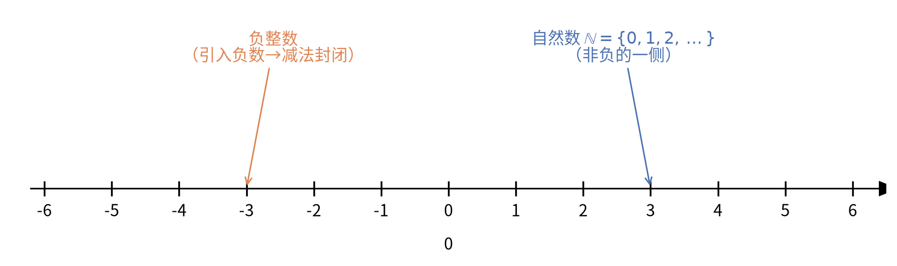

> **直观理解（现实类比）**：整数就像楼房的楼层。**自然数**是地面以上的楼层（$1, 2, 3, \dots$），**0** 是地面，**负整数**则是地下车库（$-1, -2, -3, \dots$）。有了"地下楼层"，我们才能回答"从 3 楼往下走 5 层到几楼"这样的问题（$3 - 5 = -2$）——这就是引入负数的意义：**让减法永远可以执行**。

> **🧠 思考历程：一个"比零还少"的数，是怎么被数学界接受的？**
>
> 今天连学龄前儿童都知道"欠 5 元就是 $-5$"，但负数在被承认之前，人类与之搏斗了上千年。奇怪的是：**大家每天都在"用"它，却长期"不认"它。**
>
> - **算盘与账本先"摸"到了负数**。中国人很早就用"正负算筹"表示账目：红筹为收入（正）、黑筹为支出（负）——所以今天仍说"赤字（in the red）"。**负数的出生证，其实是商人的账本先签发的。** 但这只是"记账符号"，还谈不上"数"。
> - **"讨厌它，却离不开它"**。数学本是用来计量的，减出一个"比没有还少"的东西，让欧几里得以后的几何学家很难下咽。著名例子是 11 世纪中国数学家**贾宪/杨辉**时代，人们已会用"负数"解方程；而欧洲人直到 16 世纪，数学家**卡尔达诺**解方程 $x^3=px+q$（即负数根）时，仍感叹"负数是'无解'的荒谬之物"。**几百年里，负数在解题中被反复使用，却在哲学上被人嫌弃。**
> - **数轴把它"洗白"了**。真正让负数体面入籍的，是 18 世纪的**约翰·沃利斯**与欧拉等人逐步推广"数轴"：把负数和正数、零并列铺在一条直线上，负数不过是"零左边的对称点"。**一旦数字可以"排队"在数轴上，负数的合理性就不证自明**——它是数轴上关于 0 的镜像。
> - **心路**：负数的故事告诉你：**一个"不合直觉"的对象，数学界接受它往往不是靠讲理，而是靠它"有用+能自洽"**。当一个新的"怪数"（后面还有无理数、复数）登场时，也几乎总是走"先艰难地用起来，再慢慢给出合理解释"这条路。

#### 课堂问答

**老师**：自然数已经能数清一切东西了，为什么还要请出负数？

**学生**：为了**让减法永远做得完**。$3-5$ 在自然数里无解，"欠了 5 块"却是天天发生的事。扩到整数后 $a-b=a+(-b)$ 总有答案，减法从"看运气"变成了"必然可算"。

**老师（追问）**："减去一个负数等于加上它的相反数"，除了死记，能一句话讲清吗？

**学生**：负数在数轴上是"向左的位移"。$a-(-b)$ 是"减去一段向左的位移"，等于向右走 $b$ 步，所以 $a-(-b)=a+b$。规则是数轴方向的必然结果，不是硬背的口诀。

**老师（拓展）**：整数比自然数"多"吗？

**学生**：不多，两者一样多。用配对 $0\leftrightarrow0,\ 1\leftrightarrow-1,\ 2\leftrightarrow1,\ 3\leftrightarrow-2,\dots$ 就能一一对应。这说明"无穷"不能再用"个数"来比，要靠"能否一一对应"来判断。

### 2.3 有理数 (Rational Numbers)

有理数是能表示为两个整数之比的数：

| 符号 | 名称 | 含义 | 直观解释 |
|:---:|:---:|:---|:---|
| $\mathbb{Q}$ | 有理数集 | 全体能写成两整数之比的数 | "能写成分数的数" |
| $p$ | 分子 | 任意整数 | 分子随便取 |
| $q$ | 分母 | 任意非零整数 | 分母不能是 0 |
| $\in$ | 属于 | 左边的元素属于右边集合 | "是……的一员" |
| $\mid$ | 条件分隔 | "其中/满足" | 竖线读作"满足" |

$$
\mathbb{Q} = \left\{\frac{p}{q} \;\middle|\; p, q \in \mathbb{Z},\; q \neq 0 \right\}
$$

其中 $\mathbb{Q}$ 来自英语 "quotient"（商）。有理数包括：
- 整数（分母为 1 的特殊情形）
- 有限小数，如 $0.5 = \frac{1}{2}$、$0.125 = \frac{1}{8}$
- 无限循环小数，如 $0.\overline{3} = \frac{1}{3}$、$0.\overline{142857} = \frac{1}{7}$

> **🧠 思考历程：把一块蛋糕"分下去"，怎么就分出了更大的数系？**
>
> "$\frac{1}{3}$"今天写在纸上毫不费力，可这个符号背后，是一套让古人颇费周折的"分东西"思维——它把一个"能不能整除"的问题，硬生生逼成了一个新的数系。
>
> - **从分地、分粮到"分数"**。远古记账只需整数，可一旦"一头牛只能分成两份给两个人"、"一块地三人平分"，整数就不够用了。古埃及用单位分数（如 $\frac{1}{2},\frac{1}{3}$）拼任何分数；巴比伦用六十进制小数；中国《九章算术》（约公元前 1 世纪）里已有相当成熟的分数四则运算。**分数的雏形，是"分东西"这个生活刚需逼出来的。**
> - **"有理数"名字里的误会**。"ratio"（比）可译为"有理"，但其实它既不更"有道理"，也不更"合理"，它只是**两个整数的比**（quotient，故记作 $\mathbb{Q}$）。当初把这个 $\mathbb{Q}$ 命名下来时，大家已默认"能写成两个整数之比"就是"说得清的数"。
> - **为什么非要有你？** 引入有理数，是为了让**除法也封闭**：任取两个整数相除（分母非零），结果都能写成分数而不再是"除不尽的麻烦"。它和自然数→整数的那一步动机一模一样——**每扩一个数系，就多让一种运算"永远做得完"**（见 2.4 节那句"每一次向外扩展，都是为了解决前一层无法完成的一种运算"）。
> - **但有理数还不是"全部"**。古希腊人发现 $\sqrt{2}$ 无法写成任何两个整数之比，震惊了毕达哥拉斯学派（见后续无理数章节）。**有理数虽多，却在数轴上仍留"空隙"**——这为第 10 级补全"实数"埋下了伏笔。
> - **心路**：有理数提醒你：**数学的每一次"让步"（接受更多种类的数），都不是退让，而是为了让运算永不停摆**。当你觉得"分数麻烦"时，想想正是它让"任何两个数都能相除"这件小事成了可能。

#### 课堂问答

**老师**：有理数为什么要记作 $\mathbb{Q}$，而不是想当然的 $\mathbb{R}$？

**学生**：$\mathbb{Q}$ 来自 quotient（商），强调的是"两个整数之比"，$\mathbb{R}$ 留给后面要学的实数。另外"有理"这个译名是个误会——它并不比别的数更"有道理"，只是"能写成比"而已。

**老师（追问）**：$0.\overline{3}=\frac13$，你怎么证明而不是相信？

**学生**：设 $x=0.\overline{3}$，两边乘 $10$ 得 $10x=3.\overline{3}=3+x$，于是 $9x=3$，$x=\frac13$。这个方法对一切循环小数通用：乘 $10^k$ 让循环节"对齐"，再作差把无限尾巴消掉。

**老师（拓展）**：那分母为什么不能是 $0$？

**学生**：假设 $\frac{a}{0}=b$ 有意义。若 $a\ne0$，则 $a=0\cdot b=0$，矛盾；若 $a=0$，则任何 $b$ 都满足 $0\cdot b=0$，商不唯一。两种情况都破坏了"结果唯一"，所以规定分母非零，守的是同一条底线。

### 2.4 数系的扩展关系

几种数系之间存在包含关系：

$$
\mathbb{N} \subseteq \mathbb{Z} \subseteq \mathbb{Q}
$$

即：自然数都是整数，整数都是有理数。反之则不成立，例如 $-3$ 是整数但不是自然数，$\frac{2}{3}$ 是有理数但不是整数。

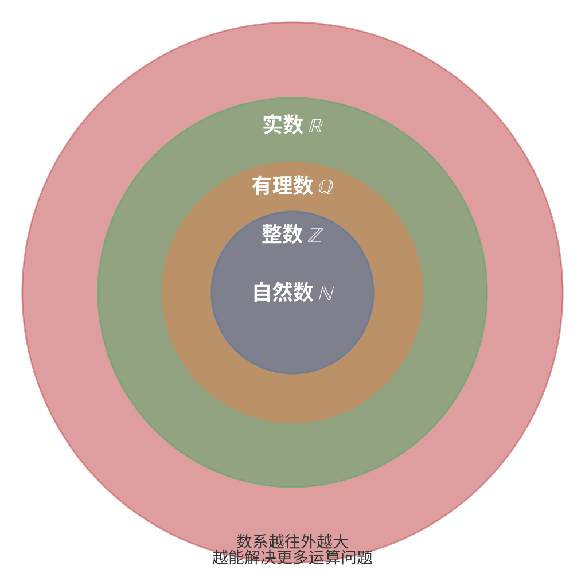

> **直观理解（现实类比）**：把数系想象成层层包含的俄罗斯套娃。最里层是"自然数"，人类最初只会用它计数；为了做减法引入了"整数"；为了做除法引入了"有理数"。**每一次向外扩展，都是为了解决前一层无法完成的一种运算**——这正是数系发展的内在逻辑。
>
> 唯一的"遗憾"是：整数和有理数虽然能定义，但在**数轴上并不连续**（有理数之间有空隙），这将在第 10 级的实数系与极限中补全。

#### 课堂问答

**老师**：$\mathbb{N}\subseteq\mathbb{Z}\subseteq\mathbb{Q}$，这三个包含号能反向读吗？

**学生**：不能。包含是单向的：$-3$ 是整数却不是自然数，$\frac23$ 是有理数却不是整数。所以只能说"自然数都是整数"，绝不能说"整数都是自然数"。

**老师（追问）**：这套扩张背后有没有一条统一的内在逻辑？

**学生**：有。每往外扩一层，就多让一种运算永远有解且结果不出界：整数让减法封闭，有理数让除法封闭。是"运算的缺口"逼着数系长大，而不是数学家想没事找事。

**老师（拓展）**：那数轴被有理数填满了吗？

**学生**：没有。$\sqrt2$ 就不在 $\mathbb{Q}$ 里——若 $\sqrt2=\frac pq$（已约分），则 $p^2=2q^2$，推出 $p,q$ 都是偶数，与已约分矛盾。有理数看似密密麻麻，数轴上仍布满了"洞"，要靠第 10 级的实数来补全。

### 2.5 位值系统 (Place Value System)

我们日常使用的是**十进制位值系统**，这是一种用位置来表示数值大小的计数方法。每个数位上的数字乘以其位值（10 的幂），再求和即得到该数的值。

**十进制数位表**：

| 数位 | 亿位 | 千万位 | 百万位 | 十万位 | 万位 | 千位 | 百位 | 十位 | 个位 |
|:---:|:---:|:---:|:---:|:---:|:---:|:---:|:---:|:---:|:---:|
| 位值 | $10^8$ | $10^7$ | $10^6$ | $10^5$ | $10^4$ | $10^3$ | $10^2$ | $10^1$ | $10^0$ |

**示例**：数字 $3,702$ 表示：

$$
3,702 = 3 \times 10^3 + 7 \times 10^2 + 0 \times 10^1 + 2 \times 10^0
$$

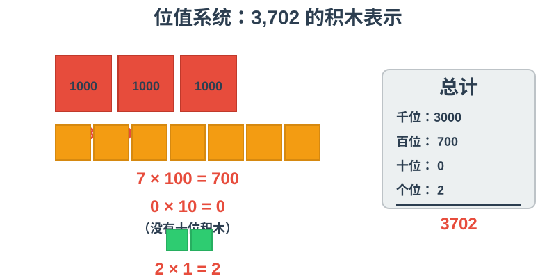

> **直观理解（现实类比）**：位值系统就像**积木塔**。千位是大立方体（每块代表1000），百位是中等方块（每块代表100），十位是小长条（每块代表10），个位是小方块（每块代表1）。数字 3,702 就是 3 块大立方体 + 7 块中等方块 + 0 块小长条 + 2 块小方块的总和。这种"位置决定价值"的思想，是现代计数的核心智慧。

> **🧠 思考历程：一个"0"，凭什么被称为人类最伟大的发明之一？**
>
> 你会写 $3702$ 而不觉得奇怪，是因为你从小生活在"位值系统"里。可要让人**仅凭一串符号就准确记录任何大小的数**，人类花了几千年——而撬动这场革命的支点，竟是一个曾被嫌弃的"空位"记号：**0**。
>
> - **没有位值之前，记数有多累？** 古罗马人会写 MCMXCVI（表示 1996），可那样一个数就有 7 个字母，还得分清"加减位"。**没有"位"，就没有位置；没有位置，做起笔算就寸步难行。** 古埃及的象形计数、古罗马的累加计数，都是把数"一个一个摆出来"，大数记录非常笨重。
> - **印度人迈出关键一步：分位 + 留空**。约 5-7 世纪，印度人发明了十进制位值和"零"（shunya，意为"空"）。用"零"来占位，就能区分 $70$ 和 $700$——否则这两者写成"$7$"根本无法分辨。**一个"什么都不代表"的符号，反而让"所有数"都能被准确代表，这是记数史上最妙的转折。**
> - **它经由阿拉伯传入欧洲，成为"阿拉伯数字"**。阿拉伯人吸收了印度的位值记数法并加以推广，欧洲人于是见到了这套十个数码 + 0 的系统，统称"阿拉伯数字"。而欧洲广泛采用这种"算位"记法（13 世纪斐波那契《算盘书》大力介绍），才让**笔算取代了算盘**，近代商业与科学计算由此起飞。
> - **心路**：位值系统告诉你：**进步常常不来自"再加一个数"，而来自"给已有的数找个不满的位置"**。一个"占位的空"，撬动了整个计算的革命。下次你写冗长数字时记一下：每一个数位，都是几千年前"留一格空"的智慧的遗产。

更一般地，任何十进制数可以写作：

| 符号 | 名称 | 含义 | 直观解释 |
|:---:|:---:|:---|:---|
| $a_k$ | 第 $k$ 位上的数字 | $0$ 到 $9$ 之间的一个数字 | "这一位写几" |
| $k$ | 位序 | 从右往左第几位（从 $0$ 起） | "第几层积木" |
| $\sum$ | 求和记号 | 把一串式子依次加起来 | "全部合在一起" |
| $10^k$ | 第 $k$ 位的位值 | $10$ 自乘 $k$ 次 | "这一位值多少" |

$$
a_n a_{n-1} \dots a_1 a_0 = \sum_{k=0}^{n} a_k \times 10^k
$$

其中 $a_k$ 是 $0$ 到 $9$ 之间的数字，且 $a_n \neq 0$。

> **拓展知识**：除了十进制，计算机科学中常用的还有二进制（基数为 2）、八进制（基数为 8）和十六进制（基数为 16）。二进制中只有数字 0 和 1，例如 $(1011)_2 = 1 \times 2^3 + 0 \times 2^2 + 1 \times 2^1 + 1 \times 2^0 = 8 + 0 + 2 + 1 = 11$。

#### 课堂问答

**老师**：$3702$ 里那个不起眼的 $0$，究竟做了什么大事？

**学生**：它占住了十位那个空位，把 $3702$ 和 $372$ 彻底区分开。位值制让同一个数码的价值由位置决定，$3702=3\times10^3+7\times10^2+0\times10+2$；但只要有一个位子空着没记号，整个数就会被读错。所以 $0$ 是位值制能"十个数码表示一切数"的关键零件。

**老师（追问）**：那么"位置"到底意味着多少？

**学生**：从右往左第 $k$ 位值 $10^k$。因此一般地 $a_na_{n-1}\cdots a_0=\sum_{k=0}^{n}a_k10^k$，其中 $0\le a_k\le 9$、$a_n\ne0$。这一个求和式就是位值制的全部内容。

**老师（拓展）**：这个求和式还能推广到哪里？

**学生**：把 $10$ 换成任意基数 $b\ge2$ 就得到任意进位制，计算机里的二进制、八进制、十六进制都是它的特例。位值思想是"一套规则管住无穷多个数"的典范。

### 2.6 进位制系统与进制转换 (Numeral Systems and Base Conversion)

**直觉与生活场景（为什么会"逢十进一"）**：我们从小数数，一个数一个数往下加，可一旦超过十个，就得"进位"。为什么要逢十进一？最自然的解释是——**人类有十根手指**。伸出十根手指正好表示 10，满了就"进一位"，于是 10 写成了"1 和 0"两个数字。但请你想一想：

> 如果把"逢十进一"换成"逢二进一""逢八进一""逢十六进一"，还能不能表示任何一个整数？它们又各自有什么用处？

**要解决的问题**：生活里"十根手指"很顺手，可有些场合**只有两种状态**。电风扇的开关只有"开/关"，一盏灯只有"亮/灭"；计算机的每个存储单元本质上也只有"有电/没电"两种状态——恰好对应两个符号 0 和 1。于是我们很需要一套**只用 0 和 1 两个符号就能表示任何整数**的记数法，这就是二进制。

**正式定义（进位制）**：给定一个不小于 2 的整数 $b$（称为**基数**，base），用 $b$ 个符号 $0,1,2,\dots,b-1$ 表示数字，且从右往左第 $k$ 位（$k=0,1,2,\dots$）的位值是 $b^k$。此时一个数写成
$$
(a_n a_{n-1}\cdots a_1 a_0)_b = \sum_{k=0}^{n} a_k \times b^k, \qquad 0 \le a_k \le b-1
$$
这种记法就是**基数 $b$ 的进位制**。特别地：
- $b=10$ 就是十进制的位值系统（见 2.5 节）；
- $b=2$ 是二进制，只用 0 和 1；
- $b=8$ 是八进制，只用 $0,1,\dots,7$；
- $b=16$ 是十六进制，除 $0$ 到 $9$ 外，还用 a、b、c、d、e、f 分别表示 $10,11,12,13,14,15$。

**来龙去脉（历史）**：
- **六十分钟、六十秒，是"六十进制"的遗产**。古巴比伦人用六十进制（基数 60）记时、量角，所以今天一小时仍是 60 分钟、一分钟仍是 60 秒，一个圆一圈仍是 $360^\circ$（$6\times60$）。
- **玛雅人用二十进制**。玛雅人用手指再加脚趾来数数，于是多数场合以 20 为基数。
- **计算机与二进制**。20 世纪电子计算机高速发展，工程师发现用"有电/没电"、即 0/1 两个符号来表示一切最稳定可靠，二进制由此成了现代计算的根基。今天你看到的文字、图片、声音，在机器内部统统只是一长串 0 和 1。

**解决了什么问题**：让"只有两种状态"的计算机也能表示、存储并运算一切整数与数据；也让同一位值思想在不同基数下得以统一，大数在各进制间的变换有了统一的位值规则。

**二进制与十进制的转换（例题）**

**例 1（二进制 → 十进制）**：把 $(1011)_2$ 化成十进制数。

**解**：按位值展开——
$$
(1011)_2 = 1\times 2^3 + 0\times 2^2 + 1\times 2^1 + 1\times 2^0 = 8 + 0 + 2 + 1 = 11
$$

**例 2（十进制 → 二进制）**：把 $35$ 化成二进制数。

**解**：用"除 2 取余，倒序排列"：
```
2 | 35   …… 余 1
2 | 17   …… 余 1
2 |  8   …… 余 0
2 |  4   …… 余 0
2 |  2   …… 余 0
2 |  1   …… 余 1
  |  0
```
从下往上读余数，得 $35 = (100011)_2$。验算：$1\times2^5+0\times2^4+0\times2^3+0\times2^2+1\times2^1+1\times2^0 = 32+2+1 = 35$ ✓

**为什么这个转换算法有效**：把 $N$ 写成 $N = 2q_0 + r_0$（$r_0$ 是 $N$ 除以 2 的余数，恰是二进制的最低位 $a_0$），再对商 $q_0$ 重复同样操作得到次低位……直到商为 0。每一轮都"劈下"二进制的一位，所以把余数倒序连起来就是结果。

#### 课堂问答

**老师**：凭什么二进制、十进制、十六进制之间可以自由换算？

**学生**：因为它们共享同一套位值规则，只是基数不同：$(a_na_{n-1}\cdots a_0)_b=\sum_{k=0}^{n}a_kb^k$。换算要么"按位展开求和"（转十进制），要么"除基取余、倒序排列"（转其他进制）。

**老师（追问）**：$(35)_{10}=(100011)_2$，为什么余数要**倒着**读？

**学生**：因为把 $35=2\times17+1$ 写出来时，余数 $1$ 恰是最低位；再对商 $17$ 重复，得到的余数是次低位……每一轮"劈下"一位，先出来的自然是最低位，所以要从下往上读。

**老师（拓展）**：计算机为什么偏爱二进制，又常用十六进制来写？

**学生**：硬件只有"通电/断电"两种稳定状态，天然对应 $0$ 和 $1$；而 $16=2^4$，十六进制与二进制是精确的"四位一换"，能把冗长的 $0/1$ 串压缩得更短、更易读，且不损失任何信息。

### 2.7 科学计数法与有效数字、估算 (Scientific Notation, Significant Figures, Estimation)

**直觉与生活场景**：光在真空中每秒大约走 $300,000,000$ 米；一粒细沙的直径大约只有 $0.0005$ 米。把这样**极大或极小**的数"一个数字一个数字地写出来"，又长、又费眼、还特别容易数错位数。

**要解决的问题**：如何只用短短几个符号，就**既准确又清楚地**表示"非常大的数"和"非常小的数"，并且让人一眼就看出它大致是 10 的多少次方、可靠到哪几位？

**正式定义（科学计数法）**：把一个数写成
$$
a \times 10^n
$$
其中 $1 \le |a| < 10$，$n$ 为整数。这种记法称为**科学计数法**。指数 $n$ 的正负与大小，直接告诉我们数的量级（10 的几次方）。

**示例**：
- $300{,}000{,}000 = 3 \times 10^8$（光速的近似值，米/秒）
- $8{,}000{,}000 = 8 \times 10^6$（800 万）
- $0.0005 = 5 \times 10^{-4}$（一粒沙的直径，约）
- $0.0000001 = 1 \times 10^{-7}$（一百万分之一）

**常用量级参考**：$10^3$ 千、$10^6$ 百万、$10^9$ 十亿、$10^{-3}$ 千分之一、$10^{-6}$ 百万分之一。

**有效数字（significant figures）**：从左边第一个**非零**数字开始，到最右边的数字为止的全体数字，都称为**有效数字**。它告诉我们这个数"可靠到哪一位"。
- $3.0 \times 10^8$：有 2 位有效数字（$3$ 和 $0$）；
- $5.30 \times 10^{-7}$：有 3 位有效数字；
- $5 \times 10^{-4}$：有 1 位有效数字。

明白了有效数字，**估算**就顺理成章：

**正式定义（估算，estimation）**：把复杂的数换成相近的整十、整百、整千，或换成"只有一位有效数字"的数，再做心算，得到一个大致正确的结果，用来快速判断数量级、检验答案是否合理。

**示例（估算）**：一箱矿泉水有 24 瓶，每瓶约 0.55 千克，一箱大约多重？
估算：$24 \approx 25$，$0.55 \approx 0.5$，$25 \times 0.5 = 12.5$（约 13 千克）；精确值 $24 \times 0.55 = 13.2$ 千克。估算与精确值相差很小，足够判断数量级。

**来龙去脉**：近代科学从天文学起步后，数据迅速变得"大到日常记账无法容忍"。把数写成"一位整数的小数 $\times$ 10 的若干次方"，本质上是十进制位值系统（2.5 节）的顺势延伸——它把注意力从"数写了多少个 0"转移到"这个数大约是 10 的几次方"，使不同量级的比较、乘除与估算都变得轻松。

**解决了什么问题**：让极大极小的数可以简洁书写与交流；让"先取首位数、再对 10 的幂次做加减"成为系统方法；并为估算与误差分析提供了语言。

#### 课堂问答

**老师**：$3\times10^8$ 和 $3.0\times10^8$ 是同一个数吗？既然相等，为什么要写成两种？

**学生**：数值相等，但"可靠程度"不同。前者 1 位有效数字，后者 2 位。科学计数法里保留的每个数字都在传递测量精度的信息，多写一个 $0$ 就是在声明"这一位是可靠的"。

**老师（追问）**：既然要精确，为什么还提倡估算？

**学生**：估算的目标往往不是精确值，而是"验数量级、防荒谬"。把 $24\approx25$、$0.55\approx0.5$，立刻得 $12.5$ 千克，与精确值 $13.2$ 相差很小，却省掉了大半计算。

**老师（拓展）**：有效数字的规则能推广到多步运算吗？

**学生**：能。乘除的结果由最不精确的那个数决定有效数字位数，加减则以小数点后位数最少者为准。本质是一句话：结果不允许假装比输入更精确。

### 2.8 百分数、小数与分数的互化及应用 (Percent, Decimals, Fractions)

**直觉与生活场景**：逛街看到"八折""降价 20%"，看新闻听到"某厂产量同比增长 12%"，做统计算出"命中率 87%"……**生活里天天在说"每 100 份里有几份"**。可同一个比例，有人说 50%，有人说 0.5，有人说 $\frac{1}{2}$——它们其实是同一个数的三种写法。

**要解决的问题**：既然百分数、小数、分数描述的是**同一个比例**，我们就应当能在三者之间**熟练互化**，并在打折、占比、增长率等应用里正确使用。

**正式定义**：**百分数**表示"一个数是另一个数的百分之几"，记号 $\%$ 读作"百分之"，有时也叫"百分比"。例如
$$
45\% = \frac{45}{100} = 0.45
$$
**互化规则**：
- **小数 → 百分数**：小数点向右移两位，再添 $\%$。例如 $0.45 \to 45\%$。
- **百分数 → 小数**：去掉 $\%$，小数点向左移两位。例如 $45\% \to 0.45$。
- **分数 → 百分数**：先化成小数（分子除以分母），再化成百分数；或把分母改写成 100。例如 $\frac{3}{5} = 0.6 = 60\%$。
- **百分数 → 分数**：写成 $\dfrac{\text{百分数}}{100}$ 再约分。例如 $60\% = \frac{60}{100} = \frac{3}{5}$。

**例题（应用——打折）**：一件毛衣原价 200 元，打八折（即按原价的 80% 出售），售价是多少？
$$
200 \times 80\% = 200 \times 0.8 = 160 \ (\text{元})
$$

**例题（应用——占比）**：一班 40 人，其中女生 18 人，女生占了百分之几？
$$
\frac{18}{40} = 0.45 = 45\%
$$

**例题（应用——增长率）**：某店上月营业额 5 万元，本月增长 20%，本月营业额是多少？
$$
5 \times (1 + 20\%) = 5 \times 1.2 = 6 \ (\text{万元})
$$

**来龙去脉**："percent" 来自拉丁文 **per centum**，原意"每百"（per 意为"每一"，centum 意为"百"）。中世纪的商人和银行家在记账、算利息时频繁碰到"每一百份里取几份"，于是把"分母为 100 的分数"专门特化出来，慢慢演变成今天的 $\%$ 记号。它本质上是"分母为 100 的分数"的一种简便写法，只因为生活中出现得太多，才被单独立成一种记法。

**解决了什么问题**：让"比例、相对大小"的表达与比较直观化——把各种分母统一成 100，不同比例立刻可以互相比较大小；同时为利率、税率、折扣、增长率等日常场景提供了一套统一的计算语言。

---

#### 课堂问答

**老师**：$50\%$、$0.5$、$\frac12$ 是三个数还是一个数？

**学生**：是同一个数 $\frac12$ 的三副面孔。百分数是"分母为 100 的分数"的便民写法，小数是十进制写法。互化不过是换个打扮，值没有变。

**老师（追问）**："上涨 20%" 和 "是原来的 20%"，差在哪里？

**学生**：差一个"1"。上涨 $20\%$ 是变成 $1+20\%=1.2$ 倍，是原来的 $20\%$ 则只有 $0.2$ 倍，两者相差 $6$ 倍。关键永远在"跟谁比"。

**老师（拓展）**：先涨 20% 再降 20%，能直接相加抵消吗？

**学生**：不能，要用乘法连乘：$1.2\times0.8=0.96$，净跌 $4\%$。因为两次变化的基准不同，第二次的 $20\%$ 是对已经涨过的数取的比例，直接相加减会算错。

## 3. 基本运算

### 3.1 加法 (Addition)

> **来龙去脉（加法是怎么"生"出来的）**：加法对应人类最古老也最本质的动作——**把两堆东西放在一起数**。远古的结绳计数、记账，本质上都是累加。它要解决的正是"合在一起一共有多少"这个最基本的问题：没有加法，"数"就只能被"数出来"，却无法被"演算"。今天我们能够随手写出 $3+5$ 与 $5+3$ 而毫不在意先后，这个看似平淡的事实，恰是 4.1 节加法交换律的直觉来源。

加法是最基本的运算，表示将两个或多个数量合并在一起。

**符号**：$a + b$，读作 "a 加 b"。

**术语**：
- $a$ 和 $b$ 称为**加数** (addends) 或**项** (terms)
- 结果称为**和** (sum)

**竖式计算**：将数位对齐，从个位开始逐位相加，满十进一。

```
  3 7 2
+ 4 5 8
-------
  8 3 0
```

**示例**：$372 + 458 = 830$

计算过程：
1. 个位：$2 + 8 = 10$，写 0 进 1
2. 十位：$7 + 5 + 1 = 13$，写 3 进 1
3. 百位：$3 + 4 + 1 = 8$，写 8

#### 课堂问答

**老师**：为什么说加法是所有运算里最"基本"的那个？

**学生**：因为它直接对应"把两堆东西合起来数"这一最古老的动作，而且是唯一能被"真的数一遍"验证的运算。其他运算要么由它定义（乘法是连加），要么与它互逆（减法）。

**老师（追问）**：竖式加法为什么要"从个位算起、满十进一"？

**学生**：这是位值制的必然。个位满 $10$ 就等于十位多 $1$，把 $10$ 打包进位，$\sum a_k10^k$ 的等式并没有被破坏。从低位算起，全程只需随身带一个"进位"，一趟走完。

**老师（拓展）**：反过来，能从高位往低位算吗？

**学生**：可以，但低位的进位会回头影响高位，可能返工。这是算法设计里"信息流向"的经典例子——顺着依赖关系算，代价最小。

### 3.2 减法 (Subtraction)

> **来龙去脉（减法解决什么问题）**：减法回应的是"剩下了多少、少了多少、相差多少"——分给别人之后还剩什么、两队各有多少相差几个。它本是加法的"逆动作"。真正让减法必须被单独讲清楚之处在于：**它的结果可能越减越小，甚至减成负数**。正是这种"减不完还会欠"的情形，促使人们把数从自然数扩展到整数（见 2.2 节），让"会减过头"的问题从此有了答案。

减法可以理解为加法的逆运算，表示从一个数量中移除一部分。

**符号**：$a - b$，读作 "a 减 b"。

**术语**：
- $a$ 称为**被减数** (minuend)
- $b$ 称为**减数** (subtrahend)
- 结果称为**差** (difference)

**竖式计算**：将数位对齐，从个位开始逐位相减。如果某一位不够减，向前一位借 1 当 10。

```
  5 0 2
- 3 4 7
-------
  1 5 5
```

**示例**：$502 - 347 = 155$

计算过程：
1. 个位：$2$ 不够减 $7$，向十位借 1，$12 - 7 = 5$
2. 十位：已被借走 1，剩 $0$，不够减 $4$，向百位借 1，$10 - 4 - 1 = 5$（注意减去借走的 1）
3. 百位：已被借走 1，剩 $4$，$4 - 3 = 1$

#### 课堂问答

**老师**：不够减时"借 1 当 10"，这个 10 是哪来的？

**学生**：来自位值制相邻位的权之比。从前一位借来的 $1$ 正好等于本位的 $10$，只是把同一个数换了一种写法，等式一点没变。

**老师（追问）**：$502-347$ 里十位为什么特别容易算错？

**学生**：十位本来是 $0$，得先向百位借 $1$ 变成 $10$，再被个位借走 $1$；也就是"借出的账要连记两次"。本质是连环借位：个位向十位借不成，就由十位向百位借。

**老师（拓展）**：减法和加法在结构上是什么关系？

**学生**：互为逆运算，$a-b=c\iff a=b+c$。并且 $a-b=a+(-b)$，说明减法不过是"加上相反数"。一旦有了负数，减法就可以从基本运算里退役，只需保留加法。

### 3.3 乘法 (Multiplication)

> **来龙去脉（乘法是为什么而生的）**：当你要数"3 排 4 列"的点阵，或者店里进了 5 天、每天各 12 箱货时，一个一个相加实在太慢。乘法就是为了**让"同数连加"变得简短**而生的。它的早期用途遍布土地丈量（长 $\times$ 宽得面积）、商品计价、人口统计等"同样的事情反复出现"的场景。一旦把"加多少遍"抽象成"乘一个数"，很多原来算到手酸的问题就一步到位了。

乘法是加法的简便运算——多个相同数的连加可以写成乘法。

**符号**：$a \times b$ 或 $a \cdot b$ 或 $ab$，读作 "a 乘以 b"。

**术语**：
- $a$ 和 $b$ 称为**因数** (factors)
- 结果称为**积** (product)

**从加法到乘法**：

$$
3 + 3 + 3 + 3 + 3 = 5 \times 3 = 15
$$

即 $5$ 个 $3$ 相加等于 $5$ 乘以 $3$。

**竖式计算（多位数乘法）**：

```
    2 4
×   3 7
-------
  1 6 8   (24 × 7)
+ 7 2     (24 × 30)
-------
  8 8 8
```

**示例**：$24 \times 37 = 888$

计算过程：
1. 用 $7$ 乘 $24$：$24 \times 7 = 168$
2. 用 $3$（代表 30）乘 $24$：$24 \times 30 = 720$
3. 将两部分相加：$168 + 720 = 888$

#### 课堂问答

**老师**：乘法真的只是"连加"吗？

**学生**：对整数是：$5\times3=3+3+3+3+3$。但它真正的价值在于把"加了多少遍"抽象成一个因子，让面积、单价总价这类"同构重复"的问题一步到位，而不必再去数多少遍。

**老师（追问）**：$24\times37$ 的竖式为什么恰好拆成 $168$ 与 $720$ 两行？

**学生**：把 $37$ 拆成 $7+30$，再用分配律：$24\times(7+30)=24\times7+24\times30=168+720=888$。竖式的第二行要左移一位，那一位正是 $30$ 里那个 $0$。

**老师（拓展）**：为什么"矩形面积 = 长 × 宽"本身就是乘法？

**学生**：把矩形切成 $m\times n$ 个单位正方形，横着按行数是 $n$ 个 $m$，竖着按列数是 $m$ 个 $n$，两种数法总数相同。这一"同一堆点两种数法"的图像，就是乘法交换律的几何来源。

### 3.4 除法 (Division)

> **来龙去脉（除法解决什么问题）**：把东西分给一组人——12 颗糖平均分给 3 个小朋友，是"平均分"；把一堆糖按 5 颗一袋来数、看能装几袋，是"包含除"。除法正是这两种生活动作的数学化。而当分不干净、余下一点时，写"商 + 余数"的**带余除法**就成了必须讲完整的答案——它还顺带带出了"余数必须小于除数"这条重要约束（见下方 3.4 节）。

除法是乘法的逆运算，表示将一个数量平均分成若干份。

**符号**：$a \div b$ 或 $\frac{a}{b}$ 或 $a/b$，读作 "a 除以 b"。

**术语**：
- $a$ 称为**被除数** (dividend)
- $b$ 称为**除数** (divisor)
- 结果称为**商** (quotient)

**余数**：当除法不能整除时，剩余的部分称为**余数** (remainder)。

**带余除法**：对于任意整数 $a$ 和正整数 $b$，存在唯一的整数 $q$ 和 $r$ 使得：

$$
a = b \times q + r, \quad 0 \leq r < b
$$

其中 $q$ 是商，$r$ 是余数。

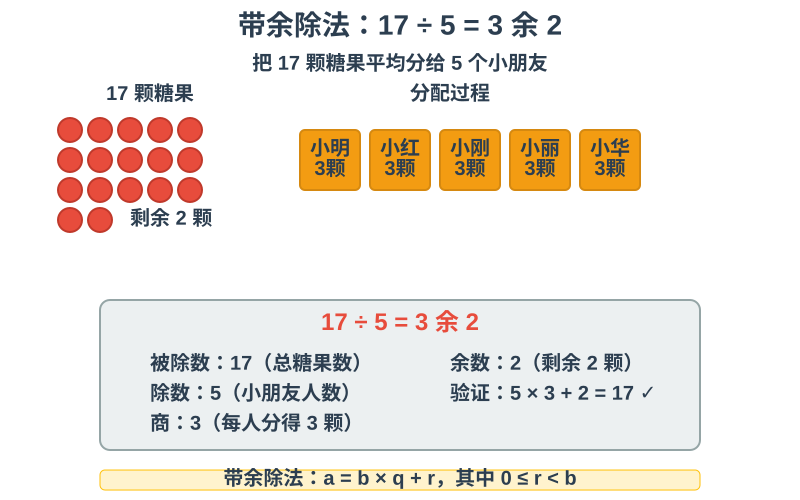

**竖式计算（长除法）**：

```
      2 7 3
   ────────
5 ) 1 3 6 5
    1 0
   ────
      3 6
      3 5
     ────
        1 5
        1 5
       ────
          0
```

**示例**：$1365 \div 5 = 273$

#### 课堂问答

**老师**：除法在生活里有哪两种面孔？

**学生**：一种是"平均分"——$12$ 颗糖分给 $3$ 人，每人几颗，求每份；另一种是"包含除"——每袋装 $5$ 颗，能装几袋，求份数。前者 $12\div3$，后者 $12\div5$，算式形式一样，含义不同。

**老师（追问）**：带余除法为什么一定要限定 $0\le r<b$？

**学生**：为了唯一性。若不限制，$17=5\times2+7=5\times3+2$ 都成立，商和余数就各有说法。限定之后，$a=bq+r$ 的 $(q,r)$ 才被唯一锁定。

**老师（拓展）**：那 $a\div0$ 到底哪里不对？

**学生**：它要求解 $0\times q=a$。$a\ne0$ 时无解，$a=0$ 时任意 $q$ 都是解——一个没有答案，一个答案太多，两种情形都撞碎了"商唯一"。所以规定除数不为 $0$，是同一条唯一性底线。

### 3.5 运算优先级

> **直觉（为什么要讲"先后"）**：一张菜谱写"3 个苹果加 4 盒蛋、每盒装 2 个"，到底先加还是先乘，结果完全不同（见下方示例）。为了让大家对同一个算式**永远算出同一个答案**，数学家约定了一套统一的先后顺序，这就是运算优先级。它要解决的根本问题是：**一个含多种运算的式子，究竟该按什么顺序算，才能让"约定一致"成为可能。**

当多个运算混合出现时，需要遵循运算优先级规则：

1. 先算括号内的内容
2. 再算乘法和除法（从左到右）
3. 最后算加法和减法（从左到右）

记忆口诀：**先乘除，后加减，有括号先算括号里**。

**示例**：

$$
3 + 4 \times 2 = 3 + 8 = 11 \quad (\text{不是 } 14)
$$

$$
(3 + 4) \times 2 = 7 \times 2 = 14
$$

#### 课堂问答

**老师**：为什么全世界都规定"先乘除、后加减"？这条规矩凭什么？

**学生**：它的目的是让含多种运算的式子**只有一个答案**。顺序本身可以换，但必须全球统一，否则同一个算式各人算出各人的结果，数学就无法交流。

**老师（追问）**：$3+4\times2$ 为什么等于 $11$ 而不是 $14$？

**学生**：按约定先算 $4\times2=8$，再 $3+8=11$。想得到 $14$，就必须显式写成 $(3+4)\times2$。括号的作用正是"临时改写约定"。

**老师（拓展）**：同级运算为什么规定"从左到右"？

**学生**：因为减法和除法不满足交换律。$8\div4\times2$ 从左得 $4$，从右得 $1$。同级必须有统一方向，结果才唯一——这条规定和"先乘除后加减"是同一个动机。

### 3.6 负数的四则运算规则 (Arithmetic with Negative Numbers)

**直觉与生活场景**：冰箱冷藏室调到 $-3^\circ$，再从这一温度往上升 $5^\circ$，会到几度？电梯停在地下的 $-2$ 层再上 5 层，又到了哪一层？我们早就认识了负数（见 2.2 节），可一旦要跟它"加一加、减一减、乘一乘、除一除"，就必须先说清楚按什么规律来算。

**要解决的问题**：负数进来之后，我们的加减乘除必须重新给出**一套既前后自洽、又跟现实吻合**的运算法则——否则"负三度往上走五度到几度""盈利变亏损怎么乘"这类日常问题就无解了。

**正式定义（负数的加法与减法）**：
- **同号相加**：取相同的符号，绝对值相加。例如 $(-3)+(-5) = -8$。
- **异号相加**：取绝对值较大一方的符号，用较大的绝对值减较小的绝对值。例如 $(-3)+5 = 2$，$3+(-5) = -2$。
- **减法统一化为加法**：减去一个数，等于加上它的相反数
$$
a - b = a + (-b), \qquad a - (-b) = a + b
$$
例如 $(-6)-(-4) = (-6)+4 = -2$。

**正式定义（负数的乘法与除法）**：
- **同号相乘/除为正**：$(-3)\times(-2) = 6$，$\dfrac{-6}{-2} = 3$。
- **异号相乘/除为负**：$3\times(-2) = -6$，$\dfrac{-6}{2} = -3$。
- 除数仍然不能为 0（理由见第 8 章探究题 3）。

**来龙去脉（这些规则是谁定下、为什么"负负得正"）**：印度数学家**婆罗摩笈多**（约 7 世纪）最早写下负数加减乘除的完整规则；阿拉伯与欧洲的数学则把负数用于求解方程与记录商业盈亏账目。至于"负负得正"，真正让它**非如此不可**的，是分配律——负数的乘法必须与整栋正数的运算大厦保持自洽。请看：
$$
(-1)\times(-1) + (-1)\times 1 = (-1)\times\big[(-1)+1\big] = (-1)\times 0 = 0
$$
因为 $(-1)\times 1 = -1$，代回上式左边即得 $(-1)\times(-1) + (-1) = 0$，于是
$$
(-1)\times(-1) = 1
$$
整个推导只用到了我们已经同意的分配律、$a\times0=0$ 与 $(-1)\times1=-1$，就逼出了"负负得正"。它解决的根本问题是：让负数的四则运算既有统一规则、又不与已有的正数运算法则冲突。

**解决了什么问题**：让负数在加减乘除里"永远有结果、且与现实一致"——温度变化、楼层升降、盈亏、海拔、银行存取等带方向或带符号的量，从此都能直接参与完整的四则运算。

> **直观理解（负负得正）**：把"乘以 $-1$"想象成"转身 180°"。一个朝向的人被转 180°，脸朝向相反方向；再转一次 180°，又转回来。**转两次身 = 转回原方向**，这就是 $(-1)\times(-1)=1$ 的直觉。把它放大到 $(-a)\times(-b)=ab$，同样成立。

---

#### 课堂问答

**老师**：$(-2)\times(-3)=6$ 凭什么成立？是规定还是能推出来？

**学生**：能推。分配律必须对负数也成立，由 $(-2)\times3=-6$ 及 $(-2)\times\big(3+(-3)\big)=(-2)\times0=0$，可得 $(-2)\times(-3)$ 只能是 $+6$。"负负得正"不是人为硬性规定，而是被"运算律不能破"逼出来的。

**老师（追问）**：负数运算最容易栽在哪两个地方？

**学生**：一是符号，$-3^2=-9$ 而 $(-3)^2=9$，前者是"$3$ 的平方再取负"，后者才是"负三的平方"；二是"减去一个负数等于加上它的相反数"，符号连着变两次时最容易漏。

**老师（拓展）**：有什么统一的几何图像能囊括这些规则？

**学生**：数轴上，加法是平移，乘正数保持方向、乘负数掉头。于是 $(-1)\times(-1)=1$ 就是"掉头两次回到原方向"，加减乘除的符号规则全部落进同一幅"方向图"里。

## 4. 运算律

运算律是算术运算中遵循的基本规则，它们是整个数学推理的基础。下面我们逐一陈述并证明。

### 4.1 加法交换律

**定理**：对于任意两个数 $a$ 和 $b$，有：

$$
a + b = b + a
$$

**解释**：两个数相加，交换加数的位置，和不变。

**证明**（直观证明）：

加法本质上是对两个集合进行合并。设有 $a$ 个苹果和 $b$ 个橘子，把它们放在一起，总共有 $a + b$ 个水果。无论你先数苹果还是先数橘子，总数不变。因此 $a + b = b + a$。

**示例**：$3 + 5 = 5 + 3 = 8$

#### 课堂问答

**老师**：$a+b=b+a$ 不是明摆着的吗，还有什么可讲？

**学生**：对有限个数它确实符合直觉——数东西不分先后。但"显然"不等于"不用管"：交换律是可以也必须被证明的命题，而且在无限多个数相加时它并不自动成立。

**老师（追问）**：这条"明摆着的"律有什么实际本事？

**学生**：它给了我们重排加数的自由。$37+48+63=(37+63)+48=148$，先凑整再算，心算立刻轻松。交换律常和结合律配合做"凑十凑百"。

**老师（拓展）**：哪些运算不满足交换律？

**学生**：减法、除法、矩阵乘法、函数复合都不满足。它们都有"方向性"。能否交换，是刻画一个运算结构强度的重要指标，抽象代数里正以此为分水岭。

### 4.2 加法结合律

**定理**：对于任意三个数 $a$、$b$ 和 $c$，有：

$$
(a + b) + c = a + (b + c)
$$

**解释**：三个数相加，先把前两个数相加，或者先把后两个数相加，和不变。

**证明**（直观证明）：

设有 $a$ 个红球、$b$ 个蓝球和 $c$ 个绿球。$(a + b) + c$ 表示先把红球和蓝球合并，再与绿球合并；$a + (b + c)$ 表示先把蓝球和绿球合并，再与红球合并。两种方式的总球数显然相同。

**示例**：$(2 + 3) + 4 = 5 + 4 = 9$，$2 + (3 + 4) = 2 + 7 = 9$

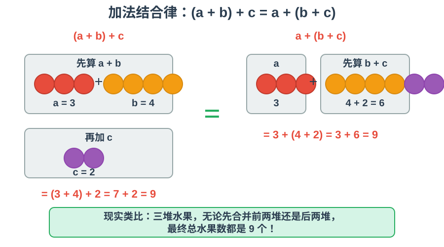

#### 课堂问答

**老师**：结合律和交换律是一回事吗？我怎么觉得都在说"随便加"？

**学生**：不是。交换律管**换位置**（$a+b=b+a$），结合律管**先算哪两个**（$(a+b)+c=a+(b+c)$），后者完全不改变顺序，只改变分组。

**老师（追问）**：$a+b+c$ 能省掉括号，靠的是哪条律？

**学生**：靠结合律。正因为 $(a+b)+c$ 与 $a+(b+c)$ 结果相同，两种读法没有歧义，才敢把括号删掉。若结合律不成立，$a+b+c$ 就是一句有歧义的话。

**老师（拓展）**：连加求和时它还有什么妙用？

**学生**：用来分组凑整。$1+2+\dots+100$ 首尾配对成 $(1+100)+(2+99)+\cdots$，共 $50$ 组每组 $101$，得 $5050$——这正是等差数列求和"首尾配对"思想的源头。

### 4.3 乘法交换律

**定理**：对于任意两个数 $a$ 和 $b$，有：

$$
a \times b = b \times a
$$

**解释**：两个数相乘，交换因数的位置，积不变。

**证明**（直观证明）：

使用矩形面积模型。一个 $a$ 行 $b$ 列的矩形点阵，总点数为 $a \times b$。将这个矩形旋转 $90^\circ$，就变成了 $b$ 行 $a$ 列，总点数为 $b \times a$。由于旋转不改变点的数量，所以 $a \times b = b \times a$。

**示例**：$3 \times 4 = 4 \times 3 = 12$

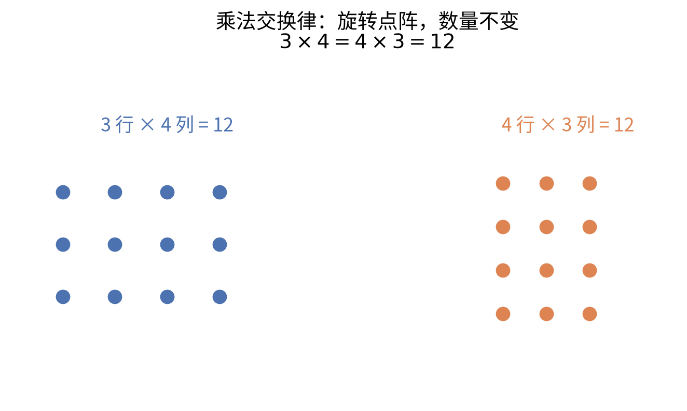

> **直观理解（现实类比）**：想象一个整齐的**阅兵方阵**——无论你按"3 排 4 列"还是"4 排 3 列"来数，总人数都是 12，只是站立的方向变了。这就是交换律的含义：**乘法只看"总共有多少"，不关心"谁在前谁在后"**。

#### 课堂问答

**老师**：$3\times4=4\times3$，你能给出一个"看得见"的解释吗？

**学生**：把 $3\times4$ 个点摆成 $3$ 行 $4$ 列，旋转 $90^\circ$ 就成了 $4$ 行 $3$ 列，一个点没多、一个点没少。横着数和竖着数数的是同一堆点。

**老师（追问）**：这条律在计算时能省什么力？

**学生**：省"选顺序"的力。心算时把因数调到顺手的位置，$7\times99$ 比 $99\times7$ 顺得多；乘法估算中也可以先与好算的数相乘。运算顺序的自由就是效率的自由。

**老师（拓展）**：几何直观算不算"证明"？

**学生**：作为启发完全够用，但严格证明仍需从自然数的构造出发（乘法的递归定义加归纳）。几何给出的是"为什么可信"，形式证明负责"凭什么无懈可击"，两者分工不同。

### 4.4 乘法结合律

**定理**：对于任意三个数 $a$、$b$ 和 $c$，有：

$$
(a \times b) \times c = a \times (b \times c)
$$

**解释**：三个数相乘，先把前两个数相乘，或者先把后两个数相乘，积不变。

**证明**（直观证明）：

考虑一个 $a \times b \times c$ 的三维长方体（长 $a$、宽 $b$、高 $c$）。$(a \times b) \times c$ 表示先计算底面积再乘以高；$a \times (b \times c)$ 表示先计算一个侧面的面积再乘以另一条边。体积相同，因此等式成立。

**示例**：$(2 \times 3) \times 4 = 6 \times 4 = 24$，$2 \times (3 \times 4) = 2 \times 12 = 24$

#### 课堂问答

**老师**：$(ab)c=a(bc)$ 在算题时能帮什么忙？

**学生**：它允许连乘时自由分组凑整。$25\times17\times4=(25\times4)\times17=100\times17=1700$，先把 $25$ 和 $4$ 抱成一团，比硬乘快得多。

**老师（追问）**：它和交换律合起来，意味着什么？

**学生**：连乘中的因数可以任意换位置、任意改分组，积都不变。这就是"连乘可以随便算"的全部依据，两条律缺一不可。

**老师（拓展）**：体积公式里能看出它吗？

**学生**：能。长方体体积 $abc$ 与先算哪两个面无关，是先取哪两层的意思；而 $V=Sh$ 不过先把底面 $ab$ 打包成 $S$，再一次乘以高 $c$——正是结合律的几何化身。

### 4.5 分配律

**定理**：对于任意三个数 $a$、$b$ 和 $c$，有：

$$
a \times (b + c) = a \times b + a \times c
$$

**解释**：乘法对加法的分配——一个数乘以两个数的和，等于这个数分别乘以这两个数再相加。

**证明**（直观证明）：

使用矩形面积模型。考虑一个矩形，宽为 $a$，长为 $b + c$。它的总面积是 $a \times (b + c)$。如果把矩形分成两个小矩形，左边面积为 $a \times b$，右边面积为 $a \times c$。总面积等于两部分面积之和，因此 $a \times (b + c) = a \times b + a \times c$。

**示例**：$3 \times (4 + 5) = 3 \times 9 = 27$，$3 \times 4 + 3 \times 5 = 12 + 15 = 27$

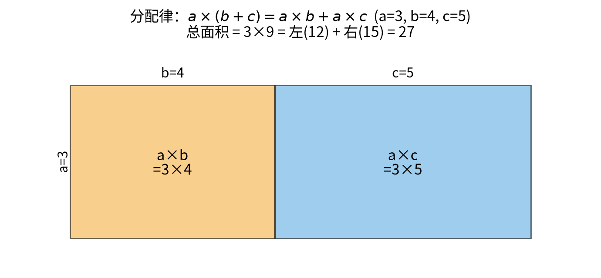

> **直观理解（现实类比）**：想象你有一块长条形的**巧克力板**，宽 3 格；它被分包装机从中间切成了两段，一段长 4 格，一段长 5 格。整块巧克力的格数，既可以是"宽 $3\times$ 全长 $9$"，也可以是"左段 $3\times4$ + 右段 $3\times5$"。两种算法结果一定相同——这就是分配律。

**推论——提取公因数**：分配律也可以反过来使用：

$$
a \times b + a \times c = a \times (b + c)
$$

这称为**提取公因数**，在后续的代数学习中非常重要。

#### 课堂问答

**老师**：如果说运算律里有"王"，你会把王冠给谁？

**学生**：给分配律 $a(b+c)=ab+ac$。它是唯一把加法与乘法沟通起来的律。没有它，加和乘就是两套互不相干的动作，竖式乘法、整式展开、因式分解统统无从谈起。

**老师（追问）**：$25\times12$ 怎么用分配律心算？

**学生**：$25\times(10+2)=250+50=300$；或者 $25\times(4\times3)=100\times3=300$，那是走结合律。分配律是"拆数"的加速器，把大数拆成好算的几块。

**老师（拓展）**：这条律能反着用吗？

**学生**：能，反向就是提取公因式：$ab+ac=a(b+c)$。这是因式分解的起点，与第 2 级的"提取公因式法"完全同源——同一条等式，正读是展开，倒读是分解。

### 4.6 运算律之间的关系

运算律之间存在深层联系。交换律和结合律保证了加法或乘法运算中，**任意重新排列和分组都不会改变结果**。分配律则是连接加法和乘法的桥梁。

| 运算律 | 加法 | 乘法 |
|:---:|:---:|:---:|
| 交换律 | $a+b = b+a$ | $a \times b = b \times a$ |
| 结合律 | $(a+b)+c = a+(b+c)$ | $(a \times b) \times c = a \times (b \times c)$ |
| 分配律 | 不适用 | $a \times (b+c) = a \times b + a \times c$ |

> **注意**：减法**不满足**交换律和结合律。例如 $5 - 3 \neq 3 - 5$，$(5 - 3) - 2 \neq 5 - (3 - 2)$。除法同样**不满足**交换律和结合律。例如 $6 \div 3 \neq 3 \div 6$，$(12 \div 6) \div 2 \neq 12 \div (6 \div 2)$。

#### 课堂问答

**老师**：交换律、结合律、分配律，能不能只留一条、推出其余？

**学生**：不能，三条互相独立，各管一件事：换位置、改分组、把乘法拆到加法上。任何一条都不能由另外两条推出，所以必须分条列出。

**老师（追问）**：那减法和除法为什么没有同类的"律"？

**学生**：因为它们根本不满足：$5-3\ne3-5$、$12\div4\ne4\div12$。不过也别急着说它们"没律"——$a-b=a+(-b)$、$a\div b=a\times\frac1b$ 告诉我们，它们的可交换性被藏进了相反数与倒数的加法、乘法里。

**老师（拓展）**：这几条律为什么值得单列一章？

**学生**：因为它们是"化简与变形"的许可证。整式运算、解方程、因式分解，本质上就是反复引用这几条律；而把它们抽出来当公理，就长成了群、环、域这套抽象代数。

### 4.7 运算性质的总结表 (Summary Table of Operation Properties)

上面把每一条运算性质都单独讲通了。真正做算术乃至后续代数时，最有用的是把它们**放进一张对照表一起看**——既不遗漏，又便于对比。这张表按"加法/乘法"两条线索，把它们的各种性质罗列出来：

| 性质 | 加法 | 乘法 |
|:---|:---|:---|
| **交换律** | $a+b = b+a$ | $a \times b = b \times a$ |
| **结合律** | $(a+b)+c = a+(b+c)$ | $(a \times b) \times c = a \times (b \times c)$ |
| **分配律**（乘法对加法） | — | $a \times (b+c) = a \times b + a \times c$ |
| **单位元**（identity） | $0$，满足 $a+0 = a$ | $1$，满足 $a \times 1 = a$ |
| **都有"抵消"（逆元）** | $a + (-a) = 0$ | $a \times \dfrac{1}{a} = 1\ (a \neq 0)$ |

> **这张表到底解决什么问题**：一是帮你记住"加减乘除里，哪些可以自由换位置、自由分组"；二是为后面第 2 级起的代数学习，备好一张"哪些变形永远合法、哪些不合法"的清单。请格外注意——**交换律与结合律只属于加法、乘法**；减法和除法既无交换律，也无结合律，绝不能把它们的两个数随意对调或随便加括号。

> **为什么减法、除法没有交换律**：因为"倒过来"之后含义变了——$3-5$ 与 $5-3$ 表示"谁比谁多"完全不同的两件事；$a \div b$ 与 $b \div a$ 也通常不相等。只有加法和乘法在"合并多少、一共多少个"这个层面天然对调无差别，这正是它们独占交换律的道理。

---

#### 课堂问答

**老师**：这张表在实际做题时该怎么用？

**学生**：把它当"变形许可证清单"用。每做一步变形，先说出自己引用了哪一条，就不会乱。例如 $a(b+c)=ab+ac$ 用的是分配律，$a+b=b+a$ 用的是交换律。

**老师（追问）**：表里哪些其实是"没有"的？

**学生**：乘法对加法可分配，加法对乘法却不行；$a\div(b+c)\ne a\div b+a\div c$；减去两个数不等于分别减。表里的"有"和"无"同样重要，出错几乎全发生在这些缺口处。

**老师（拓展）**：如果干脆把这张表当作公理，会得到什么？

**学生**：得到抽象代数。只保留加法的交换律、结合律、单位元、逆元，就是群；再加上乘法与分配律，就是环；若还能除，就是域。这张小表正是整个代数结构的起跑线。

## 5. 质数与算术基本定理

### 5.1 质数与合数

**质数（素数）**：一个大于 1 的自然数，如果除了 1 和它本身之外没有其他正因数，称为质数。

**合数**：一个大于 1 的自然数，如果不是质数，则称为合数（即除了 1 和它本身之外还有其他正因数）。

**特别的**：1 既不是质数也不是合数。

**前 20 个质数**：

$$
2, 3, 5, 7, 11, 13, 17, 19, 23, 29, 31, 37, 41, 43, 47, 53, 59, 61, 67, 71
$$

**质数的判定方法**（试除法）：

要判断一个数 $n$ 是否为质数，只需用 $2$ 到 $\sqrt{n}$ 之间的所有整数去试除 $n$。如果都不能整除，则 $n$ 是质数。

**示例**：判断 $29$ 是否为质数。

$\sqrt{29} \approx 5.38$，所以只需试除 $2, 3, 5$：
- $29 \div 2 = 14.5$（不能整除）
- $29 \div 3 \approx 9.67$（不能整除）
- $29 \div 5 = 5.8$（不能整除）

因此 $29$ 是质数。

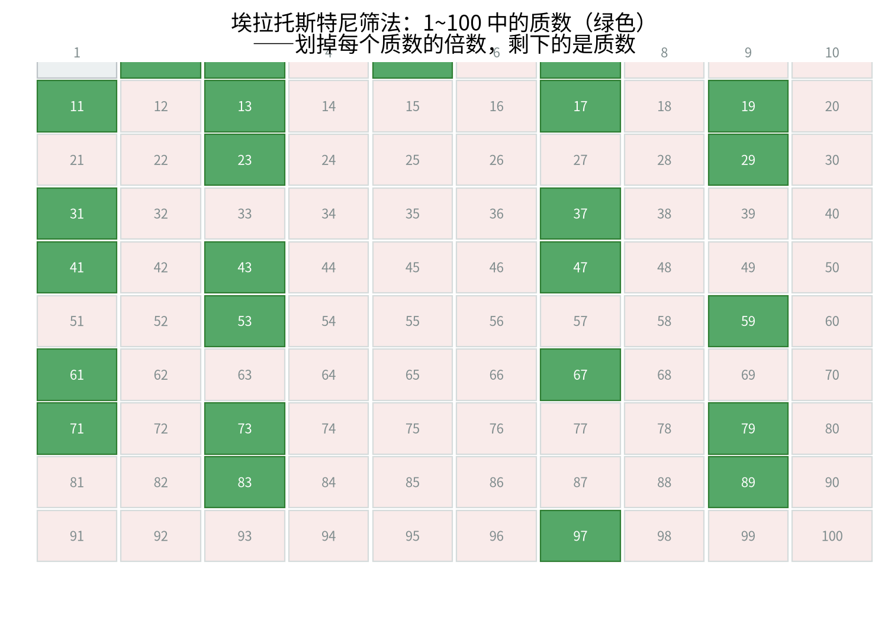

> **直观理解（现实类比）**：想象一张 1 到 100 的**号码牌**。从 2 开始，把 2 的所有倍数划掉；接着划掉 3 的倍数、5 的倍数、7 的倍数……最后**没被划掉的数**就是质数。这个方法叫"筛法"——像用筛子把合数筛掉，只留下质数的"粗粒"。
>
> 图中绿色格子就是 1 到 100 里的质数。细心的你会发现：**质数越往后似乎越稀疏**，但没有人能找到一个"最后一个质数"——因为质数有无限多个（欧几里得的经典证明详见本章 5.5 节）。

> **🧠 思考历程：质数，为什么被称作"数的原子"？**
>
> 质数看起来只是"不能被约分的数"，可数学家却坚信它们是整个算术世界的地基。这种信念从哪来？答案藏在那个朴素却深远的"唯一分解"里。
>
> - **艾拉托斯特尼先"筛"了一遍**。古希腊的埃拉托斯特尼（Eratosthenes）想出"筛法"：写下一串数，划掉 2、3、5……的倍数，剩下划不掉的就是质数。**他的"筛"不仅是在找质数，更是在暗示：每个合数都能由更小的质数"拼"出来。**
> - **欧几里得证明了两个"核弹级"事实**。他在《几何原本》(约公元前 300 年)里证明了：**(1) 质数有无穷多个**——假设质数有限，把它们乘起来再加 1，得到的数不被任何已知质数整除，必有新的质因子，矛盾；**(2) "算术基本定理"**：任一大 1 的数都能唯一地分解成质数的乘积（不计顺序）。**这两条合起来，等于宣布"整数世界的原子"不仅存在，而且可以被系统地"拆开"。**
> - **为什么要信"唯一"？** "能分解"相对好说，"唯一分解"才是关键——若同一个数能有两种不同的质因子组合，那整个数论就乱套了。而**唯一性依赖一个深刻事实"欧几里得引理"：质数 p 若整除 a×b，则 p 必整除 a 或 b**。正是这条引理保证了分解唯一，它也是解决 $a^b \bmod m$ 等问题的基石。
> - **心路**：质数告诉我们，**"不可分解"的极小对象，往往藏着最大的解释力**。质数在现代密钥（RSA 加密）、哈希等背后的"大质数难以分解"问题里，仍是整个数字安全的柱石。你学的"唯一分解"，其实是在靠近数学最深层的"拆解开源"。

#### 课堂问答

**老师**：$1$ 看上去最"素"，为什么偏偏不算质数？

**学生**：因为质数的定义是"恰有两个正因数"。$1$ 只有一个因数 $1$，不符合定义。更深的理由是：若强行把 $1$ 算作质数，算术基本定理的唯一性立刻崩塌——$6=2\times3=1\times2\times3=1\times1\times2\times3$，分解方式将无穷多。

**老师（追问）**：要判断 $97$ 是不是质数，需要试除到几？

**学生**：只需试到 $\sqrt{97}\approx9.8$，即用 $2,3,5,7$ 四个质数即可。因为若 $97=ab$ 且 $a,b>1$，必有一个因数不超过 $\sqrt{97}$，不必白白试到 $96$。

**老师（拓展）**：这个"试到根号"的技巧延展到哪儿？

**学生**：它是质数判定和质因数分解的效率基础。判定更大的素数时，思想相同，只是把"逐个试除"换成更快的算法，如费马小定理路线的 Miller–Rabin 概率测试。

### 5.2 算术基本定理

**定理（算术基本定理，Fundamental Theorem of Arithmetic）**：

每个大于 1 的自然数，要么本身就是质数，要么可以唯一地分解为质数的乘积（不考虑相乘的顺序）。

**定理的正式陈述**：

$$
\forall n \in \mathbb{N}, n > 1 \quad \exists! \prod_{i=1}^{k} p_i^{a_i} = n
$$

其中 $p_1 < p_2 < \dots < p_k$ 是质数，$a_i \in \mathbb{Z}^+$ 是正整数指数。

**示例**：

$$
\begin{aligned}
6936 &= 2^3 \times 3 \times 17^2 \\
1200 &= 2^4 \times 3 \times 5^2 \\
100 &= 2^2 \times 5^2 \\
97 &= 97 \quad (\text{97 本身就是质数})
\end{aligned}
$$

#### 课堂问答

**老师**：算术基本定理其实包含两个断言，分别是什么？

**学生**：存在性——每个大于 $1$ 的整数都能写成质数之积；唯一性——不计因数的顺序，写法唯一。两条缺一不可，只讲"能分解"是不够的。

**老师（追问）**：唯一性有什么用，值得单列一条？

**学生**：它让质因数分解成了整数的"身份证"。求最大公因数、最小公倍数只需比较幂次：$12=2^2\cdot3$、$18=2\cdot3^2$，故 $\gcd=2\cdot3=6$、$\operatorname{lcm}=2^2\cdot3^2=36$，一目了然。

**老师（拓展）**：如果唯一性不成立，会坏成什么样？

**学生**：很多数论结论会塌方。例如在 $\mathbb{Z}[\sqrt{-5}]$ 里 $6=2\times3=(1+\sqrt{-5})(1-\sqrt{-5})$ 是两种本质不同的分解，正因如此，那里必须引入"理想数"来把唯一性救回来。

### 5.3 算术基本定理的证明

#### 存在性证明（反证法）

假设存在大于 1 的自然数不能写成质数的乘积，取其中最小的一个记为 $n$。

- 如果 $n$ 是质数，则 $n = n$ 本身就是一种质数乘积，矛盾。
- 因此 $n$ 一定是合数，即 $n = a \times b$，其中 $1 < a < n$，$1 < b < n$。
- 由于 $n$ 是"不能写成质数乘积"的最小数，$a$ 和 $b$ 都小于 $n$，因此 $a$ 和 $b$ 都能写成质数的乘积：
  $$a = p_1 p_2 \dots p_j, \quad b = q_1 q_2 \dots q_k$$
- 于是 $n = a \times b = p_1 p_2 \dots p_j \times q_1 q_2 \dots q_k$ 也能写成质数的乘积，与假设矛盾。

因此，假设不成立，每个大于 1 的自然数都能写成质数的乘积。∎

#### 唯一性证明（使用欧几里得引理）

**欧几里得引理**：如果质数 $p$ 整除 $a \times b$（即 $p \mid ab$），那么 $p \mid a$ 或 $p \mid b$。

**证明**：

由于 $p$ 是质数，$a$ 与 $p$ 只有两种关系：要么 $p \mid a$，要么 $\gcd(a, p) = 1$。

- **若 $p \mid a$**，结论已经成立。
- **若 $\gcd(a, p) = 1$**，由贝祖定理（Bézout's identity，此处证明见下方注记），存在整数 $x, y$ 使得：
  $$
  a x + p y = 1
  $$
  等式两边同时乘以 $b$，得：
  $$
  a b x + p b y = b
  $$
  由条件 $p \mid ab$ 可知 $p \mid abx$；又 $p \mid pby$（显然）。因此 $p$ 整除右边两项之和，即 $p \mid b$。

综合两种情况，$p \mid a$ 或 $p \mid b$ 必有一个成立。∎

> **注记（贝祖定理）**：若两个整数 $\gcd(a, p) = 1$，则存在整数 $x, y$ 使 $a x + p y = 1$。这是辗转相除法（欧几里得算法）的逆过程：用欧几里得算法求出最大公因数 1，再把每一步的余数一步步代回去，就能把 1 表示成 $a$ 与 $p$ 的整数线性组合。这个"逆向回溯"的写法保证了 $x, y$ 一定存在。

假设 $n$ 可以写成两种不同的质因数分解方式：

$$
n = p_1 p_2 \dots p_r = q_1 q_2 \dots q_s
$$

不妨设 $p_1 \leq p_2 \leq \dots \leq p_r$，$q_1 \leq q_2 \leq \dots \leq q_s$。

由于 $p_1 \mid n = q_1 q_2 \dots q_s$，根据欧几里得引理，$p_1$ 必然整除某个 $q_j$。由于 $q_j$ 是质数，其正因数只有 1 和自身，因此 $p_1 = q_j$。

将 $p_1$ 和 $q_j$ 约去，对剩下的部分重复上述过程。最终可得 $r = s$ 且每个 $p_i = q_i$（排序后）。因此分解是唯一的。∎

#### 课堂问答

**老师**：证明唯一性时，最关键的是哪一步？

**学生**：是欧几里得引理："若质数 $p\mid ab$，则 $p\mid a$ 或 $p\mid b$"。它把"质数整除一个乘积"的信息拆回到单个因子上，才可能把两边的质数逐一对号入座。

**老师（追问）**：这条引理凭什么成立？

**学生**：因为 $\gcd(p,a)$ 只能是 $1$ 或 $p$。若 $p\nmid a$，则 $\gcd(p,a)=1$，由裴蜀等式有 $px+ay=1$；两边乘 $b$ 得 $pbx+aby=b$，左边两项都能被 $p$ 整除，故 $p\mid b$。

**老师（拓展）**：这个证明暗自用到了哪些"看似不用证"的工具？

**学生**：良序原理（才能取最小反例）、带余除法、裴蜀等式三者。也就是说，一个看起来平凡到"本来就这样"的分解唯一性，其实架在数论最底层的几根柱子上。

### 5.4 质因数分解的方法

**方法：短除法**

1. 用最小的质数（从 2 开始）去除待分解的数
2. 如果能整除，记录这个质数作为因数，用商替换原数
3. 重复步骤 1-2，直到商为 1
4. 所有记录的质数就是原数的质因数

**示例**：分解 $60$

```
2 | 60
2 | 30
3 | 15
5 | 5
  | 1
```

因此 $60 = 2 \times 2 \times 3 \times 5 = 2^2 \times 3 \times 5$。

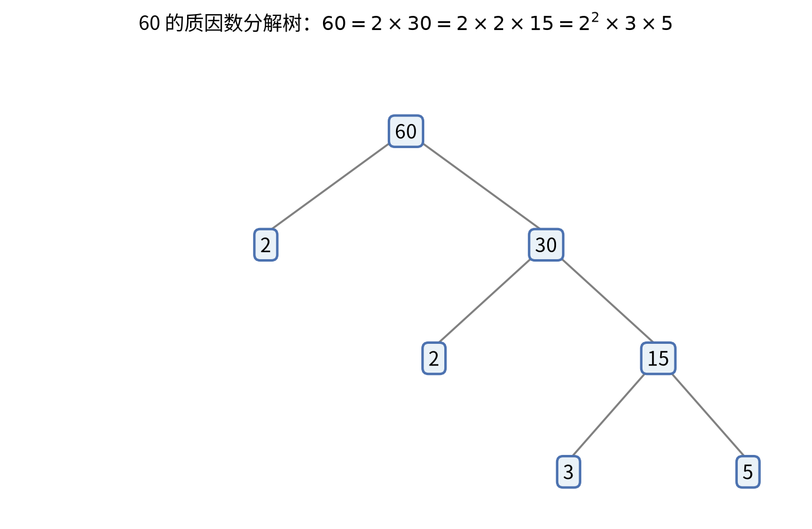

> **直观理解（现实类比）**：质因数分解就像**拆解一台机器**——把整机拆成部件，部件再拆成零件，直到每个零件都"不可再拆"（质数）。短除法是"从下往上"记录，而分解树是"从上往下"层层拆开，两者得到的是同一个结果，印证了算术基本定理的**唯一性**。
>
> **一个巧妙应用**：判断一个数能否被另一个数整除，只需比较它们的质因数集合。例如 $60 = 2^2 \cdot 3 \cdot 5$，$12 = 2^2 \cdot 3$，因为 $12$ 的质因数都能在 $60$ 中找到，所以 $60$ 能被 $12$ 整除。

#### 课堂问答

**老师**：短除法为什么坚持只用质数做除数？

**学生**：因为目标是质因数。若拿合数去除，只是把一个合数因子换成几个更小的合数，还得继续拆；用质数除则每一步都干净地"剥掉"一个质因子，直到商变成 $1$，过程即结果。

**老师（追问）**：分解 $360$，怎么做得又快又稳？

**学生**：先找显眼的乘积拆开：$360=36\times10=2^2\cdot3^2\times2\cdot5$，合并同类项得 $2^3\cdot3^2\cdot5$。两步就完，比拿 $2,3,5,\dots$ 逐个试除省事得多。

**老师（拓展）**：质因数分解在别处还有什么用？

**学生**：用处很广：化最简分数、求公因数与公倍数、化简根式（$\sqrt{360}=\sqrt{2^3\cdot3^2\cdot5}=6\sqrt{10}$）都要靠它。它是分数与根式运算的底层工具，所以必须练到"一眼看穿"。

### 5.5 质数有无穷多个（欧几里得证明）

欧几里得（Euclid）在《几何原本》第 9 卷第 20 个命题中，用数学史上最经典的**反证法**证明了**质数有无穷多个**。这个方法简洁而优雅，核心思路是：**假设质数有限，再构造出一个超出假设范围的新质数（或新质因数），从而推翻假设。**

**第一步（反证假设）**：假设质数的个数是有限的，只有 $n$ 个，把它们全部列出来：

$$
p_1, p_2, p_3, \dots, p_n
$$

（例如假设全体质数只有 $2, 3, 5, 7$ 这 4 个。）

**第二步（构造新数）**：把这些质数全部相乘再加 1，构造一个新数 $N$：

$$
N = p_1 \times p_2 \times p_3 \times \dots \times p_n + 1
$$

（在例子中，$N = 2 \times 3 \times 5 \times 7 + 1 = 211$。）

**第三步（分析 $N$ 的性质）**：这个新数 $N$ 有一个关键特征：**它不能被列表中的任何一个质数整除**。因为用任意一个 $p_i$ 去除 $N$，都会余下 1：

$$
N \div p_i = (\text{整数}) \cdots \text{余 } 1
$$

（例如 211 除以 2、3、5、7，都余 1。）

**第四步（导出矛盾）**：现在考察 $N$ 本身的质因数分解。由算术基本定理（每个大于 1 的整数都可唯一分解为质数的乘积），$N$ 至少有一个质因数：
- **情况一**：若 $N$ 本身就是质数，则它是一个不在原假设列表中的新质数，矛盾。
- **情况二**：若 $N$ 是合数，则它必有质因数。但这些质因数不可能是假设列表中的任何一个（因为 $N$ 除以它们都余 1），所以它们也必然是列表之外的新质数，矛盾。

**第五步（结论）**：无论哪种情况，都找到了假设列表中不存在的质数。因此，最初的假设（质数有限）不成立。于是，质数必定有无穷多个（自然也就不存在"最大的质数"）。

> **关键澄清：$N$ 不一定是质数**
>
> 很多人初次学习这个证明时，容易误以为"欧几里得证明了 $N$ 一定是质数"。**这是不对的。** 欧几里得的高明之处在于，他**不依赖 $N$ 是质数**，而是利用"$N$ 要么是质数，要么含有质因数"这个必然事实，来保证矛盾总会发生。
>
> 反例：假设我们只已知质数有 $2, 3, 5, 7, 11, 13$，构造 $N = 2 \times 3 \times 5 \times 7 \times 11 \times 13 + 1 = 30031$。实际上 $30031 = 59 \times 509$，它本身不是质数，但它的质因数 $59$ 和 $509$ 都是新的质数，同样证明了质数的无限性。

**为什么这个证明如此经典？**

1. **逻辑极简**：只用了乘法、加法和除法，无需任何高级数论工具。
2. **构造性强**：明确给出了从任意有限质数列表中"生成"新质数的方法——虽然生成的不一定是质数，但过程本身具有启发意义（与第 8.4 节探究题 1 对 $n!+1$ 的考察思路相通）。
3. **反证法的典范**：展示了如何通过"假设反面 + 构造对象 + 逻辑矛盾"来证明一个无限性命题。

**总结**：欧几里得的证明可浓缩为一句核心思想：

> 把所有已知质数乘起来再加 1，这个新数必然含有"全新"的质因数。

> 这好比一台永动机式的"质数制造机"——你给出任意有限个质数，它总能逼出一个新的来，从而保证了质数的无穷无尽。

#### 课堂问答

**老师**：质数无穷多个，欧几里得是怎么出手的？

**学生**：反证。假设质数只有 $p_1,p_2,\dots,p_n$，构造 $N=p_1p_2\cdots p_n+1$。$N>1$ 必有质因数，可它除以任一 $p_i$ 都余 $1$，谁也不整除它，于是冒出了列表之外的新质数，矛盾。

**老师（追问）**：那个 $N$ 一定是质数吗？

**学生**：不一定！例如 $2\times3\times5\times7\times11\times13+1=30031=59\times509$。证明只需要保证"它有某个不在假设列表中的质因数"，根本不需要 $N$ 本身是质数。这一点最容易误解。

**老师（拓展）**：这套手法还能推广吗？

**学生**：能，同类反证可证形如 $4k+3$、$6k+5$ 的质数也无穷多。不过它只回答"有没有"，不回答"在哪里"——质数如何分布，得靠后来的素数定理等更深的结果。

### 5.6 系统的整除性判定法则 (Divisibility Rules)

**直觉与生活场景**：把 45 人按 9 人一组分，能正好分完吗？判断 3672 能不能被 9 整除，非得老老实实做一次除法吗？其实**不用做除法，看一眼就好**。

**要解决的问题**：碰到大的数，直接做除法既慢又容易出错。我们想要一套"只需看末几位，或看各位数字之和"的**整除性判定法则**，让"能不能整除"瞬间可判。

**正式定义（常用判定法则表）**：

| 除以 | 判定方法 | 例 |
|:---:|:---|:---|
| 2 | 末位是 0、2、4、6、8 | $254$ ✓ |
| 3 | 各位数字之和能被 3 整除 | $123$：$1+2+3=6$ ✓ |
| 4 | 末两位能被 4 整除 | $232$：$32\div4=8$ ✓ |
| 5 | 末位是 0 或 5 | $470$ ✓ |
| 6 | 同时能被 2 且能被 3（2 与 3 互质） | $120$ ✓ |
| 8 | 末三位能被 8 整除 | $5120$：$120\div8=15$ ✓ |
| 9 | 各位数字之和能被 9 整除 | $3672$：$3+6+7+2=18$ ✓ |
| 10 | 末位是 0 | $470$ ✓ |
| 11 | 奇位数字和与偶位数字和之差能被 11 整除（含 0） | $1234$：$(1+3)-(2+4)=-2$，否 |
| 12 | 同时能被 3 且能被 4（3 与 4 互质） | $120$ ✓ |
| 25 | 末两位能被 25 整除 | $375$：$75$ ✓ |

（注：除以 7 时没有特别简单的位数法则，通常直接试除或做长除法即可。）

**这些判定为什么能成立（来龙去脉 + 解释）**：它们的根据，正是位值表示（见 2.5 节）。把 $n = a_n a_{n-1}\cdots a_1 a_0$ 展开，记 $n' = a_0 + 10a_1 + 100a_2 + \cdots$，那么：
- 因为 $2 \mid 10$、$5 \mid 10$，所有 $10^k\ (k\ge1)$ 都能被 2、5 整除，所以 $n$ 除以 2（或 5）的余数只由**个位 $a_0$** 决定——这就是"看末位"；
- 因为 $4 \mid 100$、$8 \mid 1000$、$25 \mid 100$，所以判定能否被 4、8、25 分别只需看**末两位、末三位、末两位**；
- 因为 $10 \equiv 1 \pmod 9$，且 $10 \equiv 1 \pmod 3$，所以 $10^k \equiv 1$，整个数 $\equiv$ 各位数字之和（这就是第 8 章探究题 5、21 追问的道理）——于是看**各位数字之和**。
- 当除数不是质数（如 6、12）时，把它拆成**互质的**两个因子逐条判定：$6 \mid n \Leftrightarrow (2\mid n$ 且 $3\mid n)$，因为 $2$ 与 $3$ 互质。这套"分别判定"的依据，正是 5.3 节的欧几里得引理，以及第 8 章探究题 2 所讲的互质判定原理。

这套"看末几位 / 数数字和"的判定，其实是中国古人很早就掌握的**"弃九法"** 验算技巧在现代的数论表达。

**解决了什么问题**：把"判断能否整除"从昂贵的除法，降级成"看个位、看末几位、或加一加各位数字"的快速眼算，极大方便了约分、找最大公约数/最小公倍数，以及做完长除法后的验算。

---

#### 课堂问答

**老师**：判 $3$ 和 $9$ 只看"各位数字之和"，凭什么？

**学生**：因为 $10\equiv1\pmod3$，于是 $10^k\equiv1\pmod3$，所以 $\sum a_k10^k\equiv\sum a_k\pmod3$——一个数与它的数字之和同余。判 $9$ 同理，只是把模 $3$ 换成模 $9$。

**老师（追问）**：那 $11$ 的法则为什么变成"一加一减"？

**学生**：因为 $10\equiv-1\pmod{11}$，于是 $10^k\equiv(-1)^k$，奇位与偶位的权重正负相反，所以要把各位数字交错相加减，看结果是否被 $11$ 整除。

**老师（拓展）**：这些法则背后有没有统一的原理？

**学生**：有，就是"找一个模 $m$ 时 $10$ 的幂的简单规律"。$2^k,5^k$ 只需看末几位，因为 $10$ 的幂在模它们时归零；判 $7,13$ 可用 $1001=7\times11\times13$ 做三位分块。全部都是同余化简的具体化。

## 6. 综合示例

### 示例 1：四则运算混合

计算：$15 + 3 \times (8 - 6) \div 2$

**解**：

$$
\begin{aligned}
15 + 3 \times (8 - 6) \div 2 &= 15 + 3 \times 2 \div 2 \quad (\text{先算括号}) \\
&= 15 + 6 \div 2 \quad (\text{从左到右算乘除}) \\
&= 15 + 3 \\
&= 18
\end{aligned}
$$

- 第 1 个等号：计算括号内 $8-6=2$，依据运算优先级"先算括号里"，目的是把括号消掉；
- 第 2 个等号：从左到右算乘除，$3\times 2=6$，依据同级运算从左到右的约定，目的是把乘除做完；
- 第 3 个等号：继续算 $6\div 2=3$，依据仍是同级从左到右，目的是把除法也做完；
- 第 4 个等号：最后算加法 $15+3=18$，依据"先乘除后加减"，目的是得出最终结果。

### 示例 2：利用运算律简化计算

计算：$25 \times 17 \times 4$

**解**：利用乘法交换律和结合律：

$$
25 \times 17 \times 4 = (25 \times 4) \times 17 = 100 \times 17 = 1700
$$

- 第 1 个等号：把 $25$ 和 $4$ 先结合，依据乘法交换律（交换 $17$ 和 $4$ 的位置）与结合律（把 $25$ 和 $4$ 括在一起），目的是凑出 $25\times 4=100$ 这个整百数；
- 第 2 个等号：计算 $25\times 4=100$，依据乘法定义，目的是把括号内的值算出来；
- 第 3 个等号：计算 $100\times 17=1700$，依据乘法定义，目的是得出最终结果。

### 示例 3：利用分配律简化计算

计算：$85 \times 102$

**解**：

$$
85 \times 102 = 85 \times (100 + 2) = 85 \times 100 + 85 \times 2 = 8500 + 170 = 8670
$$

- 第 1 个等号：把 $102$ 拆成 $100+2$，依据是加法的分解，目的是凑出整百数方便心算；
- 第 2 个等号：把 $85$ 分别乘进括号里的两项，依据分配律 $a\times(b+c)=a\times b+a\times c$，目的是把一个大乘法拆成两个小乘法；
- 第 3 个等号：分别算出 $85\times 100=8500$ 与 $85\times 2=170$，依据乘法定义，目的是得到两个部分积；
- 第 4 个等号：把两个部分积相加 $8500+170=8670$，依据加法定义，目的是得出最终结果。

### 示例 4：带余除法

一个数除以 7 得商 12，余数为 3，求这个数。

**解**：

$$
a = 7 \times 12 + 3 = 84 + 3 = 87
$$

### 示例 5：质因数分解

分解 $420$。

**解**：

```
2 | 420
2 | 210
3 | 105
5 | 35
7 | 7
  | 1
```

因此 $420 = 2^2 \times 3 \times 5 \times 7$。

### 示例 6：应用题

小明有 3 盒铅笔，每盒 12 支，他把这些铅笔平均分给 4 个同学，每人分得几支？

**解**：

$$
\begin{aligned}
\text{铅笔总数} &= 3 \times 12 = 36 \text{ 支} \\
\text{每人分得} &= 36 \div 4 = 9 \text{ 支}
\end{aligned}
$$

答：每人分得 9 支铅笔。

### 问题求解四步流程（Problem-Solving Strategy）

> 遇到算术题不要急着动笔。先用下面这张「四步流程」把题目拆开：先真正看懂它，再定计划，然后执行计算，最后回头检查。四步不是可有可无，而是把「会算」与「算对」分开的两道保险。

| 阶段 | ①理解 | ②计划 | ③执行 | ④回看 |
|:---:|:---|:---|:---|:---|
| **步骤/行动** | 读题并用自己的话复述，找出已知量与所求量 | 选定运算顺序、选用哪个运算律或分解方法 | 按计划逐步计算，注意对齐数位与符号 | 代回原题验算，判断结果是否合理 |
| **算术中的具体追问** | 这个数是自然数、整数还是有理数？含有几个数位？ | 先乘除还是先加减？能否用交换/结合/分配律凑整？要不要质因数分解或进制转换？ | 进位/借位有没有丢？负号、余数、有效数字有没有写对？ | 答案量级合理吗？能不能整除？余数是否小于除数？有无漏写单位？ |

> 💡 **策略演示**：计算 15 + 3 × (8 − 6) ÷ 2。第①步看出是「混合运算」，含加、乘、减、除且有括号；第②步按优先级定顺序——先算括号、再按顺序算乘除、最后算加减；第③步逐步执行得 18；第④步回看：没先算乘法的直觉错误最容易犯，检查括号确实先算了，结果合理。

### 概念检查（Concept Check）

> 这一节帮你把概念「当场过一遍」。判断正误时不仅要给答案，更要讲出理由——讲得清理由，才算真懂。

**判断正误（说明理由）**

1. 0 是自然数，但它既不是质数也不是合数。
2. 所有整数都是有理数，但并非所有有理数都是整数。
3. 交换律对减法也成立，例如 8 − 3 = 3 − 8。
4. 两个连续自然数的乘积一定是偶数。
5. 一个数能被 6 整除，当且仅当它能同时被 2 和 3 整除。
6. 由 5 个 9 组成的数一定能被 9 整除。

**选择**

1. 下列哪个数是有理数但**不是**整数？
   A. $-3$　B. $0$　C. $\frac{3}{4}$　D. $\sqrt{2}$

2. 将 $(11001)_2$（二进制）化为十进制，结果是：
   A. 23　B. 25　C. 27　D. 33

3. 计算 $25 \times 97 + 25 \times 3$ 最简便的依据是：
   A. 加法交换律　B. 乘法结合律　C. 乘法分配律　D. 乘法交换律

### 分步骤工作示例（Worked Examples）

> 每个示例都按「① 理解 → ② 计划 → ③ 执行 → ④ 回看」四步展开。关键计算放进独立公式块；④回看特别标出「易错点」，请对照自己平时是否也踩过同样的坑。

**示例 S1：多位数混合四则运算与运算优先级**

> **问题**：计算 20 + 5 × (12 − 7) ÷ 5 − 8 的值，并说明每一步所依据的运算优先级。

**① 理解**：这是一个含加、乘、减、除与括号的混合算式，所求结果为唯一的确定值。

**② 计划**：按运算优先级分三层——先算括号内，再从左到右算乘除，最后从左到右算加减。

**③ 执行**：

$$
20 + 5 \times (12 - 7) \div 5 - 8 = 20 + 5 \times 5 \div 5 - 8
$$

$$
= 20 + 25 \div 5 - 8 = 20 + 5 - 8 = 17
$$

**④ 回看**：结果为 17。易错点：乘除从左到右依次算（先算 $5\times5=25$，再算 $25\div5=5$），若颠倒了顺序结果就会出错。

**示例 S2：质因数分解求最大公因数与最小公倍数**

> **问题**：用质因数分解法求 24 与 36 的最大公因数（最大公约数）和最小公倍数。

**① 理解**：要求两个数的最大公因数与最小公倍数，两个数都不大，适合拆成质因数。

**② 计划**：先用短除法把两个数写成质因数的幂的乘积，再分别取「公共质因数的最小指数（得最大公因数）」与「全部质因数的最大指数（得最小公倍数）」。

**③ 执行**：

$$
24 = 2^3 \times 3, \qquad 36 = 2^2 \times 3^2
$$

$$
\gcd(24,36) = 2^2 \times 3 = 12, \qquad \operatorname{lcm}(24,36) = 2^3 \times 3^2 = 72
$$

**④ 回看**：最大公因数为 12，最小公倍数为 72。易错点：取最大公因数时要取「公共质因数的最小指数」，而求最小公倍数时要取「每个质因数的最大指数」，两者恰好相反，别搞混。

**示例 S3：进制转换（十进制 ↔ 二进制）**

> **问题**：把十进制数 29 化成二进制；再把二进制数 (10110)₂ 化成十进制。

**① 理解**：两个任务分别是「十进制到二进制」与「二进制到十进制」，方向相反，方法不同。

**② 计划**：十进制化二进制用「除 2 取余、倒序排列」；二进制化十进制用「按位值加权展开求和」。

**③ 执行**：

$$
29 = 16 + 8 + 4 + 1 = 1\times2^4 + 1\times2^3 + 1\times2^2 + 0\times2^1 + 1\times2^0 = (11101)_2
$$

$$
(10110)_2 = 1\times2^4 + 0\times2^3 + 1\times2^2 + 1\times2^1 + 0\times2^0 = 16 + 0 + 4 + 2 + 0 = 22
$$

**④ 回看**：29 化成二进制得 (11101)₂，(10110)₂ 化成十进制得 22。易错点：除 2 取余后一定要把余数「倒序」排列（从下往上读），漏掉最高位的 1 是最常见的错误。

**示例 S4：科学计数法与有效数字估算**

> **问题**：用科学计数法把 0.000028 表示出来，并说明它有几位有效数字；再估算 0.000028 × 480 000 000 的数量级。

**① 理解**：题目先要求规范的指数记法，再要求做一次带估算性质的数量级运算。

**② 计划**：把数写成「一位整数的小数 × 10 的幂」，数出有效数字位数；对乘积则分别把每个数成分换成一位有效的近似再相乘。

**③ 执行**：

$$
0.000028 = 2.8 \times 10^{-5} \ \text{（2 位有效数字）}
$$

$$
2.8 \times 10^{-5} \times 4.8 \times 10^{8} \approx 3 \times 10^{-5} \times 5 \times 10^{8} = 15 \times 10^{3} = 1.5 \times 10^{4}
$$

**④ 回看**：数量级约为 $1.5\times10^4$。易错点：数有效数字时要从左边第一个非零数字算起，开头的 0 不算有效数字；估算时若把系数和 10 的幂搞混，数量级会差很多。

### 应用聚焦（Application & Exploration Projects）

> 学算术不只是会"算"，更要在真实问题和开放探索里用起来。下面三个小项目由浅入深：先动手算，再跨章节联系，最后挑战一个需要反例的开放问题。

**P1 数值估算 / 手工计算任务**

估算"一个教室能坐多少学生"：先估教室长和宽大概都在 9 米上下，若每个学生占地约 0.5 平方米，估一估能坐多少人；再把平均占地放宽到 0.8 平方米再估一次。比较两次结果，说说哪个量级更可信，体会"先取一位有效数字估算、再留余量"的思想。

**P2 跨章节联系**

用质因数分解把第 5 章的"最大公因数 / 最小公倍数"与第 3 章的"分数加减通分"串起来：求 $\dfrac{1}{12}$ 与 $\dfrac{1}{18}$ 的和，先分别分解 12 与 18 的质因数，找到最小公分母，再通分相加，说明两次操作用到了同一条思路。

**P3 反例或开放性探索**

有人说"一个数的末位是偶数，所以它一定能被 4 整除"，这个判断对吗？请举出一个末位是偶数却不能被 4 整除的数来反驳它，并归纳：判断能否被 4 整除到底要看哪几位，从而体会"看末几位"法则的边界在哪里。

### 梯度化自测（Graded Exercises）

> 自测分三档梯度：概念题检验理解，技能题训练熟练度，综合题则要把多个知识点连起来。建议每档做完再对照本节末尾「自测答案与简要解析」。

**○ 概念题**

1. 说出自然数、整数、有理数三者之间的包含关系，并各举一个"只属于后一层"的例子。
2. 为什么判断一个数能否被 3 或 9 整除要看"各位数字之和"，而判断能否被 2 或 5 整除却只看末位？两者差异的根源是什么？

**● 技能题**

1. 计算：$18 + 4 \times (9 - 6) \div 3 - 5$。
2. 用质因数分解求 40 与 60 的最大公因数与最小公倍数。
3. 把十进制数 42 化成二进制；把二进制数 (1101)₂ 化成十进制。

**◆ 综合题**

1. 用科学计数法表示光速约 $299\,792\,458$ 米/秒，并保留 2 位有效数字；再判断它约等于 $3\times10^8$ 是否合理。
2. 三位数 abc（百位 a、十位 b、个位 c）恰好等于它各位数字之和的 26 倍，求这个三位数。（提示：用位值系统设方程，再结合数字范围枚举。）

### 自测答案与简要解析

> 「概念判断」答案：1. 对；2. 对；3. 错（8 − 3 = 5 而 3 − 8 = −5，减法不满足交换律）；4. 对（两个连续自然数中必有一个是偶数，乘积为偶）；5. 对（2 与 3 互质，能同时被它们整除即能被 6 整除）；6. 错（55555 的各位数字和为 25，25 不能被 9 整除，故该数不能被 9 整除）。
>
> 「选择」答案：1. C；2. B；3. C。

「选择」各题关键算式：

$$
\frac{3}{4}\ \text{是有理数但不是整数};\qquad (11001)_2 = 16 + 8 + 0 + 0 + 1 = 25;\qquad 25 \times (97 + 3) = 25 \times 100 = 2500
$$

> 「自测」简要解析：概念题第 2 题——判断能否被 2、5 整除只看末位，依据是 10 的幂能否整除；判断能否被 3、9 整除则因 10 关于 3、9 同余于 1，退化为"各位数字之和"。技能题与综合题的关键算式如下。

$$
40 = 2^3 \times 5,\qquad 60 = 2^2 \times 3 \times 5,\qquad \gcd = 2^2 \times 5 = 20,\qquad \operatorname{lcm} = 2^3 \times 3 \times 5 = 120
$$

$$
42 = (101010)_2,\qquad (1101)_2 = 13
$$

$$
299\,792\,458 = 2.99792458 \times 10^8 \approx 3.0 \times 10^8
$$

$$
100a + 10b + c = 26(a+b+c) \quad\Longrightarrow\quad 74a = 16b + 25c,\qquad \text{枚举得唯一解}\ abc = 156
$$

---

## 7. 解题技巧

本节针对算术基础中的高频问题，总结可直接套用的解题方法与易错点。每条技巧都给出**适用场景**、**关键步骤**与**常见误区**，并配一个精讲示例。

### 7.1 运算优先级与简便计算

**适用场景**：含加、减、乘、除、括号的混合算式，或需要优化计算量的题目。

**关键步骤**：
1. 先处理括号（由内到外）；
2. 再从左到右计算乘、除；
3. 最后从左到右计算加、减。
4. 如需简化，优先考虑「凑整」：把能凑成 $10, 100, 1000$ 的项先合并（交换律/结合律），或把接近整十整百的因数拆分（分配律）。

**常见误区**：
- 误以为「乘除同时出现时先乘后除」，实际是**从左到右**依次算；
- 忘记 `75 × a + 25 × a` 可提取公因数为 `a × (75+25)`，硬算导致容易出错；
- 去括号时符号搞错（这里主要是指先算括号内）。

**精讲示例**：计算 $35 \times 14 + 65 \times 14$。

繁琐做法：$35 \times 14 = 490$，$65 \times 14 = 910$，再相加 $= 1400$。

简便做法（提取公因数）：
$$
35 \times 14 + 65 \times 14 = (35 + 65) \times 14 = 100 \times 14 = 1400
$$

- 第 1 个等号：把公因数 $14$ 提到括号外面，依据分配律的反向使用 $a\times c+b\times c=(a+b)\times c$，目的是把两次乘法合并成一次；
- 第 2 个等号：计算括号内 $35+65=100$，依据加法定义，目的是凑出整百数；
- 第 3 个等号：计算 $100\times 14=1400$，依据乘法定义，目的是得出最终结果。

### 7.2 质数与质因数分解（短除法）

**适用场景**：判断质数/合数、求约数个数、求最大公约数与最小公倍数、判断整除性。

**关键步骤**：
1. 判断 $n$ 是否质数：只需用 $2$ 到 $\lfloor \sqrt{n} \rfloor$ 的所有质数试除，都不能整除即为质数；
2. 分解质因数：用短除法从小到大除以质因数，直到商为 $1$；
3. 表示为规范形式（质因子从小到大、合并同底数幂）。

**常见误区**：
- 用所有 $2 \sim n-1$ 的数试除，效率低且易漏；应只试除到 $\sqrt{n}$；
- 忘记 $1$ 既不是质数也不是合数；
- 分解结果漏写某质因子的幂，或未按底数幂并（如写成 $2 \times 2 \times 3$ 而非 $2^2 \times 3$）。

**精讲示例**：判断 $97$ 是否质数并分解 $360$。

$\sqrt{97} \approx 9.8$，试除 $2,3,5,7$：均不能整除，所以 $97$ 是质数。

$360$ 短除法：$360=2\cdot180=2\cdot180$，$180=2\cdot90$，$90=2\cdot45$，$45=3\cdot15$，$15=3\cdot5$，$5=5\cdot1$，故
$$
360 = 2^3 \times 3^2 \times 5
$$

### 7.3 带余除法与"逆运算反解"

**适用场景**：形如"求满足带余关系的最小整数""已知余数求原数"等整除与余数问题。

**关键步骤**：
1. 把文字转成算式：被除数 $= \text{除数} \times \text{商} + \text{余数}$，且 $0 \leq \text{余数} < \text{除数}$；
2. 若求原数，直接代入公式反算；
3. 若求最小解，把可取商从 $0$ 开始逐一代入检验余数条件。

**常见误区**：
- 忘写余数必须小于除数；
- 求"最小数"时从商为 $0$ 的情形开始考虑，而非只枚举商为正数的情况；
- 把"商"和"余数"对调。

**精讲示例**：某数除以 7 商 12 余 3，求该数。

$$
a = 7 \times 12 + 3 = 84 + 3 = 87
$$

### 7.4 整除性三角形判定

**适用场景**：判断较大整数能否被某个数整除，或证明可除性。

**关键步骤**：
1. 对因数 $2,5$：看末位；对 $4$：看末两位；对 $8$：看末三位；对 $3,9$：看各位数字之和；对 $11$：奇偶位数字之和之差；
2. 对较复杂除数，可分解为互斥的因数逐一判定；
3. 也可用质因数集合判断：甲整除于乙当且仅当甲的所有质因子（含幂次）都能在乙中找到。

**常见误区**：
- 用末位判断能否被 $3/9$ 整除；
- 判定被 $6$ 整除时只验 $2$ 或只验 $3$（须同时满足 $2$ 且 $3$）。

**精讲示例**：判断 $3672$ 是否被 $9$ 整除。

数字和 $= 3+6+7+2=18$，$18$ 能被 $9$ 整除，故 $3672$ 被 $9$ 整除。事实上 $3672 = 408 \times 9$。

### 7.5 整数应用题的"设-列-验"三步法

**适用场景**：涉及计数、分配、比较的应用题。

**关键步骤**：
1. **设**：明确要求的量，用字母表示（或分步厘清中间量）；
2. **列**：根据题目数量关系列出算式（多用运算律简化）；
3. **验**：把结果代回题意检查是否符合实际。

**常见误区**：
- 读题漏掉隐藏条件（如"平均""剩余"）；
- 直接给出算式而忘记写单位与答句。

**精讲示例**：一箱苹果按盒出售，3 盒共 36 个，平均分给 4 个小朋友每人几个？

先求每盒：$36 \div 3 = 12$；每人：$12 \div 4 = 3$（个）；每人 3 个。验算：$3\times 4 = 12$ 符合。

---

## 8. 习题

> 习题按难度分为 **基础题 / 进阶题 / 挑战题 / 探究题** 四级，覆盖本章全部内容。探究题无唯一答案，故附参考答案与思路提示。

### 8.1 基础题

**1.** 计算下列各式：

$$
\text{(a)}\; 345 + 267 \qquad \text{(b)}\; 803 - 456 \qquad \text{(c)}\; 56 \times 23 \qquad \text{(d)}\; 840 \div 7
$$

**2.** 先说出运算顺序，再计算：

$$
\text{(a)}\; 18 + 27 \div 9 \qquad \text{(b)}\; 6 \times (15 - 7) \qquad \text{(c)}\; 100 - 4 \times 5
$$

**3.** 利用运算律简便计算：

$$
\text{(a)}\; 125 \times 37 \times 8 \qquad \text{(b)}\; 99 \times 45 \qquad \text{(c)}\; 102 \times 36
$$

**4.** 回答下列问题（整数与有理数概念）：

(a) $-5$ 是自然数吗？是整数吗？是有理数吗？

(b) $0.75$ 可以表示为哪个分数？它属于哪类数？

(c) 将 $0.\overline{3}$ 化为分数。

(d) 在数轴上标出 $-2,\; 0,\; \dfrac{3}{2},\; 3$ 的位置，并用 "$<$" 连接它们。

**5.** 判断下列等式是否成立，并说明理由（运算律辨析）：

$$
\text{(a)}\; 8 - 3 = 3 - 8 \qquad \text{(b)}\; 12 \div 4 = 4 \div 12
$$

$$
\text{(c)}\; (10 - 5) - 2 = 10 - (5 - 2) \qquad \text{(d)}\; (24 \div 6) \div 2 = 24 \div (6 \div 2)
$$

**6.** 将下列各数填入对应的集合中（数系分类）：

$$
-3,\quad 0,\quad \frac{2}{7},\quad 5,\quad -1.2,\quad 0.\overline{6},\quad \frac{22}{7},\quad 0.121221222\dots\text{（相邻两个1之间2的个数逐次加1）}
$$

自然数集 $\mathbb{N}$：$\{\qquad\qquad\}$；整数集 $\mathbb{Z}$：$\{\qquad\qquad\}$；有理数集 $\mathbb{Q}$：$\{\qquad\qquad\}$

（提示：注意 $0.\overline{6}$ 是循环小数，而 $0.121221222\dots$ 的规律不是循环。）

**7.** 判断下列说法的正误，并改正错误项：
(a) 0 是自然数；(b) 负数是整数；(c) 所有的整数都是自然数。

**8.** 在数 $15,\; -8,\; 0,\; \frac{3}{5},\; -2.3,\; \frac{22}{7}$ 中，属于自然数的是哪些？属于整数的是哪些？

**9.** 用 "<" 或 ">" 填空：$-7 \;\square\; -3$；$-\dfrac{1}{2} \;\square\; 0$。

**10.** 数轴上点 A 表示 $-3$，点 B 表示 $4$，两点间的距离是多少个单位？

**11.** 在 $\square$ 处填适当的数：$3.7 = 3 + \dfrac{\square}{10}$。

**12.** 在 $2025$ 中，数字 $2$ 所在的数位是什么？它表示的数值是多少？

**13.** 写出一个七位数，使它的最高位是百万位。

**14.** 将 $0.75$ 化为分数；将 $\dfrac{3}{8}$ 化为小数。

**15.** 将 $0.\overline{6}$ 化为分数。

**16.** 判断 $0.5$ 与 $\dfrac{1}{2}$ 是否相等，并说明理由。

**17.** 用简便方法计算 $87 + 129 + 13$。

**18.** 计算 $245 + 100 - 45$。

**19.** 用简便方法计算 $12 \times 15 \times 4$。

**20.** 计算 $125 \times 32$。

**21.** 计算 $250 \times 43 \times 4$。

**22.** 计算 $78 \times 99$。

**23.** 计算 $37 \times 101$。

**24.** 计算 $15 + 6 \div 2 - 3$。

**25.** 计算 $(20 - 5) \times 3 + 8$。

**26.** 计算 $36 \div 6 \times 2$（注意同级运算从左到右）。

**27.** 计算 $100 - (25 + 35) \div 6$。

**28.** 计算 $48 \div (2 \times 3)$。

**29.** 计算 $7 + 3 \times 4 - 5$，并写出运算顺序。

**30.** 用竖式加法计算 $462 + 359$。

**31.** 用竖式减法计算 $701 - 389$。

**32.** 计算 $25 \times 48$。

**33.** 计算 $864 \div 24$。

**34.** 计算带余除法 $53 \div 7$，写出商 $q$ 和余数 $r$。

**35.** 一个数除以 8 余 3，这个数最小是多少？

**36.** 求 $15 \div 4$ 的商与余数。

**37.** 指出下列各数中的质数：$2,\; 1,\; 9,\; 11,\; 15,\; 23$。

**38.** 判断 17 是否为质数。

**39.** 判断 27 是否为质数。

**40.** 1 是质数还是合数？说明理由。

**41.** 将 $12$ 分解为质因数的乘积。

**42.** 将 $18$ 分解为质因数的乘积。

**43.** 将 $30$ 分解为质因数的乘积。

**44.** 将 $72$ 分解为质因数的乘积（用含 $2^a$ 的形式）。

**45.** 填空：$81 = 3^{\square}$。

**46.** 按从小到大的顺序写出前 6 个质数。

**47.** 判断 $232$ 是否能被 $4$ 整除。

**48.** 判断 $470$ 是否能被 $5$ 整除。

**49.** 判断 $123$ 是否能被 $3$ 整除。

**50.** 判断 $207$ 是否能被 $9$ 整除。

**51.** 判断 $254$ 是否能被 $2$ 整除。

**52.** 个位数字是几的数一定能被 $5$ 整除？

**53.** 能被 $2$ 整除的数的个位数字可能是哪些？

**54.** 求 $2 \times 3 \times 5$ 的值。

**55.** 一个数的质因数分解为 $2^2 \times 3$，求这个数。

**56.** 若 $n = 2^3 \times 5$，求 $n$ 的值。

**57.** 写出 $6$ 的所有正因数。

**58.** 写出 $28$ 的所有正因数。

**59.** 能被 $6$ 整除的数需同时满足能被几和几整除？（只考虑互质的两因数）

**60.** 计算 $\dfrac{1}{2} + \dfrac{1}{3}$。

**61.** 计算 $\dfrac{2}{5} \times \dfrac{5}{4}$。

**62.** 计算 $\dfrac{3}{4} - \dfrac{1}{4}$。

**63.** 计算 $\dfrac{3}{8} \div \dfrac{3}{8}$。

**64.** 把 $\dfrac{6}{8}$ 约成最简分数。

**65.** 比较 $\dfrac{2}{3}$ 与 $\dfrac{3}{5}$ 的大小。

**66.** 用带余除法表示 $100 \div 9$。

**67.** 简便计算 $4 \times 25 \times 7$。

**68.** 计算 $16 + 84 \div 7$。

**69.** 计算 $(18 - 9) \times 4$。

**70.** 一个两位数，十位是 $7$，个位是 $3$，这个数是多少？

**71.** 个位是 $0$ 的三位数中，最大的是多少？

**72.** 最小的三位数是多少？最大的三位数是多少？

**73.** 若把自然数从 $0$ 开始数，则第 $5$ 个自然数（$0$ 是第 $1$ 个）是多少？

**74.** 整数中，$-10$ 与 $-2$ 哪一个更小？

**75.** $(-3)$ 的相反数，即 $-(-3)$，等于多少？

**76.** 将 $\dfrac{9}{12}$ 化为最简分数。

**77.** 判断 $0.3$ 是不是有理数，并说明理由。

**78.** 三个连续自然数可表示为 $n,\; n+1,\; n+2$。若中间一个是 $10$，则这三个数分别是多少？

**79.** 分解 $2024$ 的质因数，并判断它是否为 $2$ 的倍数。

**80.** 判断 $1008$ 能否分别被 $2,\;3,\;9$ 整除。

**81.** 一个整数除以 $5$，余数可能取哪些值？

**82.** 一个偶数与一个奇数相乘，积是奇数还是偶数？

**83.** 两个奇数之和是奇数还是偶数？

**84.** 若 $a$ 是自然数，用乘法表示 $a + a + a$。

**85.** 用分配律计算 $9 \times 7 + 9 \times 3$。

**86.** 用分配律计算 $6 \times 13 + 6 \times 17$。

**87.** 提取公因数：$25 \times 37 + 25 \times 63$。

**88.** 用分配律计算 $101 \times 55$。

**89.** 用分配律计算 $102 \times 48$。

**90.** 用试除法判断 $39$ 是否为质数。

**91.** 求质数 $2,3,5,7$ 的乘积。

**92.** 已知 $360 = 2^3 \times 3^2 \times 5$，验算这个等式是否成立。

**93.** $92$ 的个位是 $2$，它能被 $2$ 整除吗？能被 $5$ 整除吗？

**94.** 写出能同时被 $2$ 和 $3$ 整除的最小的两位正整数。

**95.** 验证 $47 \div 6 = 7 \cdots 5$，即验证 $6 \times 7 + 5 = 47$。

**96.** 三位数 $325$ 各数位上数字之和是多少？

**97.** 用有限小数表示 $\dfrac{1}{4}$。

**98.** 将 $0.\overline{1}$ 化为分数。

**99.** 判断 $22$ 是否为质数。

**100.** 将 $45$ 表示为 $3^{a} \times 5$ 的形式，求 $a$。

**101.** 求 $n$ 的值：$n = 2^2 \times 3$。

**102.** 数轴上 $-2$ 位于 $0$ 的左侧还是右侧？

**103.** 比 $-3$ 大 $1$ 的整数是多少？

**104.** 温度从 $-2^\circ$ 上升到 $4^\circ$，上升了多少度？

**105.** 小明有 $3$ 个苹果，又买了 $5$ 个，再送出去 $2$ 个，最后剩下多少个？

**106.** $72$ 支铅笔平均分给 $8$ 个同学，每人分得几支？

**107.** 一本书共 $96$ 页，每天看 $12$ 页，几天能看完？

**108.** 计算 $5 \times (7 + 3)$ 与 $5 \times 7 + 5 \times 3$，它们相等吗？依据哪个运算律？

**109.** 哪个数既不是质数也不是合数？

**110.** 最小的质数是多少？最小的合数是多少？

**111.** 判断 $91$ 是否为质数（提示：$91 = 7 \times 13$）。

**112.** 分解 $84$ 的质因数。

**113.** 五个连续整数，最大的一个是 $5$，那么这五个数分别是多少？

**114.** 用数字 $4$ 和 $7$ 各一次组成两位数，能组成几个不同的两位数？

**115.** 填空：$8 + 8 + 8 + 8 + 8 = 8 \times \square$。

**116.** 计算 $35 \div 5 \times 2$。

**117.** 带余除法中，若被除数 $=13$、除数 $=5$，商和余数分别是多少？

**118.** 判断 $4104$ 是否能被 $3$ 整除。

**119.** 计算 $7 \times 9 + 7$（可先把 $7$ 看作 $7 \times 1$）。

**120.** 判断 $33$ 是质数还是合数。

---

### 8.2 进阶题

**1.** 将下列各数分解为质因数的乘积：

$$
\text{(a)}\; 84 \qquad \text{(b)}\; 126 \qquad \text{(c)}\; 360 \qquad \text{(d)}\; 2025
$$

**2.** 一个数除以 9 余 4，除以 11 余 6，这个数最小是多少？

**3.** 判断下列各数是否为质数，并说明理由：

$$
\text{(a)}\; 51 \qquad \text{(b)}\; 97 \qquad \text{(c)}\; 143 \qquad \text{(d)}\; 199
$$

**4.** 证明：两个连续自然数的乘积一定是偶数。

**5.** 计算 $1 + 2 + 3 + \dots + 100$ 的值。（提示：考虑加法交换律和结合律）

**6.** 用数字 $2, 3, 5$ 各一次组成一个三位数：
(a) 组成的最大数是多少？(b) 要使该数能被 $3$ 整除，是否无论怎样排列都可以？说明理由。

（关注知识点：位值系统、整除判定）

**7.** 将 $5040$ 分解为质因数的乘积。

**8.** 求 $2^{10}$ 的值。

**9.** 一个数的质因数分解为 $2^5 \times 3^2$，求这个数。

**10.** 求 $72$ 的正因数个数。

**11.** 求 $100$ 的正因数个数。

**12.** 求 $30$ 与 $45$ 的最大公约数。

**13.** 求 $24$ 与 $36$ 的最大公约数。

**14.** 求 $15$ 与 $20$ 的最小公倍数。

**15.** 求 $8$ 与 $12$ 的最小公倍数。

**16.** 一个数除以 $6$ 余 $2$，除以 $8$ 也余 $2$，这样的最小正整数是多少？

**17.** 从 $1$ 到 $100$ 的自然数中，能被 $2$ 整除的有多少个？

**18.** 从 $1$ 到 $100$ 的自然数中，既能被 $2$ 又能被 $3$ 整除的有多少个？

**19.** 求 $1 + 2 + 3 + \dots + 50$ 的和。

**20.** 求 $2 + 4 + 6 + \dots + 20$（偶数和）。

**21.** 求 $1 + 3 + 5 + \dots + 19$（奇数和）。

**22.** 用数字 $1,2,3$ 各一次，能组成多少个不同的三位数？其中最大的是多少？

**23.** 一个两位数的个位比十位大 $5$，且个位是 $7$，这个两位数是多少？

**24.** 已知 $n = 2 \times 3^{a} \times 5$ 且 $n = 270$，求 $a$。

**25.** 判断 $1234$ 是否能被 $4$ 整除（看末两位）。

**26.** 判断 $1234$ 是否能被 $11$ 整除。

**27.** 能同时被 $2,3,5$ 整除的最小的三位数是多少？

**28.** 一个数能被 $12$ 整除，已知它能被 $3$ 整除，还需满足能被几整除？

**29.** 电梯从 $-2$ 层上升到 $5$ 层，上升了多少层？

**30.** 温度从 $-5^\circ$ 降到 $-12^\circ$，下降了多少度？

**31.** 除以 $7$ 时，可能的余数有哪些？

**32.** 用凑整法计算 $999 \times 8$。

**33.** 计算 $45 \times 28 + 55 \times 28$。

**34.** 计算 $37 \times 27 + 37 \times 73$。

**35.** $1 \times 2 \times 3 \times \dots \times 10$ 的末尾有几个 $0$？

**36.** $100!$ 的末尾有几个 $0$？（提示：统计因数中 $5$ 的个数）

**37.** 三个质数之和是 $20$，且其中有一个质数是 $2$，求另外两个质数。

**38.** 质数 $p$ 满足 $p + 1$ 也是质数，求 $p$。

**39.** 两个质数之和是 $30$，要使它们的积最大，这两个质数应分别是多少？

**40.** 求 $120$ 的正因数个数。

**41.** 若 $2^a = 32$ 且 $2^b = 8$，求 $a + b$。

**42.** $\dfrac{3}{7}$ 化成的小数，是有限小数还是循环小数？

**43.** 将 $\dfrac{5}{8}$ 化为小数。

**44.** 将 $\dfrac{2}{9}$ 化为小数（用循环小数的写法）。

**45.** 将 $0.\overline{2}$ 化为分数。

**46.** 将 $0.\overline{45}$ 化为分数。

**47.** $9$ 的倍数中，最小的三位数是多少？

**48.** 能同时被 $4$ 和 $5$ 整除的最小正整数是多少？

**49.** 能被 $9$ 整除的三位数中，最大的是多少？

**50.** 某数除以 $13$ 商 $7$ 余 $5$，求这个数。

**51.** 若 $n$ 能被 $3$ 整除且能被 $4$ 整除，则 $n$ 的最小正整数值是多少？

**52.** 三个连续偶数的和是 $36$，求这三个数。

**53.** 三个连续奇数的和是 $33$，求这三个数。

**54.** 一本 $200$ 页的书，页码 $1,2,\dots,200$ 中，数字 $2$ 一共出现多少次？

**55.** 求所有个位是 $3$ 的两位数之和。

**56.** 用试除法判断 $181$ 是否为质数。

**57.** 分解 $195$ 的质因数。

**58.** 用短除法分解 $2646$。

**59.** 求 $560$ 的正因数个数。

**60.** 个位是 $0$ 的数一定能被哪两个数整除？为什么？

**61.** 一个数若能同时被 $2$ 和 $5$ 整除，那么它的个位一定是 $0$，这个判断对吗？

**62.** $48 = 2^4 \times 3$，另有写法 $48 = 2 \times 2 \times 2 \times 2 \times 3$，两者一致吗？依据哪个定理说明？

**63.** 求 $90$ 与 $135$ 的最大公约数。

**64.** 求 $14$ 与 $35$ 的最小公倍数。

**65.** $0.125$ 是有理数吗？若是，把它化为分数。

**66.** 王阿姨买 $3$ 斤苹果每斤 $8$ 元，又买 $2$ 斤梨每斤 $6$ 元，一共要付多少钱？

**67.** 用两种不同的方法计算 $25 \times 32$，比较结果。

**68.** 用两种方法计算 $20 \times 5 + 20 \times 3$，说明分配律的作用。

**69.** 一辆车先以每小时 $60$ 千米行驶 $2$ 小时，再以每小时 $40$ 千米行驶半小时，共行驶多少千米？

**70.** 甲、乙两地相距 $150$ 千米，去时用 $3$ 小时到达。返回时速度是去时的一半，返回需要几小时？

**71.** 每本笔记本 $5$ 元，买 $3$ 送 $1$，买 $12$ 本至少付多少钱？

**72.** 一个数除以 $7$ 商 $9$ 余 $3$，这个数的 $\dfrac{1}{6}$ 是多少？

**73.** 从 $200$ 里连续减去 $3$ 个 $45$，还剩多少？

**74.** 计算 $18 \times 25 + 18 \times 74 + 18$（提公因数）。

**75.** $1$ 到 $50$ 之间共有多少个质数？

**76.** 用分解法判断 $343$ 是否为质数。

**77.** 一个数的 $\dfrac{2}{5}$ 是 $20$，求这个数。

**78.** 求 $15$ 和 $25$ 的最小公倍数，并验证。

**79.** $25$ 与 $40$ 的最大公约数与最小公倍数的乘积是多少？

**80.** 若 $a = 2 \times 3 \times 3$，$b = 2 \times 2 \times 3$，求 $\gcd(a,b)$ 与 $\operatorname{lcm}(a,b)$。

**81.** 判断 $2026$ 能否被 $2$ 整除、能否被 $3$ 整除。

**82.** 从 $1$ 到 $30$，能被 $3$ 整除但不能被 $9$ 整除的数有多少个？

**83.** 口算 $50 \times 4 + 50 \times 6$。

**84.** 某班有 $45$ 人，男生占 $\dfrac{2}{5}$，男生有几人？女生有几人？

**85.** 一项工程 $12$ 天完成，平均每天完成几分之几？

**86.** 把 $\dfrac{12}{18}$ 化成最简分数。

**87.** 把 $\dfrac{24}{36}$ 约分。

**88.** 求 $\dfrac{5}{6}$ 与 $\dfrac{3}{4}$ 的最小公分母。

**89.** 通分后比较 $\dfrac{5}{6}$ 与 $\dfrac{7}{8}$ 的大小。

**90.** 计算 $\dfrac{2}{3} + \dfrac{1}{4}$。

**91.** 计算 $\dfrac{3}{5} - \dfrac{1}{3}$。

**92.** 计算 $\dfrac{4}{7} \times \dfrac{21}{16}$。

**93.** 计算 $\dfrac{5}{9} \div \dfrac{5}{12}$。

**94.** 一只蜗牛白天爬上 $3$ 米，晚上滑下 $2$ 米，井深 $10$ 米，它几天能爬到井口？

**95.** 求 $48$ 与 $60$ 的最大公约数。

**96.** 用 $2,3,4$ 各一次组成一个能被 $9$ 整除的三位数，并说明依据。

**97.** $7^1, 7^2, 7^3, 7^4$ 的个位数字依次是什么？

**98.** 判断 $2^{100}$ 是奇数还是偶数。

**99.** 求 $3^{10}$ 的个位数字。

**100.** 有一列数 $1, 4, 7, 10, \dots$（每次加 $3$），第 $10$ 项是多少？

---

### 8.3 挑战题

**1.** 将 $1$ 到 $9$ 这九个数字各用一次，组成一个三位数乘两位数的算式，使积最大。

**2.** 质数 $p$ 和 $q$ 满足 $p + q = 99$，求 $p \times q$ 的值。

**3.** 一个三位数恰好等于它各位数字之和的 $24$ 倍，求这个三位数。

（关注知识点：位值系统、带余除法反解）

**4.** 证明：对任意整数 $n$，$n^2 + n$ 一定是偶数。

**5.** 将 $999$ 分解为质因数的乘积。

**6.** 找出小于 $100$ 的、质因数分解中 $2$ 的指数最大的自然数。

**7.** 是否存在两个不同的自然数，它们的最大公约数是 $1$，最小公倍数是 $24$？若存在，写出这样的两个数。

**8.** 一个数除以 $2$ 余 $1$，除以 $3$ 余 $1$，除以 $4$ 余 $1$，这样的最小正整数是多少？

**9.** 判断 $101$ 是否质数。

**10.** 证明：任意 $5$ 个连续整数中必有一个是 $5$ 的倍数。

**11.** 求 $3^{200}$ 的个位数字。

**12.** 求 $7^{2024}$ 的个位数字。

**13.** 一个两位数的个位是 $3$，十位比个位大 $2$，交换十位与个位后所得数比原数小多少？

**14.** 求所有满足"各位数字之积等于各位数字之和"的两位数。

**15.** 设甲 $= 2^3 \times 3^2$，乙 $= 2^2 \times 3 \times 5$，写出甲与乙的最小公倍数的质因数分解。

**16.** 能否用 $1,2,3,5$ 各一次组成一个能被 $5$ 整除的四位数？能被 $4$ 整除的四位数呢？请说明。

**17.** 求 $5^{100}$ 的个位数字。

**18.** 求 $4^{50}$ 的个位数字。

**19.** 证明：三个连续整数的乘积能被 $6$ 整除。

**20.** 证明：若 $p$ 是大于 $3$ 的质数，则 $p^2 - 1$ 能被 $24$ 整除。

**21.** 由 $72$ 个 $3$ 组成的数除以 $9$ 的余数是多少？

**22.** 由 $1000$ 个 $1$ 组成的数除以 $9$ 的余数是多少？

**23.** 两个两位数互为倒序，且它们的和是 $33$（如 $ab$ 与 $ba$）。求原数。

**24.** 对任意整数 $x$，$x(x-1)$ 一定是什么性质的数？

**25.** 求所有能被 $7$ 整除的两位数共有多少个。

**26.** 一列数 $2, 4, 8, 16, 32, \dots$ 第 $8$ 项是多少？

**27.** 求 $1^2 + 2^2 + 3^2$ 的值。

**28.** 判断 $2^4 - 1$ 是否为质数。

**29.** 求最小的自然数 $n$，使 $n(n+1)(n+2)$ 恰好等于 $6$。

**30.** 判断 $4211$ 能否被 $9$ 整除，并求它除以 $9$ 的余数。

**31.** 由 $50$ 个 $9$ 组成的数除以 $9$，结果怎样？

**32.** 若 $a$、$b$ 是两个不同的质数，问 $ab$ 共有几个正因数，分别是什么？

**33.** 判断 $2^3 \times 3^2 \times 5$ 是否等于 $6^2 \times 10$。

**34.** 求两个互质且最小公倍数为 $36$ 的数。

**35.** 判断 $2197$ 是否为质数（提示：$2197 = 13^3$）。

**36.** 能否找到五个连续正整数，使它们的和是质数？说明理由。

**37.** 求 $1$ 到 $200$ 中恰有 $3$ 个正因数的数有多少个。

**38.** 能同时被 $2, 6, 15$ 整除的最小的数是多少？

**39.** $101$ 个连续整数之和可能是什么奇偶性？请说明。

**40.** 分解 $12321$ 的质因数（提示：$12321 = 111^2$）。

**41.** 若 $\gcd(a, b) = 12$ 且 $a = 60$，求 $b$ 的最小可能值（$b$ 为正整数且 $b > 12$）。

**42.** 提取公因数计算 $2^{20} + 2^{21}$ 的结果数量级（写出因式分解表达式）。

**43.** 证明：任何奇数的平方除以 $8$ 余 $1$。

**44.** 求所有满足 $a + b = ab$ 的正整数对 $(a,b)$。

**45.** 判断 $2021$ 是否为质数。

**46.** 三个连续奇数若都是质数，是否只有 $3,5,7$ 一组？说明理由。

**47.** 求 $99!$ 的末尾有多少个 $0$。

**48.** 甲、乙两数的最大公约数为 $6$，最小公倍数为 $72$，且两数都不等于 $6$，求这两数。

**49.** 个位是 $7$ 的三位数共有多少个？

**50.** 判断 $\dfrac{5}{7}$ 化成的小数是有限小数还是循环小数，并说明理由。

**51.** 求最小的正整数 $n$，使 $n! > 1{,}000{,}000$。

**52.** 从 $1$ 到 $100$ 共有多少个奇数？

---

### 8.4 探究题

**1.** 设 $n$ 是一个不小于 $2$ 的自然数。观察 $n! + 1$（$n!$ 表示 $1\cdot 2\cdot 3 \cdots n$）是否为质数。分别取 $n = 2, 3, 4, 5, 6$ 试验，并提出你的猜想；再思考为什么 $n! + 1$ 的任何质因子一定大于 $n$。

**2.** 有人说"一个数能被 $6$ 整除当且仅当它能同时被 $2$ 和 $3$ 整除"。请先判断这句话是否正确；再仿照它，写出一个能被某个合数整除的"充分且必要"判定，并举反例说明只满足其中一条判定是不够的。

**3.** 探究：为什么 $0$ 不能作除数？请分别从"乘法的逆运算"和"带余除法"两个角度说明。

**4.** 探究：一个数乘 $10$、乘 $100$ 与位值系统有何关系？用 $45 \times 10 = 450$ 观察各位数字位值的变化，并总结"小数点移动"的实际意义。

**5.** 探究：为什么判断能否被 $9$ 整除要看各位数字之和？请用 $10 \equiv 1 \pmod 9$ 的事实给出提示，并说明理由。

**6.** 探究：在自然数集合中，是否存在最大的自然数？是否存在最小的自然数？请说明理由。

**7.** 探究：任意大于 $2$ 的偶数是否都能表示成两个质数之和？取若干偶数试验并提出猜想（这即是哥德巴赫猜想）。再想想为什么这个猜想"尚未被完全证明"。

**8.** 探究：在埃拉托斯特尼筛法中，为什么把某个质数划到 $\sqrt{n}$ 就足以判定 $n$ 是否为质数？请用"因子成对出现"说明。

**9.** 探究：用"短除法"与"质因数分解"两种方法求最大公约数、最小公倍数，它们有何联系与各自优劣？

**10.** 探究：能否找到一个十进制是无限不循环、却又有理数的数？请通过有理数化为小数的规律说明不可能。

**11.** 探究：斐波那契数列 $1, 1, 2, 3, 5, 8, \dots$（从第 3 项起每项等于前两项之和）中，任意相邻两项是否都互质？请列出若干项验证并联想法证明。

**12.** 探究：为什么任意两个相邻的自然数一定互质？请说明理由。

**13.** 探究：为什么约定 $0! = 1$ 是合理的？请从"空乘积"与公式一致性的角度解释。

**14.** 探究：为什么"分数除以分数等于乘以它的倒数"？请用 $\dfrac{3}{4} \div \dfrac{2}{5}$ 为例说明其合理性。

**15.** 探究：在带余除法 $a = bq + r$ 中，为什么必须要求 $0 \le r < b$？如果不这样规定会有什么问题？

**16.** 探究：是否存在既是完全平方数又是完全立方数的自然数？请构造并说明能否得到无穷多个。

**17.** 探究：若改用"逢五进一"（五进制）来表示 $12$，应如何表示？想想位值系统对"进制基数"的依赖。

**18.** 探究：二进制数 $(10011)_2$ 等于十进制多少？请反过来把 $35$ 写成二进制。

**19.** 探究：为什么判断能否被 $2$、$5$ 整除看个位，而判断能否被 $3$、$9$ 整除却要看各位数字之和？两者判断方式的差异根源是什么？

**20.** 探究：欧几里得用反证法证明"质数有无穷多个"。请复述该证明的核心步骤，并思考它为什么能说明"不存在最大的质数"。

**21.** 探究：一个数除以 $3$ 的余数，是否等于它的各位数字之和除以 $3$ 的余数？请验证并说明理由（提示：$10 \equiv 1 \pmod 3$）。

**22.** 探究：把 $1+2+3+\dots+n$ 用"搭三角形"的方式（几何图形）说明其求和公式，体会数形结合的思想。

**23.** 探究：观察 $3^n$ 的个位数字循环规律（$3,9,7,1,3,9,\dots$），思考为什么会出现周期为 $4$ 的循环，末位数字的种类由什么决定。

**24.** 探究：任意 $3$ 个整数中，是否必能找到两个它们的差为偶数？请用"奇偶性"知识（相当于测验被 $2$ 整除性）说明。

**25.** 探究：若两个数的最大公约数为 $1$（互质），那么它们的最小公倍数是多少？请验证并说明理由。

**26.** 探究：怎样的分数能化为有限小数？请归纳规律（提示：约分后分母是否只含质因数 $2$ 或 $5$）。

**27.** 探究：为什么数学上刻意约定"$1$ 不是质数"？如果把 $1$ 算作质数，会对算术基本定理的唯一性造成什么破坏？

**28.** 探究：用位值系统与分配律解释"乘法竖式"在做什么（以 $24 \times 37$ 为例，说明它为何把个位乘与十位乘的结果相加）。

### 8.5 补充知识点巩固练习

> 本节练习对应本章新增的内容：科学计数法与估算、百分数与小数/分数的互化、进位制与进制转换、负数的四则运算、整除性判定。按**基础 / 进阶**两档编排，答案在 9.5 节。

#### 8.5.1 基础档

**1.** 用科学计数法表示：$38{,}000{,}000$；$0.000042$。

**2.** 判断 $5.2 \times 10^4$ 等于 $52{,}000$ 还是 $520{,}000$？

**3.** 把 $780\%$ 写成小数；把 $34\%$ 写成最简分数。

**4.** 把 $0.625$ 写成百分数；把 $\dfrac{7}{20}$ 写成百分数。

**5.** 把二进制数 $(110101)_2$ 化为十进制。

**6.** 把十进制数 $19$ 化为二进制。

**7.** 计算：$(-6) + (-4)$；$(-6) - (-4)$；$(-3)\times(-7)$；$(-20)\div 5$。

**8.** 判断 $3672$ 能否被 $9$ 整除；能否被 $3$ 整除？

**9.** 一件衣服原价 240 元，打八五折（按原价的 $85\%$ 出售）后售价多少？

**10.** 一班有 50 人，其中女生 18 人，女生占全班的百分之几？

#### 8.5.2 进阶档

**1.** 用科学计数法并保留 2 位有效数字，表示光速 $299{,}792{,}458$ 米/秒。

**2.** 估算：每个苹果约 0.18 千克，38 个苹果大约有多重？

**3.** 某数的一半，等于它的 $40\%$ 还多 5，求这个数。

**4.** 把十六进制数 $(2A)_{16}$（A 表示 $10$）化为十进制；再把 $36$ 化为十六进制。

**5.** 计算：$(-2)\times(-3) - (-1)\times 4$。

**6.** 判断 $6048$ 能否被 $12$ 整除，并写出你的判断依据。

**7.** 已知 $n = 2^3 \times 3 \times 5$，求 $n$ 的值，并判断它能否被 $18$ 整除。

---

## 9. 习题答案与解析

> 每题均给出推导与解题思路；探究题提供参考答案。

### 9.1 基础题答案

**1.** (a) $612$ (b) $347$ (c) $1288$ (d) $120$

**2.** (a) $18 + 3 = 21$（先除法）(b) $6 \times 8 = 48$（先括号）(c) $100 - 20 = 80$（先乘法）

**3.** (a) $125 \times 8 \times 37 = 1000 \times 37 = 37000$
(b) $(100 - 1) \times 45 = 4500 - 45 = 4455$
(c) $(100 + 2) \times 36 = 3600 + 72 = 3672$

**4.** (a) $-5$ 不是自然数（自然数是非负整数 $0,1,2,\dots$），$-5$ 是整数，$-5 = \frac{-5}{1}$ 是有理数。
(b) $0.75 = \frac{3}{4}$，它是有理数（有限小数必为有理数）。
(c) 设 $x = 0.\overline{3}$，则 $10x = 3.\overline{3}$，两式相减得 $9x = 3$，故 $x = \frac{1}{3}$。
(d) 数轴上从左到右依次为 $-2 < 0 < \frac{3}{2} < 3$。

**5.** (a) 不成立。$8-3=5$，$3-8=-5$。减法不满足交换律。
(b) 不成立。$12 \div 4 = 3$，$4 \div 12 = \frac{1}{3}$。除法不满足交换律。
(c) 不成立。$(10-5)-2 = 5-2 = 3$，$10-(5-2) = 10-3 = 7$。减法不满足结合律。
(d) 不成立。$(24 \div 6) \div 2 = 4 \div 2 = 2$，$24 \div (6 \div 2) = 24 \div 3 = 8$。除法不满足结合律。

**6.** 自然数集 $\mathbb{N}$：$\{0, 5\}$；整数集 $\mathbb{Z}$：$\{-3, 0, 5\}$；
有理数集 $\mathbb{Q}$：$\{-3, 0, \frac{2}{7}, 5, -1.2, 0.\overline{6}, \frac{22}{7}\}$。
$0.121221222\dots$ 不是循环小数，因此不是有理数（它是无理数）。

**7.** (a) 对，0 是自然数。(b) 对，负数是整数，如 $-3$。(c) 错，整数还包括 0 和负整数，并非所有整数都是自然数。

**8.** 自然数：$15, 0$；整数：$15, -8, 0$。

**9.** $-7 < -3$；$-\dfrac{1}{2} < 0$。

**10.** 距离 $= |4-(-3)| = 7$ 个单位。

**11.** $\square = 7$，即 $3.7 = 3 + \dfrac{7}{10}$。

**12.** 数字 $2$ 在千位，表示 $2 \times 10^3 = 2000$。

**13.** 例如 $1{,}000{,}000$（最高位是百万位）。

**14.** $0.75 = \dfrac{3}{4}$；$\dfrac{3}{8} = 0.375$。

**15.** 设 $x = 0.\overline{6}$，则 $10x = 6.\overline{6}$，两式相减 $9x = 6$，得 $x = \dfrac{2}{3}$。

**16.** 相等，因为 $\dfrac{1}{2} = 0.5$。

**17.** 利用结合律：$87 + 129 + 13 = (87 + 13) + 129 = 100 + 129 = 229$。

**18.** $245 + 100 - 45 = (245-45) + 100 = 200 + 100 = 300$。

**19.** $12 \times 15 \times 4 = (12 \times 4) \times 15 = 48 \times 15 = 720$。

**20.** $125 \times 32 = 125 \times 8 \times 4 = 1000 \times 4 = 4000$。

**21.** $250 \times 43 \times 4 = (250 \times 4) \times 43 = 1000 \times 43 = 43000$。

**22.** $78 \times 99 = 78 \times (100 - 1) = 7800 - 78 = 7722$。

**23.** $37 \times 101 = 37 \times (100 + 1) = 3700 + 37 = 3737$。

**24.** $15 + 3 - 3 = 15$。

**25.** $(20 - 5) \times 3 + 8 = 15 \times 3 + 8 = 45 + 8 = 53$。

**26.** $36 \div 6 \times 2 = 6 \times 2 = 12$（同级从左到右）。

**27.** $100 - (25 + 35) \div 6 = 100 - 60 \div 6 = 100 - 10 = 90$。

**28.** $48 \div (2 \times 3) = 48 \div 6 = 8$。

**29.** $7 + 3 \times 4 - 5 = 7 + 12 - 5 = 14$（先乘后加减）。

**30.** $462 + 359 = 821$。

**31.** $701 - 389 = 312$。

**32.** $25 \times 48 = 1200$。

**33.** $864 \div 24 = 36$。

**34.** $53 = 7 \times 7 + 4$，$q = 7$，$r = 4$。

**35.** $8 \times 1 + 3 = 11$。

**36.** $15 = 4 \times 3 + 3$，商 $3$，余 $3$。

**37.** 质数：$2, 11, 23$。

**38.** 质数（$\sqrt{17}\approx4.1$，试除 $2,3$ 均不能整除）。

**39.** 合数，$27 = 3^3$。

**40.** 既不是质数也不是合数，它只有 $1$ 个正因数。

**41.** $12 = 2^2 \times 3$。

**42.** $18 = 2 \times 3^2$。

**43.** $30 = 2 \times 3 \times 5$。

**44.** $72 = 2^3 \times 3^2$。

**45.** $81 = 3^4$。

**46.** $2, 3, 5, 7, 11, 13$。

**47.** 末两位是 $32$，$32 \div 4 = 8$，能被 $4$ 整除。

**48.** 末位是 $0$，能被 $5$ 整除。

**49.** 数字和 $1+2+3=6$，$6$ 能被 $3$ 整除，能。

**50.** 数字和 $2+0+7=9$，$9$ 能被 $9$ 整除，能。

**51.** 末位 $4$ 是偶数，能被 $2$ 整除。

**52.** 个位是 $0$ 或 $5$。

**53.** $0, 2, 4, 6, 8$。

**54.** $2 \times 3 \times 5 = 30$。

**55.** $2^2 \times 3 = 4 \times 3 = 12$。

**56.** $n = 2^3 \times 5 = 8 \times 5 = 40$。

**57.** $1, 2, 3, 6$。

**58.** $1, 2, 4, 7, 14, 28$。

**59.** 同时被 $2$ 和 $3$ 整除（因为 $2,3$ 互质且 $6=2\times3$）。

**60.** $\dfrac{3}{6} + \dfrac{2}{6} = \dfrac{5}{6}$。

**61.** $\dfrac{2\times5}{5\times4} = \dfrac{10}{20} = \dfrac{1}{2}$。

**62.** $\dfrac{2}{4} = \dfrac{1}{2}$。

**63.** 任何非零数除以自身等于 $1$。

**64.** $\dfrac{6}{8} = \dfrac{3}{4}$（分子分母同除以 $2$）。

**65.** $\dfrac{2}{3} = \dfrac{10}{15}$，$\dfrac{3}{5} = \dfrac{9}{15}$，故 $\dfrac{2}{3} > \dfrac{3}{5}$。

**66.** $100 = 9 \times 11 + 1$，商 $11$ 余 $1$。

**67.** $(4 \times 25) \times 7 = 100 \times 7 = 700$。

**68.** $16 + 84 \div 7 = 16 + 12 = 28$。

**69.** $(18 - 9) \times 4 = 9 \times 4 = 36$。

**70.** $73$。

**71.** $990$。

**72.** 最小 $100$，最大 $999$。

**73.** $0,1,2,3,4$，第 $5$ 个是 $4$。

**74.** $-10$ 更小（两个负数，绝对值大的更小）。

**75.** $-(-3) = 3$（负负得正）。

**76.** $\dfrac{9}{12} = \dfrac{3}{4}$。

**77.** 是有理数，因为 $0.3 = \dfrac{3}{10}$（有限小数必为有理数）。

**78.** $9, 10, 11$。

**79.** $2024 = 2^3 \times 11 \times 23$，末位 $4$ 为偶数，是 $2$ 的倍数。

**80.** 末位 $8$ 可被 $2$ 整除；数字和 $1+0+0+8=9$，故能被 $3$ 和 $9$ 整除。三者都能。

**81.** $0, 1, 2, 3, 4$。

**82.** 偶数（偶数含因数 $2$，任意乘积仍含 $2$）。

**83.** 偶数（两个奇数之和为偶数，如 $3+5=8$）。

**84.** $a + a + a = 3a$。

**85.** $9 \times (7+3) = 9 \times 10 = 90$。

**86.** $6 \times (13+17) = 6 \times 30 = 180$。

**87.** $25 \times (37+63) = 25 \times 100 = 2500$。

**88.** $(100+1) \times 55 = 5500 + 55 = 5555$。

**89.** $(100+2) \times 48 = 4800 + 96 = 4896$。

**90.** $39 = 3 \times 13$，是合数。

**91.** $2 \times 3 \times 5 \times 7 = 210$。

**92.** $2^3 = 8, 3^2 = 9$，$8 \times 9 \times 5 = 360$，成立。

**93.** 能被 $2$ 整除（末位为偶数），不能被 $5$ 整除（末位非 $0$ 或 $5$）。

**94.** $12$。

**95.** $6 \times 7 + 5 = 42 + 5 = 47$，成立。

**96.** $3 + 2 + 5 = 10$。

**97.** $\dfrac{1}{4} = 0.25$。

**98.** 设 $x = 0.\overline{1}$，$10x = 1.\overline{1}$，$9x = 1$，$x = \dfrac{1}{9}$。

**99.** 合数，$22 = 2 \times 11$。

**100.** $45 = 3^2 \times 5$，$a = 2$。

**101.** $n = 4 \times 3 = 12$。

**102.** 左侧（负数在原点左侧）。

**103.** $-3 + 1 = -2$。

**104.** $4 - (-2) = 6$ 度。

**105.** $3 + 5 - 2 = 6$ 个。

**106.** $72 \div 8 = 9$ 支。

**107.** $96 \div 12 = 8$ 天。

**108.** 相等，$5 \times 10 = 50$，$35 + 15 = 50$，依据分配律。

**109.** $1$。

**110.** 最小质数是 $2$，最小合数是 $4$。

**111.** 合数，$91 = 7 \times 13$。

**112.** $84 = 2^2 \times 3 \times 7$。

**113.** $1, 2, 3, 4, 5$。

**114.** $2$ 个：$47$ 和 $74$。

**115.** $8 \times 5$，填 $5$。

**116.** $35 \div 5 \times 2 = 7 \times 2 = 14$。

**117.** $13 = 5 \times 2 + 3$，商 $2$，余 $3$。

**118.** 数字和 $4+1+0+4 = 9$，能被 $3$ 整除，能。

**119.** $7 \times 9 + 7 \times 1 = 7 \times 10 = 70$。

**120.** 合数，$33 = 3 \times 11$。

### 9.2 进阶题答案

**1.** (a) $84 = 2^2 \times 3 \times 7$ (b) $126 = 2 \times 3^2 \times 7$
(c) $360 = 2^3 \times 3^2 \times 5$ (d) $2025 = 3^4 \times 5^2 = 45^2$

**2.** 满足条件的数可表示为 $9k + 4$，逐一代入 $k$ 检验：
$k=1$: $13$，$13 \div 11 = 1 \cdots 2$（不符）
$k=2$: $22$，$22 \div 11 = 2 \cdots 0$（不符）
$k=3$: $31$，$31 \div 11 = 2 \cdots 9$（不符）
$k=4$: $40$，$40 \div 11 = 3 \cdots 7$（不符）
$k=5$: $49$，$49 \div 11 = 4 \cdots 5$（不符）
$k=6$: $58$，$58 \div 11 = 5 \cdots 3$（不符）
$k=7$: $67$，$67 \div 11 = 6 \cdots 1$（不符）
$k=8$: $76$，$76 \div 11 = 6 \cdots 10$（不符）
$k=9$: $85$，$85 \div 11 = 7 \cdots 8$（不符）
$k=10$: $94$，$94 \div 11 = 8 \cdots 6$（符合）

因此这个数最小是 $94$。

**3.** (a) $51 = 3 \times 17$，合数 (b) $97$，质数（试除到 $\sqrt{97} \approx 9.8$，2,3,5,7 都不能整除）
(c) $143 = 11 \times 13$，合数 (d) $199$，质数（试除到 $\sqrt{199} \approx 14.1$，2,3,5,7,11,13 都不能整除）

**4.** 两个连续自然数中必有一个是偶数，偶数的乘积一定是偶数。因此两个连续自然数的乘积一定是偶数。

**5.** 利用加法交换律和结合律配对：

$$
\begin{aligned}
1 + 2 + 3 + \dots + 100 &= (1 + 100) + (2 + 99) + \dots + (50 + 51) \\
&= 50 \times 101 \\
&= 5050
\end{aligned}
$$

**6.** (a) 从大到小排列得最大数 $532$。
(b) 可以，无论怎么排列都满足。因为数字和为 $2+3+5=10$，而 $10$ 不能被 $3$ 整除——注意这里三个数的数字和 $10$ 不能被 $3$ 整除，所以其实**任一排列都不能**被 $3$ 整除。仅当数字和能被 $3$ 整除时排列才恒被 $3$ 整除；本例给出了"排列顺序不影响被 $3$ 整除性"的典型判断依据。

**7.** $5040 = 7 \times 720 = 2^4 \times 3^2 \times 5 \times 7$。

**8.** $2^{10} = 1024$。

**9.** $2^5 \times 3^2 = 32 \times 9 = 288$。

**10.** $72 = 2^3 \times 3^2$，因数个数 $(3+1)(2+1) = 12$。

**11.** $100 = 2^2 \times 5^2$，因数个数 $(2+1)(2+1) = 9$。

**12.** $30 = 2\times3\times5$，$45 = 3^2 \times 5$，最大公约数 $3 \times 5 = 15$。

**13.** $24 = 2^3 \times 3$，$36 = 2^2 \times 3^2$，最大公约数 $2^2 \times 3 = 12$。

**14.** $15 = 3\times5$，$20 = 2^2\times5$，最小公倍数 $2^2\times3\times5 = 60$。

**15.** $8 = 2^3$，$12 = 2^2\times3$，最小公倍数 $2^3\times3 = 24$。

**16.** 该数减 $2$ 后同时是 $6$、$8$ 的倍数，$\operatorname{lcm}(6,8)=24$，故数为 $24+2=26$。

**17.** $100 \div 2 = 50$ 个。

**18.** 既要能被 $2$ 又 $3$ 整除即被 $6$ 整除，$\left\lfloor 100/6 \right\rfloor = 16$ 个。

**19.** $(1+50)\times50\div2 = 51\times25 = 1275$。

**20.** $2+4+\dots+20 = 2(1+2+\dots+10) = 2\times55 = 110$。

**21.** $1,3,\dots,19$ 共 $10$ 项，平均 $10$，和 $= 10\times10 = 100$。

**22.** $3! = 6$ 个；最大 $321$。

**23.** 十位 $= 7 - 5 = 2$，这个两位数是 $27$。

**24.** $270 = 2 \times 3^3 \times 5$，故 $a = 3$。

**25.** 末两位 $34$，$34$ 不能被 $4$ 整除，不能。

**26.** 奇位和 $1+3=4$，偶位和 $2+4=6$，差 $2$ 不能被 $11$ 整除，不能。

**27.** 能同时被 $2,3,5$ 整除即被 $30$ 整除，最小三位数是 $120$。

**28.** $12 = 3 \times 4$，$3$ 与 $4$ 互质，还需满足被 $4$ 整除。

**29.** $5 - (-2) = 7$ 层。

**30.** $|-12 - (-5)| = 7$ 度。

**31.** $0,1,2,3,4,5,6$。

**32.** $999\times8 = (1000-1)\times8 = 8000-8 = 7992$。

**33.** $28 \times (45+55) = 28 \times 100 = 2800$。

**34.** $37 \times (27+73) = 37 \times 100 = 3700$。

**35.** 因数中 $5$ 的个数：$5$ 和 $10$，共 $2$ 个，末尾 $2$ 个 $0$。

**36.** $\lfloor 100/5 \rfloor + \lfloor 100/25 \rfloor = 20 + 4 = 24$，末尾 $24$ 个 $0$。

**37.** $20 - 2 = 18$，另两个质数之和为 $18$：$7$ 和 $11$（或 $5$ 和 $13$）。

**38.** $p=2$（$2+1=3$ 为质数；其余质数 $p$ 为奇数，$p+1$ 为偶数 $\ge 4$，不是质数）。

**39.** 和为 $30$ 的质数对：$13$ 与 $17$。$13\times17=221$ 最大。

**40.** $120 = 2^3 \times 3 \times 5$，因数个数 $(3+1)(1+1)(1+1) = 16$。

**41.** $2^a = 32$ 得 $a=5$，$2^b = 8$ 得 $b=3$，$a+b = 8$。

**42.** 循环小数（分母 $7$ 不是 $2$ 或 $5$）。

**43.** $\dfrac{5}{8} = 0.625$。

**44.** $\dfrac{2}{9} = 0.\overline{2}$。

**45.** $x = 0.\overline{2}$，$10x = 2.\overline{2}$，$9x = 2$，$x = \dfrac{2}{9}$。

**46.** $x = 0.\overline{45}$，$100x = 45.\overline{45}$，$99x = 45$，$x = \dfrac{45}{99} = \dfrac{5}{11}$。

**47.** $9$ 的倍数最小三位数是 $108$。

**48.** $20$。

**49.** $999$（$9\times111=999$）。

**50.** $13\times7+5 = 91+5 = 96$。

**51.** $12$（$3,4$ 互质，须同时被 $3$、$4$ 整除）。

**52.** 设中间为 $n$，$(n-2)+n+(n+2)=36$，$3n=36$，$n=12$，得 $10,12,14$。

**53.** 设中间为 $n$，$3n=33$，$n=11$，得 $9,11,13$。

**54.** 个位为 $2$ 的：$2,12,\dots,192$ 共 $20$ 个；十位为 $2$ 的：$20$ 到 $29$、$120$ 到 $129$ 共 $20$ 个；百位为 $2$ 的：$200$ 一个。合计 $20+20+1=41$ 次。

**55.** 个位是 $3$ 的两位数：$13,23,\dots,93$，共 $9$ 个（不含 $3$）。和 $= 10(1+2+\dots+9) + 3\times9 = 450+27 = 477$。

**56.** $\sqrt{181}\approx13.45$，试除 $2,3,5,7,11,13$ 均不能整除，故为质数。

**57.** $195 = 3 \times 5 \times 13$。

**58.** $2646 = 2 \times 3^3 \times 7^2$。

**59.** $560 = 2^4 \times 5 \times 7$，因数个数 $(4+1)(1+1)(1+1) = 20$。

**60.** 一定能被 $2$ 和 $5$ 整除，因为 $10 = 2 \times 5$，个位为 $0$ 即 $10$ 的倍数。

**61.** 对。被 $2$ 整除须末位为偶数，被 $5$ 整除须末位为 $0$ 或 $5$，同时满足则末位只能是 $0$。

**62.** 一致。两种写法都是 $48$ 的质因数分解，只是后者未合并幂，属于同一分解（算术基本定理唯一性）。

**63.** $90 = 2\times3^2\times5$，$135 = 3^3\times5$，最大公约数 $3^2\times5 = 45$。

**64.** $14 = 2\times7$，$35 = 5\times7$，最小公倍数 $2\times5\times7 = 70$。

**65.** 是有理数，$0.125 = \dfrac{125}{1000} = \dfrac{1}{8}$。

**66.** $3\times8 + 2\times6 = 24 + 12 = 36$ 元。

**67.** 法一：$25\times32 = 800$；法二：$25\times4\times8 = 100\times8 = 800$。结果相同。

**68.** 法一直接算 $= 100+60 = 160$；法二 $20\times(5+3) = 20\times8 = 160$。分配律保证了两种算法的结果一致。

**69.** $60\times2 + 40\times0.5 = 120 + 20 = 140$ 千米。

**70.** 去时速度 $= 150\div3 = 50$ 千米/时，返回速度 $= 25$ 千米/时，返回时间 $= 150\div25 = 6$ 小时。

**71.** 买 $3$ 送 $1$，即花 $3$ 本的钱得 $4$ 本。买 $12$ 本相当于买 $9$ 本的钱，付 $9\times5 = 45$ 元。

**72.** 数 $= 7\times9+3 = 66$，其 $\dfrac{1}{6}$ 为 $11$。

**73.** $200 - 3\times45 = 200 - 135 = 65$。

**74.** $18\times(25+74+1) = 18\times100 = 1800$。

**75.** $2,3,5,7,11,13,17,19,23,29,31,37,41,43,47$，共 $15$ 个。

**76.** $343 = 7^3$，合数。

**77.** 设该数为 $x$，$\dfrac{2}{5}x = 20$，$x = 20 \times \dfrac{5}{2} = 50$。

**78.** $15 = 3\times5$，$25 = 5^2$，最小公倍数 $3\times5^2 = 75$。验证：$75\div15=5$，$75\div25=3$。

**79.** $\gcd(25,40)=5$，$\operatorname{lcm}=200$，乘积 $= 1000 = 25\times40$。

**80.** $a = 18$，$b = 12$。$\gcd = 2\times3 = 6$，$\operatorname{lcm} = 2^2\times3^2 = 36$。

**81.** 末位 $6$ 为偶数，能被 $2$ 整除；数字和 $2+0+2+6=10$ 不能被 $3$ 整除，不能被 $3$ 整除。

**82.** 能被 $3$ 整除的有 $10$ 个（$3,6,\dots,30$），其中也可被 $9$ 整除的有 $3$ 个（$9,18,27$），故有 $7$ 个。

**83.** $50\times(4+6) = 50\times10 = 500$。

**84.** 男生 $= 45\times\dfrac{2}{5} = 18$ 人，女生 $= 45-18 = 27$ 人。

**85.** $\dfrac{1}{12}$。

**86.** $\dfrac{12}{18} = \dfrac{2}{3}$（分子分母同除以 $6$）。

**87.** $\dfrac{24}{36} = \dfrac{2}{3}$。

**88.** $\operatorname{lcm}(6,4) = 12$。

**89.** $\dfrac{5}{6} = \dfrac{20}{24}$，$\dfrac{7}{8} = \dfrac{21}{24}$，故 $\dfrac{7}{8} > \dfrac{5}{6}$。

**90.** $\dfrac{8}{12} + \dfrac{3}{12} = \dfrac{11}{12}$。

**91.** $\dfrac{9}{15} - \dfrac{5}{15} = \dfrac{4}{15}$。

**92.** $\dfrac{4\times21}{7\times16} = \dfrac{84}{112} = \dfrac{3}{4}$。

**93.** $\dfrac{5}{9} \times \dfrac{12}{5} = \dfrac{12}{9} = \dfrac{4}{3}$。

**94.** 每天净上 $3-2=1$ 米，前 $8$ 天后到第 $8$ 米（尚未到口）；第 $9$ 天白天再上 $3$ 米到达并超过井口。故需 $9$ 天。

**95.** $48 = 2^4\times3$，$60 = 2^2\times3\times5$，最大公约数 $2^2\times3 = 12$。

**96.** 数字和 $2+3+4 = 9$ 能被 $9$ 整除，故任一排列都能被 $9$ 整除（如 $432 = 48\times9$）。

**97.** $7^1=7,\ 7^2=49(9),\ 7^3=343(3),\ 7^4=2401(1)$，个位依次为 $7,9,3,1$。

**98.** 偶数（$2$ 的任何正整数次幂都是偶数）。

**99.** $3^n$ 个位循环 $3,9,7,1$（周期 $4$），$10 \div 4$ 余 $2$，故个位为 $9$。

**100.** 第 $n$ 项 $= 1 + 3(n-1)$，第 $10$ 项 $= 1 + 27 = 28$。

### 9.3 挑战题答案

**1.** 【解题思路】为使积最大，两个乘数应尽量"大且接近"，并优先把较大的数字安排在高位，同时两个乘数的数位对应要平衡。逐组比较：

$84 \times 965 = 81060$、$96 \times 854 = 81984$、$95 \times 864 = 82080$、$87 \times 964 = 83868$。

经比较，最大为 $87 \times 964 = 83868$。

**2.** 【解题思路】两质数之和为 99（奇数），则必为一奇一偶。偶质数只有 2，因此其中一个质数是 2。设 $p=2$，则 $q = 99 - 2 = 97$（97 是质数）。故 $p \times q = 2 \times 97 = 194$。

**3.** 【解题思路】设三位数为 $100a+10b+c$（$a\in\{1,\dots,9\}$，$b,c\in\{0,\dots,9\}$）。由题意
$$
100a+10b+c = 24(a+b+c)
$$
整理得 $76a = 14b + 23c$。因 $b,c\le 9$，右边最大值 $=14\cdot9+23\cdot9 = 333$，故 $76a\le 333$，$a\le 4$。逐一试 $a$：
- $a=1$：$14b+23c=76$，逐取 $c$ 无整数解；
- $a=2$：$14b+23c=152$，取 $c=6$ 得 $23c=138$，则 $14b=14$，$b=1$ ✓；
- $a=3$：$14b+23c=228$，$b,c\in[0,9]$ 无整数解；
- $a=4$：$14b+23c=304>333$ 不可能。

所以唯一解 $a=2,b=1,c=6$，即 **$\mathbf{216}$**。验算：$2+1+6=9$，$9\times24=216$ ✓。

**4.** $n^2 + n = n(n+1)$，连续两整数必一奇一偶，故乘积为偶数。

**5.** $999 = 9 \times 111 = 3^2 \times 3 \times 37 = 3^3 \times 37$。

**6.** 小于 $100$ 的 $2$ 的最高幂是 $2^6 = 64$，即指数最大的数是 $64$。

**7.** 存在，如 $3$ 和 $8$（$\gcd(3,8)=1$，$\operatorname{lcm}(3,8)=24$）。

**8.** 该数减 $1$ 后是 $\operatorname{lcm}(2,3,4) = 12$ 的倍数，最小数为 $12+1 = 13$。

**9.** $\sqrt{101}\approx10$，试除 $2,3,5,7$ 均不能整除，是质数。

**10.** 任意 $5$ 个连续整数中恰有一个是 $5$ 的倍数，故其中必有一个是 $5$ 的倍数。

**11.** $3^n$ 个位周期 $3,9,7,1$，$200 \div 4 = 50$ 余 $0$，个位为 $1$。

**12.** $7^n$ 个位周期 $7,9,3,1$，$2024 \div 4 = 506$ 余 $0$，个位为 $1$。

**13.** 原数为 $53$，交换后为 $35$，小 $18$。

**14.** 设数十位 $a$、个位 $b$，$ab = a+b$，即 $(a-1)(b-1)=1$，得 $a=b=2$，数为 $22$。

**15.** 甲 $=2^3\cdot3^2$，乙 $=2^2\cdot3\cdot5$，最小公倍数为 $2^3\times3^2\times5$。

**16.** 被 $5$ 整除：末位 $5$（因为是 $1,2,3,5$），如 $1235$，能。被 $4$ 整除：看末两位是 $4$ 的倍数，可取末两位 $12$（如 $5312$）等，能。

**17.** $5$ 的任何正整数次幂个位都是 $5$。

**18.** $4^n$ 个位周期 $4,6$，$50 \div 2 = 25$ 余 $0$，个位为 $6$。

**19.** 三个连续整数中含一个 $3$ 的倍数和一个 $2$ 的倍数（偶数），故乘积被 $2$、$3$ 整除；$2,3$ 互质，故被 $6$ 整除。

**20.** $p$ 为奇质数，$p-1,p+1$ 是两个连续偶数，其中一个是 $4$ 的倍数，故 $(p-1)(p+1)$ 被 $8$ 整除；又 $p\equiv\pm1\pmod3$，故 $(p-1)(p+1)$ 被 $3$ 整除；$8,3$ 互质，故 $p^2-1$ 被 $24$ 整除。

**21.** 数字和 $= 72 \times 3 = 216$，$216$ 能被 $9$ 整除，余 $0$。

**22.** 数字和 $= 1000$，$1000 = 9\times111 + 1$，余数为 $1$。

**23.** $\overline{ab}+\overline{ba} = 11(a+b) = 33$，$a+b = 3$，故为 $12$ 或 $21$。

**24.** 偶数（$x$ 与 $x-1$ 连续，必一奇一偶，乘积为偶）。

**25.** $14,21,\dots,98$，共 $\dfrac{98-14}{7}+1 = 13$ 个。

**26.** 第 $8$ 项 $= 2^8 = 256$。

**27.** $1+4+9 = 14$。

**28.** $2^4-1 = 15$，$15 = 3\times5$，是合数。

**29.** $n=1$ 时 $1\times2\times3 = 6$，故最小 $n=1$。

**30.** 数字和 $4+2+1+1 = 8$ 不能被 $9$ 整除，所以不能；余数为 $8$。

**31.** $50$ 个 $9$，数字和 $= 50\times9 = 450$ 能被 $9$ 整除，故能整除，商为 $50$ 个 $1$。

**32.** $4$ 个正因数：$1, a, b, ab$。

**33.** 左 $= 8\times9\times5 = 360$，右 $= 36\times10 = 360$，相等。

**34.** $4$ 和 $9$（$\gcd=1$，$\operatorname{lcm}=36$）。

**35.** $2197 = 13^3$，是合数。

**36.** 不能。五个连续正整数之和 $= 5\times$（中间数），是 $5$ 的倍数且大于 $5$（最小为 $1+2+3+4+5=15$），故必为合数。

**37.** 恰有 $3$ 个正因数的数形如 $p^2$（$p$ 为质数）。$p^2 \le 200$ 即 $p \le \sqrt{200}\approx14.1$，质数 $p$ 为 $2,3,5,7,11,13$，共 $6$ 个。

**38.** $\operatorname{lcm}(2,6,15) = 30$。

**39.** $101$ 个连续整数之和 $= 101\times$（中位数），$101$ 为奇数，故奇偶性取决于中位数，可奇可偶。

**40.** $12321 = 111^2 = (3\times37)^2 = 3^2 \times 37^2$。

**41.** $b = 12k$，由 $\gcd(60,b)=12$ 得 $\gcd(5,k)=1$。$b>12$ 即 $k>1$，取最小与 $5$ 互质的 $k=2$，得 $b=24$。

**42.** $2^{20}+2^{21} = 2^{20}(1+2) = 3\times2^{20} = 3\times1048576 = 3145728$。

**43.** 设奇数为 $2k+1$，$(2k+1)^2 = 4(k^2+k)+1$，$k(k+1)$ 为偶数，故 $4\times$ 偶数 $= 8$ 的倍数，余 $1$。

**44.** $ab = a+b \Rightarrow (a-1)(b-1) = 1$，故 $a-1=b-1=1$，得 $(a,b)=(2,2)$。

**45.** $2021 = 43 \times 47$，是合数。

**46.** 是。三个连续奇数中必有一个是 $3$ 的倍数；若三个都是质数，这个 $3$ 的倍数只能是 $3$，故只能是 $3,5,7$ 这一组。

**47.** $\lfloor 99/5 \rfloor + \lfloor 99/25 \rfloor = 19 + 3 = 22$ 个 $0$。

**48.** 设两数为 $6a,6b$（$\gcd(a,b)=1$），则 $\operatorname{lcm}=6ab=72$，$ab=12$，取 $(3,4)$（都不等于 $6$ 的情形），两数为 $18,24$。

**49.** 三位数 $100$ 到 $999$ 共 $900$ 个，个位为 $7$ 的每 $10$ 个出现 $1$ 个，共 $90$ 个。

**50.** 循环小数。$\dfrac{5}{7}$ 约分后分母 $7$ 含非 $2$、$5$ 的质因数，不能化为有限小数。

**51.** $9! = 362880 < 1000000$，$10! = 3628800 > 1000000$，最小 $n = 10$。

**52.** $1$ 到 $100$ 中奇数 $50$ 个。

### 9.4 探究题答案

**1.** 【参考答案】$2!+1=3$（质）、$3!+1=7$（质）、$4!+1=25$（合，$5^2$）、$5!+1=121=11^2$（合）、$6!+1=721=7\times103$（合）。猜想：$n!+1$ 不一定总是质数（$n\ge 4$ 时往往为合数）。
关于"$n!+1$ 的质因子大于 $n$"：设 $p$ 是 $n!+1$ 的一个质因子，即 $p \mid (n!+1)$。若 $p\le n$，则 $p \mid n!$，于是 $p\mid (n!+1)-n!=1$，矛盾。故 $p>n$。

> **通俗理解（反证法拆解）**：想证明"$p>n$"，就反过来假设 $p\le n$，看它会不会出问题。
>
> 1. 因为 $p\le n$，所以 $p$ 本身就落在 $1,2,3,\dots,n$ 这一串数里，而 $n! = 1\times2\times3\times\cdots\times n$ 正好把这些数全乘在一起，所以 **$p$ 一定是 $n!$ 的一个因子**（记作 $p\mid n!$）。
> 2. 题目开头已给定 $p \mid (n!+1)$。于是 $p$ **同时整除 $n!$ 和 $n!+1$**。
> 3. 整除有一个基本性质：如果一个数 $p$ 同时整除两个数 $A,B$，那么它也整除它们的差 $A-B$。**这个性质的本质是"倍数"**：$p\mid A$ 表示存在整数 $q_1$ 使 $A=pq_1$，$p\mid B$ 表示存在整数 $q_2$ 使 $B=pq_2$，于是 $A-B=pq_1-pq_2=p(q_1-q_2)$，右边是 $p$ 乘一个整数，所以 $p\mid(A-B)$。这里取 $A=n!+1,\ B=n!$，便得
>    $$p \mid \big[(n!+1)-n!\big]，\quad\text{即}\quad p\mid 1$$
> 4. 可是 $p$ 是质数（至少 $\ge 2$），而能整除 $1$ 的正数只有 $1$，**任何质数都不可能整除 $1$**。这就矛盾了。
>
> 于是"$p\le n$"的假设不成立，只能有 $p>n$。一句话直觉：$n!+1$ 就像"$n!$ 的下一个邻居"，所有 $\le n$ 的数都在 $n!$ 里当过因子，再去除 $n!+1$ 就总会余下 $1$（整除不了）；只有比 $n$ 更大的质数，才可能成为 $n!+1$ 的质因子。

**2.** 【参考答案】"能被 $6$ 整除 $\Leftrightarrow$ 能被 $2$ 且被 $3$ 整除"**正确**，因为 $2,3$ 互质，$6=2\times3$，且 $2|n$ 与 $3|n$ 合起来等价于 $6|n$。反例说明不充分：$6|n$ 要求同时满足；只满足一条（如 $n=10$ 被 $2$ 整除但不被 $3$ 整除）则不能被 $6$ 整除。推广：一般地，若 $m=a\times b$ 且 $\gcd(a,b)=1$，则 $m|n \Leftrightarrow a|n$ 且 $b|n$（如"$12|n\Leftrightarrow 3|n$ 且 $4|n$"）。

**3.** 【参考答案/思路提示】从乘法逆看：若 $b\div0=x$，则 $0\times x = b$；当 $b\neq0$ 时无解，当 $b=0$ 时任意 $x$ 都行，无法得到唯一结果。从带余除法看：$a = 0\times q + r$ 且要求 $0\le r<0$ 不可能满足，故 $0$ 不能作除数。

**4.** 【参考答案/思路提示】$45\times10 = 450$：每位数字都向左移动一位，右端补 $0$，对应位值由 $10^k$ 变为 $10^{k+1}$。小数乘 $10$ 就是小数点右移一位，这正是位值系统的直接应用。

**5.** 【参考答案/思路提示】设数字为 $a_n a_{n-1}\dots a_0$，则其值 $= \sum a_k 10^k$。因 $10\equiv1\pmod9$，故 $10^k\equiv1\pmod9$，整个数 $\equiv \sum a_k \pmod9$。所以看各位数字之和即可判断被 $9$（或被 $3$）整除。

**6.** 【参考答案/思路提示】没有最大自然数：对任意自然数 $n$，$n+1$ 更大，故不存在最大的。存在最小自然数：按本教程约定为 $0$（若约定从 $1$ 起则为 $1$）。

**7.** 【参考答案/思路提示】如 $4=2+2$、$6=3+3$、$8=3+5$、$10=5+5$、$12=5+7$ 等，均能成立，此即哥德巴赫猜想。它是数论中著名未解问题，目前只证明了"充分大的偶数可表为两质数之和"及"1+2"等阶段性成果。

**8.** 【参考答案/思路提示】若 $n=ab$ 为合数，则 $a,b$ 中较小的一个必 $\le\sqrt{n}$。因此只要用 $2$ 到 $\sqrt{n}$ 的数试除，若都不整除 $n$ 必为质数。

**9.** 【参考答案/思路提示】两者同源于算术基本定理。短除法（辗转相除）步骤固定、适合大数；质因数分解直观、能同时得 gcd 与 lcm，但对大数进行质因数分解很困难（这正是现代密码学的安全基础之一）。

**10.** 【参考答案/思路提示】不能。任何有理数都是分数，约到最简后：若分母只含质因数 $2$、$5$ 则是有限小数；否则一定是从某位开始循环的无限循环小数，绝不出现无限不循环的小数（无限不循环小数是无理数）。

**11.** 【参考答案/思路提示】互质。反证：若相邻两项 $F_k,F_{k+1}$ 有公因数 $d>1$，则由 $F_{k-1}=F_{k+1}-F_k$ 知 $d\mid F_{k-1}$，递推下去 $d\mid F_1=1$，矛盾。故相邻两项互质。

**12.** 【参考答案/思路提示】设相邻数为 $n,n+1$。若它们有公因数 $d>1$，则 $d\mid(n+1)-n=1$，矛盾。故最大公约数只能为 $1$，即一定互质。

**13.** 【参考答案/思路提示】$n!$ 表示 $n$ 个连续正整数的乘积。当 $n=0$ 时是"空乘积"，数学约定空乘积为 $1$；同时由 $n! = n\cdot(n-1)!$，取 $n=1$ 得 $1! = 1\times0!$，故 $0!=1$ 与公式兼容。

**14.** 【参考答案/思路提示】$\dfrac{3}{4}\div\dfrac{2}{5}$ 可用通分法：$\dfrac{\frac{3}{4}}{\frac{2}{5}} = \dfrac{\frac{3}{4}\times\frac52}{\frac{2}{5}\times\frac52} = \dfrac{3}{4}\times\dfrac{5}{2}$（分母化为 $1$），故除以一个分数等于乘以它的倒数。

**15.** 【参考答案/思路提示】$0\le r<b$ 保证商、余数唯一。若允许 $r\ge b$，例如 $17=5\times2+7$ 也可写成 $17=5\times3+2$，表示不唯一，失去意义。故规定余数小于除数以保证唯一性。

**16.** 【参考答案/思路提示】存在且有无穷多。$n^6 = (n^3)^2 = (n^2)^3$，既是完全平方数又是完全立方数；取 $n=1,2,3,\dots$ 得到无穷多个。

**17.** 【参考答案/思路提示】$12 = 2\times5 + 2 = (22)_5$。五位制中每位位值是 $5$ 的幂，与十进制的 $10$ 的幂同理，这说明位值系统的核心是"进制基数"。

**18.** 【参考答案/思路提示】$(10011)_2 = 1\times2^4+0\times2^3+0\times2^2+1\times2+1 = 16+2+1 = 19$。$35 = 32+2+1 = (100011)_2$。

**19.** 【参考答案/思路提示】由位值展开，整个数 $\equiv a_0\pmod2$（因 $2|10^k,k\ge1$），故只需看个位即可判断被 $2$、$5$ 整除；而 $10\equiv1\pmod3,9$，各 $10^k$ 都等价于 $1$，故需把各位数字相加来判断。差异根源在于 10 对各模数的余数不同。

**20.** 【参考答案/思路提示】设质数有限，依次为 $p_1,\dots,p_k$。构造 $N = p_1p_2\cdots p_k + 1$。$N$ 不被任一 $p_i$ 整除，但 $N>1$ 必有质因子，该质因子不在列表中，矛盾。故质数无限，也就不存在最大的质数。

**21.** 【参考答案/思路提示】是。因 $10\equiv1\pmod3$，$10^k\equiv1\pmod3$，故整个数 $\equiv$ 各位数字之和 $\pmod3$，余数相同。

**22.** 【参考答案/思路提示】把 $1,2,\dots,n$ 当作由小到大共 $n$ 层的"三角形"；再取一个同样的三角形倒置拼成 $n\times(n+1)$ 矩形，原三角形为一半，故 $1+\dots+n = \dfrac{n(n+1)}{2}$。

**23.** 【参考答案/思路提示】$3,9,7,1$ 循环，周期 $4$，因为 $3^4=81\equiv1\pmod{10}$（底数 $3$ 与 $10$ 互质），模 $10$ 的单位群阶为 $\varphi(10)=4$。末位种类由底数与 $10$ 是否互质决定：互质则循环，含因数 $2$ 或 $5$ 时最终固定。

**24.** 【参考答案/思路提示】任意整数只有"奇""偶"两类（被 $2$ 整除性或否）。3 个整数按鸽巢原理，至少两个同类，它们同为奇数或同为偶数，差均为偶数。

**25.** 【参考答案/思路提示】若 $\gcd(a,b)=1$，则 $\operatorname{lcm}(a,b) = a\times b$。因为公倍数须含 $a$ 的全部质因子和 $b$ 的全部质因子，互质时二者无重复因子，直接相乘即可。

**26.** 【参考答案/思路提示】约分后分母只含质因数 $2$ 或 $5$ 的分数能化为有限小数；分母含有 $2,5$ 以外的质因数的分数化为无限循环小数。

**27.** 【参考答案/思路提示】质数定义为"恰有两个不同正因数"的数，$1$ 只有 $1$ 个因数故排除。若把 $1$ 算作质数，则分解不再唯一，如 $6=2\times3=1\times2\times3=1\times1\times2\times3$，破坏了算术基本定理的唯一性。

**28.** 【参考答案/思路提示】$24\times37 = (2\times10+4)\times(3\times10+7)$，按分配律展开为 $4\times7 + 2\times7\times10 + 4\times3\times10 + 2\times3\times100$；竖式正是先把 $37$ 的个位 $7$ 与十位 $3$（即 $30$）分别乘 $24$，再把两个部分积按位对齐相加，即各位值分别相乘后求和。

### 9.5 补充知识点练习答案

#### 9.5.1 基础档答案

**1.** $38{,}000{,}000 = 3.8\times10^7$；$0.000042 = 4.2\times10^{-5}$。

**2.** $52{,}000$（$5.2\times10^4 = 5.2\times10000 = 52{,}000$）。

**3.** $780\% = 7.8$（去掉 $\%$，小数点左移两位）；$34\% = \dfrac{34}{100} = \dfrac{17}{50}$。

**4.** $0.625 = 62.5\%$；$\dfrac{7}{20} = \dfrac{35}{100} = 35\%$。

**5.** $(110101)_2 = 1\times2^5+1\times2^4+0\times2^3+1\times2^2+0\times2^1+1\times2^0 = 32+16+0+4+0+1 = 53$。

**6.** $19$ 化成二进制：$19 = 16+2+1 = (10011)_2$。

**7.** $(-6)+(-4) = -10$；$(-6)-(-4) = (-6)+4 = -2$；$(-3)\times(-7) = 21$；$(-20)\div5 = -4$。

**8.** 数字和 $3+6+7+2 = 18$，18 能被 9 整除，故能被 9 整除；既然能被 9 整除，也一定能被 3 整除。

**9.** $240 \times 85\% = 240 \times 0.85 = 204$（元）。

**10.** $\dfrac{18}{50} = 0.36 = 36\%$。

#### 9.5.2 进阶档答案

**1.** 保留 2 位有效数字：$3.0\times10^8$ 米/秒。

**2.** 估算：$0.18\approx0.2$，$38\approx40$，$0.2\times40 = 8$ 千克左右；精确值 $0.18\times38 = 6.84$ 千克，估算用于判断数量级已足够。

**3.** 设这个数为 $x$，则 $\dfrac{1}{2}x = 0.4x + 5$，移项得 $\dfrac{1}{2}x - 0.4x = 5$，即 $0.1x = 5$，$x = 50$。

**4.** $(2A)_{16} = 2\times16 + 10 = 32+10 = 42$；$36 = 2\times16 + 4 = (24)_{16}$。

**5.** $(-2)\times(-3) - (-1)\times4 = 6 + 4 = 10$。

**6.** 能被 $12$ 整除。判断依据：$12 = 3\times4$ 且 $3$ 与 $4$ 互质。看整除性——被 3：数字和 $6+0+4+8 = 18$ 能被 3 整除；被 4：末两位 $48$ 能被 4 整除。故 $6048$ 能被 $12$ 整除（$6048 = 12\times504$）。

**7.** $n = 2^3 \times 3 \times 5 = 8\times3\times5 = 120$。$18 = 2\times3^2$ 需要质因子 $2$ 和两个 $3$；而 $120 = 2^3\times3\times5$ 只含一个 $3$，故 $120$ 不能被 $18$ 整除。

---

## 10. 数学科普（Popular Mathematics）

这一章不打算引入新知识，而是用生活里的直觉，把全章 27 个知识点从头到尾逐一讲一遍。每一个知识点都配一张示意图，配上"一句话点破"，帮你把概念的来龙去脉和为什么需要它看得明明白白。读完你会发现，最朴素的数数背后，都藏着让运算"永远做得完、永远说得通"的智慧。

### 10.1 数东西数出来的数：自然数

你小时候掰着手指数的 $1, 2, 3, \dots$ 就是自然数，它专管"一共有几个"，从 0 或从 1 起步，往后可以一直数下去、永远碰不到头。随便抓两个自然数，总能比出谁大谁小；而且它的任何一部分都有最小的一个。本教程采用从 0 开始的约定，即 $\mathbb{N} = \{0, 1, 2, 3, \dots\}$。

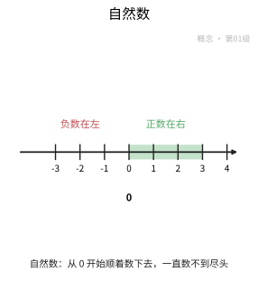

**一句话点破**：自然数是最朴素的"计数器"，它有序、没有最大值，人类最初的一切计数与记账都从它开始。

### 10.2 让"减过头"不再尴尬的整数

在自然数里，3 减 5 是算不下去的，可现实里"欠了 5 块"却天天发生。于是人们给地面以下的楼层也编上号：0 是地面，$-1, -2, -3$ 是地下车库，整数就这样把"比零还少"也请进了数的家族。它的本事，是让任意两个数相减都一定还有答案。

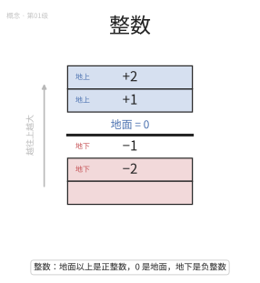

**一句话点破**：整数让减法"永远做得完"——减去一个数不够，就减到零的左边去。

### 10.3 能写成分数的有理数

一块蛋糕三个人平分，每人拿 $\frac{1}{3}$，这就是有理数：凡是能写成两个整数之比（分母不为 0）的数都算。它既包含整数（分母为 1 的特殊情形），也包含有限小数和无限循环小数，比如 $0.5 = \frac{1}{2}$、$0.\overline{3} = \frac{1}{3}$。

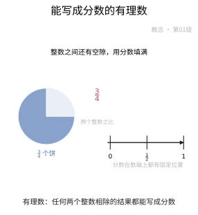

**一句话点破**：有理数是为了让除法"永远做得完"才请进来的——任何两个整数相除，结果都能写成分数。

### 10.4 一层套一层的数系

把自然数、整数、有理数想象成大小不一的俄罗斯套娃：最小的套娃里装着自然数，往外一层是整数，再往外一层是有理数。写成式子就是 $\mathbb{N} \subseteq \mathbb{Z} \subseteq \mathbb{Q}$——自然数都是整数，整数都是有理数，但反过来不一定成立，例如 $-3$ 是整数却不是自然数。

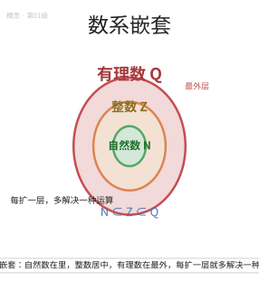

**一句话点破**：每向外扩一层数系，都是为了让前一层做不完的那种运算（减法和除法）永远有答案。

### 10.5 位置决定身价的位值系统

同样是数字 3，写在千位就是 3000，写在百位就只剩 300——位置一变，身价差十倍。我们用的是十进制，每一位都对应一个 10 的幂，例如 $3702 = 3 \times 10^3 + 7 \times 10^2 + 0 \times 10^1 + 2 \times 10^0$。那个"什么都不代表"的 0 恰恰最要紧，它专门负责占位。

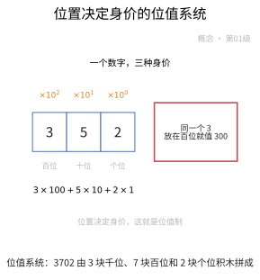

**一句话点破**：位值的秘密就是"数字乘以它所在位置的单位，再加起来"，一个占位的 0 让大小不同的数从此不会混淆。

### 10.6 可以"逢几进一"的进位制

我们平常"逢十进一"，多半是因为人有十根手指。可电灯只有"亮或灭"、计算机只有"有电或没电"，于是只用 0 和 1 的二进制就成了机器的语言。换个基数 $b$，只要从右往左第 $k$ 位的位值是 $b^k$，就都能表示任何整数，例如 $(1011)_2 = 11$。

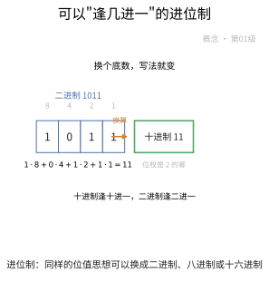

**一句话点破**：进制转换只是位值思想换了个基数——二进制转十进制按位展开，十进制转二进制则"除 2 取余、倒序排列"。

### 10.7 把极大极小的数写得又短又清楚

光速约每秒 $3 \times 10^8$ 米，一粒沙直径约 $5 \times 10^{-4}$ 米，这类数一个数字一个数字地写太累。把它们写成"一位整数的小数乘以 10 的若干次方"，就是科学计数法；有效数字告诉你这个数可靠到哪一位；估算则是把数凑成整十整百再心算，快速判断数量级。

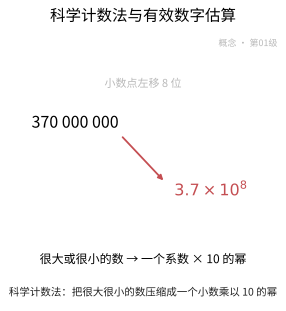

**一句话点破**：科学计数法把注意力从"写了几个 0"转到了"大约是 10 的几次方"，让大数的比较和估算一下变轻松。

### 10.8 百分数、小数、分数其实是同一个数的三种写法

"打八折""增长 20%""命中率 87%"——生活里到处是"每一百份里有几份"。同一个比例可以写成 50%、0.5 或 $\frac{1}{2}$，它们只是同一个数的三种外衣。小数转百分数就把小数点右移两位再加百分号，百分数转小数则反过来，分数先化成小数再处理即可。

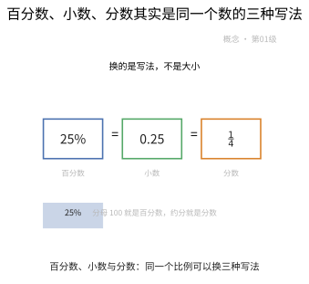

**一句话点破**：三种写法随时互换，才能算得又快又准——打折按"原价乘以折率"、占比按"部分除以全体"。

### 10.9 加法：把两堆东西合起来数

加法对应人类最古老的动作——把两堆东西放到一起再数一遍，放出去几只羊、收回来几只羊，全靠它算总数。列竖式时把数位对齐、从个位加起，哪一位满十就向前进一位。它回答的是最根本的问题：合在一起一共有多少。

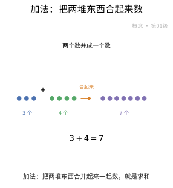

**一句话点破**：加法是"合起来一共有多少"的答案，也是所有运算的起点。

### 10.10 减法：加法的逆动作

减法解决的是"还剩多少、少了几、相差几"——分掉一些之后还剩什么。它其实是把加法倒过来做：从总数里去掉一部分。列竖式时若某一位不够减，就向前一位借 1 当 10。当结果减到比零还小，就轮到负数出场了。

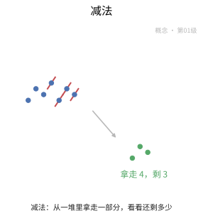

**一句话点破**：减法就是加法的逆运算，一旦"减过头"就减到零的左边，这正是数系要扩到整数的原因。

### 10.11 乘法：把"同样的数加很多遍"变简单

3 排 4 列一共多少个点？如果一个个加太慢，乘法就是为"相同数连加"准备的捷径：$3 + 3 + 3 + 3 + 3 = 5 \times 3 = 15$。它也是长乘宽的雏形，丈量土地、计价、统计都靠它把重复的事情一步算完。多位数相乘时，可以拆成几部分分别相乘再相加。

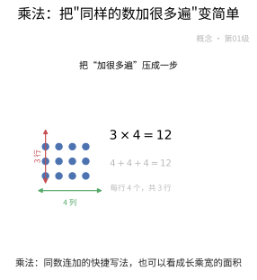

**一句话点破**：乘法只是"同数连加"的缩写，所以它能一步算出重复出现的总量。

### 10.12 除法：平均分和"能装几袋"

12 颗糖平均分给 3 个小朋友，每人几颗？这是"平均分"。一堆糖按 5 颗一袋数、能装几袋？这是"包含除"。除法就是这两种生活动作的数学化，它是乘法的逆运算。分不干净时就用带余除法写成"商加余数"，并且余数必须小于除数。

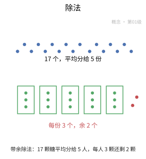

**一句话点破**：除法是乘法的逆运算，分不干净时用 $a = b \times q + r$（其中 $0 \le r < b$）把商和余数写清楚。

### 10.13 运算优先级：先算谁后算谁

$3 + 4 \times 2$ 到底先加还是先乘？如果不定规矩，同一个式子会算出不同答案。于是数学家约定：先算括号里的，再算乘除（从左到右），最后算加减（从左到右）。口诀是"先乘除，后加减，有括号先算括号里"。

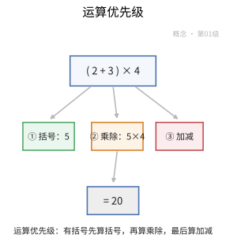

**一句话点破**：统一的先后顺序，才能保证同一个算式永远算出同一个答案。

### 10.14 负数怎么加、减、乘、除

冰箱调到 $-3^\circ$ 再升高 $5^\circ$ 是几度？要让这类问题有答案，就得给负数也定好四则运算规则。加减可以这样记：同号相加取相同符号、绝对值相加；异号相加取绝对值较大一方的符号。乘除则看符号：同号得正，异号得负。而"负负得正"之所以必须成立，是为了跟分配律等已有规则保持一致。

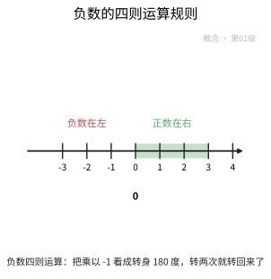

**一句话点破**：负数的运算法则既要前后自洽、又要跟现实吻合——"负负得正"正是被分配律逼出来的。

### 10.15 加法交换律：先数哪个都一样

你先数盘子里的 3 个苹果、再数 5 个橘子，和先数橘子再数苹果，最后当然都是 8 个。这就是加法交换律：$a + b = b + a$，随意交换两个加数的位置，和不变。

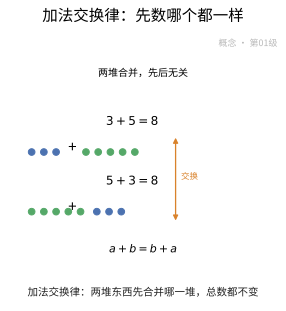

**一句话点破**：加法只看"合起来一共多少"，根本不关心谁先谁后。

### 10.16 加法结合律：先加哪两个都一样

红球 2 个、蓝球 3 个、绿球 4 个，无论先把红蓝合并再与绿合，还是先把蓝绿合并再与红合，总数都是 9。写成式子就是 $(a + b) + c = a + (b + c)$，三个数相加，改换分组方式，和不变。

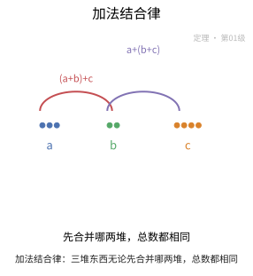

**一句话点破**：加法里怎么加括号都不影响结果，所以可以放心先把好算的数凑在一起。

### 10.17 乘法交换律：横着数竖着数都一样

一个 3 行 4 列的点阵，横着数是 3 个 4，竖着数是 4 个 3，总点数都是 12——就像阅兵方阵，无论从哪边数，人数不变化。所以 $a \times b = b \times a$，交换因数的位置，积不变。

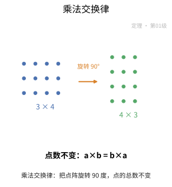

**一句话点破**：乘法只关心"一共有多少"，因数谁前谁后都无所谓。

### 10.18 乘法结合律：三层积木怎么数都一样

想象一个长宽高分别是 $a$、$b$、$c$ 的长方体，无论先算底面积再乘高，还是先算一个侧面再乘另一条边，体积都一样。这就是 $(a \times b) \times c = a \times (b \times c)$，改换分组方式，积不变。

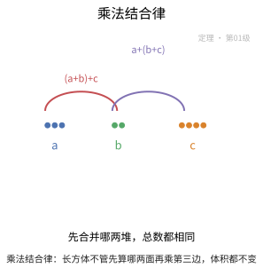

**一句话点破**：乘法里怎么分组也不影响积，可以先把好算的因数结合起来。

### 10.19 分配律：把一块巧克力切开算

宽 3 格的一块巧克力，被切成 4 格和 5 格两段。整块的格数既可以是"宽 3 乘全长 9"，也可以是"左段 3 乘 4 加右段 3 乘 5"，两种算法结果一样。这就是 $a \times (b + c) = a \times b + a \times c$，反过来用就是"提取公因数"。

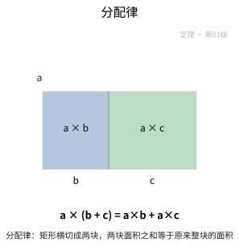

**一句话点破**：分配律是连接加法和乘法的桥梁，它让"提取公因数"这种简便算法成为可能。

### 10.20 运算律之间有什么关系

这几条运算律并不孤立：交换律和结合律保证加法（或乘法）里怎么排、怎么分组都不改变结果，而分配律是把加法和乘法连起来的唯一桥梁。要特别记住，减法和除法既没有交换律，也没有结合律，例如 $5 - 3 \neq 3 - 5$。

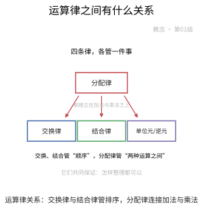

**一句话点破**：交换律、结合律只属于加法和乘法，分配律则是横跨这两种运算的桥。

### 10.21 把运算性质摆在一张表里

单条记容易忘，摆在一起就清楚多了：加法和乘法都有交换律、结合律，乘法还额外对加法有分配律；加法以 0 为单位元、乘法以 1 为单位元；加法有相反数、乘法（非零时）有倒数。做算术和将来学代数，靠的就是这张"哪些变形永远合法"的清单。

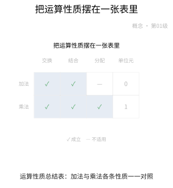

**一句话点破**：这张表就是一份"哪些运算可以随便换位置、随便加括号"的合法清单。

### 10.22 数里的"原子"：质数与合数

有些数再也没法拆成更小的因数相乘，比如 2、3、5、7，它们只能被 1 和自己整除，叫质数；另一些数还能继续拆，比如 60，叫合数。要判断一个数是不是质数，用 2 到 $\sqrt{n}$ 之间的整数试除就够了。特别地，1 既不是质数也不是合数。

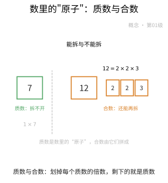

**一句话点破**：质数是"数的原子"，合数都能由更小的质数拼出来，而 1 两边都不算。

### 10.23 算术基本定理：拆开的方式只有一种

每个大于 1 的自然数，要么自己就是质数，要么能唯一地拆成质数的乘积（不计顺序）。比如 $60 = 2^2 \times 3 \times 5$、$6936 = 2^3 \times 3 \times 17^2$。不管你怎么拆，最后拿到的质数零件总是一样的，只是排列顺序不同罢了。

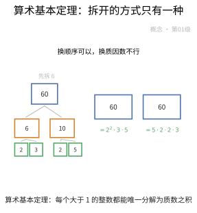

**一句话点破**：能分解还不算稀奇，"唯一分解"才是关键——它让整个整数世界有了稳定的"零件表"。

### 10.24 为什么每种拆法都一样：定理的证明

证明分两步走。存在性用反证法：假设有最小的一个数拆不成质数之积，那它必是合数，而它的两个因数更小、都能拆，合起来就能拆，矛盾。唯一性靠欧几里得引理：质数 $p$ 若能整除 $a \times b$，则 $p$ 一定整除 $a$ 或整除 $b$；由此两种分解可以逐项对消，最终完全一致。

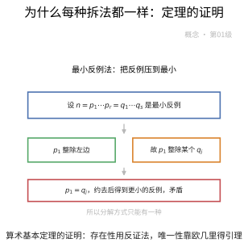

**一句话点破**：先证明"拆得开"，再借助欧几里得引理证明"拆法唯一"，定理才算完整。

### 10.25 怎么把一个数拆成质因数

最常用的是短除法：从最小的质数 2 开始，能整除就记下这个质数、用商接着除，一直除到商变成 1 为止，记下的质数就是全部质因数。比如 $60 = 2 \times 2 \times 3 \times 5 = 2^2 \times 3 \times 5$。也可以画成分解树，从上往下一层层拆，结果完全一样。

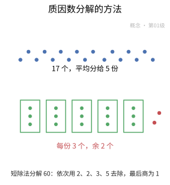

**一句话点破**：短除法是从下往上记、分解树是从上往下拆，两条路通向同一份质因数清单。

### 10.26 质数数不完：欧几里得的漂亮证明

假设质数只有有限几个，把它们全部乘起来再加 1，得到一个新数 $N$。这个 $N$ 除以列表里任何一个质数都余 1，所以它要么自己就是新质数，要么含有列表之外的新质因数——无论哪种情况，都推出了矛盾。要注意 $N$ 本身不一定是质数，但它的质因数必定是全新的。

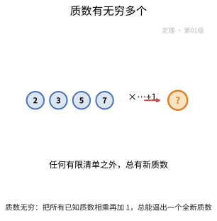

**一句话点破**：把已知质数乘起来再加 1，这个构造保证总有"漏网"的新质数，所以质数无穷无尽。

### 10.27 不用做除法，看一眼就知道能不能整除

判断 3672 能不能被 9 整除，其实不必真的去除。看末位就能判 2、5、10，看各位数字之和就能判 3、9，看末两位判 4、25，看末三位判 8，而 6、12 则拆成两个互质的因数分别判定。这些法则的根据正是位值表示：比如 10 除以 3 余 1，所以各位数字之和与原数对 3 的余数相同。

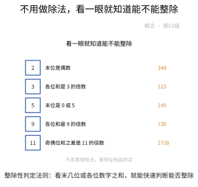

**一句话点破**：整除判定其实是位值表示的副产品——看个位、看末几位、或数数字之和，就能免去做除法。

## 11. 数学史（History of Mathematics）

> 数学不是凭空产生的抽象游戏，而是人类在**计量、贸易、历法、记账、丈量与工程**等实际需求中逐步"逼"出来的工具。本教程涉及的自然数、整数、有理数、位值系统、零、四则运算、运算律、质数与算术基本定理，都不是哪位天才的一时灵感，而是经历了**"实际需求 → 粗糙记法 → 运算法则 → 严格证明"**的漫长淬炼。下面按概念逐条梳理其**前因后果**：当时遇到了什么问题、谁在什么时候做出了关键突破、又付出了什么代价。

### 11.1 计数与自然数：从刻痕到抽象

- **为什么需要**：狩猎分配、牲畜计数、谷物记账、人际借贷，都需要"数一数"和"对得上账"。计数是数学最古老的动机，自然数 $1,2,3,\dots$ 就是它的产物。
- **史前萌芽（约前 30000–前 3000 年）**：旧石器时代的刻痕（如非洲的 Ishango 骨、欧洲的刻痕骨）显示人类用"1 划对 1 物"的**一一对应**方式记录数量，这对应现代集合论中"等势"的最原始直觉（第09 级）。
- **从"物"到"数"的抽象**：约前 8000–前 3500 年，苏美尔人用小陶筹（token）代表牲畜、谷物等货物，并把它们封存在泥球中；随后，各种形状的陶筹逐渐被刻在泥板上的符号取代。约前 3100 年发生关键一跃：**数字符号与被计数之物彻底分离**——"3"不再代表"3 只羊"或"3 袋谷"，而成为独立的抽象对象。数学作为一门学科的起点，就在这一步。
- **文明的记数法**：埃及人在莎草纸上用象形数字记账与丈量（《莱因德数学纸草书》约前 1650 年，其中已有一张把 $2/n$ 拆成单位分数的表）；中国商代用甲骨刻辞记数与占卜；罗马人则用字母拼写数字。
- **"自然数有多少个"的哲学困惑**：自然数是"没有尽头"的（$1,2,3,\dots$），这一"无穷"的直觉长期困扰数学家，直到后来的集合论（第09、122 级）才给出严格刻画。

### 11.2 位值制与零：给"空位"一个符号

- **为什么需要**：要把"较小的数"表示成"很大的数"，靠一个个符号堆叠极不实用。位值思想的本质是——**同一个符号，因所在位置不同而代表不同的权（10 的幂）**。例如"22"里的两个"2"含义完全不同，全靠位置区分。古埃及与古希腊的十进制都属于"无位值概念"的十进制，只有配上位值，记数才真正轻盈起来。
- **六十进制的先声**：约前 2700–前 2000 年，苏美尔人的圆笔针数字逐渐演化为**楔形数字**；到古巴比伦初期（约前 1950 年），成熟的**六十进制位值制**已经形成，并广泛用于商业、天文与计算，还传播到希腊、罗马与埃及。它直接影响了我们今天对时间（60 秒 = 1 分）和角度（1 度 = 60 分）的划分。
- **中国算筹：空位与"〇"**：中国古代用**算筹**（竹木小棍）摆数：个位用纵式、十位用横式，交替排列，**没有数位的地方就空着**。约公元 932 年，中国数学家开始用一个圆圈表示空位——这可能源自"算盘上没有算珠的那一位"，是零的雏形之一。中美洲的玛雅人也在公元前的长纪历中独立发明了零的记号。
- **零的定型**：真正把零从"占位符号"提升为"一个数"的，是古印度数学家。**婆罗摩笈多**（Brahmagupta，598—668）在 628 年的《婆罗摩历算书》中首次系统给出零的运算规则（如 $a+0=a$、$a\times 0=0$），并同时给出正数、负数与零的运算法则。有了零，位值制才真正"完整"：$105$ 与 $15$ 的区别，仰赖的就是那个"0"。
- **对照罗马数字**：罗马数字既无位值也无零，448 要写成 CDXLVIII，做乘除法几乎只能借助算盘。零与位值制为何珍贵，对比一下罗马数字就一目了然。

### 11.3 印度-阿拉伯数字的世界之旅

- **起源**：今天世界通用的十进制位值记数法源于古印度的**婆罗米数字**，经笈多王朝与婆罗摩笈多时代的完善（约 5–7 世纪），形成了"十个数字字符 + 零 + 位值"的完整系统。
- **传入阿拉伯世界**：约 773 年，一位印度使节连同天文表把印度数字带到巴格达。9 世纪，**花拉子米**（al-Khwārizmī，约 780—850）写下介绍印度数字算术的著作，后来被译成拉丁文——今天英文 algorithm（算法）一词，便来自他的拉丁化名字 Algoritmi。
- **传入欧洲**：12 世纪，花拉子米等人的著作在西班牙被译成拉丁文；意大利数学家**斐波那契**（Fibonacci，约 1170—1250）游学北非后写成《计算之书》（*Liber Abaci*，1202 年），热情推介这套"印度数字"，并演示它如何让记账与换算大大提速。此后数百年间，新数码与使用算盘的旧式商算（"算盘派"）长期竞争，直到 15–16 世纪印刷术普及，印度-阿拉伯数字才在欧洲全面胜出，逐步取代麻烦的罗马数字。
- **三个分支**：这套数字系统后来分化成三大支流——今天最流行的"西方阿拉伯数字"（0, 1, 2, …）、西亚地区使用的阿拉伯文数字，以及印度本土数字。

### 11.4 负数：从"正负术"到数轴的另一半

- **为什么需要**：**盈余与亏欠、收入与支出、向东与向西**，这些方向相反的量无法只用自然数刻画。人们先有了"用相反的量记账"的实际需求，才逐渐有了负数这个数学对象。
- **中国的最早记录**：西汉时期成书的《九章算术》（约前 100 年，由张苍等人整理）给出了"正负术"——世界现存最早的负数加减法则："同名相除，异名相益，正无入负之，负无入正之……"；刘徽（263 年注）进一步指出"正算赤，负算黑"，即以红、黑两色算筹（或用正摆、斜摆）区分正负。不过，中国古人虽然最早使用负数，却没有从理性层面讨论"负数是什么"——这大概与"重实用、轻思辨"的文化传统有关。
- **规则的成文化**：印度数学家**婆罗摩笈多**（628 年）在《婆罗摩历算书》中给出正负数的乘除法则（同号得正、异号得负），并用负数表示债务，这是西方文献中最早的系统性负数记录。
- **曲折的接受史**：负数传入欧洲后，长期被许多学者视为"荒谬的数"——因为当时认为"数"就是"多少"，不能"少于没有"。直到 17 世纪，随着复式记账的普及与解析几何的兴起（负数成了坐标轴上真实存在的点），欧洲才逐渐接纳它；19 世纪数系公理化之后，负数才获得彻底牢固的基础（第10 级）。这也解释了为什么本教程要把减法 $a-b$ 规定为 $a+(-b)$、把"同号得正、异号得负"写成明确法则——这些今天看来"天然"的规则，曾是几百年争论的终点。

### 11.5 分数与有理数：切割整体的技艺

- **为什么需要**：**分配**（3 张饼 2 人平分）、**测量**（1 又 1/2 尺怎么记？）、**比价**都与"整数倍"不兼容，需要"把一个整体切开"的记号。分数还为后续"比与比例"（第05 级三角函数的基础）提供了语言。
- **古埃及：只认单位分数**：埃及人只使用**单位分数**（分子为 1，如 $\frac{1}{3}$、$\frac{1}{7}$），其他分数一律拆成若干单位分数之和（如 $\frac{2}{5}=\frac{1}{3}+\frac{1}{15}$），《莱因德数学纸草书》中甚至附有一张 $2/n$ 的分解表。这种"埃及分数"运算极其繁琐——从反面说明：**一个好的记法本身就是生产力**。
- **中国：最早的完整分数算法**：《九章算术》第一章"方田"给出了约分（更相减损术）、通分与分数四则运算的完整法则，这是世界上最早的分数算法体系。中国古代还用"物不知数"（第27 级初等数论中"中国剩余定理"的前身）处理更复杂的算式。
- **印度与阿拉伯：分数线的由来**：印度人把分数写成"分子在上、分母在下"的样式；12 世纪摩洛哥数学家**阿尔·哈萨尔**（al-Hassar）通常被认为最早使用横线分数线，这套写法经阿拉伯传入欧洲，成为今天 $\frac{a}{b}$ 的直接祖先。
- **有理数的命名**："有理数 $\mathbb{Q}$"的 $\mathbb{Q}$ 取自英文 *quotient*（商）。有理数就是"能表示为 $p/q$（$p,q$ 为整数，$q\neq 0$）的数"，它的引入缓解了"一个数除以另一个数后不是整数"的算术尴尬。
- **小数的补位**：1585 年，比利时（佛兰德斯）数学家**斯蒂文**（Simon Stevin）在《论十进》中给出小数记法，把位值思想从整数推广到"1 以下"，十进制从此"上下贯通"。

### 11.6 运算符号的诞生：把语言压缩成一行式子

- **古代的"微分"符号**：古埃及象形文字用一双"走向"表示加法、反向表示减法；中世纪欧洲长期用文字或缩写"plus""minus"。
- **从字母到记号**：15 世纪初的欧洲通常用字母 P（plus，多）和 M（minus，少）表示加减；1494 年意大利修士**帕西奥利**（Luca Pacioli）在威尼斯出版的《算术、几何、比与比例集成》中首次印刷了带横线的 p̄、m̄ 记号。
- **"+""−"首次印刷**：1489 年，德国（波希米亚出身）数学家**维德曼**（Johannes Widmann）在一本商用算术书中首次印刷了 $+$ 和 $-$，但当时它们只表示货物"过剩"与"不足"，并非加减运算！直到 1518 年**格拉马特乌斯**（Henricus Grammateus）的书中，$+$、$-$ 才明确用作加、减；1557 年**雷科德**（Robert Recorde）在《砺智石》中把它们（连同他自己发明的等号"="）引入英国。$+$ 的来源是拉丁文 et（意为"与"，同英文 and）的连写简化——和"&"的来历如出一辙；$-$ 则可能源自 m̄ 上横线的缩略，或字母 m 的速写。
- **乘号与除号**：$\times$ 由英国数学家**奥特雷德**（William Oughtred，1574—1660）在 1631 年《数学精义》中引入；莱布尼茨嫌它与字母 $x$ 混淆，提倡改用"$\cdot$"。$\div$ 由瑞士人**拉恩**（Johann Rahn，1622—1676）在 1659 年《德语代数》中采用（也有学者把功劳归于该书的编辑约翰·佩尔）；莱布尼茨则一度用"∶"表示除。至于分数线 $a/b$ 则凭借书写与排版之便，最终"传播更广"。
- **前因后果**：符号使运算从"一段话"压缩为"一行表达式"，这正是代数能够高速演算的前提。运算**优先级**（先乘除后加减）也是为了让这种一行表达式有**无歧义**的含义而约定出来的——符号系统与规则系统，从来是配套出现的。

### 11.7 质数与算术基本定理：数论的"原子论"

- **质数与合数**：分类"可再分解"与"不可再分解"的整数，是数论最古老的问题之一。纸草书中的埃及分数展开已隐约区分质数与合数，系统的研究则始于古希腊。
- **欧几里得的双份遗产**：约前 300 年的《几何原本》包含与质数有关的两项重要成果：其一，第九卷命题 20 用**反证法**证明了**质数有无穷多个**（设有限个质数之积加 1，必产生新的质因数）——这个证明简洁而震撼，被誉为最优美的数学证明之一；其二，全书隐含了**算术基本定理**的雏形（如欧几里得引理：质数若整除乘积，必整除其中一个因子）。欧几里得还展示了如何由梅森型的质数构造完全数。
- **筛法与千年沉寂**：**埃拉托斯特尼**（约前 3 世纪）发明了通过不断划去质数倍数来"筛"出质数的**筛法**——它是现代数论与计算机算法的重要先声。此后到 17 世纪，质数研究少有进展。
- **费马与梅森的推动（17 世纪）**：1640 年**费马**（Pierre de Fermat）提出费马小定理，并猜测所有费马数均为质数——后被欧拉推翻（$n=5$ 时 $2^{32}+1 = 641\times 6700417$ 竟是合数）；法国修道士**梅森**（Marin Mersenne）研究 $2^p-1$ 形式的质数（后世称"梅森素数"），成为数论史上著名的"猎人名单"。
- **欧拉的丰收（18 世纪）**：欧拉证明所有质数倒数之和 $\frac{1}{2}+\frac{1}{3}+\frac{1}{5}+\frac{1}{7}+\cdots$ 发散（即质数"足够多"的定量版本），并在 1747 年证明偶完全数恰为 $2^{p-1}(2^p-1)$ 的形式。
- **高斯与"原子"秩序（19 世纪）**：**算术基本定理**（每个大于 1 的整数可唯一分解为质因数的乘积）的思想可追溯至欧几里得，但其"唯一性"中隐藏的微妙之处直到**高斯**《算术研究》（1801 年）才被彻底澄清并严格证明。它是整个数论（第27 级）的基石——**既然每个数都由"原子"（质数）唯一拼成，那么整除性、最大公约数、最小公倍数都能归结到质因数上**。几乎同时，**勒让德**与**高斯**推测出"素数定理"（小于 $x$ 的质数个数约为 $x/\ln x$）——黎曼在 1859 年把它引向复分析（第75、18 级），1896 年**阿达马**与**德拉瓦莱-普桑**独立完成证明。
- **现代的"反转"**：两千年来被视为"纯粹摆设"的质数，在 1977 年成为 RSA 公钥加密（第114 级）的基石——而 2002 年印度三位学者给出多项式时间的素性检测算法（AKS），又把"判定质数"从漫漫长夜变成快车道。

### 11.8 二进制：从《易经》卦序到数字电路

- **莱布尼茨的系统研究**：现代二进制记数系统由**莱布尼茨**（Gottfried Wilhelm Leibniz，1646—1716）于 1679 年设计并运用，1703 年发表论文《论只使用符号 0 和 1 的二进制算术……》。令他格外着迷的是，中国的《易经》六十四卦（按邵雍先天次序）恰好与 0 到 63 的二进制表示一一对应——他认为"0 与 1"能体现"从无生有"的创造结构，这使二进制在他心中具有了哲学意味。
- **从哲学玩具到逻辑工具**：1854 年，英国数学家**布尔**（George Boole）在《思维规律的研究》中把逻辑代数化（"与、或、非"变成运算），后人称之为**布尔代数**。此时，二进制的舞台还只是哲学与逻辑。
- **香农与"世纪硕士论文"**：1937 年，**香农**（Claude Shannon）在麻省理工学院的硕士论文《继电器与开关电路的符号分析》中发现：继电器开关电路恰好实现布尔代数运算——数字化电路的理论基础由此奠定。同年 11 月，贝尔实验室的**斯蒂比兹**（George Stibitz）造出第一台用继电器表示二进制的计算机。
- **指尖上的现代**：二百年后回看，二进制之所以成为现代计算机（图灵机，见第124 级）的天然语言，只因它只需要表示"开/关"两种状态；本级的"进位制转换"于是在信息时代重获生命。

### 11.9 运算律：从"自明"到公理

- **交换、结合、分配律**对人类而言如此自然，以至于几千年来被视为"自明"，甚至不值得写下。
- **19 世纪的"补录"**：随着**皮亚诺**（1889 年）用公理刻画自然数、戴德金与康托尔构造实数，数学家才把这些"显然"的规律逐条列为公理——算术的地基第一次被认真审视。
- **20 世纪的"祛魅"**：直到 19–20 世纪，随着抽象代数（第19 级）兴起，数学家才真正明白：这些律**不是放之四海皆准**的真理，而是一个代数结构（如群、环、域）需要满足的**定义性公理**。矩阵乘法不可交换、四元数乘法不可交换，却仍是极有用的代数对象；"群"只要求结合律与逆元，"域"要求交换律与分配律。本级的运算律正是日后"群""域"等结构概念的雏形。

### 11.10 历史年表

| 时间 | 人物／文献 | 事件与贡献 |
|:---|:---|:---|
| 约前 8000–前 3500 | 苏美尔泥筹 | 用陶筹记账，抽象数字的前身 |
| 约前 3100 | 苏美尔 | 数字符号与实物分离，抽象计数诞生 |
| 约前 1950 | 古巴比伦 | 成熟的六十进制位值制 |
| 约前 1650 | 《莱因德数学纸草书》 | 象形数字记账与单位分数表 |
| 约前 100 | 《九章算术》（中国） | 分数四则、正负术、盈不足 |
| 约前 300 | 欧几里得《几何原本》 | 质数无穷、辗转相除、算术基本定理雏形 |
| 约前 240 | 埃拉托斯特尼 | 素数筛法 |
| 年 263 | 刘徽 | 《九章算术注》，以红黑算筹区分正负 |
| 年 628 | 婆罗摩笈多 | 零与负数的运算规则 |
| 约 773 | 印度使节抵达巴格达 | 印度数字传入伊斯兰世界 |
| 约 825 | 花拉子米 | 介绍印度算术；algebra、algorithm 的词源 |
| 约 932 | 中国数学家 | 开始用圆圈表示零 |
| 年 1202 | 斐波那契《计算之书》 | 印度-阿拉伯数字传入欧洲 |
| 年 1489 | 维德曼 | $+$、$-$ 首次印刷（当时表示盈亏） |
| 年 1494 | 帕西奥利 | 印制 p̄、m̄ 加减记号 |
| 年 1518 | 格拉马特乌斯 | $+$、$-$ 首次明确用作加减 |
| 年 1557 | 雷科德 | "="诞生，$+$、$-$ 传入英国 |
| 年 1585 | 斯蒂文《论十进》 | 小数记法 |
| 年 1631 | 奥特雷德《数学精义》 | 乘号 $\times$ |
| 年 1659 | 拉恩《德语代数》 | 除号 $\div$ |
| 年 1679／1703 | 莱布尼茨 | 系统研究二进制并发表 |
| 年 1737／1747 | 欧拉 | 质数倒数和发散；偶完全数定理 |
| 年 1801 | 高斯《算术研究》 | 算术基本定理唯一性的严格证明 |
| 年 1854 | 布尔 | 布尔代数，逻辑运算代数化 |
| 年 1889 | 皮亚诺 | 自然数公理体系 |
| 年 1896 | 阿达马、德拉瓦莱-普桑 | 素数定理证明 |
| 年 1937 | 香农、斯蒂比兹 | 布尔代数与开关电路、二进制计算机 |
| 年 1977 | RSA | 公钥密码，质数进工厂 |
| 年 2002 | AKS | 多项式时间素性检测 |

### 11.11 小结：一条"需求—发明—严格化"的线索

> 回顾本教程，可看到一条清晰主线：**实际需求**（计数→记账→分配→丈量→方向相反的量）催生了**新数**（自然数→负数→分数→有理数）与**新记法**（位值、零、运算符号）；而**运算律**与**算术基本定理**则把零散技巧**严格化、系统化**，为更高深的代数与数论铺路。位值思想在今天仍在扩张：整除性判定法则（看末位、看各位数字之和）本质是 10 的幂的余数规律；科学计数法 $a\times10^{n}$ 是位值对"极大极小"的延伸；而二进制让位值制最终成为信息时代的语言。数学史上许多"理所当然"，曾经都是漫长争论后才被接受的。

## 现实应用（Real-World Applications）

### 应用案例 1：计算机网络与数字图像｜用二进制、十六进制读懂 IP 地址、端口与颜色

**场景与问题**

当你用浏览器访问一个网站时，操作系统底层处理的并不是「192.168.1.1」这样好看的十进制数字，而是一串 32 位二进制位；网络设备在配置界面里又常常把同一串位写成十六进制；而网页设计师写的「#FF8800」其实也是同一套十六进制表示法。换句话说，**同一份数据在十进制、二进制、十六进制之间来回转写**，是网络工程、嵌入式开发、图像处理每天都要做的事。

本案例要解决三个具体问题：(1) 把一个 IPv4 地址、一个 TCP 端口号写成二进制与十六进制；(2) 把一个网页颜色码 #FF8800 拆成三个 0~255 的十进制分量；(3) 说明为什么用十六进制书写比二进制短得多，从而成为工程惯例。这里用到的数全部落在自然数（含 0）与整数范围内，正是数系中最基础的一层。

**涉及知识点**

- 本章「2.1 自然数 (Natural Numbers)」：每个二进制位只能取 0 或 1，位权 0 到 31 都是自然数。
- 本章「2.2 整数 (Integers)」：IP 地址被整体看作一个无符号整数，端口号 0~65535 也是整数。
- 本章「2.5 位值系统 (Place Value System)」：十进制 8080 中每个数字的值等于该数字乘以其所在位的权。
- 本章「2.6 进位制系统与进制转换 (Numeral Systems and Base Conversion)」：十进制与二、十六进制之间的除基取余、按权展开。
- 本章「2.7 科学计数法与有效数字、估算 (Scientific Notation, Significant Figures, Estimation)」：用数量级估算判断一个表示是否溢出。

**建模与数据**

符号约定：设基数为 $b$，一个 $n$ 位表示的数值为

$$
N = d_{n-1} b^{n-1} + d_{n-2} b^{n-2} + \cdots + d_1 b + d_0, \quad 0 \le d_i < b
$$

给定位串长度 $L$（$L$ 位二进制）能表示的整数个数为 $2^L$。本案例使用的具体数据如下（均为真实工程取值）：

| 对象 | 十进制写法 | 位宽 | 说明 |
| --- | --- | --- | --- |
| TCP 端口 | 8080 | 16 位 | Tomcat/HTTP 备用端口 |
| IPv4 主机部分 | 192.168.1.1 | 32 位 | 私有网段常用地址 |
| 网页颜色 | 255, 136, 0 | 各 8 位 | RGB 三分量 |
| 颜色码 | #FF8800 | 24 位 | 十六进制简写 |

**完整推导与算法**

第一步：十进制转二进制用「除二取余、逆序读出」。以 8080 为例：

$$
8080 = 2 \times 4040 + 0,\quad 4040 = 2 \times 2020 + 0,\quad 2020 = 2 \times 1010 + 0
$$

$$
1010 = 2 \times 505 + 0,\quad 505 = 2 \times 252 + 1,\quad 252 = 2 \times 126 + 0
$$

$$
126 = 2 \times 63 + 0,\quad 63 = 2 \times 31 + 1,\quad 31 = 2 \times 15 + 1
$$

$$
15 = 2 \times 7 + 1,\quad 7 = 2 \times 3 + 1,\quad 3 = 2 \times 1 + 1,\quad 1 = 2 \times 0 + 1
$$

把余数从下往上读，得到 $8080 = (1111110010000)_2$。

第二步：二进制转十六进制，取 4 位一组（因为 $16 = 2^4$）。补足到 16 位：

$$
(1111110010000)_2 = (0001\,1111\,1001\,0000)_2 = (1F90)_{16}
$$

第三步：颜色码 #FF8800 每两位十六进制对应一个 8 位分量：

$$
\text{FF}_{16} = 15 \times 16 + 15 = 255,\quad \text{88}_{16} = 8 \times 16 + 8 = 136,\quad \text{00}_{16} = 0
$$

第四步：把 IPv4 地址按字节分段转写并整体拼成 32 位整数（192.168.1.1）：

$$
192 \times 2^{24} + 168 \times 2^{16} + 1 \times 2^{8} + 1 = 3232235777
$$

下面给出可运行代码，一次性完成上述全部转换与校验：

```python
# 依赖: 仅标准库
# 输入: 端口 8080 / 颜色 (255,136,0) / IPv4 "192.168.1.1"
# 输出: 各对象在二、十、十六进制下的表示，并做位宽溢出检查

def dec_to_base(n, b, width=0):
    digits = "0123456789ABCDEF"
    if n == 0:
        s = "0"
    else:
        s = ""
        while n > 0:
            s = digits[n % b] + s      # 除基取余，逆序拼接
            n //= b
    return s.rjust(width, "0")

def base_to_dec(s, b):
    return int(s, b)                   # int() 的 base 参数即按权展开

port = 8080
print("端口 8080 -> bin:", dec_to_base(port, 2, 16), "| hex:", dec_to_base(port, 16, 4))

r, g, bl = 255, 136, 0
hexcode = "#%02X%02X%02X" % (r, g, bl)
print("RGB", (r, g, bl), "->", hexcode)
back = tuple(int(hexcode[i:i+2], 16) for i in (1, 3, 5))
print("回代:", back, "一致:", back == (r, g, bl))

ip = "192.168.1.1"
octets = [int(x) for x in ip.split(".")]
ip_int = sum(o << (8 * (3 - i)) for i, o in enumerate(octets))
print("IPv4", ip, "-> 整数", ip_int, "| 16 位端口上限:", 2**16 - 1)

assert dec_to_base(port, 2, 16) == "0001111110010000"
assert hexcode == "#FF8800"
assert ip_int == 3232235777
print("全部断言通过")
```

**可复现步骤**

1. 环境与依赖：无需第三方库，Python 3.8+ 即可。
2. 数据准备：把上面的代码原样保存为 `case1.py`（数据已内联在脚本中）。
3. 运行：`python3 case1.py`
4. 预期输出：端口一行显示 `0001111110010000`（二进制）与 `1F90`（十六进制）；颜色一行显示 `#FF8800`；IPv4 一行显示整数 `3232235777`；末尾打印「全部断言通过」。

**结果解读与延伸**

端口 8080 的十六进制是 1F90，位宽 16 位刚好容纳 $2^{16} = 65536$ 个端口（0~65535），这正是 TCP 端口不能超过 65535 的原因——一个「位宽决定取值范围」的纯算术结论。颜色码 #FF8800 用 6 个十六进制字符表达 3 个字节，比写成 24 位二进制（`111111111000100000000000`）短了 4 倍，这就是十六进制成为工程惯例的直接理由。误差与边界：本案例全部运算基于整数，不存在浮点误差；但若把端口写成 70000 就会溢出 16 位，此时应用「2.7」的估算思想，$70000 > 2^{16}$，立刻可判断溢出。可延伸的方向包括 IPv6 的 128 位地址、Unicode 码点的 UTF-8 变长编码，以及 Base64 编码——它们都是「换一个基数重新分组的位值系统」。

### 应用案例 2：图书出版与银行卡｜ISBN-13 校验位、Luhn 算法与整除性判定

**场景与问题**

图书封底的 ISBN 号、银行卡号、身份证号都有一个共同的秘密：最后一位（或几位）是**校验位**，由前面的数字按固定权重算出来。它的作用是在录入或传输发生单个数字错误（如把 7 打成 3、或相邻两位写反）时能被立即发现。全球每年新增 ISBN 约百万量级，银行卡交易量以千亿笔计，校验位是这些系统「零成本防错」的第一道防线。

本案例要解决的问题：(1) 用 ISBN-13 的加权和公式算出 978-0-306-40615 的最后一位；(2) 用 Luhn 算法判断卡号 4539 1488 0343 6467 是否合法；(3) 用整除性法则解释为什么这些校验公式能检测出「相邻两位颠倒」这类高频错误。

**涉及知识点**

- 本章「5.6 系统的整除性判定法则 (Divisibility Rules)」：判断加权和能否被 10 整除，是校验位成立的根本依据。
- 本章「4.5 分配律」：加权和 $\sum w_i d_i$ 的展开与合并依赖分配律。
- 本章「4.3 乘法交换律」与「4.4 乘法结合律」：交换权重与数字的顺序、重新结合，才能把「相邻两位颠倒」化为可比较的差值。
- 本章「3.1 加法 (Addition)」与「3.3 乘法 (Multiplication)」：逐项求积再求和的基本运算。
- 本章「3.4 除法 (Division)」：判断整除、取商的整数部分得到校验位。
- 本章「2.5 位值系统 (Place Value System)」：数字按位参与加权，位序决定权重。
- 本章「2.8 百分数、小数与分数的互化及应用 (Percent, Decimals, Fractions)」：检测率用百分比描述。

**建模与数据**

ISBN-13 的校验公式：13 位数字 $d_1 d_2 \cdots d_{13}$ 满足

$$
\sum_{i=1}^{13} w_i d_i \equiv 0 \pmod{10}, \quad w_i = \begin{cases} 1, & i \text{ 为奇数} \\ 3, & i \text{ 为偶数} \end{cases}
$$

Luhn 算法：从最右位起，偶数位乘 2，若乘积大于 9 则减去 9；所有位求和须被 10 整除。

具体数据：

| 对象 | 前 12 位 | 待求/校验 | 已知结果 |
| --- | --- | --- | --- |
| ISBN-13 | 978030640615 | 第 13 位 | 7 |
| 银行卡 | 453914880343646 | 第 16 位 | 7 |
| 完整卡号 | 4539148803436467 | — | 合法 |

**完整推导与算法**

ISBN-13 加权和（奇数位权 1、偶数位权 3）：

$$
1\cdot9 + 3\cdot7 + 1\cdot8 + 3\cdot0 + 1\cdot3 + 3\cdot0 + 1\cdot6 + 3\cdot4 + 1\cdot0 + 3\cdot6 + 1\cdot1 + 3\cdot5 = 93
$$

前 12 位的加权和为 93，要凑成 10 的倍数，校验位 $c$ 满足 $93 + c \equiv 0 \pmod{10}$，故 $c = 7$（因为 $93 + 7 = 100$）。

Luhn 校验 4539148803436467：从最右位起标记位置 1,2,3,…,16，偶数位乘 2 后折减：

| 位置(从右) | 数字 | 处理 | 贡献 |
| --- | --- | --- | --- |
| 1 | 7 | 不变 | 7 |
| 2 | 6 | 6×2=12→3 | 3 |
| 3 | 4 | 不变 | 4 |
| 4 | 6 | 6×2=12→3 | 3 |
| 5 | 3 | 不变 | 3 |
| 6 | 4 | 4×2=8 | 8 |
| 7 | 3 | 不变 | 3 |
| 8 | 0 | 0×2=0 | 0 |
| 9 | 8 | 不变 | 8 |
| 10 | 8 | 8×2=16→7 | 7 |
| 11 | 4 | 不变 | 4 |
| 12 | 1 | 1×2=2 | 2 |
| 13 | 9 | 不变 | 9 |
| 14 | 3 | 3×2=6 | 6 |
| 15 | 5 | 不变 | 5 |
| 16 | 4 | 4×2=8 | 8 |

总和 $= 7+3+4+3+3+8+3+0+8+7+4+2+9+6+5+8 = 80$，被 10 整除，卡号合法。

为什么能检测相邻颠倒？设相邻两位为 $x, y$ 位于权重 $w$ 与 $w'$ 处，原本贡献 $wx + w'y$，颠倒后为 $w x' + \cdots$，对 ISBN-13 相邻权为 (1,3)，颠倒造成的差为 $|3x + 1y - (1x + 3y)| = 2|x - y|$，只要 $x \ne y$ 且 $2|x-y| \not\equiv 0 \pmod{10}$，即 $|x-y| \ne 5$，就能被检测出来。代码实现如下：

```python
# 依赖: 仅标准库
# 输入: ISBN 前 12 位 978030640615 / 卡号 4539148803436467
# 输出: ISBN 校验位、Luhn 校验结论、错误检测率统计

def isbn13_check(digits12):
    s = sum((1 if (i % 2 == 0) else 3) * int(d) for i, d in enumerate(digits12))
    return (10 - s % 10) % 10          # 补足到 10 的倍数

def luhn_ok(number):
    total = 0
    for i, ch in enumerate(reversed(number)):
        d = int(ch)
        if i % 2 == 1:                 # 从右数偶数位
            d *= 2
            if d > 9:
                d -= 9
        total += d
    return total % 10 == 0

isbn12 = "978030640615"
print("ISBN-13 校验位 =", isbn13_check(isbn12))
print("完整 ISBN =", isbn12 + str(isbn13_check(isbn12)))

card = "4539148803436467"
print("卡号合法:", luhn_ok(card))

# 验证相邻两位颠倒能被检出
print("颠倒第 9,10 位后仍合法?",
      luhn_ok(card[:8] + card[9] + card[8] + card[10:]))
assert isbn13_check(isbn12) == 7
assert luhn_ok(card) is True
assert luhn_ok(card[:8] + card[9] + card[8] + card[10:]) is False
print("断言通过")
```

**可复现步骤**

1. 环境与依赖：无需第三方库。
2. 数据准备：保存为 `case2.py`（数据内联）。
3. 运行：`python3 case2.py`
4. 预期输出：`ISBN-13 校验位 = 7`；`卡号合法: True`；「颠倒第 9,10 位后仍合法?」为 `False`；末尾打印「断言通过」。

**结果解读与延伸**

计算得到的 ISBN 校验位 7 与真实出版物 978-0-306-40615-7 完全一致，说明加权公式正确；卡号 4539 1488 0343 6467 通过 Luhn 检验，而一旦把其中相邻两位写反就立刻被拒绝，检测能力正是「整除性判定」的工程价值。局限：单校验位只能检测，不能纠正错误；若需纠错需要汉明码这类多位校验（详见更高阶内容）。检测率方面，Luhn 可检出约 98% 的随机单键错误。可延伸方向包括 ISBN-10 的模 11 加权和、身份证号（GB 11643）的校验算法，以及信用卡 BIN 段与发卡行的对应关系。

### 应用案例 3：科学测量与计算机浮点｜有效数字、科学计数法与 0.1 的二进制真相

**场景与问题**

实验室里用万分之一天平称出 12.3480 g 的样品，用游标卡尺量出 45.60 mm 的直径，这些数字的**末位是有含义的**：它表示仪器的分辨极限。与此同时，在计算机里写 `0.1 + 0.2`，得到的结果却不是 `0.3`。这两个看似无关的现象背后是同一件事：**一个有限的记数系统只能表示有理数中很小的一部分**，其余必须取舍。

本案例要解决：(1) 依据有效数字规则对测量结果做乘除与加减，得到正确的保留位数；(2) 用科学计数法统一表示 3 个量级差别巨大的物理量；(3) 解释 $0.1$ 在 IEEE-754 单精度下为何不等于 $0.1$，并量化误差。

**涉及知识点**

- 本章「2.7 科学计数法与有效数字、估算 (Scientific Notation, Significant Figures, Estimation)」：$a\times 10^n$ 的写法与有效数字的取舍是本案例主线。
- 本章「2.3 有理数 (Rational Numbers)」：$0.1 = 1/10$、$0.2 = 1/5$ 都是有理数，但二进制有限小数只包含分母为 2 的幂的数。
- 本章「2.4 数系的扩展关系」：从自然数到整数到有理数，为引入「不能精确表示」埋下伏笔。
- 本章「3.2 减法 (Subtraction)」：两个相近的大数相减产生的抵消误差（catastrophic cancellation）。
- 本章「3.5 运算优先级」：$a\times 10^n + b \times 10^n$ 的运算次序影响中间结果精度。

**建模与数据**

有效数字规则：乘除法结果的**相对**精度由有效数字最少者决定；加减法结果的**绝对**精度由末位最高（即最粗）者决定。

具体数据（真实实验量级）：

| 量 | 数值 | 有效数字 |
| --- | --- | --- |
| 样品质量 m | 12.3480 g | 6 |
| 体积 V | 4.75 mL | 3 |
| 阿伏伽德罗常数 N_A | 6.02214076×10^{23} /mol | 9 |
| 电子电荷 e | 1.602176634×10^{-19} C | 10 |

**完整推导与算法**

密度计算（乘除法，取有效数字最少的 3 位）：

$$
\rho = \frac{m}{V} = \frac{12.3480\ \text{g}}{4.75\ \text{mL}} = 2.5995789\ldots\ \text{g/mL} \approx 2.60\ \text{g/mL}
$$

科学计数法统一量级：

$$
N_A = 6.02214076 \times 10^{23},\quad e = 1.602176634 \times 10^{-19},\quad \frac{N_A \cdot e}{10^{4}} = 9.648 \times 10^{0}
$$

这正是法拉第常数的量级。下面说明 $0.1$ 的二进制表示：把 $0.1$ 反复乘 2 取整部分，

$$
0.1 \times 2 = 0.2 \to 0,\quad 0.2 \times 2 = 0.4 \to 0,\quad 0.4 \times 2 = 0.8 \to 0
$$

$$
0.8 \times 2 = 1.6 \to 1,\quad 0.6 \times 2 = 1.2 \to 1,\quad 0.2 \times 2 = 0.4 \to 0\ (\text{进入循环})
$$

得到 $(0.0001100110011\ldots)_2$，是无限循环小数，单精度只能截断为 24 位有效位，故存在舍入误差。用代码量化：

```python
# 依赖: numpy
# 输入: 上表测量数据
# 输出: 密度、有效数字取舍、float32 的 0.1 误差、抵消误差示例

import numpy as np

m, V = 12.3480, 4.75
rho = m / V
print("原始密度:", rho)
print("按 3 位有效数字:", round(rho, 2))          # 2.60

print("科学计数法:", "{:.8e}".format(6.02214076e23))
print("法拉第常数近似:", 6.02214076e23 * 1.602176634e-19 / 1e4)

x32 = np.float32(0.1)
print("float32(0.1) =", repr(float(x32)), "误差 =", float(x32) - 0.1)
print("float64 表示 0.1 的相对误差 = {:.3e}".format(abs(x32 - 0.1) / 0.1))

a, b = 1.0e8, 1.0e8 + 1.0
print("(b - a) 直接相减 =", b - a)                # 1.0
big, small = 1e16, 1.0
print("1e16 + 1 == 1e16 ?", (big + small) == big) # True，小量被吃掉

assert round(rho, 2) == 2.60
assert float(x32) != 0.1
print("断言通过")
```

**可复现步骤**

1. 环境与依赖：`pip install numpy`
2. 数据准备：保存为 `case3.py`（数据内联）。
3. 运行：`python3 case3.py`
4. 预期输出：`按 3 位有效数字: 2.6`（即 2.60）；`float32(0.1) = 0.10000000149011612`；`1e16 + 1 == 1e16 ? True`；末尾「断言通过」。

**结果解读与延伸**

密度 2.60 g/mL 只保留 3 位有效数字，因为体积 4.75 mL 的有效数字最少——多写就是虚假精度。float32(0.1) 的实际存储值是 0.10000000149011612，相对误差约 $1.5\times10^{-8}$，正好对应 24 位二进制的分辨率。$10^{16} + 1 = 10^{16}$ 则演示了「大数吃小数」的抵消误差，这也是科学计算中要先做减法后做乘法的原因。延伸方向：区间算术（用上下界代替单个浮点数）、定点数（金融系统用整数分表示），以及 Kahan 求和（见案例 6）。

### 应用案例 4：消费金融｜折扣、分期付款与「真实年化利率」的算法

**场景与问题**

电商大促写「满 300 减 50」，信用卡 App 写「12 期每期手续费 0.6%」，两者都只给了一个百分数，消费者很难判断哪笔钱更划算。更隐蔽的是分期：宣传的「月费率 0.6%」换算成年化只有 7.2%，但由于**本金逐月减少、手续费却按初始本金收取**，真实年化接近 13.6%，几乎是宣传值的两倍。

本案例要解决：(1) 计算满减后的实际折扣率；(2) 把分期现金流折算为真实年化利率（IRR）；(3) 对比「先息后本」与「等额本息」两种还款方式。

**涉及知识点**

- 本章「2.8 百分数、小数与分数的互化及应用 (Percent, Decimals, Fractions)」：把 0.6% 写成小数 0.006、折扣率写成百分数。
- 本章「3.1 加法 (Addition)」：逐期现金流求和。
- 本章「3.2 减法 (Subtraction)」：净支出、节省金额。
- 本章「3.3 乘法 (Multiplication)」：手续费 = 本金 × 费率 × 期数。
- 本章「3.4 除法 (Division)」：折现因子 $1/(1+i)^k$。
- 本章「3.5 运算优先级」：$(1+i)^{12}$ 先算幂再减 1。
- 本章「3.6 负数的四则运算规则 (Arithmetic with Negative Numbers)」：把「支出」记为负现金流。
- 本章「4.5 分配律」：把总手续费拆成各期之和。

**建模与数据**

场景 A（满减）：原价 P 元，满 300 减 50，凑单后 358 元。

场景 B（分期）：贷款本金 $P = 12000$ 元，分 $n = 12$ 期，每期手续费率 $f = 0.6\%$，等额本金还款。

每期还款额：本金部分 $P/n = 1000$ 元，手续费部分 $P f = 72$ 元，合计 1072 元。

**完整推导与算法**

场景 A 折扣率：

$$
\text{折扣率} = \frac{50}{358} = 13.97\%,\quad \text{实付} = 358 - 50 = 308\ \text{元}
$$

场景 B 现金流：第 0 期收到 12000（记为 +12000），第 1~12 期各支出 1072（记为 −1072）。真实月利率 $i$ 是使净现值为零的折现率：

$$
\text{NPV}(i) = 12000 - \sum_{k=1}^{12} \frac{1072}{(1+i)^k} = 0
$$

用牛顿法或二分法求解 $i$，再换算年化：

$$
\text{名义年化} = 12i,\qquad \text{实际年化} = (1+i)^{12} - 1
$$

```python
# 依赖: numpy_financial 或 scipy
# 输入: 本金 12000、期数 12、月费率 0.6%、满减 358-50
# 输出: 折扣率、IRR、名义/实际年化

P, n, f = 12000.0, 12, 0.006
pay = P / n + P * f                     # 每期 1072
cashflows = [-1072.0] * n
cashflows.insert(0, P)                  # 第 0 期取得本金

def npv(rate):
    return sum(cf / (1 + rate) ** k for k, cf in enumerate(cashflows))

def irr(lo=0.0, hi=0.1, tol=1e-12):
    for _ in range(200):                # 二分法
        mid = (lo + hi) / 2
        if npv(mid) > 0:
            lo = mid
        else:
            hi = mid
        if hi - lo < tol:
            break
    return (lo + hi) / 2

i = irr()
print("每期还款:", pay)
print("总手续费:", P * f * n)
print("月利率 i =", round(i, 6))
print("名义年化 =", round(12 * i, 4))
print("实际年化 =", round((1 + i) ** 12 - 1, 4))

print("满减折扣率 =", round(50 / 358, 4))

# 对比：先息后本（到期还本）
cash2 = [12000.0] + [-P * f] * (n - 1) + [-(P + P * f)]
def irr2(lo=0.0, hi=0.1):
    for _ in range(200):
        mid = (lo + hi) / 2
        v = sum(cf / (1 + mid) ** k for k, cf in enumerate(cash2))
        if v > 0:
            lo = mid
        else:
            hi = mid
    return (lo + hi) / 2
print("先息后本月利率 =", round(irr2(), 6))
assert abs(i - 0.0107) < 5e-4
print("断言通过")
```

**可复现步骤**

1. 环境与依赖：仅需标准库（二分法自实现）；若用 `scipy.optimize.brentq` 需 `pip install scipy`。
2. 数据准备：保存为 `case4.py`。
3. 运行：`python3 case4.py`
4. 预期输出：`每期还款: 1072.0`；`总手续费: 864.0`；`实际年化 ≈ 0.136`（约 13.6%）；`满减折扣率 = 0.1397`；末尾「断言通过」。

**结果解读与延伸**

月利率约 1.07%，名义年化 12.84%，实际年化 13.6%——远高于宣传的 7.2%，差额全部来自「按初始本金收手续费」的设计。而满减的 13.97% 折扣率是可立即兑现的，二者对比能帮消费者决策。误差来源主要是手续费实际按月递减的细节（有的产品按剩余本金计），以及是否提前还款违约金。可延伸方向：等额本息（每期还款额相同、本金与利息配比变化）、内部收益率在项目投资评估中的应用（NPV/IRR），以及负利率情形下的符号处理。

### 应用案例 5：信息安全入门｜RSA 简化版——质因数分解与大数模运算

**场景与问题**

你在网页上输入密码，浏览器用 HTTPS 把它加密后再传输。HTTPS 的核心是 RSA 等公钥密码：它把「加密钥匙」公开给全世界，安全性却依赖于一个纯算术事实——**把两个大质数乘起来很容易，把乘积分解回两个质数却极难**。教学用的 4 位小数分解瞬间完成，而现实中 2048 位密钥对应的乘积有 617 位十进制数，用最好的算法也要耗费天文量级的算力。

本案例用一套完整的小参数 RSA 演示「生成密钥 → 加密 → 解密 → 验证」的全过程，让每个数都能手算复现，从而看清算术基本定理（唯一分解）在密码学中的地位。

**涉及知识点**

- 本章「5.1 质数与合数」：$p=61, q=53$ 都是质数。
- 本章「5.2 算术基本定理」：$n = pq$ 的唯一分解是 RSA 的困难性来源。
- 本章「5.3 算术基本定理的证明」：分解唯一性保证「解密结果唯一」。
- 本章「5.4 质因数分解的方法」：试除法验证 61、53 为质数。
- 本章「5.5 质数有无穷多个（欧几里得证明）」：大质数取之不尽，密钥可无限生成。
- 本章「3.4 除法 (Division)」：取模运算 $a \bmod n$。
- 本章「3.6 负数的四则运算规则 (Arithmetic with Negative Numbers)」：模运算中负数与补数处理。

**建模与数据**

RSA 算法步骤（小参数版）：

| 参数 | 取值 | 含义 |
| --- | --- | --- |
| p | 61 | 质数 |
| q | 53 | 质数 |
| n | 3233 | 公开模数 $pq$ |
| φ(n) | 3120 | 欧拉函数 $(p-1)(q-1)$ |
| e | 17 | 公开指数，与 φ 互质 |
| d | 2753 | 私钥，$ed \equiv 1 \pmod{\varphi}$ |
| m | 65 | 明文（代表字符 'A'） |

**完整推导与算法**

第一步：$n = 61 \times 53 = 3233$，$\varphi(n) = 60 \times 52 = 3120$。

第二步：选 $e=17$（$17$ 与 $3120$ 互质，$\gcd(17,3120)=1$）。

第三步：求 $d$ 使 $17d \equiv 1 \pmod{3120}$。用扩展欧几里得算法：

$$
3120 = 183 \times 17 + 9,\quad 17 = 1 \times 9 + 8,\quad 9 = 1 \times 8 + 1
$$

回代得 $1 = 9 - 8 = 9 - (17 - 9) = 2\times 9 - 17 = 2(3120 - 183\times17) - 17$，

$$
1 = 2 \times 3120 - 367 \times 17 \implies 17 \times (-367) \equiv 1 \pmod{3120}
$$

故 $d \equiv -367 \equiv 2753 \pmod{3120}$。

第四步：加密 $c = m^{e} \bmod n = 65^{17} \bmod 3233 = 2790$。

第五步：解密 $m' = c^{d} \bmod n = 2790^{2753} \bmod 3233 = 65$。

```python
# 依赖: 仅标准库
# 输入: p=61, q=53, e=17, m=65
# 输出: 密钥、密文、解密明文、分解耗时对比

def egcd(a, b):
    if b == 0:
        return a, 1, 0
    g, x1, y1 = egcd(b, a % b)
    return g, y1, x1 - (a // b) * y1

def is_prime(k):
    if k < 2:
        return False
    i = 2
    while i * i <= k:            # 试除法
        if k % i == 0:
            return False
        i += 1
    return True

p, q, e, m = 61, 53, 17, 65
assert is_prime(p) and is_prime(q)
n = p * q
phi = (p - 1) * (q - 1)
g, x, _ = egcd(e, phi)
assert g == 1
d = x % phi
print("n =", n, "phi =", phi, "d =", d)

c = pow(m, e, n)                 # 快速幂取模
print("密文 c =", c)
m2 = pow(c, d, n)
print("解密 m' =", m2)
assert c == 2790 and m2 == m

import time
big = p * q
t0 = time.time()
f = 2
while f * f <= big:
    if big % f == 0:
        break
    f += 1
print("小参数分解耗时(秒):", time.time() - t0)
print("断言通过")
```

**可复现步骤**

1. 环境与依赖：仅标准库。
2. 数据准备：保存为 `case5.py`。
3. 运行：`python3 case5.py`
4. 预期输出：`n = 3233 phi = 3120 d = 2753`；`密文 c = 2790`；`解密 m' = 65`；末尾「断言通过」。

**结果解读与延伸**

密文 2790 完全公开也无人能反推，除非先分解 3233 得到 61 与 53。小参数分解瞬间完成，而 2048 位密钥的两个质数各约 1024 位，试除法需 $10^{308}$ 步——这就是「容易正向、难逆向」的单向函数。局限：教学参数不安全；真实系统必须用随机大质数、PKCS#1 填充、并考虑量子算法（Shor 算法）的威胁。可延伸方向：模幂的快速算法（平方-乘）、中国剩余定理加速解密、以及椭圆曲线密码。

### 应用案例 6：大数据与并行计算｜运算律、校验和与浮点相加的「不结合」

**场景与问题**

一个 10 亿条记录的日志，要在集群上分块求和；结果发现「按顺序累加」与「先分组再合并」给出的小数点后几位不同。这不是 bug，而是浮点加法**不满足结合律**的直接后果。与之相对，整数与校验和场景下运算律又严格成立，正是靠着这些律，我们才能把大任务安全地拆分到多台机器。

本案例要解决：(1) 验证整数加法/乘法的交换、结合、分配律；(2) 演示浮点加法违反结合律、并用 Kahan 算法把误差压到最低；(3) 用加法结合律/交换律/分配律解释 MapReduce 的「分块 → 合并」为何正确。

**涉及知识点**

- 本章「4.1 加法交换律」：分块内求和与顺序无关。
- 本章「4.2 加法结合律」：$(a+b)+c = a+(b+c)$，是 MapReduce 合并的正确性依据。
- 本章「4.3 乘法交换律」：校验和加权与乘数顺序无关。
- 本章「4.4 乘法结合律」：多次缩放可任意结合。
- 本章「4.5 分配律」：$k\sum x_i = \sum kx_i$，把全局缩放下推到每个分块。
- 本章「4.6 运算律之间的关系」：交换律 + 结合律一起才构成「可任意重排」。
- 本章「4.7 运算性质的总结表 (Summary Table of Operation Properties)」：区分哪些律浮点仍成立。
- 本章「3.1 加法 (Addition)」与「3.3 乘法 (Multiplication)」：分块求和与加权求和的基本运算。
- 本章「2.7 科学计数法与有效数字、估算」：用有效数字衡量误差是否可接受。

**建模与数据**

设数据被切成 $B$ 个块，第 $b$ 块含 $n_b$ 个数。MapReduce 求和为

$$
S = \sum_{b=1}^{B} \left( \sum_{i=1}^{n_b} x_i^{(b)} \right)
$$

数据构造：用 $10^7$ 个形如 $x_i = 1/(i+1)$ 的浮点数（调和级数部分和），真值约为 $\ln(10^7)+0.577$。分别用顺序求和、朴素分块、Kahan 求和三种方式比较。

**完整推导与算法**

整数情形，运算律严格成立：

$$
(a+b)+c = a+(b+c),\quad ab = ba,\quad a(b+c) = ab + ac
$$

浮点情形，令 $\mathrm{fl}(\cdot)$ 为舍入算子，则

$$
\mathrm{fl}(\mathrm{fl}(a+b)+c) \ne \mathrm{fl}(a+\mathrm{fl}(b+c))
$$

Kahan 补偿求和把舍入误差累积到一个补偿项 $c$ 中：

$$
y = x_i - c,\quad t = s + y,\quad c = (t - s) - y,\quad s = t
$$

```python
# 依赖: numpy
# 输入: 调和级数前 1e7 项
# 输出: 三种求和的差、运算律验证

import numpy as np

N = 10_000_000
x = 1.0 / (np.arange(1, N + 1, dtype=np.float64))

seq = 0.0
for v in x:
    seq += v

def kahan(arr):
    s, c = 0.0, 0.0
    for v in arr:
        y = v - c
        t = s + y
        c = (t - s) - y
        s = t
    return s

seq2 = sum(x.tolist())
kah = kahan(x)
true = np.log(N) + 0.5772156649
print("顺序求和:", seq2)
print("Kahan 求和:", kah, "误差:", kah - true)
print("真值近似:", true)

# 运算律：整数严格成立
a, b, c = 17, 25, 8
assert (a + b) + c == a + (b + c)
assert a * b == b * a
assert a * (b + c) == a * b + a * c
print("整数运算律成立")

# 浮点结合律反例
print("浮点 (0.1+0.2)+0.3 =", (0.1 + 0.2) + 0.3)
print("浮点 0.1+(0.2+0.3) =", 0.1 + (0.2 + 0.3))
print("两者相等?", (0.1 + 0.2) + 0.3 == 0.1 + (0.2 + 0.3))
```

**可复现步骤**

1. 环境与依赖：`pip install numpy`
2. 数据准备：保存为 `case6.py`，脚本自己生成数据。
3. 运行：`python3 case6.py`
4. 预期输出：Kahan 求和与真值 16.695… 的误差在 $10^{-9}$ 量级，顺序求和误差更大；`两者相等? False`；整数运算律断言全部通过。

**结果解读与延伸**

浮点加法不满足结合律，所以「分块合并」的结果与顺序累加可能有末位差异，但只要分组策略固定、误差被有效数字规则限制，工程上完全可接受——这正是案例 3 中「有效数字」思想的延伸。Kahan 算法把误差从 $O(n\epsilon)$ 降到 $O(\epsilon)$。局限：Kahan 是串行依赖，难以并行；并行场景可用分块 Kahan 或成对求和（pairwise summation）。可延伸方向：MapReduce/Spark 的 reduce 语义、`math.fsum` 的精确求和、以及整数校验和（如 Adler-32）为何能作为完整性证据。

### 知识点覆盖对照表

| 本章知识点 | 覆盖案例 |
| --- | --- |
| 2.1 自然数 (Natural Numbers) | 案例 1 |
| 2.2 整数 (Integers) | 案例 1 |
| 2.3 有理数 (Rational Numbers) | 案例 3 |
| 2.4 数系的扩展关系 | 案例 3 |
| 2.5 位值系统 (Place Value System) | 案例 1、2 |
| 2.6 进位制系统与进制转换 (Numeral Systems and Base Conversion) | 案例 1 |
| 2.7 科学计数法与有效数字、估算 (Scientific Notation, Significant Figures, Estimation) | 案例 1、3、6 |
| 2.8 百分数、小数与分数的互化及应用 (Percent, Decimals, Fractions) | 案例 2、4 |
| 3.1 加法 (Addition) | 案例 2、4、6 |
| 3.2 减法 (Subtraction) | 案例 3、4 |
| 3.3 乘法 (Multiplication) | 案例 2、4、6 |
| 3.4 除法 (Division) | 案例 2、4、5 |
| 3.5 运算优先级 | 案例 3、4 |
| 3.6 负数的四则运算规则 (Arithmetic with Negative Numbers) | 案例 4、5 |
| 4.1 加法交换律 | 案例 6 |
| 4.2 加法结合律 | 案例 6 |
| 4.3 乘法交换律 | 案例 2、6 |
| 4.4 乘法结合律 | 案例 2、6 |
| 4.5 分配律 | 案例 2、4、6 |
| 4.6 运算律之间的关系 | 案例 6 |
| 4.7 运算性质的总结表 (Summary Table of Operation Properties) | 案例 6 |
| 5.1 质数与合数 | 案例 5 |
| 5.2 算术基本定理 | 案例 5 |
| 5.3 算术基本定理的证明 | 案例 5 |
| 5.4 质因数分解的方法 | 案例 5 |
| 5.5 质数有无穷多个（欧几里得证明） | 案例 5 |
| 5.6 系统的整除性判定法则 (Divisibility Rules) | 案例 2 |

---

## 12. 总结

本教程涵盖了算术基础的核心内容，以下是关键要点：

### 核心概念
- **自然数** $\mathbb{N}$：计数的数，包含 0, 1, 2, 3, ...
- **整数** $\mathbb{Z}$：自然数加上负整数
- **有理数** $\mathbb{Q}$：能表示为 $\frac{p}{q}$ 的数
- **位值系统**：每个数位的值取决于其位置（10 的幂）
- **科学计数法**：$a\times10^n$（$1\le|a|<10$），用于简洁地表示极大或极小的数
- **百分数**：百分比即"每 100 份里的份数"，可与小数、分数互相换算
- **进位制**：把位值思想推广到任意基数 $b$；二进制（只用 0 和 1）是现代计算机的基础

### 四则运算
- **加法**：合并数量，满足交换律和结合律
- **减法**：加法的逆运算
- **乘法**：加法的简便运算，满足交换律、结合律和分配律
- **除法**：乘法的逆运算，带余除法 $a = b \times q + r$
- **负数运算**：同号得正、异号得负；减法按 $a-b = a + (-b)$ 化为加法

### 运算律
| 名称 | 公式 | 作用 |
|:---:|:---|:---:|
| 加法交换律 | $a + b = b + a$ | 任意交换加数位置 |
| 加法结合律 | $(a+b)+c = a+(b+c)$ | 任意分组相加 |
| 乘法交换律 | $a \times b = b \times a$ | 任意交换因数位置 |
| 乘法结合律 | $(a \times b) \times c = a \times (b \times c)$ | 任意分组相乘 |
| 分配律 | $a \times (b+c) = a \times b + a \times c$ | 乘法"分配"到加法上 |

### 算术基本定理
每个大于 1 的自然数都可以**唯一地**分解为质因数的乘积（不考虑顺序）。这是数论的基石，也是理解整数的关键。

### 整除性判定
判断能否被 2、5 看末位，被 4、8、25 看末几位，被 3、9 看各位数字之和，被 6、12 等拆成互质的因子分别判断——这些法则让"能否整除"可以一眼看出，也为约分、找最大公约数/最小公倍数和验算提供了便利。

---

> **下一级预告**：第 2 级——初等代数。我们将学习用字母表示数、方程与不等式的解法，正式进入"用符号思考"的数学世界。

---

## 常见误区

### 误区 1：把"自然数"等同于"正整数"
**为什么错**：本教程明确约定自然数包含 0，即 $\mathbb{N}=\{0,1,2,3,\dots\}$；把"自然数"只看成 $1,2,3,\dots$，会把 0 漏掉。
**正确理解**：按本教程约定，0 也是自然数，自然数就是"非负整数"。

### 误区 2：以为包含关系能反过来读
**为什么错**：$\mathbb{N}\subseteq\mathbb{Z}\subseteq\mathbb{Q}$ 只表示"从左到右越来越大"这个方向成立；反过来（例如"所有整数都是自然数"）并不成立，$-3$ 是整数却不是自然数。
**正确理解**：方向是自然数 $\subseteq$ 整数 $\subseteq$ 有理数；越往外能解决的问题越多，但不能倒着画等号。

### 误区 3：写带余除法时忘了余数必须小于除数
**为什么错**：丢掉约束 $0\le r<b$，就可能写出 $17=5\times2+7$ 这类"余数不小于除数"的写法，导致商和余数变得不唯一。
**正确理解**：带余除法要求余数满足 $0\le r<b$，这样商和余数才有唯一结果。

### 误区 4：以为减法、除法也像加法乘法那样能随便换顺序
**为什么错**：交换律、结合律只对加法和乘法成立；减法和除法并不满足，例如 $5-3\ne3-5$、$6\div3\ne3\div6$。
**正确理解**：交换律与结合律只适用于加法和乘法；减法和除法必须严格按照从左到右的顺序算。

### 误区 5：把"乘法是连加"推广到分数、小数的乘法
**为什么错**：对整数而言 $5\times3$ 确实是 $5$ 个 $3$ 相加，但像 $\dfrac{2}{3}\times\dfrac{3}{4}$ 这样的分数乘法，并不能用"加多少遍"来解释，类比在这里失效。
**正确理解**：乘法不只是"连加"；当数扩大到分数或小数时，要理解成"取几分之几"或面积比例这类更一般的意思。
