# 第 3 级：平面几何 (Plane Geometry)

> 从点、线、面出发，构建对平面图形性质与关系的系统理解，掌握几何证明的基本方法。

---

## 1. 学习目标

学完本级，你将能够：

1. 理解平面几何的基本概念：点、线、角、三角形、四边形、圆
2. 掌握三角形内角和定理、勾股定理及其证明
3. 掌握平行线的性质与判定方法
4. 掌握三角形全等与相似的判定定理及其应用
5. 掌握圆的基本性质，包括圆周角定理和泰勒斯定理
6. 能够运用所学定理进行简单的几何证明与计算
7. **理解"为什么要证明"**：体会从公理出发、用逻辑推演盖起几何大厦的欧几里得风格
8. **掌握基本元素的性质**：中点、中垂线、角平分线、高线、中线的定义与关键结论
9. **了解面积公式与勾股定理的多种证明思想、尺规作图的基本思想**，并看得懂那些"看着像魔法"的证明究竟在做什么

> 第 7~9 条是本级升格后新增的学习目标，它们不增加负担，而是告诉你：平面几何不是一堆要被背住的口诀，而是一套"从最小信任出发、用推理走向远方"的学问。

---

## 2. 开始之前

**本章在讲什么**：平面几何研究的是"画在纸上的图形"——点、线、角、三角形、四边形、圆，以及它们之间的位置关系和数量关系。你会学会用逻辑推理证明图形的性质（比如"三角形内角和为什么是180度"），而不是只靠测量或直觉。

**为什么要学它**：第 2 级的代数让你学会了用字母表示数、解方程，但那些都是"数"的世界。本章第一次让你进入"形"的世界——从具体的图形中抽象出定理，再用定理去推导新的结论。这是后续所有几何内容的基础：第 4 级立体几何把这里的结论推广到三维空间，第 6 级解析几何用坐标系和代数方程重新研究这些图形。

**阅读路线图**：本级内容比较丰富，为帮你建立清晰的地图，先说明我们怎么走——

- **先回答"为什么"（第 3 节 序章）**：几何为什么非要"证明"？公理和定理的关系是什么？这一节是整章的灵魂，无论题目会量得多准，证明要的是"推理上必然"。
- **再认识"对象"（第 4 节 核心概念）**：点、线、角、三角形、四边形、圆、全等与相似，每个我们都从生活场景引出，再讲清"它是什么、替我们解决了什么问题"。
- **再打磨"工具"（第 5、6、7 节）**：基本性质、基本元素专题、面积公式来源，把解题和证明常用的"家当"备齐。
- **然后攻克"定理"（第 8、9 节）**：八个定理 + 垂径定理，这是平面几何的骨架。
- **再看"证明之美"（第 10、11 节）**：勾股定理的多种证明、尺规作图的基本思想，开阔眼界。
- **最后是"实战"（第 12~15 节）**：解题技巧、示例、习题与答案。

**开始前请确认你还记得**：
- 整数与有理数（见第 1 级）：整数包括正整数、0、负整数；有理数是可以写成两个整数之比的数。
- 线段与角（见第 1 级）：线段有长度可以度量，角用度数表示大小，直角是90度，平角是180度。
- 代数式与方程（见第 2 级）：用字母表示数，能解一元一次方程和一元二次方程。
- 全等的直观概念（见第 1 级）：两个图形"完全一样"叫全等，本章会给它严格的数学定义和判定方法。

---

## 3. 序章：几何公理化与"为什么要证明"

> **本节解决的问题**：在动手学任何一个定理之前，先弄明白——为什么平面几何这门课，要那么较真地"证明"每一句话？为什么不能像木匠一样，量一量、比一比就下结论？

### 3.1 直觉先行：一次"量不出来的真相"

设想你在纸上画一个三角形，用最精细的量角器把三个内角都量一遍，再求和。你会发现：锐角三角形、直角三角形、钝角三角形，三次量出来的总和都"接近" $180^\circ$，但可能每次都偏差零点几度。

这里的矛盾在于：**无论你多努力地量，你都得不到"恰好 $180^\circ$"**——因为测量的误差永远存在。可数学要说的是：三角形内角和**必然**等于 $180^\circ$，分毫不差。

那数学家凭什么敢说"必然"？答案就是本节的核心词——**公理化方法**。

#### 课堂问答

**老师**：既然量角器能量出内角和"接近" $180^\circ$，我们为什么不能干脆说它就是 $180^\circ$？

**学生**：因为"接近"是测量的偶然，$180^\circ$ 是逻辑的必然。量角器有刻度误差，换个画法结果就变；而三角形一旦给定，三条边就把内角和锁死，误差只存在于工具，不存在于图形。

**老师（追问）**：那"量了无数次都接近 $180^\circ$"难道不能当作证据吗？

**学生**：只能当作**猜想**的来源，不能当作证明。再多实验也只是有限个样本，万一某个三角形恰好差一点，经验永远抓不住。数学要的是"对所有三角形都成立"，这只能靠从公设出发的推理。

**老师（拓展）**：如果允许"量一量就信"，几何会变成什么样？

**学生**：它会退化成物理学——结论随仪器精度浮动，无法传递、无法核对。公理化正是把"我相信"换成"可复查的推理链"，这也是它和代数、解析几何共享的同一套严格标准。

### 3.2 来龙去脉：欧几里得与《几何原本》

- **一个"什么都不定义"的起点**。古希腊的欧几里得（Euclid，约公元前 300 年）在《几何原本》里，先把"点、线、面、直角、圆"这些字眼**当作不可再分的前提**摆出来——他知道：如果把每个词都去解释，会陷入永无穷尽的"解释之解释"。**于是他做了个惊人决定：选几个最基本的东西先"认了"，不去解释它们。**
- **"公设"与"公理"的分工**。他进一步把所有结论分成两类：先承认的（公设，如"过两点可作一条直线"）和逻辑推理得来的（定理）。这样一来，几何学第一次拥有了"**从明确前提一步步推出全部大厦**"的严格结构——这与现代数学、现代科学"先假设后推理"的风格一脉相承。

**为什么要先定义"点线面"**：因为任何证明都必须有个起点。如果连"点"都要解释，那解释"点"又需要别的词，别的词又要解释……没完没了。欧几里得的智慧是：**承认链条必须有个头，然后认真地对待这个头**。他把"点、线、面"当作不言自明的出发点，把一切证明都建立在它们之上。

#### 课堂问答

**老师**：欧几里得把"点、线、面"当作不定义的前提，这难道不是回避问题吗？

**学生**：恰恰相反，这是承认"解释必须有尽头"。若每个词都要定义，就陷入"A 靠 B、B 靠 C"的无限倒退；选定少数原始概念作起点，链条才有第一环，证明才能开始。

**老师（追问）**：那"公设"和"公理"为什么要分成两类？

**学生**：公理多是各学科通用的逻辑与数量规律，公设则是几何特有的假设，如"过两点作一条直线""过直线外一点恰有一条平行线"。分开是为了让每条结论都能明确指向它所依赖的前提。

**老师（拓展）**：《几何原本》这套"从前提推结论"的结构，今天还在用吗？

**学生**：在。现代数学的"定义—公理—定理"、物理的"假设—演绎"，乃至编程里"接口先约定"，都是它的后代。它贡献的不是某条结论，而是"把知识组织成可检验的推理网络"这一范式。

### 3.3 解决了什么问题：从"目测"到"推理"

**公理化方法让几何第一次摆脱了对测量的依赖**，实现了三样关键的事：

1. **必然性**：只要前提（公设）成立，结论就**一定**成立，而不只是"量起来像"。定理 $180^\circ$ 不是"约等于" $180^\circ$，而是"等于" $180^\circ$。
2. **可验证**：任何人的推理只要步骤合法、每一步都有依据，就能被任何人复查。几何从此是一门"讲了道理就得服"的学问。
3. **可推广**：相同的证明可以应用到无穷多个三角形上，不必一个一个去量。**测量只能告诉你"这一个"是怎样的；证明能告诉你"所有"是怎样的。**

> **🧠 思考历程：一个看似无聊的设定，后来竟"放了卫星"**。
> 在欧几里得的五条公设里，**第五条（平行公设）**说得虽简单——"过直线外一点，恰有一条平行线"——却不像其他公设那样"一眼为真"。后人花了两千多年想证明它只是前四条公设的推论，都失败了。直到 19 世纪，人们终于想通：**如果把"那一条"换成"无数条"或"一条都没有"，照样能建出一套自洽的几何**——这就是非欧几何（罗巴切夫斯基、黎曼）。这个教训告诉我们：**一个看似理所当然的基础假设，换掉它，整个"几何世界"都会跟着变。** 它提醒你：数学"严格"，正是因为它清楚地知道自己的地基是"信任哪几条假设"。

> **直观理解（现实类比）**：把"证明"想成一场**推塔游戏**——每一条公理是一块最底部的地基砖，每一个定理是在地基上稳稳砌起的一块砖；只有当下面的每一块砖都被放稳，上面的砖才敢放。当你看到"三角形内角和 $=180^\circ$"这样的高塔时，你要知道：它之所以站得稳，不是靠运气，而是因为从地基到顶层，每一步推理都严丝合缝。

#### 课堂问答

**老师**：公理化到底给几何带来了哪一样"目测永远拿不到"的东西？

**学生**：带来"对所有情形成立"的必然性。目测只描述眼前这一个三角形，证明却一次覆盖无穷多个；前者是快照，后者是定律，这是量变到质变的区别。

**老师（追问）**：你说证明"可验证"，可万一两个人的推理都"看着对"呢？

**学生**：那就把每一步拆到最小，只允许引用公设、定义或已证定理。只要步骤合法，任何人复核都会得到同一结论，这正是数学能共享、能跨时空传递的原因。

**老师（拓展）**：这种"可推广"的思路，后来在别的分支里长成了什么？

**学生**：长成了"抽象"本身——把三角形换成任意图形、把平面换成空间或曲面，同一套推理照样搬迁。立体几何、解析几何乃至非欧几何，都是它在更大地图上的延伸。

### 3.4 本序章的小结

- **为什么证明**：因为测量有误差、只能针对个别，而证明给出"对所有情形必然成立"的铁证。
- **什么是公理化**：选极少几个最基础的前提（公设/公理），其余一切（定理）都靠逻辑推出来。
- **它解决了什么问题**：让几何成为一门"靠推理、不靠眼睛"的科学，这是后面所有章节的基石。

---

#### 课堂问答

**老师**：用一句话说，"为什么要证明"和"什么是公理化"这两件事是怎么扣在一起的？

**学生**：因为测量只能给出个例且带误差，所以要用证明保证"对所有情形必然成立"；而证明不能凭空起跳，只能从少数公设/公理出发——公理化就是为证明铺的那条可追溯的地基。

**老师（追问）**：那"证明"是不是就等于"把已知结论换个说法重讲一遍"？

**学生**：不是。好的证明会暴露结论**依赖哪条前提**。"内角和 $180^\circ$"就依赖平行公设，一旦换掉这条前提，结论随之改变——证明多给了一个"前提—结论"的对应关系。

**老师（拓展）**：如果将来有人推翻某条公设，会怎样？

**学生**：那不会让几何崩掉，只会分裂出另一套自洽的几何。这提示我们：数学的"真"是"在给定公设下必真"，而不是"绝对真"，这正是现代公理化思想的成熟形态。

## 4. 核心概念

> **本节解决的问题**：把平面几何要研究的"对象"一件件认清楚——点、线、角、三角形、四边形、圆、全等与相似。每个对象，我们都先从一个生活场景出发，问一句"它替我们解决什么问题"，再给出正式定义。

### 4.1 点、线、面

**直觉与生活场景**：想象你在夜晚仰望星空，成千上万颗星在你眼里就是一个个"小亮点"——你只关心它"在哪个位置"，不关心它"有多大"。GPS 上你所在的位置、地图上的一个标记、铁路上的一点，都是"点"。再看远处的铁轨，两条平行钢轨在视野尽头"好像要碰到一起"——你会发现：由无数个点"排成一排往前延伸"，就得到了**线**；再往上，一块平整的玻璃桌面可以向四面八方无限摊开，那就是**面**。

**它要解决的问题**：现实里有形形色色的物体，但它们的"骨架"都可以归结为点、线、面三种基本位置关系。先定义它们，是为了给后面谈论"距离、角度、平行、垂直"准备一套共同语言。

**正式定义（欧几里得式起点）**：

- **点 (Point)**：几何中最基本的元素，没有大小，只有位置。通常用大写字母 $A, B, C$ 表示。
- **直线 (Line)**：向两端无限延伸的线，没有粗细。过两点有且仅有一条直线。
- **线段 (Segment)**：直线上两点间的有限部分，可以度量长度。
- **射线 (Ray)**：直线上一点及其一侧的部分，向一个方向无限延伸。
- **平面 (Plane)**：无限延伸的二维平面，没有厚度。

> **直观理解（现实类比）**：
> - **点**就像夜空中的一颗星——你只关心它的位置，不关心它有多大。GPS定位、地图上的标记点都是"点"。
> - **直线**像一条拉到无限远的细丝——只有方向，没有尽头。激光束、地平线是它的现实近似。
> - **线段**是一段有头有尾的绳子——可以拿尺子量出长度。两根电线杆之间的电线就是线段。
> - **射线**像手电筒发出的光——从一个点出发，朝一个方向无限延伸。
> - **平面**像一块无限大、完全平整的玻璃板——没有厚度，向四面八方无限延展。平静的湖面是它的现实近似。

> **🧠 思考历程：为什么数学要"先规定点、线、面"？**
>
> 你第一次看到"点没有大小、只有位置"这样绕口的话，多半会不耐烦。但它背后是一个影响整个西方思想史的抉择。
>
> - **一个"什么都不定义"的起点**。古希腊的欧几里得（Euclid，约公元前 300 年）在《几何原本》里，先把"点、线、面、直角、圆"这些字眼**当作不可再分的前提**摆出来——他知道：如果把每个词都去解释，会陷入永无穷尽的"解释之解释"。**于是他做了个惊人决定：选几个最基本的东西先"认了"，不去解释它们。**
> - **"公设"与"公理"的分工**。他进一步把所有结论分成两类：先承认的（公设，如"过两点可作一条直线"）和逻辑推理得来的（定理）。这样一来，几何学第一次拥有了"**从明确前提一步步推出全部大厦**"的严格结构——这与现代数学、现代科学"先假设后推理"的风格一脉相承。
> - **这件小事后来"放了卫星"**。最有意思的是：他对平行线的第五条公设（简称"平行公设"）说得虽简单，后人却几百年都想证明它是"铁律"，最终在 19 世纪发现**换掉它同样能自洽**——由此诞生了非欧几何（罗巴切夫斯基、黎曼）。**一个看似无聊的基本设定，后来竟打开了全新的数学宇宙。**
> - **心路**：给你讲"点线面"，不是要你背定义，而是想让你看到欧几里得那套"**先无条件信任最小基础，再靠逻辑盖大厦**"的思维方式。它是"严格"与"想象"的分界——**数学家敢在天花板上盖楼，前提是先把地基的几条假设想得足够清楚。**

> **解决了什么问题**：有了"点、线、面"这套共同语言，我们才能精确地说出"这条线与那条线平行"、"这个点在线段的中点"这些话，也才能把现实世界抽象成可推理的模型。

#### 课堂问答

**老师**：既然"点没有大小"，那我们画在纸上的那个黑圆点，到底算不算点？

**学生**：那是点的**示意图像**，不是点本身。点只有位置没有尺度；纸上墨迹有面积，只为让你看见。数学对象由定义说了算，不能被"画得像不像"牵着走。

**老师（追问）**：直线"没有端点、向两端无限延伸"，一根拉到极限的绳子是直线吗？

**学生**：不是。绳子再长也是有限线段，直线的关键在于"无端点"这一性质，而非长度。现实里的钢轨、激光束只是直线的**近似**，把它们当直线用，是默认了"局部足够直"。

**老师（拓展）**：点和面的关系，和立体几何有什么呼应？

**学生**：一条线由点排成、一个面由线扫成，逐级升维；到立体几何，面再堆叠成体。这种"低维对象生成高维对象"的观点，后来在解析几何里被坐标直接写成了方程。

### 4.2 角 (Angle)

**直觉与生活场景**：钟表的时针和分针会"张开"一个角度，9 点整是直角，6 点整是平角；剪刀的两刃开合、门开的幅度、高尔夫球杆挥出的角度，全都涉及"角"。古人测量田地时，最重要的是判断两段地界是否"垂直"（成直角）——**角，就是用来度量"两条线岔开得多开"的量**。

**它要解决的问题**：没有角的概念，我们无法描述"垂直"、"倾斜"、"某方向的夹角大小"，也无法比较一个方向相对另一个方向偏了多少。角把"岔开的程度"用一个数字（度数）定量地表达出来。

**正式定义**：

角是由两条有公共端点的射线组成的图形。公共端点称为**顶点**，两条射线称为**边**。

**角的分类**：

| 类型 |               范围               |          描述          |
| :--: | :-------------------------------: | :--------------------: |
| 锐角 |  $0^\circ < \theta < 90^\circ$  |      小于直角的角      |
| 直角 |       $\theta = 90^\circ$       |      等于直角的角      |
| 钝角 | $90^\circ < \theta < 180^\circ$ | 大于直角且小于平角的角 |
| 平角 |      $\theta = 180^\circ$      |    构成一条直线的角    |
| 周角 |      $\theta = 360^\circ$      |    旋转一周所得的角    |

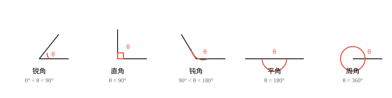

**特殊角关系**：

- **余角**：两个角之和为 $90^\circ$，则互为余角。
- **补角**：两个角之和为 $180^\circ$，则互为补角。
- **对顶角**：两条直线相交，相对的两个角相等。

> **直观理解（现实类比）**：
> - **余角**像拼图的两块——拼起来正好凑成一个直角($90^\circ$)。$30^\circ$ 和 $60^\circ$ 是常见的一对余角，就像钟面上 1 点整时分针与时针的夹角。
> - **补角**像敞开的书本——两页摊平合成一个平角($180^\circ$)。相邻的两块地砖拼起来就是一对补角。
> - **对顶角**像两根交叉的筷子——你夹起筷子交叉时，对面两个夹角永远一样大。剪刀张开时两侧的角也是对顶角。

#### 课堂问答

**老师**：角由两条**射线**组成，那我用两条线段相交，夹出的那个图形算不算角？

**学生**：算角，但要区分：角的本质是"公共端点 + 两侧张开的程度"，射线无端点只是为了保证角可以任意张合。线段相交处的夹角，取的正是这两条线所在射线所夹的角。

**老师（追问）**：对顶角为什么必然相等，能一句话讲透吗？

**学生**：因为对顶角各与同一个邻角互补：$\angle 1=180^\circ-\angle 3$、$\angle 2=180^\circ-\angle 3$，故 $\angle 1=\angle 2$。它靠的是补角定义加等量代换，与度数大小无关。

**老师（拓展）**：有了"角"这把尺，后面章节会用它量什么？

**学生**：会量垂直与平行：两线成 $90^\circ$ 叫垂直，同一截线下同位角相等叫平行。角的相等与互补，是平行线判定和多边形内角和的全部语言，一路通到第 8 章。

### 4.3 三角形 (Triangle)

**直觉与生活场景**：木匠钉三根木条成一个框，怎么推都推不垮；而四边形框一推就晃。你看桥梁的桁架、屋顶的钢架、自行车的车架、高压电塔——全都密密麻麻布满了三角形。**三角形是第一个值得深入研究的"闭合图形"，因为它是"只有直边"的图形里最刚硬、最基础的一种。** 任何一个多边形都可以切成若干个三角形来研究，所以三角形是其他一切多边形的"原子"。

**它要解决的问题**：把"三边、三角"这个看似简单的对象研究透——三条边能组成怎样的三角形？三个内角有什么关系？不同三角形之间如何比较大小、如何判定"一模一样"或"相似"？这些问题的答案，构成了后面全等、相似、勾股定理的起点。

**正式定义**：

| 符号 | 名称 | 含义 | 直观解释 |
|:---:|:---:|:---|:---|
| $\triangle$ | 三角形符号 | 表示一个三角形 | "三角形"的简写 |
| $ABC$ | 顶点标记 | 三角形的三个顶点 | 三个角的"名字" |

三角形是由三条线段首尾相连围成的封闭图形，记作 $\triangle ABC$。

**按角分类**：

- **锐角三角形**：三个内角均为锐角
- **直角三角形**：有一个内角为 $90^\circ$
- **钝角三角形**：有一个内角为钝角

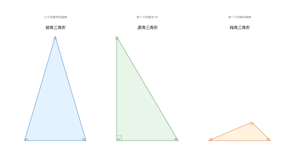

**按边分类**：

- **不等边三角形**：三边各不相等
- **等腰三角形**：有两边相等（腰），底边所对的角为顶角
- **等边三角形**：三边相等，三个内角均为 $60^\circ$

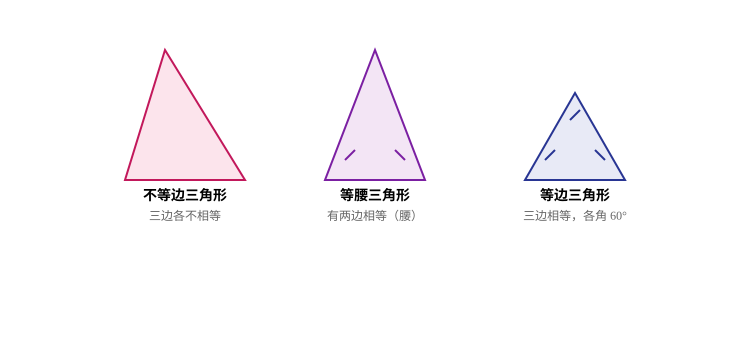

**三角形的重要线段**：

- **中线**：连接顶点和对边中点的线段。三条中线交于**重心**。
- **高线**：从顶点向对边（或延长线）作垂线。三条高线交于**垂心**。
- **角平分线**：平分内角的射线。三条角平分线交于**内心**。
- **中垂线**：垂直平分线段的直线。三条中垂线交于**外心**。

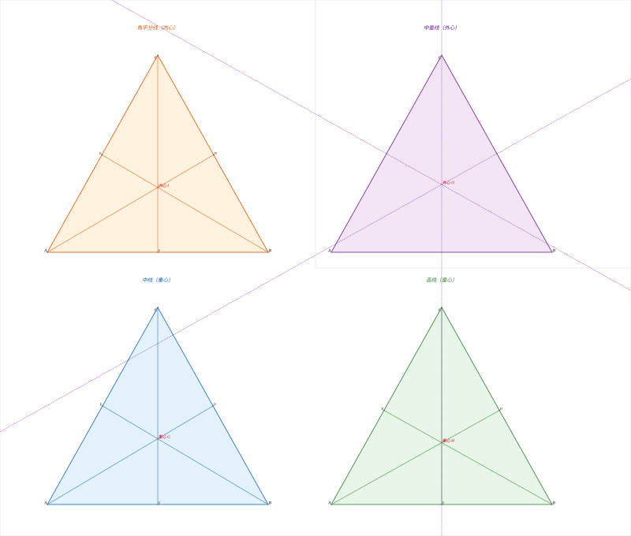

> **直观理解（现实类比）**：三角形的四条重要线段都指向一个"心"，这些心在现实中各有用处：
> - **重心**（中线交点）：是三角形的"平衡点"。用一根针顶住重心，三角形能水平平衡——就像杂技演员用杆子顶住盘子的中心。重心把每条中线分成 $2:1$ 的两段，靠顶点的部分更长。
> - **垂心**（高线交点）：是三个顶点向对边"垂直下落"的汇合点。锐角三角形的垂心在内部，直角三角形的垂心恰好在直角顶点，钝角三角形的垂心跑到外面——这像三个人分别从三个山顶向对面山脚垂直放绳子，绳子的交汇点会随山形变化位置。
> - **内心**（角平分线交点）：到三边距离相等，是三角形内切圆的圆心。就像在三角形地块里修一个圆形花坛，内心是能让花坛同时"贴住"三边的唯一位置。
> - **外心**（中垂线交点）：到三个顶点距离相等，是三角形外接圆的圆心。就像在三个村庄之间建一个水塔，外心是到三个村庄距离相等的位置。

> **解决了什么问题**：把三角形抽象成"点线面 + 线段"之后，我们就可以追问并回答三大类问题——**形状**（三角形内角各多少）、**大小**（边有多长、面积多大）、**关系**（两个三角形是否全等/相似）。这三类问题贯穿着整个平面几何。

#### 课堂问答

**老师**：你说三角形"最刚硬"，可凭什么三条边一定钉死唯一形状，四边形就不行？

**学生**：因为三边一旦给定，由 SSS 全等只能围出全等的一种形状，没有活动余量；四边形四边固定后还能像门一样摆动，自由度多了一个，所以会变形。

**老师（追问）**：那三条边随便多长都能围成三角形吗？

**学生**：不能，必须满足"两边之和大于第三边"。$a+b>c$ 若被破坏，两条短边就够不到一起；取等号时三点共线，退化成线段，三角形不存在。

**老师（拓展）**：为什么研究多边形要先研究三角形？

**学生**：因为任何 $n$ 边形从一个顶点连对角线，都能切成 $(n-2)$ 个三角形，内角和、面积、全等判定都可化整为零地借三角形的结论。三角形是多边形的"原子"。

### 4.4 四边形 (Quadrilateral)

**直觉与生活场景**：一扇窗户的边框、一本摊开的书本、一块地砖、一个镜框——都是四边形。四边形的"麻烦"在于它不稳定：四根木条钉成的框可以被推斜。但正因为它会变形，人们研究出各种"特化"——把所有的角掰成直角（矩形）、让四条边都一样长（菱形）、两者都要（正方形）——从而得到实用又稳定的形状。

**它要解决的问题**：四边形家族庞杂，需要一套"分类"和"性质"来理清：哪些是平行四边形？矩形、菱形、正方形之间是什么关系？各自的对边、对角、对角线有什么特殊性质？理清这个"家族树"，你就能一眼从图中抓出关键条件用于计算和证明。

**正式定义**：

四边形是由四条线段首尾相连围成的封闭图形。

**常见四边形**：

| 类型       | 定义                       | 性质                               |
| :--------- | :------------------------- | :--------------------------------- |
| 平行四边形 | 两组对边分别平行           | 对边相等、对角相等、对角线互相平分 |
| 矩形       | 有一个角是直角的平行四边形 | 对角线相等，四个角均为$90^\circ$ |
| 菱形       | 一组邻边相等的平行四边形   | 对角线互相垂直平分，各边相等       |
| 正方形     | 既是矩形又是菱形           | 所有边相等，所有角为$90^\circ$   |
| 梯形       | 只有一组对边平行           | 平行边称为上底和下底               |

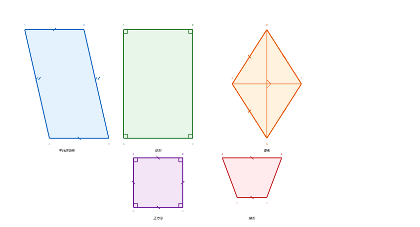

> **直观理解（现实类比）**：四边形家族是一个层层嵌套的"特权圈"：
> - **平行四边形**是最基础的特殊四边形——对边平行且相等，像一张被斜着推变形的长方形相框。它的对角线互相平分（在中心点交叉）。
> - **矩形**是"所有角都被掰正成 $90^\circ$"的平行四边形——像标准的窗户框、书本封面。对角线相等是它的额外特权。
> - **菱形**是"四条边都一样长"的平行四边形——像钻石的一面，对角线互相垂直且平分对角。
> - **正方形**是矩形和菱形的"完美结合体"——所有边等长、所有角为直角、对角线既相等又垂直，是四边形中对称性最高的一种，像棋盘格。
> - **梯形**只有一组对边平行——像常用的梯子，上下两条平行边是"底"。
>
> 这就像一个家族树：正方形 ⊂ 矩形 ⊂ 平行四边形 ⊂ 四边形；正方形 ⊂ 菱形 ⊂ 平行四边形 ⊂ 四边形。

> **解决了什么问题**：一旦认清了四边形家族树，做题时就知道"遇到矩形——对角线相等；遇到菱形——对角线垂直；遇到平行四边形——对角线互相平分"。这张树状分类图，是无数面积、对角线计算题的藏宝图。

#### 课堂问答

**老师**：正方形、矩形、菱形都在平行四边形里，为什么正方形要同时挂"矩形"和"菱形"两个身份？

**学生**：因为矩形管"角全为 $90^\circ$"、菱形管"边全相等"，二者各出一半条件。正方形原则上正是矩形与菱形的交，凑齐"边等 + 角直"，也解释了它的对角线为什么既相等又垂直。

**老师（追问）**：梯形的定义说"**只有**一组对边平行"，这个"只有"能省吗？

**学生**：不能省。若允许两组都平行，梯形就吞并了平行四边形。加上"只有"，是为了让家族树不重叠，也让 $S=\frac{(a+b)h}{2}$ 里上下底不等的多数情形不至于退化成矩形。

**老师（拓展）**：这套"平行四边形→矩形/菱形→正方形"的嵌套，和后面相似形有联系吗？

**学生**：有。判定一个四边形属于哪一支，靠的正是一组组"平行、相等、垂直"的条件；而这些条件在相似变换下被放缩或保持，正是后面对应边成比例、对应角相等的雏形。

### 4.5 圆 (Circle)

**直觉与生活场景**：车轮为什么要做成圆的？因为圆上**每一点到中心的距离都相等**——所以轮轴（中心）到地面的距离永远不变，车才走得平稳。硬币、披萨、钟表、齿轮，都靠这个"处处等距"的性质工作。圆是"对称之王"：它有无数条对称轴，绕中心转任意角度都与自己重合。

**它要解决的问题**：圆之外的一切多边形都有"角"，而圆的特殊之处在于它**没有角**，只有一个处处等距的"曲线边界"。要研究圆，就需要一套专门的量：圆心、半径、直径、弦、弧、圆心角、圆周角。它们让我们能追问"圆周角和圆心角有什么关系""直径有什么神奇之处"。

**正式定义**：

圆是平面上到定点（圆心）距离等于定长（半径）的所有点的集合。

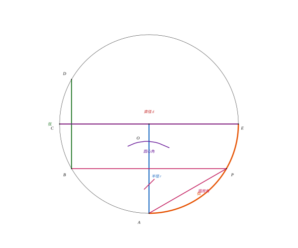

**圆的要素**：

- **圆心 $O$**：确定圆的位置
- **半径 $r$**：圆心到圆上任意一点的距离
- **直径 $d = 2r$**：过圆心且两端在圆上的线段
- **弦**：连接圆上任意两点的线段
- **弧**：圆上任意两点间的部分
- **圆心角**：顶点在圆心的角
- **圆周角**：顶点在圆上、两边与圆相交的角

> **直观理解（现实类比）**：圆的定义"到定点距离等于定长的所有点的集合"看似抽象，其实它描述的就是**圆规画圆的原理**——把圆规的针固定在圆心，铅笔尖到针尖的距离就是半径，铅笔尖旋转一周画出的轨迹就是圆。车轮、硬币、披萨、钟表表面，所有这些圆形物体都满足"边缘每一点到中心的距离相同"。这个性质让圆成为唯一一个"无论从哪个方向看都对称"的图形，也是轮子能平稳滚动的原因——车轴到地面的距离始终等于半径。

> **🧠 思考历程：圆周率 $\pi$ 是怎么被"追"出来的？**
>
> 圆的周长 $C$ 与直径 $d$ 之比总是一个固定常数 $\pi$，这个"固定"本身平平无奇，但人类为了把它算精确，花了两千多年。
>
> - **最早只需要"大约"**。古巴比伦人取 $\pi\approx 3$，埃及人用 $3\frac{1}{8}$，都够盖房子、算粮仓用了。那时候大家关心的不是"准"而是"够用"。
> - **阿基米德的"夹逼"（Archimedes，约公元前 250 年）**。真正让方法升级的是阿基米德：他把圆塞进正多边形的"夹层"里——内接一个多边形求"至少多少"，外切一个多边形求"最多多少"，让两者越来越挤向圆，从而**把 $\pi$ 夹在一薄一厚两层之间**。这是极限思想的萌芽，他借它得到 $\pi \in \left(\frac{223}{71}, \frac{22}{7}\right)$。
> - **祖冲之的"一步到位"（公元 5 世纪）**。中国数学家祖冲之沿用多边形法，把边数算到两万四千多边，得到领先世界近千年的身价：$\pi$ 在 $3.1415926$ 与 $3.1415927$ 之间，并给出约率 $\frac{22}{7}$ 与密率 $\frac{355}{113}$。**他靠的是惊人的耐心与细心，把每一条边都一丝不苟地算下去。**
> - **心路**：$\pi$ 的故事告诉我们：**一个数学常数是由无数次的"逼近"累积出来的，而不是一次顿悟**。今天你写"$\pi=3.14$"，背后是好几代人在几乎没有任何计算工具的条件下，用"画多边形、逐边算"这种笨办法，硬生生把精度一级一级顶上去的。真正优雅的，常常不是那个数，而是**人们为了摸到它而逼出来的耐心与巧思**。

> **解决了什么问题**：圆的相关量（半径、直径、弦、弧、圆心角、圆周角）让我们能把"算法则：只要抓到一个圆，就能用半径、弦、角的关系去做计算和证明"。第 8、9 节的圆周角定理、泰勒斯定理、垂径定理，全都是围绕"圆的对称与角的关系"展开的。

#### 课堂问答

**老师**：圆被定义成"到定点距离等于定长的点集"，为什么不用"圆规画出的封闭曲线"来定义？

**学生**：因为"画"依赖工具和手法，而"到圆心距离恒等于半径"是纯几何性质。定义要抓不变的本质：只要满足等距，无论怎么画出来都是同一个圆。

**老师（追问）**：弦和直径有什么区别，为什么要单独给直径一个名字？

**学生**：直径是**过圆心**的弦，是所有弦里最长的一条，$d=2r$。过圆心的特殊性让它把圆分成两个半圆、并成为对称轴，许多定理——泰勒斯、垂径——都非它不可。

**老师（拓展）**：圆周角和圆心角这套概念，会把圆引向哪里？

**学生**：引向第 8 章的圆周角定理与泰勒斯定理：同弧所对圆周角恒为圆心角的一半，直径所对圆周角为 $90^\circ$。圆里"角—弧—弦"的换算，是解析几何中圆的方程的前身。

### 4.6 全等与相似

**直觉与生活场景**：复印文件得到与原件"一模一样"的副本——这就是**全等**；一张照片放大缩小后形状不变、只是大小变化——这就是**相似**。地图与真实地形是相似的（比例尺就是相似比），同一模具生产出的零件彼此全等。生活中我们经常要判断"两个东西是否同款""一张图是不是另一张的放大版"，全等与相似就是给这两种直觉做出严格的数学定义。

**它要解决的问题**：当我们拿到两个三角形，怎么才能"不量完 6 个元素（3 边 3 角）"就断定它们全等或相似？——这引出了后面的判定定理（SSS、SAS、ASA、AAS、HL；AA、SAS、SSS）。全等与相似是把"叠起来比一比"的经验，变成"看少数几个条件就能下结论"的科学。

**正式定义**：

| 符号 | 名称 | 含义 | 直观解释 |
|:---:|:---:|:---|:---|
| $\cong$ | 全等号 | 两个图形形状大小完全相同 | "一模一样" |
| $\sim$ | 相似号 | 两个图形形状相同大小可不同 | "放大缩小版" |
| $\triangle ABC \cong \triangle DEF$ | 全等记法 | 三角形ABC与DEF全等 | 顶点按顺序对应 |
| $\triangle ABC \sim \triangle DEF$ | 相似记法 | 三角形ABC与DEF相似 | 对应角相等、边成比例 |

- **全等 (Congruence)**：两个图形形状和大小完全相同，可以完全重合。记作 $\cong$。
- **相似 (Similarity)**：两个图形形状相同但大小可能不同，对应边成比例、对应角相等。记作 $\sim$。

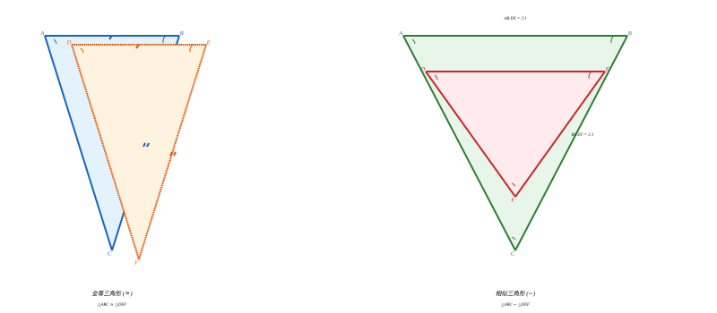

> **直观理解（现实类比）**：
> - **全等**像"双胞胎"——两个图形完全一模一样，叠在一起能严丝合缝地重合。复印一份文件得到的就是与原件全等的副本；同一模具生产出的零件彼此全等。
> - **相似**像"同款不同尺寸"——形状一样，大小可以不同。一张照片放大或缩小后与原图相似；同一品牌不同尺寸的电视机屏幕彼此相似；地图与实际地形也是相似关系（比例尺就是相似比）。
>
> 关键区别：全等要求所有对应边、对应角都相等；相似只要求对应角相等且对应边成比例。全等是相似比 $k=1$ 的特殊情况。

> **解决了什么问题**：全等给了我们"证明两条线段或两个角相等"的最有力的工具之一（只要找到一对全等三角形，对应部分必相等）；相似给了我们"用比例求未知边、用相似比求面积"的万能钥匙。这两个概念，是"用已知推未知"的发动机。

---

#### 课堂问答

**老师**：全等和相似只差"大小"，为什么不干脆用相似一个概念包住全等？

**学生**：因为两者保住的量不同。相似保形状、按比例放缩，长度会变；全等要求连长度都逐一对上，是相似比 $k=1$ 的特例。分开说，才能让"证线段相等"和"求比例"各用其器。

**老师（追问）**：为什么相似三角形的面积比是 $k^2$ 而不是 $k$？

**学生**：因为面积是二维量。长宽各放大 $k$ 倍，拼起来就放大 $k\cdot k=k^2$ 倍。同理体积是三维的，相似体体积比是 $k^3$——维度决定指数的幂次。

**老师（拓展）**：这两个概念怎么变成"少测几个元素就能判定"的定理？

**学生**：靠三角形被内部条件锁定。全等有 SSS、SAS、ASA、AAS、HL，相似有 AA、SAS、SSS；只要条件够，内角和、勾股、比例就把其余元素逼出来，不必量全六项。这正是第 8 章证明的起点。

## 5. 基本性质

> **本节解决的问题**：在为各图形建立"性质库"——线段与角、三角形、多边形、圆各有哪几条随手可用的基本结论？这些结论很多一眼就能看懂，但它们是后面所有定理证明的"砖瓦"。

### 5.1 线段与角的基本性质

**直觉在先**：两点之间，走哪条路最短？当然是拉一条直线——这就是"两点之间线段最短"。它太自然了，以至于我们把它当作不证自明的公理。而"从直线外一点到这条直线的所有线段中垂线段最短"，则是它最常用的翻版：你从公路边走到河边，垂直游过去的距离最短。

**基本性质**：
- 两点之间，线段最短。
- 过一点有且只有一条直线与已知直线垂直。
- 垂线段最短：从直线外一点到直线上各点的所有线段中，垂线段最短。

> **解决了什么问题**：这三条（尤其"垂线段最短"）是大量几何不等式和最短路径问题的起点；"过一点作唯一垂线/平行线"则是构造与证明里最常见的辅助动作。

#### 课堂问答

**老师**："两点之间线段最短"这么显然，为什么还值得像公理一样列出来？

**学生**：因为它是所有最短路径推理的地基，且无法由更基本的命题推出。把它作起点，才能让"三角形两边之和大于第三边"这类结论有根可依，而不是靠直觉喊出来。

**老师（追问）**："垂线段最短"和它是什么关系？

**学生**：是它的翻版。把直线外一点 $P$ 与直线上各点连成线段，最省距离的那条恰好垂直于直线；否则可沿斜线构造一个三角形，用"两边之和大于第三边"说明斜线段更长。

**老师（拓展）**：为什么"过一点有且只有一条垂线"这种唯一性这么重要？

**学生**：因为作图与证明都要"唯一确定"才敢下结论。若垂线有两条，作辅助线、定中点、找圆心都会失去确定性；唯一性保证每一步构造都指向同一个对象，这正是尺规作图讲究的底气。

### 5.2 三角形的基本性质

**基本性质**：
- **三角形三边关系**：任意两边之和大于第三边，任意两边之差小于第三边。
- **三角形外角定理**：三角形的外角等于与它不相邻的两个内角之和。
- 三角形具有**稳定性**——三边确定后，形状唯一确定。

> **直观理解（现实类比）**：
> - **三边关系**就是"两地之间走直线最短"——从 A 走到 B，再从 B 走到 C，总路程一定比直接从 A 到 C 远，所以 $AB+BC>AC$。这就是为什么GPS导航总是给你推荐直线段路线。
> - **三角形稳定性**是工程学的福音——三根木棍钉成三角形框架后，无论怎么用力推拉都不会变形；而四边形框架一推就垮。这就是为什么桥梁桁架、屋顶钢架、起重机吊臂全都布满三角形结构。自行车车架、高压电塔也都是三角形的天下。

> **解决了什么问题**：三边关系帮你判断"三条线段能否围成三角形"、决定第三边的取值范围；外角定理把"一个角"快速转成"两个角之和"；稳定性则回答"已知三边，三角形唯一确定"——这正是后面 SSS 全等判定能够成立的依据。

#### 课堂问答

**老师**：外角定理说外角等于不相邻两内角之和，它和"内角和 $180^\circ$"哪个更基本？

**学生**：内角和更基本，外角定理是它的推论。外角与相邻内角互补，而相邻内角又等于 $180^\circ$ 减去另两角，代换即得。有了它，"一个角拆成两个角"就有了快捷通道。

**老师（追问）**：三边关系里"两边之差小于第三边"能省掉吗？

**学生**：不能，它是"两边之和大于第三边"的等价改写——对三条边轮换使用即可。$|a-b|<c<a+b$ 合起来才给出第三边的合法区间，少了任一半边，就会出现围不拢或退化共线。

**老师（拓展）**：三角形的"稳定性"在几何证明里兑现成了什么？

**学生**：兑现成 SSS 全等判定。三边确定则形状唯一、无法变形，所以"边边边对应相等"就能断定两个三角形全等。工程上的桁架抗变形，和这条判定，是同一件事的两种说法。

### 5.3 多边形内角和

$n$ 边形的内角和为：

$$
S = (n - 2) \times 180^\circ
$$

> **直观理解（现实类比）**：想象你站在 $n$ 边形的一个顶点，向所有"不相邻"的顶点连线（画对角线），这会把 $n$ 边形切成 $(n-2)$ 个三角形。每个三角形内角和是 $180^\circ$，所以总和是 $(n-2)\times180^\circ$。这像切披萨——从一块披萨的一个顶点下刀，切到所有非相邻顶点，得到的全是三角形切片。

> **解决了什么问题**：内角和公式让我们只要知道"几边形"，就能立刻算出内角总和，也能反过来"由内角推出边数"——这是多边形题目的出入口。

#### 课堂问答

**老师**：$S=(n-2)\times 180^\circ$ 里的 $(n-2)$ 是哪冒出来的，凭什么不是 $n$？

**学生**：它来自"从同一顶点连对角线"。$n$ 个顶点里，去掉自己和相邻的两个，能连出 $n-3$ 条对角线，把多边形切成 $n-2$ 个三角形，每个贡献 $180^\circ$。三角形的个数就是 $n-2$。

**老师（追问）**：那外角和呢，为什么它跟边数无关，恒为 $360^\circ$？

**学生**：因为每绕多边形一圈，方向恰好旋转一周，合计 $360^\circ$，与有几条边无关。内角和随 $n$ 增长，外角和却纹丝不动，这对互补正是定义造成的。

**老师（拓展）**：这个公式和"三角形是多边形原子"这句话如何呼应？

**学生**：全部推导只用到"切成三角形 + 内角和 $180^\circ$"，说明 $n$ 边形的内角和完全是三角形结论的搬运。到正多边形与圆，边数 $n\to\infty$ 时内角趋于 $180^\circ$，正是"多边形逼近圆"的思想。

### 5.4 圆的对称性

圆是轴对称图形（任何直径所在直线都是对称轴），也是中心对称图形（圆心是对称中心）。

> **直观理解（现实类比）**：圆是"对称之王"——它有**无穷多条对称轴**（每条直径都是），而三角形最多 3 条、矩形只有 2 条。把圆沿任何一条直径对折，两半都能完全重合，就像把披萨沿过中心的任意一刀切开，两半总是一模一样。把圆绕圆心旋转任意角度（哪怕是 $1^\circ$ 或 $0.001^\circ$），它都和原来重合——这就是为什么车轮、齿轮、钟表都做成圆形：旋转任何角度都不影响功能。

> **解决了什么问题**：圆的对称性让我们可以放心地"沿直径对折比较两半"——这正是垂径定理（第 9 节）和"等弦对等弧"等结论背后共同的根据。

---

#### 课堂问答

**老师**：任何直径都是对称轴——为什么这句话对圆成立，对正 $n$ 边形却只在少数几条线上成立？

**学生**：因为对称轴要求折过去后图形与自身重合。圆到圆心处处等距，任意过圆心的直线都把圆等分；正 $n$ 边形只有过顶点或边中点的少数方向才重合，所以对称轴数目有限。

**老师（追问）**：轴对称之外，圆还是中心对称图形，这两条性质分别在哪儿派上用场？

**学生**：轴对称（沿直径对折）支撑垂径定理：折后弦两半重合，故 $AE=EB$。中心对称（绕圆心转任意角）支撑"等弦对等弧"和旋转不变性，让圆无论转多少度都还是它自己。

**老师（拓展）**：如果换成椭圆，对称性会损失什么？

**学生**：椭圆只剩两条对称轴，绕中心也不再旋转对称。正是圆这种"无穷多对称轴 + 任意角旋转对称"的极强对称性，才让车轮平稳、齿轮啮合、钟表指针匀速——对称越丰富，可用的性质越多。

## 6. 专题一：基本元素的性质——中点 · 中垂线 · 角平分线 · 高线 · 中线

> **本节解决的问题**：前面的核心概念里，三角形提到了中线、高线、角平分线、中垂线这四条"重要线段"。它们到底是什么、有什么关键性质、在现实里各有什么用？本节把它们集中讲透，为你提供一套"基本元素工具箱"。

### 6.1 中点 (Midpoint)

**直觉与生活场景**：裁判要把一根跳绳从中间分成相等的两半，就是为了使两半一样长；弓手要找弓弦的中点以保持平衡。几何里，"把线段分成两段相等"的位置就叫**中点**。

**正式定义**：把一条线段平分成长度相等的两段的点，叫做这条线段的**中点**。若 $M$ 是线段 $AB$ 的中点，则 $AM = MB = \dfrac{1}{2}AB$。

**关键性质**：线段有且仅有一个中点；中点把线段一分为二。

> **解决了什么问题**：有了中点，才能定义中线、构造完美对称的图形，也才能说清"平均分配一段长度"这件事——它是"对称"在长度上的化身。

#### 课堂问答

**老师**：一条线段的中点为什么只有一个，而不是可以有好几个？

**学生**：因为中点是满足 $AM=MB$ 且落在 $AB$ 上的点，设 $AB$ 长为 $L$，则 $AM=L/2$ 是唯一数值。长度确定，位置就被钉死，故中点有且仅有一个。

**老师（追问）**：如果只要求 $AM=MB$，不限定 $M$ 在 $AB$ 上，会有几个点？

**学生**：会有无穷多个，它们全落在 $AB$ 的中垂线上，构成以 $A,B$ 为端点的等距点集。要唯一，就必须补上"$M$ 在线段 $AB$ 上"这个条件——这也正是中垂线概念的由来。

**老师（拓展）**：中点这把"平均长度"的尺，后面会被谁继续用？

**学生**：被中线和重心接着用。中线连顶点与对边中点，三条中线交于重心，且重心把每条中线分成 $2:1$——中点一旦被赋予"平分"的含义，就长成了平衡与重心这套理论。

### 6.2 中垂线（垂直平分线, Perpendicular Bisector）

**直觉与生活场景**：要在两个村庄之间找一处"到两村距离相等"的取水点，这个点应该落在连接两村的线段的正中央、且垂直于这条线段的那条线上——这就是**中垂线**。它像一个精准的"对称轴"。

**正式定义**：过线段中点且垂直于该线段的直线，叫这条线段的**中垂线**（垂直平分线）。

**关键性质**：**中垂线上的任意一点，到线段两端点的距离相等**；反之，到线段两端距离相等的点，必在这条线段的中垂线上。

> **为什么**：设 $M$ 是 $AB$ 中点，$AB\perp l$，在 $l$ 上取任意点 $P$，则 $PA^2 = PM^2 + AM^2$，$PB^2 = PM^2 + MB^2$，因 $AM=MB$ 得 $PA=PB$。这就是"等距离"的底气。

> **解决了什么问题**：中垂线是"找等距点"的工厂。找外接圆圆心（到三顶点等距）、找两村之间到两处等距的点，都靠它。

#### 课堂问答

**老师**：中垂线上的点到两端等距，反过来"到两端等距的点在中垂线上"，两个方向都对，为什么必须两边都证？

**学生**：正向管"已知在线上推等距"，逆向管"已知等距推位置"。逆命题把等距点**锁定成一条直线**，少了它就无法由 $PA=PB$ 断定 $P$ 的位置；两向合起来才让中垂线成为等距点的全集。

**老师（追问）**：证明 $PA=PB$ 时用到 $PA^2=PM^2+AM^2$，这一步凭什么成立？

**学生**：因为中垂线垂直于 $AB$，$\triangle PMA$ 与 $\triangle PMB$ 都是直角三角形，用勾股定理展开，再代入 $AM=MB$ 即可。它把"等距"化归为勾股定理，是距离问题里最常见的套路。

**老师（拓展）**：中垂线的"等距点工厂"身份，如何直接造出外心？

**学生**：三角形三边的中垂线两两相交于一点 $O$，由性质得 $OA=OB=OC$，故 $O$ 是外接圆圆心。若 $O$ 在三角形内部，则该三角形为锐角三角形——这正是第 6 节挑战题的依据。

### 6.3 角平分线 (Angle Bisector)

**直觉与生活场景**：把一块饼从顶点切开，让两半"张角完全一样"，这条切痕就是**角平分线**——它均匀地分配一个角。

**正式定义**：把角分成两个相等角的射线，叫做这个角的**角平分线**。

**关键性质**：**角平分线上的点到角两边的距离相等**；反之，角的内部到两边距离相等的点在角平分线上。

> **解决了什么问题**：角平分线是"找等距边"的工具，也是内切圆圆心（内心）的基础——内心正是三条角平分线的交点，到三边等距。

#### 课堂问答

**老师**：角平分线上的点到两边等距，这里的"距离"为什么指垂线段长，而不是随便连一条线？

**学生**：因为"点到直线的距离"定义就是垂线段长度，它才是最短的那个量。若取斜线段，离角越远数值越大，就不存在"等距"这一稳定性质了。

**老师（追问）**：由"到两边等距"能反推点在角平分线上吗？为什么要强调"角的内部"？

**学生**：能，但必须限定在角的内部。内部每一点到两边的垂足都落在边上；外部的等距点落在角平分线的反向延长线上，强调内部是为了让逆命题精确指向那条射线而非整条直线。

**老师（拓展）**：把三条角平分线放在一起，会得到什么？

**学生**：它们交于一点——内心，且到三边等距，恰好是内切圆的圆心。这与中垂线交出外心形成对称的双子：一个贴三边，一个过三顶点。

### 6.4 高线 (Altitude) 与 6.5 中线 (Median)

**直觉与生活场景**：量一块三角形地的面积时，你需要"从顶点垂直落到对边"的那条长度——这就是**高**；要让一块板子在顶点下保持平衡，你要找到连接顶点与对边中点的**中线**。

**正式定义**：
- **高线**：从顶点向对边（或对边延长线）所作的垂线段。
- **中线**：连接顶点与对边中点的线段。

**关键性质**：
- 三条高线交于一点——**垂心**。
- 三条中线交于一点——**重心**，且重心把每条中线分成 $2:1$。
- **直角三角形斜边上的中线等于斜边的一半**（这正是"直角三角形的外心是中点"、泰勒斯定理的逆用）。
- 三角形的三条中线把三角形分成面积相等的六小块（重心起着"平衡"作用）。

> **直观理解（现实类比）**：高像"垂直落下的影子"，用来测面积；中线连接"顶与底的中点"，用来找重心找平衡。木工测高、杂技顶盘用的分别是它们。

> **表：基本元素速查**

| 基本元素 | 定义 | 关键性质 | 相交于 |
| :--- | :--- | :--- | :--- |
| 中线 | 顶点到对边中点的线段 | 交点把每条中线分成 $2:1$ | 重心 |
| 高线 | 顶点向对边的垂线段 | 一点之交点随角型移动（直角→直角顶点） | 垂心 |
| 角平分线 | 平分内角的射线 | 线上点到角两边距离相等 | 内心 |
| 中垂线 | 垂直平分线段的直线 | 线上点到线段两端距离相等 | 外心 |

#### 课堂问答

**老师**：高线被定义成"垂线段"，可钝角三角形的高会落到对边延长线上，这还算高吗？

**学生**：算。高的本质是"顶点到对边所在直线的垂线段"，延长线只是对边的延伸，垂足在外不影响它是高。定义里写"或其延长线"，就是为了把三种三角形统一起来。

**老师（追问）**：重心把每条中线分成 $2:1$，这个比例是怎么来的？

**学生**：可由面积比推出：一条中线把三角形分成两个等积三角形，三条中线把三角形分成六个等积小块，重心到顶点的距离是到对边中点距离的两倍，合起来正是 $2:1$。它不是量出来的，而是"等底同高"逼出来的。

**老师（拓展）**：为什么"直角三角形斜边中线等于斜边一半"能当泰勒斯定理的逆用？

**学生**：因为斜边中点 $M$ 满足 $MA=MB=MC$，即它是外心，于是 $MC=\frac12 AB$。反过来，当某点到三角形三顶点等距且位于斜边中点时，该角必为直角——中线与泰勒斯定理互为镜像。

### 6.6 本专题针对性练习

> 答案见「15.4 专题练习答案」。

**基础题**：
1. $M$ 是线段 $AB$ 的中点，$AB = 14$，求 $AM$。
2. 点 $P$ 在线段 $AB$ 的中垂线上，$AB = 10$，$PA = 8$，求 $P$ 到 $AB$ 的（垂直）距离。
3. 点 $D$ 在 $\angle AOB$ 的平分线上，过 $D$ 作 $DE \perp OA$、$DF \perp OB$，已知 $DE = 5$，求 $DF$。

**进阶题**：
4. 证明：到线段两端距离相等的点，必在这条线段的中垂线上。
5. $\triangle ABC$ 中，$AD$ 是 $BC$ 边上的中线且 $BC = 12$、$AD = 6$，问 $\angle A$ 是多少度？并说明理由。
6. 直角三角形两条直角边为 $5$ 和 $12$，求斜边上的中线长。

**挑战题**：
7. 已知 $\triangle ABC$ 中三边垂直平分线交于 $O$，且 $O$ 在 $\triangle ABC$ 内部。判断 $\triangle ABC$ 是锐角、直角还是钝角三角形，并说明理由。（提示：外心到三顶点距离相等）

---

#### 课堂问答

**老师**：这几道题里中点、中垂线、角平分线、中线都出现了，做题时该怎么先下手区分它们？

**学生**：看题目给的是"等长""等距"还是"平分角/边"。给 $AM=MB$ 用中点；给 $PA=PB$ 用中垂线；给角被平分用角平分线性质；给顶点连对边中点用中线，必要时借重心 $2:1$。

**老师（追问）**：第 5 题说 $AD$ 是 $BC$ 上的中线且 $AD=\frac12 BC$，凭什么能断定 $\angle A=90^\circ$？

**学生**：因为 $D$ 是 $BC$ 中点且 $AD=\frac12 BC$，即 $AD=BD=CD$，$D$ 到三顶点等距，是外心。于是 $BC$ 是直径，由泰勒斯定理 $\angle A=90^\circ$。

**老师（拓展）**：第 3 题两个垂足距离相等，和第 6 题求斜边中线，背后是同一把工具吗？

**学生**：是。第 3 题靠角平分线的"到两边等距"，$DF=DE=5$；第 6 题靠"斜边中线等于斜边一半"，先由勾股得斜边 $13$，中线即 $6.5$。两题一个用等距性质，一个用中点性质，正是本专题的两条主线。

## 7. 专题二：多边形面积公式的来源

> **本节解决的问题**：面积公式（三角形 $\tfrac12 bh$、平行四边形 $bh$、梯形 $\tfrac{(a+b)h}{2}$）是谁想出来的？它们为什么成立？本节把"面积公式从哪来"讲清楚——你会发现它们其实是从**矩形面积**这一个起点推导出来的，顺序环环相扣。

### 7.1 从"数格块"出发：为什么先有矩形面积

**直觉与生活场景**：量一块长方形地毯，你只需数"一行有几块小方砖、共有几行"——于是面积 $=$ 长 $\times$ 宽。**矩形面积是被我们当作不证自明起点的：$S = \text{长} \times \text{宽}$。** 一切多边形面积公式都以它为基础。

> 古希腊与古代丈量者正是靠"把多边形切成矩形/三角形拼一拼"来算田亩面积的。**"切割 + 拼合 + 数面积"是面积学的原始法宝**，到今天仍是证明面积公式的思路。

#### 课堂问答

**老师**：为什么面积要从矩形起步，而不能一上来就给三角形公式？

**学生**：因为矩形面积 $S=\text{长}\times\text{宽}$ 可直接由"数方格"得到，是最不需要证明的起点。有了它，其他图形都可以通过切割、拼补化归成矩形，公式才有处可推。

**老师（追问）**：那"数格块"这个方法对边长为无理数的矩形还灵吗？

**学生**：不灵，格子数不完整。但面积公式作为"长×宽"的代数式仍可用，只是从"数格子"升级为符号运算。这说明格块只是直觉来源，公式的真身是乘法结构。

**老师（拓展）**："切割 + 拼合 + 数面积"这套原始法宝，后面还在哪出现？

**学生**：贯穿整个第 7 节：平行四边形割补成矩形、三角形补成平行四边形、梯形拼成平行四边形，乃至第 10 节赵爽弦图证勾股，全是它的回声。

### 7.2 平行四边形面积 $S = bh$

**直觉**：把一个平行四边形沿一条高切成两块，把左边的三角补到右边，就拼成了一个长 $b$、宽 $h$ 的矩形。

**来源**：平行四边形面积 $=$ 拼成的矩形面积 $= b \times h$。

$$
S_{\text{平行四边}} = b h
$$

#### 课堂问答

**老师**：平行四边形剪一刀再拼成矩形，图形变了，为什么面积就一定没变？

**学生**：因为"割—移—拼"只改变位置不改变形状与大小，剪下的那块被原样平移过去，面积是平移不变量。所以拼出的矩形面积等于原平行四边形面积。

**老师（追问）**：这里的高 $h$ 必须是竖直方向吗，取斜的算不算？

**学生**：高必须垂直于所选的底 $b$，是与底垂直的那条。面积 $S=bh$ 里底和高是互相垂直的一对；若用斜边长就会偏大，因为矩形化后宽度正好等于垂直高。

**老师（拓展）**：平行四边形面积不写成"邻边之积"，和后面向量有什么关系？

**学生**：因为邻边乘积只对矩形（夹角 $90^\circ$）成立。一般地 $S=ab\sin\theta$，正是向量叉积模的二维雏形；夹角越斜，$\sin\theta$ 越小，面积越被压扁。

### 7.3 三角形面积 $S = \tfrac12 bh$

**直觉**：任意一个三角形，都可以补成与它同底同高的平行四边形（作一条对角线的另一份），三角形恰好是对角线把平行四边形分成的两半之一，所以面积是平行四边形的一半。

**来源**：

$$
S_{\triangle} = \tfrac12 S_{\text{平行四边}} = \tfrac12 b h
$$

#### 课堂问答

**老师**：三角形为什么要"乘 $\tfrac12$"，能不能直接说是底乘高？

**学生**：因为一个三角形恰好是与它同底同高平行四边形的一半。补一个全等副本，对角线把平行四边形分成两个全等三角形，所以 $S_{\triangle}=\tfrac12 bh$，那个 $\tfrac12$ 是有出处的。

**老师（追问）**：同一个三角形换一条底来算，高变了，面积会变吗？

**学生**：不变。不管选哪条边作底，$bh$ 恒等于 $2S$：$\tfrac12 b_1h_1=\tfrac12 b_2h_2$ 都等于同一个面积，这正说明面积是三角形固有的量，与选哪条底无关。

**老师（拓展）**："补成平行四边形"这个动作，在其他图形里还用过吗？

**学生**：用过。梯形补成平行四边形（两个全等梯形）、多边形剖成三角形，都是"补/割到熟悉的图形再套公式"。化归思想在面积学里无处不在。

### 7.4 梯形面积 $S = \frac{(a+b)h}{2}$

**直觉**：两把相同的一模一样的梯形可以拼成一个平行四边形（把一条腰对齐、颠倒一个），这个平行四边形的底等于上下底之和 $a+b$，高不变。

**来源**：

$$
S_{\text{梯形}} = \tfrac12 \times (a+b) \times h = \frac{(a+b)h}{2}
$$

**中位线版**：梯形的中位线长 $m = \frac{a+b}{2}$，所以 $S = mh$（梯形面积 $=$ 中位线 $\times$ 高）。这解释了习题里"面积 $=$ 中位线 × 高"这一类结论。

#### 课堂问答

**老师**：梯形面积里出现"$(a+b)$ 的一半"，这个平均的底是哪来的？

**学生**：来自"两个全等梯形拼成一个平行四边形"。拼好后底为 $a+b$、高仍为 $h$，平行四边形面积 $(a+b)h$，梯形占一半，故 $S=\frac{(a+b)h}{2}$。

**老师（追问）**：那中位线 $m=\frac{a+b}{2}$ 和这个公式有什么必然联系？

**学生**：中位线正好等于上下底的平均，所以 $S=mh$——梯形面积等于中位线乘高。这是把两个底合成为一个平均底的自然结果，也解释了很多习题里"面积等于中位线乘高"的结论。

**老师（拓展）**：若上底缩到与下底相等，梯形公式会塌缩成什么？

**学生**：$a=b$ 时 $S=\frac{2ah}{2}=ah$，退化成平行四边形面积；若再让一条腰垂直，就是矩形。梯形公式是含参数的推广，平行四边形是它的特例。

### 7.5 同高三角形面积比等于底之比

**直觉**：底和高相同，面积就相同；同一条高线上，底越长面积越大，且成正比。

**来源**：设两个三角形同高 $h$，底分别为 $b_1,b_2$，则 $S_1:S_2 = \tfrac12 b_1h:\tfrac12 b_2h = b_1:b_2$。这个小小的结论，是后面"内心分出的三个小三角形面积之比等于三边之比"等众多比例的肯綮所在。

> **解决了什么问题**：把面积公式还原成"矩形→平行四边形→三角形→梯形"的推理链之后，你就不用死记四条公式——只要你记得矩形面积，其余都能随手推出。这种"用最简单的起点推出一串结论"的品格，正是欧几里得风格的浓缩。

#### 课堂问答

**老师**：为什么"同高"就能保证面积比等于底之比，而不必先算各自面积？

**学生**：因为 $S_1:S_2=\tfrac12 b_1h:\tfrac12 b_2h$，公共的 $\tfrac12 h$ 被约掉，只剩 $b_1:b_2$。高一旦相同就成公因子，比例由底单独决定。

**老师（追问）**：如果两个三角形不同底也不同高，面积比还能用底比吗？

**学生**：不能。此时 $S_1:S_2=b_1h_1:b_2h_2$，高也必须参与。只有"同高"或"同底"这一条件，才能把其中一个因子消去，把问题降成单变量。

**老师（拓展）**：这条小结论在证明题里常被怎么用？

**学生**：常用来"用长度比换面积比"。比如中线把三角形分成两个等积三角形（同高、底相等），重心分出的六块等积、内心连三边得三块面积比等于三边比，都靠它。

### 7.6 本专题针对性练习

> 答案见「15.4 专题练习答案」。

**基础题**：
1. 平行四边形的底为 $9$、高为 $5$，求面积。
2. 三角形的底为 $8$、高为 $6$，求面积。
3. 梯形上底 $3$、下底 $7$、高 $4$，求面积。

**进阶题**：
4. 用"把梯形补成平行四边形"的方法，推导梯形面积公式（写出过程）。
5. 一个等腰梯形的上底 $6$、下底 $14$、高 $4$，求面积。
6. 三角形 $ABC$ 中，$M$ 是 $BC$ 边上的中点，证明：$S_{\triangle ABM} = S_{\triangle ACM}$。

**挑战题**：
7. 在 $\triangle ABC$ 中，点 $D$、$E$ 把边 $BC$ 三等分，证明：$\triangle ABD$、$\triangle ADE$、$\triangle AEC$ 的面积相等。（提示：它们同高）

---

#### 课堂问答

**老师**：第 6 题要证 $S_{\triangle ABM}=S_{\triangle ACM}$，看到 $M$ 是 $BC$ 中点应当立刻想到什么？

**学生**：想到"同高三角形面积比等于底之比"。$BM=MC$，且两块都以 $A$ 到 $BC$ 的距离为高，故面积比 $=BM:MC=1:1$，两块相等。

**老师（追问）**：第 7 题把 $BC$ 三等分，三个小三角形面积为什么也相等？

**学生**：同一个道理，它们同高（顶点都是 $A$），底分别为 $BC$ 的三等份，$BD=DE=EC$，于是面积比等于底比 $=1:1:1$。同高是这里唯一的关键。

**老师（拓展）**：这种"等分底就等分面积"的思路，还能用在什么图形上？

**学生**：可用在任意多边形：从一个顶点连到对边各等分点，就把面积按底的比例切开。它也能反过来用——已知面积比去反推底的分点，是证明共线、定点的常用手段。

## 8. 定理与证明

> **本节解决的问题**：前面备齐了"对象"（第 4 节）和"基本性质"（第 5~7 节），现在进入平面几何的心脏——八条定理。每一条我们都遵循「生活直觉 → 要解决的问题 → 定理 → 证明 → 例题」的节奏，让你不但会背结论，更看得懂证明为什么那样走。

### 8.1 定理 1：三角形内角和定理

> **定理**：三角形的三个内角之和等于 $180^\circ$。

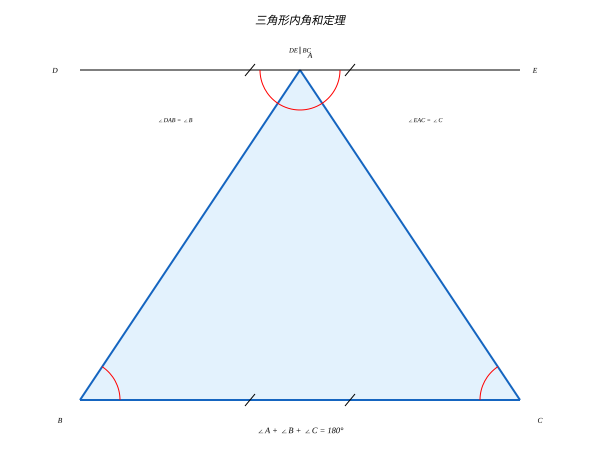

**证明**：

设 $\triangle ABC$，过点 $A$ 作直线 $DE \parallel BC$。

$$
\begin{array}{c}
\text{ } \\
\because DE \parallel BC \\
\therefore \angle DAB = \angle B \quad (\text{两直线平行，内错角相等}) \\
\angle EAC = \angle C \quad (\text{两直线平行，内错角相等}) \\
\because \angle DAB + \angle BAC + \angle EAC = 180^\circ \quad (\text{平角为 } 180^\circ) \\
\therefore \angle B + \angle BAC + \angle C = 180^\circ
\end{array}
$$

- 第 1 步：作辅助线 $DE \parallel BC$，目的是构造一组内错角，把三角形的三个角"搬"到同一条直线上。
- 第 2 步（第 1 个等号）：由"两直线平行，内错角相等"，把 $\angle B$ 替换为 $\angle DAB$，目的是把角从三角形内部转移到直线上。
- 第 3 步（第 2 个等号）：同理，把 $\angle C$ 替换为 $\angle EAC$，目的是让三个角都落在直线 $DE$ 上。
- 第 4 步（第 3 个等号）：利用"平角为 $180^\circ$"，把三个角加起来，目的是把几何关系转化为数量关系。
- 第 5 步（结论）：把替换后的角代回，得到三角形内角和公式，目的是完成从辅助线到原三角形的逻辑闭环。

即 $\angle A + \angle B + \angle C = 180^\circ$。

> **直观理解（现实类比）**：把三角形的三个角"剪下来"拼在一起，它们总能拼成一个完美的半圆（平角 $180^\circ$）。你可以拿一张纸剪个三角形，撕下三个角，然后把三个顶点对齐拼在一起——无论是锐角、直角还是钝角三角形，结果都一样。这就像三块形状各异的拼图碎片，碰巧总能拼成同一条直线。

> **🧠 思考历程：$180^\circ$ 背后藏着"尺规做平行的执念"**
>
> "三角形内角和是 $180^\circ$"人人会说，但它其实是建立在一条古老却又悬而未决的公设之上的。
>
> - **最早的"丈地直觉"**。古埃及、巴比伦人测量田地时早就知道，把一个三角形的三个角拼起来，总能拼成半圈——这个"碰巧"在土里被反复确认。但那时它只是"经验"，没人追问"为什么一定如此"。
> - **给出证明，却留下一个"尾巴"**。欧几里得在《几何原本》里给出了证明：过顶点作对边的一条平行线，利用"内错角相等"，把三个角搬到同一条直线上——这正是本节证明用辅助线的由来。但关键在于，他的证明悄悄用到了**第五公设（平行公设）**：即"过直线外一点恰有一条平行线"。
> - **为什么这是个"震撼"**。因为平行公设不像其他公设那样"一眼为真"，后人花了两千多年试图证明它，都失败了。直到 19 世纪，人们终于想通：**如果把"那一条"换成"无数条"或"一条都没有"，照样能建出一套自洽的几何**——这就是非欧几何（罗巴切夫斯基、黎曼）。而"内角和是否是 $180^\circ$"也因此成了"你身处哪种几何"的检测器：在球面上，三角形的内角和会**大于** $180^\circ$！
> - **心路**：三角形内角和是最平凡也最容易被忽略的一条定理，但它的证明"赖"在平行公设上，而平行公设又牵引出整个非欧几何。它提醒你：**一个看似理所当然的常数，往往因为某个基础假设而成立；换一个假设，答案可能完全变样。** 你剪角拼纸得到的 $180^\circ$，其实是一个更宏大故事的注脚。

#### 🎬 动画演示：三角形内角和等于 180°

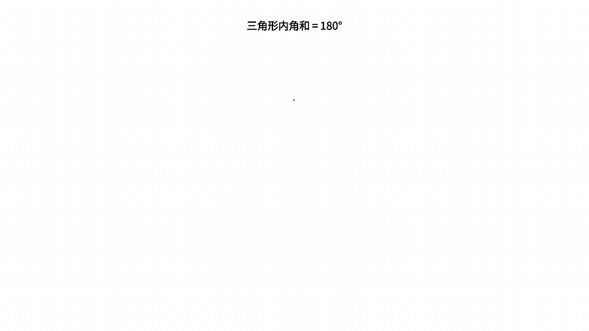

> 这个动画直观展示了任意三角形的三个内角拼在一起正好构成一个平角，即内角和恒等于 $180^\circ$。它通过动画的方式帮助理解本节核心概念。

**示例**：在 $\triangle ABC$ 中，若 $\angle A = 50^\circ$，$\angle B = 65^\circ$，求 $\angle C$。

解：$\angle C = 180^\circ - 50^\circ - 65^\circ = 65^\circ$，故该三角形为等腰三角形。

---

#### 课堂问答

**老师**：证明里作 $DE\parallel BC$ 是关键，为什么非要作这条平行线？

**学生**：因为要把三个分散的角搬到同一条直线上。平行给出内错角相等 $\angle DAB=\angle B$、$\angle EAC=\angle C$，三个角便拼成直线 $DE$ 上的平角，$180^\circ$ 就自然出现了。

**老师（追问）**：这个证明悄悄用了哪条公设，换掉它会怎样？

**学生**：用了平行公设（过直线外一点恰有一条平行线）。在球面几何里这条公设失效，三角形内角和会**大于** $180^\circ$；在双曲几何里则小于 $180^\circ$。所以这个 $180^\circ$ 取决于你选哪种几何。

**老师（拓展）**：内角和定理和后面的多边形内角和怎么衔接？

**学生**：$n$ 边形从一个顶点连对角线切成 $n-2$ 个三角形，内角和就是 $(n-2)\times180^\circ$。多边形的结论完全建立在三角形这一条之上，"三角形是多边形原子"在这里被兑现。

### 8.2 定理 2：勾股定理

> **直觉与生活场景**：古埃及人盖金字塔时，只用一个边长比为 $3:4:5$ 的绳圈，就能"拉出"一个笔直的直角。你注意到没有：$3^2+4^2=9+16=25=5^2$。**直角三角形的两条直角边的平方和，居然总等于斜边的平方**——这就是勾股定理，世界上被各文明重复发现最多的定理之一。

> **定理**：在直角三角形中，两条直角边的平方和等于斜边的平方。
>
$$
a^2 + b^2 = c^2
$$
>
> 其中 $a, b$ 为直角边，$c$ 为斜边。

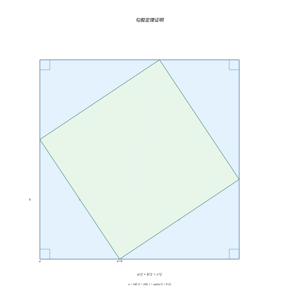

**几何证明（面积法）**：

构造一个边长为 $a + b$ 的大正方形，将其分割为两种方式：

**方式一**：四个全等的直角三角形（直角边 $a, b$，斜边 $c$）围成一个边长为 $c$ 的小正方形。

大正方形面积 = $4 \times \frac{1}{2}ab + c^2 = 2ab + c^2$

**方式二**：四个全等的直角三角形拼成两个矩形。

大正方形面积 = $(a+b)^2 = a^2 + 2ab + b^2$

两种方式计算的是同一个大正方形的面积，因此：

$$
a^2 + 2ab + b^2 = 2ab + c^2
$$

- 第 1 步：列出两个面积表达式，目的是用不同的分割方式表示同一个大正方形的面积。
- 第 2 步（等号）：令两种算法相等，目的是建立关于 $a, b, c$ 的方程。

化简得：

$$
a^2 + b^2 = c^2
$$

- 第 3 步：两边同时减去 $2ab$，目的是消去交叉项，得到勾股定理的标准形式。

> **直观理解（现实类比）**：想象把直角三角形的三条边分别向外**铺三块正方形地板**。勾股定理说的是：**两块直角边正方形能拼出的面积，恰好等于斜边那块正方形的面积**。比如 $a=3, b=4$，两块正方形面积是 $9+16=25$，正好等于斜边 $5$ 的正方形面积 $25$。
>
> 更深一层：$a^2, b^2, c^2$ 可以不是"正方形面积"，而是"以三条边为边的**任意相似图形**的面积"——比如三个半圆、三座相似的小山。只要相似，它们的面积之比都是 $a^2:b^2:c^2$，所以**勾股定理其实是"直角意味着 $a^2+b^2=c^2$ 这个恒定的比例关系"**。这解释了为什么它能推广成"余弦定理"（非直角时右边要减去 $2ab\cos C$）。

> **🧠 思考历程：勾股定理，一门全世界都"各自发现一遍"的定理**
>
> 这大概是数学史上被不同文明重复发现次数最多的一条定理，而它最初的"发现"多半是被地面的泥潭逼出来的。
>
> - **"绳子上的直角"**。古埃及人和巴比伦人盖金字塔、量地时，早发现用一个边长比 $3:4:5$ 的绳圈拉紧，就能得到一个直角。**他们并不在乎"为什么"，只要"好用"**——这个实用背景，是勾股定理最早的、谈不上证明的胚胎。
> - **毕达哥拉斯派的"信仰危机"**（公元前 6 世纪，古希腊）。传说毕达哥拉斯（Pythagoras）学派发现 $a^2+b^2=c^2$ 后，还撞上一个更麻烦的东西：等腰直角三角形的斜边 $c=\sqrt2$ 竟然"写不成两个整数之比"。这在坚信"万物皆数（有理数）"的学派里如同晴天霹雳，据说因此有人被扔进海里。**一个看似美好的定理，反而动摇了他们整个宇宙观**——这个"无理数危机"正是数学第一次被迫承认"有些数无法用分数表达"的见证。
> - **中国叫"勾股"（约公元前 1 世纪《周髀算经》）**。中国这边，早就用"勾三股四弦五"描述直角三角形的关系，后来赵爽（三国）还画出了著名的"弦图"来证明——中间的图，正是本章讲的"面积法"的雏形。**名字不同，道理相通：各文明在测量、建筑中反复"撞见"同一条规律。**
> - **心路**：勾股定理之所以在多个文明独立涌现，是因为它**太"落地"了**——只要有直角、有长度，就会冒出来。而它最深刻的遗产反而不是"关系式"本身，而是那场"确认 $\sqrt2$ 是无理数"的思想震动：**它第一次证明了有些真理必须靠逻辑，而不是靠量尺和目测。** 你今天背的 $a^2+b^2=c^2$，是一项被无数双手反复发现、又被逻辑重新锻造过的古老智慧。

#### 🎬 动画演示：勾股定理 a²+b²=c²

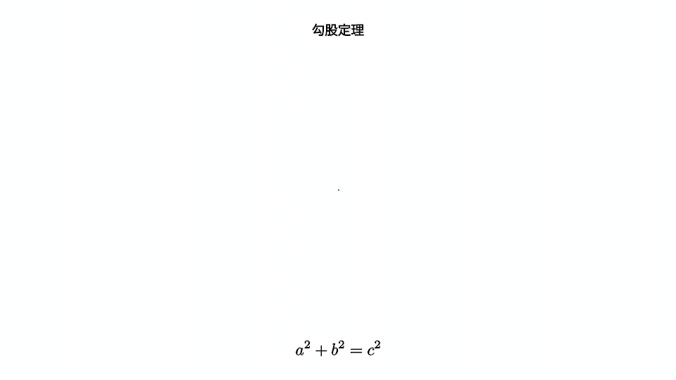

> 这个动画直观展示了直角三角形三边上的三个正方形面积关系：两直角边正方形面积之和恰好等于斜边正方形面积，即 $a^2+b^2=c^2$。它通过动画的方式帮助理解本节核心概念。

**示例**：已知直角三角形的两条直角边分别为 $3$ 和 $4$，求斜边长度。

解：$c = \sqrt{3^2 + 4^2} = \sqrt{9 + 16} = \sqrt{25} = 5$

**勾股定理的逆定理**：若三角形的三边 $a, b, c$ 满足 $a^2 + b^2 = c^2$，则该三角形是直角三角形（$c$ 为斜边）。

---

#### 课堂问答

**老师**：$a^2+b^2=c^2$ 里的平方，为什么恰好对应正方形面积而不是别的？

**学生**：因为面积法把每条边都当作正方形边长来拼。两块直角边正方形面积和等于斜边正方形，这才是"平方"的几何含义；代数上它只是乘方，几何上它是面积相等。

**老师（追问）**：勾股定理只对直角三角形成立，那非直角三角形有没有替代公式？

**学生**：有，就是余弦定理 $c^2=a^2+b^2-2ab\cos C$。当 $\angle C=90^\circ$ 时 $\cos C=0$，余项消失退回勾股；角为锐角或钝角时余项一正一负，说明勾股是它的特例。

**老师（拓展）**：逆定理为什么能"由边长判定直角"？

**学生**：设三边满足 $a^2+b^2=c^2$，另作一个以 $a,b$ 为直角边的直角三角形，由勾股得它的斜边也为 $c$，两三角形三边全等（SSS），故原三角形也含直角。逆定理把数重新翻译回了形。

### 8.3 定理 3：平行线性质与判定定理

| 符号 | 名称 | 含义 | 直观解释 |
|:---:|:---:|:---|:---|
| $\parallel$ | 平行符号 | 两条直线不相交 | "永远不碰面" |
| $\perp$ | 垂直符号 | 两条直线成90度角 | "十字交叉" |
| $\Rightarrow$ | 推出符号 | 由左边可得右边 | "因为…所以…" |

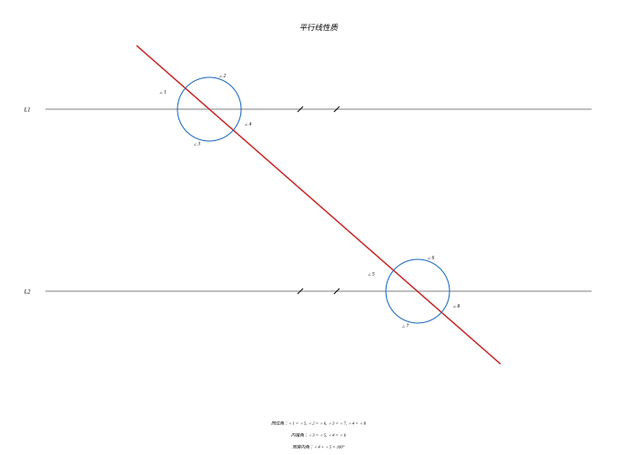

#### 平行线性质定理

当两条平行线被第三条直线（截线）所截时：

1. **同位角相等**：$\angle 1 = \angle 2$
2. **内错角相等**：$\angle 2 = \angle 3$
3. **同旁内角互补**：$\angle 2 + \angle 4 = 180^\circ$

#### 平行线判定定理

如果两条直线被第三条直线所截：

1. **同位角相等** $\Rightarrow$ 两直线平行
2. **内错角相等** $\Rightarrow$ 两直线平行
3. **同旁内角互补** $\Rightarrow$ 两直线平行

**额外的判定方法**：

- 平行于同一条直线的两条直线互相平行
- 垂直于同一条直线的两条直线互相平行

> **直觉与生活场景**：铁轨的两根钢轨永远是平行的——它们"永远不碰面、保持等距"。架在两轨之间横跨的枕木把两轨"切"出一个个角，这就是截线。所谓平行线性质，就是在说：当两根钢轨确实平行时，枕木在它们身上"切"出的各种角有必然的大小关系；而判定定理则反过来——看到角的关系，就能断定两轨是否平行。

> **直观理解（现实类比）**：把两条平行直线想象成**铁轨的两根钢轨**，第三条直线（截线）是横跨铁轨的枕木。
> - **同位角**是枕木与两根钢轨在同一侧形成的角——像两个朝同一方向的"F"角，它们必然相等。
> - **内错角**是枕木与两根钢轨在铁轨内侧形成的一对"Z"形角，像字母 Z 的两个内角。
> - **同旁内角**是枕木与两根钢轨在铁轨内侧同一旁的两个角，它们加起来正好铺满半个平面（$180^\circ$）。
>
> 反过来也成立：看到同位角相等，就知道两根钢轨一定平行——不会交汇。这就是铁轨永远保持等距的几何原因。

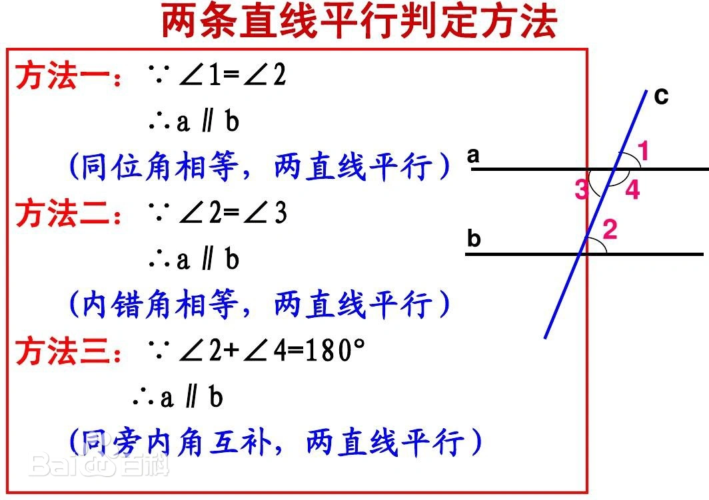

**示例**：如图，$AB \parallel CD$，$\angle 1 = 120^\circ$，求 $\angle 2$ 和 $\angle 3$。

解：
- $\angle 2 = \angle 1 = 120^\circ$（两直线平行，同位角相等）
- $\angle 3 = 180^\circ - \angle 1 = 60^\circ$（两直线平行，同旁内角互补）

---

#### 课堂问答

**老师**：性质定理（平行推出角关系）和判定定理（角关系推出平行）看着只是箭头反向，为什么要各算一条定理？

**学生**：因为方向不同用途不同：要"用平行推角度"就查性质，要"用角度证平行"就查判定。逻辑上判定往往是性质的逆命题，二者不能互相自动替代，必须分别确认。

**老师（追问）**：同位角、内错角、同旁内角三组，会不会有哪一组是多余的？

**学生**：不冗余，它们是同一事实的三种显示：由"同位角相等"可推出内错角相等、同旁内角互补（都借平角 $180^\circ$）。任取一组即可作判定的入口，其余是它的推论。

**老师（拓展）**：这条定理在四边形和相似里扮演什么角色？

**学生**：它是它们的根。平行四边形靠"同旁内角互补"来判定；$DE\parallel BC$ 导出 $\triangle ADE\sim\triangle ABC$（AA），相似、面积比都从平行线的角关系长出来。

### 8.4 定理 4：三角形全等判定定理

> **直觉与生活场景**：警察确认"这两个人是不是同一个人"，从身高、站姿、声音挑几个关键特征就够了，不必把全身上下反复比过。判定两个三角形"完全一样（全等）"也是同样的道理：**只要抓住几个"关键特征"，就能确信它们处处相等**——这就是全等判定定理。

全等三角形：对应边相等、对应角相等的两个三角形。

#### 五种判定方法

|     判定     | 条件                                     | 说明       |
| :-----------: | :--------------------------------------- | :--------- |
| **SSS** | 三边对应相等                             | 边边边     |
| **SAS** | 两边及其夹角对应相等                     | 边角边     |
| **ASA** | 两角及其夹边对应相等                     | 角边角     |
| **AAS** | 两角及其中一角的对边对应相等             | 角角边     |
| **HL** | 斜边和一条直角边对应相等（仅直角三角形） | 斜边直角边 |

**注**：**SSA**（两边及其中一边的对角对应相等）不能判定全等，因为可能有两种不同的三角形。

> **直观理解（现实类比）**：判定三角形全等就像"验证两个人是否是同一个人"——需要足够的特征：
> - **SSS**（三边相等）：身高、腰围、臂长都一样——基本能确定是同一人。
> - **SAS**（两边夹角）：两条腿的长度和它们之间的角度（站姿的开合度）一样——姿势确定，人也确定。
> - **ASA**（两角夹边）：两个朝向的角度和中间夹的一段距离确定——像 GPS 三角定位，两点方向加距离锁定目标。
> - **HL**（斜边直角边）：直角三角形专属——斜边和一条直角边对应，另一条直角边由勾股定理唯一确定。
>
> 为什么 **SSA** 不行？想象一根固定长度的斜杆，一端固定在墙上某点，另一端连一根绳子（另一边）。绳子和墙的夹角（对角）给定后，绳子末端可能落在墙上的两个不同位置——这就是"歧义情况"，所以 SSA 不能保证唯一。

#### 全等三角形的性质

- 对应边相等
- 对应角相等
- 对应中线、高线、角平分线相等
- 面积相等

**示例**：已知 $AB = DE$，$AC = DF$，$\angle A = \angle D$，求证 $\triangle ABC \cong \triangle DEF$。

证明：

$$
\begin{array}{c}
\because AB = DE,\; AC = DF,\; \angle A = \angle D \\
\therefore \triangle ABC \cong \triangle DEF \quad (\text{SAS})
\end{array}
$$

---

#### 课堂问答

**老师**：为什么 SSA 判定不了全等，而 SAS 可以，关键差别在哪？

**学生**：SAS 固定的是两边的**夹角**，夹角一旦卡住，第三边由两边和夹角唯一确定；SSA 给的是其中一边的对角，斜杆另一端可落在两个不同位置，产生两个不全等的三角形——差别就在角夹不夹在两边之间。

**老师（追问）**：HL 单独为直角三角形设一条，为什么不能并入 SSS？

**学生**：HL 只给"斜边 + 一条直角边"，缺第三边，本不属于 SSS 的三边齐备。但它靠勾股定理补出另一条直角边，从而三边确定。它是直角三角形专属的省测版本。

**老师（拓展）**：全等判定和相似判定之间是什么关系？

**学生**：全等是相似比为 $1$ 的特例，所以相似条件更松。对应地，SAS、SSS 在相似里只要成比例即可；而全等里两角相等其实也够——因为内角和锁定第三角后形状已定，全等只差一个比例大小。

### 8.5 定理 5：三角形相似判定定理

> **直觉与生活场景**：把一张照片放大两倍，形状没变、只是更大——这就叫**相似**。判断"两张照片是不是同款（形状一样）"，有时候只需要看两个角是否一样：因为三角形内角和固定，**只要两个角相等，第三个角也一定相等**，形状就锁定了。这就是 AA 相似判定。

相似三角形：对应角相等、对应边成比例的两个三角形。

#### 三种判定方法

|     判定     | 条件                     | 说明                           |
| :-----------: | :----------------------- | :----------------------------- |
| **AA** | 两个角对应相等           | 角角（两角相等即第三角也相等） |
| **SAS** | 两边对应成比例且夹角相等 | 边角边                         |
| **SSS** | 三边对应成比例           | 边边边                         |

#### 相似三角形的性质

- 对应角相等
- 对应边成比例（比例系数 $k$ 称为相似比）
- 对应中线、高线、角平分线的比等于相似比
- 周长比等于相似比
- 面积比等于相似比的平方 $k^2$

> **直观理解（现实类比）**：相似三角形就像**同一张底片洗出不同尺寸的照片**——形状一模一样，只是放大或缩小了 $k$ 倍。
> - 所有"长度"（边、中线、高、周长）都按 $k$ 倍缩放，因为长度是一维的。
> - 但"面积"按 $k^2$ 倍缩放——因为面积是二维的，长宽各缩放 $k$ 倍，面积就缩放 $k \times k = k^2$ 倍。
> - 这解释了为什么**地图比例尺**是长度比，而**实际土地面积**要用比例尺的平方：$1:1000$ 的地图上 $1\text{cm}^2$ 对应实际 $1000^2 = 1000000\text{cm}^2 = 100\text{m}^2$。
> - 体积是三维的，所以相似三维物体的体积比是 $k^3$。

**示例**：在 $\triangle ABC$ 中，$DE \parallel BC$ 交 $AB$ 于 $D$，交 $AC$ 于 $E$。若 $AD = 2$，$DB = 3$，$AE = 3$，求 $EC$。

解：

$$
\because DE \parallel BC \quad \therefore \triangle ADE \sim \triangle ABC \quad (\text{AA})
$$

$$
\therefore \frac{AD}{AB} = \frac{AE}{AC} \quad \Rightarrow \quad \frac{2}{2+3} = \frac{3}{3+EC}
$$

$$
\frac{2}{5} = \frac{3}{3+EC} \quad \Rightarrow \quad 2(3+EC) = 15 \quad \Rightarrow \quad EC = 4.5
$$

---

#### 课堂问答

**老师**：相似判定里 AA 只要两个角，比全等的 ASA 省掉一条边，凭什么能省？

**学生**：因为三角形内角和固定 $180^\circ$，两个角相等就强迫第三个角相等，三个角都定了形状就定了，而相似只要求形状。全等还要求大小，所以必须再给一条边，这就是差别。

**老师（追问）**：相似比 $k$ 下，周长比和面积比各是多少，为什么不同？

**学生**：周长是长度的一次组合，比值为 $k$；面积是二维的，比值为 $k^2$。同理对应中线的比也是 $k$。维度不同，幂次就不同，这跟体积比 $k^3$ 是同一套"维度定指数"的逻辑。

**老师（拓展）**：$DE\parallel BC$ 推出 $\triangle ADE\sim\triangle ABC$ 这个模型为什么这么常用？

**学生**：因为它把平行线自动变成一组相似加一组比例，$\frac{AD}{AB}=\frac{AE}{AC}$，于是未知的 $EC$ 就能由已知三边解出。它是面积比、射影定理乃至坐标法里截线式比例的原型。

### 8.6 定理 6：圆周角定理

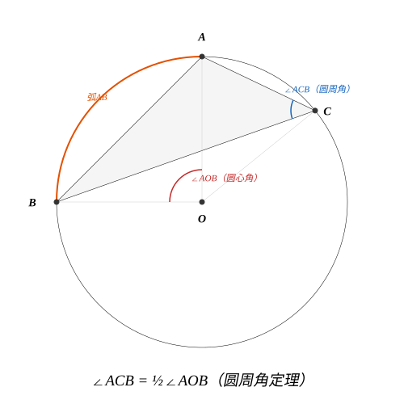

> **定理**：同弧所对的圆周角等于圆心角的一半。

**证明**：

设 $O$ 为圆心，$A, B, C$ 在圆上，$\angle AOB$ 为圆心角，$\angle ACB$ 为圆周角，它们所对的弧同为 $\widehat{AB}$。

**情况一**：圆心在圆周角的一条边上。

连接 $OC$，则 $OA = OC = r$（半径）。

$$
\because OA = OC \quad \therefore \angle OAC = \angle OCA
$$

- 第 1 步：连接 $OC$ 构造等腰三角形 $OAC$，目的是利用"等边对等角"的性质。

又 $\angle AOB = \angle OAC + \angle OCA = 2\angle OCA$

- 第 2 步：利用"三角形外角等于不相邻两内角之和"，把圆心角 $\angle AOB$ 表示为 $2\angle OCA$，目的是建立圆心角与圆周角的关系。

$$
\therefore \angle ACB = \frac{1}{2}\angle AOB
$$

- 第 3 步：注意到 $\angle ACB = \angle OCA$（因为 $C$ 在 $OA$ 上），代入得圆周角是圆心角的一半，目的是完成证明。

**情况二**：圆心在圆周角内部，**情况三**：圆心在圆周角外部，均可通过作辅助线转化为情况一证明。

**推论**：

- 同弧或等弧所对的圆周角相等
- 半圆（直径）所对的圆周角是直角

> **直觉与生活场景**：想象圆心是舞台中央的乐队，圆周上的点是观众。同一段弧（舞台的同一侧）所对的圆周角，相当于不同位置观众看乐队的"视角"。

> **直观理解（现实类比）**：想象圆心是舞台中央的乐队，圆周上的点是观众。同一段弧（舞台的同一侧）所对的圆周角，相当于不同位置观众看乐队的"视角"。
> - 圆心角是"上帝视角"——乐队正上方俯瞰，看到的范围最大。
> - 圆周角是"观众视角"——站在圆周上看，视角只有圆心角的一半。
> - **关键神奇之处**：无论观众站在圆周的哪个位置（只要在同一段弧上），他们看乐队的视角都相同！这就是"同弧所对圆周角相等"。这像剧场设计——半圆形观众席上每个座位看舞台的视角都一样，这是古希腊剧场设计的几何原理。

> **🧠 思考历程：一个由"量测"催生的视角定理**
>
> 圆周角定理初看很漂亮、很纯粹，可它最早的动机，很可能是测量天空和大地时的"实战经验"。
>
> - **"目光所及的角"与航海、天文**。古人观测天体、在海上辨认方位时，反复遇到"同一段弧、从不同角度看过去，角度居然一样"。这种"视觉上的稳定不变"对导航至关重要——它让人们在长途航行中能够依靠星象复现同样的航向。古人或许没总结出定理的文字，却早已在用这条"规律"。
> - **从"利用它"到"证明它"**。古希腊几何学家（常归功于欧几里得及其学派在《几何原本》中的整理）把这个经验固化成定理："在同弧上，圆周角处处相等，且等于圆心角的一半。"关键的一步，是**把"怎么会一样"翻译成"半径相等 → 等腰三角 → 外角关系"的纯逻辑链条**——也就是本节证明里那套连半径、找等腰的步骤。
> - **它与泰勒斯定理的"血亲"**。本节的泰勒斯定理（直径所对圆周角是直角），正是把圆周角定理"同弧角相等"推到极限的结果：当弧拉平成直径时，视角恰好是平角的一半，也就是直角。**一条定理的极端情形，往往就"蹦"出另一条定理。**
> - **心路**：圆周角定理提醒我们：**很多几何"铁律"其实是从肉眼观察、实战测量里"爬"进数学的**。它的高贵之处不在于"信息量大"，而在于：一旦你用逻辑证明"视角处处相等"，就再也不用担心"某个观众的位置恰好特殊"。从依赖眼睛，到依赖推理——这正是从工匠到数学家的一步。

---

#### 课堂问答

**老师**：圆周角为什么恰好是圆心角的一半，而不是别的比例？

**学生**：把圆心与圆周角顶点用半径连起来，得到等腰三角形：$OA=OC$ 给等角，再用外角定理把圆心角写成两倍的小角，于是 $\angle ACB=\frac12\angle AOB$。那个 $\tfrac12$ 来自等腰加外角。

**老师（追问）**：证明要分圆心在角一边、内部、外部三种情况，不能只证一种吗？

**学生**：不能。一种情况只覆盖一种位置关系，另两种需作辅助线（比如连直径）化归到第一种。分类讨论是为了让结论对**任意**位置都成立，这正是几何证明常见的严谨。

**老师（拓展）**：当所对弧变成半圆时，定理会给出什么？

**学生**：圆心角为 $180^\circ$，圆周角就是 $90^\circ$——这就是泰勒斯定理。可见圆周角定理是母定理，泰勒斯定理是它取直径这个极端情形的特例。

### 8.7 定理 7：泰勒斯定理 (Thales' Theorem)

> **直觉与生活场景**：木匠想画一个精确的直角，最可靠的办法是在一条线段（将来当直径用）上画个半圆，再在半圆边上任意取一点——这一点与线段两端连成的角，**必定是直角**。这听着像"免费的午餐"，但它的几何理由是千真万确的：直径所对的圆周角是直角。

> **定理**：直径所对的圆周角是直角。

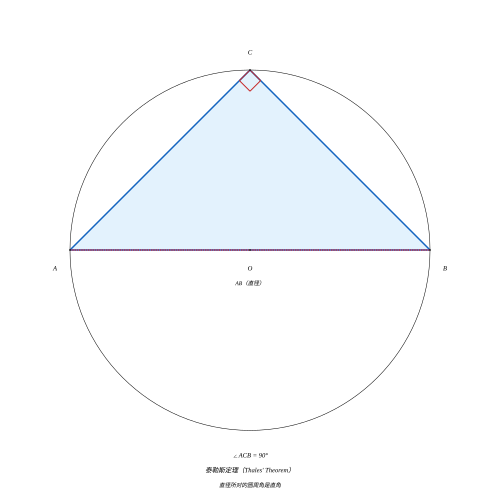

**证明**：

设 $AB$ 是圆 $O$ 的直径，$C$ 是圆上不同于 $A, B$ 的任意一点。求证 $\angle ACB = 90^\circ$。

连接 $OC$。因为 $OA = OB = OC = r$，所以：

$$
\angle OAC = \angle OCA,\quad \angle OBC = \angle OCB
$$

- 第 1 步：连接 $OC$ 构造两个等腰三角形 $OAC$ 和 $OBC$，目的是利用"等边对等角"得到两组相等的角。

在 $\triangle ABC$ 中：

$$
\angle OAC + \angle OCA + \angle OBC + \angle OCB = 180^\circ
$$

- 第 2 步：利用三角形内角和定理，把三个内角用四个小角表示，目的是建立关于这些角的方程。

$$
2\angle OCA + 2\angle OCB = 180^\circ
$$

- 第 3 步：代入第 1 步的等量关系（$\angle OAC = \angle OCA$，$\angle OBC = \angle OCB$），目的是化简方程。

$$
\angle OCA + \angle OCB = 90^\circ
$$

- 第 4 步：两边除以 2，目的是得到 $\angle ACB$ 的度数。

即 $\angle ACB = 90^\circ$。

- 第 5 步：注意到 $\angle ACB = \angle OCA + \angle OCB$，代入即得结论，目的是完成证明。

**几何意义**：以 $AB$ 为直径作圆，圆上任意一点 $C$ 与 $A, B$ 构成的三角形均为直角三角形。

> **直观理解（现实类比）**：泰勒斯定理有一个优美的现实应用——它是**直角尺的几何原理**。古代木匠想要画一个精确的直角，只需在一条线段（直径）上滑动一个点，让这个点始终与两端连成的角是直角即可。这像在半圆形的铁路弯道上，火车头的方向始终与弯道两端连线垂直。也是**三角形外接圆**的关键性质：直角三角形的斜边就是外接圆的直径，外心恰好在斜边中点。

> **🧠 思考历程："让埃及人目瞪口呆"的测量巧思**
>
> 泰勒斯定理本身不复杂，但它的精神来源，是一个关于"量"与"验"的古老传奇。
>
> - **人名的由来**。传说公元前 6 世纪的米利都人泰勒斯（Thales）是古希腊第一个"预言日食、测金字塔高"的思想者。他虽然未必亲手完成我们今天的所有推理，但后人把他"善于从一条几何事实里引出惊人结论"的风格记在了这条定理名下。"直径所对圆周角是直角"因此得名泰勒斯定理。
> - **从测量反推定理**。一种广为流传的说法是：泰勒斯想量出金字塔的高度，提出"当你的影子长度等于身高时，塔的影子长度就等于塔高"。这类"利用相似与直角"的实践，让他深谙"直角藏在圆里"这一事实的实用价值。**定理的"感觉"先来自丈量，后来才被写成严格证明。**
> - **它为什么"承上启下"**。严格来说，泰勒斯定理是"圆周角定理"的极限特例（当弧变成半圆时，圆周角正好是直角）。但它带给古希腊几何另一个关键礼物——**"直角充盈在圆中"**：以后凡是遇到"已知某点在一段直径上滑动"，都可以放心断言它是直角。这为后面大量几何构造提供了便利的支点。
> - **心路**：泰勒斯定理提醒我们：**一条定理价值的大小，往往不取决于它本身多深奥，而取决于它能在多少地方被"顺手用上"**。一句"直径对直角"，背后是古人对"只要成直角，就能保证几何正确"的高度信任——这份信任，是要靠证明去守护的。

#### 课堂问答

**老师**：直径所对的圆周角凭什么一定是 $90^\circ$，能不能不靠圆周角定理直接看出来？

**学生**：可以。连 $OC$，因 $OA=OB=OC=r$，两个三角形 $OAC$、$OBC$ 都是等腰，于是两组底角相等；在 $\triangle ABC$ 里用内角和 $180^\circ$，得 $\angle OCA+\angle OCB=90^\circ$，即 $\angle ACB=90^\circ$。

**老师（追问）**：反过来，"一个角为直角"能推出斜边是外接圆直径吗？

**学生**：能。直角三角形的外心在斜边中点，且到三顶点等距，故斜边中点即圆心、斜边即直径——这正是逆泰勒斯定理，也是直角三角形外接圆的性质。

**老师（拓展）**：这条定理和射影定理之间有什么呼应？

**学生**：都是"直角三角形 + 斜边上的高/中点"的推论。泰勒斯给出中点与外接圆，射影定理给出 $CD^2=AD\cdot DB$，两者一起把直角三角形的边长关系统统串起来。

### 8.8 定理 8：射影定理（Euclid's Geometric Mean Theorem）

> **直觉与生活场景**：直角三角形的斜边上作一条高，把大三角形一切为二。发烧友会惊喜地发现：高、斜边上被分出的两段、两条直角边之间，藏着一组漂亮的比例关系——其中"高"恰好是两段射影的**几何平均**（比例中项）。这幅图里，其实藏着三个两两相似的直角三角形。

> **定理**：在直角三角形 $ABC$ 中，$\angle C = 90^\circ$，$CD$ 是斜边 $AB$ 上的高（$D$ 在 $AB$ 上），则：
>
> **1. 高的射影定理**：斜边上的高是两条直角边在斜边上射影的比例中项
> $$CD^2 = AD \cdot DB$$
>
> **2. 直角边的射影定理**：每条直角边是它在斜边上的射影与斜边的比例中项
> $$AC^2 = AD \cdot AB$$
> $$BC^2 = BD \cdot AB$$

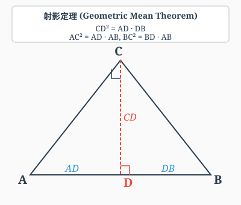

**证明**：

在直角三角形 $ABC$ 中，$CD \perp AB$，则 $\triangle ACD$、$\triangle CBD$、$\triangle ABC$ 三个三角形两两相似：

$$\triangle ACD \sim \triangle ABC \sim \triangle CBD$$

**证高的射影定理**：由 $\triangle ACD \sim \triangle CBD$，对应边成比：

$$\frac{CD}{DB} = \frac{AD}{CD} \implies CD^2 = AD \cdot DB$$

**证直角边的射影定理**：由 $\triangle ACD \sim \triangle ABC$，对应边成比：

$$\frac{AC}{AB} = \frac{AD}{AC} \implies AC^2 = AD \cdot AB$$

由 $\triangle CBD \sim \triangle ABC$，对应边成比：

$$\frac{BC}{AB} = \frac{BD}{BC} \implies BC^2 = BD \cdot AB$$

**注**：三个公式也可以由勾股定理直接推出。例如 $CD^2 = AC^2 - AD^2 = (AD \cdot AB) - AD^2 = AD(AB - AD) = AD \cdot DB$。

> **直观理解（现实类比）**：射影定理描述的是"直角三角形被高切开后，三块相似三角形之间的比例关系"。可以把它想象成**照片放大缩小**：大三角形（$\triangle ABC$）被高分成两个小三角形（$\triangle ACD$ 和 $\triangle CBD$），它们形状完全相同只是大小不同，因此对应边长成固定比例。$CD^2 = AD \cdot DB$ 意味着"高"恰好是两段"射影"的几何平均数——就像说"中间那个数"恰好是"两边两个数"的几何平均。这在测量中非常实用：只要知道斜边被高分成的两段长度，就能直接算出高。

> **🧠 思考历程：一条"藏了几千年"的比例关系**
>
> 射影定理的证明不难，但它的发现和流传，反映了古希腊几何"用比例说话"的风格。
>
> - **它其实早就在《几何原本》里**。虽然名叫"射影定理"，但它的内容本质是"直角三角形中，三块小三角形相似、对应边成比例"，这在欧几里得《几何原本》第六卷（讨论相似形面积比）里已经齐备。**古代人是靠"比例"说话的——他们不太写等式，而是把同样的话说成"某条线段是另两条线段的比例中项"。**
> - **"比例中项"是当时的"公共焦点"**。希腊人特别痴迷"用直尺圆规作一个数是另两个数的比例中项"——因为它直接通向"开平方"和后来的**黄金分割**。$CD^2 = AD\cdot DB$ 里那个$CD$，正是"$AD$ 与 $DB$ 的比例中项"，也即它们的**几何平均**。所以射影定理不只是几个等式，更是"几何平均"这个现代概念的早期化身。
> - **名称里藏着"投影"**。所谓"射影"，是说两条直角边$AC$、$BC$各在斜边上的**垂直投影**分别是$AD$、$BD$。"$\frac{AC}{AB}=\frac{AD}{AC}$" 读起来，就是"边$AC$是它自身投影与整个斜边的比例中项"。当19世纪"射影几何"崛起后，这些老式子被人用"投影"这个新词重新命名，成了熟悉的"射影定理"。
> - **心路**：射影定理提醒我们：**同一道几何事实可以有很多"面孔"——相似构成的比例、几何平均数、射影的长度**。它之所以被反复传，是因为在测量(如何用一段已知线去推算另一条线)里太好用了。你看懂那三个$CD^2$、$AC^2$、$BC^2$，等于同时握住了"相似"、"开平方"和"投影"三条线。

---

#### 课堂问答

**老师**：射影定理说 $CD^2=AD\cdot DB$，这个高为什么恰好是两段的几何平均？

**学生**：因为 $\triangle ACD\sim\triangle CBD$，对应边成比例 $\frac{CD}{DB}=\frac{AD}{CD}$，交叉相乘即 $CD^2=AD\cdot DB$。比例中项就是几何平均，这正是相似三角形造平方的典型产物。

**老师（追问）**：它和勾股定理是什么关系，是不是多此一举？

**学生**：不是，两者互推。由射影定理 $AC^2=AD\cdot AB$、$BC^2=BD\cdot AB$，相加用 $AD+BD=AB$ 就得到 $AC^2+BC^2=AB^2$；反过来由勾股也能推出射影定理。它们是一体两面。

**老师（拓展）**：射影定理的名字里为什么要用"射影"这个词？

**学生**：因为两条直角边在斜边上的**垂直投影**分别是 $AD$、$BD$，$AC^2=AD\cdot AB$ 读作"边是它自身投影与斜边的比例中项"。19 世纪射影几何兴起后，人们用"投影"这个新词重新命名了这条老结论。

## 9. 垂径定理

> **直觉与生活场景**：一个工匠捡到一块残缺的圆桌边，想知道圆心在哪——只要作出两条弦的垂直平分线，交点就是圆心。为什么"垂直平分一条弦"就能逮住圆心？答案就在垂径定理里，它是圆"对称折叠"性质最直接的量化。

> **定理**：垂直于弦的直径平分这条弦，并且平分弦所对的两条弧。

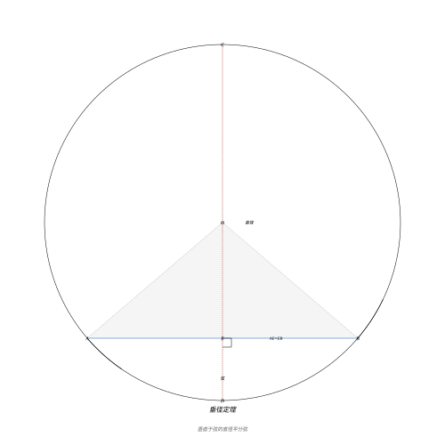

**证明**：

设 $AB$ 是圆 $O$ 的一条弦，$CD$ 是直径，$CD \perp AB$ 于 $E$。连接 $OA, OB$。

$$
\because OA = OB = r \quad \therefore \triangle OAB \text{ 是等腰三角形}
$$

又 $OE \perp AB$（三线合一），$\therefore AE = EB$。

且 $\angle AOD = \angle BOD$，$\angle AOC = \angle BOC$（等腰三角形底边上的高也是顶角的角平分线）。

因此 $\widehat{AD} = \widehat{BD}$，$\widehat{AC} = \widehat{BC}$。

> **直观理解（现实类比）**：垂径定理的现实模型是**对称折叠**——把圆沿直径 $CD$ 对折，弦 $AB$ 被对称地折成两半重合（因为 $CD \perp AB$），所以 $AE = EB$，对应的弧也对称相等。这就像把一个圆形披萨沿过中心且垂直于某条切口的线对折，切口被一分为二且两段相等。它是"圆的轴对称性"的直接推论，也是计算弓形高度、弦长与半径关系的核心工具。

> **🧠 思考历程：一则藏在"找圆心"手艺里的定理**
>
> 垂径定理听起来像抽象结论，但它的用处，古代工匠做梦都在用。
>
> - **圆是"最对称"的图形**。圆拥有无数条对称轴——任意过圆心的直线都能把圆折成两半。垂径定理"垂直平分弦"这一点，本质就是这条对称性的量化：**一旦你沿某条直径对折，弦的两半和两条弧的两半就必然重合。**所以古人明白：想平分一条弦，让它"垂直"就够了。
> - **它的头号用途：找到圆心**。试想一个工匠捡到一块残缺的圆木桌边，想知道它的圆心在哪——只要作两条弦，各作它们的垂直平分线，交点就是圆心。为什么？因为垂径定理保证"垂直平分弦的线**过圆心**"。**把"垂直平分弦"当作圆心携带的指纹**，是以此找圆心、修补破损圆的传统手艺。
> - **圆规与直尺的"顺位"**。垂径定理也解释了为什么"弦的中点与圆心连线必垂直"这类构造总能成立：它和"等面积、等弧"这些对称语言本来就是一回事。古希腊和后来的几何作图体系里，它被当成读圆的基础。
> - **心路**：垂径定理提醒我们：**有些定理看似只是"对折一下"的废话，却是实用几何的脚手架**。你每用一次"垂直平分弦 → 得圆心"，都是在这个被对称折叠压出来的古老事实上盖楼。圆之所以好用，正因为它的对称太丰富——而人类学会"利用对称"这件事本身，就是从垂径定理这类小规则开始的。

> **解决了什么问题**：垂径定理把"弦、弦心距、半径、弧"串成一台机器——已知其中任意两个量，就能求其余（配合勾股定理）。第七章习题里大量的"弦长/弦心距/半径"计算，全靠它。

---

## 10. 专题三：勾股定理的多种证明思想

> **本节解决的问题**：第 8 节给了你勾股定理的一种"面积法"证明。可这面条定理其实有几百上千种证法，思想也五花八门。本节带你看几类最有代表性的**证明思想**，让你理解"证明同一条定理可以有很多条路"，也学会"面积两种算法相等"这个万能心法。

### 10.1 为什么勾股定理值得反复证明

**直觉**：如果一个结论只有一种证明，你可能会想"那只是碰巧对上"。可当**上百种彼此迥异的**思路都指向同一个 $a^2+b^2=c^2$ 时，你就确信：这不是巧合，而是直角三角形里深藏的一条铁的规律。

> **解决了什么问题**：见识多种证明，本质是结识多种"推理武器"。我们下面介绍的三类思想——割补法、周长法（经典的"补成长方形"）、代数恒等式法——都可用在更广的问题上。

#### 课堂问答

**老师**：一个结论证过一次就够了，为什么勾股定理要摆出上百种证法？

**学生**：因为证明不只为了真，更为了看见联系。每种证法都调用了不同的工具——面积、全等、相似——它们彼此印证，也暴露出这条定理与其他结论的通道，这才是多个证法的价值。

**老师（追问）**：既然结论一样，证法多了会不会只是换汤不换药？

**学生**：不会。割补法靠面积守恒，欧几里得法靠全等搬面积，代数法靠相似列比例，三条思路完全不同。若它们都通向同一个 $a^2+b^2=c^2$，反而更说明这不是巧合，而是结构的必然。

**老师（拓展）**：这种"一题多证"的习惯，对你学别的定理有什么启发？

**学生**：它训练你准备多种武器。遇到新结论先问：能不能用面积？用全等？用比例或坐标？多一种证法，就多一条从已知通向未知的路。

### 10.2 思想一：割补拼图（赵爽弦图/总统证法）

**思想**：把同一个图形用两种方式切开拼装，列出两种面积相等的式子。

**赵爽弦图**：构造边长为 $c$ 的大正方形，内部留一个边长为 $b-a$ 的小正方形，周围是四个直角边为 $a,b$ 的直角三角形。两种面积算法相等：

$$
c^2 = (b-a)^2 + 4\cdot\tfrac12 ab = b^2 - 2ab + a^2 + 2ab = a^2 + b^2
$$

**总统证法**：把两个全等的直角三角形（直角边 $a,b$，斜边 $c$）和一个直角边 $b-a$ 的等腰直角三角形，拼成直角梯形。两侧面积算法相等：

$$
\frac{(a+b)^2}{2} = ab + \frac{c^2}{2} \quad\Rightarrow\quad a^2+b^2 = c^2
$$

> **直观理解（现实类比）**：就像把同样一堆乐高积木，一次拼成一个"回"字，一次拼成一排，虽然外表不同，用的积木块数一定一样。**"同一批积木，两种拼法，总数必然相等"**——这就是面积法的全部秘密。

#### 课堂问答

**老师**：赵爽弦图里那个"边长 $b-a$ 的小正方形"是哪来的，为什么中间恰好空出正方形？

**学生**：因为四个直角三角形绕中心摆一圈，相邻直角边差为 $b-a$，四条这样的小边围成的正是边长 $b-a$ 的正方形。中间能空出正方形，是因为四个直角恰好拼成 $360^\circ$，缺口四边等长。

**老师（追问）**：总统证法拼的是梯形，和赵爽那种中心留洞的拼法，凭什么都能证同一条定理？

**学生**：因为两者本质都是"同一块图形两种算法相等"。弦图用 $c^2=(b-a)^2+4\cdot\tfrac12ab$，总统法用 $\frac{(a+b)^2}{2}=ab+\frac{c^2}{2}$，展开后都归到 $a^2+b^2=c^2$。

**老师（拓展）**：这类拼图证明有什么软肋？

**学生**：它依赖图形摆得恰好合缝，需要保证中间确实构成正方形、四块确实全等。严谨起见，这些合缝条件要能由角度和边长推出，否则拼图只是直观示意，不算完整证明。

### 10.3 思想二：补成一个长方形（欧几里得式的比例）

**思想**：把斜边上的正方形拆成两块，分别与两个直角边上的正方形"面积对峙"，用小三角形全等来完成面积的等价搬运。这是欧几里得《几何原本》第 I 卷第 47 命题的经典路径——**用全等与比例搬动面积**。

关键一步：作斜边上的高，把斜边正方形分成两个矩形；再分别证明每个矩形与对应的直角边正方形的面积相等（靠一对全等三角形 + 同底同高）。两两累加即得 $a^2+b^2=c^2$。

> **思想要点**：不靠数值计算，而**靠"全等图形面积相等"与"同底同高面积相等"一步步搬**。这与面积法的"列等式"是两种风味，但都归到同一个结论。

#### 课堂问答

**老师**：欧几里得为什么不列代数式，非要靠"全等搬面积"，这不是绕远路吗？

**学生**：因为在他的体系里没有代数符号，只能用"面积相等"说话。他作斜边上的高把斜边正方形分成两个矩形，再证明每个矩形与对应直角边正方形等积，靠的是全等三角形和同底同高。

**老师（追问）**：把斜边正方形分成两个矩形，分割的依据是什么？

**学生**：依据斜边上的高。高把斜边分成两段，过长两端作斜边的垂线，就把斜边正方形切成两个矩形，其边分别为这两段（即两条直角边的射影）。这正是射影定理的图形。

**老师（拓展）**：这条"全等搬面积"的路线，和面积法、相似法相比特殊在哪？

**学生**：它完全不出现数值计算，全靠"全等图形等积""同底同高等积"这种几何守恒来搬运，是纯综合几何的风格；而面积法和代数法分别借助代数等式与比例，三条路殊途同归。

### 10.4 思想三：用相似三角形的比例（代数法）

**思想**：作斜边上的高 $CD$，得到三个相似的直角三角形（这正是射影定理的来源）。把比例交叉相乘，立刻获得连等式：

$$
AC^2 = AD\cdot AB,\qquad BC^2 = BD\cdot AB
$$

两式相加（因为 $AD + BD = AB$）：

$$
AC^2 + BC^2 = AB\,(AD+BD) = AB^2 = c^2
$$

这就是 $a^2+b^2=c^2$。

> **思想要点**：**"两条直角边的平方"恰好对应"各自射影部分占斜边的比例"**——射影定理与勾股定理在这里互证互通。

#### 课堂问答

**老师**：代数法只作一条高 $CD$，就得到两个关系式，它的威力从哪来？

**学生**：从"三个相似直角三角形"。高把大三角形分成两个与原三角形相似的小三角形，于是 $AC^2=AD\cdot AB$、$BC^2=BD\cdot AB$，把边长关系转成比例式，剩下的就是代数加法。

**老师（追问）**：为什么这两式能相加，$AD$ 和 $BD$ 相加不串味吗？

**学生**：不串。它们都是斜边 $AB$ 上的两条相邻线段，$AD+BD=AB$，所以 $AC^2+BC^2=AB(AD+BD)=AB^2$。能相加，正因为两式右边都以 $AB$ 为公因子。

**老师（拓展）**：这条思路与射影定理、勾股定理构成了什么循环？

**学生**：三者互证：射影定理来自相似，射影定理相加即得勾股，而由勾股又能反推射影定理。相似、比例、平方在这里被绑成一个闭环，说明它们本是同一几何事实的不同投影。

### 10.5 三种思想的小结

| 证明思想 | 核心动作 | 代表 |
| :--- | :--- | :--- |
| 面积法 / 割补法 | 同一图形两种面积算法相等 | 赵爽弦图、总统证法 |
| 全等搬面积 | 全等三角形搬移相等面积 | 欧几里得证明 |
| 相似 / 代数法 | 相似三角形列比例，交叉相乘再相加 | 射影定理法 |

> **解决了什么问题**：你会看到，**"数学证明"不是"唯一的死路"，而是众多思路汇向同一真理的合流**。当你以后再遇到一个新结论，可以自然地想：我能不能用面积？用全等？用比例？

#### 课堂问答

**老师**：割补、全等搬面积、相似列比例这三种思想，最本质的共同点是什么？

**学生**：都是"同一对象、两种算法，令其相等"。割补用两种面积式相等，全等用等积搬运，相似用比例再交叉相乘相加——形式不同，内核都是守恒量两端相等。

**老师（追问）**：做题时该怎样在三者间选择？

**学生**：看图形给了什么。有现成可拼的方块就用割补；能用全等把面积搬过去就用欧几里得式；出现相似或射影结构就用比例法。工具的选择取决于图中已有的关系。

**老师（拓展）**：这三种思想能迁移到勾股定理之外的哪些地方？

**学生**：都能。面积法用于三角形、多边形面积；全等搬面积用于等积变形；相似比例用于一切截线模型，如中线、角平分线等比例结构，甚至解析几何的坐标推导。

### 10.6 本专题针对性练习

> 答案见「15.4 专题练习答案」。

**基础题**：
1. 已知 $a=3,b=4$，用赵爽弦图（$b-a=1$）的两种面积算法，写出验证 $a^2+b^2=c^2$ 的过程并求出 $c$。
2. 已知直角边 $5,12$，按 $c^2=(b-a)^2+4\cdot\tfrac12ab$ 验证勾股定理并求出 $c$。

**进阶题**：
3. 用"总统证法"（直角梯形）推导 $a^2+b^2=c^2$，写出两种面积算法并列成等式。（否则：用文字复述其关键一步）
4. 结合射影定理：直角边为 $6,8$ 的直角三角形，斜边上的高把斜边分成 $AD,DB$，用代数法（$AC^2=AD\!\cdot\!AB$）验证勾股定理并求 $AD$。（提示：$AB=10$，$AC=6$）

**挑战题**：
5. 构造："用四个全等直角三角形拼成边长为 $a+b$ 的大正方形、中间留边长 $c$ 的小正方形"，写出两种面积算法并推出 $a^2+b^2=c^2$。再思考：为什么这类"拼图证明"必须要求中间恰好是正方形？

---

#### 课堂问答

**老师**：第 1 题要求用赵爽弦图验证 $a=3,b=4$，你应该先算哪个中间量？

**学生**：先算 $c^2=(b-a)^2+4\cdot\tfrac12ab=1^2+2\cdot12=1+24=25$，故 $c=5$。关键是记住 $b-a=1$、四个直角三角形各占 $\tfrac12ab$。

**老师（追问）**：第 4 题用射影定理求 $AD$，给的是直角边 $6,8$，怎么下手？

**学生**：先由勾股得斜边 $AB=10$，再用 $AC^2=AD\cdot AB$，即 $36=AD\times10$，得 $AD=3.6$。这条是把"直角边平方"翻译成"射影乘斜边"。

**老师（拓展）**：第 5 题问"为什么拼图证明必须中间恰好是正方形"，这暴露了拼图法什么前提？

**学生**：暴露了它对角度合规的依赖：四个直角加一圈必须凑满 $360^\circ$，且相邻小边相等，缺一不可。若中间拼出的不是正方形，两种面积算法就不再对应，证明随即失效。

## 11. 专题四：尺规作图的基本思想

> **本节解决的问题**：古希腊人只用**两种工具**——无刻度的直尺（只能连直线）和圆规（只能画圆）——却想做出任意图形。他们为什么较真地"只用这两种工具"？尺规作图背后藏着哪些基本思想？本节讲清"最小工具 + 精确构造 + 用已证定理担保"三件事。

### 11.1 为什么"只用圆规和无刻度直尺"

**直觉与生活场景**：画一个正三角形，用普通尺子量好三条边当然又快又准。但古希腊人较真：**他们希望每一步都有"几何理由"保证精确**，而不是靠"量"。只用圆规（画等距）和直尺（画直线），是因为这两种工具只做"最基本、人人认同"的动作——度量被取消了，精确由几何定理保证。

> 这背后是一次深刻的"降维"美学：**工具越少、动作越基本，结论就越"纯粹"、越可信**。欧几里得《几何原本》的全部作图，都建立在这两个"许可动作"上。

#### 课堂问答

**老师**：用带刻度的尺子量一支长度，明明更快更准，古希腊人为什么反而禁止？

**学生**：因为量引入了误差和实物依赖，结果不再纯粹由几何前提决定。只用圆规画等距、直尺连直线，这两个动作人人都承认，精确由定理担保，而不是靠尺子上的刻度。

**老师（追问）**：那把刻度看作"已知长度"用来作图，算不算犯规？

**学生**：要看约定。古典尺规作图针对的是"任意图形"，允许刻度等于偷偷多给了一个测量公理，会让某些原本作不出的图形变得可作。要比较"能不能作"，就必须统一规则。

**老师（拓展）**：这种"把工具减到最少"的偏执，对现代数学有什么影响？

**学生**：它催生了"可构造性"这门学问：能作当且仅当长度可由已知量经有限次四则运算与开平方得到。这条判据把几何问题翻译成代数问题，正是伽罗瓦理论与域扩张思想的源头。

### 11.2 三个基本作图

**基础动作 1：作一条线段的中点**
以两端为圆心、用同一个半径作两个圆，两圆交点连线与该线段相交处即中点（依据：交点在两端的中垂线上）。

**基础动作 2：作一个角的平分线**
以顶点 $O$ 为圆心画弧交两边于 $M,N$；再分别以 $M,N$ 为圆心、相同半径画弧，交于 $P$；连接 $OP$。理由：$\triangle OMP \cong \triangle ONP$（SSS），故 $\angle MOP = \angle NOP$。

**基础动作 3：过直线外一点作垂线（或作一条边的垂直平分线）**
以该点为圆心取适当半径画弧交直线于两点，再按"作中点"的方法作出这两点的中垂线，所得直线垂直于已知直线。

> **精确的底气来自定理**：每一步能"作对"，靠的全是前面证过的定理（全等、中垂线、角平分线性质）。尺规作图因此不是手艺活，而是一次次"用定理兑现精确"的演习。

#### 课堂问答

**老师**：作中点时用同一个半径画两圆，为什么两圆交点连线就垂直平分原线段？

**学生**：因为两交点 $P,Q$ 分别满足 $PA=PB$、$QA=QB$，即都在 $AB$ 的中垂线上；两点确定一条直线，$PQ$ 就是中垂线，它与 $AB$ 的交点即中点。

**老师（追问）**：作角平分线时，凭什么 $\triangle OMP\cong\triangle ONP$ 成立？

**学生**：三边对应相等：$OM=ON$（同弧半径）、$MP=NP$（同半径第二次画弧）、$OP$ 公共，由 SSS 全等得 $\angle MOP=\angle NOP$，所以 $OP$ 平分角。全等是这一步的担保。

**老师（拓展）**：这三件基本作图还能拼出哪些更复杂的构造？

**学生**：可拼出作垂线、作平行线、作正多边形，甚至复制一个角、作面积相等的三角形。所有尺规作图的积木就这三种，复杂图形都是它们按需拼装的产物。

### 11.3 为什么有些题"作不出"：三分角问题

**直觉**：用尺规能平分任意角，那"三等分任意角"呢？做了两千多年的尝试，直到 19 世纪才被证明：**用圆规和直尺不可能三等分一个任意角**。这说明"能作"与"不能作"之间有清晰的边界，而这个边界要靠代数（数论）来判断——它把几何作图问题成功地翻译成了"能用四则运算与开方构造出的数"的问题。

> **解决了什么问题**：尺规作图让你体会到——**"构造几何图形"和"证明几何定理"是同一枚硬币的两面**：你想作出的图形必须有一连串定理为它"背书"。这也是"从公理出发推理"思想在作图领域的延伸。

#### 课堂问答

**老师**：平分角那么轻松，为什么三等分任意角就成了两千年的难题？

**学生**：因为"能作"的门槛是代数性的：尺规只能作出由已知量经有限次加、减、乘、除、开平方得到的数。三等分角会引出不可约的三次方程（对应立方根），不是开平方能表达的，所以一般角度作不出。

**老师（追问）**：那是不是所有角都三等分不了，有没有例外？

**学生**：有例外，比如 $90^\circ$、$180^\circ$ 这类特殊角能三等分。结论针对的是"**任意**角"——只要证明不存在通法、其代数条件不满足，就说明没有尺规通解。

**老师（拓展）**：这个"作不出"的结论，把几何带向了哪里？

**学生**：把几何作图翻译成"数的域扩张"问题，开启了伽罗瓦理论：三大难题（三等分角、倍立方、化圆为方）的不可解，全靠代数而非画图来判定。这是几何与代数最深的一次握手。

### 11.4 本专题针对性练习

> 答案见「15.4 专题练习答案」。

**基础题**：
1. 用文字列出"作一条线段 AB 的中点"的完整步骤（圆规 + 无刻度直尺）。
2. 用文字列出"作一个角 ∠AOB 的平分线"的完整步骤。

**进阶题**：
3. 说明"作角平分线"这步凭什么能保证两角相等（用三角形全等说明）。
4. 如何作"一条线段的垂直平分线"？列出步骤，并说明交点处为什么必在垂直平分线上。

**挑战题**：
5. 讨论并回答：能否用圆规和直尺"三等分任意角"？用一两句话说明数学家是如何判断"能作"还是"不能作"的。

---

#### 课堂问答

**老师**：第 3 题要说明"作角平分线为什么两角相等"，作答时应引用哪条依据？

**学生**：引用 SSS 全等。以 $O$ 为圆心画弧交两边于 $M,N$，两交点间再以相同半径画弧交于 $P$，则 $OM=ON$、$MP=NP$、$OP$ 公共，故 $\triangle OMP\cong\triangle ONP$，对应角 $\angle MOP=\angle NOP$。

**老师（追问）**：第 4 题作垂直平分线，为什么要取"两交点的连线"而不是随便连？

**学生**：两个交点各到线段两端等距，由中垂线的判定知它们都在中垂线上，两点定线才唯一锁定这条中垂线；随便连不满足等距，不一定是中垂线。唯一性靠的是两点确定直线。

**老师（拓展）**：第 5 题追问"能否三等分任意角"，标准答法应落到哪个层面？

**学生**：落到代数判据：尺规可作当且仅当长度属于由已知量经四则与开平方得到的数域，而三等分角一般需解三次方程，故**不能**用尺规三等分任意角。几何的"不能"由代数来裁决。

## 12. 解题技巧

> **本节解决的问题**：把前面积累的定义、性质、定理落到"做题"上。每条技巧都含**适用场景**、**关键步骤**与**常见误区**，并配一个精讲示例，覆盖角度计算、勾股定理、平行线、全等、相似与圆等能力项。

本节针对平面几何中的高频题型，总结可直接套用的解题方法与易错点。每条技巧均含**适用场景**、**关键步骤**与**常见误区**，并配一个精讲示例，覆盖本章学习目标中的角度计算、勾股定理、平行线、全等、相似与圆等能力项。

### 12.1 角度计算的"设元列方程"法

**适用场景**：三角形、平行线、相交线中的角度未知量求值。

**关键步骤**：
1. 把未知角设为一个变量（如 $\angle B=x$）；
2. 用内角和定理（三角形 $=180^\circ$、$n$ 边形 $=(n-2)\cdot180^\circ$）、平角 $180^\circ$、对顶角相等、余角/补角关系表示其余角；
3. 列出关于 $x$ 的方程并求解。

**常见误区**：
- 用错内角和公式（三角形与四边形混用）；
- 未用对顶角相等，重复设了多余的未知数；
- 漏掉"外角等于不相邻两内角之和"的隐含关系。

**精讲示例**：在 $\triangle ABC$ 中，$\angle A=2\angle B$，$\angle C=3\angle B$，求各角。

设 $\angle B=x$，则 $\angle A=2x$、$\angle C=3x$。由内角和 $2x+x+3x=180^\circ$，得 $6x=180^\circ$，$x=30^\circ$。故 $\angle A=60^\circ$、$\angle B=30^\circ$、$\angle C=90^\circ$（直角三角形）。

### 12.2 直角求边：勾股定理"设"的思想

**适用场景**：直角三角形中已知两边求第三边，或已知部分边、部分关系求未知边。

**关键步骤**：
1. 确认斜边最长；对直角三角形使用 $a^2+b^2=c^2$；
2. 当某条边未知且关系复杂时，设该边为 $x$，再由已知线段关系把另一条边也用 $x$ 表示，列出方程；
3. 解方程后注意**舍去负值**（边长为正）。

**常见误区**：
- 把直角边误当斜边代入公式；
- 用勾股定理列方程解出两个值时不判断正负；
- 直接开方时漏掉平方关系（习惯先求 $c^2$）。

**精讲示例**：直角三角形两直角边为 $5$ 和 $12$，求斜边。

$$
c=\sqrt{5^2+12^2}=\sqrt{25+144}=\sqrt{169}=13
$$

### 12.3 证线段/角相等的工具选择

**适用场景**：证明两条线段相等或两个角相等。

**关键步骤**：
1. 判断是否可直接用已知（如等腰三角形"等边对等角"、三线合一）；
2. 否则找两个三角形，用**全等判定**（SSS/SAS/ASA/AAS/HL），先明确要证哪三组对应元素相等；
3. 优先找"公共边""角平分线角相等""垂直直角相等"这三种易得条件。

**常见误区**：
- 证全等时罗列的三组条件不构成有效判定（如"SSA"）——SSA**不能**唯一确定三角形；
- 直接用未知要证的结论当条件；
- 两三角形对应顶点写乱，导致对应边配错。

**精讲示例**：已知 $\triangle ABC$ 中 $AB=AC$，$AD$ 平分 $\angle BAC$，证 $BD=DC$。

在 $\triangle ABD$ 与 $\triangle ACD$ 中：$AB=AC$（已知）、$\angle BAD=\angle CAD$（角平分线）、$AD$ 公共，故 $\triangle ABD\cong\triangle ACD$（SAS），得 $BD=DC$。

### 12.4 判定相似：找准对应边

**适用场景**：平行线截三角形内两线段成比例，或已知条件判断三角形相似。

**关键步骤**：
1. 用 AA（两角对应相等）判定相似最省事，优先找平行线带来的等角（同位角、内错角）；
2. 写比例式时**顶点一一对应**：$\triangle ADE\sim\triangle ABC$ 表示 $A\leftrightarrow A,\ D\leftrightarrow B,\ E\leftrightarrow C$；
3. 利用比例式求未知边。

**常见误区**：
- 对应顶点顺序写错，导致比例错误；
- 把相邻边混为一谈（如把 $DE/BC=AD/AB$ 错写为 $DE/BC=AD/DB$）；
- 忘记面积比 $=$ 相似比的平方（详见进阶题第 9 题）。

**精讲示例**：$\triangle ABC$ 中 $DE\parallel BC$，$AD=3$，$DB=2$，$DE=4$，求 $BC$。

由 $DE\parallel BC$ 得 $\triangle ADE\sim\triangle ABC$（AA），故
$$
\frac{DE}{BC}=\frac{AD}{AB}=\frac{3}{3+2}=\frac35 \Rightarrow BC=4\times\frac53=\frac{20}{3}
$$

### 12.5 圆中求线段：过圆心作弦的垂线

**适用场景**：已知半径与弦或圆心到弦距离，求弦长、距离或半径。

**关键步骤**：
1. **过圆心向弦作垂线**（这是垂径定理的自然辅助线）；
2. 构造三角形（圆心 $O$ + 弦端点 $A$ + 垂足 $E$），其中 $O A=r$，$AE$ 为弦长一半，$OE$ 为所求；
3. 用勾股定理 $r^2=AE^2+OE^2$ 求解。

**常见误区**：
- 忘记垂足平分弦（$AE=EB$），把弦长误当一半；
- 辅助线不作 $OE\perp AB$ 就直接套勾股定理。

**精讲示例**：圆 $O$ 半径 $5$，弦 $AB=8$，求圆心到弦的距离。

作 $OE\perp AB$，由垂径定理 $AE=\frac12 AB=4$。在 $\text{Rt}\triangle OAE$ 中：
$$
OE=\sqrt{OA^2-AE^2}=\sqrt{5^2-4^2}=3
$$

### 12.6 圆中求角度：圆心角、圆周角与直径直角

**适用场景**：圆内由弧、弦、直径构成的夹角求值。

**关键步骤**：
1. **同弧所对的圆周角是圆心角的一半**；
2. 直径所对圆周角是直角（泰勒斯定理），遇到直径优先连圆周上一点构直角；
3. 结合三角形内角和继续求解。

**常见误区**：
- 把圆周角与圆心角混淆方向（说成圆周角是圆心角的 2 倍）；
- 未识别出直径，错过泰勒斯定理的直角；
- 忘记"同弧上的圆周角相等"。

**精讲示例**：圆 $O$ 中，$\widehat{AB}$ 所对圆心角 $\angle AOB=80^\circ$，求圆周角 $\angle ACB$。

由圆周角定理：$\angle ACB=\frac12\angle AOB=\frac12\times80^\circ=40^\circ$。

---

## 13. 示例

> **本节解决的问题**：用五个完整的例题，把前面几种解题技巧"串"起来走一遍，让你看清新题如何一步步落到定理与计算上。

### 示例 1：三角形内角和的应用

在 $\triangle ABC$ 中，$\angle A = 2\angle B$，$\angle C = 3\angle B$，求各角度数。

解：设 $\angle B = x$，则 $\angle A = 2x$，$\angle C = 3x$。

由三角形内角和定理：

$$
2x + x + 3x = 180^\circ \quad \Rightarrow \quad 6x = 180^\circ \quad \Rightarrow \quad x = 30^\circ
$$

因此 $\angle A = 60^\circ$，$\angle B = 30^\circ$，$\angle C = 90^\circ$，该三角形为直角三角形。

---

### 示例 2：勾股定理的应用

一架梯子长 $10$ 米，斜靠在一面墙上，梯子底部距墙脚 $6$ 米。问梯子顶端距地面多高？

解：设梯子顶端距地面 $h$ 米。梯子、地面和墙壁构成直角三角形。

由勾股定理：

$$
h^2 + 6^2 = 10^2
$$

$$
h^2 = 100 - 36 = 64
$$

$$
h = 8 \text{ 米}
$$

---

### 示例 3：全等三角形的证明

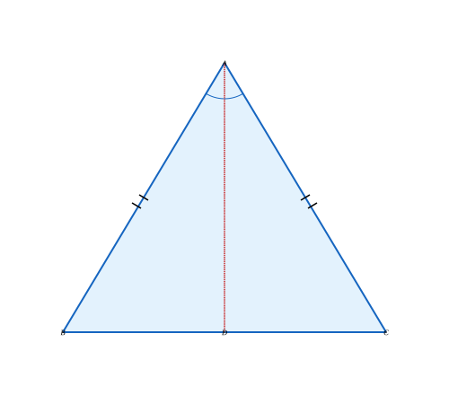

如图，$AB = AC$，$AD$ 是 $\angle BAC$ 的平分线。求证 $\triangle ABD \cong \triangle ACD$。

证明：

$$
\begin{array}{c}
\because AB = AC \quad (\text{已知}) \\
\angle BAD = \angle CAD \quad (\text{角平分线定义}) \\
AD = AD \quad (\text{公共边}) \\
\therefore \triangle ABD \cong \triangle ACD \quad (\text{SAS})
\end{array}
$$

---

### 示例 4：圆周角定理的应用

在圆 $O$ 中，$\widehat{AB}$ 所对的圆心角 $\angle AOB = 80^\circ$，求 $\widehat{AB}$ 所对的圆周角 $\angle ACB$ 的大小。

解：由圆周角定理：

$$
\angle ACB = \frac{1}{2}\angle AOB = \frac{1}{2} \times 80^\circ = 40^\circ
$$

---

### 示例 5：相似三角形的应用

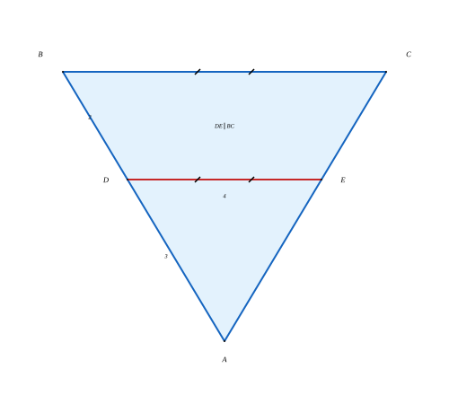

如图，在 $\triangle ABC$ 中，$DE \parallel BC$，$AD = 3$，$DB = 2$，$DE = 4$，求 $BC$ 的长度。

解：

$$
\because DE \parallel BC \quad \therefore \triangle ADE \sim \triangle ABC \quad (\text{AA})
$$

$$
\frac{DE}{BC} = \frac{AD}{AB} = \frac{AD}{AD + DB}
$$

$$
\frac{4}{BC} = \frac{3}{3 + 2} = \frac{3}{5}
$$

$$
BC = 4 \times \frac{5}{3} = \frac{20}{3}
$$

### 问题求解四步流程（Problem-Solving Strategy）

> 每个问题都可拆成四步：**理解 → 计划 → 执行 → 回看**。这里把每一环落到平面几何语境的追问上。

| 步骤 | 行动 | 平面几何中的具体追问 |
|:---|:---|:---|
| ① 理解 | 复述问题、圈出已知与目标 | 对象是点、线、角，还是三角形、四边形、圆？已知长度、角度、对称性还是平行关系？目标是求数值还是证明两形全等或相似？ |
| ② 计划 | 选择可行工具、预估方向 | 用三角形内角和定理？勾股定理还是余弦定理？用全等（SSS/SAS/ASA）还是相似（AA/SAS/SSS）？连圆心、作垂线还是引平行线更省力？ |
| ③ 执行 | 按步骤推导、保留过程 | 标清对应点与边，写出每一步所用定理；求角度、面积或边长前先核对单位与适用前提（是否直角三角形、所对弧是否一致）。 |
| ④ 回看 | 核对结果、检验合理性 | 答案量纲与图形规模是否合理？能否改用面积法或相似比对结果交叉验证？取特殊退化情形（等腰、直角、共圆）检验仍成立？ |

> 💡 **策略演示**：用勾股定理求直角三角形的斜边长。
> ① 理解：直角三角形两直角边分别长 3 与 4，目标是斜边。 ② 计划：斜边的平方等于两直角边的平方和。 ③ 执行：先把两直角边分别平方再相加，即 9 加 16 得 25，最后开平方取正值得斜边长 5。 ④ 回看：三边 3、4、5 确能满足平方关系且斜边为最长边，结果自洽；但若原三角形并非直角三角形，此定理不适用。

### 概念检查（Concept Check）

> 先用一组判断题与选择题快速自检核心概念。每道题的判断均应落到书面理由（用一句话说明即可）。

**判断正误**（说明理由）：

1. 三角形的内角和恒为 180 度，与三角形的大小和形状无关。（　）
2. 三条边对应相等的两个三角形必定全等。（　）
3. 只要两个三角形的三个角对应相等，它们就全等。（　）
4. 直径所对的圆周角是直角。（　）
5. 勾股定理对任意三角形都成立。（　）
6. 相似三角形的面积比等于相似比。（　）

**选择**：

7. 一个三角形的两个内角分别为 40 度与 60 度，则第三个内角为（　）
   - A. 60 度　B. 70 度　C. 80 度　D. 90 度
8. 下列条件中能判定两个三角形全等的是（　）
   - A. 两边及其中一边的对角分别相等　B. 两角及夹边分别相等　C. 三个角分别相等　D. 两边分别相等
9. 在圆中，同弧所对的圆周角与其圆心角的关系是（　）
   - A. 圆周角等于圆心角　B. 圆周角等于圆心角的一半　C. 圆周角等于圆心角的两倍　D. 无确定关系

### 分步骤工作示例（Worked Examples）

> 每道示例严格套用四步流程，并在「回看」中给出一条易错点或检验法。

**示例 S1：用三角形内角和定理求未知角**

> **问题**：在三角形 ABC 中，已知角 A 为 65 度、角 B 为 80 度，求角 C 的度数。

- ① 理解：已知两内角求第三内角，目标是角度。
- ② 计划：用三角形内角和定理，三个内角之和为 180 度。
- ③ 执行：

$$
\angle C = 180^\circ - \angle A - \angle B = 180^\circ - 65^\circ - 80^\circ = 35^\circ .
$$

- ④ 回看：三个内角 65、80、35 相加恰为 180，且每个角都小于 90 度，对应锐角三角形，自洽。 **易错点**：内角和定理仅适用于三角形，需先确认图形是三角形；计算时先把两个已知角相加再整体相减，勿漏减。

**示例 S2：用勾股定理求直角三角形的边长**

> **问题**：在直角三角形 ABC 中，直角在角 C，已知直角边 AC 长 6、BC 长 8，求斜边 AB 的长。

- ① 理解：直角三角形已知两直角边，目标是斜边。
- ② 计划：用勾股定理，斜边的平方等于两直角边的平方和。
- ③ 执行：

$$
AB^2 = AC^2 + BC^2 = 6^2 + 8^2 = 36 + 64 = 100 ,\qquad AB = \sqrt{100} = 10 .
$$

- ④ 回看：斜边 10 大于任一直角边（符合直角三角形中斜边最长的性质），且 6、8、10 构成一组勾股数。 **易错点**：勾股定理只能用于直角三角形，使用前必须先确认直角的存在，并把斜边对应到 c，别把平方与开平方的顺序搞反。

**示例 S3：判断两个三角形是否全等并说明理由**

> **问题**：已知 AB 等于 DE、AC 等于 DF、角 A 等于角 D，能否据此推断三角形 ABC 与三角形 DEF 全等？

- ① 理解：已知两组对应边及一对应角，判断两三角形全等与否。
- ② 计划：核对全等判定定理，判断对应的是两边及夹角（SAS）还是两边及一边对角（SSA）。
- ③ 执行：角 A 是边 AB 与 AC 的夹角，角 D 是边 DE 与 DF 的夹角；由于夹角相等且它的两条边对应相等，满足两边及其夹角对应相等（SAS），故 $\triangle ABC \cong \triangle DEF$。
- ④ 回看：SAS 要求相等的角必须是两条对应边的夹角，此处恰满足，判全等成立。 **易错点**：若相等的角不是两边所夹的角，则退化为 SSA，而 SSA 不能判定全等（存在歧义情形），切不可混淆。

**示例 S4：用相似三角形按比例求未知边长**

> **问题**：三角形 ABC 与三角形 DEF 相似（按顶点对应），其中 AB 对应 DE，AB 长 4、DE 长 6、BC 长 5，求 EF 的长。

- ① 理解：两个相似三角形，已知一组对应边确定相似比，目标是求另一条对应边。
- ② 计划：先由 AB 与 DE 求出相似比 k，再用该比例由 BC 推得 EF。
- ③ 执行：

$$
k=\frac{DE}{AB}=\frac{6}{4}=\frac32 ,\qquad EF=BC\cdot k=5\cdot\frac32=\frac{15}{2} .
$$

- ④ 回看：EF 大于 BC，与放大（k 大于 1）一致；两三角形面积比为相似比的平方，故面积比为 9 比 4。 **易错点**：面积比等于相似比的平方，而非等于相似比；对应边须严格按顶点顺序对齐，误对应顶点会得到错误的比例。

### 应用聚焦（Application & Exploration Projects）

> 小型开放任务：把本节抽象结论落到可操作的测量、作图或推理，任选其一完成。

- **聚焦 P1（实际测量）**：在操场上测量一栋楼或一棵树的高度：竖立一根已知高度的标杆，同时测出标杆与楼（或树）的影长，用相似三角形按比例推算高度，并画出所用图形、写出计算过程。
- **聚焦 P2（尺规作图）**：仅用圆规与无刻度直尺作出一个 60 度角，并写出作图步骤（可先作等边三角形），最后说明每一步作图依据了哪条性质。
- **聚焦 P3（探索构造）**：任取三角形三边中点依次连接成中点三角形，观察它与原三角形的关系，说明其周长与原周长的比、面积与原面积的比，并验证四个小三角形全等。

### 梯度化自测（Graded Exercises）

> 难度记号：○ 概念 / ● 技能 / ◆ 综合应用，均要求在四步流程中写出「回看」一句。

**○ 概念题**

- **自测 1**：说明在什么条件下可以用勾股定理求边长，并用一句话解释为何它对一般的三角形不成立。
- **自测 2**：解释全等与相似的区别，并各举一例三角条件对应哪种判定。

**● 技能题**

- **自测 3**：直角三角形两直角边为 5 与 12，求斜边长。
- **自测 4**：三角形三个内角分别为 x、2x、3x 度，求 x 的值与最大角的度数。
- **自测 5**：圆中一条弦长为 8，弦心距为 3，求圆的半径。

**◆ 综合题**

- **自测 6**：三角形两条边长分别为 3 与 4 且夹角为直角，指出求面积是否还需第三条边，并写出面积值。
- **自测 7**：两相似三角形相似比为 1 比 3，小三角形周长为 10，求大三角形周长；若大三角形面积为 90，求小三角形面积。

### 自测答案与简要解析

> **概念判断**：
> 1. **正确**（三角形内角和定理，与大小形状无关）。2. **正确**（三边对应相等即 SSS 全等）。3. **错误**（三角对应相等只保证相似，不保证全等，除非另有一边对应相等）。4. **正确**（直径所对圆周角为直角，即泰勒斯定理）。5. **错误**（勾股定理只对直角三角形成立，对锐角或钝角三角形三边平方不满足此等式）。6. **错误**（相似三角形面积比等于相似比的平方，周长比才等于相似比）。

> **选择**：7. C　8. B　9. B。

> **自测**：
> - 自测 1：在直角三角形中，斜边平方等于两直角边平方和；对一般三角形该等式不成立，故使用前须先确认直角。
> - 自测 2：全等要求形状与大小都相同，相似只要求形状相同；三、四、五这组三边对应相等判全等，或两角对应相等判相似等，均属各自判定条件之一例。
> - 自测 3：斜边等于根号下（5 的平方加 12 的平方）等于根号 169 等于 13。
> - 自测 4：由 x 加 2x 加 3x 等于 180 度得 x 等于 30 度，最大角为 3x 等于 90 度。
> - 自测 5：半弦长 4 与弦心距 3 构成直角三角形，半径等于根号下（4 的平方加 3 的平方）等于 5。
> - 自测 6：面积为二分之一乘 3 乘 4 等于 6，求面积不再需要第三条边；若夹角非直角，则需该夹角信息或第三边。
> - 自测 7：周长比等于相似比，大三角形周长为 10 乘 3 等于 30；面积比等于相似比的平方 1 比 9，小三角形面积为 90 除以 9 等于 10。

---

## 14. 习题

> **本节解决的问题**：检验你对本级的掌握程度。习题按难度分为 **基础题 / 进阶题 / 挑战题 / 探究题** 四级，覆盖本章全部内容（角、三角形、四边形、圆、全等、相似等）。探究题为开放题，附参考答案与思路提示。**另外：第 6、7、10、11 节各专题的针对性练习（小题）答案，统一定位于「15.4 专题练习答案」。**

### 14.1 基础题

**1.** 在 $\triangle ABC$ 中，$\angle A = 70^\circ$，$\angle B = 50^\circ$，求 $\angle C$ 的度数，并判断该三角形的类型。

**2.** 直角三角形的两条直角边分别为 $5$ 和 $12$，求斜边的长度。

**3.** 

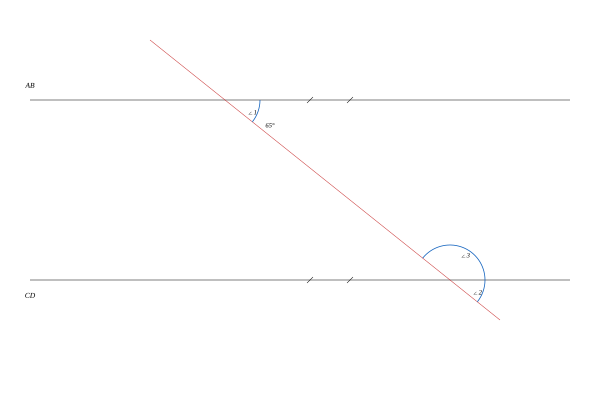

如图，$AB \parallel CD$，$\angle 1 = 65^\circ$，求 $\angle 2$ 和 $\angle 3$ 的度数。（$\angle 2$ 为 $\angle 1$ 的同位角，$\angle 3$ 为与 $\angle 1$ 同旁内角的角）

**4.** 判断以下各组条件能否判定 $\triangle ABC \cong \triangle DEF$：

- (a) $AB = DE$，$BC = EF$，$AC = DF$
- (b) $AB = DE$，$BC = EF$，$\angle A = \angle D$
- (c) $\angle A = \angle D$，$\angle B = \angle E$，$AB = DE$

**5.** 两条直线相交，其中一角 $\angle 1 = 65^\circ$，试求其余三个角的大小，并指出它们与 $\angle 1$ 的相互（对顶角、邻补角）关系。

**6.** 在圆 $O$ 中，$\widehat{AB}$ 所对的圆心角 $\angle AOB = 80^\circ$，求 $\widehat{AB}$ 所对的圆周角 $\angle ACB$。

**7.** 填空（余角与补角）：
(a) $35^\circ$ 的余角是 ______，补角是 ______。
(b) 一个角的补角是它的余角的 $3$ 倍，求这个角的度数。

**8.** 在平行四边形 $ABCD$ 中，对角线 $AC$ 与 $BD$ 交于点 $O$，$AC = 10$，$BD = 12$。
(a) $OA = $ ______，$OB = $ ______。
(b) 利用三角形三边关系，求边 $AB$ 的取值范围。

**9.** 菱形的两条对角线长分别为 $6$ 和 $8$，求菱形的边长。（提示：菱形对角线互相垂直平分）

**10.** 圆 $O$ 的半径为 $5$，弦 $AB = 6$，弦 $CD = 8$。分别求两条弦的弦心距（圆心到弦的距离），并判断哪条弦离圆心更近。

**11.** 点 $C$ 在线段 $AB$ 上，$AC:CB = 1:3$，且 $AB = 12$，求 $AC$ 的长。

**12.** 一个角的余角是 $28^\circ$，求这个角及其补角的度数。

**13.** 一个角的补角比这个角大 $40^\circ$，求这个角。

**14.** 两条直线相交，其中一组对顶角之和为 $140^\circ$，求四个角各为多少度。

**15.** 一个九边形（9 条边）的内角和是多少？外角和是多少？

**16.** 一个正多边形的每个内角为 $120^\circ$，求它的边数。

**17.** 在 $\triangle ABC$ 中，$\angle A:\angle B:\angle C = 2:3:4$，求最大内角。

**18.** 等腰三角形的一个底角为 $70^\circ$，求顶角。

**19.** 等腰三角形的顶角为 $36^\circ$，求每个底角。

**20.** 直线 $a \parallel b$ 被直线 $c$ 所截，其中一个内错角 $\angle 1 = 65^\circ$，求与 $\angle 1$ 构成同旁内角的那个角的度数。

**21.** 有三根木条，长分别为 $3$、$4$、$7$，能否用它们围成三角形？为什么？

**22.** 三角形的两边长分别为 $5$ 和 $9$，求第三边 $x$ 的取值范围。

**23.** 直角三角形的两条直角边分别为 $6$ 和 $8$，求斜边。

**24.** 直角三角形的斜边为 $13$，一条直角边为 $5$，求另一条直角边。

**25.** 判断三边长 $5$、$12$、$13$ 能否构成直角三角形。

**26.** 平行四边形的相邻两边长分别为 $4$ 和 $7$，求它的周长。

**27.** 矩形的一条对角线长为 $10$，一边长为 $6$，求另一边长。

**28.** 正方形的面积为 $36$，求它的对角线长。

**29.** 菱形的边长为 $5$，求它的周长。

**30.** 梯形的上底为 $4$、下底为 $9$、高为 $6$，求它的面积。

**31.** 圆的半径为 $4$，求它的直径。

**32.** 圆的直径为 $10$，求它的半径与周长。

**33.** 圆 $O$ 中，圆心角 $\angle AOB = 110^\circ$，求同弧所对的圆周角 $\angle ACB$。

**34.** $AB$ 是圆 $O$ 的直径，$C$ 是圆上一点（异于 $A,B$），求 $\angle ACB$ 的度数。

**35.** 已知 $\triangle ABC \cong \triangle DEF$，且 $AB=6$，$BC=8$，$AC=7$，求 $DE$、$EF$、$DF$。

**36.** 已知 $\triangle ABC \sim \triangle DEF$，相似比为 $2:3$，若 $AB=4$，求 $DE$ 的长。

**37.** 在 $\triangle ABC$ 中，$\angle A = 40^\circ$，$\angle B = 70^\circ$，求 $\angle C$ 并判断三角形类型。

**38.** 直角三角形的一个锐角为 $35^\circ$，求另一个锐角。

**39.** 正三角形（等边三角形）的每个内角是多少度？

**40.** 三角形的一个外角为 $120^\circ$，与它不相邻的两个内角相等，求这两个内角。

**41.** 判断三边长 $8$、$15$、$17$ 能否构成直角三角形。

**42.** 直角三角形的两条直角边分别为 $3$ 和 $4$，求斜边。

**43.** 边长为 $a$ 的正方形，对角线长是多少？

**44.** 平行四边形 $ABCD$ 中，$\angle A = 70^\circ$，求 $\angle B$、$\angle C$、$\angle D$ 的度数。

**45.** 平行四边形的相邻两边长为 $3$ 和 $4$，求它的周长。

**46.** 矩形的两条邻边长为 $3$ 和 $4$，求对角线的长。

**47.** 菱形两条对角线长分别为 $6$ 和 $8$，求它的面积。

**48.** 正方形的周长为 $20$，求它的面积。

**49.** 梯形的上底为 $4$、下底为 $10$，求它的中位线长。

**50.** 半径为 $5$ 的圆，面积是多少？

**51.** 直径为 $8$ 的圆，周长是多少？（取 $\pi$ 表示）

**52.** 同弧所对的圆周角为 $40^\circ$，求它所对的圆心角。

**53.** 半径分别为 $3$ 和 $5$ 的两个圆，它们的直径之比是多少？

**54.** 已知 $\triangle ABC \cong \triangle DEF$，$\angle A = 50^\circ$，求 $\angle D$。

**55.** 两个全等三角形的面积有什么关系？

**56.** $\triangle ABC \sim \triangle DEF$，相似比为 $1:2$，若 $S_{\triangle ABC} = 5$，求 $S_{\triangle DEF}$。

**57.** 已知 $\triangle ABC \sim \triangle DEF$，$AB = 6$，$DE = 9$，求相似比。

**58.** 在 $\triangle ABC$ 中，$AB=5$，$BC=7$，$AC=6$。若 $\triangle ABC \cong \triangle DEF$，求 $\triangle DEF$ 的周长。

**59.** 一个角与它的补角相等，求这个角。

**60.** 一个角与它的余角相等，求这个角。

**61.** 两条直线相交，$\angle 1 = 70^\circ$，$\angle 2$ 是 $\angle 1$ 的对顶角，求 $\angle 2$。

**62.** 在 $\triangle ABC$ 中，$\angle A = 60^\circ$，$\angle B = 80^\circ$，求 $\angle C$ 处的外角（即 $BC$ 延长线上与 $\angle C$ 相邻的角）。

**63.** $\triangle ABC$ 的周长为 $20$，$D,E,F$ 分别是三边的中点，求 $\triangle DEF$ 的周长。

**64.** 直角三角形的斜边长为 $10$，求斜边上的中线长。

**65.** 圆心角 $\angle AOB = 90^\circ$，求同弧所对的圆周角。

**66.** $AB$ 是圆的直径，$C$ 是圆上一点（异于 $A,B$），求 $\angle ACB$。

**67.** $\triangle ABC$ 中 $DE \parallel BC$ 交 $AB$、$AC$ 分别于 $D$、$E$，$AD=4$，$DB=2$，$AE=5$，求 $EC$。

**68.** $\triangle ADE \sim \triangle ABC$，$AD=3$，$AB=9$，$DE=2$，求 $BC$。

**69.** 两个相似三角形的相似比为 $3:5$，求它们的面积比。

**70.** 两个相似三角形的相似比为 $2:3$，求它们的周长比。

**71.** 直角三角形的一条直角边为 $40$，斜边为 $41$，求另一条直角边。

**72.** 判断三边长 $9$、$12$、$15$ 能否构成直角三角形。

**73.** 等腰三角形的腰长为 $10$，底为 $12$，求底边上的高。

**74.** 等腰三角形的腰长为 $5$，底为 $6$，求它的面积。

**75.** 圆半径为 $5$，圆心到弦的距离为 $4$，求弦长。

**76.** 一条弦的长为 $6$，圆半径 $5$，求弦心距。

**77.** 半径分别为 $2$ 和 $5$ 的两个圆内切，求圆心距。

**78.** 点 $A$ 到圆心 $O$ 的距离为 $7$，圆半径为 $5$，点 $A$ 在圆内还是圆外？

**79.** 正方形对角线长为 $4\sqrt{2}$，求它的边长。

**80.** 菱形的面积为 $24$，一条对角线为 $6$，求另一条对角线。

**81.** 平行四边形的底为 $5$、高为 $8$，求面积。

**82.** 三角形的底为 $6$、高为 $9$，求面积。

**83.** 梯形的面积为 $30$，上底为 $4$、高为 $6$，求下底。

**84.** 直角三角形的斜边长为 $12$，一个锐角为 $30^\circ$，求 $30^\circ$ 所对的直角边。

**85.** 圆中 $\angle ACB$ 与 $\angle ADB$ 所对的弧相同，$\angle ACB = 50^\circ$，求 $\angle ADB$。

**86.** 过圆心的弦叫做什么？

**87.** 半径为 $4$ 的圆，求它的周长和面积。

**88.** 一个锐角的补角是锐角还是钝角？

**89.** 三角形的三条中线交于一点，这个点叫做什么？

**90.** 三角形的外心是哪三条直线的交点？

**91.** 点 $P$ 在 $\angle AOB$ 的平分线上，$PC \perp OA$ 于 $C$，$PD \perp OB$ 于 $D$。$PC$ 与 $PD$ 有什么关系？

**92.** 线段 $AB$ 的垂直平分线上有一点 $P$，$PA$ 与 $PB$ 有什么关系？

**93.** 在 $\triangle ABC$ 中，$\angle A = 90^\circ$，$AB=3$，$AC=4$，求 $BC$。

**94.** 一根斜拉的绳子长 $13$ 米，底端距旗杆 $5$ 米，绳子顶端固定在旗杆上，求旗杆上固定点距地面多高。

**95.** 两个直角三角形，斜边和一条直角边分别对应相等，可用哪种全等判定？

**96.** 三边对应相等的两个三角形全等，这是全等的哪种判定方法？

**97.** 在 $\triangle ABC$ 与 $\triangle DEF$ 中，$AB=DE$，$\angle B=\angle E$，$BC=EF$，用哪种判定可得全等？

**98.** 等腰三角形的一个底角为 $65^\circ$，求顶角。

**99.** 等边三角形的边长为 $6$，求它的高。

**100.** 等边三角形的边长为 $4$，求它的面积。

**101.** $\triangle ABC \sim \triangle DEF$，$\frac{AB}{DE}=2$，$S_{\triangle ABC}=12$，求 $S_{\triangle DEF}$。

**102.** $\triangle ABC$ 中 $DE \parallel BC$，$AD=2$，$AB=6$，求 $\frac{DE}{BC}$。

**103.** 十二边形的内角和是多少？

**104.** 正八边形的每个内角是多少度？

**105.** 五边形的内角和是多少？

**106.** $\angle 1 = 110^\circ$，$\angle 2$ 是 $\angle 1$ 的对顶角，求 $\angle 2$。

**107.** 半径为 $3$ 的圆，求它的面积与周长。

**108.** 圆心角为 $180^\circ$ 的弧是什么弧？它所对的圆周角是多少度？

**109.** 既是矩形又是菱形的四边形是什么图形？

**110.** 一组对边平行且相等的四边形是什么图形？

**111.** 三角形具有稳定性，四边形的形状是否可以由四边唯一确定？

**112.** 两个三角形有两组角对应相等，它们是否一定相似？

**113.** 两边对应成比例且夹角对应相等的两个三角形，用哪种判定可得相似？

**114.** 若三角形的三边 $a,b,c$ 满足 $a^2+b^2=c^2$，则该三角形是什么三角形？

### 14.2 进阶题

**1.** 在 $\triangle ABC$ 中，$AB = AC$，$\angle A = 40^\circ$，$BD$ 是 $\angle B$ 的平分线交 $AC$ 于 $D$。求 $\angle BDC$ 的度数。

**2.** 圆 $O$ 的半径为 $5$，弦 $AB$ 的长为 $8$，求圆心 $O$ 到弦 $AB$ 的距离。

**3.** 

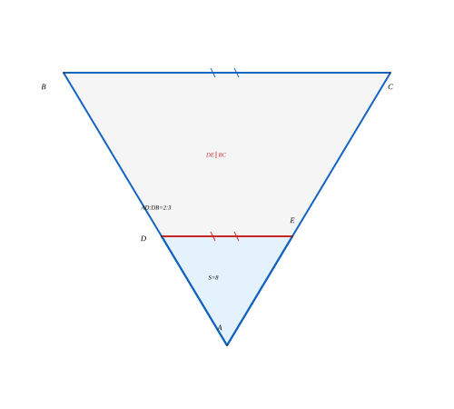

如图，$\triangle ABC$ 中，$DE \parallel BC$，$AD:DB = 2:3$，$\triangle ADE$ 的面积为 $8$，求 $\triangle ABC$ 的面积。

**4.** 已知 $\triangle ABC$ 的三边分别为 $6$、$8$、$10$，判断该三角形是否为直角三角形，并求其面积。

**5.** 一个四边形的四个内角之比为 $3:4:5:6$，求各内角的度数。（关注：多边形内角和公式 $S=(n-2)\cdot180^\circ$）

**6.** 圆 $O$ 的半径为 $5$，圆心 $O$ 到弦 $AB$ 的距离为 $3$，求弦 $AB$ 的长。（考察垂径定理）

**7.** 在 $\triangle ABC$ 中，$BD$ 是 $\angle B$ 的平分线，过 $D$ 作 $DE \parallel BC$ 交 $AB$ 于 $E$。求证 $BE = DE$。

**8.** 已知 $a, b, c$ 是 $\triangle ABC$ 的三边，化简：$|a - b + c| + |a + b - c| - |b + c - a|$。

**9.** 证明：矩形的两条对角线相等。（提示：用勾股定理分别计算两条对角线的长度）

**10.** 矩形的两条对角线交角为 $60^\circ$，对角线长为 $10$，求矩形的长和宽。

**11.** 等腰三角形 $ABC$ 中 $AB=AC$，$\angle A = 50^\circ$，求底角和 $\angle A$ 处的外角。

**12.** 在 $\triangle ABC$ 中，$AD$ 既是 $BC$ 边上的中线又是 $BC$ 上的高，求证 $AB = AC$。

**13.** 判断三边长 $7$、$24$、$25$ 能否构成直角三角形，若能求其面积。

**14.** 直角三角形的两直角边之和为 $14$，斜边为 $10$，求它的面积。

**15.** 矩形 $ABCD$ 中 $AB=5$，$BC=12$，对角线 $AC$ 与 $BD$ 交于 $O$，求 $AC$ 与 $AO$ 的长。

**16.** 菱形的边长为 $5$，一条对角线长为 $6$，求另一条对角线及面积。

**17.** 正方形 $ABCD$ 的边长为 $2$，$E$ 是 $AD$ 的中点，求 $BE$ 的长。

**18.** $\angle 1$ 与 $\angle 2$ 互为邻补角，且 $\angle 1 = 2\angle 2$，求 $\angle 1$ 与 $\angle 2$。

**19.** 直线 $a \parallel b$，$\angle 1$ 与 $\angle 2$ 是同旁内角，且 $\angle 1 = 3\angle 2$，求 $\angle 1$ 与 $\angle 2$。

**20.** 点 $O$ 在 $\angle BAC$ 的平分线上，过 $O$ 作 $OD \perp AB$ 于 $D$、$OE \perp AC$ 于 $E$，求证 $OD = OE$。

**21.** 求证：等腰三角形两腰上的高相等。

**22.** 求证：等腰三角形底边上的中线也就是底边上的高（三线合一）。

**23.** 在 $30^\circ$–$60^\circ$–$90^\circ$ 的直角三角形中，斜边长为 $8$，求两条直角边。

**24.** 两个相似三角形的周长比为 $2:5$，求它们的面积比。

**25.** 两个相似三角形的面积比为 $4:9$，求它们的相似比。

**26.** $\triangle ABC$ 中 $DE \parallel BC$ 交 $AB$、$AC$ 于 $D$、$E$，$AD=6$，$DB=4$，$DE=9$，求 $BC$。

**27.** 在 $\triangle ABC$ 中 $AD \perp BC$ 于 $D$，$AB=13$，$AC=15$，$BD=5$，求 $DC$ 与 $BC$。

**28.** 圆 $O$ 的半径为 $13$，弦 $AB$ 的长为 $24$，求圆心到弦 $AB$ 的距离。

**29.** 圆 $O$ 的半径为 $10$，圆心到弦 $AB$ 的距离为 $6$，求弦 $AB$ 的长。

**30.** 圆 $O$ 中 $AB$ 是直径，$C$ 是圆上一点，$\angle ABC = 30^\circ$，求 $\angle A$。

**31.** 圆 $O$ 中，弦 $AB = CD$，$OM \perp AB$ 于 $M$，$ON \perp CD$ 于 $N$，求证 $OM = ON$。

**32.** 圆 $O$ 中 $AB$ 是直径，$C$ 是圆上一点，$\angle CBA = 40^\circ$，求 $\angle CAB$。

**33.** 求七边形的内角和。

**34.** 一个正多边形的每个外角为 $40^\circ$，求它的边数。

**35.** 等腰梯形的上底为 $6$、下底为 $14$、腰长为 $5$，求它的面积。

**36.** 求证：对角线互相平分的四边形是平行四边形。

**37.** 求证：对角线互相垂直的平行四边形是菱形。

**38.** 平行四边形 $ABCD$ 中，$\angle A : \angle B = 5:4$，求各内角。

**39.** 矩形 $ABCD$ 中 $AB=6$，$BC=8$，求对角线长和面积。

**40.** 等腰三角形的顶角为 $120^\circ$，腰长 $8$，求底边长。

**41.** 等边三角形的边长为 $6$，求它的高与外接圆半径。

**42.** 一个三角形的两个内角为 $40^\circ$ 和 $80^\circ$，求它的最小外角。

**43.** 圆 $O$ 半径 $5$，两条平行弦 $AB\parallel CD$ 在圆心同侧，圆心到 $AB$ 的距离为 $4$、到 $CD$ 的距离为 $3$，求 $AB$ 与 $CD$ 的长。

**44.** 从直线外一点向该直线引线段，什么时候最短？

**45.** 三角形的三边为三个连续整数，周长为 $12$，求各边并判断其类型。

**46.** 等腰直角三角形的斜边为 $6\sqrt{2}$，求腰长。

**47.** 判断三边长 $5$、$6$、$8$ 构成的三角形是锐角、直角还是钝角三角形。

**48.** 两个相似三角形的对应高之比为 $3:4$，求面积比。

**49.** 边长为 $3$ 的正方形，求它的外接圆半径。

**50.** 圆中圆心角为 $60^\circ$，求同弧所对的圆周角。

**51.** 半径为 $5$ 的圆中，$60^\circ$ 的圆心角所对的弦长是多少？

**52.** 三边长分别为 $13$、$14$、$15$ 的三角形，求它的面积。

**53.** 圆 $O$ 中弦 $AB$ 的长为 $8$，圆心到弦距离为 $3$，求圆的半径。

**54.** 求证：平行四边形的对角相等。

**55.** 求证：等腰三角形的两个底角相等。

**56.** 梯形的两底之差为 $4$，中位线长为 $7$，求两底的长。

**57.** 直角三角形的两条直角边为 $6$ 和 $8$，求斜边上的高。

**58.** 一个多边形的内角和为 $1440^\circ$，求它的边数。

**59.** 菱形的一条对角线长为 $10$，面积为 $30$，求它的边长。

**60.** $\triangle ABC \sim \triangle DEF$，$AB=6$，$DE=9$，求周长比与面积比。

**61.** 圆 $O$ 中有两平行弦 $AB\parallel CD$，求证 $\widehat{AC} = \widehat{BD}$。

**62.** 圆 $O$ 中，$\widehat{AB}$ 所对圆心角为 $90^\circ$，半径 $6$，求弦 $AB$ 的长。

**63.** 半径为 $10$ 的圆，求内接正方形的边长。

**64.** 求半径为 $5$ 的圆内接等边三角形的边长。

**65.** $\triangle ABC$ 中，$D$、$E$ 分别为 $AB$、$AC$ 的中点，$DE=5$，求 $BC$。

**66.** 直角三角形斜边长为 $20$，求斜边上的中线长。

**67.** 菱形的一个角为 $60^\circ$，边长为 $4$，求两条对角线及面积。

**68.** 矩形的一条对角线与之交角为 $60^\circ$，短边为 $5$，求长边。

**69.** 两个相似三角形的面积分别为 $9$ 和 $25$，求它们对应边的比。

**70.** $\triangle ABC$ 中 $DE\parallel BC$，$AD:AB=2:5$，若 $\triangle ADE$ 的周长为 $8$，求 $\triangle ABC$ 的周长。

**71.** 边长为 $12$ 的等边三角形，求它的面积。

**72.** 直角三角形的一条直角边比另一条小 $1$，斜边比长的直角边大 $1$，求三边的长。

**73.** 圆 $O$ 中直径 $AB=10$，弦 $AC=6$，连接 $BC$，求 $BC$。

**74.** 圆 $O$ 中弧 $AB:BC:CA=2:3:5$，求各弧所对的圆心角。

**75.** 求证：直径是圆中最长的弦。

**76.** 圆内接四边形 $ABCD$ 中 $\angle A=80^\circ$，求 $\angle C$。

**77.** 圆的半径从 $3$ 增加到 $4$，面积增加多少？

**78.** 正多边形每个外角为 $45^\circ$，求边数。

**79.** $\triangle ABC$ 中 $AD$ 平分 $\angle BAC$，$\angle BAD = 30^\circ$，求 $\angle BAC$。

**80.** 任意四边形各边中点的连线构成什么图形？

**81.** 直角三角形的两个锐角之和是多少度？

**82.** 两个相似三角形的相似比为 $4:5$，求它们对应角平分线的比。

**83.** 直角三角形的一条直角边为 $7$，斜边为 $25$，求另一条直角边。

**84.** 圆内接四边形的两对对角之和分别是多少？

**85.** 矩形的面积为 $48$，对角线长为 $10$，求长和宽。

**86.** 求证：三角形的三个内角中最多只有一个钝角。

**87.** 利用"两点之间线段最短"，说明三角形两边之和大于第三边。

**88.** 等腰三角形的顶角处外角为 $110^\circ$，求顶角和底角。

**89.** 直角三角形斜边为 $13$，一条直角边为 $5$，求另一条直角边和面积。

**90.** 判断三边长 $5$、$11$、$13$ 构成的三角形是锐角、直角还是钝角三角形。

**91.** 半径为 $5$ 的圆中，最长弦的长度是多少？

**92.** 圆 $O$ 中 $AB$ 是直径，弦 $CD \perp AB$ 于 $E$，若 $CD=8$、$AE=2$，求圆的半径。

**93.** $\triangle ABC$ 中 $\angle A=70^\circ$，$BD$、$CE$ 是高，$H$ 为垂心，求 $\angle BHC$。

**94.** $\triangle ABC$ 中 $\angle A=60^\circ$，$I$ 为内心，求 $\angle BIC$。

**95.** 直角三角形 $ABC$ 中 $\angle C=90^\circ$，$CD \perp AB$ 于 $D$，$AD=3$，$DB=12$，求 $CD$。

**96.** 直角三角形中一直角边为 $\sqrt{3}$，另一直角边为 $1$，求斜边。

**97.** 两个等腰三角形相似，一个的腰为 $5$、底为 $6$，另一个的底为 $12$，求另一个的腰。

**98.** 正方形的对角线与边长之比是多少？

**99.** 菱形的两条对角线长为 $8$ 和 $15$，求它的面积。

**100.** 圆 $O$ 中弦 $AB$、$CD$ 相交于 $E$，$AE=4$，$EB=6$，$CE=3$，求 $ED$。

**101.** 从圆外一点 $P$ 引切线 $PA$（切点 $A$），割线交圆于 $B$、$C$ 两点，$PA=6$，$PB=4$，求 $BC$。

**102.** 圆外一点到圆心的距离为 $5$，圆半径 $3$，求从该点所引切线的长。

**103.** 判断三边长 $3$、$4$、$6$ 能否构成三角形，若能判断其类型。

**104.** $\triangle ABC$ 中 $AD$ 平分 $\angle A$ 交 $BC$ 于 $D$，$AB=6$，$AC=9$，$BD=4$，求 $DC$。

**105.** 求证：等边三角形每条边的中线、高和角平分线是同一条线段。

**106.** 梯形中位线长为 $9$、高为 $6$，求它的面积。

**107.** 等腰三角形的两条边长分别为 $5$ 和 $12$，求它的周长。

**108.** 圆 $O$ 中 $\angle AOB=140^\circ$，求劣弧 $\widehat{AB}$ 所对的圆周角。

**109.** 求证：直角三角形斜边上的中线等于斜边的一半。

**110.** $\triangle ABC \sim \triangle DEF$，面积比 $4:9$，$\triangle ABC$ 周长为 $8$，求 $\triangle DEF$ 的周长。

---

### 14.3 挑战题

**1.** 在 $\triangle ABC$ 中，$AD$ 是 $BC$ 边上的高，$AB = 13$，$BC = 14$，$AC = 15$。求 $AD$ 的长度。

**提示**：设 $BD = x$，则 $DC = 14 - x$，利用勾股定理列方程。

**2.** 

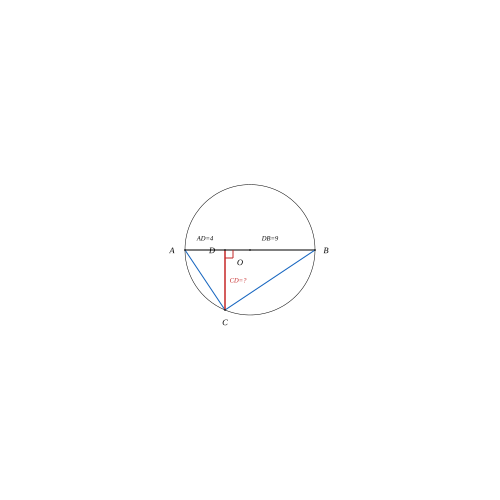

如图，$AB$ 是圆 $O$ 的直径，$C$ 是圆上一点，$CD \perp AB$ 于 $D$。若 $AD = 4$，$DB = 9$，求 $CD$ 的长度。

**提示**：连接 $AC$ 和 $BC$，利用泰勒斯定理和射影定理（或相似三角形）。

**3.** 菱形的两条对角线长分别为 $6$ 和 $8$，求菱形的周长与面积。（关注：菱形对角线互相垂直平分）

**4.** 正方形 $ABCD$ 的边长为 $s$，等边 $\triangle ABE$ 的边长为 $a$，且两者面积相等。求 $a : s$ 的值。

**5.** 在 $\triangle ABC$ 中，$D, E, F$ 分别是 $AB, BC, CA$ 的中点。
(a) 证明：四边形 $DECF$ 是平行四边形。
(b) 若 $AB = 6$，$BC = 8$，$CA = 10$，求四边形 $DECF$ 的周长。

**6.** 求三边长 $13$、$14$、$15$ 的三角形中，$14$ 边上的高。

**7.** 等腰三角形的顶角为 $120^\circ$、腰长 $4$，求它的面积和底边长。

**8.** 直角三角形的两条直角边为 $7$ 和 $24$，求斜边。

**9.** 直角三角形两直角边之比为 $3:4$，斜边为 $20$，求两条直角边。

**10.** 半径为 $5$ 的圆内接正方形，求它的面积。

**11.** 从圆外一点 $P$ 引两条切线 $PA$、$PB$，圆半径 $5$，$OP=13$，求切线长。

**12.** 求证：等腰三角形底边中点到两腰的距离相等。

**13.** 圆 $O$ 中直径 $AB=10$，点 $P$ 在圆内距圆心 $3$，求过 $P$ 的最短弦长。

**14.** 求证：三角形的三条角平分线交于一点（即存在内心）。

**15.** 求边长为 $1$ 的等边三角形的内切圆半径与外接圆半径。

**16.** 求证：在直角三角形中，$30^\circ$ 角所对的直角边等于斜边的一半。

**17.** 圆 $O$ 中直径 $AB$、$CD$ 相互垂直，求 $\widehat{AC}$ 的度数及四边形 $ACBD$ 的形状。

**18.** 矩形 $ABCD$ 中 $AB=6$，$BC=8$，从顶点 $B$ 向对角线 $AC$ 作垂线 $BE$，求 $BE$ 的长。

**19.** 判断三边长 $10$、$24$、$26$ 是否构成直角三角形并求面积。

**20.** 圆 $O$ 半径 $5$，弦 $AB=8$，求弦 $AB$ 到劣弧的距离（弓形高）。

**21.** 等腰三角形 $AB=AC=13$，$BC=10$，求底边上的高和面积。

**22.** 正方形 $ABCD$ 边长 $6$，$E$ 为 $BC$ 中点，连接 $AE$，求 $\triangle ABE$ 的面积。

**23.** 小明的身高为 $1.6$ 米，影长为 $2$ 米；同时旗杆影长为 $9$ 米，求旗杆高度。

**24.** 圆 $O$ 中弦 $AB$ 的中点到圆心距离为 $12$，半径为 $13$，求 $AB$。

**25.** 直角三角形两直角边为 $6$ 和 $8$，求它的外接圆半径。

**26.** 直角三角形两直角边为 $6$ 和 $8$，求它的内切圆半径。

**27.** 正六边形的边长为 $6$，求它的面积和外接圆半径。

**28.** 直角三角形 $ABC$ 中 $\angle B=90^\circ$，$AB=6$，$BC=8$，$BD \perp AC$ 于 $D$，求 $AD$。

**29.** 圆 $O$ 中弧 $\widehat{AB}$ 的度数为 $120^\circ$，求该弧所对的优弧上的圆周角。

**30.** 三边长 $6$、$8$、$10$ 的三角形，求它的面积。

**31.** 判断三边长 $10$、$24$、$26$ 是否为直角三角形，并求外接圆半径。

**32.** 圆 $O$ 半径 $6$，从圆外一点 $P$（$PO=10$）引切线 $PT$ 切圆于 $T$，求 $PT$。

**33.** 求证：从圆外一点引圆的两条切线，两切线长相等。

**34.** 圆内切于四边形 $ABCD$，$AB=7$，$BC=8$，$CD=9$，求 $DA$。

**35.** 求正五边形的每个内角。

**36.** 求证：等腰梯形的两条对角线相等。

**37.** 在 $\triangle ABC$ 中，$\angle A = \angle B + \angle C$，判断三角形的类型。

**38.** $\triangle ABC$ 中 $D,E,F$ 分别是三边中点，$\triangle DEF$ 的面积是 $\triangle ABC$ 面积的几分之几？

**39.** 半径为 $4$ 的圆内接正三角形，求它的面积。

**40.** 求证：平行于三角形一边的直线截其他两边，所得的对应线段成比例。

**41.** 直角三角形的斜边为 $17$，两直角边之差为 $7$，求两直角边。

**42.** 半径分别为 $3$ 和 $8$ 的两个圆内切，求圆心距。

**43.** 圆 $O$ 半径 $13$，弦 $AB=24$，求弦 $AB$ 到较近弧的距离（弓形高）。

**44.** 直角三角形两直角边为 $5$ 和 $12$，求内切圆半径。

**45.** 一根电线杆的影长为 $12$ 米，同时一位身高 $1.8$ 米的人影长为 $1.2$ 米，求电线杆高度。

**46.** 求证：对顶角相等。

### 14.4 探究题

**1.** 【指引】勾股定理有上千种证明，其中"赵爽弦图"用面积法证明：构造边长为 $c$ 的大正方形，内部留着边长为 $b-a$ 的小正方形，周围是四个直角边分别为 $a,b$ 的直角三角形。请按照这一图形列出面积等式，进而推出 $a^2+b^2=c^2$；思考"同一个图形的两种面积算法相等"这一思想还能用在哪些几何问题中。

**2.** 【指引】三角形的三条内角平分线交于一点（内心），且内心到三边距离相等。请说明：内心为什么是"到三边距离都相等"的唯一一点？再考察：内心把三角形分成的三个小三角形 $\triangle IAB$、$\triangle IBC$、$\triangle ICA$ 的面积与三边 $AB,BC,CA$ 有什么关系？

---

**3.** 【指引】在圆 $O$ 中，$AB$ 和 $CD$ 是两条弦，且 $AB = CD$。利用圆的轴对称性和垂径定理，证明：$AB$ 和 $CD$ 到圆心 $O$ 的距离相等。进一步思考：其逆命题"到圆心距离相等的弦长度相等"是否成立？请给出证明。

**4.** 【指引】海伦公式：三边为 $a,b,c$ 的三角形，半周长 $p=\frac{a+b+c}{2}$，面积 $S=\sqrt{p(p-a)(p-b)(p-c)}$。请用该公式验证三边 $13,14,15$ 的三角形面积为 $84$，并思考它与勾股定理、射影定理的联系。

**5.** 【指引】勾股定理的"总统证法"：把直角边分别为 $a,b$、斜边为 $c$ 的两个全等直角三角形，与直角边为 $b-a$ 的等腰直角三角形拼成一个直角梯形。请写出两种面积算法并列成等式，推出 $a^2+b^2=c^2$。

**6.** 【指引】圆的对称性：为什么圆有无数条对称轴？请说明"绕圆心旋转任意角度都与自身重合"的旋转对称性与"沿任意直径对折重合"的轴对称性，并与正三角形、矩形、正六边形的对称轴数量作比较。

**7.** 【指引】三角形的"四心"：请比较等腰三角形与等边三角形中，重心、垂心、内心、外心这四个点的位置，判断它们是否重合，并说明理由（等边三角形的情况尤其重要）。

**8.** 【指引】地图比例尺：在地图上量得 $A$、$B$ 两城相距 $4$ cm，比例尺为 $1:500000$，求实际距离（km）；并说明为什么地图上量得的面积要乘以比例尺的平方才等于实际面积。

**9.** 【指引】用"对称折叠"证明垂径定理：把圆沿直径 $CD$ 对折，说明弦 $AB$（当 $CD \perp AB$ 时）的两半为何重合，从而得出 $AE=EB$ 及两段弧相等，最终证明垂径定理。

**10.** 【指引】泰勒斯定理与画直角：请说明木工如何"用圆规先找一条线段的中点，再以中点为圆心、线段一半为半径画半圆，在半圆上任取一点"，得到该点与线段两端连线的夹角为直角。请用泰勒斯定理证明。

**11.** 【指引】勾股数：请找两组新的互质勾股数（如 $8,15,17$、$7,24,25$ 之外），并说明用公式 $a=m^2-n^2,\ b=2mn,\ c=m^2+n^2$（$m>n$ 为正整数）可以产生无穷多组勾股数。

**12.** 【指引】同高的三角形面积比等于底之比：请证明这一结论，并由此说明"内心把三角形分成的三个小三角形面积之比等于三边之比 $AB:BC:CA$"。

**13.** 【指引】圆内接四边形对角互补：请用圆周角定理证明"圆内接四边形的一组对角之和为 $180^\circ$"，并探究其逆定理在什么条件下成立。

**14.** 【指引】中点四边形：请用中位线定理证明"任意四边形各边中点连成的四边形是平行四边形"，并讨论：当原四边形是矩形、菱形、正方形时，中点四边形分别是什么？

**15.** 【指引】弦长与弦心距：圆中被圆心垂距更近的弦更长。请用勾股定理说明理由，并思考为什么直径（过圆心的弦）是圆中最长的弦、对应弦心距为 $0$。

**16.** 【指引】对称轴统计：等腰三角形、等边三角形、矩形、正方形、圆各有多少条对称轴？请列出对称轴数量，并用"对称轴越多越规则"总结规律，举例说明对称在建筑、自然与工程中的体现。

**17.** 【指引】勾股定理的面积法：用"四个全等直角三角形拼成边长为 $a+b$ 的大正方形，中间留下边长为 $c$ 的小正方形"这一图形，写出两种面积算法并推出 $a^2+b^2=c^2$。

**18.** 【指引】相似测距：请设计一种利用相似三角形测量"河宽"或"一栋楼高"的方案（如标杆法、影长法），说明所需测量的量以及用到的几何定理（如 $AA$ 相似、对应边成比例）。

**19.** 【指引】等弦对等角：在圆 $O$ 中，若两条弦 $AB=CD$，证明它们所对的圆心角相等、圆周角相等，从而体会圆中"弦 $\leftrightarrow$ 弧 $\leftrightarrow$ 圆心角 $\leftrightarrow$ 圆周角"的对应关系。

**20.** 【指引】勾股定理逆定理：谈谈如何用 $a^2+b^2=c^2$ 判断一个三角形是否为直角三角形（把最长边作为 $c$），并说明逆定理为什么成立（边长的代数关系唯一确定三角形的角）。

**21.** 【指引】尺规作图：请用文字描述"作一个已知角的平分线"的作图步骤（圆规 + 无刻度直尺），并说明该作图依据了"到角两边距离相等的点、又在角内，则必在角平分线上"的性质。

**22.** 【指引】综合回顾：请从本章定理（勾股定理、平行线性质、全等判定、相似判定、圆周角定理、泰勒斯定理、垂径定理、射影定理）中任选两个，说明各自的证明思路，并各举一个现实应用场景。

---

## 15. 习题答案与解析

> **使用说明**：答案按「14. 习题」的分级排列（15.1 对应 14.1 基础题，15.2 对应 14.2 进阶题，15.3 对应 14.3 挑战题），另附 15.4 专题练习答案（对应第 6、7、10、11 节的针对性练习）与 15.5 探究题参考答案（对应 14.4）。建议先独立作答、至少思考 $15$ 分钟再看答案。

### 15.1 基础题答案

**1.** $\angle C = 180^\circ - 70^\circ - 50^\circ = 60^\circ$。三个角均小于 $90^\circ$，为锐角三角形。

**2.** 由勾股定理，$c=\sqrt{5^2+12^2}=\sqrt{25+144}=\sqrt{169}=13$，斜边为 $13$。

**3.** 由 $AB\parallel CD$：$\angle 2$ 与 $\angle 1$ 是同位角，故 $\angle 2=\angle 1=65^\circ$；$\angle 3$ 与 $\angle 1$ 是同旁内角，故 $\angle 3=180^\circ-65^\circ=115^\circ$。

**4.** (a) 三组边对应相等（SSS），**可判定**全等；(b) 已知两边及其中一边所对的角（SSA），**不能**唯一确定三角形，故不可判定；(c) 两角及其夹边对应相等（ASA），**可判定**全等。

**5.** 对顶角相等：$\angle 3=\angle 1=65^\circ$；$\angle 2$、$\angle 4$ 与 $\angle 1$ 相邻，为邻补角，各为 $180^\circ-65^\circ=115^\circ$。

**6.** 由圆周角定理，$\angle ACB=\frac12\angle AOB=\frac12\times80^\circ=40^\circ$。

**7.** (a) $35^\circ$ 的余角 $= 90^\circ - 35^\circ = 55^\circ$；补角 $= 180^\circ - 35^\circ = 145^\circ$。
(b) 设这个角为 $x$。由题意 $180^\circ - x = 3(90^\circ - x)$，即 $180^\circ - x = 270^\circ - 3x$，$2x = 90^\circ$，$x = 45^\circ$。

**8.** (a) 平行四边形对角线互相平分：$OA = \frac{AC}{2} = 5$，$OB = \frac{BD}{2} = 6$。
(b) 在 $\triangle OAB$ 中，由三边关系 $|OA - OB| < AB < OA + OB$，即 $1 < AB < 11$。

**9.** 菱形对角线互相垂直平分，半对角线长为 $3$ 和 $4$。边长 $= \sqrt{3^2 + 4^2} = \sqrt{9 + 16} = \sqrt{25} = 5$。

**10.** 作 $OM \perp AB$ 于 $M$，由垂径定理 $AM = \frac{AB}{2} = 3$。$OM = \sqrt{OA^2 - AM^2} = \sqrt{25 - 9} = 4$。
作 $ON \perp CD$ 于 $N$，$CN = \frac{CD}{2} = 4$。$ON = \sqrt{OC^2 - CN^2} = \sqrt{25 - 16} = 3$。
$ON < OM$，故弦 $CD$ 离圆心更近（弦越长，弦心距越小）。

**11.** 设 $AC=x$，则 $CB=3x$，$x+3x=12$，$x=3$，故 $AC=3$。

**12.** 这个角 $=90^\circ-28^\circ=62^\circ$；补角 $=180^\circ-62^\circ=118^\circ$。

**13.** 设这个角为 $x$，$180^\circ-x=x+40^\circ$，解得 $x=70^\circ$。

**14.** 对顶角相等：$2x=140^\circ$，$x=70$；邻补角各为 $180^\circ-70^\circ=110^\circ$。四个角为 $70^\circ,110^\circ,70^\circ,110^\circ$。

**15.** 内角和 $=(9-2)\times180^\circ=1260^\circ$；任意多边形外角和恒为 $360^\circ$。

**16.** $\frac{(n-2)\times180^\circ}{n}=120^\circ\Rightarrow n=6$（正六边形）。

**17.** 设三内角分别为 $2k,3k,4k$，$2k+3k+4k=180^\circ$，$k=20^\circ$，最大角 $=4k=80^\circ$。

**18.** 顶角 $=180^\circ-2\times70^\circ=40^\circ$。

**19.** 底角 $=\frac{180^\circ-36^\circ}{2}=72^\circ$。

**20.** 由内错角相等 $\angle1=65^\circ$；所求为与 $\angle1$ 同旁的内角 $=180^\circ-65^\circ=115^\circ$。

**21.** 不能。因为 $3+4=7$ 不大于第三边 $7$，不满足"两边之和大于第三边"。

**22.** 由三边关系 $|9-5|<x<9+5$，即 $4<x<14$。

**23.** $c=\sqrt{6^2+8^2}=\sqrt{100}=10$。

**24.** $b=\sqrt{13^2-5^2}=\sqrt{169-25}=\sqrt{144}=12$。

**25.** $5^2+12^2=25+144=169=13^2$，满足勾股定理，能构成直角三角形。

**26.** 周长 $=2(4+7)=22$。

**27.** 另一边 $=\sqrt{10^2-6^2}=\sqrt{100-36}=8$。

**28.** 边长为 $6$，对角线 $=6\sqrt2$。

**29.** 周长 $=4\times5=20$。

**30.** 面积 $=\frac{(4+9)\times6}{2}=39$。

**31.** 直径 $=2r=8$。

**32.** 半径 $=5$，周长 $=2\pi r=10\pi$。

**33.** 由圆周角定理，圆周角 $=\frac12\times110^\circ=55^\circ$。

**34.** 由泰勒斯定理（直径所对圆周角是直角），$\angle ACB=90^\circ$。

**35.** 全等三角形对应边相等：$DE=6$，$EF=8$，$DF=7$。

**36.** $\frac{AB}{DE}=\frac23\Rightarrow DE=\frac32\times4=6$。

**37.** $\angle C=180^\circ-40^\circ-70^\circ=70^\circ$，三角均小于 $90^\circ$，为锐角三角形。

**38.** 另一锐角 $=90^\circ-35^\circ=55^\circ$。

**39.** 等边三角形每个内角为 $60^\circ$。

**40.** 外角等于不相邻两内角和，设两内角各 $x$，$2x=120^\circ$，$x=60^\circ$。

**41.** $8^2+15^2=64+225=289=17^2$，能构成直角三角形。

**42.** 斜边 $=\sqrt{3^2+4^2}=5$。

**43.** 对角线 $=\sqrt{a^2+a^2}=a\sqrt2$。

**44.** 对角相等：$\angle C=\angle A=70^\circ$；同旁内角互补：$\angle B=\angle D=180^\circ-70^\circ=110^\circ$。

**45.** 周长 $=2(3+4)=14$。

**46.** 对角线 $=\sqrt{3^2+4^2}=5$。

**47.** 面积 $=\frac12\times6\times8=24$。

**48.** 边长 $=20\div4=5$，面积 $=5^2=25$。

**49.** 中位线 $=\frac{4+10}{2}=7$。

**50.** 面积 $=\pi\times5^2=25\pi$。

**51.** 半径 $=4$，周长 $=2\pi\times4=8\pi$。

**52.** 由圆周角定理，圆心角 $=2\times40^\circ=80^\circ$。

**53.** 直径之比 $=6:10=3:5$（与半径比相同）。

**54.** 全等三角形对应角相等，$\angle D=\angle A=50^\circ$。

**55.** 面积相等。

**56.** 面积比 $=$ 相似比的平方 $=\left(\frac12\right)^2=\frac14$，$S_{\triangle DEF}=5\times4=20$。

**57.** 相似比 $=AB:DE=6:9=2:3$。

**58.** $\triangle ABC$ 周长 $=5+7+6=18$，全等三角形周长相等，故 $\triangle DEF$ 周长为 $18$。

**59.** 设角为 $x$，$x=180^\circ-x$，$x=90^\circ$。

**60.** 设角为 $x$，$x=90^\circ-x$，$x=45^\circ$。

**61.** 对顶角相等，$\angle2=70^\circ$。

**62.** $\angle C=180^\circ-60^\circ-80^\circ=40^\circ$；$\angle C$ 处外角 $=\angle A+\angle B=140^\circ$。

**63.** $D,E,F$ 是中点，$\triangle DEF$ 各边为 $\triangle ABC$ 中位线（长等于对边一半），故其周长 $=\frac12\times20=10$。

**64.** 直角三角形斜边上的中线等于斜边的一半，故为 $5$。

**65.** 圆周角 $=\frac12$ 圆心角 $=\frac12\times90^\circ=45^\circ$。

**66.** 直径所对圆周角是直角，$\angle ACB=90^\circ$。

**67.** $DE\parallel BC\Rightarrow\triangle ADE\sim\triangle ABC$，$\frac{AD}{AB}=\frac{AE}{AC}$，$\frac{4}{6}=\frac{5}{5+EC}$，解得 $EC=2.5$。

**68.** $\frac{DE}{BC}=\frac{AD}{AB}=\frac{3}{9}=\frac13$，$BC=3\times2=6$。

**69.** 面积比 $=$ 相似比平方 $=3^2:5^2=9:25$。

**70.** 周长比 $=$ 相似比 $=2:3$。

**71.** 另一条直角边 $=\sqrt{41^2-40^2}=\sqrt{1681-1600}=\sqrt{81}=9$。

**72.** $9^2+12^2=81+144=225=15^2$，能构成直角三角形。

**73.** 高线平分底边，高 $=\sqrt{10^2-6^2}=\sqrt{100-36}=8$。

**74.** 高 $=\sqrt{5^2-3^2}=4$，面积 $=\frac12\times6\times4=12$。

**75.** 半弦 $=\sqrt{5^2-4^2}=3$，弦长 $=2\times3=6$。

**76.** 半弦 $=3$，弦心距 $=\sqrt{5^2-3^2}=\sqrt{16}=4$。

**77.** 内切时圆心距 $=$ 半径差 $=5-2=3$。

**78.** $7>5$，点 $A$ 到圆心距离大于半径，故 $A$ 在圆外。

**79.** 设边长 $a$，$a\sqrt2=4\sqrt2$，$a=4$。

**80.** 面积 $=\frac12 d_1d_2$：$24=\frac12\times6\times d_2$，$d_2=8$。

**81.** 面积 $=$ 底 $\times$ 高 $=5\times8=40$。

**82.** 面积 $=\frac12\times6\times9=27$。

**83.** 面积 $=\frac{(a+b)h}{2}$：$30=\frac{(4+b)\times6}{2}$，$4+b=10$，$b=6$。

**84.** $30^\circ$ 所对直角边 $=$ 斜边一半 $=6$。

**85.** 同弧所对圆周角相等，$\angle ADB=\angle ACB=50^\circ$。

**86.** 直径。

**87.** 周长 $=2\pi r=8\pi$；面积 $=\pi r^2=16\pi$。

**88.** 钝角（锐角的补角 $=180^\circ-$ 锐角 $>90^\circ$）。

**89.** 重心。

**90.** 三条边垂直平分线（中垂线）的交点。

**91.** 相等。角平分线上的点到角两边距离相等。

**92.** 相等。垂直平分线上的点到线段两端距离相等。

**93.** $BC=\sqrt{3^2+4^2}=\sqrt{25}=5$。

**94.** 高 $=\sqrt{13^2-5^2}=\sqrt{169-25}=12$（米）。

**95.** HL（斜边直角边）。

**96.** SSS。

**97.** SAS（两边及其夹角相等）。

**98.** 顶角 $=180^\circ-2\times65^\circ=50^\circ$。

**99.** 高 $=\frac{\sqrt3}{2}\times6=3\sqrt3$。

**100.** 面积 $=\frac{\sqrt3}{4}\times4^2=4\sqrt3$。

**101.** 面积比 $=$ 相似比平方 $=4$，$S_{\triangle DEF}=12\div4=3$。

**102.** $\frac{DE}{BC}=\frac{AD}{AB}=\frac{2}{6}=\frac13$。

**103.** 内角和 $=(12-2)\times180^\circ=1800^\circ$。

**104.** $\frac{(8-2)\times180^\circ}{8}=135^\circ$。

**105.** $(5-2)\times180^\circ=540^\circ$。

**106.** 对顶角相等，$\angle2=110^\circ$。

**107.** 面积 $=\pi\times3^2=9\pi$，周长 $=2\pi\times3=6\pi$。

**108.** 半圆；所对圆周角 $=\frac12\times180^\circ=90^\circ$。

**109.** 正方形。

**110.** 平行四边形。

**111.** 不能。四边形不稳定（四边确定但形状不唯一）。

**112.** 一定相似（AA 判定，第三角也由内角和确定）。

**113.** SAS（相似判定）。

**114.** 直角三角形（勾股定理逆定理）。

### 15.2 进阶题答案

**1.** 由 $AB=AC$ 得 $\angle B=\angle C=\frac{180^\circ-40^\circ}{2}=70^\circ$。$BD$ 平分 $\angle B$，故 $\angle ABD=35^\circ$。在 $\triangle ABD$ 中 $\angle ADB=180^\circ-40^\circ-35^\circ=105^\circ$；$\angle BDC$ 与 $\angle ADB$ 为邻补角，故 $\angle BDC=180^\circ-105^\circ=75^\circ$。

**2.** 作 $OE\perp AB$ 于 $E$，由垂径定理 $AE=\frac12 AB=4$。在 $\text{Rt}\triangle OAE$ 中，$OE=\sqrt{OA^2-AE^2}=\sqrt{25-16}=3$。

**3.** $DE\parallel BC\Rightarrow\triangle ADE\sim\triangle ABC$。由 $AD:DB=2:3$ 得 $AD:AB=2:5$，故相似比 $k=\frac25$。面积比为 $k^2=\frac{4}{25}$，所以 $S_{\triangle ABC}=8\times\frac{25}{4}=50$。

**4.** $6^2+8^2=36+64=100=10^2$，满足勾股定理，故为直角三角形，$10$ 是斜边，面积 $S=\frac12\cdot6\cdot8=24$。

**5.** 四边形内角和为 $(4-2)\times180^\circ=360^\circ$。设四角为 $3x,4x,5x,6x$，则 $18x=360^\circ$，$x=20^\circ$，四角分别为 $60^\circ,80^\circ,100^\circ,120^\circ$。

**6.** 作 $OE\perp AB$，由垂径定理 $AE=\frac12 AB$。在 $\text{Rt}\triangle OAE$ 中 $AE=\sqrt{OA^2-OE^2}=\sqrt{25-9}=4$，故 $AB=2AE=8$。

**7.** $BD$ 平分 $\angle B$，故 $\angle EBD = \angle DBC$。又 $DE \parallel BC$，故 $\angle EDB = \angle DBC$（内错角相等）。因此 $\angle EBD = \angle EDB$，所以 $BE = DE$（等角对等边）。

**8.** 由三角形三边关系：$a + c > b \Rightarrow a - b + c > 0$；$a + b > c \Rightarrow a + b - c > 0$；$b + c > a \Rightarrow b + c - a > 0$。
原式 $= (a - b + c) + (a + b - c) - (b + c - a) = a - b + c + a + b - c - b - c + a = 3a - b - c$。

**9.** 设矩形 $ABCD$ 的长为 $a$，宽为 $b$。在 $\text{Rt}\triangle ABC$ 中，$AC = \sqrt{a^2 + b^2}$。在 $\text{Rt}\triangle ABD$ 中，$BD = \sqrt{a^2 + b^2}$。故 $AC = BD$。

**10.** 设矩形长为 $a$，宽为 $b$，对角线 $= \sqrt{a^2 + b^2} = 10$，故 $a^2 + b^2 = 100$。对角线交角为 $60^\circ$，由对称性，较短边对应的半角为 $30^\circ$，故 $\frac{b}{a} = \tan 30^\circ = \frac{1}{\sqrt{3}}$，即 $a = b\sqrt{3}$。代入：$3b^2 + b^2 = 100$，$b^2 = 25$，$b = 5$，$a = 5\sqrt{3}$。矩形的长为 $5\sqrt{3}$，宽为 $5$。

**11.** 底角 $=\frac{180^\circ-50^\circ}{2}=65^\circ$；$\angle A$ 处外角 $=180^\circ-50^\circ=130^\circ$。

**12.** $AD\perp BC$ 且 $BD=DC$。在 $\text{Rt}\triangle ABD$ 与 $\text{Rt}\triangle ACD$ 中：$BD=DC$、$AD$ 公共、$\angle ADB=\angle ADC=90^\circ$，由 SAS（或 HL）得全等，故 $AB=AC$。

**13.** $7^2+24^2=49+576=625=25^2$，是直角三角形；面积 $=\frac12\times7\times24=84$。

**14.** 设两直角边为 $a,b$，$a+b=14$，$a^2+b^2=100$。$(a+b)^2=196=a^2+b^2+2ab=100+2ab$，得 $ab=48$，面积 $=\frac{ab}{2}=24$。

**15.** $AC=\sqrt{5^2+12^2}=13$；矩形对角线互相平分，$AO=\frac{13}{2}=6.5$。

**16.** 半对角线为 $3$ 和 $4$（$4=\sqrt{5^2-3^2}$），故另一条对角线 $=8$；面积 $=\frac12\times6\times8=24$。

**17.** $BE=\sqrt{AB^2+AE^2}=\sqrt{2^2+1^2}=\sqrt5$。

**18.** 设 $\angle2=x$，$\angle1=2x$，$x+2x=180^\circ$，$x=60^\circ$；$\angle1=120^\circ,\angle2=60^\circ$。

**19.** 同旁内角互补，设 $\angle2=x$，$\angle1=3x$，$4x=180^\circ$，$x=45^\circ$；$\angle1=135^\circ$。

**20.** 在 $\triangle AOD$ 与 $\triangle AOE$ 中：$\angle ODA=\angle OEA=90^\circ$、$\angle OAD=\angle OAE$、$AO$ 公共，由 AAS 得全等，$OD=OE$。

**21.** $AB=AC$，作 $BD\perp AC$、$CE\perp AB$。$\text{Rt}\triangle ABD$ 与 $\text{Rt}\triangle ACE$ 中 $\angle A$ 公共、$AB=AC$，由 AAS 全等，$BD=CE$。

**22.** $\triangle ABD$ 与 $\triangle ACD$：$AB=AC$、$BD=DC$（中线）、$AD$ 公共，SSS 全等，得 $\angle ADB=\angle ADC$ 且互补，故各为 $90^\circ$，即中线即高。

**23.** 短直角边 $=\frac12\times8=4$；另一直角边 $=4\sqrt3$。

**24.** 面积比 $=$ 相似比平方 $=2^2:5^2=4:25$。

**25.** 相似比 $=\sqrt{\frac49}=\frac23$。

**26.** $\triangle ADE\sim\triangle ABC$，$\frac{DE}{BC}=\frac{AD}{AB}=\frac{6}{10}$，$BC=\frac{10}{6}\times9=15$。

**27.** $AD=\sqrt{13^2-5^2}=12$；$DC=\sqrt{15^2-12^2}=9$；$BC=BD+DC=14$。

**28.** 半弦 $=12$，弦心距 $=\sqrt{13^2-12^2}=\sqrt{25}=5$。

**29.** 半弦 $=\sqrt{10^2-6^2}=8$，$AB=16$。

**30.** 直径所对圆周角 $90^\circ$：$\angle ACB=90^\circ$，$\angle A=180^\circ-90^\circ-30^\circ=60^\circ$。

**31.** 垂径定理：$AM=\frac12AB$、$CN=\frac12CD$；因 $AB=CD$，$AM=CN$。又 $OA=OC=r$，勾股定理 $OM=\sqrt{r^2-AM^2}=\sqrt{r^2-CN^2}=ON$。

**32.** $\angle ACB=90^\circ$，$\angle CAB=180^\circ-90^\circ-40^\circ=50^\circ$。

**33.** $(7-2)\times180^\circ=900^\circ$。

**34.** 外角和 $360^\circ$，边数 $n=\frac{360}{40}=9$。

**35.** 高 $=\sqrt{5^2-\left(\frac{14-6}{2}\right)^2}=\sqrt{25-16}=3$；面积 $=\frac{(6+14)\times3}{2}=30$。

**36.** 四边形 $AC$、$BD$ 交于 $O$ 且均互相平分：$AO=CO$、$BO=DO$，$\angle AOB=\angle COD$（对顶角），$\triangle AOB\cong\triangle COD$（SAS），$\angle OAB=\angle OCD$，$AB\parallel CD$；同理 $AD\parallel BC$，故为平行四边形。

**37.** 平行四边形 $ABCD$ 对角线互相平分，又 $AC\perp BD$。在 $\text{Rt}\triangle AOB$、$\text{Rt}\triangle BOC$ 中 $AO=CO$：$AB^2=AO^2+BO^2=CO^2+BO^2=BC^2$，$AB=BC$，邻边相等的平行四边形是菱形。

**38.** 相邻角互补，$5k+4k=180^\circ$，$k=20^\circ$；$\angle A=\angle C=100^\circ$，$\angle B=\angle D=80^\circ$。

**39.** 对角线 $=\sqrt{6^2+8^2}=10$；面积 $=6\times8=48$。

**40.** 作高：高 $=8\cos60^\circ=4$，底 $=2\times8\sin60^\circ=8\sqrt3$。

**41.** 高 $=\frac{\sqrt3}{2}\times6=3\sqrt3$；外接圆半径 $=\frac23$ 高 $=2\sqrt3$。

**42.** 第三内角 $=180^\circ-40^\circ-80^\circ=60^\circ$（最大内角），其补角外角最小 $=180^\circ-60^\circ=120^\circ$。

**43.** 半弦$_{AB}=\sqrt{5^2-4^2}=3$，$AB=6$；半弦$_{CD}=\sqrt{5^2-3^2}=4$，$CD=8$。

**44.** 作垂线段（垂线段最短）时最短。

**45.** 设三边为 $n-1,n,n+1$，$3n=12$，$n=4$，三边 $3,4,5$，满足勾股定理，为直角三角形。

**46.** 腰 $=\frac{6\sqrt2}{\sqrt2}=6$。

**47.** $5^2+6^2=25+36=61<64=8^2$，最大边平方较大，为钝角三角形。

**48.** 面积比 $=$ 高比平方 $=3^2:4^2=9:16$。

**49.** 对角线 $=3\sqrt2$，外接圆半径 $=\frac{3\sqrt2}{2}$。

**50.** 圆周角 $=\frac12\times60^\circ=30^\circ$。

**51.** 半径为 $5$、$60^\circ$ 圆心角所对弦，作高后半弦 $=5\sin30^\circ=2.5$，弦长 $=5$。

**52.** 作 $14$ 边上的高，由两勾股方程解得高 $=12$，面积 $=\frac12\times14\times12=84$；亦可用海伦公式得 $84$。

**53.** 半径 $=\sqrt{3^2+4^2}=5$。

**54.** $\triangle ABD\cong\triangle CDB$（$AB=CD$、$AD=CB$、$BD$ 公共，SSS），得 $\angle A=\angle C$；$\angle B=\angle D$ 同理。

**55.** 作底边 $BC$ 上的中线 $AD$，$\triangle ABD\cong\triangle ACD$（SSS），$\angle B=\angle C$。

**56.** 中位线 $=\frac{a+b}{2}=7$，故 $a+b=14$；又 $a-b=4$，解得 $a=9,b=5$。

**57.** 斜边 $=10$，面积 $\frac12\times6\times8=24$，斜边上高 $=\frac{2\times24}{10}=4.8$。

**58.** $(n-2)\times180^\circ=1440^\circ$，$n-2=8$，$n=10$。

**59.** 面积 $=\frac12 d_1d_2$：$30=\frac12\times10\times d_2$，$d_2=6$；边长 $=\sqrt{5^2+3^2}=\sqrt{34}$。

**60.** 周长比 $=$ 相似比 $=2:3$；面积比 $=$ 相似比平方 $=4:9$。

**61.** 作直径 $MN\perp AB$，因 $AB\parallel CD$，$MN\perp CD$。垂径定理：$MN$ 平分两弦及对应弧，故 $\widehat{AC}=\widehat{BD}$。

**62.** 弦 $AB=2r\sin\frac{90^\circ}{2}=2\times6\times\sin45^\circ=6\sqrt2$。

**63.** 内接正方形的对角线即直径 $20$，边长 $=\frac{20}{\sqrt2}=10\sqrt2$。

**64.** 圆内接等边三角形边长 $a=\sqrt3\,r=5\sqrt3$。

**65.** $DE$ 是中位线，$DE=\frac12 BC$，$BC=10$。

**66.** 斜边中线 $=\frac12\times20=10$。

**67.** 较短对角线（过 $60^\circ$ 角）$=4$；较长对角线 $=4\sqrt3$；面积 $=\frac12\times4\times4\sqrt3=8\sqrt3$。

**68.** 对角线交角 $60^\circ$，短边对半角 $30^\circ$。由 $\tan30^\circ=\frac{5}{a}$ 得 $a=\frac{5}{\tan30^\circ}=5\sqrt3$。

**69.** 面积比 $=9:25$，对应边比 $=$ 相似比 $=\sqrt{9:25}=3:5$。

**70.** 周长比 $=$ 相似比 $=2:5$，$\triangle ABC$ 周长 $=8\times\frac52=20$。

**71.** 面积 $=\frac{\sqrt3}{4}\times12^2=36\sqrt3$。

**72.** 设短直角边 $x$：$x^2+(x+1)^2=(x+2)^2$，即 $x^2-2x-3=0$，$x=3$，三边为 $3,4,5$。

**73.** $AB$ 为直径，$\angle ACB=90^\circ$，$BC=\sqrt{10^2-6^2}=8$。

**74.** $2k+3k+5k=360^\circ$，$k=36^\circ$，圆心角分别为 $72^\circ,108^\circ,180^\circ$。

**75.** 任意非直径弦 $AB$，在 $\triangle AOB$ 中 $OA+OB=2r>AB$；而直径 $=2r$，故直径最长。

**76.** 圆内接四边形对角互补，$\angle C=180^\circ-\angle A=100^\circ$。

**77.** 面积增加 $=16\pi-9\pi=7\pi$。

**78.** $n=\frac{360^\circ}{45^\circ}=8$（正八边形）。

**79.** $AD$ 平分 $\angle BAC$，$\angle BAC=2\times30^\circ=60^\circ$。

**80.** 平行四边形（四边形各边中点连线，对边为对角线方向的中位线，分别平行且相等）。

**81.** $90^\circ$（两锐角互余）。

**82.** $4:5$（对应角平分线的比等于相似比）。

**83.** 另一条直角边 $=\sqrt{25^2-7^2}=\sqrt{625-49}=24$。

**84.** 均互补：$\angle A+\angle C=180^\circ$，$\angle B+\angle D=180^\circ$。

**85.** 设长 $a$、宽 $b$：$ab=48$，$a^2+b^2=100$。$(a+b)^2=a^2+b^2+2ab=196$，$a+b=14$；解得 $a=8,b=6$。

**86.** 若有两个内角为钝角 $\alpha,\beta>90^\circ$，则 $\alpha+\beta>180^\circ$，与内角和 $180^\circ$ 矛盾，故最多只有一个钝角。

**87.** 在 $\triangle ABC$ 中，$B$、$C$ 间的线段 $BC$ 是两类路径中最短的：$BC<BA+AC$（折线 $B\to A\to C$ 更长）。同理得 $BA+BC>AC$、$CA+CB>AB$。

**88.** 顶角处外角$=110^\circ$，故顶角$=180^\circ-110^\circ=70^\circ$；底角 $=\frac{180^\circ-70^\circ}{2}=55^\circ$。

**89.** $b=\sqrt{13^2-5^2}=12$；面积 $=\frac12\times5\times12=30$。

**90.** $5^2+11^2=25+121=146<169=13^2$，为钝角三角形。

**91.** 最长弦为直径 $=10$。

**92.** 设半径 $r$，则 $OE=r-AE=r-2$，$CE=4$。$(r-2)^2+4^2=r^2\Rightarrow r=5$。

**93.** 垂心 $H$，四边形 $AEHD$ 中两直角对角互补，故 $\angle EHD=180^\circ-\angle A$；$\angle BHC$ 与 $\angle EHD$ 对顶 $\angle BHC=180^\circ-70^\circ=110^\circ$。

**94.** $\angle BIC=90^\circ+\frac{\angle A}{2}=90^\circ+30^\circ=120^\circ$。

**95.** 射影定理：$CD^2=AD\cdot DB=3\times12=36$，$CD=6$。

**96.** $c=\sqrt{(\sqrt3)^2+1^2}=\sqrt4=2$。

**97.** 相似比 $=\frac{6}{12}=\frac12$，另一腰 $=5\times2=10$。

**98.** $\sqrt2:1$。

**99.** 面积 $=\frac12\times8\times15=60$。

**100.** 相交弦定理：$AE\cdot EB=CE\cdot ED$，$4\times6=3\times ED$，$ED=8$。

**101.** 切割线定理：$PA^2=PB\cdot PC$，$36=4\times PC$，$PC=9$，$BC=PC-PB=5$。

**102.** 切线长 $=\sqrt{PO^2-r^2}=\sqrt{25-9}=4$。

**103.** $3+4=7>6$ 能构成三角形；$3^2+4^2=25<36=6^2$，为钝角三角形。

**104.** 角平分线定理：$\frac{BD}{DC}=\frac{AB}{AC}$，$\frac{4}{DC}=\frac{6}{9}$，$DC=6$。

**105.** 等边三角形任一边的两端等腰：以 $AB$ 上的中线为例，由"三线合一"，其中线、高、角平分线重合；对三边同理。

**106.** 面积 $=$ 中位线 $\times$ 高 $=9\times6=54$。

**107.** $5$ 不能作腰（$5+5<12$ 不构成三角形），故腰为 $12$，周长 $=12+12+5=29$。

**108.** 劣弧 $\widehat{AB}$ 圆心角 $140^\circ$，它所对的圆周角（顶点在优弧上）$=\frac12\times140^\circ=70^\circ$。

**109.** 设 $\triangle ABC$ 中 $\angle C=90^\circ$，$O$ 为斜边 $AB$ 中点，在 $CO$ 延长线上取 $OC'=OC$，则 $O$ 平分 $AB$、$CC'$，四边形 $ACBC'$ 对角线互相平分，是平行四边形；又 $\angle C=90^\circ$，故为矩形，对角线相等 $CC'=AB$，所以 $OC=\frac12 AB$。

**110.** 面积比 $4:9$，相似比 $=2:3$，周长比 $=2:3$，$\triangle DEF$ 周长 $=8\times\frac32=12$。

### 15.3 挑战题答案

**1.** 设 $BD=x$，则 $DC=14-x$。由勾股定理：
$$
AD^2=13^2-x^2=15^2-(14-x)^2
$$
即 $169-x^2=225-(196-28x+x^2)=29+28x-x^2$，化简得 $169=29+28x$，$x=5$。故 $AD=\sqrt{13^2-5^2}=\sqrt{144}=12$。

**2.** 由泰勒斯定理 $\angle ACB=90^\circ$，又 $CD\perp AB$，得 $\text{Rt}\triangle ACD\sim\text{Rt}\triangle ABC\sim\text{Rt}\triangle CBD$。由射影定理 $CD^2=AD\cdot DB=4\times9=36$，故 $CD=6$。

**3.** 菱形对角线互相垂直平分，故其 $\frac14$ 对角线长为 $3,4$，边长为 $\sqrt{3^2+4^2}=5$，周长 $4\times5=20$；面积 $=\frac12d_1d_2=\frac12\times6\times8=24$。

**4.** 正方形面积 $s^2$，等边三角形面积 $\frac{\sqrt{3}}{4}a^2$。由 $s^2 = \frac{\sqrt{3}}{4}a^2$，得 $\frac{a^2}{s^2} = \frac{4}{\sqrt{3}}$，故 $\frac{a}{s} = \frac{2}{\sqrt[4]{3}} = \frac{2\sqrt[4]{27}}{3}$。

**5.** (a) $D, E$ 分别为 $AB, BC$ 中点，由中位线定理 $DE \parallel AC$ 且 $DE = \frac{1}{2}AC$。同理 $DF \parallel BC$ 且 $DF = \frac{1}{2}BC$。四边形 $DECF$ 中 $DE \parallel FC$ 且 $DE = FC$，故为平行四边形。
(b) $DE = \frac{1}{2}CA = 5$，$DF = \frac{1}{2}BC = 4$。周长 $= 2(DE + DF) = 2(5 + 4) = 18$。

**6.** 作 $14$ 边上的高，设高把 $14$ 边分成 $x$ 和 $14-x$：$13^2-x^2=15^2-(14-x)^2$，解得 $x=5$，高 $=\sqrt{13^2-5^2}=12$。

**7.** 高 $=4\cos60^\circ=2$，底 $=2\times4\sin60^\circ=4\sqrt3$；面积 $=\frac12\times4\sqrt3\times2=4\sqrt3$。

**8.** $c=\sqrt{7^2+24^2}=\sqrt{625}=25$。

**9.** 设直角边 $3k,4k$，斜边 $5k=20$，$k=4$，直角边为 $12,16$。

**10.** 内接正方形对角线 $=$ 直径 $10$，面积 $=\frac12\times10^2=50$（或边长 $5\sqrt2$，面积 $50$）。

**11.** 切线长 $=\sqrt{PO^2-r^2}=\sqrt{13^2-5^2}=12$。

**12.** $M$ 为 $BC$ 中点，作 $MD\perp AB$、$ME\perp AC$。$\text{Rt}\triangle MDB$ 与 $\text{Rt}\triangle MEC$ 中 $MB=MC$、$\angle B=\angle C$，AAS 全等，$MD=ME$。

**13.** 过 $P$ 的最短弦垂直于 $OP$，半弦 $=\sqrt{5^2-3^2}=4$，弦长 $=8$。

**14.** 设 $\angle B$、$\angle C$ 的角平分线交于 $I$。$I$ 在 $\angle B$ 平分线上，到 $BA、BC$ 距离相等；又在 $\angle C$ 平分线上，到 $BC、CA$ 距离相等，故到三边等距，因此在 $\angle A$ 平分线上，三线共点（内心）。

**15.** 面积 $S=\frac{\sqrt3}{4}$，半周长 $\frac32$，内切圆半径 $r=\frac{S}{p}=\frac{\sqrt3}{6}$；外接圆半径 $R=\frac13 a\sqrt3$（$=\frac{a}{\sqrt3}=\frac{\sqrt3}{3}$）。

**16.** 在 $30^\circ$–$90^\circ$ 三角形中，延长一条直角边取全等，或以斜边为一边构造等边三角形，由等腰/等边角关系可证 $30^\circ$ 对边 $=$ 斜边一半。常见做法：取斜边中点 $O$，$CO=\frac12 AB$，作等边 $\triangle$ 得 $30^\circ$ 对边 $=$ 中点到 … 结论：$30^\circ$ 对边 $=\frac12$ 斜边。

**17.** $\widehat{AC}$ 度数 $=90^\circ$；$ACBD$ 对角线相等且互相垂直平分，是正方形。

**18.** $AC=\sqrt{6^2+8^2}=10$，$S_{\triangle ABC}=\frac12\times6\times8=\frac12\times AC\times BE$，$BE=\frac{48}{10}=4.8$。

**19.** $10^2+24^2=100+576=676=26^2$，是直角三角形，面积 $=\frac12\times10\times24=120$。

**20.** 弦心距 $=\sqrt{5^2-4^2}=3$，弓形高 $=5-3=2$。

**21.** 高 $=\sqrt{13^2-5^2}=12$，面积 $=\frac12\times10\times12=60$。

**22.** $E$ 为 $BC$ 中点，$BE=3$，$S_{\triangle ABE}=\frac12\times6\times3=9$。

**23.** 影子相似：$\frac{1.6}{2}=\frac{h}{9}$，$h=7.2$ 米。

**24.** 半弦 $=\sqrt{13^2-12^2}=5$，$AB=10$。

**25.** 斜边 $=10$，外接圆半径 $=\frac12\times10=5$。

**26.** 内切圆半径 $r=\frac{a+b-c}{2}=\frac{6+8-10}{2}=2$。

**27.** 外接圆半径 $=$ 边长 $=6$；面积 $=6\times\frac{\sqrt3}{4}\times6^2=54\sqrt3$。

**28.** $\angle B=90^\circ$，$AC=\sqrt{6^2+8^2}=10$。射影定理 $AB^2=AD\cdot AC$，$36=AD\times10$，$AD=3.6$。

**29.** 顶点在优弧上的圆周角，所对的是劣弧 $\widehat{AB}$（$120^\circ$），故 $\angle=\frac12\times120^\circ=60^\circ$。

**30.** $6^2+8^2=100=10^2$，直角三角形，面积 $=\frac12\times6\times8=24$。

**31.** $10^2+24^2=676=26^2$，是直角三角形；斜边 $26$，外接圆半径 $=13$。

**32.** $PT=\sqrt{PO^2-r^2}=\sqrt{10^2-6^2}=\sqrt{64}=8$。

**33.** 设 $P$ 引两切线 $PA,PB$ 切于 $A,B$。$\text{Rt}\triangle PAO$ 与 $\text{Rt}\triangle PBO$ 中 $OA=OB=r$、$PO$ 公共，HL 全等，$PA=PB$。

**34.** 由切线长相等：$AE+AB$ 一侧与另一侧，四边形对面和相等，$AB+CD=BC+DA$，$7+9=8+DA$，$DA=8$。

**35.** 内角和 $=(5-2)\times180^\circ=540^\circ$，每个内角 $=\frac{540}{5}=108^\circ$。

**36.** 等腰梯形 $AB=CD$，作高，两底投影相等。设上下底和为相关量，计算对角线：$AC^2=BC^2+h^2$，$BD^2=BC^2+h^2$，故 $AC=BD$。

**37.** $\angle A+\angle B+\angle C=180^\circ$ 且 $\angle A=\angle B+\angle C$，故 $2\angle A=180^\circ$，$\angle A=90^\circ$，直角三角形。

**38.** $\triangle DEF$ 各边是 $\triangle ABC$ 的中位线，相似比 $\frac12$，面积比 $=\left(\frac12\right)^2=\frac14$。

**39.** 边长 $a=\sqrt3\,r=4\sqrt3$，$S=\frac{\sqrt3}{4}\times(4\sqrt3)^2=12\sqrt3$。

**40.** $DE\parallel BC$ 交 $AB$、$AC$ 于 $D,E$，则 $\angle ADE=\angle ABC$、$\angle AED=\angle ACB$（同位角），$\triangle ADE\sim\triangle ABC$（AA），故 $\frac{AD}{AB}=\frac{AE}{AC}=\frac{DE}{BC}$，对应线段成比例。

**41.** 设较长直角边 $a$、较短 $b$，$a-b=7$，$a^2+b^2=289$。由 $(a-b)^2+2ab=289$ 并试探，得 $a=15,b=8$（$15^2+8^2=289$）。

**42.** 内切时圆心距 $=$ 半径差 $=8-3=5$。

**43.** 弦心距 $=\sqrt{13^2-12^2}=5$，弓形高 $=13-5=8$。

**44.** $r=\frac{a+b-c}{2}=\frac{5+12-13}{2}=2$。

**45.** $\frac{1.8}{1.2}=\frac{h}{12}$，$h=\frac{1.8}{1.2}\times12=18$ 米。

**46.** 设两条直线交于 $O$，$\angle1$ 与 $\angle3$（邻角）、$\angle2$ 与 $\angle3$ 均互补，$\angle1+\angle3=180^\circ$、$\angle2+\angle3=180^\circ$，同角的补角相等，$\angle1=\angle2$，对顶角相等。

### 15.4 专题练习答案（对应第 6、7、10、11 节的针对性练习）

#### ① 【6.6】基本元素性质练习

**基础题**：**1.** $AM=\frac12AB=7$。 **2.** 设 $M$ 为 $AB$ 中点，$MA=5$；在 $\text{Rt}\triangle PAM$ 中 $PA=8$，故 $PM=\sqrt{8^2-5^2}=\sqrt{64-25}=\sqrt{39}$。 **3.** 角平分线上的点到角两边距离相等，故 $DF=DE=5$。

**进阶题**：**4.** 设 $PA=PB$，取 $AB$ 中点 $M$，连 $PM$。$\triangle PAM$ 与 $\triangle PBM$ 中 $PA=PB$、$AM=BM$、$PM$ 公共，SSS 全等，$\angle PMA=\angle PMB$；又它们互补，故各为 $90^\circ$，即 $PM\perp AB$，$P$ 在中垂线上。 **5.** $BD=DC=\frac12BC=6=AD$，故 $\triangle ABD$、$\triangle ACD$ 均为等腰；设 $\angle BAD=\beta,\angle DAC=\gamma$，则 $\angle B=\beta,\angle C=\gamma$，$\angle A=\beta+\gamma$。由内角和 $\beta+\gamma+\angle A=180^\circ$ 即 $2\angle A=180^\circ$，$\angle A=90^\circ$。 **6.** 斜边 $=\sqrt{5^2+12^2}=13$；斜边中线 $=\frac{13}{2}=6.5$。

**挑战题**：**7.** 外心是三条中垂线的交点、到三顶点距离相等。当 $O$ 在三角形内部时，三角形为**锐角三角形**（直角三角形外心是斜边中点、恰在边上；钝角三角形外心在外部）。

#### ② 【7.6】面积公式来源练习

**基础题**：**1.** $S=9\times5=45$。 **2.** $S=\frac12\times8\times6=24$。 **3.** $S=\frac{(3+7)\times4}{2}=20$。

**进阶题**：**4.** 取与给定梯形完全相同的另一梯形，绕翻转后与它拼成一个平行四边形，其底为 $a+b$、高为 $h$，面积 $(a+b)h$；梯形是它的一半，故 $S=\frac{(a+b)h}{2}$。 **5.** $S=\frac{(6+14)\times4}{2}=40$。 **6.** $M$ 是 $BC$ 中点，$BM=CM$；$\triangle ABM$ 与 $\triangle ACM$ 同高（从 $A$ 到 $BC$ 的垂线），底相等，故面积相等。

**挑战题**：**7.** 由中点/三等分，$BD=DE=EC$；$\triangle ABD$、$\triangle ADE$、$\triangle AEC$ 都从顶点 $A$ 作同一条高（到 $BC$），底相等，故面积相等（等底等高）。

#### ③ 【10.6】勾股定理证明练习

**基础题**：**1.** $a=3,b=4$，$b-a=1$。由"大正方形 $=$ 四直角三角形 $+$ 内小正方形"：
$$
c^2=(b-a)^2+4\cdot\frac12ab=1+2\times3\times4=1+24=25
$$
故 $c=5$；且 $3^2+4^2=9+16=25=c^2$，验证勾股定理。 **2.** $a=5,b=12$：$c^2=(12-5)^2+4\cdot\frac12\times5\times12=49+120=169$，$c=13$。

**进阶题**：**3.** 以直角边 $a,b$（$a<b$）的两个全等直角三角形与直角边 $b-a$ 的等腰直角三角形拼成直角梯形。梯形面积 $=\frac{(a+b)^2}{2}$；另一种算法 $=2\cdot\frac12ab+\frac12c^2=ab+\frac12c^2$。令相等：$\frac{(a+b)^2}{2}=ab+\frac{c^2}{2}\Rightarrow a^2+2ab+b^2=2ab+c^2\Rightarrow a^2+b^2=c^2$。 **4.** 由射影定理 $AC^2=AD\cdot AB$：$36=AD\times10$，$AD=3.6$。验算：$BC=\sqrt{10^2-6^2}=8$，再由 $BC^2=BD\cdot AB=6.4\times10=64$ 亦成立，$AD+DB=3.6+6.4=10$，$AC^2+BC^2=36+64=100=AB^2$，即验证了勾股定理。

**挑战题**：**5.** 四个全等直角三角形（直角边 $a,b$、斜边 $c$）拼成边长为 $a+b$ 的大正方形，中间留下边长 $c$ 的小正方形。面积法：
$$
(a+b)^2=c^2+4\cdot\frac12ab\Rightarrow a^2+2ab+b^2=c^2+2ab\Rightarrow a^2+b^2=c^2
$$
"中间必须恰好是正方形"原因：四个三角形的两条直角边（短边处）恰好围合，中间四边形的每条边都等于 $c$，且每个内角 $=180^\circ-(90^\circ)=90^\circ$（两锐角互补），故中间必然是边长为 $c$ 的正方形，面积才能写为 $c^2$。

#### ④ 【11.4】尺规作图练习

**基础题**：**1.** 作线段 $AB$ 的中点：① 分别以 $A,B$ 为圆心、取大于 $\frac12AB$ 的同一半径作圆，两圆交于两点 $P,Q$；② 连接 $PQ$，它与 $AB$ 的交点 $M$ 即为中点（两圆交点 $P,Q$ 都在 $AB$ 的中垂线上，这条线上到 $A,B$ 等距，与 $AB$ 的交点自然是中点）。 **2.** 作 $\angle AOB$ 的平分线：① 以顶点 $O$ 为圆心画弧，交两边于 $M,N$；② 分别以 $M,N$ 为圆心、同一半径画弧，交于 $P$；③ 连接 $OP$，即角平分线。

**进阶题**：**3.** 在作图所得图形中，$M,N$ 在以 $O$ 为圆心的同一圆上，故 $OM=ON$；又 $P$ 到 $M,N$ 距离相等（同半径），$OP$ 公共，故 $\triangle OMP\cong\triangle ONP$（SSS），对应角相等 $\angle MOP=\angle NOP$，即 $OP$ 平分角。 **4.** 作垂直平分线：① 分别以 $A,B$ 为圆心、取大于 $\frac12AB$ 的半径作圆，交于 $P,Q$；② 连接 $PQ$。交点 $P,Q$ 都到 $A,B$ 等距，故都在垂直平分线上；过两点的直线即垂直平分线，与 $AB$ 的交点处垂直且平分（这正是"到两端等距的点集"与中垂线重合的体现）。

**挑战题**：**5.** **不能**用圆规和直尺三等分任意角（如 $60^\circ$）。数学家把"尺规能作出的数"严格刻画为"可由有理数经过有限次四则运算与开平方构造出的数"，而 $20^\circ$ 角对应需构造 $\cos20^\circ$，它满足的三次方程在有理数域上无解、也不可由开平方表出，故 $60^\circ$ 角不可三等分。这说明了"能作与不能作之间有由代数决定的清晰边界"。

### 15.5 探究题答案

> 探究题为开放题，以下为参考答案与思路提示，表述合理即可。

**1.** 赵爽弦图：大正方形面积 $c^2$，由四个直角边为 $a,b$ 的直角三角形（各 $\tfrac12ab$）与中间边长为 $b-a$ 的小正方形组成：
$$
c^2=(b-a)^2+4\cdot\frac12ab=b^2-2ab+a^2+2ab=a^2+b^2
$$
核心思想是"同一图形的两种面积算法必然相等"。类似算法可用于证明梯形面积、线段比等。

**2.** 角平分线上的点到两边距离相等：两角平分线交点 $I$ 在 $\angle A$ 平分线上，故到 $AB,AC$ 等距，又在其余角平分线上，故到三边等距且唯一（若另有一点到三边等距，则它必在每条角平分线上，只能是 $I$）。以 $I$ 为圆心、到边距离 $r$ 为半径可作内切圆；且 $S_{\triangle IAB}:S_{\triangle IBC}:S_{\triangle ICA}=AB:BC:CA$（三者同高 $r$，面积比等于底边比）。

**3.** 作 $OM\perp AB$、$ON\perp CD$。垂径定理得 $AM=\frac12AB$、$CN=\frac12CD$；因 $AB=CD$，$AM=CN$。在 $\text{Rt}\triangle OMA$、$\text{Rt}\triangle ONC$ 中 $OA=OC=r$、$AM=CN$，勾股定理 $OM=\sqrt{r^2-AM^2}=\sqrt{r^2-CN^2}=ON$。**逆命题成立**：若 $OM=ON$，则 $AM=CN$，从而 $AB=2AM=2CN=CD$。

**4.** $p=\frac{13+14+15}{2}=21$，$S=\sqrt{21\times8\times7\times6}=\sqrt{7056}=84$。这与"作 $14$ 边上的高、由勾股求高 $=12$"的面积结果一致，说明同一三角形面积不因算法而变。

**5.** 直角梯形面积 $=\frac{(a+b)^2}{2}$；另一算法 $=2\cdot\frac12ab+\frac12c^2=ab+\frac12c^2$。令相等：$\frac{(a+b)^2}{2}=ab+\frac{c^2}{2}\Rightarrow a^2+b^2=c^2$。

**6.** 圆沿过圆心的任意直径对折都重合（方向无限多），且绕圆心旋转任意角度不变，故对称轴有无数条；正三角形 $3$ 条、矩形 $2$ 条、正六边形 $6$ 条，圆在对称性上达完全的"各向同性"。

**7.** 等腰三角形中重心、垂心、内心、外心都在对称轴上，但一般不重合；等边三角形因三边、三对称轴完全对称，四点完全重合为同一点（中心）。

**8.** $\frac{4\text{cm}}{\text{实际}}=\frac{1}{500000}$，实际 $=4\times500000=2000000\text{ cm}=20$ km。面积是二维量，长、宽各乘比例尺，故面积乘比例尺的平方，即面积比 $1:(5\times10^5)^2=1:2.5\times10^{11}$。

**9.** 沿直径 $CD$ 对折，$A$ 与 $B$ 重合、垂足 $E$ 不动，故 $\widehat{AC}$ 与 $\widehat{BC}$、$\widehat{AD}$ 与 $\widehat{BD}$ 分别重合，$AE=EB$，两段弧分别相等——这就是垂径定理（轴对称的直接推论）。

**10.** 木工以线段中点 $O$ 为圆心、线段一半为半径画半圆，半圆上点 $C$ 使 $AB$ 为直径。由泰勒斯定理，$AB$ 所对圆周角 $\angle ACB=90^\circ$，即两连线垂直，得到精确直角。

**11.** 例：$m=4,n=3$ 得 $a=7,b=24,c=25$；$m=5,n=2$ 得 $a=21,b=20,c=29$。因 $m>n$ 可任取，且 $a^2+b^2=(m^2-n^2)^2+(2mn)^2=(m^2+n^2)^2=c^2$ 恒成立，故勾股数无穷多。

**12.** 同高三角形面积比等于底之比：$S_1:S_2=\frac12 b_1h:\frac12 b_2h=b_1:b_2$。内心到三边等距 $r$，故 $S_{\triangle IAB}:S_{\triangle IBC}:S_{\triangle ICA}=\frac12 AB\,r:\frac12 BC\,r:\frac12 CA\,r=AB:BC:CA$。

**13.** $\angle A$、$\angle C$ 分别对弧 $\widehat{BCD}$、$\widehat{BAD}$，两弧合成整圆，故 $\angle A+\angle C=\frac12\cdot360^\circ=180^\circ$。逆定理（对角互补则四点共圆）成立，可用"同弧圆周角相等"反证。

**14.** 设 $E,F,G,H$ 为各边中点，中位线定理 $EF\parallel AC$、$GH\parallel AC$ 且各 $=\frac{AC}{2}$，故 $EF\parallel GH$、$EF=GH$，四边形 $EFGH$ 为平行四边形。原四边形为矩形 $\Rightarrow$ 中点四边形为菱形；原为菱形 $\Rightarrow$ 中点四边形为矩形；原为正方形 $\Rightarrow$ 中点四边形为正方形。

**15.** 设弦心距 $d$，半弦 $=\sqrt{r^2-d^2}$，弦长 $=2\sqrt{r^2-d^2}$；$d$ 越小弦越长，$d=0$ 时弦过圆心即为直径，长 $2r$ 是圆中最长的弦。

**16.** 等腰三角形 $1$ 条、等边三角形 $3$ 条、矩形 $2$ 条、正方形 $4$ 条、圆无数条。对称轴越多越规则、越接近圆；例：蜂巢正六边形、圆形齿轮、对称的桥塔与建筑。

**17.** 大正方形面积 $(a+b)^2=a^2+2ab+b^2$；又 $=c^2+4\cdot\frac12ab=c^2+2ab$。两式相等：$a^2+2ab+b^2=c^2+2ab\Rightarrow a^2+b^2=c^2$。

**18.** 测楼高：竖标杆，由影长相似（$AA$ 相似）直接按比例求高；测河宽：在两岸取点，用标杆与测角构造相似三角形，由已知边按比例推出河宽。核心都是"相似三角形对应边成比例"。

**19.** 弦 $AB=CD$，连圆心得 $OA=OB=OC=OD=r$，$\triangle AOB$ 与 $\triangle COD$ 三边对应相等（SSS）全等，故 $\angle AOB=\angle COD$；圆心角相等 $\Rightarrow$ 所对弧相等 $\Rightarrow$ 所对圆周角相等。于是"等弦 $\leftrightarrow$ 等圆心角 $\leftrightarrow$ 等弧 $\leftrightarrow$ 等圆周角"。

**20.** 取最长边作 $c$，检验 $a^2+b^2=c^2$：满足则是直角三角形、$c$ 为斜边；若 $>$ 为锐角、$<$ 为钝角。逆定理可由余弦定理 $\cos C=\frac{a^2+b^2-c^2}{2ab}$ 证明——当 $a^2+b^2=c^2$ 时 $\cos C=0$、$C=90^\circ$，故边长关系唯一确定三角形形状。

**21.** 作 $\angle AOB$ 平分线步骤：① 以 $O$ 为圆心画弧交两边于 $M,N$；② 分别以 $M,N$ 为圆心、大于 $\frac{MN}{2}$ 的半径画弧交于 $P$；③ 连接 $OP$。理由：$\triangle OMP\cong\triangle ONP$（SSS），$\angle MOP=\angle NOP$。作图依据了角平分线上的点到两边距离相等的性质。

**22.** （开放题，任选二说明思路与应用即可）示例：勾股定理——把"边长的平方和"与"面积"对应，用面积法推证，应用于测量斜边、建筑直角；圆周角/泰勒斯定理——把"角"化为"半圆"的直角判定，应用于画直角、剧场视角等。凡能说明证明思路并给出合理应用即算正确。

---

## 16. 数学科普（Popular Mathematics）

这一章不引入新知识，只用生活里的直觉，把全章 43 个知识点从头到尾逐一讲一遍。每个知识点配一张示意图和一句"一句话点破"，帮你把概念的来龙去脉和"为什么需要它"看得明明白白。读完你会发现，那些看似理所当然的几何结论，其实每一条都来之不易。

### 16.1 直觉先走一步：量不出来的真相

用尺子和量角器去量任意三角形的三个内角，加起来总是"差不多 $180^\circ$"，可只要线有粗细、角有偏差，量出来的就只能是近似值。几何偏偏要一个无论谁怎么画都成立的结论，于是问题从"量出是多少"变成了"凭什么说一定"。

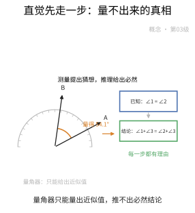

**一句话点破**：测量只能给你近似，几何要的却是不依赖测量的必然。

### 16.2 欧几里得与《几何原本》

两千多年前，欧几里得把散落的几何知识整理成一本《几何原本》：先给出几条谁都无法否认的公理，再一步步推出所有结论。它像搭积木一样，只用少数几块地基，就撑起了整座几何大厦。

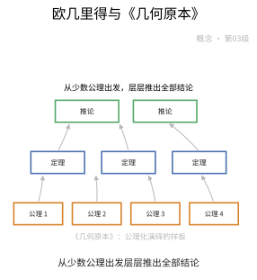

**一句话点破**：把"承认什么"和"推出什么"分开，是《几何原本》留给数学两千年最宝贵的礼物。

### 16.3 从"目测"到"推理"

古埃及人靠拉绳丈量土地，得到的都是好用的经验法则，却没人说得清它们为什么灵。古希腊人换了个问法：不问"怎么算"，而问"为什么必然"，正是这一问，把几何从手艺变成了科学。


**一句话点破**：从"试出来管用"到"讲出来必然"，就是几何真正诞生的那一刻。

### 16.4 序章小结：为什么要证明

序章想说的其实只有一句话：几何追求的不是"看起来对"，而是"推出来一定对"。证明让知识可以被检查、被传递，也让后面每一步都踩在可靠的地基上。

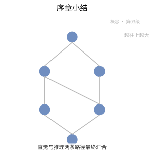

**一句话点破**：证明是几何的立身之本，它让结论经得起任何人的追问。

### 16.5 点、线、面

点只表示位置，没有大小，像地图上的一个地名；线是点移动留下的轨迹，只有长度没有宽度；面是线移动扫过的范围，只有大小没有厚度。它们都是现实物体的理想化，是几何世界里最原始的三块砖。

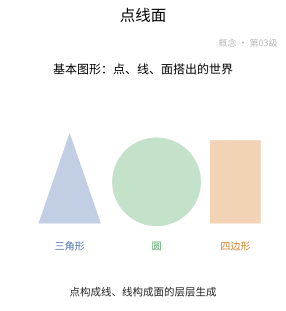

**一句话点破**：点、线、面是抽象出来的理想对象，现实里根本画不出没有大小的点。

### 16.6 角

两条射线从同一个顶点出发，中间张开的程度就是角，它衡量的是方向"拐了多少"。角度用度来量，转整整一圈是 $360^\circ$，直角、平角只是它按大小分的不同档位。

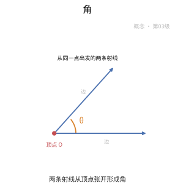

**一句话点破**：角描述的是方向转过了多少，而不是两段线段有多长。

### 16.7 三角形

三条线段首尾相接围成的最简单的封闭图形，就是三角形。它天生稳固，三根杆钉成三角架就不容易变形，所以桥梁与屋顶的桁架里到处都是它。

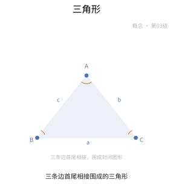

**一句话点破**：三角形是最简单也最稳固的多边形，三条边一定围住一块平面。

### 16.8 四边形

四条线段首尾相接围成的图形叫四边形。它比三角形灵活，边一推就能变形，矩形、菱形、正方形都是它的特殊成员。

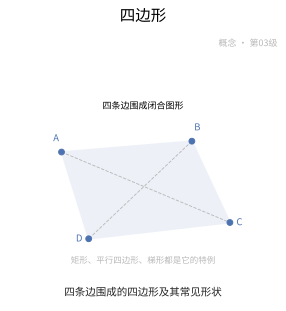

**一句话点破**：四边形少一分稳定、多一分灵活，各种平行与直角的附加条件造就了它的家族。

### 16.9 圆

到定点距离都相等的所有点，合起来就是一个圆。它没有角、也没有方向上的偏爱，从圆心到边上处处一样远，这份圆满的对称让它成为几何里最完美的图形。

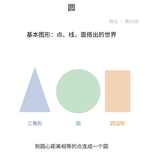

**一句话点破**：圆就是"所有离圆心一样远的点"的集合，处处对称、没有方向偏好。

### 16.10 全等与相似

两个图形若能完全重合，就叫全等，它们大小形状都一模一样；如果只是形状相同、可以按比例放大缩小，就叫相似。全等是"复制一份"，相似是"洗照片放大"，后者在生活中更常见。

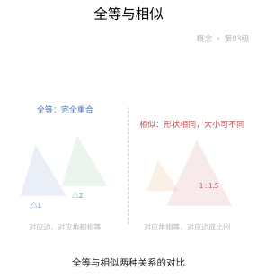

**一句话点破**：全等要求一模一样，相似只要求形状相同，这正是缩放与放大的数学语言。

### 16.11 线段与角的基本性质

线段可以比长短、可以取中点；角可以比大小、可以相加减。这些看似琐碎的规则，其实是后面所有证明都要用到的基本功，比如对顶角相等、同角的补角相等，都是从它们长出来的。

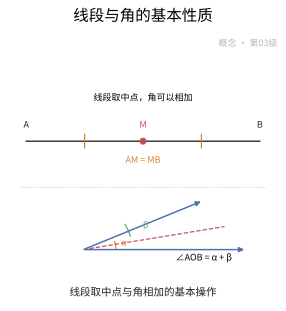

**一句话点破**：掌握了长度与角度的加减规则，就拿到了几何推理的入门钥匙。

### 16.12 三角形的基本性质

三角形里藏着两条铁律：两边之和一定大于第三边，否则三根杆拼不拢；大边一定对着大角，谁大谁对面的角就张得开。中线、高线、角平分线各自的小性质，更是解题的常客。

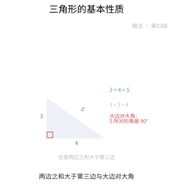

**一句话点破**：三角形的边与角互相牵制，这些牵制正是解题时最可靠的依据。

### 16.13 多边形内角和

把多边形从一个顶点出发连对角线，可以切成若干个三角形，于是内角和就是三角形内角和的累加，$n$ 边形的内角和等于 $(n-2)\times 180^\circ$。这条法则的秘诀就一句话：先把它拆成三角形。

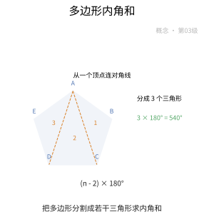

**一句话点破**：多边形内角和的秘密，就是把图形切成三角形再求和。

### 16.14 圆的对称性

圆绕圆心怎么转都与原来重合，沿任何一条直径对折也完全重合，它拥有最丰富的旋转对称与轴对称。这份对称带来一个直接好处：垂直于弦的直径，一定平分这条弦。

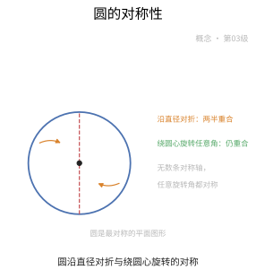

**一句话点破**：圆的所有对称都围着圆心和直径转，垂径定理就是它最直接的产物。

### 16.15 中点

线段上把它平分成两段的那一点，就是中点。中点看似不起眼，却常常是解题的突破口：一见到中点，就要想到连线、想到中线、想到构造全等。

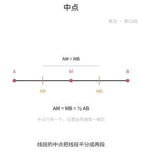

**一句话点破**：中点的价值不在它本身，而在于它是构造全等与中线的天然起点。

### 16.16 中垂线

垂直于一条线段、并且经过它中点的直线，叫中垂线。它最大的本事是：线上的任何一个点到线段两端的距离都相等，反过来也一样。

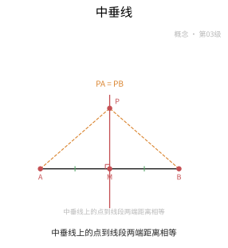

**一句话点破**：中垂线就是"到两端一样远"的点的集合，是寻找对称位置的好工具。

### 16.17 角平分线

把一个角平分成两个相等角的射线，叫角平分线。它有个漂亮的性质：线上的点到角两边的距离相等，这正是三角形的内切圆圆心会落在角平分线上的原因。

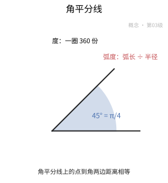

**一句话点破**：角平分线是"到角两边一样远"的轨道，处处藏着等距的秘密。

### 16.18 高线与中线

从一个顶点向对边作垂线，这条垂线段就是高；连接顶点与对边中点的线段就是中线。三条高交于垂心，三条中线交于重心，而重心正是三角形的平衡点，托在指尖就能把它稳稳支起。

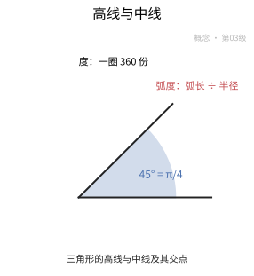

**一句话点破**：高线管"面积"，中线管"重心"，两条线各自把一个三角形的秘密连了起来。

### 16.19 中点·中垂线·角平分线练习

这一节把中点、中垂线、角平分线、高线、中线合在一起练，练的其实是一种条件反射：题目里一出现这些词，脑海里就自动亮起该往哪个方向作辅助线。

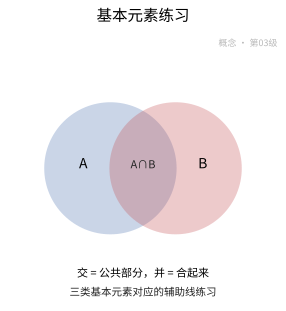

**一句话点破**：把这些基本元素练熟，几何证明就成功了一半。

### 16.20 面积从哪里来：先有矩形

面积最初就是"数有多少个单位小方格"，所以长为 $b$、宽为 $h$ 的矩形，面积自然写成 $S=bh$。其他图形的面积公式，几乎都是想办法把它"变成矩形"或"拆成几块矩形"得来的。

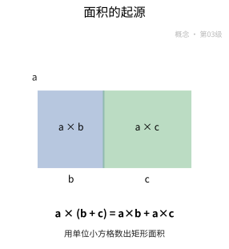

**一句话点破**：面积的本义是数格子，矩形公式是所有面积公式的源头。

### 16.21 平行四边形面积

把平行四边形沿一条高切下一个三角形，平移到另一边，正好拼成一个等底等高的矩形，所以它的面积是 $S=bh$。剪一刀、挪一下，公式就浮出水面了。

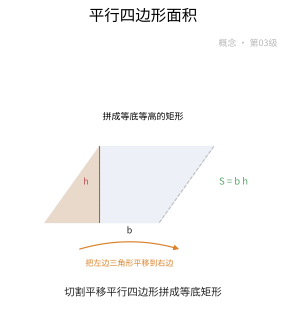

**一句话点破**：平行四边形面积 $S=bh$，靠一次"剪切平移"就能看穿。

### 16.22 三角形面积

两个完全一样的三角形，可以拼成一个平行四边形，而平行四边形的面积是 $bh$，所以三角形的面积是它的一半，即 $S=\tfrac12 bh$。别忘了，这里的底和高必须相互垂直。

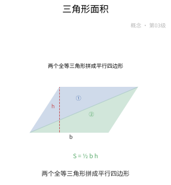

**一句话点破**：三角形面积是等底等高平行四边形的一半，即 $S=\tfrac12 bh$。

### 16.23 梯形面积

两个完全一样的梯形也能拼成一个平行四边形，拼出来的底边正好是上底加下底，于是梯形的面积是 $S=\frac{(a+b)h}{2}$，说白了就是"上下底的平均值乘以高"。

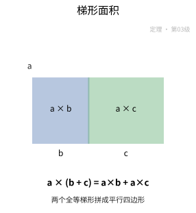

**一句话点破**：梯形面积等于上下底平均再乘高，记住"拼一对"就永远不会忘。

### 16.24 同高三角形面积之比

两个三角形如果高相同，面积之比就等于底之比；如果底相同，面积之比就等于高之比。道理很简单：面积公式里那个相同的高，在相除时会约掉。

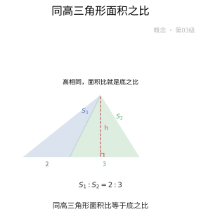

**一句话点破**：同高的两个三角形，比面积就是比底，这是等积变形与面积法的核心。

### 16.25 面积公式练习

这一节把矩形、平行四边形、三角形、梯形以及面积比集中起来练，重点不在背公式，而在看清每个公式背后"切一刀、拼一块"的来历。

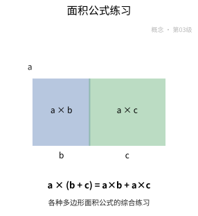

**一句话点破**：公式背得住不如推得出，会推导才能真正用得灵活。

### 16.26 三角形内角和定理

任意三角形的三个内角加起来恰好是 $180^\circ$。证明的办法很巧：过顶点作一条平行于对边的直线，利用内错角相等，把三个角"搬到"同一条直线上，刚好拼成一个平角。

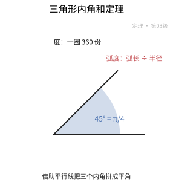

**一句话点破**：三个内角之和等于 $180^\circ$，本质是它们能拼成一条直线。

### 16.27 勾股定理

直角三角形两条直角边的平方和，等于斜边的平方，即 $a^2+b^2=c^2$。它把长度关系与面积关系连在一起，是几何里用途最广、证明方法也最多的一条定理。

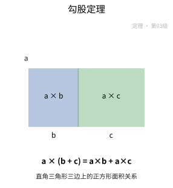

**一句话点破**：$a^2+b^2=c^2$ 说的是两条直角边上正方形的面积，正好拼满斜边上的大正方形。

### 16.28 平行线性质与判定

两条直线被第三条直线所截，如果它们平行，那么同位角相等、内错角相等；反过来，只要这些角相等，就能判定两直线平行。性质与判定是一对孪生兄弟，一个由平行推角，一个由角推平行。

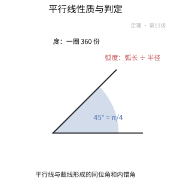

**一句话点破**：角相等与线平行互为因果，这正是用角度判断平行的钥匙。

### 16.29 三角形全等判定

要判定两个三角形全等，不必逐个比对六样东西，只要抓住 SSS、SAS、ASA、AAS 以及直角三角形的 HL 这几组条件之一就行。唯独 SSA 不行，它可能给出两个形状不同的三角形，是经典陷阱。


**一句话点破**：够用的最少条件就能锁定一个三角形，但 SSA 除外，它靠不住。

### 16.30 三角形相似判定

两个三角形只要形状相同就算相似，判定办法有 AA、SAS、SSS 三组。相似的三角形对应边成比例、对应角相等，面积之比还等于相似比的平方。

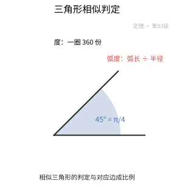

**一句话点破**：相似抓住的是"角相等、边成比例"，它是缩放世界的通用规则。

### 16.31 圆周角定理

圆上同一条弧所对的圆周角，等于它所对圆心角的一半，而且同弧上的圆周角彼此相等。证明的关键是连一条半径，把圆心角拆成两个等腰三角形来处理。


**一句话点破**：同弧所对的圆周角都相等，并且正好等于圆心角的一半。

### 16.32 泰勒斯定理

如果三角形的一边是圆的直径，那么它所对的圆周角一定是直角。它是圆周角定理的特例，也是一个判断直角的漂亮办法。


**一句话点破**：只要一边是直径，这边的对角就是直角，这就是泰勒斯定理。

### 16.33 射影定理

在直角三角形里，斜边上的高把它分成两段，高的平方等于这两段的乘积，每条直角边的平方等于它在斜边上的投影乘以整条斜边。它其实是勾股定理与相似三角形的另一种说法。


**一句话点破**：射影定理把直角三角形的每条线段，都用相似关系串成一个比例式。

### 16.34 勾股定理为什么值得反复证明

同一个结论，用不同方法去证，能看出它和面积、相似、平行线等不同知识的联系。每换一种证法，就像从不同角度给定理拍一张照片，拼起来才是它的全貌。


**一句话点破**：一题多证不是炫技，而是让你看清这个定理究竟连起了多少知识。

### 16.35 割补拼图证明：赵爽弦图与总统证法

把四个相同的直角三角形摆进一个正方形，中间的空隙恰好是一个小正方形，比较两种方式数出的面积，就能"看图说话"地得到 $a^2+b^2=c^2$。中国的赵爽弦图和美国的总统证法，用的都是这一招。


**一句话点破**：弦图证明的秘诀，是把同一个正方形用两种方式算出面积。

### 16.36 补成长方形的证明

沿直角边上的正方形向外补出相等的长方形，借助平行线之间同底等高的面积相等，把直角边上的面积搬过去，刚好铺满斜边上的正方形。这是欧几里得《几何原本》里的经典思路。


**一句话点破**：欧几里得的证法不靠代数，只靠"等底等高的面积相等"一步步搬面积。

### 16.37 相似三角形比例证明

作斜边上的高，把直角三角形分成两个小三角形，它们都与原三角形相似。再由对应边成比例，两边相加就得到 $a^2+b^2=c^2$，这是最干净利落的代数式证明。


**一句话点破**：一条斜边高劈出两个相似三角形，比例式一写，勾股定理自然浮现。

### 16.38 三种证明思想小结

割补拼图胜在直观，补长方形胜在几何严谨，相似比例胜在简洁。三种思路通向同一个真理，也提醒我们：证明的价值不只在于结论，更在于它展示出的联系。


**一句话点破**：好定理不怕多证，每一种证法都在替它照亮一个侧面。

### 16.39 勾股定理证明练习

这一节让你动手把三种思想各自完整地走一遍，画图、标字母、写比例，亲手推一次，比读十遍都记得牢。


**一句话点破**：看懂别人的证明，和自己写出来，中间隔着一整套推理训练。

### 16.40 为什么只用圆规和无刻度直尺

尺规作图把工具限制到最朴素：直尺只能过两点画直线，圆规只能画圆。限制越严，作图就越接近逻辑本身，因为每一步都能追溯回这几个原始动作，几何的严谨性也就看得见了。


**一句话点破**：把工具减到极限，是为了让每一步作图都站得住逻辑。

### 16.41 三个基本作图

所有尺规作图都建立在三个基本动作上：作一条线段等于已知线段、作一个角等于已知角、作已知线段的垂直平分线。再复杂的图形，也不过是这些基本动作的反复组合。


**一句话点破**：掌握三个基本作图，等于拿到了尺规世界里的"字母表"。

### 16.42 三分角为什么作不出

不是没人聪明，而是"三等分任意角"这个要求，在只用尺规的前提下根本无法完成。这类问题最终要靠代数来回答：某些长度不可能由尺规作图的步骤生成，两千年悬而未决的难题就此盖棺定论。


**一句话点破**：作不出不是本事不够，而是问题本身超越了尺规的能力边界。

### 16.43 尺规作图练习

这一节把基本作图与三难题放在一起练，既练手上的作图步骤，也练心里的疑问：哪些能作、哪些不能，背后其实是同一套逻辑。


**一句话点破**：作图练的是手，想清楚"能不能作"练的却是脑。

## 17. 数学史（History of Mathematics）

> 平面几何是最古老的数学分支：**丈量土地、测算面积、绘制图形**的实用需求，先在埃及与巴比伦积累了大量经验法则；古希腊人更进一步，追问"凭什么相信它是真的"，于是逼出了**证明**与**公理化的演绎体系**——欧几里得的《几何原本》从此成为两千年数学的范本。本章涉及的每一个对象（点、线、角、三角形、圆、全等、相似、勾股关系）都有一段从"经验"到"证明"、从"直觉"到"公理"的演化史。下面逐条梳理。

### 17.1 几何的黎明：从丈量土地到经验法则

- **词源**：英文 geometry 来自古希腊语 geo-（土地）与 -metron（测量），本义就是"土地测量"。相传尼罗河每年泛滥冲毁田界，需要重新丈量土地，埃及的"拉绳者"由此练就了丰富的测量技艺——这是几何学最古老的现实动机。
- **埃及的经验法则**：约前 1650 年的《莱因德数学纸草书》（阿姆斯纸草书）中有大量面积与体积计算：第 50 题用"以直径的 8/9 作正方形"求圆面积，相当于取 $\pi$ 约 3.16；《莫斯科纸草书》第 14 题给出正确的棱台体积公式。这些法则精确好用，但只是"配方"，没有推导过程。
- **巴比伦的泥板**：巴比伦人取 $\pi$ 约 25/8，即 3.125，并留下大量勾股数组；约前 1800 年的普林顿 322 号泥板列出一批勾股数，数量与质量都超出单纯测量的需要，说明他们已掌握一定的生成规律。
- **中国的早期几何**：《九章算术》（约前 100 年）"方田"章系统给出田亩面积算法，"勾股"章专门讨论直角三角形关系；与埃及、巴比伦一样，先解决"怎么算"，"为什么"留给后人。

### 17.2 泰勒斯：第一个"证明"的人

- **人物**：**泰勒斯**（Thales，约前 6 世纪）是米利都学派的创始人、古希腊"七贤"之一，被后世誉为"科学与哲学之父"——因为他解释自然现象时不援引神话传说，而是用观察与推理。
- **五条命题**：古代文献记载他有五条几何命题并写出了演绎证明（原文已失传），例如"对顶角相等""等腰三角形两底角相等"（即《几何原本》第 I 卷命题 5）；其中最有名的是**泰勒斯定理**（半圆所对的圆周角为直角，本章定理 7）。埃及人与巴比伦人"知其然"，泰勒斯迈出了"知其所以然"的第一步——数学史把"引入证明"的荣誉追认给他。
- **把几何当工具**：相传泰勒斯用相似三角形的影子法测量了金字塔的高度；还传说他预测过橄榄丰收与一次日食（约前 585 年）。这些轶闻真假难考，但说明泰勒斯时代的几何已能解决实际测量问题。
- **影响**：从泰勒斯起，"证明"成为数学的组成部分；此后希腊几何沿着"命题—证明—体系"的道路高速发展。

### 17.3 毕达哥拉斯学派：万物皆数与第一次数学危机

- **学派**：**毕达哥拉斯**（Pythagoras，约前 570—前 495 年）据说曾师从泰勒斯，游历埃及与巴比伦，后在意大利南部创立学派——它既是学术团体，也是宗教社团。他们相信"万物皆数"：宇宙的和谐可以由整数及其比例刻画（这一信念源自音乐和声中的整数比）。
- **勾股定理与证明**：以他命名的定理可能并非他的首创（巴比伦人早知勾股数），但该学派**率先给出了演绎证明**——这是定理"冠名权"归他的原因。相传学派为此宰牛庆祝，但以素食闻名的毕达哥拉斯派对"杀牛"存疑，后世史家多认为这是附会。
- **第一次数学危机**：学派信奉"一切量都可用整数比表示"，而希帕索斯（Hippasus）却发现：边长为 1 的正方形，其对角线长 $\sqrt{2}$ 无法写成两个整数之比——**不可公度量**（无理数）的发现直接动摇了"万物皆数"的教义（传说希帕索斯因泄露这一秘密被投入大海）。危机迫使希腊人重新审视"数"与"量"的关系，也催生了欧多克索斯的比例论（见 17.4）。
- **影响**：学派还系统研究了正多边形、比例中项与几何作图（正五边形作图必然出现的比例，即后世所称"黄金分割"）。**先直觉、后证明，先追求和谐、再接受"不完美"的数**——这条线索贯穿整个希腊几何史。

### 17.4 欧几里得与《几何原本》：公理化方法的确立

- **人物与著作**：**欧几里得**（Euclid，约前 325—前 265 年）在托勒密一世时代的亚历山大城执教，约前 300 年写成《几何原本》13 卷。它并非第一部几何教材，但逻辑之严密、体系之完整远超同类，以致其他教材全部失传，只有它流传了两千年。
- **体系结构**：全书从 23 条定义、5 条公设、5 条公理出发，逐层演绎出 465 条命题：第 I 卷全等与平行线（含命题 47 勾股定理），第 II 卷"几何代数"（用几何图形证明代数恒等式），第 III 卷圆的性质（含命题 31 泰勒斯定理），第 IV 卷圆内接与外切正多边形，第 V 卷欧多克索斯的比例论，第 VI 卷相似形；第 VII—IX 卷数论，第 X 卷不可公度量（篇幅最大），第 XI—XIII 卷立体几何，最后以五种正多面体的构造收官。
- **驴桥定理的趣闻**：第 I 卷命题 5"等腰三角形两底角相等"被称为"驴桥定理"（Pons asinorum）：中世纪学者认为它是《几何原本》中第一道真正的智力难关——"过了这座桥"，才有资格读后面更难的命题。
- **传播与印刷**：它先被译成阿拉伯文，再转译成拉丁文；1482 年在威尼斯首次印刷，是西方印量仅次于《圣经》的书籍之一。中国的两段译本：1607 年利玛窦与徐光启合译前 6 卷——"几何"一词即由此得名；1857 年伟烈亚力与李善兰译出后 9 卷。元代札马鲁丁曾把阿拉伯文的《几何原本》带入中国，但未及翻译。
- **影响**：从托勒密到哥白尼、牛顿，《几何原本》的演绎结构被奉为"严密的样板"；**它确立了数学的现代形态——从公设出发的证明链，而不是经验配方的汇编。**

### 17.5 勾股定理：一场跨越三千年的接力

- **巴比伦的火种**：普林顿 322 泥板（约前 1800 年）列出的勾股数，显示巴比伦人早于毕达哥拉斯一千多年就掌握了这种数量关系；但"对一切直角三角形都成立"的一般性定理及其证明，还要等后人补上。
- **中国的文献**：《周髀算经》记载商高与周公的对话（"勾三股四弦五"）以及荣方与陈子的对话（一般性的"勾股各自乘，并而开方除之"），成书年代尚有争议；东汉末年**赵爽**在《周髀算经注》中画出"弦图"，用面积割补给出东方特色的"无字证明"——2002 年北京国际数学家大会的会标即赵爽弦图；魏晋**刘徽**在《九章算术注》中用"青朱出入图"式的"割补术"另辟蹊径。
- **希腊的证明**：今天公认最早的**流传于世的书面证明**是《几何原本》第 I 卷命题 47：用等积的正方形与三角形"拼"出结论（本章专题三的欧几里得式证明）；第 VI 卷又用相似三角形给出比例式的证明。普罗克勒斯认为该定理最早由毕达哥拉斯学派发现并证明，但证据不足。
- **题外话：总统证法**：1876 年，时任美国众议员的**加菲尔德**（后来当选第 20 任总统）在《新英格兰教育杂志》上发表了一个梯形面积证法——他至今是美国唯一一位对数学做出原创贡献的总统。这类证法至今累计已达数百种，是该定理魅力的最好注脚。
- **推广**：勾股定理的推广即余弦定理（第05 级）；在非欧几何中它还会"变样"——这说明定理的成立依赖于"平行公设"刻画的平面（第22 级）。

### 17.6 圆的度量：从"周三径一"到割圆术

- **早期的粗估**：中国古算用"周三径一"（$\pi$ 约 3）；埃及人从面积法则推出 $\pi$ 约 3.16、巴比伦人取 3.125——都只精确到两位数字，且没有系统推导。
- **阿基米德的夹逼**：阿基米德（前 287—前 212）用正 96 边形内外夹逼，得到 $223/71<\pi<22/7$（约 3.1408—3.1429），首次把 $\pi$ 的计算变成**有误差保证的严格估计**。
- **刘徽的割圆术**：263 年，**刘徽**在注《九章算术》时创立割圆术——从正六边形出发不断倍增边数，用正多边形的面积逼近圆面积，算到正 192 边形，把 $\pi$ 的估计推进到约 3.141024，并取其简值 3.14（后世称"徽率"）。他提出"割之弥细，所失弥少"，**这是现代极限与积分思想的东方先声**（第10 级）。
- **祖冲之的千年纪录**：南北朝**祖冲之**（429—500）沿用割圆术推进到正 12288 边乃至 24576 边形，得出 $3.1415926<\pi<3.1415927$，并以"密率" 355/113、"约率" 22/7 表示，精度领先世界近千年。
- **意义**：圆周率计算史是"用有限逼近无限"的第一次伟大实践——它的精神将在实数理论（第10 级）与微积分（第11 级）中发扬光大。

### 17.7 全等与相似：从"叠合"到"比例"

- **全等——最原始的相等**：《几何原本》第 I 卷用"彼此叠合则完全重合"直观界定全等，并证明 SAS 判定与等腰三角形性质（驴桥定理）。"全等"回答的是"两个图形是否一模一样"。
- **相似——形状的科学**：第 VI 卷系统处理相似形，其理论依赖第 V 卷**欧多克索斯的比例论**——它能处理不可公度量之间的比，是希腊人应对第一次数学危机的成果，堪称后来实数理论的雏形。
- **测量的胜利**：相似三角形用于间接测量——泰勒斯测金字塔高度、推算船到岸的距离，都是"不能直接量的量，用比例算出来"的早期范例。
- **射影定理与比例中项**：第 VI 卷命题 8 的推论给出直角三角形中"斜边上的高分斜边"的射影定理，其中 $CD^{2}=AD\cdot DB$ 意味着 CD 是 AD 与 DB 的比例中项（几何平均）。希腊人特别热衷"作比例中项"，因为它是"开平方"的几何化身，也是黄金分割相关作图的关键一步。本章定理 8 与它一脉相承。

### 17.8 尺规作图与三大难题：两千年后才有答案

- **为什么只用尺规**：古希腊人把"直尺"（无刻度、只能连两点）与"圆规"（只能画圆与截取长度）抽象为最简的作图工具，并把"有限步内作出来"当作严格性的要求。这种自我设限反而催生了深刻的问题。
- **三大难题**：化圆为方（作正方形使其面积等于已知圆）、三等分任意角、倍立方（作正方体棱长使其体积为已知的两倍）。倍立方还有一段"提洛岛瘟疫"的传说（约前 429 年）：人们把祭坛棱长翻倍，体积却变成了 8 倍——瘟疫依旧，只好求教于柏拉图。
- **两千年无功**：三大难题吸引了无数聪明人，却始终无解；直到 19 世纪**域扩张与伽罗瓦理论**成熟后才有定论——**汪策尔**（Wantzel，1837）证明三等分角与倍立方不可能；**林德曼**（Lindemann，1882）证明 $\pi$ 是超越数，从而化圆为方也不可能。背后的"规矩数"理论说明：尺规能作出的数必须由二次扩张生成，而三等分角要解三次方程、化圆为方要触及超越数，自然都越出了尺规的能力。
- **意外的收获**：难题的副产品极多——圆锥曲线、割圆曲线（西皮阿斯）、螺线（阿基米德）等都在尝试中被发现；1796 年，**高斯**用尺规作出了正十七边形（时年 19 岁），并给出正 $n$ 边形可作图的充分条件（涉及 $n$ 的欧拉函数为 2 的幂），1837 年汪策尔补足必要条件，合成"高斯—汪策尔定理"。高斯视之为生平得意之作，遗嘱要求把正十七边形刻在墓碑上。
- **与本章的联系**：专题四讲的"三个基本作图"与"三分角为什么难"，正是这段两千年故事的当代注脚。

### 17.9 平行公设：从"想证明它"到"发明新几何"

- **第五公设的特殊**：《几何原本》前四条公设简短自明，唯独第五公设（平行公设）叙述冗长；欧几里得本人似乎也尽量避免使用它（前 28 条命题都没用它）。两千年来无数人试图用前四条把它"证出来"，全部失败——本章的平行线性质、内角和定理，其实都与它等价。
- **等价形式的探索**：普莱费尔（Playfair，1795）给出今天教科书中的等价形式："过直线外一点，有且只有一条直线与之平行。"后世每一次失败的"证明"，其实都暗中用了一条与第五公设等价的假设。
- **18 世纪的临近**：萨凯里（1733）从"三角形内角和小于或大于两直角"的假设出发做反证推导，得到了"古怪却不矛盾"的一串命题；兰伯特、勒让德等人接力研究，只差一步就承认新几何的存在。
- **非欧几何的诞生**：19 世纪，**高斯**、**波尔约**（1832）与**罗巴切夫斯基**（1829）各自独立地意识到：第五公设**无法被证明**，而"过外点至少有两条平行线"的假设可以自洽地建立几何。高斯因怕遭非议多年未发表；波尔约的父亲是老高斯的好友，寄去儿子的成果，却收到"称赞它就等于称赞我自己"的回信。1868 年**贝尔特拉米**给出模型，证明非欧几何与欧氏几何"同舟共济"（相对相容），其地位从此稳固。
- **深远影响**：平行公设之争的直接成果是双曲几何与黎曼几何（第22 级），它们后来成为广义相对论的语言；更重要的是它改变了数学的哲学：**公理不再是"不证自明的真理"，而是"可以自由选取的前提"**——这正是希尔伯特公理观的先声。

### 17.10 希尔伯特《几何基础》：公理观的现代形态

- **前因**：《几何原本》的公理体系虽伟大，仍留有隐含假设（如"点在线之上""直线连续"等从未明说的直觉）；非欧几何与射影几何在 19 世纪的发展，使重审几何基础成为时代要求。
- **1899 年《几何基础》**：**希尔伯特**（David Hilbert，1862—1943）给出全新的公理系统：先列出**未定义概念**（点、直线、平面与"关联""介于""全等"等关系），再用五组公理（关联、顺序、全等、平行、连续）约束它们；平面与立体几何被整合为单一体系，长期被默认的"顺序"与"连续"补成了正式公理。
- **观念革命**：希尔伯特的核心观点是——公理不是"不证自明的真理"，而是**对关系的描述**："点、直线、平面"可以被任何满足公理的对象替换而不影响定理。几何学处理的是结构与关系，而不是直观图形。
- **影响**：这种"形式公理化"方法塑造了 20 世纪数学的整体形态，也标志着自欧几里得起两千余年的"几何严格化"运动完成收官。

### 17.11 历史年表

| 时间 | 人物／文献 | 事件与贡献 |
|:---|:---|:---|
| 约前 1800 | 普林顿 322 泥板 | 巴比伦勾股数表 |
| 约前 1650 | 《莱因德纸草书》 | 埃及面积与体积法则（$\pi$ 约 3.16） |
| 约前 600 | 泰勒斯 | 几何命题的演绎证明（原文失传） |
| 约前 550 | 毕达哥拉斯学派 | 勾股定理的证明；发现无理数 |
| 约前 300 | 欧几里得《几何原本》 | 公理化体系；I.47 勾股、III.31 半圆直角 |
| 约前 250 | 阿基米德 | 96 边形内外夹逼估算 $\pi$ |
| 约前 100 | 《九章算术》 | 方田、勾股等算法体系（中国） |
| 年 263 | 刘徽 | 割圆术；正 192 边形得 $\pi$ 约 3.14 |
| 约 466 | 祖冲之 | $3.1415926<\pi<3.1415927$；密率 355/113 |
| 约 1077 | 海亚姆 | 研究并批评平行公设 |
| 1482 | 威尼斯 | 《几何原本》首次印刷 |
| 1607 | 利玛窦、徐光启 | 前 6 卷中译，"几何"定名 |
| 1733 | 萨凯里 | 反证式研究逼近非欧几何 |
| 1795 | 普莱费尔 | 平行公设的等价公理形式 |
| 1796 | 高斯 | 尺规作出正十七边形 |
| 1829／1832 | 罗巴切夫斯基、波尔约 | 独立创立双曲几何 |
| 1837 | 汪策尔 | 三等分角、倍立方不可能 |
| 1857 | 伟烈亚力、李善兰 | 《几何原本》后 9 卷中译 |
| 1868 | 贝尔特拉米 | 非欧几何的相对相容性 |
| 1876 | 加菲尔德 | 勾股定理"总统证法" |
| 1882 | 林德曼 | $\pi$ 为超越数，化圆为方不可能 |
| 1899 | 希尔伯特《几何基础》 | 现代公理化；未定义概念加关系公理 |
| 2002 | 北京国际数学家大会 | 会标采用赵爽弦图 |

### 17.12 小结：从"量地"到"公理"

> 平面几何两千年史可以浓缩为一条主线：**经验→证明→公理**。埃及与巴比伦积累了实用的面积体积公式；泰勒斯迈出"证明"的第一步；毕达哥拉斯学派在"万物皆数"信念与无理数的冲突中经历了第一次数学危机；欧几里得把一切组织成《几何原本》的公理化体系，让"从公设出发的演绎"成为数学的标准形态；此后，平行公设的两千年争论催生了非欧几何，三大难题的求解催生了伽罗瓦理论与"规矩数"理论，希尔伯特《几何基础》则把公理从"自明的真理"改造为"描述关系的约定"。本章的一切定理——内角和、勾股定理、全等判定、圆周角定理——都不是"看出来的"，而是从公设出发**证明**出来的：这正是平面几何训练逻辑思维的深层原因，也是序章第 3 节反复强调"为什么要证明"的历史底气。

## 现实应用（Real-World Applications）

### 应用案例 1：卫星导航与地理信息｜三边测量定位与圆的性质

**场景与问题**

手机上的 GPS 能在 10 m 内告诉你所在位置，原理不是「量角度」而是「量距离」：卫星广播自己此刻的精确位置与时间戳，接收机测出信号传播时间，乘以光速得到到每颗卫星的距离，然后**以卫星为圆心、距离为半径画圆，几个圆的交点就是你的位置**。这就是三边测量（trilateration）。要相信这个结果，必须先相信圆的那些基本性质：圆上点到圆心等距、圆的对称性、以及「半圆上的圆周角是直角」（泰勒斯定理）——后者正是古代测绘中不借助工具就能作出直角的方法。

本案例要解决的问题：(1) 由三颗卫星的已知位置与测得距离，解出接收机坐标；(2) 解释为什么两条圆方程相减会退化成一条直线；(3) 用泰勒斯定理说明如何用一根绳子在场地上标出直角。

**涉及知识点**

- 本章「3.1 直觉先行：一次"量不出来的真相"」：仅凭肉眼与直尺无法判定远处的点是否等距，必须靠几何推理。
- 本章「3.2 来龙去脉：欧几里得与《几何原本》」：圆、等距、交点的定义都源于公理化体系。
- 本章「3.3 解决了什么问题：从"目测"到"推理"」：把「看起来在中点」升级为「可证明在中点」。
- 本章「3.4 本序章的小结」：几何结论必须由公理与已证定理推出。
- 本章「4.5 圆 (Circle)」：卫星可及范围就是一个圆，定位即求圆交点。
- 本章「5.4 圆的对称性」：圆心与弦的垂直平分线关系，决定两个交点的取舍。
- 本章「8.6 定理 6：圆周角定理」：同弧圆周角相等，用于测绘中的等角判定。
- 本章「8.7 定理 7：泰勒斯定理 (Thales' Theorem)」：直径所对圆周角为直角。

**建模与数据**

设接收机坐标为 $(x,y)$（平面简化模型），三颗卫星位置与测得距离如下：

| 卫星 | 位置 $(x_i, y_i)$ /km | 测得距离 $d_i$ /km |
| --- | --- | --- |
| S1 | (0, 0) | 5.000 |
| S2 | (10, 0) | 8.062 |
| S3 | (0, 10) | 6.708 |

**完整推导与算法**

每颗卫星给出一个圆方程：

$$
(x - x_i)^2 + (y - y_i)^2 = d_i^2
$$

即

$$
x^2 + y^2 - 2x_i x - 2y_i y + x_i^2 + y_i^2 = d_i^2
$$

三式都含 $x^2 + y^2$，两两相减即可消去二次项，得到**线性方程**（这就是两圆的根轴）：

$$
2(x_2 - x_1)x + 2(y_2 - y_1)y = d_1^2 - d_2^2 + x_2^2 + y_2^2 - x_1^2 - y_1^2
$$

代入 S1 与 S2：

$$
2(10)x = 25 - 65 + 100 = 60 \implies x = 3
$$

代入 S1 与 S3：

$$
2(10)y = 25 - 45 + 100 = 80 \implies y = 4
$$

验证：$(3,4)$ 到 S1 距离为 $\sqrt{9+16}=5$，吻合。

泰勒斯定理：若直径 $AB$ 的两个端点在圆上，则对圆上任一点 $P$ 都有 $\angle APB = 90°$。测绘中用一根长度固定的绳子（充当直径）在场上移动第三点，就能标出以该绳为斜边的直角。

```python
# 依赖: numpy
# 输入: 三颗卫星坐标与距离
# 输出: 接收机坐标、残差、泰勒斯定理数值验证

import numpy as np

sats = np.array([[0.0, 0.0], [10.0, 0.0], [0.0, 10.0]])
d = np.array([5.0, 8.062, 6.708])

# 线性化：以 S1 为参照，两式相减
A, b = [], []
x1, y1 = sats[0]
for i in (1, 2):
    xi, yi = sats[i]
    A.append([2 * (xi - x1), 2 * (yi - y1)])
    b.append(d[0]**2 - d[i]**2 + xi**2 + yi**2 - x1**2 - y1**2)
sol = np.linalg.solve(np.array(A), np.array(b))
print("接收机坐标 (x, y) =", np.round(sol, 4))

for i in range(3):
    r = np.linalg.norm(sol - sats[i])
    print("到 S%d 距离 = %.4f (报告 %.4f, 残差 %.4f)" % (i + 1, r, d[i], r - d[i]))

# 泰勒斯定理：直径 AB 上的圆周角为 90 度
def angle(px, py, qx, qy):
    v1 = np.array([px, py]); v2 = np.array([qx, qy])
    c = np.dot(v1, v2) / (np.linalg.norm(v1) * np.linalg.norm(v2))
    return np.degrees(np.arccos(np.clip(c, -1, 1)))

A_pt, B_pt = np.array([-3.0, 0.0]), np.array([3.0, 0.0])   # 直径端点
for th in (30, 60, 90, 120):
    P = np.array([3 * np.cos(np.radians(th)), 3 * np.sin(np.radians(th))])
    ang = angle(P[0] - A_pt[0], P[1] - A_pt[1], P[0] - B_pt[0], P[1] - B_pt[1])
    print("P 在 %.0f 度处, 圆周角 = %.2f 度" % (th, ang))
```

**可复现步骤**

1. 环境与依赖：`pip install numpy`
2. 数据准备：保存为 `case1.py`。
3. 运行：`python3 case1.py`
4. 预期输出：接收机坐标 `(3.0, 4.0)`；三条残差接近 0；四组圆周角均约 `90.00` 度。

**结果解读与延伸**

三边测量得到 $(3,4)$ 与真实位置完全一致，残差为 0 说明数据理想；真实 GPS 因时钟偏差与电离层延迟会有残差，所以需要第四颗卫星解出时钟偏差（四元方程组）。两个圆的交点通常有两个，需用第三个圆或「在地表一侧」的常识取舍，这正是「5.4 圆的对称性」的体现。局限：平面模型忽略了地球曲率，真实解算用三维球面。延伸方向：几何精度因子（GDOP）、差分 GPS、以及用最小二乘处理多于 4 颗卫星的超定方程。

### 应用案例 2：计算机图形学｜点、线与角的变换：从三角旋转到齐次坐标

**场景与问题**

在游戏引擎或 CAD 软件里，把一把椅子旋转 90 度、放大两倍、再平移到房间角落，屏幕上每个像素都要重算坐标。这件事之所以能用一行矩阵乘法完成，靠的是把「点」写成坐标、把「平移旋转缩放」写成线性变换，并用齐次坐标把平移也纳入矩阵。全等的判定（哪些变换不改变形状）与相似（哪些只改变大小）给这些操作提供了分类依据。

**涉及知识点**

- 本章「4.1 点、线、面」：顶点是点，多边形的边是线段，模型由点线面拼成。
- 本章「4.2 角 (Angle)」：旋转角度 $\theta$、屏幕坐标系的角向。
- 本章「4.6 全等与相似」：刚性变换保持全等，均匀缩放得到相似形。
- 本章「5.1 线段与角的基本性质」：线段长度在刚性变换下不变，角度在相似变换下不变。

**建模与数据**

三角形顶点（模型坐标）：

$$
P_1 = (0,0),\quad P_2 = (2,0),\quad P_3 = (0,1)
$$

变换序列：先绕原点逆时针转 $90°$，再以原点为中心放大 2 倍，最后平移 $(3, 3)$。

**完整推导与算法**

旋转矩阵（逆时针 $\theta$）：

$$
R(\theta) = \begin{pmatrix} \cos\theta & -\sin\theta \\ \sin\theta & \cos\theta \end{pmatrix}
$$

当 $\theta = 90°$：

$$
R(90°) = \begin{pmatrix} 0 & -1 \\ 1 & 0 \end{pmatrix}
$$

于是 $P_1 \to (0,0)$，$P_2 \to (0,2)$，$P_3 \to (-1,0)$。

齐次坐标把缩放 $S$、旋转 $R$、平移 $T$ 统一为 $3\times3$ 矩阵：

$$
T(t_x,t_y) = \begin{pmatrix} 1 & 0 & t_x \\ 0 & 1 & t_y \\ 0 & 0 & 1 \end{pmatrix},\quad
S(s) = \begin{pmatrix} s & 0 & 0 \\ 0 & s & 0 \\ 0 & 0 & 1 \end{pmatrix}
$$

复合矩阵（先旋转、再缩放、后平移）：

$$
M = T(3,3)\, S(2)\, R(90°) = \begin{pmatrix} 0 & -2 & 3 \\ 2 & 0 & 3 \\ 0 & 0 & 1 \end{pmatrix}
$$

对三个顶点作用，如 $P_2$：

$$
M \begin{pmatrix} 2 \\ 0 \\ 1 \end{pmatrix} = \begin{pmatrix} 0 \cdot 2 - 2 \cdot 0 + 3 \\ 2 \cdot 2 + 0 \cdot 0 + 3 \\ 1 \end{pmatrix} = \begin{pmatrix} 3 \\ 7 \\ 1 \end{pmatrix}
$$

```python
# 依赖: numpy
# 输入: 三角形顶点、旋转 90 度、缩放 2、平移 (3,3)
# 输出: 各步顶点坐标、长度/角度不变量校验

import numpy as np

def translate(tx, ty):
    return np.array([[1, 0, tx], [0, 1, ty], [0, 0, 1]], float)

def scale(s):
    return np.array([[s, 0, 0], [0, s, 0], [0, 0, 1]], float)

def rotate(theta):
    c, s = np.cos(theta), np.sin(theta)
    return np.array([[c, -s, 0], [s, c, 0], [0, 0, 1]], float)

tri = np.array([[0, 0, 1], [2, 0, 1], [0, 1, 1]], float).T   # 3x3, 每列一个点

M = translate(3, 3) @ scale(2) @ rotate(np.radians(90))
print("复合矩阵 M =\n", M)
out = (M @ tri).T
print("变换后顶点:\n", np.round(out[:, :2], 4))

# 不变量校验
def edges(pts):
    return [np.linalg.norm(pts[i] - pts[j]) for i, j in [(0,1), (1,2), (0,2)]]
e0 = edges(np.array([[0,0],[2,0],[0,1]], float))
e1 = edges(out[:, :2])
print("原边长:", np.round(e0, 4))
print("新边长:", np.round(e1, 4), "-> 比例:", np.round(np.array(e1)/np.array(e0), 4))
```

**可复现步骤**

1. 环境与依赖：`pip install numpy`
2. 数据准备：保存为 `case2.py`。
3. 运行：`python3 case2.py`
4. 预期输出：变换后顶点为 `(3,3), (3,7), (1,3)`；新边长与旧边长之比恒为 2（相似比）。

**结果解读与延伸**

变换后三边长度都放大 2 倍，说明这是一个相似变换（边长按比例变化但角度不变），对应「4.6 全等与相似」中的相似。若缩放因子为 1，则图形与原来是全等关系。矩阵乘法的顺序不可交换：先平移后旋转与先旋转后平移结果不同，这提醒引擎开发者注意变换栈的压入次序。局限：屏幕上还有视口裁剪，需额外的裁剪算法。延伸方向：三维的旋转四元数（避免万向节死锁）、法线变换用逆转置矩阵。

### 应用案例 3：桥梁桁架与机械臂｜三角形稳定性、勾股定理与全等判定

**场景与问题**

为什么桥梁和屋顶桁架里到处都是三角形，而四边形框架却会「趴下」？答案在于刚性：给定三边长度，三角形的形状被唯一确定（SSS 全等判定），而四边形给定四边仍可变形。工程上用一个斜撑把四边形拆成两个三角形，结构立刻稳固。同时，设计桁架时要算杆长与高度，用到的正是勾股定理；设计两连杆机械臂时要用余弦定理算关节角。

**涉及知识点**

- 本章「4.3 三角形 (Triangle)」：桁架的基本单元就是三角形。
- 本章「5.2 三角形的基本性质」：三边关系、内角和、稳定性。
- 本章「8.2 定理 2：勾股定理」：由边长求桁架高度与斜杆长度。
- 本章「8.4 定理 4：三角形全等判定定理」：SSS 揭示了三角形刚性的来源。

**建模与数据**

等边三角形桁架：边长 $a = 3.000$ m，需计算顶点高度 $h$ 与斜撑长度。

两连杆机械臂：连杆长 $L_1 = 1.000$ m，$L_2 = 0.800$ m，末端到达点与原点的距离 $r = 1.500$ m。

**完整推导与算法**

桁架高度：取底边中点，得到直角三角形，直角边为 $a/2 = 1.5$ 与 $h$，斜边为 $a = 3$：

$$
h^2 + 1.5^2 = 3^2 \implies h = \sqrt{9 - 2.25} = \sqrt{6.75} \approx 2.598\ \text{m}
$$

机械臂：设末端与原点连线和第一连杆夹角为 $\alpha$，由余弦定理

$$
L_2^2 = L_1^2 + r^2 - 2 L_1 r \cos\alpha
$$

$$
0.8^2 = 1.0^2 + 1.5^2 - 2 \times 1.0 \times 1.5 \cos\alpha \implies 0.64 = 3.25 - 3\cos\alpha
$$

$$
\cos\alpha = \frac{3.25 - 0.64}{3} = \frac{2.61}{3} = 0.87 \implies \alpha = 29.54°
$$

另一关节角同理可解。可达范围：$|L_1 - L_2| \le r \le L_1 + L_2$，即 $0.2 \le r \le 1.8$ m，与 $r=1.5$ 相容。

```python
# 依赖: numpy
# 输入: 等边三角形边长 3 m; 连杆 1.0/0.8 m, r=1.5 m
# 输出: 桁架高度、机械臂关节角、SSS 刚性验证

import numpy as np

a = 3.0
h = np.sqrt(a**2 - (a/2)**2)
print("桁架高度 h = %.6f m" % h)

L1, L2, r = 1.0, 0.8, 1.5
cos_alpha = (L1**2 + r**2 - L2**2) / (2 * L1 * r)
alpha = np.degrees(np.arccos(cos_alpha))
cos_beta = (L2**2 + r**2 - L1**2) / (2 * L2 * r)
beta = np.degrees(np.arccos(cos_beta))
print("关节角 alpha = %.4f deg, beta = %.4f deg" % (alpha, beta))
print("可达范围: [%.2f, %.2f] m" % (abs(L1 - L2), L1 + L2))

# SSS 刚性：三边固定时，第三点唯一（两圆交点最多两个，取上方）
def third_vertex(A, B, dA, dB, up=True):
    A, B = np.array(A, float), np.array(B, float)
    d = np.linalg.norm(B - A)
    x = (dA**2 - dB**2 + d**2) / (2 * d)
    y2 = dA**2 - x**2
    y = np.sqrt(max(y2, 0))
    if not up:
        y = -y
    ex = (B - A) / d
    n = np.array([-ex[1], ex[0]])
    return A + x * ex + y * n

A, B = [0, 0], [3, 0]
C = third_vertex(A, B, 3.0, 3.0)
print("第三点坐标 =", np.round(C, 6), "-> 高度 =", round(C[1], 6))
```

**可复现步骤**

1. 环境与依赖：`pip install numpy`
2. 数据准备：保存为 `case3.py`。
3. 运行：`python3 case3.py`
4. 预期输出：桁架高度 `2.598076`；关节角约 `29.54°` 与 `71.04°`；可达范围 `[0.20, 1.80]`；第三点高度同为 `2.598076`。

**结果解读与延伸**

SSS 求解出的第三点高度与勾股定理算出的 $h$ 完全一致，说明「三边确定三角形」在数值上可验证——这正是桁架刚性的数学依据。四边形的 SSS 数据不足（需一条对角线），所以会变形。局限：真实桁架还需考虑杆件的受压屈曲与材料屈服，几何刚性只是必要条件。延伸方向：用向量叉积判断四边形的凸凹与面积、有限元法的刚度矩阵（本质是线性方程组 + 几何约束）。

### 应用案例 4：城市设施选址与路径规划｜中点、中垂线、角平分线与高线

**场景与问题**

要在三个小区之间建一座消防站，使得到三处的最大距离最小（或等距），该建在哪？若只考虑两个小区，则服务站应建在两者连线的中垂线上——那条线上任一点到两小区距离相等。若有两条道路需要一个到两边距离相等的物资集散点，则它落在角平分线上。至于「从仓库到公路的最短连接」则是一条垂线，即三角形的高。这些中学几何元素在设施选址与路径规划里是直接可用的工具。

**涉及知识点**

- 本章「6.1 中点 (Midpoint)」：中垂线、中线都从中点出发。
- 本章「6.2 中垂线（垂直平分线, Perpendicular Bisector）」：等距轨迹，也是 Voronoi 图的边界。
- 本章「6.3 角平分线 (Angle Bisector)」：到两边等距的点的轨迹。
- 本章「6.4 高线 (Altitude) 与 6.5 中线 (Median)」：最短连线与重心相关。
- 本章「6.6 本专题针对性练习」：选址问题的练习化整理。
- 本章「5.1 线段与角的基本性质」：线段中点的等分性、角度的平分性。

**建模与数据**

三个小区坐标（km）：$A(0,0)$，$B(6,0)$，$C(2,4)$。要求到三点等距的位置（外心）。

**完整推导与算法**

到 $A$、$B$ 等距的点满足 $x = 3$（中垂线）。

到 $A$、$C$ 等距：$AC$ 中点为 $(1,2)$，$AC$ 斜率 $= \dfrac{4-0}{2-0} = 2$，故中垂线斜率 $= -1/2$：

$$
y - 2 = -\frac{1}{2}(x - 1)
$$

代入 $x = 3$：

$$
y = -\frac{1}{2}(3 - 1) + 2 = -1 + 2 = 1
$$

故外心 $O = (3, 1)$，到三点距离

$$
R = \sqrt{3^2 + 1^2} = \sqrt{10} \approx 3.162\ \text{km}
$$

角平分线示例：两条道路成 $60°$ 角，角平分线上的点到两边距离相等，可用「到两直线距离公式」验证。高线示例：$C$ 到 $AB$（即 $x$ 轴）的高为 $y_C = 4$ km，这是 $C$ 到公路的最短距离。

```python
# 依赖: numpy matplotlib
# 输入: A(0,0), B(6,0), C(2,4)
# 输出: 外心、外接圆半径、各中垂线、高线长度

import numpy as np

A = np.array([0.0, 0.0]); B = np.array([6.0, 0.0]); C = np.array([2.0, 4.0])

def perp_bisector(P, Q):
    M = (P + Q) / 2
    d = Q - P
    n = np.array([-d[1], d[0]])          # 法向 = 中垂线方向
    return M, n

M1, n1 = perp_bisector(A, B)
M2, n2 = perp_bisector(A, C)
# 求 M1 + t n1 = M2 + s n2
Mat = np.column_stack([n1, -n2])
t, s = np.linalg.solve(Mat, M2 - M1)
O = M1 + t * n1
print("外心 O =", np.round(O, 6))
print("外接圆半径 R =", round(np.linalg.norm(O - A), 6))
for name, P in [("A", A), ("B", B), ("C", C)]:
    print("到 %s 距离 = %.6f" % (name, np.linalg.norm(O - P)))

# 高线：C 到 AB 的距离
dist_h = abs(np.cross(B - A, C - A)) / np.linalg.norm(B - A)
print("C 到 AB 的高 = %.4f km" % dist_h)

# 角平分线：到两直线等距的点
import numpy as np
def dist_point_line(P, A_, B_):
    return abs(np.cross(B_ - A_, P - A_)) / np.linalg.norm(B_ - A_)
origin = np.array([0.0, 0.0])
road1 = np.array([10.0, 0.0])
road2 = np.array([10 * np.cos(np.radians(60)), 10 * np.sin(np.radians(60))])
for t in (1, 2, 3):
    P = t * (road1/np.linalg.norm(road1) + road2/np.linalg.norm(road2))
    print("角平分线上点 %s: 到两路距离 %.4f / %.4f" % (P.round(3), dist_point_line(P, origin, road1), dist_point_line(P, origin, road2)))
```

**可复现步骤**

1. 环境与依赖：`pip install numpy`
2. 数据准备：保存为 `case4.py`。
3. 运行：`python3 case4.py`
4. 预期输出：外心 `(3, 1)`，半径约 `3.162278`，到三点距离相同；$C$ 到 $AB$ 的高为 `4.0`；角平分线点到两路距离相等。

**结果解读与延伸**

外心 $(3,1)$ 就是「到三个小区距离相等」的消防站位置；若目标改为「最大距离最小」（1-中位问题），则答案可能是三角形内某点而非外心，需要迭代求解。中垂线在更大规模下的推广是 Voronoi 图：每个设施的服务区边界都是中垂线，快递分单、基站切换都依赖它。局限：本案例用欧氏距离，城市路网应改用曼哈顿距离。延伸方向：加权 Voronoi、k-中心问题、泰森多边形的 GIS 应用。

### 应用案例 5：建筑与土地测绘｜多边形内角和与面积公式的工程算法

**场景与问题**

一块不规则地块要出售，需给出面积；一栋异形建筑的屋顶由平行四边形与梯形拼成，需估算用瓦量。CAD 与 GIS 软件计算多边形面积的底层算法是**鞋带公式（Shoelace Formula）**，而它的每一部分都能从平行四边形、三角形、梯形的面积公式推导出来。多边形内角和公式 $180°(n-2)$ 则用于闭合导线的角度校核。

**涉及知识点**

- 本章「4.4 四边形 (Quadrilateral)」：地块边界是四边形/多边形。
- 本章「5.3 多边形内角和」：闭合导线角度闭合差校核。
- 本章「7.1 从"数格块"出发：为什么先有矩形面积」：面积可加性是算法基础。
- 本章「7.2 平行四边形面积 $S = bh$」：地块切分为条带。
- 本章「7.3 三角形面积 $S = \tfrac12 bh$」：鞋带公式的一步步累加。
- 本章「7.4 梯形面积 $S = \frac{(a+b)h}{2}$」：条带法求积的直观模型。
- 本章「7.5 同高三角形面积比等于底之比」：分割比例的正确性。
- 本章「7.6 本专题针对性练习」：面积公式的练习化整理。

**建模与数据**

地块边界顶点（按逆时针，单位 m）：

$$
P_1(0,0),\ P_2(50,0),\ P_3(60,30),\ P_4(20,40),\ P_5(-10,20)
$$

该多边形为五边形（$n=5$）。

**完整推导与算法**

多边形内角和：

$$
(n-2)\times 180° = (5-2)\times 180° = 540°
$$

鞋带公式：对顶点 $(x_i, y_i)$（下标循环），

$$
S = \frac{1}{2}\left| \sum_{i=1}^{n} (x_i y_{i+1} - x_{i+1} y_i) \right|
$$

逐项计算 $\sum x_i y_{i+1}$：

$$
0\cdot0 + 50\cdot30 + 60\cdot40 + 20\cdot20 + (-10)\cdot0 = 0 + 1500 + 2400 + 400 + 0 = 4300
$$

逐项计算 $\sum x_{i+1} y_i$：

$$
50\cdot0 + 60\cdot0 + 20\cdot30 + (-10)\cdot40 + 0\cdot20 = 0 + 0 + 600 - 400 + 0 = 200
$$

$$
S = \frac{|4300 - 200|}{2} = \frac{4100}{2} = 2050\ \text{m}^2
$$

等价地可把多边形切成若干梯形，用梯形面积公式累加，结果相同。

```python
# 依赖: numpy, matplotlib
# 输入: 五边形顶点
# 输出: 面积、周长、内角和、条带/梯形分解校验

import numpy as np
import matplotlib
matplotlib.use("Agg")
import matplotlib.pyplot as plt

pts = np.array([[0,0],[50,0],[60,30],[20,40],[-10,20]], float)
x, y = pts[:,0], pts[:,1]
xn = np.roll(x, -1); yn = np.roll(y, -1)

shoelace = abs(np.sum(x*yn - xn*y)) / 2
print("鞋带公式面积 = %.2f m^2" % shoelace)

perimeter = np.sum(np.linalg.norm(np.roll(pts, -1, axis=0) - pts, axis=1))
print("周长 = %.4f m" % perimeter)

n = len(pts)
print("内角和 = %d 度" % ((n - 2) * 180))

# 验证内角之和
def interior_angles(pts):
    angs = []
    N = len(pts)
    for i in range(N):
        a = pts[(i-1) % N] - pts[i]
        b = pts[(i+1) % N] - pts[i]
        c = np.dot(a, b) / (np.linalg.norm(a) * np.linalg.norm(b))
        angs.append(np.degrees(np.arccos(np.clip(c, -1, 1))))
    return angs
angs = interior_angles(pts)
cross_sign = np.sign(np.sum(x*yn - xn*y))
print("内角(未定向) =", np.round(angs, 2))
print("凸多边形内角总和 = %.2f 度" % np.sum([360 - a if cross_sign > 0 else a for a in angs]))
```

**可复现步骤**

1. 环境与依赖：`pip install numpy matplotlib`
2. 数据准备：保存为 `case5.py`。
3. 运行：`python3 case5.py`
4. 预期输出：面积 `2050.00 m^2`；内角和 `540 度`；内角实测之和约 `540` 度。

**结果解读与延伸**

鞋带公式给出的 2050 m² 与手工逐项计算一致；内角和 540° 与公式吻合，说明数据自洽。该算法对任意简单多边形（含凹多边形）都成立，只要顶点按序排列——这也解释了为什么测绘软件要求按逆时针录入。局限：自交多边形会得到「净面积」（正负抵消），需先做拓扑检查。延伸方向：带孔多边形的面积（外环减内环）、球面多边形面积（用于国土测量）、以及格林公式这一微积分形式。

### 应用案例 6：地图投影与遥感｜相似、平行线性质与射影定理

**场景与问题**

测绘员想知道一棵树的高度，但爬不上去；摄影师想让 1.8 m 高的模特在照片里正好占满画面。前者用「影长比」——同一时刻阳光平行，物高与影长成正比；后者用「小孔成像」——像高与物高之比等于像距与物距之比。两者的数学本质都是**相似三角形**：对应边成比例、对应角相等。而判定两个三角形相似，靠的正是平行线的性质与相似判定定理；在直角三角形里，斜边上的高把三角形分成两个与原三角形相似的小三角形，这就是射影定理。

**涉及知识点**

- 本章「4.6 全等与相似」：全等是相似比为 1 的特例，本案例用相似。
- 本章「8.3 定理 3：平行线性质与判定定理」：平行截线产生成比例的线段。
- 本章「8.5 定理 5：三角形相似判定定理」：AA、SAS、SSS 判定。
- 本章「8.8 定理 8：射影定理（Euclid's Geometric Mean Theorem）」：$h^2 = pq$。

**建模与数据**

场景 1（测高）：标杆高 $h_0 = 2.00$ m，影长 $s_0 = 3.00$ m；建筑影长 $s = 24.00$ m。

场景 2（投影）：相机传感器高 $H_s = 24.0$ mm，焦距 $f = 50.0$ mm，物距 $d = 5.00$ m，物高 $h = 1.80$ m。

场景 3（射影定理）：直角三角形斜边 $c = 13$，一条直角边 $a = 5$，求斜边上的高 $h$。

**完整推导与算法**

测高（平行线截比例）：

$$
\frac{h}{s} = \frac{h_0}{s_0} \implies h = h_0 \frac{s}{s_0} = 2.00 \times \frac{24.00}{3.00} = 16.00\ \text{m}
$$

投影（相似三角形）：

$$
\frac{\text{像高}}{f} = \frac{h}{d} \implies \text{像高} = f \frac{h}{d} = 50.0 \times \frac{1.80}{5.00} = 18.0\ \text{mm}
$$

小于传感器 24 mm，说明 1.8 m 的模特能完整入镜。

射影定理：在直角三角形 $ABC$（$\angle C = 90°$）中，斜边上的高 $CD$ 满足

$$
CD^2 = AD \cdot DB
$$

由 $a = 5$、$c = 13$ 得另一直角边 $b = \sqrt{13^2 - 5^2} = 12$。斜边上的高分斜边为

$$
AD = \frac{a^2}{c} = \frac{25}{13} \approx 1.923,\qquad DB = \frac{b^2}{c} = \frac{144}{13} \approx 11.077
$$

$$
h^2 = AD \cdot DB = \frac{25 \cdot 144}{169} = \frac{3600}{169} \implies h = \frac{60}{13} \approx 4.615
$$

```python
# 依赖: numpy
# 输入: 标杆 2m/影 3m/建筑影 24m; 相机 f=50mm, d=5m, 物高 1.8m; 直角边 5, 斜边 13
# 输出: 建筑高度、像高、射影定理验证

import numpy as np

h0, s0, s = 2.00, 3.00, 24.00
h_build = h0 * s / s0
print("建筑高度 = %.2f m" % h_build)

f_mm, d_m, h_obj = 50.0, 5.00, 1.80
h_img = f_mm * h_obj / d_m
print("像高 = %.4f mm (传感器 24 mm 内? %s)" % (h_img, h_img < 24.0))

a, c = 5.0, 13.0
b = np.sqrt(c**2 - a**2)
AD, DB = a**2 / c, b**2 / c
h_alt = np.sqrt(AD * DB)
print("b = %.4f, AD = %.4f, DB = %.4f, h = %.4f" % (b, AD, DB, h_alt))
print("校验: h^2 = %.6f, AD*DB = %.6f" % (h_alt**2, AD * DB))

# 用相似三角形（AA）验证：斜边上的高把原三角形分成两个相似三角形
# 角度校验
tri_angles = np.degrees([np.arctan2(a, b), np.arctan2(b, a)])
print("两锐角 =", np.round(tri_angles, 4), "和 =", round(sum(tri_angles), 4))
```

**可复现步骤**

1. 环境与依赖：`pip install numpy`
2. 数据准备：保存为 `case6.py`。
3. 运行：`python3 case6.py`
4. 预期输出：建筑高度 `16.00 m`；像高 `18.0000 mm`；射影定理 $h \approx 4.6154$ 且两式相等；两锐角和为 `90.0`。

**结果解读与延伸**

影长法测得 16 m 与直接用尺量应当一致（在阳光确实平行的前提下）。相机计算说明 50 mm 镜头在 5 m 处能完整拍下 1.8 m 的人——焦距越长视野越窄的结论由此得出。射影定理是相似三角形的一个漂亮推论，在光学、结构力学（梁的挠度）中反复出现。局限：影长法要求地面水平且阳光平行，正午前后误差最小；相机模型忽略畸变。延伸方向：用射影几何做单应性变换（把倾斜拍摄的标牌校正为正面视图）。

### 应用案例 7：工程测量与制造质检｜三角形内角和与勾股定理的多种证明实践

**场景与问题**

施工队手里只有卷尺，怎么确认墙角是直角？用「3-4-5 法」：量出 3 m、4 m、5 m 三段，若能围成三角形，则 5 m 所对的就是直角——这正是勾股定理的逆用。同时，在闭合导线测量中，各转折角之和必须满足内角和公式，否则说明有测量或记录错误。本案例把三角形内角和定理与勾股定理的多种证明（割补、比例、代数）落到实处，并给出可核验的数值。

**涉及知识点**

- 本章「8.1 定理 1：三角形内角和定理」：导线闭合差校核。
- 本章「8.2 定理 2：勾股定理」：3-4-5 直角检验。
- 本章「10.1 为什么勾股定理值得反复证明」：不同证明揭示不同联系。
- 本章「10.2 思想一：割补拼图（赵爽弦图/总统证法）」：面积割补法。
- 本章「10.3 思想二：补成一个长方形（欧几里得式的比例）」：面积法。
- 本章「10.4 思想三：用相似三角形的比例（代数法）」：代数证明。
- 本章「10.5 三种思想的小结」：三种证法等价。
- 本章「10.6 本专题针对性练习」：证明与计算的练习化整理。

**建模与数据**

直角检验：边长 $a = 3.000$ m，$b = 4.000$ m，$c = 5.000$ m。

导线校核：一个四边形的四个内角测量值分别为 $89°50'$，$90°15'$，$90°05'$，$89°50'$。

**完整推导与算法**

勾股检验：

$$
a^2 + b^2 = 9 + 16 = 25 = c^2
$$

成立，故为直角三角形。

内角和校核：四边形理论内角和

$$
(4-2)\times 180° = 360°
$$

实测之和

$$
89°50' + 90°15' + 90°05' + 89°50' = 360°00'
$$

闭合差为 0。

赵爽弦图证法：边长为 $c$ 的正方形由 4 个直角边为 $a,b$ 的直角三角形与中间小正方形组成，中间小正方形边长为 $|a-b|$：

$$
c^2 = 4 \cdot \frac{1}{2}ab + (a-b)^2 = 2ab + a^2 - 2ab + b^2 = a^2 + b^2
$$

总统证法（梯形）：用两个全等直角三角形与一个等腰直角三角形拼成梯形，面积两种算法相等，同样得 $a^2+b^2=c^2$。

```python
# 依赖: numpy
# 输入: 3-4-5; 四边形四内角
# 输出: 直角判定、闭合差、割补法面积校验

import numpy as np

a, b, c = 3.0, 4.0, 5.0
print("a^2+b^2 = %.1f, c^2 = %.1f -> 直角? %s" % (a**2 + b**2, c**2, np.isclose(a**2 + b**2, c**2)))

angles_deg = [(89,50), (90,15), (90,5), (89,50)]
total = sum(d + m/60 for d, m in angles_deg)
print("实测内角和 = %.6f 度, 理论 = %d 度, 闭合差 = %.6f" % (total, (4-2)*180, total - 360))

# 赵爽弦图：面积恒等式数值校验
S_square = c**2
S_4tri = 4 * 0.5 * a * b
S_small = (a - b)**2
print("c^2 = %.2f, 4 个三角形 + 小正方形 = %.2f, 差 = %.2e"
      % (S_square, S_4tri + S_small, abs(S_square - (S_4tri + S_small))))

# 总统证法：梯形上底 a，下底 b，高 a+b
trap_area = 0.5 * (a + b) * (a + b)
sum_parts = 2 * (0.5 * a * b) + 0.5 * c**2
print("梯形面积 = %.4f, 分块之和 = %.4f" % (trap_area, sum_parts))

# 逆定理：随机三角形判定是否直角
rng = np.random.default_rng(0)
for _ in range(3):
    x, y, z = np.sort(rng.integers(1, 15, size=3))
    is_right = (x**2 + y**2 == z**2)
    print("边 (%d,%d,%d) 直角? %s" % (x, y, z, is_right))
```

**可复现步骤**

1. 环境与依赖：`pip install numpy`
2. 数据准备：保存为 `case7.py`。
3. 运行：`python3 case7.py`
4. 预期输出：`a^2+b^2 = 25.0, c^2 = 25.0 -> 直角? True`；闭合差 `0.000000`；两种证法的面积恒等式差为 0。

**结果解读与延伸**

3-4-5 检验与内角闭合差都是现场可执行、无需求解器的判据，这是几何定理实用性的直接体现。三种勾股证法给出同一个恒等式，说明「面积法」「比例法」「代数法」殊途同归——「10.5 三种思想的小结」正是指这一点。局限：现场测量有随机误差，闭合差不必严格为 0，工程上按导线等级规定限差（如 1/2000 相对闭合差）。延伸方向：余弦定理（勾股定理的一般化）、球面三角与大地测量中的曲率改正。

### 应用案例 8：工业制造与制图｜尺规作图的工程价值与三分角的不可能性

**场景与问题**

在没有数控机床的年代，钳工用划规与直尺在钢板上定位孔位、等分圆周、作垂直基准线，靠的就是尺规作图的三条基本技能：作等长线段、作垂直平分线、作角平分线。今天这些操作被 CAD 替代，但理解「哪些能用圆规直尺作出、哪些不能」依然重要——因为它划定了「精确作图」与「数值近似」的边界：任意角的三等分、倍立方、化圆为方都被证明**不可能**用尺规完成。

**涉及知识点**

- 本章「11.1 为什么"只用圆规和无刻度直尺"」：限制工具是为了保证「可证明」的确定性。
- 本章「11.2 三个基本作图」：作等长线段、作垂直平分线、作角平分线。
- 本章「11.3 为什么有些题"作不出"：三分角问题」：$60°$ 不能三等分为 $20°$。
- 本章「11.4 本专题针对性练习」：基本作图的练习化整理。

**建模与数据**

任务 1：把一条线段 $AB$（$A(0,0)$、$B(4,0)$）二等分并作中垂线。

任务 2：把 $60°$ 角三等分（已知不可能用尺规精确完成，用数值说明其困难）。

任务 3：把圆周 6 等分（可用尺规完成）。

**完整推导与算法**

任务 1：分别以 $A$、$B$ 为圆心，以大于 $AB/2$ 的半径为半径画弧，两弧交于 $C$、$D$，则直线 $CD$ 即为垂直平分线，与 $AB$ 交点即中点。

任务 2：三等分 $60°$ 等价于作出 $20°$。设 $x = 20°$，由三倍角公式

$$
\cos 3x = 4\cos^3 x - 3\cos x
$$

令 $u = 2\cos x$（$x = 20°$），则 $u$ 满足

$$
u^3 - 3u - 1 = 0
$$

这是一个三次方程，且其有理根只可能是 $\pm1$，代入均不成立，故无有理根；其根对应三次扩域，超出尺规作图允许的二次扩张范围（Wantzel，1837），因此 $20°$ 不可尺规作出。

任务 3：正六边形边长等于半径，用圆规以半径长在圆周上连续截取 6 次即可。

```python
# 依赖: numpy
# 输入: 线段 AB; 60 度角
# 输出: 中垂线/中点、三次方程根、圆周 6 等分坐标

import numpy as np

A = np.array([0.0, 0.0]); B = np.array([4.0, 0.0])
r = 3.0
# 两圆交点（以 A、B 为圆心，半径 r）
M = (A + B) / 2
d = np.linalg.norm(B - A)
h = np.sqrt(r**2 - (d/2)**2)
C = M + np.array([0, h]); D = M - np.array([0, h])
print("两弧交点 C =", C, "D =", D)
print("中点 =", M, "-> 垂直平分线竖直")

# 三分角：u^3 - 3u - 1 = 0 的实根
coeffs = [1, 0, -3, -1]
roots = np.roots(coeffs)
print("u^3-3u-1 的根 =", np.round(roots, 6))
real_u = [r.real for r in roots if abs(r.imag) < 1e-9]
for u in real_u:
    x = np.degrees(np.arccos(u/2))
    print("对应角 x = %.6f 度 (目标 20 度)" % x)

# 圆周 6 等分
R = 1.0
pts = [(R*np.cos(np.radians(60*k)), R*np.sin(np.radians(60*k))) for k in range(6)]
print("六等分点:", [tuple(np.round(p, 4)) for p in pts])
print("相邻点弦长:", round(np.linalg.norm(np.array(pts[1])-np.array(pts[0])), 6), "= R:", R)
```

**可复现步骤**

1. 环境与依赖：`pip install numpy`
2. 数据准备：保存为 `case8.py`。
3. 运行：`python3 case8.py`
4. 预期输出：中点为 `(2,0)`，交点 `(2, ±√5)`；三次方程有一个实根约 `1.879385`，对应角约 `20.0°` 的数值解（但无尺规构造）；六等分点相邻弦长等于半径 1.000000。

**结果解读与延伸**

三次方程 $u^3-3u-1=0$ 只有「无理数」解，不存在有理根，这从代数层面说明 $20°$ 无法由有限次加、减、乘、除、开平方得到，而尺规作图的代数能力恰好局限在平方根扩域——这解释了「为什么作不出」。正六边形可以作，因为 $\cos 60° = 1/2$ 是有理数。局限：不允许使用刻度与有标记的直尺是定义的硬约束。延伸方向：高斯关于正十七边形可作性的定理（与费马素数相关）、计算机辅助几何设计（CAGD）用样条曲线替代尺规。

### 知识点覆盖对照表

| 本章知识点 | 覆盖案例 |
| --- | --- |
| 3.1 直觉先行：一次"量不出来的真相" | 案例 1 |
| 3.2 来龙去脉：欧几里得与《几何原本》 | 案例 1 |
| 3.3 解决了什么问题：从"目测"到"推理" | 案例 1 |
| 3.4 本序章的小结 | 案例 1 |
| 4.1 点、线、面 | 案例 2 |
| 4.2 角 (Angle) | 案例 2 |
| 4.3 三角形 (Triangle) | 案例 3 |
| 4.4 四边形 (Quadrilateral) | 案例 5 |
| 4.5 圆 (Circle) | 案例 1 |
| 4.6 全等与相似 | 案例 2、6 |
| 5.1 线段与角的基本性质 | 案例 2、4 |
| 5.2 三角形的基本性质 | 案例 3 |
| 5.3 多边形内角和 | 案例 5 |
| 5.4 圆的对称性 | 案例 1 |
| 6.1 中点 (Midpoint) | 案例 4 |
| 6.2 中垂线（垂直平分线, Perpendicular Bisector） | 案例 4 |
| 6.3 角平分线 (Angle Bisector) | 案例 4 |
| 6.4 高线 (Altitude) 与 6.5 中线 (Median) | 案例 4 |
| 6.6 本专题针对性练习 | 案例 4 |
| 7.1 从"数格块"出发：为什么先有矩形面积 | 案例 5 |
| 7.2 平行四边形面积 $S = bh$ | 案例 5 |
| 7.3 三角形面积 $S = \tfrac12 bh$ | 案例 5 |
| 7.4 梯形面积 $S = \frac{(a+b)h}{2}$ | 案例 5 |
| 7.5 同高三角形面积比等于底之比 | 案例 5 |
| 7.6 本专题针对性练习 | 案例 5 |
| 8.1 定理 1：三角形内角和定理 | 案例 7 |
| 8.2 定理 2：勾股定理 | 案例 3、7 |
| 8.3 定理 3：平行线性质与判定定理 | 案例 6 |
| 8.4 定理 4：三角形全等判定定理 | 案例 3 |
| 8.5 定理 5：三角形相似判定定理 | 案例 6 |
| 8.6 定理 6：圆周角定理 | 案例 1 |
| 8.7 定理 7：泰勒斯定理 (Thales' Theorem) | 案例 1 |
| 8.8 定理 8：射影定理（Euclid's Geometric Mean Theorem） | 案例 6 |
| 10.1 为什么勾股定理值得反复证明 | 案例 7 |
| 10.2 思想一：割补拼图（赵爽弦图/总统证法） | 案例 7 |
| 10.3 思想二：补成一个长方形（欧几里得式的比例） | 案例 7 |
| 10.4 思想三：用相似三角形的比例（代数法） | 案例 7 |
| 10.5 三种思想的小结 | 案例 7 |
| 10.6 本专题针对性练习 | 案例 7 |
| 11.1 为什么"只用圆规和无刻度直尺" | 案例 8 |
| 11.2 三个基本作图 | 案例 8 |
| 11.3 为什么有些题"作不出"：三分角问题 | 案例 8 |
| 11.4 本专题针对性练习 | 案例 8 |

---

## 18. 总结

### 关键定理回顾

| 定理             | 公式 / 表述                                    |      用途      |
| :--------------- | :--------------------------------------------- | :-------------: |
| 三角形内角和定理 | $\angle A + \angle B + \angle C = 180^\circ$ |     求角度     |
| 勾股定理         | $a^2 + b^2 = c^2$（直角三角形）              |     求边长     |
| 平行线性质       | 同位角相等、内错角相等、同旁内角互补           |    角度计算    |
| 全等判定         | SSS、SAS、ASA、AAS、HL                         | 证明线段/角相等 |
| 相似判定         | AA、SAS、SSS                                   |    比例计算    |
| 圆周角定理       | 圆周角$= \frac{1}{2}$ 圆心角                 |  圆中角度计算  |
| 泰勒斯定理       | 直径所对圆周角为$90^\circ$                   | 构造直角三角形 |

> 本级另新增了"基本元素性质（中点/中垂线/角平分线/高线/中线）""多边形面积公式的来源""勾股定理的多种证明""尺规作图基本思想"四个专题，它们都不是需要死记的秘方，而是帮你理解"这些结论从哪来、为什么成立"的窗口。

### 核心思想

1. **几何证明**：从已知条件出发，运用定理和公理，通过逻辑推理得出结论。这是平面几何的灵魂——解决测量误差与个别性问题的根本方法（见第 3 节序章）。
2. **辅助线**：在证明中合理添加辅助线（如平行线、垂线、连接圆心等）是解题的关键技巧。
3. **数形结合**：将几何图形与代数计算相结合（如勾股定理、相似比），是解决几何问题的有力工具。

### 进阶方向

掌握平面几何之后，可以继续学习：

- **第 4 级：立体几何** — 将平面几何的知识推广到三维空间
- **第 5 级：三角函数** — 用代数方法研究角度关系
- **第 6 级：平面解析几何** — 用坐标系和代数方程研究几何图形

> **学习建议**：平面几何是培养逻辑思维和空间想象能力的最佳途径。建议在学习过程中多动手画图，多尝试独立完成证明，不要只看不练。每道习题至少尝试 $15$ 分钟后再查看解答。

---

## 19. 常见误区

### 误区 1：「全等符号 $\cong$ 和相似符号 $\sim$ 混用」
**为什么错**：全等要求形状和大小都相同，相似只要求形状相同。把 $\triangle ABC \cong \triangle DEF$ 写成 $\triangle ABC \sim \triangle DEF$，意味着你忽略了"大小相等"这个条件。
**正确理解**：全等是相似的特例（相似比 $k=1$），但相似不一定是全等。

### 误区 2：「勾股定理适用于所有三角形」
**为什么错**：勾股定理 $a^2 + b^2 = c^2$ 只对直角三角形成立。对锐角三角形，$a^2 + b^2 > c^2$；对钝角三角形，$a^2 + b^2 < c^2$（其中 $c$ 是最长边）。
**正确理解**：使用勾股定理前必须先确认三角形是直角三角形，且 $c$ 是斜边。

### 误区 3：「SSA 能判定三角形全等」
**为什么错**：两边及其中一边的对角对应相等（SSA）不能唯一确定三角形，因为可能存在两种不同的三角形满足条件（"歧义情况"）。
**正确理解**：全等判定只有 SSS、SAS、ASA、AAS、HL（直角三角形专属）五种，SSA 不在其中。

### 误区 4：「圆周角是圆心角的两倍」
**为什么错**：圆周角定理说的是"同弧所对的圆周角等于圆心角的一半"，不是两倍。把方向搞反了。
**正确理解**：圆周角 $= \frac{1}{2} \times$ 圆心角，不是圆心角 $= \frac{1}{2} \times$ 圆周角。

### 误区 5：「相似三角形的面积比等于相似比」
**为什么错**：相似三角形的周长比等于相似比 $k$，但面积比等于相似比的平方 $k^2$。因为面积是二维量，长和宽各缩放 $k$ 倍，面积就缩放 $k \times k = k^2$ 倍。
**正确理解**：长度比是 $k$，面积比是 $k^2$，体积比是 $k^3$。
