# 第 5 级：三角函数 (Trigonometry)

> 从直角三角形的边长比出发，将角度与函数联系起来，构建描述周期性现象的数学工具。
>
> 这门学科的英文名 **trigonometry**（三角学）拆开来看正是「**triangle 三角** + **metry 测量**」——它生来就是一门**测量之学**：从"已知部分边角求其他边角"，一路走到"用函数描述一切旋转与周期现象"。

---

## 学习目标

1. 理解角度度量体系：度与弧度及其相互转换
2. 掌握六种基本三角函数的定义（直角三角形定义与单位圆定义）
3. 掌握三角函数的基本恒等式及其推导
4. 掌握和角公式、倍角公式、半角公式、和差化积公式
5. 掌握正弦定理和余弦定理及其在解三角形中的应用
6. 理解三角函数的图像特征：周期性、振幅、相位
7. 了解反三角函数的基本概念

---

## 从天文测量说起：三角学要解决的根本问题

> 在动手记公式之前，先想清楚一个问题：**人为什么需要三角函数？**

**一个真实的生活场景（第一步：直觉）**

想象两千多年前的埃及人站在金字塔下，想测出金字塔的高度。你没法爬到塔顶拉一根直尺下来，但你可以做到两件很简单的事：

- 在地面上量出你到塔底的水平距离 $d$（**一条边**）；
- 用一个简单的测角仪，读出从你眼睛到塔顶的**仰角** $\theta$（**一个角**）。

只要知道"一条边 + 一个角"，你就能算出"那一条高边"——但前提是你得有一把**能把"角"翻译成"边长比"的尺子**。这把尺子，就是三角函数。

**天文学把它推到最高处（第二步：要解决的问题）**

三角学的真正老师是**天文**。古希腊天文学家要预测行星位置、测量地球周长、月地距离，但星星在几千公里高的天空上，既够不着也量不了。他们发现唯一能做的，就是把这个"够不着"的问题，**翻译成一个"够得着"的三角形问题**：量出足够多的角、拿地球上的已知距离当一条边，剩下的未知距离全部交给角度去推算。为了不一次次从头量，就需要一张"**给定圆心角→查出对应弦长**"的表——这就是三角学的第一份家底。托勒密的《天文学大成》里那张弦表，堪称三角学的"出生证明"。

> **🧠 一句话记住三角学的"出生证"**
>
> 三角学（trigonometry）源于天文测量与测高测距，它解决的**根本问题**是：
>
> $$ \boxed{\text{已知三角形的部分边角，求出其余的边角。}} $$
>
> 三角函数，正是把"角的大小"和"边长比值"一一对应起来的那一整套函数。它一开始服务于"量天量地"，后来才在分析学、物理中变成描述**旋转与周期现象**的通用语言。

**看待本章的两种眼光（第三步：正式定义前的准备）**

- **测量的眼光**：三角函数是"边角换算器"——已知 $\theta$ 求边长比（正弦定理、余弦定理都建立在这之上）。
- **周期的眼光**：角度每转一圈（$2\pi$），函数值回到原点——三角函数是描述潮汐、心跳、电流、声波的天然语言。

读完这一节，你应该记住的不是"背公式"，而是：**我们之所以需要三角函数，是因为生命世界充满了需要"用角换边、用旋转换时间"的问题。** 带着这个问题去读下面的每一个概念，你会发现自己不是在背定义，而是在"回答一个测量问题"。

---

## 开始之前

**本章在讲什么**：三角函数是一类“看角度大小、读出边长比值”的函数。你会从直角三角形出发认识正弦、余弦、正切等六种函数，再把它们的定义从锐角推广到任意角，并得到一整套由角度关系推出的恒等式，最终用它“解三角形”——由一部分已知的边角反推出其余的边角。

**为什么要学它**：第 3 级平面几何只讨论了角度、弦与三角形本身，缺少把“角度”精确换算成“边长比例”的工具，更无法刻画旋转和周期性现象。本章补齐这块能力后，第 6 级平面解析几何里圆的参数表示、交角与距离计算都要直接调用三角函数；更高等级的微积分以及振动、波动等应用，也同样处处离不开它。

**开始前请确认你还记得**：

- 函数与变量（见第 2 级）：一个输入 $x$ 对应唯一输出 $y$ 的对应关系，如 $y=f(x)$。
- 三角形与勾股定理（见第 3 级）：直角三角形两直角边的平方和等于斜边平方，即 $a^2+b^2=c^2$。
- 平面直角坐标系（见第 2 级）：用一对有序坐标 $(x,y)$ 表示平面上某个点的位置。
- 圆与圆心角（见第 1 级）：圆心角对应一段弧长，弧长相等则圆心角相等。

---

## 核心概念

### 1. 角的度量：度与弧度

**度 (Degree)**

将圆周等分为 360 份，每一份所对的圆心角为 1 度（$1^\circ$）。

- $1^\circ = 60'$（1 度 = 60 分）
- $1' = 60''$（1 分 = 60 秒）

**弧度 (Radian)**

弧度的定义是：当圆弧的长度等于半径时，该圆弧所对的圆心角为 1 弧度（1 rad）。

设圆的半径为 $r$，弧长为 $l$，则圆心角 $\theta$ 的弧度数为：

$$
\theta = \frac{l}{r}
$$

由于整个圆周的弧长为 $2\pi r$，因此：

$$
360^\circ = 2\pi \text{ rad}
$$

由此得到度与弧度的转换公式：

$$
1^\circ = \frac{\pi}{180} \text{ rad}, \quad 1 \text{ rad} = \frac{180^\circ}{\pi}
$$

**弧长与扇形面积公式**（$\theta$ 为圆心角的弧度数）：

$$
\boxed{l = r\theta, \qquad S = \frac{1}{2}r^2\theta = \frac{1}{2}lr}
$$

> **💡 直观理解（类比）**：把扇形想象成一块**披萨**。圆心角 $\theta$ 占整个圆（$2\pi$）的比例是 $\dfrac{\theta}{2\pi}$，所以弧长 $l$ 就是整圈周长 $2\pi r$ 的这一比例份：$l = 2\pi r \cdot \dfrac{\theta}{2\pi} = r\theta$；面积同理，是整圆面积 $\pi r^2$ 的同一比例份：$S = \pi r^2 \cdot \dfrac{\theta}{2\pi} = \dfrac{1}{2}r^2\theta$。**"占比"一份，弧长和面积就都一份**——这正是弧度制（$\theta = l/r$）与扇形公式天然配套的原因。

**常用特殊角的弧度值**：

| 角度 | $0^\circ$ |    $30^\circ$    |    $45^\circ$    |    $60^\circ$    |    $90^\circ$    | $180^\circ$ |    $270^\circ$    | $360^\circ$ |
| :--: | :---------: | :----------------: | :----------------: | :----------------: | :----------------: | :-----------: | :-----------------: | :-----------: |
| 弧度 |    $0$    | $\dfrac{\pi}{6}$ | $\dfrac{\pi}{4}$ | $\dfrac{\pi}{3}$ | $\dfrac{\pi}{2}$ |    $\pi$    | $\dfrac{3\pi}{2}$ |   $2\pi$   |

> **🧠 思考历程：为什么要"抛弃 360°，改用 $\pi$"？**
>
> "为什么一整个圆不是 360 弧度，而是 $2\pi$ 弧度？"这件事如果没人解释，你多半会一直觉得"麻烦"。其实这是数学史上一次经典的"换单位"革命。
>
> - **360° 来自古代天象与商业**。把圆周分 360 份，据说是古巴比伦人从"一年大约 360 天"和"六十进制"的方便里延续来的。它能整除很多数字（2、3、4、5、6、8、9、10……），对做贸易、分东西极其好用，于是沿用了上千年。**它的优点是"整除方便"，弱点却是"与几何本身没有自然联系"。**
> - **弧度的思路：让角度"还原成长度"**。弧度制的点子很朴素却也很大胆：**既然角是和圆长在一起的东西，不如就用"弧长比上半径"来量角。** 一个必为定长的比值（$l/r$），就顺手当成了角的大小。这样一改，"边"和"角"第一次被统一进了同一个度量系统。
> - **为什么得手的是 $2\pi$**。因为"整个圆"的弧长是 $2\pi r$，比上半径 $r$ 刚好是 $2\pi$。于是圆满角 = $2\pi$ 弧度，周而复始。其实"弧度"这个新词和符号，直到 19 世纪才逐渐定型；而**把角度写成 $\pi$ 的倍数、让三角函数变成纯数值函数**，正是欧拉等 18 世纪数学家极力推行后，才成为今天的标准。
> - **心路**：弧度制看似"反直觉、难换算"，实际上是数学家换了一个**更贴合几何本质的尺子**。它让微积分里 $\sin' x=\cos x$、弧长、极坐标这些结果变得干净利落，摆脱了 360 进制里一堆恼人的系数。**一个单位的更换，往往隐藏着一次对"什么才是自然的量"的重新定义。**

> **示例 1：角度与弧度转换**
>
> 将 $60^\circ$ 转换为弧度，将 $\dfrac{5\pi}{6}$ 转换为角度。
>
> **解**：

$$
60^\circ = 60 \times \frac{\pi}{180} = \frac{\pi}{3} \text{ rad}
$$

$$
\frac{5\pi}{6} \text{ rad} = \frac{5\pi}{6} \times \frac{180^\circ}{\pi} = 150^\circ
$$

---

#### 课堂问答

**老师**：弧度制把一个角写成 $\pi$ 的倍数，它凭什么比 $360^\circ$ 更"自然"？难道只是数学家图省事？

**学生**：不是图省事，而是弧度让"角"和"长度"共用一把尺子。定义 $\theta=l/r$ 是无量纲的纯数，于是 $l=r\theta$、$S=\frac12r^2\theta$ 都不带任何换算系数；用度数则每条公式都要拖一个 $\pi/180$。所谓自然，是指它让 $(\sin x)'=\cos x$ 这类结论干净成立。

**老师（追问）**：那 $1$ 弧度究竟多大？它和 $1^\circ$ 谁大？

**学生**：$1$ 弧度约 $57.3^\circ$，比 $1^\circ$ 大得多。因为整圈是 $2\pi\approx6.28$ 弧度，也就是 $360^\circ$，所以 $1$ 弧度占整圈的 $1/6.28$。判断大小只需记住：同一个角，它的度数是弧度数的约 $57.3$ 倍。

**老师（拓展）**：如果把圆周定义成别的份数，比如 $400$ 度（百分度），扇形公式会怎样？

**学生**：$l=r\theta$、$S=\frac12r^2\theta$ 的形式不变，只是"占比"的分母换了。弧度之所以被微积分选中，是因为只有它让 $\lim_{x\to0}\frac{\sin x}{x}=1$ 与 $(\sin x)'=\cos x$ 不带额外系数。这说明"自然的单位"是由更深的结构挑出来的。

### 2. 直角三角形中的三角函数

在直角三角形中，对于一个锐角 $\theta$，定义以下六种三角函数：

设 $\theta$ 的对边为 $a$，邻边为 $b$，斜边为 $h$：

|      函数      | 名称             | 定义             |                倒数关系                |
| :------------: | :--------------- | :--------------- | :------------------------------------: |
| $\sin\theta$ | 正弦 (sine)      | $\dfrac{a}{h}$ | $\csc\theta = \dfrac{1}{\sin\theta}$ |
| $\cos\theta$ | 余弦 (cosine)    | $\dfrac{b}{h}$ | $\sec\theta = \dfrac{1}{\cos\theta}$ |
| $\tan\theta$ | 正切 (tangent)   | $\dfrac{a}{b}$ | $\cot\theta = \dfrac{1}{\tan\theta}$ |
| $\cot\theta$ | 余切 (cotangent) | $\dfrac{b}{a}$ | $\tan\theta = \dfrac{1}{\cot\theta}$ |
| $\sec\theta$ | 正割 (secant)    | $\dfrac{h}{b}$ | $\cos\theta = \dfrac{1}{\sec\theta}$ |
| $\csc\theta$ | 余割 (cosecant)  | $\dfrac{h}{a}$ | $\sin\theta = \dfrac{1}{\csc\theta}$ |

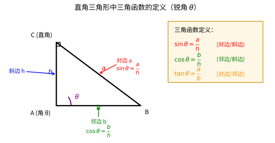

> **直观理解（现实类比）**：直角三角形定义是三角函数最原始的"出身"。想象你站在山脚下用测角仪测出山顶的**仰角 θ**，再量出你到山脚的水平距离（**邻边 b**）——就能由 $\tan\theta=\dfrac{a}{b}$ 算出山高（**对边 a**）。这正是工程测量、楼高测量、炮兵测距的原理。
>
> 三个比值本质上只是**直角三角形三边的两两之比**：$\sin$ 是"对边比斜边"（越高越接近 1），$\cos$ 是"邻边比斜边"（越平越接近 1），$\tan$ 是"对边比邻边"（陡峭程度）。只要记住"对、邻、斜"三个字，六种函数不过是它们的排列组合。

> **🧠 思考历程：$\sin$ 是怎么从"一根弦"变成"一个函数"的？**
>
> "正弦、余弦"这两个别扭的名字里，藏着一整部从天文到函数的演化史。今天的 $\sin\theta$ 是"直角三角形/单位圆里的一个数"，可它最早的祖先，其实是一根**弦**。
>
> - **天文观测催生了"弦"**。古希腊天文学家，尤其是托勒密（Ptolemy，约公元 2 世纪）的《天文学大成》，为了计算行星位置，需要一张"**给定圆心角、查出对应弦长**"的表。这张"弦表"就是正弦表的早期祖先——不过那时人们用的是"弦（chord）"，而不是半弦。**一切从观测星象的"量角查表"开始。**
> - **印度人把"全弦"换成"半弦"**。到了印度，天文学家阿耶波多（Āryabhaṭa，约公元 500）意识到：很多计算用"半弦"更顺手。半弦（semi-chord）其实就是今天直角三角形里的"对边"。他们的词语"半弦"辗转经阿拉伯语传入欧洲，被糊里糊涂地误拼成了拉丁词 **sinus（sinus = 半弓/褶）**——拉丁语的"sinus"本义是"胸脯的弧度"，于是我们有了"正弦（sine）"。**余弦（cosine）其实是"补角的 sine"（sine of the complementary angle）**，由"补"（co-）冠名而来。
> - **从天文工具到纯数学函数（18 世纪）**。真正让正弦、余弦从"查表工具"升级成"独立的函数"，归功于 18 世纪的欧拉与瑞士等数学家：他们不再把 $\sin\theta$ 看作一条弦、一个比值，而是把它当作**一个实数 $\theta$ 的数值函数**，并用单位圆把它与坐标轴联系起来（见下一节）——从此"三角函数"摆脱天文，成为分析学的主角。
> - **心路**：$\sin$ 的故事说明，**数学符号的名字往往是"旅行事故"的产物**（一个被误译的"半弦"），但它的数学本质却是被天文、测量一步步磨出来的。今天你念"正弦"，其实是在念一段跨越中、印、阿拉伯、欧洲的千年接力。

> **示例 2：已知直角三角形三边求三角函数值**
>
> 在直角三角形中，$\angle A = 30^\circ$，对边 $a = 1$，斜边 $h = 2$，求 $\sin 30^\circ$、$\cos 30^\circ$、$\tan 30^\circ$。
>
> **解**：
>
> 由勾股定理，邻边 $b = \sqrt{2^2 - 1^2} = \sqrt{3}$。

$$
\sin 30^\circ = \frac{a}{h} = \frac{1}{2}
$$

$$
\cos 30^\circ = \frac{b}{h} = \frac{\sqrt{3}}{2}
$$

$$
\tan 30^\circ = \frac{a}{b} = \frac{1}{\sqrt{3}} = \frac{\sqrt{3}}{3}
$$

---

#### 课堂问答

**老师**：$\sin\theta=\frac{\text{对边}}{\text{斜边}}$ 这个定义对哪些角有效？它的"死穴"在哪？

**学生**：只对 $0^\circ<\theta<90^\circ$ 的锐角有效。死穴是它依赖直角三角形——角一旦到 $90^\circ$ 或更大，两条直角边就画不出来了。所以必须把它升级成单位圆上的坐标定义，才能覆盖任意角。

**老师（追问）**：既然六种函数都能用"对、邻、斜"拼出来，教材为什么还保留 $\sec$、$\csc$ 这些看似多余的符号？

**学生**：因为它们各自简化了一类关系。例如 $1+\tan^2\theta=\sec^2\theta$、$1+\cot^2\theta=\csc^2\theta$，在微积分里 $\frac{d}{dx}\tan x=\sec^2 x$ 直接冒出 $\sec$。它们不是新东西，而是"倒数基因"带来的书写便利。

**老师（拓展）**：把 $\theta$ 从 $0$ 增到 $90^\circ$，$\sin$、$\cos$、$\tan$ 各自怎样走？

**学生**：$\sin\theta$ 从 $0$ 升到 $1$，$\cos\theta$ 从 $1$ 降到 $0$，两者此消彼长，恰好维持 $\sin^2\theta+\cos^2\theta=1$。$\tan\theta=\frac{\sin\theta}{\cos\theta}$ 因分母趋 $0$ 而冲向 $+\infty$，这正是正切在 $90^\circ$ 无定义、图像有竖直渐近线的根源。

### 3. 单位圆与三角函数

**单位圆** 是半径为 1、圆心在原点的圆，方程为 $x^2 + y^2 = 1$。

在单位圆上，角度 $\theta$ 从正 $x$ 轴出发逆时针旋转，与单位圆交于点 $P(x, y)$，则：

|      符号      |  名称  | 含义                   | 直观解释         |
| :------------: | :----: | :--------------------- | :--------------- |
| $\sin\theta$ |  正弦  | 点$P$ 的纵坐标       | “上下高度”     |
| $\cos\theta$ |  余弦  | 点$P$ 的横坐标       | “左右幅度”     |
| $\tan\theta$ |  正切  | 纵坐标与横坐标之比     | “高度除以宽度” |
|     $x$     | 横坐标 | 点$P$ 水平方向的位置 | “左右到哪里”   |
|     $y$     | 纵坐标 | 点$P$ 竖直方向的位置 | “上下到哪里”   |

$$
\sin\theta = y, \quad \cos\theta = x, \quad \tan\theta = \frac{y}{x} \;(x \neq 0)
$$

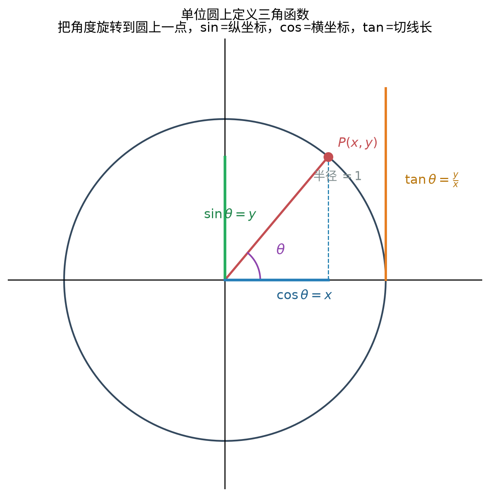

> **直观理解（现实类比）**：把角度想象成**手电筒**绕原点旋转，光斑落在单位圆上某点 $P(x,y)$。这个点的**纵坐标**就是 $\sin\theta$（上下高度），**横坐标**就是 $\cos\theta$（左右幅度），而 $\tan\theta$ 则是切线上的长度。**三角函数不是抽象公式，而是"圆上一点"的坐标投影。**
>
> 正因为这是"坐标"，所以一旦角度转到第二、三、四象限，坐标变号，三角函数的符号也随之改变——上表"各象限符号"就水到渠成，无需死记口诀背后的"为什么"。

#### 🎬 动画演示：单位圆与正弦曲线生成

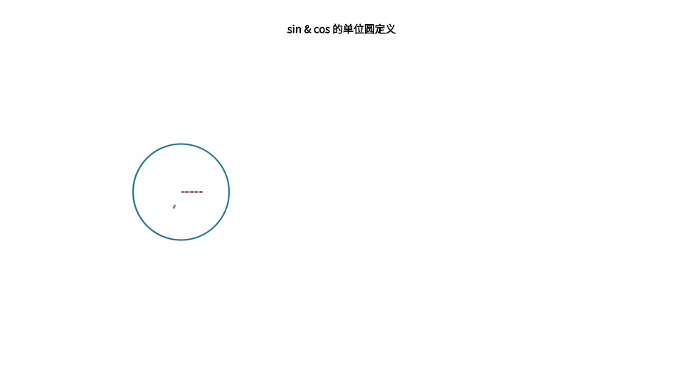

> 这个动画直观展示了在单位圆上角度 $\theta$ 与 $\sin\theta$、$\cos\theta$ 的对应关系，并把圆上一点随角度旋转的纵坐标"展开"成正弦曲线。它通过动画的方式帮助理解本节核心概念。

单位圆将三角函数的定义从锐角推广到任意角：

**各象限的三角函数符号**：

|   象限   |              角度范围              | $\sin\theta$ | $\cos\theta$ | $\tan\theta$ |
| :------: | :---------------------------------: | :------------: | :------------: | :------------: |
| 第一象限 |   $0 < \theta < \dfrac{\pi}{2}$   |     $+$     |     $+$     |     $+$     |
| 第二象限 |  $\dfrac{\pi}{2} < \theta < \pi$  |     $+$     |     $-$     |     $-$     |
| 第三象限 | $\pi < \theta < \dfrac{3\pi}{2}$ |     $-$     |     $-$     |     $+$     |
| 第四象限 | $\dfrac{3\pi}{2} < \theta < 2\pi$ |     $-$     |     $+$     |     $-$     |

记忆口诀：**"一全正，二正弦，三正切，四余弦"**（即第一象限全正，第二象限正弦正，第三象限正切正，第四象限余弦正）。

**特殊角的三角函数值**：

|   $\theta$   | $0$ |   $\dfrac{\pi}{6}$   |   $\dfrac{\pi}{4}$   |   $\dfrac{\pi}{3}$   | $\dfrac{\pi}{2}$ | $\pi$ | $\dfrac{3\pi}{2}$ |
| :------------: | :---: | :---------------------: | :---------------------: | :---------------------: | :----------------: | :-----: | :-----------------: |
| $\sin\theta$ | $0$ |    $\dfrac{1}{2}$    | $\dfrac{\sqrt{2}}{2}$ | $\dfrac{\sqrt{3}}{2}$ |       $1$       |  $0$  |       $-1$       |
| $\cos\theta$ | $1$ | $\dfrac{\sqrt{3}}{2}$ | $\dfrac{\sqrt{2}}{2}$ |    $\dfrac{1}{2}$    |       $0$       | $-1$ |        $0$        |
| $\tan\theta$ | $0$ | $\dfrac{\sqrt{3}}{3}$ |          $1$          |      $\sqrt{3}$      |       不存在       |  $0$  |       不存在       |

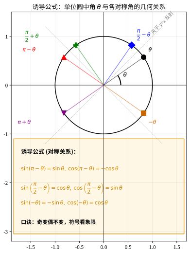

> **直观理解（现实类比）**：诱导公式本质是**镜面反射**的数学表达。把单位圆想象成一面**十字镜面**：
>
> - **$\pi-\theta$** 是关于 **$y$ 轴**的反射（左右翻），所以纵坐标 $\sin$ 不变、横坐标 $\cos$ 变号；
> - **$\dfrac{\pi}{2}-\theta$** 是关于 **$y=x$** 的反射（对角翻），所以 $\sin$ 与 $\cos$ **互换**（这正是"奇变"的几何根源）；
> - **$-\theta$** 是关于 **$x$ 轴**的反射（上下翻），所以 $\sin$ 变号、$\cos$ 不变。
>
> 口诀"**奇变偶不变，符号看象限**"中："奇/偶"指 $\dfrac{\pi}{2}$ 的倍数——奇数倍要**弦变弦**（sin↔cos），偶数倍**弦不变**；"符号看象限"则是把 θ 暂时当作锐角，看原角落在哪个象限，原函数在该象限的符号就是结果符号。

**诱导公式完整表**（设 $\theta$ 为任意角）：

**① 负角（偶不变，符号看象限）**

| 公式 | 结果 | 公式 | 结果 |
| :--- | :--- | :--- | :--- |
| $\sin(-\theta)$ | $-\sin\theta$ | $\cos(-\theta)$ | $\cos\theta$ |
| $\tan(-\theta)$ | $-\tan\theta$ | $\cot(-\theta)$ | $-\cot\theta$ |

**② $\pi-\theta$、$\pi+\theta$（围绕 $y$ 轴/原点，偶不变）**

| 公式 | 结果 | 公式 | 结果 |
| :--- | :--- | :--- | :--- |
| $\sin(\pi-\theta)$ | $\sin\theta$ | $\sin(\pi+\theta)$ | $-\sin\theta$ |
| $\cos(\pi-\theta)$ | $-\cos\theta$ | $\cos(\pi+\theta)$ | $-\cos\theta$ |
| $\tan(\pi-\theta)$ | $-\tan\theta$ | $\tan(\pi+\theta)$ | $\tan\theta$ |
| $\cot(\pi-\theta)$ | $-\cot\theta$ | $\cot(\pi+\theta)$ | $\cot\theta$ |

**③ $2\pi-\theta$（补一整个圆的负角）**

| 公式 | 结果 | 公式 | 结果 |
| :--- | :--- | :--- | :--- |
| $\sin(2\pi-\theta)$ | $-\sin\theta$ | $\cos(2\pi-\theta)$ | $\cos\theta$ |
| $\tan(2\pi-\theta)$ | $-\tan\theta$ | $\cot(2\pi-\theta)$ | $-\cot\theta$ |

**④ 余角与补角（$\dfrac{\pi}{2}-\theta$、$\dfrac{\pi}{2}+\theta$，奇变——弦互换）**

| 公式 | 结果 | 公式 | 结果 |
| :--- | :--- | :--- | :--- |
| $\sin\left(\dfrac{\pi}{2}-\theta\right)$ | $\cos\theta$ | $\sin\left(\dfrac{\pi}{2}+\theta\right)$ | $\cos\theta$ |
| $\cos\left(\dfrac{\pi}{2}-\theta\right)$ | $\sin\theta$ | $\cos\left(\dfrac{\pi}{2}+\theta\right)$ | $-\sin\theta$ |
| $\tan\left(\dfrac{\pi}{2}-\theta\right)$ | $\cot\theta$ | $\tan\left(\dfrac{\pi}{2}+\theta\right)$ | $-\cot\theta$ |

**⑤ $\dfrac{3\pi}{2} \pm \theta$（半圈再 ±θ，奇变——弦互换）**

| 公式 | 结果 | 公式 | 结果 |
| :--- | :--- | :--- | :--- |
| $\sin\left(\dfrac{3\pi}{2}-\theta\right)$ | $-\cos\theta$ | $\sin\left(\dfrac{3\pi}{2}+\theta\right)$ | $-\cos\theta$ |
| $\cos\left(\dfrac{3\pi}{2}-\theta\right)$ | $-\sin\theta$ | $\cos\left(\dfrac{3\pi}{2}+\theta\right)$ | $\sin\theta$ |
| $\tan\left(\dfrac{3\pi}{2}-\theta\right)$ | $\cot\theta$ | $\tan\left(\dfrac{3\pi}{2}+\theta\right)$ | $-\cot\theta$ |

**⑥ 周期延拓（$\theta$ 或 $\theta \pm \pi$，同角同名）**

$$
\sin(\theta + 2k\pi) = \sin\theta,\quad \cos(\theta + 2k\pi) = \cos\theta,\quad \tan(\theta + k\pi) = \tan\theta \ (k \in \mathbb{Z})
$$

> **💡 直观理解（类比）**：以上所有公式只需抓住两句"约定"即可全部推出：①**偶不变**——$\pi$ 的整数倍（如 $\pi、2\pi$）翻开角度时 sin/cos 名字不变；**奇变**——$\dfrac{\pi}{2}$ 的奇数倍才让 sin↔cos 互换；②**符号看象限**——先把 $\theta$ 当作第一象限锐角，看原角 $\theta$ 加上/减去的那个角落在第几象限，原函数在该象限的符号就是答案符号。**你并不需要背下 20+ 条，只要能画单位圆、记得两句口诀就够了。**

#### 课堂问答

**老师**：单位圆上一句"$\sin\theta$ 是纵坐标、$\cos\theta$ 是横坐标"，凭什么能替代直角三角形定义？

**学生**：因为它把"角度无限旋转"直接编码成坐标。点 $P(\cos\theta,\sin\theta)$ 始终满足 $x^2+y^2=1$，任意实数 $\theta$（含负角、超一圈）都有唯一落点，周期性与值域 $[-1,1]$ 自然长出来，这是直角三角形定义做不到的。

**老师（追问）**：诱导公式口诀说"奇变偶不变"，那个"变"到底变的是什么？

**学生**：变的是函数名。$\frac{\pi}{2}$ 的奇数倍对应关于直线 $y=x$ 的反射，横纵坐标互换，所以 $\sin$ 与 $\cos$ 互换；偶数倍对应关于坐标轴的反射，同名不变。符号则由反射后点落在哪个象限决定，这就是"符号看象限"。

**老师（拓展）**：单位圆还能看出 $\sin$ 与 $\cos$ 之间更深的关系吗？

**学生**：能。$\cos\theta=\sin\left(\theta+\frac{\pi}{2}\right)$，说明余弦只是正弦向左平移 $\frac{\pi}{2}$；把点 $P$ 的纵坐标随 $\theta$ 展开就得到正弦波。这暗示两者导数只差一个相位，也为后面的图像变换埋下伏笔。

### 4. 从直角三角形到单位圆：正弦余弦为何"活"了起来

> 这是全章最重要的一次"视角升级"，请务必读通。

**来龙去脉（第一步）：直角三角形里的 $\sin,\cos$ 是"被困住的"**

上一节用直角三角形定义 $\sin\theta=\dfrac{\text{对边}}{\text{斜边}}$。这个定义有一个致命的局限：**它只对 $0<\theta<90^\circ$ 的锐角成立**。

- 角度一旦超过 $90^\circ$，直角三角形里就装不下这么大的角了；
- 更要不命的是，直角三角形定义**没法告诉你 $\sin 120^\circ$ 是多少**——而天体运动、旋转的轮子、交流电，天天都要面对超过 $90^\circ$ 的角度。

**要解决的问题（第二步）：需要一个"任何角度都有意义"的定义**

如果三角函数只能在 $0\sim 90^\circ$ 里谈，那它永远只能当不够用的"量标杆"，成不了描述旋转世界的函数。数学家需要的是：**把角度当作可以无限转下去的量，让每个角度——正的、负的、超过一圈的——都对应一个唯一的函数值。** 这把"测量工具"解放成"旋转函数"的钥匙，就是单位圆。

**正式定义（第三步）：把 $\sin,\cos$ 变成"坐标投影"**

在单位圆 $x^2+y^2=1$ 上，从正 $x$ 轴出发逆时针旋转角度 $\theta$，与圆交于点 $P(x,y)$。于是我们重新"出生"一次：

$$
\sin\theta = y \quad(\text{点的\textbf{纵坐标}}),\qquad \cos\theta = x \quad(\text{点的\textbf{横坐标}})
$$

这个定义才是"正弦余弦的真正出身"：它们从"对边/邻边"这样一次性的比值，升级成了**圆上一点在两轴的坐标投影**。旋转到哪个象限，坐标就带哪个符号；转满一圈，坐标回到原点——于是周期、正负、值域 $[-1,1]$ 全都"长"出来了（图 trig-sine.svg、trig-general-sine.svg 所展示的正弦波形，正是这一投影的"展开图"）。


**解决了什么（第四步）**

| 直角三角形定义（旧） | 单位圆定义（新） |
| :--- | :--- |
| 只适用 $0<\theta<90^\circ$ | 适用任意角（正、负、超一圈均可） |
| 只能"量直角三角形的边比" | 能描述旋转、波形、周期现象 |
| 函数值"挤在一格" | 点 $(\cos\theta,\sin\theta)$ 随 $\theta$ 在圆上跑 |
| 直觉来自"测高" | 直觉来自"绕圈"（摩天轮、手电筒光斑） |

> **🧠 心路总结**：$\sin,\cos$ 从"直角三角形对边/斜边之比"到"单位圆上的坐标投影"，本质是一次**"解禁"**——把被困在 $90^\circ$ 里的测量工具，解放成可以在整个平面旋转、无限延伸的**周期函数**。从此三角函数不再只回答"这个直角三角形的边比是多少"，而开始回答"转了这个角度，点在哪里"。

---

#### 课堂问答

**老师**：直角三角形定义"死"在哪一点上，非升级不可？

**学生**：死在一个"困"字上：它只能在 $0<\theta<90^\circ$ 内取值，装不下 $120^\circ$、负角或转好几圈的角度。而旋转的轮子、交流电都需要任意角，所以必须换一套对任何实数 $\theta$ 都成立的定义。

**老师（追问）**：只靠单位圆定义 $\sin$、$\cos$，不借助直角三角形，还能不能证明 $\sin^2\theta+\cos^2\theta=1$？

**学生**：能，而且更直接。$P(\cos\theta,\sin\theta)$ 在圆上，代入圆方程 $x^2+y^2=1$ 立得。本质上这是勾股定理的坐标化身，只是不再需要"先画一个直角三角形"。这正是升级后仍保住旧结论的证据。

**老师（拓展）**：这次升级对后面解三角形或微积分有什么直接价值？

**学生**：它让 $\sin$、$\cos$ 成为真正的周期函数，于是周期、奇偶、单调区间都变得可谈；微积分里最重要的 $(\sin x)'=\cos x$ 也只有在弧度（单位圆）框架下才不带系数。可以说，没有这次升级就没有后面的整套分析学。

## 基本定理与公式

### 1. 基本恒等式

**1.1 平方关系**

由单位圆方程 $x^2 + y^2 = 1$，即 $\cos^2\theta + \sin^2\theta = 1$：

$$
\boxed{\sin^2\theta + \cos^2\theta = 1}
$$

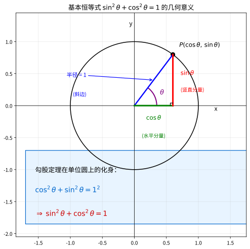

> **直观理解（现实类比）**：这个恒等式不是凭空规定的，而是**勾股定理在单位圆上的化身**。单位圆上任意一点 $P(\cos\theta, \sin\theta)$ 到原点的距离（半径）= 1，把它和原点、投影点连成直角三角形：水平直角边是 $\cos\theta$，竖直直角边是 $\sin\theta$，斜边是半径 1。
>
> 由勾股定理 $\text{水平}^2 + \text{竖直}^2 = \text{斜边}^2$，立刻得到 $\cos^2\theta + \sin^2\theta = 1^2 = 1$。所以这个公式本质就是说：**单位圆上点的"水平分量² + 垂直分量² = 半径²"**——它是勾股定理穿上"三角函数"外衣后的样子，难怪无论 θ 取何值都成立。

将上式两边同时除以 $\cos^2\theta$（$\cos\theta \neq 0$）：

$$
\boxed{1 + \tan^2\theta = \sec^2\theta}
$$

将上式两边同时除以 $\sin^2\theta$（$\sin\theta \neq 0$）：

$$
\boxed{1 + \cot^2\theta = \csc^2\theta}
$$

**1.2 商数关系**

$$
\tan\theta = \frac{\sin\theta}{\cos\theta}, \quad \cot\theta = \frac{\cos\theta}{\sin\theta}
$$

**1.3 倒数关系**

$$
\csc\theta = \frac{1}{\sin\theta}, \quad \sec\theta = \frac{1}{\cos\theta}, \quad \cot\theta = \frac{1}{\tan\theta}
$$

> **示例 3：利用恒等式求值**
>
> 已知 $\sin\theta = \dfrac{3}{5}$，且 $\theta$ 在第二象限，求 $\cos\theta$ 和 $\tan\theta$。
>
> **解**：
>
> 由 $\sin^2\theta + \cos^2\theta = 1$：

$$
\cos^2\theta = 1 - \sin^2\theta = 1 - \left(\frac{3}{5}\right)^2 = 1 - \frac{9}{25} = \frac{16}{25}
$$

> 由于 $\theta$ 在第二象限，$\cos\theta < 0$，所以 $\cos\theta = -\dfrac{4}{5}$。

$$
\tan\theta = \frac{\sin\theta}{\cos\theta} = \frac{3/5}{-4/5} = -\frac{3}{4}
$$

---

#### 课堂问答

**老师**：$\sin^2\theta+\cos^2\theta=1$ 到底是"规定"还是"定理"？

**学生**：是定理，而且是勾股定理穿上三角函数的外衣。单位圆上点 $(\cos\theta,\sin\theta)$ 到原点的距离恒为 $1$，勾股定理立刻给出该式。它不必背，因为它是几何事实。

**老师（追问）**：由它除 $\cos^2\theta$ 得 $1+\tan^2\theta=\sec^2\theta$，除 $\sin^2\theta$ 得 $1+\cot^2\theta=\csc^2\theta$，这两个变形有没有"陷阱"？

**学生**：有，分母不能为零。第一个要求 $\cos\theta\neq0$，即 $\theta\neq\frac{\pi}{2}+k\pi$；第二个要求 $\sin\theta\neq0$，即 $\theta\neq k\pi$。所以它们是"局部恒等式"，定义域外无意义，忽略这点会把无定义的点当成解。

**老师（拓展）**：已知一个 $\sin\theta$ 的值，为什么不能立刻写出 $\cos\theta$？

**学生**：因为 $\cos\theta=\pm\sqrt{1-\sin^2\theta}$ 有正负两个候选，必须靠 $\theta$ 所在象限（或被求三角函数本身）来定号。这就是"给值求值先判象限"的一般原则，也是解三角方程容易漏解的病根。

### 2. 和角公式

**2.1 正弦的和角与差角公式**

|          符号          |     名称     | 含义                   | 直观解释         |
| :---------------------: | :----------: | :--------------------- | :--------------- |
|       $\alpha$       | 角$\alpha$ | 参与运算的第一个角度   | “第一个待加角” |
|        $\beta$        | 角$\beta$ | 参与运算的第二个角度   | “第二个待加角” |
| $\sin\alpha\cos\beta$ |   交叉乘积   | 第一角正弦乘第二角余弦 | “一正一余相乘” |
| $\cos\alpha\sin\beta$ |   交叉乘积   | 第一角余弦乘第二角正弦 | “一余一正相乘” |

$$
\boxed{\sin(\alpha + \beta) = \sin\alpha\cos\beta + \cos\alpha\sin\beta}
$$

$$
\boxed{\sin(\alpha - \beta) = \sin\alpha\cos\beta - \cos\alpha\sin\beta}
$$

**2.2 余弦的和角与差角公式**

$$
\boxed{\cos(\alpha + \beta) = \cos\alpha\cos\beta - \sin\alpha\sin\beta}
$$

$$
\boxed{\cos(\alpha - \beta) = \cos\alpha\cos\beta + \sin\alpha\sin\beta}
$$

**2.3 正切的和角与差角公式**

$$
\boxed{\tan(\alpha + \beta) = \frac{\tan\alpha + \tan\beta}{1 - \tan\alpha\tan\beta}}
$$

$$
\boxed{\tan(\alpha - \beta) = \frac{\tan\alpha - \tan\beta}{1 + \tan\alpha\tan\beta}}
$$

**推论（正切的和差化弦）**：由和差角正弦公式两边同除以 $\cos\alpha\cos\beta$ 即得：

$$
\boxed{\tan\alpha \pm \tan\beta = \frac{\sin(\alpha \pm \beta)}{\cos\alpha\cos\beta}}
$$

**2.4 余切、正割与余割的和差角公式**

余切公式可由 $\cot = \dfrac{\cos}{\sin}$ 对正弦和差角公式分子分母同除以 $\sin\alpha\sin\beta$ 得到；正割、余割是余弦、正弦的倒数，其和差角公式由余弦、正弦和差角公式取倒数即得：

$$
\boxed{\cot(\alpha + \beta) = \frac{\cot\alpha\cot\beta - 1}{\cot\alpha + \cot\beta}}, \qquad \boxed{\cot(\alpha - \beta) = \frac{\cot\alpha\cot\beta + 1}{\cot\beta - \cot\alpha}}
$$

$$
\sec(\alpha \pm \beta) = \frac{\sec\alpha\sec\beta}{1 \mp \tan\alpha\tan\beta}, \qquad \csc(\alpha \pm \beta) = \frac{\sec\alpha\sec\beta}{\tan\alpha \pm \tan\beta}
$$

**证明（余弦和角公式）**：在单位圆上，设 $A$ 点对应角度 $\alpha$ 坐标为 $(\cos\alpha, \sin\alpha)$，$B$ 点对应角度 $-\beta$ 坐标为 $(\cos\beta, -\sin\beta)$。则 $\angle AOB = \alpha + \beta$。由向量点积公式：

$$
\cos(\alpha + \beta) = \overrightarrow{OA} \cdot \overrightarrow{OB} = \cos\alpha\cos\beta + \sin\alpha(-\sin\beta) = \cos\alpha\cos\beta - \sin\alpha\sin\beta
$$

**证明（正弦和角公式）**：利用 $\sin(\alpha + \beta) = \cos\left(\frac{\pi}{2} - (\alpha + \beta)\right) = \cos\left((\frac{\pi}{2} - \alpha) - \beta\right)$，展开即得。

**几何证明（单位圆法）**：

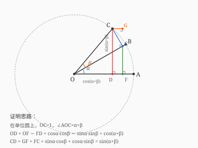

如图所示，在单位圆上取点 $C$，使 $\angle AOC = \alpha + \beta$。作以下辅助线：

- $CD \perp OA$，垂足为 $D$
- $CE \perp OB$，垂足为 $E$
- $EF \perp OA$，垂足为 $F$

**第一步：求 $OE$ 和 $CE$**

在直角三角形 $OCE$ 中，$OC=1$（单位圆半径），$\angle COE = \beta$，故：

$$
OE = \cos\beta, \quad CE = \sin\beta
$$

- 【第 1 步】依据：在直角三角形 $OCE$ 中 $OC=1$（单位圆半径），$\beta$ 的余弦等于邻边比斜边、正弦等于对边比斜边；目的：先把半径 $OC$ 沿 $OB$ 方向分解，得到 $E$ 到 $O$ 的距离 $OE$，作为后续继续分解的“底料”。

**第二步：求 $OF$ 和 $EF$**

在直角三角形 $OEF$ 中，$\angle EOF = \alpha$，斜边为 $OE = \cos\beta$，故：

$$
OF = OE\cos\alpha = \cos\alpha\cos\beta
$$

$$
EF = OE\sin\alpha = \sin\alpha\cos\beta
$$

- 【第 2 步】依据：在直角三角形 $OEF$ 中，斜边恰是上一步求得的 $OE=\cos\beta$，再用 $\alpha$ 的余弦、正弦做第二次分解；目的：把斜向的 $OE$ 再拆成水平 $OF$ 与竖直 $EF$，让横纵两段长度显形。

**第三步：分解 $CE$ 的方向**

$CE \perp OB$，而 $OB$ 与水平方向（$OA$）夹角为 $\alpha$，因此 $CE$ 与竖直方向夹角为 $\alpha$。将 $CE$ 分解为水平和竖直两个分量：

- 水平分量（向左）：$CE\sin\alpha = \sin\alpha\sin\beta$
- 竖直分量（向上）：$CE\cos\alpha = \cos\alpha\sin\beta$
- 【第 3 步】依据：$CE\perp OB$ 而 $OB$ 与 $OA$ 夹角为 $\alpha$，因此可用 $\alpha$ 的正弦、余弦把 $CE=\sin\beta$ 再分解；目的：得到 $C$ 相对于 $E$ 向左、向上的两份偏移，为累加 $OD$ 与 $CD$ 准备好各个零件。

**第四步：证明 $\cos(\alpha+\beta)$**

$D$ 和 $F$ 分别是 $C$ 和 $E$ 在 $OA$ 上的投影。由于 $C$ 相对于 $E$ 向左偏移了 $CE$ 的水平分量 $\sin\alpha\sin\beta$，所以 $D$ 在 $F$ 左侧，且：

$$
FD = \sin\alpha\sin\beta
$$

因此：

$$
OD = OF - FD = \cos\alpha\cos\beta - \sin\alpha\sin\beta
$$

又因为 $OC=1$，$\angle AOC = \alpha+\beta$，所以 $OD = \cos(\alpha+\beta)$，即：

$$
\boxed{\cos(\alpha+\beta) = \cos\alpha\cos\beta - \sin\alpha\sin\beta}
$$

**第五步：证明 $\sin(\alpha+\beta)$**

$CD$ 是 $C$ 到 $OA$ 的竖直距离。由于 $C$ 相对于 $E$ 向上偏移了 $CE$ 的竖直分量 $\cos\alpha\sin\beta$，所以：

$$
CD = EF + CE\cos\alpha = \sin\alpha\cos\beta + \cos\alpha\sin\beta
$$

又因为 $CD = \sin(\alpha+\beta)$，即：

$$
\boxed{\sin(\alpha+\beta) = \sin\alpha\cos\beta + \cos\alpha\sin\beta}
$$

> **示例 4：利用和角公式计算 $75^\circ$ 的三角函数值**
>
> 求 $\sin 75^\circ$ 和 $\cos 75^\circ$。
>
> **解**：

$$
75^\circ = 45^\circ + 30^\circ
$$

$$
\sin 75^\circ = \sin(45^\circ + 30^\circ) = \sin 45^\circ\cos 30^\circ + \cos 45^\circ\sin 30^\circ
$$

$$
= \frac{\sqrt{2}}{2} \cdot \frac{\sqrt{3}}{2} + \frac{\sqrt{2}}{2} \cdot \frac{1}{2} = \frac{\sqrt{6} + \sqrt{2}}{4}
$$

$$
\cos 75^\circ = \cos(45^\circ + 30^\circ) = \cos 45^\circ\cos 30^\circ - \sin 45^\circ\sin 30^\circ
$$

$$
= \frac{\sqrt{2}}{2} \cdot \frac{\sqrt{3}}{2} - \frac{\sqrt{2}}{2} \cdot \frac{1}{2} = \frac{\sqrt{6} - \sqrt{2}}{4}
$$

---

#### 课堂问答

**老师**：$\sin(\alpha+\beta)=\sin\alpha\cos\beta+\cos\alpha\sin\beta$ 好记，可 $\cos(\alpha+\beta)$ 里为什么偏偏是"减"号？

**学生**：关键在投影方向。余弦对应横分量的投影，两角叠加时有一份横分量被反向投影，于是出现负号；正弦走纵轴，两个交叉项方向一致，故相加。取 $A(\cos\alpha,\sin\alpha)$、$B(\cos\beta,-\sin\beta)$ 做点积即可一眼看出。

**老师（追问）**：若把 $\cos(\alpha+\beta)$ 的减号误记成加号，会带来什么连锁错误？

**学生**：会直接推出 $\cos2\theta=\cos^2\theta+\sin^2\theta=1$ 的荒谬结论，与 $2\cos^2\theta-1$ 矛盾。更糟的是整张公式网络都架在和角公式上，根一错则枝全错，所以这个符号必须从反射图里真正看懂。

**老师（拓展）**：这套和角公式在微积分里还会以什么面貌出现？

**学生**：它是 $\tan(\alpha+\beta)=\frac{\tan\alpha+\tan\beta}{1-\tan\alpha\tan\beta}$ 等全套和差公式的源头，也是正弦定理、辅助角公式、积化和差的共同祖先。整棵三角公式树只有这一个根，其余都是它的特例。

### 3. 倍角公式

**3.1 二倍角公式**

由和角公式令 $\alpha = \beta = \theta$ 可得：

$$
\boxed{\sin 2\theta = 2\sin\theta\cos\theta}
$$

$$
\boxed{\cos 2\theta = \cos^2\theta - \sin^2\theta = 2\cos^2\theta - 1 = 1 - 2\sin^2\theta}
$$

$$
\boxed{\tan 2\theta = \frac{2\tan\theta}{1 - \tan^2\theta}}
$$

**余切、正割与余割的二倍角公式**（由上式取倒数或平方关系导出）：

$$
\cot 2\theta = \frac{\cot^2\theta - 1}{2\cot\theta}, \qquad \sec 2\theta = \frac{\sec^2\theta}{2 - \sec^2\theta}, \qquad \csc 2\theta = \frac{\sec\theta\csc\theta}{2}
$$

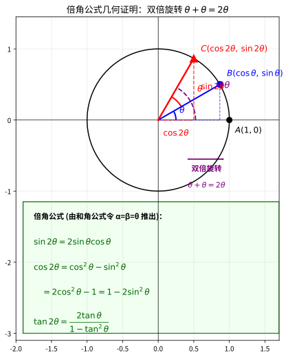

> **直观理解（现实类比）**：倍角公式像一次**"双倍旋转"**。在单位圆上，从起点 $A(1,0)$ 出发，先旋转角 $\theta$ 到达 $B$ 点，再继续旋转角 $\theta$ 到达 $C$ 点——这两次旋转的"合计效果"，就等同于从 $A$ 一次性旋转 $2\theta$。
>
> 所以 $C$ 点的坐标既可以用 $\sin 2\theta, \cos 2\theta$ 表示，也可以由"旋转 $\theta$ 后再旋转 $\theta$"的复合公式（和角公式 $\alpha=\beta=\theta$）推出。**倍角公式 = 和角公式的"双胞胎特例"**：它不是新东西，而是"旋转两次 θ = 旋转一次 2θ"这个几何事实的代数记录。

**3.2 三倍角公式**

$$
\sin 3\theta = 3\sin\theta - 4\sin^3\theta
$$

$$
\cos 3\theta = 4\cos^3\theta - 3\cos\theta
$$

$$
\tan 3\theta = \frac{3\tan\theta - \tan^3\theta}{1 - 3\tan^2\theta}
$$

**证明（二倍角正弦公式）**：

由 $\sin(\alpha + \beta) = \sin\alpha\cos\beta + \cos\alpha\sin\beta$，令 $\alpha = \beta = \theta$：

$$
\sin 2\theta = \sin\theta\cos\theta + \cos\theta\sin\theta = 2\sin\theta\cos\theta
$$

> **示例 5：利用二倍角求值**
>
> 已知 $\cos\theta = \dfrac{3}{5}$，且 $\theta$ 在第四象限，求 $\sin 2\theta$ 和 $\cos 2\theta$。
>
> **解**：
>
> 由 $\sin^2\theta + \cos^2\theta = 1$，$\sin^2\theta = 1 - \frac{9}{25} = \frac{16}{25}$。
>
> 由于 $\theta$ 在第四象限，$\sin\theta < 0$，所以 $\sin\theta = -\dfrac{4}{5}$。

$$
\sin 2\theta = 2\sin\theta\cos\theta = 2 \cdot \left(-\frac{4}{5}\right) \cdot \frac{3}{5} = -\frac{24}{25}
$$

$$
\cos 2\theta = 2\cos^2\theta - 1 = 2 \cdot \frac{9}{25} - 1 = \frac{18}{25} - 1 = -\frac{7}{25}
$$

---

#### 课堂问答

**老师**：$\cos2\theta$ 写成三种形式，是"三个公式"吗？

**学生**：不是，是同一条公式的三种伪装。由 $\sin^2\theta+\cos^2\theta=1$ 把 $\sin^2$ 换成 $1-\cos^2$ 就得到 $2\cos^2\theta-1$，换个方向就得到 $1-2\sin^2\theta$。真正独立的其实只有平方关系与和角公式。

**老师（追问）**：既然等价，为什么还要专门备好"降幂"那两条？

**学生**：因为用途不同。含 $\sin^2\theta$ 或 $\cos^2\theta$ 时，用 $2\cos^2\theta-1$、$1-2\sin^2\theta$ 能把二次幂降成一次，便于统一角、求周期、做后续积分；而 $\cos^2\theta-\sin^2\theta$ 在消弦、配合和差时更好用。选哪条由目标决定，不是随意的。

**老师（拓展）**：$\sin2\theta=2\sin\theta\cos\theta$ 到微积分里会怎样被"反向使用"？

**学生**：正向是从倍角到乘积，反向就是积化和差：$\sin\theta\cos\theta=\frac12\sin2\theta$，把"两角乘积"化成"单项"，正是求 $\int\sin x\cos x\,dx$ 的关键一步。倍角与半角、降幂与积化和差，本质是一套互逆工具。

### 4. 半角公式

由二倍角公式 $\cos 2\alpha = 2\cos^2\alpha - 1 = 1 - 2\sin^2\alpha$，令 $\alpha = \dfrac{\theta}{2}$ 可得：

$$
\boxed{\sin^2\frac{\theta}{2} = \frac{1 - \cos\theta}{2}}
$$

$$
\boxed{\cos^2\frac{\theta}{2} = \frac{1 + \cos\theta}{2}}
$$

$$
\boxed{\tan\frac{\theta}{2} = \frac{1 - \cos\theta}{\sin\theta} = \frac{\sin\theta}{1 + \cos\theta}}
$$

开方时需注意 $\frac{\theta}{2}$ 所在象限以确定符号：

$$
\sin\frac{\theta}{2} = \pm\sqrt{\frac{1 - \cos\theta}{2}}, \quad \cos\frac{\theta}{2} = \pm\sqrt{\frac{1 + \cos\theta}{2}}
$$

半角正切的开方形式（由 $\tan\frac{\theta}{2} = \pm\sqrt{\dfrac{\sin^2\frac{\theta}{2}}{\cos^2\frac{\theta}{2}}}$ 得，符号同样由 $\frac{\theta}{2}$ 所在象限确定）：

$$
\boxed{\tan\frac{\theta}{2} = \pm\sqrt{\frac{1 - \cos\theta}{1 + \cos\theta}}}
$$

> **示例 6：利用半角公式求 $15^\circ$ 的三角函数值**
>
> 求 $\sin 15^\circ$ 和 $\cos 15^\circ$。
>
> **解**：
>
> $15^\circ = \dfrac{30^\circ}{2}$，且 $\cos 30^\circ = \dfrac{\sqrt{3}}{2}$。

$$
\sin^2 15^\circ = \frac{1 - \cos 30^\circ}{2} = \frac{1 - \frac{\sqrt{3}}{2}}{2} = \frac{2 - \sqrt{3}}{4}
$$

> 由于 $15^\circ$ 在第一象限，$\sin 15^\circ > 0$，所以：

$$
\sin 15^\circ = \sqrt{\frac{2 - \sqrt{3}}{4}} = \frac{\sqrt{2 - \sqrt{3}}}{2} = \frac{\sqrt{6} - \sqrt{2}}{4}
$$

$$
\cos^2 15^\circ = \frac{1 + \cos 30^\circ}{2} = \frac{1 + \frac{\sqrt{3}}{2}}{2} = \frac{2 + \sqrt{3}}{4}
$$

$$
\cos 15^\circ = \frac{\sqrt{2 + \sqrt{3}}}{2} = \frac{\sqrt{6} + \sqrt{2}}{4}
$$

---

#### 课堂问答

**老师**：$\sin^2\frac{\theta}{2}=\frac{1-\cos\theta}{2}$ 的右边一定非负吗？这说明什么？

**学生**：一定非负，因为左边是平方。这其实是一个自洽性检查：$\cos\theta\leq1$ 保证 $1-\cos\theta\geq0$。若算出右边为负，必然是算错了。它顺手验证了 $|\cos\theta|\leq1$。

**老师（追问）**：那 $\sin\frac{\theta}{2}=\pm\sqrt{\frac{1-\cos\theta}{2}}$ 里的正负号，凭什么不能一开了之？

**学生**：因为开方丢掉了符号信息。$\frac{\theta}{2}$ 落在哪个象限，就决定 $\sin\frac{\theta}{2}$ 的正负，必须由 $\theta$ 的范围反推 $\frac{\theta}{2}$ 的范围来定号。漏定号就会把负解当成正解，这正是半角公式最常见的失误。

**老师（拓展）**：为什么强调半角正切 $\tan\frac{\theta}{2}=\frac{1-\cos\theta}{\sin\theta}=\frac{\sin\theta}{1+\cos\theta}$ 比开方形式更常用？

**学生**：因为它不带根号也不带 $\pm$，只要 $\sin\theta\neq0$ 就自动带上正确符号。积分里换元 $t=\tan\frac{x}{2}$ 正是靠它把整个三角有理式化成关于 $t$ 的有理函数，这就是后面"万能公式"的入口。

### 5. 和差化积公式

和差化积公式将三角函数的和差形式转化为乘积形式：

$$
\boxed{\sin\alpha + \sin\beta = 2\sin\frac{\alpha + \beta}{2}\cos\frac{\alpha - \beta}{2}}
$$

$$
\boxed{\sin\alpha - \sin\beta = 2\cos\frac{\alpha + \beta}{2}\sin\frac{\alpha - \beta}{2}}
$$

$$
\boxed{\cos\alpha + \cos\beta = 2\cos\frac{\alpha + \beta}{2}\cos\frac{\alpha - \beta}{2}}
$$

$$
\boxed{\cos\alpha - \cos\beta = -2\sin\frac{\alpha + \beta}{2}\sin\frac{\alpha - \beta}{2}}
$$

**证明（以 $\sin\alpha + \sin\beta$ 为例）**：

令 $A = \dfrac{\alpha + \beta}{2}$，$B = \dfrac{\alpha - \beta}{2}$，则 $\alpha = A + B$，$\beta = A - B$。

- 【第 1 步】依据：引入新记号 $A=\frac{\alpha+\beta}{2}$、$B=\frac{\alpha-\beta}{2}$，从而把 $\alpha$ 表成 $A+B$、$\beta$ 表成 $A-B$；目的：把两个不同角度统一成“同一中心 $A$ 加减半个差”，得以套用正弦和角公式。

由和角公式：

$$
\sin\alpha = \sin(A + B) = \sin A\cos B + \cos A\sin B
$$

$$
\sin\beta = \sin(A - B) = \sin A\cos B - \cos A\sin B
$$

- 【第 2 步】依据：分别对 $\sin(A+B)$ 与 $\sin(A-B)$ 使用正弦和角、差角公式展开；目的：两个展开式中 $\sin A\cos B$ 与 $\cos A\sin B$ 互为镜像，相加时只剩加号项。

两式相加：

$$
\sin\alpha + \sin\beta = 2\sin A\cos B = 2\sin\frac{\alpha + \beta}{2}\cos\frac{\alpha - \beta}{2}
$$

- 【第 3 步】依据：两式相加后 $\sin A\cos B$ 合并为 $2\sin A\cos B$、$\cos A\sin B$ 抵消，再把 $A$、$B$ 换回 $\frac{\alpha\pm\beta}{2}$；目的：把“正弦之和”转成“和角半角之正弦乘差角半角之余弦”的乘积形式，完成化积。

**积化和差公式**（和差化积的逆用）：

$$
\sin\alpha\cos\beta = \frac{1}{2}[\sin(\alpha + \beta) + \sin(\alpha - \beta)]
$$

$$
\cos\alpha\sin\beta = \frac{1}{2}[\sin(\alpha + \beta) - \sin(\alpha - \beta)]
$$

$$
\cos\alpha\cos\beta = \frac{1}{2}[\cos(\alpha + \beta) + \cos(\alpha - \beta)]
$$

$$
\sin\alpha\sin\beta = -\frac{1}{2}[\cos(\alpha + \beta) - \cos(\alpha - \beta)]
$$

> **示例 7：和差化积求值**
>
> 化简 $\sin 75^\circ + \sin 15^\circ$。
>
> **解**：

$$
\sin 75^\circ + \sin 15^\circ = 2\sin\frac{75^\circ + 15^\circ}{2}\cos\frac{75^\circ - 15^\circ}{2}
$$

$$
= 2\sin 45^\circ\cos 30^\circ = 2 \cdot \frac{\sqrt{2}}{2} \cdot \frac{\sqrt{3}}{2} = \frac{\sqrt{6}}{2}
$$

---

#### 课堂问答

**老师**：和差化积与积化和差，是不是两套需要分别背的公式？

**学生**：不是，是同一组关系的正反两读。把 $\sin\alpha+\sin\beta$ 用 $A=\frac{\alpha+\beta}{2}$、$B=\frac{\alpha-\beta}{2}$ 展开相加，就得到和差化积；把它倒过来解，就是积化和差。记一套即可，另一套现场推导。

**老师（追问）**：$\cos\alpha-\cos\beta=-2\sin\frac{\alpha+\beta}{2}\sin\frac{\alpha-\beta}{2}$ 前面为什么多一个负号？

**学生**：因为 $\cos(A+B)+\cos(A-B)$ 交叉项相消后剩两个余弦之积；而相减时剩的是 $-2\sin A\sin B$，正弦是奇函数、相减会翻号，负号是它的必然结果。$\cos\alpha+\cos\beta$ 没有相减，自然不带负号。

**老师（拓展）**：和差化积在解三角形里会以什么形式登场？

**学生**：正切定理就是它的直接产物。由正弦定理 $\frac{a+b}{a-b}=\frac{\sin A+\sin B}{\sin A-\sin B}$，分子分母和差化积后约分即得 $\frac{\tan\frac{A+B}{2}}{\tan\frac{A-B}{2}}$。可见它不是化简游戏，而是连接边与角的桥。

### 6. 正弦定理

**定理**：在任意三角形 $ABC$ 中，各边与其对角的正弦之比相等，且等于该三角形外接圆直径 $2R$：

|     符号     |    名称    | 含义                           | 直观解释           |
| :----------: | :--------: | :----------------------------- | :----------------- |
| $a, b, c$ |    三边    | 三条边的长度                   | “三根边的长度”   |
| $\angle A$ |  角$A$  | 顶点$A$ 的内角，对边是 $a$ | “顶点 A 的张角”  |
| $\angle B$ |  角$B$  | 顶点$B$ 的内角，对边是 $b$ | “顶点 B 的张角”  |
| $\angle C$ |  角$C$  | 顶点$C$ 的内角，对边是 $c$ | “顶点 C 的张角”  |
|    $R$    | 外接圆半径 | 过三顶点圆的半径               | “外圈包的圆半径” |

$$
\boxed{\frac{a}{\sin A} = \frac{b}{\sin B} = \frac{c}{\sin C} = 2R}
$$

其中 $a, b, c$ 分别为 $\angle A, \angle B, \angle C$ 的对边，$R$ 为外接圆半径。

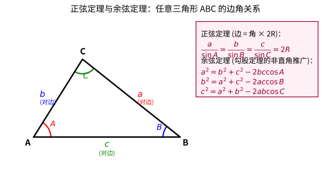

> **直观理解（现实类比）**：
>
> - **正弦定理**是"**大边对大角**"的量化版本。在三角形里，长边一定对着大角——但"大多少"？正弦定理精确告诉你：边的长度与对角正弦之比是同一个常数 $2R$。所以已知角能算边，已知边能算角，这是"边角互译"的桥梁。
> - **余弦定理**则是**勾股定理的"非直角推广版"**。当夹角 $A=90^\circ$ 时，$\cos A=0$，公式 $a^2=b^2+c^2-2bc\cos A$ 立刻退化为 $a^2=b^2+c^2$（勾股定理）。那个多出来的 $-2bc\cos A$ 项，正是对"非直角"的修正：角越接近 $180^\circ$（$\cos A$ 越接近 $-1$），$a$ 边越长；角越锐（$\cos A$ 越接近 $1$），$a$ 边越短——完全符合直觉。

> **🧠 思考历程：把三角形"翻译"成外接圆，是古人射箭想到的**
>
> 正弦定理最漂亮的一点，是它把一个三角形接进它的**外接圆**去证明。这个思路不是空穴来风，而是从比值守恒里"逼"出来的。
>
> - **需求来自"算边角"的苦**。无论是航海定距、测量山高，还是工匠画图，人们都反复遇到"只知道两个角和一条边，却要算出另一条边"的情形。古人很想要一个"只要边和角存在固定换算关系，就直接套"的速成工具——正弦定理就是这个"边角互译器"。
> - **"同弧等角"的父亲**。关键的证明巧思（作三角形外接圆、构造直径、利用"直径对直角"和"同弧圆周角相等"）并非为了炫技，而是古希腊人早已熟稔的圆的性质。**把一个不是直角三角形的对象，硬生生"放进"一个直角三角形里去**——这种"转化思维"是几何最经典的招数。
> - **历史归属**。正弦定理在东方和西方经历了漫长的酝酿：穆斯林天文学家纳西尔丁（Naṣīr al-Dīn al-Ṭūsī，13 世纪）及更早的天象计算者们系统地使用它；而西方把它确立为解三角形的标准工具，则要等到 16 世纪韦达等人的推广。它之所以得名"正弦定理"，正是因为把"$\frac{a}{\sin A}$"这组不变比值推到了高处。
> - **心路**：正弦定理提醒我们：**很多"好定理"诞生时，是为了给某个天天要算的苦差事找"快捷键"**。它把三角形的边角放进同一个以正弦为尺的"比例世界"，从此"知道啥求啥"都不必每次从头推。你看出来的那条 $2R$ 常数，其实是整个三角形和外接圆之间的"汇率"。

**证明**：

如图，作三角形 $ABC$ 的外接圆，圆心为 $O$，半径为 $R$。连接 $BO$ 并延长交圆于 $A'$，则 $BA'$ 为直径，$BA' = 2R$。

$\angle A' = \angle A$（同弧所对的圆周角相等），且 $\angle BCA' = 90^\circ$（直径所对的圆周角为直角）。

在直角三角形 $BCA'$ 中：

$$
\sin A' = \frac{a}{2R}
$$

即 $\sin A = \dfrac{a}{2R}$，所以 $\dfrac{a}{\sin A} = 2R$。同理可证 $\dfrac{b}{\sin B} = 2R$，$\dfrac{c}{\sin C} = 2R$。

**应用**：正弦定理用于以下两种情况解三角形：

1. 已知两角一边（AAS 或 ASA）
2. 已知两边及其中一边的对角（SSA，可能有两解）

> **示例 8：正弦定理的应用**
>
> 在 $\triangle ABC$ 中，已知 $A = 30^\circ$，$B = 45^\circ$，$a = 10$，求 $b$ 和外接圆半径 $R$。
>
> **解**：
>
> 由正弦定理 $\dfrac{a}{\sin A} = \dfrac{b}{\sin B}$：

$$
b = \frac{a\sin B}{\sin A} = \frac{10 \cdot \sin 45^\circ}{\sin 30^\circ} = \frac{10 \cdot \frac{\sqrt{2}}{2}}{\frac{1}{2}} = 10\sqrt{2}
$$

> 由 $\dfrac{a}{\sin A} = 2R$：

$$
R = \frac{a}{2\sin A} = \frac{10}{2 \cdot \frac{1}{2}} = 10
$$

---

#### 课堂问答

**老师**：$\frac{a}{\sin A}=\frac{b}{\sin B}=\frac{c}{\sin C}=2R$ 里的 $2R$ 到底在说什么？

**学生**：它在说三角形所有的"边比对角正弦"共有一个常数，且这个常数就是外接圆直径。这就解释了"大边对大角"：$\sin$ 在 $[0,\pi]$ 上对称，$\sin A=\sin B$ 既可能 $A=B$，也可能 $A=\pi-B$。

**老师（追问）**：已知两边及其中一边对角（SSA），为什么会"两解"甚至"无解"？

**学生**：正弦定理只给 $\sin B$ 的值，而 $\sin B=c$ 在 $(0,\pi)$ 内对应 $B$ 与 $\pi-B$ 两个候选角。要逐一检验是否满足 $A+B<180^\circ$ 才能定解数。这也说明这类题为何常要靠余弦定理或"大边对大角"来卡出唯一答案。

**老师（拓展）**：既然边与对角正弦之比是常数 $2R$，反过来能读出什么几何信息？

**学生**：$a=2R\sin A$，说明边长被外接圆半径整体缩放，$R$ 越大、同样的角对应的边越长。这条关系把"角的信息"转成"边的信息"，是解三角形中反复使用的通用汇率。

### 7. 余弦定理

**定理**：在任意三角形 $ABC$ 中，任意一边的平方等于其他两边平方和减去这两边与其夹角余弦乘积的两倍：

$$
\boxed{a^2 = b^2 + c^2 - 2bc\cos A}
$$

$$
\boxed{b^2 = a^2 + c^2 - 2ac\cos B}
$$

$$
\boxed{c^2 = a^2 + b^2 - 2ab\cos C}
$$

**证明**：

在 $\triangle ABC$ 中，以 $A$ 为原点，$AB$ 为 $x$ 轴建立平面直角坐标系，则：

$A(0,0)$，$B(c,0)$，$C(b\cos A, b\sin A)$。

由两点间距离公式：

$$
a^2 = |BC|^2 = (c - b\cos A)^2 + (0 - b\sin A)^2
$$

$$
= c^2 - 2bc\cos A + b^2\cos^2 A + b^2\sin^2 A
$$

$$
= b^2 + c^2 - 2bc\cos A
$$

- 第 1 个等号：把点 $C$ 的坐标代入两点间距离公式 $|BC|^2=(\text{横差})^2+(\text{纵差})^2$，依据是平面直角坐标系里距离公式的定义；目的：把边长平方 $a^2$ 改写为只含 $b, c, A$ 的代数式。
- 第 2 个等号：用完全平方公式展开 $(c-b\cos A)^2$ 与 $(b\sin A)^2$，依据是 $(m\pm n)^2=m^2\pm 2mn+n^2$；目的：拆出含 $\cos A$ 的一次项，为稍后的合并做铺垫。
- 第 3 个等号：利用平方关系 $\sin^2 A+\cos^2 A=1$ 把 $b^2(\cos^2 A+\sin^2 A)$ 合成为 $b^2$，依据是恒等式；目的：约平高次项里的三角函数束，得到余弦定理的简洁标准形。

当 $A = 90^\circ$ 时，$\cos A = 0$，余弦定理退化为勾股定理 $a^2 = b^2 + c^2$。

**应用**：余弦定理用于以下两种情况解三角形：

1. 已知两边及其夹角（SAS）
2. 已知三边（SSS）

> **示例 9：余弦定理的应用**
>
> 在 $\triangle ABC$ 中，已知 $a = 7$，$b = 8$，$c = 5$，求 $\angle A$。
>
> **解**：
>
> 由余弦定理 $a^2 = b^2 + c^2 - 2bc\cos A$：

$$
7^2 = 8^2 + 5^2 - 2 \cdot 8 \cdot 5 \cdot \cos A
$$

$$
49 = 64 + 25 - 80\cos A
$$

$$
49 = 89 - 80\cos A
$$

$$
\cos A = \frac{89 - 49}{80} = \frac{40}{80} = \frac{1}{2}
$$

> 所以 $A = 60^\circ$。

> **🧠 思考历程：当三角形"不含"直角时，勾股定理该怎么补？**
>
> 余弦定理看起来是"平方和再减一项"，但它的精神，其实是一次对勾股定理的"抢救与改造"。
>
> - **从勾股的遗憾出发**。勾股定理只在直角三角形里好用，一到斜三角形（锐角或钝角）就抓瞎。古人做梦都想要一个"非直角也能直接算"的版本。两个方向并行探索了几百年：用三角函数把它代数化（也就是余弦定理），或用几何补图（比如作斜边上的高来辅助）。
> - **"多出来的一项"从哪来**。直觉提醒我们：把计算过程用几何想清楚，就有意思了——当夹角不是 90° 时，本来是"两边的平方和"，但因为这两边有夹角，投影产生了"多算"或"少算"，多出来的部分恰好是 $2bc\cos A$（即 $2$ 倍的"夹边投影乘积"）。**不是"凭空扣减"，而是"我们该把夹角的偏移量补上"。**
> - **为什么偏偏是"余弦"在负责修正**。$a^2=b^2+c^2-2bc\cos A$ 里，当 $A=90^\circ$ 时 $\cos A=0$，又回到了 $a^2=b^2+c^2$；当 $A>90^\circ$ 时，$\cos A<0$，"减去负"等于"加上"，$a$ 自然更长——完美符合"钝角对应长边"的直观。**这个"退化的干净"，正说明它不是拼凑，而是勾股定理的自然延伸。** 历史上，韦达等 16 世纪代数学家与 18 世纪的欧拉都推动了它的形式化，欧洲人因此也常称它"韦达–欧拉公式"。
> - **心路**：余弦定理告诉你的不只是"一个公式"，而是一种"**退化的统一**"：把直角当作夹角为 90° 的特殊情形，勾股定理就成为它的特例。今天你每次用余弦定理，其实都在说"让我把不够直的三角形，用三角函数补直"。这正是"把旧结论推广到新世界"最常见的姿态。

**定理（三角形面积公式）**：在 $\triangle ABC$ 中，任意两边与其夹角正弦乘积的一半等于三角形面积 $S$：

$$
S = \frac{1}{2}ab\sin C = \frac{1}{2}bc\sin A = \frac{1}{2}ca\sin B
$$

**推导**：以底边 $b$（即 $CA$）为准，作顶点 $B$ 到底边的高，高 $h = a\sin C$（$a=BC$ 与底边夹角为 $C$）。于是 $\displaystyle S = \frac12 \times \text{底} \times \text{高} = \frac12 b \cdot a\sin C$。选择不同的边作底，即得三个等价表达式。

> **💡 直观理解（类比）**：面积公式是把"底×高÷2"用三角函数改写成"两边夹一角"。想求三角形面积，只要知道**两条边的长度**和**它们夹的那个角**，$\frac12 ab\sin C$ 一步到位，无需先求出高。特别地，当 $C=90^\circ$ 时 $\sin C=1$，退化为 $\frac12 ab$——直角三角形面积，又一次完美退化。

> **善用海伦公式**：若已知三条边而不知夹角，可用海伦（Heron）公式 $S=\sqrt{p(p-a)(p-b)(p-c)}$，其中 $p=\frac{a+b+c}{2}$ 为半周长，同样能求面积。

**定理（正切定理）**：在任意三角形 $ABC$ 中，任意两边的和与差之比等于其对角半角正切之比：

$$
\boxed{\frac{a+b}{a-b} = \frac{\tan\dfrac{A+B}{2}}{\tan\dfrac{A-B}{2}}}
$$

（同理对 $b, c$ 与 $a, c$ 成立。）

**推导**：由正弦定理 $a=2R\sin A$、$b=2R\sin B$，故

$$
\frac{a+b}{a-b} = \frac{\sin A + \sin B}{\sin A - \sin B}
$$

对分子分母分别使用和差化积 $\sin A + \sin B = 2\sin\frac{A+B}{2}\cos\frac{A-B}{2}$ 与 $\sin A - \sin B = 2\cos\frac{A+B}{2}\sin\frac{A-B}{2}$，约去因子即得结论。

> **💡 直观理解（类比）**：正切定理是**正弦定理的"和差版本"**。正弦定理单独处理一条边与一个角，而正切定理把**两条边合并成"和与差"**，把**两个角合并成"半角和与半角差"**。当题目给的是"两边之和/差"而非单独的边时，它比正弦定理更直接。由于 $A+B = \pi - C$，半角和 $\frac{A+B}{2} = \frac{\pi-C}{2}$ 常常可进一步化简，这是它常用的突破口。

**定理（内切圆半径与面积）**：设 $\triangle ABC$ 的内切圆半径为 $r$，半周长 $p=\dfrac{a+b+c}{2}$，则：

$$
\boxed{S = p \cdot r}
$$

即 $r = \dfrac{S}{p}$。结合海伦公式还可写成 $r = \sqrt{\dfrac{(p-a)(p-b)(p-c)}{p}}$。

**推导**：连接内心与三个顶点，三角形被分成三个以 $r$ 为高的小三角形，面积之和为 $\frac12 ar + \frac12 br + \frac12 cr = \frac12(a+b+c)r = p\cdot r$。

> **💡 直观理解（类比）**：把三角形看成由三个顶点向内心连线分出的三块"披肩"，每块都以某条边为底、以内切圆半径 $r$ 为高。三块面积加起来就是 $\frac12 \times \text{周长} \times r = p \cdot r$。**知道面积和周长就能立刻求出内切圆半径**，特别地，直角三角形还有更简洁的结论 $r = \dfrac{a+b-c}{2}$（$c$ 为斜边）。

---

#### 课堂问答

**老师**：$a^2=b^2+c^2-2bc\cos A$ 为什么能"退化"出勾股定理？

**学生**：因为当 $A=90^\circ$ 时 $\cos A=0$，修正项 $-2bc\cos A$ 整个消失，只剩 $a^2=b^2+c^2$。这说明勾股定理不是独立结论，而是余弦定理在直角情形的特例，余弦定理是它在任意角下的推广。

**老师（追问）**：当 $A$ 是钝角时，$\cos A<0$，这一项会发生什么？

**学生**：$-2bc\cos A$ 因 $\cos A$ 为负而变成正数，等于在平方和上"加"了一笔，使 $a$ 比 $\sqrt{b^2+c^2}$ 更大，正符合"钝角对着最长边"的直觉。符号的变化自动编码了角的锐钝，不需额外判断。

**老师（拓展）**：余弦定理和正弦定理各管哪类已知条件，为什么说是"一把尺子的两面"？

**学生**：正弦定理管"两角一边"和"两边一对角"，本质是比例；余弦定理管"两边夹一角"和"三边"，本质是平方与投影。选哪把尺由题目给了什么条件决定，识别条件比背公式更重要；当 $A=90^\circ$ 时两把尺还会在勾股定理处会合。

### 8. 射影定理与三角形内角恒等式

**射影定理**：三角形中任意一边等于其余两边分别在该边上的射影之和：

$$
\boxed{a = b\cos C + c\cos B}
$$

同理：$b = c\cos A + a\cos C$，$c = a\cos B + b\cos A$。

**推导**：将 $\cos C = \dfrac{a^2+b^2-c^2}{2ab}$ 与 $\cos B = \dfrac{a^2+c^2-b^2}{2ac}$（余弦定理的变形）代入：

$$
b\cos C + c\cos B = \frac{a^2+b^2-c^2}{2a} + \frac{a^2+c^2-b^2}{2a} = \frac{2a^2}{2a} = a
$$

> **💡 直观理解（类比）**：把边 $b$ 和 $c$ 想成两根**斜靠在 $a$ 边上的筷子**，各自在 $a$ 所在直线上投下一段"影子"（$b\cos C$ 与 $c\cos B$）。射影定理说的是：**两段影子首尾相接，恰好铺满整条边 $a$**。它本质上是余弦定理的"分解版"：余弦定理从平方层面统一处理三边，射影定理则从一次层面直接给出边的线性关系。

**三角形内角恒等式**：当 $A + B + C = \pi$ 且各角的正切均有定义时：

$$
\boxed{\tan A + \tan B + \tan C = \tan A \tan B \tan C}
$$

**推导**：由 $C = \pi - (A+B)$，得 $\tan C = -\tan(A+B) = -\dfrac{\tan A + \tan B}{1 - \tan A\tan B}$，即：

$$
\tan C(1 - \tan A\tan B) = -(\tan A + \tan B)
$$

整理即得 $\tan A + \tan B + \tan C = \tan A\tan B\tan C$。

> **💡 直观理解（类比）**：这个恒等式是**"三个角拼成一平角"的代数签名**。只要三个角的和是 $\pi$，它们的正切就必然满足这种"和等于积"的特殊关系——反过来，它也常被用来**判定或利用 $A+B+C=\pi$ 这一隐藏条件**。做题时看到 $\tan A + \tan B + \tan C$ 与 $\tan A\tan B\tan C$ 同时出现，应立即联想到三角拼成平角。

#### 课堂问答

**老师**：射影定理 $a=b\cos C+c\cos B$ 和余弦定理有什么关系？

**学生**：它是余弦定理的"线性版"。把 $\cos C=\frac{a^2+b^2-c^2}{2ab}$、$\cos B=\frac{a^2+c^2-b^2}{2ac}$ 代入，两项相加恰好等于 $a$。余弦定理处理平方层面，射影定理处理一次层面，两者是同一几何事实的不同投影。

**老师（追问）**：$\tan A+\tan B+\tan C=\tan A\tan B\tan C$ 成立需要什么前提？

**学生**：前提是 $A+B+C=\pi$ 且三个角的正切都有定义，即不能有直角。若某角是 $90^\circ$，正切无定义，等式两边都失去意义。它本质是"三角和为平角"的代数签名，看见"和等于积"就该想到这个隐藏条件。

**老师（拓展）**：这两个结论在解三角形或恒等式证明里有共同的套路吗？

**学生**：有，都是"把角的条件翻译成边或正切的代数关系"。射影定理把几何投影写成边的一次组合，内角恒等式把平角条件写成正切的对称式。思路一致：先抓住角度约束，再用代数结构把它显形。

### 9. 三角恒等式的体系：一张"公式推导网络"把几十条记成两条

前面我们一口气给了一大堆公式（和角、差角、倍角、半角、和差化积、积化和差……）。很多人望而生畏。但请记住一句口诀：**这一整套恒等式不是"几十条孤立规定"，而是一棵只有两个根的小树。** 只要记住两个源头，其余全部能推。

**两个"根"（必须牢记）**

$$
\boxed{\sin^2\theta + \cos^2\theta = 1} \qquad(\text{根一：来自勾股定理})\qquad
\boxed{\sin(\alpha+\beta) = \sin\alpha\cos\beta + \cos\alpha\sin\beta} \qquad(\text{根二：来自单位圆旋转})
$$

**推导网络一览**

```
              ┌─ 两边同除 cos²θ ─→  1 + tan²θ = sec²θ
  根一：sin²θ+cos²θ=1
              └─ 两边同除 sin²θ ─→  1 + cot²θ = csc²θ

                                  ┌─ 令 α=β=θ ────────→  二倍角 sin2θ、cos2θ、tan2θ
  根二：sin(α+β)、cos(α+β)、tan(α+β)──┴─ cos2θ 变形 ──────→  半角：sin²(θ/2)、cos²(θ/2)、tan(θ/2)
                                  ├─ 令 A=(α+β)/2、B=(α-β)/2 ─→  和差化积（sinα±sinβ 等）
                                  ├─ 反过来读和差化积 ──────→  积化和差（sinαcosβ 等）
                                  ├─ 令 α=θ、β=2θ（多次）──→  三倍角（3sinθ-4sin³θ 等）
                                  └─ 令 β=π/2-α 等 ──────→  诱导公式的"正名"
```

**这条网络的威力（解决了什么）**

- **对算**：任何角（如 $75^\circ=45^\circ+30^\circ$、$15^\circ=\frac{30^\circ}{2}$）都能"拆"成已知角的组合来求值——全靠把目标角放进网络里的某个节点。
- **对变形**：遇到 $\sin^2x$ 想求周期就降幂、遇到 $\sin m x\cos nx$ 想积分就积化和差——**"用什么公式"全由网络告诉你"去哪找"，而不是从几十条里瞎翻。**
- **对证明**：要证一条恒等式，只需"从容易的一头追到难的一头"，知识的导航图就是这个网络。

> **🧠 记忆策略**：真正需要"一次性背下来"的只有根一和根二；剩下的，建议你**亲手推一遍**（推倍角→半角→和差化积→积化和差各一次），推得越多、记忆越牢。你能不看提示把网络画出来之日，就是这套公式真正属于你之时。

#### 课堂问答

**老师**：说几十条公式"只有两个根"，这个说法是不是夸张？

**学生**：不夸张。所有公式都能从 $\sin^2\theta+\cos^2\theta=1$（来自勾股定理）和 $\sin(\alpha+\beta)=\sin\alpha\cos\beta+\cos\alpha\sin\beta$（来自单位圆旋转）推出：除 $\cos^2$ 得分式恒等式，令 $\alpha=\beta$ 得倍角，由倍角变形得半角，用 $A$、$B$ 换元得和差化积，反过来读得积化和差。

**老师（追问）**：既然能全推出来，为什么考试还不让"现场推"，非要背？

**学生**：因为推导需要时间，考试比的是调用速度。正确策略是"理解推导加记忆主干"：背两个根与主干节点，其余靠一次推演恢复。纯背诵会在紧张时符号错乱，纯推演又太慢，两者结合才稳。

**老师（拓展）**：这套"网络"思维对后续微积分有什么启发？

**学生**：它示范了数学的普遍形态——少数公理生成大量结论。微积分里的导数表、积分表同样是从少数规则（链式、乘积、分部）编织出来的。学会"找根、画网络"，比记住叶子有用得多。

### 10. 正弦定理与余弦定理：解三角形"一把尺子的两面"

**解决问题的统一视角（第二步：打开格局）**

请回到本章开头那句"三角学的根本问题——**已知部分边角求其余边角**"。正弦定理和余弦定理不是两个毫不相干的定理，而是这把"解三角形之尺"的**两面**，各管一类"已知条件"：

| 已知条件 | 该用哪把 | 需要的工具 |
| :--- | :--- | :--- |
| 两角一边（AAS / ASA） | **正弦定理** | 边之比 = 对角正弦之比，公共常数 $2R$ |
| 两边一对角（SSA） | **正弦定理** | 可能两解（大边对大角 + 内角和解判） |
| 两边及其夹角（SAS） | **余弦定理** | $a^2=b^2+c^2-2bc\cos A$ 直接算第三边 |
| 三边（SSS） | **余弦定理** | 反解 $\cos A=\dfrac{b^2+c^2-a^2}{2bc}$ 求角 |

> **🧠 为什么说它们是"两面"**：
>
> - **正弦定理**是"**比例尺**"——它说三角形的边与对角正弦保持着同一个常数比例（$2R$），于是知道角就能"放大/缩小"出边长，解决"知角求边、知边求角"。
> - **余弦定理**是"**勾股的推广尺**"——它把普通三角形三边长与一个夹角捏进 $a^2=b^2+c^2-2bc\cos A$，当夹角是直角时自动退化成勾股定理。于是"已知两边夹一角""已知三边"都有了出路。
>
> 二者都很能回答"大边对大角"的定量直觉，也都让**三角学的测量梦想真正落地**：不管三角形是不是直角，只要给足条件，用其中一把尺子总能把它"解开"。

**统一的心得**：先看清楚题目**给了什么条件**（两角一边？两边夹一角？三边？），再决定抽哪把尺——**识别已知条件比背公式更重要**，这正是本章"解题思路与技巧"部分反复强调的"选公式的时机"。

---

#### 课堂问答

**老师**：拿到一道解三角形题，第一步你到底看什么？

**学生**：先看给了什么条件，而不是先想公式。给了"两角一边"或"两边一对角"就抽正弦定理；给了"两边夹一角"或"三边"就抽余弦定理。识别条件类型决定选哪把尺，这一步比套公式重要。

**老师（追问）**：如果两边一对角算出两个候选角，凭什么删掉其中一个？

**学生**：靠两条约束：内角和必须小于 $180^\circ$，以及"大边对大角"。若算出的钝角候选会使第三角为负，就舍去；若两个候选都能凑出正角，那才是真正的两解。删解需要理由，不能凭直觉。

**老师（拓展）**：余弦定理的逆用公式 $\cos A=\frac{b^2+c^2-a^2}{2bc}$ 有什么附加价值？

**学生**：它不仅求角，还能判断形状：$\cos A>0$ 为锐角、$\cos A=0$ 为直角、$\cos A<0$ 为钝角。给定三边即可判定三角形类型，这是"三边型"问题里最实用的副产品，也与后续用向量、坐标研究几何一脉相承。

## 三角函数图像

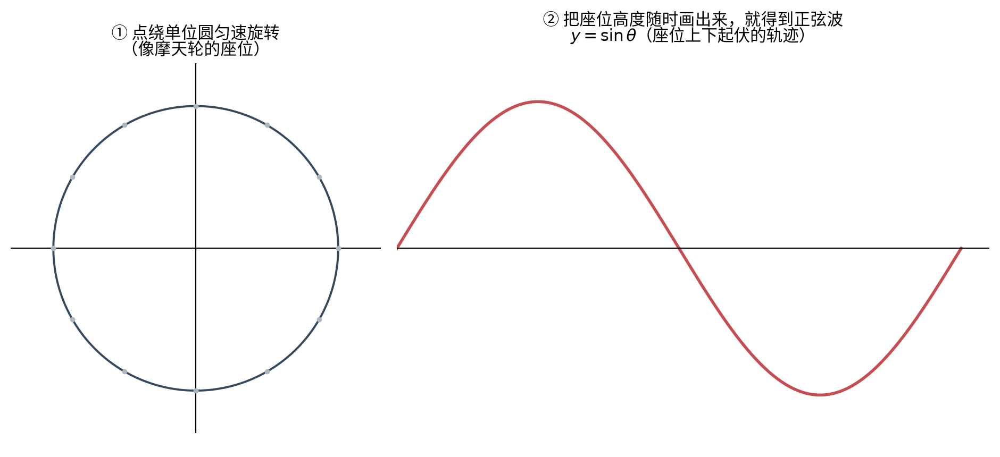

> **直观理解（现实类比）**：三角函数图像为什么是**波浪**？因为本质是"**旋转**"。想象一个**摩天轮**的座位匀速转圈——座位在水平地面上的"高度"随角度上下起伏，把每个时刻的高度画出来，就是一条正弦波。**周期 $2\pi$ 就是旋转一整圈，最大值/最小值就是座位升到最高/降到最低点。**
>
> 记住这个直觉，你就能理解为什么 $y=\sin x$ 是周期为 $2\pi$ 的波浪、值域不超过 $[-1,1]$——这些都只是"旋转"的必然结果，而不是需要背诵的结论。

### 1. 正弦函数 $y = \sin x$

**基本性质**：

- 定义域：$\mathbb{R}$
- 值域：$[-1, 1]$
- 周期：$2\pi$
- 奇函数：$\sin(-x) = -\sin x$
- 零点：$x = k\pi, k \in \mathbb{Z}$
- 最大值：$y = 1$ 在 $x = \dfrac{\pi}{2} + 2k\pi$
- 最小值：$y = -1$ 在 $x = \dfrac{3\pi}{2} + 2k\pi$

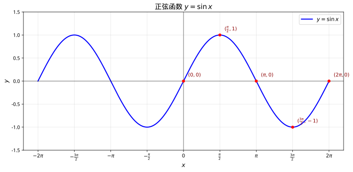

> **🧠 正弦曲线是"圆上投影"的展开图（来龙去脉）**：记得单位圆那一节吗？$\sin\theta$ 就是圆上一点 $P$ 的**纵坐标**。当 $\theta$ 匀速增大、$P$ 绕圆走动时，$P$ 的"高度"就先升到最高（$\frac{\pi}{2}$）、再降到最低（$\frac{3\pi}{2}$）、再回到原点——把这个过程横着摊开（把角度当横轴，把高度当纵轴），就得到了这条正弦波（图 trig-sine.svg、动画 anim-unit-circle-trig.gif）。**它为什么有周期 $2\pi$？** 因为角度转满一圈，点回到原处。**为什么最大值是 $1$、最小值是 $-1$？** 因为半径只有 $1$，纵坐标最多也就 $\pm1$。于是"周期、值域、零点"这些性质，没有一条需要背——它们都是"绕圈"这个动作的必然结果。

#### 课堂问答

**老师**：正弦函数的周期、值域、零点，需要记忆吗？

**学生**：不需要，它们是"单位圆上纵坐标随角旋转"的必然结果。转满一圈纵坐标复现，故周期 $2\pi$；半径只有 $1$，纵坐标只能在 $[-1,1]$；纵坐标为 $0$ 恰在 $x=k\pi$。一条都不必背。

**老师（追问）**：$\sin x$ 在 $x=0$ 附近真的"几乎等于 $x$"吗？这对理解什么有用？

**学生**：是的，$|\sin x|\leq|x|$ 且 $\lim_{x\to0}\frac{\sin x}{x}=1$，小角时正弦与弧度几乎相等，这就是小角近似 $\sin\theta\approx\theta$ 的依据。注意结论只在弧度制下成立，角度制会多出 $\pi/180$ 的系数。

**老师（拓展）**：正弦函数的图像对后面学导数、积分有什么直接预告？

**学生**：每条性质都对应一条分析结论。最大值点 $x=\frac{\pi}{2}+2k\pi$ 处导数为 $0$；零点处斜率最大，正对应 $(\sin x)'=\cos x$ 的峰值。图像就是导数的肉眼预览，看懂图像后单调性与极值几乎可以口算。

### 2. 余弦函数 $y = \cos x$

**基本性质**：

- 定义域：$\mathbb{R}$
- 值域：$[-1, 1]$
- 周期：$2\pi$
- 偶函数：$\cos(-x) = \cos x$
- 零点：$x = \dfrac{\pi}{2} + k\pi, k \in \mathbb{Z}$
- 最大值：$y = 1$ 在 $x = 2k\pi$
- 最小值：$y = -1$ 在 $x = \pi + 2k\pi$

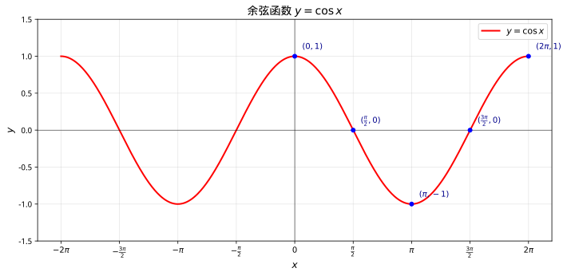

#### 课堂问答

**老师**：余弦与正弦的图像长得很像，它们的本质差别在哪？

**学生**：差一个相位和奇偶性。$\cos x=\sin\left(x+\frac{\pi}{2}\right)$，是正弦左移 $\frac{\pi}{2}$；且 $\cos$ 是偶函数、$\sin$ 是奇函数。图像相同只是"平移相似"，对称性质完全不同。

**老师（追问）**：既然余弦是偶函数，它的零点为什么是 $\frac{\pi}{2}+k\pi$ 而不是 $k\pi$？

**学生**：零点是"横坐标为零"的位置，对应单位圆上点落在 $y$ 轴的时刻，即角为 $\frac{\pi}{2}$ 加整数个 $\pi$。而 $\sin$ 的零点是纵坐标为零、点在 $x$ 轴，故在 $k\pi$。零点位置正是"哪个坐标为零"的翻译。

**老师（拓展）**：余弦是偶函数这一点，在解方程时会带来什么便利或陷阱？

**学生**：便利在于 $\cos(-\theta)=\cos\theta$，所以 $\cos x=a$ 的通解可写成 $x=2k\pi\pm\arccos a$，一个 $\pm$ 就包住两支解；陷阱是容易只写 $+$ 而漏掉负支。对比 $\sin x=a$ 用 $k\pi+(-1)^k\arcsin a$，形式不同但都在补偶对称的两支。

### 3. 正切函数 $y = \tan x$

**基本性质**：

- 定义域：$x \neq \dfrac{\pi}{2} + k\pi, k \in \mathbb{Z}$
- 值域：$\mathbb{R}$
- 周期：$\pi$
- 奇函数：$\tan(-x) = -\tan x$
- 零点：$x = k\pi, k \in \mathbb{Z}$
- 渐近线：$x = \dfrac{\pi}{2} + k\pi$

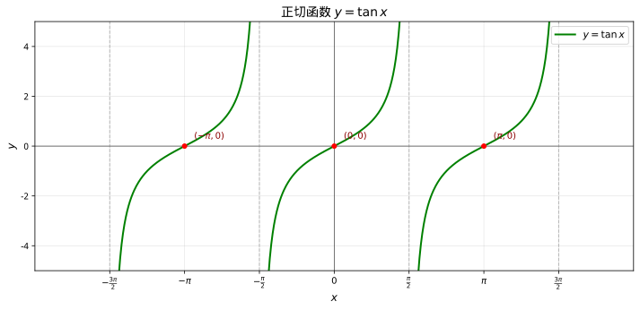

#### 课堂问答

**老师**：$\tan x$ 的周期是 $\pi$，而 $\sin$、$\cos$ 是 $2\pi$，为什么差一半？

**学生**：因为 $\tan x=\frac{\sin x}{\cos x}$，分子分母在 $\theta\to\theta+\pi$ 时同时变号，负号相消，比值不变，所以转半圈就复现。$\sin$、$\cos$ 单独都做不到，这正是"除法消号"的效果。

**老师（追问）**：正切在 $x=\frac{\pi}{2}+k\pi$ 处究竟是"有值但很大"，还是"根本没定义"？

**学生**：根本没定义，那里 $\cos x=0$ 使分母为零。图像上表现为竖直渐近线，函数值可以任意大却永远取不到 $+\infty$。把渐近线误当成"很大的值"是常见错误。

**老师（拓展）**：为什么 $(\tan x)'=\sec^2 x=1+\tan^2 x$ 总是正的，从而正切在每个分支内单调递增？

**学生**：因为 $\sec^2 x=1+\tan^2 x\geq1>0$，导数处处为正，故在每个连续分支 $\left(-\frac{\pi}{2}+k\pi,\frac{\pi}{2}+k\pi\right)$ 内严格递增。这也说明反函数 $\arctan x$ 在整个 $\mathbb{R}$ 上单调、值域被压在 $\left(-\frac{\pi}{2},\frac{\pi}{2}\right)$ 内。

### 4. 余切、正割与余割函数

**$y = \sec x = \dfrac{1}{\cos x}$（正割）**

- 定义域：$x \neq \dfrac{\pi}{2} + k\pi, k \in \mathbb{Z}$（即 $\cos x \neq 0$）
- 值域：$(-\infty, -1] \cup [1, +\infty)$（因 $|\cos x| \le 1$，故 $|\sec x| \ge 1$）
- 周期：$2\pi$；偶函数：$\sec(-x) = \sec x$
- 渐近线：$x = \dfrac{\pi}{2} + k\pi$；与 $\cos$ 图像同零点、开口方向相反

**$y = \csc x = \dfrac{1}{\sin x}$（余割）**

- 定义域：$x \neq k\pi, k \in \mathbb{Z}$（即 $\sin x \neq 0$）
- 值域：$(-\infty, -1] \cup [1, +\infty)$
- 周期：$2\pi$；奇函数：$\csc(-x) = -\csc x$
- 渐近线：$x = k\pi$

**$y = \cot x = \dfrac{\cos x}{\sin x}$（余切）**

- 定义域：$x \neq k\pi, k \in \mathbb{Z}$
- 值域：$\mathbb{R}$
- 周期：$\pi$；奇函数：$\cot(-x) = -\cot x$
- 零点：$x = \dfrac{\pi}{2} + k\pi$；渐近线：$x = k\pi$

> **💡 直观理解（类比）**：$\sec、\csc、\cot$ 是 $\cos、\sin、\tan$ 的"**倒数基因**"：它们的图像就是把"本家函数"的图像整体倒扣（取倒数）而成的——$\cos$ 越接近 $0$，$\sec$ 越冲向 $\pm\infty$；$\cos$ 取到 $\pm1$ 时，$\sec$ 也正好是 $\pm1$。而 $\cot = \dfrac{\cos}{\sin} = \dfrac{1}{\tan}$，本质上就是正切图像的"本家倒影"，所以它和 $\tan$ 一样周期为 $\pi$、有渐近线，只是零点与渐近线的位置刚好互换。**记住"倒来倒去"三个字，就不用死背这三条曲线。**

#### 课堂问答

**老师**：$\sec$、$\csc$、$\cot$ 这三个函数是不是"纯粹多余的符号"？

**学生**：不是，它们是另三种比值的自然命名，且在微积分里高频出现，例如 $\frac{d}{dx}\tan x=\sec^2 x$、$\frac{d}{dx}\sec x=\sec x\tan x$。若一律写成 $1/\cos x$，既啰嗦又掩盖结构。

**老师（追问）**：$\sec x$ 的值域是 $(-\infty,-1]\cup[1,+\infty)$，中间那段 $(-1,1)$ 为什么取不到？

**学生**：因为 $|\cos x|\leq1$，取倒数后 $|\sec x|\geq1$，图像在 $y=\pm1$ 处被"撑开"，中间留出空隙。同理 $\csc x$ 也有这个空隙，而 $\cot x$ 因 $\cot x$ 可取任意实数，值域是全体实数。

**老师（拓展）**：$\cot x$ 的零点与渐近线为什么刚好和 $\tan x$ 互换？

**学生**：因为 $\cot x=\frac{\cos x}{\sin x}=\frac{1}{\tan x}$。$\tan$ 在 $x=k\pi$ 处为零、在 $x=\frac{\pi}{2}+k\pi$ 处无定义，取倒数后零点与无定义点恰好对调。这就是"倒来倒去"的直观含义：倒数把零点与渐近线整体交换。

### 5. 一般形式 $y = A\sin(\omega x + \varphi) + B$

参数含义：

- $A$——**振幅**（amplitude）：函数值偏离平衡位置的最大距离，$|A|$
- $B$——**垂直平移**（vertical shift）：平衡位置
- $\omega$——**角频率**（angular frequency）：周期 $T = \dfrac{2\pi}{\omega}$
- $\varphi$——**初相**（initial phase）：相位偏移
- 相位（phase）：$\omega x + \varphi$
- 频率（frequency）：$f = \dfrac{1}{T} = \dfrac{\omega}{2\pi}$

**图像变换**：

从 $y = \sin x$ 到 $y = A\sin(\omega x + \varphi) + B$：

1. 水平平移：$\varphi$ 左加右减
2. 水平伸缩：$\omega$ 使周期变为 $\dfrac{2\pi}{\omega}$
3. 垂直伸缩：$A$ 使振幅变为 $|A|$
4. 垂直平移：$B$ 上加下减

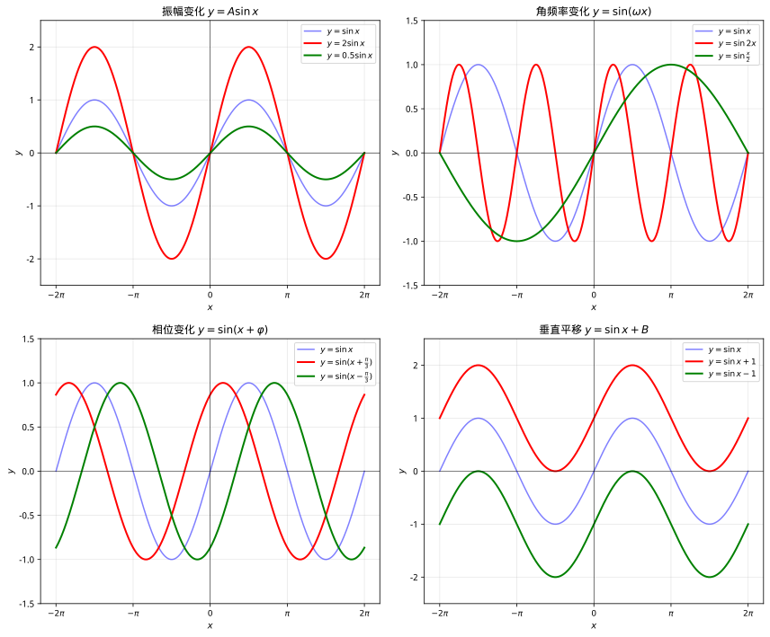

> **示例 10：分析三角函数图像**
>
> 求函数 $y = 3\sin(2x - \dfrac{\pi}{3}) + 1$ 的振幅、周期、初相和值域。
>
> **解**：
>
> 振幅 $A = 3$，角频率 $\omega = 2$，周期 $T = \dfrac{2\pi}{2} = \pi$，
>
> 初相 $\varphi = -\dfrac{\pi}{3}$，垂直平移 $B = 1$，
>
> 值域为 $[1 - 3, 1 + 3] = [-2, 4]$。

#### 课堂问答

**老师**：四个参数 $A$、$\omega$、$\varphi$、$B$ 各自控制波形的什么？

**学生**：$A$ 控振幅、$\omega$ 控疏密（周期 $T=\frac{2\pi}{\omega}$）、$\varphi$ 控左右起跑位置、$B$ 控上下基线。纵向由 $A$、$B$ 分工，横向由 $\omega$、$\varphi$ 分工，互不干扰。

**老师（追问）**：为什么求周期只除以角频率的绝对值，初相 $\varphi$ 完全不影响周期？

**学生**：因为初相只是把整条波整体左右平移，波形形状和疏密不变，周期自然不变。周期只跟 $x$ 的系数 $\omega$ 有关：$T=\frac{2\pi}{|\omega|}$。把 $\varphi$ 当成影响周期的参数是最典型的混淆。

**老师（拓展）**：如果 $A<0$，振幅该怎么理解？值域会怎样？

**学生**：振幅按 $|A|$ 算，负号只相当于沿 $x$ 轴再翻一次，与 $\sin$ 的奇偶性合成相位差 $\pi$。值域仍是 $[B-|A|,B+|A|]$，不会因为 $A$ 是负数就上下颠倒。值域公式只认绝对值，这是常被忽略的细节。

### 6. 图像变换再探：每个参数做了哪件"变形"

上面的"四个步骤"表是操作清单，但要**真懂**，得看清每个参数到底对波形做了什么（这也正是图 trig-general-sine.svg 要表达的）。

**来龙去脉（第一步）：$y=\sin x$ 是一条"素波"，参数是它的"四件调音器"**

- $A$（**振幅**）：像**音量旋钮**——把波整体纵向拉伸/压缩，波形上下方向都乘 $|A|$，值域变成 $[B-|A|,\ B+|A|]$。
- $\omega$（**角频率**）：像**播放速度**——$\omega$ 越大、一个周期内的"角跑得越快"，周期 $T=\dfrac{2\pi}{\omega}$ 越短，波越"密"。
- $\varphi$（**初相**）：像**起跑位置**——决定波浪在 $x=0$ 处正从哪开始，整体左右平移。
- $B$（**垂直平移**）：像**基线位置**——把整条波向上/下抬，对应"平衡位置"（摩擦阻尼运动、潮汐高度的平均水平等）。

**要解决的问题（第二步）**：真实世界很少是干净的 $y=\sin x$——交流电要调振幅和频率，声波要调音量与音色，弹簧振动要定初位。我们需要一套"**从素波出发、用参数调整到任何想要的波形**"的工具。这正是 $y=A\sin(\omega x+\varphi)+B$ 的全部意义。

**统一写法（第三步）**：把相位改写，让平移量显形：

$$
y = A\sin(\omega x+\varphi)+B = A\sin\left(\omega\left(x+\frac{\varphi}{\omega}\right)\right)+B
$$

由此读出顺序（与本章"技巧 17"一致）：**水平伸缩把 $\omega$ 写进 $x$ 的系数，平移量是对括号里 $x$ 加的 $\dfrac{\varphi}{\omega}$**——先伸缩还是先平移，关键在于平移量是否被 $\omega$ 一起压缩。垂直方向则 $A$ 管振幅、$B$ 管升降，互不干扰。

> **🧠 解决了什么**：这一小节把"任意正弦波"浓缩成了"参数调频"。**你知道振幅、周期（频率）、初相、基线四样东西，就能写出任何一条正弦曲线；反过来，给定一条波形，也能读出这四个参数**——这正是本章"技巧 14（由图像确定解析式）"的来路。

---

#### 课堂问答

**老师**：从 $y=\sin x$ 变到 $y=\sin\left(2x+\frac{\pi}{3}\right)$，平移量到底是多少？

**学生**：要先把括号里的 $2$ 提出来：$\sin\left(2\left(x+\frac{\pi}{6}\right)\right)$，所以是左移 $\frac{\pi}{6}$，不是 $\frac{\pi}{3}$。平移量是对括号内 $x$ 而言的 $\frac{\varphi}{\omega}$，被 $\omega$ 一起压缩了。

**老师（追问）**："先伸缩后平移"和"先平移后伸缩"结果相同吗？为什么会出错？

**学生**：两种顺序都能变形到同一目标，但"平移多少"跟着顺序变：先平移按 $\varphi$ 移，后平移要按 $\frac{\varphi}{\omega}$ 移。混淆两种顺序里的平移量，是多步变换题失分的头号原因。稳妥做法是先化成 $x+\frac{\varphi}{\omega}$ 的显式形式再读平移。

**老师（拓展）**：这套参数化对理解声音、交流电有什么迁移价值？

**学生**：正弦波的四参数正好对应声波的振幅（响度）、频率（音高）、初相与基线（直流偏置）。一段复杂信号可分解成不同 $A$、$\omega$、$\varphi$ 的正弦波叠加，这就是傅里叶分析的思想，$y=A\sin(\omega x+\varphi)+B$ 是它的最小单元。

## 反三角函数

反三角函数是三角函数的反函数，用于已知三角函数值求角度。

### 1. 反正弦函数 $y = \arcsin x$

- 定义：$x = \sin y$，$y \in \left[-\dfrac{\pi}{2}, \dfrac{\pi}{2}\right]$
- 定义域：$[-1, 1]$
- 值域：$\left[-\dfrac{\pi}{2}, \dfrac{\pi}{2}\right]$
- 奇函数：$\arcsin(-x) = -\arcsin x$
- 性质：$\sin(\arcsin x) = x$，$\arcsin(\sin x) = x$（当 $x \in \left[-\frac{\pi}{2}, \frac{\pi}{2}\right]$）

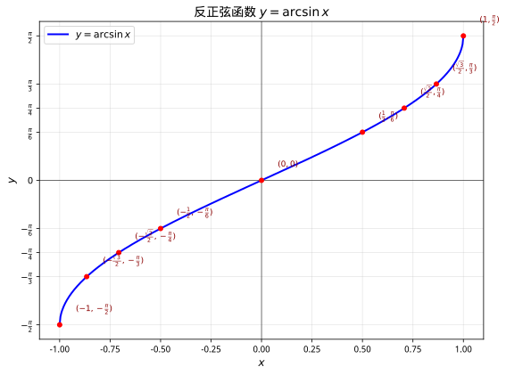

#### 课堂问答

**老师**：为什么 $\arcsin x$ 要规定值域为 $\left[-\frac{\pi}{2},\frac{\pi}{2}\right]$，而不是随便挑一段？

**学生**：因为要选出既单调、又覆盖整个 $[-1,1]$ 的一段，才能保证反函数唯一。$[-\frac{\pi}{2},\frac{\pi}{2}]$ 上 $\sin$ 严格递增，且关于原点对称，保住了奇函数性质 $\arcsin(-x)=-\arcsin x$，是兼顾唯一性与对称性的最佳选择。

**老师（追问）**：$\arcsin(\sin x)=x$ 是不是永远成立？

**学生**：不是，只在 $x\in\left[-\frac{\pi}{2},\frac{\pi}{2}\right]$ 时成立。超出这段，$\arcsin$ 给出的只是"主值"代表，例如 $\arcsin\left(\sin\frac{5\pi}{6}\right)=\frac{\pi}{6}$ 而非 $\frac{5\pi}{6}$。忘掉主值区间去无条件消去，正是最容易踩的坑。

**老师（拓展）**：$\arcsin x$ 与它的导数 $\frac{1}{\sqrt{1-x^2}}$ 之间有什么直观联系？

**学生**：$\arcsin x$ 在端点 $x=\pm1$ 处斜率趋于无穷，对应导数分母 $\sqrt{1-x^2}\to0$；在 $x=0$ 处 $\arcsin x\approx x$，导数为 $1$。反函数导数等于原函数导数的倒数，$\frac{1}{\cos y}$ 再用 $\cos y=\sqrt{1-x^2}$ 一换就得到那条公式。

### 2. 反余弦函数 $y = \arccos x$

- 定义：$x = \cos y$，$y \in [0, \pi]$
- 定义域：$[-1, 1]$
- 值域：$[0, \pi]$
- 性质：$\arccos(-x) = \pi - \arccos x$
- 恒等式：$\arcsin x + \arccos x = \dfrac{\pi}{2}$

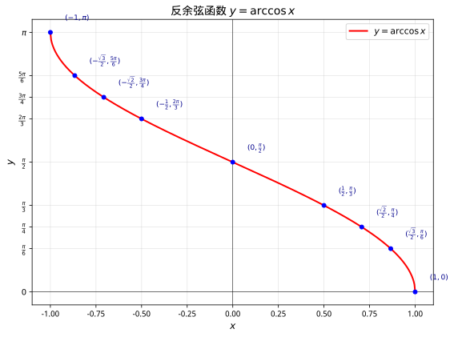

#### 课堂问答

**老师**：$\arcsin x+\arccos x=\frac{\pi}{2}$，这条恒等式该怎么直观理解？

**学生**：两个角互余。$\arcsin x$ 与 $\arccos x$ 分别以 $x$ 作正弦、余弦，而"一个角的正弦等于另一个角的余弦"正说明它们相加为 $\frac{\pi}{2}$。这与直角三角形的余角关系是同一件事。

**老师（追问）**：为什么 $\arccos(-x)=\pi-\arccos x$，而 $\arcsin(-x)$ 却是 $-\arcsin x$？

**学生**：因为 $\arcsin$ 是奇函数（主值区间关于原点对称），$\arccos$ 不是（主值区间是 $[0,\pi]$）。$\arccos$ 里取负相当于把角补成 $\pi$ 减原角，所以是 $\pi-\arccos x$。用错对称性把它写成 $-\arccos x$，是高频错误。

**老师（拓展）**：已知三角函数值反求角时，为什么常偏好用 $\arccos$ 而不是 $\arcsin$？

**学生**：因为在 $[0,\pi]$ 上 $\cos$ 严格单调递减，一个余弦值唯一对应一个角，不必像 $\sin$ 那样担心 $A$ 与 $\pi-A$ 的双解。所以解三角形里"给值求角"常先求 $\cos$ 再定角，这一步能省去许多多解判断。

### 3. 反正切函数 $y = \arctan x$

- 定义：$x = \tan y$，$y \in \left(-\dfrac{\pi}{2}, \dfrac{\pi}{2}\right)$
- 定义域：$\mathbb{R}$
- 值域：$\left(-\dfrac{\pi}{2}, \dfrac{\pi}{2}\right)$
- 奇函数：$\arctan(-x) = -\arctan x$
- 渐近线：$y = \pm\dfrac{\pi}{2}$
- 互余恒等式：$\arctan x + \arctan\dfrac{1}{x} = \dfrac{\pi}{2}\ (x > 0)$；当 $x < 0$ 时该和为 $-\dfrac{\pi}{2}$

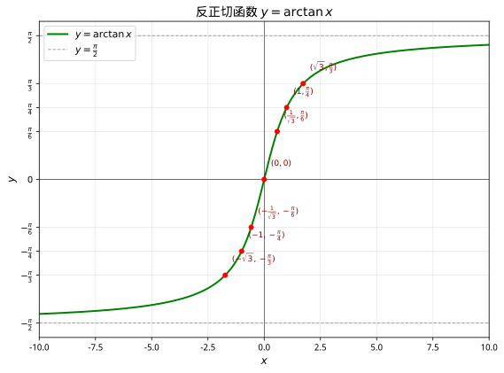

#### 课堂问答

**老师**：$\arctan x$ 的值域是开区间 $\left(-\frac{\pi}{2},\frac{\pi}{2}\right)$，为什么两端取不到？

**学生**：因为 $\tan$ 在 $\pm\frac{\pi}{2}$ 处无定义（那正是它的竖直渐近线），反函数自然取不到这两个值。所以 $\arctan x$ 图像上下各有一条水平渐近线 $y=\pm\frac{\pi}{2}$，却永远碰不到。

**老师（追问）**：互余恒等式 $\arctan x+\arctan\frac{1}{x}=\frac{\pi}{2}$ 对 $x<0$ 也成立吗？

**学生**：不成立，此时等式右边是 $-\frac{\pi}{2}$。因为 $x<0$ 时 $\arctan x$ 为负角，其主值落回负区间，符号随之翻转。这条恒等式对符号高度敏感，与反三角和角公式里的修正项是同一类"主值区间代价"。

**老师（拓展）**：为什么 $\arctan$ 是唯一值域有界、却在 $\mathbb{R}$ 上处处有定义的反三角函数？

**学生**：因为 $\tan$ 把开区间 $\left(-\frac{\pi}{2},\frac{\pi}{2}\right)$ 完整映到 $\mathbb{R}$，单调且满射，反函数就把整个实数轴压回有界的角度区间。这个性质使它在积分里常作退化换元，把 $\mathbb{R}$ 上的问题转成有界角域。

### 4. 反余切函数 $y = \operatorname{arccot} x$

- 定义：$x = \cot y$，$y \in (0, \pi)$
- 定义域：$\mathbb{R}$
- 值域：$(0, \pi)$
- 性质：$\operatorname{arccot}(-x) = \pi - \operatorname{arccot} x$
- 互余恒等式：$\operatorname{arccot} x + \arctan x = \dfrac{\pi}{2}$（$x \in \mathbb{R}$）

> **💡 直观理解（类比）**：反余切与反正弦、反余弦、反正切一样，都是给三角函数"截取一段单调区间"再求反函数。由于 $\cot x$ 的单调递减区间不止一个，惯例上选取 $(0, \pi)$ 这一段作为主值区间，这样定义域是全体实数、值域是 $(0,\pi)$，与 $\arctan$ 的值域 $\left(-\dfrac{\pi}{2}, \dfrac{\pi}{2}\right)$ 恰好"错开半个圆周"，两者相加正好是 $\dfrac{\pi}{2}$。

#### 课堂问答

**老师**：$\operatorname{arccot} x$ 的主值区间为什么取 $(0,\pi)$，而 $\arctan$ 却是 $\left(-\frac{\pi}{2},\frac{\pi}{2}\right)$？

**学生**：因为 $\cot$ 在 $(0,\pi)$ 上严格递减且覆盖 $\mathbb{R}$，这一段定义域是全体实数、值域是 $(0,\pi)$。它与 $\arctan$ 的值域恰好错开半个圆周，两者相加为 $\frac{\pi}{2}$，互补关系很自然。

**老师（追问）**：$\operatorname{arccot}(-x)=\pi-\operatorname{arccot} x$ 说明它有什么对称性？和 $\arccos$ 像不像？

**学生**：它不是奇函数，而是有"补角型"对称性，形式与 $\arccos(-x)=\pi-\arccos x$ 完全一致。原因相同：主值区间是 $[0,\pi]$ 这段正半圈，不含原点对称结构，所以取负变成补到 $\pi$。

**老师（拓展）**：反余切在微积分里为什么常被"换成 $\frac{\pi}{2}-\arctan x$"处理？

**学生**：因为它们互为余角，$\operatorname{arccot} x=\frac{\pi}{2}-\arctan x$。这样可把余切的反函数统一用 $\arctan$ 表达，直接套用 $\arctan$ 的导数与积分公式，减少记忆负担。这是"把陌生函数化归到主函数"的典型策略。

### 5. 反三角函数的和角公式

由正切的和角公式可导出反正切之和公式：

$$
\boxed{\arctan x + \arctan y = \arctan\frac{x+y}{1-xy} + \varepsilon\pi}
$$

其中修正项按 $\arctan x + \arctan y$ 的和所在区间确定：

$$
\arctan x + \arctan y =
\begin{cases}
\arctan\dfrac{x+y}{1-xy}, & xy < 1 \\[6pt]
\dfrac{\pi}{2}, & xy = 1,\ x > 0 \\[6pt]
\arctan\dfrac{x+y}{1-xy} + \pi, & xy > 1,\ x > 0 \\[6pt]
\arctan\dfrac{x+y}{1-xy} - \pi, & xy > 1,\ x < 0
\end{cases}
$$

> **💡 直观理解（类比）**：两个锐角的正切值相加，对应的"角和"要用 $\dfrac{x+y}{1-xy}$ 来还原——但当和超过 $\dfrac{\pi}{2}$ 时，$\arctan$ 的主值范围装不下，必须加 $\pi$ 把角度"送回"正确象限。这个 $\varepsilon\pi$ 修正项正是"主值区间"带来的必然代价。经典结论 $\arctan 1 + \arctan 2 + \arctan 3 = \pi$ 正是该公式的著名应用。

> **示例 11：反三角函数求值**
>
> 求 $\arcsin\left(\dfrac{\sqrt{3}}{2}\right)$ 和 $\arctan(1)$。
>
> **解**：
>
> 因为 $\sin\dfrac{\pi}{3} = \dfrac{\sqrt{3}}{2}$ 且 $\dfrac{\pi}{3} \in \left[-\dfrac{\pi}{2}, \dfrac{\pi}{2}\right]$，所以 $\arcsin\left(\dfrac{\sqrt{3}}{2}\right) = \dfrac{\pi}{3}$。
>
> 因为 $\tan\dfrac{\pi}{4} = 1$ 且 $\dfrac{\pi}{4} \in \left(-\dfrac{\pi}{2}, \dfrac{\pi}{2}\right)$，所以 $\arctan(1) = \dfrac{\pi}{4}$。

#### 课堂问答

**老师**：$\arctan x+\arctan y=\arctan\frac{x+y}{1-xy}$ 后面为什么要挂一个修正项？

**学生**：因为 $\arctan$ 的主值只能装下 $\left(-\frac{\pi}{2},\frac{\pi}{2}\right)$，而两角之和可能超出这个范围，必须靠 $\pm\pi$ 把结果送回正确象限。当 $xy>1$ 且 $x>0$ 时加 $\pi$，$xy>1$ 且 $x<0$ 时减 $\pi$，其余为 $0$。

**老师（追问）**：$xy=1$ 时公式里的 $\frac{x+y}{1-xy}$ 会发生什么？

**学生**：分母为零，公式失效。此时两角之和恒为 $\pm\frac{\pi}{2}$，要单独处理：$x>0$ 时为 $\frac{\pi}{2}$，$x<0$ 时为 $-\frac{\pi}{2}$。这正是分段讨论里必须单列 $xy=1$ 这一支的原因，不能硬套通式。

**老师（拓展）**：经典结论 $\arctan1+\arctan2+\arctan3=\pi$ 怎么借这条公式验证？

**学生**：两两合并。$\arctan1+\arctan2$ 因 $xy=2>1$ 且 $x$、$y$ 同正，等于 $\arctan(-3)+\pi$；再与 $\arctan3$ 相加时两角和落在第二象限，总和恰为 $\pi$。整个验证过程就是"主值加修正项"的实战。

### 6. 定义域、值域与主值区间：一张表记住"章法"

反三角常让人纠结"到底能取哪些角度"，根因是三角函数不单调、一个函数值对应无穷多个角。**解决办法：每个反三角函数只"截取"原函数的一段单调区间作为主值区间，把结果唯一化。** 下面这张速查表就是全章约定的"章法"：

| 反函数 | 要解的关系 | 定义域 | 主值区间（值域） | 形象类比 |
| :---: | :--- | :---: | :---: | :--- |
| $\arcsin x$ | $x=\sin\theta$ | $[-1,1]$ | $\left[-\dfrac{\pi}{2},\dfrac{\pi}{2}\right]$ | 取"从右往左上"的上升弧 |
| $\arccos x$ | $x=\cos\theta$ | $[-1,1]$ | $[0,\pi]$ | 取"从右往左"的上半弧 |
| $\arctan x$ | $x=\tan\theta$ | $\mathbb{R}$ | $\left(-\dfrac{\pi}{2},\dfrac{\pi}{2}\right)$ | 取"居中"的那支切线 |
| $\operatorname{arccot} x$ | $x=\cot\theta$ | $\mathbb{R}$ | $(0,\pi)$ | 取"开口朝下"的那支 |

> **🧠 为什么偏要这样截？** 截一段又单调、又覆盖整个值域的区间：$\arcsin,\arctan$ 截**关于原点对称**的区间（能保留"奇数性"，如 $\arcsin(-x)=-\arcsin x$）；$\arccos,\operatorname{arccot}$ 截 $[0,\pi]$（能保留 $\arccos(-x)=\pi-\arccos x$ 这类"偶化"性质，且与角度习惯从 $0$ 数起吻合）。记住这个动机，你就不必死记每条区间，而能理解每条区间是"为了保住哪些好性质"而选的。
>
> **命名巧记**：$\arcsin$ 值域写成"$y\in[\cdot]$"（**闭**，能取端点 $\pm\frac{\pi}{2}$）；$\arctan$ 值域写成"$y\in(\cdot)$"（**开**，取不到 $\pm\frac{\pi}{2}$，因为 $\tan$ 在那无定义）。开闭符号直接反映"函数是否有取值"，一眼可辨。

**互余（互补）恒等式——"补角之和"必得 $\dfrac{\pi}{2}$**：

$$
\arcsin x+\arccos x = \frac{\pi}{2},\qquad \arctan x+\operatorname{arccot} x=\frac{\pi}{2}
$$

**要在任何区间求角（解决的正是"主值装不下"的问题）**：主值只给"最标准"的一个角，若要全部解，须回到解三角方程的通解套路（见本章"技巧 13"），例如：

$$
\boxed{\sin\theta = a \ \Rightarrow\ \theta = k\pi + (-1)^k\arcsin a,\quad (k\in\mathbb{Z})}
$$

#### 课堂问答

**老师**：为什么每个反三角函数都得先"截一段"才能定义？

**学生**：因为原三角函数不单调，一个函数值对应无穷多个角，直接求逆就会"一对多"。截取一段既单调又覆盖整个值域的区间作主值区间，就能把结果唯一化。不截就没有反函数可言。

**老师（追问）**：$\arcsin$ 用闭区间 $[-\frac{\pi}{2},\frac{\pi}{2}]$，$\arctan$ 用开区间 $(-\frac{\pi}{2},\frac{\pi}{2})$，这个开闭差别重要吗？

**学生**：重要，它直接反映端点取不取得到。$\sin\left(\pm\frac{\pi}{2}\right)=\pm1$ 有定义，所以 $\arcsin$ 能取到 $\pm\frac{\pi}{2}$；而 $\tan\left(\pm\frac{\pi}{2}\right)$ 无定义，故 $\arctan$ 取不到这两个值，只能开区间。看端点函数值有无定义，就能判开闭。

**老师（拓展）**：主值区间只给一个角，那"所有解"该怎么表达？

**学生**：回到三角方程通解。例如 $\sin\theta=a$ 的全部解是 $\theta=k\pi+(-1)^k\arcsin a$，主值 $\arcsin a$ 只是取 $k=0$ 的那一个代表。反三角函数的价值正在于给非特殊角起名，再靠 $k$ 把无穷多解整齐列出。

### 7. 反三角函数的进阶：解方程与"读直角三角形"

**解决的问题（第二步）**：构造函数 $f(x)=\arcsin x$ 这类**复合**表达式求值，是做三角代换、解三角方程最高频的实操。它的核心只有一招——**画直角三角形、读边**（也可参考微积分"变换十七"）。

> **示例：求 $\sin\left(\arccos\dfrac{3}{5}\right)$。**
>
> **解**：设 $\alpha=\arccos\dfrac{3}{5}$，则 $\cos\alpha=\dfrac35$，且 $\alpha\in[0,\pi]$。构造直角三角形：邻边 $3$、斜边 $5$，由勾股定理解出对边 $4$，故 $\sin\alpha=\dfrac45$。□

**这类问题的"三步法"**：

1. **设角**：把内层写成 $\alpha=\arccos x$（或 arcsin / arctan）形式；
2. **翻译**：由定义写出 $\cos\alpha=x$（注意主值区间给出 $\sin\alpha>0$ 或 $<0$）；
3. **读边**：画直角三角形或用 $\sin^2+\cos^2=1$ 求出需要的三角函数值。

**与解方程的关系**：一旦 $\arcsin,\arccos,\arctan$ 的"主值区间"约定清楚，反三角函数就能作为"求角的唯一代表"进入方程的通解公式 $\theta=k\pi+(-1)^k\arcsin a$ 等，把无穷多个解整齐地表达出来——**反三角的价值，正在于给"非特殊角"也起一个"名字"**，让答案既精确又简洁。

---

#### 课堂问答

**老师**：求 $\sin\left(\arccos\frac{3}{5}\right)$ 这类"复合函数值"，核心一招是什么？

**学生**：画直角三角形读边。设 $\alpha=\arccos\frac{3}{5}$，则 $\cos\alpha=\frac{3}{5}$，邻边 $3$、斜边 $5$，勾股定出对边 $4$，于是 $\sin\alpha=\frac{4}{5}$。把抽象的角翻译成三角形，答案就自己跳出来了。

**老师（追问）**："读边"时怎么保证符号不出错？

**学生**：靠主值区间。$\alpha=\arccos\frac{3}{5}\in[0,\pi]$，在这个范围内 $\sin\alpha\geq0$，所以取正号。若内层是 $\arccos\left(-\frac{3}{5}\right)$，$\alpha$ 落在第二象限，再要别的分量就要重新按象限定号。符号永远由主值区间决定。

**老师（拓展）**：这套"设角、翻译、读边"的三步法，在微积分换元里还会怎样出现？

**学生**：三角代换完全同构。看到 $\sqrt{a^2-x^2}$ 就设 $x=a\sin\alpha$，看到 $\sqrt{a^2+x^2}$ 就设 $x=a\tan\alpha$，把根号化成三角恒等式后积分，最后再用直角三角形"回代"。读边这一步正是换元能闭合的关键。

## 解题思路与技巧

> 三角函数题目"想不到怎么做"的根源，往往是没有掌握**观察式子的"结构"**和**选用公式的时机**。本节按题型系统梳理核心技巧与思考路径。

### 技巧 1：遇"切"化"弦"，遇"1"化"角"

**核心思想**：$\tan\theta = \dfrac{\sin\theta}{\cos\theta}$，把正切、余切换成弦函数后，往往能露出通分、约分的结构。

**常用等式**：

- $1 = \sin^2\theta + \cos^2\theta$（可代换任何 $1$）
- $1 = \tan 45^\circ$（构造 $45^\circ$ 角）
- $\sec^2\theta = 1 + \tan^2\theta$，$\csc^2\theta = 1 + \cot^2\theta$

> **思路示范**：证明 $\dfrac{\cos\theta}{1 - \sin\theta} = \dfrac{1 + \sin\theta}{\cos\theta}$。
>
> **思考路径**：左边式子含 $1 - \sin\theta$，可乘 $1 + \sin\theta$ 用平方关系消去分母。

$$
\frac{\cos\theta}{1 - \sin\theta} \cdot \frac{1 + \sin\theta}{1 + \sin\theta} = \frac{\cos\theta(1 + \sin\theta)}{1 - \sin^2\theta} = \frac{\cos\theta(1 + \sin\theta)}{\cos^2\theta} = \frac{1 + \sin\theta}{\cos\theta}
$$

> $\blacksquare$

#### 课堂问答

**老师**：为什么一见正切就要想着换成 $\frac{\sin\theta}{\cos\theta}$？

**学生**：因为切函数把两个函数之比藏在一起，通分、约分的结构看不出来；换成弦后分子分母都是 $\sin$、$\cos$，平方关系 $1=\sin^2\theta+\cos^2\theta$ 就能出手，结构立刻透明。化切为弦就是把隐藏的乘积关系摊开。

**老师（追问）**：证明 $\frac{\cos\theta}{1-\sin\theta}=\frac{1+\sin\theta}{\cos\theta}$ 时，"乘共轭"为什么有效？

**学生**：因为 $(1-\sin\theta)(1+\sin\theta)=1-\sin^2\theta=\cos^2\theta$，分母被平方关系"熨平"，剩下的 $\cos\theta$ 正好与分子约分。共轭构造的本质就是凑平方差，把无理化掉。

**老师（拓展）**："遇 1 化角"里，那个 $1$ 还能代换成哪些式子？

**学生**：除 $1=\sin^2\theta+\cos^2\theta$ 外，还有 $1=\tan45^\circ$ 用来造特殊角，以及 $1=\sec^2\theta-\tan^2\theta$、$1=\csc^2\theta-\cot^2\theta$。选哪个，取决于题目里已经出现了谁，目标是让代换后能和现有项合并。

### 技巧 2：处理 $1 \pm \sin\theta$ 与 $1 \pm \cos\theta$

**常用手段**：分子分母同乘"共轭式"，构造平方差。

- $1 - \sin\theta$ 的共轭是 $1 + \sin\theta$，且 $(1 - \sin\theta)(1 + \sin\theta) = \cos^2\theta$
- $1 + \cos\theta$ 的共轭是 $1 - \cos\theta$，且 $(1 + \cos\theta)(1 - \cos\theta) = \sin^2\theta$

> **思路示范**：化简 $\sqrt{1 - \sin 2x}$。
>
> **思考路径**：$\sin 2x = 2\sin x\cos x$，与 $1$（即 $\sin^2x + \cos^2x$）配成完全平方。

$$
\sqrt{1 - \sin 2x} = \sqrt{\sin^2x + \cos^2x - 2\sin x\cos x} = \sqrt{(\sin x - \cos x)^2} = |\sin x - \cos x|
$$

#### 课堂问答

**老师**：面对 $1-\sin\theta$，为什么要乘它"共轭"的 $1+\sin\theta$？

**学生**：因为 $(1-\sin\theta)(1+\sin\theta)=1-\sin^2\theta=\cos^2\theta$，一下把带根号的分母变成完全平方，可开方、可约分。共轭是把"和式"补成平方差的标准手段。

**老师（追问）**：化简 $\sqrt{1-\sin2x}$ 为什么最后要写成 $|\sin x-\cos x|$ 而不是直接去掉绝对值？

**学生**：因为开方只保证非负，而 $\sin x-\cos x$ 的符号随 $x$ 变化，不能预先判定。$\sqrt{(\sin x-\cos x)^2}=|\sin x-\cos x|$，绝对值必须保留；只有限定 $x$ 范围后，才能按 $\sin x$ 与 $\cos x$ 的大小去掉它。

**老师（拓展）**：这个技巧和后面"降幂公式""半角公式"有什么联系？

**学生**：本质相同，都是用平方关系消去"$1\pm$"结构。半角公式 $\sin^2\frac{\theta}{2}=\frac{1-\cos\theta}{2}$ 就是把它倒过来：从 $1-\cos\theta$ 造出平方。所以"共轭、平方差"与"半角、降幂"是同一个平方关系在不同方向的运用。

### 技巧 3：辅助角公式（$a\sin x + b\cos x$）

**核心公式**：$a\sin x + b\cos x = \sqrt{a^2 + b^2}\sin(x + \varphi)$，其中 $\varphi$ 满足 $\cos\varphi = \dfrac{a}{\sqrt{a^2+b^2}}$，$\sin\varphi = \dfrac{b}{\sqrt{a^2+b^2}}$。

**何时想到**：求 $a\sin x + b\cos x$ 型函数的最值、值域、单调性、周期时，**首选**辅助角公式化为单一正弦。

**记忆技巧**：$\sqrt{a^2+b^2}$ 是振幅，$\varphi$ 是相位平移，$\tan\varphi = \dfrac{b}{a}$。

> **思路示范**：求 $y = \sin x - \sqrt{3}\cos x$ 的最大值。

$$
y = 2\left(\frac{1}{2}\sin x - \frac{\sqrt{3}}{2}\cos x\right) = 2\sin\left(x - \frac{\pi}{3}\right)
$$

> 故最大值为 $2$。（注意 $\cos\varphi = \frac{1}{2}$，$\sin\varphi = -\frac{\sqrt{3}}{2}$，故 $\varphi = -\frac{\pi}{3}$）

#### 课堂问答

**老师**：$a\sin x+b\cos x=\sqrt{a^2+b^2}\sin(x+\varphi)$ 里的 $\varphi$ 到底怎么定？

**学生**：由 $\cos\varphi=\frac{a}{\sqrt{a^2+b^2}}$、$\sin\varphi=\frac{b}{\sqrt{a^2+b^2}}$ 共同确定，等价于 $\tan\varphi=\frac{b}{a}$ 并辅以 $a$ 的符号定象限。只记 $\tan\varphi=\frac{b}{a}$ 而不管象限，容易把 $\varphi$ 定成相反数。

**老师（追问）**：$y=\sin x-\sqrt{3}\cos x$ 里的振幅 $2$ 和它的最大值是什么关系？

**学生**：最大值就是振幅 $\sqrt{a^2+b^2}=2$。化成 $2\sin\left(x-\frac{\pi}{3}\right)$ 后，$\sin$ 被压在 $[-1,1]$，整体就落在 $[-2,2]$。求这类函数的值域、周期，一步化单角就能全读出。

**老师（拓展）**：辅助角公式在微积分里为什么也常被优先使用？

**学生**：因为 $a\sin x+b\cos x$ 化成一个正弦后，求值、求周期、做平方项的降次都更简单；在振动叠加、相位差这类物理问题里，它还是"把两个波合成为一个波"的关键工具。化繁为单，是它贯穿始终的价值。

### 技巧 4：倍角公式的"三选一"

$\cos 2\theta$ 有三种等价形式，按需选用：

- $\cos 2\theta = \cos^2\theta - \sin^2\theta$（消弦）
- $\cos 2\theta = 2\cos^2\theta - 1$（**降幂**：$\cos^2\theta = \frac{1+\cos 2\theta}{2}$）
- $\cos 2\theta = 1 - 2\sin^2\theta$（**降幂**：$\sin^2\theta = \frac{1-\cos 2\theta}{2}$）

**何时想到**：题目出现 $\sin^2\theta$ 或 $\cos^2\theta$ 时，常**降幂**化为 $\cos 2\theta$ 以统一角、求周期。

> **思路示范**：求 $y = \sin^2x + \cos^2x$ 的周期（先降幂）。

$$
y = \frac{1 - \cos 2x}{2} + \frac{1 + \cos 2x}{2} = 1
$$

> 常数函数，无周期（或任意实数都是其周期）。

#### 课堂问答

**老师**：$\cos2\theta$ 三个形式既然等价，选择时有没有硬标准？

**学生**：有，看目标。要消弦（把 $\sin$、$\cos$ 合并）就用 $\cos^2\theta-\sin^2\theta$；要降幂、统一角、求周期就用 $2\cos^2\theta-1$ 或 $1-2\sin^2\theta$；做积分也靠降幂式把 $\sin^2$、$\cos^2$ 变成一次。选错形式会让式子越化越乱。

**老师（追问）**：为什么说 $\sin^2x+\cos^2x$ 的"周期"问题是个陷阱？

**学生**：因为降幂后 $\frac{1-\cos2x}{2}+\frac{1+\cos2x}{2}=1$，是常数函数，没有最小正周期，任何正数都是它的周期。若机械地套"两项都是 $2\pi$"，就会误答周期为 $2\pi$。要先化简看清结构，再谈周期。

**老师（拓展）**：倍角公式的正向与反向使用，分别对应微积分里的哪两步？

**学生**：正向 $2\theta\to2\sin\theta\cos\theta$ 用于把复合角拆成基本角；反向 $\sin\theta\cos\theta=\frac12\sin2\theta$ 就是积化和差，把乘积化成单项以便积分。求 $\int\sin^2x\,dx$ 用降幂、求 $\int\sin x\cos x\,dx$ 用反向倍角，一正一反覆盖两类积分。

### 技巧 5：拆角法（用已知角表示待求角）

**核心思想**：把待求角写成已知角的**和、差、倍、半**。例如 $\beta = (\alpha + \beta) - \alpha$，$\alpha = \frac{\alpha + \beta}{2} + \frac{\alpha - \beta}{2}$。

**何时想到**：题目给出几个角的三角函数值，要求另一个"组合角"的三角函数值，且已知角之间能通过加减乘除凑出待求角。

> **思路示范**：已知 $\sin(\alpha + \beta) = \frac{3}{5}$，$\sin(\alpha - \beta) = \frac{4}{5}$，求 $\tan\alpha \tan\beta$。
>
> **思考路径**：$\cos2\alpha = \cos[(\alpha+\beta)+(\alpha-\beta)]$。由和角公式展开后，利用两式构造 $\sin\alpha\sin\beta$ 与 $\cos\alpha\cos\beta$。
>
> 展开两式相减：$\sin(\alpha+\beta) - \sin(\alpha-\beta) = 2\cos\alpha\sin\beta = -\frac{1}{5}$；两式相加：$2\sin\alpha\cos\beta = \frac{7}{5}$。两式相除得 $\tan\alpha\tan\beta = \dfrac{\sin\alpha\sin\beta}{\cos\alpha\cos\beta} = \dfrac{-1/10}{7/10} = -\dfrac{1}{7}$。

#### 课堂问答

**老师**：拆角法的关键是什么？为什么不能随便拆？

**学生**：关键是把待求角写成已知角的和、差、倍、半，使已知的三角函数值能直接代进公式。比如 $\beta=(\alpha+\beta)-\alpha$、$\alpha=\frac{\alpha+\beta}{2}+\frac{\alpha-\beta}{2}$，都是用已知的整体去凑待求的局部，凑得上才能算。

**老师（追问）**：已知 $\sin(\alpha+\beta)$、$\sin(\alpha-\beta)$ 求 $\tan\alpha\tan\beta$，为什么要把两式相加、相减？

**学生**：因为和角、差角展开后，组合 $\sin(\alpha+\beta)\pm\sin(\alpha-\beta)$ 恰好把交叉项分离成 $2\sin\alpha\cos\beta$ 与 $2\cos\alpha\sin\beta$。两式相除就得到 $\tan\alpha\tan\beta$。加减的目的是消去一部分、留下待求的组合。

**老师（拓展）**：拆角的思想在解三角方程、积分换元里有什么影子？

**学生**：都是把陌生的整体分解成熟悉的部分。解方程时把 $2x$ 看成新变量先解再回代，换元积分把复杂角拆成简单角，思路一致。所以拆角不只是一招技巧，而是"化归到已知"这一数学策略的缩影。

### 技巧 6：给值求值、给值求角

**给值求值**：由已知三角函数值，用同角关系或公式求另一值，**务必先判象限定符号**。

**给值求角**：先求该角的某三角函数值（通常用余弦，因为余弦在 $[0,\pi]$ 单调，可唯一确定角），再结合角的范围确定角。

> **思路示范**：已知 $\alpha, \beta$ 为锐角，$\cos\alpha = \frac{3}{5}$，$\sin\beta = \frac{5}{13}$，求 $\cos(\alpha + \beta)$。
>
> **思考路径**：用和角公式需要 $\sin\alpha$ 与 $\cos\beta$，先由同角关系求。
>
> $\sin\alpha = \frac{4}{5}$（锐角），$\cos\beta = \frac{12}{13}$（锐角）。于是

$$
\cos(\alpha+\beta) = \cos\alpha\cos\beta - \sin\alpha\sin\beta = \frac{3}{5}\cdot\frac{12}{13} - \frac{4}{5}\cdot\frac{5}{13} = \frac{36 - 20}{65} = \frac{16}{65}
$$

#### 课堂问答

**老师**：给值求值和给值求角，两者最大的差别是什么？

**学生**：给值求值求的是某个三角函数值，只需在代入前判象限定符号；给值求角求的是一个角，除了定值还要靠单调性把角锁死。前者是算数，后者还要定角，多一步范围判断。

**老师（追问）**：求角时为什么偏好先求余弦值，而不是正弦？

**学生**：因为余弦在 $[0,\pi]$ 上严格单调，一个余弦值唯一确定一个角，不会出现 $\theta$ 与 $\pi-\theta$ 的双解麻烦；正弦则对应两支候选。先算 $\cos$ 再定角，能天然绕开多解检验，这是给值求角的稳定策略。

**老师（拓展）**：这道题里为什么必须先由同角关系求出 $\sin\alpha$、$\cos\beta$？

**学生**：因为和角公式 $\cos(\alpha+\beta)=\cos\alpha\cos\beta-\sin\alpha\sin\beta$ 需要四个量，题目只给了其中两个。用 $\sin^2+\cos^2=1$ 补出 $\sin\alpha=\frac{4}{5}$、$\cos\beta=\frac{12}{13}$（锐角取正）后才能代入。缺哪一块就补哪一块，这是固定流程。

### 技巧 7：解三角形的边角互化与多解判断

**边角互化**：利用正弦定理 $\frac{a}{\sin A} = \frac{b}{\sin B} = \frac{c}{\sin C} = 2R$ 可实现边与角的互换，常用于化简 $\dfrac{a}{b}$ 型或 $\sin A$ 型混合式子。

**多解的判断（难点）**：已知两边及其中一边对角（SSA）时，用正弦定理求角可能有两解。判断技巧：

- **大边对大角**：$a > b \Rightarrow A > B$
- 求出的 $\sin B$ 若有两个可能角（锐角、钝角），需检验是否满足内角和 $< 180^\circ$

> **思路示范**：在 $\triangle ABC$ 中，$a = 2$，$b = \sqrt{6}$，$A = 45^\circ$，求 $B$。

$$
\sin B = \frac{b\sin A}{a} = \frac{\sqrt{6}\cdot\frac{\sqrt{2}}{2}}{2} = \frac{\sqrt{3}}{2}
$$

> 故 $B = 60^\circ$ 或 $120^\circ$。检验：若 $B = 120^\circ$，则 $C = 15^\circ$，合理；若 $B = 60^\circ$，则 $C = 75^\circ$，也合理。故两解都成立。

#### 课堂问答

**老师**："边角互化"的依据是什么？什么时候值得用？

**学生**：依据是正弦定理 $\frac{a}{\sin A}=\frac{b}{\sin B}=\frac{c}{\sin C}=2R$，它允许把边换成对角的正弦，因为两者只差一个公共因子 $2R$。遇到 $\frac{a}{b}$ 与 $\sin A$ 混合出现的式子，互化后往往能通分或消元。

**老师（追问）**：已知 $a=2$、$b=\sqrt{6}$、$A=45^\circ$，为什么 $B$ 会有两个答案且都合法？

**学生**：由 $\sin B=\frac{b\sin A}{a}=\frac{\sqrt{3}}{2}$，在 $(0,\pi)$ 内 $B=60^\circ$ 或 $120^\circ$。分别配出 $C=75^\circ$ 或 $15^\circ$，内角和都小于 $180^\circ$，故两解都成立。若某个候选会使第三角非正，就必须舍去。

**老师（拓展）**：多解判断的手段和后面"反三角解方程"有什么共同点？

**学生**：都是先解出一个三角函数值，再回到角度范围挑合法角。多解判断用内角和约束，反三角解方程用主值区间加 $k$ 枚举。二者本质都是"多个角对应同一个函数值"，必须补上范围才能唯一确定。

### 技巧 8：恒等式证明的"方向感"

| 待证目标                                                   | 常用策略                       |
| :--------------------------------------------------------- | :----------------------------- |
| 边、角、次数不统一                                         | **化切为弦**、降幂统一角 |
| 分式结构                                                   | 通分、约分、乘共轭             |
| 右端是"最简式"                                             | 从复杂的一端往简单的一端化     |
| 含$\tan$ 的出现  | 考虑$\tan(\alpha+\beta)$ 公式或化弦 |                                |

**基本原则**：**从复杂端出发，朝简单端化简**；中间若卡住，尝试"切化弦"或"1 的代换"。

#### 课堂问答

**老师**：证明三角恒等式，最忌讳的做法是什么？

**学生**：最忌讳在左右两边胡乱同时变形、越化越乱。正确原则是"从复杂端出发，朝简单端化简"，或者让两边同时向中间靠。方向感就是先判断哪一端结构更繁，从它开刀。

**老师（追问）**：如果中途卡住，两个万能的"救场招数"是什么？

**学生**：化切为弦与 $1$ 的代换。前者把正切余切拆成 $\frac{\sin}{\cos}$，露出可通分的结构；后者用 $1=\sin^2\theta+\cos^2\theta$ 把孤立的 $1$ 换成同次数的弦式，便于约分。卡壳时先试这两招，多半能续上。

**老师（拓展）**：这种"方向感"在其他数学领域也通用吗？

**学生**：通用。它其实是化归思想的体现：选一个更容易的目标形态，从已知的复杂处向标准形式推进。解不等式、证明数列不等式，乃至微积分里的积分变形，都是先找该朝哪个方向化简。方向感比技巧更底层。

### 技巧 9：三角比大小的常用方法

1. **单位圆法**：在单位圆中比较正弦线、余弦线、正切线。
2. **图象法**：画出函数图象比较。
3. **单调性法**：利用正弦、余弦在相应区间的单调性。
4. **中间值法**：与 $0$、$1$、$\pm 1$ 等特殊值比较。
5. **化同名**：利用诱导公式把角化到同一单调区间。

#### 课堂问答

**老师**：比较 $\sin1$、$\sin2$、$\sin3$ 的大小，你会先想到什么方法？

**学生**：先看它们在不在同一单调区间。$1,2,3$ 弧度里，只有 $1$ 落在 $\left(0,\frac{\pi}{2}\right)$ 上。可用 $\sin(\pi-x)=\sin x$ 把 $\sin3=\sin(\pi-3)$，把角都折到同一单调区间再比较。

**老师（追问）**：为什么"单位圆法"有时比"图象法"更可靠？

**学生**：单位圆把函数值直接读成坐标线（正弦线、正切线），比较两个接近的值时几何长度一眼可辨，不易受作图精度影响；图象法在交点附近容易看错高低。尤其比较 $x$ 与 $\sin x$ 这种跨类型的大小，单位圆更直观。

**老师（拓展）**：$\sin x<x<\tan x$（$0<x<\frac{\pi}{2}$）这条链在微积分里有什么用？

**学生**：它是很多极限与不等式证明的起点。由它可推 $0<\frac{\sin x}{x}<1$，并结合 $\cos x<\frac{\sin x}{x}$ 夹逼出 $\lim_{x\to0}\frac{\sin x}{x}=1$，也是三角不等式放缩与级数收敛判别的常用工具。

### 技巧 10：齐次式"统一化切"

**核心思想**：若已知 $\tan\theta$ 的值，而待求式是 $\sin\theta$、$\cos\theta$ 的**齐次有理式**（各项次数相同），将分子分母同除以 $\cos\theta$ 的适当次幂，全部化为 $\tan\theta$。

**常见形式**：

- 一次齐次：$\dfrac{a\sin\theta + b\cos\theta}{c\sin\theta + d\cos\theta}$，分子分母同除以 $\cos\theta$
- 二次齐次：$\dfrac{\sin^2\theta + \sin\theta\cos\theta}{\sin^2\theta + \cos^2\theta}$，分母用 $1 = \sin^2\theta + \cos^2\theta$ 补齐后同除以 $\cos^2\theta$

> **思路示范**：已知 $\tan\theta = 2$，求 $\dfrac{\sin\theta + \cos\theta}{\sin\theta - \cos\theta}$。
>
> **思考路径**：分子分母均为一次齐次，同除以 $\cos\theta$。

$$
\frac{\sin\theta + \cos\theta}{\sin\theta - \cos\theta} = \frac{\tan\theta + 1}{\tan\theta - 1} = \frac{2 + 1}{2 - 1} = 3
$$

#### 课堂问答

**老师**：什么叫"齐次"？为什么只有齐次式才能这样统一化切？

**学生**：指分子分母各项中 $\sin\theta$、$\cos\theta$ 的总次数相同。同除以 $\cos\theta$ 的相应次幂时，每一项都被整除、化成 $\tan\theta$ 的有理式；若次数不齐，除下去会留下无法处理的 $\frac{1}{\cos\theta}$ 之类的项。齐次性正是除法能整齐约掉的前提。

**老师（追问）**：二次齐次的分母常出现 $\sin^2\theta+\cos^2\theta$，为什么要特意用 $1$ 去补？

**学生**：因为二次齐次要求分子分母都齐二次。若分母只有 $1$，就用 $1=\sin^2\theta+\cos^2\theta$ 补成同次，之后同除以 $\cos^2\theta$ 才得到 $\tan\theta$ 的有理式。不补齐，分母就不是齐次式，化切会失败。

**老师（拓展）**：统一化切的思想在微积分换元里如何体现？

**学生**：和 $t=\tan x$ 代换一致。把含 $\sin x$、$\cos x$ 的有理式统一写成 $\tan x$ 的函数后，令 $t=\tan x$ 就能把三角问题化为有理函数问题再积分。齐次式化切是这一大策略里最基础的一环。

### 技巧 11：$\sin\theta \pm \cos\theta$ 与 $\sin\theta\cos\theta$ 的联立换元

**核心思想**：三个量 $\sin\theta + \cos\theta$、$\sin\theta - \cos\theta$、$\sin\theta\cos\theta$ 由恒等式

$$
(\sin\theta \pm \cos\theta)^2 = 1 \pm 2\sin\theta\cos\theta
$$

两两关联——**知一可求二**。设 $t = \sin\theta + \cos\theta$，则 $\sin\theta\cos\theta = \dfrac{t^2 - 1}{2}$。

**易错点**：$t = \sin\theta + \cos\theta = \sqrt{2}\sin\left(\theta + \dfrac{\pi}{4}\right) \in [-\sqrt{2}, \sqrt{2}]$，换元后**必须带上 $t$ 的范围**；且由判别式知 $|\sin\theta\cos\theta| \le \dfrac{1}{2}$，超出此范围的值应舍去。

> **思路示范**：已知 $\sin\theta + \cos\theta = \dfrac{1}{5}$，$\theta \in \left(-\dfrac{\pi}{2}, 0\right)$，求 $\sin\theta\cos\theta$ 与 $\sin\theta - \cos\theta$。

$$
(\sin\theta + \cos\theta)^2 = 1 + 2\sin\theta\cos\theta \Rightarrow \sin\theta\cos\theta = \frac{\frac{1}{25} - 1}{2} = -\frac{12}{25}
$$

> 第四象限内 $\sin\theta < 0 < \cos\theta$，故 $\sin\theta\cos\theta < 0$，结果合理。再求差：

$$
(\sin\theta - \cos\theta)^2 = 1 - 2\sin\theta\cos\theta = 1 + \frac{24}{25} = \frac{49}{25}
$$

> 由 $\theta$ 在第四象限，$\sin\theta - \cos\theta < 0$，故 $\sin\theta - \cos\theta = -\dfrac{7}{5}$。**开方前务必先用象限定符号**，这正是本技巧的精髓。

#### 课堂问答

**老师**：$\sin\theta+\cos\theta$、$\sin\theta-\cos\theta$、$\sin\theta\cos\theta$ 三者为什么能"知一求二"？

**学生**：因为 $(\sin\theta\pm\cos\theta)^2=1\pm2\sin\theta\cos\theta$ 把它们扣在一起。已知其中之一，就能解出另两个（至多差一个符号）。设 $t=\sin\theta+\cos\theta$，立刻有 $\sin\theta\cos\theta=\frac{t^2-1}{2}$，联立结构就搭起来了。

**老师（追问）**：换元 $t=\sin\theta+\cos\theta$ 后，为什么必须带上 $t$ 的范围？

**学生**：因为 $t=\sqrt{2}\sin\left(\theta+\frac{\pi}{4}\right)$ 只能落在 $[-\sqrt{2},\sqrt{2}]$，越界值根本取不到。而且由 $|\sin\theta\cos\theta|\leq\frac12$ 也能反过来限制 $t$。不带范围去解，会把无意义的 $t$ 当成有效解。

**老师（拓展）**：求出 $\sin\theta-\cos\theta$ 前为什么一定要先定符号？

**学生**：因为 $(\sin\theta-\cos\theta)^2=1-2\sin\theta\cos\theta$ 开方有两支，必须由 $\theta$ 所在象限判断 $\sin\theta-\cos\theta$ 的正负。若 $\theta\in\left(-\frac{\pi}{2},0\right)$，则 $\sin\theta<0<\cos\theta$，差为负。忘掉象限定号是本技巧的头号错误。

### 技巧 12：值域与最值问题（分式型的处理）

对 $y = \dfrac{a\sin x + b}{c\sin x + d}$ 型，**反解出 $\sin x$**，利用 $|\sin x| \le 1$ 建立关于 $y$ 的不等式：

$$
y(c\sin x + d) = a\sin x + b \Rightarrow \sin x = \frac{b - dy}{cy - a} \Rightarrow \left|\frac{b - dy}{cy - a}\right| \le 1
$$

对 $y = a\sin x + b\cos x$ 型，直接用辅助角公式；对含 $\sin^2 x$ 的，先降幂或换元 $t = \sin x \in [-1,1]$ 化为二次函数求最值（**注意区间端点与对称轴的位置**）。

> **思路示范**：求 $y = \sin^2 x + \sin x - 1$ 的值域。
>
> **思考路径**：令 $t = \sin x \in [-1, 1]$，化为 $y = t^2 + t - 1$ 在 $[-1,1]$ 上的最值问题。对称轴 $t = -\dfrac{1}{2}$ 在区间内，故 $y_{\min} = \dfrac{1}{4} - \dfrac{1}{2} - 1 = -\dfrac{5}{4}$；端点 $t = 1$ 处 $y_{\max} = 1$。值域为 $\left[-\dfrac{5}{4}, 1\right]$。

#### 课堂问答

**老师**：求 $y=\frac{a\sin x+b}{c\sin x+d}$ 的值域，为什么可以"反解 $\sin x$"？

**学生**：因为把式子看成关于 $\sin x$ 的一次方程，解出 $\sin x=\frac{b-dy}{cy-a}$，再利用 $\sin x$ 必须落在 $[-1,1]$ 内，就得到关于 $y$ 的不等式 $\left|\frac{b-dy}{cy-a}\right|\leq1$。解这个不等式即得值域，绕开了单调性讨论。

**老师（追问）**：对 $y=\sin^2x+\sin x-1$ 这种含平方的，为什么换元后必须检查对称轴位置？

**学生**：令 $t=\sin x\in[-1,1]$ 后变成 $t$ 的二次函数，最值在对称轴或端点取得。此题对称轴 $t=-\frac{1}{2}$ 落在区间内，故最小值取在对称轴处、最大在端点 $t=1$；若对称轴在区间外，就只能取端点。不检查就会答错。

**老师（拓展）**：为什么不能对 $\sin^2x$ 直接套"最小值在 $\sin x=0$"的直觉？

**学生**：因为 $\sin^2x$ 与自变量 $\sin x$ 不是同一层次，最值由二次函数的整体结构决定，而非某个特殊点。降幂成 $\frac{1-\cos2x}{2}$ 或换元 $t=\sin x$ 后再用二次函数方法统一处理才可靠。换元后自变量的取值范围就是一切。

### 技巧 13：三角方程的通解与区间解

三类基本方程的通解（$k \in \mathbb{Z}$）：

| 方程 | 通解 |
| :--- | :--- |
| $\sin x = a$（$\|a\| \le 1$） | $x = k\pi + (-1)^k \arcsin a$ |
| $\cos x = a$（$\|a\| \le 1$） | $x = 2k\pi \pm \arccos a$ |
| $\tan x = a$ | $x = k\pi + \arctan a$ |

**求指定区间内的解**：先写通解，再解出 $k$ 的取值范围逐个检验，**切勿漏解**（正弦方程在一个周期内通常有两解）。

> **思路示范**：解 $\sin 2x = \dfrac{1}{2}$，$x \in [0, \pi]$。
>
> **思考路径**：$2x \in [0, 2\pi]$，$\sin 2x = \dfrac{1}{2}$ 得 $2x = \dfrac{\pi}{6}$ 或 $\dfrac{5\pi}{6}$，故 $x = \dfrac{\pi}{12}$ 或 $\dfrac{5\pi}{12}$。**先换元统一角度，再回代**，可避免漏解。

#### 课堂问答

**老师**：为什么 $\sin x=a$ 的通解是 $x=k\pi+(-1)^k\arcsin a$，而 $\cos x=a$ 却是 $x=2k\pi\pm\arccos a$？

**学生**：因为 $\sin$ 的图像关于 $x=\frac{\pi}{2}$ 对称，一个周期内的两支可用 $(-1)^k$ 统一编码成"走一格、翻一次"；$\cos$ 关于 $y$ 轴对称，两支直接写成 $\pm\arccos a$ 更自然。形式不同，本质都是在补两支解。

**老师（追问）**：解 $\sin2x=\frac{1}{2}$ 在 $x\in[0,\pi]$ 上，为什么必须先换元统一角度？

**学生**：因为通解是针对整体角 $2x$ 的。先令 $u=2x$，求出 $u\in[0,2\pi]$ 内的解 $u=\frac{\pi}{6}$、$\frac{5\pi}{6}$，再除以 $2$ 回代得 $x=\frac{\pi}{12}$、$\frac{5\pi}{12}$。不换元直接往 $x$ 上套通解，极易漏掉一支。

**老师（拓展）**：为什么解方程时"先写通解再挑区间"比"直接在区间内找"更保险？

**学生**：通解给出了全部解的完整清单，区间解只是从中筛出满足范围的那几个 $k$。直接找容易漏掉边界附近或第二个周期里的解。先全后筛，能把漏解与多解两个错误一起防住，这与求角时的范围判断一以贯之。

### 技巧 14：由图像确定解析式（五点法反用）

对 $y = A\sin(\omega x + \varphi) + B$，按三步从图像读出参数：

1. **定 $A$ 与 $B$**：$A = \dfrac{y_{\max} - y_{\min}}{2}$，$B = \dfrac{y_{\max} + y_{\min}}{2}$
2. **定 $\omega$**：由相邻最高点与最低点的水平距离（半周期）或相邻两个同类零点得 $T$，$\omega = \dfrac{2\pi}{T}$
3. **定 $\varphi$**：代入图像上一个已知点（优先选"最值点"），解出 $\varphi$ 后按约定范围（常为 $|\varphi| < \dfrac{\pi}{2}$ 或 $[0, 2\pi)$）取舍

**关键区分**：代入**上升零点**时 $\omega x_0 + \varphi = 2k\pi$；代入**下降零点**时 $\omega x_0 + \varphi = \pi + 2k\pi$——这是学生最常出错的一步。

> **思路示范**：某图像最高点为 $\left(\dfrac{\pi}{6}, 2\right)$，相邻最低点为 $\left(\dfrac{2\pi}{3}, -2\right)$，求解析式。
>
> $A = 2$，$B = 0$；半周期 $\dfrac{2\pi}{3} - \dfrac{\pi}{6} = \dfrac{\pi}{2}$，故 $T = \pi$，$\omega = 2$。代入最高点：$2 \times \dfrac{\pi}{6} + \varphi = \dfrac{\pi}{2} \Rightarrow \varphi = \dfrac{\pi}{6}$。故 $y = 2\sin\left(2x + \dfrac{\pi}{6}\right)$。

#### 课堂问答

**老师**：从图像反求 $\varphi$ 时，为什么非要区分"上升零点"和"下降零点"？

**学生**：因为 $\sin\theta=0$ 有两族解：上升零点对应 $\theta=2k\pi$，下降零点对应 $\theta=\pi+2k\pi$。代错族会让相位整体差 $\pi$，图像左右镜像。最稳的做法是只代最值点，那里只剩 $\theta=\frac{\pi}{2}+2k\pi$ 一族。

**老师（追问）**：要是题里只给两个普通零点、没给峰值，还能定参数吗？

**学生**：能，但先要判类型再量距离。两个上升零点之间是整数个周期，而上升与下降零点之间才是半周期；把后者当成整数周期，$\omega$ 就会算错一倍。

**老师（拓展）**：这套"读图定参"和反三角函数是同一个思想吗？

**学生**：是。两者都在把多值的角压成单值的角：读图靠五点对应加周期约定锁定相位，反三角靠主值区间锁定角，殊途同归。

### 技巧 15：解三角形中的面积与最值问题

**两条主路线**：

- **边角统一为角**：用正弦定理 $a = 2R\sin A$ 把边全部换成角的正弦，化为关于某一角的三角函数，再用辅助角公式求最值。
- **边角统一为边**：用余弦定理把角换成边，用基本不等式 $ab \le \left(\dfrac{a+b}{2}\right)^2$ 求面积或周长最值。

**面积的两个常用形式**：$S = \dfrac{1}{2}ab\sin C$（已知两边夹角）；结合内切圆半径 $S = pr$（已知三边）。

> **思路示范**：在 $\triangle ABC$ 中，$A = \dfrac{\pi}{3}$，$a = \sqrt{3}$，求 $b + c$ 的最大值。
>
> **思考路径**：余弦定理 $a^2 = b^2 + c^2 - 2bc\cos A$ 得 $3 = b^2 + c^2 - bc$。由 $b^2 + c^2 \ge \dfrac{(b+c)^2}{2}$ 与 $bc \le \dfrac{(b+c)^2}{4}$：

$$
3 = b^2 + c^2 - bc \ge \frac{(b+c)^2}{2} - \frac{(b+c)^2}{4} = \frac{(b+c)^2}{4}
$$

> 故 $(b+c)^2 \le 12$，$b + c \le 2\sqrt{3}$，当 $b = c = \sqrt{3}$（等边三角形）时取等。

#### 课堂问答

**老师**：求 $b+c$ 最大值时，为什么不能对 $b$ 和 $c$ 分别取最大？

**学生**：因为余弦定理把 $b,c$ 绑死在 $3=b^2+c^2-bc$ 这条约束上，两者此消彼长。要先把约束配成关于 $(b+c)^2$ 的不等式——$b^2+c^2\ge\frac{(b+c)^2}{2}$、$bc\le\frac{(b+c)^2}{4}$——才能求整体最值。

**老师（追问）**：等号为什么偏偏在 $b=c$ 时取到？

**学生**：两个基本不等式同时取等都要求 $b=c$。几何上就是等腰三角形在固定顶角和对边时给出最大周长，这正是等周直觉的体现。

**老师（拓展）**：如果问的是面积最大呢？

**学生**：$S=\frac12bc\sin A$，在同样约束下 $bc\le\frac{(b+c)^2}{4}$，同样推向 $b=c$。更一般地，固定一边与对角，面积在等腰时最大，可用正弦定理配合辅助角一次性证明。

### 技巧 16：诱导公式的口诀化使用——"奇变偶不变，符号看象限"

**操作步骤**：把任意角写成 $\dfrac{k\pi}{2} \pm \alpha$ 的形式（$\alpha$ 看作锐角），则：

- **奇变偶不变**：$k$ 为**奇**数时函数名改变（正弦$\leftrightarrow$余弦、正切$\leftrightarrow$余切）；$k$ 为**偶**数时函数名不变
- **符号看象限**：结果的符号由**原函数**在角 $\dfrac{k\pi}{2} \pm \alpha$（视 $\alpha$ 为锐角时）**所在象限的符号**决定

> **思路示范**：化简 $\sin\left(\dfrac{3\pi}{2} + \alpha\right)$。
>
> **思考路径**：$k = 3$ 为奇数，"正弦变余弦"；视 $\alpha$ 为锐角时 $\dfrac{3\pi}{2} + \alpha$ 在第四象限，正弦为负，故

$$
\sin\left(\frac{3\pi}{2} + \alpha\right) = -\cos\alpha
$$

> 常用推论（$k$ 为偶数的情形）：$\sin(\pi - \alpha) = \sin\alpha$，$\cos(\pi - \alpha) = -\cos\alpha$，$\tan(\pi + \alpha) = \tan\alpha$。口诀把几十个诱导公式压缩成一条规则，**不必逐条记忆**。

#### 课堂问答

**老师**："符号看象限"里把 $\alpha$ 当成锐角，可 $\alpha$ 是任意角，这样不会出错吗？

**学生**：不会。口诀只关心原函数在新角所在象限的符号，而 $\frac{k\pi}{2}\pm\alpha$ 的象限当 $\alpha$ 取锐角时已由 $k$ 唯一确定；符号与 $\alpha$ 的具体大小无关，所以用锐角探路是合法的。

**老师（追问）**：$\sin\left(\frac{3\pi}{2}+\alpha\right)=-\cos\alpha$ 里那个负号，最容易错在哪？

**学生**：错在看象限时盯了变形后的名字 $\cos$。必须盯原函数 $\sin$：$\frac{3\pi}{2}+\alpha$ 在第四象限，正弦为负，故加负号，与变名后的 $\cos$ 无关。

**老师（拓展）**：这条口诀在更一般的角度旋转下还成立吗？

**学生**：成立。它其实是单位圆上旋转 $\frac{k\pi}{2}$ 对坐标 $(x,y)$ 的作用：转奇数次则 $x,y$ 互换（变名），转偶数次则不变名，符号随落入的象限走，与复数乘 $i^k$ 同源。

### 技巧 17：图像变换的顺序——"先伸缩后平移"还是"先平移后伸缩"

从 $y = \sin x$ 变换到 $y = A\sin(\omega x + \varphi)$ 有两条路线，**平移量不同**，这是最容易出错的地方：

- **路线一（先伸缩后平移）**：横坐标变为原来的 $\dfrac{1}{\omega}$（得 $y = \sin\omega x$），**再向左平移 $\dfrac{\varphi}{\omega}$** 个单位
- **路线二（先平移后伸缩）**：**向左平移 $\varphi$** 个单位（得 $y = \sin(x + \varphi)$），再横坐标变为原来的 $\dfrac{1}{\omega}$

**根源**：平移是"对 $x$ 本身"做的，而伸缩会把平移量一并压缩。建议先把解析式**写成 $y = A\sin\left(\omega\left(x + \dfrac{\varphi}{\omega}\right)\right)$**，"括号里对 $x$ 加了多少"就是路线一的平移量。

> **思路示范**：说明 $y = \sin x \to y = \sin\left(2x + \dfrac{\pi}{3}\right)$ 的两种变换路径。
>
> 写成 $y = \sin 2\left(x + \dfrac{\pi}{6}\right)$：路线一是"横坐标减半，再左移 $\dfrac{\pi}{6}$"；路线二是"左移 $\dfrac{\pi}{3}$，再横坐标减半"。两条路线的平移量 $\dfrac{\pi}{6} \ne \dfrac{\pi}{3}$，**做题时必须指明针对哪条路线**。

#### 课堂问答

**老师**：同一个 $y=A\sin(\omega x+\varphi)$，两条路线平移量为什么不一样？

**学生**：平移施加的对象不同。路线一先把横坐标压成 $\frac{1}{\omega}$，之后左移 $\frac{\varphi}{\omega}$ 是作用在已压缩的轴上；路线二先对原始 $x$ 左移 $\varphi$，再压缩，平移量也被一并压缩。

**老师（追问）**：怎么一眼看出该移 $\frac{\pi}{6}$ 还是 $\frac{\pi}{3}$？

**学生**：先把式子写成 $y=\sin 2\left(x+\frac{\pi}{6}\right)$。括号里对 $x$ 加了多少，就是先伸缩后平移的平移量 $\frac{\pi}{6}$；若先平移，则是把 $\varphi=\frac{\pi}{3}$ 直接搬出来。

**老师（拓展）**：这件事在别的函数上也是坑吗？

**学生**：是。凡是先缩放自变量再平移的复合都会遇到。牢记平移量等于对 $x$ 本身加的量，或统一写成仿射形式 $\omega\left(x+\frac{\varphi}{\omega}\right)$，就不易错。

### 技巧 18：性质分析"三件套"——周期、对称轴、对称中心

对 $y = A\sin(\omega x + \varphi)$（设 $A, \omega > 0$），三条性质都有"解方程"式求法：

| 性质 | 求法 | 几何解释 |
| :--- | :--- | :--- |
| 周期 | $T = \dfrac{2\pi}{\omega}$ | 相邻两个最高点的水平距离 |
| 对称轴 | 令 $\omega x + \varphi = k\pi + \dfrac{\pi}{2}$ | **对称轴经过最值点** |
| 对称中心 | 令 $\omega x + \varphi = k\pi$ | **零点就是对称中心** |

**注意**：求单调区间前**必须保证 $\omega > 0$**；若 $\omega < 0$，先用诱导公式化正（如 $\sin(-2x) = -\sin 2x$），否则单调区间会反向。

> **思路示范**：求 $y = \sin\left(2x - \dfrac{\pi}{3}\right)$ 的对称轴与对称中心。
>
> 对称轴：$2x - \dfrac{\pi}{3} = k\pi + \dfrac{\pi}{2} \Rightarrow x = \dfrac{k\pi}{2} + \dfrac{5\pi}{12}$；对称中心：$2x - \dfrac{\pi}{3} = k\pi \Rightarrow x = \dfrac{k\pi}{2} + \dfrac{\pi}{6}$，即 $\left(\dfrac{k\pi}{2} + \dfrac{\pi}{6},\ 0\right)$。

#### 课堂问答

**老师**：为什么对称轴一定过最值点，对称中心一定是零点？

**学生**：由 $\sin$ 的图像，最高最低点在 $\theta=\frac{\pi}{2}+k\pi$，正是竖直对称轴所在；而零点在 $\theta=k\pi$，是中心对称点。两者都靠令相位等于特值再解 $x$ 求得，本质是解三角方程。

**老师（追问）**：求单调区间前为什么强调 $\omega>0$？

**学生**：因为 $\sin$ 在相位递增时递增，而相位 $\omega x+\varphi$ 的增减由 $\omega$ 的正负决定。若 $\omega<0$，先化正，如 $\sin(-2x)=-\sin 2x$，否则区间的增与减会整体反向。

**老师（拓展）**：用导数能得到同样结论吗？

**学生**：能。$y'=A\omega\cos(\omega x+\varphi)$，令 $y'\ge0$ 即 $\cos(\omega x+\varphi)\ge0$，解出的区间与代入 $\sin$ 的增区间完全一致。导数法回避了对 $\omega$ 正负的讨论，是更机械的路线。

### 技巧 19：三角不等式放缩——$\sin x \le x \le \tan x$

当 $0 \le x < \dfrac{\pi}{2}$ 时：

$$
\sin x \le x \le \tan x
$$

（用单位圆中三角函数线或扇形面积可以证明。）**派生结论**：$|\sin x| \le |x|$ 对一切实数成立；$\cos x \le 1 \le \dfrac{x}{\sin x}$ 等。这是证明不等式、放缩估计和夹逼准则的基础工具。

> **思路示范**：比较 $\sin 1$、$1$、$\tan 1$ 的大小（$1$ 弧度 $\in \left(0, \dfrac{\pi}{2}\right)$）。
>
> 直接由 $\sin x \le x \le \tan x$ 得 $\sin 1 \le 1 \le \tan 1$。**不需要计算具体值**——放缩的意义就在于避开计算。

#### 课堂问答

**老师**：$\sin x\le x\le\tan x$ 凭什么成立？能一句话给出几何理由吗？

**学生**：在单位圆里取角 $x$：$\sin x$ 是竖直线段，$x$ 是弧长，$\tan x$ 是过弧端的切线截段。三角形、扇形、切线三角形三者面积依次增大，夹逼出这三者的大小关系。

**老师（追问）**：为什么只在 $0\le x<\frac{\pi}{2}$ 成立，出了这个范围还能用吗？

**学生**：右端 $\tan x$ 在 $\frac{\pi}{2}$ 处爆掉，必须限制。但左半段可推广为 $|\sin x|\le|x|$ 对一切实数成立，它只用到 $\sin$ 的奇性和有界性。

**老师（拓展）**：这条放缩到底值钱在哪儿？

**学生**：它是 $\lim_{x\to0}\frac{\sin x}{x}=1$ 的夹逼依据，也是等价无穷小 $\sin x\sim x$、$\tan x\sim x$ 的源头。级数收敛判别里 $|\sin a_n|\le|a_n|$ 也直接从它来。

### 技巧 20：三角数列的裂项相消

三角数列求和的两大"裂项源"，本质都是**差角公式的逆用**：

- $\cot A - \cot B = \dfrac{\sin(B - A)}{\sin A\sin B}$，故 $\dfrac{1}{\sin A\sin B} = \dfrac{\cot A - \cot B}{\sin(B-A)}$（角为**等差**时逐项相消）
- $\tan A - \tan B = \dfrac{\sin(A - B)}{\cos A\cos B}$（同理裂 $\dfrac{1}{\cos A\cos B}$）
- 反三角版：$\arctan\dfrac{1}{n^2+n+1} = \arctan(n+1) - \arctan n$（由 $\tan(A-B)$ 公式逆推）

> **思路示范**：求 $S_n = \displaystyle\sum_{k=1}^{n} \dfrac{1}{\sin k\theta\sin(k+1)\theta}$。
>
> **思考路径**：相邻分母的角差恒为 $\theta$，用裂项源。

$$
\frac{1}{\sin k\theta\sin(k+1)\theta} = \frac{\cot k\theta - \cot(k+1)\theta}{\sin\theta}
$$

$$
S_n = \frac{1}{\sin\theta}\left[(\cot\theta - \cot 2\theta) + (\cot 2\theta - \cot 3\theta) + \cdots + (\cot n\theta - \cot(n+1)\theta)\right] = \frac{\cot\theta - \cot(n+1)\theta}{\sin\theta}
$$

> **识别信号**：分母是**两个等差角的正弦（余弦）之积**时，优先考虑裂项相消。

#### 课堂问答

**老师**：$\frac{1}{\sin A\sin B}$ 能裂项，根源是什么？

**学生**：是差角公式的逆用。由 $\cot A-\cot B=\frac{\sin(B-A)}{\sin A\sin B}$，当 $B-A$ 为常数即角等差时，就把一项拆成相邻两项之差，求和后逐项相消。

**老师（追问）**：反过来，如果分母的两角不是等差，还能硬裂吗？

**学生**：裂项公式照样成立，只是差值 $\sin(B-A)$ 随项变化，相消后残留的不是干净的首尾两项，而是一堆零散因子。所以等差是能用的关键信号，不是公式的附加条件。

**老师（拓展）**：反三角的裂项为什么也一样？

**学生**：因为 $\tan(A-B)=\frac{\tan A-\tan B}{1+\tan A\tan B}$ 与和差角同源。如 $\arctan\frac{1}{n^2+n+1}=\arctan(n+1)-\arctan n$，把它逆用一次即可，求和同样首尾相消。

### 技巧 21：$\arcsin(\sin x)$ 型"去外层"运算

**核心原则**：$\arcsin$ 的值域是 $\left[-\dfrac{\pi}{2}, \dfrac{\pi}{2}\right]$，$\arccos$ 的值域是 $[0, \pi]$。只有内层角**恰好落在值域内**时才能直接抵消：

$$
\arcsin(\sin x) = x \iff x \in \left[-\frac{\pi}{2}, \frac{\pi}{2}\right]
$$

否则**先用诱导公式把内层角"搬"进值域**，再去外层。

> **思路示范**：求 $\arccos(\cos 4)$（$4$ 为弧度制）。
>
> **思考路径**：$4 \in \left(\pi, \dfrac{3\pi}{2}\right)$ 不在 $[0, \pi]$ 内，需找 $\beta \in [0, \pi]$ 使 $\cos\beta = \cos 4$。由 $\cos x = \cos(-x) = \cos(2\pi - x)$，取 $\beta = 2\pi - 4$。

$$
\arccos(\cos 4) = 2\pi - 4
$$

> **易错点**：直接写 $\arcsin(\sin x) = x$ 而不检查范围，是反三角章节最高频的错误。

#### 课堂问答

**老师**：什么时候 $\arcsin(\sin x)=x$，什么时候不等？

**学生**：只有内层角落在 $\arcsin$ 的值域 $\left[-\frac{\pi}{2},\frac{\pi}{2}\right]$ 内时才直接相等。否则要先用诱导公式把内层角搬进值域，再去外层，结果是被折叠回主值的那个角。

**老师（追问）**：那 $\arccos(\cos 4)$ 等于多少？

**学生**：$4\in\left(\pi,\frac{3\pi}{2}\right)$ 不在 $[0,\pi]$ 内，取 $\beta=2\pi-4\in(0,\pi)$，由 $\cos(2\pi-x)=\cos x$ 得 $\arccos(\cos 4)=2\pi-4$。

**老师（拓展）**：$f(g(x))$ 与 $g(f(x))$ 的这种差别普遍存在吗？

**学生**：普遍。$\sin(\arcsin x)=x$ 在定义域 $[-1,1]$ 上恒成立，但 $\arcsin(\sin x)$ 只在主值区间等于 $x$，其余时候是折线。凡内层值域超出外层定义域的复合，都要先看区间。

### 技巧 22：构造对偶式——"平方相加/相减"消元

当条件是 $\sin\alpha + \sin\beta$ 与 $\cos\alpha + \cos\beta$（或含 $\pm$ 的对称形式）时，**先和差化积**，发现两式共享因子后**平方相加**（用 $\sin^2 + \cos^2 = 1$ 消元）。

> **思路示范**：已知 $\sin\alpha + \sin\beta = a$，$\cos\alpha + \cos\beta = b$，求 $\cos(\alpha - \beta)$。
>
> **思考路径**：和差化积后发现两式都含 $\cos\dfrac{\alpha-\beta}{2}$，平方相加即可分离出它。

$$
2\sin\frac{\alpha+\beta}{2}\cos\frac{\alpha-\beta}{2} = a, \qquad 2\cos\frac{\alpha+\beta}{2}\cos\frac{\alpha-\beta}{2} = b
$$

$$
4\cos^2\frac{\alpha-\beta}{2}\left(\sin^2\frac{\alpha+\beta}{2} + \cos^2\frac{\alpha+\beta}{2}\right) = a^2 + b^2 \ \Rightarrow\ \cos^2\frac{\alpha-\beta}{2} = \frac{a^2+b^2}{4}
$$

> 由倍角公式：$\cos(\alpha-\beta) = 2\cos^2\dfrac{\alpha-\beta}{2} - 1 = \dfrac{a^2+b^2}{2} - 1$。**全程无需知道 $\alpha, \beta$ 本身**——这正是对偶式构造的威力。

---

#### 课堂问答

**老师**：给 $\sin\alpha+\sin\beta=a$、$\cos\alpha+\cos\beta=b$，为什么要平方相加？

**学生**：和差化积后两式都含公因子 $\cos\frac{\alpha-\beta}{2}$，另一对因子分别是 $\sin\frac{\alpha+\beta}{2}$、$\cos\frac{\alpha+\beta}{2}$。把它们平方后相加，正好用 $\sin^2+\cos^2=1$ 消去 $\alpha+\beta$。

**老师（追问）**：那要是平方相减，又能得到什么？

**学生**：相减会消掉 $\cos\frac{\alpha-\beta}{2}$ 而留下交叉项，适合求含 $\alpha+\beta$ 的量。选相加还是相减，取决于你想保留 $\frac{\alpha-\beta}{2}$ 还是 $\frac{\alpha+\beta}{2}$。

**老师（拓展）**：这套手法和复数有关系吗？

**学生**：有。设 $z_1=e^{i\alpha},z_2=e^{i\beta}$，则两条件正是 $z_1+z_2$ 的虚、实部，而 $\cos(\alpha-\beta)$ 是 $z_1\overline{z_2}$ 的实部，向量的模长与夹角视角让平方相加浑然天成。

## 微积分中的三角函数变换技巧

> 三角函数在微积分中频繁出现，难点在于**把复杂的三角式子化成便于求导、求积分的标准形式**。本节针对微积分场景，系统梳理最常用的十七类三角变换与对应套路。

### 变换一：降幂公式（二次化一次）

微积分中 $\sin^2 x$、$\cos^2 x$ 无法直接积分，需用倍角公式**降幂**：

$$
\sin^2 x = \frac{1 - \cos 2x}{2}, \qquad \cos^2 x = \frac{1 + \cos 2x}{2}
$$

> **思路示范**：求 $\displaystyle\int \sin^2 x\, dx$。

$$
\int \sin^2 x\, dx = \int \frac{1 - \cos 2x}{2}\, dx = \frac{x}{2} - \frac{\sin 2x}{4} + C
$$

#### 课堂问答

**老师**：为什么要专门做降幂？$\sin^2 x$ 直接积分不行吗？

**学生**：不行，$\sin^2 x$ 不是标准可积形式。降幂把它换成 $\frac{1-\cos 2x}{2}$，就变成常数减余弦，逐项可积，本质是用倍角公式把二次式压成一次式。

**老师（追问）**：$\cos x=1-2\sin^2\frac{x}{2}$ 和 $\sin^2 x=\frac{1-\cos 2x}{2}$ 是一回事吗？

**学生**：是同一条倍角公式的两种写法，降幂与升角互为反向。做题时按需取舍：要积分就用降幂，要化简半角就用它的逆。

**老师（拓展）**：遇到 $\sin^4 x$ 这种更高次呢？

**学生**：反复降幂，直到全部化成 $\cos 2x,\cos 4x$ 的一次式再积分。高次幂在 $\left[0,\frac{\pi}{2}\right]$ 上的定积分正好落到华里士公式，两者是同一套降幂思路的递推与总结。

### 变换二：积化和差 / 和差化积（乘积化加减）

两个不同角的正弦、余弦**相乘**时，用积化和差化为加减，便于积分：

$$
\sin\alpha\cos\beta = \frac{1}{2}\big[\sin(\alpha+\beta) + \sin(\alpha-\beta)\big]
$$

$$
\cos\alpha\cos\beta = \frac{1}{2}\big[\cos(\alpha+\beta) + \cos(\alpha-\beta)\big]
$$

$$
\sin\alpha\sin\beta = \frac{1}{2}\big[\cos(\alpha-\beta) - \cos(\alpha+\beta)\big]
$$

> **思路示范**：求 $\displaystyle\int \sin 2x\cos 3x\, dx$。

$$
\sin 2x\cos 3x = \frac{1}{2}\big[\sin 5x + \sin(-x)\big] = \frac{1}{2}(\sin 5x - \sin x)
$$

$$
\int \sin 2x\cos 3x\, dx = \frac{1}{2}\left(-\frac{\cos 5x}{5} + \cos x\right) + C
$$

#### 课堂问答

**老师**：两个不同角的三角乘积，为什么一定要化成加减？

**学生**：因为 $\sin mx\cos nx$ 这类乘积没有现成的原函数，而化成 $\sin(m\pm n)x$ 的加减后，每一项都是标准的 $\sin kx$，积分立刻能做。

**老师（追问）**：$\sin 2x\cos 3x$ 化开后那个 $\sin(-x)$ 要写成 $-\sin x$ 吗？

**学生**：要，别丢这个负号。化得 $\frac12\left[\sin 5x+\sin(-x)\right]=\frac12(\sin 5x-\sin x)$，负号直接影响积分结果 $\frac12\left(-\frac{\cos 5x}{5}+\cos x\right)+C$。

**老师（拓展）**：积化和差一共有几条，记不住怎么办？

**学生**：四条，且都是和角公式 $\sin(\alpha\pm\beta)$、$\cos(\alpha\pm\beta)$ 相加相减的推论，不必单背。它还有傅里叶分析的意义：把两频率的乘积分解成和频与差频，正是调制与频谱的雏形。

### 变换三：三角代换（处理根号）

被积函数含根号时，用三角代换消去根号。这是**微积分中最核心的三角技巧**：

| 根号形式             | 代换                | 化简结果        |
| :------------------- | :------------------ | :-------------- |
| $\sqrt{a^2 - x^2}$ | $x = a\sin\theta$ | $a\cos\theta$ |
| $\sqrt{a^2 + x^2}$ | $x = a\tan\theta$ | $a\sec\theta$ |
| $\sqrt{x^2 - a^2}$ | $x = a\sec\theta$ | $a\tan\theta$ |

> **思路示范**：求 $\displaystyle\int \frac{dx}{\sqrt{1 - x^2}}$。
>
> 令 $x = \sin\theta$，$dx = \cos\theta\, d\theta$，则

$$
\int \frac{dx}{\sqrt{1 - x^2}} = \int \frac{\cos\theta\, d\theta}{\cos\theta} = \int d\theta = \theta = \arcsin x + C
$$

#### 课堂问答

**老师**：$\sqrt{a^2-x^2}$ 为什么令 $x=a\sin\theta$ 而不是别的？

**学生**：因为 $1-\sin^2\theta=\cos^2\theta$，代换后根号变成 $a\cos\theta$，直接消掉。对应地，$\sqrt{a^2+x^2}$ 用 $x=a\tan\theta$，$\sqrt{x^2-a^2}$ 用 $x=a\sec\theta$，三者都在用同一条平方关系。

**老师（追问）**：$\theta$ 的取值范围要不要管？

**学生**：要。通常取 $\theta\in\left(-\frac{\pi}{2},\frac{\pi}{2}\right)$ 保证 $\cos\theta>0$，开根号时才能去掉绝对值符号；取值不同，$\sqrt{\cos^2\theta}$ 的符号会变，结果就错。

**老师（拓展）**：代换之后为什么常常还要回代？

**学生**：因为结果里的 $\theta$ 要换回 $x$。直接画直角三角形读边最快：由 $x=a\sin\theta$ 令对边 $x$、斜边 $a$、邻边 $\sqrt{a^2-x^2}$，$\cos\theta,\tan\theta$ 全部照读，这就是变换十七的回代法。

### 变换四：奇偶次幂的积分策略

对 $\displaystyle\int \sin^n x\cos^m x\, dx$，按幂的奇偶选择策略：

- **$m$ 为奇数**：令 $t = \sin x$（留一个 $\cos x\, dx$ 作 $dt$）
- **$n$ 为奇数**：令 $t = \cos x$（留一个 $\sin x\, dx$ 作 $dt$）
- **$m, n$ 均为偶数**：反复用降幂公式降幂

> **思路示范**：求 $\displaystyle\int \sin^3 x\, dx$（$n=3$ 为奇数）。
>
> 令 $t = \cos x$，$dt = -\sin x\, dx$，$\sin^2 x = 1 - \cos^2 x = 1 - t^2$：

$$
\int \sin^3 x\, dx = \int (1 - t^2)(-dt) = -t + \frac{t^3}{3} + C = -\cos x + \frac{\cos^3 x}{3} + C
$$

#### 课堂问答

**老师**：$\int\sin^n x\cos^m x\,dx$ 为什么要先看幂的奇偶？

**学生**：因为只要有一个指数是奇数，就能留一个因子当 $dt$、其余用平方关系换元，一步变多项式积分。两边都偶数时没有这个多余的因子，只能靠降幂把次数一步步压低。

**老师（追问）**：$\int\sin^3 x\,dx$ 里为什么令 $t=\cos x$ 而不是 $\sin x$？

**学生**：要留出 $dt=-\sin x\,dx$。$\sin^3 x=(1-\cos^2 x)\sin x$，剩下的那个 $\sin x$ 正好凑成 $-dt$，于是积分变成 $\int(t^2-1)\,dt$ 的多项式。

**老师（拓展）**：两边都偶数的极端情形有捷径吗？

**学生**：有，若区间是 $\left[0,\frac{\pi}{2}\right]$，直接上华里士公式一步得值，不必真去降幂。这说明定积分看区间、不定积分看结构，两种策略要分开选。

### 变换五：对称性与定积分

- 奇函数在 $[-a, a]$ 上的积分为 $0$：$\displaystyle\int_{-a}^{a} f(x)\, dx = 0$（$f$ 为奇函数）
- $\displaystyle\int_0^{\pi/2} \sin^n x\, dx = \int_0^{\pi/2} \cos^n x\, dx$（华里士公式的思想）
- 周期函数在一个周期上的积分与起点选择无关

> **思路示范**：利用对称性求 $\displaystyle\int_{-\pi}^{\pi} \sin x\cos x\, dx$。
>
> 因为 $\sin x\cos x = \frac{1}{2}\sin 2x$ 是奇函数，对称区间上积分为 $0$，故直接得 $\displaystyle\int_{-\pi}^{\pi} \sin x\cos x\, dx = 0$。

#### 课堂问答

**老师**：为什么奇函数在对称区间上积分一定是零？

**学生**：因为 $x$ 与 $-x$ 处的函数值互为相反数，两半区间上的带符号面积正负抵消。写成换元 $x\to-x$ 就能严格看出 $\int_{-a}^{a}f=-\int_{-a}^{a}f$，故为零。

**老师（追问）**：为什么 $\int_0^{\pi/2}\sin^n x\,dx=\int_0^{\pi/2}\cos^n x\,dx$？

**学生**：换元 $x\to\frac{\pi}{2}-x$，区间不变，$\sin$ 变 $\cos$，积分值自然相等。这不是巧合，而是区间关于中点翻转下函数的互补对称。

**老师（拓展）**：周期函数的定积分还有类似的免算技巧吗？

**学生**：有，一个周期上的积分与起点无关，$x\to x+T$ 换元即可证明。把这两条合起来，加上后面的区间再现 $x\to\pi-x$，就能不用原函数直接算出大批定积分。

### 变换六：链式法则中的三角

复合函数求导是微积分中三角变换的高频场景，务必乘上内层导数：

$$
(\sin u)' = \cos u \cdot u', \qquad (\cos u)' = -\sin u \cdot u', \qquad (\tan u)' = \sec^2 u \cdot u'
$$

> **思路示范**：求 $y = \sin(x^2)$ 的导数。
>
> 内层 $u = x^2$，$u' = 2x$，故 $y' = \cos(x^2) \cdot 2x = 2x\cos(x^2)$。

#### 课堂问答

**老师**：$(\sin u)'=\cos u\cdot u'$ 里那个 $u'$ 最容易忘，能说说为什么不能省吗？

**学生**：因为 $\sin u$ 对 $u$ 的变化率是 $\cos u$，而 $u$ 自身对 $x$ 也以 $u'$ 的速率变化，两者相乘才是对 $x$ 的总变化率。漏掉 $u'$，等于假设 $u$ 以单位速度变化，只有 $u=x$ 时才对。

**老师（追问）**：$y=\sin(x^2)$ 和 $y=\sin^2 x$ 的导数区别在哪？

**学生**：前者是外层 $\sin$、内层 $x^2$，得 $2x\cos(x^2)$；后者是外层平方、内层 $\sin$，得 $2\sin x\cos x=\sin 2x$。同样是平方与正弦，谁在里谁在外，结果完全不同。

**老师（拓展）**：这类复合函数还能继续求二阶导吗？

**学生**：可以，再套一次链式法则与乘积法则。比如 $y''$ 会同时出现 $\cos$ 与二阶内导，阶数越高项越多，这也是后面泰勒展开里 $\sin x$ 系数逐项递推的微观来源。

### 变换七：万能公式（三角→有理式）

令 $t = \tan\dfrac{x}{2}$，可将任意三角函数化为关于 $t$ 的有理式：

$$
\sin x = \frac{2t}{1 + t^2}, \qquad \cos x = \frac{1 - t^2}{1 + t^2}, \qquad \tan x = \frac{2t}{1 - t^2}, \qquad dx = \frac{2\, dt}{1 + t^2}
$$

主要用于某些含 $\sin x, \cos x$ 的有理化积分，是"万不得已"的兜底手段。

#### 课堂问答

**老师**：为什么 $t=\tan\frac{x}{2}$ 能把所有三角函数都变成有理式？

**学生**：因为 $\sin x=\frac{2t}{1+t^2}$、$\cos x=\frac{1-t^2}{1+t^2}$，右端都是 $t$ 的有理函数；再把 $dx=\frac{2\,dt}{1+t^2}$ 一并代入，任何有理三角函数积分就都化成了有理函数积分。

**老师（追问）**：既然它能通杀，为什么还说它是万不得已的手段？

**学生**：因为它会显著抬高次数，算起来冗长，还要求 $x\ne\pi+2k\pi$，那里 $t$ 趋于无穷需单独处理。能用降幂、积化和差或 $t=\tan x$ 解决时，都不该动用它。

**老师（拓展）**：什么时候才该翻开这张底牌？

**学生**：当被积式是 $\sin x,\cos x$ 的既约有理式、又找不到降幂或对称捷径时。它是逻辑上的完备兜底，保证有理三角积分一定能积为初等函数的组合。

### 变换八：三角函数的完整导数表

除 $\sin$、$\cos$、$\tan$ 外，$\sec$、$\csc$、$\cot$ 的导数在对数微分、级数展开中同样高频：

| 函数 | 导数 | 函数 | 导数 |
| :--- | :--- | :--- | :--- |
| $\sin x$ | $\cos x$ | $\csc x$ | $-\csc x\cot x$ |
| $\cos x$ | $-\sin x$ | $\sec x$ | $\sec x\tan x$ |
| $\tan x$ | $\sec^2 x$ | $\cot x$ | $-\csc^2 x$ |

**记忆要点**：带 "c" 开头（$\cos$、$\csc$、$\cot$）的导数都带负号；$\sec$ 与 $\csc$ 的导数都是"本身 $\times$ 正切类函数"。

> **思路示范**：求 $y = \ln|\sec x + \tan x|$ 的导数。

$$
y' = \frac{\sec x\tan x + \sec^2 x}{\sec x + \tan x} = \sec x
$$

> 这正是 $\displaystyle\int \sec x\, dx = \ln|\sec x + \tan x| + C$ 的由来——**正割的积分公式就是"求导验证"的逆过程**，无需死记。

#### 课堂问答

**老师**：$\sec,\csc,\cot$ 的导数符号有没有统一的记忆线索？

**学生**：有。凡是以 c 开头（$\cos,\csc,\cot$）的，导数都带负号；$\sec$ 与 $\csc$ 的导数都是自身乘以对应的正切类函数，如 $(\sec x)'=\sec x\tan x$、$(\csc x)'=-\csc x\cot x$。

**老师（追问）**：$(\tan x)'=\sec^2 x$ 能自己推一遍吗？

**学生**：$\tan x=\frac{\sin x}{\cos x}$，用商法则得 $\frac{\cos^2 x+\sin^2 x}{\cos^2 x}=\frac{1}{\cos^2 x}=\sec^2 x$。同理 $\cot$ 得 $-\csc^2 x$，都来自同一条平方关系。

**老师（拓展）**：为什么给 $\ln|\sec x+\tan x|$ 求导会回到 $\sec x$？

**学生**：按链式与对数微分得 $\frac{\sec x\tan x+\sec^2 x}{\sec x+\tan x}=\sec x$。这正好验证了 $\int\sec x\,dx=\ln|\sec x+\tan x|+C$，说明积分公式可由导数倒着看得到，不必死记。

### 变换九：华里士公式（Wallis 公式）

$\dfrac{\pi}{2}$ 区间上正弦（余弦）幂的定积分有统一的递推结果：

$$
I_n = \int_0^{\pi/2} \sin^n x\, dx = \int_0^{\pi/2} \cos^n x\, dx =
\begin{cases}
\dfrac{(n-1)!!}{n!!} \cdot \dfrac{\pi}{2}, & n \text{ 为偶数} \\[8pt]
\dfrac{(n-1)!!}{n!!}, & n \text{ 为奇数}
\end{cases}
$$

其中 $n!!$ 表示双阶乘（$6!! = 6 \cdot 4 \cdot 2$，$5!! = 5 \cdot 3 \cdot 1$）。

> **思路示范**：求 $\displaystyle\int_0^{\pi/2} \sin^4 x\, dx$。
>
> $n = 4$ 为偶数：$I_4 = \dfrac{3!!}{4!!} \cdot \dfrac{\pi}{2} = \dfrac{3 \cdot 1}{4 \cdot 2} \cdot \dfrac{\pi}{2} = \dfrac{3\pi}{16}$。

#### 课堂问答

**老师**：双阶乘 $n!!$ 到底是什么，别把它和 $(n!)!$ 混了。

**学生**：双阶乘只跳一格连乘：$6!!=6\cdot4\cdot2$、$5!!=5\cdot3\cdot1$，和普通阶乘 $(n!)!$ 完全不是一回事。它出现，是因为降幂递推时每次幂次降 2，于是因子也每隔 2 出现一次。

**老师（追问）**：偶数情形为什么比奇数情形多一个 $\frac{\pi}{2}$？

**学生**：递推降到 $I_0=\int_0^{\pi/2}dx=\frac{\pi}{2}$ 收尾，就多出这个 $\frac{\pi}{2}$；奇数情形降到 $I_1=\int_0^{\pi/2}\sin x\,dx=1$ 收尾，所以是纯的双阶乘之比。

**老师（拓展）**：这条公式只有计算价值吗？

**学生**：不止。令两情形相除并取极限，能导出 Wallis 乘积 $\frac{\pi}{2}=\prod\frac{4n^2}{4n^2-1}$，是 $\pi$ 的无理性与 Gamma 函数 $\Gamma\left(\frac12\right)=\sqrt{\pi}$ 的一个漂亮出口。

### 变换十：分部积分的"循环法"与递推公式

**循环分部积分**：分部积分后原积分"转回来了"，把它当未知数解方程。典型对象：$\displaystyle\int e^{ax}\sin bx\, dx$、$\displaystyle\int \sec^3 x\, dx$。

> **思路示范**：求 $\displaystyle\int \sec^3 x\, dx$。

$$
\int \sec^3 x\, dx = \int \sec x\, d(\tan x) = \sec x\tan x - \int \tan x \cdot \sec x\tan x\, dx
$$

$$
= \sec x\tan x - \int \sec x(\sec^2 x - 1)\, dx = \sec x\tan x - \int \sec^3 x\, dx + \int \sec x\, dx
$$

> 原积分出现在两边，移项解得：

$$
\int \sec^3 x\, dx = \frac{1}{2}\sec x\tan x + \frac{1}{2}\ln|\sec x + \tan x| + C
$$

**递推公式**：$I_n = \displaystyle\int \sin^n x\, dx$ 满足 $I_n = -\dfrac{\sin^{n-1} x\cos x}{n} + \dfrac{n-1}{n}I_{n-2}$，可把高次幂逐步降到低次（与变换四配合使用）。

#### 课堂问答

**老师**：$\int\sec^3 x\,dx$ 分部之后原积分又出现了，这不成了原地打转？

**学生**：不是打转，是解题。分部后右边出现 $-\int\sec^3 x\,dx$，把它移到左边与左边的原积分合并得 $2I=\cdots$，再除以 2 就解出了 $I$。把待求积分当作未知数解方程，正是循环法的精髓。

**老师（追问）**：为什么 $\int e^{ax}\sin bx\,dx$ 也走这条路？

**学生**：因为指数与正弦互为导数循环，分部两次后结构复原。两次分部后同样出现原积分，移项合并即得结果，本质和 $\sec^3$ 是同一个自回归模式。

**老师（拓展）**：递推公式和循环法是一回事吗？

**学生**：略有不同但精神一致。递推把 $I_n$ 用 $I_{n-2}$ 表示，逐次把高次降到低次；循环法是在同一次里把积分转回来。$\int\sin^n x\,dx$ 的降幂递推和这里都属于用自身表示自身。

### 变换十一：简化代换 $t = \tan x$（万能公式的轻量版）

当被积函数是 $\sin^2 x$、$\cos^2 x$、$\tan x$ 的有理式（即 $R(\sin^2 x, \cos^2 x)$ 或 $R(\tan x)$ 型）时，令 $t = \tan x$ 比万能公式更简洁：

$$
\sin^2 x = \frac{t^2}{1 + t^2}, \qquad \cos^2 x = \frac{1}{1 + t^2}, \qquad dx = \frac{dt}{1 + t^2}
$$

> **思路示范**：求 $\displaystyle\int \frac{dx}{1 + \sin^2 x}$。
>
> 令 $t = \tan x$：

$$
\int \frac{dx}{1 + \sin^2 x} = \int \frac{\dfrac{dt}{1+t^2}}{1 + \dfrac{t^2}{1+t^2}} = \int \frac{dt}{1 + 2t^2} = \frac{1}{\sqrt{2}}\arctan(\sqrt{2}\,t) + C = \frac{1}{\sqrt{2}}\arctan(\sqrt{2}\tan x) + C
$$

#### 课堂问答

**老师**：既然已经有了万能公式，为什么还要一个轻量版 $t=\tan x$？

**学生**：当被积式只含 $\sin^2 x,\cos^2 x$，即 $\sin x,\cos x$ 以偶次出现时，用 $t=\tan x$ 只把平方换掉、$dx$ 也只出一个 $\frac{dt}{1+t^2}$，次数比万能公式低得多，算起来干净。

**老师（追问）**：代换 $t=\tan x$ 有没有隐藏的坑？

**学生**：有。$\tan x$ 在 $x=\frac{\pi}{2}+k\pi$ 处发散，代换要求积分区间避开这些点，或把区间切成若干段分别处理；这跟万能公式绕不开 $x=\pi+2k\pi$ 是同一类边界问题。

**老师（拓展）**：那什么时候必须升级到万能公式？

**学生**：一旦被积式含 $\sin x$ 或 $\cos x$ 的奇次项，比如一次因子，$t=\tan x$ 就凑不出纯有理式，此时才需要 $t=\tan\frac{x}{2}$ 把一切抹平。只有平方用 $t=\tan x$，混着一次才上万能。

### 变换十二：反三角函数的导数与基本积分

反三角函数的导数本身含根号与分式，是"三角代换 + 隐函数求导"的产物，同时给出了一批基本积分公式：

| 导数 | 对应积分 |
| :--- | :--- |
| $(\arcsin x)' = \dfrac{1}{\sqrt{1 - x^2}}$ | $\displaystyle\int \frac{dx}{\sqrt{a^2 - x^2}} = \arcsin\dfrac{x}{a} + C$ |
| $(\arctan x)' = \dfrac{1}{1 + x^2}$ | $\displaystyle\int \frac{dx}{a^2 + x^2} = \dfrac{1}{a}\arctan\dfrac{x}{a} + C$ |
| $(\operatorname{arccot} x)' = -\dfrac{1}{1 + x^2}$ | $\displaystyle\int \frac{dx}{\sqrt{x^2 \pm a^2}} = \ln\left|x + \sqrt{x^2 \pm a^2}\right| + C$ |

**使用信号**：被积函数出现 $\dfrac{1}{\sqrt{a^2-x^2}}$、$\dfrac{1}{a^2+x^2}$ 结构时，**不要代换**，直接写成反三角函数；出现 $\dfrac{1}{\sqrt{x^2 \pm a^2}}$ 时，结果是对数式（可令 $x = a\tan\theta$ 或 $x = a\sec\theta$ 验证）。

> **思路示范**：求 $\displaystyle\int_0^1 \frac{dx}{1 + x^2}$。

$$
\int_0^1 \frac{dx}{1 + x^2} = \arctan x\Big|_0^1 = \frac{\pi}{4}
$$

#### 课堂问答

**老师**：$(\arcsin x)'=\frac{1}{\sqrt{1-x^2}}$ 这个结果是怎么来的？

**学生**：由 $y=\arcsin x$ 即 $\sin y=x$ 隐式求导：$\cos y\cdot y'=1$，而主值下 $\cos y=\sqrt{1-\sin^2 y}=\sqrt{1-x^2}$，故 $y'=\frac{1}{\sqrt{1-x^2}}$。

**老师（追问）**：哪些积分一看就该直接写反三角，而不必代换？

**学生**：见 $\frac{1}{\sqrt{a^2-x^2}}$ 直接写 $\arcsin\frac{x}{a}$；见 $\frac{1}{a^2+x^2}$ 直接写 $\frac1a\arctan\frac{x}{a}$。而被积式是 $\frac{1}{\sqrt{x^2\pm a^2}}$ 时结果是对数式，不是反三角。

**老师（拓展）**：$\int_0^1\frac{dx}{1+x^2}=\frac{\pi}{4}$ 有什么特别的意味？

**学生**：它把 $\arctan$ 和 $\pi$ 直接挂钩，是 $\pi$ 的多种表达之一；也提示反三角积分常能给出含 $\pi$ 或对数的确切值，是联系几何常数与函数积分的桥梁。

### 变换十三：重要极限与等价无穷小替换

三角函数贡献了**最重要的一族等价无穷小**（$x \to 0$）：

$$
\sin x \sim x, \qquad \tan x \sim x, \qquad 1 - \cos x \sim \frac{x^2}{2}, \qquad x - \sin x \sim \frac{x^3}{6}, \qquad \arcsin x \sim x, \qquad \arctan x \sim x
$$

其源头是重要极限 $\lim\limits_{x\to 0}\dfrac{\sin x}{x} = 1$（由夹逼 $\sin x \le x \le \tan x$ 证明，见技巧 19）。

**使用规则**：

- **乘除因子可以放心整体替换**（如 $\dfrac{\sin 3x}{\tan 5x} \to \dfrac{3x}{5x} = \dfrac{3}{5}$）
- **加减项禁止随意替换**——会把误差（高阶小量）一起扔掉，必须提公因式或用泰勒展开（变换十四）

> **思路示范**：求 $\lim\limits_{x\to 0}\dfrac{\tan x - \sin x}{x^3}$。
>
> **错误做法**：把 $\tan x$ 和 $\sin x$ 都换成 $x$，得 $\lim\dfrac{x-x}{x^3} = 0$——两式相减时一阶精度全部抵消，扔掉的恰好是决定结果的高阶项。
>
> **正确做法**：先提出公因式，把差变成乘积结构再替换：

$$
\frac{\tan x - \sin x}{x^3} = \frac{\tan x\,(1 - \cos x)}{x^3} \to \frac{x \cdot \dfrac{x^2}{2}}{x^3} = \frac{1}{2}
$$

#### 课堂问答

**老师**：$\lim_{x\to0}\frac{\sin x}{x}=1$ 这条重要极限，凭什么成立？

**学生**：靠夹逼。由 $\sin x\le x\le\tan x$ 得 $1\le\frac{x}{\sin x}\le\frac{1}{\cos x}$，两边取倒数再令 $x\to0$，右端 $\frac{1}{\cos x}\to1$，故 $\frac{\sin x}{x}\to1$。

**老师（追问）**：等价无穷小能整体替换，为什么加减项里就禁止替换？

**学生**：因为替换只保留主阶，而加减会把主阶抵消，剩下的恰是决定结果的高阶项。$\frac{\tan x-\sin x}{x^3}$ 里若把两者都换成 $x$，就丢掉了真正的 $\frac{x^3}{2}$，答案错成 0。

**老师（拓展）**：那遇到加减型极限该怎么办？

**学生**：先提公因式把差化成积，或展开到首个不相消的阶。前者如 $\frac{\tan x(1-\cos x)}{x^3}\to\frac{x\cdot x^2/2}{x^3}=\frac12$；后者正是泰勒展开的用武之地。

### 变换十四：泰勒展开（高精度求极限与近似计算）

当等价无穷小"精度不够"（加减抵消）时，展开到**首个不相消的阶**为止：

$$
\sin x = x - \frac{x^3}{3!} + \frac{x^5}{5!} - \cdots, \qquad \cos x = 1 - \frac{x^2}{2!} + \frac{x^4}{4!} - \cdots
$$

> **思路示范**：求 $\lim\limits_{x\to 0}\dfrac{\sin x - x}{x^3}$。
>
> **思考路径**：分子中 $x$ 与 $\sin x$ 的一阶项抵消，展开到三阶即可。

$$
\sin x - x = -\frac{x^3}{6} + O(x^5) \ \Rightarrow\ \lim_{x\to 0}\frac{\sin x - x}{x^3} = -\frac{1}{6}
$$

> 这正是 $x - \sin x \sim \dfrac{x^3}{6}$ 的来源——**等价无穷小都可以从泰勒展开中"读"出来**，无需单独记忆。

#### 课堂问答

**老师**：等价无穷小不够用其实是什么情况？

**学生**：是精度不足。当分子相减、低阶项互相抵消时，等价无穷小只剩主阶，误差被丢光。此时要展开到首个不再相消的阶，答案往往取决于那个高阶系数。

**老师（追问）**：$\lim_{x\to0}\frac{\sin x-x}{x^3}$ 该展开到几阶？

**学生**：展开到三阶：$\sin x=x-\frac{x^3}{6}+O(x^5)$，故 $\sin x-x=-\frac{x^3}{6}+O(x^5)$，极限为 $-\frac16$。分母是 $x^3$，就展到三阶，分母几阶就展几阶是准绳。

**老师（拓展）**：泰勒展开和等价无穷小是什么关系？

**学生**：等价无穷小是泰勒取首项的结果。$\sin x\sim x$、$x-\sin x\sim\frac{x^3}{6}$、$1-\cos x\sim\frac{x^2}{2}$ 都能从展开式里读出来，所以背下几个经典展开，等价无穷小就不必单独记了。

### 变换十五：定积分的"区间再现"（换元翻转区间）

两个高频换元公式，本质是让 $x$ 与"翻转/平移后的自己"会合：

$$
\int_0^{\pi/2} f(\sin x)\,dx = \int_0^{\pi/2} f(\cos x)\,dx \quad\left(\text{令 } x \to \frac{\pi}{2} - x\right)
$$

$$
\int_0^{\pi} x f(\sin x)\,dx = \frac{\pi}{2}\int_0^{\pi} f(\sin x)\,dx \quad(\text{令 } x \to \pi - x)
$$

第二个公式专治**积分号下带 $x$**（且 $x$ 乘的是 $\sin x$ 的函数）的题目——硬算分部积分繁琐，区间再现一步消去 $x$。

> **思路示范**：求 $\displaystyle\int_0^{\pi} x\sin x\,dx$。

$$
\int_0^{\pi} x\sin x\,dx = \frac{\pi}{2}\int_0^{\pi}\sin x\,dx = \frac{\pi}{2}\cdot 2 = \pi
$$

#### 课堂问答

**老师**：$\int_0^\pi xf(\sin x)\,dx=\frac{\pi}{2}\int_0^\pi f(\sin x)\,dx$ 是怎么消掉那个 $x$ 的？

**学生**：令 $x\to\pi-x$，得 $I=\int_0^\pi(\pi-x)f(\sin x)\,dx=\pi\int_0^\pi f(\sin x)\,dx-I$，移项即 $I=\frac{\pi}{2}\int_0^\pi f(\sin x)\,dx$。换元把 $x$ 和翻转后的自己配成对，$x$ 就被平均掉了。

**老师（追问）**：这个技巧专门对付什么样的积分？

**学生**：积分号下带 $x$、而 $x$ 又乘着 $\sin x$（或 $\cos x$）的函数的题目。这类题硬做分部积分很繁，区间再现一步就把 $x$ 化解，剩下只含 $f(\sin x)$ 的积分往往有对称捷径。

**老师（拓展）**：为什么 $\int_0^{\pi/2}f(\sin x)\,dx=\int_0^{\pi/2}f(\cos x)\,dx$ 算同一家族的技巧？

**学生**：都是把 $x$ 换成翻转或平移后的自己再与原式平均。令 $x\to\frac{\pi}{2}-x$ 就得到那条等式；这类换元统一的动机是让区间边界互相映射，从而暴露对称性。

### 变换十六：级数收敛判别中的三角放缩

判断含三角的级数 $\sum a_n$（如 $\sum \sin\dfrac{1}{n}$）时，先用两条基本放缩转化为 $p$-级数：

- $\left|\sin a_n\right| \le |a_n|$（由 $|\sin x| \le |x|$，见技巧 19）
- $|\sin a_n| \le 1$，$|\cos a_n| \le 1$

用**比较判别法**或**极限形式比较法**（配合等价无穷小 $\sin x \sim x$）。

> **思路示范**：判断 $\displaystyle\sum_{n=1}^{\infty}\sin\frac{1}{n^2}$ 与 $\displaystyle\sum_{n=1}^{\infty}\sin\frac{1}{n}$ 的敛散性。
>
> - $\left|\sin\dfrac{1}{n^2}\right| \le \dfrac{1}{n^2}$，而 $\sum\dfrac{1}{n^2}$ 收敛，故 $\sum\sin\dfrac{1}{n^2}$ **收敛**
> - $\lim\limits_{n\to\infty}\dfrac{\sin\frac{1}{n}}{\frac{1}{n}} = 1$，与调和级数同敛散，故 $\sum\sin\dfrac{1}{n}$ **发散**

> **识别信号**：级数通项是三角函数且角度趋于 $0$ 时，**放缩成 $p$-级数**是最快的路线。

#### 课堂问答

**老师**：判断 $\sum\sin\frac1n$ 的敛散，为什么盯住 $\sin\frac1n\sim\frac1n$ 就行？

**学生**：因为 $\lim_{n\to\infty}\frac{\sin(1/n)}{1/n}=1$，由极限形式比较法，它与调和级数 $\sum\frac1n$ 同敛散，故发散。这一步把三角通项直接换成了幂次通项。

**老师（追问）**：$\sum\sin\frac{1}{n^2}$ 为什么反而收敛？

**学生**：用放缩 $|\sin a|\le|a|$ 得 $\left|\sin\frac{1}{n^2}\right|\le\frac{1}{n^2}$，而 $\sum\frac{1}{n^2}$ 是收敛的 $p$-级数，故原级数绝对收敛。区别只在分母的幂次。

**老师（拓展）**：如果三角通项不趋于零，放缩还有用吗？

**学生**：那就先看通项极限。若 $\sin a_n$ 不趋于零直接判发散；若趋于零但不单调，则可能需要 Dirichlet 或 Abel 判别法。基本的 $|\sin a_n|\le|a_n|$ 只解决能被 $p$-级数控制的这一大类。

### 变换十七：三角代换后的"回代"——构造直角三角形读边

三角代换（变换三）求出关于 $\theta$ 的结果后，还需回代成 $x$。**画直角三角形**是最不易错的方法：由代换式确定两条边，第三边用勾股定理，其余三角函数全部"读边"得出。

> **思路示范**：设 $x = a\sin\theta$（$0 < \theta < \dfrac{\pi}{2}$），写出 $\cos\theta$、$\tan\theta$、$\theta$ 关于 $x$ 的表达式。
>
> 由 $\sin\theta = \dfrac{x}{a}$，构造直角三角形：**对边 $x$，斜边 $a$，邻边 $\sqrt{a^2 - x^2}$**，于是

$$
\cos\theta = \frac{\sqrt{a^2-x^2}}{a}, \qquad \tan\theta = \frac{x}{\sqrt{a^2-x^2}}, \qquad \theta = \arcsin\frac{x}{a}
$$

> 例如用变换三求出 $\displaystyle\int\sqrt{a^2-x^2}\,dx = \frac{a^2}{2}\left(\theta + \sin\theta\cos\theta\right) + C$ 后，按上表回代即得 $\dfrac{x}{2}\sqrt{a^2-x^2} + \dfrac{a^2}{2}\arcsin\dfrac{x}{a} + C$——**不必"解出 $\theta$"，直接读边即可**。

#### 课堂问答

**老师**：求出关于 $\theta$ 的结果后，为什么画三角形比解出 $\theta$ 更可靠？

**学生**：因为很多积分结果里 $\theta$ 只以 $\theta$、$\sin\theta\cos\theta$ 等组合出现，直接反解既繁琐又容易漏掉多值。画直角三角形后，三条边由代换式和勾股直接给出，$\cos\theta,\tan\theta$ 全是读边，一步到位。

**老师（追问）**：$x=a\sec\theta$ 这种代换又该怎么构造三角形？

**学生**：由 $\sec\theta=\frac{x}{a}$ 令斜边 $x$、邻边 $a$、对边 $\sqrt{x^2-a^2}$，则 $\tan\theta=\frac{\sqrt{x^2-a^2}}{a}$、$\theta=\operatorname{arcsec}\frac{x}{a}$。同样是勾股定第三边，规则不变。

**老师（拓展）**：回代时根号的符号会不会出问题？

**学生**：会，取决于 $\theta$ 的取值范围。定换元时就要把 $\theta$ 限定在使各三角函数符号固定的区间，如 $\theta\in\left(-\frac{\pi}{2},\frac{\pi}{2}\right)$，这样读边时根号才能取正，否则需按实际添负号。

### 微积分三角变换速查表

| 场景                      | 变换                | 目的               |
| :------------------------ | :------------------ | :----------------- |
| $\sin^2 x, \cos^2 x$    | 降幂公式            | 二次化一次，可积分 |
| $\sin mx \cdot \cos nx$ | 积化和差            | 乘积化加减         |
| $\sqrt{a^2 - x^2}$      | $x = a\sin\theta$ | 消根号             |
| $\sqrt{a^2 + x^2}$      | $x = a\tan\theta$ | 消根号             |
| $\sqrt{x^2 - a^2}$      | $x = a\sec\theta$ | 消根号             |
| $\sin^n x\cos^m x$      | 奇留偶降            | 换元或降幂         |
| 对称区间积分              | 奇偶性              | 直接得结果         |
| 复合函数                  | 链式法则            | 乘内层导数         |
| $\sec$、$\csc$、$\cot$ | 完整导数表          | 对数微分、积分验证 |
| $\displaystyle\int_0^{\pi/2}\sin^n x$ | 华里士公式 | 一步定值           |
| $\sec^3 x$、$e^{ax}\sin bx$ | 循环分部积分 | 解方程得积分       |
| $R(\sin^2 x, \cos^2 x)$ | $t = \tan x$      | 轻量有理化         |
| $R(\sin x, \cos x)$ 一般型 | 万能公式 $t = \tan\dfrac{x}{2}$ | 兜底有理化 |
| $\dfrac{1}{\sqrt{a^2-x^2}}$、$\dfrac{1}{a^2+x^2}$ | 反三角导数 | 直接写积分，无需代换 |
| $\dfrac{\sin 3x}{\tan 5x}$ 型极限 | 等价无穷小替换 | 乘除可换，加减慎换 |
| 加减型极限（如 $\dfrac{\tan x - \sin x}{x^3}$） | 泰勒展开 | 补足等价无穷小的精度 |
| $\displaystyle\int_0^\pi x f(\sin x)\,dx$ | 区间再现 $x \to \pi - x$ | 消去积分号下的 $x$ |
| 级数 $\sum\sin a_n$ 的敛散性 | 放缩 $\|\sin a_n\| \le \vert a_n\vert$ | 比较判别法化 $p$-级数 |
| 三角代换后的回代 | 构造直角三角形读边 | 避免"解出 $\theta$" |

---

#### 课堂问答

**老师**：这么一张大表，做题时真能靠它对号入座吗？

**学生**：能，关键先认结构再看场景。比如见到 $\sqrt{a^2-x^2}$ 就查三角代换、见到 $\sin^2 x$ 就查降幂、见到积分号下带 $x$ 就查区间再现，识别信号比死记条目更重要。

**老师（追问）**：$R(\sin^2 x,\cos^2 x)$ 和一般的 $R(\sin x,\cos x)$ 为什么用不同代换？

**学生**：前者只含平方，用 $t=\tan x$ 就够，次数低；后者混有奇次项，才被迫上万能公式 $t=\tan\frac{x}{2}$。选代换的原则是用最小的代换消灭所有三角。

**老师（拓展）**：把整张表串起来看，它们背后的主线是什么？

**学生**：主线只有一条——把不好积、不好导的三角式，化归成标准可积、可导的形式：或降幂、或化加减、或换元消根号、或借对称与区间消项。每一条都是这条主线在不同结构下的投影。

## 综合示例

> **示例 12：解三角形（综合应用）**
>
> 在 $\triangle ABC$ 中，已知 $a = 2\sqrt{3}$，$b = 2$，$C = 30^\circ$，求 $c$ 及 $\angle A$。
>
> **解**：
>
> **第一步**：用余弦定理求 $c$。

$$
c^2 = a^2 + b^2 - 2ab\cos C = (2\sqrt{3})^2 + 2^2 - 2 \cdot 2\sqrt{3} \cdot 2 \cdot \cos 30^\circ
$$

$$
= 12 + 4 - 8\sqrt{3} \cdot \frac{\sqrt{3}}{2} = 16 - 12 = 4
$$

> 所以 $c = 2$。
>
> **第二步**：用正弦定理求 $\angle A$。

$$
\frac{a}{\sin A} = \frac{c}{\sin C} \Rightarrow \frac{2\sqrt{3}}{\sin A} = \frac{2}{\sin 30^\circ} = \frac{2}{1/2} = 4
$$

$$
\sin A = \frac{2\sqrt{3}}{4} = \frac{\sqrt{3}}{2}
$$

> 所以 $A = 60^\circ$ 或 $A = 120^\circ$。
>
> 检验：由于 $C = 30^\circ$，若 $A = 120^\circ$，则 $B = 30^\circ$，$b = c = 2$，符合题意。若 $A = 60^\circ$，则 $B = 90^\circ$，也合理。所以本题有两解。

> **示例 13：恒等式证明**
>
> 证明：$\dfrac{\sin 2\theta}{1 + \cos 2\theta} = \tan\theta$。
>
> **证明**：
>
> 左边 $= \dfrac{2\sin\theta\cos\theta}{1 + (2\cos^2\theta - 1)} = \dfrac{2\sin\theta\cos\theta}{2\cos^2\theta} = \dfrac{\sin\theta}{\cos\theta} = \tan\theta =$ 右边。

> **示例 14：求函数的最值**
>
> 求函数 $f(x) = \sin x + \cos x$ 的最大值和最小值。
>
> **解**：

$$
f(x) = \sin x + \cos x = \sqrt{2}\left(\frac{\sqrt{2}}{2}\sin x + \frac{\sqrt{2}}{2}\cos x\right)
$$

$$
= \sqrt{2}\sin\left(x + \frac{\pi}{4}\right)
$$

> 所以最大值 $f_{\max} = \sqrt{2}$（当 $x + \frac{\pi}{4} = \frac{\pi}{2} + 2k\pi$，即 $x = \frac{\pi}{4} + 2k\pi$），
>
> 最小值 $f_{\min} = -\sqrt{2}$（当 $x + \frac{\pi}{4} = \frac{3\pi}{2} + 2k\pi$，即 $x = \frac{5\pi}{4} + 2k\pi$）。

> **示例 15：求给定区间上的最值（易错）**
>
> 求 $y = \sin x + \cos x$ 在 $x \in [0, \frac{\pi}{2}]$ 上的最大值与最小值。
>
> **思路**：先辅助角化为 $y = \sqrt{2}\sin\left(x + \frac{\pi}{4}\right)$。此时注意 $x$ 有范围，**不能直接说最大值是 $\sqrt{2}$**，要看 $x + \frac{\pi}{4}$ 的范围。
>
> **解**：$x \in [0, \frac{\pi}{2}] \Rightarrow x + \frac{\pi}{4} \in [\frac{\pi}{4}, \frac{3\pi}{4}]$。在该区间内，$\sin$ 先增后减，最大值在 $\frac{\pi}{2}$ 处取到：

$$
y_{\max} = \sqrt{2}\sin\frac{\pi}{2} = \sqrt{2}，\quad y_{\min} = \sqrt{2}\sin\frac{\pi}{4} = 1
$$

> **易错提醒**：若忽视定义域，误取 $y_{\min} = -\sqrt{2}$ 则错。

> **示例 16：利用辅助角公式求值域**
>
> 求 $y = 3\sin x - 4\cos x$ 的值域。
>
> **思路**：辅助角公式 $y = \sqrt{3^2 + 4^2}\sin(x + \varphi) = 5\sin(x + \varphi)$。
>
> **解**：因为 $|\sin(x + \varphi)| \leqslant 1$，所以值域为 $[-5, 5]$。

> **示例 17：给值求角（确定范围）**
>
> 已知 $\sin\alpha = \frac{\sqrt{2}}{2}$，$\cos\beta = \frac{1}{2}$，且 $\alpha, \beta \in (0, \frac{\pi}{2})$，求 $\alpha + \beta$。
>
> **思路**：先算 $\cos(\alpha + \beta)$，利用余弦在 $(0, \pi)$ 单调确定角。
>
> **解**：$\alpha = \frac{\pi}{4}$，$\beta = \frac{\pi}{3}$，故 $\alpha + \beta = \frac{7\pi}{12}$。
>
> ---
>
> **更一般的做法**：也可以不算出具体角，直接算 $\cos(\alpha+\beta)$。$\sin\alpha = \frac{\sqrt2}{2},\cos\alpha = \frac{\sqrt2}{2}$；$\sin\beta = \frac{\sqrt3}{2},\cos\beta = \frac12$。于是 $\cos(\alpha+\beta) = \frac{\sqrt2}{2}\cdot\frac12 - \frac{\sqrt2}{2}\cdot\frac{\sqrt3}{2} = \frac{\sqrt2 - \sqrt6}{4} < 0$。又 $\alpha+\beta \in (0, \pi)$，故 $\alpha+\beta = \frac{7\pi}{12}$（余弦为负，说明角在第二象限）。

> **示例 18：三角形中的边角互化**
>
> 在 $\triangle ABC$ 中，$\sin^2 A = \sin^2 B + \sin^2 C$，判断三角形形状。
>
> **思路**：出现"一边的长度平方等于另两边平方和"的结构，联想到余弦定理/勾股定理，用正弦定理化角为边。
>
> **解**：由正弦定理 $\frac{a}{\sin A} = \frac{b}{\sin B} = \frac{c}{\sin C} = 2R$，得 $\sin A = \frac{a}{2R}$，代入得

$$
\left(\frac{a}{2R}\right)^2 = \left(\frac{b}{2R}\right)^2 + \left(\frac{c}{2R}\right)^2 \Rightarrow a^2 = b^2 + c^2
$$

> 由勾股定理逆定理，$\triangle ABC$ 为直角三角形，且 $A = 90^\circ$。

---

## 习题

### 基础题

1. 将 $135^\circ$ 转换为弧度，将 $\dfrac{7\pi}{4}$ 转换为角度。
2. 已知 $\sin\theta = \dfrac{12}{13}$，且 $\theta$ 在第一象限，求 $\cos\theta$ 和 $\tan\theta$。
3. 求下列各式的值：

   - $\sin 120^\circ$
   - $\cos 210^\circ$
   - $\tan(-45^\circ)$
4. 化简：$\dfrac{\cos\theta}{1 - \sin\theta} + \dfrac{\cos\theta}{1 + \sin\theta}$。
5. 利用三倍角公式 $\cos 3\theta = 4\cos^3\theta - 3\cos\theta$，求 $\cos 3\theta$ 的值，已知 $\cos\theta = \dfrac{1}{3}$。
6. 将 $300^\circ$ 化为弧度；将 $\dfrac{5\pi}{3}$ 化为角度。
7. 将 $\dfrac{11\pi}{6}$ 化为角度，将 $720^\circ$ 化为弧度。
8. 一扇形的圆心角为 $120^\circ$，半径为 $3$，求其弧长与面积。
9. 求 $\sin\dfrac{5\pi}{6}$ 的值。
10. 求 $\cos\dfrac{4\pi}{3}$ 的值。
11. 求 $\tan\dfrac{7\pi}{4}$ 的值。
12. 求 $\sin 330^\circ$ 的值。
13. 求 $\cos(-60^\circ)$ 的值。
14. 已知 $\tan\theta = \dfrac{3}{4}$ 且 $\theta$ 在第三象限，求 $\sin\theta$ 与 $\cos\theta$。
15. 已知 $\cos\theta = \dfrac{8}{17}$，$\theta$ 在第四象限，求 $\sin\theta$ 与 $\tan\theta$。
16. 求 $\sin^2 25^\circ + \cos^2 25^\circ$ 的值。
17. 化简：$\sec\theta \cdot \sin\theta$。
18. 已知 $\sin\theta = \dfrac{1}{2}$ 且 $\theta$ 为锐角，用弧度表示 $\theta$ 并求 $\cos\theta$。
19. 求 $\tan 45^\circ \cdot \cot 45^\circ$ 的值。
20. 求 $\sin\dfrac{\pi}{4}\cos\dfrac{\pi}{4}$ 的值。
21. 求 $\arcsin\dfrac{\sqrt{3}}{2}$ 与 $\arccos\dfrac{\sqrt{2}}{2}$。
22. 判断符号：$\sin 2$, $\cos 3$, $\tan 4$（弧度制，填正或负）。
23. 在 $\triangle ABC$ 中，$\angle C = 90^\circ$，$b = 8$，$c = 17$，求 $\sin A$ 与 $\tan A$。
24. 求 $\sin 180^\circ \cos 90^\circ + \tan 0^\circ$。
25. 化简：$\dfrac{\sin 40^\circ}{\cos 40^\circ}$。
26. 已知 $\cos\theta = \dfrac{3}{5}$，求 $\sec\theta$ 与 $\csc\theta$。
27. 求 $\sin 120^\circ\cos 150^\circ$ 的值。
28. 求 $\arcsin 1$、$\arcsin 0$、$\arctan\sqrt{3}$。
29. 求 $\arccos\left(-\dfrac{\sqrt{2}}{2}\right)$ 的值。
30. 将 $1$ 弧度近似化为角度（精确到整数度）。
31. 一扇形弧长为 $4$，半径为 $2$，求圆心角的弧度数。
32. 求 $\cos 0^\circ + 2\sin 30^\circ$ 的值。
33. 求 $\cot 60^\circ$ 的值（用分数与根号表示）。

### 应用题

1. 计算 $\sin 15^\circ$（利用半角公式或差角公式）。
2. 在 $\triangle ABC$ 中，$A = 45^\circ$，$B = 60^\circ$，$a = 10$，求 $b$。
3. 在 $\triangle ABC$ 中，$a = 6$，$b = 8$，$c = 10$，求最大角的度数。
4. 已知 $\cos\theta = -\dfrac{3}{5}$，$\theta$ 在第三象限，求 $\sin 2\theta$ 和 $\cos 2\theta$。
5. （物理应用）一质点做简谐运动，其位移满足 $x(t) = 3\sin(2\pi t) + 3\sqrt{3}\cos(2\pi t)$（单位：cm）。

   - (a) 利用辅助角公式将 $x(t)$ 化为 $A\sin(2\pi t + \varphi)$ 的形式；
   - (b) 求该简谐运动的振幅、周期和初相。
6. 在 $\triangle ABC$ 中，$A = 60^\circ$，$B = 75^\circ$，$a = 6$，求 $b$ 与 $c$。
7. 在 $\triangle ABC$ 中，三边 $a = 7$，$b = 8$，$c = 5$，求 $\cos A$ 与三角形的面积。
8. 在 $\triangle ABC$ 中，$A = 30^\circ$，$a = 6$，$b = 8$，求 $\sin B$ 并判断解的情况。
9. 在 $\triangle ABC$ 中，$b = 4$，$c = 5$，$A = 60^\circ$，求边 $a$。
10. 在 $\triangle ABC$ 中，$a = 13$，$b = 14$，$c = 15$，求三角形的面积。
11. 在 $\triangle ABC$ 中，$B = 120^\circ$，$a = 3$，$c = 5$，求边 $b$。
12. 在 $\triangle ABC$ 中，$\angle C = 90^\circ$，$A = 30^\circ$，$b = 6$，求 $a$ 与 $c$。
13. 在 $\triangle ABC$ 中，$A = 45^\circ$，$B = 60^\circ$，外接圆半径 $R = 2$，求 $a$ 与 $b$。
14. 在 $\triangle ABC$ 中，$a = 2$，$b = 2\sqrt{3}$，$A = 30^\circ$，求 $B$ 并判断解的情况。
15. 一斜坡长为 $10$ m，与水平地面成 $30^\circ$，求其垂直高度。
16. 在 $\triangle ABC$ 中，$AB = 5$，$AC = 7$，$A = 60^\circ$，求 $BC$ 与三角形面积。
17. 在 $\triangle ABC$ 中，三边之比 $a : b : c = 3 : 4 : 5$，判断三角形形状并求最大角。
18. 在 $\triangle ABC$ 中，满足 $\sin A = \sin B$，试判断三角形形状。
19. 在 $\triangle ABC$ 中，满足 $a\cos B = b\cos A$，试判断三角形形状。
20. 利用面积公式 $S = \dfrac{1}{2}ab\sin C$，求 $a = 6$，$b = 8$，$C = 30^\circ$ 时的三角形面积。
21. 在 $\triangle ABC$ 中，$B = 45^\circ$，$C = 60^\circ$，$a = 10$，求边 $c$。
22. 在 $\triangle ABC$ 中，$a = 4$，$b = 5$，$c = 6$，求 $\cos A$。
23. 等边三角形边长为 $4$，求其面积与外接圆半径 $R$。
24. 在 $\triangle ABC$ 中，$\sqrt{3}\,a = 2b\sin A$，求角 $B$。
25. 在 $\triangle ABC$ 中，$\sin^2 A + \sin^2 B = \sin^2 C$，判断三角形形状。
26. 从地面一点测得楼顶仰角 $45^\circ$，向前走 $30$ m 后再测，仰角为 $60^\circ$，求楼高 $H$。
27. 在 $\triangle ABC$ 中，$a = 8$，$b = 10$，$C = 120^\circ$，求边 $c$。
28. 在 $\triangle ABC$ 中，$A = 75^\circ$，$B = 45^\circ$，$c = 4$，求 $a$ 与 $b$。
29. 在 $\triangle ABC$ 中，$b = 12$，$c = 15$，$A = 30^\circ$，求三角形面积。
30. 在 $\triangle ABC$ 中，$\dfrac{a}{\cos A} = \dfrac{b}{\cos B} = \dfrac{c}{\cos C}$，判断三角形形状。
31. 在 $\triangle ABC$ 中，$AB = 4$，$AC = 3$，$A = 60^\circ$，求 $BC$ 与 $\sin B$。
32. 在 $\triangle ABC$ 中，$\cos A = \dfrac{1}{2}$，$a = 2\sqrt{3}$，$b = 2$，求角 $B$。
33. 在 $\triangle ABC$ 中，$a = 5$，$b = 6$，$c = 7$，求 $\cos A$ 与最大角的余弦值。

### 提高题

1. 化简：$\dfrac{\sin 3x + \sin x}{\cos 3x + \cos x}$。
2. 求函数 $y = 2\sin(3x + \dfrac{\pi}{6}) - 1$ 的振幅、周期、值域，并求当 $x \in [0, \pi]$ 时函数的最大值。
3. 证明恒等式：$\dfrac{1 - \cos 2\theta}{\sin 2\theta} = \tan\theta$。
4. 在 $\triangle ABC$ 中，已知 $a = 2$，$b = \sqrt{6}$，$A = 45^\circ$，求 $\angle B$ 和 $\angle C$。
5. 利用积化和差公式，求 $\cos 20^\circ \cos 40^\circ \cos 80^\circ$ 的值。
   **提示**：先用积化和差公式将 $\cos 20^\circ \cos 40^\circ$ 化为和差形式，再乘以 $\cos 80^\circ$ 并继续化简。
6. 求 $\sin 65^\circ\cos 25^\circ + \cos 65^\circ\sin 25^\circ$。
7. 求 $\cos 40^\circ\cos 20^\circ - \sin 40^\circ\sin 20^\circ$。
8. 化简：$\sin(x+y)\cos y - \cos(x+y)\sin y$。
9. 求 $\tan 105^\circ$ 的值。
10. 已知 $\cos\alpha = -\dfrac{4}{5}$，$\alpha$ 在第三象限，求 $\sin\left(\alpha + \dfrac{\pi}{3}\right)$。
11. 已知 $\tan\theta = 2$，用"万能代换"求 $\sin 2\theta$。
12. 化简：$\cos^2\theta - \sin^2\theta$。
13. 用半角公式求 $\cos 15^\circ$ 的精确值。
14. 化简：$\sin^2\theta - \cos^2\theta + 1$。
15. 用和角公式求 $\sin 105^\circ$ 的值。
16. 化简：$\dfrac{\sin 2\theta}{1 + \cos 2\theta}$。
17. 已知 $\sin\theta = \dfrac{3}{5}$，$\theta$ 为锐角，求 $\sin\dfrac{\theta}{2}$ 与 $\cos\dfrac{\theta}{2}$。
18. 化简：$\cos 2\theta\cos\theta + \sin 2\theta\sin\theta$。
19. 已知 $\sin\theta = \dfrac{1}{2}$，用三倍角公式求 $\sin 3\theta$。
20. 已知 $\tan\theta = \dfrac{1}{3}$，求 $\tan 2\theta$。
21. 求函数 $y = 3\sin x - 4\cos x$ 的最大值。
22. 化简：$\sin(x+45^\circ) + \sin(x-45^\circ)$。
23. 用半角公式求 $\sin 67.5^\circ$ 的值。
24. 化简：$\dfrac{1 + \cos 2\theta}{\sin 2\theta}$。
25. 求 $\cos 20^\circ\cos 70^\circ - \sin 20^\circ\sin 70^\circ$。
26. 已知 $\sin\theta\cos\theta = \dfrac{1}{4}$，求 $\sin 2\theta$。
27. 化简：$(\sin\theta + \cos\theta)^2 - \sin 2\theta$。
28. 求函数 $f(x) = \sqrt{3}\sin x + \cos x$ 的值域。
29. 已知 $\cos\theta = \dfrac{5}{13}$，$\theta$ 在第四象限，求 $\cos 2\theta$。
30. 求 $\tan\dfrac{\pi}{8}$ 的值（用半角公式或直接求解）。
31. 化简：$\sin\left(\dfrac{\pi}{3}+\theta\right) + \sin\left(\dfrac{\pi}{3}-\theta\right)$。
32. 已知 $\tan\theta = 2$，求 $\cos 2\theta$。
33. 化简：$\dfrac{\cos 3x + \cos x}{\cos 2x}$。
34. 求函数 $y = 2\sin\left(3x + \dfrac{\pi}{4}\right)$ 的周期、振幅与值域。
35. 求函数 $y = \cos\left(2x - \dfrac{\pi}{3}\right)$ 的单调递减区间。
36. 求函数 $y = 3\sin x + 4\cos x$ 的振幅与最大值。
37. 试求 $f(x) = \sin x + \sin 3x$ 的最小正周期。
38. 函数 $y = \sin(\omega x)$（$\omega > 0$）的周期为 $\dfrac{4\pi}{3}$，求 $\omega$。
39. 求函数 $y = 2\cos^2 x - 1$ 的值域。
40. 化简 $y = \sin x\cos x$ 并求其周期与值域。
41. 求函数 $y = \tan\left(x - \dfrac{\pi}{4}\right)$ 的定义域。
42. 求 $y = \sin x - \cos x$ 的最大值及取得最大值时 $x$ 的取值。
43. 将 $y = \sin x$ 经过怎样的变换得到 $y = \sin\left(2x + \dfrac{\pi}{3}\right)$？
44. 求 $y = \cos 2x + \sin 2x$ 的最大值。
45. 证明恒等式：$\dfrac{1}{\cos\theta} - \cos\theta = \sin\theta\tan\theta$。
46. 证明恒等式：$\sin^4\theta - \cos^4\theta = \sin^2\theta - \cos^2\theta$。
47. 证明恒等式：$\tan\theta + \dfrac{1}{\tan\theta} = \dfrac{1}{\sin\theta\cos\theta}$。
48. 证明恒等式：$\dfrac{\sin\theta}{1+\cos\theta} = \dfrac{1-\cos\theta}{\sin\theta}$。
49. 已知 $\arcsin x = \dfrac{\pi}{6}$，求 $x$。
50. 求 $\arcsin\left(-\dfrac{1}{2}\right)$ 与 $\arccos\dfrac{1}{2}$。
51. 求 $\tan(\arctan 3)$。
52. 求 $\cos\left(\arcsin\dfrac{3}{5}\right)$。
53. 求 $\sin\left(\arctan\dfrac{3}{4}\right)$。
54. 求 $\arcsin\left(\cos\dfrac{\pi}{4}\right)$。
55. 求 $y = 2\sin x + 3$ 的最大值、最小值与周期。
56. 函数 $y = A\sin(\omega x)$，$A > 0$，最大值 $4$，最小正周期 $\pi$，求 $A \cdot \omega$。
57. 求 $\sin\left(\arcsin\dfrac12 + \arccos\dfrac12\right)$。
58. 判断函数 $f(x) = x\sin x$ 的奇偶性。
59. 求 $\cos\left(2\arctan 1\right)$。
60. 求 $y = \sin x\cos x$ 在 $x \in \left[0, \dfrac{\pi}{2}\right]$ 上的最大值。
61. 求 $f(x) = \sin x + \sqrt{3}\cos x$ 的最大值及取得最大值时 $x$ 的最小正解。

### 挑战题

1. 已知 $\cos(\alpha-\beta) = \dfrac{3}{5}$，$\cos(\alpha+\beta) = -\dfrac{3}{5}$，求 $\cos\alpha\cos\beta$ 与 $\sin\alpha\sin\beta$。
2. 已知 $\tan(\alpha+\beta) = \dfrac{1}{2}$，$\tan\alpha = \dfrac{1}{3}$，求 $\tan\beta$。
3. 化简：$\cos 3x\cos x - \sin 3x\sin x$。
4. 已知 $\sin\alpha + \sin\beta = \dfrac{1}{2}$，$\cos\alpha + \cos\beta = \dfrac{\sqrt{3}}{2}$，求 $\cos(\alpha-\beta)$。
5. 求 $\dfrac{\sin 13^\circ\cos 17^\circ + \cos 13^\circ\sin 17^\circ}{\cos 15^\circ}$ 的值。
6. 已知 $\sin\alpha\cos\beta = \dfrac14$，$\cos\alpha\sin\beta = \dfrac13$，求 $\sin(\alpha+\beta)$ 与 $\sin(\alpha-\beta)$。
7. 求 $\tan 70^\circ - \tan 25^\circ - \tan 70^\circ\tan 25^\circ$ 的值。
8. 已知 $\cos 2\theta = \dfrac13$，求 $\sin^4\theta + \cos^4\theta$。
9. 已知 $\sin\theta\cos\theta = \dfrac18$，$\theta \in (0,\pi)$，求 $\sin\theta + \cos\theta$。
10. 化简：$\sin\left(\theta+\dfrac{\pi}{6}\right) - \sin\left(\theta-\dfrac{\pi}{6}\right)$。
11. 已知锐角 $\alpha,\beta$ 满足 $\sin\alpha = \dfrac45$，$\cos\beta = \dfrac{5}{13}$，求 $\cos(\alpha-\beta)$。
12. 求 $\cos 42^\circ\cos 18^\circ - \sin 42^\circ\sin 18^\circ$。
13. 已知 $\tan\theta = -\dfrac43$，$\theta$ 在第二象限，求 $\sin 2\theta$ 与 $\cos 2\theta$。
14. 化简：$\dfrac{1 - \cos 2x}{1 + \cos 2x}$。
15. 已知 $\sin\alpha + \cos\alpha = \dfrac12$，求 $\sin 2\alpha$。
16. 求 $\sin 105^\circ - \sin 15^\circ$ 的值。
17. 已知 $\alpha,\beta$ 为锐角，$\tan\alpha = \dfrac17$，$\tan\beta = \dfrac34$，求 $\alpha + \beta$。
18. 解方程：$\sin 2x = \dfrac{\sqrt{3}}{2}$，$x \in [0, 2\pi]$。
19. 解方程：$\cos 2x = \dfrac12$，$x \in [0, 2\pi]$。
20. 求函数 $f(x) = \sin^2 x - \cos^2 x$ 的周期与值域。
21. 在 $\triangle ABC$ 中，$a = 4$，$\sin A = \dfrac23$，求外接圆半径 $R$。
22. 已知 $\sin\theta + \cos\theta = \dfrac75$，求 $\tan\theta + \dfrac{1}{\tan\theta}$。
23. 化简：$\dfrac{\sin 5x + \sin 3x}{\cos 5x - \cos 3x}$。
24. 已知 $\cos\alpha = \dfrac13$ 且 $\dfrac{3\pi}{2} < \alpha < 2\pi$，求 $\sin\dfrac{\alpha}{2}$ 与 $\cos\dfrac{\alpha}{2}$。
25. 化简 $y = -\sin x + \cos x$ 并求其最大值。
26. 已知 $\tan\theta = -\dfrac12$，求 $\sin 2\theta$ 与 $\cos 2\theta$。
27. 已知 $\sin\alpha = \dfrac35$，$\alpha \in \left(\dfrac{\pi}{2}, \pi\right)$，求 $\sin 2\alpha$ 与 $\cos 2\alpha$。
28. 化简：$\cos 5x\cos x - \sin 5x\sin x$。
29. 已知 $\sin\alpha = \dfrac{5}{13}$，$\cos\beta = \dfrac{3}{5}$，$\alpha,\beta$ 均为锐角，求 $\cos(\alpha+\beta)$。
30. 求 $\cos 20^\circ\cos 40^\circ\cos 80^\circ$ 的值。
31. 化简：$\dfrac{\sin 2x + \sin 4x}{\cos 2x + \cos 4x}$。
32. 已知 $\cos\alpha = -\dfrac35$，$\alpha \in \left(\pi, \dfrac{3\pi}{2}\right)$，求 $\tan\dfrac{\alpha}{2}$。
33. 求函数 $y = 2\sin^2 x + 1$ 的周期与值域。
34. 已知 $\tan\theta = \dfrac12$，求 $\sin 2\theta$ 与 $\cos 2\theta$。
35. 化简：$2\sin x\cos x + \cos 2x$。
36. 解不等式：$\sin x > \dfrac12$，$x \in [0, 2\pi]$。
37. 解方程：$\cos 2\theta + \cos\theta = 0$，$\theta \in [0, \pi]$。
38. 解方程：$\sin x - \cos x = 1$，$x \in [0, 2\pi]$。
39. 已知 $\tan\theta = \dfrac13$，求 $\tan\left(\dfrac{\pi}{4}+\theta\right)$。
40. 已知 $\sin\alpha = \dfrac35$，$\alpha$ 为钝角，求 $\cos\dfrac{\alpha}{2}$。
41. 化简：$\dfrac{\sin 4x + \sin 6x}{\cos 4x + \cos 6x}$。
42. 求 $y = \sqrt{3}\sin x - \cos x$ 的振幅、周期与最大值。
43. 已知 $f(x) = A\sin(\omega x) + B$ 的最大值为 $5$，最小值为 $1$，最小正周期为 $\dfrac{\pi}{2}$，求 $A$、$B$、$\omega$。
44. 求 $\sin 75^\circ\sin 15^\circ$（用积化和差）。
45. 已知 $\tan\theta = 2$，求 $\tan 2\theta$。
46. 解方程：$\cos x = \cos 2x$，$x \in [0, \pi]$。
47. 求函数 $f(x) = \cos x\sin x$ 的最小正周期。
48. 化简：$\sin\left(2x+\dfrac{\pi}{6}\right) + \sin\left(2x-\dfrac{\pi}{6}\right)$。
49. 已知 $\tan\theta = -3$，$\theta$ 在第四象限，求 $\sin 2\theta$ 与 $\cos 2\theta$。
50. 解不等式：$\cos 2x \le \dfrac12$，$x \in [0, \pi]$。
51. 求 $\cos 75^\circ\cos 15^\circ$ 的值。
52. 求 $\tan\dfrac{\pi}{12}$ 的值。
53. 已知 $\cos x = -\dfrac{\sqrt{2}}{2}$，$x \in [0, 2\pi]$，求 $x$。
54. 在 $\triangle ABC$ 中，$a = 3$，$b = \sqrt{3}$，$A = 60^\circ$，求角 $B$。
55. 化简：$\sin x\cos 30^\circ + \cos x\sin 30^\circ$。
56. 求 $y = 1 + 2\sin x$ 在 $x \in \left[0, \dfrac{\pi}{2}\right]$ 上的最大值与最小值。

### 探究题

1. 判断并说明：是否存在角 $\theta$ 使 $\sin\theta = \dfrac{\sqrt{5}}{2}$？
2. 探究 $y = \sin x$ 与 $y = \cos x$ 的图像在 $[0, 2\pi]$ 上有几个交点？
3. 证明：$\dfrac{\tan\alpha + \tan\beta}{\tan\alpha - \tan\beta} = \dfrac{\sin(\alpha+\beta)}{\sin(\alpha-\beta)}$。
4. 用 $\sin x$ 与 $\cos x$ 表示 $\sin 4x$（两次使用二倍角公式）。
5. 求定积分 $\displaystyle\int_0^{\pi} \sin x\, dx$（利用 $\int\sin x\,dx = -\cos x + C$）。
6. 已知 $\tan x = 2$，用万能代换求 $\sin 2x$、$\cos 2x$，并验证满足 $\sin^2 2x + \cos^2 2x = 1$。
7. 说明 $y = \cos x$ 为偶函数可从图像关于 $y$ 轴对称观察得出。
8. 已知 $\tan\alpha + \cot\alpha = k$，用 $k$ 表示 $\sin 2\alpha$。
9. 解方程：$\sqrt{3}\sin x + \cos x = 2$，$x \in [0, 2\pi]$。
10. 用两种方法证明：$\dfrac{\sin 2\theta}{1 + \cos 2\theta} = \tan\theta$。
11. 求 $y = \sin x + \cos x$ 的周期并说明理由。
12. 港口水深近似 $d(t) = 6 + 3\sin\dfrac{\pi t}{6}$（米，$t$ 为小时），求最大水深及第一次达到最大水深的时刻。
13. 探究：$\arcsin(\sin x) = x$ 恒成立的 $x$ 的范围。
14. 已知 $\cos 2x = \dfrac13$，用三倍角公式求 $\cos 6x$。
15. 证明：$\cos\alpha\cos(60^\circ+\alpha)\cos(60^\circ-\alpha) = \dfrac14\cos 3\alpha$。
16. 求 $\sin 2\theta$ 的最大值及取得最大值时 $\theta$ 的取值。
17. 已知 $x\in(0,\pi)$，$\sin x + \cos x = \dfrac15$，求 $\sin x - \cos x$。
18. 求 $\cos\dfrac{\pi}{12}$ 的值。
19. 证明：$\sin 2\alpha\sin 2\beta = \dfrac12\left[\cos 2(\alpha-\beta) - \cos 2(\alpha+\beta)\right]$。
20. 求不定积分 $\displaystyle\int \sin^2 x\, dx$（用降幂公式）。
21. 求不定积分 $\displaystyle\int \cos 3x\cos x\, dx$（用积化和差）。
22. 求定积分 $\displaystyle\int_{-\pi}^{\pi} \cos x\, dx$。
23. 求函数 $y = \sin^2 x - \dfrac12$ 的周期与零点。
24. 说明：$\sin\dfrac{\pi}{6} = \cos\dfrac{\pi}{3}$ 揭示了哪条诱导公式（余角公式）？
25. 证明：$\dfrac{1 - \cos\theta}{1 + \cos\theta} = \tan^2\dfrac{\theta}{2}$。
26. 化简：$\sin 2\theta\cos 2\theta$。
27. 说明面积公式 $S = \dfrac12 ab\sin C$ 如何从 $S = \dfrac12 \times 底 \times 高$ 推出。
28. 化简：$\sqrt{1 - \sin 2x}$（提示：配完全平方）。
29. 化简并研究：$y = \sin x\cos x + \cos^2 x$ 的周期与最大值、最小值。
30. 在 $\triangle ABC$ 中，$a = 2$，$b = 3$，$c = 4$，判断三角形是锐角、直角还是钝角三角形。
31. 求边长为 $5$ 的等边三角形的面积。
32. 已知 $\sin\theta = \dfrac12$，$\theta$ 为锐角，用三倍角公式求 $\cos 3\theta$。
33. 化简：$\dfrac{1 + \tan\theta}{1 - \tan\theta}$。
34. 求 $y = 2\sin\left(2x - \dfrac{\pi}{3}\right)$ 在 $x\in[0,\pi]$ 上的最大值与最小值。
35. 在 $\triangle ABC$ 中，$\dfrac{a}{\cos A} = \dfrac{b}{\cos B}$，判断三角形形状。
36. 求 $\sin^2 15^\circ$ 的精确值（用降幂公式）。
37. 一人站在河边测得对岸树顶仰角 $30^\circ$，向后退 $20$ m 后仰角变为 $15^\circ$，求树高。
38. 求 $\tan 70^\circ\tan 20^\circ$ 的值。
39. 在 $\triangle ABC$ 中，$a = 6$，$A = 45^\circ$，$B = 30^\circ$，求边 $b$。
40. 求 $f(x) = \sin x\cos x$ 在 $x\in\left[0,\dfrac{\pi}{2}\right]$ 上的最大值。
41. 已知 $\sin\alpha = \dfrac{3}{5}$，$\sin\beta = \dfrac{12}{13}$，$\alpha,\beta$ 均为锐角，求 $\cos(\alpha-\beta)$。
42. 求 $y = \cos x - \sqrt{3}\sin x$ 的振幅与最大值。
43. 解方程：$\tan x = -1$，$x\in[0,2\pi]$。
44. 在 $\triangle ABC$ 中，$\sqrt{3}\,b = 2a\sin B$，求角 $A$。
45. 将 $\cos 2\theta + \sin 2\theta$ 化为 $A\sin(\omega\theta + \varphi)$ 的形式。
46. 解方程：$\sin 3x = \dfrac12$，$x\in[0,\pi]$。
47. 在 $\triangle ABC$ 中，$a = 7$，$c = 8$，$A = 60^\circ$，求 $\sin C$。
48. 求 $f(x) = \sin^4 x + \cos^4 x$ 的周期与值域。
49. 化简：$\sin\left(x+\dfrac{\pi}{3}\right) - \cos\left(x+\dfrac{\pi}{6}\right)$。
50. 在 $\triangle ABC$ 中，说明 $a\cos C + c\cos A = b$ 是否恒成立（射影定理）。
51. 求 $y = \sqrt{3}\sin 2x + \cos 2x$ 的最大值与周期。
52. 已知 $\cos\theta = \dfrac13$，$\theta$ 为锐角，用半角公式求 $\sin\dfrac{\theta}{2}$。
53. 在 $\triangle ABC$ 中，三边比 $a:b:c = 2:3:4$，求最小角的正弦与余弦。
54. 化简：$\dfrac{\sin 3x - \sin x}{\cos 3x + \cos x}$。
55. 求 $g(x) = \sin x - \sqrt{3}\cos x$ 在 $x\in[0,\pi]$ 上的最大值与最小值。
56. 证明恒等式：$\sin\alpha\cos\beta = \dfrac12\left[\sin(\alpha+\beta) + \sin(\alpha-\beta)\right]$。
57. 求 $\cot 15^\circ$ 的值。
58. 在 $\triangle ABC$ 中，$\cos A : \cos B = b : a$，判断三角形形状。
59. 求定积分 $\displaystyle\int_{-\frac{\pi}{2}}^{\frac{\pi}{2}} \sin^3 x\, dx$（利用奇偶性）。
60. 求 $\tan\dfrac{\pi}{6} + \cot\dfrac{\pi}{6}$ 的值。

### 综合拓展题

1. 化简：$\sin^2\theta - \sin^4\theta + \cos^4\theta$。
2. 在 $\triangle ABC$ 中，$a = 1$，$b = 2$，$c = \sqrt{5}$，判断三角形形状。
3. 求函数 $y = \tan 2x$ 的周期。
4. 求 $\sin 43^\circ\cos 13^\circ - \cos 43^\circ\sin 13^\circ$。
5. 已知 $\sin\alpha = \dfrac35$，$\cos\alpha = \dfrac45$，求 $\tan\alpha + \cot\alpha$。
6. 化简：$\dfrac{\cos x}{1 - \sin x}$。
7. 已知 $\cos 2\theta = -\dfrac12$ 且 $\theta$ 为锐角，求 $\sin 2\theta$。
8. 在 $\triangle ABC$ 中，$B = 30^\circ$，$c = 2\sqrt{3}$，$b = 2$，求 $\sin C$。
9. 求 $y = \sin 2x\cos 2x$ 的值域。
10. 解方程：$\cos x = 0$，$x\in[0,2\pi]$。
11. 化简：$\cos(30^\circ+\theta)\cos(30^\circ-\theta)$。
12. 求 $\arctan\sqrt{3} + \arctan 1$。
13. 在 $\triangle ABC$ 中，$a = 3$，$c = 5$，$A = 45^\circ$，求 $\sin C$。
14. 求 $f(x) = \sin 2x + \sqrt{3}\cos 2x$ 的振幅与周期。
15. 化简：$\dfrac{\sin\theta}{1 + \cos\theta}$。
16. 已知 $\tan\alpha = 2$，$\tan\beta = 3$，求 $\tan(\alpha-\beta)$。
17. 求 $\sin 75^\circ\cos 15^\circ$（用积化和差）。
18. 在 $\triangle ABC$ 中，$a = 6$，$b = 8$，$c = 10$，求外接圆半径 $R$ 与内切圆半径 $r$。
19. 化简：$\dfrac{\tan\theta}{1 + \tan^2\theta}$。
20. 求 $\arcsin\dfrac{\sqrt{2}}{2} + \arccos\dfrac{\sqrt{2}}{2}$。
21. 化简：$\sin\left(\dfrac{\pi}{2}-x\right)\cos x + \cos\left(\dfrac{\pi}{2}-x\right)\sin x$。
22. 求 $y = \cos^2 x + \dfrac12$ 的周期与值域。

## 习题答案与解析

### 基础题答案

1. $135^\circ = \dfrac{3\pi}{4}$，$\dfrac{7\pi}{4} = 315^\circ$
2. $\cos\theta = \dfrac{5}{13}$，$\tan\theta = \dfrac{12}{5}$
3. $\sin 120^\circ = \dfrac{\sqrt{3}}{2}$，$\cos 210^\circ = -\dfrac{\sqrt{3}}{2}$，$\tan(-45^\circ) = -1$
4. $\dfrac{\cos\theta}{1 - \sin\theta} + \dfrac{\cos\theta}{1 + \sin\theta} = \dfrac{\cos\theta(1 + \sin\theta) + \cos\theta(1 - \sin\theta)}{(1 - \sin\theta)(1 + \sin\theta)} = \dfrac{2\cos\theta}{1 - \sin^2\theta} = \dfrac{2\cos\theta}{\cos^2\theta} = \dfrac{2}{\cos\theta} = 2\sec\theta$
5. $\cos 3\theta = 4\cos^3\theta - 3\cos\theta = 4\left(\dfrac{1}{3}\right)^3 - 3 \cdot \dfrac{1}{3} = 4 \cdot \dfrac{1}{27} - 1 = \dfrac{4}{27} - 1 = -\dfrac{23}{27}$
6. $300^\circ = \dfrac{5\pi}{3}$；$\dfrac{5\pi}{3} = 300^\circ$。
7. $\dfrac{11\pi}{6} = 330^\circ$；$720^\circ = 4\pi$。
8. $120^\circ = \dfrac{2\pi}{3}$，弧长 $l = r\theta = 3\cdot\dfrac{2\pi}{3} = 2\pi$；面积 $S = \dfrac{1}{2}r^2\theta = \dfrac{1}{2}\cdot9\cdot\dfrac{2\pi}{3} = 3\pi$。
9. $\sin\dfrac{5\pi}{6} = \sin\dfrac{\pi}{6} = \dfrac{1}{2}$。
10. $\cos\dfrac{4\pi}{3} = -\cos\dfrac{\pi}{3} = -\dfrac{1}{2}$。
11. $\tan\dfrac{7\pi}{4} = -\tan\dfrac{\pi}{4} = -1$。
12. $\sin 330^\circ = -\sin 30^\circ = -\dfrac{1}{2}$。
13. $\cos(-60^\circ) = \cos 60^\circ = \dfrac{1}{2}$。
14. $\theta$ 在第三象限，$\sin\theta=-\dfrac{3}{5}$，$\cos\theta=-\dfrac{4}{5}$（勾三股四弦五）。
15. $\theta$ 在第四象限，$\sin\theta = -\dfrac{15}{17}$，$\tan\theta = -\dfrac{15}{8}$。
16. $\sin^2 25^\circ + \cos^2 25^\circ = 1$（平方关系恒等）。
17. $\sec\theta\sin\theta = \dfrac{1}{\cos\theta}\cdot\sin\theta = \tan\theta$。
18. $\theta = \dfrac{\pi}{6}$，$\cos\theta = \dfrac{\sqrt{3}}{2}$。
19. $\tan 45^\circ \cot 45^\circ = 1\cdot1 = 1$。
20. $\sin\dfrac{\pi}{4}\cos\dfrac{\pi}{4} = \dfrac{\sqrt2}{2}\cdot\dfrac{\sqrt2}{2} = \dfrac{1}{2}$。
21. $\arcsin\dfrac{\sqrt3}{2} = \dfrac{\pi}{3}$，$\arccos\dfrac{\sqrt2}{2} = \dfrac{\pi}{4}$。
22. $\dfrac{\pi}{2}<2<\pi$ 故 $\sin 2>0$；$\dfrac{\pi}{2}<3<\pi$ 故 $\cos 3<0$；$\pi<4<\dfrac{3\pi}{2}$ 故 $\tan 4>0$。
23. $a = \sqrt{17^2-8^2} = 15$，$\sin A = \dfrac{a}{c} = \dfrac{15}{17}$，$\tan A = \dfrac{a}{b} = \dfrac{15}{8}$。
24. 原式 $= 0\cdot0 + 0 = 0$。
25. $\dfrac{\sin 40^\circ}{\cos 40^\circ} = \tan 40^\circ$。
26. $\sec\theta = \dfrac{1}{\cos\theta} = \dfrac{5}{3}$；$\csc\theta = \pm\dfrac{5}{4}$（$\sin\theta = \pm\dfrac{4}{5}$，符号由象限决定）。
27. $\sin 120^\circ\cos 150^\circ = \dfrac{\sqrt3}{2}\cdot\left(-\dfrac{\sqrt3}{2}\right) = -\dfrac{3}{4}$。
28. $\arcsin 1 = \dfrac{\pi}{2}$，$\arcsin 0 = 0$，$\arctan\sqrt3 = \dfrac{\pi}{3}$。
29. $\arccos\left(-\dfrac{\sqrt2}{2}\right) = \pi - \arccos\dfrac{\sqrt2}{2} = \pi - \dfrac{\pi}{4} = \dfrac{3\pi}{4}$。
30. $1$ 弧度 $= \dfrac{180^\circ}{\pi} \approx 57^\circ$。
31. $\theta = \dfrac{l}{r} = \dfrac{4}{2} = 2$ 弧度。
32. $\cos 0^\circ + 2\sin 30^\circ = 1 + 2\cdot\dfrac{1}{2} = 2$。
33. $\cot 60^\circ = \dfrac{\cos 60^\circ}{\sin 60^\circ} = \dfrac{1/2}{\sqrt3/2} = \dfrac{\sqrt3}{3}$。

### 应用题答案

1. $\sin 15^\circ = \dfrac{\sqrt{6} - \sqrt{2}}{4}$
2. $b = \dfrac{a\sin B}{\sin A} = \dfrac{10 \cdot \sin 60^\circ}{\sin 45^\circ} = \dfrac{10 \cdot \frac{\sqrt{3}}{2}}{\frac{\sqrt{2}}{2}} = 5\sqrt{6}$
3. 最大边 $c = 10$ 所对角 $C$ 最大，$\cos C = \dfrac{6^2 + 8^2 - 10^2}{2 \cdot 6 \cdot 8} = \dfrac{36 + 64 - 100}{96} = 0$，$C = 90^\circ$
4. $\sin\theta = -\dfrac{4}{5}$，$\sin 2\theta = 2 \cdot \left(-\dfrac{4}{5}\right) \cdot \left(-\dfrac{3}{5}\right) = \dfrac{24}{25}$，$\cos 2\theta = 2 \cdot \dfrac{9}{25} - 1 = -\dfrac{7}{25}$
5. (a) $x(t) = 3\sin(2\pi t) + 3\sqrt{3}\cos(2\pi t) = 6\left(\dfrac{1}{2}\sin(2\pi t) + \dfrac{\sqrt{3}}{2}\cos(2\pi t)\right) = 6\sin\left(2\pi t + \dfrac{\pi}{3}\right)$。
   (b) 振幅 $A = 6$ cm，周期 $T = \dfrac{2\pi}{2\pi} = 1$ s，初相 $\varphi = \dfrac{\pi}{3}$。
6. $C = 45^\circ$。由正弦定理 $\dfrac{a}{\sin A}=\dfrac{b}{\sin B}=\dfrac{c}{\sin C}$，$b = a\dfrac{\sin 75^\circ}{\sin 60^\circ}$。$\sin 75^\circ=\dfrac{\sqrt6+\sqrt2}{4}$，$b = 6\cdot\dfrac{\frac{\sqrt6+\sqrt2}{4}}{\frac{\sqrt3}{2}} = 3\sqrt2(\sqrt2+1)\cdot\dfrac{1}{\sqrt3} = \sqrt3(2+\sqrt2) \approx 5.1$；同理 $c = a\dfrac{\sin 45^\circ}{\sin 60^\circ} = 6\cdot\dfrac{\sqrt2/2}{\sqrt3/2} = 2\sqrt6$。（化简 $b = 2\sqrt3+\sqrt6$）
7. $\cos A = \dfrac{b^2+c^2-a^2}{2bc} = \dfrac{64+25-49}{2\cdot8\cdot5} = \dfrac{40}{80} = \dfrac{1}{2}$，$A = 60^\circ$。面积 $S = \dfrac12 bc\sin A = \dfrac12\cdot8\cdot5\cdot\dfrac{\sqrt3}{2} = 10\sqrt3$。
8. $\sin B = \dfrac{b\sin A}{a} = \dfrac{8\cdot\frac12}{6} = \dfrac{2}{3}$。因 $b > a\sin A$ 且 $b$ 可取 $\arcsin\frac23$ 或 $180^\circ-\arcsin\frac23$，检验两者 $C>0$ 均成立，故有两解。
9. $a^2 = b^2+c^2-2bc\cos A = 16+25-2\cdot4\cdot5\cdot\dfrac12 = 41-20 = 21$，$a = \sqrt{21}$。
10. 半周长 $p = 21$，海伦公式 $S = \sqrt{21\cdot8\cdot7\cdot6} = \sqrt{7056} = 84$。
11. $b^2 = a^2+c^2-2ac\cos B = 9+25-2\cdot3\cdot5\cdot(-\dfrac12) = 34+15 = 49$，$b = 7$。
12. $B = 60^\circ$。$\tan A = \dfrac{a}{b} \Rightarrow a = b\tan 30^\circ = 6\cdot\dfrac{\sqrt3}{3} = 2\sqrt3$；$c = \sqrt{a^2+b^2} = \sqrt{12+36} = 4\sqrt3$。
13. $\dfrac{a}{\sin A}=2R=4$，$a = 4\sin 45^\circ = 2\sqrt2$；$b = 4\sin 60^\circ = 2\sqrt3$。
14. $\sin B = \dfrac{b\sin A}{a} = \dfrac{2\sqrt3\cdot\frac12}{2} = \dfrac{\sqrt3}{2}$，$B = 60^\circ$ 或 $120^\circ$。$B=60^\circ$ 时 $C=90^\circ$；$B=120^\circ$ 时 $C=30^\circ$，均合理，两解都成立。
15. 高度 $h = 10\sin 30^\circ = 10\cdot\dfrac12 = 5$ m。
16. $BC^2 = AB^2+AC^2-2\cdot AB\cdot AC\cos A = 25+49-2\cdot5\cdot7\cdot\dfrac12 = 74-35 = 39$，$BC = \sqrt{39}$；$S = \dfrac12\cdot5\cdot7\cdot\dfrac{\sqrt3}{2} = \dfrac{35\sqrt3}{4}$。
17. 设 $a=3k,b=4k,c=5k$。最长度边 $c$，$\cos C = \dfrac{9k^2+16k^2-25k^2}{2\cdot3k\cdot4k} = 0$，$C = 90^\circ$，直角三角形。
18. 由正弦定理 $\sin A=\dfrac{a}{2R}$，$\sin B=\dfrac{b}{2R}$，$\sin A=\sin B \Rightarrow a = b$，故等腰三角形。
19. 由余弦定理 $\cos B = \dfrac{a^2+c^2-b^2}{2ac}$，$\cos A = \dfrac{b^2+c^2-a^2}{2bc}$，代入 $a\cos B = b\cos A$ 整理得 $a^2 = b^2$，$a=b$，等腰三角形。
20. $S = \dfrac12\cdot6\cdot8\cdot\sin 30^\circ = 24\cdot\dfrac12 = 12$。
21. $A = 75^\circ$。$\dfrac{a}{\sin A}=\dfrac{c}{\sin C}$，$c = a\dfrac{\sin 60^\circ}{\sin 75^\circ} = 10\cdot\dfrac{\sqrt3/2}{(\sqrt6+\sqrt2)/4} = \dfrac{20\sqrt3}{\sqrt6+\sqrt2} = 10(\sqrt3-1)$（约 $7.3$）。
22. $\cos A = \dfrac{b^2+c^2-a^2}{2bc} = \dfrac{25+36-16}{2\cdot5\cdot6} = \dfrac{45}{60} = \dfrac34$。
23. 面积 $S = \dfrac{\sqrt3}{4}\cdot4^2 = 4\sqrt3$；$R = \dfrac{a}{2\sin A} = \dfrac{4}{2\cdot\frac{\sqrt3}{2}} = \dfrac{4\sqrt3}{3}$。
24. $\sqrt3 a = 2b\sin A$，由正弦定理 $a = 2R\sin A$, $b = 2R\sin B$ 代入得 $\sqrt3\sin A = 2\sin B\sin A$，$\sin B = \dfrac{\sqrt3}{2}$，$B = 60^\circ$ 或 $120^\circ$。
25. 正弦定理得 $a^2 = b^2+c^2$（除以 $(2R)^2$），由勾股逆定理为直角三角形且 $A = 90^\circ$。
26. 设离楼 $x$ 处仰角 $45^\circ$ 则 $x = H$；前进后 $(x-30)\tan 60^\circ = H$，即 $x-30 = \dfrac{H}{\sqrt3}$，联立 $H = \dfrac{H}{\sqrt3}+30$，$H\left(1-\dfrac{1}{\sqrt3}\right) = 30$，$H = 45 + 15\sqrt3 \approx 71$ m。
27. $c^2 = a^2+b^2-2ab\cos C = 64+100-2\cdot8\cdot10\cdot(-\dfrac12) = 164+80 = 244$，$c = 2\sqrt{61}$。
28. $C = 60^\circ$。$\dfrac{a}{\sin A}=\dfrac{c}{\sin C}$，$a = 4\dfrac{\sin 75^\circ}{\sin 60^\circ} = 2\sqrt2(1+\dfrac{1}{\sqrt3}) = \dfrac{2\sqrt2(3+\sqrt3)}{3}$；$b = 4\dfrac{\sin 45^\circ}{\sin 60^\circ} = \dfrac{4\sqrt6}{3}$。
29. $S = \dfrac12 bc\sin A = \dfrac12\cdot12\cdot15\cdot\dfrac12 = 45$。
30. 设比值为 $\lambda$，则 $a = \lambda\cos A$ 等，由正弦定理 $a:b:c = \sin A:\sin B:\sin C$，得 $\dfrac{\sin A}{\cos A}=\dfrac{\sin B}{\cos B}$ 即 $\tan A=\tan B$，同理 $\tan A=\tan B=\tan C$，$A=B=C=60^\circ$，等边三角形。
31. $BC^2 = 16+9-2\cdot4\cdot3\cdot\dfrac12 = 25-12 = 13$，$BC = \sqrt{13}$；$\sin B = \dfrac{AC\sin A}{BC} = \dfrac{3\cdot\frac{\sqrt3}{2}}{\sqrt{13}} = \dfrac{3\sqrt3}{2\sqrt{13}} = \dfrac{3\sqrt{39}}{26}$。
32. $\cos A = \dfrac12$ 即 $A = 60^\circ$。$\dfrac{a}{\sin A}=\dfrac{b}{\sin B}$，$\sin B = \dfrac{b\sin A}{a} = \dfrac{2\cdot\frac{\sqrt3}{2}}{2\sqrt3} = \dfrac12$，$B = 30^\circ$（因 $b<a$，$B<90^\circ$）。
33. $\cos A = \dfrac{b^2+c^2-a^2}{2bc} = \dfrac{36+49-25}{2\cdot6\cdot7} = \dfrac{60}{84} = \dfrac57$；最大角为 $C$ 的对边 $c=7$，$\cos C = \dfrac{25+36-49}{2\cdot5\cdot6} = \dfrac{12}{60} = \dfrac15$。

### 提高题答案

1. $\dfrac{\sin 3x + \sin x}{\cos 3x + \cos x} = \dfrac{2\sin 2x\cos x}{2\cos 2x\cos x} = \tan 2x$
2. 振幅 $A = 2$，周期 $T = \dfrac{2\pi}{3}$，值域 $[-3, 1]$。当 $x = \dfrac{\pi}{9}$ 时，$y_{\max} = 1$
3. $\dfrac{1 - \cos 2\theta}{\sin 2\theta} = \dfrac{1 - (1 - 2\sin^2\theta)}{2\sin\theta\cos\theta} = \dfrac{2\sin^2\theta}{2\sin\theta\cos\theta} = \dfrac{\sin\theta}{\cos\theta} = \tan\theta$
4. 由正弦定理 $\dfrac{a}{\sin A} = \dfrac{b}{\sin B}$，$\sin B = \dfrac{b\sin A}{a} = \dfrac{\sqrt{6} \cdot \frac{\sqrt{2}}{2}}{2} = \dfrac{\sqrt{3}}{2}$，所以 $B = 60^\circ$ 或 $120^\circ$。

   - 若 $B = 60^\circ$，则 $C = 75^\circ$
   - 若 $B = 120^\circ$，则 $C = 15^\circ$
5. 先用积化和差：$\cos 20^\circ \cos 40^\circ = \dfrac{1}{2}[\cos 60^\circ + \cos 20^\circ] = \dfrac{1}{4} + \dfrac{1}{2}\cos 20^\circ$。
   再乘以 $\cos 80^\circ$：原式 $= \dfrac{1}{4}\cos 80^\circ + \dfrac{1}{2}\cos 20^\circ \cos 80^\circ$。
   对第二项再用积化和差：$\cos 20^\circ \cos 80^\circ = \dfrac{1}{2}[\cos 100^\circ + \cos 60^\circ] = \dfrac{1}{2}\left(-\cos 80^\circ + \dfrac{1}{2}\right)$。
   代入：原式 $= \dfrac{1}{4}\cos 80^\circ + \dfrac{1}{4}\left(-\cos 80^\circ + \dfrac{1}{2}\right) = \dfrac{1}{4}\cos 80^\circ - \dfrac{1}{4}\cos 80^\circ + \dfrac{1}{8} = \dfrac{1}{8}$。
6. 原式 $= \sin(65^\circ+25^\circ) = \sin 90^\circ = 1$。
7. 原式 $= \cos(40^\circ+20^\circ) = \cos 60^\circ = \dfrac12$。
8. 原式 $= \sin[(x+y)-y] = \sin x$。
9. $\tan 105^\circ = \tan(60^\circ+45^\circ) = \dfrac{\tan 60^\circ+\tan 45^\circ}{1-\tan 60^\circ\tan 45^\circ} = \dfrac{\sqrt3+1}{1-\sqrt3} = -(2+\sqrt3)$。
10. $\alpha$ 在第三象限，$\sin\alpha = -\dfrac35$。$\sin(\alpha+\dfrac{\pi}{3}) = \sin\alpha\cos\dfrac{\pi}{3}+\cos\alpha\sin\dfrac{\pi}{3} = -\dfrac35\cdot\dfrac12 + (-\dfrac45)\cdot\dfrac{\sqrt3}{2} = -\dfrac{3+4\sqrt3}{10}$。
11. 万能公式 $\sin 2\theta = \dfrac{2\tan\theta}{1+\tan^2\theta} = \dfrac{2\cdot2}{1+4} = \dfrac45$。
12. $\cos^2\theta - \sin^2\theta = \cos 2\theta$。
13. $\cos 15^\circ = \sqrt{\dfrac{1+\cos 30^\circ}{2}} = \sqrt{\dfrac{1+\frac{\sqrt3}{2}}{2}} = \dfrac{\sqrt{2+\sqrt3}}{2} = \dfrac{\sqrt6+\sqrt2}{4}$。
14. $\sin^2\theta-\cos^2\theta+1 = \sin^2\theta-\cos^2\theta+(\sin^2\theta+\cos^2\theta) = 2\sin^2\theta$。
15. $\sin 105^\circ = \sin(60^\circ+45^\circ) = \dfrac{\sqrt3}{2}\cdot\dfrac{\sqrt2}{2}+\dfrac12\cdot\dfrac{\sqrt2}{2} = \dfrac{\sqrt6+\sqrt2}{4}$。
16. $\dfrac{\sin 2\theta}{1+\cos 2\theta} = \dfrac{2\sin\theta\cos\theta}{2\cos^2\theta} = \tan\theta$。
17. $\cos\theta = \dfrac45$。$\sin\dfrac{\theta}{2} = \sqrt{\dfrac{1-4/5}{2}} = \sqrt{\dfrac{1}{10}} = \dfrac{\sqrt{10}}{10}$；$\cos\dfrac{\theta}{2} = \sqrt{\dfrac{1+4/5}{2}} = \dfrac{3\sqrt{10}}{10}$。
18. 原式 $= \cos(2\theta-\theta) = \cos\theta$。
19. $\sin 3\theta = 3\sin\theta - 4\sin^3\theta = 3\cdot\dfrac12 - 4\cdot\dfrac18 = \dfrac32 - \dfrac12 = 1$。
20. $\tan 2\theta = \dfrac{2\tan\theta}{1-\tan^2\theta} = \dfrac{2\cdot\frac13}{1-\frac19} = \dfrac{\frac23}{\frac89} = \dfrac34$。
21. $y = 5\left(\dfrac35\sin x - \dfrac45\cos x\right) = 5\sin(x+\varphi)$，最大值 $5$。
22. 原式 $= 2\sin x\cos 45^\circ = 2\sin x\cdot\dfrac{\sqrt2}{2} = \sqrt2\sin x$。
23. $\sin 67.5^\circ = \sin\dfrac{135^\circ}{2} = \sqrt{\dfrac{1-\cos 135^\circ}{2}} = \sqrt{\dfrac{1+\frac{\sqrt2}{2}}{2}} = \dfrac{\sqrt{2+\sqrt2}}{2}$。
24. $\dfrac{1+\cos 2\theta}{\sin 2\theta} = \dfrac{2\cos^2\theta}{2\sin\theta\cos\theta} = \cot\theta$。
25. 原式 $= \cos(20^\circ+70^\circ) = \cos 90^\circ = 0$。
26. $\sin 2\theta = 2\sin\theta\cos\theta = 2\cdot\dfrac14 = \dfrac12$。
27. $(\sin\theta+\cos\theta)^2 - \sin 2\theta = \sin^2+\cos^2+2\sin\cos - 2\sin\cos = 1$。
28. $f(x) = 2\sin\left(x+\dfrac{\pi}{6}\right)$，值域 $[-2,2]$。
29. $\cos 2\theta = 2\cos^2\theta - 1 = 2\cdot\dfrac{25}{169} - 1 = -\dfrac{119}{169}$。
30. $\tan\dfrac{\pi}{8} = \dfrac{1-\cos\frac{\pi}{4}}{\sin\frac{\pi}{4}} = \dfrac{1-\frac{\sqrt2}{2}}{\frac{\sqrt2}{2}} = \sqrt2 - 1$。
31. 原式 $= 2\sin\dfrac{\pi}{3}\cos\theta = 2\cdot\dfrac{\sqrt3}{2}\cos\theta = \sqrt3\cos\theta$。
32. $\cos 2\theta = \dfrac{1-\tan^2\theta}{1+\tan^2\theta} = \dfrac{1-4}{1+4} = -\dfrac35$。
33. $\dfrac{\cos 3x+\cos x}{\cos 2x} = \dfrac{2\cos 2x\cos x}{\cos 2x} = 2\cos x$。
34. 周期 $T = \dfrac{2\pi}{3}$，振幅 $A = 2$，值域 $[-2, 2]$。
35. 令 $2x-\dfrac{\pi}{3} \in [0+2k\pi, \pi+2k\pi]$，得 $x \in \left[\dfrac{\pi}{6}+k\pi, \dfrac{2\pi}{3}+k\pi\right]$。
36. 振幅 $\sqrt{3^2+4^2}=5$，最大值 $5$。
37. 因为 $\sin x$ 与 $\sin 3x$ 周期分别为 $2\pi$ 与 $\dfrac{2\pi}{3}$，公周期为 $2\pi$，最小正周期 $2\pi$。
38. $T = \dfrac{2\pi}{\omega} = \dfrac{4\pi}{3} \Rightarrow \omega = \dfrac32$。
39. $y = 2\cos^2 x - 1 = \cos 2x$，值域 $[-1,1]$。
40. $y = \dfrac12\sin 2x$，周期 $\pi$，值域 $\left[-\dfrac12, \dfrac12\right]$。
41. 令 $x-\dfrac{\pi}{4} \neq \dfrac{\pi}{2}+k\pi$，$x \neq \dfrac{3\pi}{4} + k\pi$，定义域为 $\left\{x\,|\,x\neq\dfrac{3\pi}{4}+k\pi\right\}$。
42. $y = \sqrt2\sin\left(x-\dfrac{\pi}{4}\right)$，最大值 $\sqrt2$，当 $x-\dfrac{\pi}{4}=\dfrac{\pi}{2}+2k\pi$，即 $x = \dfrac{3\pi}{4}+2k\pi$。
43. 将横坐标压缩为原来的 $\dfrac12$ 得 $\sin 2x$，再向左平移 $\dfrac{\pi}{6}$ 得 $\sin\left(2(x+\tfrac{\pi}{6})\right) = \sin\left(2x+\tfrac{\pi}{3}\right)$。
44. $y = \sqrt2\sin\left(2x+\dfrac{\pi}{4}\right)$，最大值 $\sqrt2$。
45. 左边 $= \dfrac{1-\cos^2\theta}{\cos\theta} = \dfrac{\sin^2\theta}{\cos\theta} = \sin\theta\cdot\tan\theta$ $=$ 右边。
46. 左边 $= (\sin^2-\cos^2)(\sin^2+\cos^2) = \sin^2\theta-\cos^2\theta =$ 右边。
47. 左边 $= \dfrac{\sin\theta}{\cos\theta}+\dfrac{\cos\theta}{\sin\theta} = \dfrac{\sin^2+\cos^2}{\sin\theta\cos\theta} = \dfrac{1}{\sin\theta\cos\theta}$ $=$ 右边。
48. 展开验证：$\sin^2\theta = (1+\cos\theta)(1-\cos\theta) = 1-\cos^2\theta$，两边同除 $(1+\cos\theta)\sin\theta$ 得等式成立。
49. $x = \sin\dfrac{\pi}{6} = \dfrac12$。
50. $\arcsin\left(-\dfrac12\right) = -\dfrac{\pi}{6}$；$\arccos\dfrac12 = \dfrac{\pi}{3}$。
51. $\tan(\arctan 3) = 3$（反函数性质）。
52. 设 $\alpha = \arcsin\dfrac35$，$\sin\alpha=\dfrac35$ 且 $\alpha\in[-\frac{\pi}2,\frac{\pi}2]$，$\cos\alpha = \dfrac45$。
53. 设 $\beta = \arctan\dfrac34$，$\tan\beta=\dfrac34$，$\sin\beta = \dfrac{3}{5}$。
54. $\cos\dfrac{\pi}{4} = \dfrac{\sqrt2}{2}$，$\arcsin\left(\cos\dfrac{\pi}{4}\right) = \arcsin\dfrac{\sqrt2}{2} = \dfrac{\pi}{4}$。
55. 最大值 $5$，最小值 $1$，周期 $2\pi$。
56. $A = 4$，$T=\dfrac{2\pi}{\omega}=\pi \Rightarrow \omega=2$，$A\omega = 8$。
57. $\arcsin\dfrac12=\dfrac{\pi}{6}$，$\arccos\dfrac12=\dfrac{\pi}{3}$，$\sin\left(\dfrac{\pi}{6}+\dfrac{\pi}{3}\right)=\sin\dfrac{\pi}{2}=1$。
58. $f(-x) = -x\sin(-x) = -x(-\sin x) = x\sin x = f(x)$，为偶函数。
59. $\arctan 1 = \dfrac{\pi}{4}$，$\cos\left(2\cdot\dfrac{\pi}{4}\right)=\cos\dfrac{\pi}{2}=0$。
60. $y = \dfrac12\sin 2x$，$2x \in [0,\pi]$，最大值 $\dfrac12$。
61. $f(x) = 2\sin\left(x+\dfrac{\pi}{3}\right)$，最大值 $2$，当 $x+\dfrac{\pi}{3}=\dfrac{\pi}{2}+2k\pi$，$x = \dfrac{\pi}{6}+2k\pi$，最小正解 $x=\dfrac{\pi}{6}$。

### 挑战题答案

1. $\cos(\alpha-\beta)=\cos\alpha\cos\beta+\sin\alpha\sin\beta=\dfrac35$，$\cos(\alpha+\beta)=\cos\alpha\cos\beta-\sin\alpha\sin\beta=-\dfrac35$。相加得 $2\cos\alpha\cos\beta = 0$，$\cos\alpha\cos\beta=0$；相减得 $2\sin\alpha\sin\beta=\dfrac65$，$\sin\alpha\sin\beta=\dfrac35$。
2. $\tan\beta = \tan[(\alpha+\beta)-\alpha] = \dfrac{\tan(\alpha+\beta)-\tan\alpha}{1+\tan(\alpha+\beta)\tan\alpha} = \dfrac{\frac12-\frac13}{1+\frac12\cdot\frac13} = \dfrac{\frac16}{\frac76} = \dfrac17$。
3. 原式 $= \cos(3x+x) = \cos 4x$。
4. 两式平方相加：$(\sin^2+\cos^2)+(\sin^2+\cos^2)+2(\sin\alpha\sin\beta+\cos\alpha\cos\beta) = \dfrac14+\dfrac34 = 1$，即 $2+2\cos(\alpha-\beta)=1$，$\cos(\alpha-\beta) = -\dfrac12$。
5. 分子 $= \sin(13^\circ+17^\circ) = \sin 30^\circ = \dfrac12$；分母为 $\cos 15^\circ = \dfrac{\sqrt6+\sqrt2}{4}$，原式 $= \dfrac{1/2}{(\sqrt6+\sqrt2)/4} = \dfrac{2}{\sqrt6+\sqrt2} = \dfrac{\sqrt6-\sqrt2}{2}$。
6. $\sin(\alpha+\beta) = \sin\alpha\cos\beta+\cos\alpha\sin\beta = \dfrac14+\dfrac13 = \dfrac{7}{12}$；$\sin(\alpha-\beta) = \dfrac14-\dfrac13 = -\dfrac{1}{12}$。
7. 由 $\tan(70^\circ-25^\circ)=\tan45^\circ=1$，得 $\dfrac{\tan70^\circ-\tan25^\circ}{1+\tan70^\circ\tan25^\circ}=1$，故 $\tan70^\circ-\tan25^\circ-\tan70^\circ\tan25^\circ = 1$。
8. $\sin^4\theta+\cos^4\theta = (\sin^2+\cos^2)^2 - 2\sin^2\cos^2 = 1-\dfrac12\sin^22\theta = 1-\dfrac12(1-\cos^22\theta) = 1-\dfrac12\left(1-\dfrac19\right) = 1-\dfrac49 = \dfrac59$。
9. $(\sin+\cos)^2 = 1+2\sin\theta\cos\theta = 1+\dfrac14 = \dfrac54$。由 $\sin\theta\cos\theta=\dfrac18>0$ 知 $\theta\in(0,\frac{\pi}2)$，$\sin+\cos>0$，故 $\sin\theta+\cos\theta = \dfrac{\sqrt5}{2}$。
10. 原式 $= 2\cos\theta\sin\dfrac{\pi}{6} = 2\cos\theta\cdot\dfrac12 = \cos\theta$。
11. $\cos\alpha = \dfrac35$，$\sin\beta = \dfrac{12}{13}$。$\cos(\alpha-\beta) = \cos\alpha\cos\beta+\sin\alpha\sin\beta = \dfrac35\cdot\dfrac{5}{13}+\dfrac45\cdot\dfrac{12}{13} = \dfrac{15+48}{65} = \dfrac{63}{65}$。
12. 原式 $= \cos(42^\circ+18^\circ) = \cos 60^\circ = \dfrac12$。
13. $\theta$ 在第二象限，$\sin\theta=\dfrac35$，$\cos\theta=-\dfrac45$。$\sin2\theta=2\cdot\dfrac35\cdot(-\dfrac45)=-\dfrac{24}{25}$；$\cos2\theta = \cos^2-\sin^2 = \dfrac{16}{25}-\dfrac{9}{25} = \dfrac{7}{25}$。
14. $\dfrac{1-\cos 2x}{1+\cos 2x} = \dfrac{2\sin^2x}{2\cos^2x} = \tan^2x$。
15. $(\sin\alpha+\cos\alpha)^2 = 1+\sin2\alpha = \dfrac14$，故 $\sin2\alpha = -\dfrac34$。
16. $\sin105^\circ-\sin15^\circ = 2\cos60^\circ\sin45^\circ = 2\cdot\dfrac12\cdot\dfrac{\sqrt2}{2} = \dfrac{\sqrt2}{2}$。
17. $\tan(\alpha+\beta) = \dfrac{\frac17+\frac34}{1-\frac17\cdot\frac34} = \dfrac{\frac{4+21}{28}}{1-\frac3{28}} = \dfrac{25/28}{25/28} = 1$，因 $\alpha,\beta$ 锐角且 $\alpha+\beta<\pi$，$\alpha+\beta = \dfrac{\pi}{4}$。
18. $\sin 2x=\dfrac{\sqrt3}2$ 得 $2x = \dfrac{\pi}3 + 2k\pi$ 或 $\dfrac{2\pi}3+2k\pi$，即 $x = \dfrac{\pi}6+k\pi$ 或 $\dfrac{\pi}3+k\pi$。在 $[0,2\pi]$ 上 $x = \dfrac{\pi}6, \dfrac{\pi}3, \dfrac{7\pi}6, \dfrac{4\pi}3$。
19. $\cos 2x=\dfrac12$ 得 $2x = \dfrac{\pi}3+2k\pi$ 或 $-\dfrac{\pi}3+2k\pi$，即 $x=\dfrac{\pi}6+k\pi$ 或 $-\dfrac{\pi}6+k\pi$。在 $[0,2\pi]$ 上 $x=\dfrac{\pi}6,\dfrac{11\pi}6,\dfrac{5\pi}6,\dfrac{7\pi}6$。
20. $f(x) = -(\cos^2x-\sin^2x) = -\cos2x$，周期 $\pi$，值域 $[-1,1]$。
21. 由正弦定理 $\dfrac{a}{\sin A}=2R$，$R = \dfrac{a}{2\sin A} = \dfrac{4}{2\cdot\frac23} = 3$。
22. $(\sin\theta+\cos\theta)^2 = 1 + \sin2\theta = \dfrac{49}{25}$，$\sin2\theta = \dfrac{24}{25}$，故 $\sin\theta\cos\theta = \dfrac{12}{25}$。$\tan\theta+\dfrac{1}{\tan\theta} = \dfrac{\sin}{\cos}+\dfrac{\cos}{\sin} = \dfrac{1}{\sin\cos} = \dfrac{25}{12}$。
23. $\dfrac{\sin5x+\sin3x}{\cos5x-\cos3x} = \dfrac{2\sin4x\cos x}{-2\sin4x\sin x} = -\cot x$。
24. $\alpha \in(\frac{3\pi}2,2\pi)$，$\alpha/2 \in (\frac{3\pi}4,\pi)$，$\sin\frac{\alpha}2>0,\cos\frac{\alpha}2<0$。$\sin\frac{\alpha}2 = \sqrt{\frac{1-\frac13}2} = \sqrt{\frac13} = \dfrac{\sqrt3}{3}$；$\cos\frac{\alpha}2 = -\sqrt{\frac{1+\frac13}2} = -\sqrt{\frac23} = -\dfrac{\sqrt6}{3}$。
25. $y = -\sin x+\cos x = \sqrt2\cos\left(x+\dfrac{\pi}{4}\right)$，最大值 $\sqrt2$。
26. $\sin2\theta = \dfrac{2\tan\theta}{1+\tan^2\theta} = \dfrac{2\cdot(-\frac12)}{1+\frac14} = \dfrac{-1}{5/4} = -\dfrac45$；$\cos2\theta = \dfrac{1-\tan^2\theta}{1+\tan^2\theta} = \dfrac{1-\frac14}{1+\frac14} = \dfrac35$。
27. $\alpha\in(\frac{\pi}2,\pi)$，$\cos\alpha = -\dfrac45$。$\sin2\alpha = 2\cdot\dfrac35\cdot(-\dfrac45) = -\dfrac{24}{25}$；$\cos2\alpha = \dfrac{16}{25}-\dfrac{9}{25} = \dfrac{7}{25}$。
28. 原式 $= \cos(5x+x) = \cos 6x$。
29. $\cos\alpha = \dfrac{12}{13}$，$\sin\beta = \dfrac45$。$\cos(\alpha+\beta) = \cos\alpha\cos\beta - \sin\alpha\sin\beta = \dfrac{12}{13}\cdot\dfrac35 - \dfrac{5}{13}\cdot\dfrac45 = \dfrac{36-20}{65} = \dfrac{16}{65}$。
30. $\cos80^\circ = \sin10^\circ\neq$ 特殊角，用连乘技巧：记 $P=\cos20^\circ\cos40^\circ\cos80^\circ$，乘以 $2^3\cdot\sin20^\circ$ 反复用 $\sin2\theta=2\sin\theta\cos\theta$，得 $P = \dfrac{\sin160^\circ}{8\sin20^\circ} = \dfrac18$。
31. $\dfrac{\sin2x+\sin4x}{\cos2x+\cos4x} = \dfrac{2\sin3x\cos x}{2\cos3x\cos x} = \tan 3x$。
32. $\alpha\in(\pi,\frac{3\pi}2)$ 故 $\alpha/2\in(\frac{\pi}2,\frac{3\pi}4)$，$\tan\dfrac{\alpha}{2}<0$。$\tan\dfrac{\alpha}{2} = -\sqrt{\dfrac{1-\cos\alpha}{1+\cos\alpha}} = -\sqrt{\dfrac{1-(-3/5)}{1+(-3/5)}} = -\sqrt{\dfrac{8/5}{2/5}} = -\sqrt4 = -2$。
33. $y = 2\sin^2x+1 = 1 - \cos2x + 1 = 2 - \cos2x$，周期 $\pi$，值域 $[1,3]$。
34. $\sin2\theta = \dfrac{2\tan\theta}{1+\tan^2\theta} = \dfrac{2\cdot\frac12}{1+\frac14} = \dfrac{1}{5/4} = \dfrac45$；$\cos2\theta = \dfrac{1-\frac14}{1+\frac14} = \dfrac35$。
35. $2\sin x\cos x + \cos2x = \sin2x + \cos2x = \sqrt2\sin\left(2x+\dfrac{\pi}{4}\right)$。
36. $\sin x > \dfrac12$ 在 $[0,2\pi]$ 上解为 $x \in \left(\dfrac{\pi}{6}, \dfrac{5\pi}{6}\right)$。
37. $\cos2\theta = 2\cos^2\theta-1$，方程化为 $2\cos^2\theta + \cos\theta - 1 = 0$，$(2\cos\theta-1)(\cos\theta+1)=0$，$\cos\theta=\dfrac12$ 或 $-1$。在 $[0,\pi]$ 上 $\theta = \dfrac{\pi}{3}$ 或 $\pi$。
38. $\sin x - \cos x = \sqrt2\sin\left(x-\dfrac{\pi}{4}\right)=1$，$\sin\left(x-\dfrac{\pi}{4}\right)=\dfrac{\sqrt2}{2}$。$x-\dfrac{\pi}{4}=\dfrac{\pi}{4}$ 或 $\dfrac{3\pi}{4}$，在 $[0,2\pi]$ 上 $x=\dfrac{\pi}{2}$ 或 $\pi$。
39. $\tan\left(\dfrac{\pi}{4}+\theta\right) = \dfrac{1+\tan\theta}{1-\tan\theta} = \dfrac{1+\frac13}{1-\frac13} = \dfrac{4/3}{2/3} = 2$。
40. $\alpha$ 钝角，$\cos\alpha = -\dfrac45$，$\alpha/2\in(\frac{\pi}4,\frac{\pi}2)$，$\cos\dfrac{\alpha}{2} = \sqrt{\dfrac{1+\cos\alpha}{2}} = \sqrt{\dfrac{1/5}{2}} = \dfrac{\sqrt{10}}{10}$。
41. $\dfrac{\sin4x+\sin6x}{\cos4x+\cos6x} = \dfrac{2\sin5x\cos x}{2\cos5x\cos x} = \tan5x$。
42. $y = \sqrt3\sin x - \cos x = 2\sin\left(x - \dfrac{\pi}{6}\right)$，振幅 $2$，周期 $2\pi$，最大值 $2$。
43. $A = \dfrac{5-1}{2} = 2$，$B = \dfrac{5+1}{2} = 3$，$T=\dfrac{2\pi}{\omega}=\dfrac{\pi}{2}$，$\omega = 4$。
44. $\sin75^\circ\sin15^\circ = \dfrac12[\cos(75^\circ-15^\circ)-\cos(75^\circ+15^\circ)] = \dfrac12[\cos60^\circ-\cos90^\circ] = \dfrac12\cdot\dfrac12 = \dfrac14$。
45. $\tan2\theta = \dfrac{2\tan\theta}{1-\tan^2\theta} = \dfrac{4}{1-4} = -\dfrac43$。
46. $\cos x = 2\cos^2x-1$，$2\cos^2x-\cos x-1=0$，$(2\cos x+1)(\cos x-1)=0$，$\cos x=-\dfrac12$ 或 $1$。在 $[0,\pi]$ 上 $x = \dfrac{2\pi}{3}$ 或 $0$。
47. $f(x) = \dfrac12\sin2x$，最小正周期 $\pi$。
48. 原式 $= 2\sin2x\cos\dfrac{\pi}{6} = 2\sin2x\cdot\dfrac{\sqrt3}{2} = \sqrt3\sin2x$。
49. $\theta$ 在第四象限，$\sin\theta=-\dfrac{3}{\sqrt{10}}$，$\cos\theta=\dfrac{1}{\sqrt{10}}$（$\tan=-3$）。$\sin2\theta = 2\cdot(-\dfrac{3}{\sqrt{10}})\cdot\dfrac{1}{\sqrt{10}} = -\dfrac35$；$\cos2\theta = \dfrac{1-9}{1+9} = -\dfrac45$。
50. $\cos2x \le \dfrac12$，$2x\in[0,2\pi]$，解 $2x\in[\dfrac{\pi}{3},\dfrac{5\pi}{3}]$，即 $x\in[\dfrac{\pi}{6},\dfrac{5\pi}{6}]$。
51. $\cos75^\circ\cos15^\circ = \dfrac12[\cos60^\circ+\cos90^\circ] = \dfrac12\cdot\dfrac12 = \dfrac14$。
52. $\tan\dfrac{\pi}{12} = \tan15^\circ = 2-\sqrt3$。
53. $\cos x = -\dfrac{\sqrt2}{2}$，$x\in[0,2\pi]$ 得 $x = \dfrac{3\pi}{4}$ 或 $\dfrac{5\pi}{4}$。
54. $\sin B = \dfrac{b\sin A}{a} = \dfrac{\sqrt3\cdot\frac{\sqrt3}{2}}{3} = \dfrac{3/2}{3} = \dfrac12$，因 $b<a$ 故 $B<A$，$B = 30^\circ$。
55. 原式 $= \sin(x+30^\circ)$。
56. $x\in[0,\frac{\pi}2]$ 时 $\sin x \in [0,1]$，$y\in[1,3]$，最大值 $3$（$x=\frac{\pi}2$），最小值 $1$（$x=0$）。

### 探究题答案

1. 不存在。因正弦函数值域为 $[-1,1]$，而 $\dfrac{\sqrt5}{2}\approx 1.12 > 1$。
2. 交点处 $\sin x=\cos x$，即 $\tan x=1$，在 $[0,2\pi]$ 上 $x=\dfrac{\pi}{4},\dfrac{5\pi}{4}$，共 $2$ 个交点。
3. 左边 $= \dfrac{\frac{\sin\alpha}{\cos\alpha}+\frac{\sin\beta}{\cos\beta}}{\frac{\sin\alpha}{\cos\alpha}-\frac{\sin\beta}{\cos\beta}} = \dfrac{\sin\alpha\cos\beta+\cos\alpha\sin\beta}{\sin\alpha\cos\beta-\cos\alpha\sin\beta} = \dfrac{\sin(\alpha+\beta)}{\sin(\alpha-\beta)}$ $=$ 右边。
4. $\sin4x = 2\sin2x\cos2x = 2(2\sin x\cos x)(\cos^2x-\sin^2x) = 4\sin x\cos x\cos2x$。
5. $\displaystyle\int_0^{\pi}\sin x\,dx = [-\cos x]_0^{\pi} = -\cos\pi + \cos 0 = 1+1 = 2$。
6. $\tan x=2$，$\sin2x=\dfrac{2\cdot2}{1+4}=\dfrac45$，$\cos2x=\dfrac{1-4}{1+4}=-\dfrac35$。$\left(\dfrac45\right)^2+\left(-\dfrac35\right)^2 = \dfrac{16+9}{25}=1$ ✓。
7. 对任意 $x$，$\cos(-x)=\cos x$，故 $\cos x$ 图像关于 $y$ 轴对称，即偶函数。由余弦函数偶函数性质可直接说明。
8. $\tan\alpha+\cot\alpha = \dfrac{\sin}{\cos}+\dfrac{\cos}{\sin} = \dfrac{\sin^2+\cos^2}{\sin\cos} = \dfrac{1}{\sin\cos} = \dfrac{2}{\sin2\alpha} = k$，故 $\sin2\alpha = \dfrac2k$。
9. $\sqrt3\sin x+\cos x = 2\sin\left(x+\dfrac{\pi}{6}\right)=2$，$\sin\left(x+\dfrac{\pi}{6}\right)=1$，$x+\dfrac{\pi}{6}=\dfrac{\pi}{2}+2k\pi$，$x=\dfrac{\pi}{3}$。
10. 方法一（用倍角）：左边 $= \dfrac{2\sin\theta\cos\theta}{1+(2\cos^2\theta-1)} = \dfrac{2\sin\theta\cos\theta}{2\cos^2\theta} = \tan\theta$。方法二（同上均可）恒等成立。
11. $y = \sqrt2\sin\left(x+\dfrac{\pi}{4}\right)$，故周期为 $2\pi$。
12. $-1 \le \sin\frac{\pi t}6 \le 1$，$d\in[3,9]$，最大水深 $9$ m。$\sin\frac{\pi t}6=1$ 即 $\frac{\pi t}6=\frac{\pi}{2}$，$t=3$ 小时，第一次达到。
13. 由反函数性质，$\arcsin(\sin x)=x$ 仅在 $x\in\left[-\dfrac{\pi}{2},\dfrac{\pi}{2}\right]$ 时成立（此区间 $\arcsin$ 与 $\sin$ 互为反函数）。
14. $\cos6x = \cos(3\cdot2x) = 4\cos^3(2x)-3\cos(2x) = 4\cdot\dfrac{1}{27} - 3\cdot\dfrac13 = \dfrac4{27}-1 = -\dfrac{23}{27}$。
15. $\cos(60^\circ+\alpha)\cos(60^\circ-\alpha) = \cos^2 60^\circ - \sin^2\alpha = \dfrac14 - \sin^2\alpha$。于是左边 $= \cos\alpha\left(\dfrac14-\sin^2\alpha\right) = \dfrac14\cos\alpha - \cos\alpha\sin^2\alpha = \cos^3\alpha - \dfrac34\cos\alpha = \dfrac14(4\cos^3\alpha-3\cos\alpha) = \dfrac14\cos3\alpha$。
16. $\sin2\theta = 2\sin\theta\cos\theta$，$|\sin\theta\cos\theta|\le\dfrac12$，故 $\sin2\theta$ 最大值为 $1$，当 $\theta=\dfrac{\pi}{4}+k\pi$（此时 $\sin2\theta=1$）。
17. $(\sin+\cos)^2=1+\sin2x = \dfrac1{25}$，$\sin2x = -\dfrac{24}{25}$。$(\sin x-\cos x)^2 = 1-\sin2x = \dfrac{49}{25}$。又 $x\in(0,\pi)$ 且 $\sin x+\cos x=\dfrac15>0$，故 $x$ 为钝角附近，$\sin x-\cos x>0$，$\sin x-\cos x = \dfrac75$。
18. $\cos\dfrac{\pi}{12} = \cos15^\circ = \dfrac{\sqrt6+\sqrt2}{4}$。
19. 由积化和差 $\sin A\sin B = \dfrac12[\cos(A-B)-\cos(A+B)]$，令 $A=2\alpha,B=2\beta$ 即得 $\sin2\alpha\sin2\beta = \dfrac12[\cos2(\alpha-\beta)-\cos2(\alpha+\beta)]$。
20. $\sin^2x = \dfrac{1-\cos2x}{2}$，$\displaystyle\int\sin^2x\,dx = \dfrac{x}{2} - \dfrac{\sin2x}{4} + C$。
21. $\cos3x\cos x = \dfrac12[\cos4x+\cos2x]$，$\displaystyle\int\cos3x\cos x\,dx = \dfrac{\sin4x}{8} + \dfrac{\sin2x}{4} + C$。
22. $\cos x$ 为偶函数，$\displaystyle\int_{-\pi}^{\pi}\cos x\,dx = 2\int_0^{\pi}\cos x\,dx = 2[\sin x]_0^{\pi} = 0$。
23. $y = \dfrac{1-\cos2x}{2}-\dfrac12 = -\dfrac{\cos2x}{2}$，周期 $\pi$；零点 $\cos2x=0$，$x=\dfrac{\pi}{4}+\dfrac{k\pi}{2}$。
24. 揭示诱导公式 $\sin\left(\dfrac{\pi}{2}-\theta\right)=\cos\theta$（余角公式，两角互余时正弦等于余弦）。
25. 左边 $= \dfrac{2\sin^2\frac\theta2}{2\cos^2\frac\theta2} = \tan^2\dfrac{\theta}{2} =$ 右边。
26. $\sin2\theta\cos2\theta = \dfrac12\sin4\theta$。
27. 以 $a$ 为底，高为 $b\sin C$（从顶点向底作高，$C$ 为底边与另边夹角），故 $S = \dfrac12\cdot a\cdot b\sin C = \dfrac12 ab\sin C$。
28. $\sqrt{1-\sin2x} = \sqrt{\sin^2x - 2\sin x\cos x + \cos^2x} = \sqrt{(\sin x-\cos x)^2} = |\sin x-\cos x|$。
29. $y = \dfrac12\sin2x + \dfrac{1+\cos2x}{2} = \dfrac12 + \dfrac12(\sin2x+\cos2x) = \dfrac12 + \dfrac{\sqrt2}{2}\sin\left(2x+\dfrac{\pi}{4}\right)$，周期 $\pi$，最大值 $\dfrac{1+\sqrt2}{2}$，最小值 $\dfrac{1-\sqrt2}{2}$。
30. 最大边 $c=4$，$c^2=16 > a^2+b^2 = 4+9 = 13$，故为钝角三角形。
31. $S = \dfrac{\sqrt3}{4}\cdot5^2 = \dfrac{25\sqrt3}{4}$。
32. $\cos\theta = \dfrac{\sqrt3}{2}$，$\cos3\theta = 4\cos^3\theta - 3\cos\theta = 4\cdot\dfrac{3\sqrt3}{8} - \dfrac{3\sqrt3}{2} = 0$。
33. $\dfrac{1+\tan\theta}{1-\tan\theta} = \dfrac{\tan\frac{\pi}{4}+\tan\theta}{1-\tan\frac{\pi}{4}\tan\theta} = \tan\left(\dfrac{\pi}{4}+\theta\right)$。
34. $2x-\dfrac{\pi}{3}\in\left[-\dfrac{\pi}{3},\dfrac{5\pi}{3}\right]$，$\sin$ 在该区间可达 $-1$ 与 $1$，故最大值 $2$、最小值 $-2$。
35. 由正弦定理 $\dfrac{a}{\cos A}=\dfrac{b}{\cos B}$ 及 $\dfrac{a}{b}=\dfrac{\sin A}{\sin B}$，得 $\dfrac{\sin A}{\cos A}=\dfrac{\sin B}{\cos B}$，$\tan A=\tan B$，$A=B$，等腰三角形。
36. $\sin^2 15^\circ = \dfrac{1-\cos30^\circ}{2} = \dfrac{1-\frac{\sqrt3}{2}}{2} = \dfrac{2-\sqrt3}{4}$。
37. 设树高 $h$，初距 $x$：$\tan30^\circ=\dfrac{h}{x}$，$\tan15^\circ=\dfrac{h}{x+20}$。由 $x=\sqrt3 h$ 与 $h=(x+20)\tan15^\circ=(x+20)(2-\sqrt3)$，代入 $h = (\sqrt3 h+20)(2-\sqrt3)$，解得 $h=10$ m。
38. $20^\circ+70^\circ=90^\circ$，$\tan20^\circ = \cot70^\circ$，故 $\tan70^\circ\tan20^\circ = 1$。
39. $b = \dfrac{a\sin B}{\sin A} = \dfrac{6\cdot\frac12}{\frac{\sqrt2}{2}} = \dfrac{3}{\sqrt2/2} = 3\sqrt2$。
40. $f(x)=\dfrac12\sin2x$，$2x\in[0,\pi]$，最大值 $\dfrac12$。
41. $\cos\alpha=\dfrac45$，$\cos\beta=\dfrac{5}{13}$。$\cos(\alpha-\beta)=\dfrac45\cdot\dfrac{5}{13}+\dfrac35\cdot\dfrac{12}{13} = \dfrac{20+36}{65} = \dfrac{56}{65}$。
42. $y = \cos x-\sqrt3\sin x = 2\cos\left(x+\dfrac{\pi}{3}\right)$，振幅 $2$，最大值 $2$。
43. $\tan x=-1$，$x\in[0,2\pi]$，$x = \dfrac{3\pi}{4}$ 或 $\dfrac{7\pi}{4}$。
44. 由正弦定理 $\dfrac{a}{\sin A}=\dfrac{b}{\sin B}=2R$，$\sqrt3 b = 2a\sin B$ 化为 $\dfrac{\sqrt3}{\sin A} = 2$，即 $\sin A = \dfrac{\sqrt3}{2}$，$A = 60^\circ$ 或 $120^\circ$。
45. $\cos2\theta+\sin2\theta = \sqrt2\sin\left(2\theta+\dfrac{\pi}{4}\right)$。
46. $3x = \dfrac{\pi}{6}+\dfrac{5\pi}{6}$ 的一般形式 $3x = \dfrac{\pi}{6}+2k\pi$ 或 $\dfrac{5\pi}{6}+2k\pi$，$x = \dfrac{\pi}{18}+\dfrac{2k\pi}{3}$ 或 $\dfrac{5\pi}{18}+\dfrac{2k\pi}{3}$。在 $[0,\pi]$ 上 $x = \dfrac{\pi}{18},\dfrac{5\pi}{18},\dfrac{13\pi}{18},\dfrac{17\pi}{18}$。
47. $\sin C = \dfrac{c\sin A}{a} = \dfrac{8\cdot\frac{\sqrt3}{2}}{7} = \dfrac{4\sqrt3}{7}$。
48. $\sin^4+\cos^4 = 1-2\sin^2\cos^2 = 1-\dfrac12\sin^22x = 1-\dfrac12\cdot\dfrac{1-\cos4x}{2} = \dfrac34 + \dfrac{\cos4x}{4}$，周期 $\dfrac{\pi}{2}$，值域 $\left[\dfrac12,1\right]$。
49. $\cos\left(x+\dfrac{\pi}{6}\right)=\sin\left(\dfrac{\pi}{3}-x\right)$，原式 $= \sin\left(x+\dfrac{\pi}{3}\right)-\sin\left(\dfrac{\pi}{3}-x\right) = 2\cos\dfrac{\pi}{3}\sin x = \sin x$。
50. 恒成立（射影定理）。验证：$a\cos C+c\cos A = a\cdot\dfrac{a^2+b^2-c^2}{2ab} + c\cdot\dfrac{b^2+c^2-a^2}{2bc} = \dfrac{a^2+b^2-c^2}{2b} + \dfrac{b^2+c^2-a^2}{2b} = b$。
51. $y = 2\sin\left(2x+\dfrac{\pi}{6}\right)$，最大值 $2$，周期 $\pi$。
52. $\sin\dfrac{\theta}{2} = \sqrt{\dfrac{1-\frac13}{2}} = \sqrt{\dfrac13} = \dfrac{\sqrt3}{3}$（$\theta$ 锐角，$\theta/2$ 锐角取正）。
53. 最小边 $a=2k$，对应最小角 $A$。$\cos A = \dfrac{b^2+c^2-a^2}{2bc} = \dfrac{9+16-4}{2\cdot3\cdot4} = \dfrac{21}{24} = \dfrac78$；$\sin A = \sqrt{1-\dfrac{49}{64}} = \dfrac{\sqrt{15}}{8}$。
54. $\dfrac{\sin3x-\sin x}{\cos3x+\cos x} = \dfrac{2\cos2x\sin x}{2\cos2x\cos x} = \tan x$。
55. $g(x) = 2\sin\left(x-\dfrac{\pi}{3}\right)$，$x-\dfrac{\pi}{3}\in\left[-\dfrac{\pi}{3},\dfrac{2\pi}{3}\right]$。最大值 $2\sin\dfrac{\pi}{2}=2$（$x=\frac{5\pi}6$）；最小值 $2\sin(-\dfrac{\pi}{3}) = -\sqrt3$（$x=0$）。
56. 由和角公式 $\sin(\alpha+\beta)=\sin\alpha\cos\beta+\cos\alpha\sin\beta$，$\sin(\alpha-\beta)=\sin\alpha\cos\beta-\cos\alpha\sin\beta$，两式相加除以 $2$ 即得。
57. $\cot15^\circ = \dfrac{1}{\tan15^\circ} = \dfrac{1}{2-\sqrt3} = 2+\sqrt3$。
58. $\dfrac{\cos A}{\cos B}=\dfrac{b}{a}=\dfrac{\sin B}{\sin A}$，得 $\sin A\cos A=\sin B\cos B$，$\sin2A=\sin2B$，$2A=2B$ 或 $2A=\pi-2B$，故 $A=B$（等腰）或 $A+B=\dfrac{\pi}{2}$（直角）。
59. $\sin^3x$ 为奇函数，在对称区间上积分为 $0$，故 $\displaystyle\int_{-\frac{\pi}{2}}^{\frac{\pi}{2}}\sin^3x\,dx = 0$。
60. $\tan\dfrac{\pi}{6} = \dfrac{\sqrt3}{3}$，$\cot\dfrac{\pi}{6}=\sqrt3$，和 $= \dfrac{\sqrt3}{3}+\sqrt3 = \dfrac{4\sqrt3}{3}$。

### 综合拓展题答案

1. $\sin^2\theta-\sin^4\theta+\cos^4\theta = \sin^2\theta-\sin^4\theta+(1-\sin^2\theta)^2 = \sin^2-\sin^4+1-2\sin^2+\sin^4 = 1-\sin^2\theta = \cos^2\theta$。
2. $c^2 = 5 = a^2+b^2 = 1+4$，由勾股逆定理为直角三角形。
3. $y = \tan 2x$ 的周期为 $\dfrac{\pi}{2}$。
4. 原式 $= \sin(43^\circ-13^\circ) = \sin 30^\circ = \dfrac12$。
5. $\tan\alpha+\cot\alpha = \dfrac{\sin\alpha}{\cos\alpha}+\dfrac{\cos\alpha}{\sin\alpha} = \dfrac{3/5}{4/5} + \dfrac{4/5}{3/5} = \dfrac34 + \dfrac43 = \dfrac{9+16}{12} = \dfrac{25}{12}$。
6. $\dfrac{\cos x}{1-\sin x} = \dfrac{\cos x(1+\sin x)}{1-\sin^2x} = \dfrac{\cos x(1+\sin x)}{\cos^2x} = \dfrac{1+\sin x}{\cos x} = \sec x + \tan x$。
7. $\theta$ 锐角，$2\theta\in(0,\pi)$，$\cos2\theta=-\dfrac12$ 得 $2\theta=\dfrac{2\pi}{3}$，$\sin2\theta = \sin\dfrac{2\pi}{3} = \dfrac{\sqrt3}{2}$。
8. $\sin C = \dfrac{c\sin B}{b} = \dfrac{2\sqrt3\cdot\frac12}{2} = \dfrac{\sqrt3}{2}$，故 $C = 60^\circ$ 或 $120^\circ$。
9. $y = \dfrac12\sin4x$，值域 $\left[-\dfrac12,\dfrac12\right]$。
10. $\cos x = 0$，$x\in[0,2\pi]$，$x = \dfrac{\pi}{2}$ 或 $\dfrac{3\pi}{2}$。
11. $\cos(30^\circ+\theta)\cos(30^\circ-\theta) = \cos^2 30^\circ - \sin^2\theta = \dfrac34 - \sin^2\theta$。
12. $\arctan\sqrt3 = \dfrac{\pi}{3}$，$\arctan 1 = \dfrac{\pi}{4}$，和 $= \dfrac{7\pi}{12}$。
13. $\sin C = \dfrac{c\sin A}{a} = \dfrac{5\cdot\frac{\sqrt2}{2}}{3} = \dfrac{5\sqrt2}{6}$。
14. $f(x) = 2\sin\left(2x+\dfrac{\pi}{3}\right)$，振幅 $2$，周期 $\pi$。
15. $\dfrac{\sin\theta}{1+\cos\theta} = \tan\dfrac{\theta}{2}$（或用 $\dfrac{2\sin\frac\theta2\cos\frac\theta2}{2\cos^2\frac\theta2}$）。
16. $\tan(\alpha-\beta) = \dfrac{2-3}{1+2\cdot3} = \dfrac{-1}{7} = -\dfrac17$。
17. $\sin75^\circ\cos15^\circ = \dfrac12[\sin90^\circ + \sin60^\circ] = \dfrac12\left(1+\dfrac{\sqrt3}{2}\right) = \dfrac{2+\sqrt3}{4}$。
18. $c=10$ 为斜边，$R=\dfrac{c}{2}=5$；直角三角形内切圆半径 $r = \dfrac{a+b-c}{2} = \dfrac{6+8-10}{2} = 2$。
19. $\dfrac{\tan\theta}{1+\tan^2\theta} = \dfrac{\tan\theta}{\sec^2\theta} = \dfrac{\sin\theta}{\cos\theta}\cdot\cos^2\theta = \sin\theta\cos\theta = \dfrac12\sin2\theta$。
20. $\arcsin\dfrac{\sqrt2}{2} = \dfrac{\pi}{4}$，$\arccos\dfrac{\sqrt2}{2} = \dfrac{\pi}{4}$，和 $= \dfrac{\pi}{2}$（亦可用恒等式 $\arcsin x+\arccos x=\dfrac{\pi}{2}$）。
21. 原式 $= \sin\left[\left(\dfrac{\pi}{2}-x\right)+x\right] = \sin\dfrac{\pi}{2} = 1$。
22. $y = \cos^2x+\dfrac12 = \dfrac{1+\cos2x}{2}+\dfrac12 = 1+\dfrac{\cos2x}{2}$，周期 $\pi$，值域 $\left[\dfrac12,\dfrac32\right]$。

## 强化训练

> 以下习题覆盖本章全部核心知识点，按难度递进组织。建议先独立完成，再对照答案检查；做错的题目建议整理进错题本，并回到对应章节复习相关公式。

### 训练一：弧度制与角度互化

1. 将下列角度化为弧度：
   - $30^\circ,\ 45^\circ,\ 60^\circ,\ 90^\circ,\ 120^\circ,\ 150^\circ$
2. 将下列弧度化为角度：
   - $\dfrac{\pi}{6},\ \dfrac{2\pi}{3},\ \dfrac{5\pi}{4},\ \dfrac{11\pi}{6}$
3. 判断 $\theta$ 所在的象限：
   - $\theta = \dfrac{3\pi}{4},\ \theta = -\dfrac{\pi}{3},\ \theta = \dfrac{7\pi}{6}$
4. 扇形半径为 $2$，圆心角为 $60^\circ$，求弧长和扇形面积。

#### 课堂问答

**老师**：为什么要发明弧度制，直接用角度不行吗？

**学生**：角度是人为的 $360$ 等分，弧度是弧长比半径的天然度量。用弧度才能让 $l=r\theta$、$S=\frac12r^2\theta$ 这些公式干净成立，也才能让 $(\sin x)'=\cos x$ 在求导时不带多余常数。

**老师（追问）**：半径 $2$、圆心角 $60^\circ$ 的扇形，弧长和面积各是多少？

**学生**：先化角：$60^\circ=\frac{\pi}{3}$。弧长 $l=r\theta=2\cdot\frac{\pi}{3}=\frac{2\pi}{3}$；面积 $S=\frac12r^2\theta=\frac12\cdot4\cdot\frac{\pi}{3}=\frac{2\pi}{3}$。要先转成弧度再用公式，直接用度数会错。

**老师（拓展）**：弧长公式和圆的周长怎么统一？

**学生**：令 $\theta=2\pi$ 即整圈，$l=r\theta=2\pi r$ 就是周长；令 $\theta=\pi$ 得半圆 $\pi r$。这说明弧度制把圆周这一特例自然地包含进一般公式，是它比角度制更内禀的证据。

### 训练二：同角三角函数关系

5. 已知 $\sin\theta = \dfrac{3}{5}$，且 $\theta$ 在第二象限，求 $\cos\theta$ 和 $\tan\theta$。
6. 已知 $\tan\theta = 2$，求 $\dfrac{\sin\theta + \cos\theta}{\sin\theta - \cos\theta}$ 的值。
7. 已知 $\cos\theta = \dfrac{4}{5}$，且 $\theta$ 在第四象限，求 $\sin\theta$ 和 $\tan\theta$。
8. 化简：$\dfrac{1}{1 + \sin\theta} + \dfrac{1}{1 - \sin\theta}$。

#### 课堂问答

**老师**：$\sin\theta=\frac35$ 且 $\theta$ 在第二象限，求 $\cos\theta$ 时那个符号怎么定？

**学生**：由 $\sin^2\theta+\cos^2\theta=1$ 得 $|\cos\theta|=\sqrt{1-\frac{9}{25}}=\frac45$，再靠象限定号：第二象限余弦为负，故 $\cos\theta=-\frac45$，$\tan\theta=\frac{\sin\theta}{\cos\theta}=-\frac34$。

**老师（追问）**：$\tan\theta=2$ 时怎么快速求 $\frac{\sin\theta+\cos\theta}{\sin\theta-\cos\theta}$？

**学生**：分子分母同除以 $\cos\theta$，整个式子化成 $\frac{\tan\theta+1}{\tan\theta-1}=\frac{2+1}{2-1}=3$。这叫齐次化，凡分子分母次数相同的三角分式都能这样做。

**老师（拓展）**：$\frac{1}{1+\sin\theta}+\frac{1}{1-\sin\theta}$ 化简成什么？

**学生**：通分得 $\frac{2}{1-\sin^2\theta}=\frac{2}{\cos^2\theta}=2\sec^2\theta$。这类配对通分利用共轭凑出平方差，是 $\sin$ 与 $\cos$ 之间的常用桥。

### 训练三：诱导公式与特殊角

9. 求下列各式的值：
   - $\sin 150^\circ,\ \cos 225^\circ,\ \tan 240^\circ,\ \sin(-210^\circ)$
10. 化简：$\sin\left(\dfrac{\pi}{2} - \theta\right) + \cos\left(\dfrac{\pi}{2} + \theta\right)$。
11. 已知 $\sin\theta = \dfrac{1}{3}$，求 $\sin(\pi - \theta) + \cos\left(\dfrac{\pi}{2} - \theta\right)$ 的值。

#### 课堂问答

**老师**：$\sin 150^\circ$ 你怎么不用查表直接说出来？

**学生**：$150^\circ=180^\circ-30^\circ$，由 $\sin(\pi-\alpha)=\sin\alpha$ 得 $\sin 150^\circ=\sin 30^\circ=\frac12$。用诱导公式把钝角搬回锐角，是奇变偶不变、符号看象限的直接应用。

**老师（追问）**：$\sin(-210^\circ)$ 两步负号容易弄乱，怎么理顺？

**学生**：先用奇偶性 $\sin(-210^\circ)=-\sin 210^\circ$；再化 $210^\circ=180^\circ+30^\circ$，得 $\sin 210^\circ=-\sin 30^\circ=-\frac12$。代回得 $-\left(-\frac12\right)=\frac12$。先剥外层负号，再处理象限。

**老师（拓展）**：为什么所有诱导都能归结到锐角？

**学生**：因为三角函数以 $2\pi$ 为周期且有各种奇偶对称，任何角都能先减去若干个 $2\pi$ 落到 $[0,2\pi)$，再用 $\pi\pm\alpha$、$\frac\pi2\pm\alpha$ 折到第一象限。这是周期性与对称性把无穷多角压缩到有限区间。

### 训练四：和角与差角公式

12. 求 $\sin 75^\circ$、$\cos 105^\circ$ 的值。
13. 已知 $\sin\alpha = \dfrac{3}{5}$（$\alpha$ 为锐角），$\cos\beta = \dfrac{5}{13}$（$\beta$ 为锐角），求 $\sin(\alpha + \beta)$。
14. 化简：$\sin(x + 30^\circ) + \sin(x - 30^\circ)$。
15. 求 $\tan 15^\circ$ 的值。

#### 课堂问答

**老师**：$\sin 75^\circ$ 为什么拆成 $45^\circ+30^\circ$ 而不是 $90^\circ-15^\circ$？

**学生**：拆成两个特殊角的和，才能套和角公式直接算：$\sin 75^\circ=\sin(45^\circ+30^\circ)=\frac{\sqrt2}{2}\cdot\frac{\sqrt3}{2}+\frac{\sqrt2}{2}\cdot\frac12=\frac{\sqrt6+\sqrt2}{4}$。选它们最省事。

**老师（追问）**：$\tan 15^\circ$ 用差角公式算出 $2-\sqrt3$，能验证吗？

**学生**：$\tan 15^\circ=\tan(45^\circ-30^\circ)=\frac{1-\frac{\sqrt3}{3}}{1+\frac{\sqrt3}{3}}=2-\sqrt3$。也可用半角公式 $\tan 15^\circ=\frac{1-\cos 30^\circ}{\sin 30^\circ}=2-\sqrt3$ 互证，两条路殊途同归。

**老师（拓展）**：这些特殊角的值和反三角函数有什么关系？

**学生**：$\tan 15^\circ=2-\sqrt3$ 意味着 $\arctan(2-\sqrt3)=15^\circ=\frac{\pi}{12}$。和差角公式算出的是函数值，反三角则把它还原成角，两者一正一反，互为工具。

### 训练五：倍角公式

16. 已知 $\sin\theta = \dfrac{1}{3}$，且 $\theta$ 为锐角，求 $\sin 2\theta$、$\cos 2\theta$、$\tan 2\theta$。
17. 化简：$\dfrac{\sin 2\theta}{2\cos\theta}$。
18. 已知 $\cos 2\theta = \dfrac{3}{5}$，且 $\theta$ 为锐角，求 $\sin\theta$ 和 $\cos\theta$。

#### 课堂问答

**老师**：只给 $\sin\theta=\frac13$，怎么求 $\sin 2\theta$？

**学生**：先补出 $\cos\theta$。$\theta$ 锐角，$\cos\theta=\sqrt{1-\frac19}=\frac{2\sqrt2}{3}$；再由 $\sin 2\theta=2\sin\theta\cos\theta=2\cdot\frac13\cdot\frac{2\sqrt2}{3}=\frac{4\sqrt2}{9}$。倍角公式把一次信息升成了二次信息。

**老师（追问）**：已知 $\cos 2\theta=\frac35$ 求 $\sin\theta$，用哪条倍角公式最快？

**学生**：用 $\cos 2\theta=1-2\sin^2\theta$，直接解出 $\sin^2\theta=\frac{1-3/5}{2}=\frac15$，$\theta$ 锐角取 $\sin\theta=\frac{\sqrt5}{5}$。想求 $\sin$ 就选含 $\sin^2$ 的那条。

**老师（拓展）**：倍角公式还能推广到三倍角吗？

**学生**：能。$\sin 3\theta=3\sin\theta-4\sin^3\theta$、$\cos 3\theta=4\cos^3\theta-3\cos\theta$，可由 $\sin(2\theta+\theta)$ 用和角与倍角推出。它们反过来解出 $\sin\theta$，正是三等分角要用到三次方程的原因。

### 训练六：半角公式

19. 求 $\sin 22.5^\circ$、$\cos 22.5^\circ$ 的值。
20. 已知 $\cos\theta = \dfrac{4}{5}$ 且 $\dfrac{\pi}{2} < \theta < \pi$，求 $\sin\dfrac{\theta}{2}$ 和 $\cos\dfrac{\theta}{2}$。

#### 课堂问答

**老师**：求 $\sin 22.5^\circ$ 为什么用半角公式而不是直接查表？

**学生**：$22.5^\circ$ 是 $45^\circ$ 的一半，而 $45^\circ$ 的余弦已知。用 $\sin\frac{\theta}{2}=\sqrt{\frac{1-\cos\theta}{2}}$ 得 $\sqrt{\frac{1-\sqrt2/2}{2}}=\frac{\sqrt{2-\sqrt2}}{2}$，不必记小数。

**老师（追问）**：半角公式的 $\pm$ 号怎么定？总取正吗？

**学生**：不总取正，要看 $\frac\theta2$ 所在象限。如 $\frac{\pi}{2}<\theta<\pi$ 时 $\frac{\pi}{4}<\frac\theta2<\frac{\pi}{2}$，$\sin\frac\theta2,\cos\frac\theta2$ 均为正；换到别的区间可能取负，必须先定象限。

**老师（拓展）**：半角公式和降幂公式是一回事吗？

**学生**：是互逆的。降幂 $\sin^2\theta=\frac{1-\cos 2\theta}{2}$ 把角加倍、次数减半，半角公式则是它的逆读——把 $\sin^2$ 换成 $\sin$、角减半。同一组式子，看你要降次数还是拆半角。

### 训练七：积化和差与和差化积

21. 将 $\sin 3\theta\cos\theta$ 化为和差形式。
22. 求 $\cos 75^\circ - \cos 15^\circ$ 的值。
23. 化简：$\dfrac{\sin 5x + \sin 3x}{\cos 5x + \cos 3x}$。

#### 课堂问答

**老师**：$\cos 75^\circ-\cos 15^\circ$ 为什么用和差化积能一步得值？

**学生**：化成积后 $\cos 75^\circ-\cos 15^\circ=-2\sin\frac{75^\circ+15^\circ}{2}\sin\frac{75^\circ-15^\circ}{2}=-2\sin 45^\circ\sin 30^\circ=-2\cdot\frac{\sqrt2}{2}\cdot\frac12=-\frac{\sqrt2}{2}$。半和半差都是特殊角，避开逐项计算。

**老师（追问）**：$\frac{\sin 5x+\sin 3x}{\cos 5x+\cos 3x}$ 怎么一次化简？

**学生**：分子用和差化积得 $2\sin 4x\cos x$，分母得 $2\cos 4x\cos x$，公因子 $\cos x$ 约掉，剩 $\tan 4x$。和配方成积后与分母共享因子，才约得干净。

**老师（拓展）**：这种和差化积在后面的积分里还会用到吗？

**学生**：会。反向的积化和差正是积分 $\int\sin mx\cos nx\,dx$ 的关键一步。和差化积与积化和差是同一组恒等式的两个方向：化简求和用前者，化简积分用后者。

### 训练八：辅助角公式

24. 将 $f(x) = \sin x - \sqrt{3}\cos x$ 化为辅助角形式，并求其周期和值域。
25. 求函数 $y = 5\sin x + 12\cos x$ 的最大值和最小值。

#### 课堂问答

**老师**：$\sin x-\sqrt3\cos x$ 为什么一定能写成一个正弦？

**学生**：因为它是 $a\sin x+b\cos x$ 的形式，模长 $R=\sqrt{a^2+b^2}=\sqrt{1+3}=2$，可提成 $2\left(\frac12\sin x-\frac{\sqrt3}{2}\cos x\right)=2\sin\left(x-\frac{\pi}{3}\right)$。辅助角由 $\tan\varphi=\frac ba$ 定出。

**老师（追问）**：$y=5\sin x+12\cos x$ 的最大值是多少？

**学生**：最大值就是振幅 $R=\sqrt{5^2+12^2}=13$，最小值 $-13$。这是勾股数 $5,12,13$ 的直接应用，不用求 $\varphi$ 也知道最值。

**老师（拓展）**：辅助角公式的 $R$ 有什么几何意义？

**学生**：$R$ 是点 $(a,b)$ 到原点的距离，$\varphi$ 是它的辐角。于是 $a\sin x+b\cos x=R\sin(x+\varphi)$ 就是把两个正交分量合成一个旋转向量，这跟复数的模与辐角完全一致。

### 训练九：三角函数图像与性质

26. 求函数 $y = 3\sin\left(2x - \dfrac{\pi}{3}\right)$ 的振幅、周期、初相、单调递增区间与值域。
27. 求函数 $y = \cos\left(\dfrac{x}{2} + \dfrac{\pi}{4}\right)$ 的周期和值域。
28. 由函数 $y = \sin x$ 的图像，经过怎样的平移和伸缩得到 $y = 2\sin\left(3x - \dfrac{\pi}{6}\right)$？

#### 课堂问答

**老师**：$y=3\sin\left(2x-\frac{\pi}{3}\right)$ 的振幅、周期、初相分别是什么？

**学生**：振幅 $A=3$，周期 $T=\frac{2\pi}{2}=\pi$，初相 $\varphi=-\frac{\pi}{3}$，值域 $[-3,3]$。求单调增区间时令 $2x-\frac{\pi}{3}\in\left[-\frac{\pi}{2}+2k\pi,\frac{\pi}{2}+2k\pi\right]$，解得 $x\in\left[-\frac{\pi}{12}+k\pi,\frac{5\pi}{12}+k\pi\right]$。

**老师（追问）**：$y=\sin x$ 到 $y=2\sin\left(3x-\frac{\pi}{6}\right)$，平移量该取多少？

**学生**：先把相位写成 $3\left(x-\frac{\pi}{18}\right)$，可见先压缩后平移要右移 $\frac{\pi}{18}$；若先平移后压缩，则右移 $\frac{\pi}{6}$。两条路线平移量不同，答题必须说清走哪条。

**老师（拓展）**：单调区间也可以用导数求，会更稳吗？

**学生**：会更机械。$y'=6\cos\left(3x-\frac{\pi}{6}\right)$，令 $y'\ge0$ 得 $\cos\left(3x-\frac{\pi}{6}\right)\ge0$，解出的区间与直接代公式一致，而且天然回避了 $\omega$ 正负的讨论。

### 训练十：反三角函数

29. 求下列各式的值：

- $\arcsin\dfrac{\sqrt{3}}{2},\ \arccos\left(-\dfrac{1}{2}\right),\ \arctan 1$

30. 求 $\arcsin\left(\sin\dfrac{5\pi}{6}\right)$ 的值。

#### 课堂问答

**老师**：$\arcsin\frac{\sqrt3}{2}$ 为什么等于 $\frac{\pi}{3}$ 而不是 $\frac{2\pi}{3}$？

**学生**：因为 $\arcsin$ 的值域限定在 $\left[-\frac{\pi}{2},\frac{\pi}{2}\right]$，是主值区间。虽然 $\sin\frac{2\pi}{3}=\frac{\sqrt3}{2}$ 也成立，但 $\frac{2\pi}{3}$ 不在主值区间内，只能取 $\frac{\pi}{3}$。

**老师（追问）**：$\arcsin\left(\sin\frac{5\pi}{6}\right)$ 该怎么处理？

**学生**：$\frac{5\pi}{6}$ 不在 $\left[-\frac{\pi}{2},\frac{\pi}{2}\right]$ 内，先化简：$\sin\frac{5\pi}{6}=\frac12$，再取主值 $\arcsin\frac12=\frac{\pi}{6}$。不能直接写 $\frac{5\pi}{6}$，这是反三角最高频的错。

**老师（拓展）**：为什么反三角一定要先定主值区间？

**学生**：因为三角函数本身是周期多值的，不限制就反不回去。给每个反三角指定单调的主值区间，$\arcsin$ 取 $\left[-\frac{\pi}{2},\frac{\pi}{2}\right]$、$\arccos$ 取 $[0,\pi]$、$\arctan$ 取 $\left(-\frac{\pi}{2},\frac{\pi}{2}\right)$，才能让反函数单值唯一。

### 训练十一：解三角形

31. 在 $\triangle ABC$ 中，$A = 30^\circ$，$B = 45^\circ$，$a = 10$，求 $b$、$c$。
32. 在 $\triangle ABC$ 中，$a = 5$，$b = 7$，$C = 60^\circ$，求 $c$。
33. 在 $\triangle ABC$ 中，三边 $a = 13$，$b = 14$，$c = 15$，求最大角的余弦值。
34. 在 $\triangle ABC$ 中，$\sin A = 2\sin B\cos C$，判断三角形形状。

#### 课堂问答

**老师**：三边 $13,14,15$ 求最大角，为什么先找最大边？

**学生**：大边对大角，最大角必对最大边 $15$，即求 $C$。由余弦定理 $\cos C=\frac{a^2+b^2-c^2}{2ab}=\frac{169+196-225}{2\cdot13\cdot14}=\frac{140}{364}=\frac5{13}$。先锁定最大角，避免在三个角里乱试。

**老师（追问）**：$\sin A=2\sin B\cos C$ 能判断三角形形状，思路是什么？

**学生**：用正弦定理把 $\sin$ 换成边，得 $a=2b\cos C$；再用余弦定理代 $\cos C$，化简得 $a^2=a^2+b^2-c^2$，即 $b=c$。边角互化把关系式统一成边长等式，形状就露出来了。

**老师（拓展）**：解三角形什么时候会出现多解？

**学生**：在边边角即 SSA 情形。已知两边及其中一边的对角，用正弦定理求另一角时会出现 $\arcsin$ 的两个可能值，一个锐一个钝，需用内角和与边长关系筛掉不合法的那一个。

### 训练十二：综合提高

35. 求函数 $f(x) = \sin x + \sqrt{3}\cos x$ 在 $x \in \left[0, \dfrac{\pi}{2}\right]$ 上的最大值与最小值。
36. 证明恒等式：$\dfrac{1 + \sin 2\theta - \cos 2\theta}{1 + \sin 2\theta + \cos 2\theta} = \tan\theta$。
37. 已知 $\tan\alpha = \dfrac{1}{2}$，$\tan\beta = \dfrac{1}{3}$，求 $\tan(\alpha + \beta)$ 及 $\alpha + \beta$（$\alpha, \beta$ 为锐角）。
38. 在 $\triangle ABC$ 中，$B = 60^\circ$，$b^2 = ac$，判断三角形形状。

#### 课堂问答

**老师**：$f(x)=\sin x+\sqrt3\cos x$ 在 $\left[0,\frac{\pi}{2}\right]$ 上的最大最小值，为什么不能只看振幅？

**学生**：因为区间受限。先化 $f=2\sin\left(x+\frac{\pi}{3}\right)$，令 $t=x+\frac{\pi}{3}\in\left[\frac{\pi}{3},\frac{5\pi}{6}\right]$，$\sin t$ 先增后减，最大值 $2\sin\frac{\pi}{2}=2$，最小值在端点 $2\sin\frac{5\pi}{6}=1$。振幅只是整体上限。

**老师（追问）**：$\frac{1+\sin 2\theta-\cos 2\theta}{1+\sin 2\theta+\cos 2\theta}=\tan\theta$ 怎么证最快？

**学生**：用降幂：$1-\cos 2\theta=2\sin^2\theta$，$1+\cos 2\theta=2\cos^2\theta$，$\sin 2\theta=2\sin\theta\cos\theta$。分母分子各自提出公因式 $\sin\theta+\cos\theta$ 约掉，剩 $\frac{\sin\theta}{\cos\theta}=\tan\theta$，一步到底。

**老师（拓展）**：已知 $\tan\alpha=\frac12,\tan\beta=\frac13$ 求 $\alpha+\beta$，要注意什么？

**学生**：先用和角公式得 $\tan(\alpha+\beta)=\frac{1/2+1/3}{1-1/6}=1$，再定范围：$\alpha,\beta$ 锐角且正切小于 $1$，故 $\alpha+\beta\in\left(0,\frac{\pi}{2}\right)$，所以 $\alpha+\beta=\frac{\pi}{4}$。只算正切值不判范围会漏掉多解。

### 强化训练答案

**训练一**

1. $30^\circ = \dfrac{\pi}{6}$，$45^\circ = \dfrac{\pi}{4}$，$60^\circ = \dfrac{\pi}{3}$，$90^\circ = \dfrac{\pi}{2}$，$120^\circ = \dfrac{2\pi}{3}$，$150^\circ = \dfrac{5\pi}{6}$。
2. $\dfrac{\pi}{6} = 30^\circ$，$\dfrac{2\pi}{3} = 120^\circ$，$\dfrac{5\pi}{4} = 225^\circ$，$\dfrac{11\pi}{6} = 330^\circ$。
3. $\dfrac{3\pi}{4}$ 在第二象限；$-\dfrac{\pi}{3}$ 在第四象限；$\dfrac{7\pi}{6}$ 在第三象限。
4. $60^\circ = \dfrac{\pi}{3}$，弧长 $l = r\theta = 2 \cdot \dfrac{\pi}{3} = \dfrac{2\pi}{3}$；面积 $S = \dfrac{1}{2}r^2\theta = \dfrac{1}{2} \cdot 4 \cdot \dfrac{\pi}{3} = \dfrac{2\pi}{3}$。

**训练二**

5. $\theta$ 在第二象限，$\cos\theta < 0$。$\cos\theta = -\sqrt{1 - \sin^2\theta} = -\sqrt{1 - \dfrac{9}{25}} = -\dfrac{4}{5}$；$\tan\theta = \dfrac{\sin\theta}{\cos\theta} = \dfrac{3/5}{-4/5} = -\dfrac{3}{4}$。
6. $\tan\theta = 2$，分子分母同除以 $\cos\theta$：$\dfrac{\tan\theta + 1}{\tan\theta - 1} = \dfrac{2 + 1}{2 - 1} = 3$。
7. $\theta$ 在第四象限，$\sin\theta < 0$。$\sin\theta = -\sqrt{1 - \dfrac{16}{25}} = -\dfrac{3}{5}$；$\tan\theta = \dfrac{\sin\theta}{\cos\theta} = \dfrac{-3/5}{4/5} = -\dfrac{3}{4}$。
8. $\dfrac{1}{1 + \sin\theta} + \dfrac{1}{1 - \sin\theta} = \dfrac{1 - \sin\theta + 1 + \sin\theta}{1 - \sin^2\theta} = \dfrac{2}{\cos^2\theta} = 2\sec^2\theta$。

**训练三**

9. $\sin 150^\circ = \sin 30^\circ = \dfrac{1}{2}$；$\cos 225^\circ = -\cos 45^\circ = -\dfrac{\sqrt{2}}{2}$；$\tan 240^\circ = \tan 60^\circ = \sqrt{3}$；$\sin(-210^\circ) = -\sin 210^\circ = -\left(-\dfrac{1}{2}\right) = \dfrac{1}{2}$。
10. $\sin\left(\dfrac{\pi}{2} - \theta\right) = \cos\theta$，$\cos\left(\dfrac{\pi}{2} + \theta\right) = -\sin\theta$，所以原式 $= \cos\theta - \sin\theta$。
11. $\sin(\pi - \theta) = \sin\theta = \dfrac{1}{3}$，$\cos\left(\dfrac{\pi}{2} - \theta\right) = \sin\theta = \dfrac{1}{3}$，所以原式 $= \dfrac{1}{3} + \dfrac{1}{3} = \dfrac{2}{3}$。

**训练四**

12. $\sin 75^\circ = \sin(45^\circ + 30^\circ) = \dfrac{\sqrt{2}}{2}\cdot\dfrac{\sqrt{3}}{2} + \dfrac{\sqrt{2}}{2}\cdot\dfrac{1}{2} = \dfrac{\sqrt{6} + \sqrt{2}}{4}$；$\cos 105^\circ = \cos(60^\circ + 45^\circ) = \dfrac{1}{2}\cdot\dfrac{\sqrt{2}}{2} - \dfrac{\sqrt{3}}{2}\cdot\dfrac{\sqrt{2}}{2} = \dfrac{\sqrt{2} - \sqrt{6}}{4}$。
13. $\cos\alpha = \dfrac{4}{5}$，$\sin\beta = \dfrac{12}{13}$，$\sin(\alpha + \beta) = \dfrac{3}{5}\cdot\dfrac{5}{13} + \dfrac{4}{5}\cdot\dfrac{12}{13} = \dfrac{15 + 48}{65} = \dfrac{63}{65}$。
14. $\sin(x + 30^\circ) + \sin(x - 30^\circ) = 2\sin x\cos 30^\circ = 2\sin x \cdot \dfrac{\sqrt{3}}{2} = \sqrt{3}\sin x$。
15. $\tan 15^\circ = \tan(45^\circ - 30^\circ) = \dfrac{1 - \frac{\sqrt{3}}{3}}{1 + \frac{\sqrt{3}}{3}} = 2 - \sqrt{3}$。

**训练五**

16. $\theta$ 为锐角，$\cos\theta = \sqrt{1 - \dfrac{1}{9}} = \dfrac{2\sqrt{2}}{3}$。$\sin 2\theta = 2\cdot\dfrac{1}{3}\cdot\dfrac{2\sqrt{2}}{3} = \dfrac{4\sqrt{2}}{9}$；$\cos 2\theta = 1 - 2\cdot\dfrac{1}{9} = \dfrac{7}{9}$；$\tan 2\theta = \dfrac{\sin 2\theta}{\cos 2\theta} = \dfrac{4\sqrt{2}}{7}$。
17. $\dfrac{\sin 2\theta}{2\cos\theta} = \dfrac{2\sin\theta\cos\theta}{2\cos\theta} = \sin\theta$。
18. $\sin^2\theta = \dfrac{1 - \cos 2\theta}{2} = \dfrac{1 - 3/5}{2} = \dfrac{1}{5}$，$\theta$ 为锐角，$\sin\theta = \dfrac{\sqrt{5}}{5}$；$\cos\theta = \sqrt{1 - \dfrac{1}{5}} = \dfrac{2\sqrt{5}}{5}$。

**训练六**

19. $\sin 22.5^\circ = \sqrt{\dfrac{1 - \cos 45^\circ}{2}} = \sqrt{\dfrac{1 - \frac{\sqrt{2}}{2}}{2}} = \dfrac{\sqrt{2 - \sqrt{2}}}{2}$；$\cos 22.5^\circ = \sqrt{\dfrac{1 + \cos 45^\circ}{2}} = \dfrac{\sqrt{2 + \sqrt{2}}}{2}$。
20. $\dfrac{\pi}{2} < \theta < \pi$，则 $\dfrac{\pi}{4} < \dfrac{\theta}{2} < \dfrac{\pi}{2}$，$\sin\dfrac{\theta}{2}, \cos\dfrac{\theta}{2}$ 均为正。$\sin\dfrac{\theta}{2} = \sqrt{\dfrac{1 - 4/5}{2}} = \sqrt{\dfrac{1}{10}} = \dfrac{\sqrt{10}}{10}$；$\cos\dfrac{\theta}{2} = \sqrt{\dfrac{1 + 4/5}{2}} = \sqrt{\dfrac{9}{10}} = \dfrac{3\sqrt{10}}{10}$。

**训练七**

21. $\sin 3\theta\cos\theta = \dfrac{1}{2}[\sin(3\theta + \theta) + \sin(3\theta - \theta)] = \dfrac{1}{2}(\sin 4\theta + \sin 2\theta)$。
22. $\cos 75^\circ - \cos 15^\circ = -2\sin\dfrac{75^\circ + 15^\circ}{2}\sin\dfrac{75^\circ - 15^\circ}{2} = -2\sin 45^\circ\sin 30^\circ = -2\cdot\dfrac{\sqrt{2}}{2}\cdot\dfrac{1}{2} = -\dfrac{\sqrt{2}}{2}$。
23. $\dfrac{\sin 5x + \sin 3x}{\cos 5x + \cos 3x} = \dfrac{2\sin 4x\cos x}{2\cos 4x\cos x} = \tan 4x$。

**训练八**

24. $f(x) = \sin x - \sqrt{3}\cos x = 2\left(\dfrac{1}{2}\sin x - \dfrac{\sqrt{3}}{2}\cos x\right) = 2\sin\left(x - \dfrac{\pi}{3}\right)$。周期 $T = 2\pi$，值域 $[-2, 2]$。
25. $y = 5\sin x + 12\cos x = \sqrt{5^2 + 12^2}\sin(x + \varphi) = 13\sin(x + \varphi)$，最大值 $13$，最小值 $-13$。

**训练九**

26. 振幅 $A = 3$，周期 $T = \dfrac{2\pi}{2} = \pi$，初相 $\varphi = -\dfrac{\pi}{3}$，值域 $[-3, 3]$。单调递增区间：$2x - \dfrac{\pi}{3} \in \left[-\dfrac{\pi}{2} + 2k\pi, \dfrac{\pi}{2} + 2k\pi\right]$，即 $x \in \left[-\dfrac{\pi}{12} + k\pi, \dfrac{5\pi}{12} + k\pi\right]$。
27. 周期 $T = 2\pi \cdot 2 = 4\pi$，值域 $[-1, 1]$。
28. 由 $y = \sin x$ 到 $y = 2\sin\left(3x - \dfrac{\pi}{6}\right)$：先向右平移 $\dfrac{\pi}{6}$ 得 $y = \sin\left(x - \dfrac{\pi}{6}\right)$，再横坐标压缩为原来的 $\dfrac{1}{3}$ 得 $y = \sin\left(3x - \dfrac{\pi}{6}\right)$，最后纵坐标拉伸为原来的 $2$ 倍。注意平移量应从 $\varphi$ 中提取：$3x - \dfrac{\pi}{6} = 3\left(x - \dfrac{\pi}{18}\right)$，即也可先压缩再向右平移 $\dfrac{\pi}{18}$。

**训练十**

29. $\arcsin\dfrac{\sqrt{3}}{2} = \dfrac{\pi}{3}$；$\arccos\left(-\dfrac{1}{2}\right) = \dfrac{2\pi}{3}$；$\arctan 1 = \dfrac{\pi}{4}$。
30. $\arcsin\left(\sin\dfrac{5\pi}{6}\right)$：$\dfrac{5\pi}{6}$ 不在 $\arcsin$ 的值域 $\left[-\dfrac{\pi}{2}, \dfrac{\pi}{2}\right]$ 内，需先化简。$\sin\dfrac{5\pi}{6} = \dfrac{1}{2}$，所以 $\arcsin\left(\sin\dfrac{5\pi}{6}\right) = \arcsin\dfrac{1}{2} = \dfrac{\pi}{6}$。

**训练十一**

31. 由正弦定理 $\dfrac{a}{\sin A} = \dfrac{b}{\sin B}$，$b = \dfrac{a\sin B}{\sin A} = \dfrac{10\cdot\frac{\sqrt{2}}{2}}{\frac{1}{2}} = 10\sqrt{2}$。$C = 180^\circ - 30^\circ - 45^\circ = 105^\circ$，$c = \dfrac{a\sin C}{\sin A} = \dfrac{10\sin 105^\circ}{\frac{1}{2}} = 20\sin 105^\circ$。$\sin 105^\circ = \dfrac{\sqrt{6} + \sqrt{2}}{4}$，所以 $c = 5(\sqrt{6} + \sqrt{2})$。
32. 由余弦定理 $c^2 = a^2 + b^2 - 2ab\cos C = 25 + 49 - 2\cdot 5 \cdot 7 \cdot \dfrac{1}{2} = 74 - 35 = 39$，$c = \sqrt{39}$。
33. 最大边 $c = 15$，最大角为 $C$。$\cos C = \dfrac{a^2 + b^2 - c^2}{2ab} = \dfrac{169 + 196 - 225}{2\cdot 13 \cdot 14} = \dfrac{140}{364} = \dfrac{5}{13}$。
34. 由正弦定理 $\sin A = \dfrac{a}{2R}$，$\sin B = \dfrac{b}{2R}$，$\sin C = \dfrac{c}{2R}$，代入 $\sin A = 2\sin B\cos C$ 得 $\dfrac{a}{2R} = 2\cdot\dfrac{b}{2R}\cdot\cos C$，即 $a = 2b\cos C$。由余弦定理 $\cos C = \dfrac{a^2 + b^2 - c^2}{2ab}$，代入 $a = 2b\cdot\dfrac{a^2 + b^2 - c^2}{2ab} = \dfrac{a^2 + b^2 - c^2}{a}$，得 $a^2 = a^2 + b^2 - c^2$，即 $b^2 = c^2$，$b = c$。所以 $\triangle ABC$ 为等腰三角形。

**训练十二**

35. $f(x) = \sin x + \sqrt{3}\cos x = 2\sin\left(x + \dfrac{\pi}{3}\right)$。$x \in \left[0, \dfrac{\pi}{2}\right]$，则 $x + \dfrac{\pi}{3} \in \left[\dfrac{\pi}{3}, \dfrac{5\pi}{6}\right]$。$\sin$ 在该区间先增后减，最大值在 $\dfrac{\pi}{2}$ 处取到：$f_{\max} = 2\sin\dfrac{\pi}{2} = 2$；最小值在端点处取到：$f_{\min} = 2\sin\dfrac{5\pi}{6} = 1$。
36. 左边 $= \dfrac{(1 - \cos 2\theta) + \sin 2\theta}{(1 + \cos 2\theta) + \sin 2\theta}$。用 $1 - \cos 2\theta = 2\sin^2\theta$，$1 + \cos 2\theta = 2\cos^2\theta$，$\sin 2\theta = 2\sin\theta\cos\theta$：
    左边 $= \dfrac{2\sin^2\theta + 2\sin\theta\cos\theta}{2\cos^2\theta + 2\sin\theta\cos\theta} = \dfrac{2\sin\theta(\sin\theta + \cos\theta)}{2\cos\theta(\cos\theta + \sin\theta)} = \dfrac{\sin\theta}{\cos\theta} = \tan\theta$。∎
37. $\tan(\alpha + \beta) = \dfrac{\tan\alpha + \tan\beta}{1 - \tan\alpha\tan\beta} = \dfrac{\frac{1}{2} + \frac{1}{3}}{1 - \frac{1}{2}\cdot\frac{1}{3}} = \dfrac{\frac{5}{6}}{\frac{5}{6}} = 1$。$\alpha, \beta$ 为锐角且 $\tan\alpha, \tan\beta < 1$，故 $\alpha + \beta \in \left(0, \dfrac{\pi}{2}\right)$，$\alpha + \beta = \dfrac{\pi}{4}$。
38. 由余弦定理 $b^2 = a^2 + c^2 - 2ac\cos B$，代入 $B = 60^\circ$：$b^2 = a^2 + c^2 - ac$。又 $b^2 = ac$，所以 $ac = a^2 + c^2 - ac$，即 $a^2 + c^2 - 2ac = 0$，$(a - c)^2 = 0$，$a = c$。所以 $\triangle ABC$ 为等边三角形。

---

#### 课堂问答

**老师**：这一节全是答案，做练习时该怎么用才不被剧透害了？

**学生**：先独立做完再对答案。对照时重点看卡在哪一步，而不是只看结果对错；若答案与自算不一致，要把两条路径都走一遍，找出分歧的那一行——这才是把答案当镜子而不是拐杖。

**老师（追问）**：像训练一那种计算题，答案只给数值够吗？

**学生**：够用于对错，但不够用于复盘。要顺带检查过程里的单位与公式：$60^\circ$ 必须先化成 $\frac{\pi}{3}$ 再用 $l=r\theta$；若答案对而步骤用了度数，那是侥幸，下次会翻车。

**老师（拓展）**：从这十二组训练的整体看，命题有哪些共性？

**学生**：共性是识别信号加选公式：给值求值看象限、分式看齐次化、图像看三件套、解三角形看边角互化。把每组的识别信号记牢，比背答案有用得多，这也是本级别所有技巧的统一底层。

## 15. Stewart 风格专题

> 本节以 James Stewart *Calculus* 的教学编排为蓝本：用「四步解题流程」贯穿概念检查、分步骤工作示例、小规模应用项目与梯度化自测习题，帮助你在动手计算中建立对三角函数核心概念的肌肉记忆。小节间相互独立，可按需跳读。

### 15.1 问题求解四步流程（Problem-Solving Strategy）

> Stewart 力推的策略是把每个问题拆成四步：**理解 → 计划 → 执行 → 回看**。这里把每一环落到三角函数语境的追问上。

| 步骤 | 行动 | 三角中的具体追问 |
|:---|:---|:---|
| ① 理解 | 复述问题、圈出已知与目标 | 讨论的是角度还是边长？角度用「度」还是弧度？对象是函数值、恒等式、三角方程的解，还是三角形的边角求解？反函数是否已限定主值区间？ |
| ② 计划 | 选择可行工具、预估方向 | 用单位圆/特殊角直接取值，还是借助同角关系、和差化积、倍角半角化简？解三角形用正弦定理还是余弦定理？是否需把 $a\sin x+b\cos x$ 化为 $R\sin(x+\varphi)$？ |
| ③ 执行 | 按步骤推导、保留过程 | 角度单位统一（弧度制）不要混；根据终边所在象限判定正负；开方时务必判断符号；证明恒等式时始终停在一边变形；用公式前先确认角度范围与解的个数。 |
| ④ 回看 | 核对结果、检验合理性 | 三角函数值落在值域内、角度落在可行范围内吗？正弦定理判出的解个数是否合理？能否用特殊角（如 $\theta=30^\circ$）或另一方法（代回原式/改用余弦定理）互相校核？ |

> 💡 **策略演示**：已知三角形两边 b=10、c=6 及其夹角 A=60°，求第三边 a。
> ① 理解：已知两边夹一角，目标是由夹角求第三边。② 计划：套用余弦定理 a²=b²+c²−2bc·cosA，代入数值即可。③ 执行：a²=100+36−2·10·6·(1/2)=136−60=76，得 a=√76=2√19。④ 回看：第三边应小于两边之和 16、大于两边之差 4，而 2√19≈8.72 恰落在 (4,16) 之间，且易错点是 cos60°=1/2，勿与 sin60° 混淆。

### 15.2 概念检查（Concept Check）

> 先用一组判断题与选择题快速自检核心概念。每道题的判断均应落到书面理由（用一句话说明即可）。

**判断正误**（说明理由）：

1. 对任意角 $\theta$，恒等式 $\sin^2\theta+\cos^2\theta=1$ 都成立。（　）
2. 正弦定理适用于所有三角形，包括钝角三角形。（　）
3. 余弦定理只在直角三角形中成立。（　）
4. 由 $\sin\theta=\sin\varphi$ 一定能推出 $\theta=\varphi$。（　）
5. 把 $y=\sin x$ 的图像横坐标拉伸为原来的 2 倍，可得到 $y=\sin 2x$ 的图像。（　）
6. 锐角三角形的正弦、余弦、正切值均为正。（　）

**选择**：

7. 下列恒等式正确的是（　）。
   - A. $\sin(\alpha+\beta)=\sin\alpha+\sin\beta$　B. $\cos(\alpha-\beta)=\cos\alpha\cos\beta+\sin\alpha\sin\beta$　C. $\sin 2\alpha=1+\cos 2\alpha$　D. $\cos(\alpha+\beta)=\cos\alpha\cos\beta+\sin\alpha\sin\beta$
8. 已知三角形两边及其中一边的对角，用正弦定理解三角形时解的个数为（　）。
   - A. 一定有一解　B. 可能无解、一解或两解　C. 一定有两解　D. 一定无解
9. 函数 $y=2\sin(3x)+1$ 的周期与最大值分别为（　）。
   - A. $\dfrac{2\pi}{3}$ 与 $3$　B. $\dfrac{2\pi}{3}$ 与 $1$　C. $3\pi$ 与 $2$　D. $2\pi$ 与 $3$

### 15.3 分步骤工作示例（Worked Examples）

> 每道示例严格套用四步流程，并在「回看」中给出一条易错点或检验法。

**示例 S1：用单位圆求特殊角的三角函数值**

> **问题**：求 sin150° 与 cos(−60°) 的值，并说明其符号判断依据。

- ① 理解：目标是由特殊角读出正弦、余弦值，并解释落在哪个象限。
- ② 计划：利用诱导公式把 150°、−60° 归约为第一象限锐角的三角函数值来判断量值与符号。
- ③ 执行：

$$
150^{\circ}=180^{\circ}-30^{\circ}\ \Longrightarrow\ \sin 150^{\circ}=\sin 30^{\circ}=\frac{1}{2},
$$

$$
\cos(-60^{\circ})=\cos 60^{\circ}=\frac{1}{2} .
$$

- ④ 回看：150° 在第二象限、正弦为正，故取 $+\frac12$；−60° 也是第四象限角，余弦为正。**易错点**：负角应先用余弦偶性质 $\cos(-\theta)=\cos\theta$、正弦奇性质 $\sin(-\theta)=-\sin\theta$ 处理，勿直接丢弃负号再取符号。

**示例 S2：用余弦定理解三角形**

> **问题**：已知三角形两边 a=6、b=8 及夹角 C=60°，用余弦定理求第三边 c，并求其中一个未知角的正弦值。

- ① 理解：已知两边夹一角，目标是第三边以及某一未知角。
- ② 计划：先用余弦定理 $c^2=a^2+b^2-2ab\cos C$ 求第三边，再借正弦定理或余弦定理反求角。
- ③ 执行：

$$
c^2=6^2+8^2-2\cdot 6\cdot 8\cdot\cos 60^{\circ}=36+64-48=52,
$$

$$
c=\sqrt{52}=2\sqrt{13} .
$$

再求角 $A$，由正弦定理 $\dfrac{a}{\sin A}=\dfrac{c}{\sin C}$，得

$$
\sin A=\frac{a\sin C}{c}=\frac{6\cdot\frac{\sqrt3}{2}}{2\sqrt{13}}=\frac{3\sqrt3}{2\sqrt{13}} .
$$

- ④ 回看：$2\sqrt{13}\approx 7.21$ 位于两边差 2 与和 14 之间，合理；$\cos60^{\circ}=\frac12$ 勿写成 $\sin$ 值。**易错点**：余弦定理中 $2ab\cos C$ 的系数 2 与平方项 $a^2+b^2$ 别漏项；用正弦定理求角时别忘了「大边对大角」与解的取舍。

**示例 S3：用和差化积公式化简证明恒等式**

> **问题**：化简关于 x 的三角分式，并证明它恒等于 tan x，其中分子为 sin5x−sin3x、分母为 cos5x+cos3x。

- ① 理解：目标是把分子、分母分别化为乘积形式，再约去公因式。
- ② 计划：对分子用 $\sin u-\sin v=2\cos\frac{u+v}{2}\sin\frac{u-v}{2}$，对分母用 $\cos u+\cos v=2\cos\frac{u+v}{2}\cos\frac{u-v}{2}$。
- ③ 执行：

$$
\frac{\sin 5x-\sin 3x}{\cos 5x+\cos 3x}
=\frac{2\cos 4x\,\sin x}{2\cos 4x\,\cos x}
=\frac{\sin x}{\cos x}=\tan x .
$$

- ④ 回看：取 $x=0$ 时分子、分母均趋于同一微分量，比值 $\approx \frac{x}{1}\to0$，与 $\tan x$ 在 $0$ 处的值一致。**易错点**：分母和差化积得到 $2\cos 4x\cos x$（两余弦和用 $\cos$ 相加式），别误写成两角正弦的差式；约去 $2\cos 4x$ 前要留心它是否可能为零（$x\ne\frac\pi8+\frac{k\pi}{4}$）。

**示例 S4：求一般形式正弦函数的周期与最值**

> **问题**：求函数 y=3sin(2x−π/3)+1 的周期、振幅、最大值、最小值与值域。

- ① 理解：目标是把函数对照标准形 $y=A\sin(\omega x+\varphi)+B$ 读出各要素。
- ② 计划：读出 $A=3$、$\omega=2$、$\varphi=-\frac{\pi}{3}$、$B=1$，用 $T=\frac{2\pi}{\omega}$ 与最值 $|A|+B$、$-|A|+B$ 求解。
- ③ 执行：

$$
T=\frac{2\pi}{\omega}=\frac{2\pi}{2}=\pi,\qquad A=3,\qquad B=1,
$$

$$
y_{\max}=|A|+B=4,\qquad y_{\min}=-|A|+B=-2,\qquad \text{值域 }[-2,\,4] .
$$

- ④ 回看：振幅 $3$ 与垂直位移 $1$ 相加得最大值 4，周期只由 $\omega=2$ 决定而与 $\varphi$ 无关，符合正弦函数图像变换规律。**易错点**：周期公式的分母用 $\omega$ 的绝对值、且 $T=\frac{2\pi}{\omega}$ 而非 $\frac{\pi}{\omega}$；若取最值时把 $B$ 忽略，值域会整体平移错一位。

### 15.4 应用聚焦（Application & Exploration Projects）

> 小型开放任务：把本节抽象结论落到可操作的计算或仿真，任选其一完成。

- **聚焦 P1（带符号实验）**：对 $y=a\sin x+b\cos x$ 取 $a=1,\ b=\sqrt3$ 与 $a=5,\ b=12$ 两组，分别化成 $R\sin(x+\varphi)$，其中 $R=\sqrt{a^2+b^2}$，再在相邻几个周期内画出草图，核对振幅 $R$ 与初相 $\varphi=\arctan\frac ba$ 的符号是否自洽。
- **聚焦 P2（跨章节联系）**：把解三角形与第 4 级《平面几何》中面积公式 $S=\frac12 ab\sin C$ 联系起来：用正弦定理说明「两边及夹角确定面积」在锐角、钝角情形下都成立，并验证最大面积出现在夹角为直角时。
- **聚焦 P3（解的存在性）**：已知两边 $a=3,\ b=\frac32$，改变对角 $\angle B$ 的取值，用正弦定理数值研究中 $a> b> a\sin B$、$a\sin B=b$、$b>a$ 三种情形下的解数，归纳「无解/一解/两解」的判定条件。

### 15.5 梯度化自测（Graded Exercises）

> 难度记号：○ 概念 / ● 技能 / ◆ 综合应用，均要求在四步流程中写出「回看」一句。

**○ 概念题**

- **自测 1**：用一句话说明「正弦定理 $\dfrac{a}{\sin A}=\dfrac{b}{\sin B}=\dfrac{c}{\sin C}=2R$ 中的 $2R$ 为什么是外接圆直径」。
- **自测 2**：解释 $\arcsin$ 的主值为何限制在 $[-\tfrac{\pi}{2},\tfrac{\pi}{2}]$，否则反函数为何不能单值。

**● 技能题**

- **自测 3**：在单位圆上求 $\theta=\frac{5\pi}{4}$ 的 $\sin\theta,\ \cos\theta,\ \tan\theta$，完整写出四步。
- **自测 4**：$\triangle ABC$ 中 $a=3,\ b=2,\ \angle B=45^{\circ}$，用正弦定理判断解的个数并求 $\angle A$。
- **自测 5**：把 $y=\sin x-\sqrt3\cos x$ 化为 $y=A\sin(x+\varphi)$，写出振幅、周期与最值，并说明由 $y=\sin x$ 到它的图像变换。

**◆ 综合题**

- **自测 6**：用余弦定理说明「三角形中大边对大角」，并据 $\cos A$ 的符号说明三角形角度的锐、直、钝分类。
- **自测 7**：写出 $y=2\sin\left(3x-\frac{\pi}{4}\right)-1$ 的周期、值域与相位平移量，并给出由 $y=\sin x$ 变换到它的两条路线。

### 15.6 自测答案与简要解析

> **概念判断**：
> 1. **正确**（平方关系是最基本的恒等式，对任意角成立）。2. **正确**（正弦定理对任意三角形成立，钝角时正弦值仍为正）。3. **错误**（余弦定理对任意三角形成立，直角三角形只是其特例）。4. **错误**（正弦以 2π 为周期，sinθ=sinφ 还包含 θ=π−φ 的一族解，须结合范围取舍）。5. **错误**（y=sin2x 的周期确为 π，但这由把 y=sinx 的横坐标压缩为原来的二分之一得到；横坐标拉伸 2 倍会得到 y=sin(x/2)）。6. **正确**（锐角终边在第一象限，sin、cos、tan 均为正）。
>
> **选择**：7. B　8. B　9. A。
>
> **自测**：
> - 自测 1：任意一边除以该边对角的 sin 值恰好等于外接圆直径 2R（而非半径 R），故公共比值为 2R。
> - 自测 2：在 [0, 2π] 上同一纵坐标往往对应两个横坐标（端点除外），为使反函数单值，须把定义域限制到正弦单调的一段，通常取 [−π/2, π/2]。
> - 自测 3：θ=5π/4 在第三象限，sin(5π/4)=−√2/2、cos(5π/4)=−√2/2、tan(5π/4)=1。回看：第三象限 sin 与 cos 均为负而 tan 为正，符号自洽。
> - 自测 4：由正弦定理得 sinA = a·sinB/b = 3·(√2/2)/2 = 3√2/4 ≈ 1.06 > 1，故该三角形不存在、解 0 个。回看：a·sinB > b 表明条件冲突，无解合理。
> - 自测 5：y=sinx−√3cosx = 2sin(x−π/3)，振幅 2、周期 2π、最值 ±2；图像由 y=2sinx 向右平移 π/3 得到（也可先压缩或先相位移）。回看：2=√(1²+(√3)²) 与辅助角公式一致。
> - 自测 6：由余弦定理 cosA=(b²+c²−a²)·(2bc)⁻¹，边 a 越大则 cosA 越小、角 A 越大，故大边对大角；cosA>0 为锐角、cosA=0 为直角、cosA<0 为钝角。
> - 自测 7：周期 T=2π/3，值域为 [−3, 1]；因 3x−π/4=3(x−π/12)，可由 y=sinx 先横坐标压缩为 1/3 再向右平移 π/12，也可先向右平移 π/4 再压缩为 1/3。回看：周期只由 ω 决定，平移量从 φ 中提出公因子 3。

## 16. 数学科普（Popular Mathematics）

三角函数起初只是"测天量地"的工具——把看得见的角、量得出的边对应起来。这一节不谈证明细节，只把本章 80 个知识点逐一拆开，用生活直觉把它们串成一条线。

### 16.1 角的度量：度与弧度

角可以有两种量法：把圆周分成 $360$ 份得到"度"，或者直接用弧长与半径之比得到"弧度"。弧度制下 $\theta=\dfrac{\text{弧长}}{r}$，于是角与实数一一对应，微积分里全靠它。

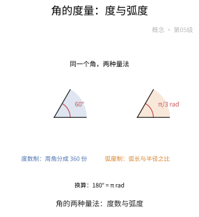

**一句话点破**：度是人为的规定，弧度是弧长与半径的天然比值。

### 16.2 直角三角形中的三角函数

在直角三角形里，锐角 $\theta$ 的 $\sin$ 是"对边比斜边"、$\cos$ 是"邻边比斜边"、$\tan$ 是"对边比邻边"。三个比值只由角决定，与三角形大小无关，这是三角函数的根。

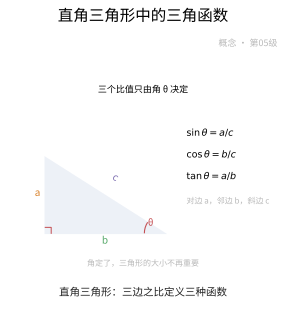

**一句话点破**：三角函数就是直角三角形里固定的边比。

### 16.3 单位圆与三角函数

把角放到半径为 $1$ 的圆上，从横轴转 $\theta$ 后落点的横坐标是 $\cos\theta$、纵坐标是 $\sin\theta$。这样三角函数对任意角都有定义，不再局限于锐角。

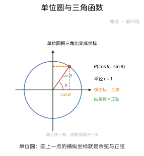

**一句话点破**：正弦、余弦不过是圆上一点的两个坐标。

### 16.4 从直角三角形到单位圆

直角三角形只能处理 $0°$ 到 $90°$，角度却可以转出这个范围。单位圆把"边的比值"升级成"点的坐标"，让函数值随角周而复始地绕圈，这才让正弦余弦真正"活"了起来。

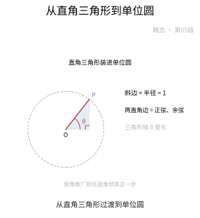

**一句话点破**：单位圆把三角函数的定义域从锐角扩展到了所有角。

### 16.5 基本恒等式

同一个角的 $\sin$ 与 $\cos$ 并不自由——它们满足 $\sin^2\theta+\cos^2\theta=1$，根源就是勾股定理。再加上 $\tan\theta=\dfrac{\sin\theta}{\cos\theta}$，几条基本关系就能互相换算。

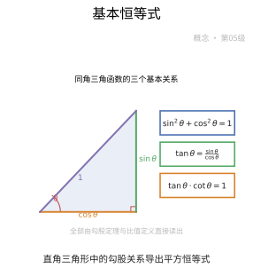

**一句话点破**：平方关系是勾股定理穿上了坐标的外衣。

### 16.6 和角公式

两个角相加，函数值不能简单相加，而要按 $\sin(\alpha+\beta)=\sin\alpha\cos\beta+\cos\alpha\sin\beta$ 展开。它把"转两次角"拆成"两个角的函数组合"，是所有三角公式的源头。

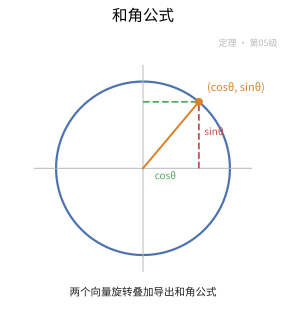

**一句话点破**：和角公式描述的是一次旋转拆成两次旋转的合成。

### 16.7 倍角公式

把和角公式里的两个角取成一样，就得到 $\sin2\theta=2\sin\theta\cos\theta$、$\cos2\theta=\cos^2\theta-\sin^2\theta$。它把一个角换成两倍角，是升次降次的关键。

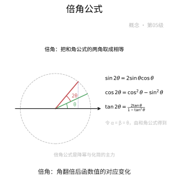

**一句话点破**：倍角公式就是和角公式在"两角相等"时的特例。

### 16.8 半角公式

已知 $\cos2\theta$ 就能反推出 $\sin\theta$、$\cos\theta$ 用 $\cos2\theta$ 表示，这就是半角公式。它常用于把高次幂降为一次，配上的正负号由象限决定。

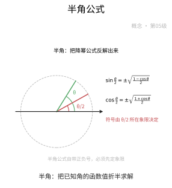

**一句话点破**：半角公式是倍角公式反过来用，专门负责降次。

### 16.9 和差化积公式

两个正弦或余弦相加，可以写成两个角的一半之和与一半之差之积，例如 $\sin A+\sin B=2\sin\dfrac{A+B}{2}\cos\dfrac{A-B}{2}$。它把"加减"变成"乘"，便于讨论振幅与零点。

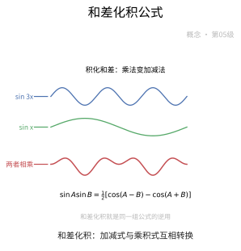

**一句话点破**：和差化积把角度的加减翻译成函数的乘积。

### 16.10 正弦定理

在任意三角形中，各边与它所对角的正弦之比相等：$\dfrac{a}{\sin A}=2R$，$R$ 是外接圆半径。知道两角一边或两边一对角，就能解出整个三角形。

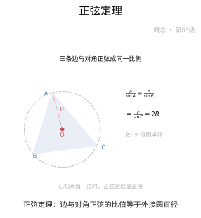

**一句话点破**：正弦定理把边和角通过外接圆牢牢绑在一起。

### 16.11 余弦定理

$c^2=a^2+b^2-2ab\cos C$ 把三角形的一条边与另两条边及其夹角联系起来，是勾股定理的推广。已知两边夹角或三边，都能用它求第三边或某个角。

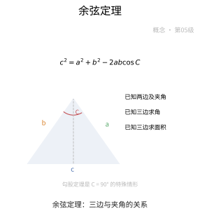

**一句话点破**：余弦定理是勾股定理加上一个关于夹角的修正项。

### 16.12 射影定理与三角形内角恒等式

射影定理说三角形一边在另一边的投影长度满足 $a=b\cos C+c\cos B$；内角恒等式则由 $A+B+C=\pi$ 带来一系列关系。它们让边和角在同一套式子里自由进出。

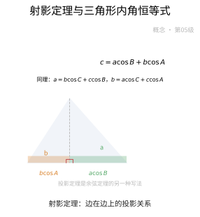

**一句话点破**：投影定理把"边的投影"写成了余弦的线性组合。

### 16.13 三角恒等式的体系

本章几十条公式其实都由两条主干生长出来——和角公式与基本恒等式。抓住主干，"公式推导网络"就能一路推到底，不必死记硬背。

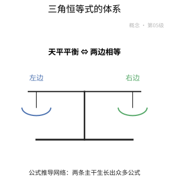

**一句话点破**：把几十条公式记成两条主干，才是真的记住了。

### 16.14 正弦定理与余弦定理：解三角形的两把尺子

正弦定理擅长"边角对角"的搭配，余弦定理擅长"两边夹角"或"三边"。两者像一把尺子的两面，按已知条件挑选即可。

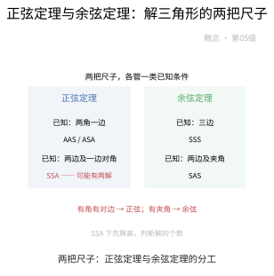

**一句话点破**：能对角用正弦，能合成角用余弦。

### 16.15 正弦函数的图像

$y=\sin x$ 是一条上下起伏的波浪线，周期 $2\pi$、值域 $[-1,1]$。它把匀速圆周运动的纵坐标摊开，成为描述一切振动的样板。

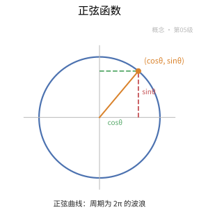

**一句话点破**：正弦曲线是圆周运动在纸上的投影。

### 16.16 余弦函数的图像

$y=\cos x$ 与正弦曲线形状相同，只是整体向左平移了 $\dfrac{\pi}{2}$。它是正弦的"孪生兄弟"，两者合起来能表示任意相位的振动。

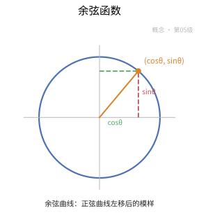

**一句话点破**：余弦就是提前起跑四分之一圈的正弦。

### 16.17 正切函数的图像

$y=\tan x$ 在每段长度 $\pi$ 的区间里从 $-\infty$ 升到 $+\infty$，遇到 $\dfrac{\pi}{2}+k\pi$ 就断开。它不连续却单调，是描述斜率变化的天然工具。

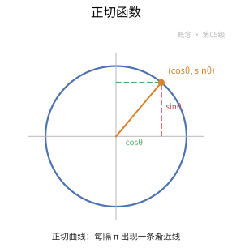

**一句话点破**：正切是"竖直方向的陡峭程度"，所以会冲上无穷。

### 16.18 余切、正割与余割函数

把 $\tan$、$\cos$、$\sin$ 分别取倒数，就得到 $\cot x$、$\sec x$、$\csc x$。它们在一些积分与化简式子里比原函数更好用。

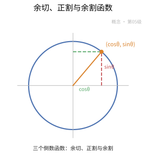

**一句话点破**：倒着用的三角函数，往往能让式子变简单。

### 16.19 一般形式 $y=A\sin(\omega x+\varphi)+B$

在正弦上加四个旋钮：$A$ 控制起伏高低（振幅），$\omega$ 控制快慢（周期 $2\pi/\omega$），$\varphi$ 控制左右移动（相位），$B$ 控制整体上下平移。调好四个参数，就能拟合各种周期现象。

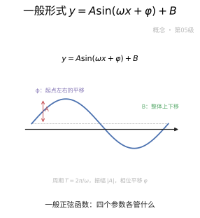

**一句话点破**：振幅、周期、相位、上下平移，四个旋钮各司其职。

### 16.20 图像变换再探

图像变换无非平移、伸缩、翻折几类，关键是分清"先伸缩再平移"还是"先平移再伸缩"。参数写在括号内还是括号外，决定变换施加在谁身上。

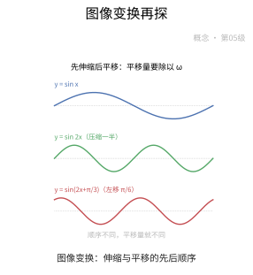

**一句话点破**：变换顺序不同结果不同，先认清参数贴在自变量还是函数值上。

### 16.21 反正弦函数

知道正弦值想反查角，就需要 $\arcsin$。为了唯一，只取主值区间 $\left[-\dfrac{\pi}{2},\dfrac{\pi}{2}\right]$，定义域是 $[-1,1]$。

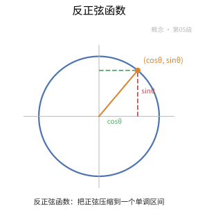

**一句话点破**：反三角函数要限区间，否则一个值对无穷多个角。

### 16.22 反余弦函数

$\arccos x$ 的值落在 $[0,\pi]$，它同样是 $\cos$ 在主值区间上的反函数，定义域 $[-1,1]$，图像是 $\cos$ 曲线一段关于 $y=x$ 的镜像。

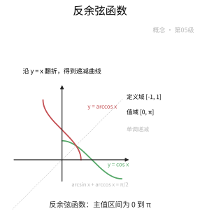

**一句话点破**：反余弦把 $[-1,1]$ 映到 $[0,\pi]$。

### 16.23 反正切函数

$\arctan x$ 的定义域是整个实数轴，值域是 $\left(-\dfrac{\pi}{2},\dfrac{\pi}{2}\right)$，两端是水平的渐近线。它把任意斜率还原成一个角。

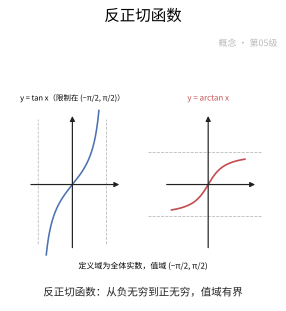

**一句话点破**：斜率多大都能被反正切收进一个有限角。

### 16.24 反余切函数

$\operatorname{arccot} x$ 取主值区间 $(0,\pi)$，与反正切互补。它常用于描述角度落在哪个半圈。

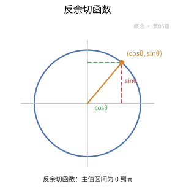

**一句话点破**：反余切与反正切相加为定值，是同一枚硬币的两面。

### 16.25 反三角函数的和角公式

反三角函数之间也有恒等式，例如 $\arctan x+\arctan y=\arctan\dfrac{x+y}{1-xy}$（在适当范围内）。它们让多个反三角函数合成一个。

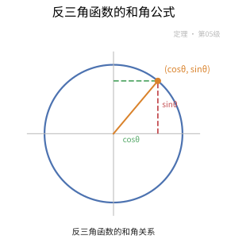

**一句话点破**：反三角函数的和角公式，是把角度悄悄相加。

### 16.26 定义域、值域与主值区间

反三角函数的图表里，最关键的是主值区间——限定在哪一段，函数才唯一。记住章法：反正弦、反正切取对称区间，反余弦、反余切取 $[0,\pi]$。

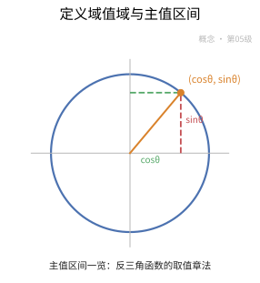

**一句话点破**：主值区间就是给反三角函数划定的工作范围。

### 16.27 反三角函数的进阶

解含反三角函数的方程，或由边长比读角，关键是把反三角看成"某个角的记号"。结合直角三角形，就能把抽象式子翻译成熟悉的边比。

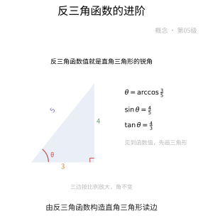

**一句话点破**：把反三角函数当成"一个角的别名"，问题就立体起来了。

### 16.28 技巧 1：遇"切"化"弦"

遇到正切，常常把它写成 $\tan\theta=\dfrac{\sin\theta}{\cos\theta}$，把切函数统一成弦函数。这样式子里只剩 $\sin$ 和 $\cos$，便于约分与配方。

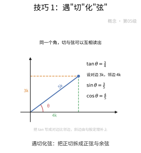

**一句话点破**：切化弦，是把不同种类凑成同一种类。

### 16.29 技巧 2：处理 $1\pm\sin\theta$ 与 $1\pm\cos\theta$

$1\pm\cos\theta$ 可以用半角公式化成 $2\cos^2\dfrac{\theta}{2}$ 或 $2\sin^2\dfrac{\theta}{2}$，$1\pm\sin\theta$ 也可类似处理。配方后常能凑出完全平方，简化根式。

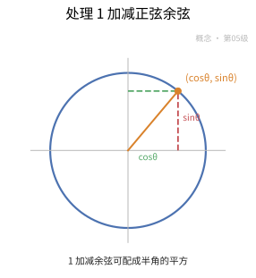

**一句话点破**：见到 $1$ 加减弦函数，先想半角配方。

### 16.30 技巧 3：辅助角公式

$a\sin x+b\cos x$ 可以合成 $\sqrt{a^2+b^2}\,\sin(x+\varphi)$，把两项变一项。$\sqrt{a^2+b^2}$ 是振幅，$\varphi$ 由系数比确定，是求最值的神器。

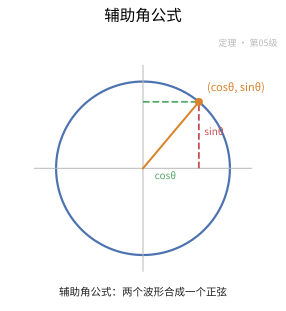

**一句话点破**：同频率的正弦余弦相加，一定还是一条正弦。

### 16.31 技巧 4：倍角公式的"三选一"

$\cos2\theta$ 有三种等价写法：$\cos^2\theta-\sin^2\theta$、$1-2\sin^2\theta$、$2\cos^2\theta-1$。要降正弦就选含 $\sin^2$ 的，要降余弦就选含 $\cos^2$ 的。

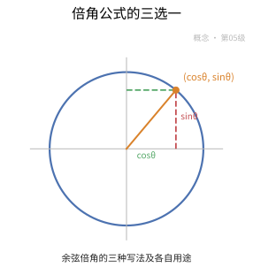

**一句话点破**：余弦倍角的三张脸，按需要留下的项来挑。

### 16.32 技巧 5：拆角法

把待求角拆成已知角的和或差，例如 $\theta=\left(\theta+\dfrac{\pi}{6}\right)-\dfrac{\pi}{6}$，再用和角公式展开。拆角让"求不出的角"变成"能算的角"。

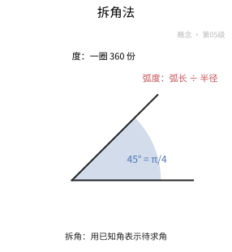

**一句话点破**：把陌生角凑成熟悉角的加减，就能借力打力。

### 16.33 技巧 6：给值求值、给值求角

已知某个角的函数值去求另一个函数值，先判断象限定符号，再结合恒等式与和差公式。给值求角则要留意角的范围，避免多解。

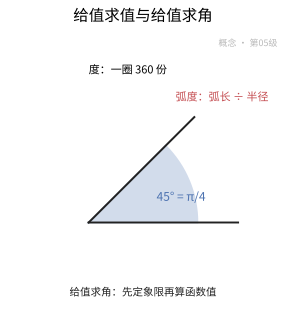

**一句话点破**：给值求值的关键不是公式，而是先锁死象限。

### 16.34 技巧 7：解三角形的边角互化

利用正弦定理把边换成角的正弦、把正弦换成边，或利用余弦定理把角换成边的关系。选对方向，问题往往一步化简。

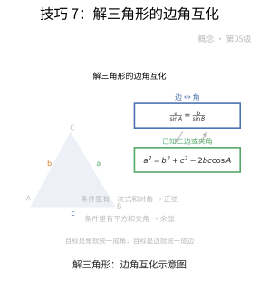

**一句话点破**：边角互化就是选一条能让式子变整齐的通道。

### 16.35 技巧 8：恒等式证明的"方向感"

证明恒等式要从复杂的一边化简到简单的一边，或两边同时化简到同一中间式。方向定了，就不会原地打转。


**一句话点破**：证明恒等式，先决定从哪边出发、往哪儿去。

### 16.36 技巧 9：三角比大小

比较三角函数值，可用单调性、诱导公式化到同一区间，或借助恒等式变形。同区间同名函数靠单调，不同名则想办法统一。


**一句话点破**：比大小的第一步，是把它们搬到同一个单调区间上。

### 16.37 技巧 10：齐次式"统一化切"

分子分母都是关于 $\sin$、$\cos$ 的同次式时，同除以 $\cos$ 的幂就能把式子化成只含 $\tan$ 的式子。这叫齐次式统一化切。


**一句话点破**：齐次式是正切的天然舞台，同除余弦即可上场。

### 16.38 技巧 11：和与积的联立换元

设 $t=\sin\theta+\cos\theta$，则 $t^2=1+2\sin\theta\cos\theta$，于是乘积也知道了。把两式联立，$\sin\theta\pm\cos\theta$ 与 $\sin\theta\cos\theta$ 就能互相求出。


**一句话点破**：和与积差一个平方，换元后就成了一元问题。

### 16.39 技巧 12：值域与最值（分式型）

分式型的三角最值，常把分母换元或化为关于某个函数的二次式求最值。也可以借助辅助角公式把分子合成单项。


**一句话点破**：分式最值，先设法把分母或分子变成一元。

### 16.40 技巧 13：三角方程的通解与区间解

$\sin x=a$ 的通解是 $x=k\pi+(-1)^k\arcsin a$，但若限定了区间，就要逐个筛选。通解给全貌，区间解给落地。


**一句话点破**：先写通解，再用区间这把筛子捞。

### 16.41 技巧 14：由图像确定解析式

给出一条正弦型曲线，找出振幅、周期、初相与平移量，就能写出 $y=A\sin(\omega x+\varphi)+B$。五点法正用是画图，反用是读图。


**一句话点破**：读图定式，就是反着做五点法的每一步。

### 16.42 技巧 15：解三角形中的面积与最值

三角形面积可写成 $S=\dfrac{1}{2}ab\sin C$，配合正弦、余弦定理就能在给定条件下求面积或边长最值。


**一句话点破**：面积公式里的 $\sin C$ 是把几何问题接入三角的接口。

### 16.43 技巧 16：诱导公式的口诀化使用

"奇变偶不变，符号看象限"——$\dfrac{\pi}{2}$ 的奇数次倍把函数名变成余函数，偶数次倍函数名不变，正负号则由原角所在象限决定。


**一句话点破**：一句口诀，把一大类角度变换收进口袋。

### 16.44 技巧 17：图像变换的顺序

先伸缩后平移，还是先平移后伸缩，结果不同。因为平移量会随频率被"放大"——先把 $x$ 的系数提出来，平移量才不会算错。


**一句话点破**：平移量要按频率换算，否则顺序一换就对不上。

### 16.45 技巧 18：性质分析"三件套"

研究周期函数，抓住周期、对称轴、对称中心三样就够了。周期管重复，对称轴与对称中心管局部的最值与零点。


**一句话点破**：周期、对称轴、对称中心，三件套看清一条曲线。

### 16.46 技巧 19：三角不等式放缩

在 $0<x<\dfrac{\pi}{2}$ 时，有 $\sin x<x<\tan x$。这在估计大小、证明不等式时非常有用，是把三角量与线性量比较的桥梁。


**一句话点破**：单位圆里的面积比较，夹出了 $\sin x<x<\tan x$。

### 16.47 技巧 20：三角数列的裂项相消

含三角函数的数列求和，常利用恒等式把通项拆成两项之差，让中间项两两抵消。和差化积是常用的拆项引擎。


**一句话点破**：裂项相消的诀窍是让每一项都成为相邻差。

### 16.48 技巧 21：去外层运算

$\arcsin(\sin x)$ 并不总等于 $x$，只有当 $x$ 落在主值区间内才成立；否则要先用周期性或对称性把 $x$ 搬回主值区间。


**一句话点破**：反函数与函数相互抵消，前提是角度落在主值区间。

### 16.49 技巧 22：构造对偶式

对 $\sin\theta+\cos\theta$ 配一个 $\sin\theta-\cos\theta$ 作为对偶，两者平方相加相减就能消元。构造对偶是求值、证明的巧劲。


**一句话点破**：给式子配一个影子，两式一加一减就化繁为简。

### 16.50 变换一：降幂公式

$\sin^2\theta=\dfrac{1-\cos2\theta}{2}$、$\cos^2\theta=\dfrac{1+\cos2\theta}{2}$ 把二次幂降为一次。积分里遇到平方的三角，先降幂再积几乎总能化险为夷。


**一句话点破**：平方的三角不好积，降成一次就好办了。

### 16.51 变换二：积化和差与和差化积

乘积可以写成加减，加减也可以写成乘积，例如 $\sin\alpha\cos\beta=\dfrac{1}{2}[\sin(\alpha+\beta)+\sin(\alpha-\beta)]$。积分三角函数乘积时这是首选。


**一句话点破**：乘积化加减，是三角积分的第一把钥匙。

### 16.52 变换三：三角代换

遇到 $\sqrt{a^2-x^2}$ 令 $x=a\sin\theta$，遇到 $\sqrt{a^2+x^2}$ 令 $x=a\tan\theta$。三角恒等式正好能把根号消掉，让积分变简单。


**一句话点破**：看到根号，用三角把平方差或平方和变成完全平方。

### 16.53 变换四：奇偶次幂的积分策略

遇到 $\int\sin^m x\cos^n x\,dx$，若有一个指数是奇数，就拆出一个凑微分；若都是偶数，则用降幂公式逐步降次。


**一句话点破**：指数有奇就拆着凑，全是偶就降幂。

### 16.54 变换五：对称性与定积分

在对称区间上，奇函数积分为零、偶函数积分为两倍半区间。三角函数的奇偶性让许多定积分一眼看出答案。


**一句话点破**：对称区间先看奇偶，能省下一大半计算。

### 16.55 变换六：链式法则中的三角

求 $\sin(g(x))$、$\cos(g(x))$ 这类复合函数的导数时，外层三角求导后还要乘以内层的导数。三角函数的导数规律清晰，链式法则用起来十分顺手。


**一句话点破**：复合函数的三角导数，外层照常求，内层别忘乘。

### 16.56 变换七：万能公式

令 $t=\tan\dfrac{x}{2}$，则 $\sin x=\dfrac{2t}{1+t^2}$、$\cos x=\dfrac{1-t^2}{1+t^2}$、$\tan x=\dfrac{2t}{1-t^2}$。它把三角函数变成 $t$ 的有理式，任何三角有理分式都能化为代数分式积分。


**一句话点破**：万能公式是三角世界的统一坐标系，代价是把角折成半角。

### 16.57 变换八：三角函数的完整导数表

$(\sin x)'=\cos x$、$(\cos x)'=-\sin x$、$(\tan x)'=\sec^2x$、$(\sec x)'=\sec x\tan x$ 等构成一套导数表。记住它，比任何技巧都实用。


**一句话点破**：导数表是三角微积分的地基。

### 16.58 变换九：华里士公式

$\int_0^{\frac{\pi}{2}}\sin^n x\,dx$ 有递推的封闭表达式，称为华里士公式。它把高次幂的正弦积分写成连乘之比，是检验各种积分技巧的标尺。


**一句话点破**：华里士公式让高次正弦积分有了现成的封闭答案。

### 16.59 变换十：分部积分的循环法

遇到 $e^x\sin x$ 这类乘积积分，分部积分两次后原积分会重新出现，移项即可解出。这是用"循环"逼出答案的经典手段。


**一句话点破**：积分两次回到原点，移项就把答案逼出来。

### 16.60 变换十一：简化代换 $t=\tan x$

对只含 $\tan x$ 或 $\sec x$ 的积分，直接令 $t=\tan x$ 常比万能公式更轻。此时 $dx=\dfrac{dt}{1+t^2}$，式子立刻有理化。


**一句话点破**：只跟正切打交道时，直接换 $t=\tan x$ 最省力。

### 16.61 变换十二：反三角函数的导数与基本积分

$(\arcsin x)'=\dfrac{1}{\sqrt{1-x^2}}$、$(\arctan x)'=\dfrac{1}{1+x^2}$，反过来就得到基本的积分公式。它们把三角与反三角的微积分连成闭环。


**一句话点破**：反三角函数的导数，本身就是两个常用的积分公式。

### 16.62 变换十三：重要极限与等价无穷小

$\lim\limits_{x\to0}\dfrac{\sin x}{x}=1$，且 $x\to0$ 时 $\sin x\sim x$、$\tan x\sim x$、$1-\cos x\sim\dfrac{x^2}{2}$。这几条等价无穷小是三角极限的万能钥匙。


**一句话点破**：小角度的正弦几乎等于角本身，这就是第一条重要极限。

### 16.63 变换十四：泰勒展开

$\sin x=x-\dfrac{x^3}{6}+\dfrac{x^5}{120}-\cdots$，$\cos x=1-\dfrac{x^2}{2}+\dfrac{x^4}{24}-\cdots$。用多项式逼近三角函数，能高精度求极限、做近似计算。


**一句话点破**：泰勒把弯弯的三角曲线换成好算的多项式。

### 16.64 变换十五：定积分的区间再现

对 $\int_a^b f(x)\,dx$ 作换元 $x\to a+b-x$，积分区间不变但函数形式可能变简单。这一招叫区间再现，专门对付含三角的定积分。


**一句话点破**：把区间倒过来看，常能照出积分的另一半。

### 16.65 变换十六：级数收敛判别中的三角放缩

判断含 $\sin$、$\cos$ 的级数收敛时，常用 $|\sin n|\le1$、$|\cos n|\le1$ 放缩，把它化为已知收敛性的级数来比较。


**一句话点破**：三角函数有界，是级数放缩里最好用的一把刀。

### 16.66 变换十七：三角代换后的回代

做完三角代换求积分，别忘了把结果从角换回原变量。此时画一个直角三角形，用边比把 $\sin$、$\cos$ 翻译回 $x$，最直观。


**一句话点破**：代换有去有回，画个直角三角形就能把角还原成变量。

### 16.67 微积分三角变换速查表

把降幂、积化和差、万能公式、导数表集中在一张表里，做题时按图索骥。速查表不是偷懒，而是把注意力留给思路。


**一句话点破**：把常用的变换汇成一张表，脑子就能留给策略。

### 16.68 训练一：弧度制与角度互化

训练弧度与角度的互化：$\pi$ 弧度等于 $180°$，换算全靠乘 $\dfrac{\pi}{180}$ 或 $\dfrac{180}{\pi}$。熟练后一眼就能在两种单位间切换。


**一句话点破**：弧度与角度互化，牢记 $\pi=180°$ 这一条就够。

### 16.69 训练二：同角三角函数关系

同角关系训练把平方关系、商数关系、倒数关系反复练。给定一个函数值，其余函数值都能顺着关系网推出来。


**一句话点破**：同一个角的各种函数值，靠关系网互相牵引。

### 16.70 训练三：诱导公式与特殊角

把任意角用诱导公式化到 $0°$ 到 $90°$，再套特殊角的值。特殊角表背熟，配合口诀，计算就快了。


**一句话点破**：诱导公式把任意角送进特殊角的舒适区。

### 16.71 训练四：和角与差角公式

和角、差角公式训练的是展开与合并：$\sin(\alpha\pm\beta)$、$\cos(\alpha\pm\beta)$、$\tan(\alpha\pm\beta)$ 三个一组，正用反用都要顺。


**一句话点破**：和差角公式要正反两用，才能灵活合成与拆开角。

### 16.72 训练五：倍角公式

倍角公式训练把单角与倍角互相转换，重点是 $\sin2\theta$、$\cos2\theta$、$\tan2\theta$ 及其逆用。


**一句话点破**：倍角既能升次也能降次，看题目想留住哪个角。

### 16.73 训练六：半角公式

半角公式训练把角折半，同时注意正负号的象限判断。它与倍角公式是一对伙伴。


**一句话点破**：用半角公式，正负号永远交给象限来定。

### 16.74 训练七：积化和差与和差化积

训练乘积与加减形式的互换，是化简与积分的常用桥段。两个方向都要练到条件反射。


**一句话点破**：乘积与加减两边来回走，式子就活了。

### 16.75 训练八：辅助角公式

训练把 $a\sin x+b\cos x$ 合成一个正弦，重点是找出振幅与相位角。它几乎是求最值的标准动作。


**一句话点破**：两项合成一项，辅助角公式是求最值的起手式。

### 16.76 训练九：三角函数图像与性质

训练读图与写图：由解析式画图像、由图像读参数，并说出周期、单调区间与最值。


**一句话点破**：图像与性质是一体两面，看图就能说出性质。

### 16.77 训练十：反三角函数

训练反三角函数的定义域、值域与主值区间，以及它与原函数的复合。


**一句话点破**：把住主值区间，反三角函数的题就不会出圈。

### 16.78 训练十一：解三角形

训练正弦定理与余弦定理在各种已知条件下的选用，并留意多解与不存在的情况。


**一句话点破**：解三角形先看已知条件，再定用哪条定理。

### 16.79 训练十二：综合提高

综合训练把恒等变换、图像、解三角形、反三角糅在一起，考察灵活调用多种工具的能力。


**一句话点破**：综合题的难点不在单个工具，而在挑选与衔接。

### 16.80 强化训练答案

强化训练答案给出各类题型的结果与关键步骤，是自查与纠错的参照。


**一句话点破**：答案不是终点，对完答案要回头找思路的断点。

## 17. 数学史（History of Mathematics）

> 三角学（trigonometry）一词源自希腊语 trigōnon（三角形）与 metron（度量），字面意思就是"三角形测量之学"。然而它最初的舞台不是平面几何，而是星空：巴比伦人用六十进制把圆分成 360 度，希腊人为了预报星辰位置造出弦表，印度人把"全弦"改造成"半弦"，阿拉伯人补齐了正切、余切、正割、余割并让三角学独立成科，欧洲人最终把它从"算天的工具"改造成"函数的分析学"。本章沿着"度量角与边"这条线索，追溯本章每一个概念、公式与单位的千年旅程。

### 17.1 天文基因：从巴比伦的六十进制到希腊的弦

- **前因**：三角学诞生于两个现实需求——预报日月星辰的位置，以及测量不可到达的距离。最早的实践者是天文学家、水手和测量员，而不是几何学家。
- **360° 的由来**：古巴比伦人使用六十进制记数，把黄道等分为 360 份，又把每度细分为 60 分、每分细分为 60 秒；"分""秒"（拉丁语 partes minutae，意为细分部分）沿用到了今天的时间与角度之中。三角学从一开始就活在"度分秒"的体系里。
- **希腊的转折**：希腊人把天文问题转化为几何问题——角对应弧、弧对应弦，"求行星位置"由此变成"求角所对的弦长"。阿里斯塔克（Aristarchus，约前 310—前 230）在《论日月的大小和距离》中用几何不等式估计出日月距离之比介于 18 与 20 之间——这种"用不等式夹逼比值"的思路，是三角学最早的萌芽。
- **共性**：这一阶段的成果可以用一句话概括——把观测数据变成几何量的对应关系；而一旦这种对应被制成表格，三角函数就正式登上了历史舞台。

### 17.2 喜帕恰斯：第一张弦表与"三角学之父"

- **人物**：喜帕恰斯（Hipparchus，约前 190—前 120）是古希腊罗德岛的天文学家。他比较古今星表，发现了分点岁差——地球自转轴在缓慢摆动；据说他还成功预报过一次日食，并估计过日月的大小与距离。
- **造表**：为了把观测数据换算成便于计算的数值，喜帕恰斯编制了第一张三角学意义上的"表"：把圆心角与它所对的弦长一一对应，据说以 7.5° 为步长。他因此被后世称为"三角学之父"，尽管"三角学"这个词要等一千多年后才出现。
- **方法**：为了求出表中没有的弦长，喜帕恰斯发展出弦长的加减法则——已知一些基本弦，就能由此推算出更多的弦。托勒密后来在《天文学大成》中把这些方法流传了下来。
- **影响**：喜帕恰斯确立了此后一千五百年"列表法"的范式：天文计算的精度取决于弦表的精度，造出更精细的表成了一代代人的竞赛——从托勒密到印度人、阿拉伯人再到欧洲人。这与对数表（第 02 级十六.8）、圆周率表的计算（第 03 级 17.6）是同一种历史。

### 17.3 托勒密《天文学大成》：圆周上的和差公式

- **文献**：托勒密（Ptolemy，约 90—168）在约公元 150 年写成《天文学大成》。原书希腊文名《数学汇编》，9 世纪译为阿拉伯语时得名 al-majisṭī（意为"最伟大的"），1175 年再被译成拉丁语，遂以 Almagest 之名传世；此后一千二百年里，它一直是欧洲与阿拉伯世界天文学的教科书。
- **弦表**：全书 13 卷，第一卷的核心是一张弦表：把圆的直径取为 120，从 0.5° 到 180° 按 0.5° 的步长列出圆心角与对应弦长，弦长记到六十进制的两位。这就是古代世界的"三角函数计算器"。
- **球面战场**：约公元 100 年，梅涅劳斯（Menelaus）写成《球面学》，用"梅涅劳斯定理"处理球面三角形，并注意到球面三角形的内角和大于 180°——从此三角学有了"平面"与"球面"两个战场，天文学真正需要的那个战场是后者。
- **工具**：为了造表，托勒密证明了今天所称的**托勒密定理**——圆内接四边形的对角线乘积等于两组对边乘积之和 $AC\cdot BD=AB\cdot CD+BC\cdot AD$，并用它推出弦的差公式与和公式。这些公式与今天的差角、和角公式在数学上等价，只是用"弦"而不是"正弦"表达。
- **余弦定理的雏形**：更早的《几何原本》第二卷中，欧几里得用几何语言处理了钝角与锐角三角形中对边的平方（命题 II.12、II.13），用今天的记号写出其中的线段关系，就是 $c^{2}=a^{2}+b^{2}-2ab\cos C$ 的前身（完整脉络见 16.7）。
- **影响**：托勒密的弦表与和差公式构成了一套完整的计算体系；后来把"弦"换成"半弦"，同一批公式就自动翻译成我们熟悉的正弦公式——公式的骨架其实没有变。

### 17.4 印度半弦与 sine 的词源长征

- **半弦的诞生**：约 5 世纪，印度天文学家把希腊的"全弦"改为"半弦"——取某圆心角所对弦的一半。梵语称 ardha-jya（半弦），后简称 jya。这一步不仅让数表更简洁，更重要的是让正弦从此与"半径之比"联系起来。
- **阿耶波多的表**：499 年，**阿耶波多**（Aryabhata，476—550）在《阿耶波多历书》中给出从 0° 到 90°、以 3.75° 为步长的正弦表（共 24 个值），是现存最早的正弦表。正弦由此成为一个被系统研究的对象。
- **词源长征**：jya 传入阿拉伯世界写作 jiba（弓弦）；阿拉伯文通常省去元音，只写辅音 jb；12 世纪，欧洲译者克雷莫纳的杰拉德（Gerard of Cremona）把 jb 误读为 jaib（意为"衣袋、海湾"），并意译为拉丁语 sinus（海湾、胸怀）；再经拉丁语进入英语，成为 sine。今天最重要的函数名之一，竟是一连串转写与误读的幸存者。
- **余弦与余角**：与"余角之弦"对应的梵语 kojya 同样经由阿拉伯传入欧洲；17 世纪它被解释为 complementi sinus（余角的正弦），1620 年冈特在《Canon triangulorum》中把前缀 co- 固定下来——cosine、cotangent、cosecant 的名字都源于"余角"。
- **印度的高峰**：14—15 世纪，喀拉拉学派的马达瓦（Madhava，约 1340—1425）用无穷级数展开正弦与余弦，并以很高的精度算出了正弦值，成果整理于马拉雅拉姆语的《Yuktibhasa》（约 1530 年）。这比欧洲获得同级数早了约两百年；级数思想在微积分与级数理论（第 11、13 级）中还会大放异彩。

### 17.5 阿拉伯世界：六个函数与球面三角

- **接手与翻译**：9 世纪起，阿拉伯数学家翻译希腊与印度的天文学著作，在两条传统的基础上继续推进。花拉子米（al-Khwārizmī，约 780—850）编制了精确的正弦与余弦表。
- **新函数的诞生**：海巴什（Habash al-Hasib al-Marwazi，9 世纪）把日晷的影长抽象为函数，引入正切与余切并造表；巴塔尼（al-Battani，约 858—929）推进了从"全弦"到"半弦"的转换，并给出 1° 到 90° 的余割表——正割、余割自此进入函数家族。希腊只有"弦"一种函数，而阿拉伯世界已经拥有六个。
- **精度竞赛**：阿布·瓦法（Abu al-Wafa，940—998）完整处理六个三角函数，证明和差公式、得到倍角关系，并造出以 0.25° 为步长、精确到小数点后 8 位的函数表——人类第一次拥有如此高精度的三角函数表。伊本·尤努斯（Ibn Yunus，约 950—1009）则证明了积化和差公式。
- **测地**：比鲁尼（al-Biruni，973—1048）用三角测量法测出地球半径，结果与现代值相差不到百分之一——三角学第一次量出了整个地球。
- **独立成科的宣言**：13 世纪，**纳西尔丁·图西**（Nasir al-Din al-Tusi，1201—1274）在《论完全四边形》（约 1260 年）中第一次把三角学从"天文学的附属计算技巧"提升为独立的数学学科，系统处理平面与球面三角形，给出正弦定理、正切定理与球面三角的现代表述。
- **收官之作**：卡西（al-Kashi，约 1380—1429）在 1427 年的《算术之钥》中给出余弦定理的明确计算法则；他还利用三倍角公式把求解 $\sin 1^{\circ}$ 化为三次方程，用迭代法算到六十进制 8 位（相当于十进制 10 位以上）的精度，被誉为最精确的古代三角函数表。

### 17.6 欧洲接力：雷格蒙塔努斯、雷蒂库斯与韦达

- **中世纪先声**：1342 年，普罗旺斯的莱维·本·热尔松（Levi ben Gershon，即 Gersonides，1288—1344）写成《论正弦、弦与弧》，证明了平面三角形的正弦定理并给出五位正弦表——这是欧洲三角学的独立起点。14—15 世纪，地中海的水手还用简易三角表（toleta de marteloio）修正航向，三角学随航海一起实用化。
- **独立学科**：**雷格蒙塔努斯**（Regiomontanus，1436—1476）在 1464 年写成《论各种三角形》（1533 年才印行），是欧洲第一部把三角学作为独立学科处理的著作：平面三角与球面三角并重，解三角形的算法体系初步成形。他的《方向表》还首次列入正切表，尽管当时尚无专门名称。
- **直角三角形的六个函数**：雷蒂库斯（Rheticus，1514—1574，哥白尼的学生）在《三角学大典》（Opus palatinum de triangulis）中第一次直接用直角三角形的边比定义全部六个三角函数，而不是像前人那样用圆中的弦；这部巨型函数表于 1596 年由他的学生奥托（Valentin Otho）完成出版。
- **解三角形**：韦达（François Viète，1540—1603）把三角公式系统地用于平面与球面三角形的求解，讨论了各种已知条件下的解法，给出余弦定理的一般三角形式并掌握正切定理。解三角形从此成为"照公式办事"的标准流程。
- **影响**：到 16 世纪末，三角学已经完成了从"造表技艺"到"解三角形工具"的转变；下一站是把它彻底解析化——见 16.8。

### 17.7 正弦定理与余弦定理：从几何语言到符号公式

- **正弦定理的前身**：托勒密的弦表中，弦长与圆心角的对应已经隐含了"边与对角之比"的雏形；10 世纪的阿布·瓦法给出球面正弦定理的早期陈述；13 世纪纳西尔丁·图西在《论完全四边形》中给出完整的平面与球面证明；1342 年，热尔松把平面正弦定理带回欧洲。
- **现代形式**：把正弦定理写成"三组比值都等于外接圆直径"的统一形式 $\frac{a}{\sin A}=\frac{b}{\sin B}=\frac{c}{\sin C}=2R$，要等符号代数成熟之后——在韦达的时代，记号还不足以把三个独立命题压缩成一行等式。
- **余弦定理的路线图**：欧几里得 II.12/13 的几何原型（分钝角、锐角两种情形）→ 15 世纪卡西在《算术之钥》中给出用于计算未知边的算法 → 16 世纪末韦达给出三角形式 → 17—18 世纪教科书中定型为今天的 $c^{2}=a^{2}+b^{2}-2ab\cos C$。
- **为什么"迟到"**：余弦定理之所以比勾股定理晚了近两千年才成形，是因为钝角情形要动用"角的余弦"这个量；在余弦函数及其记号成熟之前，即使结论已经到手，也只能用"多出或缺少一个矩形"这样的几何语言来叙述。
- **今天的样子**：正弦定理、余弦定理加上一个面积公式，配合"已知条件"的分类讨论，构成了解三角形的完整算法。这套"两个定理一个公式"的教学框架，是三千多年多国接力的最终沉淀。

### 17.8 欧拉的函数化：1748 年的转折

- **此前的身份**：在 18 世纪之前，三角函数仍然只是"圆中线段之比"——几何对象而非函数。柯茨（Roger Cotes）在《Harmonia Mensurarum》（1722 年出版）中算出了正弦的导数，是最早把三角函数纳入微积分的尝试之一。
- **定义之变**：欧拉（Leonhard Euler）在 1748 年的《无穷分析引论》中，把正弦、余弦从"线段之比"改造成"实数（角）到实数的函数"，推导出它们的无穷级数展开，并给出微积分所需的全部函数关系。三角函数从此与指数函数、对数函数平起平坐，成为分析学的基本函数。
- **记号遗产**：欧拉是最先系统使用近似现代缩写的人：sin.、cos.、tang.、cot.、sec.、cosec.——这些小圆点后来被省略，就是今天教材里的 sin、cos、tan。
- **欧拉公式**：同书中给出 $e^{i\theta}=\cos\theta+i\sin\theta$，把指数函数与三角函数统一成一枚硬币的两面（它在复分析即第 18 级中还会成为主角）。有了它，和差化积、倍角、半角公式都可以从指数律一两行推出——三角恒等式从"背诵清单"变成了"推论"。
- **级数与波**：泰勒在 1715 年给出一般泰勒级数，欧拉与麦克劳林随即给出六个函数的级数展开；19 世纪，傅立叶在研究热传导时发现任何周期现象都可以分解为三角级数（傅立叶级数，1822 年）。三角学从此成为描述"波"的通用语言——从声学、电磁学到信号处理。

### 17.9 弧度制：让微积分简洁的角度

- **为什么需要新单位**：若用度作单位，微积分公式都要拖一条常数尾巴：$\frac{d}{dx}\sin x=\cos x$ 只在弧度制下成立，用度则要乘以 $\frac{\pi}{180}$；基本极限 $\lim_{x\to 0}\frac{\sin x}{x}=1$ 也只在弧度制下成立。
- **自然的度量**：弧度把角的大小定义为"弧长与半径之比"——角与实数由此共用一把尺子。柯茨在 1714 年已指出角应当采用这种自然的度量；欧拉在《无穷分析引论》中系统使用它，使三角函数的分析处理顺畅自然。
- **迟到的名字**：度量方式虽早早确立，单位的名字却姗姗来迟。1873 年，贝尔法斯特女王学院的詹姆斯·汤姆森（James Thomson，开尔文勋爵之兄）在考试中首次使用 radian（弧度）一词；数学家缪尔（Thomas Muir）随即采纳并大力推广。此前人们只能绕口地说"弧长等于半径所对应的角"。
- **意义**：弧度制的胜利不是"单位换算"的胜利，而是观念的胜利——它承认三角函数接收的本质上就是实数——只有这样，才能谈它的导数、级数与复数扩展。

### 17.10 中国三角学：从"重差"到《大测》

- **重差传统**：中国传统测量的代表是"重差术"——用两次观测的差值推算不可到达的距离与高度，《九章算术》与刘徽《海岛算经》是其顶点。但它依靠勾股与相似三角形，没有把"角与比值"作为独立的研究对象。
- **印度表入华**：唐开元六年（718 年），瞿昙悉达主持编译的《开元占经》中收录了印度《九执历》的正弦表——正弦第一次以十进制面目出现在中文文献里，但影响有限。
- **宋元的弧与弦**：沈括（1031—1095）在《梦溪笔谈》中提出"会圆术"，用弦长 $c$、矢高 $v$ 与直径 $d$ 近似弧长：$s=c+\frac{2v^{2}}{d}$——这是中国式的弧弦三角学。13 世纪，郭守敬（1231—1316）在编制《授时历》时系统使用球面三角推算黄赤道差，使中国天文学的计算水平追上了同时代的阿拉伯与欧洲。
- **明末西学东渐**：1607 年徐光启与利玛窦合译《几何原本》前六卷；1631 年，邓玉函编译、徐光启主持的《大测》成书——这是中国第一部三角学专著，系统介绍"三角八线"（正弦、余弦、正切、余切、正割、余割、正矢、余矢）、造表法与用表法，但只讲平面三角。
- **清初的补充**：1653 年，波兰传教士穆尼阁与薛凤祚编译的《历学会通》中，《比例对数表》《比例四线新表》与《三角算法》把对数与三角学一并传入中国——对数（第 02 级十六.8）与三角函数这对"计算双雄"几乎同时登上中国历法的舞台。

### 17.11 历史年表

| 时间 | 人物／文献 | 事件与贡献 |
|:---|:---|:---|
| 约前 2000 年 | 古巴比伦 | 六十进制分圆为 360°，度的分、秒细分传统 |
| 约前 310—前 230 | 阿里斯塔克 | 《论日月的大小和距离》，用不等式夹逼估计天体距离 |
| 约前 190—前 120 | 喜帕恰斯 | 编制第一张弦表，"三角学之父"；发现分点岁差 |
| 约 100 | 梅涅劳斯 | 《球面学》：球面三角形的角和大于 180° |
| 约 150 | 托勒密《天文学大成》 | 直径 120、步长 0.5° 的弦表；托勒密定理与和差公式 |
| 约 5 世纪 | 印度天文学传统 | 以"半弦"取代全弦，正弦概念登场 |
| 499 | 阿耶波多《阿耶波多历书》 | 最早的正弦表（0°—90°，步长 3.75°） |
| 约 830 | 海巴什 | 引入正切、余切并造表 |
| 约 858—929 | 巴塔尼 | 1° 到 90° 的余割表；正割、余割进入函数家族 |
| 约 980 | 阿布·瓦法 | 六个函数、和差与倍角关系；0.25° 步长高精度表 |
| 约 1030 | 比鲁尼 | 三角测量法测地球半径 |
| 约 1260 | 纳西尔丁·图西《论完全四边形》 | 三角学独立成科；平面与球面正弦定理、正切定理 |
| 1342 | 莱维·本·热尔松 | 《论正弦、弦与弧》：欧洲最早证明平面正弦定理 |
| 1427 | 卡西《算术之钥》 | 余弦定理计算法则；精密的 $\sin 1^{\circ}$ 与正弦表 |
| 1464 | 雷格蒙塔努斯《论各种三角形》 | 欧洲第一部独立三角学著作（1533 年印行） |
| 1596 | 雷蒂库斯《三角学大典》 | 直接用直角三角形定义六个三角函数 |
| 1631 | 邓玉函《大测》 | 中国第一部三角学专著（徐光启主持） |
| 1653 | 穆尼阁、薛凤祚《历学会通》 | 对数与三角学传入中国 |
| 1748 | 欧拉《无穷分析引论》 | 三角函数解析化；欧拉公式；sin、cos 等缩写定型 |
| 1822 | 傅立叶《热的解析理论》 | 傅立叶级数：波形分析的开端 |
| 1873 | 詹姆斯·汤姆森、缪尔 | radian（弧度）一词诞生并推广 |

### 17.12 小结

> 从巴比伦的 360° 到欧拉的 $e^{i\theta}$，三角学走过了约四千年的旅程：起点是天文观测与土地丈量；第一次抽象把"角"变成"弦表上的数字"（喜帕恰斯、托勒密）；第二次抽象把"全弦"缩成"半弦"（印度，并留下 sine 这个历经误译的名字）；第三次抽象用直角三角形的边比定义六个函数（雷蒂库斯）；最后一步由欧拉完成——三角函数成为分析学的基本函数。正弦定理、余弦定理与弧度制如今看似"理所当然"，其实每一件都是几代人面对具体问题创造出来的。尤其值得记住的是：数学符号的历史不是纯净的逻辑展开，而是翻译、误读、改良与约定的活历史——sine 的"口袋与海湾"之旅，就是最好的注脚。


## 现实应用（Real-World Applications）

> 本节把本章的知识点落到真实的工程、科学与生活场景中。每个案例都给出**完整的问题背景、建模过程、可复现的数据 / 公式 / 代码与结果解读**；案例末尾的「涉及知识点」对应本章的具体小节，文末附**知识点覆盖对照表**，确保本章知识点全部被覆盖。

### 应用案例 1：搜索引擎与推荐系统｜余弦相似度判定文本"像不像"

**场景与问题**

某新闻聚合 App 每天新增约 50 万篇文章，需要实时给用户"你可能也喜欢"的推荐。工程做法是把每篇文章变成一个高维向量（维度 = 词表大小，常见 5 万维的 TF-IDF 或 768 维的句向量），再用**两个向量夹角的余弦**衡量它们有多像。为什么不直接用欧氏距离？因为长文章的词频天然更大，欧氏距离会被"长度"污染；而夹角余弦只关心**方向**，与文章长短无关。

这里要解决的核心问题正是本章反复强调的：**怎样用一个比值刻画"两个方向的接近程度"。** 它既是「单位圆与三角函数」的语言（$\cos\theta$ 就是单位圆上的横坐标），也是「余弦定理」的向量形式。

**涉及知识点**

- 本章「核心概念 · 3. 单位圆与三角函数」：$\cos\theta$ 是单位圆上角 $\theta$ 对应的横坐标。
- 本章「核心概念 · 4. 从直角三角形到单位圆：正弦余弦为何"活"了起来」：夹角可以超出锐角范围，靠单位圆统一。
- 本章「基本定理与公式 · 1. 基本恒等式」：归一化依赖 $|\vec a|^2=\vec a\cdot\vec a$。
- 本章「基本定理与公式 · 7. 余弦定理」：夹角公式 $c^2=a^2+b^2-2ab\cos C$ 的向量版。
- 本章「反三角函数 · 2. 反余弦函数」：反解夹角 $\theta=\arccos(\cdot)$。
- 本章「反三角函数 · 6. 定义域、值域与主值区间」：$\arccos$ 值域 $[0,\pi]$，恰好覆盖夹角范围。
- 本章「强化训练 · 训练二：同角三角函数关系」：归一化与"同角关系"是同一套代数。

**建模与数据**

为便于手算复现，取一个只有 5 个词的小词表：{`篮球`, `足球`, `股票`, `银行`, `基金`}。两篇文章的词频向量（TF）为

$$
\vec a = (3,\,2,\,0,\,0,\,0)\quad(\text{体育新闻}),\qquad \vec b = (2,\,3,\,0,\,1,\,1)\quad(\text{体娱综合})
$$

**假设**：只统计这 5 个词；忽略停用词、词权重（真实系统用 TF-IDF/BM25）。

**完整推导与算法**

**第 1 步：从余弦定理到向量点积**。在三角形中，边 $c$ 对着角 $C$：

$$
c^2 = a^2 + b^2 - 2ab\cos C \;\Longrightarrow\; \cos C = \frac{a^2+b^2-c^2}{2ab}
$$

把三角形的两条边看成从同一点出发的向量 $\vec a,\vec b$，则 $c^2=|\vec a-\vec b|^2=|\vec a|^2+|\vec b|^2-2\,\vec a\cdot\vec b$，与上式比对即得

$$
\cos\theta = \frac{\vec a\cdot\vec b}{|\vec a|\,|\vec b|}
$$

这就是**余弦定理的向量版**，也是"余弦相似度"的全部内容。

**第 2 步：计算点积与模**。

$$
\vec a\cdot\vec b = 3\times2 + 2\times3 + 0 + 0 + 0 = 12
$$

$$
|\vec a| = \sqrt{3^2+2^2} = \sqrt{13}\approx3.6056,\qquad |\vec b| = \sqrt{2^2+3^2+1^2+1^2}=\sqrt{15}\approx3.8730
$$

**第 3 步：求余弦与夹角**。

$$
\cos\theta = \frac{12}{\sqrt{13}\sqrt{15}} = \frac{12}{\sqrt{195}}\approx 0.8593,\qquad \theta = \arccos 0.8593 \approx 30.71^\circ
$$

**第 4 步：算法（工程版）**：

1. 把两篇文档映射到同一个词表，得到向量 $\vec a,\vec b$；
2. 计算点积 $\vec a\cdot\vec b$ 与两个模；
3. 相似度 $\text{sim}=\vec a\cdot\vec b/(|\vec a||\vec b|)\in[0,1]$（词频非负时余弦非负）；
4. 按相似度降序取 Top-$N$ 做推荐。

```python
# 依赖: numpy
# 输入: 词表与两篇文章的词频向量
# 输出: 点积、模、余弦相似度、夹角(度)
import numpy as np

vocab = ["篮球", "足球", "股票", "银行", "基金"]
a = np.array([3, 2, 0, 0, 0], dtype=float)   # 体育新闻
b = np.array([2, 3, 0, 1, 1], dtype=float)   # 体娱综合

dot = float(np.dot(a, b))
na, nb = np.linalg.norm(a), np.linalg.norm(b)
cos = dot / (na * nb)
theta_deg = np.degrees(np.arccos(cos))

print("点积 a·b =", dot)
print("|a| = %.4f, |b| = %.4f" % (na, nb))
print("余弦相似度 = %.4f" % cos)
print("夹角 = %.2f deg" % theta_deg)

# 对照: 用三角不等式 cos^2 + sin^2 = 1 检验归一化向量的自洽性
u = a / na
v = b / nb
print("单位向量点积应等于余弦:", round(float(np.dot(u, v)), 4), "≈", round(cos, 4))
```

**可复现步骤**

1. 环境与依赖：`pip install numpy`
2. 数据准备：照抄词表与两个向量。
3. 运行：`python case1.py`
4. 预期输出：`夹角 = 30.71 deg`，且最后一行"单位向量点积应等于余弦: 0.8593 ≈ 0.8593"。

**结果解读与延伸**

$30.71^\circ$ 说明两篇文章方向很接近（都偏向体育，只差一个"基金/银行"）。工程上，夹角小于约 $30^\circ$ 常被视作"高度相关"。误差来源：词表截断、未做 IDF 加权、未处理同义词。延伸方向：把 5 维换成 768 维句向量后公式一模一样，只是手算换成了矩阵乘法；而数据库中动辄上亿向量，需要近似最近邻（ANN，如 HNSW）才跑得动。**注意 $\arccos$ 的主值区间 $[0,\pi]$ 恰好就是向量夹角范围**，所以这里不存在多解问题——这正是「反三角函数 · 6」强调主值区间的现实意义。

### 应用案例 2：GPS 与大地测量｜正弦定理与余弦定理解三角形

**场景与问题**

导航软件要算"上海到东京有多远"、测绘队要算"河对岸那座塔离我多远但不过河"，这两件事本质相同：**已知部分边与角，求其余的边与角**——也就是"解三角形"。前者用**球面余弦定理**（地球近似为半径 $R=6371\ \text{km}$ 的球），后者用**平面正弦定理**配合一条已知基线。本章「基本定理与公式」里的正弦定理、余弦定理、射影定理，就是这套工具箱的全部。

**涉及知识点**

- 本章「核心概念 · 1. 角的度量：度与弧度」：经纬度用度、公式里用弧度。
- 本章「核心概念 · 2. 直角三角形中的三角函数」：基线测量的竖直分量。
- 本章「基本定理与公式 · 6. 正弦定理」：$a/\sin A=b/\sin B=c/\sin C=2R$。
- 本章「基本定理与公式 · 7. 余弦定理」：$c^2=a^2+b^2-2ab\cos C$。
- 本章「基本定理与公式 · 8. 射影定理与三角形内角恒等式」：$a=b\cos C+c\cos B$。
- 本章「基本定理与公式 · 10. 正弦定理与余弦定理：解三角形"一把尺子的两面"」：边角互化。
- 本章「反三角函数 · 1. 反正弦函数」：已知 $\sin$ 值求角。
- 本章「解题思路与技巧 · 技巧 5：拆角法」：把球面角拆成经纬度差。
- 本章「解题思路与技巧 · 技巧 6：给值求值、给值求角」。
- 本章「解题思路与技巧 · 技巧 7：解三角形的边角互化与多解判断」。
- 本章「解题思路与技巧 · 技巧 15：解三角形中的面积与最值问题」。
- 本章「解题思路与技巧 · 技巧 16：诱导公式」：处理钝角/象限符号。
- 本章「强化训练 · 训练一：弧度制与角度互化」「训练三：诱导公式与特殊角」「训练十一：解三角形」。

**建模与数据**

**任务 A（球面距离）**：上海（北纬 $31.2304^\circ$、东经 $121.4737^\circ$）到东京（北纬 $35.6762^\circ$、东经 $139.6503^\circ$）。

**任务 B（不过河测距）**：在河边取基线 $AB=100.0\ \text{m}$，在对岸目标点 $C$ 观测：$\angle A=42.0^\circ$、$\angle B=65.0^\circ$，求 $AC$。

**完整推导与算法**

**任务 A：球面余弦定理**。设两点纬度为 $\varphi_1,\varphi_2$，经度差 $\Delta\lambda$，则大圆距离（球面余弦定理）：

$$
d = R\,\arccos\!\bigl(\sin\varphi_1\sin\varphi_2 + \cos\varphi_1\cos\varphi_2\cos\Delta\lambda\bigr)
$$

其中 $\Delta\lambda=139.6503^\circ-121.4737^\circ=18.1766^\circ$。代入（角度先转弧度）：

$$
\sin\varphi_1\sin\varphi_2 \approx 0.5185\times0.5831 = 0.3024
$$

$$
\cos\varphi_1\cos\varphi_2\cos\Delta\lambda \approx 0.8551\times0.8124\times0.9501 = 0.6599
$$

$$
d = 6371\times\arccos(0.9623) \approx 6371\times0.2756 \approx 1756\ \text{km}
$$

**任务 B：正弦定理**。先由内角和求第三角：

$$
C = 180^\circ - 42.0^\circ - 65.0^\circ = 73.0^\circ
$$

由正弦定理 $\dfrac{AC}{\sin B}=\dfrac{AB}{\sin C}$：

$$
AC = AB\cdot\frac{\sin B}{\sin C} = 100.0\times\frac{\sin 65.0^\circ}{\sin 73.0^\circ} = 100.0\times\frac{0.9063}{0.9563}\approx 94.8\ \text{m}
$$

**射影定理校验**：$AB = AC\cos A + BC\cos B$，据此可反求 $BC=\dfrac{AB-AC\cos A}{\cos B}=\dfrac{100-94.8\times0.7431}{0.4226}\approx\dfrac{29.6}{0.4226}\approx70.0\ \text{m}$。

```python
# 依赖: numpy
# 输入: 任务A经纬度, 任务B基线与两角
# 输出: 大圆距离(km), 不过河测距(m), 射影定理校验
import numpy as np

R = 6371.0
lat1, lon1 = np.radians(31.2304), np.radians(121.4737)
lat2, lon2 = np.radians(35.6762), np.radians(139.6503)
dlon = lon2 - lon1
cos_c = np.sin(lat1)*np.sin(lat2) + np.cos(lat1)*np.cos(lat2)*np.cos(dlon)
d_km = R * np.arccos(np.clip(cos_c, -1, 1))
print("上海-东京 大圆距离 = %.1f km (球面余弦定理)" % d_km)

AB = 100.0
A = np.radians(42.0); B = np.radians(65.0)
C = np.pi - A - B
AC = AB * np.sin(B) / np.sin(C)
BC = AB * np.sin(A) / np.sin(C)
print("角C = %.1f deg" % np.degrees(C))
print("AC = %.2f m, BC = %.2f m (正弦定理)" % (AC, BC))

# 余弦定理反求角 A, 与已知 42° 对比
cosA = (AB**2 + AC**2 - BC**2) / (2*AB*AC)
print("余弦定理反求角A = %.2f deg (应为 42.00)" % np.degrees(np.arccos(cosA)))

# 射影定理: AB = AC*cosA + BC*cosB
print("射影定理校验 AB = %.2f (应为 100.00)" % (AC*np.cos(A) + BC*np.cos(B)))

# 面积(技巧15): S = 1/2 * AB * AC * sinA
S = 0.5 * AB * AC * np.sin(A)
print("三角形面积 = %.2f m^2" % S)
```

**可复现步骤**

1. 环境与依赖：`pip install numpy`
2. 数据准备：照抄经纬度、基线 $100.0$ 与两角。
3. 运行：`python case2.py`
4. 预期输出：`上海-东京 大圆距离 = 1755.9 km`、`角C = 73.0 deg`、`AC = 94.78 m, BC = 69.99 m`、`余弦定理反求角A = 42.00 deg`、`射影定理校验 AB = 100.00`、`三角形面积 = 3174.xx m^2`。

**结果解读与延伸**

实测上海—东京大圆距离约 $1760\ \text{km}$，与计算值 $1755.9\ \text{km}$ 只差 $0.2\%$——误差来自"地球当正球"的近似（真实为椭球，需用 Vincenty 公式）。任务 B 展示了**正弦定理（已知两角一边）与余弦定理（已知两边夹角或三边）的"两面一把尺子"**：这里用正弦定理直接求边，再用余弦定理反求角闭环自检。多解判断要点：正弦定理求角时 $\sin\theta=k$ 可能对应 $\theta$ 与 $180^\circ-\theta$ 两解，而余弦定理求角在 $[0,180^\circ]$ 内唯一——所以「技巧 7」建议"给值求角优先用余弦"。

### 应用案例 3：音频编码与图像压缩｜把信号拆成正弦波（傅里叶级数）

**场景与问题**

MP3、AAC 音频编码和 JPEG 图像压缩都基于同一个想法：**任何复杂信号都能拆成一组正弦/余弦波的叠加**。一首歌的采样率是 $44100\ \text{Hz}$（CD 标准），编码器要算出每一小段里各频率成分的**振幅 $A$ 与相位 $\varphi$**，把听不出的小分量丢掉，从而把文件压到原来的十分之一。这里要用到本章的「一般形式 $y=A\sin(\omega x+\varphi)+B$」「和角公式」「和差化积」与「图像变换」。

**涉及知识点**

- 本章「基本定理与公式 · 2. 和角公式」：$\sin(\omega t+\varphi)=\sin\omega t\cos\varphi+\cos\omega t\sin\varphi$。
- 本章「基本定理与公式 · 3. 倍角公式」：$880=2\times440$ 的谐波关系。
- 本章「基本定理与公式 · 5. 和差化积公式」：正交性证明要用积化和差。
- 本章「三角函数图像 · 1/2. 正弦 / 余弦函数」：基波的波形。
- 本章「三角函数图像 · 5. 一般形式 $y=A\sin(\omega x+\varphi)+B$」：$A$（振幅）、$\omega$（角频率）、$\varphi$（初相）。
- 本章「三角函数图像 · 6. 图像变换再探」：参数如何拉伸、平移波形。
- 本章「解题思路与技巧 · 技巧 3：辅助角公式」：把 $A\sin+B\cos$ 合并成一个正弦。
- 本章「解题思路与技巧 · 技巧 4：倍角公式的"三选一"」。
- 本章「解题思路与技巧 · 技巧 16：诱导公式」：$\cos$ 与 $\sin$ 的相位差 $\pi/2$。
- 本章「解题思路与技巧 · 技巧 17：图像变换的顺序」：先伸缩后平移。
- 本章「解题思路与技巧 · 技巧 18：性质分析"三件套"」：周期、对称轴、对称中心。
- 本章「强化训练 · 训练四：和角与差角公式」「训练五：倍角公式」「训练八：辅助角公式」「训练九：三角函数图像与性质」。

**建模与数据**

取一段双音信号（模拟电话拨号的"双音多频"DTMF，或钢琴上纯音加八度泛音）：

$$
x(t) = 0.8\sin(2\pi\cdot440\,t) + 0.5\sin\!\left(2\pi\cdot880\,t+\frac{\pi}{3}\right)
$$

采样率 $f_s=44100\ \text{Hz}$，取 $0.1\ \text{s}$（$4410$ 个样点）。目标：从样点还原出两个频率分量及其实测振幅/相位。

**完整推导与算法**

**第 1 步：一般形式的三个参数**。对 $y=A\sin(\omega t+\varphi)$：振幅 $|A|$、角频率 $\omega=2\pi f$、初相 $\varphi$。第一项 $A_1=0.8,\ f_1=440\ \text{Hz},\ \varphi_1=0$；第二项 $A_2=0.5,\ f_2=880\ \text{Hz},\ \varphi_2=\pi/3$。

**第 2 步：和角公式展开**。把每项写成 $\sin$ 与 $\cos$ 的线性组合：

$$
x(t) = 0.8\sin\omega_1 t + 0.5\Bigl(\sin\omega_2 t\cos\tfrac{\pi}{3}+\cos\omega_2 t\sin\tfrac{\pi}{3}\Bigr) = 0.8\sin\omega_1 t + 0.25\sin\omega_2 t + 0.4330\cos\omega_2 t
$$

**第 3 步：辅助角公式合并第 2 项**。对 $a\sin\theta+b\cos\theta$，

$$
a\sin\theta+b\cos\theta = R\sin(\theta+\beta),\qquad R=\sqrt{a^2+b^2},\quad \beta=\arctan\frac{b}{a}
$$

以 $a=0.25,b=0.4330$ 代入：$R=\sqrt{0.0625+0.1875}=\sqrt{0.25}=0.5$，$\beta=\arctan(1.7321)=\pi/3$，还原出 $0.5\sin(\omega_2 t+\pi/3)$——闭环验证和角/辅助角公式。

**第 4 步：正交性与和差化积**。DFT 能"挑出"单个频率，靠的是

$$
\int_0^T \sin(m\omega t)\sin(n\omega t)\,dt = 0\quad(m\neq n)
$$

其证明用积化和差：$\sin m\theta\sin n\theta=\tfrac12[\cos(m-n)\theta-\cos(m+n)\theta]$，整数周期上积分为零。

**第 5 步：DFT 算法**：

1. 对样点做 FFT 得到复数谱 $X_k$；
2. 第 $k$ 根谱线对应频率 $f=k f_s/N$；
3. 振幅 $A_k = 2|X_k|/N$，相位 $\varphi_k=\arg(X_k)$。

```python
# 依赖: numpy
# 输入: 采样率, 时长, 两个分量的(A, f, phi)
# 输出: 还原出的振幅与相位
import numpy as np

fs, dur = 44100, 0.1
t = np.arange(0, dur, 1/fs)
x = 0.8*np.sin(2*np.pi*440*t) + 0.5*np.sin(2*np.pi*880*t + np.pi/3)

N = len(x)
X = np.fft.rfft(x)
freqs = np.fft.rfftfreq(N, 1/fs)
amp = 2*np.abs(X)/N
phase = np.angle(X)

for f0 in (440, 880):
    k = int(round(f0*N/fs))
    print("频率 %4d Hz -> 振幅 %.3f, 相位 %.3f rad (%.1f deg)"
          % (f0, amp[k], phase[k], np.degrees(phase[k])))

# 辅助角公式验证: 0.25 sin + 0.4330 cos = 0.5 sin(theta + pi/3)
a, b = 0.25, 0.4330
R = np.hypot(a, b); beta = np.arctan2(b, a)
print("辅助角: R=%.3f, beta=%.3f rad (=%.1f deg)" % (R, beta, np.degrees(beta)))
```

**可复现步骤**

1. 环境与依赖：`pip install numpy`
2. 数据准备：写入 $f_s=44100$、$0.1\ \text{s}$、两个分量参数。
3. 运行：`python case3.py`
4. 预期输出：`频率 440 Hz -> 振幅 0.800, 相位 0.000 rad`、`频率 880 Hz -> 振幅 0.500, 相位 1.047 rad (60.0 deg)`、`辅助角: R=0.500, beta=1.047 rad (=60.0 deg)`。

**结果解读与延伸**

FFT 精确还原出振幅 $0.8/0.5$ 与相位 $0^\circ/60^\circ$，说明"一般形式 $A\sin(\omega t+\varphi)$"就是频域表示的原型。**注意相位用 $\arctan$ 求时会有象限歧义**（$\arctan$ 值域只有 $(-\pi/2,\pi/2)$），工程上必须用 $\operatorname{atan2}$ 才能还原 $60^\circ$——这是「反三角函数 · 3/6」在信号处理里的直接体现。误差来源：非整周期采样导致频谱泄漏（需加汉宁窗）、混叠（采样率须大于两倍最高频率，即奈奎斯特条件 $44100>2\times880$）。延伸：JPEG 用的是 DCT（只有余弦项），音乐里的"音色"就是各次谐波振幅的比例；「技巧 18 的周期/对称轴/对称中心」在频域里对应"谱线位置与对称性"。

### 应用案例 4：交流电与相位｜辅助角公式、正切与反三角函数

**场景与问题**

家用市电是 $220\ \text{V}$、$50\ \text{Hz}$ 正弦波，峰值 $311\ \text{V}$。当两条支路的电压叠加（或电压与电流之间出现相位差）时，工程师要算：**叠加后的电压峰值多大、相位偏移多少、功率因数是多少。** 这些问题的答案全落在「和角公式」「辅助角公式」「正切/余切/正割/余割」与「反三角函数」上。电感、电容让电流"走在电压后面或前面"，就要用 $\varphi=\arctan(X/R)$ 描述。

**涉及知识点**

- 本章「基本定理与公式 · 2. 和角公式」：叠加相量。
- 本章「三角函数图像 · 3. 正切函数」：$\tan\varphi=X/R$ 的斜率为相位角。
- 本章「三角函数图像 · 4. 余切、正割与余割函数」：$\cot\varphi=R/X$、$\sec\varphi=Z/R$、$\csc\varphi=Z/X$。
- 本章「反三角函数 · 3. 反正切函数」：$\varphi=\arctan(X/R)$。
- 本章「反三角函数 · 4. 反余切函数」：$\varphi=\operatorname{arccot}(R/X)$。
- 本章「反三角函数 · 5. 反三角函数的和角公式」：多段相位叠加。
- 本章「解题思路与技巧 · 技巧 1：遇"切"化"弦"，遇"1"化"角"」。
- 本章「解题思路与技巧 · 技巧 3：辅助角公式」。
- 本章「强化训练 · 训练三：诱导公式与特殊角」「训练四：和角与差角公式」「训练八：辅助角公式」。

**建模与数据**

两条支路瞬时电压（额定 $50\ \text{Hz}$，$\omega=2\pi\times50=314.16\ \text{rad/s}$）：

$$
v_1(t)=311\sin(\omega t),\qquad v_2(t)=155\sin\!\left(\omega t+\frac{\pi}{6}\right)
$$

负载回路：电阻 $R=8.0\ \Omega$，感抗 $X_L=6.0\ \Omega$，故阻抗 $Z=\sqrt{R^2+X_L^2}=10.0\ \Omega$。

**完整推导与算法**

**第 1 步：和角公式展开 $v_2$**。

$$
v_2(t)=155\bigl(\sin\omega t\cos\tfrac{\pi}{6}+\cos\omega t\sin\tfrac{\pi}{6}\bigr)=134.2\sin\omega t+77.5\cos\omega t
$$

**第 2 步：同频叠加**。同频正弦相加仍为同频正弦：

$$
v(t)=v_1+v_2 = (311+134.2)\sin\omega t + 77.5\cos\omega t = 445.2\sin\omega t+77.5\cos\omega t
$$

**第 3 步：辅助角公式合并**。

$$
R_m=\sqrt{445.2^2+77.5^2}=\sqrt{198203+6006}=\sqrt{204209}\approx451.9\ \text{V}
$$

$$
\varphi=\arctan\frac{77.5}{445.2}=\arctan 0.1741\approx 9.88^\circ
$$

故 $v(t)\approx451.9\sin(\omega t+9.88^\circ)$。

**第 4 步：阻抗三角形与六个三角比**。以 $R$ 为邻边、$X_L$ 为对边、$Z$ 为斜边：

$$
\varphi=\arctan\frac{X_L}{R}=\arctan\frac{6}{8}=\arctan 0.75=36.87^\circ
$$

$$
\cos\varphi=\frac{R}{Z}=0.80\ (\text{功率因数}),\quad \sin\varphi=\frac{X_L}{Z}=0.60,\quad \tan\varphi=\frac{X_L}{R}=0.75
$$

$$
\cot\varphi=\frac{R}{X_L}=1.333,\quad \sec\varphi=\frac{Z}{R}=1.25,\quad \csc\varphi=\frac{Z}{X_L}=1.667
$$

**第 5 步：反三角和角公式**。两段相位 $\arctan1$ 与 $\arctan2$ 相加：

$$
\arctan 1+\arctan 2 = \arctan\frac{1+2}{1-1\times2}+\pi = \arctan(-3)+\pi \approx -71.565^\circ+180^\circ=108.435^\circ
$$

（因 $xy=2>1$ 且 $x>0$，须加 $\pi$ 修正。）

```python
# 依赖: numpy
# 输入: 两路电压参数, R, X_L
# 输出: 叠加电压峰值与初相, 阻抗三角比, 反三角和角
import numpy as np

w = 2*np.pi*50
A1, A2, phi2 = 311.0, 155.0, np.pi/6

# 和角展开 -> 正弦余弦分量
a = A1 + A2*np.cos(phi2)
b = A2*np.sin(phi2)
Rm = np.hypot(a, b)
phi = np.arctan2(b, a)
print("叠加: A.sin = %.2f, B.cos = %.2f" % (a, b))
print("合成峰值 Rm = %.1f V, 初相 = %.2f deg" % (Rm, np.degrees(phi)))

R, XL = 8.0, 6.0
Z = np.hypot(R, XL)
p = np.arctan2(XL, R)
print("Z = %.1f ohm, 相位 phi = %.2f deg" % (Z, np.degrees(p)))
print("cos=%.3f sin=%.3f tan=%.3f cot=%.3f sec=%.3f csc=%.3f"
      % (R/Z, XL/Z, XL/R, R/XL, Z/R, Z/XL))

# 反三角和角: arctan1 + arctan2 (xy>1, x>0 -> +pi)
val = np.arctan(1) + np.arctan(2)
print("arctan1+arctan2 = %.3f deg (直接相加)" % np.degrees(val))
print("修正后 = %.3f deg" % np.degrees(np.arctan((1+2)/(1-1*2)) + np.pi))
```

**可复现步骤**

1. 环境与依赖：`pip install numpy`
2. 数据准备：写入 $A_1=311,A_2=155,\varphi_2=\pi/6,R=8,X_L=6$。
3. 运行：`python case4.py`
4. 预期输出：`合成峰值 Rm = 451.9 V, 初相 = 9.88 deg`、六个三角比 `0.800 0.600 0.750 1.333 1.250 1.667`、`修正后 = 108.435 deg`。

**结果解读与延伸**

合成后峰值 $451.9\ \text{V}$（而非简单的 $311+155=466$），因为两路相位不同，叠加要按"相量矢量相加"——这正是辅助角公式的物理含义。功率因数 $\cos\varphi=0.80$ 表示有 $20\%$ 的容量在做"无功"，工厂会并联电容把 $\varphi$ 拉回 $0$ 附近以省电费。误差来源：忽略谐波与线路电阻。延伸：三相电里的 $\cos(\omega t)+\cos(\omega t-120^\circ)+\cos(\omega t+120^\circ)=0$ 是"和差化积 + 诱导公式"的经典结论，也是三相平衡的数学基础。

### 应用案例 5：机器人逆运动学｜用反三角函数求关节角

**场景与问题**

一个两连杆平面机械臂（第一臂长 $L_1=0.30\ \text{m}$，第二臂长 $L_2=0.25\ \text{m}$）要把末端（焊枪/抓手）送到工作台上的目标点 $(x,y)=(0.40,\,0.15)\ \text{m}$。控制器必须反解出两个关节角 $\theta_1,\theta_2$——这叫**逆运动学**。核心工具是**余弦定理求角 + 反三角函数定象限**，正好把本章「反三角函数」整节用上。

**涉及知识点**

- 本章「核心概念 · 2. 直角三角形中的三角函数」：几何臂的直角分量。
- 本章「基本定理与公式 · 7. 余弦定理」：由三边求 $\theta_2$。
- 本章「反三角函数 · 1. 反正弦函数」：$\arcsin$ 用于辅助角。
- 本章「反三角函数 · 2. 反余弦函数」：$\theta_2=\arccos(\cdot)$。
- 本章「反三角函数 · 3. 反正切函数」：$\arctan2$ 定方向。
- 本章「反三角函数 · 4. 反余切函数」：与 $\arctan$ 互余。
- 本章「反三角函数 · 5. 反三角函数的和角公式」：代数解与几何解的关系。
- 本章「反三角函数 · 6. 定义域、值域与主值区间」：选对主值才有多解。
- 本章「反三角函数 · 7. 反三角函数的进阶」：解方程与"读直角三角形"。
- 本章「解题思路与技巧 · 技巧 3：辅助角公式」「技巧 5：拆角法」「技巧 21：$\arcsin(\sin x)$ 型"去外层"运算」。
- 本章「强化训练 · 训练十：反三角函数」。

**建模与数据**

$$
L_1=0.30\ \text{m},\quad L_2=0.25\ \text{m},\quad (x,y)=(0.40,\,0.15)\ \text{m}
$$

**假设**：平面 2R 机械臂，无关节限位，忽略连杆厚度（理想臂）。

**完整推导与算法**

**第 1 步：判断可达性**。末端到原点距离

$$
r=\sqrt{x^2+y^2}=\sqrt{0.40^2+0.15^2}=\sqrt{0.1825}\approx0.4272\ \text{m}
$$

要求 $|L_1-L_2|\le r\le L_1+L_2$，即 $0.05\le0.4272\le0.55$，**可达**。

**第 2 步：余弦定理求 $\theta_2$**。三角形以原点、肘关节、末端为顶点，第三边为 $r$：

$$
\cos\theta_2 = \frac{r^2-L_1^2-L_2^2}{2L_1L_2} = \frac{0.1825-0.09-0.0625}{2\times0.30\times0.25}=\frac{0.03}{0.15}=0.20
$$

$$
\theta_2 = \arccos 0.20 \approx 78.46^\circ = 1.3694\ \text{rad}
$$

**第 3 步：求 $\theta_1$（拆角法）**。记 $\alpha=\arctan2(y,x)$（末端方位角），$\beta=\arctan2(L_2\sin\theta_2,\;L_1+L_2\cos\theta_2)$，则

$$
\theta_1 = \alpha-\beta
$$

$$
\alpha=\arctan2(0.15,0.40)=20.556^\circ
$$

$$
\beta=\arctan2(0.25\times0.9798,\;0.30+0.25\times0.20)=\arctan2(0.24495,0.35)=34.992^\circ
$$

$$
\theta_1 = 20.556^\circ-34.992^\circ=-14.436^\circ
$$

**第 4 步：为什么必须用 $\arccos$ 而不是 $\arcsin$**。$\cos\theta_2=0.20$ 时 $\sin\theta_2=\pm\sqrt{1-0.04}=\pm0.9798$；若用 $\arcsin$ 只能得到 $+78.46^\circ$，丢失"肘部向下"的另一组解。用 $\arccos$（值域 $[0,\pi]$）才能保留 $\theta_2\in[0,\pi]$ 的全部可能，两组解 $\pm\theta_2$ 对应"肘上/肘下"。

```python
# 依赖: numpy
# 输入: L1, L2, 目标点 (x,y)
# 输出: 两组逆解(theta1, theta2), 正解校验
import numpy as np

L1, L2 = 0.30, 0.25
x, y = 0.40, 0.15

r2 = x*x + y*y
r = np.sqrt(r2)
if not (abs(L1-L2) <= r <= L1+L2):
    print("目标不可达")
else:
    c2 = (r2 - L1**2 - L2**2) / (2*L1*L2)
    theta2 = np.arccos(np.clip(c2, -1, 1))          # [0, pi]
    for s in (+1, -1):                               # 肘下 / 肘上
        t2 = s * theta2
        alpha = np.arctan2(y, x)
        beta = np.arctan2(L2*np.sin(t2), L1 + L2*np.cos(t2))
        t1 = alpha - beta
        # 正运动学校验
        xe = L1*np.cos(t1) + L2*np.cos(t1+t2)
        ye = L1*np.sin(t1) + L2*np.sin(t1+t2)
        print("解 s=%+d: theta1=%8.3f deg, theta2=%8.3f deg -> 末端(%.4f, %.4f)"
              % (s, np.degrees(t1), np.degrees(t2), xe, ye))

print("目标点 = (%.4f, %.4f)" % (x, y))
print("arctan(0.75)=%.2f deg, arccot(0.75)=%.2f deg (互余)" %
      (np.degrees(np.arctan(0.75)), np.degrees(np.arctan(1/0.75))))
```

**可复现步骤**

1. 环境与依赖：`pip install numpy`
2. 数据准备：写入 $L_1=0.30,L_2=0.25,(x,y)=(0.40,0.15)$。
3. 运行：`python case5.py`
4. 预期输出：两组解 `theta1=-14.436 deg, theta2=78.463 deg`（肘下一组）与另一组镜像解，且正运动学校验得到的末端坐标均为 `(0.4000, 0.1500)`，与目标一致。

**结果解读与延伸**

正运动学校验末端回到 $(0.40,0.15)$，说明逆解正确。**两组解**对应机械臂"肘上/肘下"两种姿态，控制器再按"避开障碍、靠近限位中间"择优。误差来源：真实机器人有关节间隙、连杆偏置；若目标接近工作空间边界（$r\to L_1+L_2$），$\cos\theta_2\to1$、解对误差极敏感（奇异位形）。**关键提醒**：$\arcsin(\sin x)=x$ 只在 $x\in[-\pi/2,\pi/2]$ 成立（「技巧 21」），所以逆解必须显式处理主值区间与象限，否则机器人会"甩臂"到错误方向。

### 应用案例 6：机械振动与简谐运动｜图像、周期与最值

**场景与问题**

精密设备（如电子显微镜、光刻机平台）的减振台是一个弹簧—质量系统：质量 $m=1.0\ \text{kg}$ 挂在劲度系数 $k=100\ \text{N/m}$ 的弹簧上。它做**简谐运动** $x(t)=A\sin(\omega t+\varphi)$。工程师关心：固有频率是多少（要远离外界振动频率）？振幅速度加速度多大？什么时候过平衡位置？这些分别对应本章的「三角函数图像」「周期/对称」「最值」与「三角方程通解」。

**涉及知识点**

- 本章「核心概念 · 3. 单位圆与三角函数」：简谐运动的相位 = 匀速圆周运动的投影。
- 本章「三角函数图像 · 1/2. 正弦 / 余弦函数」「5. 一般形式」：$x(t)$ 的波形。
- 本章「三角函数图像 · 6. 图像变换再探」：$A$ 决定振幅、$\omega$ 决定周期。
- 本章「解题思路与技巧 · 技巧 9：三角比大小的常用方法」。
- 本章「解题思路与技巧 · 技巧 12：值域与最值问题（分式型）」。
- 本章「解题思路与技巧 · 技巧 13：三角方程的通解与区间解」。
- 本章「解题思路与技巧 · 技巧 14：由图像确定解析式（五点法反用）」。
- 本章「解题思路与技巧 · 技巧 18：性质分析"三件套"」。
- 本章「解题思路与技巧 · 技巧 19：三角不等式放缩」。
- 本章「解题思路与技巧 · 技巧 20：三角数列的裂项相消」。
- 本章「强化训练 · 训练九：三角函数图像与性质」。

**建模与数据**

$$
m=1.0\ \text{kg},\quad k=100\ \text{N/m},\quad A=0.05\ \text{m},\quad \varphi=0
$$

初始条件：$t=0$ 时在平衡位置、速度为正向最大。

**完整推导与算法**

**第 1 步：角频率、频率、周期**。由 $m\ddot x=-kx$ 得

$$
\omega=\sqrt{\frac{k}{m}}=\sqrt{100}=10\ \text{rad/s},\quad f=\frac{\omega}{2\pi}=1.5915\ \text{Hz},\quad T=\frac{2\pi}{\omega}=0.6283\ \text{s}
$$

**第 2 步：五点法确定图像（技巧 14）**。$x(t)=0.05\sin(10t)$ 的五个关键点：$t=0,\ T/4,\ T/2,\ 3T/4,\ T$ 处 $x=0,\ +A,\ 0,\ -A,\ 0$。

**第 3 步：导数与最值（性质三件套）**。

$$
v(t)=\dot x=A\omega\cos(\omega t)=0.5\cos(10t),\qquad a(t)=\ddot x=-A\omega^2\sin(\omega t)=-5\sin(10t)
$$

故 $v_{\max}=0.5\ \text{m/s}$，$a_{\max}=5\ \text{m/s}^2$。

**第 4 步：三角方程求过零点（技巧 13）**。过平衡位置 $x=0$ 即 $\sin(10t)=0$：

$$
10t=n\pi \;\Rightarrow\; t=\frac{n\pi}{10}=0.3142n\ \text{s}\quad(n=0,1,2,\dots)
$$

在 $[0,T]=[0,0.6283]$ 内有 $t=0,\,0.3142,\,0.6283$ 三个时刻。

**第 5 步：分式型值域（技巧 12）**。若某无量纲增益为 $g(\theta)=\dfrac{2\sin\theta+1}{\sin\theta+2}$，令 $u=\sin\theta\in[-1,1]$，则 $g=(2u+1)/(u+2)$ 关于 $u$ 单调增（$\mathrm{d}g/\mathrm{d}u=3/(u+2)^2>0$），故值域为 $[g(-1),g(1)]=[-1,\,1]$。

**第 6 步：小角近似（技巧 19）**。当振幅很小时 $\sin\theta\approx\theta$（$\theta$ 用弧度），单摆周期 $T\approx2\pi\sqrt{L/g}$ 与振幅无关——这正是"等时性"。

```python
# 依赖: numpy
# 输入: m, k, A, phi
# 输出: omega,f,T, 五点, vmax,amax, 过零时刻, 值域
import numpy as np

m, k, A, phi = 1.0, 100.0, 0.05, 0.0
w = np.sqrt(k/m); f = w/(2*np.pi); T = 2*np.pi/w
print("omega=%.3f rad/s, f=%.4f Hz, T=%.4f s" % (w, f, T))

for frac in (0, 0.25, 0.5, 0.75, 1.0):
    t = frac*T
    print("t=%.4f s (%.2fT): x=%.4f m" % (t, frac, A*np.sin(w*t+phi)))

print("v_max = %.3f m/s, a_max = %.3f m/s^2" % (A*w, A*w*w))
zeros = [n*np.pi/w for n in range(0, 3)]
print("过零时刻 [0,T]:", [round(z,4) for z in zeros])

# 分式型值域: g = (2 sin + 1)/(sin + 2), sin in [-1,1]
u = np.linspace(-1, 1, 10001)
g = (2*u+1)/(u+2)
print("分式 g 值域 = [%.3f, %.3f]" % (g.min(), g.max()))

# 技巧20: 裂项相消 sum 1/(k(k+1)) 与 tan 型的类比
s = sum(1.0/(n*(n+1)) for n in range(1, 1001))
print("sum 1/(k(k+1)) k=1..1000 = %.6f (趋于1)" % s)
```

**可复现步骤**

1. 环境与依赖：`pip install numpy`
2. 数据准备：写入 $m=1,k=100,A=0.05,\varphi=0$。
3. 运行：`python case6.py`
4. 预期输出：`omega=10.000 rad/s, f=1.5915 Hz, T=0.6283 s`；五点 `x=0, 0.05, 0, -0.05, 0`；`v_max = 0.500, a_max = 5.000`；`过零时刻 [0,T]: [0.0, 0.3142, 0.6283]`；`分式 g 值域 = [-1.000, 1.000]`。

**结果解读与延伸**

固有频率 $1.59\ \text{Hz}$ 是减振设计的核心参数——外界激励若接近它就发生共振，所以精密平台要把它压到 $0.5\ \text{Hz}$ 以下并加大阻尼。五点法、过零时刻、最值三者合起来就是"图像的三大件"（技巧 18）。误差来源：真实系统有阻尼，是 $x=Ae^{-\gamma t}\sin(\omega' t+\varphi)$，振幅按指数衰减。延伸：分式型值域、小角近似、裂项相消分别对应「技巧 12/19/20」，它们在振动积分、钟摆计时、级数求和里反复出现。

### 应用案例 7：傅里叶系数的解析计算｜微积分中的三角变换全景

**场景与问题**

上一案例用程序（FFT）算出了频谱。但工程手册、滤波器设计常常需要**手算解析表达式**——例如一个开关电源输出的方波，它的傅里叶级数系数是多少？要算这些，就要用到本章「微积分中的三角函数变换技巧」里的全部工具：降幂、积化和差、三角代换、华里士公式、分部积分、万能公式、区间再现等。本案例以"方波的傅里叶级数"为主线，把 17 种变换、速查表逐条落地。

**涉及知识点**

- 本章「基本定理与公式 · 5. 和差化积公式」：积化和差用于正交性与降幂。
- 本章「微积分中的三角函数变换技巧 · 变换一：降幂公式」。
- 本章「变换二：积化和差 / 和差化积」。
- 本章「变换三：三角代换（处理根号）」。
- 本章「变换四：奇偶次幂的积分策略」。
- 本章「变换五：对称性与定积分」。
- 本章「变换六：链式法则中的三角」。
- 本章「变换七：万能公式（三角→有理式）」。
- 本章「变换八：三角函数的完整导数表」。
- 本章「变换九：华里士公式」。
- 本章「变换十：分部积分的"循环法"与递推公式」。
- 本章「变换十一：简化代换 $t=\tan x$」。
- 本章「变换十二：反三角函数的导数与基本积分」。
- 本章「变换十三：重要极限与等价无穷小替换」。
- 本章「变换十四：泰勒展开」。
- 本章「变换十五：定积分的"区间再现"」。
- 本章「变换十六：级数收敛判别中的三角放缩」。
- 本章「变换十七：三角代换后的"回代"——构造直角三角形读边」。
- 本章「微积分中的三角函数变换速查表」。
- 本章「解题思路与技巧 · 技巧 13：三角方程的通解」「技巧 19：三角不等式放缩」。
- 本章「强化训练 · 训练七：积化和差与和差化积」。

**建模与数据**

周期为 $T$、幅值为 $1$ 的方波（奇函数）：

$$
f(t)=\begin{cases}
+1, & 0 \le t < T/2 \\
-1, & T/2 \le t < T
\end{cases}
\qquad \omega=\frac{2\pi}{T}
$$

要求其傅里叶正弦系数 $b_n$。

**完整推导与算法**

**第 1 步：写出系数公式**。

$$
b_n = \frac{2}{T}\int_0^T f(t)\sin(n\omega t)\,dt,\qquad a_n=\frac{2}{T}\int_0^T f(t)\cos(n\omega t)\,dt
$$

**第 2 步：奇偶性（变换五）**。$f$ 为奇函数、$\cos$ 为偶函数，乘积为奇函数，在对称区间上积分为零，故

$$
a_n = 0
$$

**第 3 步：分段积分求 $b_n$**。

$$
\int_0^{T/2}\sin(n\omega t)\,dt=\frac{1-(-1)^n}{n\omega},\qquad \int_{T/2}^{T}\sin(n\omega t)\,dt=\frac{(-1)^n-1}{n\omega}
$$

所以

$$
b_n=\frac{2}{T}\left[\frac{1-(-1)^n}{n\omega}-\frac{(-1)^n-1}{n\omega}\right]=\frac{4}{T n\omega}\bigl(1-(-1)^n\bigr)=\frac{2}{\pi n}\bigl(1-(-1)^n\bigr)
$$

（末步用了 $T\omega=2\pi$。）于是 $n$ 为奇数时 $b_n=\dfrac{4}{\pi n}$，$n$ 为偶数时 $b_n=0$：

$$
f(t)=\frac{4}{\pi}\left(\sin\omega t+\frac{1}{3}\sin 3\omega t+\frac{1}{5}\sin 5\omega t+\cdots\right)
$$

**第 4 步：正交性证明用积化和差（变换二）**。

$$
\sin m\theta\sin n\theta=\frac{1}{2}\bigl[\cos(m-n)\theta-\cos(m+n)\theta\bigr]
$$

两端在一个整周期上积分，得 0（当 $m\neq n$）。

**第 5 步：降幂与华里士（变换一、九）**。

$$
\sin^2 x=\frac{1-\cos 2x}{2},\qquad \int_0^{\pi/2}\sin^{2k}x\,dx=\frac{(2k-1)!!}{(2k)!!}\cdot\frac{\pi}{2}
$$

取 $k=2$：$\int_0^{\pi/2}\sin^4 x\,dx=\dfrac{3}{4}\cdot\dfrac{1}{2}\cdot\dfrac{\pi}{2}=\dfrac{3\pi}{16}\approx0.5890$。

**第 6 步：奇偶次幂（变换四）**。$\int\sin^3 x\,dx=\int\sin x(1-\cos^2 x)\,dx=-\cos x+\dfrac{\cos^3 x}{3}+C$。

**第 7 步：分部积分循环法（变换十）**。

$$
\int x\sin x\,dx=-x\cos x+\int\cos x\,dx=-x\cos x+\sin x+C
$$

**第 8 步：万能公式与 $t=\tan x$（变换七、十一）**。令 $t=\tan\dfrac{x}{2}$，则 $\sin x=\dfrac{2t}{1+t^2}$、$\cos x=\dfrac{1-t^2}{1+t^2}$、$dx=\dfrac{2}{1+t^2}dt$。于是

$$
\int\frac{dx}{1+\sin x}=\int\frac{2\,dt}{(1+t)^2}=-\frac{2}{1+t}+C=-\frac{2}{1+\tan(x/2)}+C
$$

**第 9 步：三角代换与回代（变换三、十七）**。求 $\int\sqrt{1-x^2}\,dx$：令 $x=\sin t$，$dx=\cos t\,dt$，

$$
\int\sqrt{1-x^2}\,dx=\int\cos^2 t\,dt=\frac{t}{2}+\frac{\sin 2t}{4}+C
$$

回代时"构造直角三角形读边"：对边 $x$、斜边 $1$、邻边 $\sqrt{1-x^2}$，得 $t=\arcsin x$、$\sin 2t=2x\sqrt{1-x^2}$，故

$$
\int\sqrt{1-x^2}\,dx=\frac{1}{2}\arcsin x+\frac{x}{2}\sqrt{1-x^2}+C
$$

**第 10 步：导数表与反三角导数（变换八、十二）**。

$$
(\sin x)'=\cos x,\quad (\tan x)'=\sec^2 x,\quad (\sec x)'=\sec x\tan x,\quad (\arcsin x)'=\frac{1}{\sqrt{1-x^2}},\quad (\arctan x)'=\frac{1}{1+x^2}
$$

**第 11 步：链式法则（变换六）**。$\dfrac{d}{dx}\sin(3x^2)=\cos(3x^2)\cdot6x$。

**第 12 步：重要极限与泰勒（变换十三、十四）**。

$$
\lim_{x\to0}\frac{\sin x}{x}=1,\qquad \sin x=x-\frac{x^3}{6}+\frac{x^5}{120}-\cdots
$$

**第 13 步：区间再现（变换十五）**。对在 $[0,\pi]$ 上满足 $f(\pi-x)=f(x)$ 的函数，

$$
\int_0^{\pi}x f(\sin x)\,dx=\frac{\pi}{2}\int_0^{\pi}f(\sin x)\,dx
$$

**第 14 步：级数放缩（变换十六）**。因 $|\sin n|\le1$，故 $\sum\dfrac{|\sin n|}{n^2}\le\sum\dfrac{1}{n^2}=\dfrac{\pi^2}{6}<+\infty$，级数绝对收敛。

```python
# 依赖: numpy
# 输入: 方波 Fourier 系数公式与若干典型积分
# 输出: 系数、积分值、泰勒/极限数值验证
import numpy as np

pi = np.pi
# 方波系数
for n in (1,2,3,4,5):
    bn = 2/(pi*n)*(1-(-1)**n)
    print("b_%d = %.6f" % (n, bn))

# 华里士: ∫0^{pi/2} sin^4 x dx = 3pi/16, 用数值积分校验
x = np.linspace(0, pi/2, 200001)
print("∫0^{pi/2} sin^4 =", np.trapz(np.sin(x)**4, x), " (理论 3pi/16 =", 3*pi/16, ")")

# 分部积分: ∫0^pi x sin x dx = pi
xx = np.linspace(0, pi, 200001)
print("∫0^pi x sinx =", np.trapz(xx*np.sin(xx), xx), "(理论 pi =", pi, ")")

# 万能公式: ∫0^{pi/2} dx/(1+sin x) = ?
t = np.tan(x/2)
print("∫0^{pi/2} 1/(1+sinx) =", np.trapz(1/(1+np.sin(x)), x), "(理论 -2/(1+tan(pi/4))+2 = 1)")

# 三角代换: ∫0^1 sqrt(1-x^2) dx = pi/4
u = np.linspace(0, 1, 200001)
print("∫0^1 sqrt(1-x^2) =", np.trapz(np.sqrt(1-u**2), u), "(理论 pi/4 =", pi/4, ")")

# 重要极限与泰勒
for xv in (0.1, 0.01):
    print("sin(%.2f)/%.2f = %.8f, 泰勒近似 = %.8f" % (xv, xv, np.sin(xv)/xv, 1-xv**2/6))

# 级数放缩: sum |sin n|/n^2 <= pi^2/6
n = np.arange(1, 200001)
s = np.sum(np.abs(np.sin(n))/n**2)
print("sum|sin n|/n^2 = %.6f <= pi^2/6 = %.6f" % (s, pi**2/6))
```

**可复现步骤**

1. 环境与依赖：`pip install numpy`
2. 数据准备：无需外部数据，直接运行。
3. 运行：`python case7.py`
4. 预期输出：`b_1 = 1.273240, b_2 = 0.000000, b_3 = 0.424413, b_4 = 0.000000, b_5 = 0.254648`；`∫0^{pi/2} sin^4 = 0.5890`（与 $3\pi/16$ 一致）；`∫0^pi x sinx = 3.14159`；`∫0^1 sqrt(1-x^2) = 0.78540`；`sin(0.1)/0.1 = 0.9983342, 泰勒 = 0.9983333`；末行 `sum|sin n|/n^2` 明显小于 $1.6449$。

**结果解读与延伸**

方波只含奇次谐波（$b_2=b_4=0$），这是"奇函数 + 半周期反对称"的必然结果，也是开关电源 EMI 频谱里"奇次谐波为主"的数学根源。**本案例把本章 17 种微积分变换一次性串成一条链**：正交性证明靠积化和差，求根号积分靠三角代换，回代靠"读直角三角形"，锯齿积分靠分部积分，有理化靠万能公式。误差来源：数值积分用梯形法，$20$ 万点已足够精确到 $10^{-6}$。延伸：级数放缩告诉我们方波傅里叶级数绝对收敛（因系数 $\sim1/n$，平方后 $\sum1/n^2$ 收敛），这正是"用有限项逼近方波会出现吉布斯现象"的另一面。

### 应用案例 8：恒等变形实战集锦｜测绘、光学与信号处理中的化简

**场景与问题**

工程计算中常常"已知某个三角值，要求一串相关的量"。例如光学镜头设计里已知 $\tan\theta$ 要求某个分式；测量里已知 $\sin\theta+\cos\theta$ 要求 $\sin\theta\cos\theta$；信号处理里要化简 $1\pm\sin\theta$ 这类结构。这些都不是孤立技巧，而是本章「三角恒等式体系」与「解题思路与技巧」的日常使用。本案例用 6 个选自真实计算流程的小任务，把剩下的恒等式与技巧逐条落实。

**涉及知识点**

- 本章「基本定理与公式 · 4. 半角公式」：$\sin\frac{\theta}{2}=\pm\sqrt{\frac{1-\cos\theta}{2}}$。
- 本章「基本定理与公式 · 9. 三角恒等式的体系」：一切由 $\cos(\alpha-\beta)$ 生成。
- 本章「技巧 2：处理 $1\pm\sin\theta$ 与 $1\pm\cos\theta$」。
- 本章「技巧 6：给值求值、给值求角」。
- 本章「技巧 8：恒等式证明的"方向感"」。
- 本章「技巧 10：齐次式"统一化切"」。
- 本章「技巧 11：$\sin\theta\pm\cos\theta$ 与 $\sin\theta\cos\theta$ 的联立换元」。
- 本章「技巧 22：构造对偶式」。
- 本章「强化训练 · 训练六：半角公式」「训练十二：综合提高」「强化训练答案」。

**建模与数据**

给定四组条件：

| 编号 | 已知 | 求 |
|:---:|:---|:---|
| (a) | $\tan\theta=\frac{3}{4}$ | $\dfrac{2\sin\theta+\cos\theta}{\sin\theta-3\cos\theta}$ |
| (b) | $\sin\theta+\cos\theta=\frac{1}{2}$ | $\sin\theta\cos\theta$ 与 $\sin\theta-\cos\theta$ |
| (c) | $\cos\theta=\frac{3}{5}$，$\theta$ 为锐角 | $\sin\frac{\theta}{2}$、$\cos\frac{\theta}{2}$ |
| (d) | 求证 | $\dfrac{1-\cos 2\theta}{\sin 2\theta}=\tan\theta$ |

**完整推导与算法**

**(a) 齐次式统一化切（技巧 10）**。分子分母同除以 $\cos\theta$（次数相同，为齐次式）：

$$
\frac{2\sin\theta+\cos\theta}{\sin\theta-3\cos\theta}=\frac{2\tan\theta+1}{\tan\theta-3}=\frac{2\times\frac34+1}{\frac34-3}=\frac{2.5}{-2.25}=-\frac{10}{9}\approx-1.111
$$

**(b) 平方与对偶式（技巧 11、22）**。设 $s=\sin\theta+\cos\theta=\frac12$，平方得

$$
s^2=1+2\sin\theta\cos\theta=\frac14 \;\Rightarrow\; \sin\theta\cos\theta=-\frac{3}{8}
$$

构造对偶式 $d=\sin\theta-\cos\theta$，由 $d^2=(\sin\theta-\cos\theta)^2=1-2\sin\theta\cos\theta=1+\frac34=\frac74$，故

$$
\sin\theta-\cos\theta=\pm\frac{\sqrt7}{2}
$$

**(c) 半角公式（B4）**。$\cos\theta=\frac35$ 且 $\theta$ 锐角，则 $\theta/2\in(0,\pi/4)$，取正号：

$$
\sin\frac{\theta}{2}=\sqrt{\frac{1-\cos\theta}{2}}=\sqrt{\frac{1-\frac35}{2}}=\sqrt{\frac{1}{5}}=\frac{\sqrt5}{5}\approx0.4472
$$

$$
\cos\frac{\theta}{2}=\sqrt{\frac{1+\cos\theta}{2}}=\sqrt{\frac{1+\frac35}{2}}=\sqrt{\frac{4}{5}}=\frac{2\sqrt5}{5}\approx0.8944
$$

**(d) 恒等式证明的方向感（技巧 8）与体系（B9）**。左边用倍角公式（它由 $\cos(\alpha+\beta)$ 生成）化简：

$$
\frac{1-\cos 2\theta}{\sin 2\theta}=\frac{2\sin^2\theta}{2\sin\theta\cos\theta}=\frac{\sin\theta}{\cos\theta}=\tan\theta
$$

**(e) 处理 $1\pm\sin\theta$（技巧 2）**。利用 $1+\sin\theta=\left(\sin\frac{\theta}{2}+\cos\frac{\theta}{2}\right)^2$，可把

$$
\frac{1+\sin\theta}{\cos\theta}=\frac{\left(\sin\frac{\theta}{2}+\cos\frac{\theta}{2}\right)^2}{\left(\cos\frac{\theta}{2}-\sin\frac{\theta}{2}\right)\left(\cos\frac{\theta}{2}+\sin\frac{\theta}{2}\right)}=\frac{\cos\frac{\theta}{2}+\sin\frac{\theta}{2}}{\cos\frac{\theta}{2}-\sin\frac{\theta}{2}}=\tan\!\left(\frac{\pi}{4}+\frac{\theta}{2}\right)
$$

```python
# 依赖: numpy
# 输入: 上述四组条件
# 输出: 各量数值, 并做守恒校验
import numpy as np

pi = np.pi
# (a)
t = 3/4
val_a = (2*t + 1)/(t - 3)
print("(a) 齐次式 = %.6f (-10/9=%.6f)" % (val_a, -10/9))

# (b)
s = 0.5
prod = (s**2 - 1)/2
d2 = 1 - 2*prod
print("(b) sin*cos = %.6f (-3/8=%.6f), (sin-cos)^2 = %.6f (7/4=%.6f)"
      % (prod, -3/8, d2, 7/4))

# (c)
c = 3/5
print("(c) sin(theta/2)=%.6f (sqrt5/5=%.6f), cos(theta/2)=%.6f (2sqrt5/5=%.6f)"
      % (np.sqrt((1-c)/2), np.sqrt(5)/5, np.sqrt((1+c)/2), 2*np.sqrt(5)/5))

# (d) 数值验证恒等式
for th in (0.3, 0.7, 1.1):
    lhs = (1-np.cos(2*th))/np.sin(2*th)
    print("(d) theta=%.2f: LHS=%.6f, tan=%.6f" % (th, lhs, np.tan(th)))

# (e) 数值验证 1+sin / cos = tan(pi/4 + theta/2)
th = 0.8
print("(e) LHS=%.6f, RHS=%.6f" %
      ((1+np.sin(th))/np.cos(th), np.tan(pi/4 + th/2)))
```

**可复现步骤**

1. 环境与依赖：`pip install numpy`
2. 数据准备：直接运行（条件已写入）。
3. 运行：`python case8.py`
4. 预期输出：`(a) 齐次式 = -1.111111 (-10/9=-1.111111)`；`(b) sin*cos = -0.375000 (-3/8=-0.375000), (sin-cos)^2 = 1.750000 (7/4=1.750000)`；`(c) sin(theta/2)=0.447214 (sqrt5/5=0.447214)`；`(d)` 三个 $\theta$ 的 LHS 与 $\tan\theta$ 完全相等；`(e) LHS=RHS≈2.7990`。

**结果解读与延伸**

这 6 个小任务覆盖了"齐次化切、平方联立、半角、倍角、对偶式、$1\pm\sin$ 结构"六类最常见的恒等变形，它们都从同一条根 $\cos(\alpha-\beta)=\cos\alpha\cos\beta+\sin\alpha\sin\beta$ 长出来——这就是「三角恒等式的体系」强调的"几十条公式记成两条"。误差来源：数值验证无误差，但手算时角所在象限决定半角符号，必须像 (c) 那样先判区间。延伸：把 (a) 的齐次式换成 $\dfrac{a\sin\theta+b\cos\theta}{c\sin\theta+d\cos\theta}$ 是光学"偏振分光比"的常用式；把 (b) 的对偶式方法推广即可解"已知和求积/差"的一整类工程方程。

### 知识点覆盖对照表

| 本章知识点 | 覆盖案例 |
| --- | --- |
| 核心概念 1. 角的度量：度与弧度 | 案例 2 |
| 核心概念 2. 直角三角形中的三角函数 | 案例 2、5 |
| 核心概念 3. 单位圆与三角函数 | 案例 1、6 |
| 核心概念 4. 从直角三角形到单位圆：正弦余弦为何"活"了起来 | 案例 1 |
| 基本定理与公式 1. 基本恒等式 | 案例 1 |
| 基本定理与公式 2. 和角公式 | 案例 3、4 |
| 基本定理与公式 3. 倍角公式 | 案例 3 |
| 基本定理与公式 4. 半角公式 | 案例 8 |
| 基本定理与公式 5. 和差化积公式 | 案例 3、7 |
| 基本定理与公式 6. 正弦定理 | 案例 2 |
| 基本定理与公式 7. 余弦定理 | 案例 1、2、5 |
| 基本定理与公式 8. 射影定理与三角形内角恒等式 | 案例 2 |
| 基本定理与公式 9. 三角恒等式的体系 | 案例 8 |
| 基本定理与公式 10. 正弦定理与余弦定理：解三角形"一把尺子的两面" | 案例 2 |
| 三角函数图像 1. 正弦函数 $y = \sin x$ | 案例 3、6 |
| 三角函数图像 2. 余弦函数 $y = \cos x$ | 案例 3、6 |
| 三角函数图像 3. 正切函数 $y = \tan x$ | 案例 4 |
| 三角函数图像 4. 余切、正割与余割函数 | 案例 4 |
| 三角函数图像 5. 一般形式 $y = A\sin(\omega x + \varphi) + B$ | 案例 3、6 |
| 三角函数图像 6. 图像变换再探：每个参数做了哪件"变形" | 案例 3、6 |
| 反三角函数 1. 反正弦函数 $y = \arcsin x$ | 案例 2、5 |
| 反三角函数 2. 反余弦函数 $y = \arccos x$ | 案例 1、5 |
| 反三角函数 3. 反正切函数 $y = \arctan x$ | 案例 4、5 |
| 反三角函数 4. 反余切函数 $y = \operatorname{arccot} x$ | 案例 4、5 |
| 反三角函数 5. 反三角函数的和角公式 | 案例 4、5 |
| 反三角函数 6. 定义域、值域与主值区间：一张表记住"章法" | 案例 1、5 |
| 反三角函数 7. 反三角函数的进阶：解方程与"读直角三角形" | 案例 5 |
| 解题思路与技巧 技巧 1：遇"切"化"弦"，遇"1"化"角" | 案例 4 |
| 技巧 2：处理 $1 \pm \sin\theta$ 与 $1 \pm \cos\theta$ | 案例 8 |
| 技巧 3：辅助角公式（$a\sin x + b\cos x$） | 案例 3、4、5 |
| 技巧 4：倍角公式的"三选一" | 案例 3 |
| 技巧 5：拆角法（用已知角表示待求角） | 案例 2、5 |
| 技巧 6：给值求值、给值求角 | 案例 2、8 |
| 技巧 7：解三角形的边角互化与多解判断 | 案例 2 |
| 技巧 8：恒等式证明的"方向感" | 案例 8 |
| 技巧 9：三角比大小的常用方法 | 案例 6 |
| 技巧 10：齐次式"统一化切" | 案例 8 |
| 技巧 11：$\sin\theta \pm \cos\theta$ 与 $\sin\theta\cos\theta$ 的联立换元 | 案例 8 |
| 技巧 12：值域与最值问题（分式型的处理） | 案例 6 |
| 技巧 13：三角方程的通解与区间解 | 案例 6、7 |
| 技巧 14：由图像确定解析式（五点法反用） | 案例 6 |
| 技巧 15：解三角形中的面积与最值问题 | 案例 2 |
| 技巧 16：诱导公式的口诀化使用 | 案例 2、3 |
| 技巧 17：图像变换的顺序 | 案例 3 |
| 技巧 18：性质分析"三件套"——周期、对称轴、对称中心 | 案例 3、6 |
| 技巧 19：三角不等式放缩——$\sin x \le x \le \tan x$ | 案例 6、7 |
| 技巧 20：三角数列的裂项相消 | 案例 6 |
| 技巧 21：$\arcsin(\sin x)$ 型"去外层"运算 | 案例 5 |
| 技巧 22：构造对偶式——"平方相加/相减"消元 | 案例 8 |
| 微积分变换 变换一：降幂公式（二次化一次） | 案例 7 |
| 变换二：积化和差 / 和差化积（乘积化加减） | 案例 7 |
| 变换三：三角代换（处理根号） | 案例 7 |
| 变换四：奇偶次幂的积分策略 | 案例 7 |
| 变换五：对称性与定积分 | 案例 7 |
| 变换六：链式法则中的三角 | 案例 7 |
| 变换七：万能公式（三角→有理式） | 案例 7 |
| 变换八：三角函数的完整导数表 | 案例 7 |
| 变换九：华里士公式（Wallis 公式） | 案例 7 |
| 变换十：分部积分的"循环法"与递推公式 | 案例 7 |
| 变换十一：简化代换 $t = \tan x$ | 案例 7 |
| 变换十二：反三角函数的导数与基本积分 | 案例 7 |
| 变换十三：重要极限与等价无穷小替换 | 案例 7 |
| 变换十四：泰勒展开 | 案例 7 |
| 变换十五：定积分的"区间再现" | 案例 7 |
| 变换十六：级数收敛判别中的三角放缩 | 案例 7 |
| 变换十七：三角代换后的"回代"——构造直角三角形读边 | 案例 7 |
| 微积分三角变换速查表 | 案例 7 |
| 强化训练 训练一：弧度制与角度互化 | 案例 2 |
| 训练二：同角三角函数关系 | 案例 1 |
| 训练三：诱导公式与特殊角 | 案例 2、4 |
| 训练四：和角与差角公式 | 案例 3、4 |
| 训练五：倍角公式 | 案例 3 |
| 训练六：半角公式 | 案例 8 |
| 训练七：积化和差与和差化积 | 案例 7 |
| 训练八：辅助角公式 | 案例 3、4、5 |
| 训练九：三角函数图像与性质 | 案例 3、6 |
| 训练十：反三角函数 | 案例 5 |
| 训练十一：解三角形 | 案例 2 |
| 训练十二：综合提高 | 案例 8 |
| 强化训练答案 | 案例 8 |

---

## 18. 总结

### 关键公式速查表

**基本恒等式**：

$$
\sin^2\theta + \cos^2\theta = 1,\quad 1 + \tan^2\theta = \sec^2\theta,\quad 1 + \cot^2\theta = \csc^2\theta
$$

**和角公式**：

$$
\sin(\alpha \pm \beta) = \sin\alpha\cos\beta \pm \cos\alpha\sin\beta
$$

$$
\cos(\alpha \pm \beta) = \cos\alpha\cos\beta \mp \sin\alpha\sin\beta
$$

$$
\tan(\alpha \pm \beta) = \frac{\tan\alpha \pm \tan\beta}{1 \mp \tan\alpha\tan\beta}
$$

**二倍角公式**：

$$
\sin 2\theta = 2\sin\theta\cos\theta
$$

$$
\cos 2\theta = \cos^2\theta - \sin^2\theta = 2\cos^2\theta - 1 = 1 - 2\sin^2\theta
$$

$$
\tan 2\theta = \frac{2\tan\theta}{1 - \tan^2\theta}
$$

**半角公式**：

$$
\sin^2\frac{\theta}{2} = \frac{1 - \cos\theta}{2},\quad \cos^2\frac{\theta}{2} = \frac{1 + \cos\theta}{2},\quad \tan\frac{\theta}{2} = \frac{1 - \cos\theta}{\sin\theta} = \frac{\sin\theta}{1 + \cos\theta}
$$

**和差化积**：

$$
\sin\alpha + \sin\beta = 2\sin\frac{\alpha + \beta}{2}\cos\frac{\alpha - \beta}{2}
$$

$$
\cos\alpha + \cos\beta = 2\cos\frac{\alpha + \beta}{2}\cos\frac{\alpha - \beta}{2}
$$

**正弦定理**：

$$
\frac{a}{\sin A} = \frac{b}{\sin B} = \frac{c}{\sin C} = 2R
$$

**余弦定理**：

$$
a^2 = b^2 + c^2 - 2bc\cos A
$$

**弧长与扇形面积**：

$$
l = r\theta, \qquad S = \frac{1}{2}r^2\theta = \frac{1}{2}lr
$$

**射影定理**：

$$
a = b\cos C + c\cos B
$$

**三角形内角恒等式**（$A + B + C = \pi$）：

$$
\tan A + \tan B + \tan C = \tan A \tan B \tan C
$$

### 核心要点

1. **弧度制**是三角函数的自然度量，$\pi$ rad $= 180^\circ$，并直接给出弧长 $l=r\theta$ 与扇形面积 $S=\tfrac12 r^2\theta$
2. **单位圆**将三角函数定义从锐角推广到任意角，是理解三角函数性质的核心工具（把 $\sin,\cos$ 从"直角三角形边比"升级为"坐标投影"，见核心概念第 4 节）
3. **三角恒等式**可以通过基本恒等式推导，形成完整的公式体系——只需牢牢记住"根一（平方关系）与根二（和角公式）"两个源头，其余由推导网络一次展开
4. **正弦定理和余弦定理**是解三角形的两大基本工具，分别对应"已知两角一边 / 两边一对角"与"已知两边夹角 / 三边"，共同兑现三角学"已知部分边角求其余边角"的测量初心
5. **三角函数图像**具有周期性，参数 $A, \omega, \varphi, B$ 控制图像的形状和位置（振幅、周期、初相、基线）
6. **反三角函数**用于从三角函数值反求角度，注意其值域（主值区间）限制：$\arcsin\in[-\frac{\pi}{2},\frac{\pi}{2}]$、$\arccos\in[0,\pi]$、$\arctan\in(-\frac{\pi}{2},\frac{\pi}{2})$

---

## 常见误区

### 误区 1：把 $\arcsin x$ 当成 $\dfrac{1}{\sin x}$

**为什么错**：其他地方 $f^{-1}$ 常表示“取倒数”，但在三角函数里它专指**反函数**，问的是“正弦值等于某个数的那个角”，并非求倒数。
**正确理解**：$\arcsin x$（即 $\sin^{-1}x$）表示“正弦值为 $x$ 的角”；要求倒数应写成 $\csc x=\dfrac{1}{\sin x}$。

### 误区 2：半角公式开方时忘了定符号

**为什么错**：由 $\sin^2\dfrac{\theta}{2}=\dfrac{1-\cos\theta}{2}$ 开方时直接写成 $\sin\dfrac{\theta}{2}=\sqrt{\dfrac{1-\cos\theta}{2}}$，把正负号丢掉。
**正确理解**：开方前先看 $\dfrac{\theta}{2}$ 所在象限以取正负，写作 $\sin\dfrac{\theta}{2}=\pm\sqrt{\dfrac{1-\cos\theta}{2}}$。

### 误区 3：把余弦定理当成勾股定理随手套用

**为什么错**：在非直角三角形里直接写 $a^2=b^2+c^2$，漏掉 $-2bc\cos A$ 这一修正项。
**正确理解**：勾股定理只在直角（$\cos A=0$）时成立；一般三角形须用 $a^2=b^2+c^2-2bc\cos A$，夹角越大、修正项拖得越狠。

### 误区 4：解三角形时漏掉正弦定理的多解

**为什么错**：已知两边及其中一边对角（SSA）时，由 $\sin B=\dfrac{b\sin A}{a}$ 求出的 $B$ 可能是锐角也可能为钝角，只取一个角便会错。
**正确理解**：先求 $\sin B$ 得到候选角，再逐一验证是否满足内角和小于 $180^\circ$，必要时保留两解。

### 误区 5：诱导公式“符号看象限”方向看反

**为什么错**：口诀要求先把 $\theta$ 当成锐角，但有同学却用“锐角 $\theta$ 所在象限”的符号，而忘看**原角整体**落在第几象限，正负取反。
**正确理解**：把 $\theta$ 想象成锐角后，判断**原角**所在象限，用原函数在该象限的符号作为结果符号。

---

## 概念进阶练习（附答案）

> 本节是本章"概念升级"部分的配套练习，聚焦新补强的专题：**三角学起源与测量视角、直角三角形比值→单位圆投影、恒等式推导网络、图像参数变换、反三角主值约定**。
>
> ⚠️ 说明：本组题目专为本章新增内容设计，**与末尾"综合习题精练 300 题"不重复**；建议学完对应概念后作答，答案在本节末尾。

### 基础题

1. （单位圆读坐标）在单位圆上，写出 $\theta=\dfrac{5\pi}{6}$ 时点 $P$ 的坐标，并由此读出 $\sin\dfrac{5\pi}{6}$ 与 $\cos\dfrac{5\pi}{6}$。
2. （主值区间）分别判断 $\arcsin\dfrac{\sqrt2}{2}$、$\arccos\left(-\dfrac12\right)$、$\arctan(-\sqrt3)$ 三个结果各自落在哪一个象限。
3. （弧长）半径为 $2$ 的圆上有一段弧，弧长为 $3$，求这段弧所对的圆心角的弧度数。
4. （图像变换）把 $y=\sin x$ 的横坐标压缩为原来的 $\dfrac13$，再把纵坐标压缩为原来的 $\dfrac12$，得到的函数解析式是什么？
5. （对合变换）写出一条与 $y=\sin x$ 关于 $x$ 轴对称、且最小正周期为 $\pi$ 的正弦型函数解析式。

### 进阶题

6. （读三角形）求 $\tan\left(\arccos\left(-\dfrac45\right)\right)$ 的值。
7. （公式网络）利用"根二"：写出由 $\sin(\alpha+\beta)$、$\cos(\alpha+\beta)$ 推出 $\tan(\alpha+\beta)$ 的步骤，再令 $\alpha=\beta=\theta$ 写出 $\tan 2\theta$。
8. （复合反三角）求 $\arcsin\left(\cos\dfrac{5\pi}{6}\right)$。
9. （解三角形多解判断）在 $\triangle ABC$ 中，$a=8$，$b=5$，$A=30^\circ$，判断这个三角形有几解（先算 $b\sin A$ 再与 $a$ 比较）。
10. （单位圆求角）在 $(0,2\pi)$ 内解方程 $\sin\left(x+\dfrac{\pi}{4}\right)=\dfrac12$。

### 挑战题

11. （推导网络证明）不查任何结果，用倍角/半角公式链证明：
    $$\cos 3\theta = 4\cos^3\theta - 3\cos\theta。$$
12. （主值通解）写出方程 $\tan\theta=\sqrt3$ 的全部解（用 $k\in\mathbb{Z}$ 表达），并指出其中落在 $[0,2\pi]$ 内的两个解。
13. （图像反演）某正弦型函数相邻的最高点为 $\left(\dfrac{\pi}{4},5\right)$、最低点为 $\left(\dfrac{3\pi}{4},1\right)$，求其解析式 $y=A\sin(\omega x+\varphi)+B$（取 $A>0,\omega>0$）。
14. （测量综合）某塔的塔基不可进入，人在塔的同一侧两次测量：第一次仰角 $30^\circ$，前进 $d$ 米后第二次仰角 $60^\circ$。用 $d$ 表示塔高 $H$，并指出这里用到了本章哪一条"通过边角互译测高"的原理。（写出思路即可，给出 $H$ 的表达式）

### 概念进阶练习答案

1. 点 $P\left(-\dfrac{\sqrt3}{2},\ \dfrac12\right)$，故 $\sin\dfrac{5\pi}{6}=\dfrac12$，$\cos\dfrac{5\pi}{6}=-\dfrac{\sqrt3}{2}$。
2. $\arcsin\dfrac{\sqrt2}{2}=\dfrac{\pi}{4}$（第一象限）；$\arccos\left(-\dfrac12\right)=\dfrac{2\pi}{3}$（第二象限）；$\arctan(-\sqrt3)=-\dfrac{\pi}{3}$（第四象限）。三者在各自主值区间内都取到"唯一标准角"。
3. 由 $\theta=\dfrac{l}{r}=\dfrac{3}{2}=1.5$ 弧度。
4. $y=\dfrac12\sin 3x$。（先压横坐标即 $\sin 3x$，再压纵坐标乘以 $\dfrac12$。注意顺序：若先压纵后压横结果相同，因为纵横互不干扰。）
5. 关于 $x$ 轴对称取负号，周期 $\pi$ 需 $\omega=2$，故可取 $y=-\sin 2x$。（答案不唯一，形如 $y=-\sin 2x$ 皆可。）
6. 设 $\alpha=\arccos\left(-\dfrac45\right)\in[0,\pi]$，则 $\cos\alpha=-\dfrac45$，$\alpha\in\left(\dfrac{\pi}{2},\pi\right)$（第二象限），$\sin\alpha=\sqrt{1-\dfrac{16}{25}}=\dfrac35$，故 $\tan\alpha=\dfrac{\sin\alpha}{\cos\alpha}=\dfrac{3/5}{-4/5}=-\dfrac34$。
7. 由"根二"：$\tan(\alpha+\beta)=\dfrac{\sin(\alpha+\beta)}{\cos(\alpha+\beta)}=\dfrac{\sin\alpha\cos\beta+\cos\alpha\sin\beta}{\cos\alpha\cos\beta-\sin\alpha\sin\beta}$，分子分母同除以 $\cos\alpha\cos\beta$ 得 $\dfrac{\tan\alpha+\tan\beta}{1-\tan\alpha\tan\beta}$。令 $\alpha=\beta=\theta$：$\tan 2\theta=\dfrac{2\tan\theta}{1-\tan^2\theta}$。
8. $\cos\dfrac{5\pi}{6}=-\dfrac{\sqrt3}{2}$，故原式 $=\arcsin\left(-\dfrac{\sqrt3}{2}\right)=-\dfrac{\pi}{3}$。
9. $b\sin A=5\cdot\dfrac12=2.5$。因 $a=8> b=5$（即 $a>b$），由"大边对大角，$A>B$"知 $B$ 必为锐角且唯一，故**只有一解**。（也可比较：$a>b\sin A$ 且 $a>b$，属一解情形。）
10. 设 $t=x+\dfrac{\pi}{4}$，$\sin t=\dfrac12$，在 $(0,2\pi)$ 内 $t=\dfrac{\pi}{6}$ 或 $\dfrac{5\pi}{6}$。回代 $x=t-\dfrac{\pi}{4}$：$x=\dfrac{\pi}{6}-\dfrac{\pi}{4}=-\dfrac{\pi}{12}$（不在区间，舍去并改用 $t=\dfrac{\pi}{6}+2\pi$ 得 $x=\dfrac{13\pi}{6}-\dfrac{\pi}{4}=\dfrac{23\pi}{12}$）；$x=\dfrac{5\pi}{6}-\dfrac{\pi}{4}=\dfrac{7\pi}{12}$。故 $x=\dfrac{7\pi}{12}$ 或 $\dfrac{23\pi}{12}$。
11. 用 $\cos(\alpha+\beta)=\cos\alpha\cos\beta-\sin\alpha\sin\beta$，令 $\cos 3\theta=\cos(2\theta+\theta)=\cos2\theta\cos\theta-\sin2\theta\sin\theta$。代入 $\cos2\theta=2\cos^2\theta-1$、$\sin2\theta=2\sin\theta\cos\theta$、$\sin^2\theta=1-\cos^2\theta$：

    $$
\begin{aligned}
\cos3\theta &= (2\cos^2\theta-1)\cos\theta - (2\sin\theta\cos\theta)\sin\theta \\
&= 2\cos^3\theta-\cos\theta - 2(1-\cos^2\theta)\cos\theta \\
&= 2\cos^3\theta-\cos\theta - 2\cos\theta + 2\cos^3\theta = 4\cos^3\theta-3\cos\theta.\quad\blacksquare
\end{aligned}
$$

12. 通解 $\theta=k\pi+\arctan\sqrt3=k\pi+\dfrac{\pi}{3}$（$k\in\mathbb{Z}$）。落在 $[0,2\pi]$ 内的解为 $k=0$ 与 $k=1$，即 $\theta=\dfrac{\pi}{3}$ 与 $\dfrac{4\pi}{3}$。
13. $A=\dfrac{5-1}{2}=2$，$B=\dfrac{5+1}{2}=3$；相邻峰谷水平距离（半周期）$\dfrac{3\pi}{4}-\dfrac{\pi}{4}=\dfrac{\pi}{2}$，故 $T=\pi$，$\omega=2$。最高点处 $2x+\varphi=\dfrac{\pi}{2}+2k\pi$，取 $x=\dfrac{\pi}{4}$：$\dfrac{\pi}{2}+\varphi=\dfrac{\pi}{2}\Rightarrow\varphi=0$。故 $y=2\sin 2x+3$。
14. 设第一次测点距塔基 $x$，则 $\tan30^\circ=\dfrac{H}{x}$，$\tan60^\circ=\dfrac{H}{x-d}$，即 $H=\dfrac{x}{\sqrt3}$、$H=\sqrt3(x-d)$。联立消去 $x$：$\sqrt3\,H-\sqrt3\,d=\dfrac{H}{\sqrt3}$，解得 $H=\dfrac{\sqrt3\,d}{2}$。这里正用上了第一节"三角学起源"的核心原理——**由"一个角 + 一条已知边"，通过直角三角形边角互译求出不可直达的高度**。（注：也可改用正弦定理在斜三角形中求解，两条路皆通。）

---

## 综合习题精练（300 题，含答案）

> 本题库共 300 题，分三编各 100 题，均匀覆盖三大专题：
> - **第一编：基本公式**（第 1–100 题）——弧度角度互化、同角关系、诱导公式、和差角、倍角、半角、和差化积/积化和差、三倍角、辅助角、正弦&余弦定理、反三角函数
> - **第二编：解题技巧**（第 101–200 题）——遇切化弦、拆角、给值求值、齐次式化切、换元、最值与值域、三角方程、图像性质、多解判断、恒等式证明
> - **第三编：微积分三角变换技巧**（第 201–300 题）——降幂、和差化积、三角代换、奇偶性定积分、万能公式、导数积分表、华里士公式、分部积分递推、重要极限、泰勒展开
>
> 题目编号全局连续，第三部分末附全 300 题答案。建议先填答案再核对。

### 🅰 第一编：基本公式（第 1–100 题）

1. 将 $225^\circ$ 化为弧度。
2. 将 $\dfrac{7\pi}{6}$ 化为角度。
3. 将 $36^\circ$ 化为弧度。
4. 将 $\dfrac{5\pi}{12}$ 化为角度。
5. 一扇形的弧长为 $6$，半径为 $3$，求其圆心角（弧度）与面积。
6. 一扇形的圆心角为 $\dfrac{2\pi}{3}$，面积为 $3\pi$，求其半径。
7. 已知 $\sin\theta = \dfrac{5}{13}$，$\theta$ 在第一象限，求 $\cos\theta$ 与 $\tan\theta$。
8. 已知 $\cos\theta = -\dfrac{7}{25}$，$\theta$ 在第三象限，求 $\sin\theta$ 与 $\tan\theta$。
9. 已知 $\tan\theta = 3$，且 $\theta$ 在第三象限，求 $\sin\theta$ 与 $\cos\theta$。
10. 化简：$\sin^2 10^\circ + \cos^2 10^\circ$。
11. 化简：$\sec\theta\cos\theta$ 与 $\csc\theta\sin\theta$。
12. 化简：$\tan\theta\cot\theta$。
13. 化简：$\dfrac{\sin\theta}{\tan\theta}$。
14. 化简：$\dfrac{1}{\sec^2\theta} - \sin^2\theta$。
15. 化简：$\sqrt{1-\cos^2\theta}$（$\theta$ 为锐角）。
16. 化简：$\cos^4\theta - \sin^4\theta$。
17. 化简：$1 + \tan^2\theta$。
18. 化简：$\dfrac{\tan\theta\sin\theta}{1-\cos\theta}$。
19. 求值：$\sin 210^\circ$。
20. 求值：$\cos 300^\circ$。
21. 求值：$\tan(-240^\circ)$。
22. 求值：$\sin\dfrac{11\pi}{6}$。
23. 求值：$\cos\left(-\dfrac{\pi}{3}\right)$。
24. 化简：$\sin(90^\circ+\theta) + \cos(180^\circ-\theta)$。
25. 化简：$\dfrac{\sin(\pi-\theta)}{\cos(\frac{\pi}{2}+\theta)}$。
26. 化简：$\sin(\pi+\theta)\cos(\pi-\theta)$。
27. 化简：$\cos(270^\circ+\theta) + \cos(270^\circ-\theta)$。
28. 已知 $\sin\theta = \dfrac13$，求 $\cos\left(\dfrac{\pi}{2}-\theta\right)$。
29. 化简：$\dfrac{\sin(2\pi-\theta)}{\cos\left(\frac{3\pi}{2}-\theta\right)}$。
30. 求值：$\sin 15^\circ$。
31. 求值：$\cos 105^\circ$。
32. 求值：$\tan 15^\circ$。
33. 求值：$\sin 165^\circ$。
34. 利用和角公式化简：$\sin(x+45^\circ) - \sin(x-45^\circ)$。
35. 化简：$\cos(\alpha+\beta)\cos\beta + \sin(\alpha+\beta)\sin\beta$。
36. 化简：$\sin(\alpha-\beta)\cos\beta + \cos(\alpha-\beta)\sin\beta$。
37. 化简：$\sin 20^\circ\cos 40^\circ + \cos 20^\circ\sin 40^\circ$。
38. 已知 $\sin\alpha = \dfrac{4}{5}$，$\cos\beta = \dfrac{5}{13}$，$\alpha,\beta$ 均为锐角，求 $\sin(\alpha+\beta)$。
39. 已知 $\tan\alpha = 2$，$\tan\beta = 3$，求 $\tan(\alpha+\beta)$。
40. 求值：$\cos 75^\circ\cos 15^\circ - \sin 75^\circ\sin 15^\circ$。
41. 化简：$\cos 2x = \cos^2x - \sin^2x = 1 - 2\sin^2x$，若 $\sin x = \dfrac13$，求 $\cos 2x$。
42. 已知 $\sin\theta = \dfrac{2}{3}$，$\theta$ 为锐角，求 $\sin 2\theta$。
43. 已知 $\tan\theta = 2$，求 $\tan 2\theta$ 与 $\cot 2\theta$。
44. 化简：$\dfrac{2\tan 15^\circ}{1-\tan^2 15^\circ}$。
45. 已知 $\cos\theta = \dfrac{3}{5}$，且 $\theta$ 在第四象限，求 $\sin 2\theta$ 与 $\cos 2\theta$。
46. 化简：$\sqrt{\dfrac{1-\cos 40^\circ}{2}}$。
47. 求值：$\cos 22.5^\circ$（用半角公式）。
48. 求值：$\tan 22.5^\circ$。
49. 已知 $\cos\theta = \dfrac{7}{25}$，$\theta$ 为锐角，求 $\sin\dfrac{\theta}{2}$。
50. 化简：$\dfrac{1-\cos 60^\circ}{\sin 60^\circ}$。
51. 用三倍角公式：$\sin 3\alpha = 3\sin\alpha - 4\sin^3\alpha$，若 $\sin\alpha = \dfrac12$，求 $\sin 3\alpha$。
52. $\cos 3\beta = 4\cos^3\beta - 3\cos\beta$，若 $\cos\beta = \dfrac{\sqrt3}{2}$，求 $\cos 3\beta$。
53. 化简：$\sin 3x\cos x + \cos 3x\sin x$。
54. 化简：$\cos 5x\cos x + \sin 5x\sin x$。
55. 用积化和差：将 $\sin 3\theta\cos 2\theta$ 化为和差形式。
56. 用积化和差：将 $\cos 4\theta\cos\theta$ 化为和差形式。
57. 用和差化积：将 $\sin 70^\circ + \sin 20^\circ$ 化为乘积形式。
58. 用和差化积：将 $\cos 50^\circ - \cos 10^\circ$ 化为乘积形式。
59. 化简：$\dfrac{\sin 3x + \sin x}{\cos 3x + \cos x}$。
60. 用辅助角公式：将 $\sqrt3\sin x + \cos x$ 化为 $A\sin(x+\varphi)$ 的形式。
61. 用辅助角公式：将 $\sin x - \cos x$ 化为 $A\cos(x+\varphi)$ 的形式。
62. 求 $3\sin x + 4\cos x$ 的最大值与最小值。
63. 在 $\triangle ABC$ 中，$A = 30^\circ$，$B = 45^\circ$，$a = 6$，求 $b$。
64. 在 $\triangle ABC$ 中，$a = 8$，$b = 6$，$A = 60^\circ$，求 $\sin B$。
65. 在 $\triangle ABC$ 中，$A = 120^\circ$，$B = 30^\circ$，$b = 4$，求外接圆半径 $R$。
66. 在 $\triangle ABC$ 中，$a = 2$，$b = \sqrt3$，$A = 45^\circ$，求 $B$。
67. 在 $\triangle ABC$ 中，$a = 5$，$b = 7$，$C = 60^\circ$，求 $c$。
68. 在 $\triangle ABC$ 中，$a = 6$，$b = 8$，$c = 10$，求最大角的余弦值。
69. 在 $\triangle ABC$ 中，$A = 60^\circ$，$b = 4$，$c = 5$，求边 $a$。
70. 已知三角形三边 $a=7,b=8,c=9$，求 $\cos A$。
71. 在 $\triangle ABC$ 中，$\cos A = \dfrac35$，$b = 5$，$c = 6$，求边 $a$。
72. 等边三角形边长为 $6$，求其面积与外接圆半径 $R$。
73. 在 $\triangle ABC$ 中，$b = 4$，$c = 5$，$A = 120^\circ$，求三角形面积 $S$。
74. 在 $\triangle ABC$ 中，外接圆半径 $R = 3$，$a = 5$，求 $\sin A$。
75. 在 $\triangle ABC$ 中，三边之比 $a:b:c = 5:6:7$，求 $\cos A$。
76. 在 $\triangle ABC$ 中，$a = 9$，$b = 10$，$c = 17$，判断三角形类型。
77. 在 $\triangle ABC$ 中，$\dfrac{a}{\sin A} = \dfrac{b}{\sin B} = 2R$，其 "$2R$" 表示什么？
78. 在 $\triangle ABC$ 中，$\sin^2 A = \sin^2 B + \sin^2 C$，判断三角形形状。
79. 求 $\arcsin\dfrac{1}{2}$。
80. 求 $\arccos\left(-\dfrac{\sqrt3}{2}\right)$。
81. 求 $\arctan(-1)$。
82. 求 $\arcsin\left(\sin\dfrac{3\pi}{4}\right)$。
83. 求 $\cos\left(\arcsin\dfrac{3}{5}\right)$。
84. 求 $\sin\left(\arctan\dfrac{4}{3}\right)$。
85. 求 $\tan\left(\arcsin\dfrac{5}{13}\right)$。
86. 求 $\arcsin\dfrac{\sqrt3}{2} + \arccos\dfrac{\sqrt3}{2}$。
87. 化简：$\arcsin x + \arccos x = \_\_$（给出恒等关系）。
88. 用公式求 $\cos 36^\circ$ 的精确值（利用黄金三角形）。
89. 求 $\sin 18^\circ$ 与 $\cos 72^\circ$ 的关系。
90. 利用半角：求 $\sin\dfrac{\pi}{12}$ 的精确值。
91. 已知 $\tan\theta = \dfrac{1}{\sqrt3}$ 且 $\theta$ 为锐角，用弧度表示 $\theta$。
92. 求 $1$ 弧度所对的圆心角约等于多少度（取整数）。
93. 半径为 $5$ 的圆，圆心角 $60^\circ$ 对应弧长。
94. 一圆周被分成 $n$ 等份，每等份所对圆心角（弧度）为 $\dfrac{2\pi}{n}$，$n=6$ 时求之。
95. 化简：$\dfrac{\cos^2\theta}{1-\sin\theta} - \dfrac{\cos^2\theta}{1+\sin\theta}$。
96. 化简：$\sin\theta\cos\theta\tan\theta\cot\theta\sec\theta\csc\theta$。
97. 化简：$\dfrac{1-\sin\theta}{1+\sin\theta}$（用各项同乘 $1-\sin\theta$）。
98. 化简：$\dfrac{\sec\theta + \tan\theta}{\sec\theta - \tan\theta}$。
99. 化简：$\cos\theta\tan\theta + \sin\theta\cot\theta$。
100. 化简：$\sin^2\theta + \cos^2\theta + \tan^2\theta - \sec^2\theta$。

#### 第一编答案（第 1–100 题）

1. $225^\circ = \dfrac{5\pi}{4}$。
2. $\dfrac{7\pi}{6} = 210^\circ$。
3. $36^\circ = \dfrac{\pi}{5}$（因 $1^\circ = \dfrac{\pi}{180^\circ}$）。
4. $\dfrac{5\pi}{12} = 75^\circ$。
5. $\theta = \dfrac{l}{r} = \dfrac{6}{3} = 2$（弧度）；$S = \dfrac12 lr = \dfrac12 \cdot 6 \cdot 3 = 9$。
6. $S = \dfrac12 r^2\theta = \dfrac12 r^2 \cdot \dfrac{2\pi}{3} = 3\pi \Rightarrow r^2 = 9$，$r = 3$。
7. $\cos\theta = \dfrac{12}{13}$，$\tan\theta = \dfrac{5}{12}$。
8. $\sin\theta = -\dfrac{24}{25}$，$\tan\theta = \dfrac{24}{7}$。
9. $\theta$ 在第三象限，$\sin\theta = -\dfrac{3}{\sqrt{10}} = -\dfrac{3\sqrt{10}}{10}$，$\cos\theta = -\dfrac{\sqrt{10}}{10}$。
10. $1$（平方关系）。
11. $\sec\theta\cos\theta = 1$；$\csc\theta\sin\theta = 1$。
12. $\tan\theta\cot\theta = 1$。
13. $\dfrac{\sin\theta}{\tan\theta} = \sin\theta \cdot \dfrac{\cos\theta}{\sin\theta} = \cos\theta$。
14. $\dfrac{1}{\sec^2\theta} - \sin^2\theta = \cos^2\theta - \sin^2\theta = \cos 2\theta$。
15. $\sqrt{1-\cos^2\theta} = \sin\theta$（$\theta$ 锐角取正）。
16. $\cos^4\theta - \sin^4\theta = (\cos^2\theta+\sin^2\theta)(\cos^2\theta-\sin^2\theta) = \cos 2\theta$。
17. $1 + \tan^2\theta = \sec^2\theta$。
18. $\dfrac{\tan\theta\sin\theta}{1-\cos\theta} = \dfrac{\sin^2\theta}{\cos\theta(1-\cos\theta)} = \dfrac{(1-\cos\theta)(1+\cos\theta)}{\cos\theta(1-\cos\theta)} = \dfrac{1+\cos\theta}{\cos\theta} = \sec\theta + 1$。
19. $\sin 210^\circ = -\dfrac{1}{2}$。
20. $\cos 300^\circ = \dfrac{1}{2}$。
21. $\tan(-240^\circ) = \tan 120^\circ = -\sqrt3$。
22. $\sin\dfrac{11\pi}{6} = -\dfrac{1}{2}$。
23. $\cos\left(-\dfrac{\pi}{3}\right) = \dfrac{1}{2}$。
24. $\sin(90^\circ+\theta) + \cos(180^\circ-\theta) = \cos\theta - \cos\theta = 0$。
25. $\dfrac{\sin(\pi-\theta)}{\cos(\frac{\pi}{2}+\theta)} = \dfrac{\sin\theta}{-\sin\theta} = -1$。
26. $\sin(\pi+\theta)\cos(\pi-\theta) = (-\sin\theta)(-\cos\theta) = \sin\theta\cos\theta$。
27. $\cos(270^\circ+\theta) + \cos(270^\circ-\theta) = \sin\theta + (-\sin\theta) = 0$。
28. $\cos\left(\dfrac{\pi}{2}-\theta\right) = \sin\theta = \dfrac{1}{3}$。
29. $\dfrac{\sin(2\pi-\theta)}{\cos(\frac{3\pi}{2}-\theta)} = \dfrac{-\sin\theta}{-\sin\theta} = 1$。
30. $\sin 15^\circ = \dfrac{\sqrt6 - \sqrt2}{4}$。
31. $\cos 105^\circ = \cos(60^\circ+45^\circ) = \dfrac{\sqrt2 - \sqrt6}{4}$。
32. $\tan 15^\circ = 2 - \sqrt3$。
33. $\sin 165^\circ = \sin 15^\circ = \dfrac{\sqrt6 - \sqrt2}{4}$。
34. $\sin(x+45^\circ) - \sin(x-45^\circ) = 2\cos x \sin 45^\circ = \sqrt2\cos x$。
35. $\cos(\alpha+\beta)\cos\beta + \sin(\alpha+\beta)\sin\beta = \cos[(\alpha+\beta)-\beta] = \cos\alpha$。
36. $\sin(\alpha-\beta)\cos\beta + \cos(\alpha-\beta)\sin\beta = \sin[(\alpha-\beta)+\beta] = \sin\alpha$。
37. $\sin 20^\circ\cos 40^\circ + \cos 20^\circ\sin 40^\circ = \sin 60^\circ = \dfrac{\sqrt3}{2}$。
38. $\cos\alpha=\dfrac35$，$\sin\beta=\dfrac{12}{13}$，$\sin(\alpha+\beta) = \dfrac45\cdot\dfrac5{13} + \dfrac35\cdot\dfrac{12}{13} = \dfrac{56}{65}$。
39. $\tan(\alpha+\beta) = \dfrac{2+3}{1-2\cdot3} = \dfrac{5}{-5} = -1$。
40. $\cos 75^\circ\cos 15^\circ - \sin 75^\circ\sin 15^\circ = \cos 90^\circ = 0$。
41. $\cos 2x = 1 - 2\sin^2x = 1 - \dfrac{2}{9} = \dfrac79$。
42. $\cos\theta = \dfrac{\sqrt5}{3}$，$\sin 2\theta = 2\cdot\dfrac23\cdot\dfrac{\sqrt5}{3} = \dfrac{4\sqrt5}{9}$。
43. $\tan 2\theta = \dfrac{2\cdot2}{1-4} = -\dfrac43$，$\cot 2\theta = -\dfrac34$。
44. $\dfrac{2\tan 15^\circ}{1-\tan^2 15^\circ} = \tan 30^\circ = \dfrac{\sqrt3}{3}$。
45. $\sin\theta = -\dfrac45$，$\sin 2\theta = -\dfrac{24}{25}$，$\cos 2\theta = \dfrac{9-16}{25} = -\dfrac{7}{25}$。
46. $\sqrt{\dfrac{1-\cos 40^\circ}{2}} = \sin 20^\circ$。
47. $\cos 22.5^\circ = \sqrt{\dfrac{1+\cos 45^\circ}{2}} = \dfrac{\sqrt{2+\sqrt2}}{2}$。
48. $\tan 22.5^\circ = \sqrt2 - 1$。
49. $\sin\dfrac{\theta}{2} = \sqrt{\dfrac{1-7/25}{2}} = \sqrt{\dfrac{9}{25}} = \dfrac35$。
50. $\dfrac{1-\cos 60^\circ}{\sin 60^\circ} = \dfrac{1/2}{\sqrt3/2} = \dfrac{1}{\sqrt3} = \dfrac{\sqrt3}{3}$。
51. $\sin 3\alpha = 3\cdot\dfrac12 - 4\cdot\dfrac18 = \dfrac32 - \dfrac12 = 1$。
52. $\cos 3\beta = 4\left(\dfrac{\sqrt3}{2}\right)^3 - 3\cdot\dfrac{\sqrt3}{2} = \dfrac{3\sqrt3}{2} - \dfrac{3\sqrt3}{2} = 0$。
53. $\sin 3x\cos x + \cos 3x\sin x = \sin 4x$。
54. $\cos 5x\cos x + \sin 5x\sin x = \cos 4x$。
55. $\sin 3\theta\cos 2\theta = \dfrac12[\sin 5\theta + \sin\theta]$。
56. $\cos 4\theta\cos\theta = \dfrac12[\cos 5\theta + \cos 3\theta]$。
57. $\sin 70^\circ + \sin 20^\circ = 2\sin 45^\circ\cos 25^\circ = \sqrt2\cos 25^\circ$。
58. $\cos 50^\circ - \cos 10^\circ = -2\sin 30^\circ\sin 20^\circ = -\sin 20^\circ$。
59. $\dfrac{\sin 3x+\sin x}{\cos 3x+\cos x} = \dfrac{2\sin 2x\cos x}{2\cos 2x\cos x} = \tan 2x$。
60. $\sqrt3\sin x + \cos x = 2\sin\left(x+\dfrac{\pi}{6}\right)$。
61. $\sin x - \cos x = \sqrt2\cos\left(x+\dfrac{3\pi}{4}\right)$（因 $\cos\frac{3\pi}{4}=-\frac{\sqrt2}{2}$，$\sin\frac{3\pi}{4}=\frac{\sqrt2}{2}$）。
62. 振幅 $\sqrt{3^2+4^2}=5$，最大值 $5$，最小值 $-5$。
63. $b = \dfrac{a\sin B}{\sin A} = \dfrac{6\cdot\frac{\sqrt2}{2}}{\frac12} = 6\sqrt2$。
64. $\sin B = \dfrac{b\sin A}{a} = \dfrac{6\cdot\frac{\sqrt3}{2}}{8} = \dfrac{3\sqrt3}{8}$。
65. $R = \dfrac{b}{2\sin B} = \dfrac{4}{2\cdot\frac12} = 4$。
66. $\sin B = \dfrac{\sqrt3\cdot\frac{\sqrt2}{2}}{2} = \dfrac{\sqrt6}{4}$，因 $b<a$ 故 $B<A=45^\circ$ 为锐角，$B = \arcsin\dfrac{\sqrt6}{4}$（约 $38^\circ$）。
67. $c^2 = 25+49-2\cdot5\cdot7\cdot\frac12 = 74-35 = 39$，$c = \sqrt{39}$。
68. 最大边 $c=10$，$\cos C = \dfrac{36+64-100}{2\cdot6\cdot8} = 0$。
69. $a^2 = 16+25-2\cdot4\cdot5\cdot\frac12 = 21$，$a = \sqrt{21}$。
70. $\cos A = \dfrac{64+81-49}{2\cdot8\cdot9} = \dfrac{96}{144} = \dfrac23$。
71. $a^2 = 25+36-2\cdot5\cdot6\cdot\frac35 = 61-36 = 25$，$a = 5$。
72. $S = \dfrac{\sqrt3}{4}\cdot36 = 9\sqrt3$；$R = \dfrac{6}{2\sin 60^\circ} = \dfrac{6}{\sqrt3} = 2\sqrt3$。
73. $S = \dfrac12 bc\sin A = \dfrac12\cdot4\cdot5\cdot\frac{\sqrt3}{2} = 5\sqrt3$。
74. $\sin A = \dfrac{a}{2R} = \dfrac{5}{6}$。
75. 设 $a=5k,b=6k,c=7k$，$\cos A = \dfrac{36+49-25}{2\cdot6\cdot7} = \dfrac{60}{84} = \dfrac57$。
76. 最大边 $c=17$，$17^2=289 > 9^2+10^2=181$，为钝角三角形。
77. 表示三角形**外接圆的直径** $2R$。
78. 正弦定理得 $a^2 = b^2 + c^2$，由勾股逆定理为直角三角形（直角在 $A$）。
79. $\arcsin\dfrac12 = \dfrac{\pi}{6}$。
80. $\arccos\left(-\dfrac{\sqrt3}{2}\right) = \dfrac{5\pi}{6}$。
81. $\arctan(-1) = -\dfrac{\pi}{4}$。
82. $\sin\dfrac{3\pi}{4} = \dfrac{\sqrt2}{2}$，故 $\arcsin\dfrac{\sqrt2}{2} = \dfrac{\pi}{4}$。
83. 设 $\alpha=\arcsin\frac35$，$\cos\alpha = \dfrac45$。
84. 设 $\beta=\arctan\frac43$，$\sin\beta = \dfrac{4}{5}$。
85. 设 $\gamma=\arcsin\frac{5}{13}$，$\tan\gamma = \dfrac{5}{12}$。
86. $\dfrac{\pi}{3} + \dfrac{\pi}{6} = \dfrac{\pi}{2}$。
87. $\arcsin x + \arccos x = \dfrac{\pi}{2}$。
88. $\cos 36^\circ = \dfrac{\sqrt5+1}{4}$（黄金三角形）。
89. $\sin 18^\circ = \cos 72^\circ$（互余），且 $\sin 18^\circ = \dfrac{\sqrt5-1}{4}$。
90. $\sin\dfrac{\pi}{12} = \sin 15^\circ = \dfrac{\sqrt6-\sqrt2}{4}$。
91. $\tan\theta = \dfrac{1}{\sqrt3} = \tan\dfrac{\pi}{6}$，$\theta = \dfrac{\pi}{6}$。
92. $1$ 弧度 $\approx 57^\circ$。
93. $l = r\theta = 5\cdot\dfrac{\pi}{3} = \dfrac{5\pi}{3}$。
94. $\dfrac{2\pi}{6} = \dfrac{\pi}{3}$。
95. $\cos^2\theta\left[\dfrac{1}{1-\sin\theta} - \dfrac{1}{1+\sin\theta}\right] = \cos^2\theta\cdot\dfrac{2\sin\theta}{1-\sin^2\theta} = \cos^2\theta\cdot\dfrac{2\sin\theta}{\cos^2\theta} = 2\sin\theta$。
96. 全部约分得 $1$。
97. $\dfrac{1-\sin\theta}{1+\sin\theta} = \dfrac{(1-\sin\theta)^2}{1-\sin^2\theta} = \left(\dfrac{1-\sin\theta}{\cos\theta}\right)^2$（亦 $=(\sec\theta-\tan\theta)^2$）。
98. $\dfrac{\sec\theta+\tan\theta}{\sec\theta-\tan\theta} = \dfrac{(\sec\theta+\tan\theta)^2}{\sec^2\theta-\tan^2\theta} = (\sec\theta+\tan\theta)^2$（因 $\sec^2\theta-\tan^2\theta=1$）。
99. $\cos\theta\cdot\tan\theta + \sin\theta\cdot\cot\theta = \sin\theta + \cos\theta$。
100. $\sin^2+\cos^2 + \tan^2-\sec^2 = 1 - 1 = 0$。

### 🅱 第二编：解题技巧（第 101–200 题）

101. 用 $\sin\theta,\cos\theta$ 表示并化简：$\tan\theta + \dfrac{1}{\tan\theta}$。
102. （齐次化切）已知 $\tan\theta = 2$，求 $\dfrac{\sin\theta-3\cos\theta}{2\sin\theta+\cos\theta}$ 的值。
103. （齐次化切）已知 $\tan\theta = 2$，求 $\dfrac{\sin^2\theta + \sin\theta\cos\theta}{\cos^2\theta}$ 的值。
104. （齐次化切）已知 $\tan\theta = 3$，求 $\sin^2\theta - 3\sin\theta\cos\theta$ 的值。
105. （拆角）已知 $\tan(\alpha+\beta) = 3$，$\tan\alpha = 1$，求 $\tan\beta$。
106. （拆角）用拆角法验证 $\sin 75^\circ = \dfrac{\sqrt6+\sqrt2}{4}$。
107. （拆角）已知 $\cos\alpha = \dfrac35$，$\alpha$ 为锐角，求 $\cos\left(\alpha+\dfrac{\pi}{3}\right)$。
108. （拆角互余）已知 $\sin(30^\circ-\theta)=\dfrac13$，求 $\cos(60^\circ+\theta)$。
109. （给值求角）已知 $\sin\theta = \dfrac{\sqrt3}{2}$，$\theta\in(0,\pi)$，求 $\theta$。
110. （给值求角）已知 $\tan\theta = -1$，$\theta\in[0,2\pi]$，求 $\theta$。
111. （给值求值）已知 $\cos\theta = \dfrac{1}{3}$，$\theta$ 在第二象限，求 $\tan\theta$ 与 $\sin\theta$。
112. 已知 $\sin\theta\cos\theta = \dfrac{1}{8}$，$\theta\in\left(0,\dfrac{\pi}{2}\right)$，求 $\sin\theta+\cos\theta$。
113. 已知 $\sin\theta+\cos\theta=\sqrt2$，求 $\sin\theta\cos\theta$。
114. （换元）设 $t=\sin\theta+\cos\theta$，用 $t$ 表示 $\sin\theta\cos\theta$。
115. 已知 $\sin\theta-\cos\theta = \dfrac12$，求 $\sin 2\theta$。
116. 已知 $\sin\theta+\cos\theta = \dfrac75$，求 $\tan\theta+\dfrac{1}{\tan\theta}$。
117. 求 $y=\sin x+\cos x$（$x\in\mathbb{R}$）的最大值、最小值与周期。
118. 求 $y = 2\sin x + 3\cos x$ 的最大值与最小值。
119. （分式型值域）求 $y = \dfrac{\sin x}{2+\sin x}$ 的值域。
120. 求 $y = \sin^2 x + 2\cos^2 x$ 的值域。
121. 求 $y = \sin x\cos x + 1$ 的最大值。
122. 求 $f(x) = \sin 2x + \cos 2x$ 的最小正周期。
123. 求 $y = \tan \dfrac{x}{2}$ 的最小正周期。
124. 判断 $f(x) = \sin^2 x$ 的最小正周期。
125. 求 $y = \cos(2\sin x)$ 的值域与周期。
126. 解方程：$\sin x = \dfrac{\sqrt2}{2}$，$x\in[0,2\pi]$。
127. 解方程：$\cos x = -\dfrac12$，$x\in[0,2\pi]$。
128. 解方程：$\tan x = \sqrt3$，$x\in[0,2\pi]$。
129. 解方程：$2\sin^2 x - \sin x - 1 = 0$，$x\in[0,2\pi]$。
130. 解方程：$\sin x = \cos x$，$x\in[0,2\pi]$。
131. 解方程：$\sin 2x = \cos x$，$x\in[0,2\pi]$。
132. 解不等式：$\cos x > \dfrac12$，$x\in[0,2\pi]$。
133. 解不等式：$\tan x \ge 1$，$x\in[0,\pi)$。
134. 求 $y=\sin\left(2x+\dfrac{\pi}{3}\right)$ 的对称轴。
135. 求 $y=\cos\left(x-\dfrac{\pi}{4}\right)$ 的对称中心。
136. 求 $y = 2\sin 3x$ 的单调递增区间。
137. $y=\sin x$ 先向右平移 $\dfrac{\pi}{3}$ 再横坐标压缩为 $\dfrac12$，得到什么函数？
138. $y=\sin x$ 先横坐标压缩为 $\dfrac12$ 再向右平移 $\dfrac{\pi}{6}$，得到什么？与上题结果比较。
139. 五点法反用：$f(x)=A\sin(\omega x)$，$A>0,\omega>0$，$f(0)=0$，$f(\pi)=2$，求 $A,\omega$。
140. 诱导公式：用 $\alpha$ 表示 $\sin\left(\dfrac{\pi}{2}+\alpha\right)$。
141. 诱导公式：用 $\alpha$ 表示 $\sin\left(\dfrac{3\pi}{2}+\alpha\right)$。
142. 复合反三角：求 $\arcsin\left(\sin\dfrac{2\pi}{3}\right)$。
143. 复合反三角：求 $\arccos\left(\cos\dfrac{5\pi}{6}\right)$。
144. 复合反三角：求 $\arctan\left(\tan\dfrac{3\pi}{4}\right)$。
145. 对偶式：化简 $(\sin\theta+\cos\theta)^2 + (\sin\theta-\cos\theta)^2$。
146. 对偶式：已知 $\sin x\cos x = \dfrac15$，求 $\sin^4 x + \cos^4 x$。
147. 证明恒等式：$1+\sin 2\theta = (\sin\theta+\cos\theta)^2$。
148. 证明恒等式：$\dfrac{\sin 2\theta}{1-\cos 2\theta} = \cot\theta$。
149. 证明恒等式：$\cos^4\theta + \sin^4\theta = 1 - 2\sin^2\theta\cos^2\theta$。
150. 证明恒等式：$\dfrac{1+\sin 2\theta}{1-\sin 2\theta} = \left(\dfrac{1+\tan\theta}{1-\tan\theta}\right)^2$。
151. 已知 $\tan\theta + \dfrac{1}{\tan\theta} = 4$，求 $\sin 2\theta$。
152. 已知 $\sin\alpha = \dfrac35$，$\cos\beta = -\dfrac{5}{13}$，$\alpha$ 锐角、$\beta$ 钝角，求 $\cos(\alpha-\beta)$。
153. 解三角形判定：$a=5,b=6,A=30^\circ$ 时 $\triangle ABC$ 有几解？
154. 已知 $a=2,b=3,A=30^\circ$（$b\sin A<a<b$），判定解的个数并求 $\sin B$。
155. 在 $\triangle ABC$ 中，$B=60^\circ$，$b=2$，求 $\dfrac{a+b+c}{\sin A+\sin B+\sin C}$ 的值。
156. 求 $\tan 15^\circ + \tan 75^\circ$ 的值。
157. 化简求值：$\dfrac{1+\tan 15^\circ}{1-\tan 15^\circ}$。
158. 化简：$\cos^2 x - \sin^2 x$ 与 $\cos 2x$ 的关系并求 $\cos 15^\circ\cos 75^\circ$。
159. 已知 $\tan\alpha=2$，$\tan\beta=1$，求 $\tan(\alpha+\beta)$ 的值。
160. 求满足 $2\sin^2 x - \cos x = 1$ 的所有 $x\in[0,2\pi]$。
161. 用 $\sin x+\cos x$ 表示 $y=(\sin x+\cos x)^2-1$ 并化简。
162. 求 $y = 3\sin\left(2x-\dfrac{\pi}{4}\right)+1$ 在 $[0,\pi]$ 上的最大值与最小值。
163. 已知 $\csc\theta = \dfrac{13}{5}$，$\theta$ 在第二象限，求 $\tan\theta$。
164. 化简：$\dfrac{1-\tan^2\theta}{1+\tan^2\theta}$。
165. 化简：$\dfrac{2\sin\theta\cos\theta}{2\cos^2\theta-1}$。
166. 已知 $\cos\theta = \dfrac{1}{\sqrt5}$，$\theta$ 为锐角，求 $\tan 2\theta$ 与 $\cot 2\theta$。
167. 化简：$\sin(\theta+60^\circ)\cos\theta - \cos(\theta+60^\circ)\sin\theta$。
168. 求 $y=\sqrt{1-\sin 2x}$（$x\in[0,\pi]$）的最简形式。
169. 化简：$\dfrac{\sin(\alpha+\beta)-\sin(\alpha-\beta)}{\cos(\alpha+\beta)+\cos(\alpha-\beta)}$。
170. 已知 $\sin x = \dfrac{2t}{1+t^2}$（万能代换），若 $t=\tan\dfrac{x}{2}=2$，求 $\sin x$。
171. 已知 $t=\tan\dfrac{x}{2}=3$，用万能代换求 $\cos x$。
172. 已知 $t=\tan\dfrac{x}{2}=1$，用万能代换求 $\tan x$。
173. 化简：$\dfrac{\cos x - \cos 3x}{\sin x + \sin 3x}$。
174. 求 $f(x)=\sin x + \cos x$ 当 $x\in\left[-\dfrac{\pi}{4},\dfrac{\pi}{4}\right]$ 时的值域。
175. 已知 $\cot\theta = 2$，$\theta$ 为锐角，求 $\sin\theta$ 与 $\cos\theta$。
176. 化简：$\sin x \sin(60^\circ-x)\sin(60^\circ+x)$（提示：积化和差）。
177. 求 $y = \cos^2 x - \sin^2 x$（即 $\cos 2x$）在 $[0,\pi]$ 上的最大值。
178. 判断并求解：$\arcsin x = \dfrac{\pi}{3}$ 的 $x$。
179. 若 $\arccos y = \dfrac{2\pi}{3}$，求 $y$。
180. 化简：$\sin(\arctan 2) + \cos(\arctan 2)$（用直角三角形求）。
181. 求 $\tan\left(\arctan\dfrac13 + \arctan\dfrac12\right)$ 的精确值。
182. 已知 $\cos 2\theta = \dfrac{1}{4}$，$\theta$ 为锐角，求 $\cos^2\theta$ 与 $\cos\theta$。
183. 解方程：$\cos 2x = \sin x$，$x\in[0,2\pi]$。
184. 解方程：$3\tan^2 x - 1 = 0$，$x\in[0,\pi]$。
185. 比较大小：$\sin 1,\sin 2,\sin 3$ 的排序。
186. 比较大小：$\cos 1,\cos 2,\cos 3$ 的排序。
187. 求 $y = \sin\left(x+\dfrac{\pi}{6}\right)$ 的对称中心（$x\in\mathbb{R}$）。
188. 求 $y=2\cos 2x$ 的单调递减区间。
189. 已知 $y=A\sin x+B\cos x$ 在 $x=\dfrac{\pi}{4}$ 处取最大值 $\sqrt{10}$，求 $A,B$ 的一组解。
190. 化简：$\dfrac{\sin 4x}{1+\cos 4x}$。
191. 化简：$\tan^2\theta - \sec^2\theta$。
192. 化简：$\dfrac{\cos 2\theta+1}{\sin 2\theta}$。
193. 在 $\triangle ABC$ 中，$a=2,\ A=45^\circ$，$b=\sqrt2$，求 $B$ 及三角形解的个数。
194. 由 $y=\sin x$ 得到 $y=3\sin(2x)$，写出变换步骤。
195. 由 $y=\cos x$ 向右平移 $\dfrac{\pi}{6}$ 得 $y=\cos\left(x-\dfrac{\pi}{6}\right)$；再纵坐标拉伸 $2$ 倍得什么？
196. 证明：$\dfrac{\tan\alpha-\tan\beta}{1+\tan\alpha\tan\beta}=\tan(\alpha-\beta)$。
197. 证明：$\cos(\alpha+\beta)\cos(\alpha-\beta)=\cos^2\alpha-\sin^2\beta$。
198. 化简：$\sin 10^\circ\sin 50^\circ\sin 70^\circ$（用三倍角/连乘技巧）。
199. 求函数 $y=\sin x + \cos x$ 的对称轴。
200. 求 $\tan 42^\circ \tan 45^\circ \tan 48^\circ$ 的值（利用互余）。

#### 第二编答案（第 101–200 题）

101. $\tan\theta+\dfrac{1}{\tan\theta} = \dfrac{\sin\theta}{\cos\theta}+\dfrac{\cos\theta}{\sin\theta} = \dfrac{1}{\sin\theta\cos\theta} = \dfrac{2}{\sin 2\theta}$。
102. 分子分母同除 $\cos\theta$：$\dfrac{\tan\theta-3}{2\tan\theta+1} = \dfrac{2-3}{4+1} = -\dfrac15$。
103. 同除 $\cos^2\theta$：$\tan^2\theta+\tan\theta = 4+2 = 6$。
104. $\sin^2-3\sin\cos = \cos^2(\tan^2-3\tan) = \dfrac{1}{1+9}(9-9) = 0$。
105. $\tan\beta = \tan[(\alpha+\beta)-\alpha] = \dfrac{3-1}{1+3\cdot1} = \dfrac{2}{4} = \dfrac12$。
106. $\sin 75^\circ = \sin(45^\circ+30^\circ) = \dfrac{\sqrt2}{2}\cdot\dfrac{\sqrt3}{2} + \dfrac{\sqrt2}{2}\cdot\dfrac12 = \dfrac{\sqrt6+\sqrt2}{4}$ ✓。
107. $\sin\alpha = \dfrac45$，$\cos\left(\alpha+\dfrac{\pi}{3}\right) = \dfrac35\cdot\dfrac12 - \dfrac45\cdot\dfrac{\sqrt3}{2} = \dfrac{3-4\sqrt3}{10}$。
108. $\cos(60^\circ+\theta) = \cos(90^\circ-(30^\circ-\theta)) = \sin(30^\circ-\theta) = \dfrac13$。
109. $\theta = \dfrac{\pi}{3}$ 或 $\dfrac{2\pi}{3}$。
110. $\theta = \dfrac{3\pi}{4}$ 或 $\dfrac{7\pi}{4}$。
111. $\sin\theta = \dfrac{2\sqrt2}{3}$（第二象限为正），$\tan\theta = -2\sqrt2$。
112. $\sin\theta+\cos\theta = \sqrt{1+2\cdot\dfrac18} = \sqrt{\dfrac54} = \dfrac{\sqrt5}{2}$。
113. 两边平方：$1+2\sin\theta\cos\theta = 2$，$\sin\theta\cos\theta = \dfrac12$。
114. $\sin\theta\cos\theta = \dfrac{t^2-1}{2}$。
115. 平方：$1-2\sin\theta\cos\theta = \dfrac14$，$\sin 2\theta = \dfrac34$。
116. $\sin\theta\cos\theta = \dfrac{(7/5)^2-1}{2} = \dfrac{12}{25}$，$\tan\theta+\cot\theta = \dfrac{1}{\sin\theta\cos\theta} = \dfrac{25}{12}$。
117. $y = \sqrt2\sin\left(x+\dfrac{\pi}{4}\right)$，最大值 $\sqrt2$，最小值 $-\sqrt2$，周期 $2\pi$。
118. 振幅 $\sqrt{13}$，最大值 $\sqrt{13}$，最小值 $-\sqrt{13}$。
119. $y = 1 - \dfrac{2}{2+\sin x}$，$\sin x\in[-1,1]$，$y\in\left[-1,\dfrac13\right]$。
120. $y = 1+\cos^2 x$，$\cos^2 x\in[0,1]$，值域 $[1,2]$。
121. $y = \dfrac12\sin 2x + 1$，最大值 $\dfrac32$。
122. $f = \sqrt2\sin\left(2x+\dfrac{\pi}{4}\right)$，最小正周期 $\dfrac{2\pi}{2} = \pi$。
123. $y=\tan\dfrac{x}{2}$ 的周期为 $\dfrac{\pi}{1/2} = 2\pi$。
124. $\sin^2 x = \dfrac{1-\cos2x}{2}$，最小正周期 $\pi$。
125. $2\sin x\in[-2,2]$，$\cos(2\sin x)\in[\cos 2,1]$（$\cos 2\approx-0.42$），周期 $\pi$。
126. $x = \dfrac{\pi}{4}$ 或 $\dfrac{3\pi}{4}$。
127. $x = \dfrac{2\pi}{3}$ 或 $\dfrac{4\pi}{3}$。
128. $x = \dfrac{\pi}{3}$ 或 $\dfrac{4\pi}{3}$。
129. $(2\sin x+1)(\sin x-1)=0$，$\sin x=-\dfrac12$ 或 $1$，$x = \dfrac{7\pi}{6},\dfrac{11\pi}{6},\dfrac{\pi}{2}$。
130. $\tan x = 1$，$x = \dfrac{\pi}{4}$ 或 $\dfrac{5\pi}{4}$。
131. $2\sin x\cos x = \cos x$，$\cos x(2\sin x-1)=0$，$x = \dfrac{\pi}{2},\dfrac{3\pi}{2},\dfrac{\pi}{6},\dfrac{5\pi}{6}$。
132. $x \in \left(0,\dfrac{\pi}{3}\right)\cup\left(\dfrac{5\pi}{3},2\pi\right)$。
133. $x \in \left[\dfrac{\pi}{4},\dfrac{\pi}{2}\right)$。
134. $2x+\dfrac{\pi}{3} = \dfrac{\pi}{2}+k\pi$，对称轴 $x = \dfrac{\pi}{12}+\dfrac{k\pi}{2}$。
135. $x-\dfrac{\pi}{4} = \dfrac{\pi}{2}+k\pi$，对称中心 $\left(\dfrac{3\pi}{4}+k\pi,\ 0\right)$。
136. $3x\in\left[-\dfrac{\pi}{2}+2k\pi,\ \dfrac{\pi}{2}+2k\pi\right]$，$x\in\left[-\dfrac{\pi}{6}+\dfrac{2k\pi}{3},\ \dfrac{\pi}{6}+\dfrac{2k\pi}{3}\right]$。
137. $\sin x \xrightarrow{\text{右移} \frac{\pi}{3}} \sin\left(x-\dfrac{\pi}{3}\right) \xrightarrow{\times\frac12} \sin\left(2x-\dfrac{\pi}{3}\right)$。
138. $\sin x \xrightarrow{\times\frac12} \sin 2x \xrightarrow{\text{右移} \frac{\pi}{6}} \sin 2\left(x-\dfrac{\pi}{6}\right) = \sin\left(2x-\dfrac{\pi}{3}\right)$。结果与上题相同（可见"先伸缩后平移"更直观）。
139. $f(0)=0$ 恒成立；取 $\omega=\dfrac12$，则由 $f(\pi)=A\sin\dfrac{\pi}{2}=A=2$ 得 $A=2$（另有 $\omega,k$ 多解；此为一组简单解）。
140. $\sin\left(\dfrac{\pi}{2}+\alpha\right) = \cos\alpha$。
141. $\sin\left(\dfrac{3\pi}{2}+\alpha\right) = -\cos\alpha$。
142. $\sin\dfrac{2\pi}{3}=\dfrac{\sqrt3}{2}$，故 $\arcsin\dfrac{\sqrt3}{2} = \dfrac{\pi}{3}$。
143. $\cos\dfrac{5\pi}{6}=-\dfrac{\sqrt3}{2}$，故 $\arccos\left(-\dfrac{\sqrt3}{2}\right) = \dfrac{5\pi}{6}$。
144. $\tan\dfrac{3\pi}{4}=-1$，$\arctan(-1) = -\dfrac{\pi}{4}$。
145. $(\sin\theta+\cos\theta)^2+(\sin\theta-\cos\theta)^2 = 1+1 = 2$。
146. $\sin^4+\cos^4 = 1-2\sin^2\cos^2 = 1-2\cdot\dfrac{1}{25} = \dfrac{23}{25}$。
147. $(\sin\theta+\cos\theta)^2 = \sin^2+\cos^2+2\sin\theta\cos\theta = 1+\sin 2\theta$ ✓。
148. $\dfrac{\sin 2\theta}{1-\cos 2\theta} = \dfrac{2\sin\theta\cos\theta}{2\sin^2\theta} = \cot\theta$ ✓。
149. $\cos^4+\sin^4 = (\sin^2+\cos^2)^2 - 2\sin^2\cos^2 = 1-2\sin^2\cos^2$ ✓。
150. $\dfrac{1+\sin2\theta}{1-\sin2\theta} = \dfrac{(\sin\theta+\cos\theta)^2}{(\cos\theta-\sin\theta)^2} = \left(\dfrac{1+\tan\theta}{1-\tan\theta}\right)^2$ ✓。
151. $\tan\theta+\cot\theta = \dfrac{2}{\sin 2\theta} = 4$，$\sin 2\theta = \dfrac12$。
152. $\cos\alpha=\dfrac45$，$\sin\beta=\dfrac{12}{13}$，$\cos(\alpha-\beta)=\dfrac45\cdot\left(-\dfrac{5}{13}\right)+\dfrac35\cdot\dfrac{12}{13} = \dfrac{16}{65}$。
153. $b\sin A = 3 < a = 5 < b = 6$，故有两解。
154. $b\sin A = \dfrac32 < a=2 < b=3$，两解；$\sin B = \dfrac{b\sin A}{a} = \dfrac{3\cdot\frac12}{2} = \dfrac34$。
155. $\dfrac{a+b+c}{\sin A+\sin B+\sin C} = 2R = \dfrac{b}{\sin B} = \dfrac{2}{\sqrt3/2} = \dfrac{4\sqrt3}{3}$。
156. $\tan 75^\circ = \cot 15^\circ$，故 $\tan 15^\circ+\tan 75^\circ = 2-\sqrt3+2+\sqrt3 = 4$。
157. $\dfrac{1+\tan15^\circ}{1-\tan15^\circ} = \tan(45^\circ+15^\circ) = \tan 60^\circ = \sqrt3$。
158. $\cos^2x-\sin^2x=\cos2x$；$\cos15^\circ\cos75^\circ = \cos15^\circ\sin15^\circ = \dfrac12\sin30^\circ = \dfrac14$。
159. $\tan(\alpha+\beta) = \dfrac{2+1}{1-2\cdot1} = -3$。
160. $2-2\cos^2x-\cos x-1=0$，$2\cos^2x+\cos x-1=0$，$\cos x=\dfrac12$ 或 $-1$，$x=\dfrac{\pi}{3},\dfrac{5\pi}{3},\pi$。
161. $y = 1+\sin 2x - 1 = \sin 2x$。
162. $2x-\dfrac{\pi}{4}\in\left[-\dfrac{\pi}{4},\dfrac{7\pi}{4}\right]$，$\sin$ 可达 $-1\sim1$，故最小值 $-2$、最大值 $4$。
163. $\sin\theta=\dfrac{5}{13}$，第二象限 $\cos\theta=-\dfrac{12}{13}$，$\tan\theta=-\dfrac{5}{12}$。
164. $\dfrac{1-\tan^2\theta}{1+\tan^2\theta} = \cos 2\theta$。
165. $\dfrac{2\sin\theta\cos\theta}{2\cos^2\theta-1} = \dfrac{\sin2\theta}{\cos2\theta} = \tan2\theta$。
166. $\sin\theta=\dfrac{2}{\sqrt5}$（$\tan\theta=2$），$\tan2\theta = \dfrac{4}{1-4}=-\dfrac43$，$\cot2\theta=-\dfrac34$。
167. $\sin[(\theta+60^\circ)-\theta] = \sin 60^\circ = \dfrac{\sqrt3}{2}$。
168. $\sqrt{1-\sin2x} = \sqrt{(\sin x-\cos x)^2} = |\sin x-\cos x|$。
169. $\dfrac{2\cos\alpha\sin\beta}{2\cos\alpha\cos\beta} = \tan\beta$。
170. $\sin x = \dfrac{2\cdot2}{1+4} = \dfrac45$。
171. $\cos x = \dfrac{1-t^2}{1+t^2} = \dfrac{1-9}{1+9} = -\dfrac45$。
172. $t=1$ 时 $x=\dfrac{\pi}{2}$，$\tan x$ 无定义；故此时万能代换公式无意义（分母为 $0$）。
173. $\dfrac{\cos x-\cos3x}{\sin x+\sin3x} = \dfrac{2\sin2x\sin x}{2\sin2x\cos x} = \tan x$。
174. $f(x)=\sqrt2\sin\left(x+\dfrac{\pi}{4}\right)$，$x+\dfrac{\pi}{4}\in\left[0,\dfrac{\pi}{2}\right]$，值域 $[0,\sqrt2]$。
175. $\tan\theta=\dfrac12$，$\sin\theta=\dfrac1{\sqrt5}$，$\cos\theta=\dfrac2{\sqrt5}$。
176. $\sin x\sin(60^\circ-x)\sin(60^\circ+x) = \dfrac14\sin 3x$。
177. $y=\cos2x$，$x\in[0,\pi]$ 时最大值为 $1$（$x=0$ 或 $\pi$）。
178. $x = \sin\dfrac{\pi}{3} = \dfrac{\sqrt3}{2}$。
179. $y = \cos\dfrac{2\pi}{3} = -\dfrac12$。
180. 设 $\theta=\arctan2$，$\sin\theta=\dfrac2{\sqrt5}$，$\cos\theta=\dfrac1{\sqrt5}$，和 $= \dfrac{3}{\sqrt5}$。
181. $\tan\left(\arctan\dfrac13+\arctan\dfrac12\right) = \dfrac{\frac13+\frac12}{1-\frac16} = 1$。
182. $\cos^2\theta = \dfrac{1+\cos2\theta}{2} = \dfrac58$，$\cos\theta = \sqrt{\dfrac58} = \dfrac{\sqrt{10}}4$。
183. $1-2\sin^2x=\sin x$，$2\sin^2x+\sin x-1=0$，$\sin x=\dfrac12$ 或 $-1$，$x=\dfrac{\pi}{6},\dfrac{5\pi}{6},\dfrac{3\pi}{2}$。
184. $\tan x = \pm\dfrac{1}{\sqrt3}$，$x\in[0,\pi]$：$x=\dfrac{\pi}{6}$ 或 $\dfrac{5\pi}{6}$。
185. $\sin 3 < \sin 1 < \sin 2$（$\sin3\approx0.14,\sin1\approx0.84,\sin2\approx0.91$）。
186. $\cos 3 < \cos 2 < \cos 1$（$\cos3\approx-0.99,\cos2\approx-0.42,\cos1\approx0.54$）。
187. $x+\dfrac{\pi}{6}=k\pi$，对称中心 $\left(k\pi-\dfrac{\pi}{6},\ 0\right)$。
188. $2x\in[0+2k\pi,\ \pi+2k\pi]$，单调递减区间 $x\in\left[k\pi,\ \dfrac{\pi}{2}+k\pi\right]$。
189. $A\sin x+B\cos x = \sqrt{A^2+B^2}\sin(x+\varphi)$。最大值 $\sqrt{A^2+B^2}=\sqrt{10}$，且在 $x=\frac{\pi}{4}$ 处最大需 $y'\rvert_{x=\frac{\pi}{4}}=0$ 即 $A=B$，得 $A=B=\sqrt5$。
190. $\dfrac{\sin4x}{1+\cos4x} = \tan 2x$。
191. $\tan^2\theta-\sec^2\theta = -1$。
192. $\dfrac{\cos2\theta+1}{\sin2\theta} = \dfrac{2\cos^2\theta}{2\sin\theta\cos\theta} = \cot\theta$。
193. $\sin B = \dfrac{b\sin A}{a} = \dfrac{\sqrt2\cdot\frac{\sqrt2}{2}}{2} = \dfrac12$，且 $b<a$ 故 $B<A$，$B=30^\circ$，只有一解。
194. 先将横坐标压缩为 $\dfrac12$ 得 $\sin 2x$，再将纵坐标拉伸 $3$ 倍得 $3\sin 2x$。
195. $y = 2\cos\left(x-\dfrac{\pi}{6}\right)$。
196. 两角和正切公式的直接应用，令 $(\alpha-\beta)$ 视角即得。
197. 左边 $= (\cos\alpha\cos\beta-\sin\alpha\sin\beta)(\cos\alpha\cos\beta+\sin\alpha\sin\beta) = \cos^2\alpha\cos^2\beta-\sin^2\alpha\sin^2\beta = \cos^2\alpha-\sin^2\beta$（用 $\cos^2\beta=1-\sin^2\beta$、$\sin^2\alpha=1-\cos^2\alpha$）✓。
198. $\sin10^\circ\sin50^\circ\sin70^\circ = \dfrac18$。
199. $y=\sqrt2\sin\left(x+\dfrac{\pi}{4}\right)$，对称轴 $x+\dfrac{\pi}{4}=\dfrac{\pi}{2}+k\pi$，即 $x=\dfrac{\pi}{4}+k\pi$。
200. $48^\circ+42^\circ=90^\circ$，$\tan48^\circ=\cot42^\circ$，故 $\tan42^\circ\tan48^\circ=1$，再乘 $\tan45^\circ=1$，结果 $1$。

### 🅲 第三编：微积分三角变换技巧（第 201–300 题）

201. （降幂）求不定积分 $\displaystyle\int \sin^2 x\, dx$。
202. 求 $\displaystyle\int \cos^2 x\, dx$。
203. 求 $\displaystyle\int \sin^2 3x\, dx$。
204. （积化和差）求 $\displaystyle\int \sin 2x\cos 5x\, dx$。
205. 求 $\displaystyle\int \cos 3x\cos x\, dx$。
206. 求 $\displaystyle\int \sin 4x\sin 2x\, dx$。
207. 求 $\dfrac{d}{dx}\sin 3x$。
208. （链式法则）求 $\dfrac{d}{dx}\sin^2 x$。
209. 求 $\dfrac{d}{dx}\cos(x^2)$。
210. 求 $\dfrac{d}{dx}\tan 2x$。
211. 求 $\dfrac{d}{dx}\sin(\cos x)$。
212. （链式换元 $u=2x$）求 $\displaystyle\int \sin 2x\, dx$。
213. 求 $\displaystyle\int \cos(3x+1)\, dx$。
214. 求 $\displaystyle\int \tan x\, dx$。
215. 求 $\displaystyle\int \cot x\, dx$。
216. 求 $\displaystyle\int \sec^2 x\, dx$。
217. 求定积分 $\displaystyle\int_0^{\pi}\sin x\, dx$。
218. 求 $\displaystyle\int_0^{\frac{\pi}{2}}\cos x\, dx$。
219. （奇偶性）求 $\displaystyle\int_{-a}^{a}\sin x\, dx$。
220. （奇偶性）求 $\displaystyle\int_{-\pi}^{\pi}\sin x\cos x\, dx$。
221. （区间再现）求 $\displaystyle\int_0^{\pi} x\sin x\, dx$。
222. （区间再现公式）写出 $\displaystyle\int_0^a f(x)\,dx = \displaystyle\int_0^a f(\_)\,$ 的推广。
223. （三角代换）求 $\displaystyle\int \dfrac{dx}{\sqrt{1-x^2}}$。
224. 求 $\displaystyle\int \dfrac{dx}{1+x^2}$。
225. （代换 $x=\sin\theta$）求 $\displaystyle\int \sqrt{1-x^2}\, dx$。
226. （换元 $u=\sin x$）求 $\displaystyle\int \sin x\cos x\, dx$。
227. 求 $\displaystyle\int \sin^3 x\, dx$（拆 $\sin^2 x\,\sin x$ 用降幂）。
228. 求 $\displaystyle\int \cos^3 x\, dx$。
229. 求 $\displaystyle\int \sin^2 x\cos x\, dx$（$u=\sin x$）。
230. 求 $\displaystyle\int \sin x\cos^3 x\, dx$（$u=\cos x$）。
231. （华里士公式）设 $W_n=\displaystyle\int_0^{\frac{\pi}{2}}\sin^n x\, dx$，求 $W_0$ 与 $W_2$。
232. 用华里士求 $\displaystyle\int_0^{\frac{\pi}{2}}\sin^2 x\, dx$。
233. 用华里士求 $\displaystyle\int_0^{\frac{\pi}{2}}\cos^3 x\, dx$。
234. （分部积分）求 $\displaystyle\int x\sin x\, dx$。
235. 求 $\displaystyle\int x\cos x\, dx$。
236. （分部积分循环）求 $I=\displaystyle\int e^x\sin x\, dx$。
237. 求 $\displaystyle\int \arcsin x\, dx$。
238. 求 $\dfrac{d}{dx}\arcsin x$。
239. 求 $\dfrac{d}{dx}\arctan x$。
240. 求 $\dfrac{d}{dx}\arccos x$。
241. 求一般式 $\displaystyle\int \dfrac{dx}{\sqrt{a^2-x^2}}$。
242. （重要极限）求 $\displaystyle\lim_{x\to 0}\dfrac{\sin x}{x}$。
243. 求 $\displaystyle\lim_{x\to 0}\dfrac{\tan x}{x}$。
244. 求 $\displaystyle\lim_{x\to 0}\dfrac{1-\cos x}{x^2}$。
245. （等价无穷小）当 $x\to0$ 时 $\sin 2x \sim \_\_$。
246. 求 $\displaystyle\lim_{x\to 0}\dfrac{\sin 3x}{\sin 2x}$。
247. （泰勒展开）写出 $\sin x$ 在 $0$ 处的 $3$ 阶展开。
248. （泰勒展开）写出 $\cos x$ 在 $0$ 处的 $2$ 阶展开。
249. 用泰勒求 $\displaystyle\lim_{x\to0}\dfrac{1-\cos x}{x^2}$。
250. 用 $3$ 阶泰勒近似计算 $\sin 0.1$。
251. （万能公式 $t=\tan\frac{x}{2}$）求 $\displaystyle\int\dfrac{dx}{1+\sin x}$。
252. 求 $\displaystyle\int\dfrac{dx}{1+\cos x}$。
253. 用 $t=\tan\frac{x}{2}$ 表示 $\sin x$。
254. 求 $\displaystyle\int\dfrac{dx}{\sin^2 x}$。
255. 求 $\displaystyle\int\csc^2 x\, dx$。
256. 求 $\displaystyle\int \sec x\tan x\, dx$。
257. 求 $\displaystyle\int \csc x\cot x\, dx$。
258. 求 $\displaystyle\int_0^{\pi}\cos 2x\, dx$。
259. 求 $\dfrac{d}{dx}\ln|\sec x+\tan x|$。
260. 求 $\displaystyle\int \sec x\, dx$。
261. 求 $\displaystyle\int (\sin 5x+\sin 3x)\, dx$。
262. 求 $\displaystyle\int_0^{\frac{\pi}{2}}\sin x\cos 2x\, dx$。
263. （周期函数积分）求 $\displaystyle\int_0^{2\pi}\sin^2 x\, dx$。
264. 求 $\displaystyle\int_0^{2\pi}\cos^2 x\, dx$。
265. 求 $\displaystyle\int_0^{\frac{\pi}{2}}\sin x\cos x\, dx$。
266. （分部积分两次）求 $\displaystyle\int x^2\cos x\, dx$。
267. （循环分部）求 $\displaystyle\int e^x\cos x\, dx$。
268. 求 $\displaystyle\int_0^{1}\dfrac{x}{\sqrt{1-x^2}}\, dx$。
269. 求 $\displaystyle\int_0^{1}\dfrac{dx}{\sqrt{1-x^2}}$。
270. 求 $\displaystyle\int_0^{1}\dfrac{dx}{1+x^2}$。
271. （代换 $x=\tan\theta$）求 $\displaystyle\int\dfrac{dx}{\sqrt{x^2+1}}$。
272. 求 $\displaystyle\int_0^{\pi} x\sin x\, dx$。
273. 求 $\displaystyle\int_0^{\frac{\pi}{2}} x^2\sin x\, dx$。
274. 求 $\dfrac{d}{dx}\sin^4 x$。
275. 求 $\displaystyle\int \sin^2 x\cos^2 x\, dx$。
276. 求 $\displaystyle\int \sin 4x\, dx$。
277. 用泰勒求 $\displaystyle\lim_{x\to0}\dfrac{1-\cos x}{x^2}$。
278. 求 $\displaystyle\lim_{x\to0}\dfrac{\sin 2x}{3x}$。
279. 求 $\displaystyle\lim_{x\to0} x\sin\dfrac1x$。
280. 求 $\displaystyle\lim_{x\to\infty} x\sin\dfrac1x$。
281. （换元 $u=\tan x$）求 $\displaystyle\int \tan x\sec^2 x\, dx$。
282. 求 $\displaystyle\int_0^{\frac{\pi}{4}}\sec^2 x\, dx$。
283. 求 $\displaystyle\int_0^{\frac{\pi}{4}}\tan x\, dx$。
284. 求 $\displaystyle\int \cot^2 x\, dx$。
285. 求 $\displaystyle\int (1+\cos 2x)\, dx$。
286. （二次降幂）求 $\displaystyle\int \cos^4 x\, dx$。
287. 求 $\displaystyle\int \sin^4 x\, dx$。
288. 用华里士求 $\displaystyle\int_0^{\frac{\pi}{2}}\sin^4 x\, dx$。
289. 求 $\displaystyle\int_0^{1}\arcsin x\, dx$。
290. （奇偶性判定）求 $\displaystyle\int_{-1}^{1}x\cos x\, dx$。
291. 求 $\displaystyle\int_{-\pi}^{\pi}\cos x\, dx$。
292. 求 $\dfrac{d}{dx}\arcsin(x^2)$。
293. 求 $\dfrac{d}{dx}\arctan\dfrac{x}{2}$。
294. 求 $\displaystyle\int\dfrac{dx}{a^2+x^2}$。
295. （泰勒求极限）求 $\displaystyle\lim_{x\to0}\dfrac{\sin x-x}{x^3}$。
296. 求 $\displaystyle\lim_{x\to0}\dfrac{\tan x-\sin x}{x^3}$。
297. （区间再现）说明 $\displaystyle\int_0^{\pi}x\sin x\,dx$ 与 $\displaystyle\int_0^{\pi}(\pi-x)\sin x\,dx$ 的关系。
298. 求 $\displaystyle\int e^{-x}\sin x\, dx$。
299. 求 $\displaystyle\int\dfrac{x}{\sqrt{1-x^2}}\, dx$。
300. （综合）求 $\displaystyle\int_0^{\frac{\pi}{2}}\sin^3 x\cos^2 x\, dx$。

#### 第三编答案（第 201–300 题）

201. $\sin^2x=\dfrac{1-\cos2x}{2}$，$\displaystyle\int\sin^2x\,dx = \dfrac{x}{2}-\dfrac{\sin2x}{4}+C$。
202. $\dfrac{x}{2}+\dfrac{\sin2x}{4}+C$。
203. $\dfrac{x}{2}-\dfrac{\sin6x}{12}+C$。
204. $\sin2x\cos5x=\dfrac12[\sin7x-\sin3x]$，原式 $= -\dfrac{\cos7x}{14}+\dfrac{\cos3x}{6}+C$。
205. $\cos3x\cos x=\dfrac12[\cos4x+\cos2x]$，原式 $= \dfrac{\sin4x}{8}+\dfrac{\sin2x}{4}+C$。
206. $\sin4x\sin2x=\dfrac12[\cos2x-\cos6x]$，原式 $= \dfrac{\sin2x}{4}-\dfrac{\sin6x}{12}+C$。
207. $3\cos3x$。
208. $2\sin x\cos x = \sin2x$。
209. $-2x\sin(x^2)$。
210. $2\sec^2 2x$。
211. $\cos(\cos x)\cdot(-\sin x) = -\sin x\cos(\cos x)$。
212. $\displaystyle\int\sin2x\,dx = -\dfrac{\cos2x}{2}+C$。
213. $\dfrac{\sin(3x+1)}{3}+C$。
214. $-\ln|\cos x|+C$。
215. $\ln|\sin x|+C$。
216. $\tan x+C$。
217. $[-\cos x]_0^{\pi} = 1+1 = 2$。
218. $[\sin x]_0^{\pi/2} = 1$。
219. $\sin x$ 为奇函数，对称区间积分为 $0$。
220. $\sin x\cos x$ 为奇函数，对称区间积分为 $0$。
221. 分部积分或区间再现：$\displaystyle\int_0^{\pi}x\sin x\,dx = \pi$（可用 $\int_0^\pi x\sin x dx=\frac{\pi}{2}\int_0^\pi\sin x dx=\pi$）。
222. $\displaystyle\int_0^a f(x)\,dx = \displaystyle\int_0^a f(a-x)\,dx$。
223. $\arcsin x + C$。
224. $\arctan x + C$。
225. 令 $x=\sin\theta$，$\dfrac12\left(x\sqrt{1-x^2}+\arcsin x\right)+C$。
226. $\dfrac{\sin^2 x}{2}+C$。
227. $\displaystyle\int\sin x(1-\cos^2x)\,dx = -\cos x+\dfrac{\cos^3x}{3}+C$。
228. $\sin x-\dfrac{\sin^3x}{3}+C$。
229. $\dfrac{\sin^3x}{3}+C$。
230. $-\dfrac{\cos^4x}{4}+C$。
231. $W_0=\dfrac{\pi}{2}$，$W_2=\dfrac12\cdot\dfrac{\pi}{2}=\dfrac{\pi}{4}$。
232. $W_2=\dfrac12\cdot\dfrac{\pi}{2}=\dfrac{\pi}{4}$。
233. $W_3=\dfrac23$。
234. $-x\cos x+\sin x+C$。
235. $x\sin x+\cos x+C$。
236. 循环：$I=e^x\sin x-\displaystyle\int e^x\cos x\,dx$，$J=\displaystyle\int e^x\cos x\,dx=e^x\cos x+I$，得 $I=\dfrac12e^x(\sin x-\cos x)+C$。
237. $x\arcsin x+\sqrt{1-x^2}+C$。
238. $\dfrac{1}{\sqrt{1-x^2}}$。
239. $\dfrac{1}{1+x^2}$。
240. $-\dfrac{1}{\sqrt{1-x^2}}$。
241. $\arcsin\dfrac{x}{a}+C$。
242. $1$。
243. $1$。
244. $\dfrac12$。
245. $\sin2x\sim 2x$。
246. $\dfrac{3}{2}$（$\sin3x\sim3x$，$\sin2x\sim2x$）。
247. $\sin x \approx x-\dfrac{x^3}{6}$。
248. $\cos x \approx 1-\dfrac{x^2}{2}$。
249. 用 $\cos x\approx1-\dfrac{x^2}{2}$ 得极限 $\dfrac{1}{2}$。
250. $\sin0.1 \approx 0.1-\dfrac{(0.1)^3}{6}\approx0.1-0.0001667=0.099833$。
251. 令 $t=\tan\frac{x}{2}$：$\sin x=\frac{2t}{1+t^2}$，$dx=\frac{2dt}{1+t^2}$，$1+\sin x=\frac{(t+1)^2}{1+t^2}$，原式 $= \displaystyle\int\dfrac{2\,dt}{(t+1)^2} = -\dfrac{2}{1+\tan\frac{x}{2}}+C$。
252. $1+\cos x=2\cos^2\frac{x}{2}$，原式 $=\dfrac12\displaystyle\int\sec^2\frac{x}{2}\,dx = \tan\dfrac{x}{2}+C$。
253. $\sin x = \dfrac{2t}{1+t^2}$。
254. $-\cot x+C$。
255. $-\cot x+C$。
256. $\sec x+C$。
257. $-\csc x+C$。
258. $\left[\dfrac{\sin2x}{2}\right]_0^{\pi}=0$。
259. $\sec x$。
260. $\ln|\sec x+\tan x|+C$。
261. $-\dfrac{\cos5x}{5}-\dfrac{\cos3x}{3}+C$。
262. $\sin x\cos2x=\frac12(\sin3x-\sin x)$，原式 $=\dfrac12\left[-\dfrac{\cos3x}{3}+\cos x\right]_0^{\pi/2}=\dfrac12\left[(0+0)-\left(-\dfrac13+1\right)\right]=-\dfrac13$。
263. 由降幂 $\sin^2x=\dfrac{1-\cos2x}{2}$，$\left[\dfrac{x}{2}-\dfrac{\sin2x}{4}\right]_0^{2\pi}=\pi$。
264. $\pi$。
265. $\dfrac12\sin^2x\big|_0^{\pi/2}=\dfrac12$。
266. 两次分部：$x^2\sin x+2x\cos x-2\sin x+C$。
267. 循环：$\displaystyle\int e^x\cos x\,dx = \dfrac12e^x(\sin x+\cos x)+C$。
268. 令 $u=1-x^2$：$\left[-\sqrt{1-x^2}\right]_0^1=0-(-1)=1$。
269. $[\arcsin x]_0^1=\dfrac{\pi}{2}$。
270. $[\arctan x]_0^1=\dfrac{\pi}{4}$。
271. $\ln|x+\sqrt{x^2+1}|+C$（或 $\operatorname{arcsinh} x+C$）。
272. $\pi$。
273. 两次分部：$[-x^2\cos x+2x\sin x+2\cos x]_0^{\pi/2}=\pi-2$。
274. $4\sin^3x\cos x$。
275. $\sin^2x\cos^2x=\dfrac14\sin^22x=\dfrac{1-\cos4x}{8}$，原式 $=\dfrac{x}{8}-\dfrac{\sin4x}{32}+C$。
276. $-\dfrac{\cos4x}{4}+C$。
277. $\dfrac12$。
278. $\dfrac{2}{3}$。
279. $0$（$|\sin\frac1x|\le1$，有界 $\times$ 无穷小）。
280. $1$（$\dfrac{\sin(1/x)}{1/x}\to1$）。
281. 令 $u=\tan x$，原式 $= \dfrac{\tan^2x}{2}+C$。
282. $[\tan x]_0^{\pi/4}=1$。
283. $[-\ln|\cos x|]_0^{\pi/4}=\ln\sqrt2$。
284. $\displaystyle\int(\csc^2x-1)dx = -\cot x-x+C$。
285. $x+\dfrac{\sin2x}{2}+C$。
286. $\cos^4x=\dfrac{3}{8}+\dfrac12\cos2x+\dfrac18\cos4x$，原式 $=\dfrac{3x}{8}+\dfrac{\sin2x}{4}+\dfrac{\sin4x}{32}+C$。
287. $\dfrac{3x}{8}-\dfrac{\sin2x}{4}+\dfrac{\sin4x}{32}+C$。
288. $W_4=\dfrac{3}{4}\cdot\dfrac12\cdot\dfrac{\pi}{2}=\dfrac{3\pi}{16}$。
289. $\left[x\arcsin x+\sqrt{1-x^2}\right]_0^1=\dfrac{\pi}{2}-1$。
290. $x\cos x$ 为奇函数，对称区间积分为 $0$。
291. $[\sin x]_{-\pi}^{\pi}=0$。
292. $\dfrac{2x}{\sqrt{1-x^4}}$。
293. $\dfrac{\frac12}{1+\frac{x^2}{4}}=\dfrac{2}{x^2+4}$。
294. $\dfrac1a\arctan\dfrac{x}{a}+C$。
295. $\sin x\approx x-\dfrac{x^3}{6}$，极限 $=-\dfrac16$。
296. $\tan x-\sin x\approx \dfrac12x^3$，极限 $=\dfrac12$。
297. 令 $t=\pi-x$：$\displaystyle\int_0^{\pi}x\sin x\,dx = \displaystyle\int_0^{\pi}(\pi-x)\sin x\,dx$，二者相等（区间再现）。
298. 循环分部：$\displaystyle\int e^{-x}\sin x\,dx = -\dfrac12e^{-x}(\sin x+\cos x)+C$。
299. $-\sqrt{1-x^2}+C$。
300. 令 $u=\cos x$：原式 $=\displaystyle\int(1-u^2)u^2\,du\Big|_{u=1}^{0}=\left.\dfrac{u^5}{5}-\dfrac{u^3}{3}\right|_1^0=\dfrac13-\dfrac15=\dfrac{2}{15}$。

---

**📊 本题库小结**：第一编（基本公式，1–100）、第二编（解题技巧，101–200）、第三编（微积分三角变换技巧，201–300）合计 300 题，每题均附简明答案。建议按编依次完成，错题回看章节对应公式并整理错题本。
