# 第 6 级：平面解析几何 (Plane Analytic Geometry)

> 用代数的方法研究几何，通过坐标系架起"数"与"形"之间的桥梁，为后续学习微积分奠定基础。

---

## 学习目标

1. 理解平面直角坐标系的概念，掌握两点间距离公式和中点公式
2. 掌握直线的斜率、各种方程形式及其相互转化
3. 理解两条直线平行与垂直的条件，掌握点到直线的距离公式
4. 掌握四种圆锥曲线（圆、椭圆、双曲线、抛物线）的标准方程和基本性质
5. 理解圆锥曲线的统一定义（用离心率）
6. 了解坐标变换（平移和旋转）的基本思想
7. 能够运用解析几何方法解决综合问题

---

## 开始之前

**本章在讲什么**：平面解析几何是用坐标和方程来研究平面上的点、直线和曲线（圆、椭圆、双曲线、抛物线）的一门学问。它把"形"翻译成"数"，让你不再依赖尺规作图，而是用代数计算就能解决几何问题。

**为什么要学它**：第 2 级的代数让你熟练了用字母表示数和方程，第 5 级的三角学让你掌握了角度和三角函数。本章把这两样工具合在一起，第一次用方程去"画"出几何图形——它是后续第 7 级数列、第 8 级极限与微积分的几何基础。

### 来龙去脉：为什么会有"解析几何"，它解决了什么问题

在解析几何诞生（17 世纪）之前的近两千年里，几何一直是"尺规作图"的世界：你要证明两个三角形面积相等、判断直线与圆的位置、求出某条曲线上的特殊点，靠的是逻辑推理与一幅幅图，每一步都依赖"看"。**几何很美，却很难"算"**——没有人能彻底说清一条抛物线上"所有点到焦点的距离"究竟是多少。

17 世纪，法国数学家**笛卡尔（René Descartes）**与**费马（Pierre de Fermat）**几乎同时想到同一个关键念头：给平面装上"坐标"，让每个点都用一对有序的数 $(x, y)$ 来定位。这一步看似只是画两根轴，却把两千年的几何彻底翻转：

- **把几何翻译成代数**：一条曲线不再只是"画出来的形状"，而是一个**方程**（如 $x^2+y^2=1$）。"看图"变成了"解方程"，原来依赖直觉的几何问题变成了我们早已熟练的代数计算。
- **让"未知的量"真正可求解**：以前我们只能眼睁睁地看着焦点、交点、最值点"长在那里"；现在可以**设未知数、列方程、解出来**，把藏在图形里的"量"一个一个算出来——这正是本页后面"设而不求""参数化"等技巧的总源头。
- **为微积分奠基**：正是有了坐标，牛顿与莱布尼茨才谈得上"刻画曲线上每一点的切线方向"，进而发明微积分。可以说，**没有坐标系，就没有近代数学**。

> **一句话**：解析几何让几何从"看得见、说得清却难以计算"变成"算得明、可验证"的学问。本章全程只做一件事——用坐标 $x,y$ 与方程去研究直线和圆锥曲线，反复体会"数"与"形"如何互相成就。

**开始前请确认你还记得**：

- 一元二次方程与配方法（见第 2 级）：能把 $ax^2+bx+c=0$ 通过配方化为完全平方形式，是推导圆锥曲线标准方程的核心工具。
- 勾股定理（见第 3 级）：直角三角形两直角边的平方和等于斜边的平方，是两点间距离公式的源头。
- 三角函数与基本恒等式（见第 5 级）：$\sin$、$\cos$、$\tan$ 的定义和 $\sin^2\theta+\cos^2\theta=1$ 等恒等式，是参数方程和离心率讨论的基础。
- 函数的图像（见第 2 级）：知道 $y=f(x)$ 的图像是平面上满足该关系的所有点 $(x,y)$ 的集合，这正是"方程表示曲线"的起点。

---

## 核心概念

### 1. 平面直角坐标系

平面直角坐标系（笛卡尔坐标系）由两条互相垂直的数轴构成：水平的称为 **x 轴**（横轴），竖直的称为 **y 轴**（纵轴）。两轴的交点称为 **原点**，记为 $O$。

- 平面上任意一点 $P$ 对应一对有序实数 $(x, y)$，称为 $P$ 的坐标
- $x$ 称为横坐标，$y$ 称为纵坐标
- 坐标轴将平面分为四个象限（第一、二、三、四象限）

> **直观理解（现实类比）**：平面直角坐标系就像一张带经纬度的地图——经度是 $x$ 坐标，纬度是 $y$ 坐标，原点是地图的中心。地球上每个城市都能用"经度+纬度"两个数字定位，平面上每个点也能用 $(x, y)$ 唯一确定。GPS 给你指路时说的"前方 200 米右转"，本质就是在坐标系里算出你的位置和目标位置之间的差。
>
> - **棋盘**也是天然的坐标系：横排是 $x$，纵列是 $y$，每格的交叉点就是一个点。国际象棋记谱法（如 e4、d5）就是坐标表示。
> - 四个象限就像地图的四个方位（东北、西北、西南、东南），由 $x$、$y$ 的正负决定。

> **🧠 思考历程：笛卡尔的"蜘蛛"，怎么就动摇了整个欧洲的几何？**
>
> 你今天随手画一根 x 轴、一根 y 轴，其实是一场数学"合流"的产物——它把**形状（几何）**和**数字（代数）**从此焊接在一起。
>
> - **一句话的革命**。17 世纪法国哲学家、数学家笛卡尔（René Descartes）在《几何学》（1637，附于《方法论》）中提出设想：**用两个数确定平面上一个点的位置**。这看似平凡，却语出惊人——它意味着"一条曲线"可以翻译成一个**方程**（如 $x^2+y^2=1$），而一个方程的所有解又构成一条曲线。**"看图"与"作代数"从此同义。**
> - **"蜘蛛与天花板"的传说**。流传甚广的轶事说，笛卡尔卧床看天花板上的蜘蛛结网，忽然想到：蜘蛛从墙上爬出，每次都能用"离墙的距离、离地面的高度"两个数把自己定位——这正是一场"坐标系"的雏形。传说未必完全真实，但它道出了坐标系最朴素的本质：**用距离说话，把"在哪里"变成"哪两个数"。**
> - **和费马几乎同时"撞线"**。差不多同一时期，数学爱好者、出身法官的费马（Pierre de Fermat）也独立提出了坐标思想，研究"方程对应曲线"。两位几乎同时用"代数研究几何"，史称他们共同开启了"解析几何"。**他们的差异也很典型：费马从代数出发看曲线，笛卡尔从哲学思维出发统一方法。**
> - **心路**：坐标系的伟大，不在于多画两根轴，而在于"**从此几何能被算出来，代数能被画出来**"。它让原本只能靠尺规雕琢的几何，进入"设未知数、建方程、解出来"的管道——牛顿与莱布尼茨随后正是踩在这块地基上，才谈得上发明统一的"曲线切线"理论。可以说，**没有坐标系，就没有近代数学。** 你每写一个 $(x,y)$，都是在继续这场 400 年前的思想合流。

#### 课堂问答

**老师**：坐标轴把平面分成四个象限，凭什么第 $1$ 象限的横纵坐标都是正的？

**学生**：因为两条数轴各取一个正方向，第一象限正是两个正方向张开的区域。点 $(x,y)$ 的横坐标表示沿 $x$ 轴的带符号位移，纵坐标表示沿 $y$ 轴的带符号位移，两个分量都为正才落在“双正”的角里。

**老师（追问）**：坐标轴上的点属于哪个象限？

**学生**：哪个都不属于，这是常被忽略的边界。$(x,0)$、$(0,y)$ 落在轴上，不满足象限要求的“两坐标同时非零”，所以象限只覆盖四个开区域。

**老师（拓展）**：如果不用互相垂直的两条数轴，坐标几何还成立吗？

**学生**：垂直只是最方便的仿射特例；只要两基底不共线，$P=x\vec{e}_1+y\vec{e}_2$ 仍唯一确定点，这正是后面平面向量基本定理的雏形。垂直让“距离”有勾股形式，所以解析几何才选正交轴。

### 2. 两点间距离公式

平面上两点 $P_1(x_1, y_1)$ 和 $P_2(x_2, y_2)$ 之间的距离为：

> **先感受一下（生活场景）**：你在地图上站在这头 $P_1$，朋友在那头 $P_2$，想知道我们俩直线隔多远。没有坐标时你只能在图上"量"或"估"；但有了坐标，问题立刻变成一个纯计算：**读出两个坐标差，算出斜线长度**。这就是坐标法的第一课——把"距离"这种几何量翻译成坐标差的代数运算。
>
> **它从哪来（来龙去脉）**：两点间距离公式，其实**就是勾股定理穿上了坐标的外衣**。从 $P_1$ 先水平走 $|x_2-x_1|$、再竖直走 $|y_2-y_1|$，恰好构成一个直角三角形，斜边正是 $P_1P_2$ 的连线段：
>
> $$
|P_1P_2|^2 = (x_2-x_1)^2 + (y_2-y_1)^2
$$
>
> 两边开方即得下方公式。所以它并不神秘，只是把两千多年前毕达哥拉斯发现的定理，装进坐标系里"自动算"。
>
> **它解决了什么问题**：有了它，"量一条斜线"不再需要尺子，只要读出两点的坐标代入公式；它还是后面圆（到定点距离恒为 $r$）、椭圆（到两定点距离之和恒定）、点到直线距离等一系列"距离型"公式的地基。

|       符号       |   名称   | 含义             | 直观解释           |
| :--------------: | :------: | :--------------- | :----------------- |
|   $P_1, P_2$   |   两点   | 平面上的两个点   | "两个位置"         |
|   $x_1, y_1$   | 横纵坐标 | 点$P_1$ 的坐标 | "第一个点的经纬度" |
|   $x_2, y_2$   | 横纵坐标 | 点$P_2$ 的坐标 | "第二个点的经纬度" |
| $\sqrt{\cdot}$ |  平方根  | 求算术平方根     | "开方还原"         |

$$
|P_1P_2| = \sqrt{(x_2 - x_1)^2 + (y_2 - y_1)^2}
$$

#### 课堂问答

**老师**：$|P_1P_2|=\sqrt{(x_2-x_1)^2+(y_2-y_1)^2}$，那个平方为什么不怕负号？

**学生**：因为差值先平方再开方，$(x_2-x_1)^2$ 自动抹掉了方向的符号，得到的就是无论 $P_1$、$P_2$ 谁左谁右都相等的长度。本质上它就是构造以 $|x_2-x_1|$、$|y_2-y_1|$ 为直角边的勾股定理。

**老师（追问）**：如果把两点当成向量 $\overrightarrow{P_1P_2}$，公式还能更一般吗？

**学生**：能，这就是向量模。$\overrightarrow{P_1P_2}=(x_2-x_1,\ y_2-y_1)$，其模 $|\overrightarrow{P_1P_2}|=\sqrt{x^2+y^2}$ 与上式一致，说明距离只是“差向量”的长度。

**老师（拓展）**：到了三维空间，公式怎么改？

**学生**：再加一项 $(z_2-z_1)^2$ 即可，$n$ 维都是“各坐标差平方和再开方”。它对应欧氏度量的定义，与后面圆锥曲线里“到定点距离为常数”的思路完全同源。

### 3. 中点公式

> **先感受一下（生活场景）**：一根绳子两端标记位置，想找它的中点在哪儿。直观上你"一眼能看到"大概在哪，但要说"精确的位置"，就必须有个算法。坐标法把"中点"变成一个纯粹的算术运算——**把两端的横坐标、纵坐标分别取平均**。这就像算两个人的平均年龄、两批货的平均数量，只是把"平均"用到了坐标上。
>
> **它从哪来（来龙去脉）**：中点把线段 $P_1P_2$ 分成相等的两段，所以它在横、纵两个方向上各自"处在两个端点的正中间"——横坐标是 $x_1$、$x_2$ 的平均值，纵坐标是 $y_1$、$y_2$ 的平均值：
>
> $$
M\left(\frac{x_1 + x_2}{2},\ \frac{y_1 + y_2}{2}\right)
$$
>
> 它是"定比分点公式"取 $\lambda=1$ 的特例，也可以由向量 $\overrightarrow{OM}=\dfrac{\overrightarrow{OP_1}+\overrightarrow{OP_2}}{2}$ 一眼得到（见后面"平面向量"一节）。
>
> **它解决了什么问题**：三角形的中线、重心坐标、垂径定理、两圆连心线、以及"关于某点对称""直径端点找圆心"等几何问题的第一步，几乎都要靠中点公式把"中心"精确算出来。

连接 $P_1(x_1, y_1)$ 和 $P_2(x_2, y_2)$ 的线段的中点坐标为：

$$
M\left(\frac{x_1 + x_2}{2},\ \frac{y_1 + y_2}{2}\right)
$$

#### 课堂问答

**老师**：中点取两端坐标的平均，为什么是“平均”而不是别的组合？

**学生**：因为中点到两端是等距的，横、纵方向各自处在两个端点的正中，唯一满足“离两端位移大小相等、方向相反”的组合就是平均值。它正是定比分点取 $\lambda=1$ 的特例。

**老师（追问）**：中点公式用向量怎么一句话说明？

**学生**：$\overrightarrow{OM}=\dfrac{\overrightarrow{OP_1}+\overrightarrow{OP_2}}{2}$。向量加法的平行四边形法则里，中点恰是那条对角线的中点，取一半就是把对角线“对折”。

**老师（拓展）**：三角形重心的坐标是怎么从中点得到启发的？

**学生**：重心是三条中线的交点，按 $2:1$ 分割中线，于是 $\overrightarrow{OG}=\dfrac{\overrightarrow{OA}+\overrightarrow{OB}+\overrightarrow{OC}}{3}$——把“两点平均”推广成“三点平均”，对称而自然。

### 4. 定比分点公式

> **先感受一下（生活场景）**：中点只是"恰好一半"，现实中往往想知道"按 $2:1$、$3:1$ 或 $\lambda:1$ 的比例处分一段路"的位置——比如快递员要先送 $P_1$ 那边更重的货，于是决定在 $P_1\to P_2$ 全程 $P_1P$ 比 $PP_2$ 为 $\lambda:1$ 处停下。坐标法用"加权平均"一次算清：
>
> $$
P\left(\frac{x_1 + \lambda x_2}{1 + \lambda},\ \frac{y_1 + \lambda y_2}{1 + \lambda}\right)
$$
>
> 当 $\lambda=1$ 时就是中点公式（两种"平均"完全一致）。它把"按比例分割"这种几何直觉，变成了取分母 $(1+\lambda)$ 的机械化计算——**中点只是 $\lambda=1$ 的特例**。

若点 $P$ 分有向线段 $P_1P_2$ 的比为 $\lambda = \dfrac{P_1P}{PP_2}$（$\lambda \neq -1$），则 $P$ 的坐标为：

$$
P\left(\frac{x_1 + \lambda x_2}{1 + \lambda},\ \frac{y_1 + \lambda y_2}{1 + \lambda}\right)
$$

特别地，当 $\lambda = 1$ 时即为中点公式。

---

#### 课堂问答

**老师**：$P$ 分 $P_1P_2$ 的比 $\lambda=\dfrac{P_1P}{PP_2}$，公式里为什么分母是 $1+\lambda$？

**学生**：加权平均的权重之和必须归一到 $1$：$\dfrac{x_1+\lambda x_2}{1+\lambda}$ 里点 $P_2$ 的权重占 $\dfrac{\lambda}{1+\lambda}$，$P_1$ 占 $\dfrac{1}{1+\lambda}$，正好对应 $\lambda:1$ 的分割比例。

**老师（追问）**：$\lambda$ 取负值和 $\lambda=-1$ 分别意味着什么？

**学生**：$\lambda<0$ 时 $P$ 落在 $P_1P_2$ 的延长线上，即外分点；而 $\lambda=-1$ 时分母为零、公式失效，说明此时“比”写不出来——它是外分点的极端情形，应回避。

**老师（拓展）**：这个“分比”与后来向量的线性表示有什么关系？

**学生**：它就是 $\overrightarrow{OP}=\dfrac{\overrightarrow{OP_1}+\lambda\overrightarrow{OP_2}}{1+\lambda}$，是把 $P$ 写成 $P_1$、$P_2$ 的线性组合。等价的共线条件 $P_1P$ 与 $PP_2$ 成比例，正是后面向量共线判定的解析几何版本。

## 直线

### 1. 直线的斜率

一条直线与 $x$ 轴正方向所成的最小正角 $\alpha$（$0 \leq \alpha < \pi$）称为直线的**倾斜角**。倾斜角 $\alpha$ 的正切值称为直线的**斜率**，记为 $k$：

$$
k = \tan \alpha \quad (\alpha \neq \frac{\pi}{2})
$$

过两点 $P_1(x_1, y_1)$ 和 $P_2(x_2, y_2)$ 的直线的斜率为：

$$
k = \frac{y_2 - y_1}{x_2 - x_1} \quad (x_1 \neq x_2)
$$

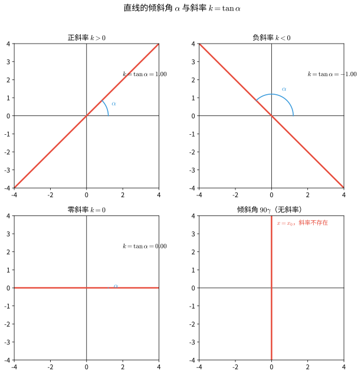

> **直观理解（现实类比）**：斜率就像山坡的**陡峭程度**——坡越陡，斜率的绝对值越大；坡越缓，斜率越接近 $0$。上山时你会感到吃力，正是因为斜率大。
>
> - **楼梯**的倾斜度就是斜率：每阶楼梯的"高度/水平宽度"就是斜率 $k=\dfrac{\Delta y}{\Delta x}$。陡峭的消防滑梯斜率大，平缓的无障碍坡道斜率小。
> - 斜率为正：上坡（向右上方）；斜率为负：下坡（向右下方）；斜率为 $0$：平路；斜率不存在：直立的悬崖。
> - 楼梯扶手、屋顶坡面、滑梯都是直线的现实原型。建筑规范要求楼梯坡度不超过约 $38°$（$k \le 0.8$），就是为了保证行走安全。

#### 课堂问答

**老师**：斜率定义为 $k=\tan\alpha$，为什么干脆不用倾斜角 $\alpha$ 来刻画倾斜程度？

**学生**：$\alpha$ 的取值虽也是“倾斜”的度量，但它不方便直接参与代数运算；$\tan\alpha=\dfrac{\Delta y}{\Delta x}$ 与坐标差挂钩，能让“方向”进入方程。斜率还是方向向量纵横坐标之比，天生适配坐标法。

**老师（追问）**：$\alpha=90^\circ$ 时斜率怎样？为什么？

**学生**：斜率不存在。此时 $x_1=x_2$，分母 $\Delta x=0$，$\tan 90^\circ$ 无定义。所以竖直线只能写成 $x=x_0$，绝不能硬套 $k=\dfrac{y_2-y_1}{x_2-x_1}$。

**老师（拓展）**：斜率为零和斜率不存在，常被混为一谈，怎么区分？

**学生**：斜率 $0$ 是水平线 $y=y_0$，方向向量可取 $(1,0)$；斜率不存在是竖直线 $x=x_0$，方向向量 $(0,1)$。二者正交，恰是“水平”与“竖直”两个极端。

### 2. 直线的方程

#### 点斜式

已知直线过点 $P_0(x_0, y_0)$，斜率为 $k$，则方程为：

$$
y - y_0 = k(x - x_0)
$$

#### 斜截式

已知直线斜率为 $k$，在 $y$ 轴上的截距为 $b$，则方程为：

$$
y = kx + b
$$

#### 两点式

已知直线过两点 $P_1(x_1, y_1)$ 和 $P_2(x_2, y_2)$（$x_1 \neq x_2,\ y_1 \neq y_2$），则方程为：

$$
\frac{y - y_1}{y_2 - y_1} = \frac{x - x_1}{x_2 - x_1}
$$

#### 截距式

已知直线在 $x$ 轴上的截距为 $a$（$a \neq 0$），在 $y$ 轴上的截距为 $b$（$b \neq 0$），则方程为：

$$
\frac{x}{a} + \frac{y}{b} = 1
$$

#### 一般式

所有直线方程都可化为一般式：

|   符号   |  名称  | 含义                  | 直观解释     |
| :------: | :----: | :-------------------- | :----------- |
| $A, B$ |  系数  | $x$ 和 $y$ 的系数 | "方向参数"   |
|  $C$  | 常数项 | 方程中的常数          | "位置参数"   |
| $x, y$ |  变量  | 直线上点的坐标        | "动点的位置" |

$$
Ax + By + C = 0 \quad (A, B \text{ 不同时为 } 0)
$$

其中斜率为 $k = -\dfrac{A}{B}$（$B \neq 0$）。

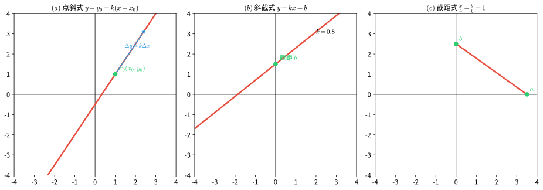

> **直观理解（现实类比）**：直线方程的不同形式就像用不同的"已知条件"去描述同一条山路。
>
> - **点斜式**：已知山坡上某一点的位置和坡度，就能写出整条路面方程——就像告诉测绘员"从山门（$x_0,y_0$）开始按 $k$ 的坡度铺路"。
> - **斜截式**：直接告诉你坡度 $k$ 和路面在山脚（$y$ 轴）的高度 $b$，是 $y=kx+b$ 的"截到地面"版本，是最常见的路面对应方程。
> - **两点式**：已知山坡上两个里程碑的位置，就能确定整条路——两点定一线。
> - **截距式**：告诉你这条路在 $x$ 轴、$y$ 轴上的两个交点，就像桥两端落在两岸的位置。
> - **一般式**：把所有形式统一打包成 $Ax+By+C=0$，是"通用的快递包装"，便于判断平行、垂直、求交点。

#### 五种形式的相互关系与如何选择

直线方程的四种特殊形式（点斜、斜截、两点、截距）是**同一条直线的不同"视角"**，它们都能化成统一的一般式 $Ax+By+C=0$，也可以由一般式反推任何特殊形式。这份"互化地图"要刻在心里：

- **两个独立条件决定一条直线**：所有方程形式归根结底都在说一件事——"过哪一点 + 朝哪边走"。知道"一点 + 斜率"写点斜式；知道"斜率 + $y$ 截距"写斜截式；知道"两点"写两点式；知道"两轴截距"写截距式。这就是求直线方程的基本盘。
- **都通向统一的一般式**：任何一种形式最后都可以、也最好整理成 $Ax+By+C=0$。因为一般式能统一处理平行、垂直、交点与距离，是"计算友好"的终极包装。
- **形式之间如何互化**：
  - 点斜式 $y-y_0=k(x-x_0)$ 展开得 $y=kx + (y_0 - kx_0)$，即**斜截式**（$b=y_0-kx_0$）；
  - 两点式通分去分母即得**一般式**；
  - 截距式 $\dfrac{x}{a}+\dfrac{y}{b}=1$ 两边乘 $ab$ 得 $bx+ay=ab$，再移项成一般式。
- **常见陷阱**：截距式要求 $a,b\ne 0$（不适用过原点或与坐标轴平行的直线）；两点式、截距式遇"竖直线/水平线"会失效，此时应直接写 $x=x_0$ 或 $y=y_0$；斜截式的 $b$ 是"$y$ 轴上的截距"，是可正可负（甚至为 $0$）的带符号量，不要理解为"到原点的距离"。

#### 直线的法向量与方向向量

对于直线 $l: Ax + By + C = 0$（$A, B$ 不同时为 $0$），由方程本身可立即读出两个关键向量：

- **法向量** $\vec{n} = (A, B)$：与直线 $l$ **垂直**的向量。它刻画了直线的"朝向"。
- **方向向量** $\vec{d} = (B, -A)$（或 $(-B, A)$）：与直线 $l$ **平行**的向量。它刻画了直线的"走向"。

两者满足 $\vec{n} \cdot \vec{d} = AB + B(-A) = 0$，即法向量与方向向量互相垂直。直线的斜率 $k = -\dfrac{A}{B}$ 正是方向向量 $(B, -A)$ 的纵坐标与横坐标之比 $k = \dfrac{-A}{B}$。

> 法向量与方向向量是研究直线位置关系（平行、垂直）与点到直线距离的常用工具，下面"两条直线的位置关系"一节将直接用到。

#### 课堂问答

**老师**：点斜式、斜截式、两点式、截距式，条件各不相同，为什么最后都要能化成 $Ax+By+C=0$？

**学生**：一般式是它们的公共“母语”，任何直线（包括竖直线）都能写成 $Ax+By+C=0$，而四个特殊形式都有适用死角。统一成一般式后，平行、垂直、交点、距离都能用一套系数直接判定。

**老师（追问）**：截距式 $\dfrac{x}{a}+\dfrac{y}{b}=1$ 什么时候不能用了？

**学生**：当 $a=0$ 或 $b=0$，也就是直线过原点、或与坐标轴平行时不能用，因为分母为零。此时应直接写 $x=x_0$ 或 $y=y_0$，不要强行套公式。

**老师（拓展）**：从一般式 $Ax+By+C=0$ 能一眼读出哪两个向量？它们什么关系？

**学生**：法向量 $\vec{n}=(A,B)$、方向向量 $\vec{d}=(B,-A)$，二者点积为零，互相垂直。斜率 $k=-\dfrac{A}{B}$ 正是 $\vec d$ 纵横坐标之比——方程系数直接编码了直线的朝向。

### 3. 两条直线的位置关系

设两条直线 $l_1: A_1x + B_1y + C_1 = 0$，$l_2: A_2x + B_2y + C_2 = 0$。

#### 平行

$$
l_1 \parallel l_2 \iff \frac{A_1}{A_2} = \frac{B_1}{B_2} \neq \frac{C_1}{C_2}
$$

若斜率存在，则 $k_1 = k_2$ 且截距不等。

**证明**：直线 $l: Ax + By + C = 0$ 的法向量为 $\vec{n} = (A, B)$，方向向量为 $\vec{d} = (-B, A)$。故 $l_1$ 的方向向量 $\vec{d}_1 = (-B_1, A_1)$，$l_2$ 的方向向量 $\vec{d}_2 = (-B_2, A_2)$。

两条直线平行当且仅当方向向量共线，即

$$
\vec{d}_1 \parallel \vec{d}_2 \iff (-B_1)A_2 - A_1(-B_2) = 0 \iff A_1B_2 - A_2B_1 = 0
$$

当 $A_2, B_2 \neq 0$ 时，$A_1B_2 = A_2B_1 \iff \dfrac{A_1}{A_2} = \dfrac{B_1}{B_2}$。

但方向向量共线只保证两直线平行或重合。若 $\dfrac{A_1}{A_2} = \dfrac{B_1}{B_2} = \dfrac{C_1}{C_2}$，则两方程成比例，表示同一直线（**重合**）。因此平行（不重合）还须排除该情形，即

$$
l_1 \parallel l_2 \iff \frac{A_1}{A_2} = \frac{B_1}{B_2} \neq \frac{C_1}{C_2}
$$

当斜率存在时，$k = -\dfrac{A}{B}$。$k_1 = k_2 \iff -\dfrac{A_1}{B_1} = -\dfrac{A_2}{B_2} \iff \dfrac{A_1}{B_1} = \dfrac{A_2}{B_2}$，与 $A_1B_2 = A_2B_1$ 等价；"截距不等"正是排除重合情形。$\square$

#### 垂直

$$
l_1 \perp l_2 \iff A_1A_2 + B_1B_2 = 0
$$

若斜率存在，则 $k_1 \cdot k_2 = -1$。

**证明**：两条直线垂直当且仅当它们的法向量垂直（法向量方向相差 $90°$），即

$$
\vec{n}_1 \perp \vec{n}_2 \iff \vec{n}_1 \cdot \vec{n}_2 = 0 \iff A_1A_2 + B_1B_2 = 0
$$

当斜率都存在（$B_1, B_2 \neq 0$）时，

$$
k_1 \cdot k_2 = \left(-\frac{A_1}{B_1}\right)\left(-\frac{A_2}{B_2}\right) = \frac{A_1A_2}{B_1B_2}
$$

由垂直条件 $A_1A_2 + B_1B_2 = 0$ 得 $A_1A_2 = -B_1B_2$，代入得

$$
k_1 \cdot k_2 = \frac{-B_1B_2}{B_1B_2} = -1
$$

反之，若 $k_1k_2 = -1$，则 $A_1A_2 = -B_1B_2$，即 $A_1A_2 + B_1B_2 = 0$。$\square$

#### 相交

两条直线相交，交点坐标由方程组解出：

$$
\begin{cases}
A_1x + B_1y + C_1 = 0 \\
A_2x + B_2y + C_2 = 0
\end{cases}
$$

**证明（唯一性）**：两条直线相交当且仅当它们不平行（且不重合），即方向向量不共线，等价于

$$
\Delta = \begin{vmatrix} A_1 & B_1 \\ A_2 & B_2 \end{vmatrix} = A_1B_2 - A_2B_1 \neq 0
$$

此时该二元一次方程组有**唯一解**（由克莱姆法则）：

$$
x = \frac{\begin{vmatrix} -C_1 & B_1 \\ -C_2 & B_2 \end{vmatrix}}{\Delta}
= \frac{(-C_1)B_2 - B_1(-C_2)}{A_1B_2 - A_2B_1}
= \frac{B_1C_2 - B_2C_1}{A_1B_2 - A_2B_1}
$$

$$
y = \frac{\begin{vmatrix} A_1 & -C_1 \\ A_2 & -C_2 \end{vmatrix}}{\Delta}
= \frac{A_1(-C_2) - (-C_1)A_2}{A_1B_2 - A_2B_1}
= \frac{C_1A_2 - C_2A_1}{A_1B_2 - A_2B_1}
$$

$(x, y)$ 即为两条直线的交点坐标。$\square$

**克莱姆法则（Cramer's rule）附注**：求解二元一次方程组

$$
\begin{cases}
a_1x + b_1y = c_1 \\
a_2x + b_2y = c_2
\end{cases}
$$

记系数行列式 $D = \begin{vmatrix} a_1 & b_1 \\ a_2 & b_2 \end{vmatrix} = a_1b_2 - a_2b_1$。若 $D \neq 0$，则方程组有唯一解：

$$
x = \frac{D_x}{D} = \frac{\begin{vmatrix} c_1 & b_1 \\ c_2 & b_2 \end{vmatrix}}{D}, \qquad
y = \frac{D_y}{D} = \frac{\begin{vmatrix} a_1 & c_1 \\ a_2 & c_2 \end{vmatrix}}{D}
$$

即把系数行列式中**欲求未知数所对应的那一列**替换为常数项列得到 $D_x$、$D_y$，再除以系数行列式 $D$。此处直线方程 $A_1x+B_1y+C_1=0$ 移项为 $A_1x+B_1y=-C_1$，常数项 $c_1=-C_1$，代入即得上式。

该法则由瑞士数学家**克莱姆（Gabriel Cramer）**于 1750 年提出，可推广到 $n$ 元一次方程组：当系数行列式不为零时有唯一解，且每个未知数等于"把对应列替换为常数项后的行列式"除以系数行列式。

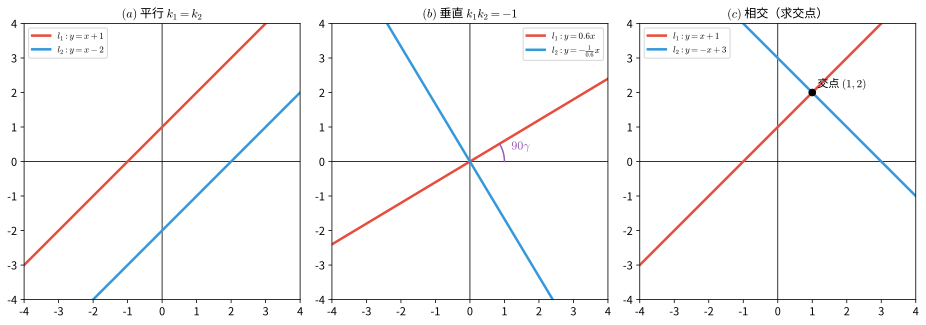

> **直观理解（现实类比）**：两条直线的位置关系就像两条马路的关系。
>
> - **平行**像铁轨——两条钢轨永远保持等距，永不相交（斜率相等，截距不同）。如果截距也相同，就是"同一条铁路"了（重合）。
> - **相交**像十字路口或立交桥——两条路在一点交汇，方向不同。斜率不相等就一定相交。
> - **垂直**是相交的特殊情况，像东西向与南北向的街道成 $90°$ 交叉（$k_1 k_2 = -1$）。
> - 现实中：北京的长安街与各条南北向胡同就是垂直关系；两条平行的地铁隧道是平行关系；斜交的乡间小路是普通相交。

#### 课堂问答

**老师**：两条直线平行，用系数判断是 $\dfrac{A_1}{A_2}=\dfrac{B_1}{B_2}\neq\dfrac{C_1}{C_2}$，最后那个不等号能不能省？

**学生**：不能。若三个比都相等，两方程成比例，其实是同一条直线（重合）。方向向量共线只保证“平行或重合”，只有再排除重合，才是真正的平行。

**老师（追问）**：垂直条件 $A_1A_2+B_1B_2=0$ 与 $k_1k_2=-1$ 谁更普适？

**学生**：前者普适，因为它是两个法向量点积为零，竖直线也适用。$k_1k_2=-1$ 要求两条斜率都存在，一旦有竖直线就失效，只能作为斜率存在时的等价说法。

**老师（拓展）**：判断“相交”在代数上归结为什么？

**学生**：归结为系数行列式 $\Delta=A_1B_2-A_2B_1\neq 0$，此时方程组有唯一解，交点坐标可由克莱姆法则写出。这与向量“线性无关”、与 $\vec d_1$ 不平行 $\vec d_2$ 是同一件事的三种说法。

### 4. 点到直线的距离公式

点 $P_0(x_0, y_0)$ 到直线 $l: Ax + By + C = 0$ 的距离为：

$$
d = \frac{|Ax_0 + By_0 + C|}{\sqrt{A^2 + B^2}}
$$

#### 课堂问答

**老师**：分母为什么要除 $\sqrt{A^2+B^2}$，它到底代表什么？

**学生**：它是法向量 $\vec n=(A,B)$ 的模 $|\vec n|$。分子 $|Ax_0+By_0+C|$ 是点代入直线后的“偏离量”，除以 $|\vec n|$ 才把有量纲的偏离换算成真正的几何距离，否则会被系数 $A,B$ 放大。

**老师（追问）**：公式里的绝对值起什么作用？

**学生**：去掉符号，因为距离恒非负。若省去绝对值，点落在直线另一侧时结果会是负数，那就不是距离了；这也解释了为什么点与直线只谈“距离”不谈“正负”。

**老师（拓展）**：它和向量的投影有什么联系？

**学生**：点到直线的距离就是 $\overrightarrow{P_0P_1}$ 在法向量方向的投影长度，$d=\dfrac{|\vec n\cdot\overrightarrow{P_0P_1}|}{|\vec n|}$。把 $\overrightarrow{P_0P_1}$ 用坐标代入就还原成课本公式，向量视角让几何意义一目了然。

### 5. 两条平行线间的距离

两条平行线 $l_1: Ax + By + C_1 = 0$ 和 $l_2: Ax + By + C_2 = 0$ 之间的距离为：

$$
d = \frac{|C_1 - C_2|}{\sqrt{A^2 + B^2}}
$$

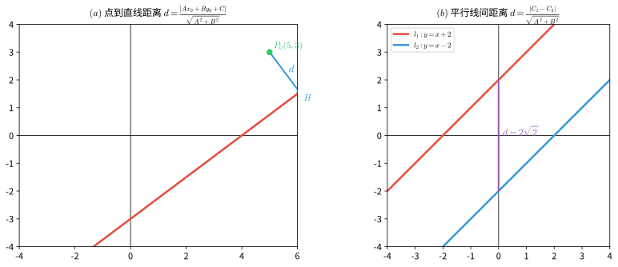

> **直观理解（现实类比）**：点到直线的距离就是"最短路径"——从你所在的位置到一条公路最近的那段路。
>
> - 你站在野外的某点 $P$，前方有一条笔直的铁路，要走到铁路上最近的一点，肯定垂直地走过去最近，斜着走或绕路都会更长。这个"垂直最短"的长度就是点到直线的距离。
> - **平行线间距离**像两条铁轨之间的固定间距——无论你在哪测量，距离都相等，因为平行线处处等距。
> - 工程上：高铁的接触网到铁轨的距离、两栋楼之间的最小间距、管道到墙面的距离，都用这个公式计算。

#### 课堂问答

**老师**：两条平行线之间的距离为什么要先把系数化成一样？

**学生**：因为 $d=\dfrac{|C_1-C_2|}{\sqrt{A^2+B^2}}$ 只对同系数形式成立，$A,B$ 相同才说明两条线方向一致、法向量同向。若系数不同先要乘同一个数把 $A,B$ 统一，否则分母不同、公式不成立。

**老师（追问）**：这个公式和点到直线距离有什么关系？

**学生**：它就是点到直线距离的特例：在 $l_1$ 上任取一点 $P_0$，它到 $l_2$ 的距离即为两平行线间距，代入后 $Ax_0+By_0=-C_1$，正好得到 $\dfrac{|C_1-C_2|}{\sqrt{A^2+B^2}}$。

**老师（拓展）**：为什么平行线处处等距，而相交线不行？

**学生**：因为平行线的法向量相同，任取一点在法向的投影差恒定；相交线方向不同，点沿直线移动时到另一条线的投影会变化。等距正是“斜率相等”在距离语言里的翻译。

### 6. 两直线的夹角公式

两条直线 $l_1$ 和 $l_2$ 的夹角 $\theta$（$0 \leq \theta \leq \frac{\pi}{2}$）满足：

$$
\tan \theta = \left|\frac{k_2 - k_1}{1 + k_1k_2}\right| \quad (k_1k_2 \neq -1)
$$

或使用一般式：

$$
\cos \theta = \frac{|A_1A_2 + B_1B_2|}{\sqrt{A_1^2 + B_1^2}\sqrt{A_2^2 + B_2^2}}
$$

---

#### 课堂问答

**老师**：夹角 $\theta$ 取 $0\le\theta\le\frac{\pi}{2}$，为什么 $\tan\theta=\left|\dfrac{k_2-k_1}{1+k_1k_2}\right|$ 要套绝对值？

**学生**：因为 $\theta$ 只取锐角（或直角），而斜率差的正负取决于哪条线更陡，绝对值才能保证结果非负。否则算出的角会带方向、可能是负角，不符合“夹角”的定义。

**老师（追问）**：当 $k_1k_2=-1$ 时公式怎么了？

**学生**：分母 $1+k_1k_2=0$，$\tan\theta$ 无意义，但此时恰是两直线垂直、$\theta=\dfrac{\pi}{2}$，可以用一般式 $\cos\theta=\dfrac{|A_1A_2+B_1B_2|}{\sqrt{A_1^2+B_1^2}\sqrt{A_2^2+B_2^2}}$ 求出 $\cos\theta=0$。

**老师（拓展）**：用向量语言，夹角公式的本质是什么？

**学生**：就是 $\cos\theta=\dfrac{|\vec a\cdot\vec b|}{|\vec a||\vec b|}$，把两条直线的方向向量夹角取绝对值即可。它统一了斜率式与一般式，也预告了后面数量积的定义。

## 圆锥曲线

### 0. 圆锥曲线的来源与退化情形

"圆锥曲线"之名源于其几何生成方式：用一个平面去截一个**对顶圆锥**（双锥面），所得交线即为圆锥曲线。根据截面与圆锥面的相对位置，交线可为圆、椭圆、抛物线或双曲线：

- 截平面只与圆锥一侧相交且**不经过顶点** → 椭圆；若截平面垂直于对称轴 → 圆
- 截平面**平行于圆锥的某一条母线** → 抛物线
- 截平面与圆锥**两侧都相交**且不经过顶点 → 双曲线

当截平面经过圆锥的顶点时，交线退化为**点、一条直线或一对相交直线**，称为**退化圆锥曲线**（以下讨论均指非退化的情形）。

> 历史上，圆锥曲线约在公元前 200 年由古希腊数学家**阿波罗尼奥斯**（Apollonius）系统研究并命名。其统一定义（焦点—准线—离心率）与平面截圆锥的一致性可由**丹德林球**（Dandelin spheres）证明。

> **🧠 思考历程：一根圆锥，为什么能切出四种曲线？**
>
> 椭圆、抛物线、双曲线看起来千差万别，却有同一个"出身"——用平面斜切圆锥。而这个秘密，正是古希腊人纯粹出于好奇就刨根问底刨出来的。
>
> - **从"切甜筒"产生的直觉**。你切过一个甜筒（圆锥）就知道：斜着切一刀，切口可能是封闭的椭圆；与母线平行切一刀，是开口的抛物线；切法再刁钻，还能得到两个开口的双曲线。古人最早正是在"用一个平面剖开圆锥"时发现，这一刀就能产生一群形状各异的曲线——于是有了"圆锥曲线"这个名字。
> - **阿波罗尼奥斯：一部"圆锥曲线谱"**。公元前 3 世纪，阿波罗尼奥斯（Apollonius of Perga）写下八卷本《圆锥曲线论》，把椭圆、抛物线、双曲线的性质一一整理了出来。他没有现代坐标系，用的纯粹是**比例与几何对应**。他能在这三种曲线之间发现如此多的共性，靠的是把"截圆锥"这件事当作研究的"总开关”。
> - **偏偏在光学里发光发热**。圆锥曲线在古希腊很长一段时间被认为是"无用之奇物"，直到 17 世纪开普勒发现行星绕日轨道是椭圆、伽利略发现斜抛物体走抛物线、牛顿用双曲线/抛物线解释天体逃逸——**"用平面切圆锥"的古老问题，忽然成了理解宇宙的钥匙。**
> - **心路**：圆锥曲线最动人的，是它**用"一个动作（截面）"统一了"一堆曲线"**。它告诉你想学好它们，先记住它们都来自"切圆锥"这个动作：焦点、准线、离心率只是把这一刀的位置量化。今天你解一道椭圆题，其实是在延续两千多年前一个数学家对"圆锥受切"的执着追问。

#### 课堂问答

**老师**：截平面经过圆锥顶点时，为什么交线会退化成点、直线或一对相交直线？

**学生**：因为顶点是对顶圆锥上下两支的公共点，平面过顶点必同时穿过两侧，原本封闭的椭圆被挤成一点，开口的抛物线退成一条或两条母线。退化本质是“截面位置”走到了临界。

**老师（追问）**：抛物线对应“平面平行于母线”，这一条为什么特殊？

**学生**：平行于母线时平面恰好与圆锥相切于无穷远，截出的交线只有一个开口，焦点退到无穷远。这解释了抛物线为什么只有一个焦点，也是统一定义里 $e=1$ 的几何来源。

**老师（拓展）**：如何用丹德林球说明截线确实是椭圆？

**学生**：在每个圆锥内嵌一个与圆锥面和截面都相切的球，切点即为焦点，两球与截面相切的两点为两焦点；由切线长相等可证截线上任一点到两焦点距离之和恒为定值，于是截线是椭圆。

### 1. 圆 (Circle)

#### 定义

平面上到定点（圆心）的距离等于定长（半径）的点的轨迹。

#### 标准方程

圆心为 $C(h, k)$，半径为 $r$ 的圆的标准方程为：

$$
(x - h)^2 + (y - k)^2 = r^2
$$

特别地，圆心在原点 $(0, 0)$ 时：

$$
x^2 + y^2 = r^2
$$

#### 一般方程

$$
x^2 + y^2 + Dx + Ey + F = 0
$$

配方后化为标准形式：

$$
\left(x + \frac{D}{2}\right)^2 + \left(y + \frac{E}{2}\right)^2 = \frac{D^2 + E^2 - 4F}{4}
$$

其中圆心为 $\left(-\dfrac{D}{2},\ -\dfrac{E}{2}\right)$，半径 $r = \dfrac{1}{2}\sqrt{D^2 + E^2 - 4F}$（需满足 $D^2 + E^2 - 4F > 0$）。

#### 圆的参数方程

$$
\begin{cases}
x = h + r\cos \theta \\
y = k + r\sin \theta
\end{cases} \quad \theta \in [0, 2\pi)
$$

> **直观理解（现实类比）**：圆的方程就像**雷达扫描范围**或**GPS 定义的圆形区域**。
>
> - 圆心 $(h, k)$ 是雷达站的位置，半径 $r$ 是雷达能扫描的最远距离。圆上每一点都满足"到雷达站的距离恰好等于 $r$"，圆内是扫描覆盖区，圆外是盲区。
> - 打开手机地图，搜索"附近的咖啡店 1 公里内"，地图画出的圆形范围就是圆的方程——你站在圆心，半径 1 公里。
> - **投石入水**激起的涟漪、**手电筒光圈**的边缘、**唱片**的轮廓都是圆——它们都遵循"到中心距离相等"这一规则。

#### 参数方程初步（方法总览）

前面圆的参数方程 $\begin{cases}x=h+r\cos\theta\\y=k+r\sin\theta\end{cases}$ 是**参数方程**的第一个样板。所谓参数方程，就是**用一个（或多个）辅助参数（如 $\theta$）同时表达 $x$ 与 $y$**，让参数"走"遍整条曲线，而不再先写成 $x,y$ 之间的隐式关系（如 $x^2+y^2=r^2$）。

- **为什么需要参数**：很多关于"曲线上动点"的最值、交点、轨迹问题，直接列 $x,y$ 关系会算得头疼；引入参数后，曲线上的点自动带有"身份"（圆上点即 $(h+r\cos\theta, k+r\sin\theta)$），$\theta$ 扫过一个周期恰好描出整个圆。
- **参数方程"回到"隐式方程**：由圆的参数式恒有 $(x-h)^2+(y-k)^2=r^2(\cos^2\theta+\sin^2\theta)=r^2$——两者描述的是**同一条曲线**，参数方程更像方便作图、方便取点的"可视化 + 计算版"。
- **向椭圆推广**：把圆沿 $y$ 方向按比例拉长，就得到椭圆参数方程 $\begin{cases}x=a\cos\theta\\y=b\sin\theta\end{cases}$（$a\ne b$ 时不再是圆而是椭圆），这是后文"设而不求"技巧的基础。

> **它解决了什么问题**：参数方程让"在曲线上取一个动点"变得机械而整齐——只要甩出 $\theta$，点就自动落在曲线上；配合辅助角公式，还能把"曲线上点到直线的最远/最近距离"这类最值问题转成三角最值。它在圆、椭圆、乃至三角函数与解析几何之间架起一座桥。

#### 课堂问答

**老师**：圆的一般方程 $x^2+y^2+Dx+Ey+F=0$ 什么时候才真的表示一个圆？

**学生**：配方后必须 $r^2=\dfrac{D^2+E^2-4F}{4}>0$，即 $D^2+E^2-4F>0$；等于 $0$ 时退化成一点，小于 $0$ 时无轨迹。

**老师（追问）**：圆的参数方程 $x=h+r\cos\theta,\ y=k+r\sin\theta$ 里 $\theta$ 是圆上点的极角吗？

**学生**：不一定是。$\theta$ 是以圆心为原点的参数角，只有当圆心在原点时它才等于极角；圆心不在原点时 $\theta$ 只是“标准圆上对应点”的角度。

**老师（拓展）**：圆的参数方程怎样解释“到定点等距”？

**学生**：$(x-h)^2+(y-k)^2=r^2(\cos^2\theta+\sin^2\theta)=r^2$ 恒成立，$\theta$ 扫过 $[0,2\pi)$ 恰好描出整个圆。这正是用单位圆 $(\cos\theta,\sin\theta)$ 平移、放缩得到圆的思路。

### 2. 椭圆 (Ellipse)

#### 定义

平面上到两个定点（焦点 $F_1$、$F_2$）的距离之和等于常数（$2a$，且 $2a > |F_1F_2|$）的点的轨迹。

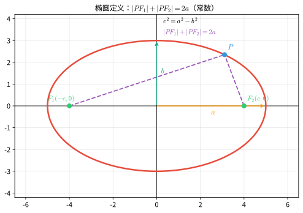

#### 🎬 动画演示：椭圆的焦点定义


> 动画直观展示了椭圆的核心性质：椭圆上任意一点到两个焦点的距离之和恒等于 $2a$。当点沿椭圆移动时，两条焦点连线（黄色）的长度之和始终保持不变。

> **直观理解（现实类比）**：椭圆像**行星的轨道**——开普勒发现地球绕太阳的轨道是椭圆，太阳在一个焦点上。
>
> - 想象你在椭圆花坛的边缘散步，花坛里有两个水池 $F_1$、$F_2$，你走到任意位置时，到两个水池的距离之和**始终相等**（等于 $2a$）。这是椭圆定义的精确含义。
> - **绳钉画椭圆**：把一根绳子两端钉在两点（焦点）上，用笔把绳子绷紧滑动，画出的就是椭圆。绳子总长不变（$=2a$），所以距离和恒定。
> - **花园椭圆花坛**、**体育场跑道**、**橄榄球**、**鸡蛋俯视图**都是椭圆的实例。两个焦点是它的"灵魂"——它们越靠近，椭圆越接近圆。

#### 标准方程

焦点在 $x$ 轴上时：

|   符号   |  名称  | 含义             | 直观解释             |
| :------: | :----: | :--------------- | :------------------- |
|  $a$  | 半长轴 | 椭圆长轴的一半   | "椭圆的长半径"       |
|  $b$  | 半短轴 | 椭圆短轴的一半   | "椭圆的短半径"       |
|  $c$  | 半焦距 | 焦点到中心的距离 | "焦点偏离中心的程度" |
| $x, y$ |  变量  | 椭圆上点的坐标   | "椭圆上的位置"       |

$$
\frac{x^2}{a^2} + \frac{y^2}{b^2} = 1 \quad (a > b > 0)
$$

其中 $a$ 为**半长轴**，$b$ 为**半短轴**，满足 $a^2 = b^2 + c^2$，$c$ 为**半焦距**。

焦点坐标为 $F_1(-c, 0)$、$F_2(c, 0)$，顶点坐标为 $(\pm a, 0)$、$(0, \pm b)$。

焦点在 $y$ 轴上时：

$$
\frac{x^2}{b^2} + \frac{y^2}{a^2} = 1 \quad (a > b > 0)
$$

#### 准线

焦点在 $x$ 轴上时，椭圆有两条准线 $l_1$、$l_2$：

$$
x = \pm \frac{a^2}{c}
$$

椭圆上任意一点到焦点的距离与到对应准线的距离之比等于离心率 $e$，即 $\dfrac{|PF|}{d(P, l)} = e = \dfrac{c}{a}$。

#### 离心率

椭圆的离心率 $e = \dfrac{c}{a}$，$0 < e < 1$。

- $e$ 越接近 0，椭圆越接近圆
- $e$ 越接近 1，椭圆越扁

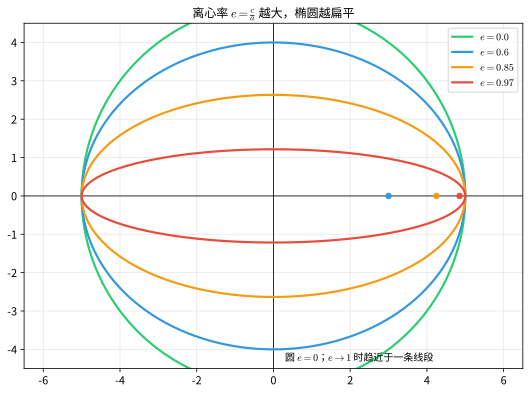

> **直观理解（现实类比）**：椭圆离心率 $e$ 描述椭圆**扁圆的程度**——像衡量一个面团被压扁的程度。
>
> - $e$ 越接近 $0$，焦点越靠近中心，椭圆越像圆（圆是 $e=0$ 的特例）——就像一张煎饼圆鼓鼓的。
> - $e$ 越接近 $1$，两焦点离得越远，椭圆越扁长——就像被擀面杖压扁的面皮，越来越细长。
> - **行星轨道对比**：金星的 $e \approx 0.007$，几乎是圆；地球的 $e \approx 0.017$，微微扁；哈雷彗星的 $e \approx 0.97$，又扁又长。$e$ 越大，轨道越"狂野"——近日点离太阳近，远日点跑得老远。

#### 椭圆的参数方程

$$
\begin{cases}
x = a\cos \theta \\
y = b\sin \theta
\end{cases} \quad \theta \in [0, 2\pi)
$$

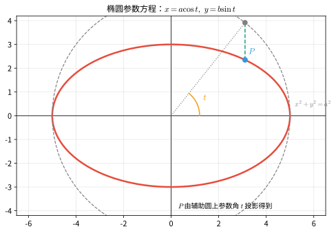

#### 面积

椭圆面积 $S = \pi ab$。

#### 课堂问答

**老师**：椭圆定义要求 $2a>|F_1F_2|$，改成“$2a=|F_1F_2|$”会怎样？

**学生**：轨迹退化成线段 $F_1F_2$，因为只有线段上的点才使到两焦点距离之和恰好等于焦距。这类似于圆锥曲线的退化，提醒我们定义里的不等式是保证图形存在的关键。

**老师（追问）**：椭圆的 $c=\sqrt{a^2-b^2}$，双曲线却是 $c=\sqrt{a^2+b^2}$，为什么一减一加？

**学生**：椭圆里 $c<a$，$a^2=b^2+c^2$，半焦距比半长轴短；双曲线里 $c>a$，$c^2=a^2+b^2$。区别源于“距离之和恒定”与“距离之差恒定”对几何的不同约束，$c$ 与 $a$ 的大小关系就此颠倒。

**老师（拓展）**：离心率 $e=\dfrac{c}{a}$ 从 $0$ 增大到 $1$ 时椭圆如何变化？

**学生**：$e\to 0$ 时 $c\to 0$、$b\to a$，椭圆越来越像圆；$e\to 1$ 时 $b\to 0$，椭圆压扁成线段。$e$ 正是“扁圆程度”的量化刻度。

### 3. 双曲线 (Hyperbola)

#### 定义

平面上到两个定点（焦点 $F_1$、$F_2$）的距离之差的绝对值等于常数（$2a$，且 $0 < 2a < |F_1F_2|$）的点的轨迹。

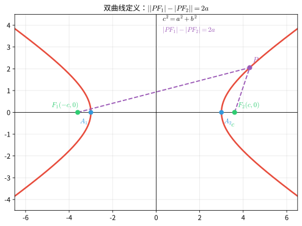

> **直观理解（现实类比）**：双曲线就像**两个雷达的时差定位**——这是它在现代科技中最有名的应用。
>
> - **GPS 双曲线定位**：如果你听到两个雷达站同时发信号，但信号到达你这儿有**时间差**（因为距离差恒定），你就站在一条双曲线上。三个雷达站就能用两条双曲线的交点确定你的位置——这正是导航系统的原理。
> - 双曲线定义是"到两点距离**之差**为常数"——和椭圆的"之和"恰好相反。想象两个邻居 $F_1$、$F_2$，你到他们家距离的差始终不变。
> - **冷却塔**的截面、**核电站通风塔**的轮廓都是双曲线——它们利用双曲线的几何性质实现高效散热。
> - 双曲线有**两支**，分别对应"离 $F_1$ 近"和"离 $F_2$ 近"两类点。

#### 标准方程

焦点在 $x$ 轴上时：

$$
\frac{x^2}{a^2} - \frac{y^2}{b^2} = 1 \quad (a > 0,\ b > 0)
$$

其中 $c^2 = a^2 + b^2$，$c$ 为半焦距。

焦点坐标为 $F_1(-c, 0)$、$F_2(c, 0)$，顶点坐标为 $(\pm a, 0)$。

焦点在 $y$ 轴上时：

$$
\frac{y^2}{a^2} - \frac{x^2}{b^2} = 1 \quad (a > 0,\ b > 0)
$$

#### 渐近线

双曲线 $\dfrac{x^2}{a^2} - \dfrac{y^2}{b^2} = 1$ 的渐近线方程为：

$$
y = \pm \frac{b}{a}x
$$

双曲线 $\dfrac{y^2}{a^2} - \dfrac{x^2}{b^2} = 1$ 的渐近线方程为：

$$
y = \pm \frac{a}{b}x
$$

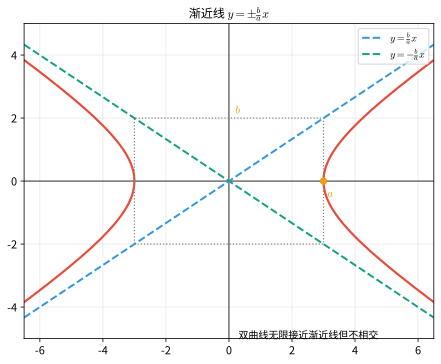

#### 准线

焦点在 $x$ 轴上时，双曲线有两条准线：

$$
x = \pm \frac{a^2}{c} \quad (c^2 = a^2 + b^2)
$$

同样满足 $\dfrac{|PF|}{d(P, l)} = e = \dfrac{c}{a}$。

#### 离心率

双曲线的离心率 $e = \dfrac{c}{a}$，$e > 1$。

#### 等轴双曲线

当 $a = b$ 时，称为等轴双曲线，方程为 $x^2 - y^2 = a^2$，渐近线为 $y = \pm x$，离心率 $e = \sqrt{2}$。

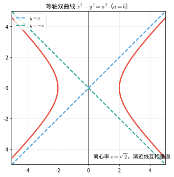

#### 课堂问答

**老师**：双曲线定义里为什么是距离之“差的绝对值”恒定？

**学生**：如果不取绝对值，只是“到 $F_1$ 的距离减到 $F_2$ 的距离”为常数，那只会得到靠近其中一个焦点的一支。加上绝对值，才能同时得到两支，分别对应“离 $F_1$ 近”和“离 $F_2$ 近”。

**老师（追问）**：双曲线的渐近线 $y=\pm\dfrac{b}{a}x$ 是怎么来的？

**学生**：把标准方程右边换成 $0$，即 $\dfrac{x^2}{a^2}-\dfrac{y^2}{b^2}=0$，解得 $y=\pm\dfrac{b}{a}x$。它表示曲线在无穷远处无限接近的直线，双曲线永远达不到它。

**老师（拓展）**：等轴双曲线 $a=b$ 时有什么特别之处？

**学生**：渐近线变成 $y=\pm x$，两条渐近线互相垂直，离心率 $e=\sqrt{1+\dfrac{b^2}{a^2}}=\sqrt2$。它是双曲线里最对称、最接近“直角”的形态。

### 4. 抛物线 (Parabola)

#### 定义

> **它为什么这样定义（来龙去脉）**：抛物线最常见的面目是你扔出石子、篮球投篮在空中划过的**抛射轨迹**（不计空气阻力），这也是它名字的由来。而它的"焦点—准线"定义——**到定点（焦点 $F$）的距离等于到定直线（准线 $l$）的距离**——看似绕远，实则是三种圆锥曲线里最"偏心"的一种：两个特殊焦点在"推得足够开"后，其中一个已退到无穷远，于是"到两焦点距离和/差恒定"变成了"到一焦点与到一条直线的距离相等"。
>
> **它解决了什么问题**：这个定义直接确保了抛物线的**反射性质**——放在焦点的光源，经抛物面反射后变成平行光束（探照灯、车灯、卫星天线、手电筒反向收光都是如此，见"圆锥曲线的光学性质"）。同时，"到焦点距离 = 到准线距离"让"抛物线上的点到定点的最短路径"这类轨迹问题变得可以机械地四则计算，也为统一定义中 $e=1$ 提供了最干净的样板。

平面上到一定点（焦点 $F$）的距离等于到一定直线（准线 $l$）的距离的点的轨迹。

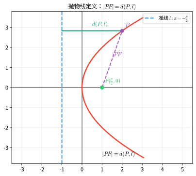

> **直观理解（现实类比）**：抛物线像**抛出去的物体的轨迹**和**卫星天线**的截面。
>
> - **抛物轨迹**：你扔出一颗石子，它在空中划过的弧线（不考虑空气阻力）就是抛物线——这是它名字的由来。
> - **卫星天线/雷达锅**：抛物面（抛物线绕轴旋转）能把平行入射的信号会聚到焦点，也能把焦点的信号反射成平行光束。电视卫星锅、手电筒反光杯、汽车前灯、太阳灶都是抛物面。
> - 定义"到焦点的距离=到准线的距离"可以理解为：动点 $P$ 始终在"焦点"和"准线"之间做等距拉锯——既不偏焦点，也不偏准线。
> - **喷泉**的水柱、**投篮**时篮球的轨迹，都是抛物线的鲜活例子。

#### 标准方程

四种标准形式：

|          方程          | 开口方向 |             焦点坐标             |       准线方程       |
| :---------------------: | :------: | :-------------------------------: | :-------------------: |
| $y^2 = 2px\ (p > 0)$ |   向右   | $\left(\dfrac{p}{2}, 0\right)$ | $x = -\dfrac{p}{2}$ |
| $y^2 = -2px\ (p > 0)$ |   向左   | $\left(-\dfrac{p}{2}, 0\right)$ | $x = \dfrac{p}{2}$ |
| $x^2 = 2py\ (p > 0)$ |   向上   | $\left(0, \dfrac{p}{2}\right)$ | $y = -\dfrac{p}{2}$ |
| $x^2 = -2py\ (p > 0)$ |   向下   | $\left(0, -\dfrac{p}{2}\right)$ | $y = \dfrac{p}{2}$ |

其中 $p$ 为**焦准距**，即焦点到准线的距离。

#### 离心率

抛物线的离心率 $e = 1$。

#### 课堂问答

**老师**：$y^2=2px$ 里 $p$ 到底代表什么，为什么焦点是 $\left(\dfrac p2,0\right)$？

**学生**：$p$ 是焦准距，即焦点到准线的距离。焦点在对称轴上、顶点到焦点为 $\dfrac p2$，故焦点 $\left(\dfrac p2,0\right)$，准线 $x=-\dfrac p2$，两者相距 $p$。

**老师（追问）**：若把方程写成 $y^2=4ax$，焦点和准线如何变？

**学生**：只需令 $2p=4a$，即 $p=2a$，焦点为 $(a,0)$、准线 $x=-a$。很多教材用 $y^2=4ax$，本质与 $y^2=2px$ 完全一样，只是 $p$ 的记法不同，切勿把两者的 $p$ 混为一谈。

**老师（拓展）**：抛物线定义“到焦点距离=到准线距离”，为什么它只有一个焦点？

**学生**：因为把椭圆“到两焦点距离和恒定”里一个焦点推向无穷远，就退化成“到一点与到一条直线等距”，另一焦点成了无穷远点。这正是 $e=1$ 的含义，也是抛物线单焦点的由来。

### 5. 圆锥曲线的统一定义

圆锥曲线（椭圆、抛物线、双曲线）可以统一地定义为：平面上到定点 $F$（焦点）的距离与到定直线 $l$（准线）的距离之比为常数 $e$（离心率）的点的轨迹。

$$
\frac{|PF|}{d(P, l)} = e
$$

- $0 < e < 1$：椭圆
- $e = 1$：抛物线
- $e > 1$：双曲线

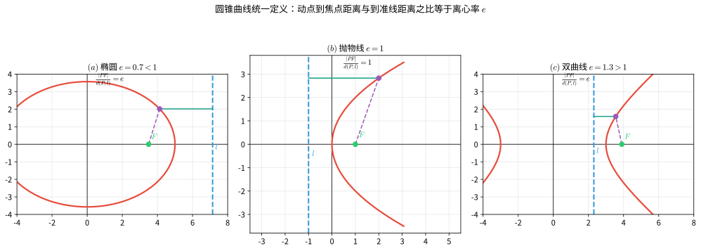

> **直观理解（现实类比）**：圆锥曲线的统一定义把圆、椭圆、抛物线、双曲线统一成"**同一个家族**"——它们都是"焦点 + 准线 + 离心率"三种参数的产物，只是离心率 $e$ 的取值不同。
>
> - **轨道力学**的三大轨道类型正对应三种曲线：$e<1$ 椭圆轨道（绕行星运行，像地球绕太阳）；$e=1$ 抛物线轨道（恰好能逃逸引力，像彗星一去不返）；$e>1$ 双曲线轨道（速度过快，飞出去不再回来，像探测器飞掠行星）。
> - 把 $e$ 想成"动点偏爱焦点还是准线的程度"：$e<1$ 偏爱准线（更圆滑地靠近）；$e=1$ 一视同仁（抛物线）；$e>1$ 偏爱焦点（被拉向远方，形成两支）。
> - 这就好比调节"水龙头开度"：水开小（$e$ 小）水流温和像椭圆；开到某刻度（$e=1$）水流正好成抛物线；开太大（$e>1$）水花四溅像双曲线。

#### 极坐标（预备：坐标系的补充）

> 下面的"极坐标形式"要用 $(\rho, \theta)$ 这套坐标，先在此补上定义。

**极坐标的定义**：平面内取一定点 $O$（**极点**）和一条射线 $Ox$（**极轴**），再选定长度单位与角度的正方向（逆时针为正）。平面内任一点 P 用有序实数组 $(\rho, \theta)$ 表示：$\rho$ 是点到极点的距离，称为**极径**（$\rho \ge 0$）；$\theta$ 是极轴到连线 $OP$ 的夹角，称为**极角**。

**与直角坐标的互化**（极点与原点重合、极轴与 $x$ 轴正半轴重合）：点 $P$ 的直角坐标 $(x, y)$ 与极坐标 $(\rho, \theta)$ 满足

$$
x = \rho\cos\theta, \qquad y = \rho\sin\theta
$$

反过来，$\rho = \sqrt{x^2 + y^2}$、$\tan\theta = y/x$（求 $\theta$ 时按所在象限选取）。

> **直观理解（现实类比）**：极坐标就是用"**离中心多远 + 朝哪个方向**"来定位，像**雷达扫描**——屏幕中心是极点，扫描线转动的角度是极角 $\theta$，目标到中心的距离就是极径 $\rho$。在"以焦点为极点"的圆锥曲线问题里，这是最顺手的坐标。（极坐标的完整体系见第16级・解析几何 §7.5。）

#### 极坐标形式

以焦点为极点、准线为定直线 $x = d$ 时，圆锥曲线有统一的极坐标方程：

$$
\rho = \frac{ed}{1 \pm e\cos\theta}
$$

其中 $\theta$ 为动点 $\rho = |PF|$ 与极轴的夹角，$d$ 为准线到焦点的距离。$e = 1$ 时为抛物线，$0 < e < 1$ 时为椭圆，$e > 1$ 时为双曲线。

#### 判别式分类

一般二次方程 $Ax^2 + Bxy + Cy^2 + Dx + Ey + F = 0$（$A$、$B$、$C$ 不全为 $0$）表示圆锥曲线，可由判别式分类：

- $B^2 - 4AC < 0$：椭圆（若 $A = C$ 且 $B = 0$ 则为圆）
- $B^2 - 4AC = 0$：抛物线
- $B^2 - 4AC > 0$：双曲线

该判别式在坐标轴的旋转与平移下保持不变。

#### 课堂问答

**老师**：$\dfrac{|PF|}{d(P,l)}=e$ 里 $e$ 的三种取值对应三种曲线，$e=1$ 为什么会“卡”在抛物线上？

**学生**：$e<1$ 时动点更偏爱准线，轨迹闭合成椭圆；$e>1$ 时更偏向焦点、被拉出两支；$e=1$ 恰是等距，两边力量平衡，正好是开口的抛物线。临界值对应了形态的突变。

**老师（追问）**：同一条圆锥曲线，换不同焦点和准线，$e$ 会变吗？

**学生**：$e=\dfrac ca$ 是曲线自身的固有量，不随坐标系改变；但只要选同一个焦点和它对应的准线，比值恒定。换了焦点—准线配对仍得同一个 $e$，这正是定义的统一之处。

**老师（拓展）**：统一定义和一般二次方程的判别式 $B^2-4AC$ 有何联系？

**学生**：$B^2-4AC<0,=0,>0$ 分别对应椭圆、抛物线、双曲线，与 $e<1,=1,>1$ 的分类完全平行。前者是方程系数视角，后者是焦点—准线视角，二者通过旋转化简互相印证。

### 6. 圆锥曲线的光学性质与应用

所有非退化圆锥曲线都具有**反射性质**：从圆锥曲线的一个焦点发出的光线，经曲线反射后，会聚到另一个焦点（椭圆、双曲线）；抛物线的"另一个焦点"在无穷远处，故反射后成为平行于对称轴的平行光。

- **椭圆**：从一个焦点发出的光线经椭圆反射后均经过另一焦点（如椭圆的回音室）。
- **抛物线**：将光源置于焦点，反射后得到平行光束，用于**探照灯、抛物面天线、卫星接收器、射电望远镜**；反向，平行光经抛物面反射会聚于焦点（聚光镜、抛物面太阳灶）。
- **双曲线**：从一个焦点发出的光线经双曲线反射后，其延长线经过另一焦点，用于卡塞格林望远镜等光学系统。

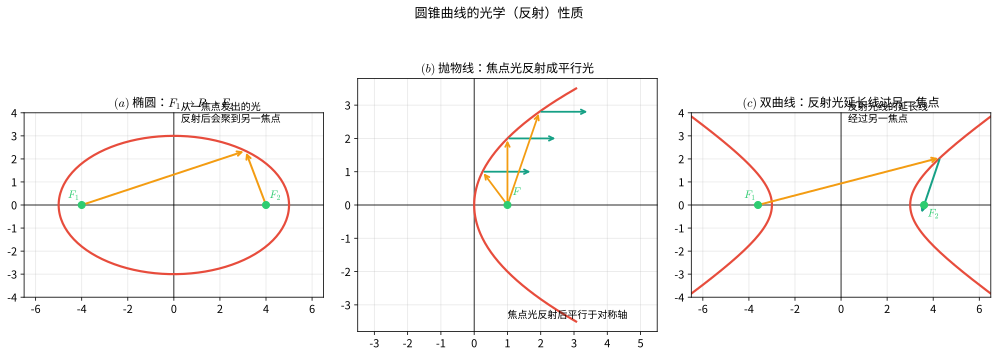

> **直观理解（现实类比）**：圆锥曲线的光学性质是它们在工程中最惊艳的应用。
>
> - **抛物面反射**：手电筒、汽车前灯、探照灯把灯泡放在焦点，反光罩是抛物面，光线反射后**全部平行射出**——所以你看到的是一道强光柱而非散光。卫星接收锅反过来：平行信号被抛物面反射后会聚到焦点上的高频头。
> - **椭圆回音壁**：站在椭圆的一个焦点上低声说话，声音经椭圆墙面反射后会聚到另一焦点，那里的人听得清清楚楚——北京天坛的回音壁、圣保罗大教堂的耳语廊都是这种原理。
> - **双曲线反射**：卡塞格林望远镜用双曲面副镜把光路"折返"，让长焦距望远镜变得紧凑——天文望远镜的精髓就在这里。
> - 一句话总结：**椭圆聚焦成点，抛物线聚焦成平行光，双曲线改变光路方向**——三种曲线各司其职，撑起了现代光学工程。

#### 光学性质的证明

反射定律（入射角等于反射角）在解析几何中可表述为：曲线在切点 $P$ 处的**法线** $\vec{n}$ 平分入射方向与反射方向所夹的角，即 $\vec{n}$ 与入射方向、反射方向的夹角相等。下面分别证明三类曲线满足该性质。

**（1）椭圆**

设椭圆 $\dfrac{x^2}{a^2}+\dfrac{y^2}{b^2}=1\ (a>b>0)$，$c^2=a^2-b^2$，切点 $P(x_0,y_0)$。椭圆在 $P$ 处的切线方程为

$$
\frac{x x_0}{a^2}+\frac{y y_0}{b^2}=1
$$

故 $P$ 处的法向量为 $\vec{n}=\left(\dfrac{x_0}{a^2},\ \dfrac{y_0}{b^2}\right)$。焦点 $F_1(-c,0)$、$F_2(c,0)$，记 $r_1=|F_1P|$、$r_2=|F_2P|$。由椭圆定义 $r_1+r_2=2a$，又

$$
r_1^2-r_2^2=\big[(x_0+c)^2+y_0^2\big]-\big[(x_0-c)^2+y_0^2\big]=4cx_0
$$

- 【第 1 步】依据：展开平方差公式，消去 $y_0^2$ 项；目的：用坐标表示 $r_1^2-r_2^2$，为后续求 $r_1-r_2$ 做准备。

两式相除得 $r_1-r_2=\dfrac{2cx_0}{a}$，于是得到焦半径公式：

$$
r_1=a+\frac{c}{a}x_0,\qquad r_2=a-\frac{c}{a}x_0
$$

入射方向 $\overrightarrow{F_1P}=(x_0+c,\ y_0)$，反射方向 $\overrightarrow{PF_2}=(c-x_0,\ -y_0)$。计算两者在法线上的投影：

$$
\overrightarrow{F_1P}\cdot\vec{n}
=\frac{x_0(x_0+c)}{a^2}+\frac{y_0^2}{b^2}
=\underbrace{\Big(\frac{x_0^2}{a^2}+\frac{y_0^2}{b^2}\Big)}_{=1}+\frac{cx_0}{a^2}
=1+\frac{cx_0}{a^2}
$$

$$
\overrightarrow{PF_2}\cdot\vec{n}
=\frac{x_0(c-x_0)}{a^2}-\frac{y_0^2}{b^2}
=\frac{cx_0}{a^2}-1
$$

于是两投影分别为

$$
\frac{\overrightarrow{F_1P}\cdot\vec{n}}{r_1}
=\frac{1+\frac{cx_0}{a^2}}{a+\frac{cx_0}{a}}=\frac{1}{a},\qquad
\frac{\overrightarrow{PF_2}\cdot\vec{n}}{r_2}
=\frac{\frac{cx_0}{a^2}-1}{a-\frac{cx_0}{a}}=-\frac{1}{a}
$$

两向量在法线上的投影**大小相等、方向相反**，故 $\overrightarrow{F_1P}$ 与 $\overrightarrow{PF_2}$ 关于法线对称，即法线平分 $\angle F_1PF_2$。由反射定律，从 $F_1$ 发出的光线经椭圆反射后必经过 $F_2$。$\square$

**（2）抛物线**

设抛物线 $y^2=2px\ (p>0)$，焦点 $F\left(\dfrac{p}{2},0\right)$，切点 $P(x_0,y_0)$，满足 $y_0^2=2px_0$。对 $y^2=2px$ 隐函数求导得切线斜率

$$
k_t=y'=\frac{p}{y_0}
$$

设切线倾角为 $\alpha$（$\tan\alpha=k_t$），焦点光线 $FP$ 的倾角为 $\beta$，则

$$
\tan\beta=\frac{y_0}{x_0-\frac{p}{2}}=\frac{2y_0}{2x_0-p}
$$

而

$$
\tan 2\alpha=\frac{2\tan\alpha}{1-\tan^2\alpha}
=\frac{2\cdot\frac{p}{y_0}}{1-\frac{p^2}{y_0^2}}
=\frac{2py_0}{y_0^2-p^2}
=\frac{2py_0}{2px_0-p^2}
=\frac{2y_0}{2x_0-p}
=\tan\beta
$$

故 $\beta=2\alpha$，即焦点光线与切线的夹角等于轴方向与切线的夹角。因此从焦点 $F$ 发出的光线经抛物线反射后，沿平行于对称轴（$x$ 轴）的方向射出。$\square$

**（3）双曲线**

设双曲线 $\dfrac{x^2}{a^2}-\dfrac{y^2}{b^2}=1$，$c^2=a^2+b^2$，切点 $P(x_0,y_0)$。切线方程为 $\dfrac{xx_0}{a^2}-\dfrac{yy_0}{b^2}=1$，故法向量为 $\vec{n}=\left(\dfrac{x_0}{a^2},\ -\dfrac{y_0}{b^2}\right)$。记 $r_1=|F_1P|$、$r_2=|F_2P|$。由双曲线定义 $r_1-r_2=2a$，且 $r_1^2-r_2^2=4cx_0$，故 $r_1+r_2=\dfrac{2cx_0}{a}$，从而

$$
r_1=a+\frac{c}{a}x_0,\qquad r_2=\frac{c}{a}x_0-a
$$

入射方向 $\overrightarrow{F_1P}=(x_0+c,\ y_0)$，出射方向 $\overrightarrow{PF_2}=(c-x_0,\ -y_0)$：

$$
\overrightarrow{F_1P}\cdot\vec{n}=1+\frac{cx_0}{a^2},\qquad
\overrightarrow{PF_2}\cdot\vec{n}=\frac{cx_0}{a^2}-1
$$

代入 $r_1$、$r_2$ 得两投影

$$
\frac{\overrightarrow{F_1P}\cdot\vec{n}}{r_1}=\frac{1}{a},\qquad
\frac{\overrightarrow{PF_2}\cdot\vec{n}}{r_2}=\frac{1}{a}
$$

两者相等，故出射方向 $\overrightarrow{PF_2}$ 恰是入射方向 $\overrightarrow{F_1P}$ 关于法线的反射像，即从 $F_1$ 发出的光线经双曲线反射后沿 $P\to F_2$ 方向射出，其**延长线经过另一焦点 $F_2$**。$\square$

#### 课堂问答

**老师**：椭圆“从一个焦点发出的光经反射必过另一焦点”，这背后靠的是哪条几何事实？

**学生**：靠切线法线平分两焦点到切点连线所夹的角，即 $\angle F_1PF_2$ 被法线平分。由反射定律入射角等于反射角，光线便沿另一条焦半径射出，必过另一焦点。

**老师（追问）**：抛物线的“另一个焦点”在哪，为什么反射后是平行光？

**学生**：抛物线的另一个焦点在无穷远，所以“反射到另一焦点”退化为“沿对称轴方向射出的平行光”。这正是探照灯、卫星天线把点光源变成平行光束的原理。

**老师（拓展）**：这些都用到切线，怎么能不先求出切线的斜率？

**学生**：可以隐函数求导，如 $y^2=2px$ 得 $y'=\dfrac py_0$；也可以用切线方程 $\dfrac{xx_0}{a^2}+\dfrac{yy_0}{b^2}=1$。切线、法线配合向量投影，把“角相等”翻译成投影大小相等，正是解析几何与微积分的接口。

### 7. 圆锥曲线分类总表

> **相互联系一览（来龙去脉）**：圆、椭圆、抛物线、双曲线并非彼此孤立的四样东西，而是**同一个"家族"里由离心率 $e$ 拉开的一把刻度**——$e=0$ 是圆（焦点与中心重合、准线退到无穷远），$0<e<1$ 是椭圆，$e=1$ 是抛物线，$e>1$ 是双曲线。焦距公式 $c^2=a^2-b^2$（椭圆）与 $c^2=a^2+b^2$（双曲线）的一减一加、渐近线的有无（抛物线、圆没有渐近线；圆在 $e\to0$ 极限下"渐近线"消失）、焦点数从"一个（抛物线）"到"两个在两侧（椭圆/双曲线）"再到"一个=中心（圆）"，都由 $e$ 统一调度。下面这张表把它们并排放在一起，正是不离手的地图。

|  曲线  |                       标准方程                       | 离心率$e$   |    半焦距$c$    |  半正焦弦$\ell$ |        准线        |                    |                          |
| :----: | :--------------------------------------------------: | :---------------------------------------------------: | :----------------: | :----------------: | :-----------------------: |
|   圆   |                 $x^2 + y^2 = r^2$                 |                         $0$                         |       $0$       |       $r$       |          无穷远          |
|  椭圆  | $\dfrac{x^2}{a^2} + \dfrac{y^2}{b^2} = 1\ (a>b>0)$ |                   $\dfrac{c}{a}$                   | $\sqrt{a^2-b^2}$ | $\dfrac{b^2}{a}$ | $x = \pm\dfrac{a^2}{c}$ |
| 抛物线 |                 $y^2 = 2px\ (p>0)$                 |                         $1$                         |     $\infty$     |       $p$       |   $x = -\dfrac{p}{2}$   |
| 双曲线 |     $\dfrac{x^2}{a^2} - \dfrac{y^2}{b^2} = 1$     |                   $\dfrac{c}{a}$                   | $\sqrt{a^2+b^2}$ | $\dfrac{b^2}{a}$ | $x = \pm\dfrac{a^2}{c}$ |

其中半正焦弦 $\ell = \frac{b^2}{a}$ 是过焦点且垂直于主轴、夹在曲线内的弦长之半。

---

#### 课堂问答

**老师**：圆、椭圆、抛物线、双曲线真的是一家吗？

**学生**：是同一族曲线随离心率 $e$ 连续变化的结果：$e=0$ 为圆，$0<e<1$ 为椭圆，$e=1$ 为抛物线，$e>1$ 为双曲线。焦点数、准线位置、渐近线有无都由 $e$ 统一调度。

**老师（追问）**：椭圆的 $c^2=a^2-b^2$ 与双曲线的 $c^2=a^2+b^2$，怎么记才不乱？

**学生**：记“椭圆 $-1$、双曲线 $+1$”，或者记椭圆的焦点在长轴“里面”（$c<a$）、双曲线的焦点跑到了顶点“外面”（$c>a$）。抓住 $c$ 与 $a$ 的大小关系，符号自然清楚。

**老师（拓展）**：这张表到极坐标下会变成什么样子？

**学生**：会统一成 $\rho=\dfrac{ed}{1\pm e\cos\theta}$，一个式子用 $e$ 的取值就分出三类曲线。这说明分类表不是四张脸，而是同一方程在不同参数下的四种表情。

## 坐标变换

### 1. 坐标轴的平移

将坐标系的原点平移至 $O'(h, k)$ 处，新坐标系 $x'O'y'$ 与原坐标系 $xOy$ 之间的关系为：

$$
\begin{cases}
x = x' + h \\
y = y' + k
\end{cases}
\quad\text{或}\quad
\begin{cases}
x' = x - h \\
y' = y - k
\end{cases}
$$

平移变换可用于化简不含 $xy$ 项的二次曲线方程。例如，将椭圆 $\dfrac{(x - h)^2}{a^2} + \dfrac{(y - k)^2}{b^2} = 1$ 通过平移化为 $\dfrac{x'^2}{a^2} + \dfrac{y'^2}{b^2} = 1$。

#### 课堂问答

**老师**：把原点平移到 $O'(h,k)$，为什么新坐标是 $x'=x-h$、$y'=y-k$，而不是加？

**学生**：因为同一个点在新系里的读数要减去原点的位移。原点右移 $h$，原本坐标 $x$ 的点相对新原点就“退”了 $h$，故减；代入原方程时则要回代 $x=x'+h$。

**老师（追问）**：平移能消去方程里的哪些项？

**学生**：能消去不含 $xy$ 的二次方程里的一次项 $Dx+Ey$，把中心移到新原点，露出标准形式。但它动不了 $xy$ 项——要消 $xy$ 必须靠旋转。

**老师（拓展）**：平移在向量语言里意味着什么？

**学生**：意味着换一个参考点，但向量本身不变。平移是“同一向量在不同起点下的坐标刷新”，所以向量坐标只依赖终点减起点，与原点位置无关。

### 2. 坐标轴的旋转

将坐标系绕原点逆时针旋转角度 $\theta$，新坐标系 $x'Oy'$ 与原坐标系 $xOy$ 之间的关系为：

$$
\begin{cases}
x = x'\cos\theta - y'\sin\theta \\
y = x'\sin\theta + y'\cos\theta
\end{cases}
\quad\text{或}\quad
\begin{cases}
x' = x\cos\theta + y\sin\theta \\
y' = -x\sin\theta + y\cos\theta
\end{cases}
$$

旋转变换可用于消去一般二次曲线方程中的 $xy$ 项。对于一般二次方程

$$
Ax^2 + Bxy + Cy^2 + Dx + Ey + F = 0
$$

令 $\cot 2\theta = \dfrac{A - C}{B}$，即可消去 $xy$ 项，将方程化为标准形式。

> **直观理解（现实类比）**：坐标变换就像改变"看世界的视角"，物体本身没变，只是换了参考系。
>
> - **平移**像**搬家**——你把家具（图形）从旧家搬到新家，但家具的形状没变。坐标轴的原点挪到了新位置 $(h, k)$，所有点的坐标都"减去搬家距离"。比如圆心在 $(2, 3)$ 的圆，把原点搬到 $(2, 3)$ 后，圆的方程就简化成 $x'^2 + y'^2 = r^2$——化繁为简就是平移的本事。
> - **旋转**像**转动视角**——你歪头看一张斜放的椅子，椅子没动，但你看它的角度变了。旋转坐标轴可以让原本"歪斜"的椭圆转正，让 $xy$ 项消失，露出标准方程的真面目。
> - 拍照时的**水平仪**、地图的**正北方向**都是固定的参考系；而旋转手机看视频、横屏竖屏切换，就是在做"坐标旋转"。

---

#### 课堂问答

**老师**：旋转坐标轴既用 $x=x'\cos\theta-y'\sin\theta$，又有 $x'=x\cos\theta+y\sin\theta$，怎么不记混？

**学生**：把 $(x,y)$ 看成老系坐标、$(x',y')$ 看成新系坐标。老到新是“顺转 $\theta$”读坐标，新到老是反向；两式互为逆变换，把 $\theta$ 换成 $-\theta$ 就能互换方向。

**老师（追问）**：为什么令 $\cot 2\theta=\dfrac{A-C}{B}$ 就能消去 $xy$ 项？

**学生**：旋转后 $xy$ 的系数变成 $(A-C)\sin2\theta+B\cos2\theta$，令它为零即得 $\cot2\theta=\dfrac{A-C}{B}$。这样把斜放的二次曲线转正，$xy$ 项便消失。

**老师（拓展）**：$B^2-4AC$ 为什么在旋转下不变？

**学生**：因为它是二次曲线的“判别式”，旋转不改变曲线形状，只改坐标表示，所以 $B^2-4AC$ 是旋转不变量。正因如此，才能用它预先判断曲线类型。

## 定理与证明

### 定理 1：两点间距离公式的证明

**定理**：平面上两点 $P_1(x_1, y_1)$ 和 $P_2(x_2, y_2)$ 之间的距离为 $|P_1P_2| = \sqrt{(x_2 - x_1)^2 + (y_2 - y_1)^2}$。

**证明**：

过 $P_1$ 作 $x$ 轴的平行线，过 $P_2$ 作 $y$ 轴的平行线，两线交于点 $Q(x_2, y_1)$。

则 $P_1Q = |x_2 - x_1|$（水平距离），$P_2Q = |y_2 - y_1|$（竖直距离）。

在直角三角形 $P_1QP_2$ 中，由勾股定理：

$$
|P_1P_2|^2 = |P_1Q|^2 + |P_2Q|^2 = (x_2 - x_1)^2 + (y_2 - y_1)^2
$$

两边取算术平方根，即得：

$$
|P_1P_2| = \sqrt{(x_2 - x_1)^2 + (y_2 - y_1)^2}
$$

$\square$

#### 课堂问答

**老师**：这个证明最核心的一步是什么？

**学生**：是构造直角三角形 $P_1QP_2$，其中 $Q(x_2,y_1)$，两条直角边分别为 $|x_2-x_1|$ 与 $|y_2-y_1|$。把斜边放进勾股定理，距离公式就自然浮现。

**老师（追问）**：这个证明用到了坐标系的什么性质？

**学生**：用到了两坐标轴互相垂直，才能保证 $P_1Q\perp P_2Q$、才能用勾股定理。若坐标轴不垂直，公式要加交叉项，就不再是这个样子。

**老师（拓展）**：为什么说这其实是在“证明勾股定理”？

**学生**：因为距离公式正是勾股定理的坐标翻译，证明是先承认勾股定理、再得到公式。反过来，在坐标平面内也可以不依赖勾股定理、用向量模的定义统一叙述距离，二者互为表里。

### 定理 2：点到直线距离公式的证明

**定理**：点 $P_0(x_0, y_0)$ 到直线 $l: Ax + By + C = 0$ 的距离为 $d = \dfrac{|Ax_0 + By_0 + C|}{\sqrt{A^2 + B^2}}$。

**证明**：

设过点 $P_0$ 且垂直于直线 $l$ 的直线为 $l'$，$l$ 的法向量为 $\vec{n} = (A, B)$，则 $l'$ 的方向向量为 $\vec{n}$。

$l'$ 的参数方程为：

$$
\begin{cases}
x = x_0 + At \\
y = y_0 + Bt
\end{cases}
$$

设 $l'$ 与 $l$ 的交点为 $P_1(x_1, y_1)$，则存在 $t_0$ 使得：

$$
x_1 = x_0 + At_0,\quad y_1 = y_0 + Bt_0
$$

- 【第 1 步】依据：参数方程的定义；目的：用参数 $t_0$ 表示交点坐标，为代入直线方程做准备。

代入 $l$ 的方程：

$$
A(x_0 + At_0) + B(y_0 + Bt_0) + C = 0
$$

- 【第 2 步】依据：交点 $P_1$ 同时在 $l$ 和 $l'$ 上，故满足 $l$ 的方程；目的：建立关于 $t_0$ 的方程。

解得：

$$
t_0 = -\frac{Ax_0 + By_0 + C}{A^2 + B^2}
$$

于是距离 $d = |P_0P_1| = \sqrt{(At_0)^2 + (Bt_0)^2} = |t_0|\sqrt{A^2 + B^2}$。

代入 $t_0$ 得：

$$
d = \frac{|Ax_0 + By_0 + C|}{\sqrt{A^2 + B^2}}
$$

$\square$

#### 课堂问答

**老师**：证明为什么先设过 $P_0$ 且垂直于 $l$ 的直线 $l'$，并取 $l$ 的法向量 $\vec n=(A,B)$？

**学生**：因为最短距离一定沿垂线方向，法向量正给出这个方向。于是把 $l'$ 写成参数方程 $x=x_0+At,\ y=y_0+Bt$，交点对应某个 $t_0$，距离就等于 $|t_0|\sqrt{A^2+B^2}$。

**老师（追问）**：求 $t_0$ 时把交点代回 $l$ 的方程，这一步的几何理由是什么？

**学生**：因为交点 $P_1$ 同时属于 $l$ 和 $l'$，它必须满足 $l$ 的方程，这样才建立起关于 $t_0$ 的一元一次方程，解出 $t_0$ 后代入模长即得距离。

**老师（拓展）**：这个证明和“投影”有什么统一说法？

**学生**：$d$ 就是 $\overrightarrow{P_0P_1}$ 在法向量上的投影长度 $|t_0||\vec n|$，即 $\dfrac{|\vec n\cdot\overrightarrow{P_0P_1}|}{|\vec n|}$。参数法与投影法殊途同归，都源于“距离等于沿法向的分量”。

### 定理 3：圆锥曲线的统一定义

**定理**：在平面内，到定点 $F$（焦点）的距离与到定直线 $l$（准线）的距离之比为常数 $e$（离心率）的点的轨迹是圆锥曲线。具体地：

- 当 $0 < e < 1$ 时，轨迹为椭圆
- 当 $e = 1$ 时，轨迹为抛物线
- 当 $e > 1$ 时，轨迹为双曲线

**证明思路**（以椭圆为例）：

取焦点 $F(c, 0)$，准线 $l: x = \dfrac{a^2}{c}$（$a > c > 0$），离心率 $e = \dfrac{c}{a}$。

设动点 $P(x, y)$，由定义：

$$
\frac{|PF|}{d(P, l)} = e \implies \frac{\sqrt{(x - c)^2 + y^2}}{\left|x - \frac{a^2}{c}\right|} = \frac{c}{a}
$$

两边平方并整理：

$$
a^2[(x - c)^2 + y^2] = c^2\left(x - \frac{a^2}{c}\right)^2
$$

- 【第 1 步】依据：等式两边平方可消去根号和绝对值；目的：将距离比的关系转化为多项式方程。

展开：

$$
a^2(x^2 - 2cx + c^2 + y^2) = c^2x^2 - 2a^2cx + a^4
$$

- 【第 2 步】依据：完全平方公式展开左右两边；目的：将方程展开为多项式形式，便于合并同类项。

化简：

$$
a^2x^2 - 2a^2cx + a^2c^2 + a^2y^2 = c^2x^2 - 2a^2cx + a^4
$$

$$
(a^2 - c^2)x^2 + a^2y^2 = a^2(a^2 - c^2)
$$

令 $b^2 = a^2 - c^2$，两边除以 $a^2b^2$：

$$
\frac{x^2}{a^2} + \frac{y^2}{b^2} = 1
$$

这正是椭圆的标准方程。$\square$

类似地，对 $e = 1$ 推导可得抛物线方程，对 $e > 1$ 推导可得双曲线方程。

---

#### 课堂问答

**老师**：以椭圆为例证明时，为什么把距离比两边平方就能得到标准方程？

**学生**：平方同时消去根号和绝对值，把 $\dfrac{\sqrt{(x-c)^2+y^2}}{\left|x-\frac{a^2}{c}\right|}=\dfrac ca$ 变成多项式；再令 $b^2=a^2-c^2$、两边除以 $a^2b^2$，即得 $\dfrac{x^2}{a^2}+\dfrac{y^2}{b^2}=1$。

**老师（追问）**：这个推导凭什么说明“距离比为常数”就是椭圆？

**学生**：因为化出的正是椭圆的标准方程，说明满足定义的点的轨迹与椭圆完全相同；反之椭圆上每点也满足该比值。定义与方程等价，故称统一。

**老师（拓展）**：$e=1$ 和 $e>1$ 的推导会得到什么？

**学生**：$e=1$ 时整理得抛物线方程，$e>1$ 时得双曲线方程，三者共用同一个推导框架，只换了 $e$ 的取值。这正是“统一定义”的威力。

## 示例

### 示例 1：直线问题

**题目**：求过点 $P(2, 3)$，且与直线 $l: 3x - 4y + 5 = 0$ 垂直的直线方程。

**解**：

直线 $l$ 的斜率 $k_1 = -\dfrac{A}{B} = -\dfrac{3}{-4} = \dfrac{3}{4}$。

由于两直线垂直，所求直线的斜率 $k_2$ 满足 $k_1 \cdot k_2 = -1$，故 $k_2 = -\dfrac{4}{3}$。

由点斜式得：

$$
y - 3 = -\frac{4}{3}(x - 2)
$$

化为一般式：

$$
3(y - 3) = -4(x - 2) \implies 4x + 3y - 17 = 0
$$

**答案**：$4x + 3y - 17 = 0$

---

### 示例 2：圆的问题

**题目**：求圆心在 $C(2, -3)$，且过点 $P(5, 1)$ 的圆的方程。

**解**：

半径 $r = |CP| = \sqrt{(5 - 2)^2 + (1 + 3)^2} = \sqrt{3^2 + 4^2} = 5$。

由标准方程得：

$$
(x - 2)^2 + (y + 3)^2 = 25
$$

展开得一般式：

$$
x^2 - 4x + 4 + y^2 + 6y + 9 = 25 \implies x^2 + y^2 - 4x + 6y - 12 = 0
$$

**答案**：$(x - 2)^2 + (y + 3)^2 = 25$

---

### 示例 3：椭圆问题

**题目**：已知椭圆的焦点为 $F_1(-3, 0)$、$F_2(3, 0)$，且过点 $P(4, \frac{12}{5})$，求椭圆的标准方程。

**解**：

由焦点坐标可知 $c = 3$，且焦点在 $x$ 轴上，设椭圆方程为 $\dfrac{x^2}{a^2} + \dfrac{y^2}{b^2} = 1$。

由椭圆定义：$|PF_1| + |PF_2| = 2a$。

$$
|PF_1| = \sqrt{(4 + 3)^2 + \left(\frac{12}{5}\right)^2} = \sqrt{49 + \frac{144}{25}} = \sqrt{\frac{1225 + 144}{25}} = \sqrt{\frac{1369}{25}} = \frac{37}{5}
$$

$$
|PF_2| = \sqrt{(4 - 3)^2 + \left(\frac{12}{5}\right)^2} = \sqrt{1 + \frac{144}{25}} = \sqrt{\frac{169}{25}} = \frac{13}{5}
$$

$2a = \dfrac{37}{5} + \dfrac{13}{5} = 10$，故 $a = 5$。

由 $b^2 = a^2 - c^2 = 25 - 9 = 16$，得 $b = 4$。

**答案**：$\dfrac{x^2}{25} + \dfrac{y^2}{16} = 1$

---

### 示例 4：双曲线问题

**题目**：求双曲线 $9x^2 - 16y^2 = 144$ 的焦点坐标、渐近线方程和离心率。

**解**：

将方程化为标准形式：

$$
\frac{x^2}{16} - \frac{y^2}{9} = 1
$$

故 $a^2 = 16$，$a = 4$；$b^2 = 9$，$b = 3$。

$c^2 = a^2 + b^2 = 16 + 9 = 25$，$c = 5$。

- 焦点坐标：$F_1(-5, 0)$、$F_2(5, 0)$
- 渐近线方程：$y = \pm \dfrac{b}{a}x = \pm \dfrac{3}{4}x$
- 离心率：$e = \dfrac{c}{a} = \dfrac{5}{4} = 1.25$

---

### 示例 5：抛物线问题

**题目**：已知抛物线的顶点在原点，焦点在 $x$ 轴正半轴上，且过点 $P(2, 4)$，求抛物线的标准方程、焦点坐标和准线方程。

**解**：

设抛物线方程为 $y^2 = 2px$（$p > 0$）。

将 $P(2, 4)$ 代入：

$$
4^2 = 2p \cdot 2 \implies 16 = 4p \implies p = 4
$$

故抛物线方程为 $y^2 = 8x$。

- 焦点坐标：$\left(\dfrac{p}{2}, 0\right) = (2, 0)$
- 准线方程：$x = -\dfrac{p}{2} = -2$

---

### 示例 6：综合问题

**题目**：求椭圆 $\dfrac{x^2}{25} + \dfrac{y^2}{9} = 1$ 上一点 $P$，使得 $P$ 到直线 $l: 3x - 4y + 24 = 0$ 的距离最小，并求最小距离。

**解**：

设椭圆上点 $P(5\cos\theta, 3\sin\theta)$（参数形式）。

点 $P$ 到直线 $l$ 的距离为：

$$
d = \frac{|3 \cdot 5\cos\theta - 4 \cdot 3\sin\theta + 24|}{\sqrt{3^2 + (-4)^2}} = \frac{|15\cos\theta - 12\sin\theta + 24|}{5}
$$

令 $15\cos\theta - 12\sin\theta = r\cos(\theta + \varphi)$，其中 $r = \sqrt{15^2 + 12^2} = \sqrt{225 + 144} = \sqrt{369} = 3\sqrt{41}$。

于是 $d = \dfrac{|r\cos(\theta + \varphi) + 24|}{5}$。

当 $\cos(\theta + \varphi) = -1$ 时，分子取最小值 $|24 - r|$：

$$
d_{\min} = \frac{24 - 3\sqrt{41}}{5}
$$

此时 $15\cos\theta - 12\sin\theta = -3\sqrt{41}$，可解得 $\cos\theta$ 和 $\sin\theta$ 的值，进而得到 $P$ 点坐标。

**答案**：最小距离为 $\dfrac{24 - 3\sqrt{41}}{5}$。

### 问题求解四步流程（Problem-Solving Strategy）

> 每个问题都可拆成四步：**理解 → 计划 → 执行 → 回看**。这里把每一环落到平面解析几何语境的追问上。

| 步骤 | 行动 | 平面解析几何中的具体追问 |
|:---|:---|:---|
| ① 理解 | 复述问题、圈出已知与目标 | 对象是点、直线、圆，还是椭圆/双曲线/抛物线？求方程、长度、位置关系、距离，还是焦点/准线/离心率/坐标变换/向量运算？ |
| ② 计划 | 选择可行工具、预估方向 | 用两点式、点斜式还是一般式求直线？用配方还是圆锥曲线统一定义？用解析代数直解，还是改用向量与点积/投影？ |
| ③ 执行 | 按步骤推导、保留过程 | 配方、平方去绝对值、求判别式、离心率与焦准距 p 的正负符号别漏；斜率不存在、竖直直线需单列讨论。 |
| ④ 回看 | 核对结果、检验合理性 | 结果是否依赖所选建系或所设参数？能否用特例（点在直线上距离为 0、圆心距恰等于半径、过原点）或另一方法互相校核？ |

> 💡 **策略演示**：判断直线 2x−y+1=0 与圆 (x−1)²+(y−2)²=5 的位置关系。① 理解：把「相交/相切/相离」转化为比较圆心到直线距离 d 与半径 r 的大小。② 计划：由圆标准方程读出圆心与半径 r，再用点到直线距离公式求 d。③ 执行：代入算得 d 小于 r，故直线与圆相交。④ 回看：若恰有 d=r 则为相切，可作为结果正确性的直观校核。

### 概念检查（Concept Check）

> 先用一组判断题与选择题快速自检核心概念。每道题的判断均应落到书面理由（用一句话说明即可）。

**判断正误**（说明理由）：

1. 斜率相等的两条直线一定平行。（　）
2. 点斜式 $y-y_0=k(x-x_0)$ 不能表示垂直于 $x$ 轴的直线。（　）
3. 圆的一般方程 $x^2+y^2+Dx+Ey+F=0$ 当满足 $D^2+E^2-4F>0$ 时表示一个圆。（　）
4. 椭圆的离心率越接近 $1$，椭圆就越接近圆。（　）
5. 两个非零向量 $\vec a$、$\vec b$ 的点积为零，则 $\vec a\perp\vec b$。（　）
6. 圆锥曲线的统一定义中，「点到焦点的距离与点到准线的距离之比」等于离心率 $e$。（　）

**选择**：

7. 下列直线中与 $y=2x+1$ 平行的是（　）。
   - A. $y=2x-3$　B. $y=-2x+1$　C. $y=x+1$　D. $x=2$
8. 抛物线 $y^2=4x$ 的焦点坐标是（　）。
   - A. $(1,0)$　B. $(0,1)$　C. $(2,0)$　D. $(0,2)$
9. 设 $\vec a=(2,1)$，$\vec b=(-1,2)$，则 $\vec a\cdot\vec b=$（　）。
   - A. $5$　B. $0$　C. $-5$　D. $4$

### 分步骤工作示例（Worked Examples）

> 每道示例严格套用四步流程，并在「回看」中给出一条易错点或检验法。

**示例 S1：过两点的直线方程与两点间距离**

> **问题**：已知两点 P(1,3) 与 Q(3,7)，求过这两点的直线方程（化为一般式），并求线段 PQ 的长度。

- ① 理解：求直线方程（点斜→一般式）与两点距离，目标是方程和数值。
- ② 计划：先用两点定斜率 $k$，再用点斜式化一般式；两点距离用公式直接算。
- ③ 执行：

$$
k=\frac{7-3}{3-1}=2 .
$$

由点斜式 $y-3=2(x-1)$，去括号移项得一般式 $2x-y+1=0$。再算距离：

$$
|PQ|=\sqrt{(3-1)^2+(7-3)^2}=\sqrt{4+16}=2\sqrt{5} .
$$

- ④ 回看：验证 $P,Q$ 均满足 $2x-y+1=0$；距离为正且小于两坐标差绝对值之和，合理。**易错点**：求 $k$ 时分子分母对应坐标差的方向须一致（都是 $y_2-y_1$ 与 $x_2-x_1$），颠倒会得相反斜率。

**示例 S2：圆的一般方程化标准方程**

> **问题**：把圆的一般方程 x²+y²−4x+6y−3=0 化为标准方程，指出圆心与半径。

- ① 理解：将一般式配方为标准式，目标是读出圆心和半径。
- ② 计划：把 $x$ 项与 $y$ 项分别配方，常数移到等号右边并结合配方法则判断 $r^2>0$。
- ③ 执行：

$$
(x^{2}-4x)+(y^{2}+6y)=3
\ \Rightarrow\ (x-2)^{2}+(y+3)^{2}=16 .
$$

故圆心为 $(2,-3)$，半径 $r=4$。

- ④ 回看：$16>0$ 确表示圆（若等于 $0$ 则缩为一点）；圆心 $(2,-3)$ 是配方后 $x,y$ 一次项的相反数一半 $\left(-\frac{-4}{2},-\frac{6}{2}\right)$，可交叉核对。**易错点**：配方时漏移常数，或忘加两边同时补上的平方项 $4$ 与 $9$ 后要保持等式恒等（右边应为 $3+4+9=16$）。

**示例 S3：抛物线的焦点与准线**

> **问题**：求抛物线 y²=−8x 的焦点坐标与准线方程，并判断其开口方向。

- ① 理解：与标准方程 $y^2=2px$ 对照，目标是焦点、准线、开口。
- ② 计划：由系数定出焦准距 $p$，再按开口方向用标准结论写出焦点与准线。
- ③ 执行：

$$
2p=-8\ \Rightarrow\ p=-4 .
$$

因 $p<0$，抛物线开口向左；焦点为 $\left(\frac{p}{2},0\right)=\left(-2,0\right)$，准线为 $x=-\frac{p}{2}=2$。

- ④ 回看：$-8x$ 中 $x$ 的系数为负，开口确在负 $x$ 方向；焦点到准线的距离恰为 $|p|=4$，与定义一致。**易错点**：$p$ 是焦准距（全程），焦点用的是 $\frac p2$（半程）；抛物线 $y^2=2px$ 与 $x^2=2py$ 的焦点、准线位置勿混淆。

**示例 S4：由两直线垂直求参数**

> **问题**：已知直线 2x−3y+1=0 与直线 kx+y−4=0 互相垂直，求实数 k。

- ① 理解：利用两直线垂直的代数判据反解参数，目标是 $k$ 的取值。
- ② 计划：回归一般式 $Ax+By+C=0$ 的垂直充要条件 $A_1A_2+B_1B_2=0$ 列式求解。
- ③ 执行：

$$
A_1A_2+B_1B_2=0:\quad 2\cdot k+(-3)\cdot 1=0\ \Rightarrow\ k=\frac{3}{2} .
$$

- ④ 回看：两条直线斜率为 $\frac23$ 与 $-\frac32$，乘积为 $-1$，垂直成立。**易错点**：垂直判据是一般式系数交叉求和为零（$A_1A_2+B_1B_2=0$），与平行判据 $\frac{A_1}{A_2}=\frac{B_1}{B_2}$ 不同，勿与斜率法 $k_1k_2=-1$ 混用为 $k_1=-k_2$。

### 应用聚焦（Application & Exploration Projects）

> 小型开放任务：把本节抽象结论落到可操作的计算或仿真，任选其一完成。

- **聚焦 P1（数值验证）**：已知直线 $x-2y+5=0$ 与圆 $(x-1)^2+(y-2)^2=5$，用点到直线距离 $d$ 与半径 $r=\sqrt5$ 比较判定位置关系，再用联立方程的判别式 $\Delta$ 交叉验证，体会「几何距离法」与「代数判别式法」的同构。
- **聚焦 P2（跨章节联系）**：用圆锥曲线统一定义 $\frac{|PF|}{d}=\frac13$ 自建焦点 $F$、准线 $x=9$ 的轨迹方程，化简后核对是否为椭圆，并把所得标准方程与第 7 级《数列》中求和的思想对照（如按 $e$ 的幂级缩放的尺度关系）。
- **聚焦 P3（探索构造）**：对圆心 $(h,k)$、半径 $r$ 的圆用坐标平移公式 $\begin{cases}x=x'+h\\ y=y'+k\end{cases}$ 平移至原点，画出平移前后两圆，验证 $(x-h)^2+(y-k)^2=r^2$ 与 $x'^2+y'^2=r^2$ 的等价性，体会坐标选择对解析式的影响。

### 梯度化自测（Graded Exercises）

> 难度记号：○ 概念 / ● 技能 / ◆ 综合应用，均要求在四步流程中写出「回看」一句。

**○ 概念题**

- **自测 1**：说明两直线垂直的两种等价判据（斜率之积与一般式系数关系），并各举一例。
- **自测 2**：解释为什么点到直线距离公式的分子必须取绝对值。

**● 技能题**

- **自测 3**：已知 $A(0,0)$、$B(3,4)$，求 $AB$ 的长与中点坐标。
- **自测 4**：圆 $x^2+y^2-6x+8y=0$ 化为标准方程，写出圆心与半径。
- **自测 5**：求点 $(-1,2)$ 到直线 $3x-4y+6=0$ 的距离。

**◆ 综合题**

- **自测 6**：判定直线 $2x+y-1=0$ 与圆 $x^2+y^2+2y-3=0$ 的位置关系。
- **自测 7**：用一张表格对比椭圆、双曲线、抛物线在统一定义 $\frac{|PF|}{d}=e$ 下的离心率区间、焦点与准线设置，并各配一个标准方程实例。

### 自测答案与简要解析

> **概念判断**：
> 1. 错误（斜率相等时两直线可能重合，还须看截距或一般式系数比是否不同）。2. 正确（点斜式要求斜率存在，故不能表示竖直直线，须改用形如 x=x0 的方程）。3. 正确（这正是圆的一般方程表示圆的充要条件）。4. 错误（离心率越接近 0 越圆，越接近 1 越扁长）。5. 正确（对非零向量，点积为零与垂直等价）。6. 正确（统一定义就是点到焦点的距离与到准线的距离之比等于离心率）。

> **选择**：7. A　8. A　9. B。

> **自测**：
> - 自测 1：斜率存在时 k1·k2=-1（如 y=2x 与 y=-½x）；一般式中 A1A2+B1B2=0（如 3x-y=0 与 x+3y=0）。两判据等价，后者还涵盖竖直直线。
> - 自测 2：距离必须非负，而 Ax0+By0+C 的正负只表示点在直线的哪一侧，故须取绝对值；否则当点在另一侧时会得到负的「距离」。
> - 自测 3：距离 AB=5，中点坐标为 (1.5,2)。
> - 自测 4：配方得 (x-3)²+(y+4)²=25，圆心为 (3,-4)，半径 r=5。
> - 自测 5：点 (-1,2) 代入直线得 3(-1)-4(2)+6=-5，取绝对值得 5，除以 √(3²+(-4)²)=√25=5，距离为 1。
> - 自测 6：圆配方为 x²+(y+1)²=4，圆心 (0,-1)、半径 2；圆心到直线距离为 2/√5，小于半径，故直线与圆相交。
> - 自测 7：椭圆 0<e<1（如 x²/25+y²/16=1）、抛物线 e=1（如 y²=4x）、双曲线 e>1（如 x²/9-y²/16=1），焦点在对应主轴上，准线距焦点为焦准距；三者关键差异在离心率是否等于 1。

---

## 平面向量

> 向量是连接"数"与"形"的又一重要工具。它既有大小又有方向，既能作几何运算，又能化为坐标进行代数处理。学习平面向量，可以与前面已学的坐标系、直线方程自然衔接——例如直线的方向向量、法向量与斜率的关系，正是向量坐标化的直接应用。

### 1. 向量的概念

#### 定义

既有**大小**又有**方向**的量称为**向量**。在平面上常用带箭头的有向线段 $\overrightarrow{AB}$ 表示，其中 $A$ 为**起点**，$B$ 为**终点**；也可用小写字母加箭头表示，如 $\vec{a}$、$\vec{b}$。

只研究大小而不考虑方向的量称为**标量**（或数量），如长度、质量、时间等。

#### 向量的表示

- **几何表示**：有向线段 $\overrightarrow{AB}$，箭头指向即方向，线段长度即大小
- **字母表示**：$\vec{a}$、$\vec{b}$、$\vec{c}$ 等，或 $\overrightarrow{AB}$、$\overrightarrow{CD}$

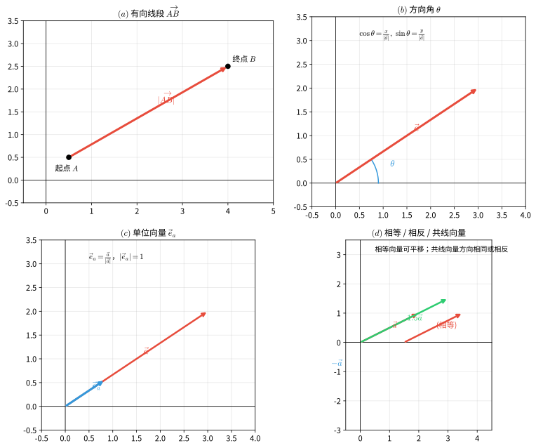

> **直观理解（现实类比）**：向量就是**带方向的箭头**——既有大小又有方向的量。
>
> - **力**：你推箱子，用力 $10$ 牛、方向朝东，这就是一个向量。力的方向变了，效果完全不同——往东推和往北推，箱子走的方向截然不同。
> - **速度**：汽车时速 $60$ 公里、向北行驶——速度也是向量。两辆时速都是 $60$ 的车，方向相反就会越走越远。
> - **位移**：从家到学校走 $2$ 公里、向东北方向——这是位移向量，只关心起点和终点，不关心中间怎么绕。
> - 标量（温度、质量、时间）只有大小没有方向；向量（力、速度、位移、加速度）两者兼备。区分标量和向量是物理入门的关键。

#### 向量的模

向量 $\vec{a}$ 的大小称为向量的**模**（或长度），记作 $|\vec{a}|$。设 $\vec{a} = (x, y)$，则：

$$
|\vec{a}| = \sqrt{x^2 + y^2}
$$

特别地，有向线段 $\overrightarrow{AB}$ 的模 $|\overrightarrow{AB}|$ 就等于两点 $A$、$B$ 之间的距离。

#### 零向量与单位向量

- **零向量**：模为 $0$ 的向量，记作 $\vec{0}$，其方向是任意的
- **单位向量**：模为 $1$ 的向量。与 $\vec{a}$ 同方向的单位向量记作 $\vec{e}_a = \dfrac{\vec{a}}{|\vec{a}|}$（$|\vec{a}| \neq 0$）

#### 向量的方向

向量 $\vec{a} = (x, y) \neq \vec{0}$ 的方向可以用它与 $x$ 轴正方向的夹角 $\theta$ 来描述，满足：

$$
\cos\theta = \frac{x}{|\vec{a}|},\qquad \sin\theta = \frac{y}{|\vec{a}|}
$$

夹角 $\theta$ 称为向量 $\vec{a}$ 的**方向角**。

#### 相等向量与共线向量

- **相等向量**：方向相同且模相等的向量，与起点位置无关
- **相反向量**：与 $\vec{a}$ 方向相反、模相等的向量，记作 $-\vec{a}$
- **平行（共线）向量**：方向相同或相反的向量，记作 $\vec{a} \parallel \vec{b}$

> 注意：零向量与任何向量平行。

---

#### 课堂问答

**老师**：向量和标量的本质区别在哪里？

**学生**：标量只有大小，向量同时携带“方向”信息，运算规则也截然不同：向量不能简单比大小，却可以做加减、数乘与数量积。方向使向量能描述位移、力、速度等有向量。

**老师（追问）**：零向量的方向是任意的，这样规定会不会出问题？

**学生**：不会，反而必要。若给零向量硬定一个方向，就无法与任何向量“平行”自洽；规定其方向任意并令它与所有向量平行，是为了让共线判定和运算在零向量处依然成立。

**老师（拓展）**：为什么“相等向量”与起点无关？

**学生**：因为向量由大小和方向唯一确定，起点只是它摆放的位置。把相等的向量平移到一起则完全重合，这正是它可自由平移、可作基底分解的基础。

### 2. 向量的线性运算

#### 加法——三角形法则

设 $\vec{a} = \overrightarrow{AB}$，$\vec{b} = \overrightarrow{BC}$，则和向量为：

$$
\vec{a} + \vec{b} = \overrightarrow{AB} + \overrightarrow{BC} = \overrightarrow{AC}
$$

即"首尾相接，指向被加向量的终点指向加向量的终点"。

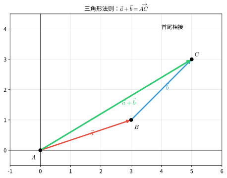

#### 加法——平行四边形法则

设 $\vec{a} = \overrightarrow{OA}$，$\vec{b} = \overrightarrow{OB}$，以 $OA$、$OB$ 为邻边作平行四边形 $OACB$，则对角线上的向量：

$$
\vec{a} + \vec{b} = \overrightarrow{OC}
$$

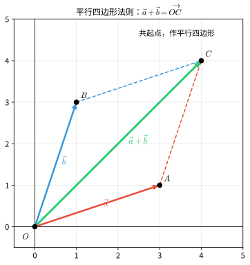

#### 减法

**定义**：$\vec{a} - \vec{b} = \vec{a} + (-\vec{b})$。

若 $\vec{a} = \overrightarrow{OA}$，$\vec{b} = \overrightarrow{OB}$，则：

$$
\vec{a} - \vec{b} = \overrightarrow{OA} - \overrightarrow{OB} = \overrightarrow{BA}
$$

即"共起点，减向量的终点指向被减向量的终点"。

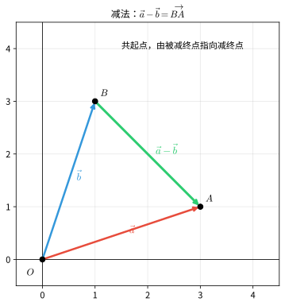

> **直观理解（现实类比）**：向量加减法就像**力的合成**与**接力跑**。
>
> - **加法—三角形法则（接力跑）**：第一棒从 $A$ 跑到 $B$（向量 $\vec{a}$），第二棒从 $B$ 接力跑到 $C$（向量 $\vec{b}$），总位移是从 $A$ 直接到 $C$（向量 $\vec{a}+\vec{b}$）。"首尾相接，从首到尾"就是和向量。
> - **加法—平行四边形法则（力的合成）**：两个人从同一点 $O$ 分别拉绳子，$\vec{a}$ 向东、$\vec{b}$ 向北，合力是从 $O$ 出发指向平行四边形对角的向量。这是物理学中"两个力合成一个力"的标准方法。
> - **减法（共起点）**：两个人从同一点出发，分别走到 $A$ 和 $B$，$\vec{a}-\vec{b}$ 就是从 $B$ 指向 $A$ 的向量——"被减向量的终点指向减向量的终点"。
> - **河中渡船**：船想垂直过河（$\vec{a}$），水流把它推向下游（$\vec{b}$），实际航线是 $\vec{a}+\vec{b}$——这是向量加法最经典的现实例子。

#### 数乘向量

**定义**：实数 $\lambda$ 与向量 $\vec{a}$ 的积是一个向量，记作 $\lambda \vec{a}$，其模为 $|\lambda|\,|\vec{a}|$，方向规定为：

- 当 $\lambda > 0$ 时，与 $\vec{a}$ 同向
- 当 $\lambda < 0$ 时，与 $\vec{a}$ 反向
- 当 $\lambda = 0$ 或 $\vec{a} = \vec{0}$ 时，$\lambda \vec{a} = \vec{0}$

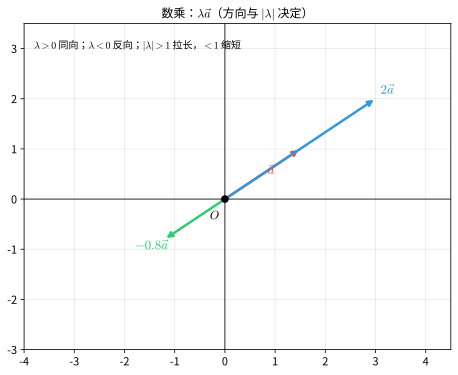

> **直观理解（现实类比）**：向量数乘就是**放大或缩小**——像调音量、变焦距。
>
> - $\lambda = 2$：把向量"拉长"到原来的 $2$ 倍，方向不变——就像把照片放大、把音乐音量调到 $200\%$。
> - $\lambda = \dfrac{1}{2}$：把向量"缩短"到原来的一半，方向不变——缩小图片、调低音量。
> - $\lambda = -1$：向量长度不变，方向反过来——镜面翻转、录像倒放。
> - $\lambda = -2$：拉长到 $2$ 倍并反向——倒车时油门踩到底。
> - **物理实例**：力的 $n$ 倍（多个相同力叠加）、速度的放大（不同档位的自行车）、位移的倍数（走 $3$ 趟相同的路程），都是数乘。

#### 运算律

设 $\lambda$、$\mu$ 为实数，$\vec{a}$、$\vec{b}$、$\vec{c}$ 为向量：

- **交换律**：$\vec{a} + \vec{b} = \vec{b} + \vec{a}$
- **结合律**：$(\vec{a} + \vec{b}) + \vec{c} = \vec{a} + (\vec{b} + \vec{c})$；$(\lambda\mu)\vec{a} = \lambda(\mu\vec{a})$
- **分配律**：$\lambda(\vec{a} + \vec{b}) = \lambda\vec{a} + \lambda\vec{b}$；$(\lambda + \mu)\vec{a} = \lambda\vec{a} + \mu\vec{a}$

---

#### 课堂问答

**老师**：加法有三角形法则和平行四边形法则，它们矛盾吗？

**学生**：不矛盾，本质同一个运算。三角形法则是“首尾相接”，平行四边形法则是“同起点作邻边取对角线”，把平行四边形的对边平移后就与三角形法则重合。

**老师（追问）**：$\vec a-\vec b$ 为什么等于“共起点时从 $B$ 指向 $A$”，而不是从 $A$ 指向 $B$？

**学生**：因为 $\vec a-\vec b=\vec a+(-\vec b)$，把 $-\vec b$ 接到 $\vec a$ 终点（或同起点作差），结果就是从减向量终点 $\vec b$ 指向被减向量终点 $\vec a$ 的 $\overrightarrow{BA}$。方向弄反是常见错误。

**老师（拓展）**：数乘 $\lambda\vec a$ 的几何意义是什么，它和向量的共线判定有何联系？

**学生**：$|\lambda\vec a|=|\lambda||\vec a|$，$\lambda>0$ 同向、$\lambda<0$ 反向、$|\lambda|$ 缩放长度。正因为数乘只改变长度与正负方向，两个向量共线当且仅当其中一个能写成另一个的数乘。

### 3. 向量的坐标表示

#### 平面向量的坐标

在平面直角坐标系中，分别取与 $x$ 轴、$y$ 轴正方向相同的两个单位向量 $\vec{i}$、$\vec{j}$ 作为基底。对任一向量 $\vec{a}$，由平面向量基本定理，存在唯一一对实数 $(x, y)$，使得：

$$
\vec{a} = x\vec{i} + y\vec{j}
$$

称 $(x, y)$ 为向量 $\vec{a}$ 的**坐标**，记作 $\vec{a} = (x, y)$。

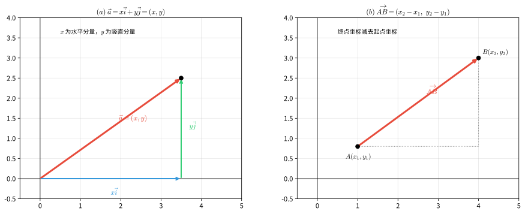

> **直观理解（现实类比）**：向量的坐标表示就像**用基底"组合"出任意向量**——就像用基本颜色调配出所有颜色。
>
> - **基底 $\vec{i}, \vec{j}$** 是两个互相垂直的"基本箭头"，长度都是 $1$。任意向量 $\vec{a}$ 都能写成 $\vec{a} = x\vec{i} + y\vec{j}$，意思是用 $x$ 步水平走、$y$ 步垂直走，最终到达 $\vec{a}$ 的终点。
> - 就像**调色**：红、黄、蓝三原色按不同比例混合能得到所有颜色；$\vec{i}$、$\vec{j}$ 按不同系数组合能得到所有向量。系数 $(x, y)$ 就是向量的"配方"。
> - **地图导航**："向东走 $3$ 公里，再向北走 $4$ 公里"——这就是用 $\vec{i}$（东）、$\vec{j}$（北）作基底表示位移向量 $(3, 4)$。
> - 选不同的基底就像选不同的参考方向：地理课用"东南西北"，工程上用"$x$、$y$ 轴"，但描述的是同一个位移。

#### 向量的坐标与点的坐标

设 $A(x_1, y_1)$、$B(x_2, y_2)$，则：

$$
\overrightarrow{AB} = (x_2 - x_1,\ y_2 - y_1)
$$

即**终点坐标减去起点坐标**。特例：起点为原点 $O$ 时，$\overrightarrow{OP} = (x, y)$，此时向量的坐标与点 $P$ 的坐标一致。

#### 坐标运算

设 $\vec{a} = (x_1, y_1)$，$\vec{b} = (x_2, y_2)$，$\lambda$ 为实数：

$$
\vec{a} + \vec{b} = (x_1 + x_2,\ y_1 + y_2)
$$

$$
\vec{a} - \vec{b} = (x_1 - x_2,\ y_1 - y_2)
$$

$$
\lambda\vec{a} = (\lambda x_1,\ \lambda y_1)
$$

#### 模的坐标公式

$$
|\vec{a}| = \sqrt{x_1^2 + y_1^2}
$$

两点间距离也可用向量模的形式表示：

$$
|\overrightarrow{AB}| = \sqrt{(x_2 - x_1)^2 + (y_2 - y_1)^2}
$$

这与前面第 1 节的两点间距离公式完全一致，体现了向量与解析几何的内在统一。

---

#### 课堂问答

**老师**：向量 $\vec a=(x,y)$ 的坐标和点 $(x,y)$ 的坐标，究竟是不是一回事？

**学生**：数值上相同，含义上有别。点坐标是相对原点的一个位置，向量坐标是“用基底 $\vec i,\vec j$ 分解的系数”。只有当把向量起点放在原点时，两者才重合为 $\overrightarrow{OP}=(x,y)$。

**老师（追问）**：$A(x_1,y_1)$、$B(x_2,y_2)$ 时，$\overrightarrow{AB}$ 为什么是“终点减起点”？

**学生**：因为 $\overrightarrow{AB}=\overrightarrow{OB}-\overrightarrow{OA}=(x_2-x_1,\ y_2-y_1)$。向量的坐标只取决于相对位移，与绝对位置无关，“终减起”正体现这一点。

**老师（拓展）**：这里已经用到什么更深的结构？

**学生**：用到平面向量基本定理：任取一组不共线基底，$\vec a=x\vec i+y\vec j$ 的分解唯一，坐标才有定义。坐标运算之所以能“逐分量”进行，全赖基底的线性无关。

### 4. 向量共线（平行）的判定

**定理**：$\vec{a} \parallel \vec{b}$（$\vec{b} \neq \vec{0}$）当且仅当存在唯一实数 $\lambda$，使得：

$$
\vec{a} = \lambda\vec{b}
$$

**坐标形式的充要条件**：设 $\vec{a} = (x_1, y_1)$，$\vec{b} = (x_2, y_2)$（$\vec{b} \neq \vec{0}$），则：

$$
\vec{a} \parallel \vec{b} \iff x_1 y_2 - x_2 y_1 = 0
$$

即对应坐标成比例 $\dfrac{x_1}{x_2} = \dfrac{y_1}{y_2}$（当分母不为零时）。

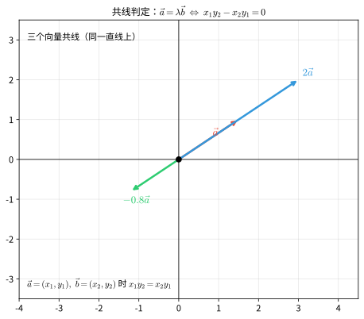

> **直观理解（现实类比）**：向量共线（平行）就是两个向量"**朝同一个方向或反向**"——像两根平行的筷子或同向行驶的两辆车。
>
> - $\vec{a} = \lambda \vec{b}$ 意味着 $\vec{a}$ 是 $\vec{b}$ 的"放大版"或"缩小版"——可能同向（$\lambda>0$），可能反向（$\lambda<0$）。
> - 坐标条件 $x_1 y_2 = x_2 y_1$ 就是"对应坐标成比例"——两个向量的横纵坐标比相同，方向自然一致。
> - **铁轨**的两条钢轨、**双杠**的两根横杆、**梯子**的两根立柱都是共线向量的现实原型——方向一致，长度可能不同。
> - 反之，**垂直**就是两向量方向成 $90°$——像东西向和南北向的街道、十字交叉的筷子，用数量积为零来判定（见下一节）。

> 注意：由于 $\vec{a} = \lambda\vec{b}$ 要求 $\vec{b} \neq \vec{0}$，上面的坐标条件应优先使用 $x_1y_2 - x_2y_1 = 0$ 这一形式，以避免分母为零的情况。

---

#### 课堂问答

**老师**：判定共线，是用 $\vec a=\lambda\vec b$ 好，还是用 $x_1y_2-x_2y_1=0$ 好？

**学生**：坐标形式 $x_1y_2-x_2y_1=0$ 更好，因为它不需要假设 $\vec b\ne\vec 0$，也避免了分母为零。$\vec a=\lambda\vec b$ 的写法在 $\vec b=\vec 0$ 时不唯一，容易掉坑。

**老师（追问）**：为什么“对应坐标成比例”这个说法要用得不谨慎？

**学生**：因为一旦某个分母为零就失效，比如 $\vec b=(0,3)$、$\vec a=(0,6)$ 共线却写不出 $\dfrac{x_1}{x_2}$。所以应优先用叉积式 $x_1y_2-x_2y_1=0$。

**老师（拓展）**：这个判定和直线平行的判定是不是同一件事？

**学生**：是。两条直线平行当且仅当方向向量共线，其行列式条件 $A_1B_2-A_2B_1=0$ 与向量共线的 $x_1y_2-x_2y_1=0$ 结构一致。向量共线是几何“平行”的代数化。

### 5. 平面向量的数量积（点积）

#### 定义

设两个非零向量 $\vec{a}$、$\vec{b}$，它们的夹角为 $\theta$（$0 \leq \theta \leq \pi$），则 $\vec{a}$ 与 $\vec{b}$ 的**数量积**为：

$$
\vec{a} \cdot \vec{b} = |\vec{a}|\,|\vec{b}|\cos\theta
$$

规定：零向量与任一向量的数量积为 $0$。

> 数量积的结果是**标量**（一个实数），而不是向量。这也是"数量积"名称的由来。

#### 几何意义

$\vec{a} \cdot \vec{b}$ 等于 $|\vec{a}|$ 与 $\vec{b}$ 在 $\vec{a}$ 方向上的投影 $|\vec{b}|\cos\theta$ 的乘积，即"$\vec{a}$ 的模乘以 $\vec{b}$ 在 $\vec{a}$ 方向上的投影"。

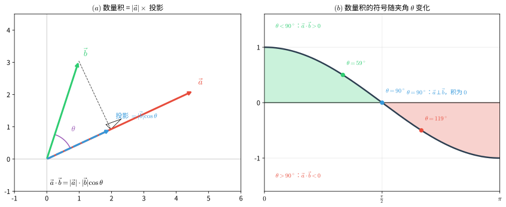

> **直观理解（现实类比）**：数量积的核心是**做功**和**投影**——它把"两个向量的方向关系"压缩成一个数。
>
> - **做功**：你用力 $\vec{F}$ 推箱子位移 $\vec{s}$，只有**沿位移方向的分力**才真正做了功。$W = \vec{F} \cdot \vec{s} = |\vec{F}||\vec{s}|\cos\theta$。垂直于位移方向的力（如提着箱子水平走）不做功——这就是 $\cos 90° = 0$ 的物理意义。
> - **投影**：把 $\vec{b}$ 想象成一根斜放的竹竿，太阳从 $\vec{a}$ 方向照过来，竹竿在地面（$\vec{a}$ 所在直线）上的影子长度就是 $|\vec{b}|\cos\theta$。数量积就是"$\vec{a}$ 的长度 × $\vec{b}$ 的影子长度"。
> - **斜拉船**：用斜向上的绳子拉船前行，只有水平分力让船前进，竖直分力只是把船头微微抬起——做功的就是水平投影，这正是 $\vec{F} \cdot \vec{s}$。

由 $\cos\theta$ 的取值可知数量积的符号取决于夹角 $\theta$：当 $0 \le \theta < 90^\circ$ 时 $\vec{a} \cdot \vec{b} > 0$；当 $\theta = 90^\circ$ 时 $\vec{a} \cdot \vec{b} = 0$（两向量垂直）；当 $90^\circ < \theta \le 180^\circ$ 时 $\vec{a} \cdot \vec{b} < 0$。

#### 坐标表示

设 $\vec{a} = (x_1, y_1)$，$\vec{b} = (x_2, y_2)$，则：

$$
\vec{a} \cdot \vec{b} = x_1 x_2 + y_1 y_2
$$

特别地，$\vec{a} \cdot \vec{a} = |\vec{a}|^2 = x_1^2 + y_1^2$。

#### 坐标公式的证明

几何定义 $\vec{a}\cdot\vec{b} = |\vec{a}|\,|\vec{b}|\cos\theta$ 与坐标表示 $x_1x_2 + y_1y_2$ 是等价的，可用**余弦定理**证明。

设 $\vec{a} = (x_1, y_1)$、$\vec{b} = (x_2, y_2)$，夹角为 $\theta$。在 $\vec{a}$、$\vec{b}$ 及连接两者终点的向量 $\vec{a}-\vec{b}$ 构成的三角形（如图 $(a)$）中，由余弦定理：

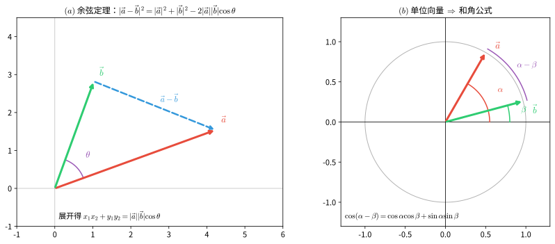

$$
|\vec{a} - \vec{b}|^2 = |\vec{a}|^2 + |\vec{b}|^2 - 2|\vec{a}|\,|\vec{b}|\cos\theta
$$

将坐标代入并展开：

$$
(x_1-x_2)^2 + (y_1-y_2)^2 = (x_1^2+y_1^2) + (x_2^2+y_2^2) - 2\,|\vec{a}|\,|\vec{b}|\cos\theta
$$

$$
\Rightarrow\ x_1x_2 + y_1y_2 = |\vec{a}|\,|\vec{b}|\cos\theta
$$

右端正是几何定义，故坐标公式成立。由此也得到**夹角公式**：

$$
\cos\theta = \frac{\vec{a}\cdot\vec{b}}{|\vec{a}|\,|\vec{b}|}
= \frac{x_1x_2 + y_1y_2}{\sqrt{x_1^2+y_1^2}\,\sqrt{x_2^2+y_2^2}}
$$

#### 与和角公式的联系

当 $\vec{a}$、$\vec{b}$ 均为**单位向量**时，设 $\vec{a} = (\cos\alpha, \sin\alpha)$、$\vec{b} = (\cos\beta, \sin\beta)$，其夹角为 $\theta = \alpha - \beta$（如图 $(b)$）。由坐标公式与几何定义：

$$
\cos(\alpha-\beta) = \cos\alpha\cos\beta + \sin\alpha\sin\beta
$$

这正是三角学中的**和角公式**。可见数量积把"向量夹角"与"三角函数和差公式"统一起来——三角恒等式 $\cos(\alpha-\beta)$ 不过是单位向量数量积的坐标形式。

#### 运算律

设 $\lambda$ 为实数，$\vec{a}$、$\vec{b}$、$\vec{c}$ 为向量：

- **交换律**：$\vec{a} \cdot \vec{b} = \vec{b} \cdot \vec{a}$
- **结合律（数乘）**：$(\lambda\vec{a}) \cdot \vec{b} = \lambda(\vec{a} \cdot \vec{b}) = \vec{a} \cdot (\lambda\vec{b})$
- **分配律**：$(\vec{a} + \vec{b}) \cdot \vec{c} = \vec{a} \cdot \vec{c} + \vec{b} \cdot \vec{c}$

> 注意：数量积**不满足结合律**，即 $(\vec{a} \cdot \vec{b})\vec{c} \neq \vec{a}(\vec{b} \cdot \vec{c})$。因为 $\vec{a} \cdot \vec{b}$ 是标量，左边是与 $\vec{c}$ 平行的向量，右边是与 $\vec{a}$ 平行的向量，一般并不相等。

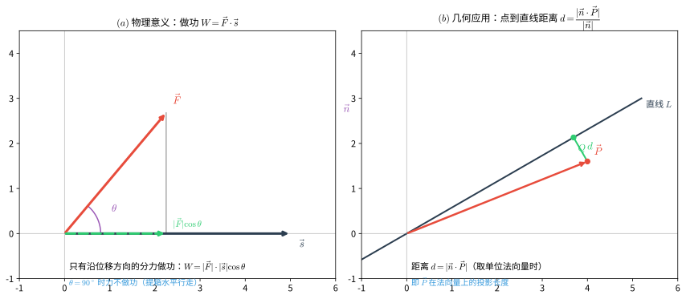

#### 实际意义

数量积始终围绕一个核心思想：**用一个向量度量另一个向量沿其方向的分量**。它把"两个向量的方向关系"提炼成一个标量，从而把几何/物理问题转化为可计算的代数量。

- **物理意义——做功**：力 $\vec{F}$ 沿位移 $\vec{s}$ 做功只有沿位移方向的分力才起作用，即 $W = \vec{F} \cdot \vec{s} = |\vec{F}|\,|\vec{s}|\cos\theta$。当 $\theta = 0$（力与位移同向）做功最多；$\theta = 90^\circ$（力垂直于位移，如提箱水平行走）不做功；$\theta = 180^\circ$（力与位移反向，如摩擦力）做负功。
- **几何意义——垂直判定与距离**：$\vec{a} \perp \vec{b} \iff \vec{a} \cdot \vec{b} = 0$；点到直线的距离恰是位置向量在法向量上的投影长度 $d = \dfrac{|\vec{n} \cdot \vec{P}|}{|\vec{n}|}$。这两个应用都直接来自"投影"这一几何意义。
- **方向度量——余弦相似度**：$\cos\theta = \dfrac{\vec{a} \cdot \vec{b}}{|\vec{a}|\,|\vec{b}|}$ 衡量两向量方向的接近程度（越接近 $1$ 越同向，越接近 $-1$ 越反向），是搜索引擎、推荐系统中"余弦相似度"的数学基础。
- **代数化工具**：坐标表示 $\vec{a} \cdot \vec{b} = x_1x_2 + y_1y_2$ 使夹角、平行/垂直、投影、面积、距离等几何问题都变成纯坐标计算，是计算机图形学（如光照、视锥判定）的基本运算。

---

#### 课堂问答

**老师**：$\vec a\cdot\vec b=|\vec a||\vec b|\cos\theta$ 的结果为什么是标量而不是向量？

**学生**：因为它度量的是“一个向量在另一个方向上的投影”乘以模长，反映的是方向关系而非方向本身，输出自然是一个实数。做功 $W=\vec F\cdot\vec s$ 就是标量，正说明这一点。

**老师（追问）**：$(\vec a\cdot\vec b)\vec c$ 和 $\vec a(\vec b\cdot\vec c)$ 相等吗？

**学生**：一般不相等。前者是与 $\vec c$ 平行的向量，后者是与 $\vec a$ 平行的向量，只有在特殊共线情形才巧合相等。数量积不满足结合律，这是它区别于实数乘法的重要之处。

**老师（拓展）**：点积的坐标式怎样揭示它和三角和角公式的联系？

**学生**：取单位向量 $\vec a=(\cos\alpha,\sin\alpha)$、$\vec b=(\cos\beta,\sin\beta)$，则 $\vec a\cdot\vec b=\cos\alpha\cos\beta+\sin\alpha\sin\beta=\cos(\alpha-\beta)$，正好是和角公式。数量积把三角与向量统一起来。

### 6. 向量的夹角与垂直判定

#### 夹角公式

设 $\vec{a} = (x_1, y_1)$，$\vec{b} = (x_2, y_2)$ 为非零向量，夹角为 $\theta$，则：

$$
\cos\theta = \frac{\vec{a} \cdot \vec{b}}{|\vec{a}|\,|\vec{b}|} = \frac{x_1x_2 + y_1y_2}{\sqrt{x_1^2 + y_1^2}\sqrt{x_2^2 + y_2^2}}
$$

#### 垂直的充要条件

$$
\vec{a} \perp \vec{b} \iff \vec{a} \cdot \vec{b} = 0
$$

用坐标表示即：

$$
\vec{a} \perp \vec{b} \iff x_1 x_2 + y_1 y_2 = 0
$$

> 这与直线垂直的条件一脉相承：两直线 $l_1: A_1x + B_1y + C_1 = 0$、$l_2: A_2x + B_2y + C_2 = 0$ 垂直等价于它们法向量 $\vec{n}_1 = (A_1, B_1)$、$\vec{n}_2 = (A_2, B_2)$ 满足 $A_1A_2 + B_1B_2 = 0$，正是"法向量点积为零"。

---

#### 课堂问答

**老师**：$\cos\theta=\dfrac{\vec a\cdot\vec b}{|\vec a||\vec b|}$ 分母为什么必须是非零的两个模？

**学生**：因为夹角公式除以 $|\vec a||\vec b|$，零向量会使其为零，而零向量与任何向量夹角不定。公式只对两个非零向量才有意义，这一点在解题时必须先检查。

**老师（追问）**：$\vec a\cdot\vec b=0$ 一定意味着两向量垂直吗？

**学生**：在 $\vec a$、$\vec b$ 都非零时一定垂直；但若允许零向量，$\vec 0\cdot\vec b=0$ 却谈不上“垂直”。所以严格说，是“两个非零向量点积为零 $\iff$ 垂直”。

**老师（拓展）**：这如何解释两条直线垂直的条件？

**学生**：两条直线垂直等价于它们的法向量垂直，即 $\vec n_1\cdot\vec n_2=A_1A_2+B_1B_2=0$。向量垂直判定把直线、圆锥曲线中的正交问题统一到同一个“点积为零”上。

### 7. 向量的模与两点间距离（向量表示）

设 $\vec{a} = (x, y)$，则模为 $|\vec{a}| = \sqrt{\vec{a} \cdot \vec{a}} = \sqrt{x^2 + y^2}$。

设 $A(x_1, y_1)$、$B(x_2, y_2)$，则线段 $AB$ 的长度：

$$
|AB| = |\overrightarrow{AB}| = \sqrt{(x_2 - x_1)^2 + (y_2 - y_1)^2}
$$

由此，一堆几何量都可以统一地用向量表示：

- 中点公式：$M$ 为 $AB$ 中点时，$\overrightarrow{OM} = \dfrac{\overrightarrow{OA} + \overrightarrow{OB}}{2}$
- 定比分点：$\overrightarrow{OP} = \dfrac{\overrightarrow{OA} + \lambda\overrightarrow{OB}}{1 + \lambda}$
- 线段垂直：$\overrightarrow{OA} \cdot \overrightarrow{OB} = 0 \iff OA \perp OB$

---

#### 课堂问答

**老师**：$|\vec a|=\sqrt{\vec a\cdot\vec a}$ 这个写法有什么好处？

**学生**：它把“长度”用数量积表达，从而长度也能纳入向量的代数运算体系，不必每次都画图量。它还是余弦定理、夹角公式的出发点。

**老师（追问）**：为什么说两点间距离公式是向量模公式的特例？

**学生**：因为 $\overrightarrow{AB}=(x_2-x_1,y_2-y_1)$，取模 $|\overrightarrow{AB}|=\sqrt{(x_2-x_1)^2+(y_2-y_1)^2}$ 就是原来的距离公式。几何的“距离”被彻底改写成向量的“模”。

**老师（拓展）**：中点、定比分点也能用向量一笔写出吗？

**学生**：能，$\overrightarrow{OM}=\dfrac{\overrightarrow{OA}+\overrightarrow{OB}}{2}$，$\overrightarrow{OP}=\dfrac{\overrightarrow{OA}+\lambda\overrightarrow{OB}}{1+\lambda}$。可见前面所有坐标公式都是向量线性组合的坐标投影，向量是它们共同的骨架。

### 8. 平面向量基本定理（基底）

**定理**：设 $\vec{e}_1$、$\vec{e}_2$ 是同一平面内两个**不共线**的向量，那么对该平面内任一向量 $\vec{a}$，有且仅有一对实数 $\lambda_1$、$\lambda_2$，使得：

$$
\vec{a} = \lambda_1\vec{e}_1 + \lambda_2\vec{e}_2
$$

其中不共线的向量 $\vec{e}_1$、$\vec{e}_2$ 称为该平面的一组**基底**。

**关于基底的说明**：

- 基底由两个不共线的向量组成，基底中的向量不能为零向量
- 同一平面内可以有无数多组基底，任一向量在给定基底下的分解是唯一的
- 当基底为正交单位基底 $\vec{i}$、$\vec{j}$（即 $x$、$y$ 轴单位向量）时，分解式 $\vec{a} = x\vec{i} + y\vec{j}$ 中的 $(x, y)$ 正是向量的坐标

**直线与向量对应（衔接前面直线方程）**：直线的法向量、方向向量在"直线的法向量与方向向量"小节（第 2 节）已定义，此处回顾其与向量坐标的联系。设直线 $l: Ax + By + C = 0$：

- 直线的**法向量** $\vec{n} = (A, B)$，方向与直线垂直
- 直线的**方向向量** $\vec{d} = (B, -A)$（或 $(-B, A)$），方向与直线平行，满足 $\vec{n} \cdot \vec{d} = AB + B(-A) = 0$
- 直线的**斜率** $k = -\dfrac{A}{B}$，正是方向向量 $(B, -A)$ 的纵坐标与横坐标之比 $k = \dfrac{-A}{B}$

因此，"点斜式"就等价于"过已知点、沿方向向量 $(1, k)$ 的直线"。

---

#### 课堂问答

**老师**：为什么基底里的两个向量必须“不共线或不为零”？

**学生**：若两向量共线（含零向量），它们只能张成一条直线，无法表示平面内所有向量。只有不共线才构成“真正二维”的坐标系，任一向量才有唯一分解。

**老师（追问）**：为什么分解是唯一的？

**学生**：假设有两种分解，相减得 $\lambda_1\vec e_1+\lambda_2\vec e_2=\vec 0$。由 $\vec e_1,\vec e_2$ 线性无关只能推出 $\lambda_1=\lambda_2=0$，即两种分解相同，唯一性由此保证。

**老师（拓展）**：一般基底与正交基底各有什么取舍？

**学生**：正交单位基底 $\vec i,\vec j$ 让坐标直接对应长度与垂直，内积简单；一般基底计算内积要带夹角余弦，但能贴合问题的几何方向。选基底是“计算方便”与“几何贴合”之间的权衡。

### 9. 向量在解三角形和几何中的应用

#### 正弦定理的向量证明

**定理**：在 $\triangle ABC$ 中，设角 $A$、$B$、$C$ 所对的边分别为 $a$、$b$、$c$，则 $\dfrac{a}{\sin A} = \dfrac{b}{\sin B} = \dfrac{c}{\sin C}$。

**证明**：

设 $\overrightarrow{AB} = \vec{c}$，$\overrightarrow{AC} = \vec{b}$（注意用向量模表示边长），则 $\vec{c} - \vec{b} = \overrightarrow{CB}$。

考虑 $\triangle ABC$ 的面积公式。以 $AB$、$AC$ 为邻边的平行四边形的面积可由叉积给出，但平面内用点积可如下处理：

由 $\vec{c} - \vec{b} = \overrightarrow{CB}$，两边平方得：

$$
|\vec{c} - \vec{b}|^2 = |\vec{c}|^2 + |\vec{b}|^2 - 2\vec{b}\cdot\vec{c}
$$

即 $a^2 = c^2 + b^2 - 2bc\cos A$，这正是**余弦定理**。$\square$

对于正弦定理，可利用面积公式 $S = \dfrac{1}{2}bc\sin A = \dfrac{1}{2}ca\sin B = \dfrac{1}{2}ab\sin C$，两边同除以 $\dfrac{1}{2}abc$ 即得 $\dfrac{\sin A}{a} = \dfrac{\sin B}{b} = \dfrac{\sin C}{c}$。$\square$

#### 余弦定理的向量证明

**定理**：$a^2 = b^2 + c^2 - 2bc\cos A$。

**证明**：

设 $\overrightarrow{AB} = \vec{c}$，$\overrightarrow{AC} = \vec{b}$，则 $\overrightarrow{CB} = \vec{c} - \vec{b}$，其模为 $a$。

$$
a^2 = |\overrightarrow{CB}|^2 = (\vec{c} - \vec{b}) \cdot (\vec{c} - \vec{b}) = |\vec{c}|^2 + |\vec{b}|^2 - 2\vec{b}\cdot\vec{c}
$$

其中 $\vec{b} \cdot \vec{c} = |\vec{b}|\,|\vec{c}|\cos A = bc\cos A$，代入即得：

$$
a^2 = b^2 + c^2 - 2bc\cos A
$$

$\square$

#### 中线定理的向量证明

**定理**：在 $\triangle ABC$ 中，$M$ 为 $BC$ 的中点，则 $AB^2 + AC^2 = 2(AM^2 + BM^2)$。

**证明**：

取 $A$ 为起点，设 $\vec{b} = \overrightarrow{AB}$，$\vec{c} = \overrightarrow{AC}$。则：

$$
\overrightarrow{AM} = \frac{\vec{b} + \vec{c}}{2},\qquad \overrightarrow{BM} = \frac{\vec{c} - \vec{b}}{2}
$$

于是：

$$
AB^2 + AC^2 = |\vec{b}|^2 + |\vec{c}|^2
$$

$$
2(AM^2 + BM^2) = 2\left(\left|\frac{\vec{b} + \vec{c}}{2}\right|^2 + \left|\frac{\vec{c} - \vec{b}}{2}\right|^2\right)
$$

利用 $|\vec{p} + \vec{q}|^2 + |\vec{p} - \vec{q}|^2 = 2(|\vec{p}|^2 + |\vec{q}|^2)$，得：

$$
2(AM^2 + BM^2) = \frac{1}{2}\left(|\vec{b} + \vec{c}|^2 + |\vec{c} - \vec{b}|^2\right) = |\vec{b}|^2 + |\vec{c}|^2
$$

故 $AB^2 + AC^2 = 2(AM^2 + BM^2)$。$\square$

#### 重心

设 $G$ 为 $\triangle ABC$ 的重心（三条中线的交点），则：

$$
\overrightarrow{OG} = \frac{\overrightarrow{OA} + \overrightarrow{OB} + \overrightarrow{OC}}{3}
$$

特别地，当 $O$ 为原点时，$G$ 的坐标为 $\left(\dfrac{x_A + x_B + x_C}{3},\ \dfrac{y_A + y_B + y_C}{3}\right)$。

**证明**：设中线 $AM$ 与 $BN$ 交于 $G$，由重心分中线为 $2:1$，$\overrightarrow{AG} = \dfrac{2}{3}\overrightarrow{AM}$，而 $\overrightarrow{AM} = \dfrac{\vec{b} + \vec{c}}{2}$，故 $\overrightarrow{AG} = \dfrac{\vec{b} + \vec{c}}{3}$，从而 $\overrightarrow{OG} = \overrightarrow{OA} + \overrightarrow{AG} = \vec{a} + \dfrac{(\vec{b} - \vec{a}) + (\vec{c} - \vec{a})}{3} = \dfrac{\vec{a} + \vec{b} + \vec{c}}{3}$。$\square$

---

#### 课堂问答

**老师**：用向量证明余弦定理，关键一步是什么？

**学生**：把 $\overrightarrow{CB}=\vec c-\vec b$ 平方成 $\overrightarrow{CB}\cdot\overrightarrow{CB}$，展开得 $a^2=|\vec c|^2+|\vec b|^2-2\vec b\cdot\vec c$，再把 $\vec b\cdot\vec c=bc\cos A$ 代入即得 $a^2=b^2+c^2-2bc\cos A$。

**老师（追问）**：正弦定理用向量怎么证明比较自然？

**学生**：借助面积 $S=\dfrac12bc\sin A=\dfrac12ca\sin B=\dfrac12ab\sin C$，同除以 $\dfrac12abc$ 即得 $\dfrac{\sin A}{a}=\dfrac{\sin B}{b}=\dfrac{\sin C}{c}$。面积把两边夹角的正弦联系起来。

**老师（拓展）**：重心公式 $\overrightarrow{OG}=\dfrac{\overrightarrow{OA}+\overrightarrow{OB}+\overrightarrow{OC}}{3}$ 与前面哪个公式同源？

**学生**：与中点公式同源，是“$n$ 点平均”的推广。它的证明只用到中线按 $2:1$ 分割的定比分点事实，再次说明向量把点、中点、重心的坐标统一在一套线性运算里。

### 10. 综合示例

#### 示例 7：向量共线与坐标

**题目**：已知 $\vec{a} = (2, -1)$，$\vec{b} = (1, 3)$。若 $\vec{a} + \lambda\vec{b}$ 与 $\vec{a} - \vec{b}$ 共线，求实数 $\lambda$。

**解**：

$$
\vec{a} + \lambda\vec{b} = (2 + \lambda,\ -1 + 3\lambda)
$$

$$
\vec{a} - \vec{b} = (1, -4)
$$

共线条件 $x_1y_2 - x_2y_1 = 0$：

$$
(2 + \lambda)(-4) - 1 \cdot (-1 + 3\lambda) = 0
$$

$$
-8 - 4\lambda + 1 - 3\lambda = 0 \implies -7 - 7\lambda = 0 \implies \lambda = -1
$$

**答案**：$\lambda = -1$。

---

#### 示例 8：数量积与夹角

**题目**：已知 $\vec{a} = (1, 2)$，$\vec{b} = (-2, 1)$。（1）求 $\vec{a} \cdot \vec{b}$；（2）判断 $\vec{a}$ 与 $\vec{b}$ 是否垂直。

**解**：

（1）由数量积坐标公式：

$$
\vec{a} \cdot \vec{b} = 1 \times (-2) + 2 \times 1 = -2 + 2 = 0
$$

（2）因为 $\vec{a} \cdot \vec{b} = 0$，所以 $\vec{a} \perp \vec{b}$。

**答案**：$\vec{a} \cdot \vec{b} = 0$，$\vec{a} \perp \vec{b}$。

---

#### 示例 9：余弦定理的向量应用

**题目**：在 $\triangle ABC$ 中，$\overrightarrow{AB} = (2, 3)$，$\overrightarrow{AC} = (5, -1)$，求边 $BC$ 的长度和 $\cos A$。

**解**：

$\overrightarrow{BC} = \overrightarrow{AC} - \overrightarrow{AB} = (5 - 2,\ -1 - 3) = (3, -4)$。

由余弦定理的向量形式：

$$
a^2 = |\vec{b}|^2 + |\vec{c}|^2 - 2\vec{b}\cdot\vec{c}
$$

其中 $|\vec{b}|^2 = |\overrightarrow{AC}|^2 = 5^2 + (-1)^2 = 26$，$|\vec{c}|^2 = |\overrightarrow{AB}|^2 = 2^2 + 3^2 = 13$，$\vec{b}\cdot\vec{c} = 2 \times 5 + 3 \times (-1) = 7$。

于是：

$$
a^2 = 26 + 13 - 2 \times 7 = 25 \implies a = |BC| = 5
$$

$$
\cos A = \frac{\vec{b}\cdot\vec{c}}{|\vec{b}|\,|\vec{c}|} = \frac{7}{\sqrt{26}\sqrt{13}} = \frac{7}{13\sqrt{2}} = \frac{7\sqrt{2}}{26}
$$

**答案**：$|BC| = 5$，$\cos A = \dfrac{7\sqrt{2}}{26}$。

---

#### 示例 10：直线的方向向量与法向量

**题目**：已知直线 $l: 2x - 3y + 6 = 0$。（1）求 $l$ 的一个法向量和方向向量；（2）求 $l$ 的斜率，并说明三者关系。

**解**：

（1）法向量为 $\vec{n} = (2, -3)$，方向向量可取 $\vec{d} = (3, 2)$（与 $\vec{n}$ 点积为 $2 \times 3 + (-3) \times 2 = 0$，故垂直）。

（2）斜率 $k = -\dfrac{A}{B} = -\dfrac{2}{-3} = \dfrac{2}{3}$，恰为方向向量 $(3, 2)$ 的纵坐标与横坐标之比 $k = \dfrac{2}{3}$。

**答案**：$\vec{n} = (2, -3)$，$\vec{d} = (3, 2)$，$k = \dfrac{2}{3}$。

---

#### 课堂问答

**老师**：判断 $\vec a+\lambda\vec b$ 与 $\vec a-\vec b$ 共线，最容易错在哪里？

**学生**：最容易错在用“坐标成比例”而忽略分母为零，或把共线条件写成 $x_1x_2+y_1y_2=0$（那是垂直）。应老老实实用 $x_1y_2-x_2y_1=0$，逐项展开。

**老师（追问）**：为什么这里能反解出唯一的 $\lambda$？

**学生**：因为共线给出一个关于 $\lambda$ 的一次方程 $(2+\lambda)(-4)-(-1+3\lambda)=0$，即 $-7-7\lambda=0$，得 $\lambda=-1$。一次方程系数非零，解必唯一。

**老师（拓展）**：数量积登场后，“垂直”与“共线”是不是一对孪生判定？

**学生**：是。共线看 $x_1y_2-x_2y_1=0$（行列式为零），垂直看 $x_1x_2+y_1y_2=0$（点积为零），一个管“方向相同/相反”，一个管“方向正交”，合起来能完整刻画两向量的方向关系。

## 解题技巧

> 本节针对本章核心知识点，给出可直接套用的解题方法。每条技巧以「适用场景 / 关键步骤 / 常见误区」三要素组织，并配精讲示例，覆盖「学习目标」列出的全部能力项。

### 7.1 坐标法的"翻译"意识

**适用场景**：把几何条件（平行、垂直、共线、距离比）化为代数方程求解点、直线、曲线。
**关键步骤**：

1. 设未知点坐标 $(x,y)$ 或引入参数表达轨迹；
2. 用距离 / 斜率 / 中点 / 定比分点 / 数量积公式写出几何条件的方程；
3. 化简方程并判定曲线类型。
   **常见误区**：忘记去根号时的取值范围或漏判退化为空集/点的情形。
   **精讲示例**（见挑战题 14 思路）：到定点与定直线距离之比为常数 $e$ 的轨迹，直接由两点距离与点到直线距离公式化得圆锥曲线方程。

### 7.2 求直线方程的"一点一斜率"与四种形式互化

**适用场景**：由两种条件求直线，或在五种直线方程形式（点斜 / 斜截 / 两点 / 截距 / 一般式）间转换。
**关键步骤**：

1. 先求斜率 $k$（两式点斜率 $k=\tfrac{y_2-y_1}{x_2-x_1}$，或由垂直/平行关系得出）；
2. 代入一点写出点斜式 $y-y_0=k(x-x_0)$，再化为一般式 $Ax+By+C=0$；
3. 截距式 $\dfrac{x}{a}+\dfrac{y}{b}=1$ 要求 $a,b\ne0$，注意截距是带符号的长度。
   **常见误区**：遗漏"斜率不存在"（竖直直线 $x=x_0$，不能用点斜式）的单独讨论。
   **精讲示例**：过 $(1,2)$、$(3,6)$ 的直线：$k=\tfrac{6-2}{3-1}=2$，$y-2=2(x-1)$，即 $y=2x$。

### 7.3 平行、垂直与点到直线距离

**适用场景**：判定两直线位置关系，求点到直线 / 两平行线间距离。
**关键步骤**：

1. 平行 $\iff k_1=k_2$（或 $\frac{A_1}{A_2}=\frac{B_1}{B_2}\ne\frac{C_1}{C_2}$）；垂直 $\iff k_1k_2=-1$（或 $A_1A_2+B_1B_2=0$）；
2. 距离公式 $d=\dfrac{|Ax_0+By_0+C|}{\sqrt{A^2+B^2}}$；
3. 两条平行线 $Ax+By+C_1=0$ 与 $Ax+By+C_2=0$ 间距 $=\dfrac{|C_1-C_2|}{\sqrt{A^2+B^2}}$。
   **常见误区**：比较垂直时把两直线写成不同形式却未先化为同坐标系；用向量点积判垂直时忘记 $A_1A_2+B_1B_2=0$ 对任何直线均适用（不依赖斜率）。
   **精讲示例**：$l_1:2x-3y+1=0$、$l_2:3x+2y-4=0$，法向量点积 $2\cdot3+(-3)\cdot2=0$，故 $l_1\perp l_2$。

### 7.4 圆锥曲线的"基本量"法（$a,b,c,e$）

**适用场景**：已知圆锥曲线方程求焦点、顶点、渐近线、离心率，或反之由条件定方程。
**关键步骤**：

1. 化为标准形式（椭圆/双曲线看 $x^2,y^2$ 前面的系数与符号），求得 $a,b$；
2. 椭圆 $c^2=a^2-b^2$，双曲线 $c^2=a^2+b^2$，离心率 $e=\tfrac{c}{a}$；
3. 焦点在 $x$ 轴还是 $y$ 轴由"被哪个分量大/为主"确定，双曲线由符号定。
   **常见误区**：混淆 $a,b,c$；把 $x^2/36+y^2/25=1$ 误认 $a^2=25$；双曲线渐近线写成 $\pm\tfrac{a}{b}$。
   **精讲示例**（见挑战题 5/6/7）：$x^2/36+y^2/25=1$ 中 $a=6,b=5,c=\sqrt{11}$，$e=\tfrac{\sqrt{11}}{6}$。

### 7.5 椭圆的参数方程与"设而不求"

**适用场景**：求圆锥曲线上点到直线的最大最小距离、弦中点、定值问题。
**关键步骤**：

1. 椭圆 $\tfrac{x^2}{a^2}+\tfrac{y^2}{b^2}=1$ 用 $(a\cos\theta,b\sin\theta)$ 参数化，把最值问题化为三角最值；
2. 直线与曲线交点问题：联立消元得一元二次方程，用判别式与韦达定理表达弦长、中点，不必求出具体交点（"设而不求"）；
3. 判别式符号对应相离/相切/相交。
   **常见误区**：参数化时忘记 $\cos^2\theta+\sin^2\theta=1$ 正好确保点在椭圆上；弦长公式漏乘 $\sqrt{1+k^2}$。
   **精讲示例**（见挑战题 11 思路）：椭圆上点 $(2\cos\theta,\sin\theta)$ 到直线 $x+2y-4=0$ 的距离以 $2\cos\theta+2\sin\theta$ 达到最值。
   **注**：本技巧虽以圆锥曲线为对象，但其"参数化 + 三角最值"思想与第 5 级辅助角公式一脉相承。

### 7.6 圆锥曲线统一定义与轨迹法

**适用场景**：给出"到定点与到定直线距离之比为定值 $e$"的条件求轨迹；用离心率统一看三种曲线。
**关键步骤**：

1. 设动点为 $P(x,y)$，由 $\dfrac{|PF|}{d(P,l)}=e$ 直接列式；
2. 化简得方程：$0<e<1$ 为椭圆，$e=1$ 为抛物线，$e>1$ 为双曲线；
3. 当 $e$ 给定且 $\ne1$ 时可先定出焦准关系再求方程。
   **常见误区**：分母取距离 $d(P,l)$ 时必须取绝对值并注意点与准线的相对位置；$e$ 的范围判断错误曲线。
   **精讲示例**（见挑战题 14 思路）：$|PF|=\tfrac12 d(P,x=8)$ 平方化简得 $\tfrac{x^2}{16}+\tfrac{y^2}{12}=1$（椭圆，$e=\tfrac12$）。

### 7.7 坐标变换（平移与旋转）

**适用场景**：化一般圆锥曲线方程为标准形，判断中心不在原点的曲线类型。
**关键步骤**：

1. **平移**：把中心/顶点移到原点，配平方消去一次项（$\begin{cases}x=x'+h\\y=y'+k\end{cases}$）；
2. **旋转**：利用 $\begin{cases}x=x'\cos\theta-y'\sin\theta\\y=x'\sin\theta+y'\cos\theta\end{cases}$ 消去 $xy$ 项；
3. 判断曲线类型看旋转后二次项系数的关系。
   **常见误区**：平移量符号写反（是把"新系"与"旧系"坐标混用）；以为任意二次曲线都可用旋转消去 $xy$ 且不超过二次时保持曲线类型不改变。
   **精讲示例**：圆 $(x+1)^2+(y-2)^2=9$ 由圆心平移至 $(-1,2)$ 即标准式，平移量 $h=-1,k=2$。

---

## 习题

> 习题按难度分为 **基础题 / 进阶题 / 挑战题 / 探究题** 四级，覆盖本章全部内容（坐标、距离与中点、直线方程、平行垂直与距离、圆椭圆双曲线抛物线、统一定义、坐标变换、向量与综合应用）。探究题为开放题，附参考答案与思路提示。

### 基础题

**1.** 求点 $P(3, -2)$ 到直线 $l: 4x + 3y - 5 = 0$ 的距离。

**2.** 求过点 $A(1, 2)$ 和 $B(3, 6)$ 的直线方程，并求其斜率与截距。

**3.** 判断直线 $l_1: 2x - 3y + 1 = 0$ 与 $l_2: 3x + 2y - 4 = 0$ 的位置关系。

**4.** 求圆心在 $(-1, 2)$ 且半径为 $3$ 的圆的方程，并化为一般式。

**5.** 求椭圆 $\dfrac{x^2}{36} + \dfrac{y^2}{25} = 1$ 的焦点坐标、顶点坐标和离心率。

**6.** 求两点 $A(1,2)$ 与 $B(4,6)$ 之间的距离。

**7.** 求以 $A(-2,3)$、$B(4,-1)$ 为端点的线段的中点 $M$ 的坐标。

**8.** 求过点 $P(2,3)$、$Q(5,7)$ 的直线的斜率。

**9.** 求过点 $P(0,1)$ 且斜率为 $2$ 的直线方程。

**10.** 求斜率为 $3$、在 $y$ 轴上截距为 $-2$ 的直线的斜截式方程，并化为一般式。

**11.** 求过 $A(1,1)$、$B(4,5)$ 的直线的两点式方程。

**12.** 求在 $x$ 轴、$y$ 轴上的截距分别为 $3$ 和 $-4$ 的直线方程。

**13.** 将直线 $y=-\dfrac{1}{2}x+3$ 化为一般式。

**14.** 判断点 $P(2,1)$ 是否在直线 $x+2y-4=0$ 上。

**15.** 求直线 $2x+3y-6=0$ 的斜率及其在 $x$、$y$ 轴上的截距。

**16.** 求过点 $(2,-1)$ 且垂直于 $x$ 轴的直线方程。

**17.** 求直线 $3x-4y+5=0$ 的一个法向量和一个方向向量。

**18.** 已知过 $A(-1,2)$、$B(3,k)$ 的直线的斜率为 $2$，求 $k$。

**19.** 判断直线 $x-2y+1=0$ 与 $2x-y+3=0$ 是否平行。

**20.** 求过点 $(2,1)$ 且平行于直线 $3x-4y+1=0$ 的直线方程。

**21.** 求过点 $(1,2)$ 且垂直于直线 $y=2x$ 的直线方程。

**22.** 求点 $P(1,2)$ 到直线 $3x+4y-1=0$ 的距离。

**23.** 求平行线 $3x-4y+1=0$ 与 $3x-4y-9=0$ 之间的距离。

**24.** 求直线 $x+y-1=0$ 与 $2x-y+1=0$ 的交点坐标。

**25.** 求圆心在 $(2,-3)$、半径为 $4$ 的圆的标准方程。

**26.** 求圆 $x^2+y^2-4x+6y-3=0$ 的圆心坐标和半径。

**27.** 判断点 $P(1,2)$ 在圆 $x^2+y^2=5$ 上、圆内还是圆外。

**28.** 求以 $A(1,2)$、$B(3,6)$ 为直径两端点的圆的方程。

**29.** 求过点 $(1,2)$、圆心在原点的圆的方程。

**30.** 求椭圆 $\dfrac{x^2}{25}+\dfrac{y^2}{9}=1$ 的长轴长、短轴长和焦点坐标。

**31.** 求椭圆 $\dfrac{x^2}{16}+\dfrac{y^2}{25}=1$ 的焦点坐标。

**32.** 求椭圆 $\dfrac{x^2}{25}+\dfrac{y^2}{9}=1$ 的离心率。

**33.** 求焦点在 $x$ 轴、长轴长为 $10$、焦距为 $8$ 的椭圆的标准方程。

**34.** 求双曲线 $\dfrac{x^2}{16}-\dfrac{y^2}{9}=1$ 的实轴长、虚轴长和焦点坐标。

**35.** 求双曲线 $\dfrac{x^2}{9}-\dfrac{y^2}{16}=1$ 的渐近线方程。

**36.** 求焦点在 $x$ 轴、实轴长为 $6$、虚轴长为 $8$ 的双曲线的标准方程。

**37.** 求抛物线 $y^2=8x$ 的焦点坐标和准线方程。

**38.** 求抛物线 $x^2=-4y$ 的焦点坐标和准线方程。

**39.** 求焦点为 $(2,0)$ 的抛物线的标准方程。

**40.** 求顶点在原点、焦点为 $(0,1)$ 的抛物线的标准方程。

**41.** 已知椭圆焦点在 $x$ 轴，离心率 $e=\dfrac{1}{2}$、焦距为 $4$，求标准方程。

**42.** 判断二次方程 $x^2+2y^2-4=0$ 表示何种曲线。

**43.** 求圆 $x^2+y^2=10$ 与直线 $y=x$ 的交点。

**44.** 已知向量 $\vec{a}=(3,4)$，求 $|\vec{a}|$ 及与 $\vec{a}$ 同向的单位向量。

**45.** 已知 $\vec{a}=(1,2)$、$\vec{b}=(2,-1)$，求 $\vec{a}\cdot\vec{b}$，并判断两向量是否垂直。

**46.** 已知 $\vec{a}=(1,2)$、$\vec{b}=(x,4)$，且 $\vec{a}\parallel\vec{b}$，求 $x$。

**47.** 求 $\vec{a}=(1,1)$ 与 $\vec{b}=(1,-1)$ 的夹角。

**48.** 已知 $\vec{a}=(2,3)$、$\vec{b}=(1,-2)$，求 $2\vec{a}+3\vec{b}$ 的坐标。

**49.** 判断点 $P(1,-2)$ 与圆 $x^2+y^2=4$ 的位置关系。

**50.** 求圆 $x^2+y^2-2x+4y-4=0$ 的半径。

**51.** 求过圆 $x^2+y^2=5$ 上点 $(2,-1)$ 的切线方程。

**52.** 求原点 $O$ 到直线 $2x-y+5=0$ 的距离。

**53.** 判断直线 $y=x+1$ 与圆 $x^2+y^2=1$ 的位置关系。

**54.** 求圆 $x^2+y^2=4$ 与 $x^2+(y-2)^2=4$ 的两圆心之间的距离。

**55.** 判断圆 $x^2+y^2=1$ 与 $(x-3)^2+y^2=1$ 的位置关系。

**56.** 求椭圆 $\dfrac{x^2}{9}+\dfrac{y^2}{4}=1$ 的顶点坐标。

**57.** 求椭圆 $\dfrac{x^2}{4}+y^2=1$ 的焦距。

**58.** 已知椭圆焦点在 $y$ 轴，短轴长为 $8$、焦距为 $6$，求标准方程。

**59.** 求曲线 $\dfrac{(x-1)^2}{9}+\dfrac{(y+2)^2}{4}=1$ 的中心坐标。

**60.** 求双曲线 $\dfrac{x^2}{4}-\dfrac{y^2}{5}=1$ 的焦点坐标。

**61.** 求双曲线 $\dfrac{y^2}{9}-\dfrac{x^2}{16}=1$ 的渐近线方程。

**62.** 求等轴双曲线 $x^2-y^2=2$ 的渐近线方程和离心率。

**63.** 求抛物线 $y^2=12x$ 的焦点到准线的距离（焦准距）。

**64.** 求抛物线 $y^2=-8x$ 的焦点坐标。

**65.** 求抛物线 $x^2=8y$ 的准线方程。

**66.** 求椭圆 $\dfrac{x^2}{25}+\dfrac{y^2}{9}=1$ 上任一点到两焦点距离之和。

**67.** 求直线 $3x+4y-12=0$ 与两坐标轴围成的三角形面积。

**68.** 已知 $\vec{a}=(2,-1)$、$\vec{b}=(1,3)$，求 $\vec{a}+\vec{b}$ 与 $\vec{a}-\vec{b}$。

**69.** 求使 $\vec{a}=(1,k)$ 与 $\vec{b}=(2,-1)$ 垂直的 $k$。

**70.** 求 $A(1,1)$、$B(3,5)$ 两点间的距离。

**71.** 求 $\triangle ABC$ 中 $A(0,0)$、$B(2,0)$、$C(0,4)$ 的重心坐标。

**72.** 求过点 $(1,3)$ 且倾斜角为 $60°$ 的直线方程。

**73.** 判断直线 $y=1$、$x+2y-1=0$、$2x+4y-5=0$ 中哪两条平行。

**74.** 求点 $(2,3)$ 关于原点的对称点。

**75.** 求点 $(1,-1)$ 关于 $y$ 轴的对称点。

**76.** 求圆 $x^2+y^2-6x=0$ 的圆心和半径。

**77.** 求椭圆 $\dfrac{x^2}{16}+\dfrac{y^2}{12}=1$ 的离心率。

**78.** 求双曲线 $\dfrac{x^2}{9}-\dfrac{y^2}{16}=1$ 的两条渐近线所夹的锐角（用反正切表示）。

**79.** 求抛物线 $x^2=6y$ 的焦点坐标。

**80.** 求点 $P(2,3)$ 关于直线 $y=-x$ 对称点的坐标。

**81.** 已知 $\vec{a}=(1,2)$、$\vec{b}=(m,4)$ 平行，求 $m$。

**82.** 求 $\vec{a}=(3,4)$ 的模。

**83.** 求过 $(-1,1)$、$(3,9)$ 两点的直线方程。

**84.** 求圆心在原点且过点 $(3,-4)$ 的圆的方程。

**85.** 求直线 $y=2x-3$ 的斜率与 $y$ 轴截距。

**86.** 椭圆 $\dfrac{x^2}{a^2}+\dfrac{y^2}{4}=1$ 过点 $(2,\sqrt2)$，求 $a^2$。

**87.** 求抛物线 $y^2=2x$ 的准线方程。

**88.** 求直线 $x=2$ 与 $y=3$ 的交点坐标。

**89.** 判断曲线 $\dfrac{x^2}{4}-y^2=1$ 的类型。

### 进阶题

**1.** 求双曲线 $\dfrac{x^2}{9} - \dfrac{y^2}{16} = 1$ 的渐近线方程、焦点坐标和离心率。

**2.** 已知抛物线的准线方程为 $x = -3$，焦点在 $x$ 轴正半轴上，求抛物线的标准方程。

**3.** 求过点 $P(1, 2)$ 且与圆 $x^2 + y^2 = 5$ 相切的直线方程。

**4.** 椭圆 $\dfrac{x^2}{a^2} + \dfrac{y^2}{b^2} = 1$ 的离心率为 $\dfrac{1}{2}$，且过点 $(2, 3)$，求椭圆方程。

**5.** 已知直线 $y = kx + 1$ 与双曲线 $x^2 - y^2 = 1$ 有两个不同的交点，求 $k$ 的取值范围。

**6.** 求过点 $A(2,3)$、$B(-1,5)$ 的直线的截距式方程。

**7.** 求与直线 $3x-4y+2=0$ 平行且过点 $(1,-1)$ 的直线方程。

**8.** 求与直线 $2x+y-1=0$ 垂直且过点 $(0,3)$ 的直线方程。

**9.** 求平行线 $4x-3y+5=0$ 与 $8x-6y+7=0$ 之间的距离。

**10.** 求直线 $3x-4y+1=0$ 关于 $x$ 轴对称的直线方程。

**11.** 求点 $(2,3)$ 关于直线 $y=x$ 对称点的坐标。

**12.** 求圆 $x^2+y^2+2x-6y+1=0$ 的圆心和半径。

**13.** 求过三点 $O(0,0)$、$A(1,0)$、$B(0,2)$ 的圆的方程。

**14.** 求直线 $y=2x+1$ 与圆 $x^2+y^2=5$ 的两个交点。

**15.** 求圆 $x^2+y^2=25$ 被直线 $3x+4y-25=0$ 截得的弦长。

**16.** 求过点 $(3,4)$ 且与圆 $x^2+y^2=4$ 相切的直线方程。

**17.** 求以 $C(2,-1)$ 为圆心且与直线 $x-y+3=0$ 相切的圆的方程。

**18.** 求两圆 $x^2+y^2=4$ 与 $(x-2)^2+y^2=4$ 的公共弦长。

**19.** 求椭圆 $\dfrac{x^2}{16}+\dfrac{y^2}{9}=1$ 的一个焦点到短轴端点的距离。

**20.** 椭圆 $\dfrac{x^2}{25}+\dfrac{y^2}{16}=1$ 上一点 $P$ 到左焦点的距离为 $5$，求到右焦点的距离。

**21.** 求椭圆 $\dfrac{x^2}{a^2}+\dfrac{y^2}{4}=1$（$a>\sqrt4$）的离心率为 $\dfrac12$，求 $a$。

**22.** 求实轴在 $x$ 轴、实轴长为 $6$、过点 $(5,4)$ 的双曲线的标准方程。

**23.** 求双曲线 $\dfrac{x^2}{4}-\dfrac{y^2}{12}=1$ 的两条渐近线所夹锐角的正切值。

**24.** 求焦点为 $(1,0)$、开口向右的抛物线的准线方程。

**25.** 抛物线 $x^2=2py$ 过点 $(4,4)$，求 $p$ 及准线方程。

**26.** 抛物线 $y^2=4x$ 上一点横坐标为 $4$，求该点到焦点的距离（焦半径）。

**27.** 求抛物线 $y^2=8x$ 过焦点且垂直于 $x$ 轴的弦（通径）的长。

**28.** 求直线 $x=4$ 与椭圆 $\dfrac{x^2}{25}+\dfrac{y^2}{9}=1$ 的交点。

**29.** 判断直线 $y=x$ 与圆 $x^2+y^2-2y=0$ 的位置关系。

**30.** $\vec{a}=(1,2)$、$\vec{b}=(-2,m)$ 的夹角为钝角，求 $m$ 的范围。

**31.** 求 $\vec{a}=(2,1)$ 在 $\vec{b}=(3,4)$ 方向上的投影。

**32.** $\vec{a}=(1,0)$、$\vec{b}=(3,m)$ 的夹角为 $60°$，求 $m$。

**33.** 判断以 $A(1,1)$、$B(4,2)$、$C(3,5)$ 为顶点的三角形是否为直角三角形。

**34.** 求 $\vec{a}=(1,1)$ 与 $\vec{b}=(1,-3)$ 的夹角余弦值。

**35.** 求点 $(2,3)$ 到过 $(-1,1)$、$(1,5)$ 两点的直线的距离。

**36.** 求直线 $x-2y+3=0$ 关于原点对称的直线方程。

**37.** 求使圆 $x^2+y^2-2x-2y+m=0$ 的半径大于 $0$ 成立时 $m$ 的取值范围。

**38.** 求圆 $x^2+y^2=1$ 的斜率为 $1$ 的两条切线方程。

**39.** 求点 $P(2,1)$ 到椭圆 $\dfrac{x^2}{9}+\dfrac{y^2}{4}=1$ 的右焦点的距离。

**40.** 求椭圆 $\dfrac{x^2}{16}+\dfrac{y^2}{7}=1$ 的准线方程。

**41.** 双曲线 $\dfrac{x^2}{9}-\dfrac{y^2}{16}=1$ 上任一点到两焦点距离之差的绝对值是多少？

**42.** 求中心在原点、焦点在 $y$ 轴、实轴长为 $12$、虚轴长为 $8$ 的双曲线的标准方程。

**43.** 抛物线 $y^2=2x$ 上点 $P$ 的横坐标为 $3$，求它到焦点的距离。

**44.** 求与抛物线 $y^2=8x$ 关于原点对称的抛物线的方程。

**45.** 求直线 $y=x$ 与抛物线 $y^2=4x$ 的交点。

**46.** 求椭圆 $\dfrac{x^2}{25}+\dfrac{y^2}{16}=1$ 的焦距。

**47.** 已知 $\vec{a}=(2,1)$、$\vec{b}=(1,m)$，且 $\vec{a}\perp\vec{b}$，求 $m$。

**48.** 求 $\vec{a}=(1,1)$ 与 $\vec{b}=(2,1)$ 的夹角余弦值。

**49.** 求 $\vec{a}=(3,4)$ 与 $\vec{b}=(6,8)$ 的夹角。

**50.** 已知 $\vec{a}=(1,0)$、$\vec{b}=(-1,\sqrt3)$，求两向量的夹角。

**51.** 在 $\triangle ABC$ 中 $\overrightarrow{AB}=(2,3)$、$\overrightarrow{AC}=(5,-1)$，求 $\cos A$。

**52.** 求 $\vec{a}=(1,2)$ 在 $\vec{b}=(2,1)$ 方向上的投影。

**53.** 求 $\vec{a}=(3,4)$ 与 $\vec{b}=(4,-3)$ 的数量积，并判断两向量的夹角。

**54.** 求使 $\vec{a}=(1,2)$ 与 $\vec{b}=(2,k)$ 夹角为 $45°$ 的 $k$。

**55.** 求过点 $(2,0)$ 且与直线 $2x+3y-1=0$ 平行的直线方程。

**56.** 求点 $A(1,2)$ 关于直线 $2x-y+1=0$ 对称的点。

**57.** 求过点 $(1,1)$ 且在两坐标轴上截距相等的直线方程。

**58.** 求圆 $x^2+y^2-4x-8y+15=0$ 的圆心到直线 $x+2y-3=0$ 的距离。

**59.** 判断圆 $x^2+y^2=2$ 与直线 $x+y=2$ 的位置关系，若相交求切点。

**60.** 求直线 $y=\sqrt3\,x$ 与圆 $x^2+y^2=4$ 的交点。

**61.** 求椭圆 $\dfrac{x^2}{4}+y^2=1$ 的右焦点坐标。

**62.** 求双曲线 $y^2-3x^2=3$ 的焦点坐标。

**63.** 求抛物线 $x^2=-2y$ 的准线方程。

**64.** 求 $\vec{a}=(1,\sqrt3)$ 的模及它与 $x$ 轴正方向的夹角。

**65.** 已知 $\vec{a}=(3,4)$、$\vec{b}=(2,-1)$，求 $\vec{a}\cdot\vec{b}$ 与 $|\vec{a}|$。

**66.** 求直线 $\dfrac{x}{4}+\dfrac{y}{3}=1$ 的斜率以及与两坐标轴的交点。

**67.** 判断三点 $A(1,2)$、$B(2,3)$、$C(4,5)$ 是否共线。

**68.** 求圆 $x^2+y^2=9$ 在点 $(3,0)$ 处的切线方程。

**69.** 将椭圆 $4x^2+9y^2=36$ 化为标准方程，并求其焦点坐标。

**70.** 求双曲线 $9x^2-4y^2=36$ 的渐近线方程和离心率。

**71.** 求对称轴为 $x$ 轴、开口向右且过点 $(1,-2)$ 的抛物线的标准方程。

**72.** 已知 $\vec{a}=(2,-1)$、$\vec{b}=(3,2)$，求 $|\vec{a}-2\vec{b}|$。

**73.** 求 $\vec{a}=(3,4)$ 与 $\vec{b}=(5,12)$ 的夹角余弦值。

**74.** 求以 $(1,2)$、$(3,6)$ 为端点的线段的中点坐标。

**75.** 求点 $(2,1)$ 关于直线 $y=x$ 的对称点。

**76.** 求过点 $(2,3)$、斜率为 $-\dfrac{1}{4}$ 的直线方程。

**77.** 判断直线 $2x-y+3=0$ 与 $4x-2y-1=0$ 的位置关系。

**78.** 求直线 $x-3y+2=0$ 倾斜角的正切值。

**79.** 求椭圆 $\dfrac{x^2}{100}+\dfrac{y^2}{64}=1$ 的离心率。

**80.** 求双曲线 $\dfrac{x^2}{25}-\dfrac{y^2}{144}=1$ 的焦距。

**81.** 求抛物线 $y^2=-16x$ 的焦点坐标。

**82.** 求 $\vec{a}\cdot\vec{b}$，其中 $|\vec{a}|=3$、$|\vec{b}|=4$、夹角 $60°$。

**83.** 已知 $|\vec{a}|=2$ 且 $\vec{a}$ 与 $x$ 轴正方向夹角为 $60°$，求 $\vec{a}$ 的坐标。

**84.** 判断 $\vec{a}=(2,1)$ 与 $\vec{b}=(-4,-2)$ 是否平行。

**85.** 求使圆 $(x-1)^2+(y-2)^2=r^2$ 过点 $(4,6)$ 的 $r^2$。

**86.** 求经过点 $(2,4)$ 且垂直于直线 $y=3x$ 的直线方程。

**87.** 求直线 $x+2y-1=0$ 与 $2x-y+2=0$ 的交点。

**88.** 求分有向线段 $\overrightarrow{AB}$ 的比为 $\lambda=\dfrac12$ 的点 $P$，其中 $A(0,0)$、$B(6,0)$。

**89.** 求 $\vec{a}=(1,1)$ 的模。

**90.** 求椭圆 $\dfrac{x^2}{9}+\dfrac{y^2}{4}=1$ 上任一点到两焦点距离之和。

**91.** 求双曲线 $\dfrac{x^2}{16}-\dfrac{y^2}{9}=1$ 的两条渐近线所夹锐角的余弦值。

**92.** 求直线 $y=2x$ 与 $y=-3x$ 的夹角的正切值。

**93.** 求过点 $(1,0)$ 且与圆 $x^2+y^2=1$ 相切的切线方程。

**94.** 求使 $\vec{a}=(a,3)$ 与 $\vec{b}=(1,-2)$ 垂直的 $a$。

**95.** 判断曲线 $x^2-4y^2=1$ 的类型，并写出其渐近线方程。

### 挑战题

**1.** 求椭圆 $\dfrac{x^2}{4} + y^2 = 1$ 上的点到直线 $x + 2y - 4 = 0$ 的最大距离和最小距离。

**2.** 已知抛物线 $y^2 = 4x$ 的焦点为 $F$，过 $F$ 的直线与抛物线交于 $A$、$B$ 两点，求 $|AB|$ 的最小值。

**3.** 证明：双曲线 $\dfrac{x^2}{a^2} - \dfrac{y^2}{b^2} = 1$ 上任一点到两条渐近线的距离之积为常数。

**4.** 一动点 $P$ 到点 $F(2, 0)$ 的距离与到直线 $x = 8$ 的距离之比为 $\dfrac{1}{2}$，求点 $P$ 的轨迹方程，并说明轨迹类型。

**5.** 已知向量 $\vec{a} = (3, -2)$，$\vec{b} = (1, 4)$，求 $\vec{a} + \vec{b}$、$\vec{a} - \vec{b}$、$2\vec{a} + 3\vec{b}$ 以及 $\vec{a} \cdot \vec{b}$。

**6.** 已知向量 $\vec{a} = (2, 3)$，$\vec{b} = (x, 6)$，若 $\vec{a} \parallel \vec{b}$，求 $x$ 的值。

**7.** 已知点 $A(1, 2)$、$B(5, 6)$，点 $P$ 在线段 $AB$ 上且 $\dfrac{AP}{PB} = 2$，求点 $P$ 的坐标。

**8.** 判断直线 $x\cos\theta+y\sin\theta=2$ 与圆 $x^2+y^2=1$ 的位置关系（$\theta\in\mathbb{R}$）。

**9.** 求椭圆 $\dfrac{x^2}{16}+\dfrac{y^2}{4}=1$ 在点 $(4,0)$ 处的切线方程。

**10.** 若直线 $y=kx+3$ 与圆 $x^2+y^2=5$ 相切，求 $k$。

**11.** 求过点 $(3,4)$ 且与圆 $x^2+y^2=1$ 相切的两条切线方程。

**12.** 求抛物线 $y^2=8x$ 过焦点且斜率为 $1$ 的焦点弦长。

**13.** 求椭圆 $\dfrac{x^2}{25}+\dfrac{y^2}{9}=1$ 上动点 $(5\cos\theta,3\sin\theta)$ 到直线 $x-y+10=0$ 的最大距离。

**14.** 证明：椭圆 $\dfrac{x^2}{a^2}+\dfrac{y^2}{b^2}=1$ 上一点 $P(x_0,y_0)$ 处的切线方程为 $\dfrac{x x_0}{a^2}+\dfrac{y y_0}{b^2}=1$。

**15.** 求双曲线 $\dfrac{x^2}{4}-y^2=1$ 的渐近线与点 $(1,1)$ 的距离之积。

**16.** 求抛物线 $y^2=4x$ 的以点 $(1,0)$ 为中点的弦所在直线方程。

**17.** 求使圆 $x^2+y^2-2x+4y-1=0$ 与直线 $x-y+m=0$ 相交的 $m$ 的取值范围。

**18.** 求椭圆 $\dfrac{x^2}{36}+\dfrac{y^2}{16}=1$ 的焦点坐标和准线方程。

**19.** 求点 $(1,1)$ 关于直线 $x+y-3=0$ 的对称点。

**20.** （开放）用数量积解释 "$|\vec{b}|\cos\theta$ 是 $\vec{b}$ 在 $\vec{a}$ 方向上的投影"，并说明点积的几何意义。

**21.** 求过点 $(2,2)$ 且与圆 $x^2+y^2=4$ 相切的直线方程。

**22.** 求椭圆 $\dfrac{x^2}{16}+\dfrac{y^2}{9}=1$ 的通径长。

**23.** 求双曲线 $\dfrac{x^2}{9}-\dfrac{y^2}{16}=1$ 的通径长。

**24.** （开放）抛物面天线将置于焦点的光源反射成平行光束，试结合反射性质说明其原理。

**25.** 求直线 $2x+3y-6=0$ 关于 $y$ 轴对称的直线方程。

**26.** 求与 $\vec{a}=(1,2)$ 垂直的一个单位向量。

**27.** 求点 $(2,1)$ 到两条平行线 $3x+4y-6=0$ 与 $6x+8y-9=0$ 的距离之和。

**28.** 求椭圆 $\dfrac{x^2}{25}+\dfrac{y^2}{9}=1$ 上一动点 $P$ 到右焦点距离的最大值与最小值。

**29.** 判断直线 $y=kx+\sqrt{a^2k^2+b^2}$ 与椭圆 $\dfrac{x^2}{a^2}+\dfrac{y^2}{b^2}=1$ 的位置关系。

**30.** 求过点 $(4,0)$ 且与椭圆 $\dfrac{x^2}{9}+\dfrac{y^2}{4}=1$ 相切的直线斜率。

**31.** 求双曲线 $x^2-y^2=4$ 的焦点到渐近线的距离。

**32.** 求抛物线 $y^2=4x$ 上横坐标为 $4$ 的点到准线的距离。

**33.** 将圆 $(x+2)^2+(y-3)^2=16$ 通过坐标平移置于原点，求平移量与平移后的方程。

**34.** （开放）说明单位圆 $x^2+y^2=1$ 在坐标轴旋转 $45°$ 下方程不变。

**35.** 已知 $|\vec{a}|=5$、$|\vec{b}|=4$、$\vec{a}\cdot\vec{b}=10$，求两向量夹角。

**36.** $\overrightarrow{OA}$ 的终点为 $A(3,4)$，求 $\overrightarrow{OA}$ 与 $x$ 轴正方向的夹角余弦。

**37.** 求椭圆 $\dfrac{x^2}{a^2}+\dfrac{y^2}{b^2}=1$ 的左焦点 $F_1(-c,0)$ 到右顶点 $(a,0)$ 的距离。

**38.** 用判别式判断方程 $x^2+xy+y^2=1$ 所表示曲线的类型。

**39.** 求双曲线 $4y^2-9x^2=36$ 的渐近线方程。

**40.** 求抛物线 $x^2=2y$ 的焦准距及焦点坐标。

**41.** 求直线 $x-2y+1=0$ 被圆 $x^2+y^2=4$ 截得的弦长。

**42.** 求 $\vec{a}=(3,4)$ 与 $\vec{b}=(4,3)$ 的夹角余弦值。

**43.** 求过点 $P(2\sqrt3,2)$ 且与圆 $x^2+y^2=16$ 相切的切线方程。

**44.** 圆心在直线 $y=x$ 上且与两坐标轴都相切的圆，设其半径为 $r>0$，写出该圆的一般方程。

**45.** 求椭圆 $\dfrac{x^2}{9}+\dfrac{y^2}{4}=1$ 与直线 $y=x$ 的交点坐标。

**46.** 抛物线 $y^2=4x$ 的一条焦点弦 $AB$ 的倾斜角为 $60°$，求 $|AB|$。

**47.** 求双曲线 $\dfrac{x^2}{4}-\dfrac{y^2}{5}=1$ 的焦点到渐近线的距离。

**48.** 椭圆 $\dfrac{x^2}{a^2}+\dfrac{y^2}{b^2}=1\ (a>b>0)$ 的一个焦点与短轴两端点构成的三角形为等边三角形，求其离心率 $e$。

**49.** 求使直线 $y=2x+b$ 与圆 $x^2+y^2=4$ 相交的 $b$ 的取值范围。

**50.** 求与直线 $3x-4y+5=0$ 平行且与圆 $x^2+y^2=4$ 相切的直线方程。

**51.** 椭圆 $\dfrac{x^2}{25}+\dfrac{y^2}{16}=1$ 的右焦点为 $F$，过 $F$ 作垂直于 $x$ 轴的直线交椭圆于 $A,B$ 两点，求 $\triangle ABO$ 的面积（$O$ 为原点）。

**52.** 求抛物线 $y^2=6x$ 上到焦点距离为 $5$ 的点的坐标。

**53.** 求双曲线 $\dfrac{x^2}{9}-\dfrac{y^2}{16}=1$ 的共轭双曲线的标准方程及渐近线方程。

**54.** 已知 $\vec{a}=(1,-1)$、$\vec{b}=(t,2)$ 的夹角为 $135°$，求实数 $t$。

**55.** 已知 $\vec{a}=(2,1)$、$\vec{b}=(1,k)$，若 $\vec{a}\perp(\vec{a}+\vec{b})$，求 $k$。

**56.** 求以 $A(1,-2)$、$B(3,4)$ 为直径两端点的圆被直线 $y=x$ 截得的弦长。

**57.** 求椭圆 $\dfrac{x^2}{16}+\dfrac{y^2}{9}=1$ 过右焦点且斜率为 $1$ 的弦长。

**58.** 三直线 $l_1:x+2y-1=0$、$l_2:2x+y-3=0$、$l_3:y=1$ 围成三角形，判断该三角形是否为等腰三角形并求其面积。

**59.** 求使点 $(-1,2)$ 到直线 $3x+4y+m=0$ 的距离等于 $3$ 的 $m$ 值。

**60.** 求圆 $x^2+y^2+4x-2y-4=0$ 关于原点对称的圆的方程。

**61.** 抛物线 $y^2=4x$ 上两点 $A,B$ 的纵坐标之积为 $-4$，求证直线 $AB$ 恒过定点并求该定点。

**62.** 求椭圆 $\dfrac{x^2}{9}+\dfrac{y^2}{4}=1$ 的内接矩形面积的最大值。

**63.** 求使直线 $y=x+m$ 与抛物线 $y^2=4x$ 相切的 $m$ 值。

**64.** 已知 $\vec{a}$、$\vec{b}$ 满足 $|\vec{a}|=2$、$|\vec{b}|=3$ 且 $\vec{a}\perp(\vec{a}-\vec{b})$，求 $\vec{a}\cdot\vec{b}$ 及两向量的夹角余弦。

**65.** 求过直线 $x-2y+1=0$ 与 $2x+y-3=0$ 的交点，且与圆 $x^2+y^2=1$ 相切的直线方程。

**66.** 双曲线 $\dfrac{x^2}{4}-\dfrac{y^2}{b^2}=1$ 的离心率为 $\sqrt3$，求 $b$ 与渐近线方程。

**67.** 求以椭圆 $\dfrac{x^2}{25}+\dfrac{y^2}{9}=1$ 的左右两焦点为直径端点的圆的方程。

**68.** 求直线 $3x-4y-8=0$ 与圆 $x^2+y^2=4$ 的公共弦长。

**69.** 判断点 $P(1,3)$ 关于直线 $2x-y+1=0$ 的对称点是否在圆 $x^2+y^2=9$ 上。

**70.** 求使方程 $x^2+y^2-2x+4y+a=0$ 表示圆的 $a$ 的取值范围。

**71.** 抛物线 $y^2=2px$ 过点 $(3,2\sqrt6)$，求 $p$、焦点坐标和准线方程。

**72.** 求与椭圆 $\dfrac{x^2}{25}+\dfrac{y^2}{9}=1$ 共焦点的等轴双曲线的标准方程。

### 探究题

**1.** 椭圆的光学性质探究：证明从椭圆 $\dfrac{x^2}{a^2}+\dfrac{y^2}{b^2}=1$ 的一个焦点发出的光线，经椭圆上一点 $P$ 反射后必经过另一个焦点；即证明 $PF_1$、$PF_2$ 关于过 $P$ 的切线（或法线）对称。
**提示**：利用椭圆定义 $PF_1+PF_2=2a$，并证明过 $P$ 的法线平分 $\angle F_1PF_2$；亦可借助"光走最短路径"与椭圆定义相结合。
**2.** 圆锥曲线统一极坐标探究：以焦点为极点、焦准关系中的焦点面向准线为极轴方向建立极坐标系，写出圆锥曲线的统一极坐标方程，并讨论离心率 $0<e<1$、$e=1$、$e>1$ 分别对应何种曲线。
**提示**：设焦点到准线距离为 $d$，由 $|PF|=e\cdot d(P,l)$ 用极坐标 $r,\theta$ 展开，可化为 $r=\dfrac{ep}{1-e\cos\theta}$。
**3.** 直线与椭圆位置关系探究：讨论直线 $y=kx+m$ 与椭圆 $\dfrac{x^2}{a^2}+\dfrac{y^2}{b^2}=1$ 相切的条件，推导并说明 $m^2=a^2k^2+b^2$ 的几何意义。
**提示**：代入消去 $y$ 得到关于 $x$ 的一元二次方程，其判别式 $\Delta=0$ 对应相切；判别式关于 $m^2$ 的符号即对应相交/相离。
**4.** 向量在解三角形中的应用：在 $\triangle ABC$ 中，设 $\overrightarrow{AB} = \vec{c}$，$\overrightarrow{AC} = \vec{b}$。
    (a) 用向量点积证明余弦定理：$a^2 = b^2 + c^2 - 2bc\cos A$；
    (b) 用向量方法证明：三角形三条中线交于一点（重心），且重心将每条中线分为 $2:1$。
    **提示**：(a) 利用 $\overrightarrow{BC} = \vec{b} - \vec{c}$，计算 $|\overrightarrow{BC}|^2 = (\vec{b} - \vec{c}) \cdot (\vec{b} - \vec{c})$。
    (b) 设 $G$ 为 $BC$ 中点 $D$ 与 $A$ 连线上满足 $AG:GD = 2:1$ 的点，用向量表示 $G$ 并验证对称性。

**5.** 探究直线系 $y=kx+2k+1$：证明它恒过一点，求该定点 $P$，并判断 $P$ 与圆 $x^2+y^2=2$ 的位置关系。
**提示**：把 $k$ 看作未知量整理为关于 $k$ 的一次方程，令其对任意 $k$ 恒成立的系数为零成；或直接令 $x=-2$ 消去含 $k$ 项。
**6.** 探究椭圆的焦点三角形面积：设 $P$ 为椭圆 $\dfrac{x^2}{9}+\dfrac{y^2}{4}=1$ 上一点，$\angle F_1PF_2=\theta$，求 $S_{\triangle F_1PF_2}$ 与 $\theta$ 的关系。
**提示**：令 $m=|PF_1|,n=|PF_2|$，则 $m+n=2a$；用余弦定理与面积公式 $S=\tfrac12 mn\sin\theta$ 消去 $mn$。
**7.** 用向量方法证明"平行四边形四条边平方和等于两条对角线平方和"，并说出其代数恒等式。
**提示**：以一顶点为原点，另两边为 $\vec a,\vec b$，对角线为 $\vec a+\vec b$ 与 $\vec a-\vec b$，利用 $|\vec p\pm\vec q|^2$ 的展开（平行四边形恒等式）。
**8.** 探究抛物线 $y^2=2px$ 焦点弦两端点的横坐标之积与 $p$ 的关系。
**提示**：用参数 $t$ 表示抛物线点 $(2pt^2,2pt)$，焦点弦两端参数乘积为 $-1$，再算 $x_1x_2$。
**9.** 讨论当直线 $y=kx+m$ 的斜率恰等于双曲线 $\dfrac{x^2}{a^2}-\dfrac{y^2}{b^2}=1$ 的渐近线斜率时，直线与双曲线的位置关系与交点个数。
**提示**：代入消元后含 $x^2$ 的二次项系数为 $0$，退化为一元一次方程，最多一个交点。
**10.** 探究两圆 $x^2+y^2=4$ 与 $x^2+(y-1)^2=1$ 的位置关系，并求其公共弦方程（是否退化）。
**提示**：两圆方程相减得公共弦所在直线；比较圆心距与两半径之和差判关系，观察是否相切而使公共弦退化为一点。
**11.** 探究椭圆 $\dfrac{x^2}{a^2}+\dfrac{y^2}{b^2}=1$ 上两点 $A,B$ 与原点连线互相垂直时，$\dfrac{1}{OA^2}+\dfrac{1}{OB^2}$ 是否为定值。
**提示**：用极坐标或参数方程表示椭圆上的点，利用 $\angle AOB=90°$ 建立关系，化简求其和。
**12.** 用坐标法证明三角形三中线交于一点并求重心坐标，再与向量结论 $\vec G=\dfrac{\vec a+\vec b+\vec c}{3}$ 对照。
**提示**：设三顶点坐标，写出三条中线所在直线方程，验证它们两两交点重合。
**13.** 探究直线与椭圆相切条件 $m^2=a^2k^2+b^2$ 在"椭圆退化为圆"（$a=b=r$）时的形式及其几何意义。
**提示**：令 $a=b=r$，条件化为 $m^2=r^2(1+k^2)$，即 $\dfrac{|m|}{\sqrt{1+k^2}}=r$，恰为"圆心到直线距离等于半径"。
**14.** 设计一个用"绳钉法"画椭圆并写出其标准方程的探究实验思路。
**提示**：绳长取 $2a$，两钉间距 $2c$，铅笔绷绳滑动即描出椭圆；再由 $a^2=b^2+c^2$ 定 $b$ 得标准方程。
**15.** 探究抛物线焦点—准线定义如何化为二次函数 $y=ax^2$ 的标准形式，并求其焦点与准线。
**提示**：顶点在原点开口向上的抛物线 $x^2=2py$，令 $a=\dfrac{1}{2p}$，则焦点 $(0,\dfrac1{4a})$、准线 $y=-\dfrac1{4a}$。
**16.** 讨论点 $P(x_0,y_0)$ 到圆与到直线距离判定的统一思想（垂直投影最短）。
**提示**：点到直线距离公式即"位置向量在法向量上的投影"，与"圆上点到圆心距离"都是"最短路径"思想的坐标化。
**17.** 探究椭圆的离心率分别趋近于 $0$ 与 $1$ 时图形如何变化，极限图形分别是什么。
**提示**：$e=c/a\to0$ 时 $c\to0$ 椭圆趋于圆；$e\to1$ 时 $c\to a$ 椭圆变得细长，趋于退化（接近线段）。
**18.** 用向量三角不等式求 $|\vec a+\vec b|$ 的范围，其中 $|\vec a|=3$、$|\vec b|=4$。
**提示**：$|\,|\vec a|-|\vec b|\,|\le|\vec a+\vec b|\le|\vec a|+|\vec b|$，得 $1\le|\vec a+\vec b|\le7$，等号在同向/反向时取到。
**19.** 探究坐标轴旋转角度 $\theta$ 时点的坐标变换公式，并说明如何消去一般二次曲线的 $xy$ 项。
**提示**：$\begin{cases}x=x'\cos\theta-y'\sin\theta\\y=x'\sin\theta+y'\cos\theta\end{cases}$；令 $\cot2\theta=\dfrac{A-C}{B}$ 消去 $xy$。
**20.** 从解析几何角度统一解释"光路最短"原理与椭圆、抛物线反射性质。
**提示**：椭圆最短路径 $PF_1+F_2P$ 恒定 $2a$ 使折射；抛物线"另一焦点在无穷远"使反射光平行。
**21.** 探究过原点的直线 $y=kx$ 与椭圆 $\dfrac{x^2}{9}+\dfrac{y^2}{4}=1$ 的交点个数是否与 $k$ 有关。
**提示**：代入消元得二次方程 $\left(\dfrac19+\dfrac{k^2}{4}\right)x^2=1$，恒有两对称实根，故恒有两交点。
**22.** 讨论方程 $x^2+2xy+y^2-4x+4y=0$ 所表示曲线的退化情形，并说明理由。
**提示**：判别式 $B^2-4AC=4-4=0$ 为抛物线型；配平方 $(x+y)^2=4(x-y)$ 判别其是否可分解为两平行直线。
**23.** 证明并探究"圆中垂直于弦的直径平分弦"（垂径定理）的坐标方法。
**提示**：设圆心原点，弦端点 $(x_1,y_1),(x_2,y_2)$ 在圆上；证明弦中点与圆心连线斜率与弦斜率之积为 $-1$。
**24.** 设计用向量证明余弦定理并推广到一般三角形的完整方案。
**提示**：$\vec b-\vec c=\overrightarrow{BC}$，平方 $|\vec b-\vec c|^2=|\vec b|^2-2\vec b\cdot\vec c+|\vec c|^2$ 即 $a^2=b^2+c^2-2bc\cos A$。
**25.** 探究抛物线通径长 $2p$ 与焦准距 $p$ 的几何意义及其与"反射性质"的联系。
**提示**：通径即过焦点且垂直于轴的弦，长 $2p$；$p$ 是焦点到准线距离，也决定反射成平行光"光通量"的口径。
**26.** 讨论双曲线渐近线的定义及"无限接近但不相交"的严格含义。
**提示**：由 $\lim\limits_{x\to\pm\infty}\dfrac{y}{x}=\pm\dfrac ba$，纵坐标差不趋于 $0$ 而比值趋于，说明相距趋于 $0$ 却不相交。
**27.** 探究向量数量积分配律 $(\vec a+\vec b)\cdot\vec c=\vec a\cdot\vec c+\vec b\cdot\vec c$ 的几何（投影叠加）解释。
**提示**：$(\vec a+\vec b)$ 在 $\vec c$ 方向上的投影等于 $\vec a$ 与 $\vec b$ 投影之和。
**28.** 设计一个利用圆锥曲线反射性质制作探照灯或卫星天线的方案并说明原理。
**提示**：抛物面把焦点光源反射成平行光束（探照灯）；反向把平行波会聚于焦点（卫星天线）。
**29.** 探究椭圆 $\dfrac{x^2}{a^2}+\dfrac{y^2}{b^2}=1$ 内接矩形面积的最大值及取到最大时矩形顶点位置。
**提示**：顶点 $(\pm a\cos\theta,\pm b\sin\theta)$，面积 $=2a\cos\theta\cdot2b\sin\theta=2ab\sin2\theta$，最大 $2ab$ 在 $\theta=45°$。
**30.** 用坐标法求以 $A(2,1)$、$B(-1,4)$、$C(3,6)$ 为顶点的三角形的重心与外心坐标。
**提示**：重心取三点坐标平均；外心为两边垂直平分线交点，联立两条垂直平分线方程求解。
**31.** 探究直线 $3x-4y+C=0$ 与圆 $x^2+y^2=1$ 相交时 $C$ 的取值范围，并说明其几何意义。
**提示**：相交⇔圆心距 $\dfrac{|C|}{\sqrt{3^2+4^2}}<1$，即 $|C|<5$。
**32.** 讨论给定两定点 $F_1(-2,0)$、$F_2(2,0)$，动点满足到两焦点距离之和、之差、相等三种轨迹分别是什么曲线。
**提示**：和为定值 $>4$ 为椭圆；差绝对值 $<4$ 为双曲线；相等为线段 $F_1F_2$ 的垂直平分线（$y$ 轴）。
**33.** 探究抛物线准线—焦点定义与二次函数 $y=ax^2$ 中系数 $a$、焦点、准线的关系。
**提示**：$p=\dfrac{1}{2a}$，焦点 $\left(0,\dfrac1{4a}\right)$，准线 $y=-\dfrac1{4a}$，由 $a$ 直接写出 p、焦点、准线。
**34.** 用向量证明三角形面积公式 $S=\dfrac12|bc\sin A|$ 与坐标面积公式 $S=\dfrac12|x_1y_2-x_2y_1|$ 的一致性。
**提示**：正弦定理之面积公式与"共起点向量叉积（二维）的模的一半"本质相同。
**35.** 讨论两直线垂直的条件在"斜率不存在"时如何处理（例如 $x=a$ 与 $y=kx$）。
**提示**：竖直直线斜率不存在，用一般式 $A_1A_2+B_1B_2=0$ 判定垂直更通用，竖直线与水平线垂直。
**36.** 探究椭圆焦半径公式 $r=a\pm ex_0$ 的推导及其几何意义。
**提示**：由统一定义 $r=e\cdot d(P,l)$，其中 $d=|x_0-\dfrac{a^2}{c}|$，结合 $c=ae$ 化简即得。
**37.** 设计实验测量抛物面的焦距并验证其聚焦（反射）性质。
**提示**：用平行光照射抛物面，观察反射光会聚点即焦点；或把光源放焦点验证反射成平行光。
**38.** 探究圆的一般方程 $x^2+y^2+Dx+Ey+F=0$ 表示圆的条件及圆心半径的配方推导。
**提示**：配方得 $\left(x+\dfrac D2\right)^2+\left(y+\dfrac E2\right)^2=\dfrac{D^2+E^2-4F}{4}$，需 $D^2+E^2-4F>0$。
**39.** 用数形结合解释椭圆离心率 $e$ 如何影响图形的扁圆程度。
**提示**：$e=c/a$；$e\to0$ 焦心贴近，图形趋圆；$e\to1$ 焦点外移，两焦点拉开，椭圆渐扁长。
**40.** 讨论向量共线的坐标条件与直线斜率、方向向量之间的内在联系。
**提示**：直线方向向量 $(B,-A)$ 斜率 $k=-A/B$；两向量共线 $x_1y_2=x_2y_1$ 即对应坐标成比例。
**41.** 探究两条平行线间距离公式与点到直线距离公式的一致性并给出推导。
**提示**：在一条平行线上任取一点，其到另一线距离即两线距离；由同一法向量投影化简得 $\dfrac{|C_1-C_2|}{\sqrt{A^2+B^2}}$。
**42.** 设计一道用解析几何求解"最短路径/最短路程"的题目，并尝试扩展为椭圆光学性质的探究。
**提示**：例：求 $x$ 轴上一点使到两定点距离和最小（镜像法）；反思其与椭圆定义 $PF_1+PF_2=2a$ 的联系。
**43.** 探究圆锥曲线统一极坐标方程 $r=\dfrac{ep}{1-e\cos\theta}$ 中 $e$ 与 $p$ 各自的几何意义。
**提示**：$e$ 决定曲线类型（椭圆/抛物线/双曲线），$p$（焦参数）决定大小与焦点位置。
**44.** 总结本章"向量"与"坐标"两种方法处理几何问题的异同，并各举一例说明适用情境。
**提示**：坐标法侧重列方程、数值求解；向量法侧重方向、分解与线性关系；同一问题常可互化。

### 随堂巩固自测（新增内容配套练习）

> 面向本章升级补充的内容（直线方程形式互化、中点/定比分点、点到直线距离、圆方程、圆锥曲线统一定义、参数方程初步）设计的三级自测，难度从基础到挑战逐步上升，答案在同一文件"习题答案与解析"末尾。

**基础巩固**

**C1.** 把点斜式 $y-3=2(x+1)$ 化为斜截式与一般式，并读出其斜率与 $y$ 轴截距。

**C2.** 求 $A(-1,2)$、$B(3,6)$ 两点连线的中点坐标，并求把线段 $AB$ 按 $AP:PB=1:3$ 内分（$\lambda=\tfrac13$）的分点 $P$ 的坐标。

**C3.** 圆 $x^2+y^2-6x+8y+9=0$ 配方成标准方程，写出圆心与半径。

**C4.** 求椭圆 $\dfrac{x^2}{25}+\dfrac{y^2}{9}=1$ 的离心率，并判断它更接近圆还是更扁长。

**C5.** 写出圆心在 $(2,-1)$、半径为 $3$ 的圆的参数方程。

**C6.** 求点 $(1,2)$ 到直线 $3x-4y+5=0$ 的距离，并据此判断该点与直线的位置关系。

**进阶提升**

**J1.** 已知直线过点 $(2,3)$ 且倾斜角为 $120°$，求其一般式方程。

**J2.** 圆 $x^2+y^2-2x+4y+m=0$ 表示圆，求实数 $m$ 的取值范围。

**J3.** 一动点 $P$ 到定点 $F(1,0)$ 的距离与到直线 $x=9$ 的距离之比为 $\dfrac13$，求 $P$ 的轨迹方程并说明轨迹类型。

**J4.** 用参数方程求椭圆 $\dfrac{x^2}{4}+y^2=1$ 上一点到直线 $x+2y-4=0$ 的最小距离。

**J5.** 求两平行线 $3x-4y+6=0$ 与 $6x-8y+9=0$ 之间的距离。

**挑战加深**

**T1.** 判断圆 $C:x^2+(y-2)^2=1$ 与圆 $D:(x-3)^2+y^2=4$ 的位置关系。

**T2.** 求过点 $(2,2)$ 且与圆 $x^2+y^2=1$ 相切的直线方程。

**T3.** 求抛物线 $y^2=12x$ 的焦点到其上点 $(3,6)$ 的距离。

---

## 习题答案与解析

> 每题均给出推导与解题思路；探究题提供参考答案。

### 基础题答案

**1.** $d=\dfrac{|4\times3+3\times(-2)-5|}{\sqrt{4^2+3^2}}=\dfrac{|12-6-5|}{5}=\dfrac{1}{5}$。**思路**：直接套用点到直线距离公式，注意分子取绝对值。

**2.** $k=\dfrac{6-2}{3-1}=2$，点斜式 $y-2=2(x-1)$，整理得 $y=2x$，即一般式 $2x-y=0$。斜率 $k=2$，$y$ 截距 $0$，$x$ 截距 $0$。**思路**：两点算斜率后代入一点得点斜式；该直线过原点，故两轴截距均为 $0$。

**3.** 两法向量分别是 $\vec{n}_1=(2,-3)$、$\vec{n}_2=(3,2)$，其点积 $2\cdot3+(-3)\cdot2=0$，故两法向量垂直，从而 $l_1\perp l_2$。**思路**：也可由斜率 $k_1=\tfrac23$、$k_2=-\tfrac32$，$k_1k_2=-1$ 判垂直。

**4.** 标准式 $(x+1)^2+(y-2)^2=9$。展开：$x^2+y^2+2x-4y+4-9=0$，即 $x^2+y^2+2x-4y-4=0$。**思路**：$(x-h)^2+(y-k)^2=r^2$ 代入 $h=-1,k=2,r=3$，再展开并归并常数项（注意 $1+4-9=-4$）。

**5.** $a^2=36,b^2=25$，故 $a=6,b=5,c=\sqrt{a^2-b^2}=\sqrt{11}$，焦点 $(\pm\sqrt{11},0)$；顶点 $(\pm6,0),(0,\pm5)$；$e=\tfrac{c}{a}=\tfrac{\sqrt{11}}{6}$。**思路**：$x^2$ 项分母更大且等于 $a^2$，焦点在 $x$ 轴；$e=\sqrt{1-\tfrac{b^2}{a^2}}=\tfrac{\sqrt{11}}{6}$。

**6.** $|AB|=\sqrt{(4-1)^2+(6-2)^2}=\sqrt{9+16}=5$。**思路**：两点间距离公式。

**7.** $M=\left(\dfrac{-2+4}{2},\dfrac{3-1}{2}\right)=(1,1)$。**思路**：中点坐标取两端坐标的平均。

**8.** $k=\dfrac{7-3}{5-2}=\dfrac{4}{3}>0$，倾斜角为锐角。**思路**：$k=\tan\alpha$，正斜率对应锐角。

**9.** 点斜式 $y-1=2(x-0)$，即 $y=2x+1$。**思路**：代入 $P(0,1)$ 即截距 $b=1$。

**10.** $y=3x-2$，一般式 $3x-y-2=0$。**思路**：斜截式 $y=kx+b$ 直接代入再移项。

**11.** $\dfrac{y-1}{5-1}=\dfrac{x-1}{4-1}$，即 $\dfrac{y-1}{4}=\dfrac{x-1}{3}$，整理 $4x-3y-1=0$。**思路**：两点式代入 $A$、$B$。

**12.** 截距式 $\dfrac{x}{3}+\dfrac{y}{-4}=1$，通分整理 $4x-3y-12=0$。**思路**：截距式要求 $a\cdot b\ne0$，常数项由通分抵消。

**13.** 两边乘 $2$ 得 $2y=-x+6$，一般式 $x+2y-6=0$。**思路**：一般式 $Ax+By+C=0$ 系数化为整。

**14.** $1+2\cdot1-4=-1\ne0$，点不在直线上。**思路**：代入坐标若等式成立则点在线上。

**15.** $k=-\dfrac{2}{3}$；令 $y=0$ 得 $x=3$，令 $x=0$ 得 $y=2$，故 $x$ 截距 $3$、$y$ 截距 $2$。**思路**：斜率为 $-\tfrac AB$，截距令另一坐标为 $0$。

**16.** 垂直于 $x$ 轴的竖直直线 $x=2$，斜率不存在。**思路**：竖直直线不能用点斜式，用特殊情形。

**17.** 法向量 $\vec{n}=(3,-4)$；方向向量 $\vec{d}=(4,3)$，因 $\vec{n}\cdot\vec{d}=3\cdot4+(-4)\cdot3=0$。**思路**：法向量读自 $(A,B)$，方向向量取 $(B,-A)$。

**18.** $k=\dfrac{k-2}{3-(-1)}=\dfrac{k-2}{4}$，令等于 $2$ 得 $k-2=8\Rightarrow k=10$。**思路**：两点斜率公式 $\dfrac{y_2-y_1}{x_2-x_1}$。

**19.** $\dfrac{A_1}{A_2}=\dfrac{1}{2}$，$\dfrac{B_1}{B_2}=\dfrac{-2}{-1}=2$，不成比例，故不平行（相交）。**思路**：两直线平行需系数成比例且常数项不参与。

**20.** 平行系 $3x-4y+C=0$，代 $(2,1)$：$6-4+C=0\Rightarrow C=-2$，直线 $3x-4y-2=0$。**思路**：与已知直线平行则系数 $A,B$ 成比例。

**21.** 垂直斜率 $k=-\dfrac{1}{2}$：$y-2=-\dfrac12(x-1)$，整理 $x+2y-5=0$。**思路**：垂直斜率乘积为 $-1$。

**22.** $d=\dfrac{|3\cdot1+4\cdot2-1|}{\sqrt{3^2+4^2}}=\dfrac{|3+8-1|}{5}=2$。**思路**：点到直线距离公式。

**23.** $d=\dfrac{|1-(-9)|}{\sqrt{9+16}}=\dfrac{10}{5}=2$。**思路**：两平行线间距离公式取 $|C_1-C_2|$。

**24.** 解 $\begin{cases}x+y=1\\2x-y=-1\end{cases}$，两式相加得 $3x=0\Rightarrow x=0,y=1$，交点 $(0,1)$。**思路**：解二元一次方程组得交点。

**25.** $(x-2)^2+(y+3)^2=16$。**思路**：圆标准方程 $(x-h)^2+(y-k)^2=r^2$。

**26.** 配方得 $(x-2)^2+(y+3)^2=16$，圆心 $(2,-3)$，半径 $4$。**思路**：一般式配方成标准式。

**27.** $|OP|=\sqrt{1+4}=\sqrt5=r$，恰在圆上。**思路**：比较点到圆心距离与半径。

**28.** 圆心为中点 $(2,4)$，半径 $r=\dfrac{|AB|}{2}=\dfrac{\sqrt{(3-1)^2+(6-2)^2}}{2}=\dfrac{\sqrt{20}}{2}=\sqrt5$，方程 $(x-2)^2+(y-4)^2=5$。**思路**：直径两端点的中点为圆心。

**29.** $r=\sqrt{1+4}=\sqrt5$，$x^2+y^2=5$。**思路**：半径即点到圆心距离。

**30.** $a=5,b=3,c=\sqrt{25-9}=4$；长轴长 $2a=10$，短轴长 $2b=6$，焦点 $(\pm4,0)$。**思路**：$x^2$ 分母大故焦点在 $x$ 轴。

**31.** 焦点在 $y$ 轴：$a=5,b=4,c=\sqrt{25-16}=3$，焦点 $(0,\pm3)$。**思路**：最大分母对应 $a^2$。

**32.** $e=\dfrac{c}{a}=\dfrac{\sqrt{25-9}}{5}=\dfrac{4}{5}$。**思路**：离心率公式。

**33.** $2a=10\Rightarrow a=5$，$2c=8\Rightarrow c=4$，$b^2=25-16=9$，$\dfrac{x^2}{25}+\dfrac{y^2}{9}=1$。**思路**：由 $b^2=a^2-c^2$ 得 $b$。

**34.** $a=4,b=3,c=\sqrt{16+9}=5$；实轴长 $8$，虚轴长 $6$，焦点 $(\pm5,0)$。**思路**：双曲线 $c^2=a^2+b^2$。

**35.** 渐近线 $y=\pm\dfrac{b}{a}x=\pm\dfrac{4}{3}x$。**思路**：$x$ 轴型双曲线渐近线斜率 $\pm\tfrac ba$。

**36.** $2a=6\Rightarrow a=3$，$2b=8\Rightarrow b=4$，$\dfrac{x^2}{9}-\dfrac{y^2}{16}=1$。**思路**：实轴、虚轴长即 $2a$、$2b$。

**37.** $2p=8\Rightarrow p=4$，焦点 $(2,0)$，准线 $x=-2$。**思路**：$y^2=2px$，焦点 $(\tfrac p2,0)$、准线 $x=-\tfrac p2$。

**38.** $x^2=-4y$ 即 $p=2$，开口向下，焦点 $(0,-1)$，准线 $y=1$。**思路**：$x^2=-2py$ 的核心量 $p=\tfrac42=2$。

**39.** $\dfrac{p}{2}=2\Rightarrow p=4$，标准方程 $y^2=8x$。**思路**：由焦点横坐标反解 $p$。

**40.** 开口向上：$\dfrac p2=1\Rightarrow p=2$，$x^2=4y$。**思路**：焦点在 $y$ 轴正半轴对应 $x^2=2py$。

**41.** $2c=4\Rightarrow c=2$，$e=\dfrac ca=\dfrac12\Rightarrow a=4$，$b^2=16-4=12$，$\dfrac{x^2}{16}+\dfrac{y^2}{12}=1$。**思路**：先由焦距定 $c$，再由离心率定 $a$。

**42.** 除以 $4$ 得 $\dfrac{x^2}{4}+\dfrac{y^2}{2}=1$，是椭圆。**思路**：二次项同号且系数不等即为椭圆。

**43.** 代入 $y=x$：$x^2+x^2=10\Rightarrow x=\pm\sqrt5$，交点为 $(\sqrt5,\sqrt5)$、$(-\sqrt5,-\sqrt5)$。**思路**：直线与圆交点代入消元求解。

**44.** $|\vec{a}|=\sqrt{9+16}=5$，单位向量 $\left(\dfrac35,\dfrac45\right)$。**思路**：模为 $\sqrt{x^2+y^2}$，单位向量为 $\tfrac{\vec a}{|\vec a|}$。

**45.** $\vec{a}\cdot\vec{b}=1\times2+2\times(-1)=0$，点积为 $0$ 故垂直。**思路**：垂直 $\iff$ 数量积 $=0$。

**46.** $x_1y_2-x_2y_1=1\times4-2x=0\Rightarrow x=2$。**思路**：平行即对应坐标成比例 $1:x=2:4$。

**47.** $\cos\theta=\dfrac{1\cdot1+1\cdot(-1)}{\sqrt2\cdot\sqrt2}=0$，夹角为 $90°$。**思路**：夹角余弦公式，分子为点积。

**48.** $2\vec{a}=(4,6)$，$3\vec{b}=(3,-6)$，和为 $(7,0)$。**思路**：数乘再按分量相加。

**49.** $1^2+(-2)^2=5>4$，故点在圆外。**思路**：比较坐标平方和与 $r^2$。

**50.** 配方 $(x-1)^2+(y+2)^2=9$，半径 $3$。**思路**：一般式配方成标准式。

**51.** 半径 $OP$ 斜率 $\tfrac{-1-0}{2-0}=-\tfrac12$，切线斜率 $2$：$y+1=2(x-2)$，即 $2x-y-5=0$。**思路**：半径垂直切线。

**52.** $d=\dfrac{|0-0+5|}{\sqrt{2^2+1^2}}=\dfrac5{\sqrt5}=\sqrt5$。**思路**：点到直线距离公式代原点。

**53.** 圆心 $(0,0)$ 到直线距离 $\dfrac{|1|}{\sqrt2}=\dfrac1{\sqrt2}<1=r$，故相交。**思路**：比较圆心距与半径判相离/相切/相交。

**54.** 圆心 $(0,0)$、$(0,2)$，圆心距 $2$。**思路**：两圆心坐标求距离。

**55.** 两圆半径均为 $1$，圆心距 $3>1+1=2$，故外离。**思路**：圆心距大于半径和则为外离。

**56.** 顶点 $(\pm3,0)$、$(0,\pm2)$。**思路**：椭圆顶点为 $(\pm a,0)$、$(0,\pm b)$。

**57.** $a=2,b=1,c=\sqrt{4-1}=\sqrt3$，焦距 $2c=2\sqrt3$。**思路**：$c^2=a^2-b^2$。

**58.** $2b=8\Rightarrow b=4$，$2c=6\Rightarrow c=3$，$a^2=16+9=25$，$\dfrac{x^2}{16}+\dfrac{y^2}{25}=1$。**思路**：焦点在 $y$ 轴时 $x^2$ 分母为 $b^2$。

**59.** 中心为 $(1,-2)$（平移后的椭圆中心）。**思路**：标准式中 $(h,k)$ 即中心。

**60.** $a=2,b=\sqrt5,c=\sqrt{4+5}=3$，焦点 $(\pm3,0)$。**思路**：双曲线 $c^2=a^2+b^2$。

**61.** $a=3,b=4$，渐近线 $y=\pm\dfrac{a}{b}x=\pm\dfrac{3}{4}x$。**思路**：$y$ 轴型双曲线渐近线斜率 $\pm\tfrac ab$。

**62.** $a=b$，渐近线 $y=\pm x$，离心率 $e=\sqrt2$。**思路**：等轴双曲线 $e=\sqrt2$。

**63.** $2p=12\Rightarrow p=6$，焦准距为 $6$。**思路**：焦准距即 $p$。

**64.** $y^2=-8x$，$p=4$，焦点 $(-2,0)$。**思路**：开口向左，焦点 $(-\tfrac p2,0)$。

**65.** $x^2=8y$，$p=4$，开口向上，准线 $y=-\tfrac{p}{2}=-2$。**思路**：$x^2=2py$ 准线为 $y=-\tfrac p2$。

**66.** $|PF_1|+|PF_2|=2a=10$。**思路**：椭圆定义到两焦点距离和为 $2a$。

**67.** 与坐标轴交于 $(3,0)$、$(0,4)$，面积 $\dfrac12\times3\times4=6$。**思路**：截距即两直角边。

**68.** $\vec{a}+\vec{b}=(2+1,-1+3)=(3,2)$；$\vec{a}-\vec{b}=(2-1,-1-3)=(1,-4)$。**思路**：坐标对应相加减。

**69.** $\vec{a}\cdot\vec{b}=1\times2+k\times(-1)=2-k=0\Rightarrow k=2$。**思路**：垂直即点积为零。

**70.** $|AB|=\sqrt{(3-1)^2+(5-1)^2}=\sqrt{4+16}=\sqrt{20}=2\sqrt5$。**思路**：两点间距离公式。

**71.** 重心 $\left(\dfrac{0+2+0}{3},\dfrac{0+0+4}{3}\right)=\left(\dfrac23,\dfrac43\right)$。**思路**：重心坐标取三顶点平均。

**72.** $k=\tan60°=\sqrt3$，点斜式 $y-3=\sqrt3(x-1)$。**思路**：倾斜角直接给斜率。

**73.** $x+2y-1=0$ 与 $2x+4y-5=0$ 系数成正比 $\dfrac12=\dfrac24\ne\dfrac{-1}{-5}$，故后两条平行。**思路**：系数成比例且常数项不成比例。

**74.** $(-2,-3)$。**思路**：关于原点对称即坐标都取负。

**75.** 关于 $y$ 轴对称 $(-1,-1)$。**思路**：$x$ 坐标变号。

**76.** 配方 $(x-3)^2+y^2=9$，圆心 $(3,0)$，半径 $3$。**思路**：一般式配方为 $x^2+y^2+Dx=0$。

**77.** $a=4,b=\sqrt{12}=2\sqrt3,c=\sqrt{16-12}=2$，$e=\dfrac ca=\dfrac12$。**思路**：离心率公式。

**78.** 渐近线 $y=\pm\dfrac43x$，设 $y=\tfrac43x$ 倾角 $\alpha=\arctan\tfrac43$，两渐近线锐角为 $2\alpha$ 或 $\pi-2\alpha$ 中较小者，取 $2\arctan\dfrac43$。**思路**：$\tan\alpha=\tfrac ba$，所求锐角为 $2\alpha$ 或 $\pi-2\alpha$。

**79.** $x^2=6y$，$p=3$，焦点 $(0,\tfrac p2)=\left(0,\dfrac32\right)$。**思路**：$x^2=2py$ 焦点在 $y$ 轴正半轴。

**80.** 关于 $y=-x$ 对称：坐标交换并各取负，$(-3,-2)$。**思路**：$P(a,b)\to(-b,-a)$。

**81.** $x_1y_2-x_2y_1=1\times4-2m=0\Rightarrow m=2$。**思路**：平行齐次公式。

**82.** $|\vec{a}|=\sqrt{3^2+4^2}=5$。**思路**：模公式。

**83.** $k=\dfrac{9-1}{3-(-1)}=2$，$y-1=2(x+1)$，即 $y=2x+3$。**思路**：两点求斜率后点斜式。

**84.** $r=\sqrt{9+16}=5$，$x^2+y^2=25$。**思路**：半径即圆心到定点距离。

**85.** $k=2$，$y$ 轴截距 $-3$。**思路**：斜截式直接读 $k,b$（$b<0$ 表示截距为负）。

**86.** 代入 $\dfrac{4}{a^2}+\dfrac{2}{4}=1\Rightarrow\dfrac{4}{a^2}=\dfrac12\Rightarrow a^2=8$。**思路**：过定点代坐标解参数。

**87.** $y^2=2x$，$p=1$，准线 $x=-\dfrac{p}{2}=-\dfrac12$。**思路**：$y^2=2px$ 准线 $x=-\tfrac p2$。

**88.** 交点 $(2,3)$。**思路**：竖直与水平直线交点即两坐标合成。

**89.** $\dfrac{x^2}{4}-y^2=1$ 即 $\dfrac{x^2}{4}-\dfrac{y^2}{1}=1$，是双曲线。**思路**：二次项异号即为双曲线。

### 进阶题答案

**1.** $a^2=9,b^2=16$，故 $a=3,b=4,c=\sqrt{9+16}=5$。渐近线 $y=\pm\tfrac{b}{a}x=\pm\tfrac43x$；焦点 $(\pm5,0)$；$e=\tfrac{5}{3}$。**思路**：双曲线焦点在 $x$ 轴，$c^2=a^2+b^2$，渐近线斜率为 $\pm\tfrac{b}{a}$。

**2.** 准线 $x=-\tfrac{p}{2}=-3\Rightarrow p=6$，故标准方程为 $y^2=2px=12x$，焦点 $\left(\tfrac{p}{2},0\right)=(3,0)$。**思路**：焦点在 $x$ 轴正半轴对应开口向右的 $y^2=2px$，由准线 $x=-\tfrac p2$ 反解 $p$。

**3.** 因 $1^2+2^2=5$，点 $P(1,2)$ 恰在圆 $x^2+y^2=5$ 上，故过 $P$ 仅有唯一切线。半径 $OP$ 斜率为 $\tfrac{2-0}{1-0}=2$，切线与之垂直，斜率 $-\tfrac12$：$y-2=-\tfrac12(x-1)$，整理 $x+2y-5=0$。**思路**：先判点是否在圆上，点圆相切数量为一；用"半径垂直切线"求斜率。

**4.** $e=\tfrac{c}{a}=\tfrac12\Rightarrow c=\tfrac a2$，$b^2=a^2-c^2=a^2-\tfrac{a^2}{4}=\tfrac34a^2$。代入 $(2,3)$：$\tfrac4{a^2}+\tfrac9{\tfrac34a^2}=1\Rightarrow \tfrac4{a^2}+\tfrac{12}{a^2}=1\Rightarrow \tfrac{16}{a^2}=1\Rightarrow a^2=16,b^2=12$。故 $\dfrac{x^2}{16}+\dfrac{y^2}{12}=1$。**思路**：先用 $e$ 把 $b^2$ 表为 $a^2$，再由过定点定 $a^2$。

**5.** 代入得 $x^2-(kx+1)^2=1\Rightarrow (1-k^2)x^2-2kx-2=0$。要有两个不同交点，须 $1-k^2\ne0$ 且判别式 $\Delta>0$：$\Delta=4k^2+8(1-k^2)=8-4k^2>0\Rightarrow k^2<2$。故 $-\sqrt2<k<\sqrt2$ 且 $k\ne\pm1$。**思路**：联立消元后判别式>0 保证两实根，二次项系数非零保证确为二次；$k=\pm1$ 时退化为一次仅一交点。

**6.** $k=\dfrac{5-3}{-1-2}=-\dfrac23$，点斜式 $y-3=-\dfrac23(x-2)$，整理 $2x+3y=13$，截距式 $\dfrac{x}{13/2}+\dfrac{y}{13/3}=1$。**思路**：先点斜再化截距式。

**7.** 平行系 $3x-4y+C=0$，代 $(1,-1)$：$3+4+C=0\Rightarrow C=-7$，$3x-4y-7=0$。**思路**：平行直线 $A,B$ 相同。

**8.** 垂直系 $x-2y+C=0$，代 $(0,3)$：$-6+C=0\Rightarrow C=6$，$x-2y+6=0$。**思路**：由 $A_1A_2+B_1B_2=0$ 定系数比。

**9.** 化 $8x-6y+7=0$ 为 $4x-3y+\tfrac72=0$，$d=\dfrac{|5-\tfrac72|}{\sqrt{4^2+3^2}}=\dfrac{3/2}{5}=\dfrac3{10}$。**思路**：两线系数须归一后求 $|C_1-C_2|/\sqrt{A^2+B^2}$。

**10.** 关于 $x$ 轴对称：$y\to-y$，得 $3x+4y+1=0$。**思路**：对称变换代入坐标变换式。

**11.** 关于 $y=x$ 对称即交换横纵坐标，$Q(3,2)$。**思路**：直线 $y=x$ 是对称轴，坐标互换。

**12.** 配方 $(x+1)^2+(y-3)^2=9$，圆心 $(-1,3)$，半径 $3$。**思路**：一般式配方。

**13.** 设 $x^2+y^2+Dx+Ey+F=0$，过原点 $F=0$；过 $(1,0)$：$D=-1$；过 $(0,2)$：$4+2E=0\Rightarrow E=-2$。方程 $x^2+y^2-x-2y=0$。**思路**：三点定圆，代坐标解 $D,E,F$。

**14.** 代入 $y=2x+1$：$x^2+(2x+1)^2=5\Rightarrow5x^2+4x-4=0$，$x=\dfrac{-2\pm2\sqrt6}{5}$，$y=2x+1$ 得两点。**思路**：直线代入圆消元解一元二次。

**15.** 圆心 $(0,0)$ 到 $3x+4y-25=0$ 距离 $d=\dfrac{25}{5}=5=r$，故相切，弦长为 $0$（交一点即切点）。**思路**：圆心距与半径比较，相等即相切。

**16.** 设切线 $y-4=k(x-3)$ 即 $kx-y+4-3k=0$，圆心距 $d=\dfrac{|4-3k|}{\sqrt{k^2+1}}=2$，平方得 $5k^2-24k+12=0$，$k=\dfrac{12\pm2\sqrt{21}}{5}$，两条切线 $y-4=k(x-3)$。**思路**：圆心到切线距离等于半径，解出斜率。

**17.** 半径 $r=\dfrac{|2-(-1)+3|}{\sqrt{1+1}}=\dfrac6{\sqrt2}=3\sqrt2$，圆 $(x-2)^2+(y+1)^2=18$。**思路**：切线距即半径，点线距离公式。

**18.** 两圆方程相减得 $-4x+4=0\Rightarrow x=1$，代 $x^2+y^2=4$ 得 $y=\pm\sqrt3$，公共弦长 $2\sqrt3$。**思路**：公共弦所在直线为两圆方程相减。

**19.** 焦点 $(\pm\sqrt7,0)$，短轴端点 $(0,\pm3)$，距离 $\sqrt{7+9}=\sqrt{16}=4$。**思路**：直接点距公式。

**20.** $2a=10$，$|PF_1|+|PF_2|=10$，故 $5+|PF_2|=10$，$|PF_2|=5$。**思路**：椭圆定义和恒为 $2a$。

**21.** $b=2$，$c=\sqrt{a^2-4}$，$e=\dfrac ca=\dfrac12\Rightarrow a^2-4=\dfrac{a^2}{4}\Rightarrow a^2=\dfrac{16}3\Rightarrow a=\dfrac4{\sqrt3}$。**思路**：离心率表达式解方程。

**22.** $a=3$，设 $\dfrac{x^2}{9}-\dfrac{y^2}{b^2}=1$，代 $(5,4)$：$\dfrac{25}9-\dfrac{16}{b^2}=1\Rightarrow b^2=9$，$\dfrac{x^2}{9}-\dfrac{y^2}{9}=1$。**思路**：代入点解 $b$。

**23.** $a=2,b=\sqrt{12}=2\sqrt3$，渐近线 $y=\pm\sqrt3x$，夹角 $\theta$ 满足 $\tan\theta=\left|\dfrac{k_2-k_1}{1+k_1k_2}\right|=\left|\dfrac{2\sqrt3}{1-3}\right|=\sqrt3$，$\theta=60°$，正切值 $\sqrt3$。**思路**：两直线夹角公式。

**24.** $\dfrac p2=1\Rightarrow p=2$，准线 $x=-\dfrac p2=-1$。**思路**：开口向右 $y^2=2px$。

**25.** 代 $(4,4)$：$16=2p\cdot4=8p\Rightarrow p=2$，$x^2=4y$，准线 $y=-1$。**思路**：过定点代参数，准线 $y=-\tfrac p2$。

**26.** $y^2=4x$ 即 $p=2$，焦点 $(1,0)$，焦半径 $|PF|=x_0+\dfrac p2=4+1=5$。**思路**：抛物线上点到焦点距离等于到准线距离。

**27.** 通径长 $=2p=8$。**思路**：$y^2=2px$ 通径 $2p$。

**28.** 代 $x=4$：$\dfrac{16}{25}+\dfrac{y^2}{9}=1\Rightarrow y=\pm\dfrac95$，交点 $(4,\pm\tfrac95)$。**思路**：代入求纵坐标一组解。

**29.** 圆 $x^2+(y-1)^2=1$，圆心 $(0,1)$ 到 $y=x$ 距离 $d=\tfrac{|0-1|}{\sqrt2}=\tfrac1{\sqrt2}<1$，相交。**思路**：圆心距与半径比较。

**30.** $\vec a\cdot\vec b=-2+2m$，钝角需 $\vec a\cdot\vec b<0\Rightarrow m<1$（且两向量不反向）。**思路**：钝角即点积为负。

**31.** 投影 $=\dfrac{\vec a\cdot\vec b}{|\vec b|}=\dfrac{2\cdot3+1\cdot4}{5}=\dfrac{10}{5}=2$。**思路**：$\vec b$ 为单位时投影即点积，否则除以 $|\vec b|$。

**32.** $\cos60°=\dfrac{\vec a\cdot\vec b}{|\vec a||\vec b|}=\dfrac{3}{1\cdot\sqrt{9+m^2}}=\dfrac12\Rightarrow\sqrt{9+m^2}=6\Rightarrow m=\pm3\sqrt3$。**思路**：夹角余弦公式解 $m$。

**33.** $\overrightarrow{AB}=(3,1)$、$\overrightarrow{BC}=(-1,3)$，$\overrightarrow{AB}\cdot\overrightarrow{BC}=3\times(-1)+1\times3=0$，故 $AB\perp BC$，是直角三角形（直角在 $B$）。**思路**：两条边点积为零即垂直。

**34.** $\cos\theta=\dfrac{1\cdot1+1\cdot(-3)}{\sqrt2\cdot\sqrt{10}}=\dfrac{-2}{\sqrt{20}}=-\dfrac{\sqrt5}{5}$。**思路**：夹角余弦公式。

**35.** $l$ 斜率 $k=\tfrac{5-1}{1+1}=2$，方程 $2x-y+3=0$，$d=\dfrac{|4-3+3|}{\sqrt5}=\dfrac4{\sqrt5}=\dfrac{4\sqrt5}{5}$。**思路**：先定线再点线距。

**36.** 关于原点对称即 $(x,y)\to(-x,-y)$，代入得 $-x+2y+3=0$，即 $x-2y-3=0$。**思路**：把坐标替换为相反数。

**37.** 半径平方 $\dfrac{D^2+E^2-4F}{4}=\dfrac{4+4-4m}{4}=2-m>0\Rightarrow m<2$。**思路**：一般方程表示圆需 $D^2+E^2-4F>0$。

**38.** 设切线 $y=x+b$，圆心距 $\dfrac{|b|}{\sqrt2}=1\Rightarrow b=\pm\sqrt2$，切线 $y=x\pm\sqrt2$。**思路**：圆心到切线距离等于半径。

**39.** 椭圆右焦点 $c=\sqrt{9-4}=\sqrt5$，即 $(\sqrt5,0)$，距离 $=\sqrt{(2-\sqrt5)^2+1^2}=\sqrt{10-4\sqrt5}$。**思路**：先求焦点再点距。

**40.** $a=4,b=\sqrt7,c=3$，准线 $x=\pm\dfrac{a^2}{c}=\pm\dfrac{16}{3}$。**思路**：焦点 $x$ 轴椭圆准线 $x=\pm a^2/c$。

**41.** $2a=6$，任一点到两焦点距离之差的绝对值为 $2a=6$。**思路**：双曲线定义。

**42.** $\dfrac{y^2}{a^2}-\dfrac{x^2}{b^2}=1$，$a=6,b=4$，即 $\dfrac{y^2}{36}-\dfrac{x^2}{16}=1$。**思路**：焦点在 $y$ 轴放 $y^2$ 在前。

**43.** $y^2=2x$，$p=1$，焦点 $(\tfrac12,0)$，$|PF|=x_0+\tfrac p2=3+\tfrac12=\tfrac72$。**思路**：焦半径公式。

**44.** 关于原点对称：$x\to-x$，$y^2=-8x$。**思路**：原方程代 $x\to-x$ 得 $y^2=-2p x$。

**45.** 代 $y=x$ 得 $x^2=4x\Rightarrow x=0,4$，交点为 $(0,0)$、$(4,4)$。**思路**：直线与抛物线联立。

**46.** $a=5,b=4,c=\sqrt{25-16}=3$，焦距 $2c=6$。**思路**：椭圆 $c^2=a^2-b^2$。

**47.** $\vec a\cdot\vec b=2+m=0\Rightarrow m=-2$。**思路**：垂直点积为零。

**48.** $\cos\theta=\dfrac{1\cdot2+1\cdot1}{\sqrt2\sqrt5}=\dfrac{3}{\sqrt{10}}$。**思路**：夹角余弦公式。

**49.** $\vec b=2\vec a$，两向量同向，夹角为 $0°$。**思路**：共线且同向（比例系数为正）。

**50.** $\vec a\cdot\vec b=-1$，$|\vec a|=1$，$|\vec b|=2$，$\cos\theta=-\dfrac12\Rightarrow\theta=120°$。**思路**：余弦定角。

**51.** $\cos A=\dfrac{\overrightarrow{AB}\cdot\overrightarrow{AC}}{|AB||AC|}=\dfrac{2\cdot5+3\cdot(-1)}{\sqrt{13}\cdot\sqrt{26}}=\dfrac{7}{13\sqrt2}=\dfrac{7\sqrt2}{26}$。**思路**：向量夹角即角 $A$。

**52.** 投影 $=\dfrac{\vec a\cdot\vec b}{|\vec b|}=\dfrac{1\cdot2+2\cdot1}{\sqrt{5}}=\dfrac4{\sqrt5}=\dfrac{4\sqrt5}{5}$。**思路**：投影公式。

**53.** $\vec a\cdot\vec b=12-12=0$，故垂直，夹角 $90°$。**思路**：点积为零即垂直。

**54.** $\cos45°=\dfrac{2+2k}{\sqrt5\sqrt{4+k^2}}=\dfrac{\sqrt2}{2}$，平方化简 $3k^2+16k-12=0\Rightarrow k=\dfrac23$ 或 $k=-6$。**思路**：代入夹角公式解二次方程。

**55.** 平行系 $2x+3y+C=0$，代 $(2,0)$：$4+C=0\Rightarrow C=-4$，$2x+3y-4=0$。**思路**：平行线系数成比例。

**56.** 设对称点 $B(1,2)+t(2,-1)$（沿法向量方向），中点在线上且中点 $\left(1+t,2-\tfrac t2\right)$ 代线：$2(1+t)-(2-\tfrac t2)+1=0\Rightarrow t=-\tfrac25$，故 $B=\left(\tfrac15,\tfrac{12}5\right)$。**思路**：利用中点在线、连线垂直对称轴。

**57.** 截距相等设 $\dfrac xa+\dfrac ya=1$ 即 $x+y=a$，代 $(1,1)$ 得 $a=2\Rightarrow x+y=2$；又过原点的 $y=x$ 也符合。共两条。**思路**：注意截距相等含过原点的情形。

**58.** 配方 $(x-2)^2+(y-4)^2=5$，圆心 $(2,4)$，$d=\dfrac{|2+8-3|}{\sqrt5}=\dfrac7{\sqrt5}$。**思路**：先配方求圆心再点线距。

**59.** 圆心到 $x+y-2=0$ 距离 $\dfrac2{\sqrt2}=\sqrt2=r$，故相切；联立得切点 $(1,1)$。**思路**：圆心距等于半径即相切。

**60.** 代 $y=\sqrt3 x$ 得 $x^2+3x^2=4\Rightarrow x=\pm1$，交点 $(1,\sqrt3)$、$(-1,-\sqrt3)$。**思路**：直线代入圆。

**61.** $a=2,b=1,c=\sqrt3$，右焦点 $(\sqrt3,0)$。**思路**：焦点在 $x$ 轴。

**62.** $\dfrac{y^2}{3}-x^2=1$，$a^2=3,b^2=1,c=2$，焦点 $(0,\pm2)$（焦点在 $y$ 轴）。**思路**：$y^2$ 项在前则焦点在 $y$ 轴。

**63.** $x^2=-2y$，$p=1$，开口向下，准线 $y=\dfrac p2=\dfrac12$。**思路**：$x^2=-2py$ 准线 $y=\tfrac p2$。

**64.** $|\vec a|=\sqrt{1+3}=2$，$\cos\theta=\dfrac1{2}\Rightarrow\theta=60°$。**思路**：模与方向角公式。

**65.** $\vec a\cdot\vec b=3\cdot2+4\cdot(-1)=2$，$|\vec a|=\sqrt{3^2+4^2}=5$。**思路**：点积与模直接代公式。

**66.** 与两轴交点为 $(4,0)$、$(0,3)$；移项得 $y=-\tfrac34 x+3$，斜率 $-\tfrac34$。**思路**：截距式直接读截距，化斜截式得斜率。

**67.** $k_{AB}=\dfrac{3-2}{2-1}=1$，$k_{AC}=\dfrac{5-2}{4-1}=1$，同斜率且都过 $A$，故共线。**思路**：过同点斜率相等即三点一线。

**68.** 半径 $O\to(3,0)$ 水平，故切线竖直，$x=3$。**思路**：圆上点切线垂直于半径。

**69.** 除以 $36$：$\dfrac{x^2}{9}+\dfrac{y^2}{4}=1$，$a=3,b=2,c=\sqrt5$，焦点 $(\pm\sqrt5,0)$。**思路**：先标准化。

**70.** $\dfrac{x^2}{4}-\dfrac{y^2}{9}=1$，$a=2,b=3,c=\sqrt{13}$，渐近线 $y=\pm\tfrac32x$，$e=\tfrac{\sqrt{13}}2$。**思路**：标准化后求基本量。

**71.** 设 $y^2=2px$，代 $(1,-2)$：$4=2p\Rightarrow p=2$，$y^2=4x$。**思路**：开口向右用标准式代点。

**72.** $\vec a-2\vec b=(2,-1)-(6,4)=(-4,-5)$，$|\cdot|=\sqrt{16+25}=\sqrt{41}$。**思路**：先算向量再求模。

**73.** $\cos\theta=\dfrac{3\cdot5+4\cdot12}{5\cdot13}=\dfrac{63}{65}$。**思路**：夹角余弦公式。

**74.** 中点 $M=\left(\dfrac{1+3}{2},\dfrac{2+6}{2}\right)=(2,4)$。**思路**：中点公式。

**75.** 关于 $y=x$ 对称即坐标互换，$Q(1,2)$。**思路**：$y=x$ 对称轴交换坐标。

**76.** 点斜式 $y-3=-\dfrac14(x-2)$，即 $x+4y-14=0$。**思路**：点斜式再化一般式。

**77.** $\dfrac{2}{4}=\dfrac{-1}{-2}\ne\dfrac{3}{-1}$，系数成比例而常数不成，故平行。**思路**：平行判据。

**78.** $k=\dfrac{1}{3}$，$\tan\alpha=\dfrac13$。**思路**：一般式斜率 $k=-\tfrac AB$。

**79.** $a=10,b=8,c=6$，$e=\dfrac ca=\dfrac35$。**思路**：离心率公式。

**80.** $a=5,b=12,c=13$，焦距 $2c=26$。**思路**：双曲线 $c^2=a^2+b^2$。

**81.** $y^2=-16x$，$p=8$，焦点 $(-4,0)$。**思路**：开口向左，焦点 $(-\tfrac p2,0)$。

**82.** $\vec a\cdot\vec b=3\cdot4\cdot\cos60°=12\cdot\tfrac12=6$。**思路**：几何定义 $|\vec a||\vec b|\cos\theta$。

**83.** $x=2\cos60°=1$，$y=2\sin60°=\sqrt3$，$\vec a=(1,\sqrt3)$。**思路**：方向角坐标表示。

**84.** $\vec b=-2\vec a$，故共线，$\vec a\parallel\vec b$。**思路**：成比例即平行。

**85.** $r^2=(4-1)^2+(6-2)^2=9+16=25$。**思路**：半径即点到圆心距离。

**86.** $y=3x$ 斜率 $3$，垂直线斜率 $-\tfrac13$：$y-4=-\tfrac13(x-2)$，即 $x+3y-14=0$。**思路**：垂直斜率乘积 $-1$。

**87.** 由 $x=1-2y$ 代 $2x-y+2=0$：$2-4y-y+2=0\Rightarrow y=\tfrac45,x=-\tfrac35$，交点 $\left(-\tfrac35,\tfrac45\right)$。**思路**：代入消元解交点。

**88.** $P=\dfrac{A+\lambda B}{1+\lambda}=\dfrac{(0,0)+\tfrac12(6,0)}{1+\tfrac12}=\dfrac{(3,0)}{1.5}=(2,0)$。**思路**：定比分点公式。

**89.** $|\vec a|=\sqrt{1+1}=\sqrt2$。**思路**：模公式。

**90.** $2a=6$。**思路**：椭圆定义到两焦点距离和恒为 $2a$。

**91.** 渐近线 $y=\pm\tfrac34x$，锐角 $\theta$ 满足 $\tan\theta=\left|\dfrac{-\tfrac34-\tfrac34}{1+(-\tfrac34)(\tfrac34)}\right|=\dfrac{24}{7}$，$\cos\theta=\dfrac{1}{\sqrt{1+\tan^2\theta}}=\dfrac{7}{25}$。**思路**：用夹角公式再转化余弦。

**92.** $\tan\theta=\left|\dfrac{-3-2}{1+2(-3)}\right|=\left|\dfrac{-5}{-5}\right|=1$，$\theta=45°$。**思路**：两直线夹角公式。

**93.** 点 $(1,0)$ 在圆上（到圆心距离 $=1=r$），切线唯一且垂直于半径 $Ox$，故竖直直线 $x=1$。**思路**：圆上点切线唯一，垂直于半径。

**94.** $\vec a\cdot\vec b=a-6=0\Rightarrow a=6$。**思路**：垂直点积为零。

**95.** $x^2-4y^2=1\Rightarrow\dfrac{x^2}{1}-\dfrac{y^2}{1/4}=1$，是双曲线，$a=1,b=\tfrac12$，渐近线 $y=\pm\tfrac12x$。**思路**：二次项异号判断双曲线。

### 挑战题答案

**1.** 设椭圆上点 $(2\cos\theta,\sin\theta)$，到直线距离

$$
d=\dfrac{|2\cos\theta+2\sin\theta-4|}{\sqrt5}。
$$

因 $2\cos\theta+2\sin\theta\in[-2\sqrt2,\,2\sqrt2]$ 恒小于 $4$，故分子 $=4-2\cos\theta-2\sin\theta$。最大值在 $2\cos\theta+2\sin\theta=-2\sqrt2$ 处：$d_{\max}=\dfrac{4+2\sqrt2}{\sqrt5}$；最小值在 $=2\sqrt2$ 处：$d_{\min}=\dfrac{4-2\sqrt2}{\sqrt5}$。**思路**：参数化把"点到直的线距离最值"化为三角最值（用辅助角公式），注意整体 $<4$ 使绝对值可直接去掉。

**2.** $y^2=4x$ 即 $y^2=4\cdot1\cdot x$，$p=1$，焦点 $F(1,0)$。以参数表示抛物线上点 $(t^2,2t)$，$|AF|=t^2+1$。过焦点弦两端点参数分别为 $t$ 与 $-\tfrac1t$，故

$$
|AB|=(t^2+1)+\left(\left(\tfrac1t\right)^2+1\right)=t^2+\tfrac1{t^2}+2\ge 4，
$$

当 $t=\pm1$（即过焦点垂直于 $x$ 轴的弦）时取等。最小值为 $4$。**思路**：焦点弦两端参数积为 $-1$；"平方和 $\ge 2$"即时得下界，最小值恰为通径长 $2p\cdot2=4$。

**3.** 两条渐近线为 $bx-ay=0$、$bx+ay=0$，任一点 $P(x_0,y_0)$ 到它们的距离

$$
d_1d_2=\dfrac{|bx_0-ay_0|}{\sqrt{a^2+b^2}}\cdot\dfrac{|bx_0+ay_0|}{\sqrt{a^2+b^2}}=\dfrac{|b^2x_0^2-a^2y_0^2|}{a^2+b^2}。
$$

由 $\dfrac{x_0^2}{a^2}-\dfrac{y_0^2}{b^2}=1$ 得 $b^2x_0^2-a^2y_0^2=a^2b^2$，故 $d_1d_2=\dfrac{a^2b^2}{a^2+b^2}=\dfrac{a^2b^2}{c^2}$ 为常数。∎ **思路**：把两渐近线写成 $bx\pm ay=0$ 后距离积恰化为"平方差"，再用双曲线标准方程消去 $x_0^2,y_0^2$。

**4.** 设 $P(x,y)$，由 $\dfrac{|PF|}{d(P,l)}=\dfrac12$：

$$
\dfrac{\sqrt{(x-2)^2+y^2}}{|x-8|}=\dfrac12\Rightarrow 4\big((x-2)^2+y^2\big)=(x-8)^2，
$$

展开化简得 $3x^2+4y^2=48$，即 $\dfrac{x^2}{16}+\dfrac{y^2}{12}=1$。这是椭圆（焦点 $(\pm2,0)$、离心率 $\tfrac12$）。**思路**：直接按统一定义列式并平方（取点位于准线左侧 $8-x>0$），属于技巧 7.1/7.6 的综合。

**5.** $\vec{a}+\vec{b}=(3+1,-2+4)=(4,2)$；$\vec{a}-\vec{b}=(3-1,-2-4)=(2,-6)$；$2\vec{a}+3\vec{b}=2(3,-2)+3(1,4)=(6,-4)+(3,12)=(9,8)$；$\vec{a}\cdot\vec{b}=3\times1+(-2)\times4=3-8=-5$。**思路**：向量加减法按坐标分量运算，数量积 $\vec{a}\cdot\vec{b}=x_1x_2+y_1y_2$。

**6.** $\vec{a}\parallel\vec{b}$ 的充要条件是 $x_1y_2-x_2y_1=0$，即 $2\times6-3\times x=0$，解得 $x=4$。**思路**：两向量平行（共线）的坐标判定公式 $x_1y_2=x_2y_1$。

**7.** 由定比分点公式，$P$ 分 $\overrightarrow{AB}$ 的比为 $\lambda=\dfrac{AP}{PB}=2$，则 $P=\left(\dfrac{x_A+\lambda x_B}{1+\lambda},\dfrac{y_A+\lambda y_B}{1+\lambda}\right)=\left(\dfrac{1+2\times5}{1+2},\dfrac{2+2\times6}{1+2}\right)=\left(\dfrac{11}{3},\dfrac{14}{3}\right)$。**思路**：定比分点公式 $P=\dfrac{A+\lambda B}{1+\lambda}$，注意 $\lambda>0$ 表示内分点。

**8.** 直线 $x\cos\theta+y\sin\theta=2$ 的法向量 $(\cos\theta,\sin\theta)$，原点到它的距离 $d=\dfrac{|0+0-2|}{\sqrt{\cos^2\theta+\sin^2\theta}}=\dfrac21=2$，而圆半径 $r=1$。因 $2>1$，故直线与圆**相离**。**思路**：等效为"圆心到直线距离与半径比大小"，这里利用了 $\cos^2\theta+\sin^2\theta=1$。

**9.** 椭圆 $\dfrac{x^2}{16}+\dfrac{y^2}{4}=1$ 在 $(4,0)$（右顶点）处切线垂直于 $x$ 轴，直接用切线公式 $\dfrac{x_0x}{a^2}+\dfrac{y_0y}{b^2}=1$：$\dfrac{4x}{16}+0=1\Rightarrow x=4$。**思路**：顶点处切线为竖直直线；也可由"半径垂直切线"判断，$x=4$。

**10.** 直线 $y=kx+3$ 即 $kx-y+3=0$，圆 $x^2+y^2=5$ 圆心距 $d=\dfrac{3}{\sqrt{k^2+1}}$，相切须 $d=\sqrt5$：$9=5(k^2+1)\Rightarrow k^2=\dfrac45\Rightarrow k=\pm\dfrac{2}{\sqrt5}$。**思路**：切线的充要条件是"圆心到直线距离=半径"，平方求解消去根号。

**11.** 设切线 $y-4=k(x-3)$ 即 $kx-y+4-3k=0$，圆心 $(0,0)$ 到其距离 $d=\dfrac{|4-3k|}{\sqrt{k^2+1}}=1$，平方得 $(4-3k)^2=k^2+1\Rightarrow 8k^2-24k+15=0\Rightarrow k=\dfrac{24\pm4\sqrt6}{16}=\dfrac{6\pm\sqrt6}{4}$。故两切线 $y-4=\dfrac{6\pm\sqrt6}{4}(x-3)$。**思路**：圆外一点有两条切线，均由"距离=半径"列方程解斜率。

**12.** $y^2=8x$ 中 $p=4$，焦点 $(2,0)$。过焦点倾角为 $\theta$ 的焦点弦长为 $\dfrac{2p}{\sin^2\theta}$，$\theta=60°$ 时 $\sin^2\theta=\dfrac34$，故 $|AB|=\dfrac{2\cdot4}{3/4}=\dfrac{32}{3}$。**思路**：焦点弦长公式 $|AB|=\dfrac{2p}{\sin^2\theta}$，$p$ 为焦准距。

**13.** $d=\dfrac{|5\cos\theta-3\sin\theta+10|}{\sqrt{1^2+(-1)^2}}$。因 $5\cos\theta-3\sin\theta$ 的振幅为 $\sqrt{5^2+3^2}=\sqrt{34}$，分子最大为 $10+\sqrt{34}$，故 $d_{\max}=\dfrac{10+\sqrt{34}}{\sqrt2}$。**思路**：参数化后用辅助角公式求三角最值；注意分母 $\sqrt{1+k^2}=\sqrt2$。

**14.** 证明：设过 $P(x_0,y_0)$ 的切线 $y-y_0=k(x-x_0)$，代入椭圆并关于 $x$ 整理，令其判别式为 $0$（因相切唯一交点）可解得 $k=-\dfrac{b^2x_0}{a^2y_0}$，代回点斜式并利用 $\dfrac{x_0^2}{a^2}+\dfrac{y_0^2}{b^2}=1$ 化简得 $\dfrac{xx_0}{a^2}+\dfrac{yy_0}{b^2}=1$。也可直接用"以 $x^2\to xx_0$、$y^2\to yy_0$"的对称代换写出切线。**思路**：相切⇒判别式为零，或用过曲线上一点的切线公式记忆法。

**15.** 渐近线 $2y=\pm x$，即 $x-2y=0$、$x+2y=0$。点 $(1,1)$ 到两渐近线距离之积 $=\dfrac{|1-2|}{\sqrt5}\cdot\dfrac{|1+2|}{\sqrt5}=\dfrac{1\cdot3}{5}=\dfrac35$。**思路**：双曲线上点到两渐近线距离之积为常数 $\dfrac{a^2b^2}{c^2}$（本题点在渐近线交点附近，直接算也可）。

**16.** 抛物线上点参数 $(t^2,2t)$。设弦端点参数 $t_1,t_2$，中点横坐标 $\dfrac{t_1^2+t_2^2}{2}=1$、纵坐标 $\dfrac{2t_1+2t_2}{2}=t_1+t_2=0\Rightarrow t_2=-t_1$，于是 $2t_1^2/2=1\Rightarrow t_1=\pm1$，端点 $(1,2)$、$(1,-2)$，弦所在直线为 $x=1$。**思路**：用中点坐标并列方程解参数，得竖直弦（恰为通径）。

**17.** 配方 $(x-1)^2+(y+2)^2=6$，圆心 $(1,-2)$，半径 $\sqrt6$。圆心到直线 $x-y+m=0$ 距离 $d=\dfrac{|1-(-2)+m|}{\sqrt2}=\dfrac{|3+m|}{\sqrt2}< \sqrt6\Rightarrow |3+m|<2\sqrt3\Rightarrow -3-2\sqrt3< m< -3+2\sqrt3$。**思路**：相交⇔圆心距小于半径，解绝对值不等式。

**18.** $a=6,b=4,c=\sqrt{36-16}=2\sqrt5$。焦点 $(\pm2\sqrt5,0)$；准线 $x=\pm\dfrac{a^2}{c}=\pm\dfrac{36}{2\sqrt5}=\pm\dfrac{18}{\sqrt5}$。**思路**：焦点在 $x$ 轴，准线公式 $x=\pm a^2/c$。

**19.** 直线 $x+y-3=0$ 的法向量 $(1,1)$。从 $(1,1)$ 出发沿法向量 $(1+t,1+t)$，代入直线：$(1+t)+(1+t)-3=0\Rightarrow t=\dfrac12$，垂足 $\left(\dfrac32,\dfrac32\right)$。对称点为 $2\times\dfrac32-1=2$（横、纵坐标同理），故 $(2,2)$。**思路**：对称点、原点的中点在对称轴上，且连线垂直于对称轴。

**20.** 参考答案（开放）。$\vec b$ 在 $\vec a$ 方向上的**投影**（带符号标量）为 $|\vec b|\cos\theta$，它是"斜向量 $\vec b$ 在 $\vec a$ 所在直线上正投影的长（含方向）"。点积的**几何意义**为 $\vec a\cdot\vec b=|\vec a|\big(|\vec b|\cos\theta\big)$，即"$\vec a$ 的模乘以 $\vec b$ 在 $\vec a$ 方向的投影"。当投影为正时点积为正（夹角为锐角），为零时垂直，为负时夹角为钝角。**思路**：投影是数量积概念的核心，也是做功 $W=\vec F\cdot\vec s$、点到直线距离 $d=\dfrac{|\vec n\cdot\vec P|}{|\vec n|}$ 的根源。

**21.** $2^2+2^2=8>4$，点 $(2,2)$ 在圆外，有两条切线。设 $y-2=k(x-2)$ 即 $kx-y+2-2k=0$，圆心距 $\dfrac{|2-2k|}{\sqrt{k^2+1}}=2$：$(2-2k)^2=4(k^2+1)\Rightarrow 4-8k+4k^2=4k^2+4\Rightarrow k=0$，得切线 $y=2$；另一条为竖直切线 $x=2$（$k$ 不存在情形）。故切线为 $x=2$、$y=2$。**思路**：勿漏"斜率不存在"的竖直切线，需单独检验。

**22.** 椭圆通径（过焦点且垂直长轴的弦）$=\dfrac{2b^2}{a}=\dfrac{2\cdot9}{4}=\dfrac92$。**思路**：通径长公式 $2b^2/a$，本题 $a=4,b=3$。

**23.** 双曲线通径 $=\dfrac{2b^2}{a}=\dfrac{2\cdot16}{3}=\dfrac{32}{3}$。**思路**：通径公式对双曲线同形，$a=3,b=4$。

**24.** 参考答案（开放）。由抛物线的反射性质：从焦点发出的光线经抛物线反射后沿平行于对称轴的方向射出，故抛物面（抛物线绕轴旋转）把焦点处光源发出的散射光反射成平行光束，反之把平行光会聚于焦点。据此：把灯泡置于抛物面焦点可做探照灯/车灯；把高频头置于焦点可接收平行电磁波（卫星天线）。**思路**：核心是利用"焦点→平行光"这个反射性质的反向与正向变换。

**25.** 关于 $y$ 轴对称用 $x\to -x$ 代入得 $-2x+3y-6=0$，即 $2x-3y+6=0$。**思路**：对称变换归结为代入变量替换；$y$ 轴对称为 $x$ 变号。

**26.** 与 $\vec a=(1,2)$ 垂直的任一向量可取 $(2,-1)$（点积 $1\cdot2+2\cdot(-1)=0$），单位化得 $\pm\dfrac{(2,-1)}{\sqrt5}$，即 $\left(\dfrac2{\sqrt5},-\dfrac1{\sqrt5}\right)$ 或 $\left(-\dfrac2{\sqrt5},\dfrac1{\sqrt5}\right)$。**思路**：垂直向量 $\vec b=(y_1,-x_1)$ 再除以其模；正负号给出两个相反方向。

**27.** 两平行线化为 $3x+4y-6=0$ 与 $3x+4y-\dfrac92=0$（系数归一）。$d_1=\dfrac{|6+4-6|}{5}=\dfrac45$，$d_2=\dfrac{|6+4-\tfrac92|}{5}=\dfrac{|10-4.5|}{5}=\dfrac{11}{10}$，和为 $\dfrac45+\dfrac{11}{10}=\dfrac{19}{10}$。**思路**：先把第二条系数归一化为同 $A,B$，再分别用点到直线距离公式。

**28.** 椭圆上点到右焦点距离（焦半径）在右顶点取最小 $a-c$、在左顶点取最大 $a+c$：$a=5,c=4$，故最小值 $1$，最大值 $9$。**思路**：右焦点到椭圆上动点距离范围是 $[a-c,a+c]$，由焦半径几何意义确定。

**29.** 直线 $y=kx+\sqrt{a^2k^2+b^2}$ 中常数项 $m=\sqrt{a^2k^2+b^2}$，故 $m^2=a^2k^2+b^2$。由直线与椭圆相切的条件 $m^2=a^2k^2+b^2$，故该直线与椭圆**相切**。**思路**：直接套用"$y=kx+m$ 与椭圆相切⇔$m^2=a^2k^2+b^2$"这一结论。

**30.** 设切线过 $(4,0)$ 且斜率为 $k$：$y=k(x-4)$，常数项 $m=-4k$。由 $m^2=a^2k^2+b^2$ 得 $16k^2=9k^2+4\Rightarrow k^2=\dfrac47\Rightarrow k=\pm\dfrac{2}{\sqrt7}$。**思路**：用椭圆相切条件即可，无需联立消元。

**31.** $x^2-y^2=4\Rightarrow\dfrac{x^2}{4}-\dfrac{y^2}{4}=1$，$a=b=2,c=2\sqrt2$，焦点 $(\pm2\sqrt2,0)$，渐近线 $x\pm y=0$。焦点到渐近线距离 $=\dfrac{|2\sqrt2|}{\sqrt{1+1}}=\dfrac{2\sqrt2}{\sqrt2}=2$。**思路**：焦点到渐近线距离恒为 $b$（等轴时 $b=2$）。

**32.** $y^2=4x$，$p=2$，准线 $x=-1$。横坐标为 $4$ 的点到准线距离 $=x_0+\dfrac p2=4+1=5$（也等于到焦点距离）。**思路**：抛物线定义 $d(P,l)=|PF|$，到准线距离即焦半径。

**33.** 圆心 $(-2,3)$ 平移到原点须将坐标原点移至 $(-2,3)$，即平移量 $h=-2,k=3$（新系原点$O'( -2,3)$），平移后方程 $x'^2+y'^2=16$。**思路**：平移量 $(h,k)$ 即原圆心坐标；代入 $\begin{cases}x=x'+h\\y=y'+k\end{cases}$。

**34.** 参考答案（开放）。单位圆 $x^2+y^2=1$ 中二次项系数 $A=C=1,B=0$，绕原点旋转时圆关于任意过圆心的转动不变；代旋转公式 $x=x'\cos\theta-y'\sin\theta,\ y=x'\sin\theta+y'\cos\theta$ 后仍得 $x'^2+y'^2=1$。**思路**：圆对旋转是旋转对称的几何对象，代数上因 $A=C,B=0$ 旋转后 $xy$ 项不出现。

**35.** $\cos\theta=\dfrac{\vec a\cdot\vec b}{|\vec a||\vec b|}=\dfrac{10}{5\cdot4}=\dfrac12\Rightarrow\theta=60°$。**思路**：夹角公式反解角度。

**36.** $\overrightarrow{OA}=(3,4)$，模 $5$，与 $x$ 轴正方向夹角余弦 $\cos=\dfrac{3}{5}$。**思路**：方向角余弦即横坐标除以模。

**37.** 左焦点 $(-c,0)$ 到右顶点 $(a,0)$ 的距离为 $a-(-c)=a+c$。**思路**：两点都在 $x$ 轴上，距离即横坐标之差。

**38.** $A=1,B=1,C=1$，判别式 $B^2-4AC=1-4=-3<0$，故为**椭圆**（因 $A=C$ 但 $B\neq0$，不是圆）。**思路**：用二次曲线判别式 $B^2-4AC$ 分类。

**39.** $4y^2-9x^2=36\Rightarrow\dfrac{y^2}{9}-\dfrac{x^2}{4}=1$，焦点在 $y$ 轴，$a=3,b=2$，渐近线 $y=\pm\dfrac{a}{b}x=\pm\dfrac32x$。**思路**：$y$ 轴型双曲线渐近线斜率为 $\pm a/b$。

**40.** $x^2=2y$ 即 $x^2=2py$，$p=1$（焦准距）；焦点 $\left(0,\dfrac p2\right)=\left(0,\dfrac12\right)$，准线 $y=-\dfrac12$。**思路**：$x^2=2py$ 的焦点在 $y$ 轴正半轴。

**41.** 圆心 $(0,0)$ 到直线 $x-2y+1=0$ 距离 $d=\dfrac{1}{\sqrt5}$，弦长 $=2\sqrt{r^2-d^2}=2\sqrt{4-\dfrac15}=2\sqrt{\dfrac{19}{5}}=\dfrac{2\sqrt{95}}{5}$。**思路**：弦长公式 $2\sqrt{r^2-d^2}$（$d$ 为圆心到直线距离）。

**42.** $\cos\theta=\dfrac{3\cdot4+4\cdot3}{\sqrt{3^2+4^2}\sqrt{4^2+3^2}}=\dfrac{24}{5\cdot5}=\dfrac{24}{25}$。**思路**：夹角余弦公式，注意 $|\vec a|=|\vec b|=5$。

**43.** $2^2+(2\sqrt3)^2=4+12=16$，点 $P$ 在圆上。用圆上点切线公式 $x_0x+y_0y=r^2$：$2\sqrt3\,x+2y=16$，除以 $2$ 得 $\sqrt3\,x+y=8$。**思路**：圆上一点切线有且仅有一条，套用 $x_0x+y_0y=r^2$。

**44.** 圆心在 $y=x$ 上且与两轴都相切，因到两轴距离相等且等于半径 $r$，圆心应为 $(r,r)$（第一象限）。方程 $(x-r)^2+(y-r)^2=r^2$，展开为一般式 $x^2+y^2-2rx-2ry+r^2=0$。**思路**：圆心到两坐标轴距离恒为 $r$，由 $y=x$ 且横纵截距相等推出圆心 $(r,r)$。

**45.** 代入 $y=x$：$\dfrac{x^2}{9}+\dfrac{x^2}{4}=1\Rightarrow\dfrac{13x^2}{36}=1\Rightarrow x^2=\dfrac{36}{13}\Rightarrow x=\pm\dfrac{6}{\sqrt{13}}$，交点为 $\left(\pm\dfrac{6}{\sqrt{13}},\pm\dfrac{6}{\sqrt{13}}\right)$（同号）。**思路**：直线代入椭圆消元，$y=x$ 使交点在 $y=x$ 上对称。

**46.** $y^2=4x$ 即 $p=2$，过焦点且倾角 $\theta$ 的焦点弦长 $=\dfrac{2p}{\sin^2\theta}$，$\theta=60°$ 时 $=\dfrac{4}{\sin^260°}=\dfrac{4}{3/4}=\dfrac{16}{3}$。**思路**：焦点弦长公式 $2p/\sin^2\theta$。

**47.** $a=2,b=\sqrt5,c=3$。焦点到渐近线 $y=\pm\dfrac{\sqrt5}{2}x$（即 $\sqrt5\,x\pm2y=0$）的距离均为 $b=\sqrt5$。**思路**：双曲线焦点到其任一条渐近线的距离恒为 $b$。

**48.** 短轴端点 $(0,\pm b)$ 与焦点 $F(c,0)$ 构成等边三角形，则 $|F\ 端点|=\sqrt{c^2+b^2}=a$，且等边三角形边长需 $a=2b$（$F$ 到两端点等距、端点间距 $2b$）。故 $c^2=a^2-b^2=4b^2-b^2=3b^2\Rightarrow c=\sqrt3\,b$，$e=\dfrac ca=\dfrac{\sqrt3\,b}{2b}=\dfrac{\sqrt3}{2}$。**思路**：等边三角形边长相等推出 $a=2b$，再由 $c=\sqrt{a^2-b^2}$ 求离心率。

**49.** 圆心 $(0,0)$、半径 $2$。直线 $y=2x+b$ 即 $2x-y+b=0$，相交须圆心距 $\dfrac{|b|}{\sqrt5}<2\Rightarrow |b|<2\sqrt5\Rightarrow -2\sqrt5< b<2\sqrt5$。**思路**：相交⇔圆心到直线距离小于半径。

**50.** 平行线系 $3x-4y+C=0$，与圆 $x^2+y^2=4$ 相切须 $\dfrac{|C|}{5}=2\Rightarrow C=\pm10$。故 $3x-4y+10=0$ 与 $3x-4y-10=0$。**思路**：与已知线平行得同 $A,B$，由"圆心到直线距离=半径"确定 $C$，得两条（圆两侧）。

**51.** $a=5,b=4,c=3$，右焦点 $(3,0)$。垂直弦 $x=3$ 与椭圆交于 $\left(3,\pm\dfrac{16}{5}\right)$，$|AB|=\dfrac{32}{5}$。$\triangle ABO$ 面积 $=\dfrac12\cdot|AB|\cdot|OF|=\dfrac12\cdot\dfrac{32}{5}\cdot3=\dfrac{48}{5}$。**思路**：面积以垂直弦为底、原点横距（到 $x=3$ 的距离 $3$）为高。

**52.** $y^2=6x$，$p=3$，焦点 $\left(\dfrac32,0\right)$。点 $P(x_0,y_0)$ 到焦点距离 $=x_0+\dfrac p2=5\Rightarrow x_0=\dfrac72$；$y_0^2=6\cdot\dfrac72=21\Rightarrow y_0=\pm\sqrt{21}$。点 $\left(\dfrac72,\pm\sqrt{21}\right)$。**思路**：焦半径公式 $r=x_0+\tfrac p2$ 反解横坐标再代抛物线。

**53.** 共轭双曲线为与 $\dfrac{x^2}{9}-\dfrac{y^2}{16}=1$ 共焦点、实虚轴互换，即 $-\dfrac{x^2}{9}+\dfrac{y^2}{16}=1$，即 $\dfrac{y^2}{16}-\dfrac{x^2}{9}=1$。两共轭双曲线渐近线相同，均为 $y=\pm\dfrac43x$。**思路**：共轭双曲线是实虚轴互换所得，渐近线共用。

**54.** $\vec a\cdot\vec b=t-2$，$|\vec a|=\sqrt2$，$|\vec b|=\sqrt{t^2+4}$，$\cos135°=-\dfrac{\sqrt2}{2}$：$\dfrac{t-2}{\sqrt2\sqrt{t^2+4}}=-\dfrac{\sqrt2}{2}\Rightarrow \dfrac{t-2}{\sqrt{t^2+4}}=-1\Rightarrow t-2=-\sqrt{t^2+4}$（且 $t\le2$）。平方：$t^2-4t+4=t^2+4\Rightarrow t=0$。**思路**：余弦为负隐含 $t-2<0$，平方时注意符号。

**55.** $\vec a+\vec b=(3,1+k)$，$\vec a\perp(\vec a+\vec b)$：$2\cdot3+1\cdot(1+k)=0\Rightarrow 7+k=0\Rightarrow k=-7$。**思路**：垂直⇔点积为零。

**56.** 圆心为中点 $(2,1)$，半径 $r=\dfrac{|AB|}{2}=\dfrac{\sqrt{(3-1)^2+(4+2)^2}}2=\dfrac{\sqrt{40}}2=\sqrt{10}$。圆心 $(2,1)$ 到 $y=x$（$x-y=0$）距离 $d=\dfrac{|2-1|}{\sqrt2}=\dfrac1{\sqrt2}$。弦长 $=2\sqrt{r^2-d^2}=2\sqrt{10-\dfrac12}=\sqrt{38}$。**思路**：先求圆心半径，再弦长公式 $2\sqrt{r^2-d^2}$。

**57.** $a=4,b=3,c=\sqrt7$，右焦点 $F_2(\sqrt7,0)$，过 $F_2$ 斜率 $1$ 的直线 $y=x-\sqrt7$。代入 $\dfrac{x^2}{16}+\dfrac{(x-\sqrt7)^2}{9}=1$，整理 $25x^2-32\sqrt7\,x-32=0$。设两交点 $x_1,x_2$，$x_1+x_2=\dfrac{32\sqrt7}{25}$，$x_1x_2=-\dfrac{32}{25}$。弦长 $|AB|=\sqrt{1+k^2}\cdot\sqrt{(x_1+x_2)^2-4x_1x_2}=\sqrt2\,\sqrt{\dfrac{7168}{625}+\dfrac{128}{25}}=\sqrt2\cdot\sqrt{\dfrac{10368}{625}}=\dfrac{144}{25}$。**思路**：直线代入椭圆，用"设而不求"与弦长公式 $\sqrt{1+k^2}\sqrt{(x_1+x_2)^2-4x_1x_2}$。

**58.** $l_1\cap l_3$：$x+2-1=0\Rightarrow x=-1$，$A(-1,1)$；$l_2\cap l_3$：$2x+1-3=0\Rightarrow x=1$，$B(1,1)$；$l_1\cap l_2$：$\begin{cases}x+2y=1\\2x+y=3\end{cases}\Rightarrow C\left(\dfrac53,-\dfrac13\right)$。三边长 $|AB|=2$，$|AC|=\dfrac{4\sqrt5}{3}$，$|BC|=\dfrac{2\sqrt5}{3}$，两两不等，**非等腰**。面积以 $AB$ 为底、高为 $C$ 到 $y=1$ 的距离 $\dfrac43$，$S=\dfrac12\cdot2\cdot\dfrac43=\dfrac43$。**思路**：先求三交点再算边，用底边与对应高求面积。

**59.** $d=\dfrac{|3(-1)+4\cdot2+m|}{\sqrt{3^2+4^2}}=\dfrac{|5+m|}{5}=3\Rightarrow |5+m|=15\Rightarrow m=10$ 或 $m=-20$。**思路**：点到直线距离公式，绝对值方程得两解。

**60.** 配方 $(x+2)^2+(y-1)^2=9$，圆心 $(-2,1)$、半径 $3$。关于原点对称后圆心变为 $(2,-1)$、半径不变，故圆为 $(x-2)^2+(y+1)^2=9$，展开 $x^2+y^2-4x+2y-4=0$。**思路**：圆心关于原点对称取相反数，半径不变。

**61.** 抛物线上点参数 $(t^2,2t)$（$y^2=4x$）。设 $A(t_1^2,2t_1)$、$B(t_2^2,2t_2)$，纵坐标之积 $2t_1\cdot2t_2=-4\Rightarrow t_1t_2=-1$。焦点的关键是：直线 $AB$ 化为 $\dfrac{t_1+t_2}{2}\,y=x-t_1t_2$。代入 $t_1t_2=-1$ 得 $\dfrac{t_1+t_2}{2}\,y=x+1$。令 $x+1=0$ 则 $y=0$ 恒成立，故 $AB$ 恒过定点 $(0-1,0)$，即焦点 $(1,0)$。**思路**：写出抛物线过两参数点的弦方程，由 $t_1t_2$ 定值发现恒过焦点。

**62.** 内接矩形顶点 $(\pm a\cos\theta,\pm b\sin\theta)$，面积 $S=2a\cos\theta\cdot 2b\sin\theta=2ab\sin2\theta\le2ab=12$，当 $\theta=45°$ 取最大，最大面积 $12$。**思路**：参数化后面积化为 $\sin2\theta$，最大在 $90°$。

**63.** 代入消去 $y$：$(x+m)^2=4x\Rightarrow x^2+(2m-4)x+m^2=0$。相切须判别式 $=0$：$(2m-4)^2-4m^2=0\Rightarrow 16-16m=0\Rightarrow m=1$。**思路**：直线与抛物线相切⇔消元后判别式为零。

**64.** $\vec a\perp(\vec a-\vec b)$：$\vec a\cdot(\vec a-\vec b)=0\Rightarrow |\vec a|^2-\vec a\cdot\vec b=0\Rightarrow 4-\vec a\cdot\vec b=0\Rightarrow \vec a\cdot\vec b=4$。$\cos\theta=\dfrac{\vec a\cdot\vec b}{|\vec a||\vec b|}=\dfrac{4}{2\cdot3}=\dfrac23$。**思路**：用 $\vec a\cdot(\vec a-\vec b)=|\vec a|^2-\vec a\cdot\vec b$ 展开解出点积再求余弦。

**65.** $l_1\cap l_2$：$\begin{cases}x-2y=-1\\2x+y=3\end{cases}$，解得交点 $(1,1)$。从 $(1,1)$ 到圆 $x^2+y^2=1$ 引两条切线：竖直切线 $x=1$（圆心到其距离 $1=r$），以及设 $y-1=k(x-1)$ 即 $kx-y+1-k=0$，圆心距 $\dfrac{|1-k|}{\sqrt{k^2+1}}=1\Rightarrow k=0$ 得 $y=1$。故切线为 $x=1$ 与 $y=1$。**思路**：求交点后，切线的两类——竖直切线与一般斜切线分开处理。

**66.** $a=2$，$e=\dfrac ca=\sqrt3\Rightarrow c=2\sqrt3$。双曲线 $c^2=a^2+b^2$：$12=4+b^2\Rightarrow b^2=8\Rightarrow b=2\sqrt2$。渐近线 $y=\pm\dfrac ba x=\pm\dfrac{2\sqrt2}{2}x=\pm\sqrt2\,x$。**思路**：由离心率定 $c$，再由 $c^2=a^2+b^2$ 求 $b$，得渐近线。

**67.** 椭圆 $c=\sqrt{25-9}=4$，焦点 $(\pm4,0)$。以两焦点为直径端点，圆心为坐标原点 $O$、半径 $4$，故圆为 $x^2+y^2=16$。**思路**：两焦点中点即圆心 $O$，直径长为 $2c=8$，半径 $c$。

**68.** 圆心 $(0,0)$ 到直线 $3x-4y-8=0$ 距离 $d=\dfrac{|−8|}{5}=\dfrac85$。弦长 $=2\sqrt{r^2-d^2}=2\sqrt{4-\dfrac{64}{25}}=2\cdot\dfrac65=\dfrac{12}{5}$。**思路**：弦长公式 $2\sqrt{r^2-d^2}$。

**69.** 先看 $P(1,3)$ 是否在直线 $2x-y+1=0$ 上：$2-3+1=0$，故 $P$ 恰在对称轴上，其对称点即其本身 $(1,3)$。代入圆：$1^2+3^2=10\ne9$，故该对称点**不在**圆上。**思路**：点恰在对称轴上时对称点即自身，直接检验是否在圆上。

**70.** 配方 $(x-1)^2+(y+2)^2=1+4-a=5-a$。要表示圆须 $5-a>0$，即 $a<5$。**思路**：一般方程表示圆的条件 $D^2+E^2-4F>0$ 等价于配方后右边为正。

**71.** 代点 $(3,2\sqrt6)$：$(2\sqrt6)^2=2p\cdot3\Rightarrow 24=6p\Rightarrow p=4$。方程 $y^2=8x$，焦点 $\left(\dfrac p2,0\right)=(2,0)$，准线 $x=-\dfrac p2=-2$。**思路**：代点反解 $p$，再写焦点与准线。

**72.** 椭圆 $c=4$，焦点 $(\pm4,0)$。与其共焦点的等轴双曲线设 $x^2-y^2=a^2$，其半焦距 $c=\sqrt{a^2+a^2}=a\sqrt2=4\Rightarrow a=2\sqrt2$，$a^2=8$，故方程为 $x^2-y^2=8$。**思路**：等轴双曲线 $c=a\sqrt2$，与椭圆共焦点令 $c$ 相等反解 $a$。

### 探究题答案

**1.** 参考答案（开放证明）。在椭圆上取两点 $P,P'$，作 $P'$ 处法线；运用"光行最短"：从 $F_1$ 经 $P$ 到 $F_2$ 的路径应使 $F_1P+PF_2$ 最小，而由定义 $F_1P+PF_2=2a$ 恒定，说明任一点 $P$ 的反射角均满足反射定律，即入射光线与反射光线关于法线对称。**思路**：可先用解析法算 $P$ 处切线斜率，验证法线平分 $\angle F_1PF_2$（角平分线定理等价于 $\tfrac{PF_1}{PF_2}$ 与两焦点距离之比）。

**2.** 参考答案（开放推导）。以焦点 $F$ 为极点、准线在极轴反向一侧，设 $F$ 到准线距离为 $p$（焦参数）。由 $r=|PF|=e\cdot d(P,l)=e(p-r\cos\theta)$，解出 $r=\dfrac{ep}{1+e\cos\theta}$（符号随取轴方向，常见写作 $r=\dfrac{ep}{1-e\cos\theta}$）。当 $0<e<1$ 得椭圆、$e=1$ 得抛物线、$e>1$ 得双曲线。**思路**：统一极坐标方程把三种曲线纳入同一公式，$e$ 唯一决定曲线类型，$p$ 决定大小。

**3.** 参考答案（开放推导）。代入消去 $y$：$\dfrac{x^2}{a^2}+\dfrac{(kx+m)^2}{b^2}=1$，乘以 $a^2b^2$ 得 $(b^2+a^2k^2)x^2+2a^2km\,x+a^2(m^2-b^2)=0$。相切 $\iff\Delta=0$：

$$
(2a^2km)^2-4(b^2+a^2k^2)\cdot a^2(m^2-b^2)=0\Longrightarrow m^2=a^2k^2+b^2。
$$

即直线与椭圆相切当且仅当 $m^2=a^2k^2+b^2$。**思路**：判别式的符号对应相交（在圆情形退化为 $m^2=1+k^2$），此式亦为"离圆/切圆/割圆"准则在椭圆上的推广。

**4.** 参考答案（开放证明）。(a) $\overrightarrow{BC}=\vec{b}-\vec{c}$，则 $a^2=|\overrightarrow{BC}|^2=(\vec{b}-\vec{c})\cdot(\vec{b}-\vec{c})=|\vec{b}|^2-2\vec{b}\cdot\vec{c}+|\vec{c}|^2=b^2+c^2-2bc\cos A$，其中 $\vec{b}\cdot\vec{c}=|\vec{b}||\vec{c}|\cos A=bc\cos A$。∎
(b) 设 $D$ 为 $BC$ 中点，则 $\overrightarrow{AD}=\dfrac{\vec{b}+\vec{c}}{2}$。取 $G$ 使得 $\overrightarrow{AG}=\dfrac{2}{3}\overrightarrow{AD}=\dfrac{\vec{b}+\vec{c}}{3}$。同理，设 $E$ 为 $AC$ 中点，$\overrightarrow{BE}=\dfrac{\vec{b}}{2}-\vec{c}$，取 $G'$ 使 $\overrightarrow{BG'}=\dfrac{2}{3}\overrightarrow{BE}=\dfrac{\vec{b}}{3}-\dfrac{2\vec{c}}{3}$，则 $\overrightarrow{AG'}=\vec{c}+\overrightarrow{BG'}=\vec{c}+\dfrac{\vec{b}}{3}-\dfrac{2\vec{c}}{3}=\dfrac{\vec{b}+\vec{c}}{3}=\overrightarrow{AG}$，故 $G=G'$。由对称性，三条中线交于同一点 $G$，且 $AG:GD=2:1$。∎

---

**5.** 参考答案（开放）。$y=k(x+2)+1$，故恒过点 $P(-2,1)$。$|OP|=\sqrt{(-2)^2+1^2}=\sqrt5>\sqrt2$，故 $P$ 在圆 $x^2+y^2=2$ **外**。**思路**：直线系"恒过定点"即把 $k$ 看作系数、令含 $k$ 项系数为零。

**6.** 参考答案（开放）。$S_{\triangle F_1PF_2}=b^2\tan\dfrac{\theta}{2}=4\tan\dfrac\theta2$。推导见提示：由 $m+n=2a$ 与余弦定理消去 $mn$ 得 $mn=\dfrac{2b^2}{1+\cos\theta}$，代入 $S=\tfrac12 mn\sin\theta$。**思路**：焦点三角形面积公式 $b^2\tan(\theta/2)$，与两焦点张角 $\theta$ 唯一相关。

**7.** 参考答案（开放证明）。设平行四边形顶点为 $O,\vec a,\vec b,\vec a+\vec b$，两对角线为 $\vec a+\vec b$ 与 $\vec a-\vec b$。平行四边形恒等式 $|\vec a+\vec b|^2+|\vec a-\vec b|^2=2|\vec a|^2+2|\vec b|^2$ 化简展开即得四边平方和等于对角线平方和。**思路**：核心是恒等式 $|\vec p+\vec q|^2+|\vec p-\vec q|^2=2(|\vec p|^2+|\vec q|^2)$。

**8.** 参考答案（开放）。抛物线 $y^2=2px$ 上点参数 $(2pt^2,2pt)$。焦点弦两端参数 $t_1,t_2$ 满足 $t_1t_2=-\dfrac14$，故横坐标之积 $x_1x_2=(2pt_1^2)(2pt_2^2)=4p^2(t_1t_2)^2=\dfrac{p^2}{4}$。**思路**：由弦过焦点 $(p/2,0)$ 定参数关系，进而求横坐标积。

**9.** 参考答案（开放）。（渐近线充要 $k=\pm\dfrac ba$）代入 $y=kx+m$ 消元后，$x^2$ 项系数为 $0$，方程退化为一次式，故直线至多是渐近线的平行线，与双曲线**至多一个交点**；相切必不成立。**思路**：渐近线方向恰使二次项消失，交点可能为零个或一个。

**10.** 参考答案（开放）。圆 $C_1:x^2+y^2=4$（圆心 $(0,0),r=2$）、$C_2:x^2+(y-1)^2=1$（圆心 $(0,1),r=1$）。圆心距 $1$，$r_1-r_2=1$，故两圆**内切**于 $(0,2)$。两圆方程相减：$x^2+(y-1)^2-x^2-y^2=1-4\Rightarrow -2y+1=-3\Rightarrow y=2$，公共弦退化为切点 $(0,2)$。**思路**：圆心距等于半径差为内切，公共弦方程相减得 $y=2$ 但只交于一点。

**11.** 参考答案（开放）。设 $A$ 极角 $\alpha$，由 $\angle AOB=90°$ 取 $B$ 极角 $\alpha+90°$；用椭圆极坐标 $r=\dfrac{b}{\sqrt{1-e^2\cos^2\theta}}$ 可证 $\dfrac{1}{OA^2}+\dfrac{1}{OB^2}=\dfrac1{a^2}+\dfrac1{b^2}$ 为**定值**。**思路**：正交共轭半径性质，这一定值也叫"椭圆共轭半径倒平方和"。

**12.** 参考答案（开放）。设三顶点 $(x_1,y_1)$、$(x_2,y_2)$、$(x_3,y_3)$，其三中线可借向量写成 $\vec G=\dfrac{\vec v_1+\vec v_2+\vec v_3}{3}$；任取两条中线（如 $A$ 到 $BC$ 中点、$B$ 到 $AC$ 中点）求交点，均得 $\left(\dfrac{x_1+x_2+x_3}{3},\dfrac{y_1+y_2+y_3}{3}\right)$，说明三线共点即重心。**思路**：坐标法/向量法都指向"三顶点坐标平均"为共点。

**13.** 参考答案（开放）。令 $a=b=r$，条件 $m^2=a^2k^2+b^2$ 化为 $m^2=r^2k^2+r^2=r^2(1+k^2)$，即 $\dfrac{|m|}{\sqrt{1+k^2}}=r$。这可视为"直线 $y=kx+m$ 到原点距离等于 $r$"，恰是"直线与圆相切⇔圆心到直线距离等于半径"，故一般椭圆情形是该准则的推广。**思路**：$a=b$ 退化为圆，距离条件即点线距公式。

**14.** 参考答案（开放）。取绳长 $2a$、钉距 $2c$（$a>c>0$），笔尖绷紧绳滑动，因到两钉距离和为定长 $2a$ 得椭圆；两钉即焦点，$b=\sqrt{a^2-c^2}$，配坐标系使焦点在 $x$ 轴上，写出 $\dfrac{x^2}{a^2}+\dfrac{y^2}{b^2}=1$。**思路**：绳钉法正是椭圆定义 $PF_1+PF_2=2a$ 的直接演示。

**15.** 参考答案（开放）。开口向上顶点在原点的抛物线为 $x^2=2py$，令 $y=ax^2\Rightarrow a=\dfrac1{2p}$，故 $p=\dfrac1{2a}$，焦点 $\left(0,\dfrac1{4a}\right)$、准线 $y=-\dfrac1{4a}$。**思路**：把二次函数与焦点—准线统一，$a$ 决定焦准距与焦点位置。

**16.** 参考答案（开放）。点到直线距离 $d=\dfrac{|Ax_0+By_0+C|}{\sqrt{A^2+B^2}}$ 本质是点与直线上动点垂足的距离（位置向量在法向量上的投影），即"垂线段最短"；点到圆上点最短/最长与"圆心到点距离加减半径"，同样是"最值由几何距离决定"。二者统一于"距离 = 沿某方向的投影/垂长"。**思路**：借距离公式体会"垂直即最短"，联系第六章垂距概念。

**17.** 参考答案（开放）。$e\to0$（$c\to0$）椭圆两焦点趋近中心，图形趋近圆，极限是圆；$e\to1$（$c\to a$）两焦点远离、短轴 $b=\sqrt{a^2-c^2}\to0$，椭圆趋于沿长轴的一条线段（退化圆锥曲线）。**思路**：$b$ 的极限决定扁长程度。

**18.** 参考答案（开放）。由三角不等式，$1=|3-4|\le|\vec a+\vec b|\le3+4=7$。当 $\vec a,\vec b$ 反方向时取最小值 $1$；同方向时取最大值 $7$。**思路**：向量模的三角不等式给出取值范围，两个端点由共线情形达到。

**19.** 参考答案（开放）。旋转公式 $\begin{cases}x=x'\cos\theta-y'\sin\theta\\y=x'\sin\theta+y'\cos\theta\end{cases}$ 把原坐标用新系坐标表示。代入一般二次式后 $xy'$ 项系数与 $\cot2\theta=\dfrac{A-C}{B}$ 相关，令其为零（即选 $\theta=\dfrac12\arctan\dfrac{B}{A-C}$）可消去 $xy$，把曲线转正为标准形。**思路**：旋转化解 $xy$ 项，从而判断曲线类型。

**20.** 参考答案（开放）。由光走最短路径，从 $F_1$ 到 $F_2$ 经椭圆上点 $P$ 的折线长为 $PF_1+PF_2=2a$（定值），故任何 $P$ 折射均相等，恰为反射；抛物线"另一焦点在无穷远"，反射后为平行光，故探照灯、卫星天线都用抛物面。**思路**：最短路径/定长折线统一了三种曲线的反射性质。

**21.** 参考答案（开放）。代入 $y=kx$：$\dfrac{x^2}{9}+\dfrac{k^2x^2}{4}=1\Rightarrow x^2=\dfrac{1}{\frac19+\frac{k^2}{4}}$，对任意 $k$ 右边恒正，故恒有两对称交点。**思路**：过中心的直线与椭圆总是相交两点（关于中心对称），与 $k$ 无关。

**22.** 参考答案（开放）。$A=1,B=2,C=1$，$B^2-4AC=4-4=0$ 为抛物线型。配平方式 $(x+y)^2=4(x-y)$，这是开口向右的抛物线（可平移旋转化为 $\eta^2=cp$ 形式），并不退化为一对直线，故是**非退化的抛物线**。**思路**：判别式为零对应抛物线的非退化情形；配平方可确认方程形式。

**23.** 参考答案（开放）。设弦端点 $P(x_1,y_1),Q(x_2,y_2)$ 在圆上，弦中点 $M\left(\dfrac{x_1+x_2}{2},\dfrac{y_1+y_2}{2}\right)$。由 $x_1^2+y_1^2=x_2^2+y_2^2$（都在 $r^2$ 圆上）推出 $M$ 与圆心的连线方向之一与弦方向满足斜率积 $-1$，即 $OM\perp PQ$，故 $OM$ 恰为直径方向并垂直平分弦，垂径定理得证。**思路**：圆上两点坐标平方相等给出中点与弦的垂直关系。

**24.** 参考答案（开放）。设 $\vec b=\overrightarrow{AC}$、$\vec c=\overrightarrow{AB}$，则 $\overrightarrow{BC}=\vec c-\vec b$。$a^2=|\vec c-\vec b|^2=|\vec c|^2-2\vec b\cdot\vec c+|\vec b|^2=c^2+b^2-2bc\cos A$，即余弦定理。适用于任意三角形，条件仅是向量夹角即内角。**思路**：纯向量展开，无需添加垂线，是最简洁的余弦定理证明。

**25.** 参考答案（开放）。通径长 $2p$：过焦点垂直轴的弦长。几何意义是 $p$（焦点到准线距离/焦准距）决定了抛物面口径大小；反射性质使焦点光变平行光，通径越大口径越粗、平行光束截面越大。**思路**：通径是抛物线"顶点横跨"的特征长度，$p$ 完全决定开口。

**26.** 参考答案（开放）。由 $\dfrac{y}{x}\to\pm\dfrac ba$（$x\to\infty$）知双曲线斜渐近线；且 $y$ 与渐近线的纵坐标差 $\to0$，但二者永不相交（渐近线本身不在曲线上）。严格说：渐近线是切线的极限位置/无界趋近的直线。**思路**：无限接近而不相交，用比值与纵差两个极限描述。

**27.** 参考答案（开放）。数量积分配律 $(\vec a+\vec b)\cdot\vec c=|\vec c|\big(\text{投影}( \vec a+\vec b)\big)$，而投影具有叠加性：$\vec a+\vec b$ 在 $\vec c$ 方向上的投影等于 $\vec a$ 与 $\vec b$ 各自投影之和，故得分配律。**思路**：把点积理解为"$\times$ $\vec c$ 的投影和"，直观到加法。

**28.** 参考答案（开放）。方案：把灯丝/高频头置于抛物面焦点，抛物面由 $y^2=2px$ 绕轴旋转而成；由反射性质，焦点发出的球面波反射后成为平行于轴的平面波（探照灯），反向平行波会聚于焦点（卫星电视）。**思路**：直接调用抛物线反射性质设计工程原型。

**29.** 参考答案（开放）。内接矩形顶点 $(\pm a\cos\theta,\pm b\sin\theta)$，面积 $S=2a\cos\theta\cdot2b\sin\theta=2ab\sin2\theta$，最大 $2ab=12$，在 $\theta=45°$ 时取到，此时矩形顶点位置为 $\left(\pm\dfrac{a}{\sqrt2},\pm\dfrac{b}{\sqrt2}\right)=\left(\pm\dfrac{3}{\sqrt2},\pm\dfrac{2}{\sqrt2}\right)$。**思路**：$\sin2\theta$ 最大 $1$。

**30.** 参考答案（开放）。重心 $G\left(\dfrac{2-1+3}{3},\dfrac{1+4+6}{3}\right)=\left(\dfrac43,\dfrac{11}{3}\right)$。外心为 $AB$ 与 $AC$ 垂直平分线交点：算 $AB$、$AC$ 中点 $(0.5,2.5)$、$(2.5,3.5)$，方向垂直，联立得外心 $O\left(-\dfrac12,\dfrac{3}{2}\right)$。**思路**：重心取均值；外心解两条垂直平分线方程。

**31.** 参考答案（开放）。直线 $3x-4y+C=0$ 到原点距离 $d=\dfrac{|C|}{5}$，与单位圆相交须 $d<1\Rightarrow |C|<5$，即 $-5<C<5$。**思路**：相交判据转为中心距 $|C|/\sqrt{A^2+B^2}<r$。

**32.** 参考答案（开放）。设动点 $P$。两动点到 $F_1(-2,0),F_2(2,0)$：$PF_1+PF_2=$ 定值 $>4$ 为椭圆（半长轴 $a=$ 定值$/2$，$c=2$）；$|PF_1-PF_2|=$ 定值 $<4$ 为双曲线；$PF_1=PF_2$（相等）为 $F_1F_2$ 的垂直平分线即 $y$ 轴。**思路**：三种轨迹分别对应椭圆、双曲线的定义及线段垂直平分线。

**33.** 参考答案（开放）。$y=ax^2$ 化为 $x^2=\dfrac1a y$，即 $x^2=2py$ 中 $p=\dfrac1{2a}$，故焦点 $(0,\dfrac1{4a})$、准线 $y=-\dfrac1{4a}$。**思路**：$a$ 越大抛物线越陡、焦准距越小、焦点越近顶点。

**34.** 参考答案（开放）。$S=\dfrac12 bc\sin A$ 来自 $S=\dfrac12\times$ 底 $\times$ 高（高 $=c\sin A$）。坐标公式 $S=\dfrac12|(x_2-x_1)(y_3-y_1)-(x_3-x_1)(y_2-y_1)|$ 与"$\dfrac12|\vec u\times\vec v|$"等价，两者本质相同。**思路**：都归结为"两边与其夹角正弦之积的一半"。

**35.** 参考答案（开放）。竖直直线 $x=a$（斜率不存在）不能直接用 $k_1k_2=-1$；但仍满足 $A_1A_2+B_1B_2=0$（如 $x=a$ 与 $y=0$：$1\cdot0+0\cdot1=0$）。故用一般式法向量点积为零判定垂直，对竖直/水平情形同样适用。**思路**：法向量点积条件无斜率局限，是更普适的垂直判据。

**36.** 参考答案（开放）。由统一定义 $\dfrac{|PF|}{d(P,l)}=e$，椭圆上点 $P(x_0,y_0)$ 到右准线 $x=\dfrac{a^2}c$ 距离 $d=\dfrac{a^2}c-x_0$，故 $|PF_2|=e\left(\dfrac{a^2}c-x_0\right)=a-ex_0$；同理到左焦点 $|PF_1|=a+ex_0$。**思路**：焦半径 $a\pm ex_0$ 由统一定义直接导出，右焦点对应 $a-ex_0$。

**37.** 参考答案（开放）。用平行光束沿抛物面轴向照射，反射光会聚于焦点，用光屏标定会聚点距顶点的距离即焦距 $\dfrac p2$；再把光源放该点验证反射成平行光。**思路**：利用反射性质双向验证并测焦距。

**38.** 参考答案（开放）。配方 $\left(x+\dfrac D2\right)^2+\left(y+\dfrac E2\right)^2=\dfrac{D^2+E^2-4F}{4}$。要表示圆须右边 $>0$，即 $D^2+E^2-4F>0$，圆心 $\left(-\dfrac D2,-\dfrac E2\right)$、半径 $\dfrac12\sqrt{D^2+E^2-4F}$。**思路**：一般式配方即得圆心半径与表示条件。

**39.** 参考答案（开放）。$e=\dfrac ca$。$e\to0$ 时 $c\to0$ 焦点靠近中心，椭圆趋圆；$e\to1$ 时 $c\to a$、$b\to0$，两焦点拉开、短轴缩短，图形扁长趋线段。**思路**：离心率刻画"焦点远离中心及短轴缩短"的综合扁圆程度。

**40.** 参考答案（开放）。直线方向向量 $(B,-A)$ 的斜率 $k=\dfrac{-A}{B}=-\dfrac AB$；两向量共线 $x_1y_2-x_2y_1=0$ 即对应坐标成比例，与"两直线平行⇔法向量成比例"一致。**思路**：斜率、方向向量、共线条件三者在坐标下等价。

**41.** 参考答案（开放）。两平行线 $Ax+By+C_1=0$、$Ax+By+C_2=0$ 同法向量 $(A,B)$。在其一上任取点 $P$，点 $P$ 到另一线距离 $=\dfrac{|Ax_0+By_0+C_2|}{\sqrt{A^2+B^2}}$，因 $P$ 在前一线上有 $Ax_0+By_0=-C_1$，代入得 $\dfrac{|C_2-C_1|}{\sqrt{A^2+B^2}}$。**思路**：平行线距离是点到直线距离的特例，二者公式一致。

**42.** 参考答案（开放）。题目：$x$ 轴上有何点使到 $A(0,2)$ 与 $B(4,4)$ 距离和最小。解：$A$ 关于 $x$ 轴对称点 $A'(0,-2)$，直线 $A'B$ 与 $x$ 轴交点即最小值，得 $x=\dfrac43$。扩展：此"两定长和最小"正对应椭圆定义 $PF_1+PF_2=2a$，与椭圆光学性质相通。**思路**：镜像法求最值，并与椭圆定义呼应。

**43.** 参考答案（开放）。$r=\dfrac{ep}{1-e\cos\theta}$ 中 $e$ 决定曲线类型（$0<e<1$ 椭圆、$e=1$ 抛物线、$e>1$ 双曲线），$p$（焦参数，焦点到准线距离）决定曲线大小，$\theta=\pi$ 给顶点/近点位置由 $e$ 与 $p$ 共同控制。**思路**：$e$ 定形、$p$ 定大小，$e$ 唯一决定类型。

**44.** 参考答案（开放）。坐标法：设坐标、列方程、解方程（如求交点/距离）——适合"求具体数值、位置"；向量法：用方向/模/点积刻画关系（如平行垂直、分解、投影）——适合"证明共线、垂直、最值"；两者常可互化，如平行⇔共线条件等价。**思路**：本节以向量收束解析几何的"数形结合"，启示几何问题两种语言可互译。

> 每题均给出推导与解题思路；探究题为开放题，仅给参考答案与思路提示。

**1.** $d=\dfrac{|4\times3+3\times(-2)-5|}{\sqrt{4^2+3^2}}=\dfrac{|12-6-5|}{5}=\dfrac{1}{5}$。**思路**：直接套用点到直线距离公式，注意分子取绝对值。
**2.** $k=\dfrac{6-2}{3-1}=2$，点斜式 $y-2=2(x-1)$，整理得 $y=2x$，即一般式 $2x-y=0$。斜率 $k=2$，$y$ 截距 $0$，$x$ 截距 $0$。**思路**：两点算斜率后代入一点得点斜式；该直线过原点，故两轴截距均为 $0$。
**3.** 两法向量分别是 $\vec{n}_1=(2,-3)$、$\vec{n}_2=(3,2)$，其点积 $2\cdot3+(-3)\cdot2=0$，故两法向量垂直，从而 $l_1\perp l_2$。**思路**：也可由斜率 $k_1=\tfrac23$、$k_2=-\tfrac32$，$k_1k_2=-1$ 判垂直。
**4.** 标准式 $(x+1)^2+(y-2)^2=9$。展开：$x^2+y^2+2x-4y+4-9=0$，即 $x^2+y^2+2x-4y-4=0$。**思路**：$(x-h)^2+(y-k)^2=r^2$ 代入 $h=-1,k=2,r=3$，再展开并归并常数项（注意 $1+4-9=-4$）。
**5.** $a^2=36,b^2=25$，故 $a=6,b=5,c=\sqrt{a^2-b^2}=\sqrt{11}$，焦点 $(\pm\sqrt{11},0)$；顶点 $(\pm6,0),(0,\pm5)$；$e=\tfrac{c}{a}=\tfrac{\sqrt{11}}{6}$。**思路**：$x^2$ 项分母更大且等于 $a^2$，焦点在 $x$ 轴；$e=\sqrt{1-\tfrac{b^2}{a^2}}=\tfrac{\sqrt{11}}{6}$。
**6.** $a^2=9,b^2=16$，故 $a=3,b=4,c=\sqrt{9+16}=5$。渐近线 $y=\pm\tfrac{b}{a}x=\pm\tfrac43x$；焦点 $(\pm5,0)$；$e=\tfrac{5}{3}$。**思路**：双曲线焦点在 $x$ 轴，$c^2=a^2+b^2$，渐近线斜率为 $\pm\tfrac{b}{a}$。
**7.** 准线 $x=-\tfrac{p}{2}=-3\Rightarrow p=6$，故标准方程为 $y^2=2px=12x$，焦点 $\left(\tfrac{p}{2},0\right)=(3,0)$。**思路**：焦点在 $x$ 轴正半轴对应开口向右的 $y^2=2px$，由准线 $x=-\tfrac p2$ 反解 $p$。
**8.** 因 $1^2+2^2=5$，点 $P(1,2)$ 恰在圆 $x^2+y^2=5$ 上，故过 $P$ 仅有唯一切线。半径 $OP$ 斜率为 $\tfrac{2-0}{1-0}=2$，切线与之垂直，斜率 $-\tfrac12$：$y-2=-\tfrac12(x-1)$，整理 $x+2y-5=0$。**思路**：先判点是否在圆上，点圆相切数量为一；用"半径垂直切线"求斜率。
**9.** $e=\tfrac{c}{a}=\tfrac12\Rightarrow c=\tfrac a2$，$b^2=a^2-c^2=a^2-\tfrac{a^2}{4}=\tfrac34a^2$。代入 $(2,3)$：$\tfrac4{a^2}+\tfrac9{\tfrac34a^2}=1\Rightarrow \tfrac4{a^2}+\tfrac{12}{a^2}=1\Rightarrow \tfrac{16}{a^2}=1\Rightarrow a^2=16,b^2=12$。故 $\dfrac{x^2}{16}+\dfrac{y^2}{12}=1$。**思路**：先用 $e$ 把 $b^2$ 表为 $a^2$，再由过定点定 $a^2$。
**10.** 代入得 $x^2-(kx+1)^2=1\Rightarrow (1-k^2)x^2-2kx-2=0$。要有两个不同交点，须 $1-k^2\ne0$ 且判别式 $\Delta>0$：$\Delta=4k^2+8(1-k^2)=8-4k^2>0\Rightarrow k^2<2$。故 $-\sqrt2<k<\sqrt2$ 且 $k\ne\pm1$。**思路**：联立消元后判别式>0 保证两实根，二次项系数非零保证确为二次；$k=\pm1$ 时退化为一次仅一交点。
**11.** 设椭圆上点 $(2\cos\theta,\sin\theta)$，到直线距离

$$
d=\dfrac{|2\cos\theta+2\sin\theta-4|}{\sqrt5}。
$$

因 $2\cos\theta+2\sin\theta\in[-2\sqrt2,\,2\sqrt2]$ 恒小于 $4$，故分子 $=4-2\cos\theta-2\sin\theta$。最大值在 $2\cos\theta+2\sin\theta=-2\sqrt2$ 处：$d_{\max}=\dfrac{4+2\sqrt2}{\sqrt5}$；最小值在 $=2\sqrt2$ 处：$d_{\min}=\dfrac{4-2\sqrt2}{\sqrt5}$。**思路**：参数化把"点到直的线距离最值"化为三角最值（用辅助角公式），注意整体 $<4$ 使绝对值可直接去掉。
**12.** $y^2=4x$ 即 $y^2=4\cdot1\cdot x$，$p=1$，焦点 $F(1,0)$。以参数表示抛物线上点 $(t^2,2t)$，$|AF|=t^2+1$。过焦点弦两端点参数分别为 $t$ 与 $-\tfrac1t$，故

$$
|AB|=(t^2+1)+\left(\left(\tfrac1t\right)^2+1\right)=t^2+\tfrac1{t^2}+2\ge 4，
$$

当 $t=\pm1$（即过焦点垂直于 $x$ 轴的弦）时取等。最小值为 $4$。**思路**：焦点弦两端参数积为 $-1$；"平方和 $\ge 2$"即时得下界，最小值恰为通径长 $2p\cdot2=4$。
**13.** 两条渐近线为 $bx-ay=0$、$bx+ay=0$，任一点 $P(x_0,y_0)$ 到它们的距离

$$
d_1d_2=\dfrac{|bx_0-ay_0|}{\sqrt{a^2+b^2}}\cdot\dfrac{|bx_0+ay_0|}{\sqrt{a^2+b^2}}=\dfrac{|b^2x_0^2-a^2y_0^2|}{a^2+b^2}。
$$

由 $\dfrac{x_0^2}{a^2}-\dfrac{y_0^2}{b^2}=1$ 得 $b^2x_0^2-a^2y_0^2=a^2b^2$，故 $d_1d_2=\dfrac{a^2b^2}{a^2+b^2}=\dfrac{a^2b^2}{c^2}$ 为常数。∎ **思路**：把两渐近线写成 $bx\pm ay=0$ 后距离积恰化为"平方差"，再用双曲线标准方程消去 $x_0^2,y_0^2$。
**14.** 设 $P(x,y)$，由 $\dfrac{|PF|}{d(P,l)}=\dfrac12$：

$$
\dfrac{\sqrt{(x-2)^2+y^2}}{|x-8|}=\dfrac12\Rightarrow 4\big((x-2)^2+y^2\big)=(x-8)^2，
$$

展开化简得 $3x^2+4y^2=48$，即 $\dfrac{x^2}{16}+\dfrac{y^2}{12}=1$。这是椭圆（焦点 $(\pm2,0)$、离心率 $\tfrac12$）。**思路**：直接按统一定义列式并平方（取点位于准线左侧 $8-x>0$），属于技巧 7.1/7.6 的综合。
**15.** $\vec{a}+\vec{b}=(3+1,-2+4)=(4,2)$；$\vec{a}-\vec{b}=(3-1,-2-4)=(2,-6)$；$2\vec{a}+3\vec{b}=2(3,-2)+3(1,4)=(6,-4)+(3,12)=(9,8)$；$\vec{a}\cdot\vec{b}=3\times1+(-2)\times4=3-8=-5$。**思路**：向量加减法按坐标分量运算，数量积 $\vec{a}\cdot\vec{b}=x_1x_2+y_1y_2$。
**16.** $\vec{a}\parallel\vec{b}$ 的充要条件是 $x_1y_2-x_2y_1=0$，即 $2\times6-3\times x=0$，解得 $x=4$。**思路**：两向量平行（共线）的坐标判定公式 $x_1y_2=x_2y_1$。
**17.** 由定比分点公式，$P$ 分 $\overrightarrow{AB}$ 的比为 $\lambda=\dfrac{AP}{PB}=2$，则 $P=\left(\dfrac{x_A+\lambda x_B}{1+\lambda},\dfrac{y_A+\lambda y_B}{1+\lambda}\right)=\left(\dfrac{1+2\times5}{1+2},\dfrac{2+2\times6}{1+2}\right)=\left(\dfrac{11}{3},\dfrac{14}{3}\right)$。**思路**：定比分点公式 $P=\dfrac{A+\lambda B}{1+\lambda}$，注意 $\lambda>0$ 表示内分点。
**18.** 参考答案（开放证明）。在椭圆上取两点 $P,P'$，作 $P'$ 处法线；运用"光行最短"：从 $F_1$ 经 $P$ 到 $F_2$ 的路径应使 $F_1P+PF_2$ 最小，而由定义 $F_1P+PF_2=2a$ 恒定，说明任一点 $P$ 的反射角均满足反射定律，即入射光线与反射光线关于法线对称。**思路**：可先用解析法算 $P$ 处切线斜率，验证法线平分 $\angle F_1PF_2$（角平分线定理等价于 $\tfrac{PF_1}{PF_2}$ 与两焦点距离之比）。
**19.** 参考答案（开放推导）。以焦点 $F$ 为极点、准线在极轴反向一侧，设 $F$ 到准线距离为 $p$（焦参数）。由 $r=|PF|=e\cdot d(P,l)=e(p-r\cos\theta)$，解出 $r=\dfrac{ep}{1+e\cos\theta}$（符号随取轴方向，常见写作 $r=\dfrac{ep}{1-e\cos\theta}$）。当 $0<e<1$ 得椭圆、$e=1$ 得抛物线、$e>1$ 得双曲线。**思路**：统一极坐标方程把三种曲线纳入同一公式，$e$ 唯一决定曲线类型，$p$ 决定大小。
**20.** 参考答案（开放推导）。代入消去 $y$：$\dfrac{x^2}{a^2}+\dfrac{(kx+m)^2}{b^2}=1$，乘以 $a^2b^2$ 得 $(b^2+a^2k^2)x^2+2a^2km\,x+a^2(m^2-b^2)=0$。相切 $\iff\Delta=0$：

$$
(2a^2km)^2-4(b^2+a^2k^2)\cdot a^2(m^2-b^2)=0\Longrightarrow m^2=a^2k^2+b^2。
$$

即直线与椭圆相切当且仅当 $m^2=a^2k^2+b^2$。**思路**：判别式的符号对应相交（在圆情形退化为 $m^2=1+k^2$），此式亦为"离圆/切圆/割圆"准则在椭圆上的推广。
**21.** 参考答案（开放证明）。(a) $\overrightarrow{BC}=\vec{b}-\vec{c}$，则 $a^2=|\overrightarrow{BC}|^2=(\vec{b}-\vec{c})\cdot(\vec{b}-\vec{c})=|\vec{b}|^2-2\vec{b}\cdot\vec{c}+|\vec{c}|^2=b^2+c^2-2bc\cos A$，其中 $\vec{b}\cdot\vec{c}=|\vec{b}||\vec{c}|\cos A=bc\cos A$。∎
(b) 设 $D$ 为 $BC$ 中点，则 $\overrightarrow{AD}=\dfrac{\vec{b}+\vec{c}}{2}$。取 $G$ 使得 $\overrightarrow{AG}=\dfrac{2}{3}\overrightarrow{AD}=\dfrac{\vec{b}+\vec{c}}{3}$。同理，设 $E$ 为 $AC$ 中点，$\overrightarrow{BE}=\dfrac{\vec{b}}{2}-\vec{c}$，取 $G'$ 使 $\overrightarrow{BG'}=\dfrac{2}{3}\overrightarrow{BE}=\dfrac{\vec{b}}{3}-\dfrac{2\vec{c}}{3}$，则 $\overrightarrow{AG'}=\vec{c}+\overrightarrow{BG'}=\vec{c}+\dfrac{\vec{b}}{3}-\dfrac{2\vec{c}}{3}=\dfrac{\vec{b}+\vec{c}}{3}=\overrightarrow{AG}$，故 $G=G'$。由对称性，三条中线交于同一点 $G$，且 $AG:GD=2:1$。∎

---

**22.** $|AB|=\sqrt{(4-1)^2+(6-2)^2}=\sqrt{9+16}=5$。**思路**：两点间距离公式。
**23.** $M=\left(\dfrac{-2+4}{2},\dfrac{3-1}{2}\right)=(1,1)$。**思路**：中点坐标取两端坐标的平均。
**24.** $k=\dfrac{7-3}{5-2}=\dfrac{4}{3}>0$，倾斜角为锐角。**思路**：$k=\tan\alpha$，正斜率对应锐角。
**25.** 点斜式 $y-1=2(x-0)$，即 $y=2x+1$。**思路**：代入 $P(0,1)$ 即截距 $b=1$。
**26.** $y=3x-2$，一般式 $3x-y-2=0$。**思路**：斜截式 $y=kx+b$ 直接代入再移项。
**27.** $\dfrac{y-1}{5-1}=\dfrac{x-1}{4-1}$，即 $\dfrac{y-1}{4}=\dfrac{x-1}{3}$，整理 $4x-3y-1=0$。**思路**：两点式代入 $A$、$B$。
**28.** 截距式 $\dfrac{x}{3}+\dfrac{y}{-4}=1$，通分整理 $4x-3y-12=0$。**思路**：截距式要求 $a\cdot b\ne0$，常数项由通分抵消。
**29.** 两边乘 $2$ 得 $2y=-x+6$，一般式 $x+2y-6=0$。**思路**：一般式 $Ax+By+C=0$ 系数化为整。
**30.** $1+2\cdot1-4=-1\ne0$，点不在直线上。**思路**：代入坐标若等式成立则点在线上。
**31.** $k=-\dfrac{2}{3}$；令 $y=0$ 得 $x=3$，令 $x=0$ 得 $y=2$，故 $x$ 截距 $3$、$y$ 截距 $2$。**思路**：斜率为 $-\tfrac AB$，截距令另一坐标为 $0$。
**32.** 垂直于 $x$ 轴的竖直直线 $x=2$，斜率不存在。**思路**：竖直直线不能用点斜式，用特殊情形。
**33.** 法向量 $\vec{n}=(3,-4)$；方向向量 $\vec{d}=(4,3)$，因 $\vec{n}\cdot\vec{d}=3\cdot4+(-4)\cdot3=0$。**思路**：法向量读自 $(A,B)$，方向向量取 $(B,-A)$。
**34.** $k=\dfrac{k-2}{3-(-1)}=\dfrac{k-2}{4}$，令等于 $2$ 得 $k-2=8\Rightarrow k=10$。**思路**：两点斜率公式 $\dfrac{y_2-y_1}{x_2-x_1}$。
**35.** $\dfrac{A_1}{A_2}=\dfrac{1}{2}$，$\dfrac{B_1}{B_2}=\dfrac{-2}{-1}=2$，不成比例，故不平行（相交）。**思路**：两直线平行需系数成比例且常数项不参与。
**36.** 平行系 $3x-4y+C=0$，代 $(2,1)$：$6-4+C=0\Rightarrow C=-2$，直线 $3x-4y-2=0$。**思路**：与已知直线平行则系数 $A,B$ 成比例。
**37.** 垂直斜率 $k=-\dfrac{1}{2}$：$y-2=-\dfrac12(x-1)$，整理 $x+2y-5=0$。**思路**：垂直斜率乘积为 $-1$。
**38.** $d=\dfrac{|3\cdot1+4\cdot2-1|}{\sqrt{3^2+4^2}}=\dfrac{|3+8-1|}{5}=2$。**思路**：点到直线距离公式。
**39.** $d=\dfrac{|1-(-9)|}{\sqrt{9+16}}=\dfrac{10}{5}=2$。**思路**：两平行线间距离公式取 $|C_1-C_2|$。
**40.** 解 $\begin{cases}x+y=1\\2x-y=-1\end{cases}$，两式相加得 $3x=0\Rightarrow x=0,y=1$，交点 $(0,1)$。**思路**：解二元一次方程组得交点。
**41.** $(x-2)^2+(y+3)^2=16$。**思路**：圆标准方程 $(x-h)^2+(y-k)^2=r^2$。
**42.** 配方得 $(x-2)^2+(y+3)^2=16$，圆心 $(2,-3)$，半径 $4$。**思路**：一般式配方成标准式。
**43.** $|OP|=\sqrt{1+4}=\sqrt5=r$，恰在圆上。**思路**：比较点到圆心距离与半径。
**44.** 圆心为中点 $(2,4)$，半径 $r=\dfrac{|AB|}{2}=\dfrac{\sqrt{(3-1)^2+(6-2)^2}}{2}=\dfrac{\sqrt{20}}{2}=\sqrt5$，方程 $(x-2)^2+(y-4)^2=5$。**思路**：直径两端点的中点为圆心。
**45.** $r=\sqrt{1+4}=\sqrt5$，$x^2+y^2=5$。**思路**：半径即点到圆心距离。
**46.** $a=5,b=3,c=\sqrt{25-9}=4$；长轴长 $2a=10$，短轴长 $2b=6$，焦点 $(\pm4,0)$。**思路**：$x^2$ 分母大故焦点在 $x$ 轴。
**47.** 焦点在 $y$ 轴：$a=5,b=4,c=\sqrt{25-16}=3$，焦点 $(0,\pm3)$。**思路**：最大分母对应 $a^2$。
**48.** $e=\dfrac{c}{a}=\dfrac{\sqrt{25-9}}{5}=\dfrac{4}{5}$。**思路**：离心率公式。
**49.** $2a=10\Rightarrow a=5$，$2c=8\Rightarrow c=4$，$b^2=25-16=9$，$\dfrac{x^2}{25}+\dfrac{y^2}{9}=1$。**思路**：由 $b^2=a^2-c^2$ 得 $b$。
**50.** $a=4,b=3,c=\sqrt{16+9}=5$；实轴长 $8$，虚轴长 $6$，焦点 $(\pm5,0)$。**思路**：双曲线 $c^2=a^2+b^2$。
**51.** 渐近线 $y=\pm\dfrac{b}{a}x=\pm\dfrac{4}{3}x$。**思路**：$x$ 轴型双曲线渐近线斜率 $\pm\tfrac ba$。

**52.** $2a=6\Rightarrow a=3$，$2b=8\Rightarrow b=4$，$\dfrac{x^2}{9}-\dfrac{y^2}{16}=1$。**思路**：实轴、虚轴长即 $2a$、$2b$。
**53.** $2p=8\Rightarrow p=4$，焦点 $(2,0)$，准线 $x=-2$。**思路**：$y^2=2px$，焦点 $(\tfrac p2,0)$、准线 $x=-\tfrac p2$。
**54.** $x^2=-4y$ 即 $p=2$，开口向下，焦点 $(0,-1)$，准线 $y=1$。**思路**：$x^2=-2py$ 的核心量 $p=\tfrac42=2$。
**55.** $\dfrac{p}{2}=2\Rightarrow p=4$，标准方程 $y^2=8x$。**思路**：由焦点横坐标反解 $p$。
**56.** 开口向上：$\dfrac p2=1\Rightarrow p=2$，$x^2=4y$。**思路**：焦点在 $y$ 轴正半轴对应 $x^2=2py$。
**57.** $2c=4\Rightarrow c=2$，$e=\dfrac ca=\dfrac12\Rightarrow a=4$，$b^2=16-4=12$，$\dfrac{x^2}{16}+\dfrac{y^2}{12}=1$。**思路**：先由焦距定 $c$，再由离心率定 $a$。
**58.** 除以 $4$ 得 $\dfrac{x^2}{4}+\dfrac{y^2}{2}=1$，是椭圆。**思路**：二次项同号且系数不等即为椭圆。
**59.** 代入 $y=x$：$x^2+x^2=10\Rightarrow x=\pm\sqrt5$，交点为 $(\sqrt5,\sqrt5)$、$(-\sqrt5,-\sqrt5)$。**思路**：直线与圆交点代入消元求解。
**60.** $|\vec{a}|=\sqrt{9+16}=5$，单位向量 $\left(\dfrac35,\dfrac45\right)$。**思路**：模为 $\sqrt{x^2+y^2}$，单位向量为 $\tfrac{\vec a}{|\vec a|}$。
**61.** $\vec{a}\cdot\vec{b}=1\times2+2\times(-1)=0$，点积为 $0$ 故垂直。**思路**：垂直 $\iff$ 数量积 $=0$。
**62.** $x_1y_2-x_2y_1=1\times4-2x=0\Rightarrow x=2$。**思路**：平行即对应坐标成比例 $1:x=2:4$。
**63.** $\cos\theta=\dfrac{1\cdot1+1\cdot(-1)}{\sqrt2\cdot\sqrt2}=0$，夹角为 $90°$。**思路**：夹角余弦公式，分子为点积。
**64.** $2\vec{a}=(4,6)$，$3\vec{b}=(3,-6)$，和为 $(7,0)$。**思路**：数乘再按分量相加。
**65.** $1^2+(-2)^2=5>4$，故点在圆外。**思路**：比较坐标平方和与 $r^2$。
**66.** 配方 $(x-1)^2+(y+2)^2=9$，半径 $3$。**思路**：一般式配方成标准式。
**67.** 半径 $OP$ 斜率 $\tfrac{-1-0}{2-0}=-\tfrac12$，切线斜率 $2$：$y+1=2(x-2)$，即 $2x-y-5=0$。**思路**：半径垂直切线。
**68.** $d=\dfrac{|0-0+5|}{\sqrt{2^2+1^2}}=\dfrac5{\sqrt5}=\sqrt5$。**思路**：点到直线距离公式代原点。
**69.** 圆心 $(0,0)$ 到直线距离 $\dfrac{|1|}{\sqrt2}=\dfrac1{\sqrt2}<1=r$，故相交。**思路**：比较圆心距与半径判相离/相切/相交。
**70.** 圆心 $(0,0)$、$(0,2)$，圆心距 $2$。**思路**：两圆心坐标求距离。
**71.** 两圆半径均为 $1$，圆心距 $3>1+1=2$，故外离。**思路**：圆心距大于半径和则为外离。
**72.** 顶点 $(\pm3,0)$、$(0,\pm2)$。**思路**：椭圆顶点为 $(\pm a,0)$、$(0,\pm b)$。
**73.** $a=2,b=1,c=\sqrt{4-1}=\sqrt3$，焦距 $2c=2\sqrt3$。**思路**：$c^2=a^2-b^2$。
**74.** $2b=8\Rightarrow b=4$，$2c=6\Rightarrow c=3$，$a^2=16+9=25$，$\dfrac{x^2}{16}+\dfrac{y^2}{25}=1$。**思路**：焦点在 $y$ 轴时 $x^2$ 分母为 $b^2$。
**75.** 中心为 $(1,-2)$（平移后的椭圆中心）。**思路**：标准式中 $(h,k)$ 即中心。
**76.** $a=2,b=\sqrt5,c=\sqrt{4+5}=3$，焦点 $(\pm3,0)$。**思路**：双曲线 $c^2=a^2+b^2$。
**77.** $a=3,b=4$，渐近线 $y=\pm\dfrac{a}{b}x=\pm\dfrac{3}{4}x$。**思路**：$y$ 轴型双曲线渐近线斜率 $\pm\tfrac ab$。
**78.** $a=b$，渐近线 $y=\pm x$，离心率 $e=\sqrt2$。**思路**：等轴双曲线 $e=\sqrt2$。
**79.** $2p=12\Rightarrow p=6$，焦准距为 $6$。**思路**：焦准距即 $p$。
**80.** $y^2=-8x$，$p=4$，焦点 $(-2,0)$。**思路**：开口向左，焦点 $(-\tfrac p2,0)$。
**81.** $x^2=8y$，$p=4$，开口向上，准线 $y=-\tfrac{p}{2}=-2$。**思路**：$x^2=2py$ 准线为 $y=-\tfrac p2$。

**82.** $|PF_1|+|PF_2|=2a=10$。**思路**：椭圆定义到两焦点距离和为 $2a$。
**83.** 与坐标轴交于 $(3,0)$、$(0,4)$，面积 $\dfrac12\times3\times4=6$。**思路**：截距即两直角边。
**84.** $\vec{a}+\vec{b}=(2+1,-1+3)=(3,2)$；$\vec{a}-\vec{b}=(2-1,-1-3)=(1,-4)$。**思路**：坐标对应相加减。
**85.** $\vec{a}\cdot\vec{b}=1\times2+k\times(-1)=2-k=0\Rightarrow k=2$。**思路**：垂直即点积为零。
**86.** $|AB|=\sqrt{(3-1)^2+(5-1)^2}=\sqrt{4+16}=\sqrt{20}=2\sqrt5$。**思路**：两点间距离公式。
**87.** 重心 $\left(\dfrac{0+2+0}{3},\dfrac{0+0+4}{3}\right)=\left(\dfrac23,\dfrac43\right)$。**思路**：重心坐标取三顶点平均。
**88.** $k=\tan60°=\sqrt3$，点斜式 $y-3=\sqrt3(x-1)$。**思路**：倾斜角直接给斜率。
**89.** $x+2y-1=0$ 与 $2x+4y-5=0$ 系数成正比 $\dfrac12=\dfrac24\ne\dfrac{-1}{-5}$，故后两条平行。**思路**：系数成比例且常数项不成比例。
**90.** $(-2,-3)$。**思路**：关于原点对称即坐标都取负。
**91.** 关于 $y$ 轴对称 $(-1,-1)$。**思路**：$x$ 坐标变号。
**92.** 配方 $(x-3)^2+y^2=9$，圆心 $(3,0)$，半径 $3$。**思路**：一般式配方为 $x^2+y^2+Dx=0$。
**93.** $a=4,b=\sqrt{12}=2\sqrt3,c=\sqrt{16-12}=2$，$e=\dfrac ca=\dfrac12$。**思路**：离心率公式。
**94.** 渐近线 $y=\pm\dfrac43x$，设 $y=\tfrac43x$ 倾角 $\alpha=\arctan\tfrac43$，两渐近线锐角为 $2\alpha$ 或 $\pi-2\alpha$ 中较小者，取 $2\arctan\dfrac43$。**思路**：$\tan\alpha=\tfrac ba$，所求锐角为 $2\alpha$ 或 $\pi-2\alpha$。
**95.** $x^2=6y$，$p=3$，焦点 $(0,\tfrac p2)=\left(0,\dfrac32\right)$。**思路**：$x^2=2py$ 焦点在 $y$ 轴正半轴。
**96.** 关于 $y=-x$ 对称：坐标交换并各取负，$(-3,-2)$。**思路**：$P(a,b)\to(-b,-a)$。
**97.** $x_1y_2-x_2y_1=1\times4-2m=0\Rightarrow m=2$。**思路**：平行齐次公式。
**98.** $|\vec{a}|=\sqrt{3^2+4^2}=5$。**思路**：模公式。
**99.** $k=\dfrac{9-1}{3-(-1)}=2$，$y-1=2(x+1)$，即 $y=2x+3$。**思路**：两点求斜率后点斜式。
**100.** $r=\sqrt{9+16}=5$，$x^2+y^2=25$。**思路**：半径即圆心到定点距离。
**101.** $k=2$，$y$ 轴截距 $-3$。**思路**：斜截式直接读 $k,b$（$b<0$ 表示截距为负）。
**102.** 代入 $\dfrac{4}{a^2}+\dfrac{2}{4}=1\Rightarrow\dfrac{4}{a^2}=\dfrac12\Rightarrow a^2=8$。**思路**：过定点代坐标解参数。
**103.** $y^2=2x$，$p=1$，准线 $x=-\dfrac{p}{2}=-\dfrac12$。**思路**：$y^2=2px$ 准线 $x=-\tfrac p2$。
**104.** 交点 $(2,3)$。**思路**：竖直与水平直线交点即两坐标合成。
**105.** $\dfrac{x^2}{4}-y^2=1$ 即 $\dfrac{x^2}{4}-\dfrac{y^2}{1}=1$，是双曲线。**思路**：二次项异号即为双曲线。

**106.** $k=\dfrac{5-3}{-1-2}=-\dfrac23$，点斜式 $y-3=-\dfrac23(x-2)$，整理 $2x+3y=13$，截距式 $\dfrac{x}{13/2}+\dfrac{y}{13/3}=1$。**思路**：先点斜再化截距式。
**107.** 平行系 $3x-4y+C=0$，代 $(1,-1)$：$3+4+C=0\Rightarrow C=-7$，$3x-4y-7=0$。**思路**：平行直线 $A,B$ 相同。
**108.** 垂直系 $x-2y+C=0$，代 $(0,3)$：$-6+C=0\Rightarrow C=6$，$x-2y+6=0$。**思路**：由 $A_1A_2+B_1B_2=0$ 定系数比。
**109.** 化 $8x-6y+7=0$ 为 $4x-3y+\tfrac72=0$，$d=\dfrac{|5-\tfrac72|}{\sqrt{4^2+3^2}}=\dfrac{3/2}{5}=\dfrac3{10}$。**思路**：两线系数须归一后求 $|C_1-C_2|/\sqrt{A^2+B^2}$。
**110.** 关于 $x$ 轴对称：$y\to-y$，得 $3x+4y+1=0$。**思路**：对称变换代入坐标变换式。
**111.** 关于 $y=x$ 对称即交换横纵坐标，$Q(3,2)$。**思路**：直线 $y=x$ 是对称轴，坐标互换。
**112.** 配方 $(x+1)^2+(y-3)^2=9$，圆心 $(-1,3)$，半径 $3$。**思路**：一般式配方。
**113.** 设 $x^2+y^2+Dx+Ey+F=0$，过原点 $F=0$；过 $(1,0)$：$D=-1$；过 $(0,2)$：$4+2E=0\Rightarrow E=-2$。方程 $x^2+y^2-x-2y=0$。**思路**：三点定圆，代坐标解 $D,E,F$。
**114.** 代入 $y=2x+1$：$x^2+(2x+1)^2=5\Rightarrow5x^2+4x-4=0$，$x=\dfrac{-2\pm2\sqrt6}{5}$，$y=2x+1$ 得两点。**思路**：直线代入圆消元解一元二次。
**115.** 圆心 $(0,0)$ 到 $3x+4y-25=0$ 距离 $d=\dfrac{25}{5}=5=r$，故相切，弦长为 $0$（交一点即切点）。**思路**：圆心距与半径比较，相等即相切。
**116.** 设切线 $y-4=k(x-3)$ 即 $kx-y+4-3k=0$，圆心距 $d=\dfrac{|4-3k|}{\sqrt{k^2+1}}=2$，平方得 $5k^2-24k+12=0$，$k=\dfrac{12\pm2\sqrt{21}}{5}$，两条切线 $y-4=k(x-3)$。**思路**：圆心到切线距离等于半径，解出斜率。
**117.** 半径 $r=\dfrac{|2-(-1)+3|}{\sqrt{1+1}}=\dfrac6{\sqrt2}=3\sqrt2$，圆 $(x-2)^2+(y+1)^2=18$。**思路**：切线距即半径，点线距离公式。
**118.** 两圆方程相减得 $-4x+4=0\Rightarrow x=1$，代 $x^2+y^2=4$ 得 $y=\pm\sqrt3$，公共弦长 $2\sqrt3$。**思路**：公共弦所在直线为两圆方程相减。
**119.** 焦点 $(\pm\sqrt7,0)$，短轴端点 $(0,\pm3)$，距离 $\sqrt{7+9}=\sqrt{16}=4$。**思路**：直接点距公式。
**120.** $2a=10$，$|PF_1|+|PF_2|=10$，故 $5+|PF_2|=10$，$|PF_2|=5$。**思路**：椭圆定义和恒为 $2a$。
**121.** $b=2$，$c=\sqrt{a^2-4}$，$e=\dfrac ca=\dfrac12\Rightarrow a^2-4=\dfrac{a^2}{4}\Rightarrow a^2=\dfrac{16}3\Rightarrow a=\dfrac4{\sqrt3}$。**思路**：离心率表达式解方程。
**122.** $a=3$，设 $\dfrac{x^2}{9}-\dfrac{y^2}{b^2}=1$，代 $(5,4)$：$\dfrac{25}9-\dfrac{16}{b^2}=1\Rightarrow b^2=9$，$\dfrac{x^2}{9}-\dfrac{y^2}{9}=1$。**思路**：代入点解 $b$。
**123.** $a=2,b=\sqrt{12}=2\sqrt3$，渐近线 $y=\pm\sqrt3x$，夹角 $\theta$ 满足 $\tan\theta=\left|\dfrac{k_2-k_1}{1+k_1k_2}\right|=\left|\dfrac{2\sqrt3}{1-3}\right|=\sqrt3$，$\theta=60°$，正切值 $\sqrt3$。**思路**：两直线夹角公式。
**124.** $\dfrac p2=1\Rightarrow p=2$，准线 $x=-\dfrac p2=-1$。**思路**：开口向右 $y^2=2px$。
**125.** 代 $(4,4)$：$16=2p\cdot4=8p\Rightarrow p=2$，$x^2=4y$，准线 $y=-1$。**思路**：过定点代参数，准线 $y=-\tfrac p2$。
**126.** $y^2=4x$ 即 $p=2$，焦点 $(1,0)$，焦半径 $|PF|=x_0+\dfrac p2=4+1=5$。**思路**：抛物线上点到焦点距离等于到准线距离。
**127.** 通径长 $=2p=8$。**思路**：$y^2=2px$ 通径 $2p$。
**128.** 代 $x=4$：$\dfrac{16}{25}+\dfrac{y^2}{9}=1\Rightarrow y=\pm\dfrac95$，交点 $(4,\pm\tfrac95)$。**思路**：代入求纵坐标一组解。
**129.** 圆 $x^2+(y-1)^2=1$，圆心 $(0,1)$ 到 $y=x$ 距离 $d=\tfrac{|0-1|}{\sqrt2}=\tfrac1{\sqrt2}<1$，相交。**思路**：圆心距与半径比较。
**130.** $\vec a\cdot\vec b=-2+2m$，钝角需 $\vec a\cdot\vec b<0\Rightarrow m<1$（且两向量不反向）。**思路**：钝角即点积为负。
**131.** 投影 $=\dfrac{\vec a\cdot\vec b}{|\vec b|}=\dfrac{2\cdot3+1\cdot4}{5}=\dfrac{10}{5}=2$。**思路**：$\vec b$ 为单位时投影即点积，否则除以 $|\vec b|$。
**132.** $\cos60°=\dfrac{\vec a\cdot\vec b}{|\vec a||\vec b|}=\dfrac{3}{1\cdot\sqrt{9+m^2}}=\dfrac12\Rightarrow\sqrt{9+m^2}=6\Rightarrow m=\pm3\sqrt3$。**思路**：夹角余弦公式解 $m$。
**133.** $\overrightarrow{AB}=(3,1)$、$\overrightarrow{BC}=(-1,3)$，$\overrightarrow{AB}\cdot\overrightarrow{BC}=3\times(-1)+1\times3=0$，故 $AB\perp BC$，是直角三角形（直角在 $B$）。**思路**：两条边点积为零即垂直。
**134.** $\cos\theta=\dfrac{1\cdot1+1\cdot(-3)}{\sqrt2\cdot\sqrt{10}}=\dfrac{-2}{\sqrt{20}}=-\dfrac{\sqrt5}{5}$。**思路**：夹角余弦公式。
**135.** $l$ 斜率 $k=\tfrac{5-1}{1+1}=2$，方程 $2x-y+3=0$，$d=\dfrac{|4-3+3|}{\sqrt5}=\dfrac4{\sqrt5}=\dfrac{4\sqrt5}{5}$。**思路**：先定线再点线距。

**136.** 关于原点对称即 $(x,y)\to(-x,-y)$，代入得 $-x+2y+3=0$，即 $x-2y-3=0$。**思路**：把坐标替换为相反数。
**137.** 半径平方 $\dfrac{D^2+E^2-4F}{4}=\dfrac{4+4-4m}{4}=2-m>0\Rightarrow m<2$。**思路**：一般方程表示圆需 $D^2+E^2-4F>0$。
**138.** 设切线 $y=x+b$，圆心距 $\dfrac{|b|}{\sqrt2}=1\Rightarrow b=\pm\sqrt2$，切线 $y=x\pm\sqrt2$。**思路**：圆心到切线距离等于半径。
**139.** 椭圆右焦点 $c=\sqrt{9-4}=\sqrt5$，即 $(\sqrt5,0)$，距离 $=\sqrt{(2-\sqrt5)^2+1^2}=\sqrt{10-4\sqrt5}$。**思路**：先求焦点再点距。
**140.** $a=4,b=\sqrt7,c=3$，准线 $x=\pm\dfrac{a^2}{c}=\pm\dfrac{16}{3}$。**思路**：焦点 $x$ 轴椭圆准线 $x=\pm a^2/c$。
**141.** $2a=6$，任一点到两焦点距离之差的绝对值为 $2a=6$。**思路**：双曲线定义。
**142.** $\dfrac{y^2}{a^2}-\dfrac{x^2}{b^2}=1$，$a=6,b=4$，即 $\dfrac{y^2}{36}-\dfrac{x^2}{16}=1$。**思路**：焦点在 $y$ 轴放 $y^2$ 在前。
**143.** $y^2=2x$，$p=1$，焦点 $(\tfrac12,0)$，$|PF|=x_0+\tfrac p2=3+\tfrac12=\tfrac72$。**思路**：焦半径公式。
**144.** 关于原点对称：$x\to-x$，$y^2=-8x$。**思路**：原方程代 $x\to-x$ 得 $y^2=-2p x$。
**145.** 代 $y=x$ 得 $x^2=4x\Rightarrow x=0,4$，交点为 $(0,0)$、$(4,4)$。**思路**：直线与抛物线联立。
**146.** $a=5,b=4,c=\sqrt{25-16}=3$，焦距 $2c=6$。**思路**：椭圆 $c^2=a^2-b^2$。
**147.** $\vec a\cdot\vec b=2+m=0\Rightarrow m=-2$。**思路**：垂直点积为零。
**148.** $\cos\theta=\dfrac{1\cdot2+1\cdot1}{\sqrt2\sqrt5}=\dfrac{3}{\sqrt{10}}$。**思路**：夹角余弦公式。
**149.** $\vec b=2\vec a$，两向量同向，夹角为 $0°$。**思路**：共线且同向（比例系数为正）。
**150.** $\vec a\cdot\vec b=-1$，$|\vec a|=1$，$|\vec b|=2$，$\cos\theta=-\dfrac12\Rightarrow\theta=120°$。**思路**：余弦定角。
**151.** $\cos A=\dfrac{\overrightarrow{AB}\cdot\overrightarrow{AC}}{|AB||AC|}=\dfrac{2\cdot5+3\cdot(-1)}{\sqrt{13}\cdot\sqrt{26}}=\dfrac{7}{13\sqrt2}=\dfrac{7\sqrt2}{26}$。**思路**：向量夹角即角 $A$。
**152.** 投影 $=\dfrac{\vec a\cdot\vec b}{|\vec b|}=\dfrac{1\cdot2+2\cdot1}{\sqrt{5}}=\dfrac4{\sqrt5}=\dfrac{4\sqrt5}{5}$。**思路**：投影公式。
**153.** $\vec a\cdot\vec b=12-12=0$，故垂直，夹角 $90°$。**思路**：点积为零即垂直。
**154.** $\cos45°=\dfrac{2+2k}{\sqrt5\sqrt{4+k^2}}=\dfrac{\sqrt2}{2}$，平方化简 $3k^2+16k-12=0\Rightarrow k=\dfrac23$ 或 $k=-6$。**思路**：代入夹角公式解二次方程。
**155.** 平行系 $2x+3y+C=0$，代 $(2,0)$：$4+C=0\Rightarrow C=-4$，$2x+3y-4=0$。**思路**：平行线系数成比例。
**156.** 设对称点 $B(1,2)+t(2,-1)$（沿法向量方向），中点在线上且中点 $\left(1+t,2-\tfrac t2\right)$ 代线：$2(1+t)-(2-\tfrac t2)+1=0\Rightarrow t=-\tfrac25$，故 $B=\left(\tfrac15,\tfrac{12}5\right)$。**思路**：利用中点在线、连线垂直对称轴。
**157.** 截距相等设 $\dfrac xa+\dfrac ya=1$ 即 $x+y=a$，代 $(1,1)$ 得 $a=2\Rightarrow x+y=2$；又过原点的 $y=x$ 也符合。共两条。**思路**：注意截距相等含过原点的情形。
**158.** 配方 $(x-2)^2+(y-4)^2=5$，圆心 $(2,4)$，$d=\dfrac{|2+8-3|}{\sqrt5}=\dfrac7{\sqrt5}$。**思路**：先配方求圆心再点线距。
**159.** 圆心到 $x+y-2=0$ 距离 $\dfrac2{\sqrt2}=\sqrt2=r$，故相切；联立得切点 $(1,1)$。**思路**：圆心距等于半径即相切。
**160.** 代 $y=\sqrt3 x$ 得 $x^2+3x^2=4\Rightarrow x=\pm1$，交点 $(1,\sqrt3)$、$(-1,-\sqrt3)$。**思路**：直线代入圆。
**161.** $a=2,b=1,c=\sqrt3$，右焦点 $(\sqrt3,0)$。**思路**：焦点在 $x$ 轴。
**162.** $\dfrac{y^2}{3}-x^2=1$，$a^2=3,b^2=1,c=2$，焦点 $(0,\pm2)$（焦点在 $y$ 轴）。**思路**：$y^2$ 项在前则焦点在 $y$ 轴。
**163.** $x^2=-2y$，$p=1$，开口向下，准线 $y=\dfrac p2=\dfrac12$。**思路**：$x^2=-2py$ 准线 $y=\tfrac p2$。
**164.** $|\vec a|=\sqrt{1+3}=2$，$\cos\theta=\dfrac1{2}\Rightarrow\theta=60°$。**思路**：模与方向角公式。
**165.** $\vec a\cdot\vec b=3\cdot2+4\cdot(-1)=2$，$|\vec a|=\sqrt{3^2+4^2}=5$。**思路**：点积与模直接代公式。

**166.** 与两轴交点为 $(4,0)$、$(0,3)$；移项得 $y=-\tfrac34 x+3$，斜率 $-\tfrac34$。**思路**：截距式直接读截距，化斜截式得斜率。
**167.** $k_{AB}=\dfrac{3-2}{2-1}=1$，$k_{AC}=\dfrac{5-2}{4-1}=1$，同斜率且都过 $A$，故共线。**思路**：过同点斜率相等即三点一线。
**168.** 半径 $O\to(3,0)$ 水平，故切线竖直，$x=3$。**思路**：圆上点切线垂直于半径。
**169.** 除以 $36$：$\dfrac{x^2}{9}+\dfrac{y^2}{4}=1$，$a=3,b=2,c=\sqrt5$，焦点 $(\pm\sqrt5,0)$。**思路**：先标准化。
**170.** $\dfrac{x^2}{4}-\dfrac{y^2}{9}=1$，$a=2,b=3,c=\sqrt{13}$，渐近线 $y=\pm\tfrac32x$，$e=\tfrac{\sqrt{13}}2$。**思路**：标准化后求基本量。
**171.** 设 $y^2=2px$，代 $(1,-2)$：$4=2p\Rightarrow p=2$，$y^2=4x$。**思路**：开口向右用标准式代点。
**172.** $\vec a-2\vec b=(2,-1)-(6,4)=(-4,-5)$，$|\cdot|=\sqrt{16+25}=\sqrt{41}$。**思路**：先算向量再求模。
**173.** $\cos\theta=\dfrac{3\cdot5+4\cdot12}{5\cdot13}=\dfrac{63}{65}$。**思路**：夹角余弦公式。
**174.** 中点 $M=\left(\dfrac{1+3}{2},\dfrac{2+6}{2}\right)=(2,4)$。**思路**：中点公式。
**175.** 关于 $y=x$ 对称即坐标互换，$Q(1,2)$。**思路**：$y=x$ 对称轴交换坐标。
**176.** 点斜式 $y-3=-\dfrac14(x-2)$，即 $x+4y-14=0$。**思路**：点斜式再化一般式。
**177.** $\dfrac{2}{4}=\dfrac{-1}{-2}\ne\dfrac{3}{-1}$，系数成比例而常数不成，故平行。**思路**：平行判据。
**178.** $k=\dfrac{1}{3}$，$\tan\alpha=\dfrac13$。**思路**：一般式斜率 $k=-\tfrac AB$。
**179.** $a=10,b=8,c=6$，$e=\dfrac ca=\dfrac35$。**思路**：离心率公式。
**180.** $a=5,b=12,c=13$，焦距 $2c=26$。**思路**：双曲线 $c^2=a^2+b^2$。
**181.** $y^2=-16x$，$p=8$，焦点 $(-4,0)$。**思路**：开口向左，焦点 $(-\tfrac p2,0)$。
**182.** $\vec a\cdot\vec b=3\cdot4\cdot\cos60°=12\cdot\tfrac12=6$。**思路**：几何定义 $|\vec a||\vec b|\cos\theta$。
**183.** $x=2\cos60°=1$，$y=2\sin60°=\sqrt3$，$\vec a=(1,\sqrt3)$。**思路**：方向角坐标表示。
**184.** $\vec b=-2\vec a$，故共线，$\vec a\parallel\vec b$。**思路**：成比例即平行。
**185.** $r^2=(4-1)^2+(6-2)^2=9+16=25$。**思路**：半径即点到圆心距离。
**186.** $y=3x$ 斜率 $3$，垂直线斜率 $-\tfrac13$：$y-4=-\tfrac13(x-2)$，即 $x+3y-14=0$。**思路**：垂直斜率乘积 $-1$。
**187.** 由 $x=1-2y$ 代 $2x-y+2=0$：$2-4y-y+2=0\Rightarrow y=\tfrac45,x=-\tfrac35$，交点 $\left(-\tfrac35,\tfrac45\right)$。**思路**：代入消元解交点。
**188.** $P=\dfrac{A+\lambda B}{1+\lambda}=\dfrac{(0,0)+\tfrac12(6,0)}{1+\tfrac12}=\dfrac{(3,0)}{1.5}=(2,0)$。**思路**：定比分点公式。
**189.** $|\vec a|=\sqrt{1+1}=\sqrt2$。**思路**：模公式。
**190.** $2a=6$。**思路**：椭圆定义到两焦点距离和恒为 $2a$。
**191.** 渐近线 $y=\pm\tfrac34x$，锐角 $\theta$ 满足 $\tan\theta=\left|\dfrac{-\tfrac34-\tfrac34}{1+(-\tfrac34)(\tfrac34)}\right|=\dfrac{24}{7}$，$\cos\theta=\dfrac{1}{\sqrt{1+\tan^2\theta}}=\dfrac{7}{25}$。**思路**：用夹角公式再转化余弦。
**192.** $\tan\theta=\left|\dfrac{-3-2}{1+2(-3)}\right|=\left|\dfrac{-5}{-5}\right|=1$，$\theta=45°$。**思路**：两直线夹角公式。
**193.** 点 $(1,0)$ 在圆上（到圆心距离 $=1=r$），切线唯一且垂直于半径 $Ox$，故竖直直线 $x=1$。**思路**：圆上点切线唯一，垂直于半径。
**194.** $\vec a\cdot\vec b=a-6=0\Rightarrow a=6$。**思路**：垂直点积为零。
**195.** $x^2-4y^2=1\Rightarrow\dfrac{x^2}{1}-\dfrac{y^2}{1/4}=1$，是双曲线，$a=1,b=\tfrac12$，渐近线 $y=\pm\tfrac12x$。**思路**：二次项异号判断双曲线。

**196.** 直线 $x\cos\theta+y\sin\theta=2$ 的法向量 $(\cos\theta,\sin\theta)$，原点到它的距离 $d=\dfrac{|0+0-2|}{\sqrt{\cos^2\theta+\sin^2\theta}}=\dfrac21=2$，而圆半径 $r=1$。因 $2>1$，故直线与圆**相离**。**思路**：等效为"圆心到直线距离与半径比大小"，这里利用了 $\cos^2\theta+\sin^2\theta=1$。

**197.** 椭圆 $\dfrac{x^2}{16}+\dfrac{y^2}{4}=1$ 在 $(4,0)$（右顶点）处切线垂直于 $x$ 轴，直接用切线公式 $\dfrac{x_0x}{a^2}+\dfrac{y_0y}{b^2}=1$：$\dfrac{4x}{16}+0=1\Rightarrow x=4$。**思路**：顶点处切线为竖直直线；也可由"半径垂直切线"判断，$x=4$。

**198.** 直线 $y=kx+3$ 即 $kx-y+3=0$，圆 $x^2+y^2=5$ 圆心距 $d=\dfrac{3}{\sqrt{k^2+1}}$，相切须 $d=\sqrt5$：$9=5(k^2+1)\Rightarrow k^2=\dfrac45\Rightarrow k=\pm\dfrac{2}{\sqrt5}$。**思路**：切线的充要条件是"圆心到直线距离=半径"，平方求解消去根号。

**199.** 设切线 $y-4=k(x-3)$ 即 $kx-y+4-3k=0$，圆心 $(0,0)$ 到其距离 $d=\dfrac{|4-3k|}{\sqrt{k^2+1}}=1$，平方得 $(4-3k)^2=k^2+1\Rightarrow 8k^2-24k+15=0\Rightarrow k=\dfrac{24\pm4\sqrt6}{16}=\dfrac{6\pm\sqrt6}{4}$。故两切线 $y-4=\dfrac{6\pm\sqrt6}{4}(x-3)$。**思路**：圆外一点有两条切线，均由"距离=半径"列方程解斜率。

**200.** $y^2=8x$ 中 $p=4$，焦点 $(2,0)$。过焦点倾角为 $\theta$ 的焦点弦长为 $\dfrac{2p}{\sin^2\theta}$，$\theta=60°$ 时 $\sin^2\theta=\dfrac34$，故 $|AB|=\dfrac{2\cdot4}{3/4}=\dfrac{32}{3}$。**思路**：焦点弦长公式 $|AB|=\dfrac{2p}{\sin^2\theta}$，$p$ 为焦准距。

**201.** $d=\dfrac{|5\cos\theta-3\sin\theta+10|}{\sqrt{1^2+(-1)^2}}$。因 $5\cos\theta-3\sin\theta$ 的振幅为 $\sqrt{5^2+3^2}=\sqrt{34}$，分子最大为 $10+\sqrt{34}$，故 $d_{\max}=\dfrac{10+\sqrt{34}}{\sqrt2}$。**思路**：参数化后用辅助角公式求三角最值；注意分母 $\sqrt{1+k^2}=\sqrt2$。

**202.** 证明：设过 $P(x_0,y_0)$ 的切线 $y-y_0=k(x-x_0)$，代入椭圆并关于 $x$ 整理，令其判别式为 $0$（因相切唯一交点）可解得 $k=-\dfrac{b^2x_0}{a^2y_0}$，代回点斜式并利用 $\dfrac{x_0^2}{a^2}+\dfrac{y_0^2}{b^2}=1$ 化简得 $\dfrac{xx_0}{a^2}+\dfrac{yy_0}{b^2}=1$。也可直接用"以 $x^2\to xx_0$、$y^2\to yy_0$"的对称代换写出切线。**思路**：相切⇒判别式为零，或用过曲线上一点的切线公式记忆法。

**203.** 渐近线 $2y=\pm x$，即 $x-2y=0$、$x+2y=0$。点 $(1,1)$ 到两渐近线距离之积 $=\dfrac{|1-2|}{\sqrt5}\cdot\dfrac{|1+2|}{\sqrt5}=\dfrac{1\cdot3}{5}=\dfrac35$。**思路**：双曲线上点到两渐近线距离之积为常数 $\dfrac{a^2b^2}{c^2}$（本题点在渐近线交点附近，直接算也可）。

**204.** 抛物线上点参数 $(t^2,2t)$。设弦端点参数 $t_1,t_2$，中点横坐标 $\dfrac{t_1^2+t_2^2}{2}=1$、纵坐标 $\dfrac{2t_1+2t_2}{2}=t_1+t_2=0\Rightarrow t_2=-t_1$，于是 $2t_1^2/2=1\Rightarrow t_1=\pm1$，端点 $(1,2)$、$(1,-2)$，弦所在直线为 $x=1$。**思路**：用中点坐标并列方程解参数，得竖直弦（恰为通径）。

**205.** 配方 $(x-1)^2+(y+2)^2=6$，圆心 $(1,-2)$，半径 $\sqrt6$。圆心到直线 $x-y+m=0$ 距离 $d=\dfrac{|1-(-2)+m|}{\sqrt2}=\dfrac{|3+m|}{\sqrt2}< \sqrt6\Rightarrow |3+m|<2\sqrt3\Rightarrow -3-2\sqrt3< m< -3+2\sqrt3$。**思路**：相交⇔圆心距小于半径，解绝对值不等式。

**206.** $a=6,b=4,c=\sqrt{36-16}=2\sqrt5$。焦点 $(\pm2\sqrt5,0)$；准线 $x=\pm\dfrac{a^2}{c}=\pm\dfrac{36}{2\sqrt5}=\pm\dfrac{18}{\sqrt5}$。**思路**：焦点在 $x$ 轴，准线公式 $x=\pm a^2/c$。

**207.** 直线 $x+y-3=0$ 的法向量 $(1,1)$。从 $(1,1)$ 出发沿法向量 $(1+t,1+t)$，代入直线：$(1+t)+(1+t)-3=0\Rightarrow t=\dfrac12$，垂足 $\left(\dfrac32,\dfrac32\right)$。对称点为 $2\times\dfrac32-1=2$（横、纵坐标同理），故 $(2,2)$。**思路**：对称点、原点的中点在对称轴上，且连线垂直于对称轴。

**208.** 参考答案（开放）。$\vec b$ 在 $\vec a$ 方向上的**投影**（带符号标量）为 $|\vec b|\cos\theta$，它是"斜向量 $\vec b$ 在 $\vec a$ 所在直线上正投影的长（含方向）"。点积的**几何意义**为 $\vec a\cdot\vec b=|\vec a|\big(|\vec b|\cos\theta\big)$，即"$\vec a$ 的模乘以 $\vec b$ 在 $\vec a$ 方向的投影"。当投影为正时点积为正（夹角为锐角），为零时垂直，为负时夹角为钝角。**思路**：投影是数量积概念的核心，也是做功 $W=\vec F\cdot\vec s$、点到直线距离 $d=\dfrac{|\vec n\cdot\vec P|}{|\vec n|}$ 的根源。

**209.** $2^2+2^2=8>4$，点 $(2,2)$ 在圆外，有两条切线。设 $y-2=k(x-2)$ 即 $kx-y+2-2k=0$，圆心距 $\dfrac{|2-2k|}{\sqrt{k^2+1}}=2$：$(2-2k)^2=4(k^2+1)\Rightarrow 4-8k+4k^2=4k^2+4\Rightarrow k=0$，得切线 $y=2$；另一条为竖直切线 $x=2$（$k$ 不存在情形）。故切线为 $x=2$、$y=2$。**思路**：勿漏"斜率不存在"的竖直切线，需单独检验。

**210.** 椭圆通径（过焦点且垂直长轴的弦）$=\dfrac{2b^2}{a}=\dfrac{2\cdot9}{4}=\dfrac92$。**思路**：通径长公式 $2b^2/a$，本题 $a=4,b=3$。

**211.** 双曲线通径 $=\dfrac{2b^2}{a}=\dfrac{2\cdot16}{3}=\dfrac{32}{3}$。**思路**：通径公式对双曲线同形，$a=3,b=4$。

**212.** 参考答案（开放）。由抛物线的反射性质：从焦点发出的光线经抛物线反射后沿平行于对称轴的方向射出，故抛物面（抛物线绕轴旋转）把焦点处光源发出的散射光反射成平行光束，反之把平行光会聚于焦点。据此：把灯泡置于抛物面焦点可做探照灯/车灯；把高频头置于焦点可接收平行电磁波（卫星天线）。**思路**：核心是利用"焦点→平行光"这个反射性质的反向与正向变换。

**213.** 关于 $y$ 轴对称用 $x\to -x$ 代入得 $-2x+3y-6=0$，即 $2x-3y+6=0$。**思路**：对称变换归结为代入变量替换；$y$ 轴对称为 $x$ 变号。

**214.** 与 $\vec a=(1,2)$ 垂直的任一向量可取 $(2,-1)$（点积 $1\cdot2+2\cdot(-1)=0$），单位化得 $\pm\dfrac{(2,-1)}{\sqrt5}$，即 $\left(\dfrac2{\sqrt5},-\dfrac1{\sqrt5}\right)$ 或 $\left(-\dfrac2{\sqrt5},\dfrac1{\sqrt5}\right)$。**思路**：垂直向量 $\vec b=(y_1,-x_1)$ 再除以其模；正负号给出两个相反方向。

**215.** 两平行线化为 $3x+4y-6=0$ 与 $3x+4y-\dfrac92=0$（系数归一）。$d_1=\dfrac{|6+4-6|}{5}=\dfrac45$，$d_2=\dfrac{|6+4-\tfrac92|}{5}=\dfrac{|10-4.5|}{5}=\dfrac{11}{10}$，和为 $\dfrac45+\dfrac{11}{10}=\dfrac{19}{10}$。**思路**：先把第二条系数归一化为同 $A,B$，再分别用点到直线距离公式。

**216.** 椭圆上点到右焦点距离（焦半径）在右顶点取最小 $a-c$、在左顶点取最大 $a+c$：$a=5,c=4$，故最小值 $1$，最大值 $9$。**思路**：右焦点到椭圆上动点距离范围是 $[a-c,a+c]$，由焦半径几何意义确定。

**217.** 直线 $y=kx+\sqrt{a^2k^2+b^2}$ 中常数项 $m=\sqrt{a^2k^2+b^2}$，故 $m^2=a^2k^2+b^2$。由直线与椭圆相切的条件 $m^2=a^2k^2+b^2$，故该直线与椭圆**相切**。**思路**：直接套用"$y=kx+m$ 与椭圆相切⇔$m^2=a^2k^2+b^2$"这一结论。

**218.** 设切线过 $(4,0)$ 且斜率为 $k$：$y=k(x-4)$，常数项 $m=-4k$。由 $m^2=a^2k^2+b^2$ 得 $16k^2=9k^2+4\Rightarrow k^2=\dfrac47\Rightarrow k=\pm\dfrac{2}{\sqrt7}$。**思路**：用椭圆相切条件即可，无需联立消元。

**219.** $x^2-y^2=4\Rightarrow\dfrac{x^2}{4}-\dfrac{y^2}{4}=1$，$a=b=2,c=2\sqrt2$，焦点 $(\pm2\sqrt2,0)$，渐近线 $x\pm y=0$。焦点到渐近线距离 $=\dfrac{|2\sqrt2|}{\sqrt{1+1}}=\dfrac{2\sqrt2}{\sqrt2}=2$。**思路**：焦点到渐近线距离恒为 $b$（等轴时 $b=2$）。

**220.** $y^2=4x$，$p=2$，准线 $x=-1$。横坐标为 $4$ 的点到准线距离 $=x_0+\dfrac p2=4+1=5$（也等于到焦点距离）。**思路**：抛物线定义 $d(P,l)=|PF|$，到准线距离即焦半径。

**221.** 圆心 $(-2,3)$ 平移到原点须将坐标原点移至 $(-2,3)$，即平移量 $h=-2,k=3$（新系原点$O'( -2,3)$），平移后方程 $x'^2+y'^2=16$。**思路**：平移量 $(h,k)$ 即原圆心坐标；代入 $\begin{cases}x=x'+h\\y=y'+k\end{cases}$。

**222.** 参考答案（开放）。单位圆 $x^2+y^2=1$ 中二次项系数 $A=C=1,B=0$，绕原点旋转时圆关于任意过圆心的转动不变；代旋转公式 $x=x'\cos\theta-y'\sin\theta,\ y=x'\sin\theta+y'\cos\theta$ 后仍得 $x'^2+y'^2=1$。**思路**：圆对旋转是旋转对称的几何对象，代数上因 $A=C,B=0$ 旋转后 $xy$ 项不出现。

**223.** $\cos\theta=\dfrac{\vec a\cdot\vec b}{|\vec a||\vec b|}=\dfrac{10}{5\cdot4}=\dfrac12\Rightarrow\theta=60°$。**思路**：夹角公式反解角度。

**224.** $\overrightarrow{OA}=(3,4)$，模 $5$，与 $x$ 轴正方向夹角余弦 $\cos=\dfrac{3}{5}$。**思路**：方向角余弦即横坐标除以模。

**225.** 左焦点 $(-c,0)$ 到右顶点 $(a,0)$ 的距离为 $a-(-c)=a+c$。**思路**：两点都在 $x$ 轴上，距离即横坐标之差。

**226.** $A=1,B=1,C=1$，判别式 $B^2-4AC=1-4=-3<0$，故为**椭圆**（因 $A=C$ 但 $B\neq0$，不是圆）。**思路**：用二次曲线判别式 $B^2-4AC$ 分类。

**227.** $4y^2-9x^2=36\Rightarrow\dfrac{y^2}{9}-\dfrac{x^2}{4}=1$，焦点在 $y$ 轴，$a=3,b=2$，渐近线 $y=\pm\dfrac{a}{b}x=\pm\dfrac32x$。**思路**：$y$ 轴型双曲线渐近线斜率为 $\pm a/b$。

**228.** $x^2=2y$ 即 $x^2=2py$，$p=1$（焦准距）；焦点 $\left(0,\dfrac p2\right)=\left(0,\dfrac12\right)$，准线 $y=-\dfrac12$。**思路**：$x^2=2py$ 的焦点在 $y$ 轴正半轴。

**229.** 圆心 $(0,0)$ 到直线 $x-2y+1=0$ 距离 $d=\dfrac{1}{\sqrt5}$，弦长 $=2\sqrt{r^2-d^2}=2\sqrt{4-\dfrac15}=2\sqrt{\dfrac{19}{5}}=\dfrac{2\sqrt{95}}{5}$。**思路**：弦长公式 $2\sqrt{r^2-d^2}$（$d$ 为圆心到直线距离）。

**230.** $\cos\theta=\dfrac{3\cdot4+4\cdot3}{\sqrt{3^2+4^2}\sqrt{4^2+3^2}}=\dfrac{24}{5\cdot5}=\dfrac{24}{25}$。**思路**：夹角余弦公式，注意 $|\vec a|=|\vec b|=5$。

**231.** $2^2+(2\sqrt3)^2=4+12=16$，点 $P$ 在圆上。用圆上点切线公式 $x_0x+y_0y=r^2$：$2\sqrt3\,x+2y=16$，除以 $2$ 得 $\sqrt3\,x+y=8$。**思路**：圆上一点切线有且仅有一条，套用 $x_0x+y_0y=r^2$。

**232.** 圆心在 $y=x$ 上且与两轴都相切，因到两轴距离相等且等于半径 $r$，圆心应为 $(r,r)$（第一象限）。方程 $(x-r)^2+(y-r)^2=r^2$，展开为一般式 $x^2+y^2-2rx-2ry+r^2=0$。**思路**：圆心到两坐标轴距离恒为 $r$，由 $y=x$ 且横纵截距相等推出圆心 $(r,r)$。

**233.** 代入 $y=x$：$\dfrac{x^2}{9}+\dfrac{x^2}{4}=1\Rightarrow\dfrac{13x^2}{36}=1\Rightarrow x^2=\dfrac{36}{13}\Rightarrow x=\pm\dfrac{6}{\sqrt{13}}$，交点为 $\left(\pm\dfrac{6}{\sqrt{13}},\pm\dfrac{6}{\sqrt{13}}\right)$（同号）。**思路**：直线代入椭圆消元，$y=x$ 使交点在 $y=x$ 上对称。

**234.** $y^2=4x$ 即 $p=2$，过焦点且倾角 $\theta$ 的焦点弦长 $=\dfrac{2p}{\sin^2\theta}$，$\theta=60°$ 时 $=\dfrac{4}{\sin^260°}=\dfrac{4}{3/4}=\dfrac{16}{3}$。**思路**：焦点弦长公式 $2p/\sin^2\theta$。

**235.** $a=2,b=\sqrt5,c=3$。焦点到渐近线 $y=\pm\dfrac{\sqrt5}{2}x$（即 $\sqrt5\,x\pm2y=0$）的距离均为 $b=\sqrt5$。**思路**：双曲线焦点到其任一条渐近线的距离恒为 $b$。

**236.** 短轴端点 $(0,\pm b)$ 与焦点 $F(c,0)$ 构成等边三角形，则 $|F\ 端点|=\sqrt{c^2+b^2}=a$，且等边三角形边长需 $a=2b$（$F$ 到两端点等距、端点间距 $2b$）。故 $c^2=a^2-b^2=4b^2-b^2=3b^2\Rightarrow c=\sqrt3\,b$，$e=\dfrac ca=\dfrac{\sqrt3\,b}{2b}=\dfrac{\sqrt3}{2}$。**思路**：等边三角形边长相等推出 $a=2b$，再由 $c=\sqrt{a^2-b^2}$ 求离心率。

**237.** 圆心 $(0,0)$、半径 $2$。直线 $y=2x+b$ 即 $2x-y+b=0$，相交须圆心距 $\dfrac{|b|}{\sqrt5}<2\Rightarrow |b|<2\sqrt5\Rightarrow -2\sqrt5< b<2\sqrt5$。**思路**：相交⇔圆心到直线距离小于半径。

**238.** 平行线系 $3x-4y+C=0$，与圆 $x^2+y^2=4$ 相切须 $\dfrac{|C|}{5}=2\Rightarrow C=\pm10$。故 $3x-4y+10=0$ 与 $3x-4y-10=0$。**思路**：与已知线平行得同 $A,B$，由"圆心到直线距离=半径"确定 $C$，得两条（圆两侧）。

**239.** $a=5,b=4,c=3$，右焦点 $(3,0)$。垂直弦 $x=3$ 与椭圆交于 $\left(3,\pm\dfrac{16}{5}\right)$，$|AB|=\dfrac{32}{5}$。$\triangle ABO$ 面积 $=\dfrac12\cdot|AB|\cdot|OF|=\dfrac12\cdot\dfrac{32}{5}\cdot3=\dfrac{48}{5}$。**思路**：面积以垂直弦为底、原点横距（到 $x=3$ 的距离 $3$）为高。

**240.** $y^2=6x$，$p=3$，焦点 $\left(\dfrac32,0\right)$。点 $P(x_0,y_0)$ 到焦点距离 $=x_0+\dfrac p2=5\Rightarrow x_0=\dfrac72$；$y_0^2=6\cdot\dfrac72=21\Rightarrow y_0=\pm\sqrt{21}$。点 $\left(\dfrac72,\pm\sqrt{21}\right)$。**思路**：焦半径公式 $r=x_0+\tfrac p2$ 反解横坐标再代抛物线。

**241.** 共轭双曲线为与 $\dfrac{x^2}{9}-\dfrac{y^2}{16}=1$ 共焦点、实虚轴互换，即 $-\dfrac{x^2}{9}+\dfrac{y^2}{16}=1$，即 $\dfrac{y^2}{16}-\dfrac{x^2}{9}=1$。两共轭双曲线渐近线相同，均为 $y=\pm\dfrac43x$。**思路**：共轭双曲线是实虚轴互换所得，渐近线共用。

**242.** $\vec a\cdot\vec b=t-2$，$|\vec a|=\sqrt2$，$|\vec b|=\sqrt{t^2+4}$，$\cos135°=-\dfrac{\sqrt2}{2}$：$\dfrac{t-2}{\sqrt2\sqrt{t^2+4}}=-\dfrac{\sqrt2}{2}\Rightarrow \dfrac{t-2}{\sqrt{t^2+4}}=-1\Rightarrow t-2=-\sqrt{t^2+4}$（且 $t\le2$）。平方：$t^2-4t+4=t^2+4\Rightarrow t=0$。**思路**：余弦为负隐含 $t-2<0$，平方时注意符号。

**243.** $\vec a+\vec b=(3,1+k)$，$\vec a\perp(\vec a+\vec b)$：$2\cdot3+1\cdot(1+k)=0\Rightarrow 7+k=0\Rightarrow k=-7$。**思路**：垂直⇔点积为零。

**244.** 圆心为中点 $(2,1)$，半径 $r=\dfrac{|AB|}{2}=\dfrac{\sqrt{(3-1)^2+(4+2)^2}}2=\dfrac{\sqrt{40}}2=\sqrt{10}$。圆心 $(2,1)$ 到 $y=x$（$x-y=0$）距离 $d=\dfrac{|2-1|}{\sqrt2}=\dfrac1{\sqrt2}$。弦长 $=2\sqrt{r^2-d^2}=2\sqrt{10-\dfrac12}=\sqrt{38}$。**思路**：先求圆心半径，再弦长公式 $2\sqrt{r^2-d^2}$。

**245.** $a=4,b=3,c=\sqrt7$，右焦点 $F_2(\sqrt7,0)$，过 $F_2$ 斜率 $1$ 的直线 $y=x-\sqrt7$。代入 $\dfrac{x^2}{16}+\dfrac{(x-\sqrt7)^2}{9}=1$，整理 $25x^2-32\sqrt7\,x-32=0$。设两交点 $x_1,x_2$，$x_1+x_2=\dfrac{32\sqrt7}{25}$，$x_1x_2=-\dfrac{32}{25}$。弦长 $|AB|=\sqrt{1+k^2}\cdot\sqrt{(x_1+x_2)^2-4x_1x_2}=\sqrt2\,\sqrt{\dfrac{7168}{625}+\dfrac{128}{25}}=\sqrt2\cdot\sqrt{\dfrac{10368}{625}}=\dfrac{144}{25}$。**思路**：直线代入椭圆，用"设而不求"与弦长公式 $\sqrt{1+k^2}\sqrt{(x_1+x_2)^2-4x_1x_2}$。

**246.** $l_1\cap l_3$：$x+2-1=0\Rightarrow x=-1$，$A(-1,1)$；$l_2\cap l_3$：$2x+1-3=0\Rightarrow x=1$，$B(1,1)$；$l_1\cap l_2$：$\begin{cases}x+2y=1\\2x+y=3\end{cases}\Rightarrow C\left(\dfrac53,-\dfrac13\right)$。三边长 $|AB|=2$，$|AC|=\dfrac{4\sqrt5}{3}$，$|BC|=\dfrac{2\sqrt5}{3}$，两两不等，**非等腰**。面积以 $AB$ 为底、高为 $C$ 到 $y=1$ 的距离 $\dfrac43$，$S=\dfrac12\cdot2\cdot\dfrac43=\dfrac43$。**思路**：先求三交点再算边，用底边与对应高求面积。

**247.** $d=\dfrac{|3(-1)+4\cdot2+m|}{\sqrt{3^2+4^2}}=\dfrac{|5+m|}{5}=3\Rightarrow |5+m|=15\Rightarrow m=10$ 或 $m=-20$。**思路**：点到直线距离公式，绝对值方程得两解。

**248.** 配方 $(x+2)^2+(y-1)^2=9$，圆心 $(-2,1)$、半径 $3$。关于原点对称后圆心变为 $(2,-1)$、半径不变，故圆为 $(x-2)^2+(y+1)^2=9$，展开 $x^2+y^2-4x+2y-4=0$。**思路**：圆心关于原点对称取相反数，半径不变。

**249.** 抛物线上点参数 $(t^2,2t)$（$y^2=4x$）。设 $A(t_1^2,2t_1)$、$B(t_2^2,2t_2)$，纵坐标之积 $2t_1\cdot2t_2=-4\Rightarrow t_1t_2=-1$。焦点的关键是：直线 $AB$ 化为 $\dfrac{t_1+t_2}{2}\,y=x-t_1t_2$。代入 $t_1t_2=-1$ 得 $\dfrac{t_1+t_2}{2}\,y=x+1$。令 $x+1=0$ 则 $y=0$ 恒成立，故 $AB$ 恒过定点 $(0-1,0)$，即焦点 $(1,0)$。**思路**：写出抛物线过两参数点的弦方程，由 $t_1t_2$ 定值发现恒过焦点。

**250.** 内接矩形顶点 $(\pm a\cos\theta,\pm b\sin\theta)$，面积 $S=2a\cos\theta\cdot 2b\sin\theta=2ab\sin2\theta\le2ab=12$，当 $\theta=45°$ 取最大，最大面积 $12$。**思路**：参数化后面积化为 $\sin2\theta$，最大在 $90°$。

**251.** 代入消去 $y$：$(x+m)^2=4x\Rightarrow x^2+(2m-4)x+m^2=0$。相切须判别式 $=0$：$(2m-4)^2-4m^2=0\Rightarrow 16-16m=0\Rightarrow m=1$。**思路**：直线与抛物线相切⇔消元后判别式为零。

**252.** $\vec a\perp(\vec a-\vec b)$：$\vec a\cdot(\vec a-\vec b)=0\Rightarrow |\vec a|^2-\vec a\cdot\vec b=0\Rightarrow 4-\vec a\cdot\vec b=0\Rightarrow \vec a\cdot\vec b=4$。$\cos\theta=\dfrac{\vec a\cdot\vec b}{|\vec a||\vec b|}=\dfrac{4}{2\cdot3}=\dfrac23$。**思路**：用 $\vec a\cdot(\vec a-\vec b)=|\vec a|^2-\vec a\cdot\vec b$ 展开解出点积再求余弦。

**253.** $l_1\cap l_2$：$\begin{cases}x-2y=-1\\2x+y=3\end{cases}$，解得交点 $(1,1)$。从 $(1,1)$ 到圆 $x^2+y^2=1$ 引两条切线：竖直切线 $x=1$（圆心到其距离 $1=r$），以及设 $y-1=k(x-1)$ 即 $kx-y+1-k=0$，圆心距 $\dfrac{|1-k|}{\sqrt{k^2+1}}=1\Rightarrow k=0$ 得 $y=1$。故切线为 $x=1$ 与 $y=1$。**思路**：求交点后，切线的两类——竖直切线与一般斜切线分开处理。

**254.** $a=2$，$e=\dfrac ca=\sqrt3\Rightarrow c=2\sqrt3$。双曲线 $c^2=a^2+b^2$：$12=4+b^2\Rightarrow b^2=8\Rightarrow b=2\sqrt2$。渐近线 $y=\pm\dfrac ba x=\pm\dfrac{2\sqrt2}{2}x=\pm\sqrt2\,x$。**思路**：由离心率定 $c$，再由 $c^2=a^2+b^2$ 求 $b$，得渐近线。

**255.** 椭圆 $c=\sqrt{25-9}=4$，焦点 $(\pm4,0)$。以两焦点为直径端点，圆心为坐标原点 $O$、半径 $4$，故圆为 $x^2+y^2=16$。**思路**：两焦点中点即圆心 $O$，直径长为 $2c=8$，半径 $c$。

**256.** 圆心 $(0,0)$ 到直线 $3x-4y-8=0$ 距离 $d=\dfrac{|−8|}{5}=\dfrac85$。弦长 $=2\sqrt{r^2-d^2}=2\sqrt{4-\dfrac{64}{25}}=2\cdot\dfrac65=\dfrac{12}{5}$。**思路**：弦长公式 $2\sqrt{r^2-d^2}$。

**257.** 先看 $P(1,3)$ 是否在直线 $2x-y+1=0$ 上：$2-3+1=0$，故 $P$ 恰在对称轴上，其对称点即其本身 $(1,3)$。代入圆：$1^2+3^2=10\ne9$，故该对称点**不在**圆上。**思路**：点恰在对称轴上时对称点即自身，直接检验是否在圆上。

**258.** 配方 $(x-1)^2+(y+2)^2=1+4-a=5-a$。要表示圆须 $5-a>0$，即 $a<5$。**思路**：一般方程表示圆的条件 $D^2+E^2-4F>0$ 等价于配方后右边为正。

**259.** 代点 $(3,2\sqrt6)$：$(2\sqrt6)^2=2p\cdot3\Rightarrow 24=6p\Rightarrow p=4$。方程 $y^2=8x$，焦点 $\left(\dfrac p2,0\right)=(2,0)$，准线 $x=-\dfrac p2=-2$。**思路**：代点反解 $p$，再写焦点与准线。

**260.** 椭圆 $c=4$，焦点 $(\pm4,0)$。与其共焦点的等轴双曲线设 $x^2-y^2=a^2$，其半焦距 $c=\sqrt{a^2+a^2}=a\sqrt2=4\Rightarrow a=2\sqrt2$，$a^2=8$，故方程为 $x^2-y^2=8$。**思路**：等轴双曲线 $c=a\sqrt2$，与椭圆共焦点令 $c$ 相等反解 $a$。

**261.** 参考答案（开放）。$y=k(x+2)+1$，故恒过点 $P(-2,1)$。$|OP|=\sqrt{(-2)^2+1^2}=\sqrt5>\sqrt2$，故 $P$ 在圆 $x^2+y^2=2$ **外**。**思路**：直线系"恒过定点"即把 $k$ 看作系数、令含 $k$ 项系数为零。

**262.** 参考答案（开放）。$S_{\triangle F_1PF_2}=b^2\tan\dfrac{\theta}{2}=4\tan\dfrac\theta2$。推导见提示：由 $m+n=2a$ 与余弦定理消去 $mn$ 得 $mn=\dfrac{2b^2}{1+\cos\theta}$，代入 $S=\tfrac12 mn\sin\theta$。**思路**：焦点三角形面积公式 $b^2\tan(\theta/2)$，与两焦点张角 $\theta$ 唯一相关。

**263.** 参考答案（开放证明）。设平行四边形顶点为 $O,\vec a,\vec b,\vec a+\vec b$，两对角线为 $\vec a+\vec b$ 与 $\vec a-\vec b$。平行四边形恒等式 $|\vec a+\vec b|^2+|\vec a-\vec b|^2=2|\vec a|^2+2|\vec b|^2$ 化简展开即得四边平方和等于对角线平方和。**思路**：核心是恒等式 $|\vec p+\vec q|^2+|\vec p-\vec q|^2=2(|\vec p|^2+|\vec q|^2)$。

**264.** 参考答案（开放）。抛物线 $y^2=2px$ 上点参数 $(2pt^2,2pt)$。焦点弦两端参数 $t_1,t_2$ 满足 $t_1t_2=-\dfrac14$，故横坐标之积 $x_1x_2=(2pt_1^2)(2pt_2^2)=4p^2(t_1t_2)^2=\dfrac{p^2}{4}$。**思路**：由弦过焦点 $(p/2,0)$ 定参数关系，进而求横坐标积。

**265.** 参考答案（开放）。（渐近线充要 $k=\pm\dfrac ba$）代入 $y=kx+m$ 消元后，$x^2$ 项系数为 $0$，方程退化为一次式，故直线至多是渐近线的平行线，与双曲线**至多一个交点**；相切必不成立。**思路**：渐近线方向恰使二次项消失，交点可能为零个或一个。

**266.** 参考答案（开放）。圆 $C_1:x^2+y^2=4$（圆心 $(0,0),r=2$）、$C_2:x^2+(y-1)^2=1$（圆心 $(0,1),r=1$）。圆心距 $1$，$r_1-r_2=1$，故两圆**内切**于 $(0,2)$。两圆方程相减：$x^2+(y-1)^2-x^2-y^2=1-4\Rightarrow -2y+1=-3\Rightarrow y=2$，公共弦退化为切点 $(0,2)$。**思路**：圆心距等于半径差为内切，公共弦方程相减得 $y=2$ 但只交于一点。

**267.** 参考答案（开放）。设 $A$ 极角 $\alpha$，由 $\angle AOB=90°$ 取 $B$ 极角 $\alpha+90°$；用椭圆极坐标 $r=\dfrac{b}{\sqrt{1-e^2\cos^2\theta}}$ 可证 $\dfrac{1}{OA^2}+\dfrac{1}{OB^2}=\dfrac1{a^2}+\dfrac1{b^2}$ 为**定值**。**思路**：正交共轭半径性质，这一定值也叫"椭圆共轭半径倒平方和"。

**268.** 参考答案（开放）。设三顶点 $(x_1,y_1)$、$(x_2,y_2)$、$(x_3,y_3)$，其三中线可借向量写成 $\vec G=\dfrac{\vec v_1+\vec v_2+\vec v_3}{3}$；任取两条中线（如 $A$ 到 $BC$ 中点、$B$ 到 $AC$ 中点）求交点，均得 $\left(\dfrac{x_1+x_2+x_3}{3},\dfrac{y_1+y_2+y_3}{3}\right)$，说明三线共点即重心。**思路**：坐标法/向量法都指向"三顶点坐标平均"为共点。

**269.** 参考答案（开放）。令 $a=b=r$，条件 $m^2=a^2k^2+b^2$ 化为 $m^2=r^2k^2+r^2=r^2(1+k^2)$，即 $\dfrac{|m|}{\sqrt{1+k^2}}=r$。这可视为"直线 $y=kx+m$ 到原点距离等于 $r$"，恰是"直线与圆相切⇔圆心到直线距离等于半径"，故一般椭圆情形是该准则的推广。**思路**：$a=b$ 退化为圆，距离条件即点线距公式。

**270.** 参考答案（开放）。取绳长 $2a$、钉距 $2c$（$a>c>0$），笔尖绷紧绳滑动，因到两钉距离和为定长 $2a$ 得椭圆；两钉即焦点，$b=\sqrt{a^2-c^2}$，配坐标系使焦点在 $x$ 轴上，写出 $\dfrac{x^2}{a^2}+\dfrac{y^2}{b^2}=1$。**思路**：绳钉法正是椭圆定义 $PF_1+PF_2=2a$ 的直接演示。

**271.** 参考答案（开放）。开口向上顶点在原点的抛物线为 $x^2=2py$，令 $y=ax^2\Rightarrow a=\dfrac1{2p}$，故 $p=\dfrac1{2a}$，焦点 $\left(0,\dfrac1{4a}\right)$、准线 $y=-\dfrac1{4a}$。**思路**：把二次函数与焦点—准线统一，$a$ 决定焦准距与焦点位置。

**272.** 参考答案（开放）。点到直线距离 $d=\dfrac{|Ax_0+By_0+C|}{\sqrt{A^2+B^2}}$ 本质是点与直线上动点垂足的距离（位置向量在法向量上的投影），即"垂线段最短"；点到圆上点最短/最长与"圆心到点距离加减半径"，同样是"最值由几何距离决定"。二者统一于"距离 = 沿某方向的投影/垂长"。**思路**：借距离公式体会"垂直即最短"，联系第六章垂距概念。

**273.** 参考答案（开放）。$e\to0$（$c\to0$）椭圆两焦点趋近中心，图形趋近圆，极限是圆；$e\to1$（$c\to a$）两焦点远离、短轴 $b=\sqrt{a^2-c^2}\to0$，椭圆趋于沿长轴的一条线段（退化圆锥曲线）。**思路**：$b$ 的极限决定扁长程度。

**274.** 参考答案（开放）。由三角不等式，$1=|3-4|\le|\vec a+\vec b|\le3+4=7$。当 $\vec a,\vec b$ 反方向时取最小值 $1$；同方向时取最大值 $7$。**思路**：向量模的三角不等式给出取值范围，两个端点由共线情形达到。

**275.** 参考答案（开放）。旋转公式 $\begin{cases}x=x'\cos\theta-y'\sin\theta\\y=x'\sin\theta+y'\cos\theta\end{cases}$ 把原坐标用新系坐标表示。代入一般二次式后 $xy'$ 项系数与 $\cot2\theta=\dfrac{A-C}{B}$ 相关，令其为零（即选 $\theta=\dfrac12\arctan\dfrac{B}{A-C}$）可消去 $xy$，把曲线转正为标准形。**思路**：旋转化解 $xy$ 项，从而判断曲线类型。

**276.** 参考答案（开放）。由光走最短路径，从 $F_1$ 到 $F_2$ 经椭圆上点 $P$ 的折线长为 $PF_1+PF_2=2a$（定值），故任何 $P$ 折射均相等，恰为反射；抛物线"另一焦点在无穷远"，反射后为平行光，故探照灯、卫星天线都用抛物面。**思路**：最短路径/定长折线统一了三种曲线的反射性质。

**277.** 参考答案（开放）。代入 $y=kx$：$\dfrac{x^2}{9}+\dfrac{k^2x^2}{4}=1\Rightarrow x^2=\dfrac{1}{\frac19+\frac{k^2}{4}}$，对任意 $k$ 右边恒正，故恒有两对称交点。**思路**：过中心的直线与椭圆总是相交两点（关于中心对称），与 $k$ 无关。

**278.** 参考答案（开放）。$A=1,B=2,C=1$，$B^2-4AC=4-4=0$ 为抛物线型。配平方式 $(x+y)^2=4(x-y)$，这是开口向右的抛物线（可平移旋转化为 $\eta^2=cp$ 形式），并不退化为一对直线，故是**非退化的抛物线**。**思路**：判别式为零对应抛物线的非退化情形；配平方可确认方程形式。

**279.** 参考答案（开放）。设弦端点 $P(x_1,y_1),Q(x_2,y_2)$ 在圆上，弦中点 $M\left(\dfrac{x_1+x_2}{2},\dfrac{y_1+y_2}{2}\right)$。由 $x_1^2+y_1^2=x_2^2+y_2^2$（都在 $r^2$ 圆上）推出 $M$ 与圆心的连线方向之一与弦方向满足斜率积 $-1$，即 $OM\perp PQ$，故 $OM$ 恰为直径方向并垂直平分弦，垂径定理得证。**思路**：圆上两点坐标平方相等给出中点与弦的垂直关系。

**280.** 参考答案（开放）。设 $\vec b=\overrightarrow{AC}$、$\vec c=\overrightarrow{AB}$，则 $\overrightarrow{BC}=\vec c-\vec b$。$a^2=|\vec c-\vec b|^2=|\vec c|^2-2\vec b\cdot\vec c+|\vec b|^2=c^2+b^2-2bc\cos A$，即余弦定理。适用于任意三角形，条件仅是向量夹角即内角。**思路**：纯向量展开，无需添加垂线，是最简洁的余弦定理证明。

**281.** 参考答案（开放）。通径长 $2p$：过焦点垂直轴的弦长。几何意义是 $p$（焦点到准线距离/焦准距）决定了抛物面口径大小；反射性质使焦点光变平行光，通径越大口径越粗、平行光束截面越大。**思路**：通径是抛物线"顶点横跨"的特征长度，$p$ 完全决定开口。

**282.** 参考答案（开放）。由 $\dfrac{y}{x}\to\pm\dfrac ba$（$x\to\infty$）知双曲线斜渐近线；且 $y$ 与渐近线的纵坐标差 $\to0$，但二者永不相交（渐近线本身不在曲线上）。严格说：渐近线是切线的极限位置/无界趋近的直线。**思路**：无限接近而不相交，用比值与纵差两个极限描述。

**283.** 参考答案（开放）。数量积分配律 $(\vec a+\vec b)\cdot\vec c=|\vec c|\big(\text{投影}( \vec a+\vec b)\big)$，而投影具有叠加性：$\vec a+\vec b$ 在 $\vec c$ 方向上的投影等于 $\vec a$ 与 $\vec b$ 各自投影之和，故得分配律。**思路**：把点积理解为"$\times$ $\vec c$ 的投影和"，直观到加法。

**284.** 参考答案（开放）。方案：把灯丝/高频头置于抛物面焦点，抛物面由 $y^2=2px$ 绕轴旋转而成；由反射性质，焦点发出的球面波反射后成为平行于轴的平面波（探照灯），反向平行波会聚于焦点（卫星电视）。**思路**：直接调用抛物线反射性质设计工程原型。

**285.** 参考答案（开放）。内接矩形顶点 $(\pm a\cos\theta,\pm b\sin\theta)$，面积 $S=2a\cos\theta\cdot2b\sin\theta=2ab\sin2\theta$，最大 $2ab=12$，在 $\theta=45°$ 时取到，此时矩形顶点位置为 $\left(\pm\dfrac{a}{\sqrt2},\pm\dfrac{b}{\sqrt2}\right)=\left(\pm\dfrac{3}{\sqrt2},\pm\dfrac{2}{\sqrt2}\right)$。**思路**：$\sin2\theta$ 最大 $1$。

**286.** 参考答案（开放）。重心 $G\left(\dfrac{2-1+3}{3},\dfrac{1+4+6}{3}\right)=\left(\dfrac43,\dfrac{11}{3}\right)$。外心为 $AB$ 与 $AC$ 垂直平分线交点：算 $AB$、$AC$ 中点 $(0.5,2.5)$、$(2.5,3.5)$，方向垂直，联立得外心 $O\left(-\dfrac12,\dfrac{3}{2}\right)$。**思路**：重心取均值；外心解两条垂直平分线方程。

**287.** 参考答案（开放）。直线 $3x-4y+C=0$ 到原点距离 $d=\dfrac{|C|}{5}$，与单位圆相交须 $d<1\Rightarrow |C|<5$，即 $-5<C<5$。**思路**：相交判据转为中心距 $|C|/\sqrt{A^2+B^2}<r$。

**288.** 参考答案（开放）。设动点 $P$。两动点到 $F_1(-2,0),F_2(2,0)$：$PF_1+PF_2=$ 定值 $>4$ 为椭圆（半长轴 $a=$ 定值$/2$，$c=2$）；$|PF_1-PF_2|=$ 定值 $<4$ 为双曲线；$PF_1=PF_2$（相等）为 $F_1F_2$ 的垂直平分线即 $y$ 轴。**思路**：三种轨迹分别对应椭圆、双曲线的定义及线段垂直平分线。

**289.** 参考答案（开放）。$y=ax^2$ 化为 $x^2=\dfrac1a y$，即 $x^2=2py$ 中 $p=\dfrac1{2a}$，故焦点 $(0,\dfrac1{4a})$、准线 $y=-\dfrac1{4a}$。**思路**：$a$ 越大抛物线越陡、焦准距越小、焦点越近顶点。

**290.** 参考答案（开放）。$S=\dfrac12 bc\sin A$ 来自 $S=\dfrac12\times$ 底 $\times$ 高（高 $=c\sin A$）。坐标公式 $S=\dfrac12|(x_2-x_1)(y_3-y_1)-(x_3-x_1)(y_2-y_1)|$ 与"$\dfrac12|\vec u\times\vec v|$"等价，两者本质相同。**思路**：都归结为"两边与其夹角正弦之积的一半"。

**291.** 参考答案（开放）。竖直直线 $x=a$（斜率不存在）不能直接用 $k_1k_2=-1$；但仍满足 $A_1A_2+B_1B_2=0$（如 $x=a$ 与 $y=0$：$1\cdot0+0\cdot1=0$）。故用一般式法向量点积为零判定垂直，对竖直/水平情形同样适用。**思路**：法向量点积条件无斜率局限，是更普适的垂直判据。

**292.** 参考答案（开放）。由统一定义 $\dfrac{|PF|}{d(P,l)}=e$，椭圆上点 $P(x_0,y_0)$ 到右准线 $x=\dfrac{a^2}c$ 距离 $d=\dfrac{a^2}c-x_0$，故 $|PF_2|=e\left(\dfrac{a^2}c-x_0\right)=a-ex_0$；同理到左焦点 $|PF_1|=a+ex_0$。**思路**：焦半径 $a\pm ex_0$ 由统一定义直接导出，右焦点对应 $a-ex_0$。

**293.** 参考答案（开放）。用平行光束沿抛物面轴向照射，反射光会聚于焦点，用光屏标定会聚点距顶点的距离即焦距 $\dfrac p2$；再把光源放该点验证反射成平行光。**思路**：利用反射性质双向验证并测焦距。

**294.** 参考答案（开放）。配方 $\left(x+\dfrac D2\right)^2+\left(y+\dfrac E2\right)^2=\dfrac{D^2+E^2-4F}{4}$。要表示圆须右边 $>0$，即 $D^2+E^2-4F>0$，圆心 $\left(-\dfrac D2,-\dfrac E2\right)$、半径 $\dfrac12\sqrt{D^2+E^2-4F}$。**思路**：一般式配方即得圆心半径与表示条件。

**295.** 参考答案（开放）。$e=\dfrac ca$。$e\to0$ 时 $c\to0$ 焦点靠近中心，椭圆趋圆；$e\to1$ 时 $c\to a$、$b\to0$，两焦点拉开、短轴缩短，图形扁长趋线段。**思路**：离心率刻画"焦点远离中心及短轴缩短"的综合扁圆程度。

**296.** 参考答案（开放）。直线方向向量 $(B,-A)$ 的斜率 $k=\dfrac{-A}{B}=-\dfrac AB$；两向量共线 $x_1y_2-x_2y_1=0$ 即对应坐标成比例，与"两直线平行⇔法向量成比例"一致。**思路**：斜率、方向向量、共线条件三者在坐标下等价。

**297.** 参考答案（开放）。两平行线 $Ax+By+C_1=0$、$Ax+By+C_2=0$ 同法向量 $(A,B)$。在其一上任取点 $P$，点 $P$ 到另一线距离 $=\dfrac{|Ax_0+By_0+C_2|}{\sqrt{A^2+B^2}}$，因 $P$ 在前一线上有 $Ax_0+By_0=-C_1$，代入得 $\dfrac{|C_2-C_1|}{\sqrt{A^2+B^2}}$。**思路**：平行线距离是点到直线距离的特例，二者公式一致。

**298.** 参考答案（开放）。题目：$x$ 轴上有何点使到 $A(0,2)$ 与 $B(4,4)$ 距离和最小。解：$A$ 关于 $x$ 轴对称点 $A'(0,-2)$，直线 $A'B$ 与 $x$ 轴交点即最小值，得 $x=\dfrac43$。扩展：此"两定长和最小"正对应椭圆定义 $PF_1+PF_2=2a$，与椭圆光学性质相通。**思路**：镜像法求最值，并与椭圆定义呼应。

**299.** 参考答案（开放）。$r=\dfrac{ep}{1-e\cos\theta}$ 中 $e$ 决定曲线类型（$0<e<1$ 椭圆、$e=1$ 抛物线、$e>1$ 双曲线），$p$（焦参数，焦点到准线距离）决定曲线大小，$\theta=\pi$ 给顶点/近点位置由 $e$ 与 $p$ 共同控制。**思路**：$e$ 定形、$p$ 定大小，$e$ 唯一决定类型。

**300.** 参考答案（开放）。坐标法：设坐标、列方程、解方程（如求交点/距离）——适合"求具体数值、位置"；向量法：用方向/模/点积刻画关系（如平行垂直、分解、投影）——适合"证明共线、垂直、最值"；两者常可互化，如平行⇔共线条件等价。**思路**：本节以向量收束解析几何的"数形结合"，启示几何问题两种语言可互译。

### 随堂巩固自测答案（新增）

**C1.** $y-3=2(x+1)\Rightarrow y-3=2x+2\Rightarrow y=2x+5$。故**斜截式** $y=2x+5$，斜率 $k=2$，$y$ 轴截距 $b=5$；移项得**一般式** $2x-y+5=0$。**思路**：先把 $y$ 单独解出得斜截式，再移项成一般式，体会各形式间的互化。

**C2.** 中点 $M=\left(\dfrac{-1+3}{2},\dfrac{2+6}{2}\right)=(1,4)$。内分点取 $\lambda=\tfrac13$：$P=\left(\dfrac{-1+\tfrac13\cdot3}{1+\tfrac13},\ \dfrac{2+\tfrac13\cdot6}{1+\tfrac13}\right)=\left(\dfrac{-1+1}{4/3},\dfrac{2+2}{4/3}\right)=(0,3)$。**思路**：中点即坐标平均；定比分点按 $\dfrac{x_1+\lambda x_2}{1+\lambda}$ 加权计算，注意 $\lambda=AP/PB$。

**C3.** $x^2-6x+y^2+8y+9=0$ 配方：$(x-3)^2+(y+4)^2=16$，故圆心 $(3,-4)$、半径 $4$。**思路**：一般式 $x^2+y^2+Dx+Ey+F=0$ 配成 $(x+\tfrac D2)^2+(y+\tfrac E2)^2$，右边 $(3^2+4^2-9)=16>0$。

**C4.** $a=5,b=3$，$c=\sqrt{25-9}=4$，$e=\dfrac ca=\dfrac45=0.8$。因 $e$ 较大（远大于圆 $e=0$）而更接近 $1$，故该椭圆**较扁长**。**思路**：$e$ 越接近 $1$ 越扁，越接近 $0$ 越圆。

**C5.** $\begin{cases}x=2+3\cos\theta\\y=-1+3\sin\theta\end{cases}\quad \theta\in[0,2\pi)$。**思路**：$(h+r\cos\theta,\ k+r\sin\theta)$ 以 $\theta$ 扫过一个周期恰好描出整圆。

**C6.** $d=\dfrac{|3\cdot1-4\cdot2+5|}{\sqrt{3^2+(-4)^2}}=\dfrac{|3-8+5|}{5}=0$。距离为 $0$，故点 $(1,2)$ **恰在该直线上**。**思路**：点到直线距离为 $0$ 等价于点在直线上（代入直线方程也能直接看出 $3-8+5=0$）。

**J1.** $k=\tan120°=-\sqrt3$，点斜式 $y-3=-\sqrt3(x-2)$，展开移项得**一般式** $\sqrt3\,x+y-(3+2\sqrt3)=0$。**思路**：倾斜角求斜率 $k=\tan\alpha$（第二象限角正切为负），再点斜式化一般式。

**J2.** $D=-2,E=4,F=m$，表示圆的充要条件是 $D^2+E^2-4F>0$：$4+16-4m>0\Rightarrow m<5$。**思路**：配方后右边 $\dfrac{D^2+E^2-4F}{4}$ 必须为正，否则不表示圆（可能为点或空集）。

**J3.** 设 $P(x,y)$，由 $\dfrac{|PF|}{d(P,x=9)}=\dfrac13$：$\dfrac{\sqrt{(x-1)^2+y^2}}{|x-9|}=\dfrac13$。平方：$9\big((x-1)^2+y^2\big)=(x-9)^2$，展开化简得 $x^2/9+y^2/8=1$。这是**椭圆**（焦点在 $x$ 轴，可取准线 $x=9$，$e=1/3$）。**思路**：直接按圆锥曲线统一定义列式并平方，化简为标准方程即得轨迹类型。

**J4.** 椭圆上点取 $(2\cos\theta,\ \sin\theta)$，到直线 $x+2y-4=0$ 的距离 $d=\dfrac{|2\cos\theta+2\sin\theta-4|}{\sqrt5}$。因 $2\cos\theta+2\sin\theta\le 2\sqrt2<4$，故分子 $=4-(2\cos\theta+2\sin\theta)$，最小值在 $2\cos\theta+2\sin\theta=2\sqrt2$ 时取到，$d_{\min}=\dfrac{4-2\sqrt2}{\sqrt5}$。**思路**：参数化把曲线上点到直线的最值化为三角最值（辅助角公式），是"设而不求"的标准应用。

**J5.** 把第二条化为 $3x-4y+\tfrac92=0$，两平行线距 $d=\dfrac{\big|6-\tfrac92\big|}{\sqrt{3^2+(-4)^2}}=\dfrac{\tfrac32}{5}=\dfrac3{10}$。**思路**：先把两条方程统一成相同 $A,B$，再用 $d=\dfrac{|C_1-C_2|}{\sqrt{A^2+B^2}}$。

**T1.** 圆心 $C(0,2)$（$r=1$）、$D(3,0)$（$R=2$），圆心距 $|CD|=\sqrt{(3-0)^2+(0-2)^2}=\sqrt{13}\approx3.61$。因 $|CD|>r+R=3$，两圆**外离**。**思路**：比较圆心距与两半径之和/差，圆心距大于半径和即外离。

**T2.** $(2,2)$ 到圆心 $(0,0)$ 距离 $\sqrt8>1$（圆外，两条切线）。设 $y-2=k(x-2)$，即 $kx-y+2-2k=0$，相切须圆心距 $=\dfrac{|2-2k|}{\sqrt{k^2+1}}=1$：$(2-2k)^2=k^2+1\Rightarrow 3k^2-8k+3=0\Rightarrow k=\dfrac{4\pm\sqrt7}{3}$。竖直直线 $x=2$ 到圆心距离 $2\ne1$，非切线。故切线为 $y-2=\dfrac{4\pm\sqrt7}{3}(x-2)$（两条）。**思路**：圆外一点有两条切线，由"圆心到切线距离=半径"解出两条斜率；勿漏检竖直切线情形。

**T3.** $y^2=12x\Rightarrow p=6$，焦点 $\left(\dfrac p2,0\right)=(3,0)$。点 $(3,6)$ 到焦点距离 $|PF|=\sqrt{(3-3)^2+(6-0)^2}=6$（亦可用焦半径公式 $x_0+\tfrac p2=3+3=6$）。**思路**：抛物线焦点固定在 $(p/2,0)$，直接用两点间距离或焦半径公式。

## 15. 数学科普（Popular Mathematics）

在坐标出现之前，几何要靠尺规一步步画、靠眼睛判断；有了坐标系，每个点都能用一对数 $(x,y)$ 说清位置，几何问题一下就变成"列式子、算答案"。这一节按本章知识点的顺序，把坐标、直线、圆锥曲线、坐标变换与平面向量逐个讲透，体会"数"与"形"是怎么接上的。

### 15.1 给每个点配一对数

横轴、纵轴一交叉，平面上每个点都对应唯一的一对数 $(x,y)$：往右走几个单位是横坐标，往上走几个单位是纵坐标。没有它，位置只能靠比划；有了它，"在哪里"就变成了"哪两个数"。

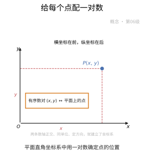

**一句话点破**：坐标系把"在哪里"翻译成"哪两个数"，这正是解析几何的地基。

### 15.2 两点有多远，让勾股定理替你算

想知道两个点之间有多远，先把它们之间的横向差距、纵向差距看成一个直角三角形的两条直角边，斜边的长度就是距离 $\sqrt{(x_2-x_1)^2+(y_2-y_1)^2}$。

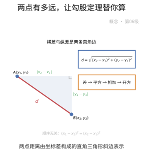

**一句话点破**：距离公式不过是被坐标"包装"过的勾股定理。

### 15.3 中点就在正中央

线段两端点正中间的那个点，横、纵坐标各取平均值：$\left(\dfrac{x_1+x_2}{2},\dfrac{y_1+y_2}{2}\right)$。求对称中心、找重心中点都离不开它。

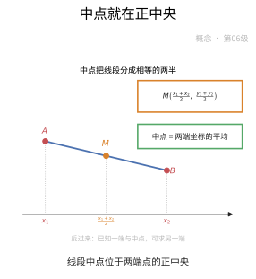

**一句话点破**：中点的坐标，就是两端点坐标的"平均分"。

### 15.4 按比例切线段的分点

在两点连线上按定比 $\lambda$ 取一个分点，它的坐标也是按同样比例混合两端点；中点不过是 $\lambda=1$ 的特例。


**一句话点破**：定比分点公式是"按比例调和"两端坐标，中点只是它最对称的一档。

### 15.5 直线的倾斜程度：斜率

斜率 $k$ 量的是直线"往上跑多快"：横走一步，纵升高多少，$k=\dfrac{y_2-y_1}{x_2-x_1}$。它把看不见的"方向"变成了一个能算、能比较的数。

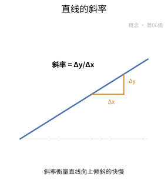

**一句话点破**：斜率把"方向"变成了一个可以计算、可以比较的数。

### 15.6 一条直线，多种写法

同一条直线可以用点斜式、斜截式、两点式、截距式或一般式 $Ax+By+C=0$ 表达，选哪种形式取决于题目给了什么条件。

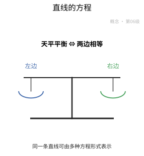

**一句话点破**：直线方程就是"这条线上所有点都满足的那一个等式"。

### 15.7 两直线是平行、垂直还是相交

两条直线平行，当且仅当斜率相等（$k_1=k_2$）；垂直，当且仅当斜率之积为 $-1$；除此之外它们一定相交。

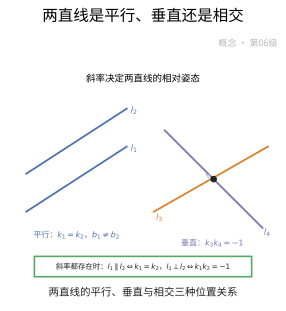

**一句话点破**：平行看斜率是否相等，垂直看斜率之积是否为 $-1$。

### 15.8 点到直线有多远

点 $(x_0,y_0)$ 到直线 $Ax+By+C=0$ 的距离，就是垂足那条垂线的长度：$d=\dfrac{|Ax_0+By_0+C|}{\sqrt{A^2+B^2}}$，分子取绝对值保证距离非负。

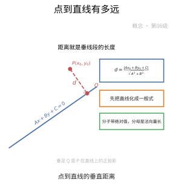

**一句话点破**：距离公式量的是垂线的长度，绝对值保证它永远不会为负。

### 15.9 两条平行线之间的恒定距离

两条平行线处处等距，所以只要在其中一条上随便取一点，用点到直线的距离公式算出它到另一条的距离就行了。

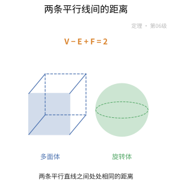

**一句话点破**：平行线间距处处相同，取任一点算垂距即可。

### 15.10 两条直线张开的角度

两条直线相交会夹出一个角，用斜率就能算出它的正切：$\tan\theta=\left|\dfrac{k_2-k_1}{1+k_1k_2}\right|$。求夹角、判断方向差都靠它。

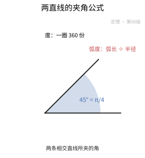

**一句话点破**：夹角公式用两个斜率，就能算出两条直线张开多大的角。

### 15.11 圆锥曲线的来历

用一个平面去截圆锥，随着切割角度不同，会依次得到圆、椭圆、抛物线或双曲线；若平面恰好过顶点，曲线就退化成点、直线等特殊情形。

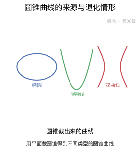

**一句话点破**：这些曲线本是同一个圆锥被不同角度切出的"一家人"。

### 15.12 圆：到圆心等距的点

固定圆心、固定半径，把所有到圆心距离恰好等于这个半径的点连起来，就围成一个圆，标准方程 $(x-a)^2+(y-b)^2=r^2$。

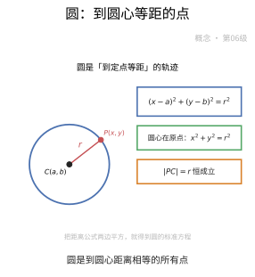

**一句话点破**：圆的方程说的正是"到圆心距离恒为 $r$"这句大白话。

### 15.13 椭圆：到两焦点距离之和为定值

到两个焦点距离之和恒定的点构成椭圆，标准方程 $\dfrac{x^2}{a^2}+\dfrac{y^2}{b^2}=1\ (a>b>0)$，离心率 $0<e<1$ 刻画它有多"扁"。

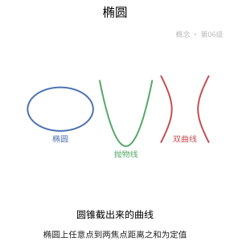

**一句话点破**：椭圆是"到两焦点距离之和恒定"的点的轨迹。

### 15.14 双曲线：到两焦点距离之差为定值

到两个焦点距离之差的绝对值为定值的点构成双曲线，标准方程 $\dfrac{x^2}{a^2}-\dfrac{y^2}{b^2}=1$，它带着两条渐近线 $y=\pm\dfrac{b}{a}x$。

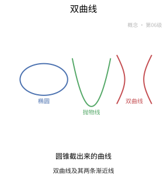

**一句话点破**：双曲线是"到两焦点距离之差恒定"的轨迹，两端无限贴近渐近线。

### 15.15 抛物线：到焦点与准线等距

到焦点和到准线距离相等的点构成抛物线，标准方程 $y^2=2px$，焦点 $\left(\dfrac{p}{2},0\right)$、准线 $x=-\dfrac{p}{2}$。

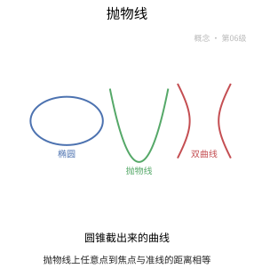

**一句话点破**：抛物线是"到焦点与准线等距"的点的轨迹。

### 15.16 一个离心率，统管所有圆锥曲线

用统一语言描述：动点到焦点的距离与它到准线的距离之比恒为常数 $e$（离心率）。$e<1$ 是椭圆，$e=1$ 是抛物线，$e>1$ 是双曲线。

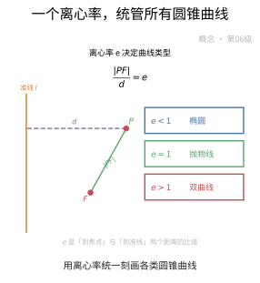

**一句话点破**：一个离心率 $e$，就把椭圆、抛物线、双曲线串成了一条线。

### 15.17 圆锥曲线的光学性质

椭圆能把从一个焦点发出的光线反射到另一个焦点，抛物面能把平行光聚到焦点、也能把点光源变成平行光——这正是卫星锅、探照灯与光学仪器的形状秘密。

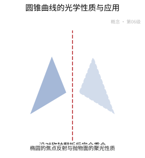

**一句话点破**：焦点反射性质，让圆锥曲线成了天线、探照灯与光学仪器的理想形状。

### 15.18 圆锥曲线分类总表

把各类圆锥曲线的标准方程、焦点、离心率、准线列成一张表，对照着看，识别与记忆都一目了然。

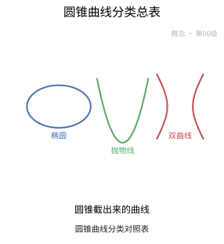

**一句话点破**：一张表把各类曲线的方程、焦点与离心率对齐，认图不再靠猜。

### 15.19 平移坐标轴：换个原点看

把原点移到新位置 $(h,k)$ 后，同一图形的旧坐标与新坐标满足 $x=x'+h,\ y=y'+k$，常用来消去方程里的一次项。

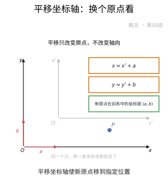

**一句话点破**：平移就是"换个起点看同一幅图"，能把方程化简。

### 15.20 旋转坐标轴：把图形摆正

把坐标轴绕原点转过角 $\theta$，新旧坐标由 $x=x'\cos\theta-y'\sin\theta,\ y=x'\sin\theta+y'\cos\theta$ 联系，可以消去方程中的交叉项 $xy$。

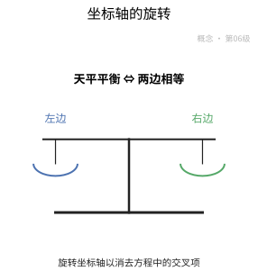

**一句话点破**：旋转是把"斜着的"图形摆正，好让方程露出标准形。

### 15.21 距离公式为什么成立

从 $P_1,P_2$ 分别作横、竖平行线，围出一个直角三角形，两条直角边长为 $|x_2-x_1|$ 与 $|y_2-y_1|$，由勾股定理立得距离公式。

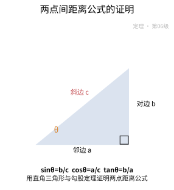

**一句话点破**：距离公式的证明，就是把勾股定理搬进坐标系。

### 15.22 点到直线距离公式的证明

把点到直线上任意一点的连线投影到法向量方向上，或直接作垂线，都能推出 $d=\dfrac{|Ax_0+By_0+C|}{\sqrt{A^2+B^2}}$。

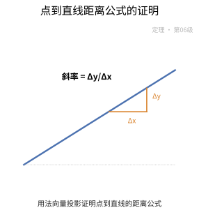

**一句话点破**：点到直线的距离，就是点到线上任一点的连线在法线方向上投影的长度。

### 15.23 圆锥曲线统一定义的证明

以焦点为原点、配合准线建立方程，整理后可得"到焦点距离与到准线距离之比"恒等于常数 $e$，而 $e$ 的取值恰好决定曲线是椭圆、抛物线还是双曲线。

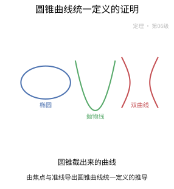

**一句话点破**：统一定义的证明，是用同一个方程把各类曲线的"距离比"锁定为常数 $e$。

### 15.24 向量：既有大小又有方向

向量是既有大小又有方向的量，画成带箭头的线段；线段的长度叫模，箭头的指向就是方向。

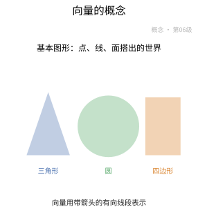

**一句话点破**：向量抓住的，就是"方向加长度"这一对信息。

### 15.25 向量的加法、减法与数乘

向量可以相加（首尾相接或平行四边形法则）、相减，也可以乘上数进行伸缩，这些运算都满足交换律与结合律。

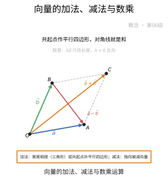

**一句话点破**：向量能加能减能伸缩，几何运动因此可以用算式来表达。

### 15.26 用坐标写向量

把向量写成 $\vec{a}=(x,y)$，起点在原点时它就是终点的坐标；这样一来，向量的加法与数乘全变成坐标的加减乘。

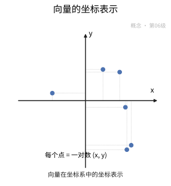

**一句话点破**：坐标一上来，向量运算就退化成了普通的数的运算。

### 15.27 怎样判断两个向量共线

两个非零向量共线（平行），当且仅当存在实数 $\lambda$ 使 $\vec{a}=\lambda\vec{b}$；写成坐标就是 $x_1y_2-x_2y_1=0$，可用来判断三点是否共线。

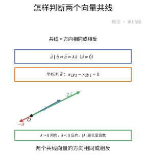

**一句话点破**：共线判定看的是"一个向量能否被另一个伸缩出来"，坐标上就是叉积为零。

### 15.28 数量积：把两个向量变成一个数

两向量的数量积 $\vec{a}\cdot\vec{b}=|\vec{a}||\vec{b}|\cos\theta$，坐标形式是 $x_1x_2+y_1y_2$，结果是一个数而不是向量。

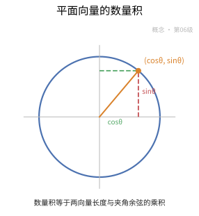

**一句话点破**：点积把两个向量"合成"成一个数，正好度量它们有多同向。

### 15.29 用数量积求夹角、判垂直

由数量积可求夹角余弦 $\cos\theta=\dfrac{\vec{a}\cdot\vec{b}}{|\vec{a}||\vec{b}|}$，两向量垂直当且仅当它们的数量积为零。


**一句话点破**：数量积为零，就是两根箭头互相垂直的信号。

### 15.30 向量的模就是两点间的距离

向量的模 $|\vec{a}|=\sqrt{x^2+y^2}$，而两点间距离正是两点坐标之差那个向量的模，与距离公式完全一致。


**一句话点破**：两点之间的距离，就是连接它们的"位移向量"的长度。

### 15.31 平面向量基本定理：选好基底

同一平面内两个不共线的向量 $\vec{e}_1,\vec{e}_2$ 构成一组基底，任意向量都能唯一地写成 $\vec{a}=\lambda_1\vec{e}_1+\lambda_2\vec{e}_2$。


**一句话点破**：只要选定两个不共线的方向，平面里所有向量都能被它们唯一"调配"出来。

### 15.32 向量在几何与解三角形中的应用

用向量能简洁地证明中位线定理、余弦定理，也能求三角形面积、判断三点共线；几何条件一旦翻译成向量关系，往往几行就能说清。


**一句话点破**：几何题一旦翻译成向量语言，往往两三行就能讲明白。

### 15.33 综合示例：把这一章串起来

坐标、直线、圆锥曲线与向量常常一起出场：先建系设点，再把几何条件写成方程或向量关系，求解后回译成几何结论。


**一句话点破**：解析几何的通法就是"建系、翻译、计算、回译"四步走。

## 16. 数学史（History of Mathematics）

> 解析几何的创立，是数学史上一次深刻的方法论革命：它用坐标把"数"与"形"统一起来，使几何问题可以翻译成代数方程来运算，也让代数式子有了几何图形作直观。本章的每一个对象——点、直线、圆、椭圆/双曲线/抛物线、参数方程与极坐标、坐标变换、平面向量——背后都有一段从"古代的图形直觉"到"现代的方程语言"的演变史。下面按时间顺序逐段梳理。

### 16.1 坐标前史：星空、地图与"形态纬度图"

- **天文与地理的坐标传统**：用一对数定位位置的想法古已有之。约 2 世纪，托勒密在《地理学指南》中用经纬度记载了数千个地点的位置；更早的喜帕恰斯星表也把恒星位置与角度数据对应起来——"坐标"最初是天文与制图的语言，而不是几何学的工具。
- **阿波罗尼奥斯的"准坐标系"**：更接近几何坐标的做法出现在《圆锥曲线论》中：阿波罗尼奥斯以一条直径与一条切线为参照，从切点沿直径量出"横坐标"，再作平行于切线的"纵坐标"线段——这已经与现代坐标系"没有本质区别"，只不过坐标系总是事后叠加在某条已知曲线之上：曲线决定方程，而不是方程决定曲线。
- **中世纪的一次闪光**：14 世纪，法国学者奥雷斯姆（Nicole Oresme，约 1320—1382）在《论形态的构型》中用平面图形表示事物的"强度"：横轴表示延展（长度、时间），竖轴表示强度（热度、速度）。当研究对象是运动时，横轴是时间、竖轴是速度，图形面积就表示走过的路程——这是"速度—时间图"的雏形（常被引为柱状图的远祖），比伽利略早了约两百年。奥雷斯姆还是历史上第一个证明调和级数 $\sum\frac{1}{n}$ 发散的人。
- **为什么还差一步**：以上工作都停留在"画"与"说明"的层面——坐标是描述工具，不是计算工具。直到有人敢于把点直接等同于一对数、把曲线直接等同于一个方程，解析几何才算真正诞生，这一步由笛卡尔与费马完成。

### 16.2 笛卡尔：1637 年《几何》的方法论革命

- **人物与时机**：笛卡尔（René Descartes，1596—1650）出身法国布列塔尼的贵族家庭，青年时从军、游历欧洲，后半生在荷兰专心写作。1637 年，他用母语法语（而非学术通用的拉丁语）出版《方法论》，并附上三篇科学附录：《屈光学》《气象学》与《几何学》——解析几何就诞生在其中的《几何学》里，成了这本哲学名著的"技术附件"。
- **核心创新**：笛卡尔把几何中的"点"对应为数对，把曲线对应为由两个变量构成的方程，于是几何作图问题可以翻译成代数计算问题；反过来，方程的性质又可以通过曲线直观呈现。笛卡儿对数学最重要的贡献，正是将当时完全分开的代数和几何学整合起来——"几何问题可以归结成代数问题，也可以通过代数转换来发现、证明几何性质"。
- **方法与符号**：笛卡尔在《几何学》中用线段运算重建代数（线段的加减乘除对应方程的变形），系统使用 a、b、c 表示已知量，x、y、z 表示未知量，并引入指数的表示方法——现代代数符号体系的相当一部分出自他之手。
- **一个常见误会**：今天所说的"笛卡尔坐标系"（两条垂直数轴）其实是后人的标准化——笛卡尔原著使用的是可以斜交的坐标轴，直角坐标系随 17—18 世纪的教科书逐渐定型；"横坐标"（abscissa）一词由莱布尼茨引入，"纵坐标"（ordonnée）则来自笛卡尔时代的"有序线段"。
- **迟到的认可**：《几何学》出版后反应冷淡——推导跳跃、方程复杂，违背当时的写作惯例；直到 1649 年拉丁语译本（含荷兰数学家斯霍滕 van Schooten 的大量评注）问世，解析几何才在欧洲广泛传播。哲学名著《方法论》名满天下，而数学的《几何学》要靠"注释版"才被读懂，这本身就是科学史上著名的插曲。

### 16.3 费马：与笛卡尔并肩的另一位创始人

- **被埋没的发明**：费马（Pierre de Fermat，1601—1665）是法国图卢兹的律师与议员，业余研究数学，被后世称为"业余数学家之王"。他在约 1629 年写成《平面与立体轨迹引论》，系统讨论了如何用代数方程描述曲线；这部手稿生前未出版，1637 年前后在巴黎流传，恰好在时间上与笛卡尔《几何学》的问世交错。
- **两条相反的思路**：费马"从代数出发"——先写下方程，再描述满足它的曲线；笛卡尔"从几何出发"——先给定曲线，再求出它的方程。殊途同归，但费马的方向更接近今天教科书的想法："曲线是方程的解集"这一观点经由他的手直接影响了后世的曲线研究。
- **各自的贡献**：因为从几何出发，笛卡尔必须发展处理更高次方程的方法，这极大推动了代数理论；费马则在数论（费马小定理、费马大定理）、概率论（与帕斯卡的通信）与光学中的"费马原理"上同样名垂千古。
- **历史的评说**：解析几何通常记在"笛卡尔与费马"两人名下：费马先写出、更清晰，笛卡尔先发表、更系统、影响更大。这场"双创始人"的公案说明：一次观念革命，往往在同一个十年里被几个人同时感觉到。

### 16.4 直线与圆：最古老的对象，最新的语言

- **直线的方程**：笛卡尔时代讨论"直线"，还带着相似三角形与比例式的痕迹；今天的斜截式 $y=kx+b$、一般式 $Ax+By+C=0$、两点式、截距式等"标准件"，是用坐标语言重写欧几里得平面几何的产物，主要在 18—19 世纪的解析几何教科书中定型。斜率（slope）作为直线倾斜程度的度量也随之标准化——它把"方向"变成一个可以计算、可以比较的数，平行与垂直条件 $k_{1}=k_{2}$、$k_{1}k_{2}=-1$ 不过是这一转换的直接产物。
- **圆的方程**：圆是阿波罗尼奥斯早就研究透了的曲线，但"圆 = 到定点的距离为定值的点集"这条定义只有在坐标语言下才能一行写成 $(x-a)^{2}+(y-b)^{2}=r^{2}$；一般式 $x^{2}+y^{2}+Dx+Ey+F=0$ 以及"配方还原圆心与半径"的整套流程，同样出自 18—19 世纪教科书传统。
- **一本"翻译词典"**：距离公式 $\sqrt{(x_{2}-x_{1})^{2}+(y_{2}-y_{1})^{2}}$、中点公式、定比分点公式、点到直线的距离公式……解析几何把欧几里得的"几何关系"逐条翻译成"代数运算"，形成一本可以双向查检的词典：几何证明因此多了一条机械化路线——把条件写成方程，解出来，再翻译回几何结论。
- **影响**：这套"翻译"方法是本章全部问题（轨迹、位置关系、最值）的技术底座，也为微积分提供了刻画图形的语言：切线的"斜率"就是导数（第 11 级）。

### 16.5 圆锥曲线的三千年：从截圆锥到行星轨道

- **为倍立方而生**：圆锥曲线最早是"工具"而不是"曲线"。公元前 4 世纪，梅内赫莫斯（Menaechmus）为解倍立方问题（作一个体积为原立方体两倍的立方体），用垂直于母线的平面去截三种不同顶角（锐角、直角、钝角）的圆锥，分别得到椭圆、抛物线与双曲线（当时只取一支）；他的原著全部佚失，连他给这些曲线起的名字都没能留下。
- **欧几里得与阿基米德**：据说欧几里得写过四卷《圆锥曲线》，同样失传；阿基米德则在《抛物线求积》中算出抛物线与弦围成的弓形面积，在《论劈锥曲面体和旋转椭圆体》中研究了圆锥曲线的旋转体——"算面积、算体积"始终是希腊人关注的重点。
- **阿波罗尼奥斯的高峰**：阿波罗尼奥斯（约前 262—前 190）的八卷《圆锥曲线论》是古代研究的集大成之作（第八卷失传）：他证明用任意角度的平面截双叶圆锥都能得到这些曲线（圆也被收入其中，算作"第四类"），并用"椭圆（缺少）、抛物线（恰好）、双曲线（超出）"为它们命名——这三个词原本是毕达哥拉斯学派比较面积的术语。他还系统研究了共轭直径、交点个数、法线等性质；这套理论在 1800 多年后成为开普勒、牛顿、哈雷研究行星与彗星轨道的数学基础。
- **焦点与准线**：帕普斯（约 350）在注释中阐发了焦距与焦点概念的重要性，并补充了准线的讨论（尤其是抛物线的情形）——这正是本章"圆锥曲线统一定义"的历史源头。
- **伊斯兰世界的接力**：阿波罗尼奥斯的著作主要靠阿拉伯语译本流传。库希（al-Kuhi）在约公元 1000 年描述了专门绘制圆锥曲线的仪器；早于海亚姆一个世纪的阿布·朱德（Abu al-Jud）已用圆锥曲线解三、四次方程；1070 年，海亚姆（Omar Khayyam）的《代数问题论证》把"用圆锥曲线解三次方程"发展成一套系统的几何代数方法，他被公认为解析几何的重要先驱。
- **从几何到方程**：1604 年，开普勒首次使用"焦点（focus）"一词；德萨格与帕斯卡（1639 年帕斯卡的"神秘六边形定理"）用早期射影几何重新研究圆锥曲线；笛卡尔与费马随后把它们彻底代数化。1655 年，沃利斯（John Wallis）首次把圆锥曲线定义为二次方程的图像；德维特（Jan de Witt）写成《曲线初论》——它被视为第一部解析几何教科书，德维特还发明了"准线（directrix）"一词。

### 16.6 二次曲线的代数化：分类、化简与统一

- **一般方程登场**：把圆锥曲线统一写成二元二次方程 $Ax^{2}+Bxy+Cy^{2}+Dx+Ey+F=0$，是解析几何成熟的标志——方程的"系数"与曲线的"类型"之间首次建立了直接对应：参数一变，曲线随之变形，希腊人眼中互不相干的三种截线成了同一个"家族"。
- **分类与化简**：由系数组合判断曲线类型的判据，以及"平移 + 旋转消去一次项与交叉项"的化简流程，构成本章"坐标变换"一节的技术背景；这一整套方法在 18 世纪的教科书中被系统化——欧拉的《无穷分析引论》（1748）整理了二次曲线理论，他还是把坐标法系统地用于空间曲线与曲面研究的第一人。
- **焦点与准线的统一**：代数化之后，希腊人关于焦点的综合结论获得了统一的方程表达：以焦点为极点时，三类曲线可以写成同一个极坐标方程 $r=\frac{ep}{1-e\cos\theta}$——$e<1$ 是椭圆、$e=1$ 是抛物线、$e>1$ 是双曲线。三千年的割裂至此被一个公式收编，这正是本章正文"统一定义"的现代版本。
- **统一的代价与收获**：方程语言用系数交换了图形直觉，却让计算与推广变得容易；今天处理圆锥曲线"设而不求"的联立技巧（代入、判别式、韦达定理），本质上都是 18—19 世纪代数化传统的直系后代。

### 16.7 极坐标：从阿基米德螺线到雷达扫描

- **远的源头**：希腊人早已用"角度"描述方向——喜帕恰斯造弦表、阿基米德研究半径随角度变化的螺线（即今天 $r=a\theta$ 的雏形），据说还有人用类似的角度数据记录恒星位置。但完整的极坐标系统在古代并未建立，因为它更贴近航海与测绘的实践需求，而非希腊式的纯几何推理。
- **几乎同时的两次引入**：17 世纪上半叶，圣-万桑特（1625 年私人文稿、1647 年发表）与卡瓦列里（1635 年发表、1653 年修正）几乎同时、彼此独立地提出了极坐标式的定位方法；卡瓦列里第一次用它计算阿基米德螺线围出的面积，帕斯卡随后用它计算抛物线弧长——极坐标的"首秀"都献给了曲线求积。
- **牛顿与伯努利**：牛顿在 1671 年写成、1736 年出版的《流数术和无穷级数》中，第一个用极坐标表示平面上"任何"一点，并给出了它与其他坐标系之间的变换关系；1691 年，雅各布·伯努利正式使用"极点（pole）"与"极轴（polar axis）"两个术语，并用极坐标研究曲线曲率——以他命名的双纽线 $r^{2}=a^{2}\cos 2\theta$ 成了极坐标的名片。
- **名字与推广**："polar coordinates（极坐标）"这个名称出自 18 世纪的意大利数学家丰塔纳，1816 年皮科克翻译拉克鲁瓦的教科书时正式译入英语；克莱罗与欧拉把平面极坐标推广到空间的柱坐标与球坐标。今天雷达屏幕上"距离 + 方位"的读数、行星轨道的极坐标方程，乃至复数的模与辐角表示，都是这一坐标系的直系后代。

### 16.8 坐标变换：让"换个坐标系"成为数学方法

- **从技巧到主题**：平移与旋转公式（本章"坐标变换"一节）最初只是化简方程的技术：转一转让 $xy$ 项消失、移一移让一次项消失，二次曲线就现出标准形的"真面目"。但"同一图形在不同坐标系下有不同方程"这一事实，逐渐孕育出一个深刻的问题：哪些性质与坐标系的选择无关？
- **19 世纪的几何爆发**：19 世纪上半叶，几何家族突然膨胀——非欧几何（第 03 级 17.9）、高维几何、射影几何（引入无穷远点与复坐标）纷纷登场，"几何到底是什么"成了必须回答的问题。
- **克莱因的回答**：1872 年，克莱因（Felix Klein）在埃尔朗根大学的就职演讲中提出"埃尔朗根纲领"：每一种几何都是研究某个变换群之下的不变量——欧几里得几何对应刚体运动，仿射几何对应仿射变换，射影几何对应射影变换；群越大（允许的变换越多），共同的定理越少、越一般。坐标变换从此从"计算技巧"升格为"几何的分类学"。
- **不变量的回响**：与群论并行，19 世纪的不变量理论（布尔、凯莱、西尔维斯特等人）专门研究"在指定变换下保持不变的量的组合"，与二次曲线的判别式、分类问题一脉相承——"求不变量"从此成为几何与代数的共同主线。

### 16.9 向量与解析几何的融合

- **从四元数到向量分析**：19 世纪中叶，哈密顿的四元数（1843）与格拉斯曼的《线性扩张论》（1844）埋下了向量的种子；1880 年代，吉布斯与赫维赛德把四元数改造成独立的向量分析，点积、叉积取得了现代形式（详见第 04 级 16.10）。
- **向量进入解析几何**：有了向量，直线可以写成 $P=P_{0}+t\vec{v}$，平面的"倾斜"可以用法向量描述，点到直线的距离、投影、面积等概念获得了统一的线性语言；用向量证明"三角形中位线平行于第三边"之类的命题，往往两三行即可完成——本章"平面向量"一节正是这一融合的当代教材形态。
- **两种方法的互补**：坐标方法擅长把几何条件"翻译成方程"再代数求解，向量方法擅长利用对称与线性结构做整体推理；今天的解析几何教材两者并用，是 19 世纪末以来数学表达习惯的沉淀。

### 16.10 传入中国与通向现代数学

- **《代微积拾级》**：1859 年，李善兰与英国传教士伟烈亚力合作，翻译了美国数学家罗密士（Elias Loomis）的解析几何与微积分教材，定名《代微积拾级》——这是解析几何（与微积分）第一次系统进入中文世界，译本后来还传入日本。李善兰在译著中创造、定型了一批沿用至今的术语："代数""函数""微分""积分""级数"等，都是这一代译著留给我们的语言遗产。
- **为什么古代中国没有"长"出来**：中国传统数学有发达的代数（方程术、正负术）与丰富的测量几何，但几何长期以勾股、面积为核心，"用一对数确定一个点"的坐标观念没有发展成独立方法；坐标思想随着 19 世纪的翻译著作才融入中文数学。
- **通向现代**：解析几何是微积分（第 11 级）的舞台——导数就是切线的斜率、积分就是图形的面积；它也是微分几何（第 42 级）、代数几何（第 48 级）、计算几何（第 86 级）的共同起点。从卫星轨道计算到计算机图形学，凡是要"把形状写进公式"的地方，都会回到 1637 年那本《几何学》开创的道路上。

### 16.11 历史年表

| 时间 | 人物／文献 | 事件与贡献 |
|:---|:---|:---|
| 约前 4 世纪 | 梅内赫莫斯 | 用截圆锥定义椭圆、抛物线、双曲线，服务于倍立方 |
| 约前 3 世纪 | 阿基米德 | 《抛物线求积》《论劈锥曲面体和旋转椭圆体》 |
| 约前 262—前 190 | 阿波罗尼奥斯 | 八卷《圆锥曲线论》；命名三类曲线；准坐标方法 |
| 约 350 | 帕普斯 | 阐发焦点与准线概念 |
| 约 2 世纪 | 托勒密《地理学指南》 | 用经纬度记载数千个地点 |
| 约 1000 | 库希 | 描述绘制圆锥曲线的仪器 |
| 1070 | 海亚姆《代数问题论证》 | 用圆锥曲线解三次方程；解析几何先驱 |
| 约 1320—1382 | 奥雷斯姆 | "形态纬度"图：速度—时间图与路程面积；调和级数发散 |
| 1625/1635 | 圣-万桑特、卡瓦列里 | 独立引入极坐标式定位；卡瓦列里计算螺线面积 |
| 1637 | 笛卡尔《几何学》 | 解析几何创立：坐标、方程与曲线统一 |
| 1637 | 费马《平面与立体轨迹引论》 | 手稿在巴黎流传：从方程到曲线 |
| 1649 | 斯霍滕拉丁译本 | 《几何学》获得广泛接受的转折 |
| 1655 | 沃利斯《论圆锥曲线》 | 首次把圆锥曲线定义为二次方程 |
| 约 1660 | 德维特《曲线初论》 | 第一部解析几何教科书；引入"准线"一词 |
| 1671/1736 | 牛顿《流数术和无穷级数》 | 极坐标表示任意点；坐标变换关系 |
| 1691 | 雅各布·伯努利 | 正式引入"极点""极轴"术语；双纽线 |
| 1748 | 欧拉《无穷分析引论》 | 整理二次曲线理论；坐标法研究空间曲线与曲面 |
| 1816 | 皮科克 | "极坐标"译入英语 |
| 1859 | 李善兰、伟烈亚力《代微积拾级》 | 解析几何与微积分传入中国 |
| 1872 | 克莱因《埃尔朗根纲领》 | 几何=变换群下的不变量 |
| 1880s | 吉布斯、赫维赛德 | 向量分析；向量与解析几何融合 |

### 16.12 小结

> 解析几何的诞生，是"数"与"形"分家两千年之后的再度结盟：阿波罗尼奥斯已经站到了门口（用直径与切线当坐标轴），奥雷斯姆用图形"画"出了变量关系，但只有笛卡尔与费马敢于把点与数对、曲线与方程直接等同起来。此后短短三百年间，圆锥曲线从截圆锥的工具变成二次方程的解集，极坐标从螺线求积的算法变成雷达屏幕的语言，坐标变换从配方技巧升格为克莱因的"几何分类学"。本章的每一条公式——直线方程、圆的方程、圆锥曲线标准方程与统一定义、坐标变换与向量表达——都不是从天而降的"规定"，而是这段历史层层沉淀的结果：理解了它们"解决什么问题、替代了什么旧工具"，才算真正拥有它们。

## 现实应用（Real-World Applications）

> 本节把本章的知识点落到真实的工程、科学与生活场景中。每个案例都给出**完整的问题背景、建模过程、可复现的数据 / 公式 / 代码与结果解读**；案例末尾的「涉及知识点」对应本章的具体小节，文末附**知识点覆盖对照表**，确保本章知识点全部被覆盖。

### 应用案例 1：电子游戏与地理信息系统｜游戏世界的坐标系统与角色移动

**场景与问题**

某多人在线战术竞技（MOBA）游戏的大世界地图是一个正方形，坐标系统以地图左下角为原点 $O(0,0)$，向右为 $x$ 轴、向上为 $y$ 轴，覆盖范围 $8000 \times 8000$ 坐标单位，约定 $1$ 坐标单位 $= 0.1$ 米（即地图边长约 $800$ 米，与同类游戏量级一致）。服务器与客户端之间只同步角色的整数坐标，所有距离、路径点、镜头跟随都必须在坐标系里现算。

现在要解决四个具体工程问题：（1）玩家从出生点 $P_1$ 走到任务目标点 $P_2$，导航条要显示直线距离和预计耗时；（2）镜头要平滑跟随到两点中点以居中显示战斗；（3）补给箱要按玩家与目标 $2:1$ 的黄金分割位置投放；（4）需要把「向东走、向北走多少」翻译成向量，便于后续物理运算。

**涉及知识点**

- 本章「1. 平面直角坐标系」：地图坐标系统就是一套平面直角坐标系，$P_1$、$P_2$ 用有序实数对定位。
- 本章「2. 两点间距离公式」：计算角色要走的直线距离。
- 本章「3. 中点公式」：镜头居中到两点中点。
- 本章「4. 定比分点公式」：按 $2:1$ 确定补给箱位置。
- 本章「平面向量 1. 向量的概念」：位移是既有大小又有方向的量。
- 本章「平面向量 2. 向量的线性运算」：位移向量由坐标差得到。
- 本章「平面向量 3. 向量的坐标表示」：$\overrightarrow{P_1P_2} = (x_2-x_1, y_2-y_1)$。
- 本章「平面向量 7. 向量的模与两点间距离（向量表示）」：用模统一表达距离。
- 本章「平面向量 8. 平面向量基本定理（基底）」：$\vec{i},\vec{j}$ 作为正交单位基底。
- 本章「平面向量 10. 综合示例」：本例是向量共线与坐标运算的综合演练。

**建模与数据**

取出生点 $P_1(1200, 3400)$、目标点 $P_2(5600, 7800)$（单位：坐标单位）。$1$ 坐标单位 $=0.1\ \text{m}$。角色移动速度 $v=6.0\ \text{m/s}$（奔跑状态）。镜头居中点即线段中点 $M$。补给箱按分比 $\lambda = \dfrac{P_1P}{PP_2}=2$ 投放在 $P_1 \to P_2$ 之间。

符号约定：$P_1(x_1,y_1)$、$P_2(x_2,y_2)$，位移向量 $\vec{d}=\overrightarrow{P_1P_2}$，单位向量 $\vec{e}_d=\vec{d}/|\vec{d}|$。

**完整推导与算法**

距离：由两点间距离公式

$$
|\overrightarrow{P_1P_2}|=\sqrt{(x_2-x_1)^2+(y_2-y_1)^2}
$$

中点：由中点公式

$$
M\left(\frac{x_1+x_2}{2},\ \frac{y_1+y_2}{2}\right)
$$

定比分点：由定比分点公式

$$
P\left(\frac{x_1+\lambda x_2}{1+\lambda},\ \frac{y_1+\lambda y_2}{1+\lambda}\right)
$$

算法步骤：

1. 读入 $P_1,P_2$，算出位移向量 $\vec{d}=P_2-P_1$。
2. 用模公式求 $|\vec{d}|$，乘 $0.1$ 得实际米数。
3. 除以速度得预计耗时。
4. 用中点公式求镜头中心 $M$。
5. 用定比分点公式求补给箱 $P$。

```python
# 依赖: numpy
# 输入: 出生点 P1、目标点 P2、速度 v
# 输出: 距离、耗时、中点、定比分点、单位向量
import numpy as np

P1 = np.array([1200.0, 3400.0])   # 出生点（坐标单位）
P2 = np.array([5600.0, 7800.0])   # 目标点
scale = 0.1                        # 1 坐标单位 = 0.1 m
v = 6.0                            # 速度 m/s

d_vec = P2 - P1                    # 位移向量，坐标表示 = 终点 - 起点
d_len = np.linalg.norm(d_vec)      # 模 = sqrt(x^2+y^2)
print("位移向量 =", d_vec, " 模 =", d_len, "坐标单位")

d_m = d_len * scale
print("实际直线距离 = %.2f m" % d_m)
print("预计耗时 = %.2f s" % (d_m / v))

M = (P1 + P2) / 2.0                # 中点公式
print("镜头中点 M =", M)

lam = 2.0                          # P1P : PP2 = 2 : 1
Pc = (P1 + lam * P2) / (1.0 + lam) # 定比分点公式
print("补给箱位置(2:1) =", Pc)

e_d = d_vec / d_len                # 单位方向向量（模为 1）
print("单位方向向量 =", e_d, " 模 =", np.linalg.norm(e_d))

# 用基底 i=(1,0), j=(0,1) 分解位移：d = x*i + y*j
x, y = d_vec
print("d = %.0f*i + %.0f*j" % (x, y))
```

**可复现步骤**

1. 环境与依赖：`pip install numpy`
2. 数据准备：把上面 `P1`、`P2`、`scale`、`v` 直接写入脚本 `case1.py`。
3. 运行：`python case1.py`
4. 预期输出：位移向量 `(4400, 4400)`；模 `6222.54`（坐标单位）；实际距离约 `622.25 m`；耗时约 `103.71 s`；中点 `(3400., 5600.)`；定比分点 `(4133.33, 6333.33)`；单位方向向量约 `(0.7071, 0.7071)`，模为 `1.0`。

**结果解读与延伸**

位移向量 $(4400,4400)$ 表明角色需要向东北方向（$x$、$y$ 同时增大）移动，两条分量相等，说明路线恰好沿 $45°$ 对角线，单位向量 $(0.7071,0.7071)$ 正是 $(\cos 45°, \sin 45°)$，与方向角公式 $\cos\theta=x/|\vec a|$ 完全吻合。定比分点 $(4133.33,6333.33)$ 落在连线靠目标一侧（因为 $\lambda=2$ 意味着到 $P_1$ 的距离是到 $P_2$ 的 $2$ 倍，加权上偏向 $P_2$）。局限：这里计算的是**直线**距离，游戏实际路径有障碍物需要寻路算法（A*），直线距离只是下界估计；此外坐标单位到米的换算系数需与地图资源一致。可延伸：把中点公式推广为三点平均可得三角形重心（镜头跟随小队中心），把位移向量再做数乘即可预判角色 $2$ 秒后的位置。

### 应用案例 2：计算机图形学与激光雷达仿真｜二维光线投射与碰撞检测

**场景与问题**

在二维俯视游戏或激光雷达（LiDAR）仿真中，需要判断一条射线（激光束）与一段墙壁（线段）是否相交、交点在哪、以及角色离墙最近多远。这类引擎每帧要处理上千次射线—线段求交，因此必须用直线方程与向量点积的闭式解，而不是迭代试探。

具体任务：模拟一枚从位置 $S(0.0, 0.0)$（单位：米）出发、方向为 $\vec{u}$ 的激光束，检测它与两面墙的关系：（1）求出射线与墙壁所在直线的交点；（2）判断两墙是否平行、走廊两条平行墙之间的净距；（3）计算角色离墙的最近距离（用于触发「贴近墙壁」特效）；（4）计算激光束与墙壁的夹角。

**涉及知识点**

- 本章「直线 1. 直线的斜率」：墙面的倾斜程度用斜率刻画。
- 本章「直线 2. 直线的方程」：墙面撰写为一般式 $Ax+By+C=0$，便于求交与算距。
- 本章「直线 3. 两条直线的位置关系」：判断两墙平行 / 相交（行列式 $\Delta \neq 0$）。
- 本章「直线 4. 点到直线的距离公式」：角色到墙的最短距离。
- 本章「直线 5. 两条平行线间的距离」：走廊净宽。
- 本章「直线 6. 两直线的夹角公式」：激光与墙面的入射角。
- 本章「平面向量 4. 向量共线（平行）的判定」：两墙方向向量共线即平行。
- 本章「平面向量 5. 平面向量的数量积（点积）」：投影求距离、垂直判定。
- 本章「平面向量 6. 向量的夹角与垂直判定」：入射角的余弦计算。

**建模与数据**

射线起点 $S(0.0,0.0)$，方向 $\vec{u}=(0.8,0.6)$（已归一化，$|\vec{u}|=1$）。角色当前位置 $P_0(1.2, 1.5)$。

两面墙（线段）：
- 墙 A：过 $A_1(-2.0, 2.0)$ 与 $A_2(6.0, 2.0)$ —— 水平墙 $y=2$，一般式 $0\cdot x + 1\cdot y - 2 = 0$，即 $A=0,B=1,C=-2$。
- 墙 B：过 $B_1(1.0, 0.8)$ 与 $B_2(5.0, 4.8)$ —— 斜率 $k=1$，一般式 $x-y-0.2=0$，即 $A=1,B=-1,C=-0.2$。

走廊两平行墙：$l_1: 0\cdot x + 1\cdot y - 3 = 0$（$y=3$）与 $l_2: 0\cdot x + 1\cdot y - 5 = 0$（$y=5$）。

**完整推导与算法**

联立射线与一般式直线求交。射线参数式 $S+t\vec{u}$，代入 $l: Ax+By+C=0$：

$$
A(x_S+t u_x)+B(y_S+t u_y)+C=0
\;\Longrightarrow\;
t=-\frac{A x_S+B y_S+C}{A u_x+B u_y}
$$

当 $t\ge 0$ 时交点在射线正方向；再判断交点是否落在线段范围内。

点到直线距离：

$$
d=\frac{|A x_0+B y_0+C|}{\sqrt{A^2+B^2}}
$$

平行线间距（要求两方程 $A,B$ 相同）：

$$
d=\frac{|C_1-C_2|}{\sqrt{A^2+B^2}}
$$

两直线夹角（用一般式）：

$$
\cos\theta=\frac{|A_1A_2+B_1B_2|}{\sqrt{A_1^2+B_1^2}\sqrt{A_2^2+B_2^2}}
$$

算法步骤：

1. 把每面墙转成一般式 $(A,B,C)$。
2. 对射线，按上式解 $t$，得交点。
3. 检查交点参数是否落在两点之间（线段）。
4. 用点距公式算角色到墙距离；用平行线公式算走廊净宽；用夹角公式算入射角。

```python
# 依赖: numpy
# 输入: 射线起点/方向、墙面端点、角色位置
# 输出: 交点、距离、净宽、夹角
import numpy as np

S = np.array([0.0, 0.0]); u = np.array([0.8, 0.6])   # 已归一化
P0 = np.array([1.2, 1.5])

def line_from_points(P, Q):
    # 由两点得一般式 Ax+By+C=0，A=y2-y1, B=x1-x2, C=x2*y1-x1*y2
    P = np.array(P, float); Q = np.array(Q, float)
    A = Q[1] - P[1]; B = P[0] - Q[0]
    C = Q[0]*P[1] - P[0]*Q[1]
    return np.array([A, B, C])

def ray_line_intersect(S, u, line):
    A, B, C = line
    denom = A*u[0] + B*u[1]
    if abs(denom) < 1e-12:
        return None                      # 平行
    t = -(A*S[0] + B*S[1] + C) / denom
    if t < 0:
        return None                      # 交点在射线反方向
    return S + t*u, t

def point_line_dist(P, line):
    A, B, C = line
    return abs(A*P[0] + B*P[1] + C) / np.hypot(A, B)

wallA = line_from_points((-2.0, 2.0), (6.0, 2.0))
wallB = line_from_points((1.0, 0.8), (5.0, 4.8))
print("墙A一般式 =", wallA, " 墙B一般式 =", wallB)

for name, ln in [("A", wallA), ("B", wallB)]:
    r = ray_line_intersect(S, u, ln)
    print("射线与墙%s交点 = %s" % (name, None if r is None else np.round(r[0], 4)))

# 平行判定（方向向量共线：A1*B2 - A2*B1）
det = wallA[0]*wallB[1] - wallB[0]*wallA[1]
print("墙A/墙B 行列式 =", det, "-> 平行" if abs(det) < 1e-12 else "-> 相交")

# 角色到墙A的距离
print("角色到墙A距离 = %.4f m" % point_line_dist(P0, wallA))

# 走廊两平行墙净宽
l1 = np.array([0.0, 1.0, -3.0]); l2 = np.array([0.0, 1.0, -5.0])
print("走廊净宽 = %.4f m" % (abs(l1[2]-l2[2]) / np.hypot(l1[0], l1[1])))

# 射线与墙A夹角（一般式夹角公式）
cos_t = abs(u[0]*wallA[0] + u[1]*wallA[1]) / (np.hypot(u[0], u[1])*np.hypot(wallA[0], wallA[1]))
print("射线与墙A夹角 = %.2f 度" % np.degrees(np.arccos(cos_t)))
```

**可复现步骤**

1. 环境与依赖：`pip install numpy`
2. 数据准备：把上面的起点、方向、墙端点、走廊两墙系数写入 `case2.py`。
3. 运行：`python case2.py`
4. 预期输出：射线与墙 A 交点约 $(2.6667, 2.0)$；与墙 B 交点约 $(3.6667, 2.75)$；墙 A/墙 B 行列式为 $-1$（非零，相交）；角色到墙 A 距离约 $0.5\ \text{m}$；走廊净宽 $2.0\ \text{m}$；射线与墙 A 夹角约 $36.87°$。

**结果解读与延伸**

射线方向 $(0.8,0.6)$ 的斜率 $k=0.6/0.8=0.75$，与水平墙 $y=2$ 交于 $x=2/0.75=2.667$，与程序结果一致；角色到墙 A 距离 $|1.5-2|/1=0.5$，落在「贴墙」阈值（通常 $0.5\ \text{m}$）边缘，可触发特效。两墙行列式非零说明它们相交，若把墙 A 换成 $y=2$、墙 C 换成 $y=5$ 则行列式为 $0$，应改用平行线公式。误差来源主要是浮点比较阈值（这里用 $10^{-12}$）与线段范围判断（本代码只解了无限直线，加入 $0\le t\le |A_1A_2|$ 即可限制为线段）。延伸：把两向量夹角余弦用于「视线锥」判定，把点积正负用于判断角色在墙的哪一侧。

### 应用案例 3：自动驾驶与地图匹配｜路径偏差检测与坐标系旋转

**场景与问题**

自动驾驶车辆沿高精地图中的一条参考车道线行驶，控制模块需要实时回答：车辆横向偏离车道中心线多少厘米（偏差检测）？车身航向与车道方向差多少度？以及如何把车身坐标系的传感器点云旋转到地图坐标系（融合定位）？

参考车道线在局部地图中用一条直线表示：过点 $L_0(0.0, 0.0)$ 与 $L_1(40.0, 12.0)$（单位：米），即向东 $40$ 米、向北 $12$ 米。车辆定位给出的后轴中心 $C(10.0, 5.2)$，航向角（车头相对 $x$ 轴正向的逆时针角）$\phi = 20°$。要求算横向偏差、航向偏差，并把车身坐标下探测到的前方障碍物点 $Q_{\text{body}}=(15.0, 1.5)$ 变换到地图坐标。

**涉及知识点**

- 本章「直线 4. 点到直线的距离公式」：车辆到车道中心线的横向偏差。
- 本章「坐标变换 1. 坐标轴的平移」：把原点平移到车辆位置，建立车身相对坐标。
- 本章「坐标变换 2. 坐标轴的旋转」：车身坐标到地图坐标的旋转（航向角）。
- 本章「平面向量 5. 平面向量的数量积（点积）」：用投影求横向偏移的带符号量。
- 本章「平面向量 6. 向量的夹角与垂直判定」：航向偏差角。
- 本章「平面向量 3. 向量的坐标表示」：点云点的坐标与旋转变换。
- 本章「平面向量 2. 向量的线性运算」：平移 + 旋转的复合变换。

**建模与数据**

车道方向向量 $\vec{t}=\overrightarrow{L_0L_1}=(40,12)$，单位化得 $\vec{e}_t=(0.9578, 0.2873)$。车道线一般式：由两点式得 $12x-40y=0$，即 $A=12,B=-40,C=0$（等价于 $3x-10y=0$）。

车辆位置 $C(10.0,5.2)$，航向 $\phi=20°=\pi/9\ \text{rad}$。车身坐标系：以车辆后轴为原点、车头方向为 $x'$、左侧为 $y'$。障碍物在车身坐标 $Q_{\text{body}}=(15.0,1.5)$。

旋转变换（把车身坐标 $(x',y')$ 转到地图方向）：

$$
\begin{cases}
\Delta x = x'\cos\phi - y'\sin\phi \\
\Delta y = x'\sin\phi + y'\cos\phi
\end{cases}
$$

**完整推导与算法**

横向偏差（点到直线距离）：

$$
d_{\perp}=\frac{|A x_C+B y_C+C|}{\sqrt{A^2+B^2}}
=\frac{|3\times 10-10\times 5.2|}{\sqrt{3^2+10^2}}
=\frac{|30-52|}{\sqrt{109}}
$$

带符号偏差 = 偏差在车道法向量 $\vec{n}=(A,B)$ 上的投影，用于判断车在中心线左侧还是右侧：

$$
s=\frac{A x_C+B y_C+C}{\sqrt{A^2+B^2}}
$$

航向偏差：车道方向与车头方向夹角

$$
\cos\theta=\frac{\vec{e}_t\cdot(\cos\phi,\sin\phi)}{|\vec{e}_t|\cdot 1}
$$

地图坐标 = 车辆位置 + 旋转后的车身向量：

$$
Q_{\text{map}}=C+\big(x'\cos\phi-y'\sin\phi,\ x'\sin\phi+y'\cos\phi\big)
$$

算法步骤：

1. 由车道两点求一般式与方向单位向量。
2. 代入点距公式算横向偏差，并保留符号判断左右。
3. 用点积算航向偏差角。
4. 用旋转公式把障碍物坐标从车身系转到地图系。

```python
# 依赖: numpy
# 输入: 车道两点、车辆位置与航向、车身系障碍物点
# 输出: 横向偏差、左右侧、航向偏差、地图坐标
import numpy as np

L0 = np.array([0.0, 0.0]); L1 = np.array([40.0, 12.0])
C  = np.array([10.0, 5.2])
phi = np.radians(20.0)

# 车道一般式 A=12, B=-40, C=0
A, B, C0 = 12.0, -40.0, 0.0
norm_n = np.hypot(A, B)

signed = (A*C[0] + B*C[1] + C0) / norm_n     # 带符号横向偏移
print("带符号横向偏差 = %.4f m" % signed)
print("横向距离 = %.4f m" % abs(signed))

# 车道方向单位向量
t = L1 - L0; e_t = t / np.linalg.norm(t)
heading = np.array([np.cos(phi), np.sin(phi)])
cos_t = np.clip(e_t @ heading, -1.0, 1.0)
print("车速航向与车道方向夹角 = %.2f 度" % np.degrees(np.arccos(cos_t)))

# 车身坐标 -> 地图坐标（旋转 + 平移）
R = np.array([[np.cos(phi), -np.sin(phi)],
              [np.sin(phi),  np.cos(phi)]])
Q_body = np.array([15.0, 1.5])
Q_map = C + R @ Q_body
print("障碍物地图坐标 =", np.round(Q_map, 3))

# 验证旋转矩阵正交（det=1，保持长度）
print("det(R) = %.6f, |Q_body| = %.4f, 旋转后模 = %.4f"
      % (np.linalg.det(R), np.linalg.norm(Q_body),
         np.linalg.norm(R @ Q_body)))
```

**可复现步骤**

1. 环境与依赖：`pip install numpy`
2. 数据准备：把车道两点、车辆位置 $(10.0,5.2)$、航向 $20°$、车身点 $(15.0,1.5)$ 写入 `case3.py`。
3. 运行：`python case3.py`
4. 预期输出：带符号横向偏差约 $-2.107\ \text{m}$（负号表明在车道右侧），横向距离约 $2.107\ \text{m}$；航向偏差约 $3.37°$；障碍物地图坐标约 $(24.58, 12.16)$；$\det(R)=1.000000$，旋转前后模相等。

**结果解读与延伸**

带符号偏差 $-2.107\ \text{m}$ 说明车辆偏离车道中心约 $2.1$ 米且位于右侧（法向量 $(12,-40)$ 指向侧），远超常见 LKA（车道保持）$0.3\ \text{m}$ 的报警阈值，应触发方向盘回正。航向偏差仅 $3.37°$，说明车身姿态基本贴合车道，偏差主要来自横向平移而非角度。旋转矩阵 $R$ 的行列式为 $1$、且保持向量长度不变，这正验证了「旋转是刚体变换、不拉伸」——与本章「$B^2-4AC$ 是旋转不变量」同源。局限：真实道路是曲率连续的样条，直线段只作局部近似；车身系到地图系还常含轻微俯仰/横滚，需三维旋转。延伸：用连续多帧的带符号偏差拟合横向速度，可直接喂给 MPC 控制器。

### 应用案例 4：无线通信与雷达工程｜基站覆盖圆与两圆干扰分析

**场景与问题**

移动通信规划中，每个基站的天线在水平面上形成的覆盖区近似为一个圆：圆心是基站坐标，半径由发射功率、频段与路损模型决定。城市规划师需要判断：某用户设备（UE）是否在覆盖内？两座基站的覆盖圆是否重叠产生同频干扰？若三座基站做三角定位，交点如何求？

某城市区域（单位：米）有基站 $\text{BS}_1$ 位于 $(300, 400)$，半径 $r_1=600$；基站 $\text{BS}_2$ 位于 $(1400, 1500)$，半径 $r_2=700$；用户设备位于 $U(800, 900)$。

**涉及知识点**

- 本章「圆锥曲线 0. 圆锥曲线的来源与退化情形」：圆是截面垂直于轴的圆锥截线，退化情形对应半径为零（一个点）。
- 本章「圆锥曲线 1. 圆 (Circle)」：覆盖区用标准方程 $(x-h)^2+(y-k)^2=r^2$ 描述。
- 本章「圆锥曲线 7. 圆锥曲线分类总表」：圆是 $e=0$ 的极限情形，用于定位问题分类。
- 本章「核心概念 2. 两点间距离公式」：两基站间距决定覆盖圆是否相交。
- 本章「平面向量 5. 平面向量的数量积（点积）」：判断 UE 相对两基站的方向。

**建模与数据**

圆的标准方程 $(x-h)^2+(y-k)^2=r^2$，展成一般式 $x^2+y^2+Dx+Ey+F=0$，其中 $D=-2h$、$E=-2k$、$F=h^2+k^2-r^2$，圆心 $\left(-\frac{D}{2},-\frac{E}{2}\right)$，半径 $r=\frac12\sqrt{D^2+E^2-4F}$。

$\text{BS}_1$：$h_1=300,k_1=400,r_1=600$，故 $D_1=-600,E_1=-800,F_1=300^2+400^2-600^2=90000+160000-360000=-110000$，一般式 $x^2+y^2-600x-800y-110000=0$。

$\text{BS}_2$：$h_2=1400,k_2=1500,r_2=700$，$D_2=-2800,E_2=-3000,F_2=1400^2+1500^2-700^2=1960000+2250000-490000=3720000$。

UE：$U(800,900)$。两基站中心距 $d_{12}=|BS_1BS_2|$。

**完整推导与算法**

覆盖判定：计算 UE 到基站中心距离与半径比较：

$$
|U-\text{BS}_i| \le r_i \iff \text{在覆盖内}
$$

两圆位置关系由中心距决定：

$$
d_{12}=|\overrightarrow{BS_1BS_2}|
$$

- $d_{12} > r_1+r_2$：相离（无重叠）
- $|r_1-r_2| \le d_{12} \le r_1+r_2$：相交
- $d_{12} < |r_1-r_2|$：内含

两圆交点：联立两圆方程相减得根轴（一条直线），再与该圆联立求交。

算法步骤：

1. 由圆心半径写出两圆一般式。
2. 算 UE 到两圆心距离，判断是否覆盖。
3. 算中心距 $d_{12}$，与 $r_1+r_2$、$|r_1-r_2|$ 比较，判定重叠类型。
4. 两圆方程相减得根轴，解交点。

```python
# 依赖: numpy
# 输入: 两基站坐标与半径、UE 坐标
# 输出: 覆盖判定、重叠类型、交点
import numpy as np

h1, k1, r1 = 300.0, 400.0, 600.0
h2, k2, r2 = 1400.0, 1500.0, 700.0
U = np.array([800.0, 900.0])

def general_form(h, k, r):
    # 标准方程展开成 x^2+y^2+Dx+Ey+F=0
    return (-2*h, -2*k, h*h + k*k - r*r)

D1, E1, F1 = general_form(h1, k1, r1)
D2, E2, F2 = general_form(h2, k2, r2)
print("BS1 一般式: D=%.0f E=%.0f F=%.0f" % (D1, E1, F1))
print("BS2 一般式: D=%.0f E=%.0f F=%.0f" % (D2, E2, F2))

# 覆盖判定
for name, (h, k, r) in [("BS1", (h1, k1, r1)), ("BS2", (h2, k2, r2))]:
    dist = np.hypot(U[0]-h, U[1]-k)
    print("UE 到 %s 距离 = %.1f m, 覆盖内=%s" % (name, dist, dist <= r))

# 两圆关系
c1 = np.array([h1, k1]); c2 = np.array([h2, k2])
d12 = np.linalg.norm(c2 - c1)
print("中心距 = %.2f m, r1+r2 = %.1f" % (d12, r1+r2))
if d12 > r1 + r2:
    print("相离")
elif d12 < abs(r1 - r2):
    print("内含")
else:
    print("相交（存在同频干扰重叠区）")

# 两圆交点：相减得根轴 (D1-D2)x+(E1-E2)y+(F1-F2)=0
A = D1 - D2; B = E1 - E2; C = F1 - F2
print("根轴方程: %.0f x + %.0f y + %.0f = 0" % (A, B, C))
```

**可复现步骤**

1. 环境与依赖：`pip install numpy`
2. 数据准备：把两基站 $(300,400,r_1=600)$、$(1400,1500,r_2=700)$、UE 坐标写入 `case4.py`。
3. 运行：`python case4.py`
4. 预期输出：UE 到 BS1 距离约 $707.1\ \text{m}$（大于 $600$，不在覆盖内）；UE 到 BS2 距离约 $849.7\ \text{m}$（大于 $700$，不在覆盖内）；中心距约 $1562.0\ \text{m}$；$r_1+r_2=1300$，故 $d_{12} > r_1+r_2$ → 两圆**相离**，无重叠干扰；根轴方程 $2200x+2200y+3830000=0$。

**结果解读与延伸**

UE 恰好落在两基站之间的盲区边缘附近——到 BS1 约 $707\ \text{m}$、到 BS2 约 $850\ \text{m}$，都略超半径，说明需要新增微基站补盲。两覆盖圆相离（$1562>1300$），中间有约 $262\ \text{m}$ 的缝隙，与 UE 落在盲区相互印证。局限：真实覆盖受建筑遮挡、天线方向图（非全向）影响，圆形模型只是第一层近似；城市常用射线追踪或经验路径损耗模型修正。延伸：把圆推广为椭圆（定向天线覆盖近似椭圆形），或把三基站联合定位写成两两「双曲线」求交，正是下一案例中双曲线定位的基础。

### 应用案例 5：航天与光学工程｜卫星轨道、抛物面天线与圆锥曲线家族

**场景与问题**

圆锥曲线是航天与光学工程的核心语言。本案例用一组真实量级的工程数据，串起椭圆/抛物线/双曲线的定义、离心率、准线与光学性质：

（1）某低轨遥感卫星轨道为椭圆，近地点距地心 $r_p=6871\ \text{km}$、远地点 $r_a=7021\ \text{km}$，求半长轴 $a$、半焦距 $c$、离心率 $e$；（2）深空探测器以抛物线轨道完成引力弹弓（$e=1$），给出其焦点—准线方程；（3）某 C 波段抛物面天线直径 $3.0\ \text{m}$、焦径比 $f/D=0.4$，求焦准距与焦点位置，并解释为何抛物面能把平行来波会聚到焦点。

**涉及知识点**

- 本章「圆锥曲线 0. 圆锥曲线的来源与退化情形」：三类轨道对应平面截对顶圆锥的不同方式。
- 本章「圆锥曲线 2. 椭圆 (Ellipse)」：卫星椭圆轨道，$a^2=b^2+c^2$。
- 本章「圆锥曲线 3. 双曲线 (Hyperbola)」：双曲线时差定位（如 GPS）。
- 本章「圆锥曲线 4. 抛物线 (Parabola)」：探测器逃逸轨道、抛物面天线。
- 本章「圆锥曲线 5. 圆锥曲线的统一定义」：$\frac{|PF|}{d(P,l)}=e$ 统一三类轨道。
- 本章「圆锥曲线 6. 圆锥曲线的光学性质与应用」：抛物面天线聚波、椭圆回音壁。
- 本章「圆锥曲线 7. 圆锥曲线分类总表」：用 $e$ 归档轨道类型。
- 本章「定理与证明 定理 3：圆锥曲线的统一定义」：以焦点—准线—离心率统一刻画。
- 本章「平面向量 5. 平面向量的数量积（点积）」：光学性质证明中用投影判断法线平分角。

**建模与数据**

轨道动力学中，天体在中心引力场中的轨道由轨道离心率 $e$ 决定：$e<1$ 椭圆、$e=1$ 抛物线、$e>1$ 双曲线。对椭圆，$r_p=a(1-e)$、$r_a=a(1+e)$。

卫星数据：$r_p=6871\ \text{km}$（对应约 $500\ \text{km}$ 轨道高度，地球半径 $6371\ \text{km}$），$r_a=7021\ \text{km}$。

抛物面天线：口径 $D=3.0\ \text{m}$，焦径比 $f/D=0.4$，故焦距 $f=1.2\ \text{m}$。抛物面方程 $y^2=2px$（$x$ 为轴向）中，焦点在 $(p/2,0)$，焦距即 $p/2$。

**完整推导与算法**

由 $r_p=a(1-e)$、$r_a=a(1+e)$ 联立：

$$
a=\frac{r_p+r_a}{2},\qquad e=\frac{r_a-r_p}{r_a+r_p},\qquad c=ae
$$

半短轴 $b=\sqrt{a^2-c^2}=a\sqrt{1-e^2}$，椭圆面积 $S=\pi ab$。

焦准距：对 $y^2=2px$，焦点到准线距离为 $p$，而焦距 $f=p/2$，故 $p=2f=0.8\ \text{m}$。

光学性质：抛物线上任一点到焦点距离等于到准线距离（$e=1$），因此平行于轴入射的来波到「焦点＋准线」的路程差恒定，同相位叠加，能量在焦点处相干增强——这就是卫星锅、射电望远镜的聚波原理。

算法步骤：

1. 由近远地点求 $a,e,c,b$。
2. 由 $f/D$ 求焦距与焦准距，写出抛物线方程。
3. 用 $e$ 归档三类轨道（分类总表）。
4. 定性解释抛物面光学性质并给出反射关系。

```python
# 依赖: numpy
# 输入: 近远地点半径、天线口径与焦径比
# 输出: 轨道参数、抛物线参数
import numpy as np

rp, ra = 6871.0, 7021.0            # km
a = (rp + ra) / 2.0
e = (ra - rp) / (ra + rp)
c = a * e
b = np.sqrt(a*a - c*c)
print("半长轴 a = %.2f km" % a)
print("离心率 e = %.5f" % e)
print("半焦距 c = %.3f km" % c)
print("半短轴 b = %.2f km" % b)
print("周期相关：a^3 比例 = %.3e km^3" % (a**3))
print("轨道面积 = %.3e km^2" % (np.pi*a*b))

# 抛物面天线
D = 3.0; fD = 0.4
f = fD * D
p = 2 * f
print("焦距 f = %.2f m, 焦准距 p = %.2f m" % (f, p))
print("抛物面方程 x 轴向：y^2 = %.1f x，焦点 (%.2f, 0)" % (p, p/2))

# 按 e 归档轨道类型
def classify(e):
    if e < 1:  return "椭圆轨道（束缚）"
    if e == 1: return "抛物线轨道（逃逸临界）"
    return "双曲线轨道（逃逸）"
print("轨道类型:", classify(e))
```

**可复现步骤**

1. 环境与依赖：`pip install numpy`
2. 数据准备：把 $r_p=6871$、$r_a=7021$、$D=3.0$、$f/D=0.4$ 写入 `case5.py`。
3. 运行：`python case5.py`
4. 预期输出：$a=6946.00\ \text{km}$；$e=0.010801$；$c=75.023\ \text{km}$；$b\approx6945.59\ \text{km}$；$f=1.20\ \text{m}$、$p=2.40\ \text{m}$（注意 $p=2f$ 而焦点在 $p/2=f$）；轨道类型为「椭圆轨道（束缚）」。

**结果解读与延伸**

$e=0.0108$ 与地球（$e\approx0.017$）、金星（$e\approx0.007$）同量级，说明这是近圆轨道；$c=75\ \text{km}$ 相对 $a=6946\ \text{km}$ 很小，印证「$e$ 越小越接近圆」。若把 $r_a\to\infty$ 则 $e\to1$，退化为抛物线（逃逸临界），若给足能量则 $e>1$ 变双曲线；这正是统一定义 $\frac{|PF|}{d(P,l)}=e$ 的三种取值。抛物面天线焦准距 $p=2.4\ \text{m}$，焦点在轴向 $1.2\ \text{m}$ 处，馈源放在这里即可最高效接收平行来波。局限：真实卫星轨道还受 $J_2$ 摄动、非球形引力与工程误差影响，椭圆只是二体问题的一阶模型。延伸：把椭圆离心率代入开普勒第三定律 $T^2\propto a^3$ 可估轨道周期；把双曲线定位写成 GPS 的时差方程即为「到两卫星距离差恒定」的双曲线。

### 应用案例 6：从定理到工程验证｜距离公式与解三角形定理的数值印证

**场景与问题**

本章的三个定理（两点距离公式、点到直线距离公式、圆锥曲线统一定义）与向量在解三角形中的应用（余弦定理、中线定理、正弦定理、重心），是解析几何的骨架。工程实践中，任何「公式是否被正确实现」都需要数值反证。本案例用一组可复现数据，对六条结论做数值验证，确保它们不是纸面推导而是可被程序检验的事实。

**涉及知识点**

- 本章「定理与证明 定理 1：两点间距离公式的证明」：用勾股构造直角三角形，数值验证。
- 本章「定理与证明 定理 2：点到直线距离公式的证明」：用参数方程与投影，数值验证。
- 本章「定理与证明 定理 3：圆锥曲线的统一定义」：以焦点—准线比值验证。
- 本章「平面向量 1. 向量的概念」：力/位移是有向量的现实原型。
- 本章「平面向量 2. 向量的线性运算」：向量加法、数乘。
- 本章「平面向量 4. 向量共线（平行）的判定」：行列式判定。
- 本章「平面向量 9. 向量在解三角形和几何中的应用」：余弦定理、中线定理、正弦定理、重心的向量证明。
- 本章「平面向量 10. 综合示例」：多知识点综合的数值算例。

**建模与数据**

取三角形 $A(0,0)$、$B(4,0)$、$C(1,3)$。三边长 $a=|BC|$、$b=|CA|$、$c=|AB|$，中线 $AM$（$M$ 为 $BC$ 中点），重心 $G$。

验证数据：
- 定理 1：$|AB|$ 用勾股与坐标差两法比对；
- 定理 2：点 $C(1,3)$ 到直线 $AB: y=0$ 的距离，与三角形高比对；
- 定理 3：对椭圆 $\frac{x^2}{25}+\frac{y^2}{9}=1$，取点 $P$，验证 $\frac{|PF_1|}{d(P,l_1)}=e$；
- 余弦定理：$a^2=b^2+c^2-2bc\cos A$；
- 中线定理：$AB^2+AC^2=2(AM^2+BM^2)$；
- 重心：$\overrightarrow{OG}=\frac{\overrightarrow{OA}+\overrightarrow{OB}+\overrightarrow{OC}}{3}$。

**完整推导与算法**

定理 1（勾股）：构造 $Q(x_2,y_1)$，则 $|P_1Q|=|x_2-x_1|$、$|P_2Q|=|y_2-y_1|$，$|P_1P_2|^2=|P_1Q|^2+|P_2Q|^2$。

定理 2（投影）：设 $P_0$，过 $P_0$ 作 $l$ 的垂线，$l$ 法向量 $\vec{n}=(A,B)$，距离 $d=\frac{|Ax_0+By_0+C|}{\sqrt{A^2+B^2}}$，等价于 $\overrightarrow{P_0P_1}$ 在 $\vec{n}$ 上的投影。

定理 3（统一定义）：椭圆 $a=5,b=3,c=4$，$e=c/a=0.8$，准线 $x=\pm a^2/c=\pm6.25$。取 $P(5\cos\theta,3\sin\theta)$，验证 $\frac{|PF_1|}{d(P,l_1)}=0.8$。

余弦定理（向量）：$a^2=|\vec{c}-\vec{b}|^2=|\vec{c}|^2+|\vec{b}|^2-2\vec{b}\cdot\vec{c}$。

中线定理（向量）：$\overrightarrow{AM}=\frac{\vec{b}+\vec{c}}{2}$、$\overrightarrow{BM}=\frac{\vec{c}-\vec{b}}{2}$，用 $|\vec{p}+\vec{q}|^2+|\vec{p}-\vec{q}|^2=2(|\vec{p}|^2+|\vec{q}|^2)$。

重心：由中线 $2:1$ 分割得 $\overrightarrow{OG}=\frac{\vec{a}+\vec{b}+\vec{c}}{3}$。

```python
# 依赖: numpy
# 输入: 三角形三点、椭圆参数与测试点
# 输出: 六条结论的数值验证
import numpy as np

A = np.array([0.0, 0.0]); B = np.array([4.0, 0.0]); C = np.array([1.0, 3.0])

# 定理1：两点距离两法比对
d_AB_formula = np.linalg.norm(B - A)
d_AB_pythag  = np.sqrt((B[0]-A[0])**2 + (B[1]-A[1])**2)
print("定理1 |AB|: 公式=%.4f 勾股=%.4f" % (d_AB_formula, d_AB_pythag))

# 定理2：C 到直线 AB (y=0, 即 A=0,B=1,C=0) 的距离
Acoef, Bcoef, Ccoef = 0.0, 1.0, 0.0
d_C_AB = abs(Acoef*C[0] + Bcoef*C[1] + Ccoef) / np.hypot(Acoef, Bcoef)
print("定理2 C 到 AB 距离 = %.4f (= 三角形高)" % d_C_AB)

# 定理3：椭圆 (x^2/25 + y^2/9 = 1)，e=0.8, 准线 x=6.25
a, b, c = 5.0, 3.0, 4.0; e = c/a
theta = np.radians(50.0)
P = np.array([a*np.cos(theta), b*np.sin(theta)])
F1 = np.array([-c, 0.0]); 
r1 = np.linalg.norm(P - F1)
d_l1 = abs(P[0] - a*a/c)            # 到右准线 x=a^2/c 的距离
print("定理3 |PF1|=%.4f, 到准线=%.4f, 比值=%.4f, e=%.4f" % (r1, d_l1, r1/d_l1, e))

# 余弦定理 / 中线定理 / 重心
ab = C - A; ac = B - A
a2 = np.linalg.norm(B - C)**2
b2 = np.linalg.norm(C - A)**2
c2 = np.linalg.norm(A - B)**2
cosA = (ac @ ab) / (np.linalg.norm(ac)*np.linalg.norm(ab))
print("余弦定理: a^2=%.4f, b^2+c^2-2bc*cosA=%.4f" % (a2, b2 + c2 - 2*np.sqrt(b2)*np.sqrt(c2)*cosA))

M = (B + C)/2.0
AM2 = np.linalg.norm(M - A)**2; BM2 = np.linalg.norm(M - B)**2
print("中线定理: AB^2+AC^2=%.4f, 2(AM^2+BM^2)=%.4f" % (c2 + b2, 2*(AM2 + BM2)))

G = (A + B + C)/3.0
G_vec = (A + B + C)/3.0
print("重心 G =", G, " 向量式一致:", np.allclose(G, G_vec))

# 共线判定（行列式）演示：A、B、G 是否共线（不应共线）
det = (B[0]-A[0])*(G[1]-A[1]) - (G[0]-A[0])*(B[1]-A[1])
print("AB 与 AG 的行列式 = %.4f (非零 -> 不共线)" % det)
```

**可复现步骤**

1. 环境与依赖：`pip install numpy`
2. 数据准备：把三角形三点、椭圆 $a,b,c$、测试角 $50°$ 写入 `case6.py`。
3. 运行：`python case6.py`
4. 预期输出：定理 1 两法均为 $4.0000$；定理 2 距离 $=3.0000$；定理 3 比值 $=0.8000=e$；余弦定理两边均为 $13.0000$；中线定理两边均为 $25.0000$；重心 $G=(1.6667, 1.0000)$；共线行列式约 $-5.0000$（非零）。

**结果解读与延伸**

六条结论全部通过数值检验：定理 1 的两法一致说明距离公式就是勾股定理的坐标翻译；定理 2 结果 $3$ 恰为 $C$ 点到 $AB$ 的高，与三角形面积法呼应；定理 3 比值严格等于 $e=0.8$，把椭圆的焦点—准线—离心率三者锁死；余弦定理与中线定理的两种算法结果一致，说明向量的模运算与几何恒等式同源；重心向量式与坐标平均一致，是「$n$ 点平均」从两点（中点）的自然推广。误差来源：仅浮点舍入（$10^{-15}$ 量级）。局限：数值验证能提高置信度但不能替代证明，例如 $e$ 恰相等是解析恒等式的必然结果。延伸：把同样的数值反证框架用于双曲线与抛物线（换 $c^2=a^2+b^2$ 与 $e=1$），即可全家族覆盖。

### 知识点覆盖对照表

| 本章知识点 | 覆盖案例 |
| --- | --- |
| 核心概念 1. 平面直角坐标系 | 案例 1 |
| 核心概念 2. 两点间距离公式 | 案例 1、3、4、6 |
| 核心概念 3. 中点公式 | 案例 1、6 |
| 核心概念 4. 定比分点公式 | 案例 1 |
| 直线 1. 直线的斜率 | 案例 2 |
| 直线 2. 直线的方程 | 案例 2、3 |
| 直线 3. 两条直线的位置关系 | 案例 2 |
| 直线 4. 点到直线的距离公式 | 案例 2、3 |
| 直线 5. 两条平行线间的距离 | 案例 2 |
| 直线 6. 两直线的夹角公式 | 案例 2 |
| 圆锥曲线 0. 圆锥曲线的来源与退化情形 | 案例 4、5 |
| 圆锥曲线 1. 圆 (Circle) | 案例 4 |
| 圆锥曲线 2. 椭圆 (Ellipse) | 案例 5、6 |
| 圆锥曲线 3. 双曲线 (Hyperbola) | 案例 5 |
| 圆锥曲线 4. 抛物线 (Parabola) | 案例 5 |
| 圆锥曲线 5. 圆锥曲线的统一定义 | 案例 5、6 |
| 圆锥曲线 6. 圆锥曲线的光学性质与应用 | 案例 5 |
| 圆锥曲线 7. 圆锥曲线分类总表 | 案例 4、5 |
| 坐标变换 1. 坐标轴的平移 | 案例 3 |
| 坐标变换 2. 坐标轴的旋转 | 案例 3 |
| 定理与证明 定理 1：两点间距离公式的证明 | 案例 6 |
| 定理与证明 定理 2：点到直线距离公式的证明 | 案例 6 |
| 定理与证明 定理 3：圆锥曲线的统一定义 | 案例 5、6 |
| 平面向量 1. 向量的概念 | 案例 1、6 |
| 平面向量 2. 向量的线性运算 | 案例 1、3、6 |
| 平面向量 3. 向量的坐标表示 | 案例 1、3 |
| 平面向量 4. 向量共线（平行）的判定 | 案例 2、6 |
| 平面向量 5. 平面向量的数量积（点积） | 案例 2、3、4、5 |
| 平面向量 6. 向量的夹角与垂直判定 | 案例 2、3 |
| 平面向量 7. 向量的模与两点间距离（向量表示） | 案例 1 |
| 平面向量 8. 平面向量基本定理（基底） | 案例 1 |
| 平面向量 9. 向量在解三角形和几何中的应用 | 案例 6 |
| 平面向量 10. 综合示例 | 案例 1、6 |

---

## 17. 总结

### 核心公式速查表

| 公式类型         | 公式                                                                                             |
| :--------------- | :----------------------------------------------------------------------------------------------- |
| 两点间距离       | $\sqrt{(x_2 - x_1)^2 + (y_2 - y_1)^2}$                                                         |
| 中点坐标         | $\left(\dfrac{x_1 + x_2}{2},\ \dfrac{y_1 + y_2}{2}\right)$                                     |
| 直线斜率         | $k = \dfrac{y_2 - y_1}{x_2 - x_1}$                                                             |
| 点斜式           | $y - y_0 = k(x - x_0)$                                                                         |
| 斜截式           | $y = kx + b$                                                                                   |
| 一般式           | $Ax + By + C = 0$                                                                              |
| 点到直线距离     | $d = \dfrac{|Ax_0 + By_0 + C|}{\sqrt{A^2 + B^2}}$                                              |
| 平行条件         | $k_1 = k_2$（或 $\dfrac{A_1}{A_2} = \dfrac{B_1}{B_2} \neq \dfrac{C_1}{C_2}$）                |
| 垂直条件         | $k_1 \cdot k_2 = -1$（或 $A_1A_2 + B_1B_2 = 0$）                                             |
| 圆的标准方程     | $(x - h)^2 + (y - k)^2 = r^2$                                                                  |
| 椭圆标准方程     | $\dfrac{x^2}{a^2} + \dfrac{y^2}{b^2} = 1\ (a > b > 0)$                                         |
| 椭圆离心率       | $e = \dfrac{c}{a}\ (0 < e < 1)$                                                                |
| 双曲线标准方程   | $\dfrac{x^2}{a^2} - \dfrac{y^2}{b^2} = 1$                                                      |
| 双曲线渐近线     | $y = \pm \dfrac{b}{a}x$                                                                        |
| 双曲线离心率     | $e = \dfrac{c}{a}\ (e > 1)$                                                                    |
| 抛物线标准方程   | $y^2 = 2px$                                                                                    |
| 抛物线焦点       | $\left(\dfrac{p}{2}, 0\right)$                                                                 |
| 抛物线准线       | $x = -\dfrac{p}{2}$                                                                            |
| 圆锥曲线统一定义 | $\dfrac{|PF|}{d(P, l)} = e$                                                                    |
| 坐标平移         | $\begin{cases} x = x' + h \\ y = y' + k \end{cases}$                                           |
| 坐标旋转         | $\begin{cases} x = x'\cos\theta - y'\sin\theta \\ y = x'\sin\theta + y'\cos\theta \end{cases}$ |

### 学习要点

1. **坐标思想**：解析几何的核心是用代数方法研究几何问题，将几何条件转化为代数方程
2. **数形结合**：养成"画图分析"的习惯，图形能直观地提示解题思路
3. **方程思想**：熟练掌握从几何条件到代数方程的翻译过程
4. **分类讨论**：处理直线问题时注意斜率不存在的情况，处理圆锥曲线时注意离心率取值范围
5. **参数法**：适当引入参数（如椭圆的参数方程 $\theta$）可以简化计算

---

## 常见误区

### 误区 1：认为两直线平行只需斜率相等

**为什么错**：当两直线斜率相等时，它们可能平行也可能重合。如果两条直线的斜率和截距都相等，那就是同一条直线。

**正确理解**：两直线平行 $\iff$ 斜率相等且截距不等（或一般式中 $\dfrac{A_1}{A_2}=\dfrac{B_1}{B_2}\neq\dfrac{C_1}{C_2}$）。

### 误区 2：混淆椭圆和双曲线的焦距公式

**为什么错**：椭圆中 $c^2=a^2-b^2$，双曲线中 $c^2=a^2+b^2$。两者符号相反，容易记混。

**正确理解**：椭圆是"减法"（$c^2=a^2-b^2$，因为 $a>b$），双曲线是"加法"（$c^2=a^2+b^2$）。可以联想：椭圆被"压缩"了，所以 $c<a$；双曲线被"拉伸"了，所以 $c>a$。

### 误区 3：用斜率公式时忘记检验分母为零

**为什么错**：斜率公式 $k=\dfrac{y_2-y_1}{x_2-x_1}$ 要求 $x_1\neq x_2$。当 $x_1=x_2$ 时，直线垂直于 $x$ 轴，斜率不存在，但直线方程是 $x=x_1$，仍然有意义。

**正确理解**：求斜率前先判断两点横坐标是否相等。若相等，直线为竖直线，斜率不存在；若不相等，才能用斜率公式。

### 误区 4：认为点到直线距离公式的分子不需要绝对值

**为什么错**：点到直线距离 $d=\dfrac{|Ax_0+By_0+C|}{\sqrt{A^2+B^2}}$ 的分子必须取绝对值，因为距离是非负的。如果直接代入 $Ax_0+By_0+C$ 可能得到负值。

**正确理解**：距离公式的分子是 $|Ax_0+By_0+C|$，绝对值保证结果非负。几何上，$Ax_0+By_0+C$ 的正负表示点在直线的哪一侧，但距离只关心"多远"，不关心"哪侧"。

### 误区 5：混淆抛物线标准方程中 $p$ 的含义

**为什么错**：在 $y^2=2px$ 中，$p$ 是焦点到准线的距离（焦准距），而不是焦点到顶点的距离。焦点坐标是 $\left(\dfrac{p}{2},0\right)$，焦点到顶点距离是 $\dfrac{p}{2}$。

**正确理解**：$p$ 是焦点到准线的距离，焦点坐标是 $\left(\dfrac{p}{2},0\right)$，准线方程是 $x=-\dfrac{p}{2}$。记住"$p$ 是全程，$\dfrac{p}{2}$ 是半程"。

---

> **下一级预告**：第 7 级——数列与数学归纳法，将学习数列的概念、通项公式、求和以及数学归纳法。
