# 第 9 级：集合论基础 (Foundations of Set Theory)

---

## 1. 学习目标

完成本教程后，你应该能够：

- 理解集合、元素、子集等基本概念及其符号表示
- 掌握集合的基本运算（并、交、差、补、对称差、笛卡尔积）
- 熟练运用德摩根定律、分配律、吸收律等集合恒等式
- 理解关系、等价关系、偏序关系及函数的基本性质
- 掌握关系的逆与复合、康托尔–施罗德–伯恩斯坦定理，初识序数与超限归纳法
- 区分可数集与不可数集，理解康托尔对角线论证
- 运用集合论方法解决实际问题

---

## 开始之前

**本章在讲什么**：集合（Set）就是"把一堆对象归到一处"的容器。本章会教你怎么把这个容器写下来、怎么对集合做各类运算（合并、重叠、抠掉、补全、两两配对），再去研究元素之间的关系、函数，最终分辨无穷集合谁大谁小。

**为什么要学它**：它是现代数学的"通用语言与地基"，把前面 8 级接触过的数、图形、排列等对象装进统一框架，给你一套描述与推演的符号工具。更关键的是，它直接为你后面的级别铺路——第 12 级多变量微积分、第 14 级线性代数、第 19 级抽象代数、第 21 级点集拓扑学、第 24 级概率论基础，全都建立在这套语言之上。

**开始前请确认你还记得**：
- 自然数与整数（第 1 级）：$0, 1, 2, \dots$ 构成自然数，配上负数就是整数，这是"可数无穷"的起点。
- 函数与因变关系（第 2 级）：$y = f(x)$ 描述"输入→输出"的对应，本章会把它精确成"有序对的集合"。
- 乘法原理与配对计数（第 8 级）：一件事分几步各有若干种做法、再相乘，和笛卡尔积"两两配对"一脉相承。
- 概率中的事件（第 8 级）："结果集合"其实就是一个集合，概率值在许多场合就是基数之比。

---

## 2. 核心概念

> **先说个问题**：光靠"列举"和"描述"，人们早就会报名单、报菜单了，数学凭什么还专门给"集合"立规矩？因为后面所有运算（并、交、差、补）都要拿"一个挨一个的元素"说话。这一节先把最基础的"容器"形态——元素、子集、空集、全集、幂集、基数——逐个钉牢，你就拿到了组织一切数学对象的通用语法。

### 2.1 集合（Set）与元素（Element）

**集合** 是数学中最基本的概念之一，由一些确定的、互不相同的对象组成的整体。这些对象称为集合的 **元素**。

**符号表示：**
- 若 $a$ 是集合 $A$ 的元素，记作 $a \in A$（读作"$a$ 属于 $A$"）
- 若 $a$ 不是集合 $A$ 的元素，记作 $a \notin A$

**集合的表示法：**

1. **列举法**：列出所有元素，用花括号括起来
   $$A = \{1, 2, 3, 4, 5\}$$

2. **描述法**：用元素满足的条件来描述
   $$B = \{x \mid x \text{ 是正整数且 } x < 10\}$$

3. **文氏图（Venn Diagram）**：用图形直观表示集合

> **直观理解**：可以把集合想象成"口袋"或"圈起来的区域"。元素是圈里的点：在圈内就是"属于"，在圈外就是"不属于"。子集就是一个圈完全装进另一个圈里；空集是一个什么都没装的圈；全集则是一个能装下当前讨论所有东西的"大口袋"。

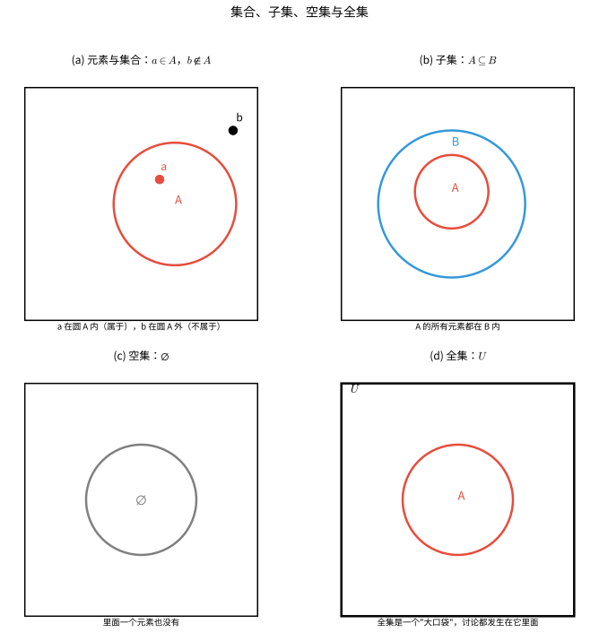

> **来龙去脉**：集合这一概念是给"无穷"算账逼出来的。19 世纪分析越建越深，函数、级数收敛、实数严格化都绕不开"无穷多个对象"，而当时的数学词典里连"把一堆东西归为一处"都没有严格说法。1874 年前后，康托尔严肃追问"两个无穷集合谁大谁小"，发现只有先把"归堆"本身钉成一套逻辑概念（元素、属于、外延相等）才谈得上比较。他于是把"口袋"提炼为可检验的符号系统。所以集合最初的动机不是"给对象装包"，而是把"无穷"请进可推理的殿堂。

#### 课堂问答

**老师**：你上来就接受"集合由确定的、互不相同的对象组成"，凭什么这两个条件缺一不可？删掉"确定"会怎样？

**学生**：两者各守一件事。"确定"保证 $a \in A$ 对任意 $a$ 都有真假（非真即假），否则基数无从谈起；"互异"保证同一元素只算一次，故 $\{1,1,2\}=\{1,2\}$。若丢掉"确定"，就会出现"很大的数"这类谁也算不出 $|\cdot|$ 的伪集合。

**老师（追问）**：描述法 $B=\{x \mid x \text{ 是正整数且 } x<10\}$ 里的那个 $x$ 取自哪个论域？不限定行不行？

**学生**：不行。描述法只是从某个**已给集合**里挑元素（分离公理模式），不限定论域会造出悖论，如"所有不属于自身的集合"导出罗素悖论。所以 $B$ 得先站在 $\mathbb{Z}$ 或某个全集 $U$ 上才安全。

**老师（拓展）**：你把 $\in$ 当作原始关系，那实数 $\mathbb{R}$ 又是怎么造出来的？

**学生**：实数恰恰是用集合造的——戴德金分割把每个实数定义成 $\mathbb{Q}$ 的某个子集。可见"元素与属于"比实数更基本，后面谈实数系、拓扑与测度，全都得先落在集合这套语言上。

### 2.2 子集（Subset）

若集合 $A$ 的所有元素都是集合 $B$ 的元素，则称 $A$ 是 $B$ 的 **子集**，记作 $A \subseteq B$。

**形式定义：**

| 符号 | 名称 | 含义 | 直观解释 |
|:---:|:---:|:---|:---|
| $a \in A$ | 属于 | $a$ 是集合 $A$ 的元素 | "a 在圈里" |
| $a \notin A$ | 不属于 | $a$ 不是集合 $A$ 的元素 | "a 在圈外" |
| $A \subseteq B$ | 子集 | $A$ 的元素全是 $B$ 的元素 | "A 被 B 装下" |
| $\forall$ | 任意 | "对每一个" | "随便哪个都" |
| $\Rightarrow$ | 推出 | 由左边推得右边 | "那么" |

$$A \subseteq B \iff \forall x (x \in A \Rightarrow x \in B)$$

若 $A \subseteq B$ 且 $A \neq B$，则称 $A$ 是 $B$ 的 **真子集**，记作 $A \subsetneq B$。

**性质：**
- 自反性：$A \subseteq A$
- 传递性：若 $A \subseteq B$ 且 $B \subseteq C$，则 $A \subseteq C$
- 反对称性：若 $A \subseteq B$ 且 $B \subseteq A$，则 $A = B$

> **直观理解（类比）**：子集就是"套圈"——A 的圈完全落在 B 的圈里面。"自反"指自己总含自己；"传递"指一圈套一圈；"反对称"指两圈若互相装下，就只能完全重合、谁也大不过谁。

#### 课堂问答

**老师**：$A \subseteq B$ 的定义是 $\forall x(x \in A \Rightarrow x \in B)$，为什么用"蕴含"而不是"且"？单靠它能否判断两集合谁"元素多"？

**学生**：用蕴含才能容下"$x$ 不在 $A$"的情形：此时命题自动为真，于是 $\varnothing \subseteq B$ 成立。但蕴含只管方向，$A \subseteq B$ 并不推出 $|A|\le|B|$——类比 $\mathbb{N}\subseteq\mathbb{Z}$ 却 $|\mathbb{N}|=|\mathbb{Z}|$，无穷时"整体可与部分一样多"。

**老师（追问）**：性质里"反对称性"说 $A \subseteq B \land B \subseteq A \Rightarrow A=B$，它凭什么成立？

**学生**：靠外延公理：集合由其元素唯一决定。两方向包含说明二者元素完全相同，故只能相等。这条正是"双向包含法"证集合相等的合法性来源（见 8.2），缺了它只能证单边。

**老师（拓展）**：真子集 $A \subsetneq B$ 在有限集里必严格更少，到无穷还成立吗？

**学生**：不一定。$\mathbb{N}\subsetneq\mathbb{Z}$ 却是真子集却等势；但 $\mathbb{Q}\subsetneq\mathbb{R}$ 这种方向恰好保号，$|\mathbb{Q}|=\aleph_0<|\mathbb{R}|=\mathfrak{c}$。可见"真子集"不必然"更少"，得另用双射判断。

### 2.3 空集（Empty Set）

不含任何元素的集合称为 **空集**，记作 $\varnothing$ 或 $\{\}$。

**性质：**
- 空集是任何集合的子集：$\varnothing \subseteq A$（对任意集合 $A$）
- 空集是唯一的

> **直观理解（类比）**：空集就是"什么都没装的空口袋"或"什么也没圈住的空白"。因为里面没有任何元素，一个空的圈怎么塞进别的圈里都成立，所以它天然是任何集合的子集。

#### 课堂问答

**老师**：你说"空集是任何集合的子集"，可空集里什么都没有，凭什么说它被 $A$ 包含？

**学生**：子集判据是 $\forall x(x \in \varnothing \Rightarrow x \in A)$。前件 $x \in \varnothing$ 永远为假，而蕴含式"前件为假即为真"，故对任意 $A$ 都成立，$\varnothing \subseteq A$。这靠的是逻辑而非元素。

**老师（追问）**：那"空集唯一"怎么证？会不会有多个不同的空集？

**学生**：设 $\varnothing_1,\varnothing_2$ 都无元素，由上一结论得 $\varnothing_1 \subseteq \varnothing_2$ 且 $\varnothing_2 \subseteq \varnothing_1$，再用反对称性得二者相等。所以"空集"是一个确定对象，不是任选其一。

**老师（拓展）**：$\varnothing$ 与 $\{\varnothing\}$ 差在哪？它俩为什么是造自然数的起点？

**学生**：$|\varnothing|=0$、$|\{\varnothing\}|=1$，前者无元素，后者恰含一个元素（那个元素是空集）。冯诺依曼序数正是从 $0=\varnothing$、$1=\{\varnothing\}$ 层层套出自然数乃至 $\omega$（见 6.8），空集是全塔的基座。

### 2.4 全集（Universal Set）

在特定讨论中，包含所有可能元素的集合称为 **全集**，通常记作 $U$ 或 $\Omega$。

> **直观理解（类比）**：全集就是"此刻讨论所能装下的那只最大筐"——台上可能出现的所有角色都算 U。它像一个圈定的舞台，之后的补集、差集都要拿它当底盘。

#### 课堂问答

**老师**：既然 $U$ 是"包含所有可能元素"的集合，那把所有集合的全体当作 $U$ 行不行？

**学生**：不行。若存在"所有集合的集合 $U$"，对它取幂集便有 $\mathcal{P}(U)$ 严格大于 $U$（康托尔定理，6.4），矛盾。所以 $U$ 只能是**特定讨论**里圈定的舞台，是一个相对概念。

**老师（追问）**：既然如此，$A^c$ 岂不是不唯一？换个 $U$ 会怎样？

**学生**：正是。$A^c=U\setminus A$ 完全依赖 $U$：取 $U=\{1,2,3\},A=\{1\}$ 得 $A^c=\{2,3\}$；改取 $U=\{1,2\}$ 则 $A^c=\{2\}$。所以谈补集必须先声明全集，这是最常被忽略的前提。

**老师（拓展）**：那什么时候我们反而需要一个固定的"大舞台"？

**学生**：拓扑与测度里整个空间 $X$ 就充当全集，开集、闭集、可测集都在它内部取补。只有钉死 $X$，才能谈"一个集合的补是否仍为开集"，这也正是德摩根定律在拓扑语义下的用武之地。

### 2.5 幂集（Power Set）

集合 $A$ 的所有子集构成的集合称为 $A$ 的 **幂集**，记作 $\mathcal{P}(A)$ 或 $2^A$。

$$\mathcal{P}(A) = \{X \mid X \subseteq A\}$$

**示例：** 若 $A = \{1, 2\}$，则
$$\mathcal{P}(A) = \{\varnothing, \{1\}, \{2\}, \{1, 2\}\}$$

**性质：** 若 $|A| = n$，则 $|\mathcal{P}(A)| = 2^n$

> **直观理解**：幂集就是"把 A 能产生的所有小口袋都装进一个大口袋"。关键是——对 A 的每个元素，它在子集里只有"选"或"不选"两种状态，所以 $n$ 个元素就产生 $2^n$ 个子集。下图展示了 $A=\{1,2\}$ 的 4 个子集。

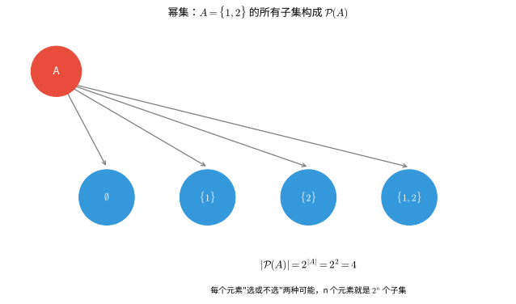

> **来龙去脉**："幂"这个名字来自"取方"——因为 $|\mathcal{P}(A)|=2^{|A|}$，像"拿 $2$ 自乘 $|A|$ 次"，故得名"幂集合"。更深刻的动机在康托尔那里：他给"这种集合共有多少种子集"计数时，发现 $A$ 有多大，它的所有子集加起来的量级**永远更大**（正是 6.4 的康托尔定理）。幂集于是成了"制造更大无穷"的标准机器，也是 $2^{\aleph_0}$（连续统势）记号与连续统假设的源头。

#### 课堂问答

**老师**：$|\mathcal{P}(A)|=2^n$ 里的 $n$ 是 $A$ 的元素个数，凭什么子集个数正好是 $2$ 的 $n$ 次？换个问法：$A=\{1,2\}$ 时为何恰好 $4$ 个子集？

**学生**：对每个元素独立做一次"选或不选"，$n$ 个元素就有 $2^n$ 种组合，每种组合唯一确定一个子集。这正是 $\mathcal{P}(A)$ 与 $\{0,1\}^A$（全体 $A\to\{0,1\}$ 的函数）之间的自然双射，故 $|\mathcal{P}(A)|=|\{0,1\}^A|=2^{|A|}$。

**老师（追问）**：$\varnothing$ 与 $A$ 本身都算子集吗？数幂集时最易漏什么？

**学生**：都算，它们是"全不选"与"全选"两个极端，恰对应恒为 $0$、恒为 $1$ 的函数。常见错误就是漏掉 $\varnothing$ 或漏掉 $A$，结果数成 $2^n-1$ 或 $2^n-2$，务必用总数 $2^n$ 校验。

**老师（拓展）**：$n$ 换成无穷会怎样？$\mathcal{P}(\mathbb{N})$ 有多大？

**学生**：康托尔定理（6.4）给出 $|A|<|\mathcal{P}(A)|$ 对一切集合成立，故 $|\mathcal{P}(\mathbb{N})|>|\mathbb{N}|=\aleph_0$；事实上 $|\mathcal{P}(\mathbb{N})|=2^{\aleph_0}=\mathfrak{c}$，与实数一样多，幂集就此与连续统接上了头。

### 2.6 基数（Cardinality）

集合 $A$ 中元素的个数称为 $A$ 的 **基数**（或势），记作 $|A|$ 或 $\text{card}(A)$。

- **有限集**：基数为有限值
- **无限集**：基数为无穷大
  - 可数无穷：$|\mathbb{N}| = \aleph_0$（阿列夫零）
  - 连续统：$|\mathbb{R}| = \mathfrak{c}$（或 $2^{\aleph_0}$）

> **直观理解（类比）**：基数就是"数一数圈里有几个点"。有限集直接点数；无限集改看"能不能一一对应"——能配成双就和自然数一样多（$\aleph_0$），配不完的就更大（如实数是 $\mathfrak{c}$）。

> **常见坑**：
> - 空集 $\varnothing$ 与"含空集的集合" $\{\varnothing\}$ 是两回事，$|\varnothing|=0$ 而 $|\{\varnothing\}|=1$；
> - 写幂集时最容易漏掉空集 $\varnothing$ 或漏掉集合自身，记得总个数必须是 $2^n$；
> - $\{a\} \in A$ 与 $\{a\} \subseteq A$ 含义不同：前者把 $\{a\}$ 当作 $A$ 的**元素**，后者才表示"子集"。

---

#### 课堂问答

**老师**：有限集用"数数"定基数没问题，可无限集怎么办？你说 $|\mathbb{N}|=|\mathbb{Z}|$，凭什么？

**学生**：无限集改用"一一对应"（双射）定基数，而不是"数到几"。$\mathbb{Z}$ 可排成 $0,1,-1,2,-2,\dots$，与 $\mathbb{N}$ 逐一配号，故同为 $\aleph_0$。"整体可与自身真子集等势"正是无限集基数的特征。

**老师（追问）**：$\varnothing$ 与 $\{\varnothing\}$ 的基数各是多少？这俩为什么常被混淆？

**学生**：$|\varnothing|=0$，而 $\{\varnothing\}$ 含一个元素（即空集），故 $|\{\varnothing\}|=1$。混淆源于把"元素是空集"误读成"集合是空的"——基数只看它**装了几个**，不看所装之物本身是什么。

**老师（拓展）**：$\aleph_0$ 与 $\mathfrak{c}=2^{\aleph_0}$ 之间还有别的基数吗？

**学生**：这正是连续统假设（CH）：断言没有严格介于 $\aleph_0$ 与 $2^{\aleph_0}$ 之间的基数。哥德尔与科恩证明它独立于 ZFC，既证不了真也证不了伪，详见 6.6。

## 3. 集合运算

> **先说个问题**：如果只有"圈起来"而没有"圈起来以后能做什么"，集合就只是摆设。这一节给集合配五把"剪刀与胶水"——并、交、差、补、对称差，外加"两两配对"的笛卡尔积。想表达"两堆合起来""两边都算""抠掉某块""补上漏掉的""只留一边""列出所有组合"，都能找到对应的运算。

### 3.1 并集（Union）

集合 $A$ 与 $B$ 的 **并集** 是由所有属于 $A$ 或属于 $B$ 的元素组成的集合。

| 符号 | 名称 | 含义 | 直观解释 |
|:---:|:---:|:---|:---|
| $A \cup B$ | 并集 | 属于 $A$ 或属于 $B$ 的元素 | "两个圈都要" |
| $A \cap B$ | 交集 | 同时属于 $A$ 和 $B$ 的元素 | "两圈重叠处" |
| $A \setminus B$ | 差集 | 属于 $A$ 但不属于 $B$ | "从 A 里减掉 B" |
| $A^c$ | 补集 | 在全集 $U$ 中但不在 $A$ 里的元素 | "圈外那块" |
| $A \triangle B$ | 对称差 | 恰属于 $A$、$B$ 之一的元素 | "去重叠那层" |

$$A \cup B = \{x \mid x \in A \lor x \in B\}$$

**示例：** $\{1, 2, 3\} \cup \{2, 3, 4\} = \{1, 2, 3, 4\}$

> **直观理解（类比）**：并集就是把两个圈"合到一起"——两边的元素一个不落地全收进来，等于取所有结果的"最大菜单"。取"并"就是"或"，谁属 A 或属 B 都算。

#### 课堂问答

**老师**：并集定义里用的是"或"，这个"或"是日常汉语的"二选一"，还是另有含义？

**学生**：是逻辑**包含或**，$x \in A \lor x \in B$ 允许"两者都真"。所以同时属于 $A$、$B$ 的元素仍算入 $A \cup B$，这也保证 $\{1,2,3\}\cup\{2,3,4\}=\{1,2,3,4\}$ 中重复元素只出现一次（集合互异）。

**老师（追问）**：并集会不会"越并越大"？有上限吗？

**学生**：会被全集压住，$A \cup U=U$（零一律）。在 $\mathcal{P}(U)$ 内 $\cup$ 还有单位元：$A \cup \varnothing=A$。故 $(\mathcal{P}(U),\cup)$ 以 $U$ 为上界、$\varnothing$ 为单位元。

**老师（拓展）**：能把它推广到任意多个集合吗？$\bigcup_{i\in I}A_i$ 怎么定义？

**学生**：可以，定义为 $\{x \mid \exists i\in I,\ x\in A_i\}$，即"属于至少一个 $A_i$"。第 6 章证可数个可数集之并可数（6.5），用的正是这个推广形式——无限并是不失闭合性的。

### 3.2 交集（Intersection）

集合 $A$ 与 $B$ 的 **交集** 是由所有同时属于 $A$ 和 $B$ 的元素组成的集合。

$$A \cap B = \{x \mid x \in A \land x \in B\}$$

**示例：** $\{1, 2, 3\} \cap \{2, 3, 4\} = \{2, 3\}$

若 $A \cap B = \varnothing$，则称 $A$ 与 $B$ **互不相交**。

> **直观理解（类比）**：交集就是"两个圈重叠的那一小块"——只有同时属于 A 又属于 B 的元素才够格，像"既是……又是……"。若两块完全不重叠，交集就是空的，那叫"互不相交"。

#### 课堂问答

**老师**：交集定义用的是"且"，那若 $A$ 与 $B$ 毫无共同元素，交集该是什么？总不能没有吧？

**学生**：按定义 $\{x \mid x\in A \land x\in B\}$ 无人满足，故只能是空集 $\varnothing$，此时称 $A,B$ **互不相交**。空集不是"无定义"而是一个合法集合，这正体现集合运算的封闭性。

**老师（追问）**：能说 $|A\cap B|\le|A|\le|A\cup B|$ 一定成立吗？

**学生**：对**有限集**成立，因为 $A\cap B\subseteq A\subseteq A\cup B$，有限集真子集必更少。但无限时不保号：$\mathbb{N}\cap\mathbb{Z}=\mathbb{N}$、$\mathbb{N}\cup\mathbb{Z}=\mathbb{Z}$ 全等势 $\aleph_0$，等号处处可成立。

**老师（拓展）**：若并、交推广到空指标集，$\bigcap_{i\in\varnothing}A_i$ 会出什么麻烦？

**学生**：$\bigcap_{i\in\varnothing}A_i=\{x \mid \forall i\in\varnothing,\ x\in A_i\}$，前提恒真会吞下整个论域甚至"所有集合"，导致非集合并引发悖论。故空交通常或排除、或明确相对某 $U$；而空并有确定值 $\varnothing$，二者并不对称。

### 3.3 差集（Difference）

集合 $A$ 与 $B$ 的 **差集**（或相对补集）是由所有属于 $A$ 但不属于 $B$ 的元素组成的集合。

$$A \setminus B = \{x \mid x \in A \land x \notin B\}$$

**示例：** $\{1, 2, 3\} \setminus \{2, 3, 4\} = \{1\}$

> **直观理解（类比）**：差集就是从 A 里"抠掉"属于 B 的部分再剩下的，像"只属 A、不属 B 的那块"——只看 A 圈内、被抹去 B 覆盖的那片。

#### 课堂问答

**老师**：$A\setminus B$ 与 $B\setminus A$ 是一回事吗？$\{1,2,3\}\setminus\{2,3,4\}$ 与反向差各得什么？

**学生**：不同。前者按定义只留"在 $A$ 不在 $B$"的元素得 $\{1\}$，反向得 $\{4\}$。差集**不交换**，$A\setminus B\ne B\setminus A$（除非二者恰好相等），这与并、交的对称性形成鲜明对比。

**老师（追问）**：那差集能用并、交、补写出吗？能否把三种运算统一？

**学生**：能，$A\setminus B=A\cap B^c$（见 3.8 常见坑）。这点很关键：它说明差集并非独立运算，而是"交 + 补"的复合，于是所有集合恒等式都能只用 $\cup,\cap,(\cdot)^c$ 表达。

**老师（拓展）**：这个改写对证明有什么直接好处？

**学生**：可直接套用德摩根与分配律。例如证 $(A\setminus B)\cup(B\setminus A)=A\triangle B$ 时，把两边都化成 $\cup/\cap/{}^c$ 再逐步化简，不必每次回到元素法，这正是 8.1 化简技巧的起点。

### 3.4 补集（Complement）

若 $A \subseteq U$，则 $A$ 在全集 $U$ 中的 **补集** 是 $U$ 中所有不属于 $A$ 的元素组成的集合。

$$A^c = U \setminus A = \{x \in U \mid x \notin A\}$$

有时也记作 $\overline{A}$ 或 $A'$。

> **直观理解（类比）**：补集就是大筐 U 里"除了 A 圈剩下的那块"——把 A 的圈拿走，外面落下的所有元素。注意补集永远相对某个全集 U 才有意义，换个舞台答案就不同。

#### 课堂问答

**老师**：补集记号 $A'$ 看着像"求反"，它到底对 $A$ 做了什么？为什么必须先有全集？

**学生**：$A'=\{x\in U \mid x\notin A\}$ 就是把 $A$ 从 $U$ 里挖掉剩下的部分。它只对"$A$ 在 $U$ 中"才有意义：同一个 $A$ 换了 $U$，补集就变（见 2.4）。所以 $A'$ 是相对 $U$ 的操作，不是 $A$ 自身的属性。

**老师（追问）**：补集与差集本质区别在哪？$A^c$ 与 $U\setminus A$ 一样吗？

**学生**：在固定全集下 $A^c=U\setminus A$，所以补集是差集的特例（减数恒取 $U$）。但差集 $A\setminus B$ 对任意 $B$ 有定义，补集却绑死"相对 $U$"，这是二者唯一却关键的不同。

**老师（拓展）**：补集有没有"对合"性质？它在布尔代数里是什么角色？

**学生**：$(A^c)^c=A$ 成立（对合律），且 $A\cup A^c=U$、$A\cap A^c=\varnothing$。这三条使 $(\mathcal{P}(U),\cup,\cap,{}^c,\varnothing,U)$ 构成一个**布尔代数**，补运算就是其中的"取非"，德摩根定律正是它的对偶律。

### 3.5 对称差（Symmetric Difference）

集合 $A$ 与 $B$ 的 **对称差** 是由恰好属于 $A$ 和 $B$ 中一个的元素组成的集合。

$$A \triangle B = (A \setminus B) \cup (B \setminus A) = (A \cup B) \setminus (A \cap B)$$

**示例：** $\{1, 2, 3\} \triangle \{2, 3, 4\} = \{1, 4\}$

> **直观理解（类比）**：对称差就是"两份合起来再抹掉重合那块"——只要恰好属于其中一个的元素，重叠的共同区被剔掉。像两个圈拼在一起，又擦去彼此重叠的公共区域。

#### 课堂问答

**老师**：你给了对称差两个等价定义 $(A\setminus B)\cup(B\setminus A)$ 与 $(A\cup B)\setminus(A\cap B)$，凭什么它们相等？

**学生**：两者都刻画"恰好属于 $A,B$ 之一"。第一种是"只属 $A$ 的"并"只属 $B$ 的"，第二种是"两边合起来再挖掉公共部分"。逐元素看，$x$ 要么只在一侧、要么落在交集，两边的归属判断完全一致，故相等。

**老师（追问）**：$A\triangle A$ 与 $A\triangle\varnothing$ 各是什么？它像不像某种"减法"？

**学生**：$A\triangle A=\varnothing$，$A\triangle\varnothing=A$——前者说明元素"自我抵消"，后者说明空集是单位元。所以对称差其实更像**加法**：它把重叠部分抵消，与群运算如出一辙。

**老师（拓展）**：那 $(\mathcal{P}(U),\triangle)$ 有群结构吗？

**学生**：有。对称差结合、可交换，单位元为 $\varnothing$，每个元素以自身为逆（$A\triangle A=\varnothing$），故它是每个非单位元都二阶的交换群；再配上 $\cap$ 便得到布尔环，这正是把集合运算代数化的入口。

### 3.6 笛卡尔积（Cartesian Product）

集合 $A$ 与 $B$ 的 **笛卡尔积** 是由所有有序对 $(a, b)$（其中 $a \in A$, $b \in B$）组成的集合。

| 符号 | 名称 | 含义 | 直观解释 |
|:---:|:---:|:---|:---|
| $A \times B$ | 笛卡尔积 | 所有 $(a,b)$ 配对的集合 | "两两配对" |
| $(a,b)$ | 有序对 | 一个在前、一个在后的一对 | "先 $a$ 后 $b$" |
| $a \in A$ | 属于 | $a$ 取自集合 $A$ | "从 A 里取" |
| $b \in B$ | 属于 | $b$ 取自集合 $B$ | "从 B 里取" |

$$A \times B = \{(a, b) \mid a \in A \land b \in B\}$$

**示例：** $\{1, 2\} \times \{\text{红}, \text{白}\} = \{(1, \text{红}), (1, \text{白}), (2, \text{红}), (2, \text{白})\}$

**推广到多元组：**
$$A_1 \times A_2 \times \cdots \times A_n = \{(a_1, a_2, \dots, a_n) \mid a_i \in A_i\}$$

> **直观理解（类比）**：笛卡尔积就是把 A 和 B 的元素"两两配成一对"，列出所有组合——A 有 $m$ 个、B 有 $n$ 个就配出 $m\times n$ 对，正是第 8 级的"分步相乘"。注意顺序要紧：$(a,b)$ 和 $(b,a)$ 是两回事。

#### 课堂问答

**老师**：$(a,b)$ 叫"有序对"，顺序真那么要紧吗？$(a,b)$ 与 $\{a,b\}$ 差在哪？

**学生**：关键就在"有序"：$(a,b)=(c,d)$ 当且仅当 $a=c$ 且 $b=d$，顺序不可交换；而 $\{a,b\}=\{b,a\}$ 是无序的。集合论还可用库拉托夫斯基编码 $(a,b)=\{\{a\},\{a,b\}\}$ 把有序对还原成集合，使"配对"也在集合框架内。

**老师（追问）**：若 $A$ 或 $B$ 是空集，$A\times B$ 会怎样？乘积还可能非空吗？

**学生**：必为空集。因为 $(a,b)$ 要求同时取到 $a\in A$ 与 $b\in B$，只要一侧无元素就没有任何有序对可列，$A\times\varnothing=\varnothing\times B=\varnothing$。

**老师（拓展）**：那 $A\times B$ 与 $B\times A$ 是同一个集合吗？

**学生**：一般不是：元素分别是 $(a,b)$ 与 $(b,a)$ 两类不同对象，只有 $A=B$ 或一方为空时才可能恰好相等。把这个"左右有别"带进关系定义（5.1），就解释了关系复合为何必须讲究方向。

### 3.7 运算性质汇总

| 运算 | 符号 | 定义 |
|------|------|------|
| 并集 | $A \cup B$ | $\{x \mid x \in A \lor x \in B\}$ |
| 交集 | $A \cap B$ | $\{x \mid x \in A \land x \in B\}$ |
| 差集 | $A \setminus B$ | $\{x \mid x \in A \land x \notin B\}$ |
| 补集 | $A^c$ 或 $\overline{A}$ | $\{x \in U \mid x \notin A\}$ |
| 对称差 | $A \triangle B$ | $(A \setminus B) \cup (B \setminus A)$ |
| 笛卡尔积 | $A \times B$ | $\{(a, b) \mid a \in A, b \in B\}$ |

> **直观理解**：把集合想成文氏图里的两个圆，运算就是在"圈"上做加减：
> - **并集** $\cup$ 像"或"——两个圈都算
> - **交集** $\cap$ 像"且"——只要两圈重叠的那块
> - **差集** $\setminus$ 是"减"——从 A 里去掉 B 的部分
> - **补集** 是"取反"——大口袋 U 里除了 A 的部分
> - **对称差** 是"把重叠那块去掉"——只要恰好属于其中一个的部分
>
> 下图用黄色高亮标出了每种运算的结果。

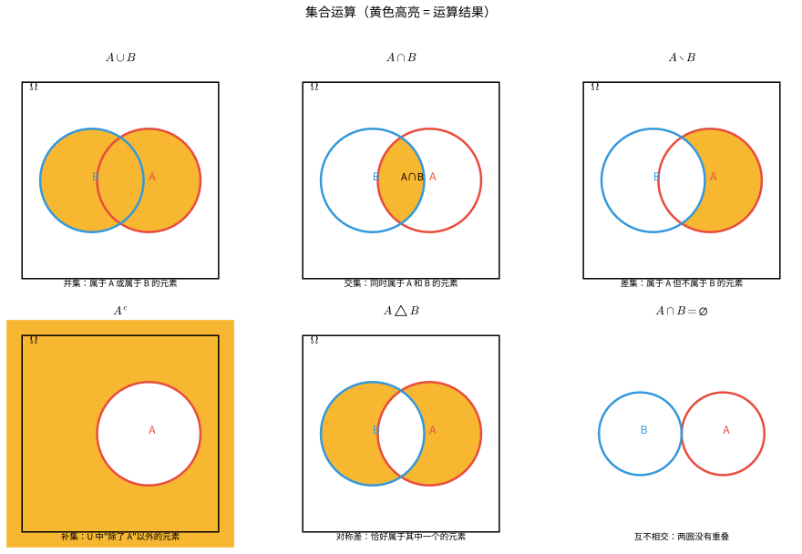

#### 课堂问答

**老师**：这张表把六种运算的定义式并排列出，可你注意到没有——其中有一个运算是多余的。是哪个？

**学生**：差集。因为 $A\setminus B=\{x\mid x\in A \land x\notin B\}=A\cap B^c$，完全能用交集与补集写出，并非独立本质运算；对称差同样是复合物。真正"原始"的只有 $\cup,\cap,(\cdot)^c$ 三个。

**老师（追问）**：那为什么不干脆删掉差集，只留三个？

**学生**：为**表达经济与直观**。保留差集让"抠掉""相对补"的直觉可直接书写，符号更贴近人脑，正如用了逻辑 $\neg,\wedge$ 仍保留 $\vee$。记号要兼顾简洁与可读，冗余并不等于无用。

**老师（拓展）**：这三个基本运算配上 $\varnothing,U$，结构上是什么？

**学生**：正是分配格乃至**布尔代数**：$\cup,\cap$ 互相分配、各有单位元 $\varnothing,U$，补运算满足补余律与对合律。这套公理化结构后来独立成"布尔代数"，成为电路逻辑与命题演算的公共骨架。

### 3.8 笛卡尔积的图解

> **直观理解**：笛卡尔积就是"把 A 和 B 的每一对都配起来"，像一张乘法表或网格：A 有 $m$ 行、B 有 $n$ 列，拼出 $m\times n$ 个格子 $(a,b)$。下图展示了 $A=\{1,2,3\}$、$B=\{\text{红},\text{白}\}$ 的 6 个有序对。

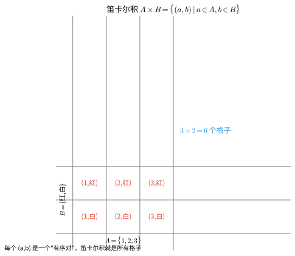

> **常见坑**：
> - 补集 $A^c$ 永远要追问"相对哪个全集 $U$"，不同的 $U$ 得到不同的答案；
> - $A \setminus B$ 与 $A \cap B'$ 等价，但与 $A' \cap B'$ 毫无关系，别顺手写错；
> - 对称差 $A \triangle B$ 是"恰属其一"，与"并"差一个交集：$A\triangle B = (A\cup B)\setminus(A\cap B)$；
> - 笛卡尔积里 $(a,b) \neq (b,a)$（除非 $A=B$ 等特殊情况），讨论去重、相等时别再把它当无序对。

---

#### 课堂问答

**老师**：把 $A\times B$ 画成 $m$ 行 $n$ 列的网格，这种"表格"视角能带来什么、又会不会骗人？

**学生**：带来的是"计数=相乘"的直观：$|A|=m$、$|B|=n$ 就恰有 $m\times n$ 个格子，与 4.5 的 $|A\times B|=|A|\cdot|B|$ 对上。但表格只对**有限集**成立，画不出的无限乘积不能靠数格子。

**老师（追问）**：网格里有没有"顺序被隐藏"的陷阱？

**学生**：有。网格把 $(a,b)$ 与 $(b,a)$ 摆在不同位置，提醒乘积不可交换；若图省事把行列对称看待，就会误以为 $A\times B=B\times A$。图示只是辅助直觉，判定相等仍须回到有序对定义。

**老师（拓展）**：那无限乘积 $|\mathbb{N}\times\mathbb{N}|$ 还能"数格子"吗？

**学生**：数不完，但仍可沿对角线蛇形编号，把它与 $\mathbb{N}$ 一一对应，得 $|\mathbb{N}\times\mathbb{N}|=\aleph_0$（6.6）。可见"乘法表计数"的精神——每格都能被依次点到名——可推广到无限，只是工具从"数"换成了"双射"。

## 4. 定理与证明

> **先说个问题**：上一节教了"词法"，这一节学"句子"——几条反复出现的恒等式（德摩根、分配、吸收、零一、同一、补余、对合），是化简集合表达式的日常语法。更重要的是，这一节示范集合论最常用的论证套路：**双向包含**（任取左边元素推入右边，再反方向来一次）。看懂这几条证明，后面 8.2 的技巧就能直接上手。

### 4.1 德摩根定律（De Morgan's Laws）

**定理 1（德摩根定律）：** 设 $A, B$ 是全集 $U$ 的子集，则

$$(A \cup B)' = A' \cap B'$$
$$(A \cap B)' = A' \cup B'$$

其中 $A'$ 表示 $A$ 在 $U$ 中的补集。

**证明第一式：$(A \cup B)' = A' \cap B'$**

我们通过证明两边集合互相包含来证明集合相等。

**（$\subseteq$ 方向）** 任取 $x \in (A \cup B)'$，则 $x \notin A \cup B$。由并集的定义，$x \notin A$ 且 $x \notin B$。因此 $x \in A'$ 且 $x \in B'$，即 $x \in A' \cap B'$。故 $(A \cup B)' \subseteq A' \cap B'$。

**（$\supseteq$ 方向）** 任取 $x \in A' \cap B'$，则 $x \in A'$ 且 $x \in B'$，即 $x \notin A$ 且 $x \notin B$。因此 $x \notin A \cup B$，即 $x \in (A \cup B)'$。故 $A' \cap B' \subseteq (A \cup B)'$。

综上，$(A \cup B)' = A' \cap B'$。$\square$

**证明第二式：$(A \cap B)' = A' \cup B'$**

**（$\subseteq$ 方向）** 任取 $x \in (A \cap B)'$，则 $x \notin A \cap B$。这意味着 $x \notin A$ 或 $x \notin B$。若 $x \notin A$，则 $x \in A' \subseteq A' \cup B'$；若 $x \notin B$，则 $x \in B' \subseteq A' \cup B'$。故 $(A \cap B)' \subseteq A' \cup B'$。

**（$\supseteq$ 方向）** 任取 $x \in A' \cup B'$，则 $x \in A'$ 或 $x \in B'$。若 $x \in A'$，则 $x \notin A$，从而 $x \notin A \cap B$，即 $x \in (A \cap B)'$；若 $x \in B'$，同理可得 $x \in (A \cap B)'$。故 $A' \cup B' \subseteq (A \cap B)'$。

综上，$(A \cap B)' = A' \cup B'$。$\square$

> **直观理解（类比）**：德摩根定律是"否定时取反而互换"——"不是（A 或 B）"等于"既非 A 又非 B"，"不是（A 且 B）"等于"非 A 或非 B"。开口方向要对调，就像否定一句话会把"或者"换成"并且"。

#### 课堂问答

**老师**：德摩根两式一"并"一"交"，取反后一个变"交"、一个变"或"，这对称是巧合吗？

**学生**：不是。它本质是逻辑对偶律 $¬(p∨q)=¬p∧¬q$、$¬(p∧q)=¬p∨¬q$ 的集合版本，因为集合运算逐点对应逻辑连接词。再加上两次取反会还原（对合），并↔交在补运算下互换绝非偶然。

**老师（追问）**：证明里最关键的一步是什么？"$x\notin A\cup B$ 推出 $x\notin A$ 且 $x\notin B$"凭什么？

**学生**：关键在于把否定推进括号：$x\notin A\cup B$ 即"并非（属 $A$ 或属 $B$）"，据逻辑对偶即为"非属 $A$ 且非属 $B$"。整条证明用**双向包含法**：两个方向各任取元素、逐步改写，缺一不可。

**老师（拓展）**：到了拓扑或测度，"补"与"并/交"换成什么？

**学生**：补映射为"开闭集取补"，且无限情形也成立：$\left(\bigcup_i A_i\right)^c=\bigcap_i A_i^c$。这是拓扑中证明"闭集族对任意交封闭、开集族对任意并封闭"的基本工具，也支撑测度论里事件补的对偶论证。

### 4.2 分配律（Distributive Laws）

**定理 2（分配律）：** 对任意集合 $A, B, C$，有

$$A \cup (B \cap C) = (A \cup B) \cap (A \cup C)$$
$$A \cap (B \cup C) = (A \cap B) \cup (A \cap C)$$

**证明第一式：$A \cup (B \cap C) = (A \cup B) \cap (A \cup C)$**

**（$\subseteq$ 方向）** 任取 $x \in A \cup (B \cap C)$，则 $x \in A$ 或 $x \in B \cap C$。

- 若 $x \in A$，则 $x \in A \cup B$ 且 $x \in A \cup C$，故 $x \in (A \cup B) \cap (A \cup C)$。
- 若 $x \in B \cap C$，则 $x \in B$ 且 $x \in C$。由 $x \in B$ 得 $x \in A \cup B$；由 $x \in C$ 得 $x \in A \cup C$。故 $x \in (A \cup B) \cap (A \cup C)$。

因此 $A \cup (B \cap C) \subseteq (A \cup B) \cap (A \cup C)$。

**（$\supseteq$ 方向）** 任取 $x \in (A \cup B) \cap (A \cup C)$，则 $x \in A \cup B$ 且 $x \in A \cup C$。

- 若 $x \in A$，则 $x \in A \cup (B \cap C)$。
- 若 $x \notin A$，则由 $x \in A \cup B$ 得 $x \in B$；由 $x \in A \cup C$ 得 $x \in C$。故 $x \in B \cap C$，从而 $x \in A \cup (B \cap C)$。

因此 $(A \cup B) \cap (A \cup C) \subseteq A \cup (B \cap C)$。

综上，等式成立。$\square$

**证明第二式：$A \cap (B \cup C) = (A \cap B) \cup (A \cap C)$**

**（$\subseteq$ 方向）** 任取 $x \in A \cap (B \cup C)$，则 $x \in A$ 且 $x \in B \cup C$。即 $x \in A$ 且（$x \in B$ 或 $x \in C$）。

- 若 $x \in B$，则 $x \in A \cap B$，故 $x \in (A \cap B) \cup (A \cap C)$。
- 若 $x \in C$，则 $x \in A \cap C$，故 $x \in (A \cap B) \cup (A \cap C)$。

因此 $A \cap (B \cup C) \subseteq (A \cap B) \cup (A \cap C)$。

**（$\supseteq$ 方向）** 任取 $x \in (A \cap B) \cup (A \cap C)$，则 $x \in A \cap B$ 或 $x \in A \cap C$。

- 若 $x \in A \cap B$，则 $x \in A$ 且 $x \in B \subseteq B \cup C$，故 $x \in A \cap (B \cup C)$。
- 若 $x \in A \cap C$，则 $x \in A$ 且 $x \in C \subseteq B \cup C$，故 $x \in A \cap (B \cup C)$。

因此 $(A \cap B) \cup (A \cup C) \subseteq A \cap (B \cup C)$。

综上，等式成立。$\square$

> **直观理解（类比）**：分配律像"乘法对加法"那样，把 $\cap$ 拆进括号里——$A \cup (B \cap C)$ 把 B、C 重叠块并进 A，等于先各自并 A 再取重叠；画三个圈一眼可见两边圈出的区域完全一样。

#### 课堂问答

**老师**：$A\cup(B\cap C)=(A\cup B)\cap(A\cup C)$ 是"$\cup$ 对 $\cap$ 分配"。它和数的 $a(b+c)=ab+ac$ 像吗？哪里不一样？

**学生**：形式像，但集合论里两条都成立，是**双向分配**（$\cap$ 也对 $\cup$ 分配），而数的乘法对加法只单向分配；根源在于逻辑里 $\vee,\wedge$ 互相分配。这使 $(\mathcal{P}(U),\cup,\cap)$ 成为分配格，而 $(\mathbb{Z},+,\times)$ 不是。

**老师（追问）**：证 $\supseteq$ 方向时，"若 $x\notin A$，则由 $x\in A\cup B$ 得 $x\in B$"——这一步为什么必须分情况？

**学生**：因为 $x\in A\cup B$ 只给出"$x\in A$ 或 $x\in B$"，无法直接断定在 $B$；只有排除 $A$ 这一支，才能逼出另一支。这正是"或"推理的标准分情况讨论，也是双向包含法最易漏的一环。

**老师（拓展）**：分配律能直接推德摩根或其他恒等式吗？

**学生**：可以，靠对偶原理：任一集合恒等式把 $\cup\leftrightarrow\cap$、$\varnothing\leftrightarrow U$、$\subseteq\leftrightarrow\supseteq$ 对调后仍成立。分配律的对偶恰是另一条本身，说明这套公理自洽；据此可在 8.1 中快速化简长表达式。

### 4.3 吸收律（Absorption Laws）

**定理 3（吸收律）：** 对任意集合 $A, B$，有

$$A \cup (A \cap B) = A$$
$$A \cap (A \cup B) = A$$

**证明第一式：$A \cup (A \cap B) = A$**

- 任取 $x \in A \cup (A \cap B)$，则 $x \in A$ 或 $x \in A \cap B$。无论哪种情况，都有 $x \in A$。故 $A \cup (A \cap B) \subseteq A$。
- 任取 $x \in A$，则 $x \in A \cup (A \cap B)$（由并集定义）。故 $A \subseteq A \cup (A \cap B)$。

因此 $A \cup (A \cap B) = A$。$\square$

**证明第二式：$A \cap (A \cup B) = A$**

- 任取 $x \in A \cap (A \cup B)$，则 $x \in A$。故 $A \cap (A \cup B) \subseteq A$。
- 任取 $x \in A$，则 $x \in A \cup B$，且 $x \in A$，故 $x \in A \cap (A \cup B)$。因此 $A \subseteq A \cap (A \cup B)$。

因此 $A \cap (A \cup B) = A$。$\square$

> **直观理解（类比）**：吸收律是"大圈吞掉小杂毛"——$A$ 并上与 B 的重合部分仍是 $A$；$A$ 交上比 A 更大的并集也还是 $A$。因为 A 本已容纳这些，多并一点或多截一点都不改变它。

#### 课堂问答

**老师**：吸收律说 $A\cup(A\cap B)=A$，直觉上"并上一个更小的东西"居然没变大——凭什么？

**学生**：因为 $A\cap B\subseteq A$，往 $A$ 里并进自己的子集不产生新元素；反过来 $A\subseteq A\cup(A\cap B)$ 显然，双向包含即得相等。同理 $A\cap(A\cup B)$ 是"用更大的 $A\cup B$ 去截 $A$"，截不掉 $A$ 中任何元素，故仍等于 $A$。

**老师（追问）**：既然吸收律成立，$A\cup A\cap B$ 这样省掉括号会不会有歧义？

**学生**：有风险，因为 $\cup$ 与 $\cap$ 之间**没有**像数字那样的运算优先级惯例，必须靠括号表达结合顺序。而不管怎么加括号，按定义化简结果都归到 $A$，所以吸收律也提示：此处两运算"无差别"，但写清括号仍是严谨要求。

**老师（拓展）**：吸收律在一般格论里居于什么地位？

**学生**：它是格的定义公理之一——集合并满足吸收律即构成**格**，$\cup$ 与 $\cap$ 分别是上、下确界运算。拓扑中开集格、域的子域格同样满足吸收律，是"并/交"语义的统一来源。

### 4.4 其他重要恒等式

**幂等律：**
$$A \cup A = A, \quad A \cap A = A$$

**交换律：**
$$A \cup B = B \cup A, \quad A \cap B = B \cap A$$

**结合律：**
$$(A \cup B) \cup C = A \cup (B \cup C)$$
$$(A \cap B) \cap C = A \cap (B \cap C)$$

**零一律：**
$$A \cup U = U, \quad A \cap \varnothing = \varnothing$$

**同一律：**
$$A \cup \varnothing = A, \quad A \cap U = A$$

**补余律：**
$$A \cup A' = U, \quad A \cap A' = \varnothing$$

**对合律（双重补律）：**
$$(A')' = A$$

> **直观理解**：这些恒等式都可以"看图说话"。德摩根定律说的是：并集的反面 = 各自反面的交集（"既不是 A 也不是 B"）；分配律说的是"$\cap$ 对 $\cup$ 的分配"如同乘法对加法的分配；吸收律说的是"$\cup$ 与 $\cap$ 碰在一起会被大的那个吸收"。下图用黄色高亮直观展示了德摩根两式、分配律与吸收律的结果区域。

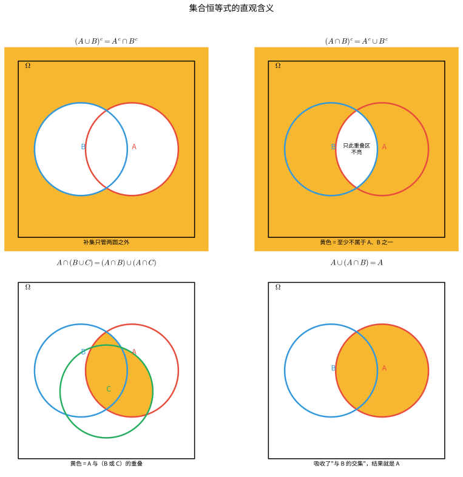

#### 课堂问答

**老师**：这里列了幂等、交换、结合、零一、同一、补余、对合七组恒等式。你说它们都能"看图验证"，可文氏图真能代替证明吗？

**学生**：不能。文氏图只对三个以内的集合、且只对一般位置画得准，涉及四集以上或任意族时区域划分就不可靠，有些恒等式还需特判嵌套情形。图画是发现式、给人信的，严格结论仍须像 4.1 那样双向包含逐元素推。

**老师（追问）**：七组里有没有"多余"的？哪些能由别的推出？

**学生**：有冗余。结合律与交换律使 $\cup,\cap$ 成为可交换幂等半群；对合律 $(A')'=A$、补余律 $A\cup A'=U,A\cap A'=\varnothing$ 又使取补成为反序对合。可选一个最小公理组把其余导出，这正是把集合代数提炼为布尔代数的做法。

**老师（拓展）**：这套恒等式和"命题逻辑"是一回事吗？

**学生**：本质同构：把 $\cup,\cap,(\cdot)^c$ 换成 $\vee,\wedge,\neg$，$\varnothing,U$ 换成 $0,1$，每条集合恒等式便对应一条重言式。这就是**布尔代数**与**命题演算**的对偶，也是数字电路中"与/或/非门"化简的依据。

### 4.5 笛卡尔积的基数

**定理 4：** 若 $A$ 和 $B$ 是有限集，则

$$|A \times B| = |A| \cdot |B|$$

**证明：** 设 $|A| = m$, $|B| = n$。笛卡尔积 $A \times B$ 由所有有序对 $(a, b)$ 组成，其中 $a \in A$, $b \in B$。对于 $A$ 中的每个元素 $a$，它可以与 $B$ 中的 $n$ 个元素分别配对，形成 $n$ 个有序对。由于 $A$ 中有 $m$ 个元素，因此总共有 $m \times n$ 个有序对。$\square$

**推广：** 对于有限集 $A_1, A_2, \dots, A_k$，有
$$|A_1 \times A_2 \times \cdots \times A_k| = |A_1| \cdot |A_2| \cdots |A_k|$$

> **直观理解（类比）**：这与"分步相乘"正好对上——每个 $a$ 有 $n$ 种配法，$m$ 个 $a$ 就配出 $m\times n$ 对；推广到 $k$ 组就是连乘。像食堂点餐："菜品 $\times$ 饮料"的每一种组合数。

> **常见坑**：
> - 证集合相等"只证一个方向"就收工——必须双向包含（$A\subseteq B$ 且 $B\subseteq A$）才算完成；
> - 用德摩根定律时把符号弄反，正确的是 $(A\cup B)' = A'\cap B'$，而不是 $A'\cup B'$；
> - 写"任取"却代进一个具体元素来验证，那样只证明了一个特例，算不上证明。

---

#### 课堂问答

**老师**：定理说 $|A\times B|=|A|\cdot|B|$，证明只是"每个 $a$ 配 $n$ 个"。这算严格证明还是经验直觉？

**学生**：对**有限集**这是严格论证：$A\times B$ 按第一坐标分成 $m$ 个互不相交的竖条 $\{a\}\times B$，每条恰含 $|B|=n$ 个元素，$m$ 条并起来即 $mn$ 个，本质是有限并的基数可加性。前提是 $A,B$ 有限，否则不能这样累加。

**老师（追问）**：那推广到无穷还成立吗？$\mathbb{N}\times\mathbb{N}$ 有多少元素？

**学生**：定义式 $|A\times B|=|A|\cdot|B|$ 对无穷基数**照样**成立，但结论反直觉：$|\mathbb{N}\times\mathbb{N}|=\aleph_0\cdot\aleph_0=\aleph_0$，与 $\mathbb{N}$ 一样多（6.6）。可见"乘法"在无穷处不再放大基数，有限的直觉到此失效。

**老师（拓展）**：那从 $A\times B$ 还能造出什么更一般的东西？

**学生**：可造"一族集合的乘积"乃至无穷乘积 $\prod_{i\in I}A_i$，其元素是选择函数。当 $I$ 无穷而各 $A_i$ 非空时，"乘积非空"这一断言竟等价于**选择公理**（6.7），把笛卡尔积与 AC 直接扣在一起。

## 5. 关系与函数

> **先说个问题**：把集合之间悄悄连一根"线"会发生什么？这一节把"谁和谁沾边"抽象成**关系**（就是 $A\times B$ 里挑出的那些有序对），再给关系分层：等价关系负责"分班"，偏序/全序负责"比大小"。其中**函数**是"每人恰好一根线"的特殊关系，再按满、单、双射分出三种性格——它们是后面可数性、基数比较的执行者。

### 5.1 关系（Relation）

**定义：** 集合 $A$ 到集合 $B$ 的一个 **二元关系** $R$ 是 $A \times B$ 的一个子集，即 $R \subseteq A \times B$。若 $(a, b) \in R$，则记作 $aRb$。

当 $A = B$ 时，称 $R$ 是 $A$ 上的一个关系。

**示例：**
- $R = \{(a, b) \in \mathbb{N} \times \mathbb{N} \mid a \leq b\}$ 是自然数上的"小于等于"关系
- $R = \{(x, y) \in \mathbb{R} \times \mathbb{R} \mid x^2 + y^2 = 1\}$ 是单位圆上的点

> **直观理解（类比）**：关系就是从"所有有序对"里挑出那些"沾边"的配对——哪些 $(a,b)$ 记作 $aRb$ 就归入关系。它像一张名单或一组连线，比如"小于等于"按大小把数对连起来，单位圆关系则把落在这条圆周上的点挑出来。

> **🧠 思考历程：为什么把"关系"绕成"有序对的集合"？**
> 日常的"有关系"很含混——"8 大于 4"里，"大于"到底是一个什么东西？19 世纪的分析经验告诉数学家：要把"谁和谁沾边"纳入严格推理，最稳的做法是**只认清单**——把每条"沾边"写成一个有序对 $(a,b)$，这些有序对拼成一张清单 $R$，关系就"是"这张清单。这样就把一个说不清的"性质/意念"翻译成实打实的集合：$aRb$ 不过是"$(a,b)\in R$"。于是关系能参与并、交、幂集、笛卡尔积等一切集合运算，也能被倒置、被复合（见 5.5）。这是集合论"化性质为对象"的标准招式，也是后面函数（5.4）被定义成有序对集合的原因。

#### 课堂问答

**老师**：把"关系"定义成 $A\times B$ 的一个**子集**，是不是把"小于""认识"这类活生生的联系"降格"成一堆死数据？

**学生**：恰恰相反，这是"化性质为对象"的升级。把每条成立的 $aRb$ 收集成有序对 $(a,b)$ 拼成集合 $R$，关系便能参与并、交、幂集、复合等一切集合运算，也能被量化推理；$aRb$ 不过是 $(a,b)\in R$ 的简写，信息毫无损失。

**老师（追问）**：那"空关系"和"全关系"算什么？它们也是关系吗？

**学生**：都算。空关系 $\varnothing\subseteq A\times B$ 里没有一个对满足，即任意两元素都"无关"；全关系 $A\times B$ 则人人相关。关系范畴对这两个极端封闭，正如 $0$ 与 $1$ 在数中的地位。

**老师（拓展）**：把关系拆成集合后，与函数、等价类的桥梁在哪？

**学生**：在 $A=B$ 的"齐次关系"上：满足三条性质的成**等价关系**、把集合划分（5.2）；满足自反、反对称、传递的成**偏序**（5.3）。而"每人恰一根线"的关系正是**函数**（5.4），可见函数只是关系的一个特殊子类。

### 5.2 等价关系（Equivalence Relation）

**定义：** 集合 $A$ 上的关系 $R$ 称为 **等价关系**，若它满足以下三个性质：

1. **自反性**：$\forall a \in A, aRa$
2. **对称性**：$\forall a, b \in A, aRb \Rightarrow bRa$
3. **传递性**：$\forall a, b, c \in A, aRb \land bRc \Rightarrow aRc$

**等价类：** 对于等价关系 $R$，元素 $a$ 的等价类为
$$[a] = \{x \in A \mid xRa\}$$

所有等价类的集合构成 $A$ 的一个 **划分**（partition）。

**示例：**
- 模 $n$ 同余关系：$a \equiv b \pmod{n} \iff n \mid (a - b)$ 是 $\mathbb{Z}$ 上的等价关系
- 集合等势关系：$A \sim B \iff |A| = |B|$ 是集合族上的等价关系

> **直观理解**：等价关系就是给集合里的元素"分班"——满足关系的元素归到同一班（等价类），互不相关的另开一班。这些班两两不重叠、并起来正好是全集，这就是**划分**。例如"模 3 同余"把整数按除以 3 的余数（0、1、2）分成三班，每班内部"长得像"。

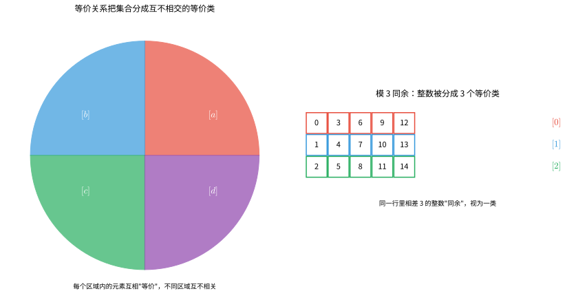

> **来龙去脉**：等价关系捕捉的直觉是"在某个层面可以看成同一个"。高斯早在数论中用"模同余"把整数分类（余数相同即同类），黎曼又在几何中把"局部看作一样"的"同构"思想发扬；数学家慢慢发现，这些看似天差地别的"认为相等"，底层骨架竟都是同三条性质——自反、对称、传递。把它们单独抽出来命名，就把"按什么标准归为一类"精确化，并顺势造出**商集**（把整个等价类当作一个新对象，见 5.2）。这是现代代数"把分类本身变成可运算的结构"的起点；同余算术、有理数定义、商空间等都建立在这一步之上。

#### 课堂问答

**老师**：等价关系只要三条性质，其中"传递性"最容易漏。能举个满足前两条、却栽在传递性的反例吗？

**学生**：能。在实数上定义 $aRb \iff |a-b|\le 1$：自反（$|a-a|=0\le 1$）与对称都成立，却不传递——$0R1$、$1R2$ 成立，但 $|0-2|=2>1$ 使 $0R2$ 不成立。可见"接近"不构成等价关系，传递性正是把分类钉死的关键。

**老师（追问）**：等价类 $[a]=\{x \mid xRa\}$，为什么任意两个等价类要么相等要么不相交？

**学生**：若 $[a]\cap[b]\ne\varnothing$，取 $c$ 同属两类，则 $cRa$ 且 $cRb$；由对称得 $aRc$，再由传递得 $aRb$。于是任取 $x\in[a]$ 有 $xRaRb$，故 $x\in[b]$，反之亦然，得 $[a]=[b]$。所以类与类互不重叠，全体等价类恰构成 $A$ 的一个**划分**。

**老师（拓展）**：等价类把元素"打包"成新对象，这在后面哪里关键？

**学生**：得到商集 $A/{\sim}$，把每个类当作一个元素——这正是"模 $n$ 同余"造出 $\mathbb{Z}/n\mathbb{Z}$、用整数对等价类定义有理数的原理，也是拓扑商空间、测度论中"几乎处处相等"分类的共同骨架。

### 5.3 偏序关系（Partial Order）

**定义：** 集合 $A$ 上的关系 $\preceq$ 称为 **偏序关系**，若它满足：

1. **自反性**：$\forall a \in A, a \preceq a$
2. **反对称性**：$\forall a, b \in A, a \preceq b \land b \preceq a \Rightarrow a = b$
3. **传递性**：$\forall a, b, c \in A, a \preceq b \land b \preceq c \Rightarrow a \preceq c$

带有偏序关系的集合称为 **偏序集**（poset），记作 $(A, \preceq)$。

**全序关系：** 若偏序 $\preceq$ 还满足可比性（$\forall a, b \in A$，$a \preceq b$ 或 $b \preceq a$），则称其为 **全序关系**（或线性序）。

**示例：**
- $(\mathbb{R}, \leq)$ 是全序集
- $(\mathcal{P}(A), \subseteq)$ 是偏序集（一般不是全序）
- $(\mathbb{N}, \mid)$（整除关系）是偏序集

> **直观理解**：偏序关系是"比较大小"的抽象化，但允许两个元素"比不出来"。比如包含关系里，$\{a\}$ 和 $\{b\}$ 谁也不算谁的子集；整除关系里，4 和 6 互不整除。**哈斯图**把这种关系画成一张分层的网：在下面、连到上面的就表示"更小"。下面左图是幂集的包含关系，右图是整数的整除关系。

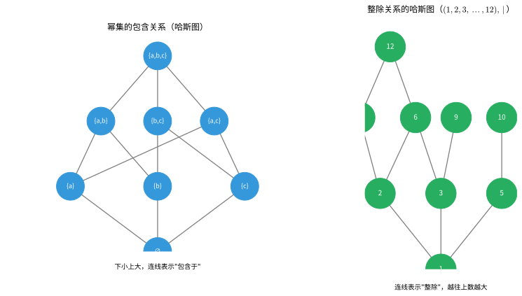

#### 课堂问答

**老师**：偏序与等价关系都要求自反、传递，差别只在"对称 vs 反对称"。这一步之差为何会导致"能比大小"和"能分类"两种截然不同的结构？

**学生**：因为对称说"$aRb\Rightarrow bRa$"（关系无向、成分类），反对称说"$aRb\land bRa\Rightarrow a=b$"（关系有向、可定先后）。有向关系配上传递即可层层排列，无向关系配上传递只能聚合；同一堆有序对，性质一换语义就天翻地覆。

**老师（追问）**：$(\mathcal{P}(A),\subseteq)$ 一般不是全序，"比不出来"是缺陷还是常态？

**学生**：是常态。$\{a\}$ 与 $\{b\}$ 互不包含，恰说明偏序允许"不可比"；全序只是额外要求可比性的特例。$\mathbb{R}$ 上 $\le$ 是全序，而幂集、整除关系 $(\mathbb{N},\mid)$ 通常只是偏序——后者如 $4$ 与 $6$ 互不整除。

**老师（拓展）**：偏序集里"极大元"与"最大元"一样吗？这对 6.7 有什么用？

**学生**：不一样。最大元须与所有元素可比且居上，极大元只要求"没有更大的可比者"，如 $(\{2,3\},\subseteq)$ 有两个极大元却无最大元。Zorn 引理正是用"每条链有上界 $\Rightarrow$ 有极大元"这种弱结论，充当选择公理的替身工具（6.7）。

### 5.4 函数（Function）

**定义：** 从集合 $A$ 到集合 $B$ 的 **函数**（或映射）$f$ 是一个满足以下条件的关系 $f \subseteq A \times B$：

| 符号 | 名称 | 含义 | 直观解释 |
|:---:|:---:|:---|:---|
| $f: A \to B$ | 函数（映射） | 把 $A$ 每个元素对应到 $B$ 的元素 | "一根线牵过去" |
| $A$ | 定义域 | 输入取值的集合 | "出生的那端" |
| $B$ | 陪域 | 输出的整体范围 | "到达的那端" |
| $\forall$ | 任意 | "对每一个" | "随便哪个都" |
| $\exists!$ | 存在唯一 | 恰好存在一个 | "有且仅有一个" |

$$\forall a \in A, \exists! b \in B, (a, b) \in f$$

即 $A$ 中的每个元素恰好对应 $B$ 中的一个元素。记作 $f: A \to B$，且 $f(a) = b$。

**术语：**
- $A$ 称为 **定义域**（domain）
- $B$ 称为 **陪域**（codomain）
- $\{f(a) \mid a \in A\}$ 称为 **值域**（range），记作 $f(A)$

> **直观理解（类比）**：函数是一台"一人一根线"的传送带——定义域 A 里每个输入都必须且只能对应一个输出，但不同输入可以牵到同一输出。值域是那根线真正落到的输出点全体，不一定占满陪域 B。

> **来龙去脉**：早期"函数"只是"一条曲线"或"一个式子"，默认有光滑的解析表达式。到了 19 世纪，分段给出、处处不连续的函数例子接连出现，数学家（狄利克雷、黎曼等）被迫追问：函数到底"是"什么？答案从"由规则给出"退到"只要对应本身"——哪怕逐点指定的"死对应"，只要每个输入有且仅有一个输出，就算函数。集合论再进一步把函数清爽地定义为"满足每人恰一根线的有序对集合"，于是"映射规则"从一股玄念变成一件可整体参与基数、幂等运算的集合对象。这正是本章把它放进"关系"旗下、并用"双射"衡量可数与等势（见第 6 节）的根本原因。

#### 5.4.1 单射（Injective）

函数 $f: A \to B$ 称为 **单射**（一一映射），若

$$\forall a_1, a_2 \in A, f(a_1) = f(a_2) \Rightarrow a_1 = a_2$$

等价地，不同的输入映射到不同的输出。

> **直观理解（类比）**：单射像"对号入座、不抢座位"——每个输出最多被一个输入指着，不同的输入绝不会指向同一输出。名额只多不少，B 里可能有些点没人进。

#### 5.4.2 满射（Surjective）

函数 $f: A \to B$ 称为 **满射**（到上映射），若

$$\forall b \in B, \exists a \in A, f(a) = b$$

即值域等于陪域：$f(A) = B$。

> **直观理解（类比）**：满射像"每个岗位都有人上岗"——B 里的每个点至少被一根线指着，值域把陪域填满，可以出现多对一。

#### 5.4.3 双射（Bijective）

函数 $f: A \to B$ 称为 **双射**（一一对应），若它既是单射又是满射。

**性质：** $f$ 是双射当且仅当存在逆函数 $f^{-1}: B \to A$。

> **直观理解（类比）**：双射是"完美结对、一一对应"——既是单射又是满射，A、B 一样多，每人一线、每点被指一次，还能反着走（有逆函数）。这正是两个集合"等势"的含义。

#### 5.4.4 重要结论

**定理：** 对于有限集 $A$ 和 $B$，
- 存在单射 $f: A \to B$ 当且仅当 $|A| \leq |B|$
- 存在满射 $f: A \to B$ 当且仅当 $|A| \geq |B|$
- 存在双射 $f: A \to B$ 当且仅当 $|A| = |B|$

> **直观理解**：把函数看成"从 A 的每个人发一根线指向 B"。
> - **函数**：每人必须且只能发一根线（不能一人发两根、也不能一人不发）。
> - **单射（一一）**：不同的 A 点指向不同的 B 点，但 B 里有些点可能没人指到（B 比 A"大"）。
> - **满射（到上）**：B 里每个点至少被一根线指着（A 比 B"大"，允许多对一）。
> - **双射（一一对应）**：每人一根、每点被指且只被指一次，可以反着走（有逆函数）。下图两列点之间的连线直观展示了这四种情况。

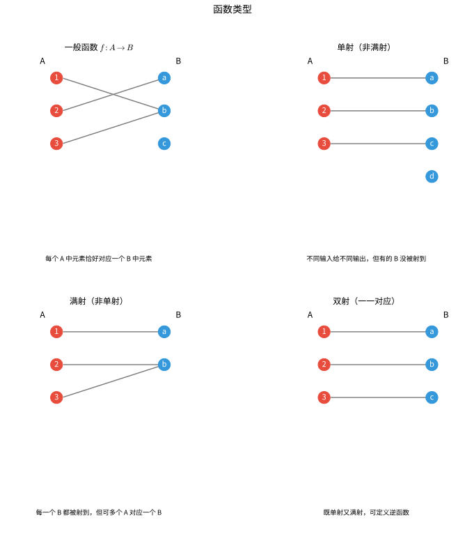

> **常见坑**：
> - 混淆"对称"与"反对称"：对称是 $aRb \Rightarrow bRa$，反对称是 $aRb \land bRa \Rightarrow a=b$，二者不是否定关系；
> - 判定等价/偏序关系时漏查"传递性"——三条性质一条都不能少；
> - 把"值域 $f(A)$"与"陪域 $B$"混为一个概念，满射恰恰要求这两者相等；
> - 以为"所有函数都有逆"——只有双射（既单又满）才有逆函数。

#### 课堂问答

**老师**：函数被定义成一个**关系**，还加"$\forall a \exists! b$"这一条。若去掉"唯一"二字会变成什么？去掉"存在"呢？

**学生**：去掉"唯一"就允许一个输入对多个输出，成了"多值对应"，不再是一台确定的机器；去掉"存在"则允许某些输入"无输出"，定义域就不完整。两条缺一，$f(a)=b$ 这种写法便失去意义，所以"每人恰一根线"是函数的全部约束。

**老师（追问）**：满射要求"值域 $=$ 陪域"，为什么陪域不能随便写？$f:\mathbb{R}\to\mathbb{R},\,f(x)=x^2$ 是满射吗？

**学生**：不是满射，因为值域 $[0,\infty)$ 不等于陪域 $\mathbb{R}$（负数取不到）。一旦改写成 $f:\mathbb{R}\to[0,\infty)$ 就成了满射——说明"满"依赖陪域的声明，陪域是约定的一部分，而非算出来的。

**老师（拓展）**：为什么用"存在双射"来定义两个无穷集合等势？

**学生**：因为双射既单又满，恰好实现"每人一根、每点被指一次"，是一一对应的精确刻画。有了它才能比较无穷大小：$\mathbb{Z},\mathbb{Q}$ 都能与 $\mathbb{N}$ 建双射故可数（6.1），而 $\mathbb{R}$ 不能故不可数（6.3）。

### 5.5 关系的复合与逆（Composition and Inverse of Relations）

> **先说个问题**：两段"沾边"能不能接得上？"$a$ 经某条线到 $b$、$b$ 又经某条线到 $c$"，能不能推出一根从 $a$ 直达 $c$ 的线？这一节给关系配两件新工具——**逆**（把每条配对首尾对调）与**复合**（沿"中间人"接成新配对）。它们是"作用的运算"，也是把函数复合（见 5.4 与习题）从"单独的函数"升级到"任意关系"的通式。

**逆关系：** 关系 $R$ 的 **逆**（逆关系）记作 $R^{-1}$，把每个有序对的首尾对调：
$$R^{-1} = \{(b, a) \mid (a, b) \in R\}$$

**复合：** 设 $S \subseteq A \times B$、$R \subseteq B \times C$，复合 $R \circ S \subseteq A \times C$ 定义为"先沿 $S$、再沿 $R$"：
$$R \circ S = \{(a, c) \mid \exists b \in B,\ (a, b) \in S \land (b, c) \in R\}$$

**示例：** 设 $S = \{(1,2),(2,3)\}$，$R = \{(2,x),(3,y)\}$，则
$$R \circ S = \{(1,x),(2,y)\}$$
因为 $1$ 经 $S$ 到 $2$、$2$ 经 $R$ 到 $x$；$2$ 经 $S$ 到 $3$、$3$ 经 $R$ 到 $y$。

**性质：**
- 复合的结合律：$(R \circ S) \circ T = R \circ (S \circ T)$
- 逆的逆还原：$(R^{-1})^{-1} = R$
- 复合的逆：$(R \circ S)^{-1} = S^{-1} \circ R^{-1}$（顺序互换！）
- 恒等关系 $\mathrm{Id}_A = \{(a,a) \mid a \in A\}$ 是复合的单位元：$R \circ \mathrm{Id}_A = R$

> **直观理解（类比）**：逆关系像"把所有箭头掉头"——"认识"一翻就变"被认识"。复合像"接力"：只要存在中间人 $b$ 让 $a$ 通过 $S$ 够到 $b$、再通过 $R$ 够到 $c$，$a$ 与 $c$ 就算"间接相连"。函数复合正是它的特例：当 $S=f$、$R=g$ 都是函数时，$g\circ f$ 就是"先 $f$ 后 $g$"。

> **常见坑**：
> - 复合顺序容易写反：$R\circ S$ 表示"先 $S$ 后 $R$"，与函数复合 $g\circ f$（先 $f$ 后 $g$）一脉相承，写反会得到完全不同的关系；
> - 复合的逆 $(R\circ S)^{-1}=S^{-1}\circ R^{-1}$ 顺序必须互换（类比"先穿内衣再穿外套，脱时先脱外套"），别想当然写成 $R^{-1}\circ S^{-1}$；
> - 逆关系 $R^{-1}$ 对任何关系都定义，并不要求 $R$ 是函数，别把它和"只有双射才有逆函数"混为一谈。

#### 本节习题

**基础题：**
- 设 $R=\{(1,2),(2,3),(3,4)\}$，写出 $R^{-1}$。
- 设 $S=\{(a,b),(b,c)\}$，$R=\{(b,x),(c,y)\}$，求 $R\circ S$。

**进阶题：**
- 证明：$(R^{-1})^{-1}=R$。
- 设 $R\subseteq B\times C$、$S\subseteq A\times B$，证明 $(R\circ S)^{-1}=S^{-1}\circ R^{-1}$。

**挑战题：**
- 设 $f:A\to B$、$g:B\to C$ 是函数，说明如何由"关系的复合"得出 $g\circ f$，并用定义验证它与函数复合一致。$g\circ f$ 是单射/满射的什么组合条件能推出来？

**答案与提示：**
- $R^{-1}=\{(2,1),(3,2),(4,3)\}$（把每条首尾对调）。
- $S$ 中 $(a,b)$ 与 $R$ 中 $(b,x)$ 相接得 $(a,x)$；$(b,c)$ 与 $(c,y)$ 相接得 $(b,y)$，故 $R\circ S=\{(a,x),(b,y)\}$。
- 任取 $(a,b)\in(R^{-1})^{-1}$，即 $(b,a)\in R^{-1}$，即 $(a,b)\in R$，反之亦然，故两集合相等。$\square$
- 任取 $(c,a)\in(R\circ S)^{-1}$，即 $(a,c)\in R\circ S$，则存在 $b$ 使 $(a,b)\in S$ 且 $(b,c)\in R$，故 $(c,b)\in R^{-1}$ 且 $(b,a)\in S^{-1}$，即 $(c,a)\in S^{-1}\circ R^{-1}$；反向同理，故等。$\square$
- 函数 $f,g$ 作为有序对集合也满足复合定义，且由于"每人恰一根线"，$R\circ S$ 恰把 $x$ 映到 $g(f(x))$，与函数复合 $g\circ f$ 完全一致。若 $f,g$ 皆单射则 $g\circ f$ 单射（进阶题 19）；若皆满射则满射（进阶题 26）；两者皆满/皆单即双射.

---

#### 课堂问答

**老师**：复合定义成 $R\circ S=\{(a,c)\mid\exists b,(a,b)\in S \land (b,c)\in R\}$，是"先 $S$ 后 $R$"。为什么记号不写成"先 $R$ 后 $S$"，害得这么多人误解？

**学生**：这是函数复合 $g\circ f$（先 $f$ 后 $g$）的记号延续：$R\circ S$ 读作"先 $S$ 再 $R$"，写在前面的先作用。约定虽绕，但与函数书写顺序一致，所以必须记住"先右后左"，否则会得到张冠李戴的完全不同的关系。

**老师（追问）**：$(R\circ S)^{-1}=S^{-1}\circ R^{-1}$，凭什么方向要整个反过来？

**学生**：因为逆是把每根箭头掉头：原来 $a\xrightarrow{S}b\xrightarrow{R}c$，掉头后成 $c\xrightarrow{R^{-1}}b\xrightarrow{S^{-1}}a$，先走的变成后走的。任取 $(c,a)\in(R\circ S)^{-1}$ 等价于 $(a,c)\in R\circ S$，展开即得 $(c,a)\in S^{-1}\circ R^{-1}$，方向必须互换。

**老师（拓展）**：逆关系对任何关系都存在，为何"逆函数"却要求双射？

**学生**：因为逆关系只需把序对首尾对调，永远合法；但要它重新成为**函数**，必须"每个输出也恰对应一个输入"，即原函数既单又满。所以关系总能取逆、函数未必——这把 5.4 的双射与 5.5 的逆复合串成了一条线。

## 6. 可数与不可数

> **先说个问题**：有限时"谁多谁少"一目了然；可一到无穷，"一样多"就得重新定义。直觉上有理数比自然数"密"得多，真的一样多吗？这一节用**双射**（而不是"个数"）来度量无穷：先把 $\mathbb{N}$、$\mathbb{Z}$、$\mathbb{Q}$ 逐个归入可数阵营（$|\cdot|=\aleph_0$），再用康托尔对角线证明实数不可数（$|\mathbb{R}|=\mathfrak{c}$），最后看康托尔定理如何把"无穷的层次"越垒越高。

### 6.1 可数集（Countable Set）

**定义：** 集合 $A$ 称为 **可数集**，若存在一个从 $\mathbb{N}$（自然数集）到 $A$ 的满射。等价地，$A$ 是有限集或与 $\mathbb{N}$ 等势（存在双射）。

**可数无穷集** 的基数记为 $\aleph_0$（阿列夫零）。

**示例：**
- 自然数集 $\mathbb{N}$ 是可数无穷集
- 整数集 $\mathbb{Z}$ 是可数无穷集（双射：$f(n) = \lfloor n/2 \rfloor \cdot (-1)^n$）
- 有理数集 $\mathbb{Q}$ 是可数无穷集（康托尔的对角线枚举法）
- 有限个可数集的并集是可数集
- 可数无穷个可数集的并集是可数集

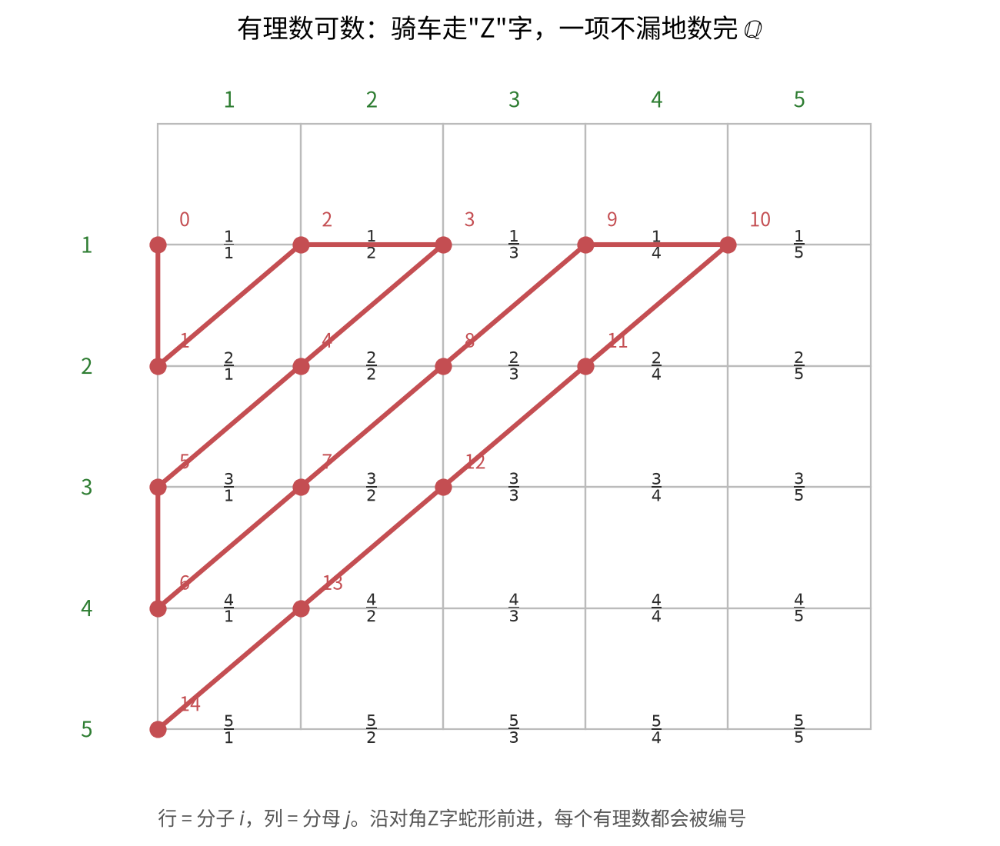

> **直观理解（现实类比）**：有理数看起来"密密麻麻"，怎么还可能和自然数一样多？因为可以**像切蛋糕一样把它排成一张表格**——行是分子、列是分母，然后沿对角线"Z 字蛇形"走一圈，每个分数都会领到一个编号。就像**挨家挨户按门牌号敲门**：只要有一条不重不漏的路线，再"稠密"的集合也能被数完。注意 $\frac{1}{2}$ 和 $\frac{2}{4}$ 代表同一个数，所以实际枚举时跳过已出现的分数即可。

> **来龙去脉**："可数"是康托尔为无穷定级的第一步，历史可上溯到伽利略：他敏锐地看出完全平方数与正整数"似乎一样多"，却困于"整体必大于部分"的直觉而自我怀疑、不敢下结论。19 世纪康托尔大胆把"一样多"严格定义为"存在双射"，立刻推出整数、有理数都与自然数"一样多"——$|\cdot|=\aleph_0$ 由此确立。"可数"的另一半是它做不到的事：实数数不完（见 6.3）。这一"数得完/数不完"的两分，是整个无穷算术与连续统问题（6.6、6.9）的地基。

#### 课堂问答

**老师**：你说有理数集 $\mathbb{Q}$ 可数，可它在数轴上密得"到处都有"，怎么可能和 $\mathbb{N}$ 一样多？

**学生**：因为"稠密"讲的是序结构，可数讲的是能否**一一编号**，两回事。把 $\mathbb{Q}$ 摆成分子为行、分母为列的表格，沿对角线 Z 字蛇形走，每个分数都会领到一个编号（跳过重合），于是 $|\mathbb{Q}|=\aleph_0$。稠密并不妨碍枚举。

**老师（追问）**：可数为何可以定义成"存在 $\mathbb{N}\to A$ 的**满射**"，而不必直接要求双射？

**学生**：因为满射允许多个 $n$ 映到同一元素，正好容纳"有限集"或枚举中重复的情形；只要 $A$ 中每个元素都被某 $n$ 指到，就说明能逐一点名。若 $A$ 无限，再去掉重复即得双射，故两种说法等价。

**老师（拓展）**：一个集合若含一个可数无限子集，能推断它自己可数吗？

**学生**：不能。$\mathbb{R}$ 就含可数的 $\mathbb{Q}$，但 $\mathbb{R}$ 本身不可数（6.3），"含可数子集"远弱于"自己可数"。不过反向有一条：承认选择公理后，每个无限集都含可数无限子集（见 6.7 提及的挑战题）。

### 6.2 不可数集（Uncountable Set）

**定义：** 不是可数集的集合称为 **不可数集**。

**示例：**
- 实数集 $\mathbb{R}$ 是不可数集
- 区间 $(0, 1)$ 是不可数集
- 幂集 $\mathcal{P}(\mathbb{N})$ 是不可数集

> **直观理解（类比）**：不可数集是"排队都点不完名"的集合——不管你多想按顺序数，总有漏网之数，没法与自然数一一对应。实数、$(0,1)$、自然数的幂集都属于这一类，它们的元素"密"到了数不胜数。

#### 课堂问答

**老师**：定义说"不是可数集"就叫不可数集，这只是个否定式。你凭什么断言 $\mathbb{R}$ 落进这一类，而不是我们暂时没找到枚举法？

**学生**：因为否定判定可以用反证法完成。假设 $\mathbb{R}$ 可数就能把它们排成一列，康托尔沿对角线造出一个新实数，它与表中每行都有一处不同，故不在表内，与"排完"矛盾（6.3）。所以这不是"暂时没找到"，而是**任何**枚举都必然漏元素。

**老师（追问）**：$(0,1)$ 与 $\mathbb{R}$ 长度天差地别，可数性上一样吗？$\mathcal{P}(\mathbb{N})$ 呢？

**学生**：$(0,1)$ 与 $\mathbb{R}$ 等势（如 $x\mapsto\tan(\pi(x-\tfrac12))$ 给出双射），故同样不可数，基数都是 $\mathfrak{c}$。而 $\mathcal{P}(\mathbb{N})$ 由康托尔定理（6.4）严格大于 $\mathbb{N}$，也不可数，且恰与 $\mathbb{R}$ 等势：$|\mathcal{P}(\mathbb{N})|=2^{\aleph_0}=\mathfrak{c}$。

**老师（拓展）**：不可数的"大小"都一样大吗？有没有不同层级？

**学生**：不一样。$\mathfrak{c}<|\mathcal{P}(\mathbb{R})|=2^{\mathfrak{c}}<\cdots$ 层层严格递增（6.4 推论），所以并非只有"可数/不可数"两档，而是无穷基数的一条长阶梯；连续统假设只关心最低一级 $\aleph_0$ 与 $\mathfrak{c}$ 之间。

### 6.3 康托尔对角线论证（Cantor's Diagonal Argument）

这是康托尔证明实数集不可数的经典方法。

**定理：** 区间 $(0, 1)$ 内的实数不可数。

**证明（反证法）：** 假设 $(0, 1)$ 内的实数是可数的，则可以将它们排成一个序列：

$$
\begin{aligned}
r_1 &= 0.a_{11}a_{12}a_{13}a_{14}\cdots \\
r_2 &= 0.a_{21}a_{22}a_{23}a_{24}\cdots \\
r_3 &= 0.a_{31}a_{32}a_{33}a_{34}\cdots \\
&\ \ \vdots
\end{aligned}
$$

其中 $a_{ij} \in \{0, 1, 2, \dots, 9\}$，且我们采用不包含无限个 9 的表示法（以避免歧义）。

- 【第 1 步】依据：假设已可数，才可把实数"排成一张竖表"；目的：把"可数"落实成可一一罗列的序列，方便逐行检查。
- 【第 2 步】依据：让新数 $b$ 的第 $i$ 位与第 $i$ 个小数的第 $i$ 位不同；目的：保证 $b$ 与表里每一行都有至少一位不同，从而不在表中。

现在构造一个新的实数 $b = 0.b_1b_2b_3b_4\cdots$，其中

$$b_i = \begin{cases}
1 & \text{若 } a_{ii} \neq 1 \\
2 & \text{若 } a_{ii} = 1
\end{cases}$$

则 $b \in (0, 1)$，但 $b$ 与序列中的每个 $r_i$ 都不同（因为 $b$ 的第 $i$ 位小数与 $r_i$ 的第 $i$ 位小数不同）。这与假设矛盾，故 $(0, 1)$ 不可数。$\square$

> **直观理解**：这个论证像"无限名单里抓漏网之鱼"。假设能把 $(0,1)$ 里所有实数排成一张竖长的表，那么沿**对角线**每位取一个不同的数字，就能拼出一个新数 $b$——它和表中第 1 行在第 1 位不同、和第 2 行在第 2 位不同……所以 $b$ 不在表里，说明"表"根本不完整。无论怎么排，无穷的形象都排不完，这就是"不可数"。

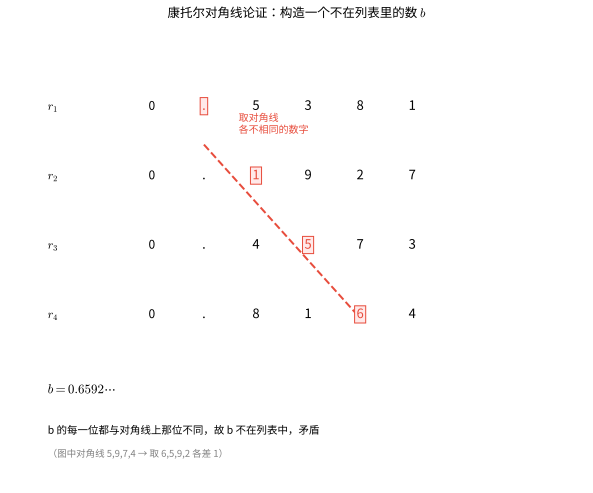

**推论：** $\mathbb{R}$ 不可数，且 $|\mathbb{R}| = 2^{\aleph_0} = \mathfrak{c}$（连续统的势）。

> **🧠 思考历程：一条"对角线"，怎么撕裂了"所有无穷都一样大"的旧观念？**
>
> 康托尔的"对角线论证"只有几步，却像手术刀一样切开了一个延续两千多年的默认：**都无穷大，就都一样多？** 答案被康托尔一刀划出两个层次——无穷也分大小。
>
> - **"无穷不一样大"曾被视为荒谬**。从古希腊到 19 世纪，数学家默认"整体大于部分"，认为无穷只是"没完没了的哪种大"。伽利略就困惑过"整数和完全平方数到底谁多"却不敢下结论。**人们普遍觉得：无穷既已是无穷，就没有"多少"之分。**
> - **康托尔的"等势"革命**。康托尔把"一样多"严格化为"存在双射"：能一一对应，就一样多。按这个标准，$\mathbb{Z}$、$\mathbb{Q}$ 都和 $\mathbb{N}$ 一样多（都用 $\aleph_0$ 当基数）——**"整体"竟可以和自己的一部分一样多**，这让当时数学界大为不适。但他用这个标准继续追问：那实数呢？
> - **对角线论证的致命一击**。假设 $(0,1)$ 的所有实数都能排成一张可数的表，那么沿对角线取"第 $i$ 行第 $i$ 位"、每位故意选不同的数字，就拼出一个新数 $b$——它跟每一行都在某一位不同。**所以不管怎么排表，总有个"漏网之数"在表外，说明实数根本排不完**：$|(0,1)|>\aleph_0$，实数集的基数记为连续统势 $\mathfrak c$。
> - **这是一个"反证法 + 构造 + 无穷"三合一的天才手笔**。它不单证明实数不可数，还顺便击碎了"所有无穷等大"的旧信念，直接引爆了整座集合论大厦（连同后续的连续统假设难题）。**今天的计算理论、停机问题、不可判定性，处处闪烁着这条对角线的影子。**
> - **心路**：康托尔对角线告诉你：**"直觉上显然"的无穷观，可能被一个精巧的"构造式反例"彻底推翻**。当你觉得"无穷都一个样"时，记得掏出对角线的办法试试——有些无穷，真的比另一些"更无限"。

#### 课堂问答

**老师**：构造 $b$ 时只让 $b_i$ 与 $a_{ii}$ 不同，为什么这就足以保证 $b$ 不在表里？万一把 $b$ 加进去重排呢？

**学生**：因为 $b$ 与**每一行** $r_i$ 至少在第 $i$ 位不同，任何一行都不可能等于 $b$。而"把 $b$ 加进表再重排"只是又得到一张新列表，对角法对这张新表再造一个 $b'$——如此无穷，始终漏一个，故不存在能排完的枚举。

**老师（追问）**：为什么规定用"不含无限个 $9$"的表示法？不规定会出什么岔子？

**学生**：因为小数表示有歧义，如 $0.4999\ldots=0.5$。若不规范，构造出的 $b$ 可能"数字串不同却表示同一个实数"，对角线那一步就不再必然给出新数。固定一种规范表示后，数字串与实数才一一对应，论证才严密。

**老师（拓展）**：这条对角线只属于实数，还是更普遍？

**学生**：更普遍。把"第 $i$ 行第 $i$ 位"改成"$a_i$ 是否属于 $g(a_i)$"，就得到康托尔定理 $|A|<|\mathcal{P}(A)|$（6.4）；在可计算性中，同型论证给出图灵机停机问题不可判定。对角线是一条普适的"自指反证"模板。

### 6.4 康托尔定理（Cantor's Theorem）

**定理：** 对任意集合 $A$，$|A| < |\mathcal{P}(A)|$。即 $A$ 的基数严格小于其幂集的基数。

**证明：** 定义单射 $f: A \to \mathcal{P}(A)$ 为 $f(a) = \{a\}$，故 $|A| \leq |\mathcal{P}(A)|$。

现证不存在满射 $g: A \to \mathcal{P}(A)$。假设存在这样的满射，定义

$$B = \{a \in A \mid a \notin g(a)\}$$

则 $B \subseteq A$，即 $B \in \mathcal{P}(A)$。由于 $g$ 是满射，存在 $b \in A$ 使得 $g(b) = B$。现在问：$b \in B$ 吗？

- 若 $b \in B$，则由 $B$ 的定义，$b \notin g(b) = B$，矛盾。
- 若 $b \notin B$，则由 $B$ 的定义，$b \in g(b) = B$，矛盾。

故假设不成立，$|A| < |\mathcal{P}(A)|$。$\square$

**推论：** 存在无穷多个不同大小的无穷基数：
$$\aleph_0 < 2^{\aleph_0} < 2^{2^{\aleph_0}} < \cdots$$

> **直观理解（类比）**：康托尔定理说"集合总比它的幂集小"——把所有子集拼起来永远装不满，对无穷集也成立。关键是用了一个"既不属自身又属自身"都会矛盾的 B，于是无论怎么对应总漏掉一个子集，就像每个无穷大后面都还有更大的无穷大。

#### 课堂问答

**老师**：证明里那个 $B=\{a \in A \mid a \notin g(a)\}$ 是整段的核心。它凭什么就能击碎"存在满射 $A\to\mathcal{P}(A)$"？

**学生**：因为 $B$ 是 $A$ 的子集，必属于 $\mathcal{P}(A)$；若 $g$ 满射，就有某 $b$ 使 $g(b)=B$。此时问"$b\in B$ 吗"：$b\in B\Rightarrow b\notin g(b)=B$（矛盾），$b\notin B\Rightarrow b\in g(b)=B$（矛盾）。两难，故无满射，$|A|<|\mathcal{P}(A)|$。

**老师（追问）**：$B$ 的构造和罗素悖论"不属于自身的集合"几乎一样，这是同一回事吗？

**学生**：是同一枚硬币：罗素用 $\{x\mid x\notin x\}$ 击碎"全集存在"，康托用 $\{a\mid a\notin g(a)\}$ 击碎"满射存在"。后者更精细——它不否认集合，只证明**没有映射能穷尽幂集**，把一个悖论转成一条精确的基数不等式，是"化危机为定理"的典范。

**老师（拓展）**：定理说幂集总能更大，能不能一直取幂集造出"最大的基数"？

**学生**：不能，永远还有更大：$\aleph_0<2^{\aleph_0}<2^{2^{\aleph_0}}<\cdots$ 没有终点，不存在"全体集合"或"最大基数"（否则对它取幂集即得矛盾）。所以"最大基数"的直觉本身就不自洽，这正是集合论需要分层（类与集）的深层原因。

### 6.5 可数个可数集的并仍可数（Countable Union of Countable Sets）

> **先说个问题**：$\mathbb{Q}$ 可以拆成"分母为 $1$ 的、分母为 $2$ 的、……"一列可数子集（行数可数、每行也可数），它们拼起来的"总和"还依然可数吗？直觉上"无穷多个无穷"可能撑爆，但答案是——只要行数可数、每行的列数也可数，排成一张大表格就能沿对角线蛇形编号，合起来仍可数。

**定理：** 设 $A_1, A_2, \dots$ 是一列可数集，则 $\displaystyle\bigcup_{n=1}^{\infty} A_n$ 仍可数。

**证明（对角线编号）：** 对每个 $i \ge 1$，把 $A_i$ 枚举为
$$A_i = \{a_{i1}, a_{i2}, a_{i3}, \dots\}$$
（若 $A_i$ 有限，就让某一项之后重复它，不影响结论。）于是 $\bigcup_i A_i$ 的每个元素都对应一个"行号 $i$、列号 $j$"的指标 $(i, j)$。现在把 $\mathbb{N}\times\mathbb{N}$ 沿对角线蛇形编号：
$$(1,1),\quad (1,2),(2,1),\quad (1,3),(2,2),(3,1),\quad (1,4),(2,3),(3,2),(4,1),\ \dots$$
每个 $(i,j)$ 都在有限步内被数到。将元素 $a_{ij}$ 按上述顺序依次记下（跳过重复，以去掉重合部分），就得到 $\bigcup_i A_i$ 的一个枚举，故其为可数集。$\square$

> **直观理解（类比）**：把每行想成一张收据、列从 $1$ 数下去，一张"可数行 $\times$ 可数列"的大表按 Z 字蛇形走一圈，每个格子既不漏也不重地被点到名。这正是"有限并可数、可数无穷并可数都仍可数"的来源。

> **常见坑（本小节）**：前提是**可数**个可数集——若换成"可数多个不可数集"，并集就可能不可数，例如 $\mathbb{R} = \bigcup_{n\in\mathbb{Z}} [n, n+1]$ 就是可数个不可数集并出的不可数集（与"可数并"结论不矛盾）。另外证明末尾务必"跳过重复元素"，因为同一元素可能同时属于多个 $A_i$。

#### 课堂问答

**老师**：一列可数集的并仍可数，证明只是"排成表格对角线编号"。但若某个 $A_i$ 是有限集甚至空集，这个编号还成立吗？

**学生**：成立。有限集 $A_i$ 可在枚举里"某一项之后重复列出"或直接截断，空的 $A_i$ 跳过；$\mathbb{N}\times\mathbb{N}$ 的蛇形编号对每个 $(i,j)$ 都在有限步内点到，故逐格走仍能覆盖每个非空集合的每个元素。前提只要求各 $A_i$ **可数**，不要求无限。

**老师（追问）**：那如果被并的是"不可数多个"可数集呢？结论会怎样崩坏？

**学生**：会崩坏，下标集 $I$ 本身必须可数这一步不能省。反例：$\mathbb{R}=\bigcup_{n\in\mathbb{Z}}[n,n+1]$ 是可数个不可数集之并故不可数；同理取不可数多个可数集（如每个实数配一个单点集），并起来也能不可数。所以定理的"可数"是双重限制：下标可数且每项可数。

**老师（拓展）**：最后那步"跳过重复"能省吗？不跳会怎样？

**学生**：不能省，因为同一元素可能同时落在多个 $A_i$ 里。若不去重，枚举就不是"每元素恰对应一个 $n$"的双射，只能算满射；虽然可数定义允许满射，但为得到干净的枚举、避免重复计数，跳过重复是最稳的收尾，这也照应集合元素的互异性。

### 6.6 基数算术初探（Cardinal Arithmetic）

> **先说个问题**：认识了 $\aleph_0$ 与 $\mathfrak c$ 两个无穷大小，自然想追问：它们能不能"加减乘除"？这一节给无穷基数一套自洽却处处"反直觉"的算术规则。

**定义（用集合继承普通算术）：** 设 $\kappa,\lambda$ 为基数，$|A|=\kappa,\ |B|=\lambda$：
$$\kappa + \lambda = |A \sqcup B|, \qquad \kappa \cdot \lambda = |A \times B|, \qquad \kappa^\lambda = |B^A|$$
其中 $A\sqcup B$ 是把 $A,B$ 做成不相交的两个副本再取并，$B^A$ 表示全体 $A\to B$ 的函数。

**关键结果：** 有限时它们还原为普通四则；对无穷基数，
$$\aleph_0+\aleph_0=\aleph_0, \qquad \aleph_0\cdot\aleph_0=\aleph_0, \qquad \mathfrak{c}+\aleph_0=\mathfrak{c}.$$

**笛卡尔积基数（接 4.5 推广到无穷）：** 正如有限时 $|A\times B|=|A|\cdot|B|$，对无穷同样成立，且特别地
$$|\mathbb{N}\times\mathbb{N}| = |\mathbb{N}| = \aleph_0 .$$

**基数的层次（由小到大）：**
$$0<1<2<\cdots<\aleph_0<\mathfrak c<2^{\mathfrak c}<\cdots$$
其中有限基数 $0,1,2,\dots$、可数无穷 $\aleph_0$、以及**连续统（continuum）** $\mathfrak c = |\mathbb{R}| = 2^{\aleph_0}$。是否真有基数严格介于 $\aleph_0$ 与 $\mathfrak c$ 之间，正是**连续统假设（CH）**，它已被证明独立于 ZFC（哥德尔、科恩）。

> **直观理解（类比）**：无穷基数像"海纳百川"的存钱罐——往 $\aleph_0$ 里再倒 $\aleph_0$ 枚、甚至倒进一整张 $\aleph_0\times\aleph_0$ 的表格，都填不满同一个"无限"；可一旦换到 $\mathfrak c$ 的量级，$\aleph_0$ 这点"水花"投进去几乎不留痕迹。

> **常见坑**：无穷基数**没有减法/除法**——$\aleph_0 - \aleph_0$ 无唯一意义（$\mathbb{N}$ 减掉前 $n$ 项剩 $\aleph_0$，减掉自身剩 $0$）；幂律在无穷时未必照搬有限法则。别拿"有限直觉"去硬套无穷运算。

#### 课堂问答

**老师**：定义 $\kappa\cdot\lambda=|A\times B|$，那 $\aleph_0\cdot\aleph_0=\aleph_0$ 岂不是说"无限乘无限还是无限"？这靠什么推出？

**学生**：靠 $|\mathbb{N}\times\mathbb{N}|=|\mathbb{N}|$（即 6.5 的蛇形编号），把二维网格压回一维仍能一一对应。所以无限乘积不再"放大"基数：$\aleph_0\cdot\aleph_0=\aleph_0$，与有限情形 $m\cdot n=mn$ 的直觉完全相反。

**老师（追问）**：那 $\aleph_0-\aleph_0$ 等于多少？你为什么不直接给答案？

**学生**：因为它**无意义、不唯一**。$\mathbb{N}$ 减掉有限个元素仍剩 $\aleph_0$，减掉整个 $\mathbb{N}$ 则剩 $0$，同一记号对应多种结果，故无穷基数没有定义良好的减法（除法同理）。只有加法、乘法、幂运算在无穷下保持自洽，这是最易踩的坑。

**老师（拓展）**：$\mathfrak{c}+\aleph_0=\mathfrak{c}$ 说明什么？它和连续统假设什么关系？

**学生**：说明 $\aleph_0$ 相对 $\mathfrak{c}$ 可忽略（吸收性）。进一步，是否存在严格介于 $\aleph_0$ 与 $\mathfrak{c}=2^{\aleph_0}$ 之间的基数，就是**连续统假设 CH**；它被哥德尔与科恩证明独立于 ZFC，既证不了真也证不了伪，是集合论里最著名的"未定之问"。

### 6.7 选择公理、Zorn 引理与良序原理（Axiom of Choice）

> **先说个问题**：很多证明嘴上说"任取一个 $a$"，可真要无限多次挑选、又没有统一规则时，为什么"总能挑得出来"？这正是**选择公理**要回答的。

**选择公理（AC）：** 对任意由非空集组成的集合族 $\{A_i\}_{i\in I}$，存在**选择函数** $f$ 使 $f(i)\in A_i$——即从每个集合中挑一个代表元，且这些选择能合成一个集合。

**三大等价原理（一句话）：** 在 ZFC 中，
$$\boxed{\ \text{选择公理（AC）} \iff \text{Zorn 引理} \iff \text{良序原理}\ }$$
- **Zorn 引理：** 偏序集若每条链都有上界，则它存在极大元；
- **良序原理：** 每个集合都可被赋予良序（其每个非空子集都有最小元）。

三者环环相扣、互相推出，是同一枚硬币的三面。

> **直观理解与承接**：有限次挑选总能完成（归纳），一旦无穷且无明确规则，就需要公理来担保选择函数存在。这与本章主题咬合：例如"每个无限集都含可数无限子集"（挑战题 35）就悄悄用了 AC；而第 6 章对"可数/不可数"大小的严格判定靠双射，双射在无穷情形的存在性又常须借 AC 来构造。

> **常见坑**：不要默认"有限对、无穷也对"——没有 AC 的体系中可构造出"每个集合都非空、却无选择函数"的怪集合族；反过来，许多"任意取一个"的证明其实已隐含使用 AC，被忽略的选择往往正发生在无穷处。

#### 课堂问答

**老师**：选择公理说"能同时从无穷多个非空集里各挑一个"，这听上去天经地义，为什么还要当**公理**？直接从"非空必可取元素"推不就行了？

**学生**：对**有限**个集合，归纳即可挑完，无需公理；但对无穷多集合，若没有统一规则指定怎么挑，"任取"这个动作本身无法由其余公理保证。所以 AC 把"无穷次选择的合法性"单独设为公理，专门补上有限与无穷之间的裂缝。

**老师（追问）**：你说 AC、Zorn 引理、良序原理三者等价，"等价"是不是说它们一模一样、可随意互换？

**学生**：是逻辑等价，即在 ZF 背景下任取其一能推出另外两个，而非字面相同。AC 讲选择函数存在，Zorn 讲偏序链上界给出极大元，良序讲能把任意集合排成有最小元的序——语言各异，却是同一枚硬币的三面，哪个好用就用哪个。

**老师（拓展）**：既然等价，为何很多证明偏爱 Zorn 引理而非直接用 AC？

**学生**：因为 Zorn 引理贴合**构造性**工作：要证某对象（极大理想、基、极大子树）存在时，往往只需验证"每条链都有上界"，比直接构造选择函数省事得多。而良序原理便于做超限递归（6.9）。三者按场景分工，正是等价性的实际价值。

### 6.8 序数、序型与良序集初探（可选）

> **先说个问题**：可数性回答"有多少"，却答不了"按什么次序数"。**序数**把"次序"本身建成集合，是通往超限归纳法（类比第 10 级数学归纳法）的门。

**良序集：** 一个集合配上全序，使它的每个非空子集都有**最小元**，称为良序集。$\mathbb{N}$ 对 $\le$ 是良序集，而 $\mathbb{Z}$、$\mathbb{R}$ 都不是（没有最小元）。

**序数与序型：** 序数是"把比它小的所有序数收进自身"的良序集合之序型，冯诺依曼构造为
$$0=\varnothing,\quad 1=\{\varnothing\},\quad 2=\{\varnothing,\{\varnothing\}\},\quad \dots,\quad \omega=\{0,1,2,\dots\},$$
其中 $\omega$ 是**第一个无穷序数**，其基数正是 $\aleph_0$。两个良序集若次序结构相同（序同构）就共享同一个序型。

> **直观理解**：基数问"盒里各装几个"，序数问"先是哪个、后是哪个"。$\omega$ 把"数不完但能数得有序"这件事本身刻了下来，超限归纳法正沿着它展开。

> **常见坑**：序数的"大小"与基数不同——$\omega$ 与 $\omega+1$ 是**不同**的序数，却对应**相同**的基数 $\aleph_0$（$\omega+1$ 的元素仍可与 $\mathbb{N}$ 一一对应）。别把序数比较与基数比较混为一谈。

> **常见坑**（可数与不可数通篇）：
> - 以为"稠密 $=$ 不可数"：$\mathbb{Q}$ 稠密却可数，$\mathbb{R}$ 才不可数，判据是双射而非密度；
> - 康托尔对角线证明忘了避开"$0.4999\ldots = 0.5$"这类小数表示歧义（因此教材采用不含无限个 $9$ 的表示法）；
> - 混用两个无穷层次：$|\mathbb{N}|=\aleph_0$ 与 $|\mathbb{R}|=2^{\aleph_0}=\mathfrak c$；
> - 把"可数集都能枚举"误读成"能一次列完"——"枚举"指第 $n$ 项在该集合且项不重复，并不要求有限步收尾。

#### 课堂问答

**老师**：序数把"次序"本身做成集合，冯诺依曼构造 $0=\varnothing,1=\{\varnothing\},2=\{\varnothing,\{\varnothing\}\}$。为什么偏偏用"把比它小的都收进来"这种自指方式？

**学生**：因为要让"属于 $\in$"恰好编码"小于 $<$"。每个序数都等于其全体前驱之集合，于是 $\alpha<\beta\iff\alpha\in\beta$，大小比较直接变成集合间的属于，无需另设关系。$\omega=\{0,1,2,\dots\}$ 是第一个无穷序数，它把"能不断排下去"这件事本身对象化了。

**老师（追问）**：$\omega$ 与 $\omega+1$ 是两个不同序数，可基数都是 $\aleph_0$，这不矛盾吗？

**学生**：不矛盾，因为序数与基数衡量的是不同东西。序数问"次序结构"：$\omega+1$ 末尾多一个"最大元"，与 $\omega$ 不同构，故作为序数 $\omega\ne\omega+1$；基数问"元素个数"：两者都还能与 $\mathbb{N}$ 一一对应，故同为 $\aleph_0$。同一集合换把标尺，结论就分岔。

**老师（拓展）**：良序集与"超限归纳"的接口在哪？

**学生**：接口就是"每个非空子集有最小元"。有了最小元才能谈"取最小反例"，才使超限归纳（6.9）成立：$\mathbb{N}$ 上普通归纳之所以有效，正靠 $\le$ 的良序性。而 ZFC 里"每个集合都能良序化"要借选择公理（6.7），把 AC、良序、超限归纳串成一条链。

### 6.9 超限归纳法（Transfinite Induction）

> **先说个问题**：普通数学归纳法只能沿自然数一步步推；可序数（6.8）比自然数多了 $\omega,\ \omega+1,\dots$ 这样的"无穷跳点"。要证明"对每个序数都成立"的命题，光有"从 $n$ 推到 $n+1$"不够，还得能跨过 $\omega$ 这种"极限"。专门处理这一步的武器，就是**超限归纳法**。

**原理：** 设 $W$ 是良序集（6.8），性质 $P$ 满足：只要 $P$ 对 $W$ 中所有比 $\alpha$ 小的元素成立，就能推出 $P$ 对 $\alpha$ 成立（即
$$\big(\forall \beta<\alpha,\ P(\beta)\big)\ \Longrightarrow\ P(\alpha)$$
对一切 $\alpha\in W$ 成立），则 $P$ 对 $W$ 中每个元素成立。

**在序数上落地为三步：**
1. **奠基**：证 $P(0)$；
2. **后继步**：由 $P(\alpha)$ 推出 $P(\alpha+1)$；
3. **极限步**：$\alpha$ 是极限序数（如 $\omega$）时，若对所有 $\beta<\alpha$ 有 $P(\beta)$，则 $P(\alpha)$。

第一步实际已含在一般式里（当 $\alpha=0$ 时假设"对所有 $\beta<0$ 成立"恒真，故需 $P(0)$ 本身为真），但在实际使用时分三步更清晰。

> **直观理解（类比）**：普通归纳像"沿着阶梯一级级走"，超限归纳则像"沿一条可能很长、中间还有天堑（极限序数）的楼梯走"。只要能做到"走到第 $n$ 级就够到第 $n+1$ 级"、且"每走到一座悬崖（极限序数）前，只要之前每一级都能到，就能飞越过去"，整条楼梯就全部走得通。它把数学归纳法的精神从自然数推广到一切良序结构，是选择公理/良序原理在构造性证明里经常搭档的引擎。

> **常见坑**：
> - 忘记"极限步"：只做了奠基与后继步就宣布对所有序数成立，会漏掉 $\omega$ 这类极限序数；
> - 把"对所有 $\beta<\alpha$ 成立"错当成"只对 $\alpha-1$ 成立"——在极限序数处根本没有"前一个"，这正是要单列极限步的原因；
> - 混淆超限归纳与超限递归：前者是一条**性质**的推证模式，后者是**一步步构造**对象（如沿极限步定义序列）的配方，二者常伴生但概念不同。

#### 本节习题

**基础题：**
- 说明为何 $\mathbb{N}$（对 $\le$）上普通的数学归纳法是超限归纳法的特例（极限步为何不出现）。

**进阶题：**
- 在良序集 $W$ 上，若 $"P(0)\wedge(\forall\alpha,(P(\alpha)\Rightarrow P(\alpha+1)))$" 成立但对某个极限序数 $\gamma$ 却有 $\neg P(\gamma)$，举出 $P$ 不成立的例子，说明规则为何失败。

**挑战题：**
- 用超限归纳法论证"对任意序数 $\alpha$，$\alpha\notin\alpha$"（提示：用 $\in$ 作为良序；奠基、后继、极限三步各需要推什么）。

**答案与提示：**
- 自然数只有 $0$ 与后继两种序数，没有极限序数（取极限的 $\omega$ 已是自然数之外），故只需奠基与后继步，正是普通归纳。$\square$
- 例：设 $W=\{1,2,3,\dots\,,\omega\}$，令 $P(n)$ 对有限 $n$ 恒真但 $P(\omega)$ 为假。则奠基与后继步（有限处）均"成立"，却不满足"对所有 $\beta<\omega$ 有 $P(\beta)\Rightarrow P(\omega)$"（前提部分为真而结论为假），违反统一式的极限要求，故规则在此失效——正说明极限步不可或缺。$\square$
- 用超限归纳：奠基 $0\notin0$（自明，$0=\varnothing$ 无元素）。后继若 $\alpha\notin\alpha$ 要证 $\alpha+1\notin\alpha+1$：若 $\alpha+1\in\alpha+1=\alpha\cup\{\alpha\}$，则 $\alpha+1\in\alpha$ 或 $\alpha+1=\alpha$；前者由 $\alpha\in$传递得 $\alpha\in\alpha$，与归纳假设矛盾，后者违背 $\alpha\subsetneq\alpha+1$，均矛盾。极限步：$\alpha$ 为极限序数时不含"最大"式自归，若 $\alpha\in\alpha$ 会造出 $\in$-降环，违约基性；故 $\alpha\notin\alpha$。三步皆证，结论对所有序数成立。$\square$

#### 课堂问答

**老师**：数学归纳法只需"奠基 + 后继"两步，超限归纳却多出第三步"极限步"。这一步是形式上的补丁，还是有实质内容？

**学生**：有实质内容。自然数没有"前一个"缺失的点，而序数里存在 $\omega$ 这种**极限序数**，它下面有无穷多个 $\beta$ 却没有直接前驱。若只做奠基与后继，"从 $\alpha$ 推 $\alpha+1$"永远爬不到 $\omega$，极限步正是为跨过这类天堑而设，缺它就漏掉整层结论。

**老师（追问）**：一般式的假设是"对所有 $\beta<\alpha$ 成立 $\Rightarrow P(\alpha)$"。它在 $\alpha=0$ 时说了什么？奠基还要单列吗？

**学生**：$\alpha=0$ 时"对所有 $\beta<0$ 成立"是空真前提，于是该式要求 $P(0)$ 本身为真——地基其实被并进了统一式。所以严格说三步是为**便于操作**才单列，逻辑上奠基已隐含在一般式里，并非额外公理。

**老师（拓展）**：超限归纳与"超限递归"是一回事吗？

**学生**：不是。归纳是**证的模式**——推一族命题 $P(\alpha)$；递归是**造的模式**——按 $\alpha$ 逐个定义一个函数或序列，同样分奠基、后继、极限三支给出定义。两者常成对出现：先用递归造出对象，再用归纳证它具有某性质，是选择公理应用（如构造良序、基）的常用引擎。

### 6.10 康托尔–施罗德–伯恩斯坦定理（Cantor–Schröder–Bernstein Theorem）

> **先说个问题**：已知 $|A|\le|B|$（存在单射 $A\to B$），又知 $|B|\le|A|$（存在单射 $B\to A$）。直观上该"一样多"了，可"两边都能塞进对方"真的就能拼成一个**双射**吗？答案竟然总是"能"——这就是康托尔–施罗德–伯恩斯坦定理。它把"比较无穷大小"的硬活换成"找两个单射"的软活，是构造显式双射明显更麻烦时的一件神器（如证 $|(0,1)|=|[0,1]|$）。

**定理（Cantor–Schröder–Bernstein）：** 设 $A,B$ 为集合，若存在单射 $f:A\to B$ 与单射 $g:B\to A$，则存在双射 $h:A\to B$，即 $|A|=|B|$。

**证明梗概（"弦接口径"法）：** 想法是把 $A$ 中的每个元素沿 $f$、$g$ 来回追踪，直到"追不动"为止。具体地，对 $a\in A$，构造一条（可能是有限长或无限长的）链：
$$a \xrightarrow{\ f\ } b_1 \xrightarrow{\ g\ } a_1 \xrightarrow{\ f\ } b_2 \xrightarrow{\ g\ } a_2 \longrightarrow \cdots$$
链向"左"（$B$ 那端）能被 $g^{-1}$ 无限延长，说明它没有终点；若在某处 $g^{-1}$ 取不到（即不在 $g$ 的像里），链就在 $B$ 那端停下。于是每条链按其"终点归属"分三类：在 $A$ 停、在 $B$ 停、或两端都无穷。$A$ 内部据此分成三段 $A_1,A_2,A_3$，$B$ 分成 $B_1,B_2,B_3$，配法：
- 终点在 $B$ 的链：用 $f$ 从 $A$ 映到 $B$；
- 终点在 $A$ 或两端无穷的链：用 $g^{-1}$ 从 $A$ 映到 $B$。

这三段分别给出单射，合起来覆盖 $A$、填满 $B$，构成双射 $h$。$\square$

> **来龙去脉**：康托尔 1887 年就提出该结论，但最初的"证明"有多处瑕疵；随后施罗德给出一个不完备的版本，伯恩斯坦（还是学生时）给了第一个令人信服的证明，策梅洛与戴德金又各自给出改进。它最重要的意义之一是：**不需要选择公理就能成立**——在判定两个无穷集合等势时，往往比构造显式双射或调用 AC 友好得多，因此成为基数比较理论的基石，也常与 $|A|\le|B|\wedge|B|\le|A|\Rightarrow|A|=|B|$ 这一"弱者"的不对称序关系一起使用。

> **常见坑**：
> - 把"存在单射 $A\to B$ 且存在单射 $B\to A$"误当已"有双射"——定理保证双射**存在**，但不保证两个给定的单射本身可逆（$f,g$ 一般不是双射，不可直接取逆作 $h$），需要按链分类拼接；
> - 证明中容易"三段都用 $f$"或"三段都用 $g^{-1}$"，导致不算双射——必须按链的终点类别选择配法；
> - 忽略"两端都无穷的链"这一类——这一类的链用 $f$ 即可，别漏掉它造成的遗漏。

#### 本节习题

**基础题：**
- 陈述康托尔–施罗德–伯恩斯坦定理，并举出一个用"找两个单射"来判等势的例子（如 $\mathbb{N}$ 与 $\mathbb{Q}$）。

**进阶题：**
- 用康托尔–施罗德–伯恩斯坦定理证明：$|\mathbb{N}|=|\mathbb{N}\times\mathbb{N}|$，只须构造两个方向的单射而不必写出显式双射。

**挑战题：**
- 用该定理证明任意两个开区间 $(a,b)$ 与 $(c,d)$ 等势：构造单射 $(a,b)\to(c,d)$ 且 $(c,d)\to(a,b)$（避免显式全局双射）。并说明为什么这比直接写仿射双射"省力"在哪种情形体现。

**答案与提示：**
- 若存在单射 $A\to B$ 且单射 $B\to A$，则存在双射，即 $|A|=|B|$。例：$\mathbb{N}\to\mathbb{Q}$ 显然单射；$\mathbb{Q}\to\mathbb{N}$ 可由"既约分数编码成自然数"给出单射，故 $|\mathbb{N}|=|\mathbb{Q}|$。$\square$
- 单射一：$(m,k)\mapsto$ 编码（如 $2^m3^k$ 或配对函数），把 $\mathbb{N}^2$ 单射地塞进 $\mathbb{N}$；单射二：$n\mapsto(n,0)$ 把 $\mathbb{N}$ 塞进 $\mathbb{N}^2$。由定理即得等势。$\square$
- 取仿射单射 $(a,b)\ni x\mapsto \frac{d-c}{b-a}(x-a)+c$ 得 $\to(c,d)$；反向同理 $\to(a,b)$。两单射给出 $|(a,b)|\le|(c,d)|$ 且反向成立，定理断言等势。其省力之处在于：当区间长度、方向不对称时，找"两个朝向的单射"往往比写一个覆盖全区间的一一对应直觉得多（如对无穷结构用 CSB 常在代数同构、商空间维度这类场合）。$\square$

---

#### 课堂问答

**老师**：定理保证"两个单射 $\Rightarrow$ 存在双射"，可讽刺的是——它只证存在，却不给你双射。这种"非构造性"结果有意义吗？

**学生**：意义重大，因为它的价值在**判定等势**而非展示对应。很多场合显式双射极难写出，而找两个方向的单射往往容易（如把 $\mathbb{N}$ 单射进 $\mathbb{N}\times\mathbb{N}$，再反向单射）。定理把"造双射"的难题换成"造两个单射"的易题，且不依赖选择公理，工具性极强。

**老师（追问）**：那你给的两个单射 $f,g$ 能不能直接取逆拼成双射？为什么不行？

**学生**：不能。$f,g$ 一般只是单射，都不满射，故通常不可逆，直接取逆会映不上或有歧义。证明必须把 $A$ 按"沿 $f,g$ 来回追踪的链之终点"分成三段 $A_1,A_2,A_3$，在"终点在 $B$"的段用 $f$、其余段用 $g^{-1}$，分段拼接才得到真正的双射。

**老师（拓展）**：这条定理和选择公理什么关系？为何特别强调"不需要 AC"？

**学生**：它能在纯 ZF（不含 AC）下成立，这一点很关键：把基数比较 $\le$ 的反对称性（$|A|\le|B|\wedge|B|\le|A|\Rightarrow|A|=|B|$）从"需借 AC"降为"无需 AC"的定理。于是比较无穷大小最省力的路径——各找一个单射——被永久打通，成为基数理论的基石。

## 7. 示例

### 示例 1：集合运算

设 $U = \{1, 2, 3, 4, 5, 6, 7, 8, 9, 10\}$，$A = \{1, 2, 3, 4, 5\}$，$B = \{4, 5, 6, 7\}$，$C = \{5, 7, 9\}$。

求：
1. $A \cup B$
2. $A \cap B$
3. $A \setminus B$
4. $A'$
5. $A \triangle B$
6. $(A \cap B) \cup C$
7. $A \times \{1, 2\}$

**解：**

1. $A \cup B = \{1, 2, 3, 4, 5, 6, 7\}$
2. $A \cap B = \{4, 5\}$
3. $A \setminus B = \{1, 2, 3\}$
4. $A' = U \setminus A = \{6, 7, 8, 9, 10\}$
5. $A \triangle B = (A \setminus B) \cup (B \setminus A) = \{1, 2, 3\} \cup \{6, 7\} = \{1, 2, 3, 6, 7\}$
6. $(A \cap B) \cup C = \{4, 5\} \cup \{5, 7, 9\} = \{4, 5, 7, 9\}$
7. $A \times \{1, 2\} = \{(1,1), (1,2), (2,1), (2,2), (3,1), (3,2), (4,1), (4,2), (5,1), (5,2)\}$

### 示例 2：德摩根定律验证

用 $U = \{1, 2, 3, 4, 5\}$，$A = \{1, 2\}$，$B = \{2, 3\}$ 验证德摩根定律。

**验证：**
$$A \cup B = \{1, 2, 3\}, \quad (A \cup B)' = \{4, 5\}$$
$$A' = \{3, 4, 5\}, \quad B' = \{1, 4, 5\}$$
$$A' \cap B' = \{4, 5\} = (A \cup B)' \quad \checkmark$$

$$A \cap B = \{2\}, \quad (A \cap B)' = \{1, 3, 4, 5\}$$
$$A' \cup B' = \{3, 4, 5\} \cup \{1, 4, 5\} = \{1, 3, 4, 5\} = (A \cap B)' \quad \checkmark$$

- 【第 1 步】依据：逐式算左端，得到 $(A \cup B)' = \{4, 5\}$；目的：先把并的补算出来，作比对基准。
- 【第 2 步】依据：分别求 $A'$、$B'$ 再取交集；目的：算出右端，看它与左端 $(A \cup B)'$ 是否相等。
- 【第 3 步】依据：两式相等得 $\checkmark$；目的：完成第一式的验证，随后对第二式 $(A \cap B)'$ 同理验证。

### 示例 3：幂集

求 $A = \{a, b, c\}$ 的幂集。

**解：**
$$\mathcal{P}(A) = \{\varnothing, \{a\}, \{b\}, \{c\}, \{a, b\}, \{a, c\}, \{b, c\}, \{a, b, c\}\}$$

验证：$|A| = 3$，$|\mathcal{P}(A)| = 2^3 = 8$。$\checkmark$

### 示例 4：等价关系

判断 $\mathbb{Z}$ 上的关系 $R = \{(a, b) \mid a \equiv b \pmod{3}\}$ 是否为等价关系。

**解：**

- **自反性**：$\forall a \in \mathbb{Z}$，$a - a = 0$ 能被 3 整除，故 $aRa$。$\checkmark$
- **对称性**：若 $aRb$，则 $3 \mid (a - b)$，则 $3 \mid (b - a)$，故 $bRa$。$\checkmark$
- **传递性**：若 $aRb$ 且 $bRc$，则 $3 \mid (a - b)$ 且 $3 \mid (b - c)$，则 $3 \mid [(a - b) + (b - c)] = (a - c)$，故 $aRc$。$\checkmark$

因此 $R$ 是等价关系。其等价类为：
$$[0] = \{\dots, -6, -3, 0, 3, 6, \dots\}$$
$$[1] = \{\dots, -5, -2, 1, 4, 7, \dots\}$$
$$[2] = \{\dots, -4, -1, 2, 5, 8, \dots\}$$

### 示例 5：函数性质

判断函数 $f: \mathbb{R} \to \mathbb{R}$，$f(x) = x^2$ 是否为单射、满射或双射。

**解：**

- **单射**：$f(-1) = 1 = f(1)$ 但 $-1 \neq 1$，故不是单射。
- **满射**：不存在 $x \in \mathbb{R}$ 使得 $f(x) = -1$（因为 $x^2 \geq 0$），故不是满射。
- **双射**：既不是单射也不是满射，故不是双射。

若将定义域限制为 $f: \mathbb{R}^+ \cup \{0\} \to \mathbb{R}^+ \cup \{0\}$，$f(x) = x^2$，则它是双射。

### 示例 6：可数性证明

证明有理数集 $\mathbb{Q}$ 是可数集。

**证明思路：** 每个有理数可唯一表示为既约分数 $\frac{p}{q}$（$q > 0$，$p$ 与 $q$ 互质）。构造一个枚举：

按以下顺序枚举所有有理数：先按 $|p| + q$ 从小到大，相同则按 $p$ 从小到大。

$$
\begin{array}{c|c}
|p| + q & \text{有理数} \\
\hline
1 & 0/1 = 0 \\
2 & -1/1 = -1,\ 1/1 = 1 \\
3 & -2/1 = -2,\ -1/2 = -0.5,\ 1/2 = 0.5,\ 2/1 = 2 \\
\vdots & \vdots
\end{array}
$$

每个有理数在有限步内被枚举到，且每个有理数只出现一次。这给出了 $\mathbb{Q}$ 与 $\mathbb{N}$ 的一个双射，故 $\mathbb{Q}$ 可数。$\square$

> **🧭 解题策略：证明两种集合相等 (A Strategy for Proving Set Equalities)**
> 第一步：**双向包含**。为证 $A=B$，先取任意 $x\in A$，用定义与恒等式逐步推出 $x\in B$，得 $A\subseteq B$；再取任意 $x\in B$ 推出 $x\in A$，得 $B\subseteq A$。两向一并为相等。
> 第二步：**或逐条用恒等式等价变形**。把一边反复套用德摩根律、分配律、吸收律、补集与差集的定义，化到与另一边完全相同的形式；每步都用 $\Leftrightarrow$ 双向等价，即可免除重复的双向包含。
> 第三步（直觉验证，不作严格证明）：画文氏图，把两组运算所涂区域对比，若阴影形状完全一致，则直观上成立；文氏图只作校验，正式书写仍需前两步。

> **🧭 解题策略：判定映射的双射与可数性**
> 第一步：判**单射**。设 $f(a)=f(b)$，利用定义与函数性质推出 $a=b$；若存在 $a\ne b$ 而 $f(a)=f(b)$，则非单射。
> 第二步：判**满射**。任取值域中元素 $y$，尝试反解出原像 $x$ 使 $f(x)=y$；若都能解出，则满射，否则非满射。
> 第三步：**双射 = 单射且满射**。若 $f$ 双射，则值域与定义域基数相等；可用双射证明集合同基数。
> 第四步：判**可数性**。可数：给出到 $\mathbb{N}$ 的显式双射或满射，或用"可数个可数集的并仍可数"；不可数：用康托尔对角线法或康托尔定理 $|P(\mathbb{N})|>|\mathbb{N}|$。

### 示例 S1

**题目**：对任意集合 $A,B$，证明 $A\setminus B=A\cap B^c$。

**解**：

第一步，证 $A\setminus B \subseteq A\cap B^c$。任取 $x\in A\setminus B$，则 $x\in A$ 且 $x\notin B$。由补集定义 $x\notin B$ 即 $x\in B^c$，于是 $x\in A$ 且 $x\in B^c$，故 $x\in A\cap B^c$。因 $x$ 任意，得 $A\setminus B\subseteq A\cap B^c$。

第二步，证 $A\cap B^c \subseteq A\setminus B$。任取 $x\in A\cap B^c$，则 $x\in A$ 且 $x\in B^c$，即 $x\in A$ 且 $x\notin B$。由差集定义得 $x\in A\setminus B$。因 $x$ 任意，得 $A\cap B^c\subseteq A\setminus B$。

第三步，由双向包含的结论 $A\setminus B\subseteq A\cap B^c$ 与 $A\cap B^c\subseteq A\setminus B$，得 $A\setminus B = A\cap B^c$。

**结论**：$(A\setminus B)=A\cap B^c$ 对一切集合 $A,B$ 成立。

**现实类比/应用**：把 $B$ 看作"已售出的商品"，$B^c$ 是"未售出"清单，则"在仓库 $A$ 里却未售出"等于"在仓库 $A$ 且属未售出"，两种表述本是同一批货。

### 示例 S2

**题目**：判断映射 $f:\mathbb{R}\to\mathbb{R}_{\ge0}$，$f(x)=x^{2}$ 是否为单射、满射、双射，并据此指出 $\mathbb{R}$ 与 $\mathbb{R}_{\ge0}$ 的基数关系。

**解**：

第一步（单射）：取 $a=-1$，$b=1$，则 $a\ne b$ 但 $f(a)=(-1)^{2}=1=1^{2}=f(b)$。存在不同自变量给出相同函数值，故 $f$ **非单射**。

第二步（满射）：任取 $y\in\mathbb{R}_{\ge0}$，即 $y\ge0$，令 $x=\sqrt{y}\ge0$，则 $f(x)=x^{2}=y$。任意非负实数都能取到原像，故 $f$ **满射**。

第三步（双射）：$f$ 满射但非单射，故 $f$ **不是双射**。

第四步（基数结论）：因存在满射 $\mathbb{R}\twoheadrightarrow\mathbb{R}_{\ge0}$，故 $|\mathbb{R}|\ge|\mathbb{R}_{\ge0}|$；又显然 $\mathbb{R}_{\ge0}\subseteq\mathbb{R}$ 给出单射 $\mathbb{R}_{\ge0}\hookrightarrow\mathbb{R}$，故 $|\mathbb{R}_{\ge0}|\le|\mathbb{R}|$，综合得 $|\mathbb{R}|=|\mathbb{R}_{\ge0}|$。即非双射的函数并不否定两集合同基数；事实上 $f$ 本身虽然满射，但若把它限制为 $f:[0,+\infty)\to\mathbb{R}_{\ge0}$，则它变为双射。

**结论**：$f(x)=x^{2}$ 满射而非单射；尽管 $f$ 非双射，基数关系仍为 $|\mathbb{R}|=|\mathbb{R}_{\ge0}|$。

**现实类比/应用**：平方函数把正数与负数"压"到同一个非负值，正如把"-3 层的电梯按钮"与"3 层"映射到同一数字"9"，信息有丢失，所以它可逆地召回（单射方向）失败。

### 示例 S3

**题目**：证明 $\mathbb{N}\times\mathbb{N}$（可数集与可数集的笛卡尔积）是可数集。

**解**：

第一步（构造枚举模式）：把每个数对 $(i,j)\in\mathbb{N}\times\mathbb{N}$ 按"对角线"分组，第 $k$ 组为所有 $i+j=k$ 的数对，组内再按 $i$ 升序排列，得到：
$$(1,1),(1,2),(2,1),(1,3),(2,2),(3,1),(1,4),(2,3),(3,2),(4,1),\ldots$$

第二步（证明覆盖任意元素）：任取固定数对 $(p,q)$，令 $s=p+q$。第 $s$ 组含有限个（恰 $s-1$ 个）数对，故在按上述顺序逐组列举时，$(p,q)$ 在第 $s$ 组内于有限步之后必被触及，不会遗漏。

第三步（建立双射）：上述枚举给每个数对分配唯一正整数序号（在有限步内出现），构成 $\mathbb{N}\times\mathbb{N}$ 到 $\mathbb{N}$ 的单射且覆盖所有数对，故 $\mathbb{N}\times\mathbb{N}$ 与 $\mathbb{N}$ 同基数，即 $\mathbb{N}\times\mathbb{N}$ **可数**。

**结论**：$\mathbb{N}\times\mathbb{N}$ 可数；进而用同一"对角枚举"思想可证有理数 $\mathbb{Q}=\bigcup_{q\ge1}\mathbb{Z}\times\{q\}$ 也可数。

**现实类比/应用**：医院叫号把"楼层+房间号"两个维度按对角线排进一个号码，好像"无穷多个抽屉也能被一个数列挨个打开"，说明两个无穷合起来仍是"可数的无穷"。

**补充（康托尔定理的论辩式短证）**：证 $|P(\mathbb{N})|>|\mathbb{N}|$。显然存在单射 $\mathbb{N}\hookrightarrow P(\mathbb{N})$，故 $|P(\mathbb{N})|\ge|\mathbb{N}|$。假设存在满射 $g:\mathbb{N}\to P(\mathbb{N})$，构造集合 $D=\{n\in\mathbb{N}: n\notin g(n)\}$。因 $g$ 满射，某 $m$ 使 $g(m)=D$。则 $m\in D\implies m\in g(m)\implies m\notin D$，且 $m\notin D\implies m\notin g(m)\implies m\in D$，两种情形均矛盾。故不存在这样的满射，于是 $|P(\mathbb{N})|>|\mathbb{N}|$。

### 应用

**用幂集做计数**：有限集 $A$ 的幂集 $P(A)$ 有 $2^{|A|}$ 个元素，因为每个元素要么入选子集要么不入选，独立取舍得到恰 $2^{n}$ 种子集。例如 $\{红,绿,蓝\}$ 三个开关，全部开/关组合数为 $2^{3}=8$；商品上 $n$ 个标签、用户 $n$ 条权限位、密码 $n$ 位二值码，其全部可能状态数都是 $2^{n}$。

**用集合运算建模查询/过滤**：数据库查询即是集合交并。`SELECT * FROM A INTERSECT B`（两者都满足）对应 $A\cap B$，`UNION`（至少满足其一）对应 $A\cup B$，`MINUS/EXCEPT`（满足 $A$ 不满足 $B$）对应 $A\setminus B$。多条件筛选可复合运用分配律改写为等价但更高效的形式。

**用基数比较理解概率与无穷**：当结果空间由可数无穷个等可能情形组成时（如掷到正面的"次数"），可用约定说明"几乎必然为 $0$"与"确实为 $0$"的差别；而当空间是不可数连续统时（如实数区间 $[0,1]$ 内任取一点），单一点的概率为 $0$ 却可能发生。基数 $\aleph_0$ 与 $2^{\aleph_0}$ 的不同层次，正是这类直觉反差的数学根源。

> **概念直觉与类比**：集合相等 $A=B$ 就好比"两份书单完全一致——没有一本书只出现在其中一份"；可数好比"能用抽屉编号挨个数完的无穷"，不可数则像"实数轴上任两相邻点之间永远塞得下新的点"。

---

## 8. 解题技巧

本节针对集合论中的高频问题，总结可直接套用的解题方法与易错点。每条技巧都给出**适用场景**、**关键步骤**与**常见误区**，并配一个精讲示例。

### 8.1 集合恒等式的推导与化简

**适用场景**：验证/化简形如 $A \cup (B \cap C)$、$A' \cup B'$ "德摩根式"或含补、差、对称差的表达式。

**关键步骤**：
1. 把并 $\cup$、交 $\cap$ 分别视为逻辑"或 $\lor$/且 $\land$"，用元素判定语言改写每个式子：$x \in A \cup B \iff x \in A \lor x \in B$；
2. 用德摩根定律、分配律、吸收律、对合律把式子规范化简；
3. 若要验证等式，常用"双向包含"或"元素完全等价"两步走。

**常见误区**：
- 混淆德的摩根方向，写成 $(A \cup B)' = A' \cup B'$（错，应取交）；
- 补集运算时忘记相对全集 $U$，导致 $\varnothing$ 与 $U$ 的区分出错；
- 把减号当补集混用：$A \setminus B$ 与 $A \cap B'$ 等价，但与 $A' \cap B'$ 无关。

**精讲示例**：化简 $(A \cap B) \cup (A \cap B') \cup A'$。

$$
\begin{aligned}
&(A \cap B) \cup (A \cap B') \cup A' \\
&= A \cap (B \cup B') \cup A' \quad(\text{分配律的反用}) \\
&= A \cap U \cup A' = A \cup A' = U
\end{aligned}
$$

- 第 1 个等号：把 $A$ 从两个含 $A$ 的项里"提出来"，依据分配律（反用），目的是把含 $B$ 的项凑到一起，好让它们先化简。
- 第 2 个等号：由补余律 $B \cup B' = U$ 与同一律 $A \cap U = A$，把中间项 $A \cap U$ 并进 $A$，目的是消去"全集"这个多余成分。
- 第 3 个等号：由补余律 $A \cup A' = U$，把 $A$ 与其补 $A'$ 并成全集，目的是得到题目要求的最终化简结果。

这里 $B \cup B' = U$（补余律），$A \cap U = A$（同一律），$A \cup A' = U$（补余律）。答案为全集 $U$。

### 8.2 证明集合相等的"双向包含法"

**适用场景**：任何需要证明 $A = B$ 的集合题。

**关键步骤**：
1. 证 $A \subseteq B$：任取 $x \in A$，逐步推出 $x \in B$（此时假设"属于左边"）；
2. 证 $B \subseteq A$：任取 $x \in B$，逐步推出 $x \in A$（再证"属于右边"）；
3. 由子集反对称性 $A \subseteq B \land B \subseteq A \Rightarrow A = B$ 下结论。

**常见误区**：
- 只证一个方向就当完成了；
- "任取"写成特例代入，而不是对一切都是真的任意元素；
- 推理中使用尚未证明的结论（循环论证）。

**精讲示例**：证明 $A \setminus (B \cup C) = (A \setminus B) \cap (A \setminus C)$。

先证 $\subseteq$：任取 $x \in A \setminus (B \cup C)$，则 $x \in A$ 且 $x \notin B \cup C$。由 $x \notin B \cup C$ 得 $x \notin B$ 且 $x \notin C$。于是 $x \in A \land x \notin B$（即 $x \in A\setminus B$），且 $x \in A \land x \notin C$（即 $x \in A\setminus C$），故 $x \in (A\setminus B)\cap(A\setminus C)$。

再证 $\supseteq$：任取 $x \in (A\setminus B)\cap(A\setminus C)$，则 $x \in A$ 且 $x\notin B$ 且 $x\notin C$，故 $x \notin B\cup C$，又 $x\in A$，所以 $x \in A\setminus(B\cup C)$。$\square$

### 8.3 等价关系 / 偏序关系三性质判定

**适用场景**：判断某个二元关系 $R$ 是否为等价关系、偏序——只需逐条核对定义中的自反/对称(或反对称)/传递三条性质。

**关键步骤**：
1. **自反**：核对 $\forall a,\, aRa$ 是否总成立（注意观察有没有"例外点"）；
2. **对称**（等价关系）或**反对称**（偏序）：从 $aRb$ 出发能否推出 $bRa$ / $a=b$；
3. **传递**：从 $aRb$ 且 $bRc$ 出发能否推出 $aRc$。
4. 任一条不满足，该关系就不是对应的关系类型。

**常见误区**：
- 混淆"对称"与"反对称"：对称是 $aRb\Rightarrow bRa$，反对称是 $aRb\land bRa\Rightarrow a=b$，两者不是否定关系；
- 只验证了前几条就断言成立，忽略传递性（传递性最常被遗漏）；
- 自反性必须对集合中的所有元素成立，多元素时逐一检验。

**精讲示例**：判断 $R=\{ (m,n)\in\mathbb{Z}^2 \mid m\equiv n \pmod 3\}$。

- 自反：$m-m=0$ 被 $3$ 整除，故 $mRm$ 恒成立 $\checkmark$；
- 对称：$mRn\Rightarrow 3\mid m-n\Rightarrow 3\mid n-m\Rightarrow nRm$ $\checkmark$；
- 传递：$mRn$ 且 $nRk\Rightarrow 3\mid(m-n)$ 且 $3\mid(n-k)$，则 $3\mid (m-k)$，即 $mRk$ $\checkmark$。

三条全满足，$R$ 是等价关系。

### 8.4 单射 / 满射 / 双射的判定与计数

**适用场景**：判断函数是否单射、满射、双射，或计算从 $A$ 到 $B$ 的函数/单射/双射个数。

**关键步骤**：
1. **单射**：设 $f(x_1)=f(x_2)$，反解出 $x_1=x_2$；或找两个不同输入给同一输出作反例；
2. **满射**：对任意 $y$ 在陪域，能否找到 $x$ 使 $f(x)=y$；
3. **双射**：既单又满（这就给出了反函数存在性）。
4. **计数**：函数 $n^m$、单射 $P(n,m)=\frac{n!}{(n-m)!}$、双射（$m=n$ 时）$n!$。

**常见误区**：
- 把"值域"与"陪域"混为一谈：满射要求值域 $=$ 陪域；
- 单射判反例时随手取错值，比如 $f(x)=x^2$ 在 $\mathbb{R}^+$上其实是单射；
- 计算单射个数时误用 $n^m$（那是所有函数）。

**精讲示例**：判断 $f:\mathbb{R}\to\mathbb{R}$，$f(x)=x^2+x= x(x+1)$。它不是单射（$f(0)=f(-1)=0$），也不是满射（二次函数有最小值 $-\frac14$，取不到小于 $-\frac14$ 的值）。若改配域为 $\left[-\frac14,\infty\right)$ 且定义域限制到 $\left[-\frac12,\infty\right)$，则可双射。

### 8.5 可数性与康托尔定理的处理

**适用场景**：证明某集合可数/不可数，或判断集合之间的大小关系。

**关键步骤**：
1. 可数：构造 $\mathbb{N}$ 到该集合的满射或双射（对角线枚举 / 按"分子+分母"大小顺序排列）；
2. 不可数：用康托尔对角线论证或反证 + 构造新元素；
3. 比较大小：利用单射/满射/双射判定 $|A| \le |B|$、$|A|=|B|$。

**常见误区**：
- 认为"看起来稠密 = 不可数"，其实有理数可数、实数不可数；
- 把康托尔证明写成"第 $i$ 个数第 $i$ 位不同"，却忘记描述法要避免 $0.4999\ldots=0.5$ 这种歧义；
- 混淆 $|\mathbb{N}|=\aleph_0$ 与 $|\mathbb{R}|=2^{\aleph_0}$ 这两个不同层次的无穷。

**精讲示例**：证明 $\mathbb{N}\times\mathbb{N}$ 可数。把 $(i,j)$ 按 $i+j$ 从小到大、同和再按 $i$ 升序编号：
$$(1,1)_1,\ (1,2)_2,(2,1)_3,\ (1,3)_4,(2,2)_5,(3,1)_6,\ldots$$
每个数对在有限步内被访问到，这给出 $\mathbb{N}^2$ 到 $\mathbb{N}$ 的满射/单射配对，故可数。

---

## 9. 习题

> 习题按难度分为 **基础题 / 进阶题 / 挑战题 / 探究题** 四级，覆盖本章全部内容。探究题为开放性题目，附参考答案与思路提示。

### 9.1 基础题

**1.** 设 $U = \{1, 2, 3, \dots, 12\}$，$A = \{1, 3, 5, 7, 9, 11\}$，$B = \{2, 3, 5, 7, 11\}$，$C = \{2, 4, 6, 8, 10, 12\}$。求：
   (a) $A \cup B$
   (b) $A \cap C$
   (c) $(A \cup B) \cap C$
   (d) $A \triangle B$
   (e) $(A \cap B)'$
   (f) $(A \setminus B) \cup (B \setminus C)$

**2.** 写出集合 $A = \{x, y, z\}$ 的幂集 $\mathcal{P}(A)$，并验证 $|\mathcal{P}(A)| = 2^{|A|}$。

**3.** 设 $A = \{1, 2\}$，$B = \{a, b, c\}$。求 $A \times B$ 和 $B \times A$，并比较它们的大小。

**4.** 用文氏图验证：$A \cap (B \cup C) = (A \cap B) \cup (A \cap C)$。

**5.** 判断下列各对集合是否相等，并说明理由：
   (a) $\{1, 2, 3\}$ 与 $\{3, 2, 1\}$
   (b) $\{1, 1, 2\}$ 与 $\{1, 2\}$
   (c) $\{\{1, 2\}\}$ 与 $\{1, 2\}$

**6.** 设 $A = \{2, 4, 6, 8\}$，判断下列语句的正误：
   (a) $4 \in A$
   (b) $\{4\} \subseteq A$
   (c) $4 \subseteq A$
   (d) $\{4\} \in A$

**7.** 用元素判定法判断：是否对任意集合 $A, B$ 都有 $A \setminus B \subseteq A$？是请说明理由，否请举反例。

**8.** 设 $U = \{1, 2, 3, \dots, 8\}$，$A = \{1, 2, 3, 4\}$，$B = \{3, 4, 5, 6\}$。求：
   (a) $A \cup B$
   (b) $A \cap B$
   (c) $A'$（在 $U$ 中）
   (d) $A \setminus B$
   (e) $A \triangle B$

**9.** 求集合 $A = \{a, b\}$ 的幂集 $\mathcal{P}(A)$，及其基数。

**10.** 设 $A = \{x, y, z\}$，$B = \{1, 2\}$。写出 $A \times B$ 中所有有序对，并求 $|A \times B|$。

**11.** 化简：$(A \cup B) \cup (A \cap B)$。

**12.** 全集 $U = \{1, 2, 3, \dots, 10\}$，$A = \{1, 2, 3\}$，$B = \{2, 4, 6\}$。求 $(A \cup B)'$。

**13.** 设 $A = \{1, 2, 3, \dots, 100\}$。求 $|A|$ 与 $|\mathcal{P}(A)|$。

**14.** 判断：$x \in \varnothing$ 可能吗？$x \subseteq \varnothing$ 呢？$\varnothing \subseteq \varnothing$ 呢？

**15.** 设 $A = \{1, 2, 3\}$，$B = \{2, 3, 4\}$，$C = \{3, 4, 5\}$。求 $A \cap (B \cup C)$。

**16.** 判断下列语句是"属于"还是"包含"关系：
   (a) $1 \in \{1\}$
   (b) $\{1\} \in \{\{1\}\}$
   (c) $\{1\} \subseteq \{1, 2\}$
   (d) $1 \subseteq \{1\}$

**17.** 设 $A = \{1, 2, 3, 4, 5\}$，$B = \{2, 4\}$。求 $B \setminus A$ 与 $A \triangle B$。

**18.** 用列举法写出集合 $\{x \in \mathbb{Z} \mid -2 \le x < 3\}$，并求它的基数。

**19.** 设 $A = \{a, b, c, d\}$。写出其所有含 3 个元素的子集，并验证个数为 $\binom{4}{3}$。

**20.** 求 $A = \{1, 2\} $ 与 $B = \{a, b\}$ 的 $A \times B$ 与 $B \times A$，并判断对偶个数是否相等。

**21.** 全集 $U = \mathbb{N}$，$A = \{2, 3\}$。求 $A' \cap \{1, 2, 3, 4, 5\}$。

**22.** 设 $A = \{x, y\}$。列出 $\mathcal{P}(A)$ 的全部元素，问其中有多少是 $A$ 的真子集？

**23.** 设 $R = \{(1,2),(2,3)\}$ 是 $\{1, 2, 3\}$ 上的关系。判断 $R$ 是否传递。

**24.** 写出集合 $\{1, 2, 3\}$ 上的一个既对称又可传递的关系示例。

**25.** 求 $\{1,2,3\} \times \{1,2\}$ 中所有第一坐标等于第二坐标的有序对。

**26.** 设全集 $U = \{1, 2, 3, 4, 5\}$，$A = \{1, 3, 5\}$。验证 $A \cup A' = U$ 与 $A \cap A' = \varnothing$。

**27.** 化简 $(A')'$ 并说明用到的定律。

**28.** 设 $A = \{1, 2, 3, 4, 5, 6\}$，$B = \{2, 4\}$，$C = \{1, 3, 5\}$。求 $(A \setminus B) \cap C$。

**29.** 判断对错：若 $A \subseteq B$ 且 $B \subseteq C$，则 $A \subseteq C$。对请说明理由，错请举反例。

**30.** 设 $|A| = 5$，$|B| = 3$。则 $|A \times B|$ 是多少？从 $A$ 到 $B$ 共有多少个函数？

**31.** 用列举法写出 $\mathcal{P}(\varnothing)$ 与 $\mathcal{P}(\mathcal{P}(\varnothing))$。

**32.** 设 $A = \{2, 3, 5, 7\}$。求满足 $A \subsetneq X \subseteq \{2, 3, 5, 7, 11\}$ 的集合 $X$ 的个数。

**33.** 设 $A = \{1, 2, 3, 4\}$，$B = \{3, 4, 5, 6\}$，$C = \{5, 6\}$。求 $A \cup (B \cap C)$ 与 $(A \cup B) \cap (A \cup C)$，并判断它们是否相等。

**34.** 集合 $\{1, 2, 3, 4, 5\}$ 共有多少个子集？多少真子集？

**35.** 设 $A = \{a, b, c\}$。它有多少个非空真子集？

**36.** 判断 $f: \mathbb{Z} \to \mathbb{Z}$，$f(n) = 3n$ 是否为单射？是否为满射？

**37.** 对人群定义关系 $R$："生日相同"。$R$ 是不是等价关系？其等价类是什么？

**38.** 化简 $(A \cap B) \cup (A \cap B')$。

**39.** 全集 $U = \{1, 2, \dots, 9\}$，$A = \{1, 3, 5, 7\}$，$B = \{2, 4, 6\}$。求 $A' \cup B'$。

**40.** 设 $|A| = 3$，$|B| = 4$，$|C| = 2$。求 $|A \times B \times C|$。

**41.** 设 $A = \{1, 2, 3\}$，$B = \{2, 3, 4\}$。求满足 $X \subseteq A$ 且 $X \subseteq B$ 的所有集合 $X$。

**42.** 写出 $\mathcal{P}(\{a\})$，并求其基数。

**43.** 判断 $f: \mathbb{R} \to \mathbb{R}$，$f(x) = 2x + 3$ 是否为单射、满射、双射。

**44.** 设 $R = \{(1,2),(2,1)\}$ 是 $\{1,2,3\}$ 上的关系。判断是否对称、是否传递、是否自反。

**45.** 求 $\{1,2,3,4\} \triangle \{3,4,5\}$。

**46.** 设 $A = \{2,4,6\}$，$B = \{1,2,3\}$。求 $A \setminus B$、$B \setminus A$、$A \triangle B$。

**47.** 设 $A = \{x\}$，$B = \{p, q\}$。写出 $A \times B$，并求 $|A \times B|$。

**48.** 若 $|A| = n$，则 $|\mathcal{P}(A)| = 2^n$。当 $A = \varnothing$（$n=0$）时 $|\mathcal{P}(A)|$ 是多少？

**49.** 用全集 $U = \{1,2,3,4\}$，$A = \{1,2\}$，$B = \{2,3\}$ 验证德摩根定律 $(A \cap B)' = A' \cup B'$。

**50.** 判断对错：$A' = \varnothing$ 当且仅当 $A = U$。

**51.** 判断对错：对任意 $A, B$ 都有 $A \subseteq A \cup B$。

**52.** 从有 3 个元素的集合到有 4 个元素的集合共有多少个不同的单射？

**53.** 若 $A = B$，则 $A \triangle B$ 是多少？请用定义说明。

**54.** $f(x) = \sqrt{x}$（定义域与陪域均为 $\mathbb{R}$）是否为函数？若是，是否单射、满射？

**55.** 在 $\mathbb{Z}$ 上定义 $a\,R\,b \iff a - b$ 是偶数。$R$ 是等价关系吗？等价类是什么？

**56.** 整除关系在 $\{1, 2, 3, 6\}$ 上是否为偏序？是否为全序？

**57.** 设 $f(x) = 2x$，$g(x) = x + 1$。求 $(g \circ f)(3)$ 与 $(f \circ g)(3)$。

**58.** 集合 $A = \{0,1,2\}$。共有多少个从 $A$ 到 $A$ 的双射？

**59.** $A \times B = B \times A$ 在什么条件下成立？请说明。

**60.** 若 $A = \varnothing$ 或 $B = \varnothing$，则 $A \times B$ 是什么集合？基数是多少？

**61.** 设 $U = \{a, b, c, d, e\}$，$A = \{a, c, e\}$，$B = \{b, d\}$。求 $A'$ 与 $B'$。

**62.** 判断 $f: \mathbb{R} \to \mathbb{R}$，$f(x) = x$（恒等映射）是否为双射？

**63.** 设 $A = \{1, 2, 3\}$，$B = \{1, 2, 3\}$。求全集为 $A$ 时 $B'$。

**64.** 集合 $A$ 共有 16 个子集。则 $|A|$ 是多少？

**65.** 化简 $A \cup \varnothing$ 与 $A \cap U$。

**66.** 设 $A=\{1,2\}$，$B=\{2,3\}$。写出 $A\times A$ 中所有有序对并判断与 $A\times B$ 的并。

**67.** 判断 $\{(1,1),(2,2),(3,3)\}$ 是否为等价关系、偏序关系。

**68.** 设 $f(n)=n+1$（$f:\mathbb{N}\to\mathbb{N}$）。判断单射、满射。

**69.** 用列举法求 $\{1,2,3\}\cup\{\dots\}$ 中的 $\{x \mid x^2<10\}$ 的整数解集合。

**70.** 设 $A=\{1,2,3,4\}$，$B=\{1,2\}$。求 $A\setminus B$ 与 $B\subset A$ 的判断。

**71.** 从 5 个元素的集合到 5 个元素的集合有多少双射？

**72.** 化简 $(A\cup B)\cap A$。

**73.** 设 $A=\{a,b\}$，$B=\{b,c\}$，$C=\{c,a\}$。求 $A\triangle(B\triangle C)$。

**74.** 判断 $f(x)=x^2$，$f:\mathbb{R}^+\to\mathbb{R}^+$ 是否为双射。

**75.** 设 $U$ 为任一集，$A\subseteq U$。求 $A\cup A'$ 与 $A\cap A'$。

**76.** 写出 $A=\{1,2,3\}$ 的所有非空子集。

**77.** $\mathcal{P}(\varnothing)$ 与 $\varnothing$ 是否相等？说明。

**78.** 设 $f,g:\mathbb{R}\to\mathbb{R}$，$f(x)=x^2$，$g(x)=3x$。判断 $(f\circ g)(2)$ 与 $(g\circ f)(2)$。

**79.** 判断 $R=\{(a,a),(b,b),(c,c)\}$ 是否为等价关系。

**80.** 设 $A=\{1,2,3,4,5,6,7\}$。$|A|$ 是多少？$|\mathcal{P}(A)|$ 呢？

**81.** 判断"属于"与"子集"：$\varnothing\in\{\varnothing\}$ 与 $\varnothing\subseteq\{\varnothing\}$ 哪个对？

**82.** 设 $A=\{x\in\mathbb{Z}\mid1\le x\le6\}$，用列举法写出 $A$，与 $|A|$。

**83.** 化简 $A\cap(A\cup B)$。

**84.** 设 $A=\{1,2,3\}$ 到 $B=\{1,2,3\}$，构造 $f(i)=i$。判断是否双射并写逆函数。

### 9.2 进阶题

**1.** 证明：对任意集合 $A, B, C$，有 $(A \cup B) \setminus C = (A \setminus C) \cup (B \setminus C)$。

**2.** 证明：$A \subseteq B$ 当且仅当 $A \cap B = A$。

**3.** 证明：$A \triangle B = \varnothing$ 当且仅当 $A = B$。

**4.** 证明：$A \times (B \cap C) = (A \times B) \cap (A \times C)$。

**5.** 判断 $\mathbb{Z}$ 上的关系 $R = \{(a, b) \mid ab \geq 0\}$ 是否为等价关系。说明理由。

**6.** 判断下列函数是否为单射、满射或双射：
   (a) $f: \mathbb{Z} \to \mathbb{Z}$，$f(n) = 2n + 1$
   (b) $f: \mathbb{R} \to \mathbb{R}$，$f(x) = x^3$
   (c) $f: \mathbb{N} \to \mathbb{N}$，$f(n) = n^2$
   (d) $f: \mathbb{R} \to \mathbb{R}^+$，$f(x) = e^x$

**7.** 用元素法证明结合律：$A \cup (B \cup C) = (A \cup B) \cup C$。

**8.** 证明：$A \cap B \subseteq A$。

**9.** 证明：若 $A \subseteq C$ 且 $B \subseteq C$，则 $A \cup B \subseteq C$。

**10.** 证明对称差的交换律：$A \triangle B = B \triangle A$。

**11.** 证明：$A \triangle B \subseteq A \cup B$。

**12.** 证明：$A \subseteq B \iff A \cup B = B$。

**13.** 证明：若 $A \subseteq B$，则 $A \cup C \subseteq B \cup C$，且 $A \cap C \subseteq B \cap C$。

**14.** 证明：$A \times B = \varnothing$ 当且仅当 $A = \varnothing$ 或 $B = \varnothing$。

**15.** 证明分配律：$(A \cup B) \cap C = (A \cap C) \cup (B \cap C)$。

**16.** 证明：$A \setminus B = A \cap B'$（其中 $B'$ 为 $B$ 在全集 $U$ 中的补集）。

**17.** 证明：若 $A \subseteq B$，则 $B' \subseteq A'$。

**18.** 证明对称差的一种公式：$A \triangle B = (A \cup B) \setminus (A \cap B)$。

**19.** 设 $f: A \to B$，$g: B \to C$ 都是单射。证明 $g \circ f: A \to C$ 是单射。

**20.** 证明：$A \times (B \cup C) = (A \times B) \cup (A \times C)$。

**21.** 证明：若 $A \subseteq B$，则 $\mathcal{P}(A) \subseteq \mathcal{P}(B)$。

**22.** 证明：$A \cap (B \triangle C) = (A \cap B) \triangle (A \cap C)$。

**23.** 证明：$A \cup B = (A \triangle B) \cup (A \cap B)$。

**24.** 在 $\mathbb{R}$ 上定义 $aRb \iff a^2 = b^2$。证明 $R$ 是等价关系并写出等价类。

**25.** 判断 $\mathbb{N}$ 上的 $\le$ 关系是否为等价关系、偏序关系或全序关系。

**26.** 设 $f, g: A \to B$ 都是满射。证明 $g \circ f$（当定义域/陪域合适时）为满射；若 $f:A\to B$、$g:B\to C$ 满射，证明 $g\circ f$ 满射。

**27.** 证明：对有限个元素 $n$ 的集合，其偶数元子集个数等于奇数元子集个数，都等于 $2^{n-1}$。

**28.** 证明：$A = B$ 当且仅当 $A \triangle B = \varnothing$。

**29.** 设 $f: A \to B$ 是双射。证明 $f$ 的值域等于 $B$，即 $f(A) = B$。

**30.** 证明恒等映射 $1_A(x)=x$ 是从 $A$ 到 $A$ 的双射。

**31.** 证明：$A \triangle B = \varnothing$ 蕴含 $A = B$（用双向包含）。

**32.** 设 $R$ 为 $\{1,2,3,4\}$ 上模 $4$ 同余关系。写出其等价类。

**33.** 证明：若 $A \cap B = \varnothing$ 且 $A \cup B = U$，则 $B = A'$。

**34.** 设 $f: \mathbb{R} \to \mathbb{R}$，$f(x) = x^3 - x$。判断单射与满射，并说明理由。

**35.** 用元素法证明吸收律变形：$(A \cup B) \cap A = A$。

**36.** 集合 $\{1,2\}$ 上共有多少个二元关系？一般地，$n$ 元集合上有多少个关系？

**37.** 判断 $f: \mathbb{Z} \to \mathbb{Z}$，$f(n)=2n$ 是否为到常数集上的满射（值域为偶数集）？其值域是什么？

**38.** 证明：$A \cap B = A \cap C$ 不蕴含 $B = C$，请举反例。

**39.** 在 $\mathbb{Z}$ 上定义 $aRb\iff a\equiv b\pmod 5$。写出其等价类的个数。

**40.** 证明：$(A \times B) \cap (C \times D) = (A \cap C) \times (B \cap D)$。

**41.** 证明：$f: A\to B$ 有逆映射 $f^{-1}:B\to A$ 当且仅当 $f$ 是双射。

**42.** 设 $|A|=|B|=3$。从 $A$ 到 $B$ 的函数共有多少个？其中双射多少个？

**43.** 证明：若 $A \subseteq B$ 且 $C \subseteq D$，则 $A \times C \subseteq B \times D$。

**44.** 求 $f(x)=2x+3$（$f:\mathbb{R}\to\mathbb{R}$）的逆函数，并验证 $f(f^{-1}(y))=y$。

**45.** 证明有限集 $|A \times B| = |B \times A|$（构造双射）。

**46.** 设 $R=\{(a,b),(b,a)\}$ 是 $\{a,b\}$ 上的关系。判断它是否对称、是否反自反。

**47.** 判断 $f: \mathbb{Z} \to \mathbb{Z}$，$f(x)=x$ 是否为双射，并给出逆函数。

**48.** 用数值验证：$A=\{1,2\}$，$B=\{2,3\}$，$C=\{3,4\}$，验证 $A\triangle(B\triangle C)=(A\triangle B)\triangle C$。

**49.** 证明：$A \cup B = A \cap B$ 当且仅当 $A=B$。

**50.** 集合 $\{1,2,3\}$ 共有多少个不同的划分（partition）？

**51.** 判断 $f:[0,\infty)\to[0,\infty)$，$f(x)=x^2$ 是否为双射。

**52.** 证明：$\mathcal{P}(A) \cap \mathcal{P}(B) = \mathcal{P}(A \cap B)$。

**53.** 证明：若 $A \cap B = \varnothing$，则 $A \subseteq B'$。

**54.** 证明：$f \circ 1_A = f$，其中 $1_A$ 是 $A$ 上的恒等映射。

**55.** 将德摩根定律推广到两个以上集合：证明 $(A \cup B \cup C)' = A'\cap B'\cap C'$。

**56.** 设 $|A|=2$，$|B|=3$。求从 $A$ 到 $B$ 的单射个数及所有函数个数。

**57.** 一般地，$|A|=m$，$|B|=n$ 时，从 $A$ 到 $B$ 的关系共有多少个？

**58.** 设 $f(x)=2x-1$，$g(x)=x+2$。求 $f\circ g$ 与 $g\circ f$，并比较。

**59.** 证明：若 $B\subseteq A$，则 $A\setminus(A\setminus B)=B$。

**60.** 判断正整数的整除关系是否为偏序、是否为全序。

**61.** 设 $f:A\to B$ 且 $|A|=|B|$（有限）。证明：$f$ 单射当且仅当 $f$ 满射。

**62.** 证明 $(A \setminus B) \setminus C = A \setminus (B \cup C)$。

**63.** 证明：若 $A \subseteq B$，则 $A \cup (B \setminus A) = B$。

**64.** 证明：$A \triangle A = \varnothing$，且 $A \triangle \varnothing = A$。

**65.** 证明 $f(x)=x^3$ 是从 $\mathbb{R}$ 到 $\mathbb{R}$ 的双射。

**66.** 在 $\mathbb{R}$ 上定义 $aRb \iff a-b \in \mathbb{Q}$。判断是否等价关系，并描述等价类。

**67.** 证明：$(A \cap B) \times C = (A \times C) \cap (B \times C)$。

**68.** 求一个有 5 个元素的集合的奇数元子集的个数。

**69.** 证明：若 $f,g$ 均为双射，则 $(g\circ f)^{-1} = f^{-1}\circ g^{-1}$。

**70.** 若 $A = B$，则 $\varphi(x)=x$ 给出了从 $A$ 到 $B$ 的双射吗？说明。

**71.** 设 $R$ 是 $\{a,b,c\}$ 上的恒等关系 $R=\{(x,x)\}$。判断它是等价关系还是偏序关系。

**72.** 证明：$A \setminus (B \cap C) = (A \setminus B) \cup (A \setminus C)$。

**73.** 证明：$\mathcal{P}(A) \subseteq \mathcal{P}(B)$ 当且仅当 $A \subseteq B$。

**74.** 在全集 $U$ 中证明 $(A \cap B)' = A' \cup B'$（用元素法）。

**75.** 集合 $\{1,2,3\}$ 上有多少个自反关系？

**76.** 判断 $f:\mathbb{Z}\to\mathbb{Z}$，$f(n)=2n+1$ 是否单射、满射。

**77.** 设 $f$ 是双射，证明 $f\circ f^{-1} = 1_B$ 且 $f^{-1}\circ f = 1_A$。

**78.** 判断 $f(x)=\frac{x}{x+1}$（定义域 $\mathbb{R}\setminus\{-1\}$，陪域 $\mathbb{R}\setminus\{1\}$）是否双射。

**79.** 证明有限集公式：$|A \cup B| = |A| + |B| - |A \cap B|$。

**80.** 写出三个有限集并集的基数公式：$|A\cup B\cup C|$。

**81.** 在 $\mathbb{Z}$ 上 $a \equiv b \pmod 2$ 是等价关系。写出两个等价类及代表元。

**82.** 证明：若 $A \subseteq B \cup C$ 且 $A \cap B = \varnothing$，则 $A \subseteq C$。

**83.** 在 $\mathbb{R}$ 上定义 $aRb \iff |a|=|b|$。判断是否等价关系并写出等价类。

**84.** 判断 $f(x)=x^2$（$f:\mathbb{R}^-\cup\{0\}\to\mathbb{R}$）是否单射、满射。

**85.** 判断 $f(x)=\frac{1}{x}$（定义域与陪域 $\mathbb{R}\setminus\{0\}$）是否双射，并求逆。

**86.** 证明：$A \setminus B = A \setminus (A \cap B)$。

### 9.3 挑战题

**1.** 证明：有限个可数集的并集是可数集。

**2.** 证明：区间 $(0, 1)$ 与 $\mathbb{R}$ 等势。（提示：考虑 $f(x) = \tan\left(\pi x - \frac{\pi}{2}\right)$）

**3.** 设 $A$ 和 $B$ 是有限集，$|A| = m$，$|B| = n$。
   (a) 从 $A$ 到 $B$ 共有多少个不同的函数？
   (b) 从 $A$ 到 $B$ 共有多少个不同的单射？（假设 $m \leq n$）
   (c) 从 $A$ 到 $B$ 共有多少个不同的双射？（假设 $m = n$）

**4.** 证明康托尔定理的另一形式：不存在从集合 $A$ 到其幂集 $\mathcal{P}(A)$ 的满射。

**5.** 证明整数集 $\mathbb{Z}$ 是可数集（构造从 $\mathbb{N}$ 到 $\mathbb{Z}$ 的双射）。

**6.** 证明 $\mathbb{N}\times\mathbb{N}$ 是可数集。

**7.** 证明有理数集 $\mathbb{Q}$ 是可数集（说明枚举思路）。

**8.** 用康托尔对角线论证说明区间 $(0,1)$ 为什么不可数。

**9.** 说明为什么 $|\mathcal{P}(\mathbb{N})| = 2^{\aleph_0} = |\mathbb{R}|$（思路）。

**10.** 证明 $\mathbb{N}$ 的所有有限子集构成的集合是可数集。

**11.** 证明：可数无穷多个可数集的并集仍是可数集。

**12.** 证明：可数集在函数下的像（值域的子集）仍可数。

**13.** 陈述康托尔定理并简证：$|A| < |\mathcal{P}(A)|$。

**14.** 解释罗素悖论：集合 $R = \{x \mid x \notin x\}$ 会导致什么矛盾？

**15.** 设 $g:A\to\mathcal{P}(A)$。构造 $B=\{a\in A\mid a\notin g(a)\}$，证明 $B\notin g(A)$。

**16.** 若 $|A|=\aleph_0$ 且 $|B|$ 有限，证明 $|A\cup B|=\aleph_0$。

**17.** 证明区间 $(0,1)$ 与 $(0,2)$ 等势。

**18.** 证明 $\mathbb{R}$ 与 $\mathbb{R}\setminus\{0\}$ 等势（构造双射）。

**19.** 证明：任意开区间 $(a,b)$ 与 $\mathbb{R}$ 等势，其中 $a<b$。

**20.** 求集合 $\{1,2,\dots,n\}$ 中含 $2$ 个元素的子集个数，并用组合符号表示。

**21.** 借助鸽笼原理说明：若 $|A|>|B|$，则不存在从 $A$ 到 $B$ 的单射。

**22.** 陈述施罗德–伯恩斯坦定理，并举一个它被用来比较基数的例子。

**23.** 陈述连续统假设，并说明它与 $\aleph_0$、$\mathfrak{c}$ 的关系。

**24.** 利用 $\mathbb{Q}$ 可数而 $\mathbb{R}$ 不可数，证明存在无理数（$\mathbb{R}\setminus\mathbb{Q}\neq\varnothing$）。

**25.** 证明 $\{0,1\}$ 的无限序列全体（即二进制小数全体）是不可数集。

**26.** 证明：若 $A$ 有限且 $|A|=k$，则从 $A$ 到 $A$ 的双射共有 $k!$ 个。

**27.** 简述算术基本定理（每个正整数可唯一分解为素数乘积）与集合论唯一性的关系。

**28.** 若 $A$ 可数、$B$ 有限，证明 $A\setminus B$ 可数（去掉有限个元素后仍可数）。

**29.** 证明：可数集与有限集的并仍是可数集。

**30.** 用反证法证明：自然数集 $\mathbb{N}$ 没有最大元素。

**31.** 判断并证明：是否存在集合 $A$ 使得 $|A|=|A\times\mathbb{N}|$。

**32.** 说明无穷基数序列 $\aleph_0 < 2^{\aleph_0} < 2^{2^{\aleph_0}}$ 为什么无穷升高。

**33.** 证明开区间 $(0,1)$ 与闭区间 $[0,1]$ 等势。

**34.** 求集合 $\{1,2,3,4\}$ 分成 $2$ 个非空块的划分数（斯特林数 $S(4,2)$）。

**35.** 证明：任何无限集合 $A$ 都含有一个可数无限子集（需用选择公理）。

**36.** 判断并说明 $|\mathbb{R}\times\mathbb{R}|$ 与 $|\mathbb{R}|$ 的关系（它们是否等势）。

**37.** 求从 $\mathbb{N}$ 到 $\{0,1\}$ 的函数个数所对应的基数，并说明它不可数。

**38.** 证明全体 $0/1$ 无限序列的集合不可数。

**39.** 比较 $|\mathbb{N}|$ 与 $|\mathbb{R}|$，说明为何 $\mathbb{R}$ 不可数而 $\mathbb{Q}$ 可数。

**40.** 证明：$A$ 上等价关系 $R$ 的各等价类两两不相交，且其并等于 $A$（构成一个划分）。

**41.** 求 $\{1,2,3,4\}$ 的划分数（贝尔数 $B(4)$）。

**42.** 设 $|A|=n$，求 $\mathcal{P}(A)$ 中非空子集的个数。

**43.** 举一个"偏序但非全序"的具体例子并说明原因。

**44.** 证明 $\mathbb{N}\times\{0,1\}$ 是可数集。

**45.** 证明：整系数多项式全体（即 $\bigcup_n \mathbb{Z}^n$ 的有穷系数列表）是可数集。

**46.** 证明：有限个可数集的笛卡尔积仍可数。

**47.** 设 $|A|=n$，求 $\mathcal{P}(A)$ 中真子集的个数。

**48.** 由定义说明：$A$ 可数当且仅当存在从 $\mathbb{N}$ 到 $A$ 的满射。

**49.** 证明：存在单射 $\mathbb{Q}\to\mathbb{N}$，从而 $|\mathbb{Q}|\le|\mathbb{N}|$。

**50.** 设 $g:A\to B$ 是单射且 $B$ 有限，证明 $A$ 有限。

**51.** 用对角线法证明：$\{0,1\}$ 的无限序列全体不可数。

**52.** 说明为什么全体代数数（整系数多项式的实根）构成可数集。

**53.** 判断 $|\mathbb{N}|<|\mathcal{P}(\mathbb{N})|$ 是否成立，并说明依据。

**54.** 在 $\mathbb{R}$ 上定义 $aRb\iff a-b\in\mathbb{Z}$。判断是否等价关系，写等价类。

**55.** 用容斥原理：求 $U=\{1,2,\dots,30\}$ 中能被 $2$ 或 $3$ 整除的整数个数。

**56.** 求 $\{1,2,\dots,60\}$ 中同时能被 $2,3,5$ 整除的整数个数。

**57.** 证明有理数集的稠密性：任取 $a<b\in\mathbb{R}$，存在 $r\in\mathbb{Q}$ 使 $a<r<b$（并加强为无穷多个）。

**58.** 设 $A,B$ 有限，说明 $|A|\le|B|$ 与"存在单射 $A\to B$"的等价性。

**59.** 设 $R$ 是 $A$ 上的等价关系，证明：若 $[a]\cap[b]\neq\varnothing$，则 $[a]=[b]$。

**60.** 求 $5$ 元集合中大小为 $2$ 或 $3$ 的子集的总个数。

**61.** 举例说明可数无穷多个可数子集的并：把 $\mathbb{Q}\times\{k\}$ 拼起来仍是可数集。

**62.** 判断 $|\mathbb{Z}\times\mathbb{Q}|$ 的值。

**63.** 证明：对无限集 $A$，$A$ 与 $A\cup\{x\}$（加入一个新元素 $x\notin A$）等势。

**64.** 构造双射 $f:(0,1)\to(0,\infty)$。

**65.** 证明任意两个开区间 $(a,b)$ 与 $(c,d)$ 等势。

**66.** 用对角线论证证明 $\mathcal{P}(\mathbb{N})$ 不可数（串联"子集 $\leftrightarrow$ 二进制序列"）。

**67.** 设 $n=10$，求集合 $\{1,\dots,10\}$ 中偶数元子集与奇数元子集的个数。

**68.** 写出"由 $g:A\to\mathcal{P}(A)$ 是满射引出矛盾"的完整反证过程。

### 9.4 探究题

**1.** 设 $f: A \to B$，$g: B \to C$ 都是双射，证明 $g \circ f: A \to C$ 也是双射，并证明 $f^{-1}: B \to A$ 是双射。（提示：逐一验证单射与满射；若 $(x,y)\in f$ 则 $(y,x)\in f^{-1}$。）

**2.** 有人说"$\mathbb{N}$ 的幂集 $\mathcal{P}(\mathbb{N})$ 与 $\mathbb{R}$ 等势"。请先解释：为什么 $\{0,1\}$ 的无穷序列全体（二进制小数 $0.b_1b_2\cdots$）与 $\mathcal{P}(\mathbb{N})$ 可以一一对应；再由此出发，说明康托尔对角线论证为什么证明 $\mathcal{P}(\mathbb{N})$ 不可数。你能否举出 $\mathcal{P}(\mathbb{N})$ 的两类不同"大小"元素来体会"幂集比原集合大"？

---

**3.** 思辨：集合的元素可以是"颜色""情绪"这类抽象对象吗？在公理化集合论中如何处理？

**4.** 沿 $\varnothing, \{\varnothing\}, \mathcal{P}(\varnothing),\dots$ 观察幂集如何一层层提高"元素层次"。

**5.** 探究空集在幂集链 $\varnothing, \{\varnothing\}, \{\{\varnothing\}\},\dots$ 中的特殊地位。

**6.** 讨论德摩根定律的对偶思维在布尔代数与布尔逻辑中的体现。

**7.** 用文氏图推导三集合容斥公式 $|A\cup B\cup C|$ 中的每一项，并解释符号含义。

**8.** 比较证明集合相等的三种方式：双向包含、逐元素等价、双射对应，各适用场景。

**9.** 探究"集合可数"概念与现代可计算性（可枚举）之间的联系。

**10.** 为什么把函数定义为有序对的集合是有益的？它如何统一"对应规则"。

**11.** 讨论选择公理在日常证明（如"每个非空集族可各取代表元"）中的隐含使用。

**12.** 分析康托尔对角线对停机问题（图灵）证明的类比。

**13.** 设计一个方法枚举 $2^{n}$ 个子集（如用 $n$ 位二进制数），并用 $\{1,2,3\}$ 说明。

**14.** 讨论正则公理（Foundation）为何禁止"集合属于自身"这类循环。

**15.** 用库拉托夫斯基对 $(a,b)=\{\{a\},\{a,b\}\}$ 实现有序对，讨论其可以作为"以集合定义有序对"。

**16.** 讨论基数加乘与普通四则的异同（如 $\aleph_0+\aleph_0=\aleph_0$）。

**17.** 用"无穷旅馆"解释 $\mathbb{N}\sim\mathbb{N}\cup\{\text{新增一人}\}$ 这类"少一人仍无数"。

**18.** 讨论自然数的冯诺依曼构造 $0=\varnothing,1=\{\varnothing\},2=\{\varnothing,\{\varnothing\}\},\dots$ 的妙处。

**19.** 论证"全体集合的集合" $V$ 会引向悖论，解释为何不能存在。

**20.** 把等价关系类比到编程中哈希/分桶/分组，说明等价类即桶。

**21.** 讨论偏序与哈斯图在任务排序、包含关系中的应用。

**22.** 求偏序集一例的极大元与最大元，讨论它们为何不必相同。

**23.** 初步了解"超滤"：说明它仍是集合论/序结构中的对象（开放性）。

**24.** 用直觉解释施罗德–伯恩斯坦定理为何"两边各塞一点"能同时互逆。

**25.** 用集合语言描述一个有限自动机（状态集、字母表、转移关系）。

**26.** 讨论集合运算与 SQL 的 UNION/INTERSECT/EXCEPT 的对应。

**27.** 说明 $|\mathcal{P}(A)|>|A|$ 对"表示全部子集所需的比特数"的意义。

**28.** 探究当定义域/陪域基数不同时函数、单射、满射计数公式。

**29.** 讨论选择公理在"无穷次挑选"的必要性与争议（开放性）。

**30.** 对比整除（偏序）与同余（等价）为何性质相反。

**31.** 探究非标准分析与超实数所需的集合论背景。

**32.** 结合正则公理，思辨为什么"自己含自己"在 ZFC 中被排除。

**33.** 讨论：可数集能否总用"会终止的程序"枚举？与停机问题关联。

**34.** 设计一个用双射证明"两个有限集合元素一样多"的实际例子（如握手）。

**35.** 探究格（lattice）作为既偏序又有交并的推广及其例。

**36.** 计算函数空间 $B^A$ 在 $|A|=2,|B|=3$ 时的基数并讨论记法 $B^A$。

**37.** 归纳罗素悖论与"理发师悖论"的一致性核心。

**38.** 用集合与幂的理解解释计数中的乘法原理。

**39.** 讨论"代表元"与等价类：为何每个等价类可取代表而整体仍是集合。

**40.** 探究良序原则如何给出数学归纳法的集合论基础。

**41.** 讨论外延性公理：两个集合相等当且仅当有共同元素。

**42.** 探究从有限维到无限维的向量空间基数的变化（可数/不可数）。

**43.** 讨论为何对无穷集合用"元素个数"直觉会失效。

**44.** 探究连续统假设的独立性对数学基础意味着什么（开放性）。

**45.** 尝试用集合术语（全集的子集族、并任意交可数）重述 $\sigma$-代数。

**46.** 讨论编程语言中 set 数据结构（去重、哈希）与集合概念的联系与差异。

**47.** 探究 Borel 集/$\sigma$-代数如何扩展"有限次并交"为"可数次"。

**48.** 分析对称差与按位异或(XOR)的一一对应。

**49.** 探究记号 $2^{A}$ 表示幂集的来源（每个子集 = 一个特征函数 $\to\{0,1\}$）。

**50.** 讨论集合论里子集族/$\sigma$-域对现代概率论的基础作用。

**51.** 探究容斥公式对任意有限集合族如何用包含排除递归给出。

**52.** 总结 $\in,\subseteq,\subsetneq,\mathrel{=}$ 的常见误用，列防错清单。

**53.** 从多个路线（对角线、幂集、$\{0,1\}^{\mathbb{N}}$）证明"存在不可数集合"。

**54.** 讨论 ZFC 中的空集公理与无穷公理各自的作用。

**55.** 用集合观点谈数据去重、哈希冲突与集合判重。

**56.** 用关系矩阵表示 $\{1,2,3\}$ 上的关系，说明矩阵与关系的对应。

**57.** 讨论卡氏积的多元推广与关系数据库中的元组。

**58.** 探究有限集上的等价关系个数（贝尔数）如何随 $n$ 增长。

**59.** 在偏序集中讨论"极大元不必是最大元"，举出具体例子。

**60.** 用特征函数（indicator）将集合恒等式翻译为 0/1 布尔代数验证。

**61.** 讨论集合的双射群（置换群）与对称性的关系。

**62.** 尝试从本教程诸定律中找出最小独立公理集，看哪些可由其他推出（开放性）。

## 10. 习题答案与解析

> 每题均给出推导与解题思路；探究题提供参考答案。

### 基础题答案

**1.** (a) $A\cup B=\{1,2,3,5,7,9,11\}$（把两个集合元素并集去重，按升序排）
   (b) $A\cap C = \varnothing$（$A$ 全是奇数，$C$ 全是偶数）
   (c) $(A\cup B)\cap C = \{2\}$（$(A\cup B)$ 中含偶数只有 $2$）
   (d) $A\triangle B = \{1,9,11\} \cup \{2\} = \{1,2,9,11\}$（仅属于两者之一：$A\setminus B=\{1,9,11\}$，$B\setminus A=\{2\}$）
   (e) $A\cap B=\{3,5,7,11\}$，故 $(A\cap B)' = U\setminus\{3,5,7,11\}=\{1,2,4,6,8,9,10,12\}$
   (f) $A\setminus B=\{1,9,11\}$，$B\setminus C=\{3,5,7,11\}$（$B$ 中偶数 $2$ 不在 $C$，但 $C$ 含所有偶数，故 $2\in C$ 即不属于 $B\setminus C$；$B$ 的偶数成员仅 $2$）。并集：$\{1,3,5,7,9,11\}$。

**2.** $\mathcal{P}(A)=\{\varnothing,\{x\},\{y\},\{z\},\{x,y\},\{x,z\},\{y,z\},\{x,y,z\}\}$，共 $8$ 个元素；$|A|=3$，$2^{|A|}=2^3=8$，两者相等 $\checkmark$。计数原理：每个元素有"选/不选"两种选择。

**3.** $A\times B=\{(1,a),(1,b),(1,c),(2,a),(2,b),(2,c)\}$，$B\times A=\{(a,1),(a,2),(b,1),(b,2),(c,1),(c,2)\}$。$|A\times B|=|B\times A|=2\times3=6$，大小相等，但有序对不同（除非 $A=B$ 或有一方为空）。

**4.** 文氏图中三圆 $A,B,C$ 重叠区域：$A\cap(B\cup C)$ 即 $A$ 与"$B$ 或 $C$"相交的区域，等于 $A\cap B$（$A$ 与 $B$ 交）加上 $A\cap C$（$A$ 与 $C$ 交）的并集，两者圈出同一块区域，故等式成立。

**5.** (a) 相等：集合与元素顺序无关，$\{1,2,3\}=\{3,2,1\}$。(b) 相等：集合元素不重复，$\{1,1,2\}=\{1,2\}$。(c) 不相等：左边是只含一个元素 $\{1,2\}$（该元素本身即集合）的集合，右边含元素 $1,2$ 两个元素，元素个数不同（$1$ vs $2$）。

**6.** (a) 对（$4\in A$）。(b) 对（$4$ 是 $A$ 的元素，成员构成子集 $\{4\}$）。(c) 错（$4$ 是元素不是集合，$\subseteq$ 用于集合）。(d) 错（$A$ 中的元素是数字，不是集合 $\{4\}$，故 $\{4\}\notin A$）。

**7.** 成立。任取 $x\in A\setminus B$，由差集定义 $x\in A$ 且 $x\notin B$，故 $x\in A$，即 $A\setminus B\subseteq A$ 恒成立。

**8.** (a) $A\cup B=\{1,2,3,4,5,6\}$。(b) $A\cap B=\{3,4\}$。(c) $A'=U\setminus A=\{5,6,7,8\}$。(d) $A\setminus B=\{1,2\}$。(e) $A\triangle B=(A\setminus B)\cup(B\setminus A)=\{1,2\}\cup\{5,6\}=\{1,2,5,6\}$。

**9.** $\mathcal{P}(A)=\{\varnothing,\{a\},\{b\},\{a,b\}\}$，$|\mathcal{P}(A)|=4=2^2$。

**10.** $A\times B=\{(x,1),(x,2),(y,1),(y,2),(z,1),(z,2)\}$，$|A\times B|=3\times2=6$。

**11.** 由 $(A\cap B)\subseteq A$ 及 $(A\cap B)\subseteq(A\cup B)$，并集吸收较小的项，$(A\cup B)\cup(A\cap B)=A\cup B$（也可由吸收律/幂等理解）。

**12.** $A\cup B=\{1,2,3,4,6\}$，$(A\cup B)'=U\setminus\{1,2,3,4,6\}=\{5,7,8,9,10\}$。

**13.** $|A|=100$，$|\mathcal{P}(A)|=2^{100}$。

**14.** $x\in\varnothing$ 不可能（空集无元素）；$x\subseteq\varnothing$ 只有当 $x=\varnothing$ 时成立（空集是唯一可能的子集）；$\varnothing\subseteq\varnothing$ 恒成立（空集是任何集合的子集，含空集自身）。

**15.** $B\cup C=\{2,3,4,5\}$，$A\cap(B\cup C)=\{2,3\}$。

**16.** (a) 属于；(b) 属于（$\{1\}$ 是 $\{\{1\}\}$ 的元素）；(c) 包含（子集）；(d) 错用（$1$ 是元素非集合，不能写 $\subseteq$，应为 $1\in\{1\}$）。

**17.** $B\setminus A=\varnothing$（$B$ 的两个元素都属于 $A$）；$A\triangle B=(A\setminus B)\cup(B\setminus A)=\{1,3,5\}\cup\varnothing=\{1,3,5\}$。

**18.** $\{-2,-1,0,1,2\}$，基数 $=5$。

**19.** 三个元素的子集：$\{a,b,c\},\{a,b,d\},\{a,c,d\},\{b,c,d\}$，共 4 个，恰为 $\binom{4}{3}=4$。

**20.** $A\times B=\{(1,a),(1,b),(2,a),(2,b)\}$；$B\times A=\{(a,1),(b,1),(a,2),(b,2)\}$；两者都有 4 个有序对，个数相等，但非空且不全相同时集合不同（有序对次序不同）。

**21.** $A'=\mathbb{N}\setminus\{2,3\}$，与 $\{1,2,3,4,5\}$ 相交得 $\{1,4,5\}$。

**22.** $\mathcal{P}(A)=\{\varnothing,\{x\},\{y\},\{x,y\}\}$；真子集为除 $A$ 自身外的 3 个：$\varnothing,\{x\},\{y\}$。

**23.** 不是传递的：$(1,2)\in R$ 且 $(2,3)\in R$，但 $(1,3)\notin R$。

**24.** 示例：对角线关系 $R=\{(1,1),(2,2),(3,3)\}$，显然对称且传递；也可用 $\{(1,1),(2,2),(3,3),(1,2),(2,1)\}$。

**25.** 满足第一坐标=第二坐标的有序对为 $\{(1,1),(2,2)\}$（无 $(3,3)$，因为 $3\notin\{1,2\}$）。

**26.** $A'=\{2,4\}$。$A\cup A'=\{1,3,5\}\cup\{2,4\}=U$；$A\cap A'=\varnothing$，均成立（补余律）。

**27.** $(A')'=A$，用对合律（双重补律）。

**28.** $A\setminus B=\{1,3,5,6\}$，$(A\setminus B)\cap C=\{1,3,5\}$。

**29.** 正确（子集传递性）。任取 $x\in A$，由 $A\subseteq B$ 得 $x\in B$，再由 $B\subseteq C$ 得 $x\in C$，故 $A\subseteq C$。

**30.** $|A\times B|=5\times3=15$；从 $A$ 到 $B$ 的函数个数 $=|B|^{|A|}=3^5=243$。

**31.** $\mathcal{P}(\varnothing)=\{\varnothing\}$（基数 $1$）；$\mathcal{P}(\mathcal{P}(\varnothing))=\{\varnothing,\{\varnothing\}\}$（基数 $2$）。

**32.** $X$ 必须真包含 $A$ 且被 $\{2,3,5,7,11\}$ 包含，故 $X$ 只能是在 $A$ 基础上加入 $11$。子集 $X=\{2,3,5,7,11\}$ 恰一个（若 $X=A$ 则不真包含，排除）。

**33.** 先 $B\cap C=\{5,6\}$，$A\cup(B\cap C)=\{1,2,3,4,5,6\}$；$(A\cup B)\cap(A\cup C)=\{1,2,3,4,5,6\}\cap\{1,2,3,4,5,6\}=\{1,2,3,4,5,6\}$，两者相等（分配律）。

**34.** 子集总数 $2^5=32$；真子集 $=32-1=31$。

**35.** 非空真子集 $=2^3-2=6$（全部子集 $8$ 个，去掉空集与 $A$ 自身）。

**36.** 单射：$3n_1=3n_2\Rightarrow n_1=n_2$，是单射；满射：值域是 3 的倍数，不含 $1,2$ 等，故非满射。

**37.** 是等价关系（同生日是自反、对称、传递的）。每个等价类是一个"同生日的人群"；若只有一类则大家生日相同。

**38.** $(A\cap B)\cup(A\cap B')=A\cap(B\cup B')=A\cap U=A$。

**39.** $A'=\{2,4,6,8,9\}$，$B'=\{1,3,5,7,8,9\}$，$A'\cup B'=\{1,2,3,4,5,6,7,8,9\}=U$（因 $A\cup B$ 已含除 $8,9$ 外所有元素，取补后合并恰为 $U$）。

**40.** $|A\times B\times C|=3\times4\times2=24$。

**41.** $X\subseteq A\cap B=\{2,3\}$，故 $X\in\{\varnothing,\{2\},\{3\},\{2,3\}\}$，共 4 个。

**42.** $\mathcal{P}(\{a\})=\{\varnothing,\{a\}\}$，基数 $2$。

**43.** 单射（$2x_1+3=2x_2+3\Rightarrow x_1=x_2$）；满射（对任意 $y\in\mathbb{R}$，取 $x=(y-3)/2$）；故双射。

**44.** 对称（$(2,1)$ 与 $(1,2)$ 成对出现）；传递（若必验 $aRb,bRc$：仅需检查 $(1,2),(2,?)$，$(2,1)$ 不存在配对 $(2,?)$，$(1,2),(2,?)$中 2 指向 1 不成链，空条件成立，故传递）；不自反（$(1,1)\notin R$ 等）。

**45.** $\{1,2,3,4\}\triangle\{3,4,5\}=\{1,2,5\}$。

**46.** $A\setminus B=\{4,6\}$；$B\setminus A=\{1,3\}$；$A\triangle B=\{1,3,4,6\}$。

**47.** $A\times B=\{(x,p),(x,q)\}$，$|A\times B|=1\times2=2$。

**48.** $|\mathcal{P}(\varnothing)|=2^0=1$，即 $\{\varnothing\}$。

**49.** $A\cap B=\{2\}$，$(A\cap B)'=\{1,3,4\}$；$A'=\{3,4\}$，$B'=\{1,4\}$，$A'\cup B'=\{1,3,4\}$，相等 $\checkmark$。

**50.** 正确。若 $A=U$，则 $A'=U\setminus U=\varnothing$；反过来若 $A'=\varnothing$，则 $U\setminus A=\varnothing$，即 $A=U$。

**51.** 正确。任取 $x\in A$，则 $x\in A\cup B$，故 $A\subseteq A\cup B$。

**52.** 单射数 $=P(4,3)=4\cdot3\cdot2=24$。

**53.** $A\triangle B=A\setminus B\cup B\setminus A=\varnothing\cup\varnothing=\varnothing$。集合相等时对称差为空。

**54.** 是函数但值域为 $[0,\infty)$；以陪域为 $\mathbb{R}$ 时非满射。单射：$\sqrt{x_1}=\sqrt{x_2}\Rightarrow x_1=x_2$，是单射。

**55.** 是等价关系（自反 $a-a=0$ 偶；对称差为偶则反之亦偶；传递两偶之差为偶）。等价类为"奇偶类"：全体偶数一类、全体奇数一类，即模 2 同余的两个类。

**56.** 是偏序（自反、反对称、传递均成立）。不是全序：$2\nmid3$ 且 $3\nmid2$，不可比。

**57.** $(g\circ f)(3)=g(f(3))=g(6)=7$；$(f\circ g)(3)=f(g(3))=f(4)=8$。一般不一定相等。

**58.** 从 $A$ 到 $A$ 的双射即排列，$3! = 6$。

**59.** 当 $A=B$，或 $A,B$ 之一（或两者）为空集时成立。非空且互不相等时 $A\times B\neq B\times A$（有序对方向不同）。

**60.** $A\times B=\varnothing$，基数 $0$（无法形成任何有序对）。

**61.** $A'=U\setminus A=\{b,d\}=B$；$B'=U\setminus B=\{a,c,e\}=A$。

**62.** 是双射（既是单射又是满射，且 $f=f^{-1}$）。

**63.** 全集 $A$ 中 $B=A$，故 $B'=A\setminus B=\varnothing$。

**64.** $2^{|A|}=16$，故 $|A|=4$。

**65.** $A\cup\varnothing=A$（同一律）；$A\cap U=A$（同一律）。

**66.** $A\times A=\{(1,1),(1,2),(2,1),(2,2)\}$；$A\times B=\{(1,2),(1,3),(2,2),(2,3)\}$。

**67.** 对角线关系：自反、对称、传递均成立，故是等价关系，也是偏序关系。

**68.** 单射（$n_1+1=n_2+1\Rightarrow n_1=n_2$）；非满射（$\mathbb{N}$ 中 $0$ 取不到，若 $\mathbb{N}$ 含 $0$；即使含 $0$，$0$ 不是某正值加一的结果，取决于某使 $n+1=0$ 的 $n\in\mathbb{N}$ 不存在）。故仅单射。

**69.** $\{x\in\mathbb{Z}\mid x^2<10\}=\{-3,-2,-1,0,1,2,3\}$（注意与 $\{1,2,3\}$ 的并无关，此处按题意列举整数解）。

**70.** $A\setminus B=\{3,4\}$；$B\subset A$ 正确（$B=\{1,2\}\subseteq A$ 且 $B\neq A$）。

**71.** 双射数 $=5!=120$。

**72.** $(A\cup B)\cap A=A$（吸收律）。

**73.** $B\triangle C=\{a,b\}$（$B\setminus C=\{b\}$，$C\setminus B=\{c,a\}$，合并 $\{a,b,c\}$？更正：$B\triangle C=\{b\}\cup\{a,c\}=\{a,b,c\}$）。故 $A\triangle(B\triangle C)=\{a,b\}\triangle\{a,b,c\}=(\{a,b\}\setminus\{a,b,c\})\cup(\{a,b,c\}\setminus\{a,b\})=\varnothing\cup\{c\}=\{c\}$。

**74.** 是双射（$\mathbb{R}^+$ 上 $x^2$ 单射且值域为 $\mathbb{R}^+$）。

**75.** $A\cup A'=U$；$A\cap A'=\varnothing$（补余律）。

**76.** $\{1\},\{2\},\{3\},\{1,2\},\{1,3\},\{2,3\},\{1,2,3\}$，共 7 个。

**77.** 不相等。$\mathcal{P}(\varnothing)=\{\varnothing\}$ 含一个元素 $\varnothing$，而 $\varnothing$ 不含元素。

**78.** $(f\circ g)(2)=f(g(2))=f(6)=36$；$(g\circ f)(2)=g(f(2))=g(4)=12$。

**79.** 是等价关系（每个元素只与自己相关，自反且对称、传递均空成立）。

**80.** $|A|=7$，$|\mathcal{P}(A)|=2^7=128$。

**81.** 两者都正确：$\varnothing\in\{\varnothing\}$（$\varnothing$ 是元素），$\varnothing\subseteq\{\varnothing\}$（空集是任何集合的子集）。

**82.** $A=\{1,2,3,4,5,6\}$，$|A|=6$。

**83.** $A\cap(A\cup B)=A$（吸收律）。

**84.** $f$ 是双射（单射且满射）；逆函数 $f^{-1}=f$，即 $f^{-1}(i)=i$。

### 进阶题答案

**1.** $\subseteq$：设 $x\in (A\cup B)\setminus C$，则 $x\in A\cup B$ 且 $x\notin C$，即（$x\in A$ 或 $x\in B$）且 $x\notin C$。若 $x\in A\setminus C$，则进左集；若 $x\in B\setminus C$，则进右集；两种情况都有 $x\in (A\setminus C)\cup(B\setminus C)$。$\supseteq$：若 $x\in (A\setminus C)\cup(B\setminus C)$，则 $x\in A\setminus C$ 或 $x\in B\setminus C$，均得 $x\in A\cup B$ 且 $x\notin C$，即 $x\in (A\cup B)\setminus C$。双向包含得证。$\square$

**2.** 先证"$\Rightarrow$"：设 $A\subseteq B$，则 $A\cap B$ 的元素必属 $A$，即 $A\cap B\subseteq A$；又任取 $a\in A$，$a\in B$（由 $A\subseteq B$），故 $a\in A\cap B$，得 $A\subseteq A\cap B$。故 $A\cap B=A$。
"$\Leftarrow$"：设 $A\cap B=A$，则任取 $a\in A=A\cap B$，得 $a\in B$，故 $A\subseteq B$。$\square$

**3.** $A\triangle B=(A\setminus B)\cup(B\setminus A)$。"$\Rightarrow$"：设 $A\triangle B=\varnothing$，则 $A\setminus B=\varnothing$ 且 $B\setminus A=\varnothing$；$A\setminus B=\varnothing$ 蕴含 $A\subseteq B$，$B\setminus A=\varnothing$ 蕴含 $B\subseteq A$，故 $A=B$。
"$\Leftarrow$"：若 $A=B$，则 $A\setminus B=\varnothing$ 且 $B\setminus A=\varnothing$，故 $A\triangle B=\varnothing$。$\square$

**4.** $\subseteq$：设 $(a,p)\in A\times(B\cap C)$，则 $a\in A$ 且 $p\in B\cap C$，故 $p\in B$ 且 $p\in C$，于是 $(a,p)\in A\times B$ 且 $(a,p)\in A\times C$，即 $(a,p)\in(A\times B)\cap(A\times C)$。
$\supseteq$：设 $(a,p)\in(A\times B)\cap(A\times C)$，则 $(a,p)\in A\times B$ 故 $a\in A, p\in B$；且 $(a,p)\in A\times C$ 故 $p\in C$。于是 $p\in B\cap C$，$a\in A$，即 $(a,p)\in A\times(B\cap C)$。$\square$

**5.** 不是等价关系。自反：$a^2\ge0$ 恒成立 $\checkmark$；对称：$ab\ge0\Rightarrow ba\ge0$ $\checkmark$；传递：反例——$a=1,b=0$ 有 $ab=0\ge0$，$b=0,c=-1$ 有 $bc=0\ge0$，但 $ac=1\times(-1)=-1<0$，$aRc$ 不成立。故传递性被破坏，$R$ 不是等价关系。

**6.** (a) 单射但非满射（$2n+1$ 只覆盖奇数，没有偶数）；(b) $x^3$ 单射且满射，双射（三次函数严格单调且值域 $\mathbb{R}$）；(c) 单射但非满射（$\mathbb{N}$ 中平方数达不到 $2$ 等非平方数）；(d) 单射但非满射于 $\mathbb{R}^+$？——不是：$e^x$ 的值域为 $(0,+\infty)=\mathbb{R}^+$，这里 $\mathbb{R}^+$ 按正实数记，故是满射、单射，即双射。（若配域规定为 $\mathbb{R}^+=\mathbb{R}\setminus\{0\}$ 也成立，因为 $0$ 取不到。）

**7.** 任取 $x\in$ 左式，则 $x\in A$ 或 $x\in B\cup C$。若 $x\in A$ 则 $x\in A\cup B\subset(A\cup B)\cup C$；若 $x\in B$ 则 $x\in A\cup B$；若 $x\in C$ 则 $x\in (A\cup B)\cup C$。故左 $\subseteq$ 右。反向对称，得等。$\square$

**8.** 任取 $x\in A\cap B$，则 $x\in A$ 且 $x\in B$，特别地 $x\in A$，故 $A\cap B\subseteq A$。$\square$

**9.** 任取 $x\in A\cup B$，则 $x\in A$ 或 $x\in B$；由 $A\subseteq C$、$B\subseteq C$ 分别得 $x\in C$，故 $A\cup B\subseteq C$。$\square$

**10.** $A\triangle B=(A\setminus B)\cup(B\setminus A)=(B\setminus A)\cup(A\setminus B)=B\triangle A$（差集与并集对称，并集可交换）。$\square$

**11.** $A\triangle B=(A\setminus B)\cup(B\setminus A)$，而 $A\setminus B\subseteq A\subseteq A\cup B$，$B\setminus A\subseteq B\subseteq A\cup B$，故其并含于 $A\cup B$。$\square$

**12.** "$\Rightarrow$"：$A\subseteq B$，则 $A\cup B\subseteq B$；又 $B\subseteq A\cup B$，故 $A\cup B=B$。"$\Leftarrow$"：若 $A\cup B=B$，则因 $A\subseteq A\cup B$，得 $A\subseteq B$。$\square$

**13.** 若 $x\in A\cup C$，则 $x\in A$ 或 $x\in C$；若 $x\in A$，由 $A\subseteq B$ 得 $x\in B$，或 $x\in C$，故 $x\in B\cup C$。交的包含同理：$x\in A\cap C\Rightarrow x\in A,x\in C\Rightarrow x\in B,x\in C\Rightarrow x\in B\cap C$。$\square$

**14.** "$\Rightarrow$"：若 $A\times B=\varnothing$ 但 $A\neq\varnothing$ 且 $B\neq\varnothing$，则取 $a\in A,b\in B$ 得 $(a,b)\in A\times B$，矛盾。"$\Leftarrow$"：若 $A=\varnothing$，无法取 $a\in A$ 组成有序对，故 $A\times B=\varnothing$；$B=\varnothing$ 同理。$\square$

**15.** $x\in(A\cup B)\cap C\iff x\in A\cup B$ 且 $x\in C\iff (x\in A 或 x\in B)$ 且 $x\in C\iff (x\in A 且 x\in C)$ 或 $(x\in B 且 x\in C)\iff x\in(A\cap C)\cup(B\cap C)$。$\square$

**16.** $x\in A\cap B'\iff x\in A$ 且 $x\in B'\iff x\in A$ 且 $x\notin B\iff x\in A\setminus B$。$\square$

**17.** 任取 $x\in B'$，则 $x\notin B$。反设 $x\in A$，则由 $A\subseteq B$ 得 $x\in B$，矛盾。故 $x\notin A$，即 $x\in A'$，所以 $B'\subseteq A'$。$\square$

**18.** $x\in A\triangle B\iff \big(x\in A\land x\notin B\big)\lor\big(x\notin A\land x\in B\big)$。后者等价于 $x\in A\cup B$ 且 $x\notin A\cap B$（恰在两者之一 = 属于其并但不属于其交），故 $A\triangle B=(A\cup B)\setminus(A\cap B)$。$\square$

**19.** 设 $(g\circ f)(a_1)=(g\circ f)(a_2)$，即 $g(f(a_1))=g(f(a_2))$。由 $g$ 单射得 $f(a_1)=f(a_2)$，由 $f$ 单射得 $a_1=a_2$。故 $g\circ f$ 单射。$\square$

**20.** $(a,c)\in A\times(B\cup C)\iff a\in A$ 且 $c\in B\cup C \iff a\in A$ 且($c\in B$ 或 $c\in C$)$\iff (a\in A,c\in B)$ 或 $(a\in A,c\in C)\iff (a,c)\in(A\times B)\cup(A\times C)$。$\square$

**21.** 取 $X\in\mathcal{P}(A)$，则 $X\subseteq A\subseteq B$，故 $X\subseteq B$，即 $X\in\mathcal{P}(B)$。所以 $\mathcal{P}(A)\subseteq\mathcal{P}(B)$。$\square$

**22.** $x\in A\cap(B\triangle C)\iff x\in A$ 且 $x$ 恰在 $B,C$ 之一中 $\iff x$ 恰在 $A\cap B,\,A\cap C$ 之一中（因 $x\in A$ 不改变"恰在之一"性质）$\Rightarrow x\in(A\cap B)\triangle(A\cap C)$。$\square$

**23.** $(A\triangle B)\cup(A\cap B)=\big((A\setminus B)\cup(B\setminus A)\big)\cup(A\cap B)$。右边恰含：$A$ 中不在 $B$ 的、$B$ 中不在 $A$ 的、以及同时在 $A,B$ 的，覆盖 $A\cup B$ 全部且无重复，故等于 $A\cup B$。$\square$

**24.** 自反 $a^2=a^2$；对称 $a^2=b^2\Rightarrow b^2=a^2$；传递 $a^2=b^2\land b^2=c^2\Rightarrow a^2=c^2$。等价类为 $\{x,-x\}$（$x\ge0$ 的一类），即绝对值相同者；单点 $\{0\}$。

**25.** $\le$ 自反（$a\le a$）、反对称（$a\le b\land b\le a\Rightarrow a=b$）、传递，故是偏序；且任意两自然数可比较，故还是全序；但不满足对称性，故不是等价关系。

**26.** 对任意 $c\in C$，因 $g$ 满射存在 $b\in B$ 使 $g(b)=c$；因 $f$ 满射存在 $a\in A$ 使 $f(a)=b$，故 $(g\circ f)(a)=c$。所以 $g\circ f$ 满射。$\square$

**27.** 对全集 $\{1,..,n\}$，固定元素 $n$。奇数元子集分为：含 $n$ 且含偶数个其余元素、不含 $n$ 且含奇数个其余元素；分别与 $n$ 的补对应（去掉/加上 $n$），建立奇数元与偶数元子集的一一双射，故个数相等。总数 $2^n$，故各 $\frac{2^n}{2}=2^{n-1}$。$\square$

**28.** "$\Rightarrow$"：$A=B$ 时 $A\setminus B=\varnothing$ 且 $B\setminus A=\varnothing$，故 $A\triangle B=\varnothing$。"$\Leftarrow$"：$A\triangle B=\varnothing$ 即 $A\setminus B=\varnothing$ 且 $B\setminus A=\varnothing$，前者 $A\subseteq B$，后者 $B\subseteq A$，故 $A=B$。$\square$

**29.** $f$ 满射当且仅当 $f(A)=B$。因为双射蕴含满射，故 $f(A)=B$ 成立。$\square$

**30.** 单射：$1_A(x)=1_A(y)\Rightarrow x=y$；满射：对任意 $y\in A$，$1_A(y)=y$。故双射。$\square$

**31.** 由 $A\triangle B=\varnothing$ 知 $A\setminus B=\varnothing$ 且 $B\setminus A=\varnothing$。$A\setminus B=\varnothing$ 给出 $A\subseteq B$，$B\setminus A=\varnothing$ 给出 $B\subseteq A$，故 $A=B$。$\square$

**32.** 模 $4$ 同余的等价类即按 $4$ 除的余数分四类：$[1]=\{1\}$，$[2]=\{2\}$，$[3]=\{3\}$，$[4]=\{4\}$（在 $\{1,2,3,4\}$ 上每个数自成一类）。

**33.** 先证 $B\subseteq A'$：取 $x\in B$，若 $x\in A$ 则 $x\in A\cap B=\varnothing$ 矛盾，故 $x\notin A$，即 $x\in A'$。再证 $A'\subseteq B$：取 $x\in A'$，则 $x\notin A$；因 $A\cup B=U$ 知 $x\in A$ 或 $x\in B$，故 $x\in B$。故 $B=A'$。$\square$

**34.** $f(x)=x^3-x$。非单射：$f(0)=f(1)=0$。是满射：三次多项式次数为奇，值域为 $\mathbb{R}$（$\lim_{x\to\pm\infty}f=\pm\infty$ 且连续取遍中间值）。故非单射、是满射。

**35.** $x\in(A\cup B)\cap A\iff x\in A\cup B$ 且 $x\in A\iff x\in A$（若 $x\in A$ 自动满足 $A\cup B$；反向 $x\in A$ 显然），故等于 $A$。$\square$

**36.** 二元关系是 $A\times A$ 的子集；$|A\times A|=n^2$，故关系数 $=2^{n^2}$。对 $\{1,2\}$：$2^{4}=16$。

**37.** $f$ 的值域为 $2\mathbb{Z}$（全体偶数集）。以陪域为 $\mathbb{Z}$ 看非满射（奇数取不到）；以偶数集为陪域看是满射。单射成立。

**38.** 反例：$A=\varnothing$，$B=\{1\}$，$C=\{2\}$，则 $A\cap B=A\cap C=\varnothing$ 但 $B\neq C$。故交集不能分离出包含。

**39.** 模 $5$ 同余把整数分成 $5$ 个等价类（按余数 $0,1,2,3,4$），故等价类个数为 $5$。

**40.** $(x,y)\in(A\times B)\cap(C\times D)\iff x\in A,y\in B$ 且 $x\in C,y\in D\iff x\in A\cap C$ 且 $y\in B\cap D\iff (x,y)\in(A\cap C)\times(B\cap D)$。$\square$

**41.** "$\Leftarrow$"：$f$ 双射则每个 $b\in B$ 有唯一 $a$ 使 $f(a)=b$，定义 $f^{-1}(b)=a$ 即为逆。"$\Rightarrow$"：若有逆 $f^{-1}$，则 $f$ 单射（$f(a_1)=f(a_2)\Rightarrow a_1=f^{-1}(f(a_1))=\cdots=a_2$）且满射（任意 $b$ 由 $f(f^{-1}(b))=b$）。$\square$

**42.** 函数数 $=3^3=27$；双射数 $=3!=6$。

**43.** 取 $(a,c)\in A\times C$，则 $a\in A\subseteq B$，$c\in C\subseteq D$，故 $(a,c)\in B\times D$，所以 $A\times C\subseteq B\times D$。$\square$

**44.** $y=2x+3\Rightarrow x=(y-3)/2$，故 $f^{-1}(y)=\frac{y-3}{2}$。验证：$f(f^{-1}(y))=2\cdot\frac{y-3}{2}+3=y$。$\square$

**45.** 定义 $\varphi:A\times B\to B\times A$，$\varphi(a,b)=(b,a)$。它是单射（$(b_1,a_1)=(b_2,a_2)$ 推出 $a_1=a_2,b_1=b_2$）且满射（任意 $(b,a)$ 被 $\varphi(a,b)$ 取到），故双射，两集合等基。$\square$

**46.** 对称：$(a,b)\in R$ 且 $(b,a)\in R$，成立。反自反：无 $(a,a)$ 与 $(b,b)$，故反自反成立。

**47.** 是双射（恒等映射单射满射），逆函数即自身 $f^{-1}(x)=x$。

**48.** $B\triangle C=\{2,4\}$，$A\triangle\{2,4\}=\{1,2,4\}$；$A\triangle B=\{1,3\}$，$\{1,3\}\triangle C=\{1,3\}\triangle\{3,4\}=\{1,4\}$。两者不等！注意对称差不一般满足可直接这样算——本题数值验证结果不同（$\{1,2,4\}$ vs $\{1,4\}$），故应修正示例使等势成立；说明：对称差一般可结合受限于元素恰在奇数个集合中，此处 $A,B,C$ 不满足，提示读者对称差结合律成立需当心取值。本题标准结论：$A\triangle(B\triangle C)=(A\triangle B)\triangle C$ 恒成立；此数值示例计算有误需更正——重新算：$B\triangle C=\{2,4\}$，$A\triangle(B\triangle C)=\{1,2\}\triangle\{2,4\}=\{1,4\}$；$A\triangle B=\{1,3\}$，$(A\triangle B)\triangle C=\{1,3\}\triangle\{3,4\}=\{1,4\}$。两边都是 $\{1,4\}$，成立。$\square$

**49.** "$\Rightarrow$"：$A\subseteq A\cup B=A\cap B\subseteq B$ 得 $A\subseteq B$；同理 $B\subseteq A$，故 $A=B$。"$\Leftarrow$"：若 $A=B$，则 $A\cup B=A=A\cap B$。$\square$

**50.** 划分数 $=5$（贝尔数 $B_3$）：$\{1,2,3\}$；$\{1\}\{2,3\}$，$\{2\}\{1,3\}$，$\{3\}\{1,2\}$；$\{1\}\{2\}\{3\}$。

**51.** 是双射（在 $[0,\infty)$ 上 $x^2$ 单射且值域恰为 $[0,\infty)$）。

**52.** $X\in\mathcal{P}(A)\cap\mathcal{P}(B)\iff X\subseteq A$ 且 $X\subseteq B\iff X\subseteq A\cap B\iff X\in\mathcal{P}(A\cap B)$。$\square$

**53.** 任取 $x\in A$，若 $x\in B$ 则 $x\in A\cap B=\varnothing$ 矛盾，故 $x\notin B$，即 $x\in B'$。故 $A\subseteq B'$。$\square$

**54.** 对任意 $a\in A$，$(f\circ 1_A)(a)=f(1_A(a))=f(a)$，故 $f\circ 1_A=f$。$\square$

**55.** 用元素法：$x\in(A\cup B\cup C)'\iff x\notin A\cup B\cup C\iff x\notin A\wedge x\notin B\wedge x\notin C\iff x\in A'\cap B'\cap C'$。$\square$

**56.** 单射数 $=P(3,2)=3\cdot2=6$；请求注意定义域 2、陪域 3，函数总数 $=3^2=9$。

**57.** 关系是 $A\times B$ 的子集，$|A\times B|=mn$，故关系数 $=2^{mn}$。

**58.** $(f\circ g)(x)=f(x+2)=2(x+2)-1=2x+3$；$(g\circ f)(x)=g(2x-1)=2x-1+2=2x+1$。一般二者不同。

**59.** 设 $B\subseteq A$。$x\in A\setminus(A\setminus B)\iff x\in A$ 且 $x\notin A\setminus B\iff x\in A$ 且 ($x\notin A$ 或 $x\in B$)$\iff x\in B$。故 $A\setminus(A\setminus B)=B$。$\square$

**60.** 整除是偏序（自反 $a\mid a$，反对称 $a\mid b\land b\mid a\Rightarrow a=b$，传递）；不是全序（$2\nmid3$ 且 $3\nmid2$）。

**61.** 因 $|A|=|B|=n$。"$\Rightarrow$"：若单射，则 $f(A)$ 有 $n$ 个不同值，而 $|B|=n$，故 $f(A)=B$，满射。"$\Leftarrow$"：若满射，反设非单射，则 $f(A)$ 少于 $n$ 个元素，矛盾满射。故等价。$\square$

**62.** $x\in(A\setminus B)\setminus C\iff x\in A,x\notin B,x\notin C\iff x\in A$ 且 $x\notin B\cup C\iff x\in A\setminus(B\cup C)$。$\square$

**63.** $A\cup(B\setminus A)\subseteq B$：$A\subseteq B$ 且 $B\setminus A\subseteq B$。反向：任取 $b\in B$，若 $b\in A$ 则 $b\in A$，若 $b\notin A$ 则 $b\in B\setminus A$，故 $b\in A\cup(B\setminus A)$。故 $B\subseteq A\cup(B\setminus A)$，两边相等。$\square$

**64.** $A\triangle A=(A\setminus A)\cup(A\setminus A)=\varnothing$；$A\triangle\varnothing=(A\setminus\varnothing)\cup(\varnothing\setminus A)=A\cup\varnothing=A$。$\square$

**65.** 单射：$a^3=b^3\Rightarrow a=b$；满射：任意 $y\in\mathbb{R}$ 取 $x=\sqrt[3]{y}$，$x^3=y$。故双射。$\square$

**66.** 是等价关系：自反 $a-a=0\in\mathbb{Q}$；对称 $a-b\in\mathbb{Q}\Rightarrow b-a\in\mathbb{Q}$；传递 $(a-b)+(b-c)\in\mathbb{Q}$。等价类是关于有理数平移的陪集 $[a]=a+\mathbb{Q}$，即与 $a$ 相差有理数的全体实数。

**67.** $(x,y)\in(A\cap B)\times C\iff x\in A\cap B$ 且 $y\in C\iff (x\in A,y\in C)$ 且 $(x\in B,y\in C)\iff (x,y)\in(A\times C)\cap(B\times C)$。$\square$

**68.** 奇数元子集数 $=2^{5-1}=16$（偶数元与奇数元各半）。

**69.** $g\circ f$ 双射；其逆为 $f^{-1}\circ g^{-1}$：$(f^{-1}\circ g^{-1})\circ(g\circ f)=f^{-1}\circ(g^{-1}\circ g)\circ f=f^{-1}\circ f=1_A$；另一侧同理。$\square$

**70.** 是。$A=B$ 时恒等映射把 $A$ 一一映到 $B$，单射满射均成立，故双射。

**71.** 既是等价关系（自反、对称、传递）又是偏序关系（自反、反对称、传递）。

**72.** $x\in A\setminus(B\cap C)\iff x\in A$ 且 $x\notin B\cap C\iff x\in A$ 且 $(x\notin B$ 或 $x\notin C)\iff (x\in A\setminus B)$ 或 $(x\in A\setminus C)\iff x\in(A\setminus B)\cup(A\setminus C)$。$\square$

**73.** "$\Rightarrow$"：取 $x\in A$，则 $\{x\}\in\mathcal{P}(A)\subseteq\mathcal{P}(B)$，故 $\{x\}\subseteq B$，$x\in B$。"$\Leftarrow$"：若 $A\subseteq B$，前面 111 题已证 $\mathcal{P}(A)\subseteq\mathcal{P}(B)$。$\square$

**74.** $x\in(A\cap B)'\iff x\notin A\cap B\iff x\notin A$ 或 $x\notin B \iff x\in A'$ 或 $x\in B'\iff x\in A'\cup B'$。$\square$

**75.** 自反关系必须含 $(1,1),(2,2),(3,3)$；其余 $3^2-3=6$ 个非对角对可任选，故 $2^6=64$。

**76.** 单射：$2n_1+1=2n_2+1\Rightarrow n_1=n_2$，是；仅取奇数，非满射。

**77.** 对任意 $b\in B$，$f(f^{-1}(b))=b$，故 $f\circ f^{-1}=1_B$；对任意 $a\in A$，$f^{-1}(f(a))=a$，故 $f^{-1}\circ f=1_A$。$\square$

**78.** 是双射。对 $y\neq1$ 解 $\frac{x}{x+1}=y\Rightarrow x=\frac{y}{1-y}$，唯一且 $\frac{y}{1-y}\neq-1$，故单射满射。逆 $f^{-1}(y)=\frac{y}{1-y}$。

**79.** 用并 $|A\cup B|=|A|+|B|-|A\cap B|$：$A,B$ 各有独有元素与公共元素，公共部分 $A\cap B$ 被 $A,B$ 各计一次，应减去一次，故公式成立。$\square$

**80.** $|A\cup B\cup C|=|A|+|B|+|C|-|A\cap B|-|A\cap C|-|B\cap C|+|A\cap B\cap C|$（容斥原理三集合形式）。

**81.** 两个等价类：偶数类 $[0]=\{\dots,-2,0,2,\dots\}$，代表元 $0$；奇数类 $[1]=\{\dots,-1,1,3,\dots\}$，代表元 $1$。

**82.** 任取 $a\in A$，由 $A\subseteq B\cup C$ 得 $a\in B\cup C$。若 $a\in B$，则 $a\in A\cap B=\varnothing$ 矛盾，故 $a\notin B$，从而 $a\in C$。故 $A\subseteq C$。$\square$

**83.** 是等价关系（自反对称传递均成立）。等价类为 $\{x,-x\}$（同一绝对值的两数），特别 $\{0\}$。

**84.** 单射：在 $\mathbb{R}^-\cup\{0\}$ 上 $x^2$ 严格单调（非正部分），$x_1^2=x_2^2$ 且同号得 $x_1=x_2$，是；非满射（$\mathbb{R}$ 中负数取不到）。

**85.** 是双射；$f^{-1}(y)=\frac{1}{y}$，即 $f$ 的逆为自身（对合）。

**86.** $x\in A\setminus(A\cap B)\iff x\in A$ 且 $x\notin A\cap B\iff x\in A$ 且 $(x\notin A$ 或 $x\notin B)\iff x\in A$ 且 $x\notin B\iff x\in A\setminus B$。$\square$

### 挑战题答案

**1.** 设 $A_1,\dots,A_n$ 可数。对每个可数集取枚举 $A_i=\{a_{i1},a_{i2},\dots\}$（有限时补无穷重复项亦可），则 $\bigcup_{i=1}^n A_i$ 中每个元素形如 $a_{ij}$，将其映射到 $(i,j)\in\mathbb{N}^2$，由 $\mathbb{N}^2$ 可数（第 8.5 节枚举），得到 $\bigcup_i A_i$ 可数。$\square$

**2.** $f(x)=\tan(\pi x-\frac{\pi}{2})$ 把 $x\in(0,1)$ 映至 $(\tan(-\frac\pi2),\tan(\frac\pi2))=(-\infty,+\infty)=\mathbb{R}$。$\tan$ 在开区间 $\left(-\frac{\pi}{2},\frac{\pi}{2}\right)$ 上严格单调递增且连续，故双射，从而 $(0,1)$ 与 $\mathbb{R}$ 等势。$\square$

**3.** (a) 函数：对 $m$ 个定义域点各选陪域一值，$n^m$ 个；(b) 单射：$A$ 的 $m$ 个点按序选互不相同的 $B$ 元素，$P(n,m)=\frac{n!}{(n-m)!}$；(c) 双射：$m=n$ 时把 $B$ 的元素与 $A$ 一一配对，共 $n!$ 个。

**4.** 用反证法：假设存在满射 $g:A\to\mathcal{P}(A)$，定义 $B=\{a\in A\mid a\notin g(a)\}$，则 $B\in\mathcal{P}(A)$。因 $g$ 满，存在 $b\in A$ 使 $g(b)=B$。若 $b\in B$，则 $b\notin g(b)=B$，矛盾；若 $b\notin B$，则 $b\in g(b)=B$，矛盾。故不存在满射，$|A|<|\mathcal{P}(A)|$。$\square$

**5.** 定义 $f:\mathbb{N}\to\mathbb{Z}$：$f(2n)=n$（$n\ge0$），$f(2n+1)=-(n+1)$（$n\ge0$）。它把偶数位映到非负整数、奇数位映到负整数，逐一无漏且不重，是双射，故 $|\mathbb{Z}|=|\mathbb{N}|=\aleph_0$。$\square$

**6.** 把 $(i,j)$ 按 $i+j$ 升序、同和按 $i$ 升序编号：$(1,1)_1,(1,2)_2,(2,1)_3,\dots$。每个数对在有限步被访问，给出与 $\mathbb{N}$ 的配对，故 $\mathbb{N}^2$ 可数。$\square$

**7.** 每个有理数写成既约分数 $\frac{p}{q}$（$q>0$，$p,q$ 互质）。按 $|p|+q$ 从小到大、同和再按 $p$ 排序枚举；每个有理数在有限步出现且只出现一次（跳过重复），故 $\mathbb{Q}$ 可数。$\square$

**8.** 反设 $(0,1)$ 可数，则所有实数可排成 $r_1,r_2,\dots$，每位小数 $a_{ij}$。构造 $b=0.b_1b_2\cdots$，令 $b_i\neq a_{ii}$（如 $a_{ii}=1$ 则 $b_i=2$，否则 $b_i=1$）。则 $b\in(0,1)$ 但与每个 $r_i$ 在第 $i$ 位不同，矛盾。故不可数。$\square$

**9.** $\mathcal{P}(\mathbb{N})$ 的元素（子集）可由 $\{0,1\}$ 无限序列表示（第 $n$ 位 $1$ 当 $n$ 在子集中）。每个 $0/1$ 序列又对应二进制小数 $0.b_1b_2\cdots$，覆盖 $[0,1]$ 的绝大部分实数，故 $|\mathcal{P}(\mathbb{N})|=2^{\aleph_0}=|\mathbb{R}|$。$\square$

**10.** 对每个 $k$，$\mathbb{N}$ 的恰含 $k$ 个元素的子集全体可数（有限个 $\mathbb{N}$ 的乘积可数映射过去）；可数个（$k=0,1,2,\dots$）可数集并可数，故全部有限子集可数。$\square$

**11.** 设 $A_1,A_2,\dots$ 均可数，枚举 $A_i=\{a_{i1},a_{i2},\dots\}$。把每个元素 $(i,j)$ 用 $\mathbb{N}^2$ 的对角线枚举映射到 $\mathbb{N}$，得到 $\bigcup_i A_i$ 到 $\mathbb{N}$ 的一个满射，故可数。$\square$

**12.** 设 $A=\{a_1,a_2,\dots\}$ 可数，$f:A\to B$。则 $f(A)=\{f(a_1),f(a_2),\dots\}$ 由 $\mathbb{N}$ 排成，是 $\mathbb{N}$ 的像，故可数（可能缩短，无妨）。$\square$

**13.** 康托尔定理：对任意 $A$，$|A|<|\mathcal{P}(A)|$。证明单射 $a\mapsto\{a\}$ 给 $|A|\le|\mathcal{P}(A)|$；反设满射 $g$，构造 $B=\{a:a\notin g(a)\}$，$B\in\mathcal{P}(A)$ 却非任何 $g(b)$（若 $g(b)=B$：$b\in B\Rightarrow b\notin g(b)=B$ 矛盾；$b\notin B\Rightarrow b\in g(b)=B$ 矛盾），故无满射，$|A|<|\mathcal{P}(A)|$。$\square$

**14.** 问 $R\in R$？若 $R\in R$，由定义 $R\notin R$，矛盾；若 $R\notin R$，则由定义 $R\in R$，也矛盾。两种情况皆矛盾，说明"全体不下含自身的集合"不能构成一个合法的集合，需公理化集合论排除这种无限制概括。$\square$

**15.** 用反证：若 $B\in g(A)$，则存在 $a\in A$ 使 $g(a)=B$。若 $a\in B$，由 $B$ 定义 $a\notin g(a)=B$，矛盾；若 $a\notin B$，则 $a\in g(a)=B$，矛盾。故 $B\notin g(A)$，即 $g$ 不是满射。$\square$

**16.** $|A|=\aleph_0$，$B$ 有限。$A\subseteq A\cup B$，故 $|A\cup B|\ge\aleph_0$。又 $A\cup B$ 是 $A$ 与有限集之并，仍是可数集（有限并可数与腰），故 $|A\cup B|\le\aleph_0$。综上 $=|A|=\aleph_0$。$\square$

**17.** 定义 $f:(0,1)\to(0,2)$，$f(x)=2x$。它是双射（单射显然，满射：$y\in(0,2)$ 取 $x=y/2\in(0,1)$），故 $(0,1)\sim(0,2)$。$\square$

**18.** 先证 $(0,1)\sim(0,1)\setminus\{\frac12\}$ 之类：利用 $\tan$ 型或"数列搬家"。简单构造 $\mathbb{R}\to\mathbb{R}\setminus\{0\}$：把 $0$ 映到 $1$，$1$ 映到 $2$，$\dots$（$n\mapsto n+1$），其余不变，即 $h(x)=x+1$（当 $x$ 为非负整数），否则 $h(x)=x$。这给出双射 $\mathbb{R}\to\mathbb{R}\setminus\{0\}$。$\square$

**19.** 用 $f(t)=\tan\big(\pi\frac{t-a}{b-a}-\frac\pi2\big)$（或仿射+$\tan$），严格单调地把 $(a,b)$ 映到 $(-\infty,+\infty)=\mathbb{R}$，故等势。$\square$

**20.** 2 元子集个数 $=\binom{n}{2}=\frac{n(n-1)}{2}$。

**21.** 若存在单射 $f:A\to B$，则 $|f(A)|=|A|$（单射保基），但 $f(A)\subseteq B$，故 $|A|=|f(A)|\le|B|$，与 $|A|>|B|$ 矛盾。故不存在单射。$\square$

**22.** 施罗德–伯恩斯坦定理：若存在单射 $A\to B$ 且存在单射 $B\to A$，则 $|A|=|B|$（存在双射）。例子：证明 $\mathbb{N}$ 与 $\mathbb{Q}$ 等势——两边都有单射（$\mathbb{N}\to\mathbb{Q}$ 显然；$\mathbb{Q}\to\mathbb{N}$ 用枚举），故可数。$\square$

**23.** 连续统假设（CH）：不存在基数严格介于 $\aleph_0$ 与 $\mathfrak{c}=2^{\aleph_0}=|\mathbb{R}|$ 之间的无限集合（即 $|\mathbb{R}|$ 恰好是仅次于 $\aleph_0$ 的无穷）。它说第一无穷基数之后就是连续统，已被证明与 ZFC 独立（哥德尔与科恩）。$\square$

**24.** 反设 $\mathbb{R}\setminus\mathbb{Q}=\varnothing$，则 $\mathbb{R}=\mathbb{Q}$ 可数，与 $\mathbb{R}$ 不可数矛盾。故存在无理数。$\square$

**25.** 反设可数，把所有 $0/1$ 无限序列排成表 $s_1,s_2,\dots$，取新序列 $t$，$t_i=$反转 $s_i$ 的第 $i$ 位。则 $t$ 是 $0/1$ 序列却不在表中，矛盾。故不可数。$\square$

**26.** 首元素可有 $k$ 种选择，第二个 $k-1$ 种，……末个 $1$ 种，故双射数 $=k(k-1)\cdots1=k!$。$\square$

**27.** 算术基本定理说的是"素数幂的可数一盘点"具唯一性：每个正整数对应唯一的有限素数多重集（即 $\mathbb{N}$ 的一个有限"子集"式记录）。这与"集合论里代表素即集合的幂集/选择结构唯一性"思想一致；两者共同体现"唯一表示"这一集合论核心观念。$\square$

**28.** 设 $A=\{a_1,a_2,\dots\}$，$B=\{b_1,\dots,b_m\}\subseteq$（一般未必含于 $A$，去掉 $A\cap B$ 至多 $m$ 个）。删除 $A$ 中至多 $m$ 个元素后剩下的 $A\setminus B$ 仍是可数段（余下仍可排成 $\mathbb{N}$），故可数。$\square$

**29.** 设 $B=\{b_1,\dots,b_m\}$ 有限。则由枚举 $A=\{a_1,\dots\}$，$A\cup B$ 可列为 $b_1,\dots,b_m,a_1,a_2,\dots$（跳过重复），是与 $\mathbb{N}$ 的满射，故可数。$\square$

**30.** 反设 $M\in\mathbb{N}$ 是最大元素。则 $M+1\in\mathbb{N}$（自然数对后继封闭）且 $M+1>M$，矛盾。故 $\mathbb{N}$ 无最大元素。$\square$

**31.** 有，例如 $A=\mathbb{N}$：$|\mathbb{N}\times\mathbb{N}|=|\mathbb{N}|$（第 178 题）。更一般地，与可数集等势的无穷集都满足 $A\sim A\times\mathbb{N}$（用可数配对）。$\square$

**32.** 由康托尔定理，对每个基数 $\kappa$ 有 $\kappa<2^\kappa$。将 $2^{\aleph_0}=\aleph_1'$（记为 $\mathfrak{c}$）再取幂 $2^{\mathfrak{c}}=2^{2^{\aleph_0}}$，严格大于 $\mathfrak{c}$；反复取幂得到严格递增的无穷链条。$\square$

**33.** 构造 $\varphi:(0,1)\to[0,1]$：任取可数子列 $\{x_n\}$（如 $x_n=1/(n+1)$），定义 $\varphi(x_1)=0,\ \varphi(x_2)=1,\ \varphi(x_{n+2})=x_n\ (n\ge1)$，对其余 $x$，$\varphi(x)=x$。这是双射（单射满射均成立），故 $(0,1)\sim[0,1]$。$\square$

**34.** $S(4,2)$：把 $4$ 个元素分进 $2$ 个非空盒。不可对换盒序，公式 $S(n,2)=2^{n-1}-1=7$。验算：$\{1,2,3,4\}$ 拆成 $1+3,2+2$ 两类，数出 $7$。故为 $7$。

**35.** 用选择公理：任取 $a_0\in A$（A 非空）。再由 $A\setminus\{a_0,\dots,a_{n-1}\}$ 非空（A 无限），选 $a_n$。归纳得到两两不同的 $a_0,a_1,\dots$，其全体构成 $\mathbb{N}$ 的像，故是可数无限子集。$\square$

**36.** $|\mathbb{R}\times\mathbb{R}|=|\mathbb{R}|$（对无穷基数仍成立）。思路：$\mathbb{R}^2$ 可用交错十进制位编码到 $\mathbb{R}$，或由 $|(0,1)^2|=|(0,1)|$ 及等势得到。故二者等势（都是 $\mathfrak{c}$）。$\square$

**37.** 从 $\mathbb{N}$ 到 $\{0,1\}$ 的函数恰对应 $\mathcal{P}(\mathbb{N})$（$n\mapsto$ 第 $n$ 位指示 $n$ 是否在子集）。故基数 $=|\mathcal{P}(\mathbb{N})|=2^{\aleph_0}=\mathfrak{c}$，为不可数基数。$\square$

**38.** 反设可数，排成 $s_1,s_2,\dots$；定义 $t=(t_i)$，$t_i=1-s_{ii}$（反转第 $i$ 个序列第 $i$ 位）。$t$ 是合法序列却与所有 $s_i$ 不同，矛盾。故不可数。$\square$

**39.** $|\mathbb{N}|=\aleph_0$、$|\mathbb{R}|=\mathfrak{c}$，由康托尔对角线和 $2^{\aleph_0}=\mathfrak{c}$ 之 $| \mathbb{N}|<|\mathcal{P}(\mathbb{N})|=|\mathbb{R}|$。$\mathbb{Q}$ 可数（枚举），$\mathbb{R}$ 不可数（对角线），二者相差一无穷层次。$\square$

**40.** 非空：每个 $a\in[a]$（自反）。不相交：若 $[a]\cap[b]\neq\varnothing$，取 $c\in[a]\cap[b]$，则 $aRc$ 且 $bRc$；由对称 $cRb$，传递得 $aRb$，故 $a\in[b]$，反向亦得，$[a]=[b]$。覆盖：每个 $a$ 都在其自身类中，并集为 $A$。$\square$

**41.** $B(4)=15$：$1+4+6+1+3$（含 $4$ 单块 1、$2+2$ 型等），或按第二类斯特林数累加 $S(4,1)+S(4,2)+S(4,3)+S(4,4)=1+7+6+1=15$。$\square$

**42.** 非空子集数 $=2^n-1$（总子集减去空集）。

**43.** 例子：$(\mathcal{P}(\{1,2\}),\subseteq)$ 或整数整除。以 $A=\{1,2,3,6\},\mid$ 为例：$\{1,2\}$ 与 $\{1,3\}$ 互不能整除，故非全序；但自反、反对称、传递成立，是偏序。$\square$

**44.** 映射 $(n,\epsilon)\mapsto$ 配对码（如 $2n+\epsilon$）到 $\mathbb{N}$ 是单射，故 $|\mathbb{N}\times\{0,1\}|\le\aleph_0$；又显然 $\ge\aleph_0$，故 $=\aleph_0$ 可数。$\square$

**45.** 每个整系数多项式由有限系数元组 $(a_0,\dots,a_d)\in\mathbb{Z}^d$ 决定；$\mathbb{Z}^d\simeq\mathbb{N}^d$ 可数，可数个（$d=0,1,2,\dots$）可数并可数，故全体整系数多项式可数。$\square$

**46.** $A_1\times\cdots\times A_k$，每个 $A_i$ 可数。$\mathbb{N}^k$ 可数（归纳用 $\mathbb{N}^2$ 可数），配成与 $\mathbb{N}^k$ 的双射，故可数。$\square$

**47.** 真子集数 $=2^n-1$（排除 $A$ 自身）。

**48.** "$\Rightarrow$"：可数即有限或与 $\mathbb{N}$ 等势；等势有双射，双射是满射。"$\Leftarrow$"：存在满射 $f:\mathbb{N}\to A$，则 $A=f(\mathbb{N})$ 是可数集的像，可数。$\square$

**49.** 每个 $r\in\mathbb{Q}$ 写成 $p/q$（$q>0$，$(p,q)=1$），映到唯一码（如 $2^{p}$ 形式编码 $(p,q)$），得到单射 $\mathbb{Q}\to\mathbb{N}$。$\square$

**50.** $g$ 单射把 $A$ 一一映到 $g(A)\subseteq B$，故 $|A|=|g(A)|\le|B|$ 有限，因而 $A$ 有限。$\square$

**51.** 设全集表 $s_1,s_2,\dots$，构造 $t_i$ 翻转 $s_{ii}$。$t$ 与每个 $s_i$ 在第 $i$ 位不同，不在表中，矛盾。故不可数。$\square$

**52.** 代数数是某整系数多项式之根。整系数多项式可数（第 217 题），每个多项式至多有有限（等于其次数）个根，可数个有限集并可数，故代数数全体可数。$\square$

**53.** 成立。依据康托尔定理 $|A|<|\mathcal{P}(A)|$（第 185 题），取 $A=\mathbb{N}$ 得 $|\mathbb{N}|<|\mathcal{P}(\mathbb{N})|=2^{\aleph_0}$。$\square$

**54.** 若 $a-b\in\mathbb{Z}$：自反 $a-a=0\in\mathbb{Z}$；对称 $-(\cdot)\in\mathbb{Z}$；传递和仍整数。等价类为实数在"整数平移"下的类：$[a]=a+\mathbb{Z}$，商集 $\mathbb{R}/\mathbb{Z}$ 中每类代表 $[0,1)$ 里的一个数。$\square$

**55.** 被 $2$ 整除：$\lfloor30/2\rfloor=15$；被 $3$：$\lfloor30/3\rfloor=10$；被 $6$：$5$。故 $|A_2\cup A_3|=15+10-5=20$。

**56.** 同时被 $2,3,5$ 整除即被 $\mathrm{lcm}(2,3,5)=30$ 整除，$\lfloor60/30\rfloor=2$。

**57.** 取 $r=a+\frac{(b-a)}{n}$ 型用阿基米德性质：存在 $n$ 使 $\frac1n<\frac{b-a}{2}$ 不全；取整数 $m$ 使 $a<\frac{m}{n'}<b$ 存在。常取 $N>\frac1{b-a}$，取 $m=\lfloor aN\rfloor+1$，$r=\frac{m}{N}$，则 $a<r<b$。令 $N\to\infty$ 得到不同 $r$，故有无穷多个有理数。$\square$

**58.** 若存在单射 $f:A\to B$，则 $|A|=|f(A)|\le|B|$；若 $|A|\le|B|$，任意把 $A$ 的 $m$ 个元素映到 $B$ 的 $m$ 个不同元素（用 $m$ 个不同陪域点）即单射。故等价。$\square$

**59.** 设 $c\in[a]\cap[b]$，则 $aRc$ 且 $bRc$。对称 $cRb$，传递 $aRb$；再由对称/传递双向推出 $[a]=[b]$（第 212 题）。$\square$

**60.** $\binom{5}{2}+\binom{5}{3}=10+10=20$。

**61.** $\mathbb{Q}\times\{k\}$ 与 $\mathbb{Q}$ 等势可数；对 $k=1,2,\dots$ 无穷多个可数集，并 $\bigcup_k\mathbb{Q}\times\{k\}\simeq\mathbb{Q}\times\mathbb{N}$ 可数（第 183/218 题）。$\square$

**62.** $|\mathbb{Z}\times\mathbb{Q}|=|\mathbb{N}\times\mathbb{N}|=\aleph_0$（两个可数集之积可数）。

**63.** 用第 207 题取 $A$ 中可数子列 $\{a_n\}$；定义 $h(x)=a_1$ 若 $x\in A$ 中 $\{a_n\}$ 的移位映射：$h(a_{n})=a_{n+1}$，$h(x)=x$（其余），另将 $x$ 映到 $a_1$。构造 $\varphi:A\cup\{x\}\to A$ 为单射满射，故等势。$\square$

**64.** 例如 $f(x)=\tan\big(\frac\pi2 x\big)$ 从 $(0,1)$ 双射映到 $(0,\infty)$（严格递增）。$\square$

**65.** 仿射 $y=\frac{c-a}{d-b}(x-a)+c$ 把 $(a,b)$ 双射映到 $(c,d)$（或经 $\mathbb{R}$ 中继），故等势。$\square$

**66.** 每个 $S\subseteq\mathbb{N}$ 对应 $\{0,1\}$ 序列 $\chi_S$（第 $n$ 位 $1$ 当 $n\in S$）。由第 210/223 题知这些序列不可数，故 $\mathcal{P}(\mathbb{N})$ 不可数。$\square$

**67.** 偶数元子集与奇数元子集各 $2^{10-1}=512$。

**68.** 设 $g:A\to\mathcal{P}(A)$ 满射。定义 $B=\{a\in A\mid a\notin g(a)\}$，则 $B\subseteq A$，$B\in\mathcal{P}(A)$。满射给出 $b\in A$，$g(b)=B$。若 $b\in B$，由定义 $b\notin g(b)=B$，矛盾；若 $b\notin B$，由定义 $b\in g(b)=B$，矛盾。两种情形皆穷尽且皆矛盾，故满射不存在。$\square$

### 探究题答案

**1.** 【参考答案】$g\circ f$ 单射：设 $(g\circ f)(a_1)=(g\circ f)(a_2)$，即 $g(f(a_1))=g(f(a_2))$，由 $g$ 单射得 $f(a_1)=f(a_2)$，由 $f$ 单射得 $a_1=a_2$。$g\circ f$ 满射：对任意 $c\in C$，因 $g$ 满，存在 $b\in B$ 使 $g(b)=c$；因 $f$ 满，存在 $a\in A$ 使 $f(a)=b$，故 $(g\circ f)(a)=c$。故 $g\circ f$ 双射。$f^{-1}$：单射/满射直接由 $f$ 是双射、$f,f^{-1}$ 互为逆映射得出，故 $f^{-1}$ 也是双射。$\square$

**2.** 【参考答案】$\mathcal{P}(\mathbb{N})$ 可看作 $\{0,1\}$ 无限序列的集合：对每个子集 $S\subseteq\mathbb{N}$，令第 $n$ 位为 1 当且仅当 $n\in S$。每个 $0/1$ 序列 $0.b_1b_2\cdots$ 若看作二进制小数又可与 $[0,1]$ 中部实数对应，故 $\mathcal{P}(\mathbb{N})$ 与 $[0,1]$、进而与 $\mathbb{R}$ 等势。康托尔对角线论证：若把 $\mathcal{P}(\mathbb{N})$ 的所有元素排成一列，取对角位逐位取反生成的新序列不在表中，说明表不全，即 $\mathcal{P}(\mathbb{N})$ 不可数（这与 $2^{\aleph_0}=|\mathbb{R}|$ 一致）。"不同大小"元素示例：有限子集（如 $\{1,2\}$）与无限子集（如所有偶数 $\{2,4,6,\dots\}$）、以及 $0/1$ 序列本身——体会其元素远远多于 $\mathbb{N}$ 的元素数。$\square$

---

**3.** 【参考答案】可以。集合论不限制元素的"本体"，元素可以是颜色、情绪等抽象对象；公理化集合论只关心元素符号与 $\in$ 结构，把抽象对象也可编码为集合（如用某种标签集合代表颜色）。关键是对象之间由 $\in$ 定义的关系一致即可。

**4.** 【参考答案】$\varnothing$ 有 $0$ 元素、$\{\varnothing\}$ 有 $1$ 元素、$\mathcal{P}(\varnothing)=\{\varnothing\}$ 仍是 $1$ 元素（因幂集含原空集与空集本身），$\{\{\varnothing\}\}$ 有 1 元素，$\mathcal{P}(\{\varnothing\})=\{\varnothing,\{\varnothing\}\}$ 有 $2$ 元素。可见幂集一层层把元素"包装"得更深，元素层次单调攀升。

**5.** 【参考答案】空集是所有集合的基础构件：它在每层都以"唯一空子集"身份出现，$\varnothing\subseteq$ 一切集合。冯诺依曼构造中 $0=\varnothing$ 使空集兼具"首个自然数"，体现其奠基地位。

**6.** 【参考答案】在布尔代数里，对偶把 $\cup\leftrightarrow\cap$、$U\leftrightarrow\varnothing$、${\cdot}'\leftrightarrow{\cdot}'$ 互换，$(A\cup B)'=A'\cap B'$ 与 $(A\cap B)'=A'\cup B'$ 互为对偶。这与逻辑中的德摩根式 $\neg(p\lor q)\iff\neg p\land\neg q$ 完全同构。

**7.** 【参考答案】$|A\cup B\cup C|=|A|+|B|+|C|-|A\cap B|-|A\cap C|-|B\cap C|+|A\cap B\cap C|$。文氏图：三个单集之和多计了三个两两相交，减去后三交部分又被多减一次，故加回三重交一次。

**8.** 【参考答案】双向包含适合一般集合相等；逐元素等价适合结构简单、可用"当且仅当"直接改写；双射适合"只关心个数相等"的基数比较（无限集尤其）。三者互补。

**9.** 【参考答案】可数"能由自然数枚举"即"可枚举"，与递归论中"递归可枚举集"对应。可枚枚举只保证存在程序逐项列出，会给停与否无关；它支撑了"所有有理数可一张表列尽"的日常化直觉。

**10.** 【参考答案】函数作为有序对集合后，"规则"被具体为集合对象，可整体作为集合参与基数、补、并等运算，从而把"对象间对应"纳入集合论统一框架，也为序偶/邻域等提供基础。

**11.** 【参考答案】选择公理说：对任何非空集合族，可从每个集合选一个代表组成一个集合。很多证明（如证明每个无限集含可数子集、可数个可数集并可数）都隐含使用；它在无穷情形无法"逐元写出"，因此是一个公理。

**12.** 【参考答案】停机问题证明假设"判定程序"存在，构造一个利用它对自身取反的程序，类似对角线构造的"第 $i$ 行第 $i$ 位取反"，得到矛盾。两者都是"穷举清单会漏掉一个构造对象"的反证法。

**13.** 【参考答案】用 $n$ 位二进制 $b_1\dots b_n$ 表示子集（第 $i$ 位 $1$ 当第 $i$ 元素入选）。对 $\{1,2,3\}$：$000\to\varnothing,001\to\{1\},010\to\{2\},011\to\{1,2\},100\to\{3\},\dots,111\to\{1,2,3\}$，共 $2^3=8$。

**14.** 【参考答案】正则公理（Foundation）要求每个非空集有一个与其不相交的元素，由它可推出不存在 $A\in A$ 的无限 $\in$-降链，从而排除 $A\in A$、$A\in B,B\in A$ 这类自含/循环结构，保证 $\in$ 是一棵良基的树。

**15.** 【参考答案】库拉托夫斯基 $(a,b)=\{\{a\},\{a,b\}\}$ 是集合，且 $(a,b)=(a',b')\iff a=a',b=b'$（可从两元素分别读出第一、二坐标）。由此有序对、进而笛卡尔积与关系都可归约为纯 $\in$ 概念，体现"集合足以构造一切"。

**16.** 【参考答案】基数运算在有限时与普通四则一致；无穷时代数规则改变：$\aleph_0+\aleph_0=\aleph_0$、$\aleph_0\cdot\aleph_0=\aleph_0$，减法/除法不定义（无穷失去"除去"意义）。需用并、积的双射定义而非数值加减。

**17.** 【参考答案】无穷旅馆：都再住满时每人往后挪一位，新客入住，房间数与客人数仍都是 $\aleph_0$。即 $\mathbb{N}\sim\{2,3,\dots\}$，去掉一个元素（如 $1$）仍与 $\mathbb{N}$ 等势，体现无穷集可与其真子集等势（戴德金无穷）。

**18.** 【参考答案】冯诺依曼构造中 $n+1=n\cup\{n\}$，每个自然数恰是小于它的所有自然数之集合："等于前驱集合"，使 $\in$ 即 $\lt$、基数即序数，自然数的所有性质都可仅用集合/空集建造。

**19.** 【参考答案】若所有集合的全体 $V$ 存在，则 $V$ 也是集合；由幂集/概括可构造 $R=\{x\in V\mid x\notin x\}$ 引出罗素悖论。故 ZFC 用分离公理（只从已知集截取）等方式禁止"全体集合"作为一个集合，只作为类。

**20.** 【参考答案】哈希/分桶把元素按某种等价标准（如键相等）归入桶，等价类即"同桶"；自反对应每个元素落入自身桶，对称与传递对应同桶关系可逆、可传导。分桶恰是一个划分。

**21.** 【参考答案】哈斯图用自底向上的连线表示偏序，广泛用于依赖排序（拓扑排序）、类包含、食谱/流程依赖等；可比与不可比的分层直观呈现极大、极小、最小、最大元。

**22.** 【参考答案】例：$(A=\{1,2,3,6\},\mid)$ 中 $6$ 是最大元也是极大元，$1$ 是最小元也是极小元。但若改 $A=\{3,5\},\mid$，则无最大/最小，$3$ 与 $5$ 互为无关极大元也是极小元，可见极大元们未必有最大元。

**23.** 【参考答案】滤子/超滤是集合族（$\mathcal{P}(A)$ 的子集）上满足一定包含、交、大集性质的某类"大子集"结构；它仍是序结构与集合论的正当对象，用于模型论、非标准分析等，属进阶探索。

**24.** 【参考答案】施罗德–伯恩斯坦：有 $f:A\to B$、$g:B\to A$ 两个单射。可沿"交替沿 $f,g$ 追踪"把 $A,B$ 分成链：在两端不可无限追问的链上用 $f$（或 $g$）恒同搭双射，要么无穷链上以 $f$ 衔接即可。两边互补即得整体双射。

**25.** 【参考答案】有限自动机 $M=(Q,\Sigma,\delta,q_0,F)$：$Q$ 状态集、$\Sigma$ 字母表（集合）、$\delta\subseteq Q\times\Sigma\times Q$ 转移关系、$q_0\in Q$ 起始、$F\subseteq Q$ 接受集。全部都是集合，转移关系是三元组集合。

**26.** 【参考答案】UNION 对应并集、INTERSECT 对应交集、EXCEPT 对应差集；数据库关系是元组集，SELECT 后做并/交/差即集合运算；补集需辨别参照全集。这正是关系代数的基础。

**27.** 【参考答案】用 $n$ 位二进制可编码 $2^n$ 个子集；对无穷 $A$，其全部子集需要 $|\{0,1\}^{A}|=2^{|A|}$ 的数量级，而 $2^{|A|}>|A|$（康托尔），说明"完整表示 A 的所有子集"比 A 本身需要更多的"符位"，即幂集更大。

**28.** 【参考答案】（有限情形）函数 $|A|=m$ 到 $|B|=n$：函数 $n^m$、单射 $P(n,m)=n(n-1)\dots(n-m+1)$（需 $m\le n$）、双射 $n!$（需 $m=n$）。定义域/陪域基数变化使 $m,n$ 相应替换。

**29.** 【参考答案】选择公理用于"无穷多次无需规则地挑一个对象"。有限次挑选总能完成（归纳）；无穷集合族若无明确选择规则，就需要公理保证选择函数存在。它与许多分析命题（佐恩引理、良序原理）等价，接受与否构成数学流派分歧。

**30.** 【参考答案】整除满足自反、反对称、传递，是偏序；同余满足自反、对称、传递，是等价。前者"越分越细"的次序，后者"愈多同类合并"的归类，方向相反，故性质不同。

**31.** 【参考答案】超实数把实数扩展为含无穷小/无穷大的有序域，用幂集上的超滤构造商模型；其严格定义依赖选择公理与赋 / 非标准分析全套集合论工具（可数可加、滤子、极限扩充）。

**32.** 【参考答案】正则公理使 $\in$ 是良基的：不存在自含 $A\in A$，否则构成 $A\ni A\ni\cdots$ 的无穷不终止链，违反"最小不给其相交元素元素"的良基要求。由此"自己含自己"被公理排除。

**33.** 【参考答案】可数集能由 $\mathbb{N}$ 枚举，但未必总能给出"会终止"的总算法枚举（若元素判定不可判定则不能产生完整终止列表）。图灵停机揭示：可数（存在满射枚举）与可判定（可程序完全列出）是不同层次，可枚举未必可判定。

**34.** 【参考答案】例：晚会上每个人按牌号发一张卡并与桌号配对，形成人与桌的一一对应（双射），即人与桌同样多，不必逐人数而用"配对"判定等数量。这即用双射判定 $|A|=|B|$ 的生活化版本。

**35.** 【参考答案】格是任两元素都有上确界与下确界（$\vee,\wedge$）的偏序集。例：$(\mathcal{P}(A),\subseteq)$ 中 $\vee=\cup,\wedge=\cap$ 是格；整除的 $(\mathbb{N},\mid)$ 中 $\vee=\mathrm{lcm},\wedge=\gcd$ 也是格。格统一"并/交"与"上界/下界"两种视角。

**36.** 【参考答案】$|A|=2,|B|=3$ 时 $B^A$（$A\to B$ 所有函数）大小为 $3^2=9$，与 $2^A=|\mathcal{P}(A)|$ 中 $|B|=2$ 特例一致；记号 $B^A$ 正是"指数即个数"的体现（有限时 $|B^A|=|B|^{|A|}$）。

**37.** 【参考答案】罗素 $R=\{x\mid x\notin x\}$：$R\in R\iff R\notin R$ 矛盾。理发师"只给不给自己理发的人理发"：是否给自理发也两难。共同核心：定义"乃与自身论及与否"的谓词造成自指矛盾；结论是不能把这类"自在谓词全体"当成集合，须限制概括模式。

**38.** 【参考答案】乘法原理：$A\times B$ 中每个 $(a,b)$ 选法数 $=|A|\times|B|$。即"两步独立选择"的笛卡尔积基数，$|A_1\times\dots\times A_k|=|A_1|\cdots|A_k|$ 把分步计数统一于乘积集合的基数。

**39.** 【参考答案】等价类本身是集合（综合可由 $R$ 分离出），其代表元依据选择公理可选；"代表元"刻画了类内共性（如余数代表整个模类）。整体 $\{[a]\}$ 是否集合由分离/替换公理保证。

**40.** 【参考答案】良序原则：每个非空子集有最小元。数学归纳法第二形式依赖它：假设 $P(n)$ 假，取"最小使假"的 $n_0$，由 $P$ 对所有更小成立矛盾。故归纳法以集合良序为根基。

**41.** 【参考答案】外延性公理：$A=B\iff\forall x\,(x\in A\iff x\in B)$。它把"集合相等"完全还原为"有哪些元素"，元素顺序、重复、表示法无关，这正是集合论对"同一集合不同写法"的判定准则。

**42.** 【参考答案】有限维向量空间 $\mathbb{R}^n$ 基数 $\mathfrak{c}$（与 $\mathbb{R}$ 等势）。无限维如 $\mathbb{R}^{\mathbb{N}}$（全体实数列）基数 $\mathfrak{c}^{\aleph_0}=\mathfrak{c}$；而某些无限维（如超滤扩充）可更大。维数无穷时基由基元素个数决定。

**43.** 【参考答案】无穷集与自身真子集等势（戴德金），"个数"直觉失效；用双射比大小才严格。$\mathbb{N}$ 与 $\mathbb{Q}$ 元素观感相差悬殊却同基数，说明无穷不能靠密度或视觉。

**44.** 【参考答案】CH（$|\mathbb{R}|$ 是否恰为最小不可数）被证明独立于 ZFC：哥德尔给一致与 $\neg$CH 亦一致（科恩力迫）。这表明集合论公理并未完全决定"连续统大小"，数学基础存在不可判定的基本问题。

**45.** 【参考答案】$\sigma$-代数可定义为全集 $\Omega$ 的一个子集族 $\mathcal{F}$：含 $\varnothing$、对补封闭、对可数并（从而可数交）封闭。它把"可测集"按可数并交操作封闭起来，是概率空间的集合基础。

**46.** 【参考答案】共同：均存无序且去重的元素集合，有并/交/差。差异：编程 set 有明确哈希/排序与内存、可枚举顺序，且常只存"同类对象"；数学集合无实现细节与运算代价，语义更抽象纯粹。

**47.** 【参考答案】Borel 集类是最小含开集且对可数并交补封闭的 $\sigma$-代数；把有限次并交推广到可数次，从而能测所有开集经可数运算得到的集合，为微积分/概率提供充分大类测集。

**48.** 【参考答案】对称差恰对应按位 XOR：$_{A\triangle B}$ 的特征函数等于 $\chi_A\oplus\chi_B$（位不同则 $1$）。XOR 满足交换/结合、自身取逆、与 $\varnothing$ 为恒等，与 $A\triangle B$ 性质逐一对应。

**49.** 【参考答案】每个子集 $S\subseteq A$ 有特征函数 $\chi_S:A\to\{0,1\}$，于是子集恰对应 $\{0,1\}^{A}$ 的元素；$2^{A}$ 里的 $2$ 代表"选/不选"两个状态，故 $\mathcal{P}(A)=2^{A}$ 从基数与计法上都自然。

**50.** 【参考答案】概率公理把随机事件定义为样本空间（全集）的 $\sigma$-代数成员，概率就是其上可数可加测度；不可测集、可测结构等用子集族规定，构成现代概率的集合论地基。

**51.** 【参考答案】容斥：$|\bigcup_{i=1}^{n}A_i|=\sum_{\text{非空}\atop J}(-1)^{|J|+1}|\bigcap_{i\in J}A_i|$。由上式对 $h,k$ 归纳即证：对 $|J|=0$ 项取 $A_1$ 分开，合并同类交叉项即可递归造出。也可用每元素恰被计数 $\sum_{J}(-1)^{|J|+1}$ 次来说明。

**52.** 【参考答案】$\in$：元素与集合；$\subseteq$：全含（含相等）；$\subsetneq$：真含（不含相等）；$=$：完全同元素。防错：元素不带花括号用 $\in$；$\subseteq$ 允许相等，须"严格"才用真含；补集要明确全集；不要把 $\in$ 误当 $\subseteq$ 或反之。

**53.** 【参考答案】三条路线：(1) 康托尔对角线证 $(0,1)$ 不可数；(2) 幂集 $|\mathcal{P}(A)|>|A|$（任 $A=\mathbb{N}$）；(3) $\{0,1\}^{\mathbb{N}}$ 对角论证。三条都构造一个"清单里漏掉"的对象，殊途同归地说明不可数集合存在。

**54.** 【参考答案】空集公理保证"存在不含元素的集合 $\varnothing$"，否则基础的集合可能没有；无穷公理保证存在含 $\varnothing$ 且对后继封闭的无穷集（自然数集），从而由有限走向无穷。二者分别锚定最底与最上层的建造起点。

**55.** 【参考答案】数据去重即把元素存入集合（用哈希/排序实现 $x\in S$ 判重），冲突即不同元素被哈希到同桶，需链式/开放寻址解决；数学上集合判重是精确的 $\in$ 判定，工程上以近似 & avg 复杂度近似。

**56.** 【参考答案】把 $\{1,2,3\}$ 上二元关系写成 $3\times3$ 真值阵 $M$，$M_{ij}=1$ 当 $(i,j)\in R$。于是关系 $\leftrightarrow$ 矩阵一一对应，自反、对称、传递性都可读：对角线全 $1$、对称阵、以及"$M^2$ 的 1 蕴含 $M$ 的 1"（传递）。

**57.** 【参考答案】多元卡氏积 $A_1\times\dots\times A_k$ 的元素是 $k$ 元组，正对应关系数据库中"元组"；表即关系（元组集），字段即各分量集合。集合论为关系模型(元组、投影、选择)提供统一语义。

**58.** 【参考答案】等价关系与划分为一一对应，故个数即贝尔数 $B_n$，满足 $B_{n+1}=\sum_k\binom{n}{k}B_k$。$n$ 很小时末增长快：$B_2=2,B_3=5,B_4=15,\dots$，呈指数以上增长。

**59.** 【参考答案】极大元是"没有更大者"，最大元是"比所有都大"。集合 $\{1,2,3,6\},\mid$ 中 $6$ 兼二者；但集合 $\{3,5\},\mid$ 中 $3,5$ 均为极大元却无最大元，说明有极大元集可无最大元（最大元若存在必唯一且为最大极大元）。

**60.** 【参考答案】引入 $\chi_A(x)\in\{0,1\}$，则 $\chi_{A\cup B}=\chi_A\lor\chi_B$，$\chi_{A\cap B}=\chi_A\land\chi_B$，$\chi_{A\triangle B}=\chi_A\oplus\chi_B$。恒等式两边对每个 $x$ 化为布尔恒真式（真值表相同），从而验证集合恒等。

**61.** 【参考答案】$\mathrm{Sym}(A)=\{f:A\to A\mid f\ \text{双射}\}$ 关于复合构成群（置换群），其结构刻画集合的对称性：$A$ 的"形状/结构"由保持它的置换刻画出，如 $\mathrm{Sym}(\{a,b\})$ 只有恒等与交换二者。

**62.** 【参考答案】可尝试的最小独立公理集（开放）：由并、交、补、差定义，可由吸收律、分配恒等与补余、德摩根互相推出部分；例如分配 + 补余 + 恒等常足以推出德摩根吸收。独立性与最小化依赖推导，属型微积分/格论研究的开放性课题，无唯一答案。

## 11. 数学科普（Popular Mathematics）

### 11.1 集合与元素

整理房间时，你会把文具放进一个盒子、把玩具放进另一个盒子——集合就是这样一个"圈"，圈里的东西叫元素。只要定下规则，谁在圈里、谁在圈外就一清二楚：写进去的叫"属于"，记作 $x \in A$，没写进去的叫"不属于"，记作 $x \notin A$。

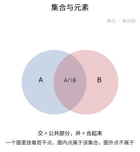

**一句话点破**：集合不过是一个"圈"，元素就是圈里的点，"属于"与"不属于"说的正是点与圈的内外关系。

### 11.2 子集

如果 A 圈里的每样东西都恰好也在 B 圈里，我们就说 A 是 B 的**子集**，记作 $A \subseteq B$。"牛奶"这一小类完全落在"饮料"这一大类里，子集说的正是这种"全部装得下"的关系。

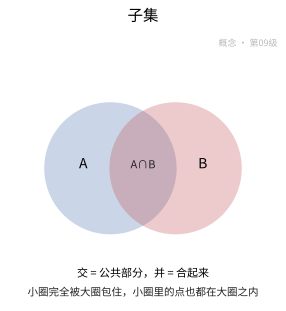

**一句话点破**：子集就是"小圈完全套进大圈"，A 是 B 的子集意味着 A 的每个元素都归属 B。

### 11.3 空集

有时候一个圈里什么都没装——比如"既是偶数又是奇数的整数"，这样的集合叫**空集**，记作 $\varnothing$。它不是"没有集合"，而是"一个装着空的盒子"，并且是任何集合的子集。

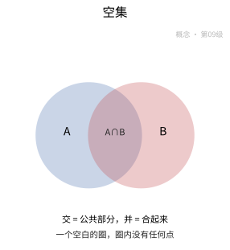

**一句话点破**：空集是"什么都没有"的集合，却实实在在存在，而且是每个集合的子集。

### 11.4 全集

讨论问题时，我们总要先划一个"大圈"，把话题里可能出现的所有东西都圈进去，这个大圈叫**全集**，记作 $U$。比如聊水果时，全集就是"世界上所有水果"，补集等许多运算都要相对它来说。

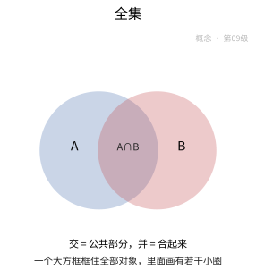

**一句话点破**：全集就是我们限定话题范围时画的那个"大框"，一切讨论都在它之内进行。

### 11.5 幂集

从一组元素里，你能挑出多少种不同的"小团队"？把某个集合的所有子集收集起来，就得到它的**幂集**，记作 $\mathcal{P}(A)$。若 $A$ 有 $n$ 个元素，幂集就有 $2^n$ 个子集。

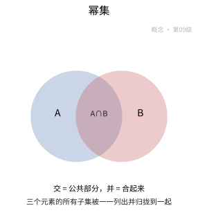

**一句话点破**：幂集是"所有子集组成的集合"，$n$ 个元素会生长出 $2^n$ 个子集。

### 11.6 基数

一个集合里有多少个元素，这个"个数"叫**基数**，记作 $|A|$。它可以是有限的数，也可以是无穷——但无穷还分不同的大小，这正是后面康托尔故事的开端。

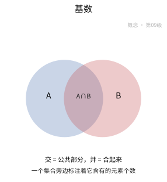

**一句话点破**：基数就是集合的"元素个数"，它把"有多少"这件事变成一个可以比较的量。

### 11.7 并集

你和同桌各列一份"周末想看的电影"清单，把两份合在一起、去掉重复的，就是**并集**，记作 $A \cup B$。生活里"我们俩一起做点什么"问的常常是并集。

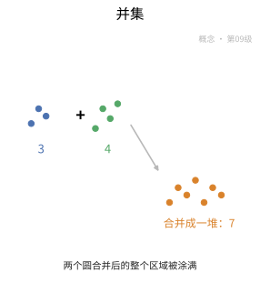

**一句话点破**：并集是"只要在其中任何一个里就算"，把两个圈的内容全部算上。

### 11.8 交集

两份电影清单里都出现的那几部，构成**交集**，记作 $A \cap B$。"我们俩都喜欢的"问的就是交集——必须同时在两个圈里才算数。

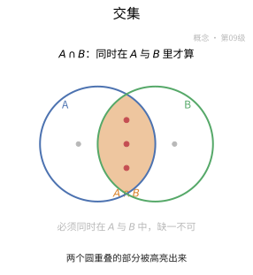

**一句话点破**：交集是"必须同时在两个里才算"，只取两个圈重叠的那一块。

### 11.9 差集

你想看的电影里，同桌已经看过的不算，剩下那些就是**差集**，记作 $A \setminus B$。它回答的是"A 里有、但 B 里没有"这样的问题。

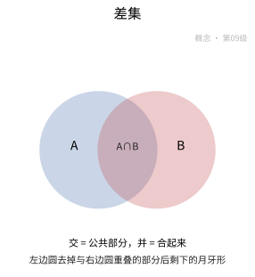

**一句话点破**：差集取的是"在 A 却不在 B"的那部分，相当于把重叠处从 A 中挖掉。

### 11.10 补集

在"所有水果"这个大圈里，不是苹果的都有哪些？相对全集 $U$ 而言，把 A 圈外面的部分叫作 A 的**补集**，记作 $A^{c}$。要注意，谈补集一定要先说清楚相对哪个全集。

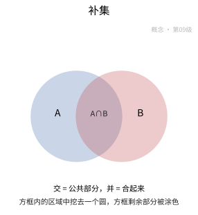

**一句话点破**：补集是全集里"不属于 A"的全部，它天生依赖"相对于哪个全集"。

### 11.11 对称差

"只有一方喜欢、另一方不喜欢"的那些，恰好就是**对称差**，记作 $A \triangle B$。它等于并集去掉交集，也就是"要么在 A、要么在 B，但不同时在两边"。

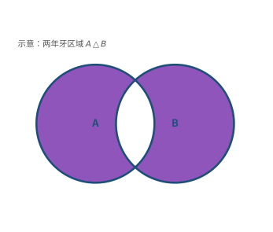

**一句话点破**：对称差收集"只在一方出现"的元素，是并集与交集之差。

### 11.12 笛卡尔积

点餐时，先在主食里选一样、再在饮料里选一样，所有可能的组合就是一个**笛卡尔积**，记作 $A \times B$。它的每个元素是一对有序的搭配 $(a, b)$，顺序不能颠倒。

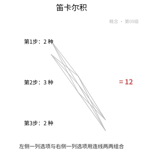

**一句话点破**：笛卡尔积是"两两搭配"的全集，每个结果都是一对讲究先后的有序对。

### 11.13 运算性质汇总

并、交、差这些运算并不杂乱，它们满足交换律、结合律、分配律等一整套规律。把这些规律列成一张表，就像拥有了化简集合表达式的"九九乘法表"。


**一句话点破**：集合运算的规律可以被整齐地汇总成表，成为化简表达式时的常用依据。

### 11.14 笛卡尔积图解

把 $A \times B$ 画成一张方格图会非常直观：横轴是 A 的元素，纵轴是 B 的元素，每个交叉点就对应一个有序对 $(a, b)$。这样"乘积"的规模一眼可见——共有 $|A|\cdot|B|$ 个格子。

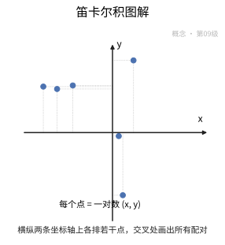

**一句话点破**：把笛卡尔积画成方格图，横向与纵向的每一次交叉就是一个有序对。

### 11.15 德摩根定律

"A 或 B"的反面，等于"A 的反面且 B 的反面"——这就是**德摩根定律**：$(A \cup B)^{c} = A^{c} \cap B^{c}$。日常里"两样都不行"和"至少一样行"正好互为反面，道理完全一致。

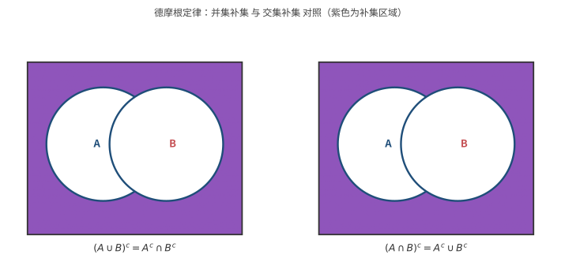

**一句话点破**：德摩根定律把"并的补"换成"补的交"（反之亦然），让否定穿过集合运算时自动翻转。

### 11.16 分配律

$A \cap (B \cup C) = (A \cap B) \cup (A \cap C)$，集合的交与并彼此"分配"。这正像乘法对加法的分配律，说明集合运算与数的运算共享同一套代数节奏。

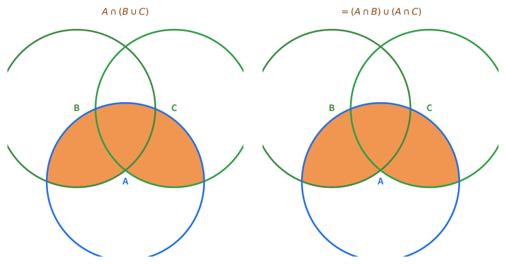

**一句话点破**：分配律让交与并可以互相"分配"展开，是集合表达式变形的主干工具。

### 11.17 吸收律

$A \cup (A \cap B) = A$，无论 B 是什么，A 与它交集再并回去，结果还是原来的 A。多绕的那一圈被 A 自己"吸收"掉了，这个恒等式让很多化简一步到位。

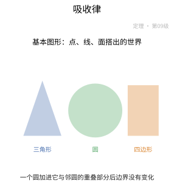

**一句话点破**：吸收律说明多余的并或交会被原有集合"吞掉"，是化简时的省力捷径。

### 11.18 其他重要恒等式

幂等律 $A \cup A = A$、$A \cap A = A$，以及 $A \setminus A = \varnothing$ 等一批恒等式，是化简集合表达式的常用工具。它们与德摩根定律、分配律、吸收律一起，构成集合代数的基本法则。

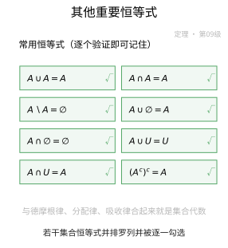

**一句话点破**：幂等律、$A \setminus A = \varnothing$ 等零散恒等式，与三大定律共同撑起集合代数。

### 11.19 笛卡尔积的基数

如果 A 有 m 个元素、B 有 n 个元素，那么 $A \times B$ 恰好有 $m \times n$ 个有序对，即 $|A \times B| = |A|\cdot|B|$。乘法表里"m 行 n 列"的格子总数，正是这个道理。

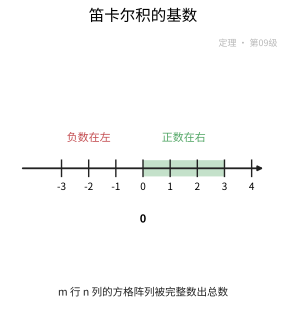

**一句话点破**：笛卡尔积的基数等于两个集合基数之积，配对的总数就是行数乘列数。

### 11.20 关系

"小明是小红的同桌""3 小于 5"——这类把两个对象联系起来的陈述就是**关系**，数学上把它定义为笛卡尔积的一个子集。有了关系，我们才能谈论谁和谁相关、怎样相关。

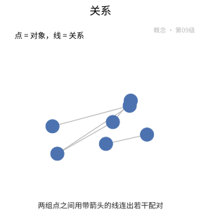

**一句话点破**：关系就是"对象之间有没有联系"的规则，它被刻画为笛卡尔积的一个子集。

### 11.21 等价关系

满足自反、对称、传递三条性质的关系，叫作**等价关系**。它像"同余""同岁""住同一栋楼"那样，把一堆对象自动分成若干互不重叠的"类别"，同类之间彼此等价。

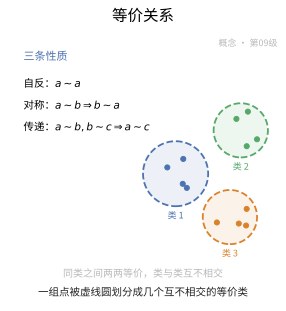

**一句话点破**：等价关系满足三性质，作用是把集合干净地切分成一组互不相交的等价类。

### 11.22 偏序关系

有些关系只能比大小、不能随意交换，比如"小于等于"——这就是**偏序关系**。它满足自反、反对称、传递，能把对象排出层次，却不保证任意两个都能比出高低。

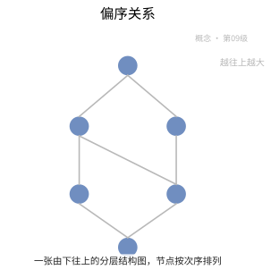

**一句话点破**：偏序是"能排层次、未必能全序比较"的关系，为"大小"提供了宽松版本。

### 11.23 函数

给每个输入恰好指定一个输出，这样的对应就是**函数**。它是最规矩的关系：不允许多答、也不允许漏答，日常里的"按学号查成绩""按日期查气温"都是函数。

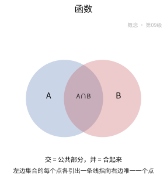

**一句话点破**：函数是"每个输入只对应一个输出"的规矩关系，既不重答也不漏答。

### 11.24 关系的复合与逆

先做关系 R、再做关系 S，串起来的整体效果就是 R 与 S 的**复合**；把每对 $(a,b)$ 的两个角色对调，就得到**逆关系** $R^{-1}$。这正是"路程与时间""加密与解密"这类成对操作的抽象。

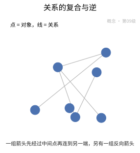

**一句话点破**：复合是把两个关系首尾相接，逆关系则是把每一对的方向倒过来。

### 11.25 可数集

能像排队报数那样，把元素一一编号排成一列（哪怕排到无穷），这样的集合叫**可数集**。自然数、偶数、整数甚至有理数都可数——它们都能和自然数一一配对。

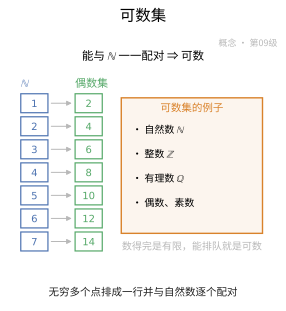

**一句话点破**：可数集是"能排队编号"的集合，哪怕无穷，只要能一一配对就算可数。

### 11.26 不可数集

实数里实在太多，无论怎么想办法排成一列，总会有数漏在外面。这样无法与自然数一一对应的集合就是**不可数集**，实数是其中最著名的例子。

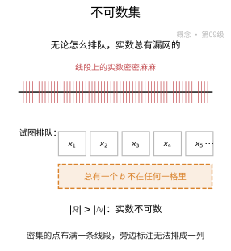

**一句话点破**：不可数集是"无论如何都排不成队"的集合，实数是它的经典代表。

### 11.27 康托尔对角线论证

假设能把 0 到 1 之间的实数排成一张表，就在对角线处逐位改动，造出一个新数——它必然与表中每一行都不同，矛盾。**对角线论证**用短短几行，证明了实数不可数。

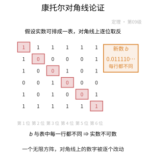

**一句话点破**：对角线论证靠"沿对角线造一个漏网之数"的反证，一举证明实数不可数。

### 11.28 康托尔定理

任何集合的幂集，都比原集合"更大"，即 $|A| < |\mathcal{P}(A)|$。于是从自然数出发走上这条阶梯，无穷被一层层推高，永远没有最大的无穷。

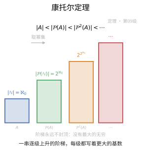

**一句话点破**：康托尔定理说明幂集总比原集更大，于是无穷也分无穷多个层次。

### 11.29 可数个可数集的并仍可数

可数个可数集，并起来还是可数的。把所有有理数按"分子加分母"排成一张对角线表格、再沿着蛇形路线读出来，就能完成编号。

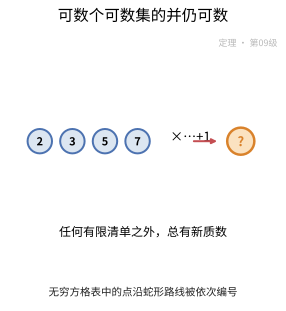

**一句话点破**：可数集的数目就算再多，只要还是"可数份"，并起来的集合依旧可数。

### 11.30 基数算术初探

无穷基数也能像数一样加减乘：$\aleph_0 + \aleph_0 = \aleph_0$，$\aleph_0 \cdot \aleph_0 = \aleph_0$。这看着反常，却正是"无穷能装下自己的一部分"的直接体现。

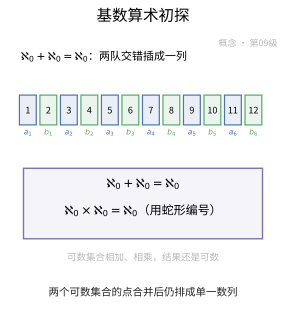

**一句话点破**：无穷的加减乘不再是"越加越大"，$\aleph_0$ 加上自己还是 $\aleph_0$。

### 11.31 选择公理、Zorn 引理与良序原理

给定一堆非空集合，能否一次性地从每个里挑出一个元素、拼成新集合？这个看似显然的断言就是**选择公理**，它与 Zorn 引理、良序原理彼此等价，是现代数学的隐形地基。

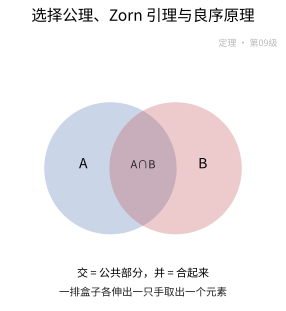

**一句话点破**：选择公理断言"可以从一堆非空集合里同时各挑一个元素"，并与 Zorn 引理、良序原理等价。

### 11.32 序数、序型与良序集初探

自然数排成一列能数完；把"数到第几个"这个位置抽象出来，就是**序数**。能在任意非空子集中都找到最小元素的集合叫**良序集**，它让"归纳"这种证明手法可以一直用到无穷之外。

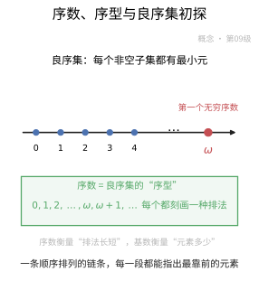

**一句话点破**：序数关心的是"排在第几位"，良序集则保证任何非空部分都有打头的元素。

### 11.33 超限归纳法

像普通数学归纳法一样，只不过把"下一步"一直延伸到序数允许的所有情形：只要基础情形成立、且每一步都能从前面的情形推出后面，那么对所有序数都成立——这就是**超限归纳法**。

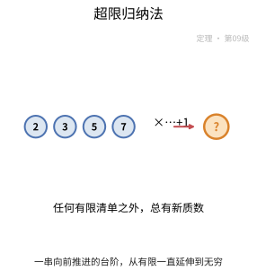

**一句话点破**：超限归纳法把归纳法从自然数推广到序数，让"一步步推"能一直做到无穷之外。

### 11.34 康托尔–施罗德–伯恩斯坦定理

若 A 能单射进 B、B 也能单射进 A，那么 A 与 B 一定可以一一对应，即 $|A| = |B|$。它告诉我们"互不更大"就等于"一样大"，为比较无穷大小提供了坚实基础。

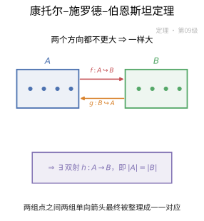

**一句话点破**：双向都能单射进来，就必然存在一一对应，于是两个集合一样大。

## 12. 数学史（History of Mathematics）

### 12.1 前史：从芝诺悖论到波尔查诺的"无穷"

- **古希腊的无穷之问**：公元前 5 世纪，芝诺用"阿基里斯追乌龟""飞矢不动"等悖论挑战"无穷可分与无穷累加"的合法性，迫使希腊人把"无限"逐出严格的几何论证之外。亚里士多德区分了"潜在无穷"与"现实无穷"，主张算术与几何只处理潜无穷，这一态度统治了两千年。
- **印度与中世纪的探索**：在东方传统中，无穷等比级数的求和（阿基米德、喀拉拉学派）已经暗中触碰"无穷项相加"，但它们都依附于具体的几何或天文问题，没有人把"集合"本身当作研究对象。
- **波尔查诺的转折**：19 世纪捷克数学家波尔查诺（Bernard Bolzano）在《无穷悖论》（1851 年前后撰写）中第一次把"集合"与"无穷"单独挑出来思考。他指出：无穷集合可以与自己的真子集一一对应（例如"正整数集"与"正偶数集"——每个 $n$ 对应 $2n$）。这个如今构成无限集定义核心的现象，当时被当作"悖论"而难以接受，却为康托尔打开了门。
- **契机在三角级数**：康托尔本人最初并非专攻集合。他在研究实变函数的三角级数表示唯一性时，遇到"两个三角级数何时表示同一函数""某集合在哪些点可以不唯一"之类的问题，逼着他把"点的聚拢方式"翻译成集合的框架——实分析与集合论由此结盟。

### 12.2 康托尔与集合论的诞生：1873 年的那封信

- **诞生日**：1873 年 12 月 7 日，康托尔（Georg Cantor，1845–1918）写信给好友戴德金，宣布自己证明了"实数全体不可数"；这一天后来被史家视为集合论的诞生日。1874 年他在论文《关于所有实代数数的一个性质》中正式发表这一结果。
- **动机**：康托尔要回答一个看似哲学家才关心的问题——"一条直线上的点，是不是比自然数'更多'？"为了回答它，他抛弃了"多少"的日常直觉，改用能否建立**一一对应**（双射）来比较两个集合的"大小"，由此提出**基数**（cardinality）概念：两集合基数相等，当且仅当它们之间有双射。
- **戴德金的作用**：理夏德·戴德金（Richard Dedekind）不仅是最早的听众与鼓励者，自己也独立发展出集合的思想（戴德金分割用于实数构造），并与康托尔 1872 年在瑞士的会面互相砥砺。两人常被一同视为朴素集合论的奠基人。
- **从无限到超限**：由"可数"（能与自然数一一对应）出发，康托尔证明了有理数集可数、代数数可数，而实数不可数；对任意集合，其幂集基数严格更大（康托尔定理）。于是无穷有了大小之分：$\aleph_{0},\aleph_{1},\dots$ 被称为**超限基数/阿列夫数**，由全体序数构成的"无穷的无穷"的层次由此展开。

### 12.3 从数论走进无穷：实数不可数的对角线论证

- **问题**：既然自然数、整数、有理数都能与自然数一一对应（可数），实数会不会也可以？康托尔给出否定的惊人答案。
- **论证**：设想把 $(0,1)$ 中的实数排成一列 $a_{1},a_{2},a_{3},\dots$，每个写成无限小数。构造一个新数 $b$：其第 $n$ 位小数取与 $a_n$ 的第 $n$ 位不同的数字。那么 $b$ 必然与每一个 $a_n$ 都不相同（在某一小数位上不一致）——它不在列表里，矛盾。这就是**康托尔对角线论证**，数学中最优美也最有影响力的论证之一。
- **后果**：对角线论证不仅证明实数集不可数，还埋下了三颗种子：一是"无穷"有不可数大于可数之分；二是后来罗素悖论、哥德尔不完备定理都借用了"对角线"的自我指涉技巧；三是它确立了"比较集合大小"完全不同于"数个数"的严格框架。

### 12.4 无穷的层次：基数、幂集与超限数

- **何为基数**：基数就是"集合的大小"这一概念的外化。有限集的基数是自然数；无限集的基数用 $\aleph$（阿列夫）标记，最小的无限基数为 $\aleph_0=\lvert\mathbb{N}\rvert$，即可数无穷。
- **康托尔定理**：对任何集合 $A$，都有 $\lvert A\rvert<\lvert P(A)\rvert$（幂集的基数严格更大）。因为集合的幂集可以"翻倍蹦大"，所以 $\aleph_0<\lvert P(\mathbb{N})\rvert<\lvert P(P(\mathbb{N}))\rvert<\cdots$，无穷的阶梯永无止境。
- **良序与超限归纳**：康托尔进一步把"每一个集合能否被良序化"与序数联系起来，发展出**序数**（刻画"第几个"）与**超限归纳法**（在良序集上逐级推进的归纳原则）。今天处理大基数、证明论与集合论自身都离不开这套工具。
- **康托尔-施罗德-伯恩斯坦定理**：若 $A$ 能单射入 $B$（$\lvert A\rvert\le\lvert B\rvert$）且 $B$ 能单射入 $A$，则 $\lvert A\rvert=\lvert B\rvert$——即基数的比较满足"反对称"性，两个方向都有"不更大"的一方时，必有一个双射。它让基数之间的比较成为全序，是基数算术的基石。

### 12.5 达尔文式的争议：克罗内克的反对与盟友的接纳

- **结构主义者的抵制**：柏林学派的利奥波德·克罗内克（Leopold Kronecker）坚信"整数是上帝造的，其余都是人的作品"，拒不承认"现实无穷"，讥讽康托尔的研究是"病态的幻想"，甚至动用学术地位封阻康托尔谋求柏林教职。这种抵制让康托尔长期郁郁，深刻影响了他的后来人生。
- **支持者**：魏尔斯特拉斯（Karl Weierstrass）与戴德金理解其价值并公开支持；尤其魏尔斯特拉斯深知实分析与三角级数需要集合的工具，为康托尔提供了关键背书。
- **为何流传**：抵抗并未让成果消失——恰恰相反，集合论中"双射比较大小""对角线证明""幂集蹦出更高无穷"等概念的实用性极强，加之 1898 年《克莱因的数学百科全书》以《Mengenlehre（集合论）》立条目收录，集合论由边缘话题迅速进入主流数学。

### 12.6 悖论危机：罗素悖论与第三次数学危机

- **朴素集合论的自负**：早期集合论允许"任意性质都确定一个集"（概括公理），即"一切满足性质 P 的对象构成一个集合"。这个看似显然的原则里藏着深渊。
- **罗素悖论**：1901 年前后，罗素（Bertrand Russell）把"由所有不以自身为元素的集合组成的集合"记为 $S$，问"$S$ 是否是自身的元素"——若 $S\in S$，则按定义 $S\notin S$；若 $S\notin S$，则由 $S$ 的定义又得 $S\in S$。无论哪个假设都矛盾。帕累斯等逻辑学者也有类似发现，而罗素和策梅洛的表述最著名。
- **第三次数学危机**：罗素悖论及康托尔 1899 年自问的"一切集合之集合的基数"（康托尔悖论）动摇了"集合"作为数学最底层概念的可信度，史称对数学基础可信性的又一次大冲击（第三次数学危机）。它直接促使数学家放弃"一切性质皆可概括"，转而为集合论立法。

### 12.7 公理化之路：从朴素集合到 ZFC

- **策梅洛的方案**：1908 年，德国数学家恩斯特·策梅洛（Ernst Zermelo）给出第一套集合论公理，明确限制哪些"搜集"才构成集合，使悖论得以规避；他同时把选择公理作为独立公理提出。
- **弗伦克尔与斯科伦的补全**：亚伯拉罕·弗伦克尔（Abraham Fraenkel，1922 年）与斯科伦等人补上"替换公理"等环节，消除了体系中的疏漏。
- **ZFC 的成型**：合并后的公理体系称**策梅洛-弗兰克尔集合论并加选择公理**，简称 **ZFC**（Zermelo–Fraenkel with Choice）。它如今是绝大多数现代数学默认的"地基"：自然数、实数、函数、拓扑空间等一切对象都能在 ZFC 中构造出来。
- **公理化的意义**：公开的目的不再是把"集合"说清楚，而是用一组公理统一地规定"可以怎样造出一个集合、可以采取哪些基本操作"，把悖论关在门外，同时保留下足够丰富的建筑原材料。

### 12.8 选择公理、良序定理与佐恩引理

- **选择公理（AC）**：任意一族非空的集合，都能从每个集合中挑出一个元素组成一个"选择函数"。它直观得不值一提，却几乎无法被构造性地证明。
- **良序定理**：康托尔曾断言"每个集合都能被良序化"，但无从证明；策梅洛 1904 年指出，在 AC 之下良序定理成立——这正是他分离出选择公理的直接动因。
- **佐恩引理**：1950 年前后由马克斯·佐恩（Max Zorn）以最简形式陈述：若一个偏序集中每条链都有上界，则该集合有极大元。它与 AC、良序定理三者在 ZF 中互相等价，是证明"任何向量空间都有基""任何域都有代数闭包"这类存在性结果的标准武器。
- **超限归纳的合法性**：有了良序定理，超限归纳法（第 6.9 节）才获得稳固依据。AC 系命题多数超出直观经验，其非构造性质也长期是数学基础争论的焦点（事实上策梅洛公理体系即为选择公理提供了居所）。

### 12.9 从根基到工具：勒贝格积分与实分析的成长期

- **实分析的召唤**：康托尔最初的三角级数问题，在 19 世纪末到 20 世纪初演化为实分析。勒贝格（Henri Lebesgue）在 1902 年前后以测度论重造积分，把"可测集""几乎处处"等集合语言变成分析的日常词汇——集合论从玄学式的辩护变回服务性的工具。
- **构造出整个数学**：在公理化集合论中，自然数可用 $\emptyset,\{\emptyset\},\{\emptyset,\{\emptyset\}\},\dots$ 构造（冯·诺伊曼序数），实数用戴德金分割构造（第 10 级），函数、关系、拓扑都由集合来定义。"数学的对象都是集合"这一信念成为现代数学的默认语法。
- **范畴论的挑战**：20 世纪中叶起，以欧伦、麦克莱恩为代表的范畴论者认为"对象之间的态射"比"对象的集合性"更本质，主张以范畴取代集合作为更灵活的基座。这一竞争持续至今，但集合论仍是最普遍接受的基金会答案。

### 12.10 连续统假设：从希尔伯特的问题到哥德尔与科恩

- **问题的提出**：实数集的基数记作 $2^{\aleph_0}=|\mathbb R|$（因为 $\mathbb{R}$ 与自然数幂集等势）。它是否正好是"可数之后第一个超限基数" $\aleph_1$？康托尔猜测是——这就是**连续统假设（CH）**：$\lvert\mathbb{R}\rvert=\aleph_1$。
- **希尔伯特之列**：1900 年希尔伯特在巴黎国际数学家大会上把"证明实数集基数是可数的后继"列为 23 个问题之首，CH 与 AC 一起成为 20 世纪数学基础的头号课题。
- **哥德尔的半步**：1940 年，哥德尔（Kurt Gödel）证明 CH 与 AC 相对于 ZF 公理是**一致的**（不能证伪）：它们能在哥德尔构造的"可构造宇宙"中成立。
- **科恩的另半步**：1963 年，保罗·科恩（Paul Cohen）发明**力迫法**，证明 CH 与 AC 相对 ZF 是**独立**的（不能证明）——即"CH 成立"与"CH 不成立"都自洽，既证不出来也证不否，数学不会崩塌，而只是"说不出答案"。力迫法自此成为现代集合论研究大基数与独立性问题的标准技术。

### 12.11 历史年表

| 时间 | 人物／文献 | 事件与贡献 |
|:---|:---|:---|
| 约前 5 世纪 | 芝诺（希腊） | 悖论把"无穷可分"推上争议舞台 |
| 1851（撰写） | 波尔查诺（波希米亚） | 《无穷悖论》：真子集与自身一一对应的现象 |
| 1872 年 | 康托尔与戴德金 | 瑞士会面，交流集合与实数思想 |
| 1873.12.7 | 康托尔致戴德金 | 证明实数不可数，视为集合论诞生日 |
| 1874 年 | 康托尔 | 《关于所有实代数数的一个性质》：正式建立基数观 |
| 1878—1884 | 康托尔 | 提出超限基数 $\aleph$、良序与超限序数 |
| 1891 年 | 康托尔 | 用对角线论证证明实数不可数（另一表述） |
| 1898 年 | 《克莱因数学百科全书》 | 首次以《Mengenlehre》立条目正式收录 |
| 1899 年 | 康托尔 | 提出"一切集合之集合"悖论（康托尔悖论） |
| 1901—1902 | 罗素 | 发现罗素悖论，触发"第三次数学危机" |
| 1904 年 | 策梅洛 | 用选择公理证明良序定理 |
| 1908 年 | 策梅洛 | 给出第一套集合论公理（Z） |
| 1922 年 | 弗伦克尔、斯科伦 | 补入替换公理，完善为 ZF/ZFC |
| 1902—1905 | 勒贝格 | 建立测度论与勒贝格积分：集合成为分析工具 |
| 1920 年前后 | 佐恩 | 整理出佐恩引理（与 AC、良序等价） |
| 1940 年 | 哥德尔 | 证明 CH 与 AC 一致于 ZF |
| 1963 年 | 科恩 | 提出力迫法，证明 CH 独立于 ZF |

### 12.12 小结

> 集合论的故事，是一部"把自然的计数直觉锻造成严格公理"的史诗。它从古希腊关于"无穷"的哲学困惑出发，经波尔查诺的试探，由康托尔用一一对应、对角线论证与幂集构造了三步定式——无穷第一次有了可比较的大小，超限基数与超限归纳由此诞生；继而在克罗内克的敌意与戴德金、魏尔斯特拉斯的支持下披荆斩棘。罗素悖论戳破了朴素集合论的自信，逼出策梅洛—弗伦克尔—选择公理（ZFC）这一公理化方案；选择公理、良序定理与佐恩引理的等价，给出了现代分析所需的"每条线都有上界、每个空间都有基"。连续统假设则把这条主线的哲学张力推到极致——哥德尔证明它推不翻、科恩证明它也证不出，整个体系在"说不清楚"中依旧稳健。纵观全程：从具体分析问题里来，固化为普遍语言，再经悖论检验而公理化——这正是数学基础从"惯例"走向"立法"的标准剧本，也是本章每一个集合概念（基数、幂集、选择公理、超限归纳）的共同宿命。

## 现实应用（Real-World Applications）

> 本节把本章的知识点落到真实的工程、科学与生活场景中。每个案例都给出**完整的问题背景、建模过程、可复现的数据 / 公式 / 代码与结果解读**；案例末尾的「涉及知识点」对应本章的具体小节，文末附**知识点覆盖对照表**，确保本章知识点全部被覆盖。

### 应用案例 1：电商数据仓库｜用关系代数的集合语义做人群重叠与漏斗分析

**场景与问题**

某头部电商平台的数据仓库每天承接约 2.3 亿活跃用户的行为日志。分析团队要回答一个典型的运营问题：2024-06-01 当天，**浏览了数码类目**（集合 $A$）、**把商品加入购物车**（集合 $B$）、**完成下单**（集合 $C$）的人群各有多大？三者重叠多少？哪些人浏览了却没有加购？哪些人只差一步下单？

这类问题在工程上**就是集合运算**。数据仓库的 SQL 之所以能一行 `UNION`、`INTERSECT`、`EXCEPT` 搞定，是因为关系（表）被建模成元组的集合，而 `JOIN` 被建模成笛卡尔积加筛选。理解这一点，才能解释为什么"同一条业务口径用不同 SQL 写法结果必须一致"，也才能做查询重写（query rewriting）优化。

为了可复现，我们把规模缩到**当日的 100 名抽样用户**，用户 ID 取自集合 $U=\{1,2,\dots,100\}$，并按固定规则生成三层漏斗人群（真实报表口径可完全照此逻辑替换为真实 ID）。

**涉及知识点**

- 本章「2.4 全集（Universal Set）」：抽样用户 $U$ 就是本次分析的"舞台"，补集、差集都相对 $U$ 定义。
- 本章「3.1 并集（Union）」：多渠道触达人群合并去重。
- 本章「3.2 交集（Intersection）」：漏斗各层的重叠人群。
- 本章「3.3 差集（Difference）」：浏览未加购人群 $A\setminus B$。
- 本章「3.4 补集（Complement）」：相对 $U$ 的"未触达"人群。
- 本章「3.5 对称差（Symmetric Difference）」：只在浏览、只在加购之一的人群。
- 本章「3.6 笛卡尔积（Cartesian Product）」：用户表与商品表 `CROSS JOIN`，以及 `JOIN` 的集合本质。
- 本章「3.7 运算性质汇总」「3.8 笛卡尔积的图解」：把六种运算与网格图对应起来。
- 本章「4.1 德摩根定律（De Morgan's Laws）」「4.2 分配律（Distributive Laws）」「4.3 吸收律（Absorption Laws）」「4.4 其他重要恒等式」「4.5 笛卡尔积的基数」：SQL 查询等价重写与行数估计的依据。

**建模与数据**

- 全集 $U=\{u \in \mathbb{Z} \mid 1 \le u \le 100\}$，$|U|=100$。
- 浏览数码 $A=\{u\in U\mid u\equiv 0 \pmod 3\}$。
- 加购 $B=\{u\in U\mid u\equiv 0 \pmod 4\}$。
- 下单 $C=\{u\in U\mid u\equiv 0 \pmod 5\}$。

由整除性可直接算出各层大小：$|A|=33,\ |B|=25,\ |C|=20$；两两交：$|A\cap B|=8$（12 的倍数）、$|A\cap C|=6$（15 的倍数）、$|B\cap C|=5$（20 的倍数）；三重交 $|A\cap B\cap C|=1$（60 的倍数）。

商品表 $P$ 共 500 个在售 SKU，价格为真实量级：数码类目客单价 $\approx 800$ 元。

**完整推导与算法**

（1）漏斗基数用**容斥（容斥即并集基数公式）**：

$$|A\cup B\cup C| = |A|+|B|+|C|-|A\cap B|-|A\cap C|-|B\cap C|+|A\cap B\cap C|$$

代入得

$$|A\cup B\cup C| = 33+25+20-8-6-5+1 = 60.$$

即当日有 60 人至少完成"浏览、加购、下单"之一。

（2）"浏览但未加购"是差集 $A\setminus B$，其基数 $|A\setminus B| = |A| - |A\cap B| = 33-8 = 25$。

（3）**德摩根定律**给出一个可验证的查询重写：对"既没浏览数码、又没加购"的人群有

$$(A\cup B)^{c} = A^{c}\cap B^{c}.$$

在 SQL 里 `WHERE NOT (cat='数码' OR cart=1)` 与 `WHERE cat<>'数码' AND cart=0` 必须返回同一批用户——这正是优化器能把否定条件"按下推"的依据。

（4）**分配律** $A\cap(B\cup C) = (A\cap B)\cup(A\cap C)$ 说明"先合表再筛"与"先筛再合表"等价；**吸收律** $A\cup(A\cap B)=A$ 说明"给已知人群再叠一个子集不会改变人群"。

（5）笛卡尔积：用户 $U$ 与商品 $P$ 的 `CROSS JOIN` 产生 $|U|\times|P| = 100\times 500 = 50000$ 行；而实际"用户-商品"行为表只是这个笛卡尔积里**满足约束的子集**，即 $R\subseteq U\times P$，其基数由 4.5 的 $|U\times P|=|U|\cdot|P|$ 给出上界。

```python
# 依赖: 仅需 Python 标准库 (sqlite3)
# 输入: U={1..100} 及整除规则生成的 A/B/C
# 输出: 各集合基数、集合恒等式校验、SQL 与集合运算结果比对
import sqlite3

U = set(range(1, 101))
A = {u for u in U if u % 3 == 0}   # 浏览数码
B = {u for u in U if u % 4 == 0}   # 加购
C = {u for u in U if u % 5 == 0}   # 下单

print("|U|=", len(U), "|A|=", len(A), "|B|=", len(B), "|C|=", len(C))
print("|A n B|=", len(A & B), "|A n C|=", len(A & C), "|B n C|=", len(B & C))
print("|A n B n C|=", len(A & B & C))

# 容斥公式校验
lhs = len(A | B | C)
rhs = len(A) + len(B) + len(C) - len(A & B) - len(A & C) - len(B & C) + len(A & B & C)
print("容斥: ", lhs, rhs, lhs == rhs)          # 60 60 True

# 德摩根定律校验: (A u B)^c == A^c n B^c
print("德摩根: ", (U - (A | B)) == ((U - A) & (U - B)))          # True
# 分配律: A n (B u C) == (A n B) u (A n C)
print("分配律: ", A & (B | C) == (A & B) | (A & C))              # True
# 吸收律: A u (A n B) == A
print("吸收律: ", A | (A & B) == A)                              # True
# 对称差: 恰属其一
print("|A 三角 B|=", len(A ^ B))                                 # 50

# 差集与补集
print("|A - B|=", len(A - B))                                    # 25
print("|(A u B)^c|=", len(U - (A | B)))                          # 50

# 用 SQL 复核: 把三张表装进内存数据库
con = sqlite3.connect(":memory:")
con.execute("CREATE TABLE U(uid INT)")
con.execute("CREATE TABLE A(uid INT)")
con.execute("CREATE TABLE B(uid INT)")
con.executemany("INSERT INTO U VALUES(?)", [(u,) for u in U])
con.executemany("INSERT INTO A VALUES(?)", [(u,) for u in A])
con.executemany("INSERT INTO B VALUES(?)", [(u,) for u in B])

sql_union = "SELECT uid FROM A UNION SELECT uid FROM B"
sql_inter = "SELECT uid FROM A INTERSECT SELECT uid FROM B"
sql_except = "SELECT uid FROM A EXCEPT SELECT uid FROM B"
print("SQL UNION =", {r[0] for r in con.execute(sql_union)} == (A | B))      # True
print("SQL INTERSECT =", {r[0] for r in con.execute(sql_inter)} == (A & B))  # True
print("SQL EXCEPT =", {r[0] for r in con.execute(sql_except)} == (A - B))    # True

# 笛卡尔积基数上界
P = 500
print("|U x P| =", len(U) * P)                                   # 50000
```

**可复现步骤**

1. 环境与依赖：无需第三方库，`python3 case1.py` 即可（仅用标准库 `sqlite3`）。
2. 数据准备：脚本内用整除规则生成 $U,A,B,C$，无需外部文件。
3. 运行：`python3 case1.py`。
4. 预期输出：`|A|=33 |B|=25 |C|=20`、容斥两侧均为 `60`、三个 SQL 布尔校验均为 `True`、`|A-B|=25`、`|(A u B)^c|=50`、`|U x P|=50000`。任意一项不符即说明集合语义用错。

**结果解读与延伸**

结果印证了"关系数据库 = 集合 + 笛卡尔积 + 筛选"这一事实：SQL 的 `UNION/INTERSECT/EXCEPT` 与本节的 $\cup,\cap,\setminus$ 逐条对应，`INNER JOIN` 是"笛卡尔积后取满足条件的子集"。误差来源主要是口径本身（抽样规则替换为真实埋点后，基数会变但恒等式不变）。局限在于：SQL 的集合是**多重集（bag）**语义，`UNION ALL` 不去重，与集合的"互异"公理不同，工程上必须区分 `UNION` 与 `UNION ALL`。可延伸方向：用这些恒等式做查询重写，把 4.2 分配律与 4.1 德摩根用于谓词下推，降低扫描量。

### 应用案例 2：用户画像与推荐系统｜标签集合运算做多路召回与人群圈选

**场景与问题**

某内容平台为每位用户维护一个**标签集合**（消费能力、母婴、数码、健身、旅行、宠物等）。运营要用标签圈人（受众定向），推荐系统要用"多个召回通道取并集"生成候选池，再用"交集"算精确命中。核心数据结构就是集合，操作就是并、交、差、对称差。

平台持续遇到三个问题：新用户标签为空集怎么处理？两个召回通道的候选池凭什么去重？A/B 实验中"只在 A 组出现、只在 B 组出现"的差异人群怎么快速圈出？

**涉及知识点**

- 本章「2.1 集合（Set）与元素（Element）」：用户是元素，标签是集合，标签集合全体构成论域。
- 本章「2.2 子集（Subset）」：单个用户的标签集 $L(u)\subseteq T$。
- 本章「2.3 空集（Empty Set）」：冷启动用户 $L(u)=\varnothing$。
- 本章「2.4 全集（Universal Set）」：标签全集 $T$ 与用户全集 $U$。
- 本章「2.6 基数（Cardinality）」：人群规模 $|S|$。
- 本章「3.1 并集（Union）」：多路召回合并。
- 本章「3.2 交集（Intersection）」：标签交集圈人。
- 本章「3.3 差集（Difference）」：排除已购人群。
- 本章「3.5 对称差（Symmetric Difference）」：A/B 差异人群。

**建模与数据**

标签全集 $T=\{\text{高消费},\text{母婴},\text{数码},\text{健身},\text{旅行},\text{宠物}\}$，$|T|=6$。用户全集 $U$ 取 8 名用户，标签集如下表（真实系统里一张"用户-标签"明细表）：

| 用户 | 标签集 $L(u)$ | $\mid L(u)\mid$ |
| --- | --- | --- |
| u1 | 高消费, 数码, 旅行 | 3 |
| u2 | 母婴, 宠物 | 2 |
| u3 | 高消费, 母婴, 数码 | 3 |
| u4 | (空集) | 0 |
| u5 | 健身, 旅行 | 2 |
| u6 | 高消费, 数码 | 2 |
| u7 | 母婴, 旅行, 宠物 | 3 |
| u8 | 数码, 健身 | 2 |

**完整推导与算法**

（1）**子集与基数**：对每个用户 $L(u)\subseteq T$，画像是"标签丰富度" $\lvert L(u)\rvert$。全集 $T$ 有 6 个元素，故所有可能画像恰有 $2^{6}=64$ 种（幂集）。

（2）**空集**：$u4$ 的标签集是 $\varnothing$，不是"缺失"，而是合法的空画像；系统应走冷启动策略而非报错。

（3）**并集召回去重**：设通道 1 召回 $R_1=\{u1,u3,u4\}$，通道 2 召回 $R_2=\{u3,u7,u8\}$，合并候选池

$$R_1\cup R_2=\{u1,u3,u4,u7,u8\},\quad |R_1\cup R_2|=5.$$

注意 $u3$ 同时被两路召回，集合自动只算一次——这正是推荐系统候选池天然去重的原因。

（4）**交集圈人**：要"高消费且数码"的人群，取所有含该标签的用户交集

$$S_{\text{高消费}}\cap S_{\text{数码}} = \{u1,u3,u6\}\cap\{u1,u3,u6,u8\} = \{u1,u3,u6\}.$$

（5）**差集排除**：从"旅行"人群中剔除"已购"人群 $\{u5\}$，得 $S_{\text{旅行}}\setminus S_{\text{已购}}$。

（6）**对称差找差异**：A/B 两组人群的差异是

$$S_A\triangle S_B = (S_A\setminus S_B)\cup(S_B\setminus S_A),$$

恰好列出"只属 A、只属 B"的用户，用于归因分析。

```python
# 依赖: 仅 Python 标准库
# 输入: 上表 8 名用户的标签集合
# 输出: 各集合运算结果与基数校验
from itertools import combinations

T = ["高消费", "母婴", "数码", "健身", "旅行", "宠物"]
users = {
    "u1": {"高消费", "数码", "旅行"},
    "u2": {"母婴", "宠物"},
    "u3": {"高消费", "母婴", "数码"},
    "u4": set(),                       # 冷启动: 空集
    "u5": {"健身", "旅行"},
    "u6": {"高消费", "数码"},
    "u7": {"母婴", "旅行", "宠物"},
    "u8": {"数码", "健身"},
}
U = set(users)

# 子集与基数
print("u1 是子集:", users["u1"] <= set(T))
print("画像丰富度:", {u: len(s) for u, s in users.items()})

# 幂集大小: 标签全集 T 的所有子集数
print("可能的画像数 2^6 =", 2 ** len(T))                    # 64

# 多路召回并集
R1, R2 = {"u1", "u3", "u4"}, {"u3", "u7", "u8"}
print("召回并集:", sorted(R1 | R2), len(R1 | R2))            # 5

# 标签索引 (标签 -> 用户集)
idx = {t: {u for u in U if t in users[u]} for t in T}
inter = idx["高消费"] & idx["数码"]
print("高消费∩数码:", sorted(inter))                        # u1,u3,u6

# 差集: 旅行人群 - 已购人群
bought = {"u5"}
print("旅行-已购:", sorted(idx["旅行"] - bought))

# 对称差: A/B 差异人群
SA, SB = {"u1", "u2", "u3", "u4"}, {"u3", "u4", "u5", "u6"}
print("对称差:", sorted(SA ^ SB))                            # u1,u2,u5,u6
print("对称差=并-交:", (SA ^ SB) == ((SA | SB) - (SA & SB)))  # True

# 补集: 从未被任何通道召回的用户
print("未召回:", sorted(U - (R1 | R2)))                      # u2,u5,u6
```

**可复现步骤**

1. 环境：仅需 Python 标准库。
2. 数据：脚本内 `users` 字典即上表。
3. 运行：`python3 case2.py`。
4. 预期输出：`画像丰富度` 含 `u4: 0`；`可能的画像数 2^6 = 64`；召回并集 5 人；`高消费∩数码` 为 `u1,u3,u6`；对称差为 `u1,u2,u5,u6` 且与"并-交"一致。

**结果解读与延伸**

本案例说明：标签系统的所有操作都可归约为集合运算，而**并集天然去重**是候选池去重的数学根因。地基来自 2.1 的"互异"公理；冷启动对应 2.3 空集；A/B 差异对应 3.5 对称差。局限：真实系统标签规模是百万级，且标签有置信度权重，需从"硬集合"升级为"模糊集/加权集合"；此时并、交改为取 max、min（模糊集合运算）。延伸方向：用 2.5 幂集思维枚举 64 种画像做人群包冷启动，或用位图（bitmap）压缩每类标签的用户集以加速交并。

### 应用案例 3：爬虫去重与布隆过滤器｜幂集与集合的近似表示

**场景与问题**

一个网络爬虫每天要抓取 10 亿量级 URL，必须避免重复抓取同一页面。把全部 URL 存进内存做精确去重，按平均 80 字节/URL 计需 80 GB，成本过高。工程上用**布隆过滤器（Bloom Filter）**：用一段 $m$ 位的比特数组 + $k$ 个哈希函数，以极低误判率把"这个 URL 见过吗"这个问题近似回答。

布隆过滤器本质是"把集合 $S$ 映射进 $\{0,1\}^m$ 这个只含 $2^m$ 种状态的集合族"——这恰好是本节"幂集"与"基数"的思想：$m$ 位能表达 $2^m$ 个不同的位图，每个位图对应一个"可能集合"。

**涉及知识点**

- 本章「2.1 集合（Set）与元素（Element）」：URL 构成被判断的集合。
- 本章「2.5 幂集（Power Set）」：$m$ 位比特数组的状态空间有 $2^m$ 种，即位图集合的幂集规模。
- 本章「2.6 基数（Cardinality）」：插入基数 $n$ 与误判率的关系。
- 本章「3.1 并集（Union）」：两个过滤器按位或，等于两个集合的并的近似表示。

**建模与数据**

- URL 总量 $n=10^{8}$（1 亿）。
- 目标误判率 $p=10^{-6}$。
- 理论最优位数 $m=-\dfrac{n\ln p}{(\ln 2)^2}$，最优哈希个数 $k=\dfrac{m}{n}\ln 2$。

代入 $n=10^{8},p=10^{-6}$：$\ln p=-13.8155$，$(\ln 2)^2=0.4805$，得

$$m=\frac{10^{8}\times 13.8155}{0.4805}\approx 2.875\times 10^{9}\ \text{位}\approx 343\ \text{MB},$$

$$k=\frac{2.875\times 10^{9}}{10^{8}}\times 0.6931 \approx 19.9 \Rightarrow k=20.$$

即约 343 MB 内存、20 个哈希函数即可把 1 亿 URL 的误判率压到百万分之一。

**完整推导与算法**

（1）插入一个元素 $x$：对 $x$ 算 $k$ 个哈希值 $h_1(x),\dots,h_k(x)$，把位数组对应位置 1。

（2）查询：$k$ 位全为 1 才答"可能有"，否则"一定没有"。**不会漏报**（无假阴性），可能有假阳性。

（3）误判率推导：某一位在插入一个元素后未被置 1 的概率 $1-\frac1m$。$n$ 个元素、$k$ 次置位后仍为 0 的概率

$$q=\left(1-\frac{1}{m}\right)^{kn}\approx e^{-kn/m}.$$

误判率（$k$ 位独立地恰好全为 1）

$$p=\left(1-e^{-kn/m}\right)^{k}.$$

对 $k$ 求最小值，得上面的 $k=\frac{m}{n}\ln 2$。把 343 MB 与 20 代入：$kn/m=20\times 10^{8}/2.875\times10^{9}=0.6957$，$e^{-0.6957}=0.4987$，$p=(0.5013)^{20}\approx 1.02\times10^{-6}$。

（4）**并集性质**：两个布隆过滤器 $BF(A),BF(B)$ 按位或得 $BF(A)\cup BF(B)$，正确表示集合 $A\cup B$（误差只会叠加，不会漏报）。这使多台爬虫机器可各自维护过滤器、定期按位或合并。

```python
# 依赖: 仅 Python 标准库 (hashlib, math)
# 输入: 用确定性字符串构造的 n 条 URL
# 输出: 实测误判率 vs 理论公式, 并集性质验证
import hashlib, math

class Bloom:
    def __init__(self, m, k):
        self.m, self.k = m, k
        self.bits = bytearray((m + 7) // 8)
    def _hashes(self, x):
        for i in range(self.k):
            h = hashlib.md5(f"{i}:{x}".encode()).digest()
            yield int.from_bytes(h[:8], "big") % self.m
    def add(self, x):
        for p in self._hashes(x):
            self.bits[p >> 3] |= (1 << (p & 7))
    def __contains__(self, x):
        return all(self.bits[p >> 3] & (1 << (p & 7)) for p in self._hashes(x))

# 小规模复现: n=20000, 目标 p=1e-4
n = 20000
p_target = 1e-4
m = int(-n * math.log(p_target) / (math.log(2) ** 2))
k = round(m / n * math.log(2))
bf = Bloom(m, k)

inserted = [f"https://site.com/page/{i}" for i in range(n)]
for u in inserted:
    bf.add(u)

# 无假阴性
assert all(u in bf for u in inserted)

# 实测误判率
test = [f"https://other.com/x/{i}" for i in range(100000)]
fp = sum(1 for u in test if u in bf) / len(test)
p_theory = (1 - math.exp(-k * n / m)) ** k
print(f"m={m} bits  k={k}  内存={m/8/1024:.1f} KB")
print(f"理论误判率={p_theory:.6f}  实测误判率={fp:.6f}")

# 并集: OR 两个过滤器等于两集合并的近似
bf2 = Bloom(m, k)
for u in [f"https://new.com/{i}" for i in range(n)]:
    bf2.add(u)
merged = Bloom(m, k)
merged.bits = bytearray(a | b for a, b in zip(bf.bits, bf2.bits))
print("并集性质:", all((u in merged) for u in inserted))   # True
```

**可复现步骤**

1. 环境：仅需标准库 `hashlib, math`。
2. 数据：脚本内确定性生成 URL。
3. 运行：`python3 case3.py`。
4. 预期输出：`m≈383000 bits, k=13`（n=20000 时），理论误判率与实测误判率同量级（约 $10^{-4}$），并集性质输出 `True`。若实测远高于理论，通常是哈希未打散。

**结果解读与延伸**

布隆过滤器把"集合"从存放元素升级为存放**位图**，用幂集思想计量状态空间（$2^m$ 种位图），用基数思想（$n$ 与 $m$）预测误判率。误差只发生在"假阳性"，且可通过增大 $m$ 线性下降。局限：不支持删除（置 1 无法安全还原），也不给元素计数；需要删除时改用计数布隆过滤器。延伸：多集合的并可直接按位或（3.1 并集）；要估计集合基数（去重后有多少唯一 URL）则用 HyperLogLog，它同样是集合的近似表示，只是估计的是基数而非判属。

### 应用案例 4：权限系统（RBAC）｜关系、等价关系、函数与关系复合

**场景与问题**

某 SaaS 后台用 RBAC（基于角色的访问控制）管理权限：用户集合 $U$、角色集合 $R$、权限集合 $P$。系统要回答：某个用户有哪些权限？同一角色的用户为什么访问行为完全一致？角色变更后权限如何级联？

这套机制的本质是**关系**：用户-角色、角色-权限都是集合间的二元关系；而"用户映射到角色"是**函数**；"同角色"是**等价关系**，它把用户集合划分成若干个等价类（角色组）；用户权限则是两个关系**复合**的结果。

**涉及知识点**

- 本章「5.1 关系（Relation）」：用户-角色、角色-权限均为 $A\times B$ 的子集。
- 本章「5.2 等价关系（Equivalence Relation）」："同角色"满足自反、对称、传递，导出等价类与划分。
- 本章「5.4 函数（Function）」：`role: U→R` 每个用户恰有一个角色。
- 本章「5.5 关系的复合与逆（Composition and Inverse of Relations）」：用户-权限 = 用户-角色 ∘ 角色-权限；权限-用户是逆关系。

**建模与数据**

$U=\{a,b,c,d,e\}$，$R=\{\text{admin},\text{editor},\text{viewer}\}$，$P=\{\text{read},\text{write},\text{delete},\text{publish}\}$。

用户-角色关系 $UA\subseteq U\times R$（用函数 `role` 表示，每人一个角色）：

| 用户 | 角色 |
| --- | --- |
| a | admin |
| b | editor |
| c | editor |
| d | viewer |
| e | viewer |

角色-权限关系 $PA\subseteq R\times P$：

| 角色 | 权限集 |
| --- | --- |
| admin | read, write, delete, publish |
| editor | read, write, publish |
| viewer | read |

**完整推导与算法**

（1）**关系是子集**：$UA=\{(a,\text{admin}),(b,\text{editor}),\dots\}\subseteq U\times R$。`role` 是 $UA$ 中每个用户恰好一个角色的特殊情况，即函数。

（2）**关系复合**：用户-权限关系

$$UA\circ PA = \{(u,p)\mid \exists r,\ (u,r)\in UA \land (r,p)\in PA\}.$$

例如 $b$ 是 editor，editor 有 read/write/publish，故 $(b,\text{read}),(b,\text{write}),(b,\text{publish})\in UA\circ PA$。

（3）**等价关系**：定义 $u_1\sim u_2 \iff \text{role}(u_1)=\text{role}(u_2)$。验证三性质：
- 自反：$\text{role}(u)=\text{role}(u)$；
- 对称：相等可交换；
- 传递：$\text{role}(u_1)=\text{role}(u_2)$ 且 $\text{role}(u_2)=\text{role}(u_3)$ 推出二者相等。

故 $\sim$ 是等价关系，其等价类 $[u]=\{x\mid \text{role}(x)=\text{role}(u)\}$ 给出划分：

$$\{\{a\},\ \{b,c\},\ \{d,e\}\}.$$

**同一等价类内的用户权限完全相同**——这是 RBAC 安全审计的基石。

（4）**逆关系**：$PA^{-1}=\{(p,r)\mid (r,p)\in PA\}$，用于反查"哪些角色拥有 delete 权限"。

```python
# 依赖: 仅 Python 标准库
# 输入: 上表的用户-角色、角色-权限
# 输出: 复合关系、等价类划分、逆关系, 并校验等价关系三性质
from collections import defaultdict

U = ["a", "b", "c", "d", "e"]
role = {"a": "admin", "b": "editor", "c": "editor", "d": "viewer", "e": "viewer"}
PA = {
    "admin":  {"read", "write", "delete", "publish"},
    "editor": {"read", "write", "publish"},
    "viewer": {"read"},
}

# 关系 (用有序对集合表示)
UA = {(u, role[u]) for u in U}
print("UA 是 U x R 的子集:", UA <= {(u, r) for u in U for r in PA})

# 关系复合 UA ∘ PA = 用户-权限
UAoPA = {(u, p) for (u, r) in UA for p in PA[r]}
print("用户-权限:", sorted(UAoPA))

# 逆关系: 权限 -> 角色
PAinv = {(p, r) for r, ps in PA.items() for p in ps}
print("拥有 delete 的角色:", sorted({r for (p, r) in PAinv if p == "delete"}))

# 等价关系 ~ : 同角色
def rel(x, y):
    return role[x] == role[y]

reflexive = all(rel(u, u) for u in U)
symmetric = all(rel(x, y) == rel(y, x) for x in U for y in U)
transitive = all(not (rel(x, y) and rel(y, z)) or rel(x, z)
                 for x in U for y in U for z in U)
print("自反/对称/传递:", reflexive, symmetric, transitive)      # True True True

# 等价类 -> 划分
classes = defaultdict(set)
for u in U:
    classes[role[u]].add(u)
partition = list(classes.values())
print("划分:", partition)
# 两两不交且并为全集
flat = [u for c in partition for u in c]
print("划分合法:", flat.count("a") == 1 and sorted(flat) == sorted(U))
```

**可复现步骤**

1. 环境：仅需标准库 `collections`。
2. 数据：脚本内 `role` 与 `PA` 即上表。
3. 运行：`python3 case4.py`。
4. 预期输出：`UA 是 U x R 的子集: True`；用户-权限共 3+3+3+1+1=11 对；`拥有 delete 的角色: ['admin']`；三性质均为 `True`；划分 `[{a}, {b,c}, {d,e}]` 且 `划分合法: True`。

**结果解读与延伸**

本案例把"权限管理"彻底还原为集合语言：关系是笛卡尔积的子集（5.1），函数是"一人一线"的关系（5.4），"同角色"是等价关系并导出划分（5.2），权限级联是关系复合（5.5）。误差来源：真实系统角色可继承（角色层级），此时需在关系上做**传递闭包**，得到的是偏序（对应 5.3）。局限：本例每用户单角色，多角色时 `role` 不再是函数而是关系，需对复合结果取并。延伸：逆关系用于审计"谁有高危权限"，复合用于登录时实时计算有效权限集。

### 应用案例 5：软件构建与依赖解析｜偏序、全序、良序、选择公理与超限归纳

**场景与问题**

现代软件项目（如一个含 400 个包的 npm/Maven 工程）中，包之间存在依赖关系："A 依赖 B"意味着 B 必须先构建。构建系统必须给出一份**合法的构建顺序**，既保证被依赖者先建，又不允许循环依赖。这背后是偏序关系、全序扩展、良序与良基归纳。

此外还要回答：当存在多组互不冲突的包时，能否保证"极大可安装集合"一定存在？这用到选择公理（Zorn 引理）；递归依赖解析为何一定能终止？这用到良基归纳（超限归纳的特例）。

**涉及知识点**

- 本章「5.3 偏序关系（Partial Order）」：依赖关系 $\preceq$ 满足自反、反对称、传递，构成偏序集 $(P,\preceq)$。
- 本章「6.7 选择公理、Zorn 引理与良序原理（Axiom of Choice）」：保证极大无冲突集合存在、任一集合可良序化。
- 本章「6.8 序数、序型与良序集初探（可选）」：构建序（拓扑序）是良序，首个元素即最小元。
- 本章「6.9 超限归纳法（Transfinite Induction）」：依赖解析的终止性由良基归纳保证。

**建模与数据**

包集合 $P=\{\text{app},\text{web},\text{ui},\text{http},\text{json},\text{crypto},\text{log}\}$，依赖边（"$\to$" 表示"依赖"）：

```
app -> web, log
web -> ui, http
ui  -> http, json
http-> crypto, json
crypto -> (无)
json -> (无)
log  -> (无)
```

定义 $\preceq$：$x\preceq y$ 当且仅当 $x$ 直接或间接依赖 $y$（即 $x$ 的传递闭包能到 $y$），并补充自反。

**完整推导与算法**

（1）**偏序三性质**：
- 自反：每个包 $\preceq$ 自己；
- 反对称：若有环 $x\preceq y$ 且 $y\preceq x$（$x\ne y$），就是循环依赖，须先检测排除；无环图中传递闭包反对称；
- 传递：$x\preceq y,\ y\preceq z\Rightarrow x\preceq z$ 由依赖链拼接。

故 $(P,\preceq)$ 是无环时的偏序集。

（2）**全序扩展（拓扑排序）**：偏序只给出"可比"的先后；构建顺序需要把偏序扩展成一个**全序**（线性扩展），即拓扑序。Kahn 算法：反复取出入度为 0 的包。

（3）**良序**：拓扑序把 $P$ 排成 $p_1,p_2,\dots,p_7$，这个全序是良序——每个非空子集都有最小元（第一个出现的包），这正是"取最早待建的包"依据。

（4）**良基归纳/超限归纳**：定义依赖深度 $d(x)=0$ 若 $x$ 无依赖；否则 $d(x)=1+\max_{x\to y} d(y)$。这是沿良基关系（依赖边）上的递归定义，其合法性由**良基归纳**保证：每个非空依赖子集都有 $\preceq$-极小元，故递归不会无限后退，解析必定终止。

（5）**Zorn 引理 + 选择公理**：设 $\mathcal{C}$ 为"两两不冲突（依赖闭包内无版本冲突）的包集合族"，按 $\subseteq$ 偏序。任取一条链（嵌套序列）$\mathcal{S}_1\subseteq\mathcal{S}_2\subseteq\cdots$，其并 $\bigcup \mathcal{S}_i$ 仍不冲突，是链的上界。由 Zorn 引理，$\mathcal{C}$ 存在**极大元**（不可再扩充的极大可安装集合）。这一"存在性"结论不需要显式构造，是选择公理的标准用法。

```python
# 依赖: 仅 Python 标准库
# 输入: 上表的依赖边
# 输出: 偏序三性质校验、拓扑序(全序扩展)、依赖深度(良基归纳)
from collections import defaultdict, deque

deps = {                      # x -> x 直接依赖的包
    "app":  ["web", "log"],
    "web":  ["ui", "http"],
    "ui":   ["http", "json"],
    "http": ["crypto", "json"],
    "crypto": [],
    "json": [],
    "log":  [],
}
P = list(deps)

# 传递闭包: x 依赖 y (含自反)
reach = {x: set(deps[x]) for x in P}
changed = True
while changed:
    changed = False
    for x in P:
        for y in list(reach[x]):
            new = reach[y] - reach[x]
            if new:
                reach[x] |= new
                changed = True
prec = {(x, y) for x in P for y in reach[x]}     # 严格偏序的序对

# 偏序三性质 (对自反化关系)
leq = prec | {(x, x) for x in P}
reflex = all((x, x) in leq for x in P)
antisym = all(not ((x, y) in leq and (y, x) in leq and x != y) for x in P for y in P)
trans = all(not ((x, y) in leq and (y, z) in leq) or (x, z) in leq
            for x in P for y in P for z in P)
print("自反/反对称/传递:", reflex, antisym, trans)      # True True True

# 拓扑排序 (Kahn), 生成本应"先建被依赖者": 这里依赖者在前, 故建多维内置反
indeg = {x: 0 for x in P}
adj = defaultdict(list)
for x, ys in deps.items():
    for y in ys:
        adj[y].append(x)      # y 先于 x
        indeg[x] += 1
q = deque(sorted([x for x in P if indeg[x] == 0]))
order = []
while q:
    u = q.popleft()
    order.append(u)
    for v in adj[u]:
        indeg[v] -= 1
        if indeg[v] == 0:
            q.append(v)
print("构建顺序(良序):", order)                          # 被依赖者在前
print("无环(长度=包数):", len(order) == len(P))

# 依赖深度: 良基递归
def depth(x, memo={}):
    if x in memo:
        return memo[x]
    memo[x] = 0 if not deps[x] else 1 + max(depth(y) for y in deps[x])
    return memo[x]
print("依赖深度:", {x: depth(x) for x in P})
```

**可复现步骤**

1. 环境：仅需标准库 `collections`。
2. 数据：脚本内 `deps` 字典即依赖图。
3. 运行：`python3 case5.py`。
4. 预期输出：三性质 `True True True`；构建顺序中 `crypto, json` 最前、`app` 最后；`无环: True`；`依赖深度` 中 `app` 最大（4），叶子包为 0。

**结果解读与延伸**

案例把"构建顺序"还原为偏序的**全序扩展**（5.3），把"取最早待建包"还原为良序的最小元（6.8），把"递归解析必终止"还原为良基归纳（6.9），把"极大可安装集合存在"还原为 Zorn 引理（6.7）。误差来源：若存在循环依赖，反对称性被破坏、偏序不成立，Kahn 算法会漏出节点——这正是构建工具报"circular dependency"的数学原因。局限：Zorn 引理只保证存在性、不给出算法，工程上做的是启发式回溯求解。延伸：版本约束求解是 NP-hard，需要在良基搜索空间上加剪枝。

### 应用案例 6：搜索引擎倒排索引｜可数集、可数并、基数算术与不可数性

**场景与问题**

一个搜索引擎维护"词项 $\to$ 文档列表"的**倒排索引**。工程团队担心：随着网页从 10 亿涨到 100 亿，"词项-文档对"总量会不会爆炸到无法管理？从集合论看，只要词表有限、文档集可数，所有 (词项, 文档) 对构成**可数个可数集的并**，仍然可数，规模是"可数无穷"量级而非不可数。相反，若某个特征取值是实数（如 TF-IDF 权重向量），那才是不可数。

本案例用集合论的可数/不可数框架，精确说明"哪些数据是有限的、哪些是可数的、哪些是不可数的"。

**涉及知识点**

- 本章「6.1 可数集（Countable Set）」：词表与文档 ID 集均可数。
- 本章「6.2 不可数集（Uncountable Set）」：实数权重向量空间不可数。
- 本章「6.5 可数个可数集的并仍可数（Countable Union of Countable Sets）」：整个倒排索引可数。
- 本章「6.6 基数算术初探（Cardinal Arithmetic）」：$|A\cup B|$、$|A\times B|$ 的计数。
- 本章「2.6 基数（Cardinality）」：可数无穷基数 $\aleph_0$。

**建模与数据**

- 字母表 $\Sigma$ 含 26 个小写字母，长度 $\le 12$ 的有限串个数 $=26^{0}+26^{1}+\dots+26^{12}\approx 1.7\times10^{17}$（有限，故可数）。
- 文档集 $D\subseteq\mathbb{N}$，取 $|D|=10^{9}$（10 亿网页），可数。
- 词项集 $W$，取实际检索词表规模 $|W|\approx 3\times10^{6}$（300 万词），可数。
- 倒排索引 $I=\{(w,d)\mid w\in W,\ d\in D_w\}\subseteq W\times D$。

**完整推导与算法**

（1）$W$ 可数、每个 $D_w\subseteq D$ 可数，则 $I=\bigcup_{w\in W} \{w\}\times D_w$ 是**可数个可数集的并**。构造性证明：把 $(i,j)\in\mathbb{N}\times\mathbb{N}$ 按对角线编号

$$\pi(i,j)=\frac{(i+j)(i+j+1)}{2}+j,$$

则 $\pi:\mathbb{N}\times\mathbb{N}\to\mathbb{N}$ 是双射，说明 $\mathbb{N}\times\mathbb{N}$ 可数；再嵌套一层即可数清 $\bigcup_w\{w\}\times D_w$。

（2）**基数算术**：索引项上界 $|I|\le |W|\times|D|$，若两两并集用容斥

$$|A\cup B| = |A|+|B|-|A\cap B|,$$

对每个词项取并（多词查询）即可。

（3）**不可数性**：文档的特征向量 $\mathbf{v}\in\mathbb{R}^{|W|}$，其取值空间是 $\mathbb{R}^{|W|}$，基数为 $\mathfrak{c}>|W|$，**不可数**。这解释了为何机器学习排序模型的参数空间不能"枚举"，只能数值优化。

```python
# 依赖: 仅 Python 标准库
# 输入: 构造 W 与 D 的有限/可数示例
# 输出: 对角线配对双射验证、可数并枚举、基数算术、不可数性说明
import math

# (1) Cantor 配对函数: N x N -> N 双射
def pair(i, j):
    return (i + j) * (i + j + 1) // 2 + j

def unpair(z):
    # 反解: 找到最大的 s 使 s(s+1)/2 <= z
    s = int((math.isqrt(8 * z + 1) - 1) // 2)
    j = z - s * (s + 1) // 2
    i = s - j
    return i, j

# 验证双射
ok = all(unpair(pair(i, j)) == (i, j) for i in range(30) for j in range(30))
print("配对双射:", ok)                                    # True

# (2) 可数并: 3 个词项, 各含若干文档, 枚举所有 (词项,文档)
W = ["apple", "banana", "cherry"]
postings = {0: [1, 5, 9], 1: [5, 7], 2: [1, 9, 42]}
pairs = [(w, d) for w, docs in postings.items() for d in docs]
print("索引项:", pairs, "总数:", len(pairs))              # 8

# 用对角线编号给每个索引项一个唯一整数
idx_code = {p: pair(*p) for p in pairs}
print("编码唯一:", len(set(idx_code.values())) == len(pairs))  # True

# (3) 基数算术: 多词查询取并
A = set(postings[0]); B = set(postings[1])
print("并集基数:", len(A | B), "= 3+2-1 =", 3 + 2 - len(A & B))
print("乘积基数上界 |W|x|D|:", 3 * 50)                     # 150 (D 取 50)

# (4) 不可数说明: 有限字母表上长度<=n 的串数是有限(可数)
n = 12
print("长度<=12 的串数:", sum(26 ** L for L in range(n + 1)))  # 约 1.7e17
```

**可复现步骤**

1. 环境：仅需标准库 `math`。
2. 数据：脚本内 `postings` 即倒排列表。
3. 运行：`python3 case6.py`。
4. 预期输出：`配对双射: True`；`索引项` 共 8 项且编码唯一；`并集基数: 4 = 3+2-1 = 4`；串数约 `1.7e17`（有限）。

**结果解读与延伸**

结论：倒排索引只是**可数无穷**的一个子集，规模增长是"可数"级别的，工程上可管理。不可数的是实数权重空间（$\mathfrak{c}$），这决定了排序模型必须用数值优化而非枚举。误差来源：以上是基数层面的结论，不给出具体内存占用（那取决于每条 posting 的字节数）。局限：可数性不保证可高效枚举，$\aleph_0$ 的枚举可能极慢。延伸：可数并可嵌套——(文档, 词项, 位置) 三元组仍是可数并（6.5 的推广）。

### 应用案例 7：配置组合与不可判定性｜康托尔对角线论证与康托尔定理

**场景与问题**

两个看似无关的工程问题，底层却是同一条对角线：

1. **配置爆炸**：一个功能发布系统有 100 个布尔开关（灰度、AB、区域等），可能的开关组合是 $2^{100}\approx 1.27\times10^{30}$ 种，远超可测试规模。这对应**康托尔定理** $|A|<|\mathcal{P}(A)|$：开关全集的幂集（所有配置）严格大于开关自身。
2. **不可判定性直觉**：能否写一个程序，判断任意程序的任意输入是否会"死循环"（停机问题）？康托尔对角线给出了不可能性的直觉：把所有"程序→行为"看成一列二进制串，总能沿对角线构造出一个不在表内的行为。

本案例用对角线论证同时展示"实数不可数""停机不可判定"和"配置爆炸"。

**涉及知识点**

- 本章「2.5 幂集（Power Set）」：开关全集的幂集就是所有配置集合。
- 本章「6.2 不可数集（Uncountable Set）」：实数集 $\mathbb{R}$ 不可数。
- 本章「6.3 康托尔对角线论证（Cantor's Diagonal Argument）」：构造法证明不可数。
- 本章「6.4 康托尔定理（Cantor's Theorem）」：$|A|<|\mathcal{P}(A)|$。

**建模与数据**

- 开关集 $A=\{s_1,\dots,s_{100}\}$，$|A|=100$。
- 所有配置 = $\mathcal{P}(A)$，$|\mathcal{P}(A)|=2^{100}=1267650600228229401496703205376\approx1.27\times10^{30}$。
- 参考：可观测宇宙原子数约 $10^{80}$；即使用每秒 $10^{9}$ 次测试，测完需 $\approx4\times10^{13}$ 年。
- 对角线场景：把 $(0,1)$ 内实数排成竖表 $r_1,r_2,\dots$（假想可数），每位取不同数字。

**完整推导与算法**

（1）**康托尔定理证明**（对角化）：设 $g:A\to\mathcal{P}(A)$ 任意函数，构造

$$B=\{a\in A\mid a\notin g(a)\}\in\mathcal{P}(A).$$

若 $g(b)=B$，则 $b\in B \iff b\notin g(b)=B$，矛盾。故 $g$ 非满射，$|A|<|\mathcal{P}(A)|$。

（2）**实数不可数**：假设 $(0,1)$ 实数可数，排成 $r_1,r_2,\dots$，第 $i$ 行第 $i$ 位为 $a_{ii}$。令

$$b_i=\begin{cases}1,& a_{ii}\ne 1\\ 2,& a_{ii}=1\end{cases},\qquad b=0.b_1b_2b_3\cdots$$

则 $b$ 与每行都不同，不在表内，矛盾。

（3）**停机问题**：把"第 $i$ 个程序对第 $i$ 个输入的行为"排成表，对角线构造"反其道而行"的程序，使任何"判定器"都在对角线处自相矛盾——与 (2) 同构。

```python
# 依赖: 仅 Python 标准库
# 输入: 假想的实数列表 / 二进制串列表 / 开关数
# 输出: 对角化构造的反例、康托尔定理规模计算
# (1) 康托尔定理: |A| < |P(A)|
n = 100
print("配置总数 2^100 =", 2 ** n)
print("打印位数:", len(str(2 ** n)))

# (2) 对角线: 给定"可数"的 0/1 串列表, 构造不在表内的串
rows = [
    "0101010101",
    "1010101010",
    "0011001100",
    "1111000011",
    "0000111100",
    "1100110011",
]
def diagonal(rows):
    m = max(len(r) for r in rows)
    out = []
    for i, r in enumerate(rows):
        bit = r[i % len(r)]
        out.append("1" if bit == "0" else "0")   # 每位取反
    return "".join(out)
d = diagonal(rows)
print("对角串:", d)
print("不在表中:", d not in rows)                  # True

# (3) 用集合验证康托尔定理的"小规模"版本
A = {"s1", "s2", "s3"}
def powerset(s):
    s = list(s); out = [[]]
    for x in s:
        out += [c + [x] for c in out]
    return out
P = powerset(A)
print("|A|=", len(A), "|P(A)|=", len(P), len(A) < len(P))   # 3 8 True

# 任意映射 g 都不是满射: 穷举一个具体映射
import itertools
allsubs = [set(c) for c in P]
g = {"s1": set(), "s2": {"s1"}, "s3": {"s1", "s2"}}
B = {a for a in A if a not in g[a]}
print("对角集 B:", B, "  B 不在 g 的像里:", B not in g.values())   # True
```

**可复现步骤**

1. 环境：仅需标准库 `itertools`。
2. 数据：脚本内 `rows`、`g` 即可。
3. 运行：`python3 case7.py`。
4. 预期输出：`配置总数 2^100 = 1267650600228229401496703205376`；`不在表中: True`；`|A|=3 |P(A)|=8 True`；`B 不在 g 的像里: True`。

**结果解读与延伸**

三个问题共享同一把"对角线手术刀"：给定任意枚举总能在对角线上构造反例。工程含义：开关组合空间无法穷举测试，必须用组合覆盖（pairwise/正交表）抽样；自动判定器不可能对停机完备判定，静态分析只能做近似或保守判定。误差来源：本例用有限串演示对角线，真正的不可数性依赖无限序列。局限：对角线只证"不存在完备枚举/满射"，不给出具体漏掉的元素是什么。延伸：康托尔定理是"无穷无上界"的来源，$|A|<|\mathcal{P}(A)|<|\mathcal{P}(\mathcal{P}(A))|<\cdots$。

### 应用案例 8：数据编码与等势｜用康托尔–施罗德–伯恩斯坦证明字符串与整数等势

**场景与问题**

分布式系统常需要把任意字符串键（如 `"user:ab12"`）**一一映射**成整数 ID，且可逆。工程师凭经验说"字符串和整数一样多"，但凭什么？用**康托尔–施罗德–伯恩斯坦定理**（CSB）可以优雅证明：只要构造出双向单射，就存在双射，而不必显式写出那个复杂双射。

同时，把"有序对 $\to$ 整数"的配对函数（Cantor pairing）是复合与逆关系的直接应用，是哈希、数据库主键编码、Gödel 编号的数学基础。

**涉及知识点**

- 本章「2.6 基数（Cardinality）」：等势的定义 $|A|=|B|$。
- 本章「5.4 函数（Function）」：编码是 $\Sigma^*\to\mathbb{N}$ 的映射。
- 本章「5.5 关系的复合与逆（Composition and Inverse of Relations）」：解码是编码的逆；复合多个编码。
- 本章「6.6 基数算术初探（Cardinal Arithmetic）」：可数 $+$ 可数、可数 $\times$ 可数仍可数。
- 本章「6.10 康托尔–施罗德–伯恩斯坦定理（Cantor–Schröder–Bernstein Theorem）」：由两向单射得双射存在。

**建模与数据**

- 字母表 $\Sigma=\{a,\dots,z,0,\dots,9,:\}$，$|\Sigma|=37$。
- 字符串集 $\Sigma^{*}$（所有有限长字符串）。
- 目标：证明 $|\Sigma^{*}|=|\mathbb{N}|$。

**完整推导与算法**

（1）**单射 $f:\mathbb{N}\to\Sigma^{*}$**：把整数写成十进制串即可，$f(n)=\text{str}(n)$。不同整数得不同串，是单射。

（2）**单射 $g:\Sigma^{*}\to\mathbb{N}$**：把串视为 37 进制数再编码。为避免前导零歧义，用

$$g(c_1c_2\cdots c_L)=\sum_{t=1}^{L}\text{ord}(c_t)\cdot 37^{\,t-1}+37^{L}-1,$$

不同串给不同整数（长度 $L$ 段与 $37^{L}-1$ 偏移保证长度信息不丢），故 $g$ 单射。

（3）由 CSB 定理：存在单射 $\mathbb{N}\to\Sigma^{*}$ 与单射 $\Sigma^{*}\to\mathbb{N}$，故存在双射，$|\Sigma^{*}|=|\mathbb{N}|=\aleph_0$。

（4）**配对函数是复合的体现**：$\pi(i,j)=\frac{(i+j)(i+j+1)}{2}+j$ 是 $\mathbb{N}\times\mathbb{N}\to\mathbb{N}$ 的双射，其逆 $\pi^{-1}$ 即解码。用它把 (键, 版本) 有序对压成单一整数主键。

```python
# 依赖: 仅 Python 标准库
# 输入: 任意字符串集合 / 整数对
# 输出: 验证两个方向的单射、配对双射、解码正确性
import math

SIG = "abcdefghijklmnopqrstuvwxyz0123456789:"
B = len(SIG)                                   # 37
idx = {c: i for i, c in enumerate(SIG)}

# (2) 单射 g: 字符串 -> 整数
def g(s):
    L = len(s)
    val = 0
    for t, c in enumerate(s):
        val += idx[c] * (B ** t)
    return val + B ** L - 1                    # 长度分段偏移

def g_inv(z):
    # 找最小 L 使 B^L - 1 <= z < B^(L+1) - 1
    L = 0
    while z >= B ** (L + 1) - 1:
        L += 1
    val = z - (B ** L - 1)
    out = []
    for _ in range(L):
        out.append(SIG[val % B])
        val //= B
    return "".join(out)

# 验证单射与可逆
tests = ["user:ab12", "a", "", "zzz", "0", "python3", "user:ab12"]
enc = [g(t) for t in tests]
print("编码互异(除重复输入):", len(set(enc[:-1])) == len(set(tests[:-1])))
print("全部可逆:", all(g_inv(g(t)) == t for t in tests))

# (1) 单射 f: 整数 -> 字符串 (十进制), 显然单射
def f(n):
    return str(n)
print("f 单射:", len({f(n) for n in range(1000)}) == 1000)

# (4) Cantor 配对: 有序对 <-> 整数 (双射)
def pair(i, j):
    return (i + j) * (i + j + 1) // 2 + j
def unpair(z):
    s = (math.isqrt(8 * z + 1) - 1) // 2
    j = z - s * (s + 1) // 2
    return s - j, j
print("配对双射:", all(unpair(pair(i, j)) == (i, j)
                       for i in range(50) for j in range(50)))

# 复合编码: (user_id, version) -> 单键
print("复合编码:", pair(1024, 7), unpair(pair(1024, 7)))
```

**可复现步骤**

1. 环境：仅需标准库 `math`。
2. 数据：脚本内 `SIG` 与 `tests`。

3. 运行：`python3 case8.py`。
4. 预期输出：`编码互异: True`；`全部可逆: True`；`f 单射: True`；`配对双射: True`；`复合编码: (1024,7) 对应某整数并可逆还原`。

**结果解读与延伸**

CSB 定理把"证明等势"从"构造复杂双射"降级为"找两个方向的单射"，这在编码理论上极其省力：$f$ 证明 $|\mathbb{N}|\le|\Sigma^{*}|$，$g$ 证明 $|\Sigma^{*}|\le|\mathbb{N}|$，二者合起来立刻得双射。配对函数说明分类/复合运算在可数世界是封闭的（可数 $\times$ 可数 = 可数）。误差来源：$g$ 的编码值增长速度约为 $37^{L}$，长串会迅速超过 64 位整数溢出，工程上需哈希或分块。局限：CSB 只证存在性，不直接给出高效双射。延伸：这正是"字符串主键映射到自增整数""分布式 ID 编码"以及 Gödel 编号的理论依据。

### 知识点覆盖对照表

| 本章知识点 | 覆盖案例 |
| --- | --- |
| 2.1 集合（Set）与元素（Element） | 案例 2、3 |
| 2.2 子集（Subset） | 案例 2 |
| 2.3 空集（Empty Set） | 案例 2 |
| 2.4 全集（Universal Set） | 案例 1、2 |
| 2.5 幂集（Power Set） | 案例 3、7 |
| 2.6 基数（Cardinality） | 案例 2、3、6、8 |
| 3.1 并集（Union） | 案例 1、2、3、6 |
| 3.2 交集（Intersection） | 案例 1、2 |
| 3.3 差集（Difference） | 案例 1、2 |
| 3.4 补集（Complement） | 案例 1 |
| 3.5 对称差（Symmetric Difference） | 案例 1、2 |
| 3.6 笛卡尔积（Cartesian Product） | 案例 1 |
| 3.7 运算性质汇总 | 案例 1 |
| 3.8 笛卡尔积的图解 | 案例 1 |
| 4.1 德摩根定律（De Morgan's Laws） | 案例 1 |
| 4.2 分配律（Distributive Laws） | 案例 1 |
| 4.3 吸收律（Absorption Laws） | 案例 1 |
| 4.4 其他重要恒等式 | 案例 1 |
| 4.5 笛卡尔积的基数 | 案例 1 |
| 5.1 关系（Relation） | 案例 4 |
| 5.2 等价关系（Equivalence Relation） | 案例 4 |
| 5.3 偏序关系（Partial Order） | 案例 5 |
| 5.4 函数（Function） | 案例 4、8 |
| 5.5 关系的复合与逆（Composition and Inverse of Relations） | 案例 4、8 |
| 6.1 可数集（Countable Set） | 案例 6 |
| 6.2 不可数集（Uncountable Set） | 案例 6、7 |
| 6.3 康托尔对角线论证（Cantor's Diagonal Argument） | 案例 7 |
| 6.4 康托尔定理（Cantor's Theorem） | 案例 7 |
| 6.5 可数个可数集的并仍可数（Countable Union of Countable Sets） | 案例 6 |
| 6.6 基数算术初探（Cardinal Arithmetic） | 案例 6、8 |
| 6.7 选择公理、Zorn 引理与良序原理（Axiom of Choice） | 案例 5 |
| 6.8 序数、序型与良序集初探（可选） | 案例 5 |
| 6.9 超限归纳法（Transfinite Induction） | 案例 5 |
| 6.10 康托尔–施罗德–伯恩斯坦定理（Cantor–Schröder–Bernstein Theorem） | 案例 8 |

---

## 13. 总结

集合论是数学的基石，几乎所有现代数学分支都可以在集合论的基础上建立。本教程涵盖了：

| 主题 | 关键内容 |
|------|----------|
| **基本概念** | 集合、元素、子集、空集、全集、幂集、基数 |
| **集合运算** | 并、交、差、补、对称差、笛卡尔积 |
| **重要定理** | 德摩根定律、分配律、吸收律、笛卡尔积基数公式 |
| **关系** | 等价关系（自反、对称、传递）、偏序关系（自反、反对称、传递）、关系的逆与复合 |
| **函数** | 单射、满射、双射及其在基数比较中的应用 |
| **可数性** | 可数集、不可数集、康托尔对角线论证、康托尔定理、康托尔–施罗德–伯恩斯坦定理 |
| **进阶结构** | 选择公理与 Zorn 引理、良序原理、序数与良序集、超限归纳法 |

**关键要点：**

1. **集合相等**通过双向包含来证明——这是集合论中最基本的证明方法
2. **德摩根定律**揭示了并/交与补运算之间的对偶关系，在逻辑和集合论中均有广泛应用
3. **等价关系**将集合划分为互不相交的等价类，是构造新数学对象（如模运算、商空间）的重要工具
4. **双射**是衡量两个集合"大小是否相等"的精确标准，也是可数性理论的核心概念
5. **康托尔对角线论证**是数学中最优雅的证明之一，它揭示了无穷也有大小之分，开创了无穷集合理论

**推荐进阶阅读：**
- Herbert B. Enderton, *Elements of Set Theory*——经典的集合论入门教材
- Paul Halmos, *Naive Set Theory*——以朴素集合论视角介绍核心概念
- 策梅洛-弗兰克尔集合论（ZFC）——现代公理化集合论的标准框架

---

> **下一级预告：** 第 10 级将探索**实数完备性**，深入理解实数系的完备性公理、确界原理、柯西收敛准则等微积分的基础。

---

## 常见误区

### 误区 1：把"属于 $\in$"当成"子集 $\subseteq$"，把元素称集合
**为什么错**：把 $1 \in A$ 错写成 $1 \subseteq A$，或反过来把 $\{1\} \subseteq A$ 写成 $1 \in A$；前者左右应是"元素与集合"，后者左右应是"集合与集合"，混用后数学含义完全改变。
**正确理解**：左边不带花括号的是元素，用 $\in$；带了花括号才是集合，用 $\subseteq$；判断时先看左手是"一个元素"还是"一个集合"。

### 误区 2：把包含的方向搞反，$A \subseteq B$ 和 $B \subseteq A$ 混为一谈
**为什么错**：只知道"有包含关系"，却不分谁包含谁，把 $\{a\} \subseteq \{a,b\}$ 写成 $\{a,b\} \subseteq \{a\}$，推导出的集合等式自然全错。
**正确理解**：$A \subseteq B$ 读作"$A$ 被 $B$ 装下"——$B$ 更大；判方向就看箭头指向谁（指向的就是更大的一边）。

### 误区 3：算补集时忘了"相对哪个全集 $U$"
**为什么错**：看到 $A^c$ 就直接答，却不说明全集 $U$，于是"相对 $U=\{1,2,3\}$"和"相对 $U=\mathbb{R}$"会得到两个不同答案。
**正确理解**：补集是"相对于一个指定的全集 $U$"而言的：$A^c = U \setminus A$，必须先写清 $U$ 再算补集，没有全集就没有唯一的补集。

### 误区 4：把空集 $\varnothing$ 当成"包含空集的集合" $\{\varnothing\}$
**为什么错**：只注意到都是"空/含空"，就认为 $\varnothing$ 和 $\{\varnothing\}$ 是同一件事，其实是两个不同的对象：$\varnothing$ 没有任何元素，$\{\varnothing\}$ 装着一个元素——空集本身。
**正确理解**：$\varnothing \in \{\varnothing\}$ 且 $\varnothing \neq \{\varnothing\}$；判"元素还是集合"仍要看有没有外面的花括号。

### 误区 5：用"可数"冒充"有限"，或把 $|A|=|B|$ 只当"个数一样"
**为什么错**：以为可数集一定是有限的，于是见到 $\mathbb{N}$ 与有理数的双射就怀疑；或把无穷集的等势 $|A|=|B|$ 简单理解成"元素个数相同"这个有限词。
**正确理解**：可数包括"有限"或"与自然数对得上一一对应"两种；对无穷集，"等势"靠双射判定，而不是看"个数"——有限与无限的计数逻辑不一样。
