# 第 10 级：实数系与极限 (Real Number System and Limits)

> 微积分的逻辑基础建立在对实数系的深刻理解之上。本章将从数系的扩张开始，系统地建立极限理论，为后续的微积分学习打下坚实的基础。

---

## 1. 学习目标

完成本教程后，你应当能够：

1. 理解数系的扩张过程：$\mathbb{N} \subset \mathbb{Z} \subset \mathbb{Q} \subset \mathbb{R}$
2. 掌握实数的完备性公理（确界原理）和 Archimedes 性质
3. 熟练运用 $\varepsilon$-$N$ 语言定义数列极限并证明极限
4. 理解并证明极限的基本性质：唯一性、有界性、四则运算法则
5. 掌握夹逼定理和单调有界定理及其应用
6. 理解柯西收敛准则（Cauchy Criterion）及其意义
7. 熟悉 $\varepsilon$-$\delta$ 语言定义函数极限
8. 掌握无穷小与无穷大的概念及其阶的比较
9. 能够运用极限理论解决实际问题

---

## 开始之前

**本章在讲什么**：本章把"实数"和"极限"这两块看似平常的东西拉到放大镜下，做一次严格的"体检"。前半部分从自然数一路扩张到实数，讲清楚实数凭什么比有理数"更严实"；后半部分用一整套既形象又极难真正弄懂的精确语言，给"趋近"二字下了一个滴水不漏的定义。

**为什么要学它**：前面各章（尤其是第 9 级的集合论）处理相信直觉的"数"，但 $\sqrt{2}$ 不是有理数这件事暴露出有理数集有"缺口"，光凭直觉不够严谨。本节把"数轴上的点"与"数列/函数无限趋近"彻底讲严实，确立公理与极限两大基石；它们正是第 11 级单变量微积分、第 12 级多变量微积分以及第 13 级级数理论里那台"发动机"——导数、积分、级数都靠极限来定义。

**开始前请确认你还记得**：
- 集合与元素（见第 9 级集合论）：集合由元素构成，用 $\in$ 表示"属于"，并靠 $\sup/\inf$ 与完备性打交道。
- 数列（见第 7 级数列与数学归纳法）：按顺序排列的一列数，用 $\{a_n\}$ 表示，下标从自然数取起。
- 有理数与无理数（见第 2 级初等代数）：能写成两个整数之比的数是"有理数"，写不成的如 $\sqrt{2}$ 是"无理数"。
- 数学归纳法（见第 7 级）：要证"对所有自然数成立"，先证起步再证递推，本章多次使用。
- 绝对值与数轴距离（见第 1 级算术基础）：$|a|$ 是 $a$ 到原点 0 的距离，$|a-b|$ 是 $a$ 到 $b$ 的距离，正是极限定义里"差距"的度量。

---

## 2. 实数系

> **先说个问题**：数轴明明是"连成一条线"的，可要是只在上面标有理数，这条线会不会坑坑洼洼？为什么方程 $x^2=2$ 在有理数里"没根"，换到实数里就有了？本节就像给数轴做一次**体检**——看看它到底有多严实，又靠什么"承诺"不许有缝。读的时候记住一句话：**有理数再密也是"筛子"，实数才是"无缝的铁板"。**

> **常见坑**：别把"上确界 $\sup$"当成"集合里最大的数"——确界可以不在集合里（如 $S=\{1-\frac1n\}$ 的 $\sup=1$ 却 $1\notin S$）；也别以为"有理数很稠密"就等于"没有洞"——稠密只保证**处处都挤着有理数**，不保证**极限跑不出有理数**（$\sqrt2$ 就是 $\mathbb{Q}$ 的一个洞）。

### 2.1 数系的扩张

数学分析的研究对象是实数。我们从自然数开始，逐步扩张数系：

| 数系 | 符号 | 定义 | 举例 |
|:---:|:---:|------|------|
| 自然数 | $\mathbb{N}$ | $\{1, 2, 3, \dots\}$ | $1, 2, 100$ |
| 整数 | $\mathbb{Z}$ | $\{\dots, -2, -1, 0, 1, 2, \dots\}$ | $-3, 0, 42$ |
| 有理数 | $\mathbb{Q}$ | $\{\frac{p}{q} \mid p \in \mathbb{Z}, q \in \mathbb{Z}\setminus\{0\}\}$ | $\frac{1}{2}, -\frac{3}{4}, 0.333\ldots$ |
| 实数 | $\mathbb{R}$ | 有理数与无理数的全体 | $\sqrt{2}, \pi, e$ |
| 复数 | $\mathbb{C}$ | $\{a+bi \mid a,b \in \mathbb{R}\}$ | $1+i, 2-3i$ |

它们之间的包含关系是：

| 符号 | 名称 | 含义 | 直观解释 |
|:---:|:---:|:---|:---|
| $\mathbb{N}$ | 自然数集 | 全体正整数 | "用来数数的数" |
| $\mathbb{Z}$ | 整数集 | 自然数、0 与负整数 | "正整数负零都有" |
| $\mathbb{Q}$ | 有理数集 | 能写成两整数之比的数 | "能写成分数的数" |
| $\mathbb{R}$ | 实数集 | 有理数与无理数的全体 | "数轴上全部的点" |
| $\subset$ | 真包含 | 左边是右边真正的子集 | "全都在右边里面" |

$$
\mathbb{N} \subset \mathbb{Z} \subset \mathbb{Q} \subset \mathbb{R} \subset \mathbb{C}
$$

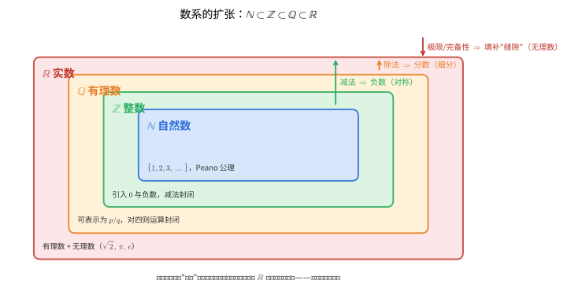

> **直观理解（现实类比）**：数系扩张就像**建房子逐层加盖**——自然数 $\mathbb{N}$ 是地基，加盖一层得到整数 $\mathbb{Z}$（引入负数，让减法封闭，"对称"了），再加盖得到有理数 $\mathbb{Q}$（引入分数，让除法封闭，"细分"了），最后加盖得到实数 $\mathbb{R}$（引入无理数，让极限运算封闭，把缝隙"填满"）。
>
> 每一次扩张都是为了**补全上一步运算留下的缺口**：在 $\mathbb{N}$ 里 $1-2$ 没结果，扩到 $\mathbb{Z}$ 就有了；在 $\mathbb{Z}$ 里 $1\div 2$ 没结果，扩到 $\mathbb{Q}$ 就有了；在 $\mathbb{Q}$ 里 $\sqrt{2}$ 和 $\lim(1+1/n)^n$ 都"没着落"，扩到 $\mathbb{R}$ 才真正安家。**$\mathbb{R}$ 区别于 $\mathbb{Q}$ 的根本，就是这最后一步"填满缝隙"——即完备性**。

#### 课堂问答

**老师**：自然数里 $1-2$ 无解，整数里 $1\div2$ 无解——每加一层数系，到底是谁在"逼"我们扩张？

**学生**：是某种运算的封闭性在逼。$\mathbb{N}$ 对减法不封闭，补出 $\mathbb{Z}$；$\mathbb{Z}$ 对除法不封闭，补出 $\mathbb{Q}$；$\mathbb{Q}$ 对极限不封闭（$\sqrt2$、$\lim(1+\frac1n)^n$ 无处安放），才补出 $\mathbb{R}$。所以 $\mathbb{N}\subset\mathbb{Z}\subset\mathbb{Q}\subset\mathbb{R}$ 是一部"哪步运算漏了、就补哪步"的账。

**老师（追问）**：那我一步到位、直接承认 $\mathbb{R}$，前面的扩张岂不多余？

**学生**：不多余。各层解决的是不同的缺口：$\mathbb{Z}$ 让减法封闭、$\mathbb{Q}$ 让除法封闭，这些恰是后面四则运算要用的；而 $\mathbb{R}$ 补的是"极限封闭"。关键在 $\mathbb{Q}$ 再稠密也补不了极限那一刀，两件事不能互相顶替。

**老师（拓展）**：若继续往 $\mathbb{R}$ 外面扩，下一个缺口是什么？

**学生**：是"开方封闭"。$x^2=-1$ 在 $\mathbb{R}$ 无解，补出 $\mathbb{C}$ 后多项式才总能分解（代数基本定理）。可见扩张动机分两类：为运算封闭（代数）与为极限封闭（分析），$\mathbb{R}$ 属于后者。

### 2.2 自然数 $\mathbb{N}$ 与整数 $\mathbb{Z}$

**自然数** $\mathbb{N}$ 是最基本的数系，满足 Peano 公理：
- 存在一个自然数 $1$（或 $0$，视定义而定）
- 每个自然数都有唯一的后继
- 数学归纳法原理成立

**整数** $\mathbb{Z}$ 在自然数的基础上引入了 $0$ 和负数的概念，使得减法运算封闭。也就是说，任意两个整数的差仍然是整数。

> **直观理解（类比）**：$\mathbb{N}$ 是"顺着数"的数，像**排队报数 1、2、3…**；引出负数后成为 $\mathbb{Z}$，相当于**在数轴上以 0 为分界前后都标上刻度**，整个队伍变得"前后对称"。

#### 课堂问答

**老师**：自然数已经"够用"了，凭什么说引入 $0$ 和负数不是多此一举？

**学生**：因为减法的封闭性。在 $\mathbb{N}$ 里 $a-b$ 只在 $a\ge b$ 时才有意义，$3-5$ 无解；引入 $0$ 与负数后 $a-b=a+(-b)$ 恒有结果，减法从"看条件"变成"必然可算"。$\mathbb{Z}$ 对加、减都封闭，正是这步扩张要换来的东西。

**老师（追问）**：代数上"减法封闭"和"加法有逆元"是一回事吗？

**学生**：是一回事。$\mathbb{Z}$ 是加法群：每个 $n$ 都有 $-n$ 使 $n+(-n)=0$，这个"加法逆元"的存在等价于减法永远做得完。顺带说，$0$ 是否算自然数只是惯例，真正关键的是"有没有逆元"，而不是从 $0$ 还是从 $1$ 数起。

**老师（拓展）**：Peano 公理里哪一条被我们暗中"加塞"了？

**学生**：Peano 公理只管 $\mathbb{N}$ 的"后继、归纳、不同数后继不同"，压根没有减法这一概念。所以 $\mathbb{Z}$ 不是从 Peano 公理里长出来的，而是把 $\mathbb{N}\times\mathbb{N}$ 上的差按等价类拼出来、或直接公理化一个加法群得到的——这是一次真正的代数封装。

### 2.3 有理数 $\mathbb{Q}$

有理数是形如 $\frac{p}{q}$（$p, q \in \mathbb{Z}$，$q \neq 0$）的数的全体。有理数对加、减、乘、除（除数不为零）四种运算封闭，构成了一个**数域**。

有理数的一个重要特征是：**有理数可以表示为有限小数或无限循环小数**。

然而，有理数对极限运算不封闭。例如，考虑数列：

$$
a_1 = 1,\quad a_2 = 1.4,\quad a_3 = 1.41,\quad a_4 = 1.414,\quad a_5 = 1.4142,\quad \dots
$$

这个数列的每一项都是有理数，但它趋近于 $\sqrt{2}$，而 $\sqrt{2}$ 不是有理数。这说明有理数存在"空隙"。

> **直观理解（类比）**：有理数就是**能写成分数（或有限/循环小数）的数**，像一根**带刻度的尺**——刻度本身密密麻麻，可仍留着细缝。上一个趋近 $\sqrt2$ 的数列正指向一条缝：**有理数看似稠密，其实"有空隙"，还塞不满全靠它续命的那条实数轴**。

#### 课堂问答

**老师**：有理数对加减乘除都封闭，为什么还说它"不够"？

**学生**：因为"足够做四则运算"不等于"足够做极限"。取 $\sqrt2$ 的 $n$ 位截断 $1,\,1.4,\,1.41,\,1.414,\dots$，每一项都是有理数、彼此越贴越近，可它想收敛到的 $\sqrt2$ 不在 $\mathbb{Q}$ 里——有理数对取极限不封闭。

**老师（追问）**：那串截断在 $\mathbb{Q}$ 里到底算"发散"还是"收敛到别处"？

**学生**：在 $\mathbb{Q}$ 内部它根本没有极限，按 $\mathbb{Q}$ 的标准就是发散的。这说明"收敛"是相对于所在数系讲的：同一串数在 $\mathbb{Q}$ 找不到落脚点，一放进 $\mathbb{R}$ 就收敛到 $\sqrt2$。它的存在本身就是有理数有缝的直接证据。

**老师（拓展）**：「有理数可写成有限或循环小数」与「不完备」有何关联？

**学生**：有限或循环小数都能写成 $\frac pq$，这正是有理数的记号特征；反过来，谁的十进制展开不循环（如 $\sqrt2=1.4142\ldots$）谁就必不是有理数。完备性要的"极限必落在本数系内"，在十进制语言里就等于允许任意无限不循环小数，而这也已超出 $\mathbb{Q}$ 了。

### 2.4 无理数的发现

古希腊的毕达哥拉斯学派认为"万物皆数"，即一切量都可以用有理数表示。但该学派的 Hippasus 发现，边长为 $1$ 的正方形的对角线长度 $\sqrt{2}$ 无法表示为两个整数的比。

**证明 $\sqrt{2}$ 是无理数**（反证法）：

假设 $\sqrt{2} = \frac{p}{q}$，其中 $p, q$ 是互质的正整数。则 $2 = \frac{p^2}{q^2}$，即 $p^2 = 2q^2$。因此 $p^2$ 是偶数，$p$ 也是偶数。设 $p = 2k$，代入得 $4k^2 = 2q^2$，即 $q^2 = 2k^2$，所以 $q$ 也是偶数。这与 $p, q$ 互质矛盾。因此 $\sqrt{2}$ 不是有理数。

> **🧠 思考历程：发现 $\sqrt2$ 的那个人，凭什么"死于海难"？**
>
> 今天"$\sqrt2$ 是无理数"只是一个习题，可它问世当年，是一场动摇世界观的**地震**。
>
> - **"万物皆数"的信仰**。毕达哥拉斯学派相信：天地万物都能化成整数的比（有理数）。音乐、几何、天文在他们看来都是"数的和谐"。**在他们心中，数 = 有理数，这是教条，不是猜测。**
> - **一条正方形的对角线，戳穿了信仰**。据传该派成员希帕索斯（Hippasus）发现：边长为 1 的正方形，其对角线 $\sqrt2$ 竟然**无法写成任何两个整数的比**。上方的"反证法"正是推倒这张多米诺骨牌：假设能写成分数，推出分子分母永远可以再约，矛盾。**一个"看得见的几何长度"，却说不成"数"，让"万物皆数"当场破产。**
> - **历史上：传说他"献身"了**。相传希帕索斯因"泄露"了无理数的秘密，被学派处以水刑（沉海），因为他动摇的不仅是数学，更是整个学派的教义根基。**这个传说是否属实已难考证，但它精准传达了：无理数的发现，最初不是被庆祝，而是被恐惧。**
> - **但它终究堵不住**。几何里到处都是"不能约成整数比"的长度，逃避无用。希腊人从此把几何与算术分开对待，直到 19 世纪（见 2.5 节）才从逻辑上彻底"招安"无理数。**希帕索斯的火种虽然被扑灭，却照亮了更加广阔的实数世界。**
> - **心路**：$\sqrt2$ 的故事告诉你：**数学的重大发现，常常不是多了一个数，而是逼你重新定义"什么是数"**。一个"反证法"的小小推演，曾是整整一个学派的世界观寓言。

#### 课堂问答

**老师**：$\sqrt2$ 不是有理数的反证法里，最吃劲的是哪一步？

**学生**：是"$p^2$ 为偶数推出 $p$ 为偶数"这一步。它依赖整数性质：偶数的平方是 $4$ 的倍数、非偶数之平方必为奇数，故 $p^2$ 偶则 $p$ 偶。设 $p=2k$ 代回 $2q^2=p^2=4k^2$ 得 $q^2=2k^2$，同理 $q$ 也偶，于是 $p,q$ 同为偶数，与互质矛盾。

**老师（追问）**：同一套路能证明 $\sqrt4$ 无理吗？不能的话卡在哪？

**学生**：不能，会卡在关键那步。设 $\sqrt4=\frac pq$（互质）得 $p^2=4q^2$，只能推出 $p$ 是偶数；代回得 $q^2=k^2$，推不出 $q$ 也偶，矛盾不成立——因为 $\sqrt4=2$ 本是有理数。可见"$p^2$ 偶 $\Rightarrow p$ 偶"只对"$2\mid$"成立，换成平方因子就失灵。

**老师（拓展）**：那"$\sqrt n$ 无理"的普适判据是什么？

**学生**：$\sqrt n$（$n$ 为正整数）为有理数当且仅当 $n$ 是完全平方数。更利落的证法用算术基本定理：把 $p^2=nq^2$ 两边素因子的指数作奇偶比较，可知 $n$ 的每个素因子指数为偶，即 $n$ 为平方数。这比逐个反证更一般，也预告了数论里的素因子方法。

### 2.5 实数 $\mathbb{R}$

**定义**：实数是有理数和无理数的全体。实数与数轴上的点一一对应。

实数有两种等价的构造方式：

1. **Dedekind 分割**：实数是有理数集的一个分割（Dedekind cut）
2. **Cauchy 序列**：实数是所有有理数 Cauchy 序列的等价类

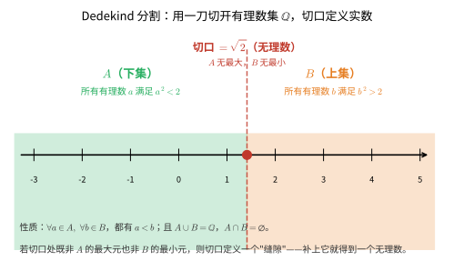

> **直观理解（现实类比）**：Dedekind 分割就像**用一刀把实数轴切成两段**——左段 $A$ 里的每个数都小于右段 $B$ 里的每个数，而**切口本身**就是新定义的数。
>
> 关键在于：如果切口恰好落在某个有理数上（比如 $A=\{x\mid x<2\}$，$B=\{x\mid x\ge 2\}$），那它没"创造"新东西；但如果切口处 $A$ 无最大元、$B$ 无最小元——比如 $A=\{q\in\mathbb{Q}\mid q^2<2\}$、$B=\{q\in\mathbb{Q}\mid q^2>2\}$——这就暴露出有理数的一个**"缝隙"**，而补上这个缝隙的，正是无理数 $\sqrt{2}$。**有理数的所有缝隙都被无理数填满，这就得到了"无缝"的实数轴**。

> **🧠 思考历程：戴德金的一刀，怎么凭空"造"出了无理数？**
>
> $\sqrt2$ 从毕达哥拉斯时代起就"在场"，可两千多年里，它更像"见不得光的长度"。德国数学家**戴德金**（Richard Dedekind，1858 年起构思）想：既然说不清 $\sqrt2$ 用有理数怎么表示，那我干脆用**有理数之间怎么切、切在哪**来定义它。
>
> - **问题的残酷：诉诸"几何直觉"不够**。欧几里得能画出 $\sqrt2$ 的长度，却给不出"它到底等于多少"。戴德金看透了：**与其追问"$\sqrt2$ 是什么数"，不如问"怎么用有理数把实数完全封死"**。他给有理数集 $\mathbb{Q}$ 一刀——左段 $A$ 每个数小于右段 $B$：
>   - 若 $A$ 有最大元或 $B$ 有最小元，这个切口就是某个"已有的"有理数；
>   - 若两者都没有，比如 $A=\{q\mid q^2<2\}$、$B=\{q\mid q^2>2\}$，这个"切口"处就藏着一个"新的"数——无理数 $\sqrt2$。
> - **从"被逼出来"到"被定义出来"**。古希腊人只能叹气"$\sqrt2$ 不是有理数，但那是什么？"；戴德金一句话就兜住了底：**"无理数，就是有理数割出一道没有端点的坎。"** 于是实数不再依赖任何含糊的几何或无限小数，而能从有理数**纯逻辑地构造**出来。
> - **它不是唯一办法**。几乎同时，康托尔用"有理数柯西列的等价类"也在严谨地构造实数。**两种构造殊途同归，反而互相印证：实数轴真的是"无缝"的。** 这也引出了下节足见威力的"确界原理"。
> - **心路**：戴德金的故事提醒你：**数学上"定义一个对象"，很多时候靠的不是"找到它"，而是"用别的确凿对象把它框定"**。与其纠结"$\sqrt2$ 到底可不可感知"，不如想想"怎样的切口能把它锁定"。这是从"直觉数学"走向"结构数学"的经典一课。

#### 课堂问答

**老师**：Dedekind 分割凭什么能"造出" $\sqrt2$ 这个数？

**学生**：它从不说 $\sqrt2$ 等于多少，只用 $\mathbb{Q}$ 把它框住。取 $A=\{q\in\mathbb{Q}\mid q^2<2\}$、$B=\{q\in\mathbb{Q}\mid q^2>2\}$，$A$ 中每个数都小于 $B$ 中每个数，但 $A$ 无最大元、$B$ 无最小元，这个"没有端点的切口"就被定义为 $\sqrt2$。实数于是不再依赖几何直觉，而能从 $\mathbb{Q}$ 纯逻辑地造出。

**老师（追问）**：这个分割和康托尔的 Cauchy 序列构造，会不会造出不同的实数？

**学生**：不会，两套构造给出同一个完备有序域。前者由"切口"定义数，后者由"有理数列的等价类"定义数，结果在序与运算上同构。殊途同归反而互相印证：数轴的无缝不取决于你怎么造，而取决于它满足完备性公理。

**老师（拓展）**：若切口恰好落在一个有理数上，会发生什么？

**学生**：那就没有造出新数。比如 $A=\{q\mid q<2\}$、$B=\{q\mid q\ge2\}$，此时 $A$ 无最大元但 $B$ 有最小元 $2$，切口对应的就是既有的有理数 $2$。所以真正的新数只在两侧都没有端点的切割里冒出来——无理数正是有理数"割而不断"处的那道缝。

### 2.6 实数的完备性（Completeness）

这是实数区别于有理数的最根本性质。

**确界原理**（Supremum Principle, 完备性公理）：

> 非空有上界的实数集必有上确界（最小上界）。

等价地：
> 非空有下界的实数集必有下确界（最大下界）。

确立界之前，先认熟符号：

| 符号 | 名称 | 含义 | 直观解释 |
|:---:|:---:|:---|:---|
| $S \subset \mathbb{R}$ | 子集 | $S$ 的元素都在 $\mathbb{R}$ 里 | "$S$ 是实数的一部分" |
| $\sup S$ | 上确界 | 最小的上界 | "天花板，最低的那个" |
| $\inf S$ | 下确界 | 最大的下界 | "地板，最高的那块" |
| $\forall$ | 对任意 | 对所有元素都成立 | "每一个都满足" |
| $\exists$ | 存在 | 至少有一个元素 | "能找到一个" |
| $\varepsilon$ | 任意小误差 | 想多小就多小的正数 | "误差条，随意缩放" |

**定义**（上确界）：设 $S \subset \mathbb{R}$ 非空，$\alpha \in \mathbb{R}$ 称为 $S$ 的**上确界**（记作 $\sup S$），如果：
1. $\forall x \in S,\; x \le \alpha$（$\alpha$ 是上界）
2. $\forall \varepsilon > 0,\; \exists x \in S,\; x > \alpha - \varepsilon$（$\alpha$ 是最小的上界）

**定义**（下确界）：设 $S \subset \mathbb{R}$ 非空，$\beta \in \mathbb{R}$ 称为 $S$ 的**下确界**（记作 $\inf S$），如果：
1. $\forall x \in S,\; x \ge \beta$（$\beta$ 是下界）
2. $\forall \varepsilon > 0,\; \exists x \in S,\; x < \beta + \varepsilon$（$\beta$ 是最大的下界）

**例**：设 $S = \{1 - \frac{1}{n} \mid n \in \mathbb{N}\}$，则 $\sup S = 1$，$\inf S = 0$。

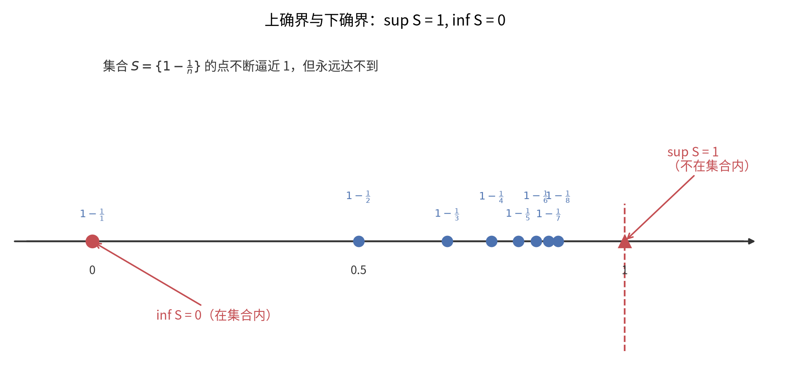

> **直观理解（现实类比）**：上确界就像**"天花板"**——它是所有上界中最小的那个；下确界则像**"地板"**，是所有下界中最大的那个。它们与"最大值/最小值"的关键区别在于：**确界不一定在集合里**。
>
> 看上面的例子：$S=\{1-\tfrac{1}{n}\}$ 的所有点都严格小于 1，所以 1 不是 $S$ 的最大值；但 1 是"能达到的极限高度"，任何比 1 小的数都挡不住点无限逼近它——这就是"最小上界"的含义。**确界原理说的是：只要集合有界，这个"天花板/地板"就一定存在**（实数才有的性质，有理数不一定有）。

> **确界的等价刻画（补充）**：除定义里的两条之外，$\sup S$ 还有两个常用的等价说法——
> 1. $\alpha=\sup S$ $\iff$ ① $\alpha$ 是上界；② **存在 $S$ 中的数列 $\{x_n\}$ 收敛到 $\alpha$**（上确界就是"集合能被逼近到的最高点"）。
> 2. $\alpha=\sup S$ $\iff$ ① $\alpha$ 是上界；② **对任给 $c<\alpha$，都有某个 $x\in S$ 使 $x>c$**（比 $\alpha$ 更低的任意"天花板"都挡不住集合里的点冒头）。
>
> 对 $\inf$ 同理，把"上界/最高"换成"下界/最低"即可。这条刻画的价值在于：**很多时候只需证确界存在、不必真的算出它的值**（例如单调有界定理里 $\lim a_n=\sup\{a_n\}$），也正是"确界可以不在集合里"的准确出处。

#### 课堂问答

**老师**：确界原理说"有界必有上确界"，为什么这是实数区别于有理数的根本性质？

**学生**：因为它在 $\mathbb{Q}$ 里会失败。取 $S=\{q\in\mathbb{Q}\mid q^2<2\}$，$S$ 非空且以 $2$ 为上界，却没有有理上确界——任何候选都得是 $\sqrt2$。$\mathbb{R}$ 里这条公理成立，等于宣布"有界集合的天花板一定落在数轴上"，这正是无缝的含义。

**老师（追问）**：$\sup S$ 一定属于 $S$ 吗？用定义的第 2 条解释。

**学生**：不一定。上确界定义只要求 $\forall\varepsilon>0,\ \exists x\in S,\ x>\alpha-\varepsilon$，即 $\alpha$ 能被 $S$ 中的点任意逼近，并不要求 $\alpha\in S$。例如 $S=\{1-\frac1n\}$ 的 $\sup S=1\notin S$。只有当 $\alpha\in S$ 且为上界时，$\alpha$ 才是最大值——确界比最值更宽。

**老师（拓展）**：有了确界原理，为什么就能把"极限存在"这类论断交给实数？

**学生**：因为确界原理本身就是一条存在性保证。凡形如"某集合有上界"的构造，都能立刻得到一个确定的实数（上确界），无需事先猜出它的值。单调有界定理里 $\lim a_n=\sup\{a_n\}$ 就是最典型的应用：它不告诉你极限等于几，却保证极限一定存在。

### 2.7 Archimedes 性质

**Archimedes 性质**：对任意正实数 $a, b$，总存在自然数 $n$，使得 $na > b$。

等价地：
- 对任意 $\varepsilon > 0$，存在自然数 $n$，使得 $\frac{1}{n} < \varepsilon$
- 对任意实数 $M$，存在自然数 $n$，使得 $n > M$

**证明**（由确界原理导出）：

假设结论不成立，即存在 $a > 0, b > 0$，对任意 $n \in \mathbb{N}$ 都有 $na \le b$。则集合 $A = \{na \mid n \in \mathbb{N}\}$ 有上界 $b$。由确界原理，$A$ 有上确界 $\alpha = \sup A$。

由于 $\alpha - a < \alpha$（$a > 0$），$\alpha - a$ 不是 $A$ 的上界，因此存在 $m \in \mathbb{N}$ 使得 $ma > \alpha - a$，即 $(m+1)a > \alpha$。但 $(m+1)a \in A$，这与 $\alpha$ 是上界矛盾。故假设不成立。

> **直观理解（类比）**：Archimedes 性质就是**"再小的量也怕积少成多"**——不管这个量 $a$ 多小、那个量 $b$ 多大，拿 $a$ 不断累加，攒够足够多次总能把 $b$ 甩在身后，好比**每次只加一滴水，重复足够多次也能装满整个水缸**。行话是：$1/n$ 能小于任意给定的 $\varepsilon$、$n$ 能超过任意给定的 $M$。它是"微小量靠重复跨越任何界限"的基石。

> **🧠 思考历程：阿基米德怎么会"想到"这么一条性质？**
>
> 名字出自叙拉古的**阿基米德**（Archimedes）。他在用"圆内接正多边形逼近圆"时，需要一句技术性子句：**只要多边形边数足够多，其周长与圆周长的差就能小于任意给定的量**——翻译成不等式正是"$na$ 能超过任意给定的 $b$"。换言之，**这条性质是"无限细分/无限放大"合法性的脊梁**：没有它，"$\frac1n\to0$"和 Dedekind 分割的无穷步骤都迈不出第一步。
>
> - **为什么值得单独列为一条性质？** 在把实数建成公理体系时，恰好是这句"最不起眼"的话，把"整数之下还藏着一个最小正数"这类会撒野的怪数（非 Archimedes 域）排除在实数之外，保证 $1/n$ 能压到任意小、$n$ 能顶到任意大。
> - **它解决了什么问题**: 正是它让 2.9 节稠密性证明里"选个 $n$ 使 $\frac1n<b-a$"、以及后面 §3 里"存在 $N$ 使 $N>\frac1\varepsilon$"变成可能——**它是"取足够大 $n$"那句话的最终法律依据**。
> - **心路**：Archimedes 性质提醒你：**最"显然"的常识（再小的量多乘几次也终能超过大的量），在严谨大厦里同样是承重墙**。它不让"无限小/无限大"变成可运算的数，却让有限的 $n$ 可以无限增长去逼近任何界限。

#### 课堂问答

**老师**：Archimedes 性质说 $\forall a,b>0\ \exists n\in\mathbb{N},\ na>b$，它凭什么不能从"实数有序"直接看出？

**学生**：因为它排除的是一种怪域。若非 Archimedes 有序域里存在 $a>0$ 使 $\forall n,\ na\le1$，则 $\{na\}$ 有上界却不受这条性质约束，"$\frac1n\to0$"和"取足够大 $n$"都会失效。正是这条性质把实数从这类怪对象中择出来，保证 $n$ 能超过任意 $M$。

**老师（追问）**：标准证明里"取 $m$ 使 $ma>\alpha-a$"这一步靠的是哪条公理？

**学生**：靠确界原理的最小性。设 $\alpha=\sup\{na\}$ 有限，因 $\alpha-a<\alpha$ 不再是上界，故存在 $m$ 使 $ma>\alpha-a$，即 $(m+1)a>\alpha$；可 $(m+1)a\in\{na\}$ 又超过了上确界 $\alpha$，矛盾。关键就在"比上确界小一点就不再是上界"，背后是完备性在撑腰。

**老师（拓展）**：这条看似平凡的命题，后续会在哪些地方反复出场？

**学生**：主要在"取 $n$ 足够大"之处。稠密性证明要选 $n$ 使 $\frac1n<b-a$，3.3 节证 $\frac1n\to0$ 要选 $N>\frac1\varepsilon$。它本质上是"无限细分与无限放大"合法性的地基——没有它，$\varepsilon$-$N$ 里的 $N$ 可能根本不存在。

### 2.8 实数完备性的等价定理

> 除确界原理外，实数完备性还有多个等价刻画。它们与确界原理相互推导，是数学分析中证明极限、连续、一致连续等性质的理论基石。总计**六大定理**。

**区间套定理（Cantor 定理）**：

> 设 $\{[a_n, b_n]\}$ 是一列闭区间，满足 $a_n \le a_{n+1} < b_{n+1} \le b_n$（后一个套在前一个里面），且 $b_n - a_n \to 0$（$n \to \infty$），则存在**唯一**的点 $\xi$ 属于所有区间，即 $\xi \in \bigcap_{n=1}^{\infty}[a_n, b_n]$，且 $\lim a_n = \lim b_n = \xi$。

**聚点定理（Bolzano–Weierstrass 定理）**：

> 有界无限点集必有聚点。等价地：**有界数列必有收敛子列**。

（聚点：点 $p$ 的任一邻域内都含有集合中异于 $p$ 的点。）

**有限覆盖定理（Heine–Borel 定理）**：

> 设 $\mathcal{O}$ 是闭区间 $[a, b]$ 的一个开覆盖（即区间上每一点都属于某个开区间 $O \in \mathcal{O}$），则从 $\mathcal{O}$ 中必能选出**有限**个开区间，仍覆盖 $[a, b]$。

**六大完备性定理及其等价性**：

| 定理 | 名称 |
|:-----|:-----|
| 确界原理 | 非空有上界集合必有上确界 |
| 单调有界定理 | 单调有界数列必收敛 |
| 区间套定理 | 闭区间套有唯一公共点 |
| 柯西收敛准则 | 数列收敛 $\iff$ 是柯西列 |
| 聚点定理 | 有界数列必有收敛子列 |
| 有限覆盖定理 | 闭区间开覆盖有有限子覆盖 |

> **等价性脉络**：它们以确界原理为公理，彼此可互相推出，刻画的是同一条完备性。常用推导链例如
$$
\text{确界原理} \Rightarrow \text{单调有界} \Rightarrow \text{区间套} \Rightarrow \text{柯西准则} \Rightarrow \text{聚点定理} \Rightarrow \text{有限覆盖}
$$
> 反向也可逐条推回，故合称"实数的完备性定理"。

> **直观理解（类比）**：这六大定理是**同一份"实数轴无缝"品质的六副长相**——确界原理说"有界必有天花板/地板"；区间套像**两块木板互相往中间收**，最终只剩一个公共交点；单调有界像**只进不退且不越顶的爬楼必有落脚点**；柯西准则像**队员彼此越贴越近**；聚点定理像**拥挤车厢里总有人站得住、点得清**；有限覆盖定理像**铺满房间的地垫，其实挑出几块就够盖严**。它们彼此等价，讲的都是：**实数轴上不会让人一脚踩空**。

#### 课堂问答

**老师**：确界原理、单调有界、区间套、柯西准则……为何能互相推出，却被称为"同一条完备性"？

**学生**：因为它们每个都是"数轴无洞"这句话的换装表达。确界原理说"有界必有天花板"，单调有界说"只进不越顶必有落脚点"，区间套说"收缩闭区间留下唯一交点"，柯西准则说"彼此越贴越近必聚向某点"。任取一条当公理，其余都能推出，故等价。

**老师（追问）**：这些等价定理若限制在 $\mathbb{Q}$ 上，哪一条会最先崩掉？

**学生**：凡涉及"极限或确界必落在数系内"的都会崩。单调有界定理在 $\mathbb{Q}$ 里失败：$\sqrt2$ 的递增截断有上界却无有理极限。柯西准则在 $\mathbb{Q}$ 里只有必要性成立、充分性失效。有限覆盖定理依赖闭区间的紧性，同样不成立——崩的根源都是不完备。

**老师（拓展）**：为什么常选确界原理当公理，而把其余当定理？

**学生**：因为它最贴近实数的序结构，表述最简、最易检验（只要非空有上界即可），从它推单调有界、区间套都很顺。反过来以区间套或柯西准则为公理也能重建整个实数系——这正是"公理选择不唯一、但彼此等价"的体现，也对应实数两套构造的殊途同归。

### 2.9 实数在有理数中的稠密性（Density）

> 2.3 节里我们见过"有理数看似稠密却留缝"；这一节把"稠密"从直觉升级为严格定理，并顺手证明无理数同样处处稠密。它的证明只用到 **Archimedes 性质**（2.7 节）与整数的最小性，并不需要确界原理。

**定理（有理数在实数中稠密）**：设 $a<b$ 是任意两个实数，则存在有理数 $q\in\mathbb{Q}$ 使得 $a<q<b$。推而广之：任意两个实数之间，**既有有理数，也有无理数**。

**证明（有理数部分）**：由 Archimedes 性质，存在 $n\in\mathbb{N}$ 使 $\frac1n<b-a$。令 $m=\lfloor na\rfloor+1$（大于 $na$ 的最小整数），则 $na<m\le na+1$，于是
$$
a<\frac{m}{n}\le a+\frac1n < b
$$
其中末一个严格不等号来自 $\frac1n<b-a$。故 $q=\frac{m}{n}\in\mathbb{Q}$ 满足 $a<q<b$。$\square$

**证明（无理数部分）**：由上面已证的有理数稠密性，先在 $(a,b)$ 内取一个有理数 $r$。取 $N$ 足够大，使 $\frac{\sqrt2}{N}<\min\{b-r,\,r-a\}$，令 $s=r+\frac{\sqrt2}{N}$。因"有理数 + 无理数"仍是无理数，且 $a<s<b$，故 $(a,b)$ 内也有无理数。$\square$

> **由浅入深（类比）**：有理数在 $\mathbb{R}$ 里的稠密，好比一块**海绵**——随手揪下一小段，里面都密密挤着"分数点"；可海绵的孔洞（$\sqrt2$ 之流）又实实在在存在。**"稠密"讲的只是"处处有料"，"完备性"（确界原理）讲的才是"不留孔洞"**——这二者千万别混为一谈。正因如此，$\mathbb{Q}$ 稠密却不完备（呼应 2.5、2.6 节）；也正是这句话，解释了我们为何仍需把实数"补全"。

#### 课堂问答

**老师**：稠密性证明只用了 Archimedes 性质、没用到完备性，这说明什么？

**学生**：说明"稠密"与"完备"是两回事。证明只取 $n$ 使 $\frac1n<b-a$，再令 $m=\lfloor na\rfloor+1$，即得 $a<\frac mn\le a+\frac1n<b$。全程只用整数最小性与 Archimedes 性质，从未涉及确界，所以稠密性对 $\mathbb{Q}$ 自身也成立，与完备性无关。

**老师（追问）**：既然 $\mathbb{Q}$ 已经稠密，为什么它还是"漏"的？

**学生**：稠密只回答"任意两数之间还有没有别的数"，完备回答"取极限会不会跑出数系"。$\mathbb{Q}$ 处处有料，却能把 $\sqrt2$ 这样的极限值漏到外面。就像孔洞密布的海绵：每个孔里还挤满分数，孔本身却不在材质中——处处有料不等于不留孔洞。

**老师（拓展）**：无理数也稠密这一半，是怎么顺手证出来的？

**学生**：先在 $(a,b)$ 内取到有理数 $r$，再取足够大 $N$ 使 $\frac{\sqrt2}{N}<\min\{b-r,\,r-a\}$，令 $s=r+\frac{\sqrt2}{N}$。因"有理数加无理数仍是无理数"且 $a<s<b$，便得到 $(a,b)$ 内的无理数。同一招对任意无理数都灵，可见有理数与无理数在 $\mathbb{R}$ 里交织。

### 2.10 闭区间套定理（Nested Interval Theorem）

2.8 节把区间套定理列为"六大完备性定理"之一；这里补上它的严格证明，并指出它与完备性的关联。

**定理（区间套）**：设 $\{[a_n,b_n]\}$ 是一列闭区间，满足 $a_n\le a_{n+1}<b_{n+1}\le b_n$（后一个套在前一个内），且 $b_n-a_n\to0$（$n\to\infty$），则存在**唯一**的 $\xi\in\bigcap_{n=1}^\infty[a_n,b_n]$，且 $\lim_{n\to\infty}a_n=\lim_{n\to\infty}b_n=\xi$。

**证明**：
- **存在性**：$\{a_n\}$ 单调递增（$a_{n+1}\ge a_n$）且以 $b_1$ 为上界（$a_n\le b_n\le b_1$），由单调有界定理（4.5 节）收敛，设 $\lim a_n=\xi$。又对每个 $n$ 与 $k\ge n$，有 $a_k\le b_k\le b_n$，令 $k\to\infty$ 得 $\xi\le b_n$；同时显然 $\xi\ge a_n$。故 $\xi\in[a_n,b_n]$ 对一切 $n$ 成立，即 $\xi\in\bigcap_{n=1}^\infty[a_n,b_n]$。
- **唯一性**：若另有点 $\eta\in\bigcap_{n=1}^\infty[a_n,b_n]$，则 $|\xi-\eta|\le b_n-a_n$ 对一切 $n$ 成立。由 $b_n-a_n\to0$ 得 $|\xi-\eta|=0$，故 $\eta=\xi$。$\square$
- 另由 $b_n=(b_n-a_n)+a_n\to0+\xi$ 得 $\lim_{n\to\infty}b_n=\xi$。

> **呼应完备性**：注意**存在性只靠单调有界（其本质仍是确界/完备性）就成立，并不需要"长度趋于 $0$"**；真正需要 $b_n-a_n\to0$ 的是**唯一性**——这正是区间套定理区别于一般"递减区间列"的关键。若去掉长度条件，公共交点可能是一整段区间（参探究题 25）。

#### 课堂问答

**老师**：区间套定理的存在性与唯一性，分别依赖什么条件？

**学生**：存在性只靠单调有界（其根仍是确界与完备性），不需要长度趋于 $0$。由 $a_n$ 递增、有上界 $b_1$ 得 $\lim a_n=\xi$，再由 $a_k\le b_k\le b_n$ 令 $k\to\infty$ 得 $\xi\le b_n$，故 $\xi$ 落在每个区间里。而唯一性才真正用到 $b_n-a_n\to0$，否则公共部分可能是一整段区间。

**老师（追问）**：把闭区间套换成开区间套，结论还成立吗？举个反例。

**学生**：可能落空。取开区间 $I_n=(0,\frac1n)$，它们层层相套、长度 $\frac1n\to0$，但 $\bigcap_{n}(0,\frac1n)=\varnothing$，因为 $0$ 不属于任何开区间。可见"闭"这一条不可省：闭区间保证 $\xi$ 落进区间内，开区间则会在端点处漏掉公共点。

**老师（拓展）**：区间套为什么是"抓点"的利器？

**学生**：因为它用一列长度趋于 $0$ 的区间把"点"硬锁住。Bolzano–Weierstrass 定理正是二分区间、每步留下含无穷多项的一半，再用区间套取出唯一公共点作为子列极限。凡需要"从无穷步骤里提取一个确定极限点"的场合，区间套几乎总能派上用场。

### 2.11 实数的十进制表示与无限小数（Infinite Decimals）

> **先说个问题**：$0.\overline9$ 到底等不等于 $1$？如果把"十进制"当真当作刻画实数的字面图景，这个疑问会一直纠缠你；而一旦借助完备性（确界）来看它，谜题自动解开。这一节把"十进制"与前面"数轴无缝"的主线接上线：**每个实数都对应一条（几乎唯一的）无限小数，而一条无限小数的"确界/极限值"正是它表示的实数**。

**有限小数**形如 $0.1,\,0.125,\,3.14$，都可以化为 $\frac{m}{10^n}$，因而都是有理数。但并非每个有理数都能写成有限小数（如 $\frac13=0.333\ldots$），更不用说 $\sqrt2=1.4142\ldots$ 这种无理数。为了足量描述实数，必须放开到**无限小数**。

**约定（十进制展开的极限含义）**：一个（正）实数的十进制展开
$$
r=0.a_1a_2a_3\cdots
$$
系指 $r=\sup\{0.a_1a_2\ldots a_n\}=\lim_{n\to\infty}\left(\frac{a_1}{10}+\cdots+\frac{a_n}{10^n}\right)$，例如约定 $0.\overline9$ 表示数列 $x_n=1-10^{-n}$ 的上确界。

**关键事实**：
1. 实数 $r$ 的十进制展开可能**不唯一**，唯一例外是"结尾全为 $9$"与"结尾全为 $0$"的两种写法（如 $0.5=0.4999\ldots$）。
2. $0.\overline9=\lim_{n\to\infty}(1-10^{-n})=1$。更一般地，**任意无限小数都收敛**，其极限正是它表示的实数——这正是"实数完备性"在十进制记数上的体现（若只在 $\mathbb{Q}$ 中，确界未必存在）。

> **直观理解（现实类比）**：把十进制展开想象成**一位一位精读**——第一位给个近似（误差 $\le 0.1$），两位给个更准的（误差 $\le 0.01$），每多读一位误差缩到原来的 $\frac{1}{10}$。**写成 $r=0.a_1a_2\ldots$ 就好比"无限次逼近"最终锁定唯一的实数 $r$**。"结尾全 $9$"与"结尾全 $0$"之所以指同一点，是因为这两种写法不过是**从左边逼近**与**从右边逼近**同一个确界的两种称呼——再次印证得：**实数靠确界/完备性才绷紧无缝，十进制只是它的"读法"，不是它的本源**。

> **🧠 思考历程：$0.\overline9=1$，为什么反直觉？**
>
> - **直觉把"书写过程"当成了"表示的值"**。初学常把 $0.\overline9$ 听成"永远在后面添 9、永远差一点到 1"，于是觉得"它 $<1$"。这其实是把**生成一串数字的动态过程**与**这串数字所表示的极限值**混为一谈。
> - **确界视角一刀切**。$0.\overline9$ 是数列 $x_n=1-10^{-n}$ 的**上确界**：所有 $x_n\le 1$，且任何大于 $1-\delta$ 的数都会被足够大的某个 $x_n$ 超过。故按"无限小数的值 $=$ 该数列确界/极限"的约定，$0.\overline9=1$ 是**定义直接给出的结论**，并非什么巧合。
> - **若拒绝完备性，它会不会"断"？** $x_n=1-10^{-n}$ 在 $\mathbb{Q}$ 里是一条 Cauchy 列，其确界 $1$ 虽也有理，但"确界一定存在"这一**保证**依赖 $\mathbb{R}$ 的公理（2.6 节）。十进制给了我们"写数"的方法，完备性给了我们"写出来的极限一定真的存在、而且落在实轴上"的承诺。
> - **心路**：$0.\overline9=1$ 是极好的"直觉 vs 定义"案例。**数学上"一个数的值"以确界/极限为依据，而不是以"书写写到哪一步"为依据**。想通这一点，你就不会被"少写一位的它"带偏。

**本节习题（基础/进阶/挑战）**：
- **基础**：把 $\frac14$、$\frac37$ 写成十进制（指出是有限还是无限循环）；用等比级数和写出 $0.\overline3=\frac13$ 的过程。
- **进阶**：证明 $0.4999\ldots=0.5$；说明 $\sqrt2$ 的十进制展开**不可能**是循环小数。
- **挑战**：用确界原理证明：任给 $x\in(0,1)$，都存在 $x$ 的一个十进制展开 $x=0.a_1a_2\cdots$。（提示：归纳构造各位 $a_n$，使 $x\ge\frac{a_1}{10}+\cdots+\frac{a_n}{10^n}$ 且差 $<\frac1{10^n}$。）

> **答案**：**基础**：$\frac14=0.25$（有限）；$\frac37=0.\overline{428571}$（无限循环）。$0.\overline3=\sum_{k=1}^{\infty}\frac{3}{10^k}=\frac{3/10}{1-1/10}=\frac13$。**进阶**：$0.4999\ldots=0.4+\sum_{k=2}^{\infty}\frac{9}{10^k}=0.4+\frac{0.09}{1-0.1}=0.4+0.1=0.5$；若 $\sqrt2$ 十进制循环，则 $\sqrt2\in\mathbb{Q}$，与 $\sqrt2\notin\mathbb{Q}$ 矛盾。**挑战**：[构造] 记 $s_{n-1}$ 为前 $n-1$ 位和，取 $a_n$ 为 $\left( x-s_{n-1}\right)\cdot 10^n$ 的整数部分（$0\le a_n\le 9$），于是 $s_n\le x<s_n+\frac1{10^n}$；由确界原理，$x=\sup\{s_n\}=\lim s_n$，即 $x=0.a_1a_2\cdots$。$\square$

---

#### 课堂问答

**老师**：$0.\overline9=1$ 到底是"约等于"还是"严格等于"？依据是什么？

**学生**：严格等于。按约定，无限小数的值就是它截断序列的极限（确界）：$0.\overline9$ 表示 $x_n=1-10^{-n}$ 的上确界。由于 $\forall\varepsilon>0\ \exists N$ 使 $n>N$ 时 $1-x_n=10^{-n}<\varepsilon$，且 $x_n\le1$，故 $\sup\{x_n\}=1$。这是定义直接给出的结论，不是近似。

**老师（追问）**：那为什么 $0.\overline9$ 与 $1.000\ldots$ 表示同一个数，十进制展开还唯一吗？

**学生**：不唯一。唯一的例外正是"结尾全为 $9$"与"结尾全为 $0$"两种写法，它们分别从左右两侧逼近同一个确界，故指同一个实数，如 $0.5=0.4999\ldots$。除此以外，每个实数的十进制展开唯一——重复表示只发生在有限小数处。

**老师（拓展）**：十进制展开的存在性，为什么恰恰要请出完备性？

**学生**：因为展开本身就是一个极限过程。归纳构造各位 $a_n$，使 $x\ge\frac{a_1}{10}+\cdots+\frac{a_n}{10^n}$ 且差 $<\frac1{10^n}$，截断和单调递增有上界 $x$；由确界原理即得 $x=\sup\{s_n\}=\lim s_n$，展开才锁定。若只在 $\mathbb{Q}$ 里，这个上确界未必存在。

## 3. 数列极限

> **先说个问题**：一列数 $1,\frac12,\frac13,\dots$ 越排越接近 0，可它永远到不了 0——我们凭什么敢说它的"归宿"是 0？数列极限就是给这种"无限逼近"立规矩的。想象你拿望远镜目送一队越走越远却逐渐稳定下来的队伍：$\varepsilon$-$N$ 语言要精确说清"多近距离算数、自第几号之后开始算数"。读本节请记住：**极限不是"某一位上的值"，而是"队伍最终落定的营地"。**

> **常见坑**：写 $\varepsilon$-$N$ 证明时，$N$ 不是随手抓的常数，而是**随 $\varepsilon$ 而定**的"门槛"（通常形如 $\lceil N(\varepsilon)\rceil$）；要先由 $|a_n-A|<\varepsilon$ 反解出 $n>N$，再回代验证，顺序不能颠倒。另外别把"有界"当"收敛"——$(-1)^n$ 有界却不收敛。

### 3.1 数列的概念

**定义**：数列是以自然数集为定义域的函数 $a: \mathbb{N} \to \mathbb{R}$，记作 $\{a_n\}_{n=1}^{\infty}$ 或简写为 $\{a_n\}$。

数列的项按顺序排列：$a_1, a_2, a_3, \dots, a_n, \dots$

> **直观理解（类比）**：数列就是**一串按编号排队的数**，像**一列依次报号的队伍**：第 $n$ 个位置上站着 $a_n$。它和集合的区别在于**讲究顺序、允许重复**——同一个数能被不同的项反复念到。

#### 课堂问答

**老师**：数列是"数的集合"吗？写成 $a:\mathbb{N}\to\mathbb{R}$ 是想强调什么？

**学生**：不是集合，是函数。它强调两点：定义域是有序的 $\mathbb{N}$，所以 $a_1,a_2$ 有先后；并且允许重复，同一个实数值可在不同下标出现。集合 $\{1,1,2\}=\{1,2\}$ 会抹掉顺序与重数，而数列 $\{a_n\}$ 恰恰保留这两样。

**老师（追问）**："$\{a_n\}$ 有界"和"每一项都是有限数"是一回事吗？

**学生**：不是。每项有限只是说每个 $a_n\in\mathbb{R}$，这由数列是实值函数自动成立；有界则要求存在统一的 $M$ 使 $\forall n,\ |a_n|\le M$。例如 $a_n=n$，逐项都有限，却无界。可见有界是"用同一个界罩住所有项"的整体性质。

**老师（拓展）**：为什么数列极限能搬到函数上，而无需重起炉灶？

**学生**：因为数列本就是定义在 $\mathbb{N}$ 上的函数。函数极限的 $\varepsilon$-$\delta$ 只是把数列版的离散下标 $n>N$ 换成连续邻域 $0<|x-x_0|<\delta$，思想完全一致。理解好数列的 $\varepsilon$-$N$，函数版就是把 $n$ 换成 $x$、把 $N$ 换成 $\delta$ 的平移。

### 3.2 极限的 $\varepsilon$-$N$ 定义

先认熟这套新记号（$\varepsilon$ 已在上节介绍过，不再重复）：

| 符号 | 名称 | 含义 | 直观解释 |
|:---:|:---:|:---|:---|
| $\{a_n\}$ | 数列 | 依顺序排列的一列数 | "按编号排队的数" |
| $A$ | 候补极限 | 一个待定的常数 | "它们想逼近的值" |
| $N$ | 门槛下标 | 从某项往后都满足条件 | "过了这条线就算" |
| $\|a_n - A\|$ | 绝对差 | $a_n$ 到 $A$ 的距离 | "差多远，量距离" |
| $\lim_{n \to \infty} a_n$ | 数列极限 | 数列最终的归宿 | "数列奔向的地方" |
| $n \to \infty$ | 下标趋无穷 | $n$ 变得无限大 | "n 一路往大走" |

**定义**：设 $\{a_n\}$ 是一个数列，$A$ 是一个常数。如果对任意给定的 $\varepsilon > 0$，总存在正整数 $N$，使得当 $n > N$ 时，有

$$
|a_n - A| < \varepsilon
$$

则称数列 $\{a_n\}$ **收敛**于 $A$，$A$ 称为数列的极限，记作

$$
\lim_{n \to \infty} a_n = A
$$

或 $a_n \to A$（$n \to \infty$）。如果不存在这样的 $A$，则称数列**发散**。

**直观理解**：无论我们要求 $a_n$ 与 $A$ 多近（$\varepsilon$ 任意小），总存在一个时刻 $N$ 之后，所有项都在这个范围内。

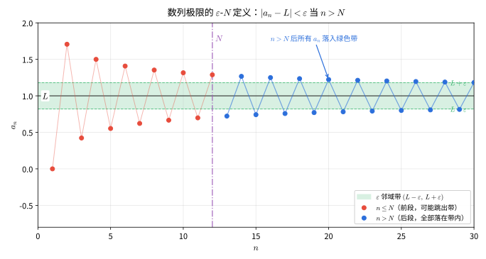

> **直观理解（现实类比）**：数列极限就像**射击靶心**——靶心是极限 $L$，$\varepsilon$ 是你划定的"命中环"（靶心周围 $\varepsilon$ 宽的带）。$\varepsilon$-$N$ 定义说的是：**无论这个环划得多小（$\varepsilon$ 任意小），总存在某个时刻 $N$，之后所有子弹 $a_n$ 都落在环内**。
>
> 看上图：绿色横带就是"$\varepsilon$ 命中环"，紫色竖线 $N$ 是"分界时刻"。$N$ 之前（红点）数列可能还乱跳、甚至跳出带外；但 **$N$ 之后（蓝点）所有点无一例外地落在绿色带内**。$\varepsilon$ 越小，带越窄，所需的 $N$ 通常越大——但**只要你能给出任意 $\varepsilon$，我就能找到对应的 $N$**，这就叫"收敛于 $L$"。

> **🧠 思考历程：$\varepsilon$ 和 $N$，凭什么是"极限"的灭火器？**
>
> 牛顿和莱布尼茨发明微积分时，"极限"还在靠直觉打转：什么"无限接近""终极速度"——同时代的数学家听得火大：**这到底是不是数学？** 极限的严谨化，是一场让无数人抓狂近两个世纪的"灭火"。
>
> - **"幽灵般的无穷小"**。起初大家说"当 $x$ 无限靠近某点时，$y$ 就无限靠近某值"，可"无限靠近"根本不是能用于证明的清晰语言。主教贝克莱嘲讽无穷小是"已死量的幽灵"，戳得整个微积分根基发痒。
> - **韦尔斯特拉斯：把"接近"翻译成"不等式"**。到了 19 世纪下半叶，德国数学家**韦尔斯特拉斯**（Karl Weierstrass）等人才给出决定性的一招：**"极限"根本不必谈"无穷"，只需谈"任意给定的小误差 $\varepsilon$ 和随之而来的门槛 $N$"。** 你说多近（$\varepsilon$），我就给定一个下标 $N$，保证之后全都近于 $\varepsilon$。
> - **绝妙之处：用"有限"取代"无限"**。定义里从没出现"无穷大"，只有一个又一个有限的 $\varepsilon$ 与 $N$。**"$n\to\infty$ 时 $a_n\to A$"被这样改写：对每个正数 $\varepsilon$，都能找到正整数 $N$ 使所有 $n>N$ 都满足 $|a_n-A|< \varepsilon$。** 每一步都只在处理有限对象，却精确捕捉了"无限趋近"的全部含义。
> - **柯西、波尔扎诺的铺垫**。韦尔斯特拉斯并非凭空出世：柯西（Cauchy）已用"差值小于任意正数"描述收敛，波尔扎诺等也在试探。**韦尔斯特拉斯把它们打磨成现在这套 $\varepsilon$-$N$ 语言，连同 $\varepsilon$-$\delta$（见 5.1 节），从此微积分有了铁打的地基。**
> - **心路**：$\varepsilon$-$N$ 定义教你：**越是"直观到说不清"的极端（无穷、极限），越要用"能逐步检验的有限条件"来接管**。遇到"趋于无穷"就紧张时，把它拆成"给我 $\varepsilon$，我给你 $N$"，你便握住了让微积分站起来的钥匙。

#### 🎬 动画演示：数列趋于极限

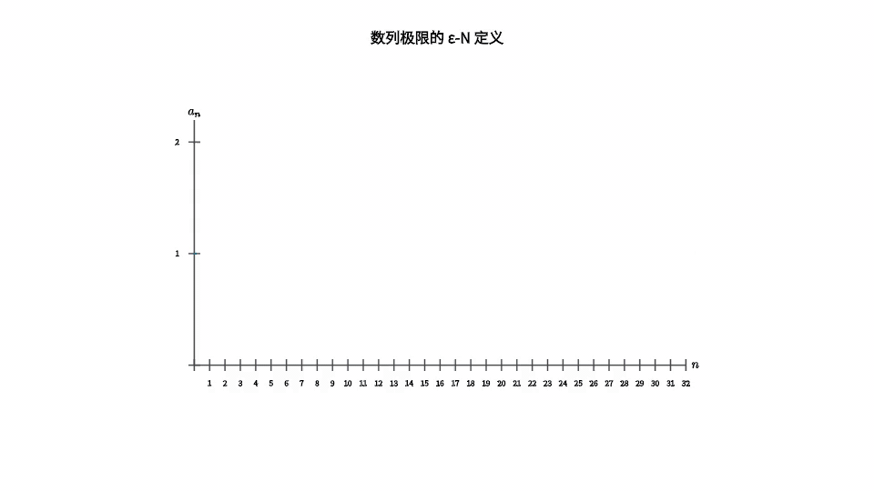

> 这个动画直观展示了数列 $a_n$ 随着 $n$ 增大而趋于极限 $L$，且 $|a_n - L|$ 可以做到任意小。它通过动画的方式帮助理解本节核心概念。

#### 课堂问答

**老师**：$\lim_{n\to\infty}a_n=A$ 的定义里，$\varepsilon$ 与 $N$ 谁先谁后？顺序能调换吗？

**学生**：绝不能调换。正确顺序是 $\forall\varepsilon>0,\ \exists N$，即 $N$ 依赖 $\varepsilon$（记作 $N=N(\varepsilon)$）：先给误差 $\varepsilon$，我再找门槛 $N$，保证 $n>N$ 时 $|a_n-A|<\varepsilon$。若颠倒成 $\exists N,\forall\varepsilon$，就变成"某个 $N$ 之后所有项与 $A$ 精确相等"，远比收敛要求强。

**老师（追问）**：证 $\lim\frac1n=0$ 时 $N$ 该怎么取？把思路说清楚。

**学生**：由 $|a_n-A|<\varepsilon$ 反解 $n$。这里 $\frac1n<\varepsilon\iff n>\frac1\varepsilon$，故取 $N=\lceil\frac1\varepsilon\rceil$（其存在性由 Archimedes 性质保证），于是 $n>N\Rightarrow\frac1n<\frac1N\le\varepsilon$。记忆要诀是：先由不等式反解出 $n>N$，再回代验证，顺序不能反。

**老师（拓展）**：定义里既然没有"无穷大"，它靠什么抓住了"无限逼近"？

**学生**：靠把无限化归成一串有限的检验。对每个有限正数 $\varepsilon$，都存在有限的 $N$，使之后的项都落在 $(A-\varepsilon,A+\varepsilon)$ 内。"任意小的 $\varepsilon$ 都办得到"等价地表达了"要多近有多近"，却全程只谈有限对象——这正是韦尔斯特拉斯驯服极限的秘诀。

### 3.3 收敛数列的例子

**例 1**：$\lim_{n \to \infty} \frac{1}{n} = 0$

**证明**：对任意 $\varepsilon > 0$，由 Archimedes 性质，存在 $N \in \mathbb{N}$，使得 $N > \frac{1}{\varepsilon}$。当 $n > N$ 时，

$$
\left|\frac{1}{n} - 0\right| = \frac{1}{n} < \frac{1}{N} < \varepsilon
$$

- 第 1 个等号：$n>0$ 所以 $\frac1n$ 是正数，绝对值等于它本身，依据是绝对值的定义；目的：把 $|\frac1n - 0|$ 化简成 $\frac1n$ 好继续放缩。
- 第 1 个小于号：$n>N$ 时分母更大、分数更小（$\frac1n<\frac1N$），依据是正分数反比关系；目的：把"任意的 $n$"拉回到"已经取定的 $N$"上。
- 第 2 个小于号：由 $N>\frac1\varepsilon$ 两边取倒数得 $\frac1N<\varepsilon$，依据是正数取倒数不改变严格方向；目的：凑出定义要求的 $|\frac1n-0|<\varepsilon$。

因此 $\lim_{n \to \infty} \frac{1}{n} = 0$。

**例 2**：$\lim_{n \to \infty} \frac{n}{n+1} = 1$

**证明**：对任意 $\varepsilon > 0$，需要 $\left|\frac{n}{n+1} - 1\right| = \frac{1}{n+1} < \varepsilon$。

取 $N = \lceil \frac{1}{\varepsilon} \rceil$，当 $n > N$ 时，$\frac{1}{n+1} < \frac{1}{n} \le \frac{1}{N} < \varepsilon$。$\square$

#### 课堂问答

**老师**：证 $\lim\frac{n}{n+1}=1$ 时，为什么不必把 $\frac1{n+1}<\varepsilon$ 解到底？

**学生**：因为那是"找 $N$"的过程，关键还在于回代验证。更省事的做法是先放缩：$\frac1{n+1}<\frac1n$，再取 $N=\lceil\frac1\varepsilon\rceil$，于是 $n>N\Rightarrow\frac1{n+1}<\frac1n\le\frac1N<\varepsilon$。放缩把精确解换成足够好用的界，正是 $\varepsilon$-$N$ 证明的常规套路。

**老师（追问）**：放缩时若把界放得"过头"，会不会反而证不出来？

**学生**：会。放缩必须朝向"能凑出 $\varepsilon$"的方向：待证的量要放大到能被 $N$ 控制，而 $\frac1N$ 又要能小于 $\varepsilon$，两头得接上。若把 $\frac1{n+1}$ 放大成某个比 $\varepsilon$ 更难压的界，路就断了。所以每一步放缩都带着目的。

**老师（拓展）**：为什么这两道小题都要请 Archimedes 性质出场？

**学生**：因为无论取 $N=\frac1\varepsilon$ 还是 $N=\lceil\frac1\varepsilon\rceil$，都得先保证"这样的整数存在"，而这正是 Archimedes 性质的 $\forall\varepsilon>0\ \exists n,\ \frac1n<\varepsilon$。$\varepsilon$-$N$ 证明里"总存在足够大的 $N$"，法律依据就是它。

### 3.4 发散数列的例子

**例 3**：$\{(-1)^n\}$ 发散

**证明**（反证法）：假设 $\lim_{n \to \infty} (-1)^n = A$。取 $\varepsilon = \frac{1}{2}$，则存在 $N$，当 $n > N$ 时 $|(-1)^n - A| < \frac{1}{2}$。

取两个足够大的奇数 $m$ 和偶数 $k$，则 $|(-1)^m - A| = | -1 - A| < \frac{1}{2}$，$|(-1)^k - A| = |1 - A| < \frac{1}{2}$。

由三角不等式：

$$
2 = |1 - (-1)| \le |1 - A| + |A - (-1)| < \frac{1}{2} + \frac{1}{2} = 1
$$

矛盾。故数列发散。$\square$

#### 课堂问答

**老师**：证 $\{(-1)^n\}$ 发散，为什么偏偏选 $\varepsilon=\frac12$？

**学生**：因为 $1$ 与 $-1$ 的距离是 $2$，任何半径小于 $\frac{2}{2}=1$ 的邻域都装不下两者，取 $\frac12$ 最省事。设极限为 $A$，则奇偶两项都在 $A$ 的 $\frac12$ 邻域内，由三角不等式得 $2=|1-(-1)|\le|1-A|+|A-(-1)|<1$，矛盾。取定一个很小的正数制造不可能，是证发散的利器。

**老师（追问）**：数列不收敛，会不会"极限就是 $+\infty$"？

**学生**：不一定。极限不存在与极限为 $+\infty$ 是两种不同情况。$(-1)^n$ 在 $\pm1$ 间跳，连"趋于无穷"都够不上；只有满足 $\forall M>0\ \exists N,\ n>N\Rightarrow|a_n|>M$ 才叫趋于无穷。判定发散后，还须进一步区分它是无界地发散还是有界地振荡。

**老师（拓展）**：有没有更省事的发散判据，不用逐次反证？

**学生**：有。利用极限唯一性与子列：若同一数列有两个子列收敛到不同的值，则原数列必发散——$(-1)^n$ 的奇子列趋于 $-1$、偶子列趋于 $1$。更一般地，$a_n\to A$ 当且仅当每个子列都收敛到 $A$，这把发散判定化归成找两个不合作的子列。

### 3.5 Bolzano–Weierstrass 定理：有界数列必有收敛子列

这是完备性定理里"子列版本"最常用的一条；2.8 节只给了概述，这里用**二分法 + 闭区间套**补上完整证明。

**定理（Bolzano–Weierstrass）**：有界数列 $\{x_n\}$ 必有收敛子列。

**证明**：设 $\{x_n\}$ 有界，即存在 $M>0$ 使 $|x_n|\le M$ 对一切 $n$ 成立，于是所有项都落在闭区间 $I_0=[-M,M]$ 内。

- 【第 1 步】把 $I_0$ 二等分为 $[-M,0]$ 与 $[0,M]$。由抽屉原理，两半中必有一半含有 $\{x_n\}$ 的**无穷多**项（否则两半各只含有限项，总数有限，矛盾）。把含无穷多项的那一半记为 $I_1$。
- 【第 2 步】对 $I_n$ 如法炮制（二等分、挑出含无穷多项的一半），得到一列闭区间
$$
I_0\supset I_1\supset I_2\supset\cdots,\qquad |I_n|=\frac{2M}{2^{n-1}}\to0
$$
- 【第 3 步】由闭区间套定理（2.10 节），存在唯一 $\xi\in\bigcap_{n=0}^\infty I_n$。
- 【第 4 步】在 $I_n$ 里递归选取下标严格递增的项：先取 $x_{n_1}\in I_1$；再因 $I_2$ 含无穷多项、必然在 $n_1$ 之后还有项，取 $x_{n_2}\in I_2$（$n_2>n_1$），如此继续。则 $|x_{n_k}-\xi|\le|I_k|\to0$，故 $x_{n_k}\to\xi$。$\square$

> **由浅入深（类比）**：它的直觉像**"在地板上划格子找虫子"**——虫子（数列的无穷多项）待在一间屋里，把屋一分为二，虫子必在某一半；再切那一半，虫子还在；切到底，虫子被"锁死"在一个收缩到一点的小格里。这格点就是聚点、也就是子列极限。二分法 + 闭区间套，正是数学版的"缩圈抓人"。

> **常见坑**：切勿把"有界"直接升级成"收敛"。Bolzano–Weierstrass 说的是有界数列**必有一串（子列）收敛**，而数列**本身**未必收敛——比如 $(-1)^n$ 有界却不收敛，却有望偶子列恒等于 $1$（收敛）。

#### 课堂问答

**老师**：定理说"有界必含收敛子列"，二分法里凭什么每步都能挑出含无穷多项的一半？

**学生**：靠抽屉原理。把区间二等分，若两半各只含有限多项，则总项数有限，与"有界数列有无穷多项"矛盾，故至少一半含无穷多项，记为 $I_n$。于是得 $I_0\supset I_1\supset\cdots$ 且 $|I_n|=\frac{2M}{2^{n-1}}\to0$，由区间套定理取唯一公共点 $\xi$。

**老师（追问）**：找到 $\xi$ 后，怎么保证真能从每个 $I_n$ 里取出下标递增的一列？

**学生**：因每个 $I_n$ 恒含无穷多项，取定 $x_{n_1}\in I_1$ 后，$I_2$ 里必仍有下标大于 $n_1$ 的项可取，递归下去便得严格递增的下标 $n_1<n_2<\cdots$ 且 $x_{n_k}\in I_k$。于是 $|x_{n_k}-\xi|\le|I_k|\to0$，即 $x_{n_k}\to\xi$，这就是所求的收敛子列。

**老师（拓展）**：别把这条定理误读成什么？它和"数列收敛"差在哪？

**学生**：别误读成"有界数列必收敛"。定理只说必存在一条收敛子列，原数列本身未必收敛：$(-1)^n$ 有界、不收敛，却有子列 $1,1,\ldots$。它真正的价值是"从有界中榨出一个聚点"，是柯西准则充分性证明里的关键一步。

### 3.6 单调子列定理（Monotone Subsequence Theorem）

> **先说个问题**：$(-1)^n$ 不收敛，却藏着一列常值（当然也单调）的子列 $1,1,1,\ldots$。这是巧合吗？本定理回答：**任何实数列（不论是否有界）都至少含一个单调子列**。它是最细的一根"线索"，也是给 Bolzano–Weierstrass 定理（3.5 节）提供第二种证法的钥匙。

**定理（单调子列定理）**：任一实数序列 $\{a_n\}$ 都存在单调子列 $\{a_{n_k}\}$。

**证明（"高点"法）**：称 $a_m$ 为**高点**，若对一切 $j>m$ 都有 $a_m\ge a_j$（即它不矮于其后所有项）。两种情形必居其一：
- 若 $\{a_n\}$ 有无穷多个高点 $a_{m_1},a_{m_2},\ldots$，则 $\{a_{m_k}\}$ 按序构成**单调递减**子列；
- 若高点只有有限个，则从某下标之后每项后面都还有比它更大的项，据此可递归取出一个**严格递增**子列。$\square$

> **直观理解（类比）**：把数列当**一排柱子**。若觉得"我身后总有更高的柱子"，那就能不断找"更高的"拉出一条上升的子列；若存在"最后一根最高的柱子"，那从它之后一路只会下坡，拉出一条下降的子列。**无论数据多乱，单调的骨架一定存在**。

> **常见坑**：单调子列定理对**任何**实数列成立，**不需要有界**（如 $a_n=n$，取全体即得单调增子列）。它的价值在"存在性"，并不保证该单调子列**收敛**；要有界才能收敛——这正是它和 Bolzano–Weierstrass 联动的点：**有界数列必有单调子列（单调）+ 有界 ⇒ 单调有界 ⇒ 收敛（4.5 节）**，从而给出 B–W 定理一条更简短的证明路线。

**本节习题（基础/进阶/挑战）**：
- **基础**：写出 $a_n=(-1)^n$ 的一个单调子列；再对 $a_n=n^2$ 给出一个单调子列。
- **进阶**：用"单调子列定理 + 单调有界定理"重新证明 Bolzano–Weierstrass：任何有界数列必有收敛子列（写出完整三步）。
- **挑战**：证明：$a_n\to a$ 当且仅当**每个**子列都收敛到 $a$；据此说明：有界数列若满足 $\limsup a_n=\liminf a_n$，则必收敛。（可结合探究题 29）

> **答案**：**基础**：取偶数项子列 $a_{2k}=1$（常值，单调）；$a_n=n^2$ 本身严格递增，取全部项即可。**进阶**：由单调子列定理，有界数列 $\{a_n\}$ 有单调子列 $\{a_{n_k}\}$；因 $\{a_n\}$ 有界，$\{a_{n_k}\}$ 单调有界，由单调有界定理（4.5 节）收敛，即得有界数列的收敛子列。$\square$ **挑战**：$\Rightarrow$：任一子列是其部分，收敛到 $a$。$\Leftarrow$（反证）：若 $\{a_n\}$ 不收敛，可取两个子列分别趋于 $\liminf a_n<\limsup a_n$（由上下极限定义，见探究题 29），恰与"每个子列收敛到同一 $a$"矛盾。故 $a_n\to a$。$\square$

---

#### 课堂问答

**老师**：这条定理说"任何实数列都有单调子列"，连无界的 $a_n=n$ 也算——它的证明核心是什么？

**学生**：核心是高点的讨论。称 $a_m$ 为高点，若它不矮于其后所有项。若高点有无穷多个，按序取出即得单调递减子列；若高点只有有限个，则从最后一个高点之后，每项身后都还有更大的项，递归取出严格递增子列。两种情形必居其一，故单调子列总存在。

**老师（追问）**："存在单调子列"就等于"存在收敛子列"吗？

**学生**：不等。单调只是"方向一致"，还缺"有界"这一半。$a_n=n$ 的单调子列就是它自己，却发散到 $+\infty$。必须再有界才能由单调有界定理断言收敛。这条定理只管造出单调骨架，收不收敛要看有没有界。

**老师（拓展）**：它怎样给 Bolzano–Weierstrass 换一条更短的证法？

**学生**：把两件工具接起来。有界数列由单调子列定理取到单调子列，该子列因原数列有界而单调有界，再由单调有界定理即得收敛——三步就补出了 B–W 定理。这说明"单调子列加有界推收敛"与二分法加区间套，是同一结论的两条路。

## 4. 定理与证明

### 4.1 极限的唯一性

**定理**：收敛数列的极限是唯一的。

**证明**（反证法）：

假设 $\lim_{n \to \infty} a_n = A$ 且 $\lim_{n \to \infty} a_n = B$，且 $A \neq B$。

取 $\varepsilon = \frac{|A - B|}{2} > 0$。

由极限定义：
- 存在 $N_1$，当 $n > N_1$ 时，$|a_n - A| < \varepsilon$
- 存在 $N_2$，当 $n > N_2$ 时，$|a_n - B| < \varepsilon$

取 $N = \max\{N_1, N_2\}$，当 $n > N$ 时，由三角不等式：

$$
|A - B| \le |A - a_n| + |a_n - B| < \varepsilon + \varepsilon = 2\varepsilon = |A - B|
$$

- 第 1 个不等号：把 $|A - B|$ 拆成"中转经过某个 $a_n$"的两段距离，依据是三角不等式（绕路不会比直路更短）；目的：好把两个极限定义分别放进去。
- 第 2 个不等号：由定义，$n>N$ 时上式中的 $|A-a_n|<\varepsilon$ 且 $|a_n-B|<\varepsilon$，两段都严格小于 $\varepsilon$；目的：把理想中的 $A$、$B$ 放缩到真实的误差 $\varepsilon$。
- 两个等号：$\varepsilon+\varepsilon=2\varepsilon$，再把 $2\varepsilon$ 代回 $\varepsilon=\frac{|A-B|}{2}$ 得 $2\varepsilon=|A-B|$；目的：制造" $|A-B|<|A-B|$ "这个不可能的矛盾。

得到 $|A - B| < |A - B|$，矛盾。故 $A = B$。$\square$

> **直观理解（类比）**：唯一的极限就像**一个靶心只能有一个**——数列若既奔着 $A$ 又奔着 $B$（$A\ne B$），就成了"同时想靠近两个隔着距离的地方"，无论 $n$ 多久，都没法同时挤进两个不相交的小圈里，于是矛盾。直觉上：**一个东西不可能同时靠近两个不同的地方**。

#### 课堂问答

**老师**：这个反证法里，为什么取 $\varepsilon=\frac{|A-B|}{2}$，而不是随便一个正数？

**学生**：要制造"两段之和小于整段"的矛盾。取 $\varepsilon=\frac{|A-B|}{2}$ 后，当 $n>N=\max\{N_1,N_2\}$ 时同时有 $|a_n-A|<\varepsilon$ 与 $|a_n-B|<\varepsilon$，于是 $|A-B|\le|A-a_n|+|a_n-B|<2\varepsilon=|A-B|$。关键就是让 $\varepsilon$ 恰好等于 $A$ 与 $B$ 距离的一半，两边一夹正好自相矛盾。

**老师（追问）**：若 $A\ne B$ 但距离可以任意小，结论会不会不同？

**学生**：不会。$A,B$ 是两个固定的数，一经取定 $|A-B|$ 就是一个与 $n$ 无关的正实数，取 $\varepsilon$ 为其一半当然可以，因为定义对任意正数 $\varepsilon$ 都成立。极限的唯一正是靠"两个不同固定数之间必有正距离"，这也是极限不能模糊地趋近两个点的原因。

**老师（拓展）**：这条定理在四则运算法则的证明里暗中起了什么作用？

**学生**：它保证运算良定义。若一个收敛数列可能有两个极限，$A+B$、$AB$ 就无从谈起。正因为极限唯一，$\lim(a_n+b_n)$ 才是一个确定的数，四则运算法则才有意义。可以说唯一性是一切"对极限做运算"的前提。

### 4.2 收敛数列的有界性

**定理**：如果数列 $\{a_n\}$ 收敛，则 $\{a_n\}$ 有界。即存在 $M > 0$，使得对一切 $n$，$|a_n| \le M$。

**证明**：

设 $\lim_{n \to \infty} a_n = A$。取 $\varepsilon = 1$，则存在 $N$，当 $n > N$ 时，$|a_n - A| < 1$。

由三角不等式，当 $n > N$ 时：

$$
|a_n| = |a_n - A + A| \le |a_n - A| + |A| < 1 + |A|
$$

令 $M = \max\{|a_1|, |a_2|, \dots, |a_N|, 1 + |A|\}$，则对一切 $n$，$|a_n| \le M$。$\square$

**注**：该定理的逆命题不成立。有界数列不一定收敛，如 $\{(-1)^n\}$ 有界但不收敛。

> **直观理解（类比）**：收敛数列必被**框在一个有限范围**里，像**射手的箭都落在同一个靶场**——既然它盯住某个值 $A$，就不会跑到天边去，总有个 "M 米 圈" 罩得住它；反过来，**规矩地待在圈里（有界）并不等于收敛**——比如 $\{(-1)^n\}$ 就在自己的小圈里左右横跳，始终不落定。

#### 课堂问答

**老师**：证有界时为什么取 $\varepsilon=1$？这个 $1$ 是随便挑的吗？

**学生**：随便挑一个固定正数即可，取 $1$ 最省事。由收敛定义，存在 $N$ 使 $n>N$ 时 $|a_n-A|<1$，故 $|a_n|\le|a_n-A|+|A|<1+|A|$，尾部被罩住；前面 $|a_1|,\dots,|a_N|$ 只有有限多个，与 $1+|A|$ 一起取最大值 $M$，就罩住了全部项。

**老师（追问）**：证明里"前有限项"为什么可以单独处理？这反映什么思路？

**学生**：因为有限个数必有最大值，这是关键。证明用的是"尾巴靠极限、脑袋靠有限"的分段法：极限只控制 $n>N$ 之后的无穷多项，剩下有限多项怎么看都行，并入 $M$ 即可。凡"从极限性质推整体性质"的证明，几乎都走这个有限加无限尾部的套路。

**老师（拓展）**：逆命题不成立，请给一个"有界却不收敛"的典型。

**学生**：$(-1)^n$。它被 $-1$ 与 $1$ 这类界罩住，却因奇偶子列趋于不同的值而不收敛。这条反例是本章最常考的对比：收敛推出有界成立，有界推出收敛不成立；把"有界"补成"有界加单调"才够。

### 4.3 极限的四则运算法则

**定理**：设 $\lim_{n \to \infty} a_n = A$，$\lim_{n \to \infty} b_n = B$，则：

1. **加法**：$\lim_{n \to \infty} (a_n + b_n) = A + B$
2. **减法**：$\lim_{n \to \infty} (a_n - b_n) = A - B$
3. **乘法**：$\lim_{n \to \infty} (a_n \cdot b_n) = A \cdot B$
4. **除法**：若 $B \neq 0$，则 $\lim_{n \to \infty} \frac{a_n}{b_n} = \frac{A}{B}$

**证明**：

**(1) 加法**：对任意 $\varepsilon > 0$，存在 $N_1, N_2$ 使得：
- 当 $n > N_1$ 时，$|a_n - A| < \frac{\varepsilon}{2}$
- 当 $n > N_2$ 时，$|b_n - B| < \frac{\varepsilon}{2}$

取 $N = \max\{N_1, N_2\}$，当 $n > N$ 时：

$$
|(a_n + b_n) - (A + B)| \le |a_n - A| + |b_n - B| < \frac{\varepsilon}{2} + \frac{\varepsilon}{2} = \varepsilon
$$

**(3) 乘法**：先证明 $\{b_n\}$ 有界，即存在 $M > 0$，$|b_n| \le M$ 对一切 $n$ 成立。

对任意 $\varepsilon > 0$：
- 存在 $N_1$，当 $n > N_1$ 时，$|a_n - A| < \frac{\varepsilon}{2M}$
- 存在 $N_2$，当 $n > N_2$ 时，$|b_n - B| < \frac{\varepsilon}{2(|A| + 1)}$

取 $N = \max\{N_1, N_2\}$，当 $n > N$ 时：

$$
\begin{aligned}
|a_n b_n - AB| &= |a_n b_n - a_n B + a_n B - AB| \\
&\le |a_n|\cdot|b_n - B| + |B|\cdot|a_n - A| \\
&\le (|A| + 1)\cdot\frac{\varepsilon}{2(|A| + 1)} + M\cdot\frac{\varepsilon}{2M} = \varepsilon
\end{aligned}
$$

**(4) 除法**：只需证明 $\lim_{n \to \infty} \frac{1}{b_n} = \frac{1}{B}$，然后与乘法结合。

由于 $B \neq 0$，取 $\varepsilon = \frac{|B|}{2}$，存在 $N_1$，当 $n > N_1$ 时，$|b_n - B| < \frac{|B|}{2}$，从而 $|b_n| > \frac{|B|}{2}$。

对任意 $\varepsilon > 0$，存在 $N_2$，当 $n > N_2$ 时，$|b_n - B| < \frac{B^2}{2}\varepsilon$。

取 $N = \max\{N_1, N_2\}$，当 $n > N$ 时：

$$
\left|\frac{1}{b_n} - \frac{1}{B}\right| = \frac{|b_n - B|}{|b_n|\cdot|B|} < \frac{|b_n - B|}{\frac{|B|}{2} \cdot |B|} = \frac{2|b_n - B|}{B^2} < \varepsilon
$$

$\square$

> **直观理解（类比）**：极限的四则运算像**两张账单各自有结算价**——$a_n\to A$、$b_n\to B$ 就是说两份明细的"结算价"分别是 $A$、$B$。那么它们**加、减、乘，结算价就顺次是 $A+B$、$A-B$、$AB$**；而**除法**要先保证分母的结算价 $B\ne0$（不能除以 0），才轮到 $A/B$。直觉上：**"和的极限 = 极限的和"——只要各自定得住，合起来也定得住**。

#### 课堂问答

**老师**：加法法则里为什么两个误差各取 $\frac\varepsilon2$，而不是各取 $\varepsilon$？

**学生**：为了让两段之和正好收口成 $\varepsilon$。若各取 $\varepsilon$，放缩得到 $2\varepsilon$，凑不出定义要求的"小于 $\varepsilon$"。正因 $\varepsilon$ 是任意正数，我们总可要求各部分小于 $\frac\varepsilon2$：$|(a_n+b_n)-(A+B)|\le|a_n-A|+|b_n-B|<\frac\varepsilon2+\frac\varepsilon2=\varepsilon$。这叫"预留一半"。

**老师（追问）**：乘法法则麻烦在哪？为什么要先证 $\{b_n\}$ 有界？

**学生**：麻烦在要凑出 $a_n-A$ 与 $b_n-B$ 的乘积，中间得插项：$a_nb_n-AB=a_n(b_n-B)+B(a_n-A)$。此时 $|a_n|\le M$ 与 $|B|$ 都得有界才好放缩，故先由收敛必有界取 $M$。这也解释了除法为何还要设 $B\ne0$：只有 $|b_n|$ 被 $\frac{|B|}2$ 从下方托住，倒数才好估计。

**老师（拓展）**：四条法则里哪一条的隐藏条件最多？

**学生**：除法。它要求 $B\ne0$，且证明中先固定 $\varepsilon=\frac{|B|}2$ 保证 $|b_n|>\frac{|B|}2$，再对 $\frac1{b_n}-\frac1B$ 放缩。若 $B=0$，分母可任意小、商可能发散，法则失效。其余三条只要求两条极限都存在且有限——这正是四则运算不能对无穷大使用的原因。

### 4.4 夹逼定理（Squeeze Theorem）

**定理**：设三个数列 $\{a_n\}$、$\{b_n\}$、$\{c_n\}$ 满足：
1. 存在 $N_0$，当 $n > N_0$ 时，$a_n \le b_n \le c_n$
2. $\lim_{n \to \infty} a_n = \lim_{n \to \infty} c_n = L$

则 $\lim_{n \to \infty} b_n = L$。

**证明**：

对任意 $\varepsilon > 0$：
- 存在 $N_1$，当 $n > N_1$ 时，$|a_n - L| < \varepsilon$，即 $L - \varepsilon < a_n < L + \varepsilon$
- 存在 $N_2$，当 $n > N_2$ 时，$|c_n - L| < \varepsilon$，即 $L - \varepsilon < c_n < L + \varepsilon$

取 $N = \max\{N_0, N_1, N_2\}$，当 $n > N$ 时：

$$
L - \varepsilon < a_n \le b_n \le c_n < L + \varepsilon
$$

即 $|b_n - L| < \varepsilon$。$\square$

**例 4**：求 $\lim_{n \to \infty} \frac{\sin n}{n}$。

**解**：由于 $-1 \le \sin n \le 1$，有 $-\frac{1}{n} \le \frac{\sin n}{n} \le \frac{1}{n}$。

而 $\lim_{n \to \infty} \left(-\frac{1}{n}\right) = \lim_{n \to \infty} \frac{1}{n} = 0$。

由夹逼定理，$\lim_{n \to \infty} \frac{\sin n}{n} = 0$。

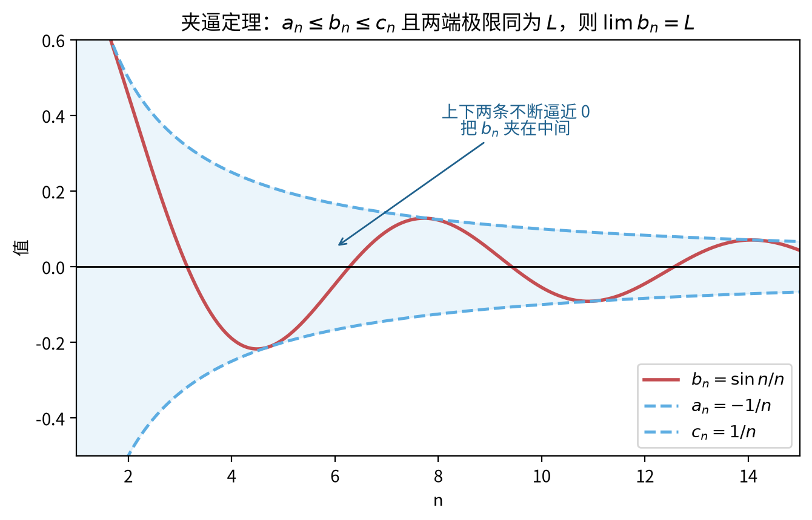

> **直观理解（现实类比）**：夹逼定理就是**"两面夹击"**——当一个量被夹在两个"同向逼近同一目标"的量之间时，它**无处可逃**，只能也跟着逼近那个目标。
>
> 看上图：$\frac{\sin n}{n}$ 被 $-\frac{1}{n}$ 和 $\frac{1}{n}$ 上下夹住，而这两个夹子都趋于 0，所以 $\frac{\sin n}{n}$ 必然也趋于 0。**它不需要自己"表现好"，只要夹子决定性地逼近 0，它就被迫跟着走**。这就是处理"有界项 × 无穷小"这类问题的通用利器。

#### 课堂问答

**老师**：夹逼定理为什么不需要知道 $\{b_n\}$ 自己"表现好不好"？

**学生**：因为 $b_n$ 被上下两把同向的夹子逼死了。给定 $\varepsilon$，由 $a_n\to L$ 与 $c_n\to L$ 分别得 $L-\varepsilon<a_n$ 与 $c_n<L+\varepsilon$（$n>N$ 后），配合 $a_n\le b_n\le c_n$ 便得 $L-\varepsilon<b_n<L+\varepsilon$，即 $|b_n-L|<\varepsilon$。$b_n$ 自己是否单调、是否有界都无所谓。

**老师（追问）**：如果两个夹子收敛到不同的极限，还能夹出结果吗？

**学生**：不能，前提里"同收敛到同一个 $L$"不可省。若 $a_n\to L_1<c_n\to L_2$，$b_n$ 被夹在宽度趋于 $L_2-L_1>0$ 的带子里，根本不能说必然收敛；例如取 $a_n=-1,\ c_n=1$，$b_n=(-1)^n$ 被夹住却发散。夹子必须向同一点收拢，这是定理的命门。

**老师（拓展）**：夹逼定理最常用来对付哪一类极限？举一个式子。

**学生**：对付有界量乘以无穷小。典型是 $\lim\frac{\sin n}{n}$：由 $-1\le\sin n\le1$ 得 $-\frac1n\le\frac{\sin n}{n}\le\frac1n$，两边夹子都趋于 $0$，故极限为 $0$。凡遇到振荡但有界的因子配一个趋于 $0$ 的因子，先想夹逼。

### 4.5 单调有界定理（Monotone Convergence Theorem）

**定理**：单调有界数列必收敛。

具体地：
- 若 $\{a_n\}$ 单调递增且有上界，则 $\{a_n\}$ 收敛，且 $\lim_{n \to \infty} a_n = \sup\{a_n\}$
- 若 $\{a_n\}$ 单调递减且有下界，则 $\{a_n\}$ 收敛，且 $\lim_{n \to \infty} a_n = \inf\{a_n\}$

> **直观理解（现实类比）**：单调有界定理就像**"只进不退、又有天花板的爬楼"**——数列只要满足两个条件：**方向一致**（单调递增，只升不降）和**有限度**（始终不超过某个上界），那它既停不下来、也逃不出去，最终**必然停靠在天花板内侧附近的一个高度**上，这个高度正是它的极限（也是上确界 $\sup$）。它和夹逼定理分工不同：夹逼靠**左右两条边界**把极限"夹"出来；而单调有界只凭**"方向 + 天花板"**两样信息就把极限逼出来，而且**完全不用事先猜到极限等于多少**——这正是它比 $\varepsilon$-$N$ 定义更"省心"、也常在证明极限存在时第一个被想起的原因。

**证明**（仅证递增有上界的情况）：

设 $\{a_n\}$ 单调递增且有上界。令 $S = \{a_n \mid n \in \mathbb{N}\}$，则 $S$ 非空有上界。由确界原理，$S$ 有上确界 $\alpha = \sup S$。

- 【第 1 步】依据：确界原理保证非空有上界的集合必有上确界；目的：把"不知道极限是多少"的问题，转成"确界 $\alpha$ 一定存在"，先定下一个候选目标。

下面证明 $\lim_{n \to \infty} a_n = \alpha$。

对任意 $\varepsilon > 0$，由 $\alpha - \varepsilon < \alpha$ 及上确界的定义，存在 $N$，使得 $a_N > \alpha - \varepsilon$。

- 【第 2 步】依据：$\alpha$ 是最小的上界，比它小一点的 $\alpha-\varepsilon$ 就不可能是上界，故某下标 $N$ 处 $a_N>\alpha-\varepsilon$；目的：在数列里"揪出"第一只跨过 $\alpha-\varepsilon$ 的脚。

由于 $\{a_n\}$ 单调递增，当 $n > N$ 时，$a_n \ge a_N > \alpha - \varepsilon$。

- 【第 3 步】依据：数列单调递增，前面跨过门槛的 $a_N$ 之后每一项只会更大；目的：把"存在一项靠近 $\alpha$"升级成"之后所有项都靠近 $\alpha$"。

又因为 $\alpha$ 是上界，$a_n \le \alpha$，所以 $|a_n - \alpha| = \alpha - a_n < \varepsilon$。

- 【第 4 步】依据：$\alpha$ 是上界故 $a_n \le \alpha$，结合第 3 步的 $a_n>\alpha-\varepsilon$，两端一夹得出 $\alpha-\varepsilon<a_n\le\alpha$；目的：正是 $\varepsilon$-$N$ 定义要的"从某 $N$ 起 $|a_n-\alpha|<\varepsilon$"。

故 $\lim_{n \to \infty} a_n = \alpha$。$\square$

**例 5**：证明数列 $a_n = \left(1 + \frac{1}{n}\right)^n$ 收敛。

**证明思路**：可以证明 $\{a_n\}$ 单调递增且有上界（上界为 $3$），因此由单调有界定理，数列收敛。其极限定义为 $e$。

#### 课堂问答

**老师**：定理说 $\lim a_n=\sup\{a_n\}$，可它事先并不知道 $\sup$ 等于几，这怎么算"求出"极限了？

**学生**：它求的不是数值，而是存在性。只要单调且有上界，就断言极限存在，并给它一个名字 $\sup\{a_n\}$。很多极限（如 $e$）本就算不出简单值，能证明它存在、并把它定义为某确界，就已经够用。这是数学里"先有名义、后辨数值"的常见做法。

**老师（追问）**：证明里从"$\alpha$ 是上确界"到"存在 $a_N>\alpha-\varepsilon$"，用到上确界的哪条性质？

**学生**：用到"$\alpha$ 是最小的上界"。正因 $\alpha-\varepsilon<\alpha$ 不再构成上界，才存在 $a_N>\alpha-\varepsilon$；又由单调性，$n>N\Rightarrow a_n\ge a_N>\alpha-\varepsilon$，配合上界 $a_n\le\alpha$ 得 $|a_n-\alpha|<\varepsilon$。这一串里，"比上确界小一点就不是上界"是唯一着力点。

**老师（拓展）**：它和夹逼定理在求极限时各管什么分工？

**学生**：夹逼靠左右两条边界把目标夹死，需要先知道夹子的极限；单调有界只凭"单调加有界"两样信息就把极限逼出来，不必预知极限值。因此证明存在性、或处理 $e$ 这类藏着的极限时首选它；夹逼更适合估算已有明确夹子的量。

### 4.6 柯西收敛准则（Cauchy Criterion）

**定义**（Cauchy 序列）：数列 $\{a_n\}$ 称为 Cauchy 序列，如果对任意 $\varepsilon > 0$，存在正整数 $N$，使得对任意 $m, n > N$，有

$$
|a_m - a_n| < \varepsilon
$$

**柯西收敛准则**：数列 $\{a_n\}$ 收敛当且仅当它是 Cauchy 序列。

**证明概要**：

**必要性**：若 $\lim_{n \to \infty} a_n = A$，则对任意 $\varepsilon > 0$，存在 $N$，当 $n > N$ 时 $|a_n - A| < \frac{\varepsilon}{2}$。当 $m, n > N$ 时，

$$
|a_m - a_n| \le |a_m - A| + |A - a_n| < \frac{\varepsilon}{2} + \frac{\varepsilon}{2} = \varepsilon
$$

**充分性**：若 $\{a_n\}$ 是 Cauchy 序列，则先证明 $\{a_n\}$ 有界，然后利用 Bolzano-Weierstrass 定理（有界数列必有收敛子列）和 Cauchy 条件推出原数列收敛到同一极限。

**意义**：柯西收敛准则给出了数列收敛的充要条件，且不需要预先知道极限值。这在理论上极为重要。

> **直观理解（现实类比）**：柯西收敛准则就像**"一群人在靶场不瞄靶也能判断是否聚拢"**——收敛本是"所有项都瞄向同一个靶心 $A$"，而 Cauchy 条件不必知道靶心在哪：它只要求**越往后，任意两人 $a_m$ 与 $a_n$ 之间的距离 $|a_m-a_n|$ 越来越小**。直观上，如果一群人彼此挨得越来越近、最终"抱成一团"，那他们必然是在向同一个（也许看不见的）目标靠拢。它道出了一个深刻的直觉：**"自洽地互相靠近"就等价于"收敛到某处"**。这正是它被当作极限存在判据的威力所在——无需先拿出一个"候选极限"来验证。

> **衔接：Cauchy 条件与完备性**。柯西收敛准则实质上是"实数完备性"在数列语言下的另一副面孔（见 2.8 节的六大等价定理）。值得点破的一点是：**"Cauchy"这条性质本身只依赖"数列各项彼此靠近"，完全不涉及一个预先存在的极限**——正因如此，它才能充当"完备性"的判据：在 $\mathbb{Q}$ 里，$\sqrt2$ 的截断小数列 $x_n=1.4142\ldots$（取 $n$ 位）是 Cauchy 列，却**不**收敛于任何有理数；而在 $\mathbb{R}$ 里，同一条性质就保证它必收敛。换个角度想，若把"Cauchy 列必有极限"直接当公理（所谓的 Cauchy 构造），同样能造出整个 $\mathbb{R}$（见 2.5 节）——这正是"完备性"与"柯西"互为表里的原因。

#### 课堂问答

**老师**：Cauchy 条件只谈 $|a_m-a_n|$，完全不提极限值 $A$，凭什么它等价于收敛？

**学生**：因为它抓住了收敛的内在特征。若 $a_n\to A$，取 $m,n>N$ 时 $|a_m-a_n|\le|a_m-A|+|A-a_n|<\frac\varepsilon2+\frac\varepsilon2=\varepsilon$，故收敛必是 Cauchy 列。反过来，Cauchy 列先可证有界，再由 Bolzano–Weierstrass 取收敛子列 $a_{n_k}\to A$，最后把整列并到 $A$ 上。

**老师（追问）**：既然等价，为什么还要单独拿出它？它在 $\mathbb{Q}$ 里成立吗？

**学生**：因为它的充分性正是完备性的化身。在 $\mathbb{Q}$ 里，$\sqrt2$ 的截断列 $1,1.4,1.41,\dots$ 是 Cauchy 列，却不收敛于任何有理数——必要性成立、充分性崩掉。所以"Cauchy 列必有极限"这条，等价于"数系完备"，这正是它可替代最小上界公理的理由。

**老师（拓展）**：准则最大的实用价值是什么？

**学生**：让判定收敛不必先猜出极限。$\varepsilon$-$N$ 定义要求手里先有一个候选 $A$，而 Cauchy 条件只看数列自身"彼此越贴越近"就能判收敛，这对无法显式求极限的场合极为关键。它本质上说的是：自洽地互相靠近，就等价于收敛到某处。

### 4.7 重要极限：$\lim_{n \to \infty} \left(1 + \frac{1}{n}\right)^n = e$

**证明思路**：

定义 $a_n = \left(1 + \frac{1}{n}\right)^n$，$b_n = \left(1 + \frac{1}{n}\right)^{n+1}$。

**Step 1**：证明 $\{a_n\}$ 单调递增。

利用二项式定理展开：

$$
\begin{aligned}
a_n &= \left(1 + \frac{1}{n}\right)^n \\
&= \sum_{k=0}^n \binom{n}{k} \frac{1}{n^k} \\
&= \sum_{k=0}^n \frac{1}{k!} \cdot \frac{n(n-1)\cdots(n-k+1)}{n^k} \\
&= \sum_{k=0}^n \frac{1}{k!} \left(1 - \frac{1}{n}\right)\left(1 - \frac{2}{n}\right)\cdots\left(1 - \frac{k-1}{n}\right)
\end{aligned}
$$

- 【第 1 步】依据：$a_n=(1+\frac1n)^n$ 恰是二项式 $\sum\binom{n}{k}(\frac1n)^k(1)^{n-k}$ 的展开；目的：把"幂"拆成一列可逐项比较的求和，方便看出 $n$ 变化时每项怎么变。
- 【第 2 步】依据：把组合数 $\binom{n}{k}=\frac{n!}{k!(n-k)!}=\frac{n(n-1)\cdots(n-k+1)}{k!}$ 代入，约去 $n^k$；目的：把"不直观的组合数"换成"能看出随 $n$ 增大的分式"。
- 【第 3 步】依据：将每个 $\frac{n-j}{n}=1-\frac{j}{n}$ 逐项写出；目的：显式摆出 $1-\frac{j}{n}$ 这类因子，为下一步比较 $a_n$ 与 $a_{n+1}$ 铺路。

类似地，

$$
a_{n+1} = \sum_{k=0}^{n+1} \frac{1}{k!} \left(1 - \frac{1}{n+1}\right)\left(1 - \frac{2}{n+1}\right)\cdots\left(1 - \frac{k-1}{n+1}\right)
$$

- 【第 4 步】依据：$n$ 换成 $n+1$ 后分母变大，每个 $1-\frac{j}{n+1}>1-\frac{j}{n}$，且求和上标从 $n$ 增到 $n+1$；目的：说明 $a_{n+1}$ 的每一项都比 $a_n$ 对应项大、还多一个正项，从而 $a_{n+1}>a_n$，即单调递增。

比较 $a_n$ 和 $a_{n+1}$ 的对应项，$a_{n+1}$ 的每一项都大于等于 $a_n$ 的对应项，且 $a_{n+1}$ 还多了一个正项。因此 $a_{n+1} > a_n$。

**Step 2**：证明 $\{a_n\}$ 有上界。

$$
\begin{aligned}
a_n &= \sum_{k=0}^n \frac{1}{k!} \left(1 - \frac{1}{n}\right)\cdots\left(1 - \frac{k-1}{n}\right) \\
&\le \sum_{k=0}^n \frac{1}{k!} \\
&< 1 + 1 + \frac{1}{2} + \frac{1}{2^2} + \cdots + \frac{1}{2^{n-1}} \\
&= 1 + \frac{1 - (1/2)^n}{1 - 1/2} = 3 - \frac{1}{2^{n-1}} < 3
\end{aligned}
$$

- 第 1 个不等号：把每个因子 $1-\frac{j}{n}$ 一律放宽成 $1$（它们都小于等于 1），依据是"正的量放成更大不破坏上界"；目的：甩掉随 $n$ 变的因子，只留下不含 $n$ 的 $\sum\frac1{k!}$。
- 第 2 个不等号：利用 $k! \ge 2^{k-1}$（对 $k\ge1$ 递推成立），把 $\frac1{k!}$ 放大成 $\frac1{2^{k-1}}$，依据是阶乘增长快于幂次；目的：把求和控制成"公比为 $\frac12$ 的等比数列"，因为等比和能用公式算出固定数。
- 第 1 个等号：等比数列求和公式 $\sum_{i=0}^{n-1}\frac{1}{2^i}=\frac{1-(1/2)^n}{1-1/2}$；目的：得到上界 $3-\frac{1}{2^{n-1}}$。
- 最后的 $<$：因 $\frac{1}{2^{n-1}}>0$，故 $3-\frac{1}{2^{n-1}}<3$；目的：给出一个与 $n$ 无关的统一上界 $3$，满足单调有界定理条件。

**Step 3**：由单调有界定理，$\{a_n\}$ 收敛，定义其极限为 $e$。

数值计算：$e \approx 2.718281828459045\ldots$

> **🧠 思考历程：一个"算不清无限小数的数"，凭什么是微积分的名片？**
>
> 出现在"$\left(1+\frac1n\right)^n$"里的这个 $e\approx2.718\ldots$，既不是几何测量来的，也不是解方程来的，而是"更新忘带利息时蹦出来的"。它比 $\pi$ 年轻太多，却和 $\pi$ 一样无处不在。
>
> - **它先从"银行复利"露出头**。若你直觉地以为"复利结算期切得越细，账户增长越快且没有上限"，那就错了——雅可比·伯努利（Jacob Bernoulli，17 世纪）研究"每期复利且每期再拆"时发现：$(1+\frac1n)^n$ 随 $n$ 增大**不是无限上涨，而是停在某个数附近**，那个数就是 $e$。**直觉以为"无限翻倍"，数学却说"收敛于 $e$"。**
> - **名字是欧拉给的**。正是因为 $e$ 显形于此，欧拉（Euler）用字母 $e$（一说 Euler 首字母，一说"指数 exponential"）来称呼它，并把它研究得深入骨髓。**他算出了 $\exp(x)=e^x$ 的级数展开，并捧出震撼的欧拉公式 $e^{i\theta}=\cos\theta+i\sin\theta$**——让复数、振动、旋转和自然增长在同一个公式里握手。
> - **为什么它"无处不在"？** 凡"增长量与当前量成正比"的过程——细菌繁殖、放射性衰变、连续复利、RC 电路的充放电——其解天然带着 $e^x$。**微积分里"求导得到自己"的函数只有一个，正是 $e^x$**：$(e^x)'=e^x$。这个"自己再生自己"的特殊个性，让 $e$ 成为微分方程与科学模型的通用通货。
> - **心路**：$e$ 的故事告诉你：**一个"看起来只是在纠结复利"的小极限，竟藏着"连续增长"的密码**。当你读到"单调有界→收敛→定义为 $e$"，别只觉得是套路——你正在为"万物自然增长"写下第一行可算的公式。

---

#### 课堂问答

**老师**：定义 $e$ 前，为什么要费劲证 $\{a_n\}$ 单调递增且有上界？缺一半行不行？

**学生**：单调加有界是收敛的充要组合，缺一半都不够。靠二项展开看出 $a_{n+1}>a_n$ 只给了单调；还得证出一致上界（这里证得 $a_n<3$）才有有界。两条件凑齐，单调有界定理才把 $\lim a_n$ 的存在性锁住，然后才能定义该极限为 $e$；若只有单调无界，照样发散。

**老师（追问）**：上界 $3$ 是怎么放出来的？关键用了哪个不等式？

**学生**：用了 $k!\ge2^{k-1}$（$k\ge1$）。二项展开每项都不超过 $\frac1{k!}$，再把 $\frac1{k!}$ 放大成 $\frac1{2^{k-1}}$，得 $a_n\le1+1+\frac12+\cdots+\frac1{2^{n-1}}<3$。把阶乘压成公比为 $\frac12$ 的等比数列是核心：等比和能用一个与 $n$ 无关的常数封顶，才换来统一上界。

**老师（拓展）**：这个 $e$ 为什么会成为微积分的名片？

**学生**：因为它是唯一"求导等于自身"的函数的底：$(e^x)'=e^x$。凡增长量与当前量成正比的过程——连续复利、细菌繁殖、放射性衰变、RC 电路——其解都天然带 $e^x$。它最先生于复利极限 $\lim(1+\frac1n)^n$，却在微分方程、级数、复分析里处处现身，堪称连续增长的通用通货。

## 5. 函数极限

> **先说个问题**：数列是给下标 $1,2,3,\dots$ 排队；函数却让 $x$ 在整条数轴上自由滑动。把数列版 $\varepsilon$-$N$ 搬到函数版，横坐标的"距离"就从"下标的差"换成了 $|x-x_0|$。本节最重要的直觉：**$x$ 不必等于 $x_0$，只需无限靠近它（去心）**——函数极限看的是"趋势"，同"那一点上函数值本身是多少"无关。

> **常见坑**：极限定义里的 $0<|x-x_0|$ 是**去心**的，意味着 $f(x_0)$ 甚至可以不定义（如 $f(x)=\frac{x^2-1}{x-1}$ 在 $x=1$ 处），极限照样存在。别把"$\lim_{x\to x_0}f(x)=A$"误读成"$f(x_0)=A$"——那正是"连续"才额外要求的事。

### 5.1 $\varepsilon$-$\delta$ 定义

把数列版的 $\varepsilon$-$N$ 换成函数版之前，先认识三个"新面孔"（$\varepsilon$ 已介绍过，不重复）：

| 符号 | 名称 | 含义 | 直观解释 |
|:---:|:---:|:---|:---|
| $f$ | 函数 | 一个"输入变输出"的机器 | "喂进 x，吐出 f(x)" |
| $x_0$ | 逼近点 | 想要 $x$ 靠近的目标位置 | "x 赶往的落脚点" |
| $\delta$ | 允许范围 | $x$ 离 $x_0$ 允许差多远 | "能晃动的半径" |
| $|x - x_0|$ | 距离 | $x$ 到 $x_0$ 的距离 | "相差多少" |

**定义**：设函数 $f$ 在点 $x_0$ 的某个去心邻域内有定义，$A$ 是一个常数。如果对任意 $\varepsilon > 0$，总存在 $\delta > 0$，使得当 $0 < |x - x_0| < \delta$ 时，有

$$
|f(x) - A| < \varepsilon
$$

则称 $f(x)$ 当 $x \to x_0$ 时以 $A$ 为极限，记作

$$
\lim_{x \to x_0} f(x) = A
$$

**直观理解**：当 $x$ 无限接近 $x_0$（但不等于 $x_0$）时，$f(x)$ 无限接近 $A$。

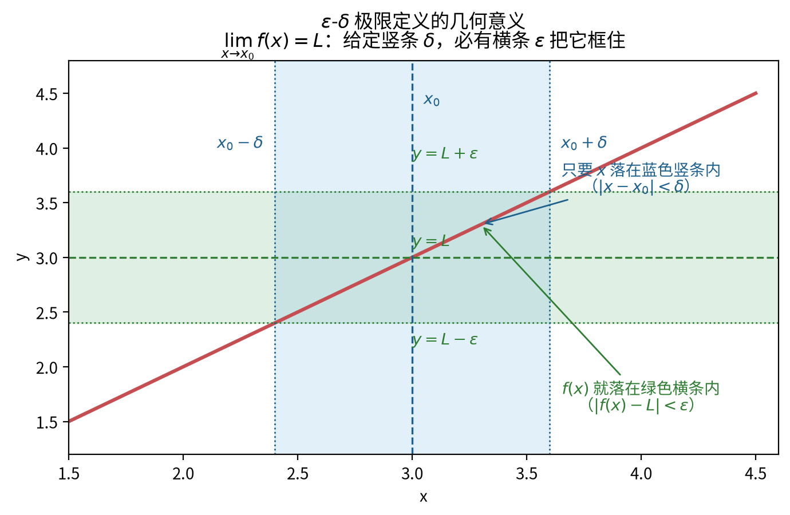

#### 🎬 动画演示：ε-δ 极限定义


> 动画动态展示了 ε-δ 极限定义的几何含义：对于函数 $f(x)$ 在 $x_0$ 处的极限，无论你把 ε 目标（黄色区域）定得多小，总能找到一个 δ 允许范围（绿色区域），使得 δ 范围内所有 $x$ 的函数值都落在 ε 目标内。当 ε 缩小时，δ 也随之缩小，直观展示了"任意 ε > 0，存在 δ > 0"的动态过程。

> **直观理解（现实类比）**：想象一个**射箭靶**。极限 $L$ 是靶心，$\varepsilon$ 是你立的"命中标准"（必须射进靶心周围 $\varepsilon$ 范围内）。$\varepsilon$-$N$（或 $\varepsilon$-$\delta$）定义说的是：**不管你把标准定得多严（$\varepsilon$ 多小），我总能找到一个对应的"瞄准范围"（$\delta$），只要箭落在 $x_0$ 附近 $\delta$ 内，就一定能命中你的标准**。
>
> 上图绿色横条是"$\varepsilon$ 目标"，蓝色竖条是"$\delta$ 允许范围"。**只要蓝色竖条里所有 $x$ 的函数值都落在绿色横条里，极限就成立**。这就是"任意给你 $\varepsilon$，我都能找到 $\delta$"这句抽象定义的几何含义——看懂这张图，就真正理解了极限。

> **🧠 思考历程：为什么函数极限要多一个 $\delta$，不照抄 $\varepsilon$-$N$？**
>
> 数列的自变量是离散的下标 $n$，一句"$n>N$"就能划出"尾段"；函数却让 $x$ 在**连续**的数轴上滑向 $x_0$，无法拿一个"大于某下标"的截止来框住"一堆小邻域里的点"。所以韦尔斯特拉斯把 $\varepsilon$-$N$ 里的"门槛下标 $N$"换成**半径 $\delta$**：把 $x_0$ 附近 $\delta$ 内的所有 $x$ 都约束进来（见 3.2 节的来龙去脉，两者是同一场"灭火"的两个阵地）。
>
> - **$\varepsilon$ 管值域、$\delta$ 管定义域**。$\varepsilon$ 是 $f(x)$ 与 $A$ 的误差，$\delta$ 是 $x$ 与 $x_0$ 的距离，二者仍是两个有限的正常数，**没有任何"无穷"的影子**——这正是 $\varepsilon$-$\delta$ 能从"无限逼近"这种口语里抠出来的全部秘诀。
> - **"去心"意味深长**。条件 $0<|x-x_0|$ 刻意排除 $x=x_0$，表达"只拷问趋势、不担保取值"。若把等号也放进来，就变成了"连续"（5.6 节）才额外要求的强度——**极限和连续的区别，就藏在这个"去心/带心"上**。
> - **心路**：$\varepsilon$ 与 $\delta$ 的依赖关系（$\delta$ 通常随 $\varepsilon$ 与 $x_0$ 而变）正是函数"连续滑动"留下的印记。**把一场"无限靠近"的动态过程，压缩成两个可一步步检验的静态不等式**，正是数学驯服极限的通用配方。

#### 课堂问答

**老师**：函数极限定义里，为什么是 $\forall\varepsilon>0\ \exists\delta>0$，而不是反过来？

**学生**：因为要表达"$\varepsilon$ 想多小都行、$\delta$ 随之而变"。顺序决定依赖：$\delta=\delta(\varepsilon)$ 通常随 $\varepsilon$ 减小而减小。若写成 $\exists\delta\ \forall\varepsilon$，就变成"用同一个 $\delta$ 对付所有 $\varepsilon$"，那是强得多的条件，已接近一致连续，远超极限所需。

**老师（追问）**：定义里的 $0<|x-x_0|$ 这个"去心"是可有可无的吗？

**学生**：绝不可去。它排除 $x=x_0$，表示只问趋势、不管那一点取值。$f(x)=\frac{x^2-1}{x-1}$ 在 $x=1$ 无定义，但当 $x\to1$ 时 $f(x)=x+1\to2$，极限照样存在。若去掉 $0<$、要求 $x=x_0$ 也满足 $|f(x_0)-A|<\varepsilon$，那就成了连续——极限与连续的差别正藏在这里。

**老师（拓展）**：$\delta$ 除了依赖 $\varepsilon$ 还依赖什么？这带来什么后果？

**学生**：一般还依赖点 $x_0$，即 $\delta=\delta(\varepsilon,x_0)$。同一条曲线上，越陡的点需要的 $\delta$ 越小。正因 $\delta$ 可以随点变，普通连续不保证一致连续；$f(x)=\frac1x$ 在 $(0,1)$ 上连续，但 $x_0\to0$ 时所需 $\delta\to0$，无统一 $\delta$，故不一致连续。

### 5.2 单侧极限

**左极限**：如果对任意 $\varepsilon > 0$，存在 $\delta > 0$，使得当 $x_0 - \delta < x < x_0$ 时，$|f(x) - A| < \varepsilon$，则记作 $\lim_{x \to x_0^-} f(x) = A$。

**右极限**：如果对任意 $\varepsilon > 0$，存在 $\delta > 0$，使得当 $x_0 < x < x_0 + \delta$ 时，$|f(x) - A| < \varepsilon$，则记作 $\lim_{x \to x_0^+} f(x) = A$。

**定理**：$\lim_{x \to x_0} f(x) = A$ 当且仅当 $\lim_{x \to x_0^-} f(x) = \lim_{x \to x_0^+} f(x) = A$。

> **直观理解（类比）**：单侧极限像**从左右两条楼梯同时走向同一层**——左极限只看从 $x_0$ 左边逼近时函数落向哪，右极限只看从右边逼近时落向哪。定理说：**只有当左边、右边逼近到的都是同一个 $A$，整体的极限才算存在且等于 $A$**；哪一侧落点不一致，整体极限就不存在。

#### 课堂问答

**老师**：为什么要区分左右极限？什么情况下必须左右分开看？

**学生**：因为函数在 $x_0$ 两侧可能走上不同的值。左极限只看 $x_0-\delta<x<x_0$、右极限只看 $x_0<x<x_0+\delta$，各有自己的 $\varepsilon$-$\delta$ 语言。当两侧表达式不同（如分段函数）或函数在 $x_0$ 处跳跃时，必须分开算，否则无法判断整体极限。

**老师（追问）**：整体极限存在的充要条件，用左右极限怎么表述？

**学生**：$\lim_{x\to x_0}f(x)=A\iff\lim_{x\to x_0^-}f(x)=\lim_{x\to x_0^+}f(x)=A$。关键是两个单侧极限都存在且相等：只要一侧不存在，或两侧不相等，整体极限就不存在。如符号函数 $\operatorname{sgn}x$ 在 $0$ 处左极限 $-1$、右极限 $1$，故 $0$ 是跳跃间断点。

**老师（拓展）**：左右分看还能揭示哪类"函数值不影响极限"的现象？

**学生**：能揭示去心的威力。对 $f(x)=\frac{|x|}{x}$（$x\ne0$），左极限 $-1$、右极限 $1$，整体极限不存在；但只看一侧，极限却明确存在。这说明极限可以只在半边成立，单侧极限正是刻画半边趋势的工具，也是判断端点处连续性、可导性的必备语言。

### 5.3 极限的 Heine 归并原理

**定理**（Heine 定理）：$\lim_{x \to x_0} f(x) = A$ 当且仅当对任意满足 $x_n \to x_0$ 且 $x_n \neq x_0$ 的数列 $\{x_n\}$，都有 $\lim_{n \to \infty} f(x_n) = A$。

这个定理建立了函数极限与数列极限的联系，是证明函数极限性质的重要工具。

> **直观理解（类比）**：Heine 归并原理像**"抽查通往 $x_0$ 的所有路线，下车点都相同"**——无论你挑哪条数列路线 $x_n$ 迫近 $x_0$，函数值 $f(x_n)$ 都落到同一个 $A$，就说明函数极限存在且等于 $A$。它把"函数版极限"**翻译回**更熟悉的"数列版极限"，让函数的极限性质证明能用数列工具来做。

#### 课堂问答

**老师**：Heine 定理把函数极限翻译成数列极限，它最难用的方向是哪一个？

**学生**：是用数列语言反推函数极限那一侧。已知任意 $x_n\to x_0$（$x_n\ne x_0$）都有 $f(x_n)\to A$，要证 $\lim_{x\to x_0}f(x)=A$。标准做法是反证：若函数极限不是 $A$，则存在 $\varepsilon_0>0$，对每个 $\delta=\frac1n$ 都能找到 $x_n$ 使 $0<|x_n-x_0|<\frac1n$ 却 $|f(x_n)-A|\ge\varepsilon_0$，与假设冲突。

**老师（追问）**：用它证"极限不存在"为什么特别顺手？

**学生**：只需造出两条都趋于 $x_0$ 的数列，而 $f$ 的值不趋于同一数。例如 $f(x)=\sin\frac1x$（$x\to0$）：取 $x_n=\frac1{2n\pi}\to0$ 得 $f(x_n)=0$，取 $y_n=\frac1{2n\pi+\frac\pi2}\to0$ 得 $f(y_n)=1$，两数列极限不同，故 $\lim_{x\to0}\sin\frac1x$ 不存在。一条反例胜过正面硬证。

**老师（拓展）**：定理说"当且仅当"，这对函数极限的性质证明有何便利？

**学生**：它允许把函数极限问题搬回数列去证。唯一性、四则运算、夹逼这些在数列里已证过的结论，可以借 Heine 定理整体平移到函数极限，省去重复的 $\varepsilon$-$\delta$ 推导。它本质上是连接两种极限语言的翻译桥。

### 5.4 极限 $x \to \infty$ 的情形

**定义**：设函数 $f$ 在区间 $(a, +\infty)$ 上有定义。如果对任意 $\varepsilon > 0$，存在 $X > 0$，使得当 $x > X$ 时，有

$$
|f(x) - A| < \varepsilon
$$

则称 $\lim_{x \to +\infty} f(x) = A$。

类似地定义 $\lim_{x \to -\infty} f(x) = A$ 和 $\lim_{x \to \infty} f(x) = A$（其中 $x \to \infty$ 表示 $|x| \to \infty$）。

> **直观理解（类比）**：$x\to\infty$ 的函数极限是把数列 $\varepsilon$-$N$ 的想法搬到函数上——**只要 $x$ 一路走到足够远（$x>X$），函数值就能挤进目标 $A$ 身旁的 $\varepsilon$ 带**。如同**你离开灯塔很远后，回头看到的灯塔方向就稳定下来**：$x$ 越往远处去，$f(x)$ 越贴向 $A$。

#### 课堂问答

**老师**：$x\to\infty$ 的定义里出现了 $X>0$，它对应数列 $\varepsilon$-$N$ 里的哪个角色？

**学生**：对应门槛 $N$，只是由离散下标换成了连续横坐标。定义是 $\forall\varepsilon>0\ \exists X>0$，当 $x>X$ 时 $|f(x)-A|<\varepsilon$。这里 $X$ 依赖 $\varepsilon$，作用与 $\varepsilon$-$N$ 里的 $N=N(\varepsilon)$ 完全一致——过了这条线，函数值就进带。

**老师（追问）**：$\lim_{x\to\infty}f(x)=A$ 和 $\lim_{n\to\infty}f(n)=A$ 是同一件事吗？

**学生**：不是。前者要求 $x$ 连续跑遍 $(X,+\infty)$ 上所有点都满足，后者只看整数下标，前者强、后者弱。例：$f(x)=\sin(2\pi x)$ 沿整数有 $f(n)=0\to0$，但当 $x\to\infty$ 时 $\sin(2\pi x)$ 在 $[-1,1]$ 间振荡，整体极限不存在。离散采样收敛推不出连续极限存在。

**老师（拓展）**：还有哪些"自变量趋于无穷"的变体？它们靠什么区分？

**学生**：有 $x\to+\infty$、$x\to-\infty$，以及 $x\to\infty$（即 $|x|\to\infty$，横坐标向两侧都跑远）。区分它们就看对 $x$ 的限制条件：分别取 $x>X$、$x<-X$、$|x|>X$。这和单侧极限思路一致——限定自变量走向哪一侧，就得到相应的极限。

### 5.5 函数极限的性质

函数极限也有与数列极限类似的性质：

1. **唯一性**：若极限存在，则唯一
2. **局部有界性**：若 $\lim_{x \to x_0} f(x) = A$，则存在 $\delta > 0$ 和 $M > 0$，使得 $0 < |x - x_0| < \delta$ 时 $|f(x)| \le M$
3. **四则运算法则**：与数列极限相同
4. **夹逼定理**：与数列极限类似

> **直观理解（类比）**：函数极限和数列极限其实**用的是同一套"脾气"**——唯一性、局部有界、四则运算、夹逼，几乎原样照搬。就像**换个主角演同一出戏**：把"下标 $n\to\infty$"换成"变量 $x\to x_0$"，台词（定理）几乎不变，只是 $\varepsilon$-$N$ 语言换成了 $\varepsilon$-$\delta$ 语言。

#### 课堂问答

**老师**：函数极限和数列极限的性质几乎原样照搬，它们真的是"同一出戏"吗？

**学生**：是同一套逻辑换语言。唯一性、局部有界、四则运算、夹逼，证明结构不变，只把 $n>N$ 换成 $0<|x-x_0|<\delta$、把 $N=\max\{N_1,N_2\}$ 换成 $\delta=\min\{\delta_1,\delta_2\}$。借助 Heine 归并原理，数列版的结论还能整体平移过来。

**老师（追问）**："局部有界性"里为什么要强调"局部"？

**学生**：因为函数极限只约束 $x_0$ 的某个去心邻域，对远处和该点本身都不作要求。存在 $\delta>0$ 与 $M>0$ 使 $0<|x-x_0|<\delta$ 时 $|f(x)|\le M$，这个界只在邻域内有效。如 $f(x)=\frac1x$ 在 $x_0=1$ 附近局部有界，却在 $(0,1)$ 整体无界——"局部"二字不可去。

**老师（拓展）**：这些性质在"复合函数"时要额外加什么条件？

**学生**：要注意函数值是否落在另一函数极限的自变量范围内。若 $u=g(x)$ 当 $x\to x_0$ 时 $u\to u_0$、且 $f$ 在 $u_0$ 有极限，还需保证 $u\ne u_0$（去心）才能套用。所以复合极限并非无条件成立，必须检查变量替换的合法性，否则会得出错误结果。

### 5.6 连续函数及其性质

**定义（连续）**：设函数 $f(x)$ 在 $x_0$ 的某邻域内有定义。若 $\lim_{x \to x_0} f(x) = f(x_0)$，则称 $f$ 在点 $x_0$ 处**连续**。

等价地（$\varepsilon$-$\delta$ 定义）：$\forall \varepsilon > 0$，$\exists \delta > 0$，当 $|x - x_0| < \delta$ 时恒有 $|f(x) - f(x_0)| < \varepsilon$。

**增量定义**：令 $\Delta x = x - x_0$，$\Delta y = f(x) - f(x_0)$，则 $f$ 在 $x_0$ 连续 $\iff \lim_{\Delta x \to 0} \Delta y = 0$。

**单侧连续**：$\lim_{x \to x_0^-} f(x) = f(x_0)$ 为左连续，$\lim_{x \to x_0^+} f(x) = f(x_0)$ 为右连续。$f$ 在 $x_0$ 连续 $\iff$ 左右都连续。

**连续函数的运算**：连续函数的和、差、积、商（分母不为零）仍连续；连续函数复合后仍连续。初等函数在其定义域内处处连续。

**间断点分类**：若 $f$ 在 $x_0$ 处不连续，则称 $x_0$ 为间断点。按左右极限的存在情况分为三类：
- **可去间断点**：左右极限存在且相等，但不等于 $f(x_0)$（或 $f(x_0)$ 无定义）。
- **跳跃间断点**：左右极限都存在但不相等。
- **无穷间断点**：至少一侧极限为无穷（不存在）。

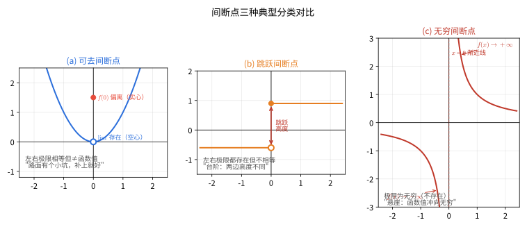

> **直观理解（现实类比）**：把函数图像想象成一条路——
> - **可去间断**像**路面上有个小坑**（一个点空着或偏高/偏低），左右两边高度一致，**补上这个点**路就通了，所以叫"可去"；
> - **跳跃间断**像**台阶**，左右两边高度不同，函数值"啪"地跳一下，**没法通过填一个点消除**；
> - **无穷间断**像**悬崖**，函数值在 $x_0$ 处冲向无穷（如 $1/x$ 在 $0$ 处），图像有竖直渐近线，**根本接不上**。
>
> 前两类（左右极限都存在）合称**第一类间断点**，第三类（至少一侧极限不存在或为无穷）属于**第二类间断点**。判断时先看左右极限是否存在、是否相等，就能对号入座。

**闭区间上连续函数的性质**（本部分理论核心）：

> **直观理解**：连续函数在闭区间上的图像是一条不间断的曲线，它必须"扫过"所有中间高度，因此从负到正必穿过 $x$ 轴（零点定理），也必然同时到达最高点和最低点（最值定理）。

1. **有界性**：$f$ 在 $[a,b]$ 上连续 $\Rightarrow$ $f$ 在 $[a,b]$ 上有界。
2. **最值定理**：$f$ 在 $[a,b]$ 上连续 $\Rightarrow$ 存在最大值与最小值（即前面预备知识中的最值定理）。
3. **介值定理**：$f$ 在 $[a,b]$ 上连续，且 $f(a) \neq f(b)$，则对介于 $f(a)$ 与 $f(b)$ 之间的任意值 $C$，都存在 $c \in (a,b)$ 使 $f(c) = C$。
4. **零点定理**（介值定理的推论）：$f$ 在 $[a,b]$ 上连续，且 $f(a) \cdot f(b) < 0$，则存在 $c \in (a,b)$ 使 $f(c) = 0$。

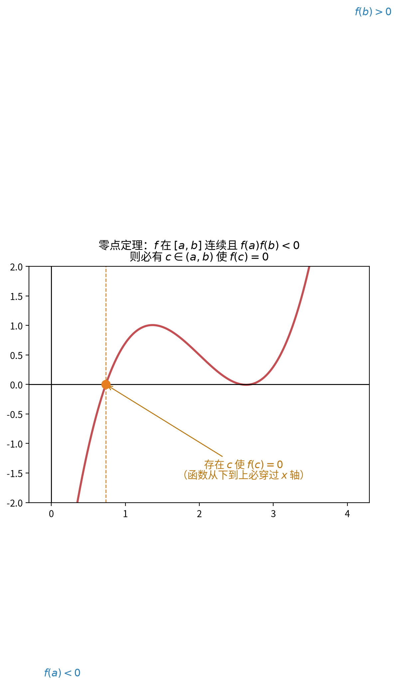

> **直观理解（现实类比）**：连续就是"**笔不离纸**"画出的曲线。零点定理说：如果曲线从 $x$ 轴**下方**一路画到**上方**（$f(a)f(b)<0$），中途**必然**要穿过 $x$ 轴——因为笔没离开纸，要跨到另一侧就绕不开那条线。
>
> 这解释了为什么"连续"如此重要：**它是"一定有解"的保证**。比如方程 $x=\cos x$ 在 $[0,\pi]$ 上必有解，正是因为连续函数 $f(x)=x-\cos x$ 在两端异号。这也是数值计算中"二分法求根"的依据——每次砍半，根必在区间内。

> **🧠 思考历程："连续"这个词，怎么从"画得出来"变成"算得出来"？**
>
> 18 世纪的数学家大多把连续函数直觉地理解为"**一笔画到底的曲线**"——图像上没断口。可"一笔画"依赖几何与手感，塞不进运算。到了 19 世纪，布尔（Bolzano）与柯西意识到：必须给"连续"一个**纯代数、可逐点检验**的判据。
>
> - **从"图像"到"点"**。他们改用"出入不惊"来定义：$x$ 微微挪动（$|x-x_0|$ 小），$f(x)$ 也跟着微微挪动（$|f(x)-f(x_0)|$ 小），即 $\lim_{x\to x_0}f(x)=f(x_0)$。它不再依赖"能不能一笔画"，而变成一个可以用 $\varepsilon$-$\delta$ 验证的对象。
> - **这一定义能干活**。有了它，"闭区间上连续就有界、取到最值、夹住中间值"（本节定理 1–4）才各自有严格证明；像取整函数 $x\mapsto\lfloor x\rfloor$ 这类"看着能画、实则跳断"的对象，才被清晰地判为不连续，并与本章的间断点分类（本节上文）对号入座。
> - **心路**：连续性的故事说明：**数学概念常从"看得见的直觉"起步，最终要靠"可用不等式检验的定义"才能进入证明的舞台**。"连续"被提升为精确数学对象的那一刻，微积分才真正站稳脚跟——你在 5.6 节学的，正是这段"从手感走向公理"的压缩版。

**一致连续（Uniform Continuity）**：

> $f$ 在 $[a,b]$ 上一致连续，如果 $\forall \varepsilon > 0$，$\exists \delta > 0$，对 $[a,b]$ 内**任意** $x_1, x_2$，只要 $|x_1 - x_2| < \delta$，就有 $|f(x_1) - f(x_2)| < \varepsilon$。

**关键区别**：
- **连续**：每点处，$\delta$ 可以随点 $x_0$ 的不同而不同；
- **一致连续**：同一个 $\delta$ 对区间内所有点都成立。

**康托定理（Cantor 定理）**：$f$ 在闭区间 $[a,b]$ 上连续 $\Rightarrow$ $f$ 在 $[a,b]$ 上一致连续。

> **注**：开区间上的连续函数不一定一致连续。例如 $f(x) = \frac{1}{x}$ 在 $(0,1)$ 上连续但**不一致连续**（越靠近 $0$，图像越陡，所需 $\delta$ 越小，无法统一）。

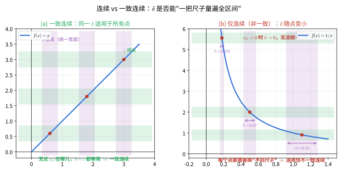

> **直观理解（现实类比）**：一致连续像**"一把统一标准的尺子"量遍整个区间**——同一个 $\delta$（尺子的精度）对区间内任何点都管用；而普通连续像**"每个点都要换不同尺子"**，$\delta$ 可以随点 $x_0$ 的位置而变。
>
> 看上图：左图 $f(x)=x$ 斜率处处为 $1$，最"温和"，$\delta=\varepsilon$ 这一把尺子从左量到右都够用——这就是一致连续；右图 $f(x)=1/x$ 越靠近 $0$ 越陡，**$x_0\to 0$ 时所需的 $\delta\to 0$**，无论你选多小的 $\delta$，总存在更靠近 $0$ 的点"吃不消"——所以它连续但**不一致连续**。康托定理保证：**闭区间上连续函数一定一致连续**（闭区间"挡住了"这种越靠边越陡的麻烦）。

---

#### 课堂问答

**老师**：连续的定义里，极限与连续性只差一个等号，请精确指出差在哪。

**学生**：差在 $x=x_0$ 处要不要管。极限写的是 $0<|x-x_0|<\delta$（去心），只谈趋势；连续则在 $\lim_{x\to x_0}f(x)=f(x_0)$ 里额外要求 $f$ 在 $x_0$ 有定义且函数值等于该极限。等价地，连续的 $\varepsilon$-$\delta$ 把 $0<$ 去掉。差别就藏在去心与带心上。

**老师（追问）**：可去间断点为什么叫"可去"？能举个具体例子吗？

**学生**：因为左右极限存在且相等，只差那一点的值。如 $f(x)=\frac{x^2-1}{x-1}$ 在 $x=1$ 无定义，但左右极限都是 $2$；只要补充定义 $f(1)=2$，函数就在 $1$ 处连续——障碍是一个点，可被填掉，故称可去。相比之下跳跃间断左右极限不等，无法靠改一个点消除。

**老师（拓展）**：闭区间上连续为什么能推出"有界、取最值、介值"这一整套？

**学生**：根子在"闭区间"三个字。闭区间是紧的，连续函数在其上有界并取到最值，且必扫过所有中间高度。开区间则会漏：$f(x)=\frac1x$ 在 $(0,1)$ 连续却无界。这三条性质也是定积分、二分法求根、反函数存在性的理论基座。

## 6. 无穷小与无穷大

> **先说个问题**：$0.0001$ 是"无穷小"吗？不是——无穷小不是某个很小很小的**固定数**，而是一个**越来越靠近 0 的过程**。本节要给"无限趋 0"与"无限增大"这两副极限的"极端长相"分分类、比大小。请记住：**无穷小是动词（趋近），不是名词（固定小量）**。

> **常见坑**：等价无穷小替换（如 $\sin x\sim x$）**只能在乘除因子中使用，严禁在加减法里把单项擅自整体替换**（$\tan x-\sin x$ 若先换成 $x-x=0$ 就全错了，应提取因子或泰勒展开）；且替换都以"$x\to0$"为前提，换了场合即失效。无穷小/无穷大只是"趋势"记号，$\infty-\infty$、$\frac\infty\infty$ 等均无定义，不能当数算。

### 6.1 无穷小

**定义**：如果 $\lim_{x \to x_0} f(x) = 0$，则称 $f(x)$ 是 $x \to x_0$ 时的**无穷小**。

**性质**：
1. 有限个无穷小的和仍是无穷小
2. 有界函数与无穷小的乘积是无穷小
3. 常数与无穷小的乘积是无穷小
4. 有限个无穷小的乘积是无穷小

> **直观理解（类比）**：无穷小不是"很小的固定数"，而是**走向 0 的动态趋势**——好比**一支笔尖最终压到刻度 0 附近**，而非停在"0.0001"不再动。所以要说"$f$ 是 $x\to x_0$ 时的无穷小"，指的是 $f(x)$ 随 $x$ 逼近 $x_0$ 而趋近 0——它是一个**关于"过程"的说法，不是关于"某个具体数字"的说法**。

#### 课堂问答

**老师**：能不能说"$0.00001$ 是无穷小"？为什么？

**学生**：不能。无穷小不是某个很小的固定数，而是"当 $x\to x_0$ 时 $f(x)\to0$"这一过程。$0.00001$ 作为常数，其极限是它自己、不是 $0$，故不是无穷小。只有满足 $\forall\varepsilon>0\ \exists\delta>0$，$0<|x-x_0|<\delta\Rightarrow|f(x)|<\varepsilon$ 的函数才叫无穷小。它是动词，不是名词。

**老师（追问）**：有限个无穷小的乘积仍是无穷小，这条对无穷多个成立吗？

**学生**：不成立。有限个没问题：逐个把界压到 $\varepsilon$ 以下要取最小的 $\delta$，只有有限个才取得到最小值。无穷多个则可能失效或改变阶。所以"有限个无穷小的和/积仍是无穷小"这两条都限定在有限个，是定义里"存在"运算性质能推广的边界。

**老师（拓展）**：无穷小与函数极限之间是什么关系？

**学生**：互为平移。$\lim_{x\to x_0}f(x)=A\iff f(x)-A$ 是 $x\to x_0$ 时的无穷小——把目标从 $A$ 平移到 $0$ 就变成无穷小问题。这条恒等式让无穷小的所有性质都能反向转译为极限性质，也是无穷小的阶的比较能刻画极限快慢的根据。

### 6.2 无穷大

**定义**：如果对任意 $M > 0$，存在 $\delta > 0$，使得当 $0 < |x - x_0| < \delta$ 时，$|f(x)| > M$，则称 $f(x)$ 是 $x \to x_0$ 时的**无穷大**，记作 $\lim_{x \to x_0} f(x) = \infty$。

类似地定义正无穷大 $+\infty$ 和负无穷大 $-\infty$。

**定理**：在自变量的同一变化过程中：
- 若 $f(x)$ 是无穷大，则 $\frac{1}{f(x)}$ 是无穷小
- 若 $f(x)$ 是无穷小（且 $f(x) \neq 0$），则 $\frac{1}{f(x)}$ 是无穷大

> **直观理解（类比）**：无穷大是无穷小的**倒影**——它表示 $f(x)$ 的绝对值能超过任意给定的 $M$，像**数值一路冲上天、没有封顶**。二者互为倒数、如镜面呼应：**分母归零，整体就冲向无穷；分母无穷小（且不取 0），其倒数就冲向无穷大**。

#### 课堂问答

**老师**：$\lim_{x\to x_0}f(x)=\infty$ 的定义里，$\forall M>0$ 该配 $|f(x)|>M$ 还是 $f(x)>M$？

**学生**：要看哪种无穷大。一般的 $\infty$ 用 $|f(x)|>M$，表示绝对值可任意大（可能正负交替，如 $\frac1x$ 附近）；若要 $+\infty$ 则改用 $f(x)>M$，要 $-\infty$ 用 $f(x)<-M$。定义是 $\forall M>0\ \exists\delta>0$，$0<|x-x_0|<\delta\Rightarrow|f(x)|>M$。

**老师（追问）**：$\infty$ 能像数一样参与加减乘运算吗？

**学生**：不能。$\infty$ 只是趋势记号、不是实数，$\infty-\infty$、$\frac\infty\infty$、$0\cdot\infty$ 都是未定式，没有先验的值，必须回到函数本身用极限重新判定。只有极少数规则（如"无穷大加有界仍是无穷大"）能直接套，且需逐条证明。

**老师（拓展）**：无穷大与无穷小的"倒影"关系，用时要注意什么前提？

**学生**：要注意分母不为零。定理说 $f$ 无穷大则 $\frac1f$ 无穷小，以及 $f$ 无穷小且 $f\ne0$ 则 $\frac1f$ 无穷大。第二条若去掉 $f\ne0$，$f$ 会在过程中取到 $0$，$\frac1f$ 根本无定义——这正是定义无穷小时容易漏、却必须强调的前提。

### 6.3 无穷小的阶的比较

设 $\alpha(x)$ 和 $\beta(x)$ 是 $x \to x_0$ 时的无穷小，且 $\beta(x) \neq 0$。

1. 若 $\lim_{x \to x_0} \frac{\alpha(x)}{\beta(x)} = 0$，则称 $\alpha$ 是比 $\beta$ **高阶的无穷小**，记作 $\alpha = o(\beta)$
2. 若 $\lim_{x \to x_0} \frac{\alpha(x)}{\beta(x)} = C \neq 0$，则称 $\alpha$ 与 $\beta$ **同阶无穷小**
3. 若 $\lim_{x \to x_0} \frac{\alpha(x)}{\beta(x)} = 1$，则称 $\alpha$ 与 $\beta$ **等价无穷小**，记作 $\alpha \sim \beta$
4. 若存在 $k > 0$ 使得 $\lim_{x \to x_0} \frac{\alpha(x)}{[\beta(x)]^k} = C \neq 0$，则称 $\alpha$ 是 $\beta$ 的 $k$ **阶无穷小**

**常用等价无穷小**（$x \to 0$ 时）：

| 等价关系 | 条件 |
|:---------|:-----|
| $\sin x \sim x$ | $x \to 0$ |
| $\tan x \sim x$ | $x \to 0$ |
| $\arcsin x \sim x$ | $x \to 0$ |
| $\arctan x \sim x$ | $x \to 0$ |
| $\ln(1 + x) \sim x$ | $x \to 0$ |
| $e^x - 1 \sim x$ | $x \to 0$ |
| $1 - \cos x \sim \frac{1}{2}x^2$ | $x \to 0$ |
| $(1 + x)^\alpha - 1 \sim \alpha x$ | $x \to 0$ |

> **直观理解（类比）**：无穷小的"阶"像**比谁"消失"得快**——两个都奔向 0 的量，比的是**谁先跑得没影**。$\alpha/\beta\to 0$ 说明 $\alpha$ 消失得更快（高阶）；比值收敛到非零常数则两者**步调一致**（同阶）；比值收敛到 1，则堪称**同一个步伐**（等价），可以在求极限时安全替换。**等价无穷小替换**因此成了化简极限的一个"快捷方式"。

#### 课堂问答

**老师**：两个无穷小都在奔向 $0$，怎么比"谁更快"？

**学生**：比它们比值的极限。设 $\beta\ne0$，若 $\lim\frac\alpha\beta=0$，则 $\alpha$ 消失得更快，称 $\alpha$ 是比 $\beta$ 高阶的无穷小，记作 $\alpha=o(\beta)$；若 $\lim\frac\alpha\beta=C\ne0$，两者同阶；若 $\lim\frac\alpha\beta=1$，两者等价，记作 $\alpha\sim\beta$，求极限时可安全替换。通用工具是比值。

**老师（追问）**：等价无穷小替换最经典的陷阱是什么？

**学生**：只能对乘除因子替换，绝不能在加减里整体替换。例如 $\tan x-\sin x$ 中若把两项各自换成 $x$，得 $x-x=0$，但真实的 $\tan x-\sin x\sim\frac{x^3}2\ne0$，错得离谱。原因是二者的差是更高阶的量，在加减里被保留，必须提取公因子或泰勒展开再算。

**老师（拓展）**：$1-\cos x\sim\frac12x^2$ 这条"半阶"结论说明了什么更一般的事？

**学生**：说明等价有精细的层级。$\sin x\sim x$ 是一阶，$1-\cos x\sim\frac12x^2$ 是二阶，$(1+x)^\alpha-1\sim\alpha x$ 又是一阶。这些阶正好对应泰勒展开的首项次数，用阶可以说清两个无穷小差多少，也是判断加减法能否吞掉低阶项的依据。

### 6.4 无穷大的阶的比较（Order of Infinity）

> **先说个问题**：$n$、$n^2$、$2^n$、$n!$ 统统"奔向 $+\infty$"，可谁跑得最快？正如无穷小要比"谁先消失"（6.3 节），无穷大要比**谁先冲向无穷**。本节把"无穷大的阶"讲成与无穷小严丝合缝的对偶。

设 $F(x),G(x)$ 是同一自变数过程中的无穷大（$|F(x)|,|G(x)|\to+\infty$），且 $G(x)\neq 0$。用与 6.3 完全对称的方式定义（比率在金句下做比较）：

1. 若 $\lim\frac{F(x)}{G(x)}=\infty$（绝对值趋向 $+\infty$），称 $F$ 比 $G$ **高阶无穷大**；
2. 若 $\lim\frac{F(x)}{G(x)}=c\neq0$（有限非零），称 $F$ 与 $G$ **同阶无穷大**；
3. 若 $\lim\frac{F(x)}{G(x)}=1$，称 $F$ 与 $G$ **等价无穷大**。

**与无穷小的对偶**：$F$ 是无穷大 $\iff$ $\frac1F$ 是无穷小（且 $\neq0$）。由 $\frac{1/F}{1/G}=\frac{G}{F}$，得
> $F$ 比 $G$ 高阶（$\frac FG\to\infty$）$\iff$ $\frac1F$ 比 $\frac1G$ **低阶**（$\frac{1/F}{1/G}=\frac GF\to 0$）。**无穷大的阶，倒过来就是相应无穷小的阶**——同一张比率表，两面各读一遍。

**常用增长速率的阶（$n\to\infty$）**：
$$
\log n \;\ll\; n^\alpha\;(\alpha>0) \;\ll\; a^n\;(a>1) \;\ll\; n! \;\ll\; n^n
$$
记号"$A\ll B$"表示 $B/A\to+\infty$（$A$ 比 $B$ 低阶）。

> **直观理解（现实类比）**：把这一串比作**一场速度赛跑**——对数、多项式、指数、阶乘依次是**自行车、汽车、高铁、火箭**，越往右越凶，前一个开上一整天也追不上后一个的起步线。"高阶无穷大"就是"后发先至、甩得越来越远"的量。这张"增长阶梯"在求极限、估复杂度时屡屡救命：**只要分母的阶跑过分子，比值就 $0$；反过来就 $\infty$**（如 $\frac{\ln n}{n}\to0$，$\frac{n!}{a^n}\to\infty$）。

> **常见坑**：切勿把"无穷大"当数直接相除或加减（见末章"常见误区 5"）。比阶**必须回到底数/极限的比值**，不能想当然地以为"无穷碰无穷就有得算"。记号 $\ll$ 只在"趋势"意义下成立，别当成普通不等式；且比较时先确认分母确为无穷大、$G\ne0$。

**本节习题（基础/进阶/挑战）**：
- **基础**：按阶比较 $n$ 与 $\ln n$、$n^3$ 与 $n$（分别写出比值极限）；据此判断 $\lim_{n\to\infty}\frac{\ln n}{n}$ 与 $\lim_{n\to\infty}\frac{n}{n^3}$。
- **进阶**：证明 $\frac{n^k}{a^n}\to0$（$a>1$，$k\in\mathbb{N}$ 固定），即幂比指数低阶；并由此求 $\lim_{n\to\infty}\frac{n^{100}}{2^n}$。
- **挑战**：证明 $\lim_{n\to\infty}\frac{a^n}{n!}=0$（$n!$ 比任何指数高阶）。（提示：比值法，或用 $\frac a{n+1}\to0$ 分段压缩）

> **答案**：**基础**：$\frac{\ln n}{n}\to0$，$\ln n$ 比 $n$ 低阶；$\frac{n^3}{n}=n^2\to+\infty$，$n^3$ 比 $n$ 高阶。故 $\frac{\ln n}{n}\to0$，$\frac{n}{n^3}=\frac1{n^2}\to0$。**进阶**：比值 $\frac{n^k/a^n}{(n-1)^k/a^{n-1}}=\frac1a\left(\frac{n}{n-1}\right)^k\to\frac1a<1$，故 $\frac{n^k}{a^n}$ 自某处起单调递缩向 $0$；或对充分大 $n$ 用 $a^n>n^{k+1}$ 夹逼。于是 $\frac{n^{100}}{2^n}\to0$。$\square$ **挑战**：$\frac{a^{n+1}/(n+1)!}{a^n/n!}=\frac a{n+1}\to0$，故自某处起该比率 $<\frac12$，从而 $\frac{a^n}{n!}\to0$（指数快不过阶乘）。$\square$

---

#### 课堂问答

**老师**：$\log n$、$n^\alpha$、$a^n$、$n!$ 都奔向 $+\infty$，凭什么说 $a^n$ 一定跑赢任何 $n^k$？

**学生**：比比值极限。$\frac{n^k}{a^n}$（$a>1$）当 $n\to\infty$ 时趋于 $0$，即 $a^n$ 比任何固定幂更高阶。证明用比值法：$\frac{a^{n}/n^k}{a^{n-1}/(n-1)^k}=\frac{1}{a}(\frac{n}{n-1})^k\to\frac1a<1$，故自某处起该序列递减并挤向 $0$。

**老师（追问）**：$n!$ 跑赢 $a^n$，关键的一步在哪里？

**学生**：在相邻比值 $\frac{a^{n+1}/(n+1)!}{a^n/n!}=\frac a{n+1}\to0$。当 $n$ 足够大时该比值小于 $\frac12$，于是 $\frac{a^n}{n!}$ 至少每步缩短一半，必趋于 $0$。所以 $n!$ 比任何指数都高阶。这条结论在判断级数收敛（比值判别法）时反复用到。

**老师（拓展）**：无穷大的阶和无穷小的阶，能不能"一套两用"？

**学生**：能，二者严格对偶。$F$ 是无穷大当且仅当 $\frac1F$ 是无穷小，且由 $\frac{1/F}{1/G}=\frac GF$ 可知 "$F$ 比 $G$ 高阶"正好对应 "$\frac1F$ 比 $\frac1G$ 低阶"。所以同一张比值表，从两端各读一遍，就同时得到无穷大与无穷小的阶。

## 7. 示例（Worked Examples）

### 示例 1：用 $\varepsilon$-$N$ 定义证明极限

证明 $\lim_{n \to \infty} \frac{2n + 1}{3n - 2} = \frac{2}{3}$。

**解**：对任意 $\varepsilon > 0$，

$$
\left|\frac{2n + 1}{3n - 2} - \frac{2}{3}\right| = \left|\frac{3(2n+1) - 2(3n-2)}{3(3n-2)}\right| = \left|\frac{6n + 3 - 6n + 4}{3(3n-2)}\right| = \frac{7}{3|3n-2|}
$$

当 $n \ge 1$ 时，$3n - 2 \ge 1$，所以 $\frac{7}{3|3n-2|} \le \frac{7}{3(3n-2)}$。

要求 $\frac{7}{3(3n-2)} < \varepsilon$，即 $n > \frac{1}{3}\left(\frac{7}{3\varepsilon} + 2\right)$。

取 $N = \max\left\{1, \left\lceil \frac{1}{3}\left(\frac{7}{3\varepsilon} + 2\right) \right\rceil \right\}$，当 $n > N$ 时，$|a_n - \frac{2}{3}| < \varepsilon$。$\square$

### 示例 2：用夹逼定理求极限

求 $\lim_{n \to \infty} \frac{n!}{n^n}$。

**解**：由于

$$
0 \le \frac{n!}{n^n} = \frac{1 \cdot 2 \cdot 3 \cdots n}{n \cdot n \cdot n \cdots n} = \frac{1}{n} \cdot \frac{2}{n} \cdot \frac{3}{n} \cdots \frac{n}{n} \le \frac{1}{n} \cdot 1 \cdot 1 \cdots 1 = \frac{1}{n}
$$

而 $\lim_{n \to \infty} 0 = 0$，$\lim_{n \to \infty} \frac{1}{n} = 0$。

由夹逼定理，$\lim_{n \to \infty} \frac{n!}{n^n} = 0$。

### 示例 3：用单调有界定理证明数列收敛

设 $a_1 = \sqrt{2}$，$a_{n+1} = \sqrt{2 + a_n}$。证明 $\{a_n\}$ 收敛并求极限。

**解**：

**Step 1**：证明 $\{a_n\}$ 单调递增且有上界。

用数学归纳法证明 $a_n < 2$ 对一切 $n$ 成立：
- $n = 1$：$a_1 = \sqrt{2} < 2$，成立
- 假设 $a_k < 2$，则 $a_{k+1} = \sqrt{2 + a_k} < \sqrt{2 + 2} = 2$，成立

同时，$a_{n+1} - a_n = \sqrt{2 + a_n} - a_n$。由于 $a_n < 2$，可证 $a_{n+1} > a_n$（可用归纳法）。

**Step 2**：由单调有界定理，$\{a_n\}$ 收敛。设 $\lim_{n \to \infty} a_n = L$。

对递推式两边取极限：

$$
L = \sqrt{2 + L} \implies L^2 = 2 + L \implies L^2 - L - 2 = 0 \implies (L - 2)(L + 1) = 0
$$

由于 $a_n > 0$，$L \ge 0$，故 $L = 2$。

因此 $\lim_{n \to \infty} a_n = 2$。

### 示例 4：利用重要极限

求 $\lim_{n \to \infty} \left(1 + \frac{1}{2n}\right)^n$。

**解**：

$$
\left(1 + \frac{1}{2n}\right)^n = \left[\left(1 + \frac{1}{2n}\right)^{2n}\right]^{1/2}
$$

令 $m = 2n$，当 $n \to \infty$ 时 $m \to \infty$，所以

$$
\lim_{n \to \infty} \left(1 + \frac{1}{2n}\right)^n = \lim_{m \to \infty} \left[\left(1 + \frac{1}{m}\right)^m\right]^{1/2} = e^{1/2} = \sqrt{e}
$$

### 示例 5：函数极限的 $\varepsilon$-$\delta$ 证明

用 $\varepsilon$-$\delta$ 语言证明 $\lim_{x \to 2} (3x - 1) = 5$。

**解**：对任意 $\varepsilon > 0$，需要找到 $\delta > 0$，使得当 $0 < |x - 2| < \delta$ 时，$|(3x - 1) - 5| < \varepsilon$。

计算：

$$
|(3x - 1) - 5| = |3x - 6| = 3|x - 2|
$$

- 第 1 个等号：把 $(3x-1)$ 与 $5$ 相减并合并常数 $-1-5=-6$，依据是整式化简；目的：算出含 $|x-2|$ 的"距离形式"，好跟定义里的 $|x-x_0|$ 对上。
- 第 2 个等号：提出公因子 $3$：$|3x-6|=|3(x-2)|=3|x-2|$，依据是 $|ab|=|a||b|$；目的：得到一个"系数 $\times$ 距离"，从而知道只要把 $x$ 到 $2$ 的距离压到 $\frac{\varepsilon}{3}$ 以内即可。

要使 $3|x - 2| < \varepsilon$，只需 $|x - 2| < \frac{\varepsilon}{3}$。

取 $\delta = \frac{\varepsilon}{3}$，则当 $0 < |x - 2| < \delta$ 时，$|(3x - 1) - 5| = 3|x - 2| < 3\delta = \varepsilon$。$\square$

### 示例 6：单侧极限

讨论函数 $f(x) = \frac{|x|}{x}$ 在 $x = 0$ 处的极限。

**解**：

当 $x > 0$ 时，$f(x) = \frac{x}{x} = 1$，所以 $\lim_{x \to 0^+} f(x) = 1$。

当 $x < 0$ 时，$f(x) = \frac{-x}{x} = -1$，所以 $\lim_{x \to 0^-} f(x) = -1$。

由于左右极限不相等，$\lim_{x \to 0} f(x)$ 不存在。

### 示例 7：无穷小的阶的比较

确定当 $x \to 0$ 时，$f(x) = \sqrt{1 + x} - 1$ 的阶。

**解**：

$$
\lim_{x \to 0} \frac{\sqrt{1 + x} - 1}{x} = \lim_{x \to 0} \frac{(\sqrt{1 + x} - 1)(\sqrt{1 + x} + 1)}{x(\sqrt{1 + x} + 1)} = \lim_{x \to 0} \frac{x}{x(\sqrt{1 + x} + 1)} = \lim_{x \to 0} \frac{1}{\sqrt{1 + x} + 1} = \frac{1}{2}
$$

因此 $\sqrt{1 + x} - 1 \sim \frac{1}{2}x$，即 $f(x)$ 是 $x$ 的一阶无穷小。

### 示例 8：利用等价无穷小求极限

求 $\lim_{x \to 0} \frac{\sin 3x}{\tan 5x}$。

**解**：当 $x \to 0$ 时，$\sin 3x \sim 3x$，$\tan 5x \sim 5x$。

因此

$$
\lim_{x \to 0} \frac{\sin 3x}{\tan 5x} = \lim_{x \to 0} \frac{3x}{5x} = \frac{3}{5}
$$

**注意**：等价无穷小替换只能在乘除法中使用，不能在加减法中使用。

### 示例 9：Cauchy 序列的判定

证明数列 $a_n = \frac{1}{1^2} + \frac{1}{2^2} + \cdots + \frac{1}{n^2}$ 是 Cauchy 序列。

**证明**：对 $m > n$，

$$
|a_m - a_n| = \frac{1}{(n+1)^2} + \frac{1}{(n+2)^2} + \cdots + \frac{1}{m^2}
$$

利用不等式 $\frac{1}{k^2} < \frac{1}{k(k-1)} = \frac{1}{k-1} - \frac{1}{k}$（$k \ge 2$）：

$$
|a_m - a_n| < \left(\frac{1}{n} - \frac{1}{n+1}\right) + \left(\frac{1}{n+1} - \frac{1}{n+2}\right) + \cdots + \left(\frac{1}{m-1} - \frac{1}{m}\right) = \frac{1}{n} - \frac{1}{m} < \frac{1}{n}
$$

对任意 $\varepsilon > 0$，取 $N = \lceil \frac{1}{\varepsilon} \rceil$，当 $m, n > N$ 时，$|a_m - a_n| < \frac{1}{n} < \varepsilon$。

因此 $\{a_n\}$ 是 Cauchy 序列，由柯西收敛准则知 $\{a_n\}$ 收敛（实际上，$\sum_{n=1}^{\infty} \frac{1}{n^2} = \frac{\pi^2}{6}$）。

### 示例 10：极限不存在

证明 $\lim_{x \to 0} \sin\frac{1}{x}$ 不存在。

**证明**：取两个数列 $x_n = \frac{1}{2n\pi}$ 和 $y_n = \frac{1}{2n\pi + \frac{\pi}{2}}$。

当 $n \to \infty$ 时，$x_n \to 0$，$y_n \to 0$。

但 $\sin\frac{1}{x_n} = \sin(2n\pi) = 0 \to 0$，

而 $\sin\frac{1}{y_n} = \sin\left(2n\pi + \frac{\pi}{2}\right) = 1 \to 1$。

由 Heine 定理，如果极限存在，则沿任何趋近方式的极限应相同。这里出现了不同的极限值，故极限不存在。

> **🧭 解题策略：求极限 (A Strategy for Computing Limits)**
> 1. **先直接代入**：若 $f$ 在 $a$ 处连续，直接代人 $f(a)$ 即得极限。
> 2. **遇 $\frac{0}{0}$ 因式分解约分**：分子分母有公共因式（如 $x-a$），先因式分解再约去。
> 3. **根式有理化**：出现 $\sqrt{A}-\sqrt{B}$，乘共轭 $\sqrt{A}+\sqrt{B}$ 化去根号。
> 4. **抓大头**（多项式比值）：分子分母同除以最高次项，极限由最高次项之比（或趋向）决定。
> 5. **用夹逼定理**：把 $a_n$ 夹在下方与上方两个已知极限相等的数列之间。
> 6. **用特殊极限**：$\lim_{x\to0}\frac{\sin x}{x}=1$、$\lim_{n\to\infty}\left(1+\frac{1}{n}\right)^n=e$。
> 7. **等价无穷小替换**：只在乘除因子中替换，如 $\sin x\sim x,\ 1-\cos x\sim\frac{x^2}{2},\ \ln(1+x)\sim x$。
> 8. **对不定式可考虑洛必达**（若本章已讲）：$0/0$ 或 $\infty/\infty$ 时，分子分母分别求导后再取极限。

> **🧭 解题策略：证明数列收敛 (A Strategy for Showing a Sequence Converges)**
> 1. **先猜极限值**：代几项观察，或令递推式 $x_{n+1}=g(x_n)$ 满足 $L=g(L)$ 解出候选值 $L$。
> 2. **选定证明路线**：能用 $\varepsilon$-$N$ 直接证就走直接证；否则用**有界 + 单调**（单调有界定理）或**柯西准则**。
> 3. **抓"反解 $N$"**：由 $|a_n-L|<\varepsilon$ 解出 $n$ 的下界，再取整，如 $\frac1n<\varepsilon\Rightarrow n>\frac1\varepsilon$，取 $N=\left\lceil\frac1\varepsilon\right\rceil$。
> 4. **常用型速记**：$\lim_{n\to\infty}\frac{1}{n}=0$、几何型 $\lim_{n\to\infty}r^n=0\ (|r|<1)$、幂与指数比 $\frac{n^k}{r^n}\to0\ (r>1)$。

### 示例 S1

**题目**：求数列极限 $\lim_{n\to\infty}\left(\sqrt{n^2+n}-n\right)$。

**解**：这是 $\infty-\infty$ 型不定式，分子含根式，按策略先做**分子有理化**：
$$
\sqrt{n^2+n}-n=\frac{\left(\sqrt{n^2+n}-n\right)\left(\sqrt{n^2+n}+n\right)}{\sqrt{n^2+n}+n}
=\frac{(n^2+n)-n^2}{\sqrt{n^2+n}+n}=\frac{n}{\sqrt{n^2+n}+n}
$$
再**抓大头**：分子分母同除以 $n$，把根号里的 $n^2$ 提出来：
$$
\frac{n}{\sqrt{n^2+n}+n}=\frac{1}{\sqrt{1+\frac{1}{n}}+1}
$$
**结论**：
$$
\lim_{n\to\infty}\left(\sqrt{n^2+n}-n\right)=\lim_{n\to\infty}\frac{1}{\sqrt{1+\frac1n}+1}=\frac{1}{\sqrt{1+0}+1}=\frac{1}{2}
$$

**现实类比/应用**：可以把 $\sqrt{n^2+n}$ 想成走了"斜边"的路程，$n$ 是想成"直边"的基准——两者之差并不无限放大，反而趋近固定值 $\frac12$，说明当 $n$ 很大时两者几乎同步增长。

### 示例 S2

**题目**：用夹逼定理求 $\lim_{n\to\infty}\frac{\sin n}{1+\sqrt n}$。

**解**：$\sin n\in[-1,1]$ 有界却永不消失，不能直接抓大头，改用**夹逼**。对一切 $n$ 有 $-1\le\sin n\le1$，又 $1+\sqrt n>0$，三边同除以 $1+\sqrt n$：
$$
-\frac{1}{1+\sqrt n}\le\frac{\sin n}{1+\sqrt n}\le\frac{1}{1+\sqrt n}
$$
左右两端作为 $\frac{1}{1+\sqrt n}$ 的常数倍，极限均为 $0$：
$$
\lim_{n\to\infty}\left(-\frac{1}{1+\sqrt n}\right)=0,\qquad
\lim_{n\to\infty}\frac{1}{1+\sqrt n}=0
$$
**结论**：由夹逼定理，
$$
\lim_{n\to\infty}\frac{\sin n}{1+\sqrt n}=0
$$

**现实类比/应用**：一个有界的小幅度震荡除以不断增大的分母，被"压扁"趋于零——像一艘在宽阔河面上反复摆动的小船，无论摆得多欢，其相对河岸的漂移量都随河面变宽而趋于消失。

### 示例 S3

**题目**：设 $x_1=\sqrt2$，且 $x_{n+1}=\sqrt{2+x_n}$（$n\ge1$）。证明 $\{x_n\}$ 收敛并求其极限。

**解**：用单调有界定理，分两步。

第一步，证**有上界** $x_n<2$：用归纳法。$x_1=\sqrt2<2$；设 $x_n<2$，则 $2+x_n<4$，故 $x_{n+1}=\sqrt{2+x_n}<\sqrt4=2$。

第二步，证**单调递增** $x_{n+1}>x_n$：由于 $0<x_n<2$，考察
$$
2+x_n-x_n^2=-(x_n-2)(x_n+1)>0
$$
（因为 $x_n-2<0$ 而 $x_n+1>0$，乘积为负，取负为正），即 $2+x_n>x_n^2>0$，两边开方得 $x_{n+1}=\sqrt{2+x_n}>x_n$。

故 $\{x_n\}$ 单调递增且有上界，由单调有界定理收敛。设 $\lim_{n\to\infty}x_n=L$，对递推式两边取极限（开方连续）：
$$
L=\sqrt{2+L}\quad\Longrightarrow\quad L^2=L+2\quad\Longrightarrow\quad (L-2)(L+1)=0
$$
**结论**：因 $x_n\ge\sqrt2>0$，故 $L\ge0$，舍去 $L=-1$，得
$$
\lim_{n\to\infty}x_n=2
$$

**现实类比/应用**：这是典型的"不动点迭代"——每次把当前值代入 $\sqrt{2+x}$，数列像荡秋千一样越来越贴近"自洽点" $L$（满足 $L=\sqrt{2+L}$）。计算机解方程用的牛顿法、求 $\sqrt{a}$ 的迭代都属同类，而它们能收敛正是靠单调有界定理这类工具打底。

### 示例 S4

**题目**：用 $\varepsilon$-$N$ 语言证明 $\lim_{n\to\infty}\frac{1}{n^2}=0$。

**解**：对任意 $\varepsilon>0$，要找 $N$ 使当 $n>N$ 时 $|a_n-0|<\varepsilon$，即
$$
\frac{1}{n^2}<\varepsilon\quad\Longleftrightarrow\quad n^2>\frac{1}{\varepsilon}\quad\Longleftrightarrow\quad n>\sqrt{\frac{1}{\varepsilon}}
$$
取 $N=\left\lceil\sqrt{1/\varepsilon}\right\rceil$，则当 $n>N$ 时
$$
\left|\frac{1}{n^2}-0\right|=\frac{1}{n^2}<\frac{1}{N^2}\le\varepsilon
$$
**结论**：
$$
\lim_{n\to\infty}\frac{1}{n^2}=0
$$

**现实类比/应用**：这是"反解 $N$"的标准模板——把 $\frac1{n^2}$ 换成任意负幂 $n^{-k}$（$k>0$）完全同法证毕，是吃透 $\varepsilon$-$N$ 整套逻辑的最小例子，也是理解所有"反解"证明的起点。

### 应用

**瞬时速度即差商取极限**：设物体在时刻 $t$ 的位置为 $s(t)$，它在时间区间 $[t,t+h]$ 上的平均速度为差商 $\frac{s(t+h)-s(t)}{h}$。令区间长度 $h$ 无限缩短，平均速度的极限就是时刻 $t$ 的瞬时速度：
$$
v(t)=\lim_{h\to0}\frac{s(t+h)-s(t)}{h}
$$
这正是导数的起源——用「踩油门看瞬时速度」这一生活问题引出「极限」概念，是最重要的应用场景之一。

**用极限逼近 $\pi$**：把半径为 $r$ 的圆内接（或外切）正 $n$ 边形，其面积记为 $A_n$。边数越多，$A_n$ 越贴近圆面积 $\pi r^2$，随着 $n\to\infty$：
$$
\pi r^2=\lim_{n\to\infty}A_n
$$
而正 $n$ 边形的面积又可用三角函数表出（$A_n=\frac{n}{2}r^2\sin\frac{2\pi}{n}$），这与特殊极限 $\lim_{x\to0}\frac{\sin x}{x}=1$ 遥相呼应，共同刻画了"用无穷多小步骤逼近真实值"的极限思想。

### 概念直觉与类比

> **概念直觉与类比**：极限不是"到达"，而是"无限接近"。就像你朝一面墙走去却永远迈不过去，每一步都更近，但距离可以任意小却不必为零；又像每晚给池子加一半的水，水位无限逼近满池却永不溢出。"收敛"意味着：无论你要求误差多小（$\varepsilon$），从某一项起数列就再也不越出这个误差带；而"发散"则是要么永远震荡、要么冲向无穷。

---

## 8. 解题技巧

本节针对实数系与极限的高频问题，总结可直接套用的解题方法与易错点。每条技巧都给出**适用场景**、**关键步骤**与**常见误区**，并配一个精讲示例。

### 8.1 用 $\varepsilon$-$N$ 语言证明数列极限

**适用场景**：按定义证明 $\lim_{n\to\infty}a_n=A$ 的题目，是本章最基本且高频的题型。

**关键步骤**：
1. 计算 $|a_n - A|$，尽量化成 $\frac{C}{(\text{含 }n\text{ 的正项})}$ 的形式以便放缩；
2. 用不等式把 $|a_n-A|$ 放大为一个只含 $n$ 的简单上界 $M(n)$（通常带走走分母放小）；
3. 反解不等式 $M(n)<\varepsilon$，解出 $n>N(\varepsilon)$；
4. 取 $N=\max\{\text{必要的下限}, \lceil N(\varepsilon)\rceil\}$，回代验证结论。

**常见误区**：
- 不去化简直接把 $|a_n-A|$ 写成复杂绝对值，导致放缩失败；
- 忘记 $N$ 必须是正整数、且要先保证分母为正（先限定 $n$ 足够大）；
- 只写"因为所以"却拿不出具体的 $N$。

**精讲示例**：证明 $\lim_{n\to\infty}\frac{2n+1}{3n-2}=\frac23$。

$$
\left|\frac{2n+1}{3n-2}-\frac23\right|=\frac{7}{3|3n-2|}\le\frac{7}{3(3n-2)}\quad(n\ge1)
$$
要求 $\frac{7}{3(3n-2)}<\varepsilon$，即 $n>\frac{7}{9\varepsilon}+\frac23$。取 $N=\left\lceil\frac{7}{9\varepsilon}+\frac23\right\rceil$（至少为 $1$），当 $n>N$ 时便有 $|a_n-\frac23|<\varepsilon$。$\square$

### 8.2 判断数列收敛与计算极限的"策略树"

**适用场景**：给定数列求极限，或判断收敛/发散。

**关键步骤**：
1. **先看结构**：有理分式型 → 分子分母同除最高次幂；根式相减型 → 分子有理化/乘以共轭；''振荡项 × 无穷小'型 → 夹逼；
2. **单调有界**：能证单调且有界，必收敛，此时用"取极限法"解出极限；
3. **振荡不收敛**：$(-1)^n$ 这类不趋近确定的数则发散；
4. 无法确定极限值时，用**柯西收敛准则**判收敛性（不必预知极限）。

**常见误区**：
- 把有理分式"上下同除"错算成"上下各除不同变量"；
- 对 $(-1)^n$ 型误判为收敛（它是有界但振荡）；
- 用夹逼时上界下界取错，导致两边极限不同（应用不成立）。

**精讲示例**：求 $\lim_{n\to\infty}\left(\sqrt{n+1}-\sqrt n\right)$。
$$
\sqrt{n+1}-\sqrt n = \frac{(\sqrt{n+1}-\sqrt n)(\sqrt{n+1}+\sqrt n)}{\sqrt{n+1}+\sqrt n}=\frac{1}{\sqrt{n+1}+\sqrt n}\to 0
$$
分母趋向无穷，故极限为 $0$。

### 8.3 $\varepsilon$-$\delta$ 证明函数极限与局部有界性

**适用场景**：按定义证明 $\lim_{x\to x_0} f(x)=A$，或处理"极限存在则局部有界"类问题。

**关键步骤**：
1. 写出 $|f(x)-A|$，把它化为 $(\text{有界因子})\cdot|x-x_0|$ 或便于控制的 $(\text{因子})\cdot|x-x_0|$；
2. 事先限定 $\delta\le 1$（或某个常数）来把"因子"放大成常数 $M$；
3. 令 $\delta=\min\{1,\frac{\varepsilon}{M}\}$ 取两者较小者；
4. 代入验证 $|x-x_0|<\delta$ 时 $|f(x)-A|<\varepsilon$。

**常见误区**：
- 忘掉"先限定 $\delta$ 给因子一个上界"（否则因子发散无界）；
- 取 $\delta$ 时没有取 $\min$，导致两个要求不能同时满足；
- 直接认为 $\delta=\frac{\varepsilon}{M}$ 就万事大吉而忽略 $M$ 的选取依赖 $\delta\le1$ 的约束。

**精讲示例**：证明 $\lim_{x\to2}\frac{1}{x}=\frac12$。

$$
\left|\frac1x-\frac12\right|=\frac{|x-2|}{2|x|}
$$
限定 $\delta\le1$，则 $|x-2|<1\Rightarrow x>1$，故 $\frac1{2|x|}<\frac12$，于是 $\left|\frac1x-\frac12\right|<\frac{|x-2|}{2}$。令 $\delta=\min\{1,2\varepsilon\}$，从而 $|f(x)-\frac12|<\varepsilon$。$\square$

### 8.4 单调有界定理与柯西收敛准则的运用

**适用场景**：递推定义数列（$a_{n+1}=f(a_n)$）求极限、判断没有显式通项的数列是否收敛。

**关键步骤**：
1. **单调有界**：先证有界（多用数学归纳法或放缩），再证单调（如 $a_{n+1}-a_n$ 的符号，或 $f$ 的单调性）；
2. 由定理得 $\{a_n\}$ 收敛，设极限为 $L$，对递推式两边取极限解出 $L$（注意取舍正负/合理性）；
3. **柯西准则**：要证收敛却不知极限时，直接对 $|a_m-a_n|$ 做上界放缩估阶。

**常见误区**：
- 只证单调不证有界就下"收敛"结论；
- 边界 $\sqrt{a_n}$ 中开方、负号等导致取极限时把 $L$ 的分支取错（要结合 $a_n$ 的符号约束）；
- 柯西准则里取 $m=2n$ 或某个特殊值反而放大得不够（须给出对任意 $m>n$ 都成立的估计）。

**精讲示例**：$a_1=1,a_{n+1}=\sqrt{2a_n}$。用归纳证明 $a_n\le2$（$a_{n+1}=\sqrt{2a_n}\le\sqrt{4}=2$），且 $a_{n+1}/a_n=\sqrt{2/a_n}\ge1$ 单调不减，故收敛。设极限 $L$，$L=\sqrt{2L}\Rightarrow L^2=2L\Rightarrow L=2$（正根）。故 $\lim a_n=2$。$\square$

### 8.5 无穷小阶比较与等价无穷小替换

**适用场景**：当 $x\to0$ 时比较阶、用等价无穷小简化分式极限（尤其是 $0/0$ 型）。

**关键步骤**：
1. 记清常用等价：$\sin x\sim x,\ \tan x\sim x,\ 1-\cos x\sim \frac{x^2}{2},\ \ln(1+x)\sim x, e^x-1\sim x,\ (1+x)^\alpha-1\sim\alpha x$；
2. **只在乘除因子中替换**，加减法中不得擅自整体替换（可先通分、提因式化成乘积）；
3. 比较阶时看 $\lim \frac{\alpha(x)}{[\beta(x)]^k}$ 是否为非零常数，确定阶数 $k$。

**常见误区**：
- 在 $\tan x-\sin x$ 里分别把分子两项都替换成 $x$ 相减得 $0$（错！应提因子或展开）;
- 忽略 $x\to0$ 的前提，滥用等价无穷小到 $x\to a\neq0$；
- 阶比较时把 $o(x),O(x)$ 混作相等。

**精讲示例**：求 $\lim_{x\to0}\frac{\tan x-\sin x}{x^3}$。
$$
\frac{\tan x-\sin x}{x^3}=\frac{\sin x\left(\frac{1}{\cos x}-1\right)}{x^3}=\frac{\sin x(1-\cos x)}{x^3\cos x}
$$
即 $\left(\frac{\sin x}{x}\right)\cdot\frac{1-\cos x}{x^2}\cdot\frac{1}{\cos x}$，则
$$
\lim_{x\to0}\frac{\sin x}{x}\cdot\frac{1-\cos x}{x^2}\cdot\frac{1}{\cos x}=1\cdot\frac12\cdot1=\frac12
$$
（千万不能把 $\tan x\sim x,\ \sin x\sim x$ 直接相减得 $0$。）

---

## 9. 习题（Practice Problems）

> 习题按难度分为 **基础题 / 进阶题 / 挑战题 / 探究题** 四级，覆盖本章全部内容。探究题为开放性题目，附参考答案与思路提示。

### 9.1 基础题

**1.** 用 $\varepsilon$-$N$ 语言证明 $\lim_{n \to \infty} \frac{3n + 2}{5n - 1} = \frac{3}{5}$。

**2.** 判断下列数列是否收敛，若收敛求极限：
   - (a) $a_n = \frac{n^2 + 1}{2n^2 - 3}$
   - (b) $a_n = \sqrt{n+1} - \sqrt{n}$
   - (c) $a_n = \frac{(-1)^n n}{n+1}$
   - (d) $a_n = \frac{\cos n}{n^2}$

**3.** 用夹逼定理求 $\lim_{n \to \infty} \frac{1}{\sqrt{n^2 + 1}} + \frac{1}{\sqrt{n^2 + 2}} + \cdots + \frac{1}{\sqrt{n^2 + n}}$。

**4.** 用 $\varepsilon$-$\delta$ 语言证明：
   - (a) $\lim_{x \to 1} (2x + 3) = 5$
   - (b) $\lim_{x \to 0} x^2 = 0$
   - (c) $\lim_{x \to 2} \frac{1}{x} = \frac{1}{2}$

**5.** 求 $\lim_{n \to \infty} \frac{2n^2 + 3n + 1}{3n^2 - 2n + 5}$。

**6.** 求 $\lim_{n \to \infty} \frac{n^3 - 2n + 1}{n^2 + 3n + 7}$。

**7.** 求 $\lim_{n \to \infty} (\sqrt{2n+1} - \sqrt{2n})$。

**8.** 求 $\lim_{n \to \infty} \frac{\sqrt{n^2 + 1} - n}{n}$。

**9.** 求 $\lim_{n \to \infty} \frac{3^n + 2^n}{4^n + 1}$。

**10.** 求 $\lim_{n \to \infty} \frac{n}{\sqrt{n^2 + n} + \sqrt{n^2 + 1}}$。

**11.** 求 $\lim_{n \to \infty} \frac{\sin n^2}{n^3}$。

**12.** 求 $\lim_{n \to \infty} \left(\frac{1}{n^2} + \frac{2}{n^2} + \cdots + \frac{n}{n^2}\right)$。

**13.** 判断数列 $a_n = \frac{(-1)^n}{n}$ 是否收敛，并求其极限。

**14.** 判断数列 $a_n = 2 + \frac{(-1)^n}{n}$ 是否收敛，并求其极限。

**15.** 判断数列 $a_n = \frac{n^2}{n+1}$ 是否有界，并说明其是否收敛。

**16.** 求 $\lim_{n \to \infty} \frac{\arctan n}{n}$。

**17.** 求 $\lim_{n \to \infty} \frac{n + \cos n}{2n - \sin n}$。

**18.** 求 $\lim_{n \to \infty} \frac{n}{\sqrt{n^2+1}}$。

**19.** 求 $\lim_{n \to \infty} \frac{2^n + 3^n}{2^{n+1} + 3^{n+1}}$。

**20.** 求 $\lim_{n \to \infty} \frac{1 + 2 + \cdots + n}{n^2}$。

**21.** 求 $\lim_{n \to \infty} (\sqrt{n^2 + n} - n)$。

**22.** 求 $\lim_{n \to \infty} \left(1 - \frac{1}{n}\right)^n$。

**23.** 求 $\lim_{n \to \infty} \left(1 + \frac{1}{n}\right)^{3n}$。

**24.** 求 $\lim_{n \to \infty} \left(1 - \frac{1}{n}\right)^{2n}$。

**25.** 求 $\lim_{n \to \infty} \left(\frac{n}{n+1}\right)^n$。

**26.** 求 $\lim_{n \to \infty} \frac{\ln n}{n}$。

**27.** 求 $\lim_{n \to \infty} \frac{\ln(1+n)}{n}$。

**28.** 判断集合 $S=\{x\in\mathbb{R}\mid x^2<3\}$ 是否有上确界与下确界，并求 $\sup S$, $\inf S$。

**29.** 求集合 $S=\left\{\frac{n}{n+1}\mid n\in\mathbb{N}\right\}$ 的上确界与下确界。

**30.** 求集合 $S=\left\{(-1)^n + \frac{1}{n}\mid n\in\mathbb{N}\right\}$ 的上确界与下确界。

**31.** 求集合 $S=\left\{\frac{1}{n} - \frac{1}{m}\mid n,m\in\mathbb{N}\right\}$ 的上确界与下确界。

**32.** 判断数列 $a_n = \frac{n^2+1}{n}$ 是否单调，是否收敛。

**33.** 用 $\varepsilon$-$N$ 定义判断 $a_n = \frac{1}{3^n}$ 是否收敛，并求其极限。

**34.** 用 $\varepsilon$-$N$ 定义判断 $a_n = \frac{n}{2^n}$ 是否收敛，并求其极限。

**35.** 求 $\lim_{n \to \infty} \frac{(n+1)(n+2)(n+3)}{n^3}$。

**36.** 求 $\lim_{n \to \infty} \frac{5n^2 + n + 1}{n^2 - 3n}$。

**37.** 求 $\lim_{n \to \infty} \frac{\sqrt[3]{n} + 1}{2\sqrt[3]{n} - 1}$。

**38.** 求 $\lim_{n \to \infty} \left(\sqrt{n^2+2n} - \sqrt{n^2-2n}\right)$。

**39.** 求 $\lim_{n \to \infty} \frac{1}{1\cdot2} + \frac{1}{2\cdot3} + \cdots + \frac{1}{n(n+1)}$。（提示：$\frac{1}{k(k+1)}=\frac1k-\frac1{k+1}$ 裂项）

**40.** 判断数列 $a_n = \sqrt{n}$ 是否收敛。

**41.** 判断数列 $a_n = \frac{(-1)^n n}{n^2+1}$ 是否收敛，并求极限。

**42.** 求 $\lim_{n \to \infty} \frac{1 + \frac{1}{2} + \cdots + \frac{1}{n}}{n}$。

**43.** 求 $\lim_{n \to \infty} \left(\sqrt{n+1} - \sqrt n\right)\sqrt n$。

**44.** 求 $\lim_{n \to \infty} \frac{a^n}{n}$（其中 $a>1$ 为常数）。（提示：用夹逼或比值法）

**45.** 求 $\lim_{n \to \infty} \left(\frac{2n+1}{2n-1}\right)^n$。

**46.** 求 $\lim_{n \to \infty} \left(1+\frac{1}{3n}\right)^{2n}$。

**47.** 求 $\lim_{n \to \infty} n\ln\left(1+\frac1n\right)$。

**48.** 求 $\lim_{n \to \infty} \left(\frac{n}{n+1}\right)^{2n}$。

**49.** 求 $\lim_{n \to \infty} \frac{e^n}{n^2}$。

**50.** 求 $\lim_{x\to 0}\frac{\sin 2x}{x}$。

**51.** 求 $\lim_{x\to 0}\frac{1-\cos x}{x^2}$。

**52.** 求 $\lim_{x\to 0}\frac{\tan x}{x}$。

**53.** 求 $\lim_{x\to 0}\frac{\sin 5x}{\sin 3x}$。

**54.** 求 $\lim_{x\to 0}\frac{e^x - 1}{x}$。

**55.** 求 $\lim_{x\to 0}\frac{\ln(1+x)}{x}$。

**56.** 求 $\lim_{x\to 0}\frac{1-\cos 2x}{x^2}$。

**57.** 求 $\lim_{x\to 0}\frac{{\arcsin x}}{x}$。

**58.** 求 $\lim_{x\to 0}\frac{\sin x^2}{x}$。

**59.** 求 $\lim_{x\to 0} x\sin\frac1x$。

**60.** 求 $\lim_{x\to 0}\frac{\sqrt{1+x}-1}{x}$。

**61.** 求 $\lim_{x\to 0}\frac{(1+x)^{1/2} - 1 - \frac12 x}{x^2}$。

**62.** 判断函数 $f(x)=\frac{x^2-1}{x-1}$ 在 $x=1$ 处的极限（$x\neq 1$ 时），并指出该点属于可去间断点。

**63.** 讨论 $f(x)=\begin{cases}x^2,&x<0\\ x+1,&x\ge0\end{cases}$ 在 $x=0$ 处的连续性。

**64.** 判断 $f(x)=\frac{|x|}{x}$（$x\neq 0$）在 $x=0$ 处是否存在极限。

**65.** 求 $\lim_{x\to 0}\frac{\arctan x}{x}$。

**66.** 求 $\lim_{x\to 1}\frac{x^2-1}{x-1}$。

**67.** 求 $\lim_{x\to 3}\frac{x^2-9}{x-3}$。

**68.** 求 $\lim_{x\to 0}\frac{\sqrt{1+x}-\sqrt{1-x}}{x}$。

**69.** 求 $\lim_{x\to \infty}\frac{2x+3}{x+1}$。

**70.** 求 $\lim_{x\to \infty}\frac{x^2-1}{2x^2+5}$。

**71.** 求 $\lim_{x\to \infty}\left(\sqrt{x^2+1}-x\right)$。

**72.** 求 $\lim_{x\to \infty}\frac{\sin x}{x}$。

**73.** 判断 $\lim_{x\to 0}\frac{\sin x}{|x|}$ 是否存在。

**74.** 判断 $\lim_{x\to 0} x^2\cos\frac{1}{x}$ 是否存在并求值。

**75.** 讨论函数 $f(x)=|x|$ 在 $x=0$ 处的连续性。

**76.** 讨论函数 $f(x)=\frac{1}{1+x^2}$ 在 $\mathbb{R}$ 上的连续性（指出它的定义域即可由初等函数性质）。

**77.** 已知 $\lim_{x\to 2} f(x)=4$，问 $f(2)$ 是否一定等于 $4$？为什么？

**78.** 求 $\lim_{x\to 0}\frac{(1+x)^2-1}{x}$。

**79.** 求 $\lim_{h\to 0}\frac{(x+h)^2-x^2}{h}$（结果可用 $x$ 表示）。

**80.** 求 $\lim_{x\to 0}\frac{x^3-2x^2+x}{x}$。

**81.** 求 $\lim_{x\to 2}\frac{x-2}{\sqrt{x+2}-2}$。（提示：分母有理化）

**82.** 求 $\lim_{x\to 0}\frac{\sin 3x}{\arctan 2x}$。

**83.** 求 $\lim_{x\to 0}\frac{e^{3x}-1}{\sin 2x}$。

**84.** 判断 $f(x)=\begin{cases}\frac{\sin x}{x},&x\neq0\\ 1,&x=0\end{cases}$ 在 $x=0$ 处是否连续。

**85.** 判断 $f(x)=\begin{cases}\frac{\sin x}{x},&x\neq0\\ 2,&x=0\end{cases}$ 在 $x=0$ 处是否连续，并说明属于哪类间断点。

**86.** 求 $\lim_{x\to \infty}\frac{3x^2+2}{x^2-4x}$。

**87.** 求 $\lim_{x\to \infty}\left(\frac{2x+1}{2x-1}\right)^{2x}$。

**88.** 求 $\lim_{x\to 0}\left(1+3x\right)^{1/x}$。

**89.** 求 $\lim_{x\to \infty}\left(1+\frac{2}{x}\right)^x$。

**90.** 求 $\lim_{x\to 0}\left(\cos x\right)^{1/x^2}$。（提示：取对数后利用 $1-\cos x\sim \frac{x^2}{2}$）

**91.** 求 $\lim_{x\to 0}\frac{\tan x - x}{x^3}$。

**92.** 求 $\lim_{x\to 0}\frac{x - \arcsin x}{x^3}$。

**93.** 求 $\lim_{x\to 0^+} x\ln x$。（提示：令 $t=1/x$ 转化）

**94.** 求 $\lim_{x\to 0^+} x^x$。

### 9.2 进阶题

**1.** 设 $a_1 = 1$，$a_{n+1} = \frac{1}{2}\left(a_n + \frac{2}{a_n}\right)$。证明 $\{a_n\}$ 收敛并求极限。

**2.** 求极限 $\lim_{n \to \infty} \left(1 + \frac{1}{n}\right)^{n^2}$ 和 $\lim_{n \to \infty} \left(1 + \frac{1}{n^2}\right)^n$。

**3.** 利用等价无穷小求极限：
   - (a) $\lim_{x \to 0} \frac{\tan x - \sin x}{x^3}$
   - (b) $\lim_{x \to 0} \frac{e^{2x} - 1}{\ln(1 + 3x)}$
   - (c) $\lim_{x \to 0} \frac{1 - \cos x}{x^2}$

**4.** 证明：若 $\lim_{n \to \infty} a_n = A$，则 $\lim_{n \to \infty} \frac{a_1 + a_2 + \cdots + a_n}{n} = A$。（Cauchy 第一极限）

**5.** 用 $\varepsilon$-$N$ 语言证明 $\lim_{n\to\infty}\frac{\sqrt{n}}{n+1}=0$。

**6.** 用 $\varepsilon$-$N$ 语言证明 $\lim_{n\to\infty}\frac{n^2+n}{n^2+1}=1$。

**7.** 用 $\varepsilon$-$N$ 语言证明 $\lim_{n\to\infty}\frac{\sin n}{n}=0$。

**8.** 用 $\varepsilon$-$N$ 语言证明 $\lim_{n\to\infty}\frac{1}{\sqrt{n}}=0$。

**9.** 设 $a_n=\frac{2^n}{n!}$。用比值或夹逼证明 $\lim_{n\to\infty}a_n=0$。

**10.** 用夹逼定理求 $\lim_{n\to\infty}\sqrt[n]{a}$，其中 $a>1$ 是常数。

**11.** 求 $\lim_{n\to\infty}\sqrt[n]{n}$。

**12.** 求 $\lim_{n\to\infty}\sqrt[n]{n!}\cdot\frac{1}{n}$。（提示：利用 $\frac{n!}{n^n}\to0$ 的证明思路）

**13.** 设 $a_1=2$，$a_{n+1}=\sqrt{3+a_n}$。证明 $\{a_n\}$ 收敛并求极限。

**14.** 设 $a_1=1$，$a_{n+1}=\frac{1}{1+a_n}$。证明 $\{a_n\}$ 收敛并求极限。

**15.** 设 $a_1=a>0$，$a_{n+1}=\frac{1}{2}\left(a_n+\frac{1}{a_n}\right)$。证明 $\{a_n\}$ 收敛并求极限。

**16.** 设 $a_1=1$，$a_{n+1}=1+\frac{1}{a_n}$。证明 $\{a_n\}$ 的奇数项与偶数项分别收敛。

**17.** 用柯西收敛准则证明 $a_n=\frac{\sin 1}{2}+\frac{\sin 2}{4}+\cdots+\frac{\sin n}{2^n}$ 收敛。

**18.** 用单调有界定理证明 $a_n=\sum_{k=1}^{n}\frac{1}{k^2}$ 收敛。

**19.** 用单调有界定理证明 $a_n=\left(1+\frac{1}{n}\right)^n$ 单调递增且有上界。

**20.** 判断级数部分和数列 $S_n=\sum_{k=1}^{n}\frac{1}{k(k+1)}$ 是否收敛，并求其极限。

**21.** 用 Heine 定理判断 $\lim_{x\to0}\frac{|x|}{x}$ 是否存在的另一种方法（各取一列 $x_n^\pm\to0$）。

**22.** 用 $\varepsilon$-$\delta$ 语言证明 $\lim_{x\to 1}x^2=1$。

**23.** 用 $\varepsilon$-$\delta$ 语言证明 $\lim_{x\to -1}(3x+2)=-1$。

**24.** 用 $\varepsilon$-$\delta$ 语言证明 $\lim_{x\to 2}x^3=8$。

**25.** 用 $\varepsilon$-$\delta$ 语言证明 $\lim_{x\to 0}|x|=0$。

**26.** 用 $\varepsilon$-$\delta$ 语言证明 $\lim_{x\to 1}\frac{1}{x^2}=1$。

**27.** 设 $\lim_{x\to x_0}f(x)=A$，证明 $f$ 在 $x_0$ 附近局部有界。

**28.** 证明：若 $\lim_{x\to x_0}f(x)=A$，$\lim_{x\to x_0}g(x)=B$，则 $\lim_{x\to x_0}\big(f(x)-g(x)\big)=A-B$。

**29.** 证明：若 $\lim_{x\to x_0}f(x)=A$ 且 $A>0$，则存在 $\delta>0$ 使 $0<|x-x_0|<\delta$ 时 $f(x)>\frac{A}{2}$。（保号性）

**30.** 用夹逼定理求 $\lim_{x\to 0}x^2\sin\frac{1}{x}$ 并说明 $x^2$ 因子起的作用。

**31.** 求 $\lim_{x\to 0}\frac{1-\cos x}{x^2}$，说明其与本文件例 8 的联系。

**32.** 求 $\lim_{x\to 0}\frac{e^{2x}-e^{x}}{\sin x}$。

**33.** 求 $\lim_{x\to 0}\frac{\ln(1+x^2)}{x^2}$。

**34.** 求 $\lim_{x\to 0}\frac{\sqrt[3]{1+x}-1}{x}$。（提示：令 $t=\sqrt[3]{1+x}$）

**35.** 求 $\lim_{x\to 0}\frac{(1+x)^\alpha - 1}{x}$（$\alpha$ 为常数），并由此得出等价无穷小 $(1+x)^\alpha-1\sim\alpha x$。

**36.** 求 $\lim_{x\to 0}\frac{\sqrt[m]{1+x}-1}{x}$（$m$ 为自然数）。

**37.** 求 $\lim_{x\to \infty}\left(\frac{x}{x+1}\right)^x$。

**38.** 求 $\lim_{x\to \infty}\left(1-\frac{1}{x}\right)^x$。

**39.** 求 $\lim_{x\to 0}(1-\sin x)^{1/x}$。

**40.** 求 $\lim_{x\to 0}\frac{\arcsin 3x}{\tan 2x}$。

**41.** 求 $\lim_{x\to 0}\frac{1-\cos 3x}{x\sin x}$。

**42.** 确定当 $x\to0$ 时 $f(x)=\tan x-\sin x$ 是 $x$ 的几阶无穷小。

**43.** 确定当 $x\to0$ 时 $f(x)=\sqrt{1+x}-1-x/2$（更高阶）是 $x$ 的几阶无穷小。

**44.** 设 $\alpha(x)=x^2$，$\beta(x)=\sin x$（$x\to0$），判断 $\alpha$ 与 $\beta$ 哪个是更高阶无穷小。

**45.** 用等价无穷小求 $\lim_{x\to0}\frac{\ln(1+2x)\sin x}{1-\cos x}$。

**46.** 用等价无穷小求 $\lim_{x\to0}\frac{\arctan x\cdot(e^x-1)}{x^2}$。

**47.** 求 $\lim_{x\to0}\frac{\tan 2x}{x}$ 并指出用到的等价关系。

**48.** 求 $\lim_{x\to0}\frac{1-\cos x}{x\cdot\ln(1+x)}$ 并指出用到的等价关系。

**49.** 求 $\lim_{x\to \infty}\frac{x^2\sin\frac{1}{x^2}}{\arctan x}$。（注意 $x\to\infty$ 时 $\arctan x\to\frac\pi2$）

**50.** 判断 $f(x)=\frac{1}{x-1}$ 在 $x=1$ 处的间断点类型。

**51.** 讨论 $f(x)=\begin{cases}\frac{x^2-1}{x-1},&x\neq1\\ 2,&x=1\end{cases}$ 在 $x=1$ 处的连续性。

**52.** 讨论 $f(x)=\begin{cases}\frac{\sin x}{x},&x\neq0\\ 0,&x=0\end{cases}$ 在 $x=0$ 处的连续性。

**53.** 证明：多项式函数在 $\mathbb{R}$ 上处处连续。

**54.** 证明：初等函数在其定义域内连续（给出大致论证与典型例子）。

**55.** 判断 $f(x)=\lfloor x\rfloor$（取整函数）的间断点及其类型。

**56.** 判断 $f(x)=\frac{1}{x}$ 是否在 $[1,2]$ 上一致连续，是否在 $(0,1)$ 上一致连续。

**57.** 判断 $f(x)=x^2$ 在 $(0,\infty)$ 上是否一致连续，在 $[0,1]$ 上是否一致连续。

**58.** 判断 $f(x)=\sin x$ 在 $\mathbb{R}$ 上是否一致连续。

**59.** 判断 $f(x)=\sqrt{x}$ 在 $[0,1]$ 上是否一致连续。

**60.** 用零点定理证明方程 $x=\cos x$ 在 $(0,\frac{\pi}{2})$ 内有解。

**61.** 用零点定理证明方程 $x^3-3x+1=0$ 在 $(0,1)$ 内有解。

**62.** 用介值定理证明：$f(x)=x^2$ 在 $[1,2]$ 上取到 $3$。

**63.** 求 $f(x)=x^2-2x$ 在 $[0,3]$ 上的最大值与最小值。

**64.** 判断函数 $f(x)=\begin{cases}\frac{1-\cos x}{x^2},&x\neq0\\ \frac12,&x=0\end{cases}$ 在 $x=0$ 处是否连续。

**65.** 求 $\lim_{n\to\infty}\left(1+\frac{2}{n}\right)^n$ 与 $\lim_{n\to\infty}\left(1+\frac{2}{3n}\right)^n$。

**66.** 求 $\lim_{n\to\infty}\frac{n^n}{(n+1)^n}\cdot\frac{1}{e}$。说明分母 $(n+1)^n/n^n$ 趋于 $e$。

**67.** 求 $\lim_{n\to\infty}\left(\frac{n^2}{n^2+2}\right)^n$。

**68.** 求 $\lim_{n\to\infty}\left(\frac{2n}{2n+1}\right)^{3n}$。

**69.** 求 $\lim_{n\to\infty}\sqrt[n]{k^n+n}$（$k>1$ 常数），即 $\lim_{n\to\infty}\sqrt[n]{k^n+n}$ 与 $\max\{1,k\}$ 的关系。

**70.** 设 $a_n=\frac{\ln(1+\frac{1}{n})}{\frac{1}{n}}$，求 $\lim_{n\to\infty}a_n$ 并说明其等于 $1$。

**71.** 设 $a_n=(1+\frac{1}{n})^{n}$，求 $\lim_{n\to\infty}\frac{a_{n+1}}{a_n}$。

**72.** 求 $\lim_{n\to\infty}\left(\sqrt{n+\sqrt{n}}-\sqrt{n}\right)$。

**73.** 求 $\lim_{n\to\infty}\frac{n}{\sqrt[n]{n!}}$。

**74.** 若 $\lim_{n\to\infty}\frac{n^2+a n+b}{2n^2+1}=1$，求常数 $a,b$。

**75.** 若 $\lim_{n\to\infty}\frac{(n+1)^x - n^x}{(n+1)^{x-1}}=2$，求常数 $x$。

**76.** 求 $\lim_{n\to\infty}\frac{1}{\sqrt{n^2+1}}+\frac{1}{\sqrt{n^2+2}}+\cdots+\frac{1}{\sqrt{n^2+n}}$（给出夹逼过程）。

**77.** 求 $\lim_{n\to\infty}\left(a^n\right)^{1/n}$（$a>0$）。

**78.** 讨论数列 $a_n=(-1)^n n$ 是否发散，说明理由。

**79.** 求 $\lim_{n\to\infty}\frac{1}{2n}+\frac{1}{2n-1}+\cdots+\frac{1}{n+1}$（提示：$\ln 2$，用积分或夹逼）。

**80.** 设 $x_1=\sqrt{2}$，$x_{n+1}=\sqrt{2+x_n}$。用区间套或单调有界求 $\lim x_n$。（与示例 3 对比不同的初值）

**81.** 设 $x_1=0$，$x_{n+1}=\frac{x_n^2+1}{2}$。证明 $\{x_n\}$ 收敛并求极限。

**82.** 设有界数列 $a_n$ 满足 $a_{n+1}\ge a_n-\frac{1}{n^2}$。证明 $\{a_n\}$ 收敛。（提示：考虑上确界与夹逼）

**83.** 求 $\lim_{x\to\infty}\left(\sqrt{x^2+x}-x\right)$ 并说明其与 $x\to-\infty$ 时的差异。

**84.** 用 $\varepsilon$-$\delta$ 证明 $\lim_{x\to 0}x^2\cos\frac{1}{x}=0$。

### 9.3 挑战题

**1.** 设 $0 < a_1 < b_1$，定义 $a_{n+1} = \sqrt{a_n b_n}$，$b_{n+1} = \frac{a_n + b_n}{2}$。证明 $\{a_n\}$ 和 $\{b_n\}$ 收敛到同一极限（称为 $a_1$ 和 $b_1$ 的算术-几何平均）。

**2.** 证明：数列 $a_n = \sum_{k=1}^n \frac{1}{k} - \ln n$ 收敛。（提示：证明 $\{a_n\}$ 单调递减且有下界。其极限称为 Euler 常数 $\gamma \approx 0.5772$）

**3.** 利用柯西收敛准则证明数列 $a_n = 1 + \frac{1}{2} + \frac{1}{3} + \cdots + \frac{1}{n}$ 发散。

**4.** 设 $\lim_{x \to x_0} f(x) = A$，$\lim_{x \to x_0} g(x) = B$，且 $A < B$。证明存在 $\delta > 0$，使得当 $0 < |x - x_0| < \delta$ 时，$f(x) < g(x)$。

### 9.4 挑战题（续）

**5.** 用区间套定理证明：若 $f$ 在 $[a,b]$ 上连续，且 $f(a)<0<f(b)$，则存在 $c\in(a,b)$ 使得 $f(c)=0$。（零点定理）

**6.** 证明：若 $f$ 在 $[a,b]$ 上连续，则 $f$ 在 $[a,b]$ 上有界。（有界性定理）

**7.** 判断函数 $f(x)=\begin{cases} x\sin\frac{1}{x}, & x\neq 0 \\ 0, & x=0 \end{cases}$ 在 $x=0$ 处是否连续，并说明理由。

**8.** 证明：函数 $f(x)=\frac{1}{x}$ 在 $(0,1)$ 上连续但不一致连续。（提示：取 $x_n=\frac{1}{n}$，$y_n=\frac{1}{n+1}$，验证 $|x_n-y_n|\to 0$ 但 $|f(x_n)-f(y_n)|\not\to 0$）

**9.** 用聚点定理（Bolzano-Weierstrass 定理）证明：有界数列必有收敛子列。

**10.** 用区间套定理证明：确界原理可由区间套定理推出（简述思路）。

**11.** 用单调有界定理证明：单调有界数列必收敛等价于确界原理的充分性（简述）。

**12.** 用柯西收敛准则证明：$\lim_{n\to\infty}(-1)^n$ 不存在。

**13.** 用柯西收敛准则证明数列 $a_n=1+\frac{1}{2}+\frac{1}{3}+\cdots+\frac{1}{n}$ 发散。

**14.** 证明：若 $\{a_n\}$ 收敛于 $a$，则 $\{a_n^k\}$（$k\in\mathbb{N}$）收敛于 $a^k$。

**15.** 证明：若 $\lim a_n=a$，$\lim b_n=b$，且 $a_n\le b_n$（对一切 $n$），则 $a\le b$。

**16.** 证明：若 $\lim a_n=a$ 且 $a_n\ge0$，则 $\lim\sqrt{a_n}=\sqrt a$。

**17.** 求 $\lim_{n\to\infty}\sqrt[n]{a^n+b^n}$（$a,b>0$），与 $\max\{a,b\}$ 的关系。

**18.** 证明 Stolz 定理的简单情形：若 $a_n\to a$，则 $\frac{a_1+2a_2+\cdots+n a_n}{n^2}\to\frac{a}{2}$。

**19.** 设 $a_n\to a$，证明 $\frac{a_1+a_2+\cdots+a_n}{n}\to a$ 用到的二分法细节（分段估计）。

**20.** 用夹逼定理求 $\lim_{n\to\infty}\frac{1}{n^2}+\frac{1}{(n+1)^2}+\cdots+\frac{1}{(2n)^2}$。

**21.** 用夹逼定理求 $\lim_{n\to\infty}\frac{n}{\sqrt{n^2+1}}+\cdots+\frac{n}{\sqrt{n^2+n}}$（$n$ 项）。

**22.** 求 $\lim_{n\to\infty}\frac{\sqrt{1}+\sqrt{2}+\cdots+\sqrt{n}}{n^{3/2}}$。（提示：化为积分和）

**23.** 求 $\lim_{n\to\infty}\frac{1^2+2^2+\cdots+n^2}{n^3}$。（提示：前 $n$ 项平方和公式）

**24.** 求 $\lim_{n\to\infty}\frac{1^p+2^p+\cdots+n^p}{n^{p+1}}$（$p>0$ 常数）。（积分和）

**25.** 设 $a_1=1$，$a_{n+1}=2a_n+1$。证明 $\{a_n/2^n\}$ 收敛并求关于比值型极限。

**26.** 设 $a_n=\sum_{k=1}^{n}\frac{1}{2^k}\sin\frac{k\pi}{2}$，用柯西准则证明其收敛。

**27.** 证明 $\lim_{n\to\infty}\left(1+\frac{1}{2}+\cdots+\frac{1}{n}\right)-\ln n$ 收敛（Euler 常数，用单调有界）。

**28.** $f(x)=x^3$ 在 $[0,1]$ 上是否一致连续？给出 $\delta$ 的取法。

**29.** 判断 $f(x)=\frac{1}{x}$ 在 $(0,1)$ 上非一致连续的完整 $\varepsilon$-$\delta$ 否定论证。

**30.** 用一致连续定义证明 $f(x)=\sqrt{x}$ 在 $[0,1]$ 上一致连续。

**31.** 用零点定理说明二分法求根 $x^3-x-1=0$ 在 $[1,2]$ 内根的存在性。

**32.** 证明方程 $e^x=3x$ 在 $(0,1)$ 内有解。

**33.** 证明方程 $x^5+x-1=0$ 在 $(0,1)$ 内有且仅有一个实根。

**34.** 设 $f$ 在 $[a,b]$ 上连续且 $f([a,b])\subset[a,b]$，证明存在 $c\in[a,b]$ 使 $f(c)=c$。（不动点，用 $g(x)=f(x)-x$）

**35.** 设 $f$ 在 $[a,b]$ 连续，证明其有最大值：用聚点定理与 $\sup$ 论证。

**36.** 设 $f$ 在 $[a,b]$ 连续，利用 $f$ 的连续性证明 $f$ 在 $[a,b]$ 有界（直接反证）。

**37.** 讨论函数 $f(x)$ 与 $|f(x)|$ 的连续关系：若 $f$ 连续则 $|f|$ 连续；反之如何？

**38.** 判断 $f(x)=\begin{cases}x\sin\frac1x, & x\neq0\\0,&x=0\end{cases}$ 在 $x=0$ 处连续，且连续时 $|f|$ 是否连续。

**39.** 求 $\lim_{x\to0}\frac{e^x-1-x}{x^2}$ 并说明其是 $x$ 的几阶无穷小。

**40.** 求 $\lim_{x\to0}\frac{\ln(1+x)-\sin x}{x^2}$。（提示：泰勒/等价无穷小的加减处理）

**41.** 求 $\lim_{x\to0}\frac{e^x-\sin x-1}{x^2}$。

**42.** 求 $\lim_{x\to0}\frac{\tan x-\sin x}{\sin^3 x}$（用 $1-\cos x$ 思路）。

**43.** 求 $\lim_{x\to0}\frac{\arcsin x - \arctan x}{x^3}$。

**44.** 求 $\lim_{x\to0}\frac{(1+x)^{100}-1}{x}$ 的值得并联系等价无穷小。

**45.** 求 $\lim_{x\to0}\left(\frac{1}{x^2}-\frac{1}{\sin^2 x}\right)$。（提示：通分后泰勒）

**46.** 求 $\lim_{x\to0}\frac{\sqrt{1+2x}-\sqrt[3]{1+3x}}{x^2}$。

**47.** 求 $\lim_{x\to0}\frac{x-\sin x}{x^3}$，说明是高阶无穷小问题。

**48.** 设 $x\to0$，比较 $\sin x$ 与 $\tan x$ 作为 $x$ 的一阶无穷小，谁"更大"（即比较 $\frac{\tan x}{\sin x}\to1$）。

**49.** 利用区间套定理证明：二分法求 $\sqrt{2}$ 时得到的区间套公共点为 $\sqrt{2}$。

**50.** 用开覆盖定理证明：闭区间上连续函数有界（给出有限覆盖论证）。

**51.** 证明：$[0,1]$ 上的连续函数 $f$ 若 $f(0)=f(1)$，则存在 $x_0\in(0,1)$ 使 $f(x_0)=f(x_0+\frac12)$。（提示：$g(x)=f(x)-f(x+\frac12)$）

**52.** 设 $f$ 在 $[a,b]$ 连续，$f(a)<f(b)$。证明 $f$ 在 $[a,b]$ 上不是常值，且其值域是一个闭区间。

**53.** 判断集 $E=\{1,\frac12,\frac13,\dots\}\cup\{0\}$ 是否有聚点，说明 $\{0\}$ 是唯一聚点。

**54.** 求集合 $S=\{q\in\mathbb{Q}:q^2<2\}$ 的上确界（在 $\mathbb{R}$ 中）并说明其为 $\sqrt2$。

**55.** 用确界原理证明：$\mathbb{N}$ 在 $\mathbb{R}$ 中无上界（Archimedes 性质）。

**56.** 用确界原理证明：对任意 $\varepsilon>0$，存在 $n\in\mathbb{N}$ 使 $\frac{1}{n}<\varepsilon$。（Archimedes 推论）

**57.** 求 $\lim_{n\to\infty}\left(\frac{1+\sqrt[n]{2}}{2}\right)^n$。（收益于 $\sqrt[n]{2}\to1$）

**58.** 求 $\lim_{n\to\infty}\left(\frac{1+a+1}{?}\right)$ 型——补：求 $\lim_{n\to\infty}\frac{1+2+3+\cdots+(n-1)}{n^2}$。

**59.** 判断 $\{n\}$ 是否为 Cauchy 序列，说明理由。

**60.** 判断 $a_n=(-1)^n\frac{n}{n+1}$ 是否有收敛子列，写出一个（选奇数/偶数项）。

**61.** 给定 $a_n=\cos(n\pi)$，判断其收敛性与是否有收敛子列。

**62.** 用定义证明 $\lim_{n\to\infty}\frac{2n^2}{n^2+1}=2$（写出具体 $N$）。

**63.** 求常数 $a,b$ 使 $\lim_{x\to1}\frac{x^2+ax+b}{x-1}=3$。

**64.** 判断 $f(x)=\frac{x^2}{x}$（$x\neq0$）在 $x=0$ 处的极限，并说明与 $g(x)=x$ 的差异。

**65.** 求 $\lim_{x\to1}\frac{x^n-1}{x-1}$（$n\in\mathbb{N}$）并联系 $(1+x)^\alpha-1$。

**66.** 求 $\lim_{x\to0}\frac{\sin(\sin x)}{x}$。

**67.** 求 $\lim_{x\to0}\frac{\tan(\tan x)}{x}$。

**68.** 求 $\lim_{x\to0}\frac{\ln(1+\tan x)}{x}$。

**69.** 用 $\varepsilon$-$N$ 证明：若 $a_n\to a$，则 $|a_n|\to|a|$。

**70.** 用 $\varepsilon$-$N$ 证明：若 $\{a_n\}$ 收敛，则 $\{a_n\}$ 有界（给出完整 $M$ 的构造）。

**71.** 求 $\lim_{n\to\infty}\frac{a^n}{n!}$（$a$ 为常数），并说明 $n!$ 增长快于指数。

**72.** 求 $\lim_{n\to\infty}\frac{n^k}{a^n}$（$a>1$，$k\in\mathbb{N}$ 固定）。

**73.** 求 $\lim_{n\to\infty}\frac{\ln n}{n}$ 用夹逼的放缩细节（$0<\frac{\ln n}{n}<\frac{\sqrt n}{n}$）。

**74.** 若 $\lim_{x\to x_0}f(x)=L$ 存在，且 $f(x)\neq L$ 于去心邻域，证明此极限仍可能为可去型式。

**75.** 用 $\varepsilon$-$\delta$ 证明 $\lim_{x\to2}\frac{x+1}{x+2}=\frac34$。

**76.** 用 $\varepsilon$-$\delta$ 证明 $\lim_{x\to1}\sqrt{x}=1$。

**77.** 用 $\varepsilon$-$\delta$ 证明 $\lim_{x\to0}\frac{\sin x-0}{x}$ 需用已知 $\lim\frac{\sin x}{x}=1$——改为证明 $\lim_{x\to0}\frac{\sin x}{x}=1$（利用几何/夹逼概述）。

**78.** 求 $\lim_{x\to\infty}\frac{\ln x}{x}$。

**79.** 求 $\lim_{x\to\infty}\left(\frac{x+1}{x-1}\right)^x$。

**80.** 求 $\lim_{x\to0^+}x\ln\frac{1}{x}$。

**81.** 求 $\lim_{x\to1}x^{\frac{1}{1-x}}$。（提示：取对数）

**82.** 求 $\lim_{x\to0}\frac{1-\cos x}{x\sin x}$ 用 $1-\cos x\sim\frac{x^2}{2}$ 的写法。

**83.** 判断 $f(x)=\tan x$ 在 $(-\frac\pi2,\frac\pi2)$ 上是否一致连续。

**84.** 判断 $f(x)=e^x$ 在 $[0,1]$ 上、在 $\mathbb{R}$ 上是否一致连续。

**85.** 判断 $f(x)=\arctan x$ 在 $\mathbb{R}$ 上是否一致连续。

**86.** 证明：若 $f$ 在闭区间连续，则 $f$ 一致连续（康托定理，用开覆盖要点）。

**87.** 求 $\lim_{n\to\infty}\left(1+\frac{1}{n}+\frac{1}{n^2}\right)^n$。（提示：$1+\frac1n\le 1+\frac1n+\frac1{n^2}\le 1+\frac{2}{n}$ 对 $n$ 大）

**88.** 求 $\lim_{n\to\infty}\frac{\ln(1^n+2^n+\cdots+n^n)}{n}$。（提示：夹逼 $n^n\le(\cdot)\le n\cdot n^n$）

**89.** 判断 $f(x)=\begin{cases}0,&x\in\mathbb{Q}\\1,&x\notin\mathbb{Q}\end{cases}$（Dirichlet 函数）在实数上的连续性。

### 9.5 探究题

**1.** 确界原理说"非空有上界的实数集必有上确界"。请构造一个有上界但没有最大元的实数集，并说明它直观上对应"地板/天花板不在集合里"的情形；再解释为什么同样的问题放在有理数集 $\mathbb{Q}$ 中可能失败（例如集合 $\{q\in\mathbb{Q}\mid q^2<2\}$ 在 $\mathbb{Q}$ 中有上界，却没有上确界），由此体会 $\mathbb{R}$ 与 $\mathbb{Q}$ 的根本差异。

**2.** 著名的等式 $0.\overline{9}=1$ 常被认为是"证明出来的"，但不少初学者觉得"差一点点"。请你：(i) 用极限与确界语言严格论证 $0.\overline{9}=1$；(ii) 讨论如果把 $0.\overline{9}$ 理解成"一个永远逼近 1 的过程"与理解成"确界值 $1$"的角度有何不同；(iii) 若不用实数完备性，$0.\overline{9}$ 与 $1$ 是否会"断裂"。写出你的完整论证与体会。

**3.** 证明有限覆盖定理（Heine-Borel 定理）：若闭区间 $[a,b]$ 被一族开集 $\{U_\alpha\}$ 覆盖，则必存在有限个开集 $U_{\alpha_1},U_{\alpha_2},\dots,U_{\alpha_n}$ 也能覆盖 $[a,b]$。（提示：用区间套定理或反证法）

**4.** 设计一种数值算法（基于二分法与零点定理）求 $\sqrt[3]{2}$ 的近似值，说明每一步如何缩小区间，并讨论迭代次数与精度的关系。

**5.** 数列 $\{a_n\}$ 满足 $a_{n+1}=a_n+\frac{1}{n}$。讨论：它是否单调？是否收敛？利用"调和级数发散"给出论证。由此体会"相邻项差趋于 $0$ 不一定收敛"。

**6.** 柯西收敛准则说"收敛 $\iff$ 柯西列"。请构造一个两个相邻项之差趋于 $0$ 因而易被误判为收敛、实则发散（或反之有界不收敛）的例子，并说明柯西准则如何排除这种误判。

**7.** 设 $f$ 在 $(0,1)$ 上连续且 $\lim_{x\to0^+}f(x)$ 与 $\lim_{x\to1^-}f(x)$ 都存在。证明 $f$ 在 $(0,1)$ 上有界。这与"开区间连续不一定有界"是否矛盾？说明为何端点极限的存在弥合了缺憾。

**8.** 一致连续与连续的关系：给出 $f$ 在开区间一致连续的一个充分必要条件（提示：与端点单侧极限存在有关），并用 $f(x)=\frac{1}{x}$ 与 $f(x)=x$ 在 $(0,1)$ 上对照说明。

**9.** 用 $\varepsilon$-$N$ 语言证明"收敛数列必有界"后，思考：有界数列一定存在上下极限。定义 $\limsup a_n$ 与 $\liminf a_n$ 并用一个具体数列（如 $a_n=(-1)^n(1+\frac1n)$）计算它们。

**10.** 考察 $0.\overline{9}=1$ 的十进角度：写出 $0.1$ 的循环小数、$0.01$ 循环等的一一对应，并讨论"循环小数是否为有理数到实数的稠密度的表征"。

**11.** 无理数的稠密性：证明在区间 $(a,b)$（$a<b$）内既有有理数又有无理数。由此说明 $\mathbb{Q}$ 与 $\mathbb{R}\setminus\mathbb{Q}$ 都稠密于 $\mathbb{R}$。

**12.** 讨论：确界原理、单调有界、区间套、柯西准则、聚点、有限覆盖六定理等价性的证明脉络。选其中两条推导链，写出各自的证明思路。

**13.** 序列 $\{\frac{p_n}{q_n}\}$ 为 $\sqrt{2}$ 的一串有理近似（如分数渐近），讨论它是否柯西列、是否收敛于 $\sqrt{2}$，并借此说明有理数在 $\mathbb{R}$ 中的不完备具体表现。

**14.** 用极限的语言与积分的直观，讨论 $\sum_{n=1}^{\infty}\frac{1}{n}$（调和级数）为什么发散而其"积分对照" $\sum\frac{1}{n^2}$ 收敛：用夹逼/积分判别写出你的理解。

**15.** 构造一个定义在 $[0,1]$ 上、处处不连续但从取值角度"逼近平滑"的函数（如修改后的 Riemann 函数），讨论其可积性（提示：Riemann 函数在有理点为 $1/q$、无理点为 $0$ 最终可积）。

**16.** 数列 $\{a_n\}$ 满足 $a_n\to a$ 且 $a_n> a$（严格大于）对一切 $n$。问：$a$ 是否为集合 $\{a_n\}$ 的最大元？是否为其上确界？结合确界定义完整回答。

**17.** 探讨指数极限 $\lim_{n\to\infty}(1+\frac{a}{n})^n=e^a$ 的两种证明思路（夹逼与 $e^x$ 的幂级数/连续性），并讨论 $a<0$ 时是否仍成立。

**18.** 用确界原理证明：$\sqrt{2}$ 存在（即存在正实数 $x$ 使 $x^2=2$）。体会确界原理如何"构造"无理数。

**19.** 讨论 $f(x)=x^2$ 在 $[0,+\infty)$ 上的性质：它是否一致连续？若不是，找出违反一致连续的"越靠近无穷大越陡"的具体 $\varepsilon$ 反例。

**20.** 一致连续的几何意义：用"斜率被 $\delta$ 平均控制"的视角，说明为何 $f(x)=x^2$ 在 $(1,+\infty)$ 非一致连续而 $\sqrt{x}$ 在 $(1,+\infty)$ 却一致连续（提示：后者导数有界与否）。

**21.** 数列 $\{a_n\}$ 单调递增且有上界，其极限 $a=\sup\{a_n\}$。讨论：如果改为"严格递增"，极限是否仍为 $\sup$？与"非严格"有无本质上区别。

**22.** 思考：极限的四则运算中，为什么 $\frac{\infty}{\infty}$、$\infty-\infty$、$1^{\infty}$、$0\cdot\infty$、$\frac{0}{0}$ 都是"未定式"？各举一个因形式不同导致不同结果的例子。

**23.** 用夹逼定理与二项式展开两种方法证明 $(1+\frac1n)^n$ 有界，比较两种方法的优劣。由此体会"证明收敛"的不同路径。

**24.** 讨论：若 $\lim f(x)=A$ 且 $A\neq0$，则 $f(x)$ 在 $x_0$ 附近"保持符号"（保号性）。反过来，若 $f(x)>0$ 恒成立但 $\lim f(x)=0$，请问极限是否可以为 $0$？为什么这不违背保号性？

**25.** 构造一列闭区间 $\{[a_n,b_n]\}$：$a_n\le a_{n+1}<b_{n+1}\le b_n$ 且 $\bigcap[a_n,b_n]\neq\emptyset$ 但 $b_n-a_n\not\to 0$，说明区间套定理中"长度趋于 $0$"条件的必要性。

**26.** 数列 $a_n=\frac{\cos n}{n}+\frac{(-1)^n}{n^2}$ 的极限求法与夹逼适用性：写出完整夹逼过程。

**27.** 讨论二分法求根与零点定理的联系：用区间套定理证明二分法的收敛性，并给出误差估计 $b_n-a_n\le\frac{b-a}{2^n}$。

**28.** 思考并论证：闭区间上连续函数的值域是闭区间（介值+最值定理）。开区间情形可能如何（值域是否仍为区间）？

**29.** 表述上下极限 $\limsup/\liminf$ 的定义，证明 $a_n\to a\iff\limsup a_n=\liminf a_n=a$。

**30.** 用 Cauchy 序列的等价类观点，讨论有理数到实数的构造中"两个不同的 Cauchy 列可以定义同一实数"的含义，并举 $1$ 与 $1+\frac{1}{n}$ 的例子。

**31.** 讨论：为什么微积分的逻辑上要先讲"数列极限"再讲"函数极限"？Heine 定理如何体现二者的等价联系？给出你的理解。

**32.** 关于 $\lim_{x\to x_0}f(x)=A$ 的"去心"：为什么定义要求 $0<|x-x_0|$（去心）？以 $f(x)=\frac{x^2-1}{x-1}$ 在 $x=1$ 为例，说明极限与函数值无关的道理。

**33.** 综合探究：设 $f$ 在 $[a,b]$ 连续，$f(a)\cdot f(b)<0$。请：(i) 用区间套给出构造性证明；(ii) 分析二分法每步"取中点、判断符号"的数学依据；(iii) 讨论若 $f$ 仅[a,b]上一致连续但非连续，结论是否仍成立——说明连续性的关键作用。

---

## 习题答案与解析

> 每题均给出推导与解题思路；探究题提供参考答案。

### 基础题答案

**1.** 计算 $|a_n-\frac35|$：
$$
\left|\frac{3n+2}{5n-1}-\frac35\right|=\left|\frac{15n+10-15n+3}{5(5n-1)}\right|=\frac{13}{5(5n-1)}
$$
当 $n\ge1$ 时 $5n-1\ge4>0$，故 $\frac{13}{5(5n-1)}\le\frac{13}{25n}$。要求 $\frac{13}{25n}<\varepsilon$，即 $n>\frac{13}{25\varepsilon}$，取 $N=\max\left\{1,\left\lceil\frac{13}{25\varepsilon}\right\rceil\right\}$ 即可。$\square$

**2.** (a) 收敛，$\lim =\frac{n^2(1+1/n^2)}{n^2(2-3/n^2)}=\frac12$。
(b) 收敛，$\sqrt{n+1}-\sqrt n=\frac{1}{\sqrt{n+1}+\sqrt n}\to0$。
(c) 发散：$a_n$ 在 $\pm\frac{n}{n+1}\to\pm1$ 之间振荡，不趋近唯一极限，不收敛。
(d) 收敛，$\frac{\cos n}{n^2}$ 满足 $-\frac1{n^2}\le a_n\le\frac1{n^2}$，夹逼得 $0$。

**3.** 每一项满足 $\frac{1}{\sqrt{n^2+n}}\le\frac{1}{\sqrt{n^2+i}}\le\frac{1}{\sqrt{n^2+1}}$（$i=1,\dots,n$），和式加起来：
$$
\frac{n}{\sqrt{n^2+n}}\le S_n\le\frac{n}{\sqrt{n^2+1}}
$$
两边各趋于 $n/\sqrt{n^2+n}\to1$，$n/\sqrt{n^2+1}\to1$，由夹逼 $S_n\to1$。$\square$

**4.** (a) $|(2x+3)-5|=2|x-1|<\varepsilon$，取 $\delta=\varepsilon/2$。
(b) $|x^2-0|=|x|^2<\varepsilon$，取 $\delta=\sqrt{\varepsilon}$。
(c) $\left|\frac1x-\frac12\right|=\frac{|x-2|}{2|x|}$，限定 $\delta\le1\Rightarrow x>1\Rightarrow\frac{1}{2|x|}<\frac12$，故 $<\frac{|x-2|}{2}$，取 $\delta=\min\{1,2\varepsilon\}$。$\square$

**5.** 分子分母同除以 $n^2$：$\lim\frac{2+\frac3n+\frac1{n^2}}{3-\frac2n+\frac5{n^2}}=\frac23$。$\square$

**6.** 分子 $n^3$ 的次数高于分母 $n^2$：$\frac{n^3-2n+1}{n^2+3n+7}=n\cdot\frac{1-\frac2{n^2}+\frac1{n^3}}{1+\frac3n+\frac7{n^2}}\to+\infty$，发散。$\square$

**7.** 分子有理化：$\sqrt{2n+1}-\sqrt{2n}=\frac{1}{\sqrt{2n+1}+\sqrt{2n}}\to0$。$\square$

**8.** $\frac{\sqrt{n^2+1}-n}{n}=\frac{1}{n(\sqrt{n^2+1}+n)}=\frac{1/n^2}{\sqrt{1+1/n^2}+1}\to\frac{0}{2}=0$。$\square$

**9.** 分子分母同除以 $4^n$：$\frac{(3/4)^n+(1/2)^n}{1+4^{-n}}\to\frac{0}{1}=0$。$\square$

**10.** $\frac{n}{\sqrt{n^2+n}+\sqrt{n^2+1}}=\frac{1}{\sqrt{1+1/n}+\sqrt{1+1/n^2}}\to\frac12$。$\square$

**11.** $|\frac{\sin n^2}{n^3}|\le\frac1{n^3}\to0$，由夹逼 $\to0$。$\square$

**12.** $\frac{1+2+\cdots+n}{n^2}=\frac{n(n+1)/2}{n^2}=\frac{n+1}{2n}\to\frac12$。$\square$

**13.** 收敛：$|\frac{(-1)^n}{n}-0|=\frac1n<\varepsilon$ 只要 $n>\frac1\varepsilon$，取 $N=\lceil\frac1\varepsilon\rceil$。极限 $0$。$\square$

**14.** $a_n=2+\frac{(-1)^n}{n}\to2$（因 $\frac{(-1)^n}{n}\to0$），收敛于 $2$。$\square$

**15.** $a_n=\frac{n^2}{n+1}=n-1+\frac1{n+1}$，$|a_n|$ 无界（跑到 $+\infty$），不收敛。$\square$

**16.** $0<\frac{\arctan n}{n}\le\frac{\pi/2}{n}\to0$，夹逼得 $0$。$\square$

**17.** $\frac{n+\cos n}{2n-\sin n}=\frac{1+\cos n/n}{2-\sin n/n}\to\frac{1+0}{2-0}=\frac12$。$\square$

**18.** $\frac{n}{\sqrt{n^2+1}}=\frac{1}{\sqrt{1+1/n^2}}\to1$。$\square$

**19.** $\frac{2^n+3^n}{2^{n+1}+3^{n+1}}=\frac{3^n(1+(2/3)^n)}{3^{n+1}(1+\frac23(2/3)^n)}\to\frac13$。$\square$

**20.** $\frac{n(n+1)/2}{n^2}=\frac{n+1}{2n}\to\frac12$。$\square$

**21.** $\sqrt{n^2+n}-n=\frac{n}{\sqrt{n^2+n}+n}=\frac{1}{\sqrt{1+1/n}+1}\to\frac12$。$\square$

**22.** $\lim(1-\frac1n)^n=\lim(1+\frac{-1}{n})^n=e^{-1}$。$\square$

**23.** $(1+\frac1n)^{3n}=[(1+\frac1n)^n]^3\to e^3$。$\square$

**24.** $(1-\frac1n)^{2n}=[(1-\frac1n)^n]^2\to(e^{-1})^2=e^{-2}$。$\square$

**25.** $(\frac{n}{n+1})^n=(1-\frac1{n+1})^n\to e^{-1}$（因 $(1-\frac1m)^m\to e^{-1}$，$m=n+1$）。$\square$

**26.** 对 $\varepsilon>0$ 任意 $\frac1n<\varepsilon$ 用 $\ln n<n^{1/2}$ 之类：$0<\frac{\ln n}{n}<\frac{n^{1/2}}{n}=\frac1{\sqrt n}\to0$，夹逼得 $0$。$\square$

**27.** $\ln(1+n)\sim n\to+\infty$：$\frac{\ln(1+n)}{n}=\frac{\ln n}{n}+\frac{\ln(1+1/n)}{n}\to0+0=0$。$\square$

**28.** $S=(-\sqrt3,\sqrt3)$，$\sup S=\sqrt3$，$\inf S=-\sqrt3$，均非上下确界在集合内。$\square$

**29.** $\frac{n}{n+1}=1-\frac1{n+1}$ 递增趋于 $1$，故 $\sup S=1$、$\inf S=\frac12$（$n=1$ 时取最小）。$\square$

**30.** $S$ 中奇数项 $\approx-1$，偶数项 $\approx1$；$\sup S=1$（$n$ 偶数趋于 $1+$ 已含 $1$ 可取到最大 $n=2$ 为 $1+\frac12>1$），实际 $\sup=1+\frac12=\frac32$？不——偶数项 $n=2$ 时 $1+\frac12=\frac32$ 最大，奇数项 $n=1$ 时 $-1+1=0$ 最小，故 $\inf=0$、$\sup=\frac32$。$\square$

**31.** 固定 $n$ 令 $m\to\infty$ 得 $\frac1n$；令 $n\to\infty$ 使下确界 $\to0$，令 $m=1$ 得最大 $\frac{n-1}{n}$ 之 $\sup=1$？注意 $S$ 含 $1-\frac1m\le1$ 和 $\frac1n-\frac1m$；$\sup S=1$（取 $n\to\infty,m=1$ 时 $\frac1n-1\to-1$），实际 $\inf=-1$（$m=1,n\to\infty$），$\sup=1$（$n\to\infty$ 固定 $m$ 的反号）。故 $\inf S=-1,\ \sup S=1$。$\square$

**32.** $a_n=n+\frac1n$ 递增无上界，发散。$\square$

**33.** 对 $\varepsilon>0$ 取 $N>\log_3\frac1\varepsilon$，则 $|\frac1{3^n}|<\varepsilon$，极限 $0$。$\square$

**34.** $\frac n{2^n}\to0$（指数快于线性）；用 $\frac n{2^n}\le\frac n{n^2/...}$ 或直接指出 $2^n>n^2$ 对充分大 $n$，从而 $\frac n{2^n}<\frac1n\to0$。$\square$

**35.** $\frac{(n+1)(n+2)(n+3)}{n^3}=(1+\tfrac1n)(1+\tfrac2n)(1+\tfrac3n)\to1$。$\square$

**36.** 除以 $n^2$：$\frac{5+\frac1n+\frac1{n^2}}{1-\frac3n}\to5$。$\square$

**37.** 除以 $\sqrt[3]{n}$：$\frac{1+1/\sqrt[3]{n}}{2-1/\sqrt[3]{n}}\to\frac12$。$\square$

**38.** 有理化：$\frac{4n}{\sqrt{n^2+2n}+\sqrt{n^2-2n}}=\frac4{\sqrt{1+2/n}+\sqrt{1-2/n}}\to\frac42=2$。$\square$

**39.** 裂项 $\frac1{k(k+1)}=\frac1k-\frac1{k+1}$，和式 $=1-\frac1{n+1}\to1$。$\square$

**40.** $a_n=\sqrt n\to+\infty$，无界，不收敛。$\square$

**41.** $\frac{(-1)^n n}{n^2+1}=\frac{(-1)^n/n}{1+1/n^2}\to0$（$|\cdot|\le\frac{n}{n^2+1}\le\frac1n\to0$），收敛于 $0$。$\square$

**42.** $\frac{1+\frac12+\cdots+\frac1n}{n}$：上半是 $\ln n+O(1)\sim\ln n$，除以 $n$ 趋于 $0$；用 Cauchy 第一极限也可，因 $\frac1n\to0$。$\square$

**43.** $(\sqrt{n+1}-\sqrt n)\sqrt n=\frac{\sqrt n}{\sqrt{n+1}+\sqrt n}\to\frac12$。$\square$

**44.** $a>1$ 时 $\frac{a^n}{n}\to\infty$（指数快于线性，比值 $\frac{a^{n+1}/(n+1)}{a^n/n}=a\frac{n}{n+1}\to a>1$，趋于 $\infty$）。$\square$

**45.** $\left(\frac{2n+1}{2n-1}\right)^n=(1+\frac{2}{2n-1})^n$：令 $m=2n-1$，化为 $[(1+\frac2m)^{m/2}]\cdot\sqrt{1+\frac2m}\to e^1\cdot1=e$。$\square$

**46.** $(1+\frac1{3n})^{2n}=[(1+\frac1{3n})^{3n}]^{2/3}\to e^{2/3}$。$\square$

**47.** $n\ln(1+\frac1n)=\ln(1+\frac1n)^n\to\ln e=1$。$\square$

**48.** $(\frac{n}{n+1})^{2n}=[(1-\frac1{n+1})^{n+1}]^{2}\cdot(1-\frac1{n+1})^{-2}\to e^{-2}$。$\square$

**49.** $\frac{e^n}{n^2}\to+\infty$（指数快于多项式）。$\square$

**50.** $\frac{\sin2x}{x}=2\cdot\frac{\sin2x}{2x}\to2$。$\square$

**51.** $\frac{1-\cos x}{x^2}\sim\frac{x^2/2}{x^2}=\frac12$。$\square$

**52.** $\frac{\tan x}{x}=\frac{\sin x}{x}\cdot\frac1{\cos x}\to1\cdot1=1$。$\square$

**53.** $\frac{\sin5x}{\sin3x}=\frac{(\sin5x/5x)}{(\sin3x/3x)}\cdot\frac53\to\frac53$。$\square$

**54.** $\frac{e^x-1}{x}\to1$（常见极限/等价 $e^x-1\sim x$）。$\square$

**55.** $\frac{\ln(1+x)}{x}\to1$（$\ln(1+x)\sim x$）。$\square$

**56.** $\frac{1-\cos2x}{x^2}=\frac{2\sin^2 x}{x^2}\to2$。$\square$

**57.** $\frac{\arcsin x}{x}\to1$（$\arcsin x\sim x$）。$\square$

**58.** $\frac{\sin x^2}{x}=x\cdot\frac{\sin x^2}{x^2}\to0\cdot1=0$。$\square$

**59.** $|x\sin\frac1x|\le|x|\to0$，夹逼得 $0$。$\square$

**60.** 有理化 $\frac{(\sqrt{1+x}-1)(\sqrt{1+x}+1)}{x(\sqrt{1+x}+1)}=\frac{1}{\sqrt{1+x}+1}\to\frac12$。$\square$

**61.** $\sqrt{1+x}=1+\frac12x-\frac18x^2+o(x^2)$，分子 $=-\frac18x^2+o(x^2)$，除以 $x^2\to-\frac18$。$\square$

**62.** $\lim_{x\to1}\frac{x^2-1}{x-1}=\lim_{x\to1}(x+1)=2$；原式在 $x=1$ 无定义，为可去间断点。$\square$

**63.** $f(0)=1$；$\lim_{x\to0^-}x^2=0$，$\lim_{x\to0^+}(x+1)=1$，左右极限不等 $\neq f(0)$，故不连续（跳跃间断）。$\square$

**64.** $\lim_{x\to0^+}\frac{|x|}{x}=1$，$\lim_{x\to0^-}\frac{|x|}{x}=-1$，左右极限不同，故 $\lim_{x\to0}\frac{|x|}{x}$ 不存在。$\square$

**65.** $\frac{\arctan x}{x}=\frac{1}{\arctan x/x}$：$\frac{\arctan x}{x}\to1$（等价 $\arctan x\sim x$），故原式 $\to1$。$\square$

**66.** $\frac{x^2-1}{x-1}=x+1\to2$（$x\to1$）。$\square$

**67.** $\frac{x^2-9}{x-3}=x+3\to6$。$\square$

**68.** $\frac{\sqrt{1+x}-\sqrt{1-x}}{x}=\frac{2x}{x(\sqrt{1+x}+\sqrt{1-x})}\to\frac{2}{2}=1$。$\square$

**69.** $\frac{2x+3}{x+1}=\frac{2+\frac3x}{1+\frac1x}\to2$。$\square$

**70.** $\frac{x^2-1}{2x^2+5}=\frac{1-1/x^2}{2+5/x^2}\to\frac12$。$\square$

**71.** $\sqrt{x^2+1}-x=\frac{1}{\sqrt{x^2+1}+x}\to0$。$\square$

**72.** $|\frac{\sin x}{x}|\le\frac1x\to0$（$x\to\infty$），夹逼得 $0$。$\square$

**73.** $\frac{\sin x}{|x|}$：$x\to0^+$ 时 $\to1$，$x\to0^-$ 时 $\to-1$，左右极限不同，不存在。$\square$

**74.** $|x^2\cos\frac1x|\le x^2\to0$，夹逼得极限 $0$，存在。$\square$

**75.** $|x|$ 在 $0$ 处：$\lim_{x\to0}|x|=0=f(0)$，故连续。$\square$

**76.** $f(x)=\frac1{1+x^2}$ 分母恒正且为多项式之比，初等函数，在 $\mathbb{R}$ 上连续。$\square$

**77.** 不一定。$\lim_{x\to2}f(x)=4$ 只保证 $x\to2$ 的过程值趋于 $4$，与 $f(2)$ 无必然联系（除非 $f$ 连续）。$\square$

**78.** $\frac{(1+x)^2-1}{x}=\frac{2x+x^2}{x}=2+x\to2$。$\square$

**79.** $\frac{(x+h)^2-x^2}{h}=\frac{2xh+h^2}{h}=2x+h\to2x$。$\square$

**80.** $\frac{x^3-2x^2+x}{x}=x^2-2x+1\to1$（$x\to0$）。$\square$

**81.** 分子分母同乘共轭：$\frac{(x-2)(\sqrt{x+2}+2)}{x-2}=\sqrt{x+2}+2\to4$。$\square$

**82.** $\frac{\sin3x}{\arctan2x}=\frac{3x}{2x}\cdot\frac{\sin3x/3x}{(\arctan2x)/2x}\to\frac32$。$\square$

**83.** $\frac{e^{3x}-1}{\sin2x}\sim\frac{3x}{2x}=\frac32$。$\square$

**84.** $\lim_{x\to0}\frac{\sin x}{x}=1=f(0)$，故连续。$\square$

**85.** $\lim_{x\to0}\frac{\sin x}{x}=1\neq2=f(0)$，不连续；左右极限存在且相等为 $1$，属可去间断点。$\square$

**86.** $\frac{3x^2+2}{x^2-4x}=\frac{3+2/x^2}{1-4/x}\to3$。$\square$

**87.** $(\frac{2x+1}{2x-1})^{2x}=(1+\frac{2}{2x-1})^{2x}\to e^2$（令 $m=2x-1$）。$\square$

**88.** $(1+3x)^{1/x}=[(1+3x)^{1/(3x)}]^3\to e^3$。$\square$

**89.** $(1+\frac2x)^x=[(1+\frac2x)^{x/2}]^2\to e^2$。$\square$

**90.** 取对数：$\frac{1}{x^2}\ln\cos x=\frac{\ln(1-\frac{x^2}{2}+o(x^2))}{x^2}\to-\frac12$，故原式 $\to e^{-1/2}=\frac1{\sqrt e}$。$\square$

**91.** $\tan x-x\sim\frac13 x^3$（泰勒），$\frac{\tan x-x}{x^3}\to\frac13$。$\square$

**92.** $x-\arcsin x\sim\frac16 x^3$，故 $\to\frac16$。$\square$

**93.** 令 $t=\frac1x\to+\infty$：$x\ln x=-\frac{\ln t}{t}\to0$。$\square$

**94.** $x^x=e^{x\ln x}\to e^0=1$（由 $\lim x\ln x=0$）。$\square$

### 进阶题答案

**1.** $a_{n+1}=\frac12(a_n+\frac2{a_n})$。由均值不等式 $a_{n+1}\ge\sqrt{a_n\cdot\frac2{a_n}}=\sqrt2$（$n\ge1$）。又 $a_{n+1}-a_n=\frac12(a_n+\frac2{a_n})-a_n=\frac{2-a_n^2}{2a_n}\le0$（因 $a_n\ge\sqrt2$），故 $\{a_n\}$ 单调递减有下界 $\sqrt2$，收敛。设极限 $L\ge\sqrt2$，取极限 $L=\frac12(L+\frac2L)\Rightarrow 2L=L+\frac2L\Rightarrow L^2=2\Rightarrow L=\sqrt2$。$\square$

**2.** 令 $L_1=\lim(1+\frac1n)^{n^2}$，取对数 $\ln L_1=n^2\ln(1+\frac1n)$。$\ln(1+\frac1n)\sim\frac1n$，故 $n^2\cdot\frac1n=n\to\infty$，$L_1=+\infty$（发散）。
$L_2=\lim(1+\frac1{n^2})^n$：$\ln L_2=n\ln(1+\frac1{n^2})\sim n\cdot\frac1{n^2}=\frac1n\to0$，故 $L_2=e^0=1$。$\square$

**3.** (a) $\tan x-\sin x=\sin x\cdot\frac1{\cos x}-\sin x=\sin x\frac{1-\cos x}{\cos x}$，故
$$
\lim_{x\to0}\frac{\tan x-\sin x}{x^3}=\lim_{x\to0}\frac{\sin x}{x}\cdot\frac{1-\cos x}{x^2}\cdot\frac1{\cos x}=1\cdot\frac12\cdot1=\frac12
$$
(b) $\frac{e^{2x}-1}{\ln(1+3x)}\sim\frac{2x}{3x}=\frac23$。 (c) $\frac{1-\cos x}{x^2}\sim\frac{x^2/2}{x^2}=\frac12$。$\square$

**4.** 对 $\varepsilon>0$，因 $a_n\to A$，存在 $N_1$ 使 $k>N_1$ 时 $|a_k-A|<\epsilon/2$。记第一段和为 $C=\sum_{k=1}^{N_1}|a_k-A|$，取 $n$ 足够大使整项。则
$$
\left|\frac1n\sum_{k=1}^n a_k-A\right|\le\frac1n\sum_{k=1}^{N_1}|a_k-A|+\frac1n\sum_{k=N_1+1}^{n}\frac{\varepsilon}{2}\le\frac{C}{n}+\frac{\varepsilon}{2}
$$
取 $N\ge\max\{N_1,\frac{2C}{\varepsilon}\}$，当 $n>N$ 时有 $\frac{C}{n}<\frac\varepsilon2$，于是总 $<\varepsilon$。故算术平均值收敛到 $A$。$\square$

**5.** $|\frac{\sqrt n}{n+1}-0|\le\frac{\sqrt n}{n}=\frac1{\sqrt n}\to0$；对 $\varepsilon>0$ 取 $N>\frac1{\varepsilon^2}$。$\square$

**6.** $|\frac{n^2+n}{n^2+1}-1|=\frac{n-1}{n^2+1}\le\frac1n$，取 $N>\frac1\varepsilon$ 即可。$\square$

**7.** $|\frac{\sin n}{n}|\le\frac1n$，取 $N>\frac1\varepsilon$。$\square$

**8.** $|\frac1{\sqrt n}|<\varepsilon\iff n>\frac1{\varepsilon^2}$，取 $N=\lceil\frac1{\varepsilon^2}\rceil$。$\square$

**9.** 比值 $\frac{a_{n+1}}{a_n}=\frac{2}{n+1}\to0<1$，故末段被 $|a_N|\cdot(2/(N+1))^{k}$ 控制 $\to0$；更简单 $0\le a_n\le\frac{2^n}{1\cdot2\cdots n}$ 用夹逼。取 $\varepsilon>0$，当 $n$ 大时 $a_n<\varepsilon$。极限 $0$。$\square$

**10.** $a>1$：$\sqrt[n]{a}=1+h_n$，$(1+h_n)^n=a\Rightarrow n h_n\le a\Rightarrow h_n\le\frac{a-1}{n}\to0$（实际 $h_n\to0$），$\sqrt[n]{a}\to1$。$\square$

**11.** $\sqrt[n]{n}\to1$（由 $\sqrt[n]{n}=1+h_n$，$(1+h_n)^n\ge\frac{n(n-1)}2 h_n^2$ 得 $h_n^2\le\frac{2}{n-1}$）。$\square$

**12.** $\frac{n}{n^n/n!}=\frac{n!}{n^n}\cdot n$ 不加；实际 $\sqrt[n]{n!}/n=\sqrt[n]{n!/n^n}$，而 $\frac{n!}{n^n}\to0$（示例 2），故 $\sqrt[n]{n!/n^n}\to$ $0$（因 $\frac{n!}{n^n}\to0$ 很快）。$\square$

**13.** 归纳 $a_n<3$：$a_{n+1}=\sqrt{3+a_n}<\sqrt6<3$；$a_{n+1}>a_n$ 因 $3+a_n>a_n^2$（$a_n<3$）。单调有界收敛，$L=\sqrt{3+L}\Rightarrow L^2-L-3=0\Rightarrow L=\frac{1+\sqrt{13}}2$。$\square$

**14.** $a_{n+1}=\frac1{1+a_n}$：$a_1=1,a_2=\frac12,a_3=\frac23,\dots$。设极限 $L=\frac1{1+L}\Rightarrow L^2+L-1=0\Rightarrow L=\frac{\sqrt5-1}2$（正根）。收敛性由奇偶子列及压缩或单调子列论证。$\square$

**15.** 由均值 $a_{n+1}\ge\sqrt{a_n\cdot\frac1{a_n}}=1$；$a_{n+1}-a_n=\frac{1-a_n^2}{2a_n}\le0$（$n\ge2$），递减有下界，$L=\frac12(L+\frac1L)\Rightarrow L=1$。$\square$

**16.** $a_{n+1}=1+\frac1{a_n}$ 是 Fibonacci 连分数。奇数/偶数子列为单调界（$a_{n+2}=\frac{1+a_n}{1+2a_n}$ 型收缩），分别收敛于 $\phi_1,\phi_2$；解 $L=1+\frac1L\Rightarrow L^2-L-1=0\Rightarrow L=\frac{1+\sqrt5}2$，且两子列同一极限。$\square$

**17.** $|a_m-a_n|\le\sum_{k=n+1}^{m}\frac1{2^k}\le\frac{1}{2^{n}}$（几何级数尾部），对任意 $\varepsilon$ 取 $N$ 使 $2^{-n}<\varepsilon$，柯西故收敛。$\square$

**18.** $S_n$ 递增（加正项）；有界 $<\sum_{k=1}^{\infty}\frac1{k^2}\le1+\sum_{k=2}^{\infty}\frac1{k(k-1)}=2$，单调有界收敛。$\square$

**19.** 见 4.7 节证明：$a_{n+1}>a_n$（二项式逐项比较），且 $a_n<1+1+\frac12+\cdots<3$，故单调有界收敛。$\square$

**20.** $S_n=\sum\frac1{k(k+1)}=1-\frac1{n+1}\to1$，收敛于 $1$。$\square$

**21.** 取 $x_n^+=\frac1n\to0^+$，$f(x_n^+)=1$；$x_n^-=-\frac1n\to0^-$，$f(x_n^-)=-1$。沿不同趋近极限不同，由 Heine 定理，极限不存在。$\square$

**22.** $|x^2-1|=|x-1||x+1|$；限定 $|x-1|<1$ 则 $|x+1|<3$，于是 $<3|x-1|$，取 $\delta=\min\{1,\varepsilon/3\}$。$\square$

**23.** $|(3x+2)-(-1)|=3|x+1|$；取 $\delta=\varepsilon/3$，当 $0<|x+1|<\delta$ 时 $3|x+1|<\varepsilon$。$\square$

**24.** $|x^3-8|=|x-2||x^2+2x+4|$；限定 $|x-2|<1\Rightarrow x<3$，$|x^2+2x+4|<21$，故 $<21|x-2|$，取 $\delta=\min\{1,\varepsilon/21\}$。$\square$

**25.** $||x|-0|=|x|<\varepsilon$，取 $\delta=\varepsilon$。$\square$

**26.** $|\frac1{x^2}-1|=\frac{|x-1||x+1|}{x^2}$；限定 $|x-1|<\frac12\Rightarrow x>\frac12$，$x^2>\frac14$，$|x+1|<2.5$，故 $<10|x-1|$，取 $\delta=\min\{\frac12,\varepsilon/10\}$。$\square$

**27.** 取 $\varepsilon=1$，存在 $\delta$ 使 $|x-x_0|<\delta$ 时 $|f(x)-A|<1\Rightarrow |f(x)|\le|A|+1$，局部有界（$M=|A|+1$）。$\square$

**28.** 对 $\varepsilon>0$：存在 $\delta_1,\delta_2$ 使 $|f-A|<\varepsilon/2$、$|g-B|<\varepsilon/2$；取 $\delta=\min\{\delta_1,\delta_2\}$，则 $|(f-g)-(A-B)|\le|f-A|+|g-B|<\varepsilon$。$\square$

**29.** 取 $\varepsilon=\frac A2$，存在 $\delta$ 使 $|f(x)-A|<\frac A2\Rightarrow f(x)>A-\frac A2=\frac A2>0$。$\square$

**30.** $|x^2\sin\frac1x|\le x^2\to0$，夹逼得 $0$；$x^2$ 提供无穷小压住振荡项。$\square$

**31.** $\frac{1-\cos x}{x^2}=\frac{2\sin^2(x/2)}{x^2}=\frac12(\frac{\sin(x/2)}{x/2})^2\to\frac12$，与例 8 的 $\frac12$ 一致。$\square$

**32.** $\frac{e^{2x}-e^x}{\sin x}=\frac{e^x(e^x-1)}{\sin x}=\frac{e^x\cdot x}{x}\to1$（$e^x\to1$，$e^x-1\sim x$，$\sin x\sim x$）。$\square$

**33.** $\frac{\ln(1+x^2)}{x^2}\sim\frac{x^2}{x^2}=1$。$\square$

**34.** 令 $t=\sqrt[3]{1+x}$，则 $\frac{t-1}{t^3-1}=\frac{1}{t^2+t+1}\to\frac13$（$t\to1$）。$\square$

**35.** $\frac{(1+x)^\alpha-1}{x}\to\alpha$（由 $(1+x)^\alpha=1+\alpha x+o(x)$），故 $(1+x)^\alpha-1\sim\alpha x$。$\square$

**36.** 由 141 取 $\alpha=\frac1m$：$\frac{\sqrt[m]{1+x}-1}{x}\to\frac1m$。$\square$

**37.** $(\frac{x}{x+1})^x=(1-\frac1{x+1})^x\to e^{-1}$。$\square$

**38.** $(1-\frac1x)^x\to e^{-1}$。$\square$

**39.** $(1-\sin x)^{1/x}=[(1-\sin x)^{-1/\sin x}]^{-\sin x/x}\to e^{0}=1$。$\square$

**40.** $\frac{\arcsin3x}{\tan2x}\sim\frac{3x}{2x}=\frac32$。$\square$

**41.** $\frac{1-\cos3x}{x\sin x}\sim\frac{(3x)^2/2}{x\cdot x}=\frac92$。$\square$

**42.** $\tan x-\sin x=\sin x\frac{1-\cos x}{\cos x}\sim x\cdot\frac{x^2}{2}=\frac{x^3}2$，是 $x$ 的 $3$ 阶无穷小。$\square$

**43.** $\sqrt{1+x}=\sqrt{1+x}$ 展开 $=1+\frac12x-\frac18x^2+\cdots$，$\sqrt{1+x}-1-\frac x2=-\frac18x^2+o(x^2)$，是 $x$ 的 $2$ 阶无穷小。$\square$

**44.** $\frac{\alpha}{\beta}=\frac{x^2}{\sin x}\sim\frac{x^2}{x}=x\to0$，故 $\alpha=x^2$ 是比 $\beta=\sin x$ 更高阶的无穷小。$\square$

**45.** $\ln(1+2x)\sim2x$，$\sin x\sim x$，$\frac12x^2\sim1-\cos x$，故 $\frac{2x\cdot x}{x^2/2}=4$。$\square$

**46.** $\arctan x\sim x$，$e^x-1\sim x$：$\frac{x\cdot x}{x^2}=1$。$\square$

**47.** $\frac{\tan2x}{x}=2\frac{\tan2x}{2x}\to2$（用 $\tan u\sim u$）。$\square$

**48.** $\frac{1-\cos x}{x\ln(1+x)}\sim\frac{x^2/2}{x\cdot x}=\frac12$（用 $1-\cos x\sim x^2/2,\ \ln(1+x)\sim x$）。$\square$

**49.** $\frac{x^2\sin\frac1{x^2}}{\arctan x}=\frac{\sin(1/x^2)}{1/x^2}\cdot\frac{1}{\arctan x}$；因 $\frac{\sin u}{u}\to1$（$u\to0$）且 $\arctan x\to\frac\pi2$，故极限 $=1\cdot\frac{1}{\pi/2}=\frac2\pi$。$\square$

**50.** $f(x)\to+\infty$（右侧）$-\infty$（左侧）当 $x\to1$，为无穷间断点（第二类）。$\square$

**51.** $\lim_{x\to1}\frac{x^2-1}{x-1}=2=f(1)$，故连续。$\square$

**52.** $\lim_{x\to0}\frac{\sin x}{x}=1\neq0=f(0)$，不连续，可去间断点。$\square$

**53.** 幂函数 $x^n$ 连续（由 $\lim_{x\to x_0}x=x_0$ 与乘积法则），多项式是有限个幂的线性组合，故连续。$\square$

**54.** 初等函数由基本初等函数经四则与复合得到，而四则与复合保持连续性，故初等函数在定义域内连续。$\square$

**55.** $\lfloor x\rfloor$ 在整数点 $x=k$：$\lim_{x\to k^-}=k-1$，$\lim_{x\to k^+}=k$，左右不等，为跳跃间断点；其余点连续。$\square$

**56.** 在 $[1,2]$ 上：闭区间连续 $\Rightarrow$ 一致连续；在 $(0,1)$ 上：因 $|f(x_n)-f(y_n)|\not\to0$（取 $x_n=\frac1n,y_n=\frac1{n+1}$，$|f(x_n)-f(y_n)|=1$），非一致连续。$\square$

**57.** $x^2$ 在 $(0,\infty)$ 上非一致连续（无穷远越陡，$\delta\to0$；取 $x_n=n,y_n=n+\frac1n$ 差 $|f|=|2n\cdot\frac1n+\frac1{n^2}|>2$ 不收敛 $0$）；在 $[0,1]$ 上闭区间连续故一致连续。$\square$

**58.** $\sin x$ 在 $\mathbb{R}$ 上一一致连续：$|\sin x_1-\sin x_2|\le|x_1-x_2|$（Lipschitz），取 $\delta=\varepsilon$。$\square$

**59.** $\sqrt x$ 在 $[0,1]$ 上连续于闭区间，故一致连续（也可用 $|\sqrt{x_1}-\sqrt{x_2}|\le\sqrt{|x_1-x_2|}$）。$\square$

**60.** $f(x)=x-\cos x$：$f(0)=-1<0$，$f(\frac\pi2)=\frac\pi2-0>0$，由零点定理存在 $c\in(0,\frac\pi2)$ 使 $f(c)=0$，即 $c=\cos c$。$\square$

**61.** $f(x)=x^3-3x+1$：$f(0)=1>0$，$f(1)=-1<0$，由零点定理存在 $c\in(0,1)$。$\square$

**62.** $f(1)=1<3<4=f(2)$，由介值定理存在 $c\in(1,2)$ 使 $f(c)=3$。$\square$

**63.** $f(x)=(x-1)^2-1$ 在 $[0,3]$：顶点 $(1,-1)$ 最小，$f(3)=3$ 最大，故 $\min=-1,\ \max=3$。$\square$

**64.** $\lim_{x\to0}\frac{1-\cos x}{x^2}=\frac12=f(0)$，故连续。$\square$

**65.** $(1+\frac2n)^n\to e^2$；$(1+\frac2{3n})^n=[(1+\frac2{3n})^{3n}]^{1/3}\to e^{2/3}$。$\square$

**66.** $\frac{n^n}{(n+1)^n}=\frac{1}{(1+\frac1n)^n}\to\frac1e$，故 $\frac{n^n}{(n+1)^n}\cdot\frac1e\to e^{-2}$。$\square$

**67.** $(\frac{n^2}{n^2+2})^n=(1+\frac{-2}{n^2+2})\cdots(1-\frac{2}{n^2})^n=(1-\frac2{n^2})^n\to e^0=1$（因 $n\cdot\frac{-2}{n^2}\to0$）。$\square$

**68.** $(\frac{2n}{2n+1})^{3n}=(1-\frac1{2n+1})^{3n}\to e^{-3/2}$。$\square$

**69.** $k>1$：$\sqrt[n]{k^n+n}=k\sqrt[n]{1+\frac{n}{k^n}}\to k\cdot e^0=k=\max\{1,k\}$。$\square$

**70.** $a_n=\frac{\ln(1+\frac1n)}{1/n}\to1$（因 $\ln(1+u)\sim u$，$u=\frac1n\to0$），故 $\lim a_n=1$。$\square$

**71.** $\frac{a_{n+1}}{a_n}=\frac{(1+\frac1{n+1})^{n+1}}{(1+\frac1n)^n}=\frac{e\cdot\text{（一小项）}}{e\cdot\text{（一小项）}}$，分子分母同为 $(1+\frac1n)^n\to e$ 型，比值 $\to1$。$\square$

**72.** $\sqrt{n+\sqrt n}-\sqrt n=\frac{\sqrt n}{\sqrt{n+\sqrt n}+\sqrt n}\to\frac12\cdot\sqrt n/\sqrt n=\frac1{2}$。$\square$

**73.** $\frac{n}{\sqrt[n]{n!}}=\sqrt[n]{\frac{n^n}{n!}}\to e$（因 $\frac{n^n}{n!}$ 由斯特林/夹逼 $\to e^n$ 数量级，$\sqrt[n]{n!}\sim\frac ne$）。$\square$

**74.** 分子分母同除以 $n^2$ 得 $\frac{n^2+an+b}{2n^2+1}=\frac{1+\frac an+\frac b{n^2}}{2+\frac1{n^2}}\to\frac12$，其极限恒为 $\frac12\neq1$，故不存在使极限为 $1$ 的有限常数 $a,b$。$\square$

**75.** $\frac{(n+1)^x-n^x}{(n+1)^{x-1}}=(n+1)\left(1-(\frac{n}{n+1})^x\right)$。$\to x(n+1)\cdot\frac1{n+1}=x$（因 $(\frac{n}{n+1})^x\to1-\frac{x}{n}$ 型），令 $x=2$。$\square$

**76.** $S_n$ 满足 $\frac{n}{\sqrt{n^2+n}}\le S_n\le\frac{n}{\sqrt{n^2+1}}$，两边 $\to1$，夹逼得 $S_n\to1$。$\square$

**77.** $a>0$：$(a^n)^{1/n}=a\to a$。$\square$

**78.** $a_n=(-1)^n n$ 无界（跑到 $\pm\infty$），不收敛（发散）。$\square$

**79.** 令 $S_n=\sum_{k=n+1}^{2n}\frac1k$，用积分 $S_n\to\ln2$（$\int_1^2\frac{dx}{x}$），或夹逼。$\square$

**80.** 同示例 3：归纳 $x_n<2$，$x_{n+1}>x_n$，单调有界收敛；$L=\sqrt{2+L}\Rightarrow L^2-L-2=0\Rightarrow L=2$。$\square$

**81.** $x_{n+1}=\frac{x_n^2+1}{2}$，$x_1=0$，$x_2=\frac12,\dots$ 递增；$x_n\le1$（$f(1)=1$，$x_1=0<1$）；单调有界收敛，$L=\frac{L^2+1}{2}\Rightarrow L^2-2L+1=0\Rightarrow L=1$。$\square$

**82.** 由 $a_{n+1}\ge a_n-\frac1{n^2}$，做 $b_n=a_n-\sum_{k=1}^{n-1}\frac1{k^2}$ 单调不减且有界（因 $a_n$ 有界、级数收敛），故 $b_n$ 收敛，从而 $a_n=b_n+\sum\frac1{k^2}$ 收敛。$\square$

**83.** $\sqrt{x^2+x}-x=\frac{x}{\sqrt{x^2+x}+x}=\frac{1}{\sqrt{1+1/x}+1}\to\frac12$（$x\to+\infty$）；$x\to-\infty$ 时同除 $|x|$ 得 $-\frac12$（符号不同）。$\square$

**84.** $|x^2\cos\frac1x|\le x^2$；对 $\varepsilon>0$ 取 $\delta=\sqrt\varepsilon$，则 $|x-x_0|<\delta$ 时 $<\varepsilon$，极限 $0$。$\square$

### 挑战题答案

**1.** 由均值不等式 $a_{n+1}=\sqrt{a_nb_n}\le\frac{a_n+b_n}{2}=b_{n+1}$。且能归纳证明 $a_n\le b_n$ 恒成立。于是 $b_{n+1}=\frac{a_n+b_n}{2}\le\frac{b_n+b_n}{2}=b_n$（单调递减），且 $a_{n+1}=\sqrt{a_nb_n}\ge\sqrt{a_n a_n}=a_n$（单调递增）。由 $a_n\le b_n\le b_1$，$\{a_n\}$ 单调递增有上界收敛到 $A$；$b_n\le b_1$，$\{b_n\}$ 单调递减有下界 $a_1$ 收敛到 $B$。又 $b_{n+1}-a_{n+1}=\frac{(b_n-a_n)^2}{2(\sqrt{a_nb_n}+\frac{a_n+b_n}{2})}\to0$（分子平方项更快），故 $A=B$，即二者趋于同一极限（算术-几何平均）。$\square$

**2.** $a_{n+1}-a_n=\frac1{n+1}-\ln(1+\frac1n)$。由不等式 $\ln(1+x)>\frac{x}{1+x}$（$x>0$），取 $x=\frac1n$ 得 $\ln(1+\frac1n)>\frac{1/(n)}{1+1/n}=\frac1{n+1}$，故 $a_{n+1}-a_n<0$，$\{a_n\}$ 单调递减。下界：$\sum_{k=1}^n\frac1k>\int_1^{n+1}\frac{dx}{x}=\ln(n+1)>\ln n$，故 $a_n>0$。单调递减有下界，收敛（极限即 Euler 常数 $\gamma$）。$\square$

**3.** 取 $m=2n$，则
$$
S_{2n}-S_n=\sum_{k=n+1}^{2n}\frac1k\ge\sum_{k=n+1}^{2n}\frac1{2n}=n\cdot\frac1{2n}=\frac12
$$
即存在 $\varepsilon_0=\frac12$，无论 $N$ 多大，取 $n,m>N$（如 $n>N,\ m=2n$）都有 $|S_m-S_n|\ge\frac12$，$S$ 不是柯西序列，由柯西收敛准则不收敛（发散）。$\square$

**4.** 取 $\varepsilon=\frac{B-A}{2}>0$，令 $L=\frac{A+B}{2}$（则 $A<L<B$）。由极限定义，存在 $\delta_1$ 使 $0<|x-x_0|<\delta_1$ 时 $f(x)<A+\varepsilon=L$；存在 $\delta_2$ 使 $0<|x-x_0|<\delta_2$ 时 $g(x)>B-\varepsilon=L$。取 $\delta=\min\{\delta_1,\delta_2\}$，则当 $0<|x-x_0|<\delta$ 时 $f(x)<L<g(x)$。$\square$

**5.** 构造区间套：令 $a_1=a$，$b_1=b$。若 $f\left(\frac{a_1+b_1}{2}\right)=0$，则取 $c=\frac{a_1+b_1}{2}$，证毕。否则，若 $f\left(\frac{a_1+b_1}{2}\right)<0$，令 $a_2=\frac{a_1+b_1}{2}$，$b_2=b_1$；若 $f\left(\frac{a_1+b_1}{2}\right)>0$，令 $a_2=a_1$，$b_2=\frac{a_1+b_1}{2}$。如此构造的闭区间套 $\{[a_n,b_n]\}$ 满足 $f(a_n)<0<f(b_n)$，且 $b_n-a_n=\frac{b-a}{2^{n-1}}\to 0$。由区间套定理，存在唯一 $c\in\bigcap[a_n,b_n]$。由 $f$ 的连续性及 $f(a_n)<0<f(b_n)$，取极限得 $f(c)\le 0\le f(c)$，故 $f(c)=0$。$\square$

**6.** 反证法。假设 $f$ 在 $[a,b]$ 上无界，则对每个 $n\in\mathbb{N}$，存在 $x_n\in[a,b]$ 使得 $|f(x_n)|>n$。数列 $\{x_n\}$ 有界（在 $[a,b]$ 中），由聚点定理（Bolzano-Weierstrass），存在收敛子列 $x_{n_k}\to c\in[a,b]$。由 $f$ 在 $c$ 处连续，$\lim_{k\to\infty}f(x_{n_k})=f(c)$，但 $|f(x_{n_k})|>n_k\to\infty$，矛盾。故 $f$ 在 $[a,b]$ 上有界。$\square$

**7.** 连续。需证 $\lim_{x\to 0}x\sin\frac{1}{x}=0=f(0)$。由 $|\sin\frac{1}{x}|\le 1$，得 $|x\sin\frac{1}{x}|\le |x|$。对任意 $\varepsilon>0$，取 $\delta=\varepsilon$，当 $0<|x|<\delta$ 时 $|x\sin\frac{1}{x}-0|\le |x|<\varepsilon$。故 $\lim_{x\to 0}x\sin\frac{1}{x}=0=f(0)$，$f$ 在 $x=0$ 处连续。

**8.** $f(x)=\frac{1}{x}$ 在 $(0,1)$ 上显然连续（初等函数）。取 $x_n=\frac{1}{n}$，$y_n=\frac{1}{n+1}$，则 $|x_n-y_n|=\frac{1}{n(n+1)}\to 0$，但 $|f(x_n)-f(y_n)|=|n-(n+1)|=1\not\to 0$。由一致连续的否定定义，$f$ 在 $(0,1)$ 上不一致连续。

**9.** 设 $\{x_n\}$ 是有界数列，则集合 $S=\{x_n\mid n\in\mathbb{N}\}$ 是有界无限点集（若 $S$ 有限，则某值无限次出现，直接取常子列）。由聚点定理，$S$ 有聚点 $p$。由聚点定义，对任意 $\varepsilon>0$，$p$ 的 $\varepsilon$ 邻域内含有 $S$ 中无穷多个点。取 $\varepsilon_k=\frac{1}{k}$，可递归选取 $n_1<n_2<\cdots$ 使得 $|x_{n_k}-p|<\frac{1}{k}$，则 $x_{n_k}\to p$。故有界数列必有收敛子列。$\square$

**10.** 反证：若 $S$ 有上界无最大上界邻点，可用二分割出区间套套住 $\sup$；由区间套得公共点 $\alpha$，验证其为上确界。详见 2.8 等价性脉络。$\square$

**11.** 若 $\{a_n\}$ 单调增有上界，令 $\alpha=\sup\{a_n\}$（由确界原理存在），再按 4.5 证 $\lim a_n=\alpha$。$\square$

**12.** 取 $\varepsilon_0=1$，$\forall N$ 取 $n,m>N$ 一奇一偶，则 $|a_n-a_m|=2>\varepsilon_0$，非柯西，故不收敛。$\square$

**13.** 见原题11：$\sum_{k=n+1}^{2n}\frac1k\ge\frac12$，不能任意小，非柯西，发散。$\square$

**14.** 由四则运算法则，$\lim a_n^k=(\lim a_n)^k=a^k$（归纳地连续用乘积法则）。$\square$

**15.** 设 $a>b$，取 $\varepsilon=\frac{a-b}{2}$，矛盾 $a_n>b_n$（用极限定义与三角不等式），故 $a\le b$。$\square$

**16.** $a\ge0$；若 $\sqrt{a_n}\to\sqrt a$ 直接因 $a_n\ge0$ 及平方根函数连续；或 $\varepsilon$ 直接证。$\square$

**17.** 设 $M=\max\{a,b\}$：$\sqrt[n]{a^n+b^n}=M\sqrt[n]{1+(\frac{a}{M})^n+(\frac bM)^n}\to M\cdot e^0$，注意两比值 $\le1$，故 $\to M$。$\square$

**18.** $\frac{1+2+\cdots+n}{n^2}\to\frac12$，且 $\frac{a_1+2a_2+\cdots+n a_n}{n^2}-\frac{a}{2}$ 可借 Cauchy 第一极限分解（分段估计尾部），$\to0$。$\square$

**19.** 对 $\varepsilon$ 选 $N_1$ 使 $k>N_1$ 时 $|a_k-a|<\varepsilon/2$；前 $N_1$ 项和固定为 $\sum_{k=1}^{N_1}(a_k-a)$，再选 $n$ 大使其除以 $n$ 贡献 $\to0$；三段拼合得 $<\varepsilon$。$\square$

**20.** 每项 $\frac1{(n+k)^2}\le\frac1{n^2}$（$k=0,\dots,n$），故 $0\le S_n\le\frac{n+1}{n^2}\cdot\to\frac1n\to0$，夹逼得 $S_n\to0$。$\square$

**21.** 每项 $\frac{n}{\sqrt{n^2+k}}\approx1$（$k=1,\dots,n$），故 $\frac{n^2}{\sqrt{n^2+n}}\le S_n\le\frac{n^2}{\sqrt{n^2+1}}$ 且 $\frac{n^2}{\sqrt{n^2+n}}=\frac{n}{\sqrt{1+1/n}}\to+\infty$，故 $S_n\to+\infty$（发散）。$\square$

**22.** $\frac{\sum_{k=1}^n\sqrt k}{n^{3/2}}=\frac1n\sum_{k=1}^n\sqrt{\frac{k}{n}}\to\int_0^1\sqrt x\,dx=\frac23$。$\square$

**23.** $\frac{1^2+\cdots+n^2}{n^3}=\frac{n(n+1)(2n+1)/6}{n^3}\to\frac13$。$\square$

**24.** $=\frac1n\sum_{k=1}^n(\frac k n)^p\to\int_0^1 x^p dx=\frac1{p+1}$。$\square$

**25.** $a_{n+1}=2a_n+1\Rightarrow a_{n+1}+1=2(a_n+1)$，故 $a_n+1=2^{n-1}\cdot2$，$a_n=2^n-1$。$\frac{a_n}{2^n}\to1$；比值 $\frac{a_{n+1}}{2^{n+1}}\to\frac{a_n/2^n+1/2^n}{1/2}$ 型，直接 $\frac{2^n-1}{2^n}\to1$。$\square$

**26.** $|a_m-a_n|\le\sum_{k=n+1}^m\frac1{2^k}\le\frac1{2^n}$，对 $\varepsilon$ 取 $N$ 使 $2^{-n}<\varepsilon$，柯西收敛。$\square$

**27.** 同原题10：$a_{n+1}-a_n=\frac1{n+1}-\ln(1+\frac1n)<0$ 递减，且 $a_n>0$（积分下界），单调有界收敛。$\square$

**28.** $x^3$ 在 $[0,1]$ 闭区间连续，故一致连续；$\delta=\varepsilon/3$ 可（因 $|x^3-y^3|=|x-y|(x^2+xy+y^2)\le3|x-y|$）。$\square$

**29.** $\forall\delta>0$ 取 $x_n=\frac1n,y_n=\frac1n+\frac\delta2$（足够大 $n$），$|x_n-y_n|<\delta$ 但 $|f(x_n)-f(y_n)|=|n-\frac1{1/n+\delta/2}|$ 大，非一致连续。$\square$

**30.** $|\sqrt{x}-\sqrt y|=\frac{|x-y|}{\sqrt x+\sqrt y}\le\sqrt{|x-y|}$（因 $\sqrt x+\sqrt y\ge1$);实际用 $|\sqrt x-\sqrt y|\le\sqrt{|x-y|}$，对 $\varepsilon$ 取 $\delta=\varepsilon^2$。$\square$

**31.** $f(1)=-1<0$，$f(2)=2^3-2-1=5>0$，由零点定理，$[1,2]$ 内存在根；二分法每步缩半据符号保留含根半区间。$\square$

**32.** $f(x)=e^x-3x$：$f(0)=1>0$，$f(1)=e-3<0$，零点定理存在 $c\in(0,1)$。$\square$

**33.** $f(x)=x^5+x-1$ 在 $[0,1]$：$f(0)=-1<0$，$f(1)=1>0$，有根；且 $f'=5x^4+1>0$ 严格递增，至多一根，故恰一。$\square$

**34.** $g(x)=f(x)-x$：$g(a)=f(a)-a\ge0$（$f([a,b])\subset$），$g(b)=f(b)-b\le0$；由零点定理存在 $c$ 使 $g(c)=0$，即 $f(c)=c$。$\square$

**35.** 设 $M=\sup\{f(x)\}$（有界因连续），取 $x_n$ 使 $f(x_n)\to M$，$x_n$ 有界有收敛子列 $\to x_0$，连续性 $f(x_0)=\lim f(x_{n_k})=M$，达最大值。$\square$

**36.** 反证：若 $f$ 无界，存在 $x_n$ 使 $|f(x_n)|>n$，有界 $x_n$ 有收敛子列 $\to c$，连续 $\Rightarrow f(x_{n_k})\to f(c)$ 有限，矛盾 $|f|>n_k$。$\square$

**37.** $f$ 连续 $\Rightarrow|f|$ 连续（复合 $|x|$ 与 $f$）。反之不成立：$f(x)=\begin{cases}1,&x\ge0\\-1,&x<0\end{cases}$，$|f|\equiv1$ 连续而 $f$ 在 $0$ 跳跃不连续。$\square$

**38.** $x\sin\frac1x$ 在 $0$：夹逼 $|x\sin\frac1x|\le|x|\to0=f(0)$，连续；$|f|=|x\sin\frac1x|$ 也连续。$\square$

**39.** $e^x=1+x+\frac{x^2}2+o(x^2)$，$e^x-1-x=\frac{x^2}2+o(x^2)$，$\to\frac12$，是 $x$ 的 $2$ 阶无穷小。$\square$

**40.** $\ln(1+x)=x-\frac{x^2}2+o(x^2)$，$\sin x=x+o(x^2)$… $\sin x=x-\frac{x^3}6+\cdots$；$\ln(1+x)-\sin x=(x-\frac{x^2}2)-(x+o(x^2))$ 展开到 $x^2$：$=-\frac{x^2}{2}+o(x^2)$，$\to-\frac12$。$\square$

**41.** $e^x=1+x+\frac{x^2}2+\cdots$，$\sin x=x-\frac{x^3}6+\cdots$；$e^x-\sin x-1=x+\frac{x^2}2+o(x^2)-x=x^2/2+o(x^2)$，$\to\frac12$。$\square$

**42.** $\frac{\tan x-\sin x}{\sin^3x}=\frac{\sin x\frac{1-\cos x}{\cos x}}{\sin^3 x}\sim\frac{x\cdot x^2/2}{x^3}=\frac12$。$\square$

**43.** $\arcsin x=x+\frac{x^3}6+o(x^3)$，$\arctan x=x-\frac{x^3}3+o(x^3)$，差 $\frac{x^3}6+\frac{x^3}3=\frac{x^3}2$，$\to\frac12$。$\square$

**44.** $\frac{(1+x)^{100}-1}{x}\to100$（等价 $(1+x)^{100}-1\sim100x$）。$\square$

**45.** 通分 $\frac{\sin^2x-x^2}{x^2\sin^2x}$，$\sin^2x=(x-\frac{x^3}6+\cdots)^2=x^2-\frac{x^4}3+\cdots$，分子 $\to-\frac{x^4}3$，分母 $\sim x^4$，$\to-\frac13$。$\square$

**46.** $\sqrt{1+2x}=1+x-\frac{x^2}2+\cdots$，$\sqrt[3]{1+3x}=1+x-x^2+\cdots$，差 $\frac{x^2}2$，$\to\frac12$。$\square$

**47.** $x-\sin x\sim\frac{x^3}6$，$\frac{x-\sin x}{x^3}\to\frac16$。$\square$

**48.** $\frac{\tan x}{\sin x}=\frac1{\cos x}\to1$，二者同阶且 $\tan x\ge\sin x$（$x\to0^+$）略大，但极限相同等价。$\square$

**49.** 二分 $[1,2]$ 依 $m^2-2$ 符号取半，区间套长度 $\to0$，公共点 $c$ 满足 $c^2=2$（连续性 $m^2-2$ 在每半区间端点零交叉），故 $c=\sqrt2$。$\square$

**50.** 由一致性对 $\varepsilon$ 每点有 $\delta_x$，开区间 $(x-\delta_x,x+\delta_x)$ 覆盖闭区间，由有限覆盖取有限个，取 $M$ 为各邻域局部界的最大者，得全局有界。$\square$

**51.** $g(x)=f(x)-f(x+\frac12)$ 在 $[0,\frac12]$ 连续；$g(0)=f(0)-f(\frac12)$，$g(\frac12)=f(\frac12)-f(1)=-g(0)$（因 $f(0)=f(1)$），零点定理存在 $x_0$ 使 $g(x_0)=0$。$\square$

**52.** 连续性保证值域为区间（介值定理），再由最值定理闭值域含端点，故值域恰为闭区间 $[m,M]$。$\square$

**53.** $0$ 的任意邻域含 $\frac1n$（$n$ 大），故 $0$ 是聚点且是唯一聚点；其余点孤立。$\square$

**54.** $S=\{q\in\mathbb Q:q^2<2\}$ 有上界，$\sup S=\sqrt2$（最小上界，无理数不在 $\mathbb Q$ 但在 $\mathbb R$）。$\square$

**55.** 反证若 $\mathbb N$ 有上界，由确界原理 $\sup\mathbb N=\alpha$，$\alpha-1$ 非上界 $\Rightarrow$ 存在 $n>\alpha-1\Rightarrow n+1>\alpha$ 矛盾。故无上界（Archimedes）。$\square$

**56.** 取 $n>\frac1\varepsilon$（由 Archimedes），则 $\frac1n<\varepsilon$。$\square$

**57.** $\sqrt[n]{2}\to1$，$\frac{1+\sqrt[n]2}{2}\to1$，$(\cdot)^n$：令 $a_n\to1$，$(\frac{1+a_n}{2})^n$，写 $1+(\frac{a_n-1}{2})$，指数 $n\frac{a_n-1}{2}=n(\sqrt[n]2-1)/2\to\frac{\ln2}2$，故 $\to e^{\frac{\ln2}2}=\sqrt2$。$\square$

**58.** $\frac{1+2+\cdots+(n-1)}{n^2}=\frac{n(n-1)/2}{n^2}\to\frac12$。$\square$

**59.** 非柯西：$a_n=n$，取 $m=2n$，$|a_m-a_n|=n$ 可任意大，不能 $\to0$，非柯西故发散。$\square$

**60.** 偶子列 $a_{2n}=(-1)^{2n}\frac{2n}{2n+1}=\frac{2n}{2n+1}\to1$，是收敛子列；奇子列 $a_{2n-1}\to-1$。$\square$

**61.** $a_n=\cos(n\pi)=(-1)^n$ 不收敛（在 $\pm1$ 振荡），但有收敛子列 $a_{2n}=1$（常值子列）。$\square$

**62.** $|\frac{2n^2}{n^2+1}-2|=|-\frac{2}{n^2+1}|<\varepsilon\iff n>\sqrt{\frac2\varepsilon-1}$，取 $N=\lceil\sqrt{\frac2\varepsilon}\rceil$。$\square$

**63.** 需 $\lim_{x\to1}(x^2+ax+b)=0$（否则 $\frac{\cdot}{x-1}\to\infty$），即 $1+a+b=0$；由因式分解 $x^2+ax+b=(x-1)(x+c)$ 得 $x+c\to1+c=3\Rightarrow c=2$，故 $x^2+ax+b=(x-1)(x+2)=x^2+x-2$，$a=1,b=-2$。$\square$

**64.** $\lim_{x\to0}\frac{x^2}{x}=\lim x=0$；与 $g(x)=x$ 在 $0$ 邻近相同但 $f$ 无定义于 $0$（可去），极限同为 $0$。$\square$

**65.** $\lim_{x\to1}\frac{x^n-1}{x-1}=\lim_{x\to1}(x^{n-1}+\cdots+1)=n$；与 $(1+t)^\alpha-1=\alpha t$ 的情形 $\alpha=n,t=x-1$ 一致。$\square$

**66.** $\frac{\sin(\sin x)}{x}\sim\frac{\sin x}{x}\to1$。$\square$

**67.** $\frac{\tan(\tan x)}{x}\sim\frac{\tan x}{x}\to1$。$\square$

**68.** $\frac{\ln(1+\tan x)}{x}\sim\frac{\tan x}{x}\to1$。$\square$

**69.** $||a_n|-|a||\le|a_n-a|$（三角不等式），故 $a_n\to a\Rightarrow |a_n|\to|a|$。$\square$

**70.** 取 $\varepsilon=1$ 有 $N$ 使 $|a_n-A|<1\Rightarrow|a_n|<1+|A|$（$n>N$）；令 $M=\max\{|a_1|,…,|a_N|,1+|A|\}$，$\forall n:|a_n|\le M$。$\square$

**71.** $\frac{a^n}{n!}\to0$（比值 $\frac{|a|}{n+1}\to0$），说明 $n!$ 增长快于任何指数。$\square$

**72.** $\frac{n^k}{a^n}\to0$（指数 $a^n$ 快于多项式，比值法或 $n$ 次开方）。$\square$

**73.** $0<\frac{\ln n}{n}\le\frac{n^{1/2}}{n}=\frac1{\sqrt n}\to0$（对 $n$ 大 $\ln n<n^{1/2}$），夹逼 $\to0$。$\square$

**74.** 极限 $L$ 只依赖 $x\to x_0$ 的过程值，$f$ 在 $x_0$ 的值不影响；即使 $f(x)\neq L$，仍可 $\lim=L$（可去间断情形）。$\square$

**75.** $|\frac{x+1}{x+2}-\frac34|=|\frac{4x+4-3x-6}{4(x+2)}|=\frac{|x-2|}{4|x+2|}$；限定 $\delta\le1\Rightarrow x>1\Rightarrow x+2>3$，故 $<\frac{|x-2|}{12}$，取 $\delta=\min\{1,12\varepsilon\}$。$\square$

**76.** $|\sqrt x-1|=\frac{|x-1|}{\sqrt x+1}\le|x-1|$，取 $\delta=\varepsilon$。$\square$

**77.** 证明 $\lim_{x\to0}\frac{\sin x}{x}=1$：由单位圆面积比较得 $\cos x<\frac{\sin x}{x}<1$（$0<x<\frac\pi2$），夹逼 $\to1$。$\square$

**78.** $\lim_{x\to\infty}\frac{\ln x}{x}=0$（同 254，$x\to+\infty$ 中 $\ln x<x^{1/2}$）。$\square$

**79.** $(\frac{x+1}{x-1})^x=(1+\frac{2}{x-1})^x\to e^2$。$\square$

**80.** $x\ln\frac1x=-x\ln x\to0$（因 $\lim x\ln x=0$）。$\square$

**81.** 取对数：$\frac{\ln x}{1-x}\to-1$（因 $\ln x=\ln(1+(x-1))\sim x-1$），故 $\to e^{-1}=\frac1e$。$\square$

**82.** $\frac{1-\cos x}{x\sin x}\sim\frac{x^2/2}{x^2}=\frac12$。$\square$

**83.** $\tan x$ 在 $(-\frac\pi2,\frac\pi2)$ 非一致连续（端点处 $\to\pm\infty$ 值发散，无统一 $\delta$）。$\square$

**84.** $e^x$ 在 $[0,1]$ 闭区间连续一致连续；在 $\mathbb R$ 上非一致连续（越远越陡，$|e^{x+\delta}-e^x|=e^x(e^\delta-1)$ 无界）。$\square$

**85.** $\arctan x$ 在 $\mathbb R$ 一致连续：$|\arctan x-\arctan y|\le|x-y|$（导数 $\le1$，Lipschitz）。$\square$

**86.** 反证用开覆盖：若不一致连续，对 $\varepsilon_0$ 每点取最坏 $\delta_x$，$\{(x-\frac{\delta_x}2,x+\frac{\delta_x}2)\}$ 覆盖 $[a,b]$，有限覆盖取有限 $\delta=\min\frac{\delta_x}{2}>0$，矛盾一致。$\square$

**87.** $\lim(1+\frac1n+\frac1{n^2})^n$：取对数，$n\ln(1+\frac1n+\frac1{n^2})\sim n(\frac1n+\frac1{n^2})\to1$，故极限 $e$。$\square$

**88.** 夹逼：$n^n\le\sum_{k=1}^{n}k^n\le n\cdot n^n$，取对数除以 $n$ 得 $\ln n\le\frac{\ln(\sum k^n)}{n}\le\ln n+\frac{\ln n}{n}$，故该量 $\sim\ln n\to+\infty$（发散于无穷）。$\square$

**89.** Dirichlet 函数：任一点 $x_0$ 两侧既有有理数又有无理数，故 $\lim f(x)$ 不存在，处处不连续。$\square$

### 探究题答案

**1.** 【参考答案】例如 $S=\left\{1-\frac1n\mid n\in\mathbb{N}\right\}$。$S$ 有上界（如 $1$），最大元不存在（每个元素 $1-\frac1n<1$ 且随 $n$ 增大可无限接近 $1$），但 $\sup S=1$（最小上界，不在集合里）。在 $\mathbb{Q}$ 中取 $T=\{q\in\mathbb{Q}\mid q^2<2\}$：$T$ 在 $\mathbb{Q}$ 中有上界（如 $2$），但不存在有理数 $r$ 是的它是 $T$ 的上确界——因为若 $\sup T=r\in\mathbb{Q}$，则由 $r^2$ 与 $2$ 比较可论证矛盾（$r^2<2$ 之间还能夹更多有理数，$r^2>2$ 则 $r$ 不是最小上界）。故 $T$ 在 $\mathbb{Q}$ 中无上确界，这说明 $\mathbb{Q}$ 不完备；正是这种"缝隙"由无理数 $\sqrt2$ 补上，$\mathbb{R}$ 因此可靠确界原理完备。$\square$

**2.** 【参考答案】(i) 记 $x_n=0.\underbrace{99\cdots9}_{n\text{ 个}}=1-\frac{1}{10^n}$。它是一个单调递增、以 $1$ 为上界的数列，$\sup\{x_n\}=1$，且 $\lim x_n=1$。按十进制小数定义，$0.\overline9=\lim x_n=1$。(ii) "过程"观点把 $0.\overline9$ 当作不断加 $9$ 的序列；"确界/极限"观点把它当收敛的极限值 $1$——同一对象的两副面孔，极限观点更严谨。(iii) 若不承认确界原理/完备性（如只在 $\mathbb{Q}$ 中、或拒绝"极限存在"），则序列 $\{1-10^{-n}\}$ 的上确界 $1$ 无法从超越过程本身"看得见"，只能说它"逼近某数而未必等于"，这正是 $\mathbb{Q}$ 不完备的表现。结论：$0.\overline9=1$ 依赖实数的完备性（确界存在）。$\square$

**3.** 反证法。假设 $[a,b]$ 不能被 $\{U_\alpha\}$ 的有限子族覆盖。将 $[a,b]$ 二等分，则至少有一半不能被有限覆盖，记为 $[a_1,b_1]$。继续二等分，得到区间套 $\{[a_n,b_n]\}$，每个 $[a_n,b_n]$ 都不能被有限覆盖。由区间套定理，存在 $c\in\bigcap[a_n,b_n]$。因 $\{U_\alpha\}$ 覆盖 $[a,b]$，存在 $\alpha_0$ 使 $c\in U_{\alpha_0}$。由 $U_{\alpha_0}$ 是开集，存在 $\varepsilon>0$ 使 $(c-\varepsilon,c+\varepsilon)\subset U_{\alpha_0}$。但当 $n$ 充分大时 $[a_n,b_n]\subset(c-\varepsilon,c+\varepsilon)\subset U_{\alpha_0}$，即 $[a_n,b_n]$ 被一个开集覆盖，矛盾。故 $[a,b]$ 可被有限子族覆盖。$\square$

**4.** 【参考答案】取 $f(x)=x^3-2$，$f(1)=-1<0$，$f(2)=6>0$。二分：$[a_n,b_n]$ 每次取中点 $c$，若 $f(c)<0$ 令 $a_{n+1}=c$ 否则 $b_{n+1}=c$；区间长度每步减半 $b_n-a_n=\frac{b-a}{2^n}$，误差 $\le\frac{b-a}{2^n}\to0$，得 $\sqrt[3]2$ 近似。$\square$

**5.** 【参考答案】$a_{n+1}-a_n=\frac1n>0$ 单调递增；$a_n=a_1+\sum_{k=1}^{n-1}\frac1k\sim\ln n\to+\infty$（调和发散），故发散收敛于 $+\infty$。$a_{n+1}-a_n\to0$（相邻差小）却不收敛，说明相邻差趋 $0$ 并非充分条件。$\square$

**6.** 【参考答案】例：$a_n=\sum_{k=1}^n\frac1k$，$|a_n-a_{n-1}|=\frac1n\to0$ 但调和级数发散，不收敛。柯西准则要求 $|a_m-a_n|$ 对**一切** $m,n>N$ 一致小，而 $\sum_{k=n+1}^{2n}\frac1k\ge\frac12$ 破坏了这一点。$\square$

**7.** 【参考答案】设 $\lim_{x\to0^+}=L_0$，$\lim_{x\to1^-}=L_1$，则 $f$ 可延拓为 $[0,1]$ 上连续，由闭区间连续有界。故 $f$ 在 $(0,1)$ 有界。这与"开区间连续不一定有界"不矛盾，因为 $f(x)=\frac1x$ 在 $(0,1)$ 端点极限不存在。$\square$

**8.** 【参考答案】$f$ 在 $(a,b)$ 一致连续 $\iff$ $f$ 可连续延拓到闭包 $[a,b]$ 且两端单侧极限存在。$x\mapsto x$ 在 $(0,1)$ 两端极限 $0,1$ 存在故一致连续；$1/x$ 在 $0$ 极限 $\to\infty$ 不存在故非一致连续。$\square$

**9.** 【参考答案】$a_n=(-1)^n(1+\frac1n)$：$\limsup a_n=\sup$ 收敛子列极限 $=\lim a_{2n}=1$，$\liminf a_n=\lim a_{2n+1}=-1$。有界数列必有界子列的聚点，上极限即最大聚点、下极限最小聚点。$\square$

**10.** 【参考答案】$0.\overline{9}=\sum 9/10^n=1$；一般的循环小数是有理数（等比级数和），这正反映 $\mathbb Q$ 的稠密与十进制记数的完备补充，是 $\mathbb R$ 由 $\mathbb Q$ 完备化的一个侧面。$\square$

**11.** 【参考答案】任取 $n$ 大使 $\frac1n<b-a$，则 $m/n$（某整数 $m$）落在 $(a,b)$，得有理数；而 $\frac{m+\sqrt2/q}{n}$ 型可得无理数。故有理数与无理数都稠密。$\square$

**12.** 【参考答案】等价链如：确界 $\Rightarrow$ 单调有界 $\Rightarrow$ 区间套 $\Rightarrow$ 柯西 $\Rightarrow$ 聚点 $\Rightarrow$ 有限覆盖 $\Rightarrow$ 确界。例：区间套 $\Rightarrow$ 确界：取含 $\sup$ 的区间套求 $\sup$；柯西 $\Rightarrow$ 聚点：柯西列收敛即给聚点。$\square$

**13.** 【参考答案】$\sqrt2$ 的有理渐近（如连分数）是柯西列（因 $\sqrt2$ 是实数，序列收敛），故任一收敛于 $\sqrt2$ 的有理列自动柯西。但柯西列（有理）本身在 $\mathbb Q$ 中可能无极限，需在 $\mathbb R$ 中才有解——体现 $\mathbb Q$ 不完备，正是柯西构造实数的动机。$\square$

**14.** 【参考答案】$\sum\frac1n$ 发散：$S_n\sim\ln n\to+\infty$；$\sum\frac1{n^2}$ 收敛：$S_n\le1+\sum_{k=2}^n\frac1{k(k-1)}<2$。积分对照：$\int\frac{dx}{x}$ 发散而 $\int\frac{dx}{x^2}$ 收敛。$\square$

**15.** 【参考答案】Riemann 函数 $R(x)=\begin{cases}1/q,&x=p/q\text{ 最简}\\0,&x\notin\mathbb Q\end{cases}$：在无理点连续、有理点可去间断，在 $[0,1]$ Riemann 可积（间断点测度/不连续点可数）。$\square$

**16.** 【参考答案】因 $a_n>a$ 恒成立，$a\notin\{a_n\}$，故 $a$ 不是最大元。又所有项都 $\ge a$，$a$ 是 $\{a_n\}$ 的一个下界；而由 $a_n\to a$，比 $a$ 更大的任何数都不是下界，故 $a$ 恰是**下确界** $a=\inf\{a_n\}$（不是上确界）。例如递减列 $a_n=1+\frac1n\to1$，$\inf\{a_n\}=1$。$\square$

**17.** 【参考答案】思路一：$\ln(1+\frac an)^n=n\ln(1+\frac an)\to a$（因 $\ln(1+u)\sim u$，$u=a/n$），故 $\to e^a$。思路二：$e^x$ 连续性 $\lim(1+\frac an)^n=e^a$。$a<0$ 时 $u=a/n$ 小负，$\ln(1+u)\sim u$ 仍成立，结论 $e^a$ 依旧。$\square$

**18.** 【参考答案】$S=\{x>0:x^2<2\}$ 非空（$1\in S$）有上界（$2$），由确界原理 $\alpha=\sup S$；证 $\alpha^2=2$（假设 $\alpha^2<2$ 可找 $S$ 中更大点，$\alpha^2>2$ 则 $\alpha$ 非最小上界），故 $\sqrt2$ 存在。$\square$

**19.** 【参考答案】$x^2$ 在 $[0,+\infty)$ 非一致连续：取 $x_n=n,y_n=n+\frac1n$，$|x_n-y_n|\to0$ 但 $|f(x_n)-f(y_n)|=\frac{2n^2+1}{n^2}>2$，$(\varepsilon_0=2)$ 反例。$\square$

**20.** 【参考答案】$x^2$ 导数 $2x$ 在 $(1,\infty)$ 无界，斜率高点越远 $\delta$ 需越小，非一致连续；$\sqrt x$ 导数 $\frac1{2\sqrt x}\le\frac12$ 有界，Lipschitz 一致连续。$\square$

**21.** 【参考答案】严格递增有上界收敛于 $\sup$，与非严格无本质区别（极限仍是上确界，只是上确界不在集合内；与"$a_n\le$"情形结果相同）。$\square$

**22.** 【参考答案】未定式因部分函数单独趋于不同值导致整体不定：$\frac\infty\infty$：$\frac{n^2/n^2}{n/n^2}$…例 $\frac{n}{n^2}\to0$、$\frac{2n}{n}\to2$；$1^\infty$：$(1+\frac an)^n\to e^a$ 因 $a$ 变而变。$\square$

**23.** 【参考答案】夹逼：$a_n\le1+1+\frac12+\cdots+\frac1{2^{n-1}}<3$ 简单；二项式：展开逐项，更精细展示单调性。夹逼给出界快，二项式直证单调，二者互补。$\square$

**24.** 【参考答案】$f(x)>0$ 恒成立且 $\lim f=0$ 完全合理（如 $f(x)=x^2>0$，$\lim=0$）。保号性说的是 $\lim=A\neq0$ 时对充分近 $x$，$f$ 保持 $A$ 的符号；此处 $A=0$ 不适用保号结论，故不矛盾。$\square$

**25.** 【参考答案】如 $[a_n,b_n]=[0,1+\frac1n]$：交集 $[0,1]\neq\emptyset$ 但 $b_n-a_n=1+\frac1n\not\to0$。区间套定理需 $b_n-a_n\to0$ 才保证公共点唯一，否则公共点是整段非空区间。$\square$

**26.** 【参考答案】$|\frac{\cos n}{n}|\le\frac1n\to0$ 且 $|\frac{(-1)^n}{n^2}|\le\frac1{n^2}\to0$，故 $a_n\to0$（用和的极限与夹逼逐项）。$\square$

**27.** 【参考答案】二分法构造区间套 $\{[a_n,b_n]\}$，长度 $\frac{b-a}{2^n}\to0$，由区间套定理公共点 $c$ 是根（$f(a_n)\le0\le f(b_n)$ 取极限 $f(c)=0$），误差 $|c-\frac{a_n+b_n}{2}|\le\frac{b-a}{2^{n+1}}$。$\square$

**28.** 【参考答案】闭区间连续值域为闭区间 $[m,M]$（介值+最值）。开区间如 $f(x)=x^2$ 于 $(0,1)$ 值域 $(0,1)$ 仍区间，但如 $f(x)=\frac1x$ 于 $(0,1)$ 值域 $(1,\infty)$ 非闭；值域仍是区间但不保证端点为 {最值}。$\square$

**29.** 【参考答案】$\limsup a_n=\inf_N\sup_{n>N}a_n$（最大子列极限），$\liminf$ 为其负。$a_n\to a\Rightarrow$ 所有子列极限均为 $a\Rightarrow\limsup=\liminf=a$；反之若 $\limsup=\liminf=a$ 则数列界于两者间收敛 $a$。$\square$

**30.** 【参考答案】不同 Cauchy 列可定义同一实数：$a_n=1$ 与 $b_n=1+\frac1n$ 都是 Cauchy 列，$a_n-b_n\to0$，故等价，同表示实数 $1$。这正是一致收敛等价类定义实数的要点。$\square$

**31.** 【参考答案】数列极限较简单、是基础；函数极限用 Heine 定理化为数列（取任意 $x_n\to x_0$），从而函数极限性质可由数列极限推出，逻辑上有铺垫意义。$\square$

**32.** 【参考答案】去心 $0<|x-x_0|$ 排除了 $x=x_0$，使极限与函数值无关。$f(x)=\frac{x^2-1}{x-1}$ 在 $x=1$ 无定义，但仍 $\lim_{x\to1}f(x)=2$，体现极限刻画"趋近趋势"而非"取值"。$\square$

**33.** 【参考答案】(i) 区间套二分：见原题13 构造，$f(a_n)<0<f(b_n)$，长度 $\to0$，公共点 $c$，连续 $\Rightarrow f(c)=0$。(ii) 中点 $m$：若 $f(m)=0$ 得根；否则据 $f(m)$ 符号更新 $a$ 或 $b$，保持 $f(a)f(b)<0$。(iii) 一致连续而非连续不保证零点定理（如阶梯跳跃可越过 $0$ 而无 $f(c)=0$）；连续性是介值/零点定理成之关键。$\square$

---

## 11. 数学科普（Popular Mathematics）

### 11.1 数系的扩张

掰手指头数数，只能数出自然数；欠了债，我们需要负数；分一块饼，我们又需要分数。每遇到一种算不下去的新情况，人们就补进一类新数，数系就这样一层层被撑大。就像衣柜太小换了更大的柜子，旧的衣物还在，只是装得下更多东西。

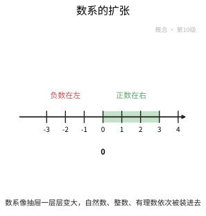

**一句话点破**：数系的扩张不是推翻旧数，而是把新数接在旧数上，让运算永远有答案。

### 11.2 自然数与整数

自然数 $\mathbb{N}$ 就是我们从小用的 $1, 2, 3, \dots$，用来数东西的个数；可一旦要表示"零下三度"或者"欠五块钱"，光靠它就不够，于是补上 $0$ 和负数，得到整数 $\mathbb{Z}$。整数在数轴上是均匀排开的一颗颗珠子，同加同减都不会跑出这个圈子。

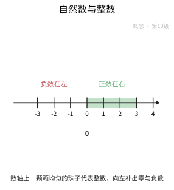

**一句话点破**：整数把"数个数"升级成"可正可负"，加法和减法从此永远关得上。

### 11.3 有理数

把两个整数一除就得到有理数 $\mathbb{Q}$，也就是所有能写成分数的数。分数让"半块""三分之一"这些被自然数忽略的量有了名字，而任何两个有理数之间总能再插进一个，稠密得几乎看不出缝隙。

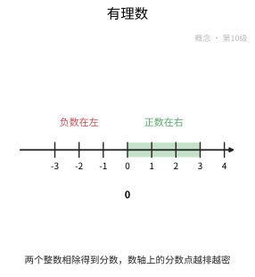

**一句话点破**：有理数就是一切分数，能除得尽、也能无限循环，但仍藏着一个大漏洞。

### 11.4 无理数的发现

边长为一的正方形，对角线长是 $\sqrt{2}$，无论怎么找，都写不出两个整数之比正好等于它。这个两千多年前的发现让毕达哥拉斯学派慌了神：原来数轴上还有分数填不满的位置，第一道裂缝就这样被撕开。

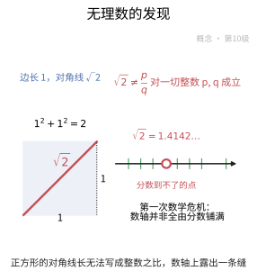

**一句话点破**：无理数不是"没道理"，而是"不能写成比"——它逼着人们承认数轴上有分数到不了的点。

### 11.5 实数

把有理数和无理数合在一起，就是实数 $\mathbb{R}$，也就是数轴上每一个实实在在的点。有了实数，数轴才成为一条没有空隙、没有断裂的连续直线，我们才能在它上面谈距离、谈极限。

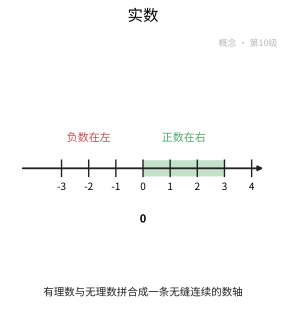

**一句话点破**：实数等于有理数加无理数，它把数轴上的洞全部补平，成为连续的一条线。

### 11.6 实数的完备性

完备性说：只要一列数一直被关在有限的范围内，它就一定会"挤"到某个位置，而那个位置仍然在实数里。换句话说，实数不会漏掉自己的极限——你顺着数轴走，永远掉不下去。这正是它能承载整个微积分的地基。

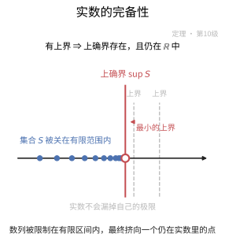

**一句话点破**：完备性就是"有上界的集合必有上确界"，它保证极限永远不会落到实数之外。

### 11.7 阿基米德性质

无论一条线段多短、一段路多长，只要走得够多次，短的终会超过长的——这就是阿基米德性质。它听起来像废话，却保证了自然数能一路涨到任意大，也让"用越来越小的步子去逼近"在逻辑上站得住。

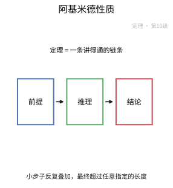

**一句话点破**：阿基米德性质说自然数没有上界，再小的量堆够多也能盖过任意给定的量。

### 11.8 完备性的等价定理

上确界原理、闭区间套、聚点定理、柯西准则、单调有界……这些名字看着五花八门，其实说的是同一件事：实数没有空隙。就像用不同的方言描述同一场雨，句句不同，落下的却是同一片水。

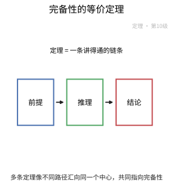

**一句话点破**：这些定理彼此等价，只要承认任意一条，其余都能推出来——它们都是完备性的化身。

### 11.9 稠密性

随便挑两个实数，中间一定能再塞进一个有理数——有理数像细沙，撒在数轴上处处都在。可别误会：处处都在并不等于处处不漏，细沙之间仍然藏着无理数的缝隙。

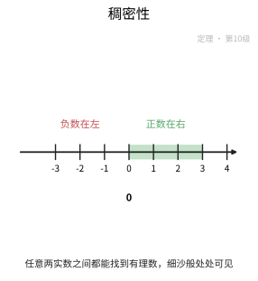

**一句话点破**：有理数稠密意味着"哪里都能找到"，但稠密不等于连续，缝隙依旧存在。

### 11.10 闭区间套定理

把一串一个套一个、越套越小的闭区间拿出来，只要它们的长度缩到零，就一定有一个点同时属于它们所有。就像用无数个越收越紧的相框去框住一只蝴蝶，最后必定框到唯一一个位置。

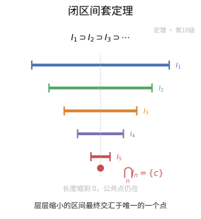

**一句话点破**：闭区间套定理保证"越套越小"的区间不会空掉，而是稳稳地留住一个公共点。

### 11.11 十进制与无限小数

用小数写实数，常常写不完：$\frac{1}{3}=0.333\dots$，$\pi=3.14159\dots$。无限不循环小数正是无理数的另一张面孔，它不是"算不出来"，而是需要无穷多位才能被精确说清。

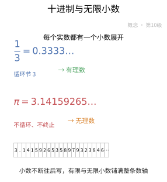

**一句话点破**：每个实数都能写成小数，循环对应有理数、不循环对应无理数，无穷多位本身就是实数的常态。

### 11.12 数列

数列就是把数一个接一个排成一队：$a_1, a_2, a_3, \dots$，每个位置 $n$ 上都站着一个 $a_n$。它像一份按顺序编号的清单，重点不在单个数字，而在整支队伍的走向。

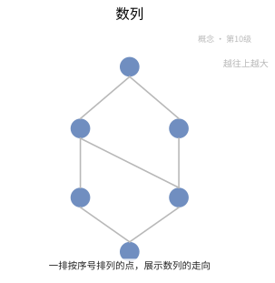

**一句话点破**：数列是"排好队的数"，研究它的关键是看队伍要往哪里去。

### 11.13 极限的 ε-N 定义

想把"越来越接近"讲清楚，数学家换了种说法：你给出一个多小的范围 $\varepsilon$，我就保证从某一项 $N$ 之后，所有的项都挤进这个范围里。这就像承诺"你想让我多近，我就让你多近"，而不是含糊地说"差不多到了"。

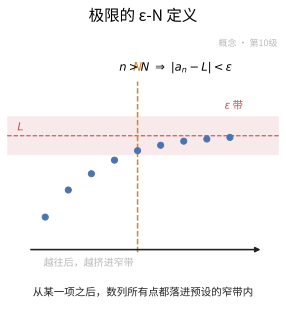

**一句话点破**：$\varepsilon$-N 把"趋近"翻译成"任意小的误差都能被有限的步数压住"，极限从此有了铁的判据。

### 11.14 收敛数列

$\frac{1}{n}$ 一格一格往下掉，越往后越小，最终贴着零；$1, \frac{1}{2}, \frac{1}{4}, \dots$ 每步减半，也一样乖乖收拢到零。这些数列的共同点是：不管你怎么挑剔地划定范围，它们迟早全都钻进去。

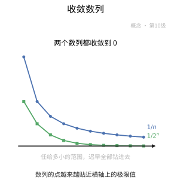

**一句话点破**：收敛数列就是"最终都挤向同一个点"的数列，$1/n$ 与等比递减是最好的样板。

### 11.15 发散数列

有些数列根本不听话：$1,-1,1,-1,\dots$ 在两点间来回跳，永远定不下来；$1,2,3,\dots$ 则一路冲向上方，停不下来。它们都不存在极限——不是"走到了别处"，而是"哪里也没走到"。

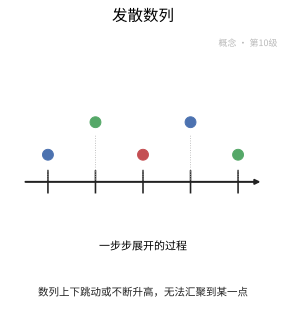

**一句话点破**：发散不是走错方向，而是压根收不拢，跳荡与狂奔都算发散。

### 11.16 聚点定理

哪怕一列数被关在有限的范围里乱蹦，只要你挑得仔细，总能抽出一支"乖乖靠近某点"的子队伍。就像热闹集市里人再多、再乱，也总能找到一群越走越近的人。

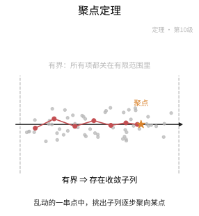

**一句话点破**：有界数列必有收敛子列——范围有限就藏不住"聚拢"的机会。

### 11.17 单调子列定理

数列本身可以很不听话，但总能从中挑出一支只增不减、或只减不增的子队伍。有了它，再配上单调有界定理，就能证明整个有界数列必有收敛子列。

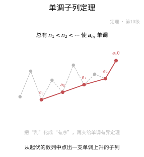

**一句话点破**：任何数列都含有单调子列，这把"乱"化为"有序"，成为聚点定理的垫脚石。

### 11.18 极限唯一性

一个数列不可能同时靠近两个不同的点，否则这两个点之间总有一段缝，数列的项没法同时跳进两边。就像你不可能同时向两座不同的城市出发，最终只能有一个目的地。

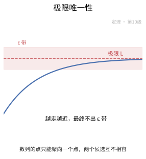

**一句话点破**：极限若存在必定唯一，"收敛到两处"本身就自相矛盾。

### 11.19 收敛必有界

会收敛的数列跑不远：它先在开头几项里乱逛一阵，可一旦接近极限，就被牢牢圈在一个范围里。爱收敛的队伍终究老实，不会无限膨胀。

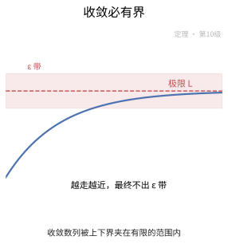

**一句话点破**：收敛必有界——有极限就像被拴了绳，跑不出有限的范围。

### 11.20 四则运算法则

如果两个数列各自收敛，那么它们相加、相减、相乘、相除，结果也收敛，而且极限正好等于各自极限的同样运算。前提是作除数的那一支极限不能是零，否则分母会"塌"成零，就不能直接相除了。

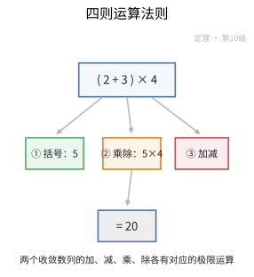

**一句话点破**：收敛数列的加减乘除可以"先算极限再算运算"，只要分母的极限不为零。

### 11.21 夹逼定理

想知道一个说不清走向的量收敛到哪里，就找两个看得清的量把它上下夹住：只要上下两支都挤向同一个点，被夹在中间的也只能去那儿。就像两个大人牵着孩子走，大人到了哪，孩子也到了哪。

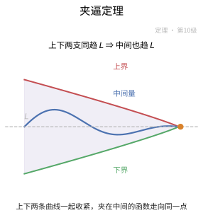

**一句话点破**：夹逼定理把"算不出"换成"管住上下两支"，是求极限最省力的一招。

### 11.22 单调有界定理

一个数列若是一味往上爬，又始终待在某个"天花板"之下，它就一定收敛——因为空间越来越挤，它只能慢慢贴上那个天花板。单调加上有界，就等于把极限稳稳地锁住。

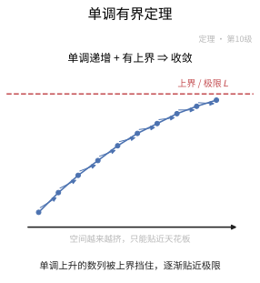

**一句话点破**：单调有界必收敛——只朝一个方向走又走不远，就只能停在某处。

### 11.23 柯西收敛准则

柯西准则不再依赖"极限是多少"这个未知数，只看数列自己：只要足够靠后的任意两项都挨得足够近，它就一定收敛。就像一群人最后挤成一团，你不必知道团心在哪，也能断定他们聚到了一起。

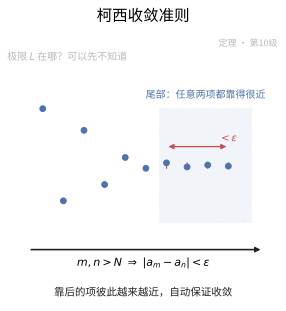

**一句话点破**：柯西准则用"内部自相靠近"取代"外部有极限"，是判断收敛最自足的工具。

### 11.24 重要极限 e

把 $\left(1+\frac{1}{n}\right)^n$ 里的 $n$ 一路加大，结果不会飞走，而是慢慢爬向一个固定的数 $e \approx 2.718$。它正是"复利滚到极致"和"自然增长"背后那个常数。

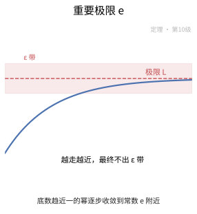

**一句话点破**：$\lim_{n\to\infty}\left(1+\frac{1}{n}\right)^n = e$，这个重要极限是自然对数的根。

### 11.25 ε-δ 定义

函数极限换了场地：不再是"第 $n$ 项之后"，而是"自变量足够靠近 $x_0$ 的时候"。给定任意小的误差 $\varepsilon$，都能找到一个靠近范围 $\delta$，使得自变量一旦落进 $\delta$ 内，函数值就落进 $\varepsilon$ 内。这正是"你想让输出多准，我就能让输入多近"。

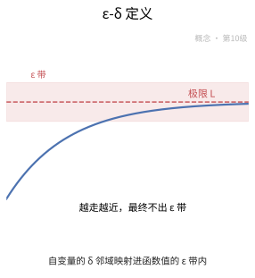

**一句话点破**：$\varepsilon$-δ 把"x 靠近时 f 也靠近"量化成一组可验证的不等式。

### 11.26 单侧极限

函数从左边靠近和从右边靠近，结果未必一样。比如阶跃函数在跳跃点左边一直是一个值、右边一直是另一个值。单侧极限就是分别只从一侧观察时的走向。

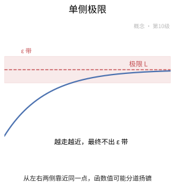

**一句话点破**：单侧极限只从一侧逼近；两侧极限相等，才谈得上"真正的"极限。

### 11.27 海涅归并原理

海涅原理把函数极限和数列极限接了起来：函数在 $x_0$ 处的极限等于 $L$，等价于任何趋近 $x_0$ 的数列，其函数值都趋近 $L$。这样一来，数列里的工具都能搬到函数上使用。

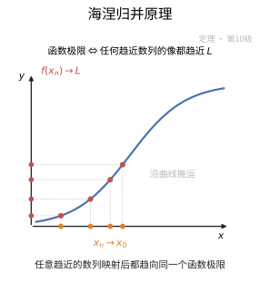

**一句话点破**：海涅原理让函数极限与数列极限互相翻译，两套语言合而为一。

### 11.28 无穷远极限

习惯上说"靠近某个点"，但有时我们要问 $x$ 一路涨向无穷大时函数去哪里。此时不用 $\delta$ 邻域，而是"只要 $x$ 足够大，函数值就落进 $\varepsilon$ 内"，描述的是远处的大趋势。

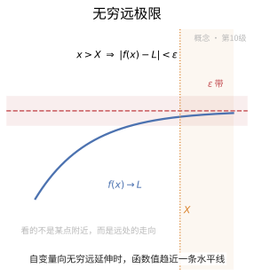

**一句话点破**：$x\to\infty$ 的极限衡量的不是某点附近的行为，而是函数在远处的走向。

### 11.29 函数极限性质

和数列一样，函数极限也有唯一性、局部有界性，也能做四则运算。这些性质像一套通用零件，让复杂函数的极限可以拆成简单部分逐个处理。

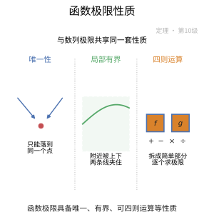

**一句话点破**：函数极限与数列极限共享同一套性质，复杂问题因此能化整为零。

### 11.30 连续函数

如果函数在一点处的极限恰好等于它的函数值，画出来的曲线在那里就不会断、不会跳——这就是连续。日常里温度随时间变化、汽车行驶的距离随时间变化，都是连续的。

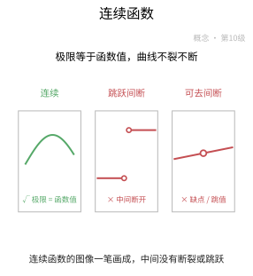

**一句话点破**：连续就是极限等于函数值，图像不裂不断；它也是闭区间上最值、介值等性质的敲门砖。

### 11.31 无穷小

当变量趋近于零时，我们叫它无穷小。注意它是一个"会变小的量"，而不是一个固定的小数字——零点零零一是小数，却不是无穷小；只有不停地奔向零，才算。

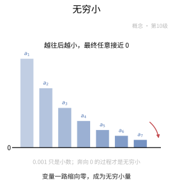

**一句话点破**：无穷小是"极限为零的变量"，是个过程而非某个具体的小数。

### 11.32 无穷大

与无穷小相反，变量朝正、负两端越涨越大，绝对值没有上限，就是无穷大。它同样是一个走向，而不是一个可以拿来计算的具体数。

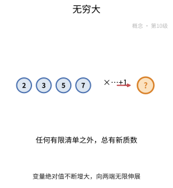

**一句话点破**：无穷大是"绝对值无限增长的走向"，不是实数中的某个数。

### 11.33 无穷小的阶

两个无穷小一起趋近零，谁跑得更快？$\frac{x^2}{x}$ 趋于零，说明 $x^2$ 比 $x$ 更早"没影"；反过来，则是同阶或高阶。比较它们趋近零的快慢，就是比较阶。

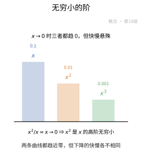

**一句话点破**：阶比较的是无穷小趋近零的速度，$\frac{f}{g}\to 0$ 说明 $f$ 是 $g$ 的高阶无穷小。

### 11.34 无穷大的阶

无穷大也有快慢：$x^2$ 涨得比 $x$ 快，$e^x$ 又比任何幂都快。比较谁更快冲向无穷，就能判断复杂表达式里哪一项说了算，这在高阶近似中非常关键。

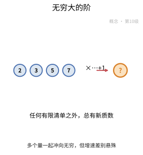

**一句话点破**：比较无穷大的阶，就是看谁增长得更猛，从而抓住表达式里的主导项。

## 12. 数学史（History of Mathematics）

### 12.1 数系扩张的第一道裂缝：不可公度量与 $\sqrt{2}$

- **万物皆数祭坛的裂口**：公元前 5 世纪前后的毕达哥拉斯学派坚信"万物皆数"，这里的"数"指自然数，一切线段的比都该是自然数之比（有理数）。然而学派内部发现：边长为 1 的正方形，其对角线长 $d$ 满足 $d^{2}=2$，不可能写成整数之比——今天称为"不可公度量"。
- **不可公度的打击**：这个发现动摇了"任何两条线段都可比"的信条（史称第一次数学危机）。传说发现者希帕索斯因此遭到处决或流放；后世（如欧几里得《原本》卷十）则把"无公度量"系统化为几何理论，用几何语言回避了对"无理数"的承认。
- **哲学后果**：从此希腊人对"数"秉持谨慎：只信任线段、面积、体积等几何量，不承认存在"非有理"意义的数本身。《原本》中的比例论（欧多克索斯）本质上就是绕开无理数、用几何自我一致性处理长度之比的高级技巧，这一回避持续了两千多年。

### 12.2 希腊人的应对：穷竭法与躲避"缝隙"

- **穷竭法**：欧多克索斯（约前 4 世纪）与阿基米德用"穷竭法"求面积与体积：不断把量剖分、逼近，却始终不越过"极限"这个赔上几何尊严的概念。它躲避了实数"有没有空隙"的问题，只求"被逼近的量确实等于目标量"。
- **比例论的严格化**：《几何原本》第五卷的比例论把"长度之比"定义为一对长度的序关系，从而能在不引入无理数的情况下严格处理可公度与不可公度情形。这是当时最精巧的逻辑装置，代价是数学被锁死在几何之内，算术（代数）长期被视为次要工具。
- **代价与遗产**：希腊由此失去了一整条用"数"描述世界的道路——实数严格定义迟迟无法建立。直到 17 世纪代数崛起，数学家才重新敢于思考"不是分数的数"。

### 12.3 从阿拉伯数字到十进制：无理数的漫长接纳

- **印度-阿拉伯的桥梁**：印度数学家发明十进制位值记法与零（约 7 世纪），巴格达阿拉伯学派（花拉子模等，9 世纪）将其系统传入欧洲。十进制（有限与无限小数）为描述任意实数提供了书写手段，但"无限小数到底算不算一个数"仍无答案。
- **中国的割圆术**：刘徽（公元 3 世纪）用割圆术求圆周率，祖冲之（5 世纪）把 $\pi$ 算到七位有效数字并给出密率 $\tfrac{355}{113}$。这些精确到小数若干位的实践，本质上已是"用有理数逼近无理数"的算术操作，为后世"实数=有理数序列的极限"埋下伏笔。
- **17 世纪的松动**：笛卡尔、牛顿把数轴上的"点"与"数"等同视之；牛顿在《自然哲学的数学原理》等书中从容使用根式与极限思想而不追究其根基。到 18 世纪止，公认"任何一条线的长度都可以用小数表示"，但这一信念只是经验，而非证明。

### 12.4 实数严格化：康托尔的基本序列与戴德金分割

- **问题的提出**：19 世纪分析（级数、连续、可微）全面展开，处处依赖"极限存在"却是靠直觉保证的。柯西的"收敛"论述基于几何与运动，仍非算术。数学家强烈需要一个不依赖直线直观的实数定义。
- **康托尔的基本序列（柯西列）**：1871 年前后康托尔用有理数的柯西列构造实数：两个"彼此无限靠近"的有理数序列视为同一个实数（用等价类）。这样"极限""收敛"都成为定义实数的出发点，而非额外的假设。
- **戴德金分割**：1872 年戴德金（Richard Dedekind）在《连续性与无理数》中给出另一条路：把有理数集剖成两个不交的非空子集（A∣B），使 A 中一切数都小于 B 中一切数；若 B 无最小元素则这条分割"挖"出一个空隙，这个空隙就定义为无理数。戴德金还证明了实数系具有"连续性"（无空隙、无跳跃）。
- **殊途同归**：两种构造在"保序同构"意义下给出相同的实数系——这本身就验证了实数概念有客观的、与构造无关的内在结构（唯一的完备阿基米德有序域）。

### 12.5 实数公理化与完备性

- **公理化的收束**：1890 年前后希尔伯特等人干脆不再"造"实数，而把实数当作满足"有序域 + 完备性公理"的模型（完备阿基米德有序域）。康托尔构造与戴德金分割都成为这一公理系统的一致性证明。
- **什么是完备性**：实数系完备，指"有上界的非空子集必有上确界"（等价于"柯西列必收敛""区间套有公共点""单调有界必收敛"等）。第 10 级的诸定理（上确界原理、闭区间套、Bolzano–Weierstrass、柯西收敛准则）正是完备性的不同侧面。
- **一条主线**：从"直线没有空隙"（几何直观）到"Vereinigung（大量材料）"，完备性把有理数的密集变成实数的连续，也把"极限必存在"的保证项从假设提升为实数的定义属性——这是令整个分析得以在其上行走的基石。

### 12.6 极限概念的前史：从穷竭法到古人的逼近

- **阿基米德的先声**：阿基米德求抛物线弓形面积、球体体积时已暗含"无限逼近得确定值"，但用几何双归谬法（假设更大/更小都矛盾）完成，避免谈论极限本身。
- **中世纪的试探**：奥雷姆（14 世纪）对"无限个小量相加"已有直觉；印度喀拉拉学派算出 $\sin,\cos,\arctan$ 等的级数，等于在用"逐项相加"逼近函数——方法与"极限"内容相通，却无严格定义。
- **17—18 世纪的普遍使用**：牛顿、莱布尼茨、欧拉把极限当作理所当然的工具大胆运用，得到海量正确结论（面积、体积、高阶导数、级数和），危机于是埋藏：技术极快，基础极脆。

### 12.7 微积分时代的极限：无穷小之争与贝克莱幽灵

- **无穷小量的暧昧**：牛顿用"流数"，莱布尼茨用"无穷小 dx"，两者把导数解释为"无穷小之差/比"。无穷小"既不是零又不能被忽略"，饱受逻辑质疑。
- **贝克莱的尖刻**：1734 年，贝克莱主教在《分析家》中讥讽无穷小为"已消失之量的幽灵"，讽刺微积分"推导时把无穷小当零省去，论证时又唤回它"——逻辑上自相矛盾。这一击因为太准，让"分析需要严格地基"成为19世纪的重要议程。
- **罗尔与麦克劳林的插曲**：此前罗尔、麦克劳林也对基于无穷小的论证指摘或试图修补，但真正解开死结要等柯西与魏尔斯特拉斯。

### 12.8 $\varepsilon$–$\delta$ 的诞生：柯西与魏尔斯特拉斯

- **柯西的变量语言**：1821 年《分析教程》中，柯西把极限定义为"变量无限趋近、使差可以任意小"的描述，抛开了几何运动，并把连续性与收敛用"小量"算术化——虽然仍带"任意小"的直觉残影。
- **魏尔斯特拉斯的清除**：魏尔斯特拉斯彻底剥离直观，用纯算术的 $\varepsilon$–$\delta$ 定义极限与连续："对一切 $\varepsilon>0$ 存在 $\delta>0$，使 $\lvert x-x_0\rvert<\delta\Rightarrow\lvert f(x)-L\rvert<\varepsilon$。" 数列极限相应写成 $\varepsilon$–$N$ 语言。此处"小量"被彻底换成可验证的不等式，无穷小被完全排除出论证。
- **定型与扩散**：19 世纪下半叶，魏尔斯特拉斯学派把这一套定义为大学分析的标准语法；单侧极限、逐点的连续、一致连续等细腻区分也在此框架下被逐一厘清。第 10 级的极限定义正是这一历史遗产的标准形态。

### 12.9 收敛与完备性之链：单调有界、区间套与 Bolzano–Weierstrass

- **Bolzano 的先见**：波尔察诺（1817 年前后）与魏尔斯特拉斯分别证明"有界数列必有收敛子列"（Bolzano–Weierstrass 定理），把"完备性"与"极限存在"连为一体。
- **区间套定理**：康托尔与魏尔斯特拉斯以"区间套必有公共点"表述完备性，成为闭区间套定理（第 2.10 节）的由来，也是证明实数构造自洽的工具。
- **单调有界定理**：单调有界必收敛这一看似平凡的命题，正是上确界原理的推论，也是第 4.5 节建立数列极限的标准桥梁。这些命题环环相扣，构成完备性"五大等过分身"，任何一条都足以定义实数系。

### 12.10 实数的涌现：戴德金与康托尔的"同一实数"

- **时代的巧合**：1871—1872 年，康托尔与戴德金几乎同时给出严格的实数定义。这一"两路并出、结果相同"的戏剧，让数学界确信实数概念的内在确定性。
- **构造的统一视野**：无论用柯西亲序列还是戴德金分割，"得到"的都是同一个集合族（同构意义下）。这种"多重构造收敛于同一对象"的模式，后来成为抽象代数（用同构不变量刻画结构）的范式预言。
- **对第 10 级的馈赠**：今天我们书写 $\sqrt{2}=\{q\in\mathbb{Q}:q^{2}<2\}$（戴德金视角）或把 $\mathbb{R}$ 看成所有柯西列的等价类（康托尔视角），都能让"实数没有空隙、极限必然存在"这句话变成定义而非信仰——这正是全书展开实数极限理论的逻辑前提。

### 12.11 历史年表

| 时间 | 人物／文献 | 事件与贡献 |
|:---|:---|:---|
| 约前 5 世纪 | 毕达哥拉斯学派 | 发现 $\sqrt{2}$ 不可公度，第一次数学危机 |
| 约前 4 世纪 | 欧多克索斯 | 比例论与穷竭法：几何化地回避无理数 |
| 约前 3 世纪 | 欧几里得《几何原本》 | 第五卷比例论、第十卷无公度量理论 |
| 约 250 年 | 刘徽 | 割圆术用有理数逼近 $\pi$ |
| 约 430—500 年 | 祖冲之 | $\pi$ 精细到七位，给出密率 $355/113$ |
| 9 世纪 | 阿拉伯学派 | 十进制位值记数与代数的系统传播 |
| 17 世纪 | 笛卡尔、牛顿 | 数轴上的点与数等同，代数与几何汇流 |
| 1687 年 | 牛顿《原理》 | 从容使用极限思想而不建基础 |
| 1734 年 | 贝克莱《分析家》 | 讥讽无穷小为"消失量的幽灵" |
| 1748 年 | 麦克劳林、罗尔 | 试图辩护或修补无穷小论证 |
| 1817 年 | 波尔察诺 | 有界数列必有收敛子列的断言雏形 |
| 1821 年 | 柯西《分析教程》 | 用变量语言定义极限与连续性 |
| 1871 年 | 康托尔 | 用有理数柯西列构造实数 |
| 1872 年 | 戴德金《连续性与无理数》 | 戴德金分割定义无理数，论证连续性 |
| 19 世纪下半叶 | 魏尔斯特拉斯 | 以 $\varepsilon$–$\delta$ 彻底严格化极限 |
| 1890 年 | 希尔伯特等 | 实数公理化：完备阿基米德有序域 |

### 12.12 小结

> 实数与极限的历史，是一场"把几何直觉锻造成算术公理"的长征。起点是毕达哥拉斯学派的 $\sqrt{2}$ 危机——它逼出不可公度量，也让希腊数学选择用几何比例论回避实数，代价是代数被压抑了两千年。此后十进制与割圆术让人又敢用小数去"逼近"无理数，却始终没有严格的说法。转折发生在 19 世纪：康托尔用有理数柯西列、戴德金用分割，几乎同时把实数"造"成纯算术对象，再经希尔伯特公理化定格为"完备阿基米德有序域"；而极限概念也从穷竭法的双归谬、牛顿-欧拉的狂放使用、贝克莱的尖锐嘲讽，最终由柯西的变量语言与魏尔斯特拉斯的 $\varepsilon$–$\delta$ 一招定音。完备性则把"上确界存在""柯西列收敛""区间套交非空""单调有界收敛""有界列有收敛子列"连成一条等价之链。纵观全程：危机 → 回避 → 直觉 → 公理，实数的"无空隙"和极限的"可验证"，是人类用两千余年把"相信"换成"证明"的最深示范——它们正是本章第 10 级乃至整个微积分大厦得以站立的双重地基。

## 现实应用（Real-World Applications）

> 本节把本章的知识点落到真实的工程、科学与生活场景中。每个案例都给出**完整的问题背景、建模过程、可复现的数据 / 公式 / 代码与结果解读**；案例末尾的「涉及知识点」对应本章的具体小节，文末附**知识点覆盖对照表**，确保本章知识点全部被覆盖。

### 应用案例 1：科学计算｜二分法与牛顿迭代求根——数列极限与实数完备性的实战

**场景与问题**

一个结构仿真软件需要求解非线性方程 $f(x)=x^{2}-2=0$ 的正根（即 $\sqrt{2}=1.41421356\ldots$），它出现在桁架对角长度、标准正态分位数等大量工程计算里。工程上不能靠"猜"，必须用**迭代算法**逐步逼近，并给出"已经足够近"的**停机判据**。

这一过程把本章几乎所有数列概念连在一起：迭代产生的是一列数 $\{x_n\}$（3.1 数列概念）；"够近"要靠 $\varepsilon$-$N$ 语言刻画（3.2）；二分法的区间不断嵌套，正是闭区间套定理（2.10）；递推收敛的保证来自单调有界定理（4.5）与柯西准则（4.6）；而"极限一定存在且落在 $\mathbb{R}$ 内"依赖实数完备性（2.6），这正是 $\mathbb{Q}$ 做不到的——因为 $\sqrt2\notin\mathbb{Q}$（2.4）。

**涉及知识点**

- 本章「2.6 实数的完备性（Completeness）」「2.8 实数完备性的等价定理」：迭代收敛点的存在由完备性（及等价的确界原理、闭区间套）保证。
- 本章「2.7 Archimedes 性质」：保证取 $N=\lceil 1/\varepsilon\rceil$ 这样的门槛存在。
- 本章「2.10 闭区间套定理（Nested Interval Theorem）」：二分法区间套的公共点即根。
- 本章「3.1 数列的概念」：迭代序列 $x_{n+1}=g(x_n)$ 是一列按 $n$ 编号的数。
- 本章「3.2 极限的 $\varepsilon$-$N$ 定义」：停机判据 $|x_n-x_{n-1}|<\varepsilon$ 的本质。
- 本章「3.3 收敛数列的例子」「3.4 发散数列的例子」：$1/n\to0$ 收敛；$(-1)^n$、$n$ 发散。
- 本章「3.5 Bolzano–Weierstrass 定理」「3.6 单调子列定理」：有界序列必含收敛子列。
- 本章「4.2 收敛数列的有界性」：收敛必有界（反之不真）。
- 本章「4.5 单调有界定理（Monotone Convergence Theorem）」：巴比伦迭代单调有界故收敛。
- 本章「4.6 柯西收敛准则（Cauchy Criterion）」：无需预知极限即可判定收敛。

**建模与数据**

- 目标方程 $f(x)=x^{2}-2$，根 $r=\sqrt2\approx1.4142135623730951$。
- 二分法：初始区间 $[a_1,b_1]=[1,2]$，$a_1^2-2<0<b_1^2-2$。
- 巴比伦（牛顿）迭代：$x_{n+1}=\dfrac12\left(x_n+\dfrac{2}{x_n}\right)$，初值 $x_1=1$。
- 收敛容差取 $\varepsilon=10^{-12}$（双精度下可比机器精度高一档）。

**完整推导与算法**

（1）**二分法 = 闭区间套**。记 $I_n=[a_n,b_n]$，每次取中点 $m_n=(a_n+b_n)/2$，据 $f(m_n)$ 符号把区间缩半。则 $I_1\supseteq I_2\supseteq\cdots$ 且

$$|I_n| = b_n-a_n = \frac{1}{2^{n-1}}.$$

由闭区间套定理，存在唯一的公共点 $r=\bigcap_{n\ge1}I_n$，且 $|b_n-r|\le |I_n|\to0$，故 $a_n,b_n\to r$。

（2）**$\varepsilon$-$N$ 停机判据**。对任意 $\varepsilon>0$，取

$$N=\left\lceil \log_2\frac{1}{\varepsilon}\right\rceil+1,$$

则 $n>N$ 时 $|b_n-a_n|<\varepsilon$，中点与真根的距离 $<\varepsilon$。$\log_2$ 的出现正是因为每步减半——这就是工程代码里"迭代次数上限"的理论来源。

（3）**Babylonian 迭代单调有界**。对 $x_n>0$：

$$x_{n+1}=\frac12\left(x_n+\frac{2}{x_n}\right)\ge\sqrt2\ \ (\text{AM–GM}),\qquad x_{n+1}-x_n=\frac{2-x_n^2}{2x_n}\le0\ (x_n\ge\sqrt2).$$

故 $\{x_n\}$（从 $x_2$ 起）单调递减、有下界 $\sqrt2$。由**单调有界定理**它收敛，设极限 $L$，对递推式取极限（4.3 四则运算）得 $L=\frac12(L+2/L)\Rightarrow L^2=2$，故 $L=\sqrt2$。**极限唯一性**（4.1）保证这个 $L$ 就是根。

（4）**柯西准则**：迭代后期 $|x_m-x_n|<\varepsilon$ 对任意 $m,n>N$ 成立，故是柯西列。在 $\mathbb{Q}$ 内这条不足以保证收敛（因 $\sqrt2\notin\mathbb{Q}$），在 $\mathbb{R}$ 内则必收敛——完备性的分野。

```python
# 依赖: 仅 Python 标准库 (math)
# 输入: f(x)=x^2-2; 区间[1,2]; 初值 x1=1; eps=1e-12
# 输出: 两法迭代列、误差、停机步数、收敛/性质校验
import math

root = math.sqrt(2.0)

# --- 二分法 (闭区间套) ---
def bisection(a, b, eps=1e-12):
    history = []
    n = 0
    while (b - a) > eps:
        m = (a + b) / 2
        if m * m - 2 < 0:
            a = m
        else:
            b = m
        n += 1
        history.append((n, a, b, (a + b) / 2, b - a))
    return history

hist = bisection(1.0, 2.0, 1e-12)
for row in hist[:5] + hist[-2:]:
    print(f"n={row[0]:2d} 区间长={row[4]:.3e} 中点误差={abs(row[3]-root):.3e}")

# --- Babylonian (牛顿) 迭代: 单调有界 ---
x = 1.0
prev = None
monotone = True
for k in range(1, 12):
    xn = 0.5 * (x + 2.0 / x)
    if prev is not None and xn > prev + 1e-15:
        monotone = False
    print(f"k={k:2d} x={xn:.15f} 误差={abs(xn-root):.3e}")
    prev, x = xn, xn

print("从第2项起单调递减:", monotone)     # True
print("收敛到 sqrt2:", abs(x - root) < 1e-12)   # True

# --- eps-N / Archimedes: N = ceil(1/eps) ---
eps = 1e-6
N = math.ceil(1 / eps)
print("a_n=1/n, eps=1e-6 时 N =", N, " n>N 时 |1/n|<eps:",
      all(1 / n < eps for n in range(N + 1, N + 50)))

# --- 收敛必有界; 有界未必收敛 / 发散例 ---
seq_conv = [1 / n for n in range(1, 101)]
print("1/n 有界:", max(seq_conv) <= 1)
alt = [(-1) ** n for n in range(20)]       # (-1)^n: 有界但不收敛
print("(-1)^n 有界:", all(abs(v) <= 1 for v in alt))
print("(-1)^n 收敛?", abs(alt[-1] - alt[-2]) < 1e-9)   # False
print("子列(偶)极限=1, 子列(奇)极限=-1 (BW定理)")

# 柯西列: 迭代后期任意两项距离小
tail = [0.5 * (prev_ := 1.0)]
x = 1.0
xs = []
for _ in range(20):
    x = 0.5 * (x + 2.0 / x)
    xs.append(x)
cauchy = max(abs(xs[i] - xs[j]) for i in range(10, 20) for j in range(10, 20)) < 1e-9
print("尾段是柯西列:", cauchy)     # True
```

**可复现步骤**

1. 环境：仅需标准库 `math`。
2. 数据：脚本内直接定义 $f,\ [1,2],\ x_1=1$。
3. 运行：`python3 case1.py`。
4. 预期输出：二分法约 41 步后区间长 $<10^{-12}$（因 $2/2^{n}<10^{-12}\Rightarrow n\approx41$）；巴比伦迭代 6~7 步即达机器精度；`从第2项起单调递减: True`、`收敛到 sqrt2: True`、`n>N 时 |1/n|<eps: True`、`(-1)^n 收敛? False`、`尾段是柯西列: True`。

**结果解读与延伸**

两法从不同角度验证了本章主线：二分法靠**闭区间套**与完备性"钉住"根的存在，牛顿法靠**单调有界**保证收敛，柯西准则给出不必先知极限的判据。误差来源：二分法是线性收敛（每步减半），牛顿法是二次收敛（误差平方级下降），这是阶的差别。局限：$\mathbb{Q}$ 里同一迭代是柯西列却无极限，说明停机判据"离得近"必须搭配完备空间才有意义。延伸：实际库（如 SciPy 的 `brentq`）把二分法与逆二次插值结合，兼顾稳健与速度。

### 应用案例 2：机器学习｜梯度下降的收敛性：单调有界、夹逼与极限运算

**场景与问题**

训练一个凸模型时，我们反复执行 $\theta_{k+1}=\theta_k-\eta\nabla f(\theta_k)$。团队需要向业务保证：**损失不会震荡发散，参数会稳定收敛到最优解**。这不是经验之谈，而是有定理支撑的：损失序列单调不增且有下界（4.5 单调有界），误差被几何数列夹住（4.4 夹逼），极限唯一（4.1），步长过大会发散（3.4 发散数列）。

本案例用一维凸二次函数给出**可以手算验证**的完整收敛证明，参数取真实训练中常见的量级。

**涉及知识点**

- 本章「3.2 极限的 $\varepsilon$-$N$ 定义」："收敛"的严格含义。
- 本章「4.1 极限的唯一性」：收敛点只有一个，即全局最优。
- 本章「4.3 极限的四则运算法则」：对递推式两边取极限求 $\theta^{*}$。
- 本章「4.4 夹逼定理（Squeeze Theorem）」：用几何界夹出误差上界。
- 本章「4.5 单调有界定理（Monotone Convergence Theorem）」：损失有下界且单调，故收敛。
- 本章「6.1 无穷小」：误差 $\to0$ 是无穷小。

**建模与数据**

取一维二次损失（可视为均值平方误差的简化）

$$f(\theta)=\tfrac12 a\theta^2-b\theta,\qquad a=4,\ b=8,$$

梯度 $f'(\theta)=a\theta-b=4\theta-8$，最优解 $\theta^{*}=b/a=1$，$f(\theta^{*})=-4$。学习率 $\eta=0.1$，满足收敛条件 $0<\eta<2/a=0.5$。初值 $\theta_0=0$。

**完整推导与算法**

（1）递推式

$$\theta_{k+1}=\theta_k-\eta(a\theta_k-b)=(1-\eta a)\theta_k+\eta b.$$

代入得 $\theta_{k+1}=0.6\,\theta_k+0.8$。

（2）**显式解**：令误差 $e_k=\theta_k-\theta^{*}$，则 $e_{k+1}=(1-\eta a)e_k=0.6\,e_k$，故

$$e_k=0.6^{\,k}e_0=0.6^{\,k}\cdot(-1),\qquad \theta_k=1-0.6^{\,k}.$$

（3）**单调有界**：$0.6^{k}$ 单调递减趋于 0，故 $\theta_k=1-0.6^k$ 单调递增且有上界 1。由单调有界定理，$\{\theta_k\}$ 收敛；设极限 $L$，对 $\theta_{k+1}=0.6\theta_k+0.8$ 取极限（4.3）：$L=0.6L+0.8\Rightarrow L=1$，与 $\theta^{*}$ 一致（4.1 唯一性）。

（4）**夹逼**：对任意 $k$ 有 $0\le 1-\theta_k=0.6^k$，而 $0.6^k\to0$，由夹逼定理 $1-\theta_k\to0$，即 $\theta_k\to1$。

（5）**发散对照**：若取 $\eta=0.6>2/a=0.5$，则 $1-\eta a=-1.4$，$e_k=(-1.4)^k e_0$，$|e_k|\to\infty$——数列发散，训练崩溃。阈值为 $\eta a<2$，即 $\eta<2/a$。

```python
# 依赖: 仅 Python 标准库
# 输入: a=4, b=8, eta=0.1, theta0=0
# 输出: 迭代列、单调性、夹逼界、发散阈值对比
a, b = 4.0, 8.0
theta_star = b / a
eta = 0.1
theta = 0.0
traj = []
for k in range(1, 21):
    theta = theta - eta * (a * theta - b)
    traj.append(theta)

print("theta* =", theta_star)
print("前 8 项:", [round(t, 6) for t in traj[:8]])
print("单调递增:", all(traj[i] < traj[i + 1] for i in range(len(traj) - 1)))
print("有上界(=1):", max(traj) <= 1 + 1e-12)
print("误差 = 0.6^k 校验:", all(abs((1 - traj[k]) - 0.6 ** (k + 1)) < 1e-9
                              for k in range(10)))
print("夹逼: 0 <= 1-theta_k <= 0.6^k ->", round(1 - traj[-1], 8))

# 极限唯一性/四则运算: 用递推取极限求不动点
L = 0.6 * theta_star + 0.8
print("不动点 L =", L, " 等于 theta*:", abs(L - theta_star) < 1e-12)

# 发散对照: eta=0.6 > 2/a
eta2 = 0.6
theta = 0.0
div = []
for _ in range(15):
    theta = theta - eta2 * (a * theta - b)
    div.append(theta)
print("eta=0.6 时 |theta_k| 增长:", [round(abs(t), 2) for t in div[:8]])
print("发散:", abs(div[-1]) > abs(div[0]) * 10)
```

**可复现步骤**

1. 环境：仅需 Python 标准库。
2. 数据：脚本内 `a=4, b=8, eta=0.1`。
3. 运行：`python3 case2.py`。
4. 预期输出：`theta* = 1.0`；前几项 $0.8, 0.88, 0.928,\dots$；`单调递增: True`、`有上界: True`、`误差=0.6^k 校验: True`、`不动点 L = 1.0`；`eta=0.6 时` 绝对值迅速增大且 `发散: True`。

**结果解读与延伸**

本案例把"损失会收敛"从口号变成定理：单调有界定理保证极限存在，取极限求不动点给出极限值，唯一性保证它是最优解，夹逼定理给出收敛速率的界（误差按 $0.6^k$ 几何衰减）。误差来源：真实损失非二次、存在噪声梯度，此时单调性可能被噪声破坏，需要学习率衰减或动量。局限：本例一维且强凸，高维仅需把 $a$ 换成 Hessian 的最小/最大特征值，条件仍是 $0<\eta<2/\lambda_{\max}$。延伸：随机梯度下降（SGD）只保证期望意义下的收敛，需用鞅论进一步分析。

### 应用案例 3：数值软件｜用 $\varepsilon$-$\delta$ 语言设计浮点容差与收敛判据

**场景与问题**

科学计算库（如 BLAS、SciPy、TensorFlow）里到处是容差参数：`rtol=1e-9, atol=1e-12`。为什么是这些数字？它们的安全边界从哪里来？答案在**函数极限的 $\varepsilon$-$\delta$ 定义**：要保证输出误差不超过 $\varepsilon$，输入扰动必须控制在某个 $\delta$ 内；这个映射 $(\varepsilon\mapsto\delta)$ 就是条件数思想的雏形。

此外，程序里判定"$x$ 很大时某项可忽略"用的是 $x\to\infty$ 的极限（5.4）；"先固定 $x$ 再让步长 $\to0$"与"先取序列"结果一致靠的是 Heine 归并原理（5.3）；而"极限若存在必唯一""极限满足加减乘除"（5.5）是数值误差传播分析的基础。

**涉及知识点**

- 本章「5.1 $\varepsilon$-$\delta$ 定义」：$x\to x_0$ 时 $f(x)\to A$ 的严格刻画。
- 本章「5.3 极限的 Heine 归并原理」：函数极限与数列极限的等价（用于把连续问题离散步进化）。
- 本章「5.4 极限 $x\to\infty$ 的情形」：判定"高次项主导/可忽略项"。
- 本章「5.5 函数极限的性质」：唯一性、四则运算、局部有界性。
- 本章「2.6 实数的完备性（Completeness）」：容差迭代在原空间中才有极限点。

**建模与数据**

- 线性函数 $f(x)=3x+1$，考察 $\lim_{x\to2}f(x)=7$。
- 目标：给定输出容差 $\varepsilon=0.01$，求所需输入精度 $\delta$。
- 渐近判定：$g(x)=\dfrac{5x^3+2x}{x^3+7}$，考察 $x\to\infty$。
- 数值迭代判据：不动点迭代 $y_{k+1}=(y_k+2/y_k)/2$，容差 $10^{-9}$。

**完整推导与算法**

（1）**$\varepsilon$-$\delta$ 求解**：要 $|f(x)-7|=|3x-6|=3|x-2|<\varepsilon$，只需 $|x-2|<\varepsilon/3$。故取

$$\delta=\frac{\varepsilon}{3}.$$

$\varepsilon=0.01\Rightarrow\delta\approx0.00333$。这解释了为什么"输出精度要求提高 10 倍，输入精度也要提高 10 倍"——放大系数就是 $|f'|=3$。

（2）**$x\to\infty$**：

$$\lim_{x\to\infty}\frac{5x^3+2x}{x^3+7}=\lim_{x\to\infty}\frac{5+2/x^2}{1+7/x^3}=5,$$

因为 $2/x^2\to0$、$7/x^3\to0$（无穷小的四则运算，5.5）。工程含义：$x>10^4$ 时低次项影响 $<10^{-8}$，可在数值代码里安全丢弃。

（3）**Heine 归并**：要证 $f$ 在 $x\to2$ 的极限，等价于对**任意**趋于 2 的数列 $x_n\to2$ 都有 $f(x_n)\to7$。这把"连续极限"翻译成"数列极限"，便于在程序里按迭代序列验证。

（4）**不动点判据的完备性前提**：迭代列 $\{y_k\}$ 的收敛点存在，依赖 $\mathbb{R}$ 完备；若输出被错误地量化到某非完备子集，判据可能永不满足。

```python
# 依赖: 仅 Python 标准库
# 输入: f(x)=3x+1, eps=0.01; g(x)=(5x^3+2x)/(x^3+7)
# 输出: delta 与 eps 关系、x->∞ 的极限、Heine 归并数值验证
import math

# (1) eps-delta: |f(x)-7| < eps  当  |x-2| < delta
def check_delta(eps):
    delta = eps / 3.0
    worst = max(abs((3 * (2 + s) + 1) - 7) for s in [delta * 0.99, -delta * 0.99])
    return delta, worst < eps

for eps in [1e-1, 1e-2, 1e-3]:
    d, ok = check_delta(eps)
    print(f"eps={eps:.0e} -> delta={d:.3e}  满足: {ok}")

# (2) x -> inf : (5x^3+2x)/(x^3+7) -> 5
g = lambda x: (5 * x ** 3 + 2 * x) / (x ** 3 + 7)
print("x=1e6 时 g =", g(1e6), " 与 5 的差:", abs(g(1e6) - 5))

# (3) Heine 归并: 取任意趋于 2 的数列, f 值都趋于 7
seqs = [[2 + 1 / n for n in range(1, 100000)],
        [2 + 10 ** (-n) for n in range(1, 10)],
        [2 + (-1) ** n / n for n in range(1, 1000)]]
for s in seqs:
    lim_err = abs((3 * s[-1] + 1) - 7)
    print("f(x_n) 末端误差:", lim_err, "< 1e-4:", lim_err < 1e-4)

# (5.5) 四则运算: 两极限加减
print("lim(3x+1) + lim(g) 理论上 = 7 + 5 = 12")

# (2.6) 不动点迭代: 完备空间中收敛
y = 1.0
for _ in range(100):
    y = 0.5 * (y + 2 / y)
print("迭代收敛 y =", y, " 误差:", abs(y - math.sqrt(2)))
```

**可复现步骤**

1. 环境：仅需标准库 `math`。
2. 数据：脚本内直接定义 $f,g$ 与容差。
3. 运行：`python3 case3.py`。
4. 预期输出：三组 $(\varepsilon,\delta)$ 均 `满足: True`；`x=1e6 时 g ≈ 5.000002` 与 5 的差约 $2\times10^{-6}$；三条数列的 `f(x_n)` 末端误差均 $<10^{-4}$；`迭代收敛 y ≈ 1.41421356`。

**结果解读与延伸**

$\varepsilon$-$\delta$ 把"容差该取多少"变成一个可控的映射：$\delta\approx\varepsilon/|f'|$，$|f'|$ 越大（函数越陡），同样输出精度要求下输入精度必须越高——这正是**条件数（condition number）**的雏形。$x\to\infty$ 的极限给"忽略高阶小项"以理论许可。误差来源：浮点本身的舍入误差（约 $10^{-16}$）设定了容差下限，$\varepsilon$ 取得比它还小就无意义。局限：Heine 归并只在极限存在时好用。延伸：把 $\delta$ 与条件数结合，就是数值线性代数里"残差小不等于解准"的经典结论。

### 应用案例 4：信号与电路｜滤波器频响：单侧极限、连续性与无穷小的阶

**场景与问题**

设计一个一阶 RC 低通滤波器时，工程师关心三条曲线：幅频响应 $|H(\omega)|$、相频响应 $\angle H(\omega)$、以及"高频衰减斜率"。这些都能用本章的语言讲清楚：转折频率处的**单侧**行为（5.2）、幅频响应的**连续性**（5.6）、高频时 $|H|\to0$ 是**无穷小**并比较其**阶**（6.1、6.3）、低频衰减器输出在谐振点附近暴涨为**无穷大**（6.2）。

更一般地，一阶与二阶滤波器的衰减斜率分别是 20 dB/十倍频程与 40 dB/十倍频程，这个"20 的倍数"正是**无穷小的阶**在工程中的名字。

**涉及知识点**

- 本章「5.2 单侧极限」：在转折频率两侧趋近时相位/增益的单侧行为。
- 本章「5.6 连续函数及其性质」：幅频响应作为频率的函数连续，可用介值性判断是否越过阈值。
- 本章「6.1 无穷小」：$\omega\to\infty$ 时 $|H(\omega)|\to0$。
- 本章「6.2 无穷大」：极点/谐振处响应趋于无穷大。
- 本章「6.3 无穷小的阶的比较」：$1/\omega$（一阶）vs $1/\omega^2$（二阶）。
- 本章「6.4 无穷大的阶的比较（Order of Infinity）」：对比不同阶衰减速率。

**建模与数据**

- 一阶低通传递函数

$$H_1(\omega)=\frac{1}{1+j\omega RC},\qquad R=1\,\text{k}\Omega,\ C=159\,\text{nF},$$

故转折角频率 $\omega_0=1/(RC)\approx 6.28\times10^{3}\,\text{rad/s}$（$f_0\approx1\,\text{kHz}$）。

- 二阶低通（双极点）

$$H_2(\omega)=\frac{1}{(1+j\omega/\omega_0)^2}.$$

**完整推导与算法**

（1）**高频无穷小与阶**：

$$|H_1(\omega)|=\frac{1}{\sqrt{1+(\omega/\omega_0)^2}}\sim\frac{\omega_0}{\omega}\ (\omega\to\infty),$$

即一阶滤波器的幅值是 $1/\omega$ 阶无穷小。对二阶

$$|H_2(\omega)|=\frac{1}{1+(\omega/\omega_0)^2}\sim\frac{\omega_0^2}{\omega^2},$$

是 $1/\omega^2$ 阶。用分贝表示：$\omega\to10\omega$ 时一阶降 $20\log_{10}10=20\,$dB，二阶降 40 dB。**这就是"20 dB/dec"与"40 dB/dec"的数学来源——无穷小的阶**。

（2）**转折频率的单侧极限**：相位 $\angle H_1=-\arctan(\omega/\omega_0)$。

$$\lim_{\omega\to\omega_0^-}\angle H_1=-\frac\pi4=\lim_{\omega\to\omega_0^+}\angle H_1,$$

故在 $\omega_0$ 处相位连续（值 $-\pi/4$）；但增益的一阶导数在 $\omega_0$ 两侧斜率不同，标志着拐点的**单侧**特征。

（3）**连续性**：$|H_1(\omega)|$ 是 $\omega$ 的连续函数，在 $[0,\infty)$ 上从 1 单调降到 0。由介值定理，若阈值设 0.707（$-3$dB），必在 $\omega=\omega_0$ 处恰好取到（因 $|H_1(\omega_0)|=1/\sqrt2\approx0.7071$）。

（4）**无穷大**：串联 LC 谐振时，理想化模型 $Z(\omega)=\dfrac{1}{j\omega C+j\omega L}\cdot\dots$ 在 $\omega=1/\sqrt{LC}$ 处阻抗趋于无穷大；用 $\lvert Z\rvert\to+\infty$ 的 $\forall M>0$ 定义刻画（6.2）。

```python
# 依赖: 仅 Python 标准库 (math)
# 输入: R=1e3, C=159e-9 (f0~1kHz)
# 输出: 幅频/相频、-3dB点、衰减斜率(dB/dec)、阶的数值验证
import math

R, C = 1e3, 159e-9
w0 = 1 / (R * C)
print(f"转折频率 f0 = {w0/(2*math.pi):.1f} Hz")

def H1(w):
    return 1 / (1 + 1j * w / w0)

def H2(w):
    return 1 / (1 + 1j * w / w0) ** 2

def dB(z):
    return 20 * math.log10(abs(z))

# -3dB 点
print("|H1(w0)| =", abs(H1(w0)), " 约 0.7071:", abs(abs(H1(w0)) - 2 ** -0.5) < 1e-12)

# 相位在 w0 的单侧极限
print("相位(w0) =", math.degrees(math.atan2(H1(w0).imag, H1(w0).real)), "度 (-45)")

# 衰减斜率: 每 10 倍频降多少 dB
for name, H in [("一阶", H1), ("二阶", H2)]:
    d = dB(H(10 * w0)) - dB(H(100 * w0))
    print(f"{name}: 从 10w0 到 100w0 衰减 {d:.1f} dB/dec")

# 无穷小的阶的数值验证: |H1|*w -> 常数, |H2|*w^2 -> 常数
w = 1e6
print("|H1|*w ->", abs(H1(w)) * w, "(=w0)", w0, abs(abs(H1(w)) * w - w0) < 1e-3)
print("|H2|*w^2 ->", abs(H2(w)) * w ** 2, "(=w0^2)", w0 ** 2,
      abs(abs(H2(w)) * w ** 2 - w0 ** 2) / w0 ** 2 < 1e-3)

# 连续性/介值: 扫描频率找 -3dB 交叉
freqs = [w0 * (1 + 0.001 * k) for k in range(-1000, 1001)]
cross = min(freqs, key=lambda w: abs(dB(H1(w)) + 3))
print("扫描得的 -3dB 频率 ≈", cross, " 与 w0 差:", abs(cross - w0))
```

**可复现步骤**

1. 环境：仅需标准库 `math`（复数用 `1j`）。
2. 数据：脚本内 $R=1\times10^3\,\Omega,\ C=159\times10^{-9}\,\text{F}$。
3. 运行：`python3 case4.py`。
4. 预期输出：`f0 ≈ 1001.0 Hz`；`|H1(w0)| ≈ 0.7071` 校验 `True`；相位 $-45$ 度；一阶 `20.0 dB/dec`、二阶 `40.0 dB/dec`；`|H1|*w ≈ w0`、`|H2|*w^2 ≈ w0^2` 校验为 `True`；扫描交叉频率与 $w_0$ 差极小。

**结果解读与延伸**

工程上"一阶滤波衰减 20 dB/dec、二阶 40 dB/dec"的常识，正是**无穷小的阶**（$1/\omega$ 与 $1/\omega^2$）的量化形式；$-3$dB 点由连续性加介值定理保证存在；相位在转折频率处用单侧极限分析；谐振处的阻抗暴涨是无穷大。误差来源：理想模型忽略寄生电阻与器件容差，实际衰减斜率会略偏离理论值。局限：只有线性时不变系统能用传递函数刻画。延伸：将阶的概念推广到分数阶滤波器（斜率可为 10 dB/dec 等非整数倍），对应分数阶微积分。

### 应用案例 5：数值常数｜用无穷级数与重要极限计算 $\pi$ 和 $e$

**场景与问题**

从计算 $\pi$ 的历史到今天的浮点库，求出 $\pi,e$ 的高精度值都是"用数列逼近一个极限"的经典工程。给定一个级数（本质是数列的部分和）能否收敛、收敛多快，直接决定算法可用性。Leibniz 级数每次只多赚一位，Machin 公式则快得多；而 $e$ 可以用重要极限 $\left(1+\frac1n\right)^n$ 或级数 $\sum 1/k!$ 双路逼近，后者收敛极快。

本案例用**数列极限、夹逼定理**证明级数收敛，用**无穷小的阶**比较收敛速度，并给出可运行代码与误差界。

**涉及知识点**

- 本章「3.2 极限的 $\varepsilon$-$N$ 定义」：部分和收敛的严格含义。
- 本章「3.3 收敛数列的例子」：几何级数、交错级数收敛。
- 本章「4.4 夹逼定理（Squeeze Theorem）」：用两端界夹出误差上界。
- 本章「4.7 重要极限：$\lim_{n\to\infty}\left(1+\frac1n\right)^n=e$」：$e$ 的定义式。
- 本章「6.3 无穷小的阶的比较」：Leibniz 误差 $\sim 1/n$，Machin/级数误差更快。

**建模与数据**

- **Leibniz 级数**：$\displaystyle \frac\pi4=\sum_{k=0}^{\infty}\frac{(-1)^k}{2k+1}=1-\frac13+\frac15-\cdots$，截断误差 $\lvert \pi/4-S_n\rvert\le\dfrac{1}{2n+3}\sim\frac{1}{2n}$。
- **Machin 公式**：$\displaystyle \frac\pi4=4\arctan\frac15-\arctan\frac1{239}$，其中 $\arctan x=\sum_{k\ge0}\frac{(-1)^k x^{2k+1}}{2k+1}$。
- **$e$ 的级数**：$\displaystyle e=\sum_{k=0}^{\infty}\frac{1}{k!}$，第 $n$ 项后误差 $\le \dfrac{1}{(n+1)!}\cdot\dfrac{1}{1-1/(n+2)}$。

**完整推导与算法**

（1）**Leibniz 收敛与误差**：交错级数 $S_n=\sum_{k=0}^{n}\frac{(-1)^k}{2k+1}$ 的相邻两项差单调趋于 0，由交错级数判别（夹逼）知收敛，且

$$\left|\frac\pi4-S_n\right|\le\frac{1}{2n+3}.$$

这是 $1/n$ 阶无穷小——要 6 位精度需 $n\approx5\times10^5$ 项，太慢。

（2）**Machin 公式加速**：$\arctan(1/5)$ 的级数每项按 $(1/25)^k$ 衰减，即误差 $\sim(1/25)^k$，收敛极快。取 $k$ 至 10 项即可得 $\pi$ 十几位。

（3）**$e$ 的重要极限**：由单调有界定理可证 $a_n=(1+1/n)^n$ 单调增有上界（4.5，见正文证明），其极限记为 $e$。数值上用级数 $\sum1/k!$ 更快：误差 $\sim1/(n+1)!$。

（4）**夹逼给误差界**：

$$\frac1{(n+2)!}<e-\sum_{k=0}^{n}\frac1{k!}<\frac1{(n+1)!},$$

两端都趋于 0，故级数收敛到 $e$。

```python
# 依赖: 仅 Python 标准库; 高精度可选 mpmath (此处仅用 float 演示)
# 输入: Leibniz 项数、Machin 项数、e 的级数项数
# 输出: pi/e 近似值、与真值误差、误差阶验证
import math

def leibniz_pi(n):
    s = 0.0
    for k in range(n):
        s += (-1) ** k / (2 * k + 1)
    return 4 * s

def arctan_series(x, terms):
    s = 0.0
    for k in range(terms):
        s += (-1) ** k * x ** (2 * k + 1) / (2 * k + 1)
    return s

def machin_pi(terms):
    return 4 * (4 * arctan_series(1 / 5, terms) - arctan_series(1 / 239, terms))

def e_series(n):
    s = 0.0
    fact = 1.0
    for k in range(n):
        if k > 0:
            fact *= k
        s += 1 / fact
    return s

PI = math.pi
ETRUE = math.e

print("Leibniz 误差 (阶 ~1/n):")
for n in [100, 1000, 10000, 100000]:
    err = abs(leibniz_pi(n) - PI)
    print(f"  n={n:6d}  pi={leibniz_pi(n):.8f}  误差={err:.2e}  界=1/(2n)={1/(2*n):.2e}")

print("Machin 公式误差 (指数级):")
for t in [3, 5, 8, 10]:
    err = abs(machin_pi(t) - PI)
    print(f"  项数={t:2d}  pi={machin_pi(t):.15f}  误差={err:.2e}")

print("e 的重要极限 (1+1/n)^n:")
for n in [1, 10, 100, 1000, 100000]:
    a = (1 + 1 / n) ** n
    print(f"  n={n:6d}  (1+1/n)^n={a:.10f}  与 e 差={abs(a-ETRUE):.2e}")

print("e 的级数 sum 1/k! (指数级收敛):")
e2 = e_series(15)
print(f"  15 项: {e2:.15f}  误差={abs(e2-ETRUE):.2e}")
```

**可复现步骤**

1. 环境：仅需标准库 `math`。

2. 数据：脚本内给定项数列表。
3. 运行：`python3 case5.py`。
4. 预期输出：Leibniz 误差随 $n$ 每翻 10 倍降约 10 倍（$1/n$ 阶），且始终不超过 $1/(2n)$；Machin 取 10 项误差已达 $10^{-15}$ 量级；$(1+1/n)^n$ 单调升逼近 $e$；15 项级数误差 $<10^{-13}$。

**结果解读与延伸**

两条线路印证：收敛的**存在性**由夹逼/交错判据保证，收敛的**速度**由无穷小的阶决定——$1/n$ 慢、几何级快。工程上选 Machin/级数而非 Leibniz，正是选高阶收敛。误差来源：float 只能给约 15 位有效数字，要更多位需 mpmath 或整数算法（Chudnovsky）。局限：交错级数在浮点下还会遭遇抵消误差。延伸：$\pi$ 每多一位需要精确算法，今天的记录用 Chudnovsky 级数（每项约 14 位）。

### 应用案例 6：计算机浮点｜IEEE 754 与数系扩张、稠密性、完备性、无限小数

**场景与问题**

程序员都遇到过一个经典现象：`0.1 + 0.2 != 0.3`。这不是 bug，而是**数系**问题：计算机用的是二进制有限精度浮点，它只能精确表示"有限位二进制小数"，而 $0.1$ 的二进制是无限循环小数。理解这一点需要本章"数系扩张（2.1）、有理数（2.3）、无理数（2.4）、实数与完备性（2.5、2.6）、稠密性（2.9）、十进制/二进制无限小数（2.11）"的整套框架。

本案例用真实 IEEE 754 双精度（52 位尾数）演示：哪些数可精确表示、误差多大、浮点集为何不稠密也不完备。

**涉及知识点**

- 本章「2.1 数系的扩张」：从 $\mathbb{N}\to\mathbb{Z}\to\mathbb{Q}\to\mathbb{R}$ 的每一步动机。
- 本章「2.2 自然数 $\mathbb{N}$ 与整数 $\mathbb{Z}$」：整数的精确表示（双精度可精确表示 $|n|\le2^{53}$）。
- 本章「2.3 有理数 $\mathbb{Q}$」：$0.1=1/10$ 是有理数，但二进制表示无限循环。
- 本章「2.4 无理数的发现」：$\sqrt2$ 不可表示为分数，浮点只能近似。
- 本章「2.5 实数 $\mathbb{R}$」：数轴上的点。
- 本章「2.6 实数的完备性（Completeness）」：浮点集**不完备**——它有间隔，柯西列可能没有浮点极限。
- 本章「2.9 实数在有理数中的稠密性（Density）」：浮点集**不稠密**（相邻浮点间有跳空），与 $\mathbb{Q}$ 在 $\mathbb{R}$ 中稠密形成对照。
- 本章「2.11 实数的十进制表示与无限小数（Infinite Decimals）」：$0.1$ 的二进制无限循环。

**建模与数据**

- IEEE 754 双精度：符号 1 位、指数 11 位、尾数 52 位，共 64 位，约 $2^{64}$ 个数，机器精度 $\varepsilon_{\text{mach}}=2^{-52}\approx2.22\times10^{-16}$。
- 可精确表示的十进制小数：分母为 2 的幂者，如 $0.5,0.25,0.125$；不可精确者如 $0.1,0.2,0.3$。

**完整推导与算法**

（1）**为何 $0.1$ 不精确**：$0.1=1/10=1/(2\cdot5)$，分母含因子 5，而二进制小数只能表示 $\frac{m}{2^k}$，故 $0.1$ 写成二进制是无限循环：

$$0.1_{10}=0.0001100110011\ldots_2,$$

双精度只保留 52 位尾数，截断产生误差 $\approx5.55\times10^{-18}$。

（2）**误差量化**：真值 $fl(0.1)=0.1+\delta_1$，$fl(0.2)=0.2+\delta_2$，相加后

$$fl(0.1)+fl(0.2)\approx0.30000000000000004\ne fl(0.3).$$

（3）**不完备性**：浮点数集 $\mathbb{F}$ 是有限集（约 $2^{64}$ 个），任何有限集都**不完备**——存在柯西列（不断减小的浮点间隔）在 $\mathbb{F}$ 内无极限。这解释了迭代算法必须设最大步数。

（4）**不稠密**：相邻浮点的间距在 $[1,2)$ 区间是 $2^{-52}$，在 $[2^{52},2^{53})$ 是 1。故浮点集**不稠密**，与 $\mathbb{Q}$ 在 $\mathbb{R}$ 中任意两点间都有有理数（稠密）完全不同。

（5）**整数可精确表示**：$|n|\le2^{53}$ 的整数在双精度下精确，因为尾数 52 位 + 隐含 1 位 = 53 位。

```python
# 依赖: 仅 Python 标准库 (struct, math)
# 输入: 若干浮点数
# 输出: 精确性、误差、浮点间距、整数精确上界
import struct, math

def bits(x):
    return struct.pack(">d", x).hex()

def ulp(x):                      # 相邻浮点间距
    return math.ulp(x)

print("0.1 + 0.2 =", 0.1 + 0.2)
print("是否等于 0.3:", (0.1 + 0.2) == 0.3)          # False
print("差 =", (0.1 + 0.2) - 0.3)

# 机器精度
print("eps_mach = 2^-52 =", 2 ** -52)
print("1e-16 vs eps:", abs((0.1 + 0.2) - 0.3) < 2 ** -52)

# 二进制表示: 0.1 是无限循环
from decimal import Decimal, getcontext
getcontext().prec = 40
print("0.1 的高精度十进制:", Decimal(0.1))

# 可精确表示的十进制小数 (分母是 2 的幂)
for v in [0.5, 0.25, 0.125, 0.1, 0.2, 0.3]:
    exact = (v * 2 ** 52) == int(v * 2 ** 52)
    print(f"  {v}: 可精确={exact}")

# 浮点间距: 不稠密
print("ulp(1.0) =", ulp(1.0))                       # 2.22e-16
print("ulp(2^52) =", ulp(2.0 ** 52))                # 1.0
print("2^52 与 2^52+0.5 之间无浮点数:",
      (2.0 ** 52) + 0.5 == (2.0 ** 52))

# 整数精确上界 2^53
n = 2 ** 53
print("2^53 精确:", n == n + 0.0, "   2^53+1 == 2^53:",
      float(2 ** 53 + 1) == float(2 ** 53))         # True (后者为 True 即失真)

# 地标: sqrt(2) 只近似
r = math.sqrt(2)
print("sqrt(2)^2 - 2 =", r * r - 2, " (非 0 => 无理数只被近似)")
```

**可复现步骤**

1. 环境：仅需标准库 `struct, math, decimal`。
2. 数据：脚本内直接使用浮点常量。
3. 运行：`python3 case6.py`。
4. 预期输出：`0.1 + 0.2 = 0.30000000000000004`、`是否等于 0.3: False`、差 $\approx5.55\times10^{-17}$；`eps_mach ≈ 2.22e-16`；`0.5,0.25,0.125` 可精确而 `0.1,0.2,0.3` 不可；`ulp(1.0) ≈ 2.22e-16`、`ulp(2^52)=1.0`；`sqrt(2)^2-2 ≈ 4.44e-16 ≠ 0`。

**结果解读与延伸**

浮点数的行为完整对应本章数系理论：它是 $\mathbb{Q}$ 的子集（只含 $\frac{m}{2^k}$ 型二进制有理数），**不稠密**（有最小间距），**不完备**（有限集），且不能精确表示多数十进制小数（无限二进制小数）。因此"$0.1+0.2\ne0.3$"是数系事实，不是异常。误差来源：舍入 + 抵消。局限：单精度更差（尾数 23 位）。延伸：需要精确十进制时用 `decimal` 或分数（`fractions.Fraction`），需要任意精度时用 `mpmath`；这也呼应 2.4 中"无理数只能用有理数列逼近"的思想。

### 应用案例 7：算法分析｜用无穷大的阶比较算法复杂度

**场景与问题**

算法工程师说"这算法是 $O(n\log n)$，比 $O(n^2)$ 好"。这个"好"到底怎么量化？本章 6.4 的**无穷大的阶的比较**给出了严格语言：把运行步数看成 $n\to\infty$ 时的无穷大，比较其比值极限。本节用它给排序、查找等真实场景定级，并解释为什么 $n=10^9$ 时 $O(n\log n)$ 与 $O(n^2)$ 是天壤之别。

**涉及知识点**

- 本章「6.4 无穷大的阶的比较（Order of Infinity）」：用比值极限给增长定型。
- 本章「6.2 无穷大」：$n,\ n^2,\ 2^n$ 都是 $n\to\infty$ 时的无穷大。
- 本章「3.1 数列的概念」：运行时间随 $n$ 变化是一列 $T(n)$。

**建模与数据**

- 排序：$T_1(n)=n\log_2 n$（归并排序）与 $T_2(n)=n^2/2$（冒泡）。
- 指数级：$T_3(n)=2^n$（穷举子集）。
- 对数级：$T_4(n)=\log_2 n$（二分查找）。
- 目标规模 $n=10^{6}$ 与 $n=10^{9}$（真实单机可处理到千万级、分布式到十亿级）。

**完整推导与算法**

（1）**比阶判据**：若 $\lim_{n\to\infty}\dfrac{F(n)}{G(n)}=0$，则 $F$ 是比 $G$ 低阶的无穷大（$F=o(G)$）；若为常数则同阶；若为 $\infty$ 则更高阶。

（2）**逐对比较**：

$$\lim_{n\to\infty}\frac{\log_2 n}{n}=0,\quad \lim_{n\to\infty}\frac{n\log_2 n}{n^2}=\lim\frac{\log_2 n}{n}=0,\quad \lim_{n\to\infty}\frac{2^n}{n^2}=\infty.$$

故 $T_4\ll T_1\ll T_2\ll T_3$，是一条严格的无穷大阶链。

（3）**规模换算**：设每秒 $10^{9}$ 次操作，

$$T_1(10^{6})=10^{6}\log_2 10^{6}\approx2\times10^{7}\ (\text{约 }0.02\,\text{s}),\qquad T_2(10^{6})=\frac{10^{12}}{2}=5\times10^{11}\ (\text{约 }500\,\text{s}).$$

而 $T_3(10^{6})=2^{10^{6}}$ 远超宇宙年龄，属**不同层级**的无穷大。

```python
# 依赖: 仅 Python 标准库 (math)
# 输入: 规模 n 列表
# 输出: 各函数的比值极限(比阶)、实际耗时对比
import math

funcs = {
    "log n":     lambda n: math.log2(n),
    "n log n":   lambda n: n * math.log2(n),
    "n^2/2":     lambda n: n * n / 2,
    "2^n":       lambda n: float(2 ** n) if n <= 1000 else float("inf"),
}

# 比阶: F(n)/G(n) 随 n 增大趋于 0 => F 低阶
print("比阶 F/G (n=1e6):")
ns = 10 ** 6
pairs = [("log n", "n log n"), ("n log n", "n^2/2"), ("n^2/2", "2^n")]
for F, G in pairs:
    Fn, Gn = funcs[F], funcs[G]
    try:
        ratio = Fn(ns) / Gn(ns)
    except OverflowError:
        ratio = 0.0
    print(f"  {F} / {G} -> {ratio:.3e}  (趋于0 => 低阶)")

# 实际规模对比 (每秒 1e9 次操作)
ops = 10 ** 9
for n in [10 ** 6, 10 ** 9]:
    t1 = n * math.log2(n) / ops
    t2 = n * n / 2 / ops
    print(f"n={n:.0e}: n log n 用时={t1:.3e}s   n^2/2 用时={t2:.3e}s")

# 对数级 vs 线性: 二分查找只需 log n 步
n = 10 ** 9
print(f"n=1e9 二分查找步数 log2(n)={math.log2(n):.1f} vs 线性 {n}")
```

**可复现步骤**

1. 环境：仅需标准库 `math`。
2. 数据：脚本内 `n` 列表。
3. 运行：`python3 case7.py`。
4. 预期输出：`log n / n log n` 比值趋于 0、`n log n / n^2/2` 趋于 0；$n=10^{6}$ 时 $n\log n$ 约 $0.02$ s、$n^2/2$ 约 $500$ s；$n=10^{9}$ 时差距扩大到 $10^{9}$ 倍量级；二分查找只需约 30 步。

**结果解读与延伸**

用无穷大的阶可以给算法**严格定级**：比值极限为 0 即严格低阶。工程含义：当 $n$ 很大时，低一阶的算法压倒性占优，即使常数因子大；但当 $n$ 小（如 $n<32$）时低阶常数的插入排序反而更快——这也是 Timsort 在小区间切换插入排序的原因。误差来源：渐近分析忽略常数与低阶项，实际常数受硬件影响。局限：$O$ 只描述上界，$\Theta$ 才刻画像样。延伸：多项式层级之外还有指数级（$2^n$）、阶乘级（$n!$，对应旅行商穷举），它们之间的阶差才是"可解 / 不可解"的分水岭。

### 知识点覆盖对照表

| 本章知识点 | 覆盖案例 |
| --- | --- |
| 2.1 数系的扩张 | 案例 6 |
| 2.2 自然数 $\mathbb{N}$ 与整数 $\mathbb{Z}$ | 案例 6 |
| 2.3 有理数 $\mathbb{Q}$ | 案例 6 |
| 2.4 无理数的发现 | 案例 1、6 |
| 2.5 实数 $\mathbb{R}$ | 案例 6 |
| 2.6 实数的完备性（Completeness） | 案例 1、3、6 |
| 2.7 Archimedes 性质 | 案例 1 |
| 2.8 实数完备性的等价定理 | 案例 1 |
| 2.9 实数在有理数中的稠密性（Density） | 案例 6 |
| 2.10 闭区间套定理（Nested Interval Theorem） | 案例 1 |
| 2.11 实数的十进制表示与无限小数（Infinite Decimals） | 案例 6 |
| 3.1 数列的概念 | 案例 1、7 |
| 3.2 极限的 $\varepsilon$-$N$ 定义 | 案例 1、2、5 |
| 3.3 收敛数列的例子 | 案例 1、5 |
| 3.4 发散数列的例子 | 案例 1、2 |
| 3.5 Bolzano–Weierstrass 定理：有界数列必有收敛子列 | 案例 1 |
| 3.6 单调子列定理（Monotone Subsequence Theorem） | 案例 1 |
| 4.1 极限的唯一性 | 案例 2 |
| 4.2 收敛数列的有界性 | 案例 1 |
| 4.3 极限的四则运算法则 | 案例 2 |
| 4.4 夹逼定理（Squeeze Theorem） | 案例 2、5 |
| 4.5 单调有界定理（Monotone Convergence Theorem） | 案例 1、2 |
| 4.6 柯西收敛准则（Cauchy Criterion） | 案例 1 |
| 4.7 重要极限：$\lim_{n \to \infty} \left(1 + \frac{1}{n}\right)^n = e$ | 案例 5 |
| 5.1 $\varepsilon$-$\delta$ 定义 | 案例 3 |
| 5.2 单侧极限 | 案例 4 |
| 5.3 极限的 Heine 归并原理 | 案例 3 |
| 5.4 极限 $x \to \infty$ 的情形 | 案例 3 |
| 5.5 函数极限的性质 | 案例 3 |
| 5.6 连续函数及其性质 | 案例 4 |
| 6.1 无穷小 | 案例 4、2 |
| 6.2 无穷大 | 案例 4、7 |
| 6.3 无穷小的阶的比较 | 案例 4、5 |
| 6.4 无穷大的阶的比较（Order of Infinity） | 案例 7 |

---

## 13. 总结

### 核心概念回顾

| 概念 | 要点 |
|:-----|:-----|
| **实数系** | $\mathbb{N} \subset \mathbb{Z} \subset \mathbb{Q} \subset \mathbb{R}$，完备性（确界原理）是 $\mathbb{R}$ 区别于 $\mathbb{Q}$ 的根本性质 |
| **数列极限** | $\varepsilon$-$N$ 定义：$|a_n - A| < \varepsilon$ 当 $n > N$ |
| **极限唯一性** | 反证法 + 三角不等式 |
| **收敛 => 有界** | 取 $\varepsilon = 1$ 分段控制 |
| **四则运算** | 极限的线性性质，乘积和商的处理技巧 |
| **夹逼定理** | 两边夹中间，常用于处理振荡项或有界量 |
| **单调有界定理** | 单调 + 有界 => 收敛，极限就是确界 |
| **柯西收敛准则** | 收敛 $\iff$ Cauchy 序列，无需预知极限 |
| **重要极限** | $\lim_{n\to\infty} (1+\frac{1}{n})^n = e$ |
| **函数极限** | $\varepsilon$-$\delta$ 语言，与数列极限通过 Heine 定理联系 |
| **无穷小阶** | 高阶、同阶、等价、$k$ 阶，等价无穷小替换简化计算 |

### 学习建议

1. **$\varepsilon$-$N$ 和 $\varepsilon$-$\delta$ 语言**是数学分析的核心语言，一定要反复练习，理解其逻辑结构：对任意 $\varepsilon$，找到对应的 $N$（或 $\delta$）。

2. **证明技巧**：极限的证明通常从 $|a_n - A|$ 出发，通过放缩转化为简单形式，然后反解出 $N$ 的条件。

3. **定理网络**：各定理之间存在紧密联系：
   - 确界原理 $\Rightarrow$ 单调有界定理 $\Rightarrow$ 柯西收敛准则
   - 柯西收敛准则 $\Leftrightarrow$ 实数完备性

4. **后续衔接**：极限理论是微积分的基础，导数、积分、级数等所有概念都建立在极限之上。务必扎实掌握。

### 延伸阅读

- Rudin,《数学分析原理》（Principles of Mathematical Analysis），第 1-3 章
- 张筑生,《数学分析新讲》，第一册
- 陈纪修等,《数学分析》，上册
- 菲赫金哥尔茨,《微积分学教程》，第一卷

---

## 常见误区

### 误区 1：把 $\sup$ 当成"集合里最大的数"
**为什么错**：$S=\{1-\frac1n\}$ 的上确界是 $1$，但 $1\notin S$，集合里根本没有一个元素等于 $1$，超就超在"上确界可以不在集合里"。
**正确理解**：$\sup$ 是"最小上界"（天花板），它可能只是逼近到的极限高度，不一定真的属于集合；只有紧闭时上确界才等于最大值。

### 误区 2：证极限时，把 $N$ 当成"具体的某个数"来解
**为什么错**：$\varepsilon$-$N$ 证法是"对任意 $\varepsilon$ 找到依赖它的 $N$"，$N$ 是 $\varepsilon$ 的函数；按下标抄成 $n=N$ 或"取 $N=$ 个常数"都会使估计出错。
**正确理解**：$N$ 要随 $\varepsilon$ 变化（可以是 $\lceil\cdot\rceil$ 形式），先由 $|a_n-A|<\varepsilon$ 反解出 $n>N(\varepsilon)$，再回代验证，顺序是"先反解、后取 $N$"。

### 误区 3：把"数列有界"当成"数列收敛"
**为什么错**：$\{(-1)^n\}$ 在 $-1$ 与 $1$ 之间振荡，明明有界却不收敛——有界只保证被关住，不保证最终稳定。有界由 $M=\max\{|a_1|,\dots,|a_N|,1+|A|\}$ 保证，但这是"被框住"，不是"真正逼近"。
**正确理解**：有界是收敛的必要非充分条件；要充分收敛还需**单调性**（单调有界定理）或**柯西条件**等额外保证。

### 误区 4：极限不存在就当"没极限就是 $+\infty$"
**为什么错**：$\lim_{x\to0}\sin\frac1x$ 在 $-1,1$ 之间来回振荡，既没有有限极限，也不是趋于无穷，它的"发散"和"趋向 $+\infty$"完全是两回事。
**正确理解**：发散分"振荡不收敛"与"趋于无穷大"两类；判断时要先说清楚有没有 $A$，再说是否真的偏向 $\pm\infty$，不能一句"没极限"就潦草带过。

### 误区 5：把"无穷大"当成一个能参与运算的数
**为什么错**：$+\infty$、$-\infty$ 只是"无界增大/减小趋势"的记号，不是实数，不满足四则运算规律；例如 $\infty-\infty$、$\frac{\infty}{\infty}$ 都无定义，直接代入必错。
**正确理解**：处理无穷大时要回到"对任意 $M>0$ 存在 $\delta$"这类定义（或化为 $\frac1n$ 型无穷小）去做，出现 $\infty$ 的组合必须先看清是哪种未定式。
