# 第 14 级：线性代数 (Linear Algebra)

## 零、导论：为什么学线性代数？

### 0.1 从你已经知道的说起

在开始之前，让我们先回顾你已经掌握的数学知识：

**中学代数**：你学过解方程 $2x + 3 = 7$，学过一元二次方程 $ax^2 + bx + c = 0$，学过函数 $y = f(x)$。这些都是**单个变量**的故事——一个未知数，一个方程，一个答案。

**微积分**：你学过导数和积分，知道如何描述"变化率"和"累积量"。微积分处理的是**连续变化**的世界——曲线、面积、速度。

**现在问题来了**：如果世界不止一个变量呢？

想象你在设计一款游戏，角色有生命值、攻击力、防御力、速度四个属性。这四个属性相互影响：攻击力影响伤害，防御力影响受伤，速度影响行动顺序……当你想同时描述这四个量的变化时，一元方程不够用了，微积分也变得复杂。

**这就是线性代数登场的时刻**——它专门研究**多个变量同时存在、相互关联**的情况。

#### 课堂问答

**老师**：你说线性代数是"研究多个变量同时关联"的学问，那它和微积分到底分什么工？

**学生**：微积分管"连续变化"，一个变量也能玩；线性代数管"多个量一起动、且关系是线性的"。像游戏里的生命值、攻击力、防御力、速度相互影响，写成一个向量再乘矩阵，就是线性代数的活。

**老师（追问）**：那 $2x+3=7$ 也算线性，为什么没人说它需要线性代数？

**学生**：因为只有一个未知数，解出来就完了，没有"空间结构"可谈。线性代数的核心不是解一个方程，而是看所有解构成的集合长什么样——一个点、一条线还是一个面。

**老师（拓展）**：如果几个变量之间是"平方"关系，比如 $y=x^2$，线性代数还管用吗？

**学生**：不能直接套。但可以把 $x^2$ 当成一个新的独立变量，方程就重新变线性了——这正是"特征工程"和多项式拟合的思路。关键是把非线性关系"抬维"，用线性工具去处理。

### 0.2 线性代数的发展简史

线性代数不是一夜之间诞生的，它经历了数千年的演变：

**古代（公元前 300 年 - 1600 年）**

- 中国《九章算术》（约公元前 300 年）记载了用"方程术"解线性方程组的方法，本质上就是今天的高斯消元法
- 巴比伦人和阿拉伯数学家也研究过简单的线性问题

**近代早期（1600 - 1800 年）**

- 1637 年，笛卡尔发明坐标系，几何和代数开始融合
- 1693 年，莱布尼茨开始研究行列式
- 1750 年，克莱姆（Cramer）提出用行列式解线性方程组的法则

**黄金时代（1800 - 1900 年）**

- 1812 年，高斯（Gauss）系统化高斯消元法，用于天文计算
- 1844 年，格拉斯曼（Grassmann）提出向量空间的概念
- 1850 年，凯莱（Cayley）和西尔维斯特（Sylvester）建立矩阵理论
- 1855 年，哈密顿（Hamilton）提出四元数，推动线性代数发展

**现代（1900 年至今）**

- 1900 年代，希尔伯特（Hilbert）将线性代数应用于泛函分析
- 1920 年代，量子力学发现：微观世界的状态用向量描述，可观测量用矩阵表示
- 1940 年代，计算机诞生，线性代数成为数值计算的核心
- 1960 年代，计算机图形学兴起，矩阵变换成为 3D 渲染的基础
- 2000 年代，大数据时代来临，线性代数成为机器学习和数据科学的"语言"

**一句话总结**：线性代数从"解方程"起步，经过几百年的发展，成为描述**多维世界**和**线性关系**的通用语言。

#### 课堂问答

**老师**：线性代数几千年才成型，可《九章算术》里早就有"方程术"了，为什么说它是"现代"学科？

**学生**：《九章》有算法，但没有"矩阵""向量空间"这些抽象对象。真正把它变成一门理论，靠的是 19 世纪凯莱、西尔维斯特定义矩阵运算，以及格拉斯曼、皮亚诺给出向量空间公理。有了公理，才算"一次证明、处处适用"。

**老师（追问）**：为什么行列式比矩阵更早出现？

**学生**：因为行列式一开始只是解方程时的判别式和公式记号，附属于线性方程组。矩阵是后来才被独立看待的"对象"，凯莱 1858 年给它定义了乘法，它才有了自己的代数。

**老师（拓展）**：矩阵的乘法规则为什么那么"怪"，偏偏要行乘列求和？

**学生**：因为它是按"变换的复合"设计的。先做变换 $B$ 再做 $A$，复合结果恰好就是 $\sum_k a_{ik}b_{kj}$。也正因如此 $AB\ne BA$——先转再缩和先缩再转本来就不同。

### 0.3 线性代数在现实世界的应用

你可能觉得线性代数很抽象，但它其实无处不在：

**计算机图形学与游戏**

- 3D 游戏中的角色移动、旋转、缩放，都是矩阵变换
- 电影特效中的 CGI 动画，每一帧都是矩阵运算的结果
- 手机屏幕的触控响应，涉及坐标变换

**机器学习与人工智能**

- 神经网络的核心运算：$y = Wx + b$（矩阵乘法）
- 推荐系统（如抖音、淘宝推荐）用矩阵分解预测用户偏好
- 图像识别：一张 1000×1000 的图片就是一个 100 万元素的向量

**搜索引擎与社交网络**

- Google 的 PageRank 算法：用矩阵特征向量给网页排名
- 微博、微信的社交关系可以用矩阵表示
- 信息检索中的"词袋模型"：文档 = 词频向量

**物理与工程**

- 量子力学：粒子状态 = 向量，可观测量 = 矩阵
- 电路分析：基尔霍夫定律 = 线性方程组
- 结构工程：桥梁受力分析 = 线性系统

**经济学与金融**

- 投入产出模型：各部门之间的经济关系 = 矩阵
- 投资组合优化：风险与收益的平衡 = 二次型
- 期权定价：Black-Scholes 模型的数值解法

**数据科学**

- 主成分分析（PCA）：用特征值降维
- 最小二乘法：线性回归的数学基础
- 信号处理：傅里叶变换 = 基变换

#### 课堂问答

**老师**：PageRank 用特征向量给网页排名，一句话说清它凭什么能排？

**学生**：把网页链接结构写成一个转移矩阵 $A$，让分数向量 $x$ 反复作用 $Ax$，最终收敛到 $A$ 的主特征向量。分数高的网页，就是"被重要网页指向、且本身也重要"的那一页，这正是特征向量自洽的定义。

**老师（追问）**：神经网络的核心 $y=Wx+b$ 里，$W$ 是矩阵，为什么不用一个普通函数？

**学生**：因为矩阵天然处理"多输入多输出、且每个输出是所有输入的加权和"这种关系，这正是全连接层要的。而且矩阵可以并行算、可求导、能堆叠成多层，工程上极省事。

**老师（拓展）**：PCA 降维凭什么敢丢掉一些方向而不太心疼？

**学生**：因为丢弃的是特征值小、即数据方差最小的方向——那些方向上信息本来就少。保留主方向后，投影误差平方和等于被丢特征值之和，所以"舍小留大"损失可控。

### 0.4 从中学数学到线性代数的思维跃迁

| 中学数学               | 线性代数                      | 思维变化                  |
| ---------------------- | ----------------------------- | ------------------------- |
| 解一个方程$2x = 6$   | 解方程组$Ax = b$            | 从"一个"到"多个"          |
| 数$a, b, c$          | 向量$(a, b, c)$、矩阵 $A$ | 从"标量"到"高维对象"      |
| 函数$y = f(x)$       | 线性变换$T(v) = Av$         | 从"输入-输出"到"空间变换" |
| 几何图形（点、线、面） | 向量空间、子空间              | 从"具体图形"到"抽象空间"  |
| 公式计算               | 结构分析（秩、特征值）        | 从"算出答案"到"理解结构"  |

**关键思维转变**：

1. **从具体到抽象**：不再只关心"算出 $x = 3$"，而是关心"解的结构是什么"
2. **从计算到结构**：矩阵不只是数字表格，它是"空间的变换规则"
3. **从低维到高维**：从二维平面到 $n$ 维空间，直觉需要升级

#### 课堂问答

**老师**：从解 $2x=6$ 到解 $Ax=b$，最大的思维转变是什么？

**学生**：从"求一个数"变成"看解的结构"。中学关心 $x$ 等于几；线性代数关心这个 $b$ 到底在不在 $A$ 的列空间里，若在，解集是点、线还是面。

**老师（追问）**：那"函数 $y=f(x)$"到"线性变换 $T(v)=Av$"，跃迁又在哪里？

**学生**：函数是"输入一个数、出一个数"；线性变换是"输入一个空间、把整个空间搬过去"。它描述的不是单点映射，而是空间的整体变形——拉伸、旋转、投影。

**老师（拓展）**：有人说"矩阵就是一张数表"，这话错在哪？

**学生**：错在只看到了"静态的数"，忽略了它"会动"。同一个矩阵作用在不同基下，数变了，但它代表的变换没变。所以矩阵是变换的"说明书"，数表只是它的皮相。

### 0.5 如何学习线性代数

**给小白的建议**：

1. **先建立几何直觉**：每个概念都问自己"这在二维/三维空间中长什么样？"
2. **动手算例子**：用 2×2、3×3 的小矩阵验证定理
3. **联系现实应用**：学完每个概念，想想"这东西能用来干什么？"
4. **不要怕抽象**：抽象是为了"一次证明，处处适用"，理解本质比记住公式更重要

**本教程的组织方式**：

- 每个概念都有"💡 直观理解"——用大白话解释
- 每个概念都有"🔑 核心思想"——点明本质
- 配有 matplotlib 图形——让抽象概念可视化
- 丰富的例题和习题——通过实践巩固理解

---

#### 课堂问答

**老师**：你建议先建几何直觉，可到了 $n$ 维就没法画图了，直觉怎么办？

**学生**：靠"二维类比 + 代数验证"。把 $n$ 维的命题先放到 $\mathbb{R}^2$、$\mathbb{R}^3$ 想象，猜出结论，再用公理或秩、维数去证。几何负责提供猜想，代数负责兜底。

**老师（追问）**：为什么反复强调"动手算 2×2、3×3 小矩阵"？

**学生**：因为小矩阵能暴露本质。比如求一次 2×2 的特征值，就会亲眼看到"特征多项式求根"的全过程，比背一般公式印象深得多，也更容易识破常见误区。

**老师（拓展）**：抽象的定义看起来离应用很远，学它划算吗？

**学生**：划算。抽象的价值就是"一次证明、处处适用"。向量空间那八条公理证明的性质，对箭头、矩阵、多项式、函数全都成立，等于一份功夫买了四份回报。

## 〇、概念速览：用生活例子看穿线性代数

在啃正式定义之前，先用一整页给你"剧透"线性代数里每个概念的**本质**和**生活原型**。看不懂没关系——先让大脑有个"锚点"，学细节时才不会迷路。

### 0.6 向量：把"一堆数"打包成"一个东西"

**本质**：向量就是用一组数同时描述一个对象的多个属性。

**生活例子**：

- 你点的外卖订单：`(大杯珍珠奶茶×2, 鸡排×1, 薯条×3)` 就是一个三维向量
- 学生的成绩单：`(语文, 数学, 英语, 物理)` 每科分数组成一个向量
- 手机里的照片：一张 1000×1000 像素的图，就是一个 100 万个数字组成的向量

> **直观理解（类比）**：向量就是把几个数打包成一支"箭"——既有大小又有方向。外卖订单、成绩单、照片本质上都是向量，因为都能指向同一个确定的"位置"。

**为什么抽象**：把"多个数"打包成"一个向量"后，就可以像处理一个数一样处理一整组信息——加向量、缩放向量。

#### 课堂问答

**老师**：把"一堆数"打包成向量，到底图什么？

**学生**：图的是"能像处理一个数那样处理一整组信息"。向量能加、能缩放，于是成绩单、订单、图像都能用同一套运算操作，语言立刻统一。

**老师（追问）**：那"一堆数"和"一个点"是一回事吗？

**学生**：不是。数给学生的是"坐标"，只有选定原点后，坐标才对应一个点；反过来，"向量"更像从原点出发的一支箭，强调方向与大小。同一个数组，看坐标还是看箭头，取决于用场。

**老师（拓展）**：一张 1000×1000 的图是 100 万个数的向量，这么高维还有直觉吗？

**学生**：高维没几何直觉，但向量的代数规则照用：两图相减、加权平均都合法。很多图像处理正是靠"把每张图当一个向量"来做，比如人脸识别里的平均脸。

### 0.7 向量空间：一个"封闭的超市"

**本质**：向量空间就是"无论你怎么做加法、怎么缩放，结果都还留在里面"的集合。

**生活例子**：

- 想象一个超市只卖饮料：两瓶水加三瓶水还是水，半瓶水还是水——"水的集合"是一个封闭空间
- 但如果你在"只能放整数的集合"里做一半乘法 $3 \div 2 = 1.5$，结果跑出去了——整数集合**不是**（数乘意义下的）向量空间

**为什么重要**：只要确认某个集合是向量空间，就能套用一整套定理，不用从头验证。

> **直观理解（类比）**：向量空间就是一个"封闭的游乐场"：无论你把里面的箭头怎么相加、怎么拉伸，结果都还待在里头不会"跑出去"。整数集合不行，因为一除以二就跑出去了——这正是为什么要"封闭"。

#### 课堂问答

**老师**：为什么"整数集合"在数乘下不是向量空间？给个最简例子。

**学生**：取整数 $3$，乘 $0.5$ 得 $1.5$，跑出整数集了。数乘要 $c$ 取遍任意实数，整数显然扛不住，所以它不是向量空间。封闭性就是"怎么折腾都不出圈"。

**老师（追问）**：八条公理里，哪一条最容易被忽略却最要紧？

**学生**：零向量那条。没有零元素，"负向量"和"解方程"都失去基准。很多集合看着像空间，一查发现不含零元素，立刻出局。

**老师（拓展）**：函数也能当向量，它"加"和"数乘"是怎么定义的？

**学生**：逐点定义：$(f+g)(x)=f(x)+g(x)$，$(cf)(x)=c\cdot f(x)$。这样一验证八条公理全过，连续函数、多项式集合就都成了向量空间——这正是线性代数能横扫分析、力学的原因。

### 0.8 子空间：超市里的"饮料专柜"

**本质**：子空间就是大空间里"自成一体、且包含原点"的小空间。

**生活例子**：

- 全校学生是一个空间，一班的同学可能是子空间（若一班所有学生组合起来还是这个班的人）

> **直观理解（类比）**：子空间就是大空间里"自成一体、且必过原点"的小房间。三维空间里过原点的平面或直线是它的"小房间"；不过原点的平面把原点"排除在外"，所以不是子空间。

- 三维空间里过原点的平面是子空间，但"地球表面"不是——因为地球表面不含原点（地心），且把两个地面点相加可能"飘到空中"

#### 课堂问答

**老师**：判断子空间，为什么只要查"加法封闭、数乘封闭"两条，其余六条公理呢？

**学生**：因为子空间继承了母空间 $V$ 的加法和数乘，八条公理里大部分是"对一切元素成立"的性质，自动遗传。唯一可能丢掉的是"零向量和负向量是否还在 $W$ 里"，而这两条恰好被封闭性包住——取 $c=0$ 得零向量，取 $c=-1$ 得负向量。

**老师（追问）**：那"过原点"这句话，跟这两条封闭是什么关系？

**学生**：过原点就是含零向量，是数乘封闭取 $c=0$ 的必然结果。所以判定时只要 $W$ 非空且对线性组合封闭即可，$u+cv\in W$ 一条就够。

**老师（拓展）**：$\mathbb{R}^3$ 里所有形如 $(x,y,1)$ 的点，是子空间吗？

**学生**：不是。它不过原点，且 $(0,0,1)+(0,0,1)=(0,0,2)$ 也不在里面，加法封闭都不满足。不过原点的"平移平面"永远不是子空间，这是最常见的陷阱。

### 0.9 线性组合 & 张成空间：用几种原料能调出什么

> **直观理解（类比）**：线性组合就是"按比例勾兑"，张成空间就是"用这几种颜料能调出的全部颜色"。有了红、蓝、黄三原色几乎能调出所有颜色；要只有红和粉，就只能得到一条"红色系"的直线。

**本质**：线性组合是"把几个东西按一定比例混合"，张成空间是"用这些原料能调出的全部配方"。

**生活例子**：

- 你有红、蓝、黄三种颜料，按各种比例混合能调出所有颜色——这三种颜料"张成"整个色域
- 如果只有红色和粉色（粉 = 红 + 白），那只能调出红色系——张成的空间只有"一条线"

#### 课堂问答

**老师**：$v_1=(1,0)$、$v_2=(0,1)$ 张成整个 $\mathbb{R}^2$，凭什么这么说？

**学生**：任给 $(a,b)=a(1,0)+b(0,1)$，都是它们的线性组合，所以 $\operatorname{span}\{v_1,v_2\}=\mathbb{R}^2$。两个不共线向量总能像坐标轴那样铺满平面。

**老师（追问）**：那如果换成 $v_2=(2,0)$，张成什么？

**学生**：只剩一条直线，即 $x$ 轴。因为 $v_2=2v_1$ 是冗余的，两个方向其实只提供一个独立方向，张成空间维度掉到 $1$。可见张成的维数取决于"独立方向有几个"。

**老师（拓展）**：如果向量组里有三个向量，会不会张成比前两个更大的空间？

**学生**：不一定。三个向量张成的空间维数最多是 $\min(3,\,n)$，具体多少要看它们里有多少独立的。多加的向量若能被前面组合出来，就一点也不扩大张成空间。

### 0.10 线性无关 & 基：辨认"真正的原料"

**本质**：线性无关 = 每个向量都提供了"别处没有的新信息"，基 = 一组"最精简的原料，一个不多一个不少"。

**生活例子**：

- 红、蓝、黄是三原色，谁都不能靠另外两个调出来——它们线性无关，且能作为"基"
- 如果老板进了一箱"红、蓝、黄、紫"的颜料，紫色=红+蓝，是多余的——整个集合线性相关，放弃紫色后剩下的三原色就是"基"

> **直观理解（类比）**：线性无关=每支箭都带来别人提供不了的新方向；基=最精简的一组"原料"，一个不多一个不少。箱子里多出的"紫"因为=红+蓝是多余的，扔掉它，剩下的三原色就是基。

#### 课堂问答

**老师**：判断线性无关，为什么必须要求所有系数 $c_i$ 全为零？

**学生**：因为只要存在一组"不全为零"的系数能把 $c_1v_1+\cdots+c_kv_k$ 凑成 $\mathbf{0}$，就说明有一个向量能被其余组合出来，是冗余的。全零系数是"唯一能凑出零的方式"，才叫谁都不多余。

**老师（追问）**：$v=(1,2)$ 和 $w=(2,4)$ 线性相关吗？

**学生**：相关，因为 $2v-w=\mathbf0$，$w=2v$。注意相关的反面不是"不平行"——它俩方向完全相同，是相关的典型。哪怕方向不同，只要一线性能表示，也算相关。

**老师（拓展）**：为什么"含零向量的向量组一定线性相关"？

**学生**：取零向量系数为 $1$、其余为 $0$，这组系数不全为零却使和为 $\mathbf0$，按定义就相关了。所以基里绝不能含零向量——它不提供任何新方向。

### 0.11 维数：需要几个数才能定位

> **直观理解（类比）**：维数就是"定位一个点需要报几个独立的数"：在电梯里只报楼层=1维，报经纬度=2维，无人机还要报高度=3维。需要几个独立方向，维度就是几。

**本质**：维数 = 空间里"自由变动的独立方向"有几个。

**生活例子**：

- 电梯里你只需要报"第几层"——一维
- 地图定位需要"经度+纬度"——二维
- 无人机定位需要"经度+纬度+高度"——三维
- 网购订单需要"商品+数量+用户+地址"——四维

#### 课堂问答

**老师**：维数到底是"空间里有几个向量"，还是"有几个独立方向"？

**学生**：是独立方向的个数，也就是基里向量的个数。空间里有无数个向量，但维数只数"最少要用几个来做定位"。$\mathbb{R}^2$ 有无限多点，维数却是 $2$。

**老师（追问）**：为什么所有基的向量个数都一样？万一有人找到更短的一组呢？

**学生**：不可能。若某组有 $k$ 个、另一组有 $m$ 个且都张成 $V$，可以证明较长的组必然线性相关，矛盾。所以有限维空间任何一组基的个数都相同，这个恒定的数才配叫维数。

**老师（拓展）**：$V=\{\mathbf0\}$ 的维数是多少？有什么特殊？

**学生**：$\dim V=0$。它的唯一基是空集——连一个向量都不需要，因为只有零向量本身，用不着任何方向去定位。零维是最小的恰当一个例子。

### 0.12 矩阵：空间的"变形说明书"

**本质**：矩阵记录"空间里的每个方向被拉抻、旋转、压缩了多少"。它是一台"变形机"的操作手册。

**生活例子**：

- 手机旋转屏幕：一条竖着的线变成横着的线，就是矩阵在作用
- 照片放大缩小：每个像素的坐标被矩阵缩放
- 游戏里角色转身：整个身体的坐标被旋转矩阵作用

> **直观理解（类比）**：矩阵是一台"空间变形机"的操作手册：它记下每个方向被拉伸、旋转、压缩了多少。手机转屏、照片缩放、游戏角色转身，背后都是矩阵这只"手"在拨动坐标。

#### 课堂问答

**老师**：一个矩阵只是把数字排成方阵，凭什么说它是"变形说明书"？

**学生**：因为它规定了空间里每个方向被送到哪里。把矩阵的每一列看成"标准基向量 $e_j$ 被搬到的位置"，整个线性变换就被唯一决定，所以矩阵是变换的完整记录。

**老师（追问）**：那同一个变换，会有不同的矩阵吗？

**学生**：会。换了基，矩阵的数就变了，但它代表的变换没变。这就是"相似矩阵"的本质——$P^{-1}AP$ 只是换了一副坐标系看同一个变形。矩阵依赖于基，变换不依赖。

**老师（拓展）**：如果一个矩阵把某个非零向量送到零，这个变换还算"正常"吗？

**学生**：正常但不可逆。它把空间压扁了，丢了信息，这个非零向量就落在核空间里。一旦核不止零向量，变换就不是一对一的，逆也"撤不回来"。

### 0.13 矩阵乘法：连续执行两个变形

> **直观理解（类比）**：矩阵乘法就是"连着做两次变形"：$AB$ 表示先按 $B$ 的操作、再按 $A$ 的操作。因为先后顺序常常不能换（先旋转再剪切≠先剪切再旋转），所以矩阵乘法不满足交换律。

**本质**：$AB$ 表示"先做 $B$ 的变形，再做 $A$ 的变形"。

**生活例子**：

- 先"把照片放大 2 倍"再"旋转 90°"，和先旋转再放大，结果**一样**（因为缩放和旋转"可交换"）——但"先剪切再旋转"和"先旋转再剪切"结果**不同**，这就是矩阵乘法不满足交换律的原因

#### 课堂问答

**老师**：$AB$ 到底是"先做 $A$ 还是先做 $B$"？

**学生**：先做 $B$，再做 $A$。因为对向量 $x$ 作用时写成 $A(Bx)$，最靠近 $x$ 的最先动。很多人背反了，记法就是"从右往左读"。

**老师（追问）**：那为什么 $AB\ne BA$？

**学生**：因为"先旋转再剪切"和"先剪切再旋转"结果一般不同，复合操作不交换。只有当两个变换恰好彼此不干扰时（比如旋转与均匀缩放）才可能相等。

**老师（拓展）**：$A$ 是 $m\times n$、$B$ 是 $n\times p$，为什么内维必须对上？

**学生**：因为 $B$ 的输出在 $\mathbb{R}^n$，必须能作为 $A$ 的输入，所以 $B$ 的列数要等于 $A$ 的列维度、即 $n$。内维不对，$A(Bx)$ 根本没法算，矩阵乘法无定义。

### 0.14 秩：矩阵"压缩空间"的程度

**本质**：秩 = 变形后空间还剩几维。

**生活例子**：

- 把一张纸（二维）放在桌上投影到一条线，变成了一维——秩为 1
- 把纸投影到地面，还是二维——秩为 2
- 秩为 0 的矩阵（零矩阵）把一切都压成一个点

> **直观理解（类比）**：秩是"变形后空间真正还有几个维度"，也就是有效信息量。把纸投影成一条线，秩=1；投影到地面，秩=2；压成一个点，秩=0——秩的本质是"损耗之后还剩多少"。

#### 课堂问答

**老师**：秩到底是什么？一句话说准。

**学生**：秩是变换后空间还剩的维数，也就是矩阵里真正独立的行（或列）的个数。它是矩阵的"信息量"和"压缩程度"的度量。

**老师（追问）**：为什么行秩等于列秩？这两件事看着八竿子打不着。

**学生**：这是线性代数最漂亮的事实之一。用初等行变换把 $A$ 化成标准形 $\begin{pmatrix}I_r&0\\0&0\end{pmatrix}$，$r$ 既是非零行数也是独立列数，行空间和列空间的维数被同一个 $r$ 锁死。

**老师（拓展）**：$\operatorname{rank}(A)=n$（$n$ 阶）意味着什么？

**学生**：意味着满秩，等价于列向量线性无关、行列式 $\det(A)\ne0$、$Ax=b$ 对任意 $b$ 都有唯一解、$A$ 可逆。这几个说法在方阵时全是同一件事的不同说法。

### 0.15 逆矩阵：变形的"撤销键"

**本质**：$A^{-1}$ 就是把 $A$ 做的变形"原样撤销"的那个操作。

**生活例子**：

- 把照片放大 2 倍，逆操作就是缩小到 1/2
- 把照片旋转 90°，逆操作就是转回来 -90°
- 如果变形把空间压扁了（比如投影、秩 < n），信息丢失，就无法撤销——对应矩阵不可逆

> **直观理解（类比）**：逆矩阵是变形的"撤销键"：放大2倍就缩小一半、旋转90°就转回来。但若变形把空间压扁了（投影、秩<n），信息丢了，这一脚就"撤不回来"了——矩阵不可逆。

#### 课堂问答

**老师**：为什么有的矩阵没有逆？

**学生**：因为它把空间压扁、丢了信息，"撤销"就无从下手。判据是 $\det(A)=0$，等价于秩 $<n$，等价于列向量线性相关——输入里不同的两个向量被压到了同一个地方。

**老师（追问）**：$(AB)^{-1}$ 等于 $A^{-1}B^{-1}$ 还是 $B^{-1}A^{-1}$？

**学生**：等于 $B^{-1}A^{-1}$。因为要撤销 $AB$，得先撤最后做的 $A$，再撤先做的 $B$——顺序要反。这也和 $(AB)^T=B^TA^T$ 是同一个"倒序"道理。

**老师（拓展）**：如果 $A$ 可逆，那 $Ax=0$ 有非零解吗？

**学生**：没有。两边左乘 $A^{-1}$ 得 $x=A^{-1}0=0$，只有零解。这也符合"可逆即核为零、变换一对一"，非零解只会在不可逆时才冒出来。

### 0.16 行列式：变形后"面积/体积"的变化倍数

**本质**：行列式告诉你，这个变形把"一块单位的面积/体积"放大或缩小了多少倍，以及是否翻转了方向。

**生活例子**：

- 放大 2 倍 → 面积变 4 倍，行列式 = 4
- 旋转一下 → 面积不变，行列式 = 1
- 把正方形压成一条线 → 面积变 0，行列式 = 0（不可逆！）
- 上下翻转 → 面积不变但方向反了，行列式 = -1

> **直观理解（类比）**：行列式就是"变形对一块单位方块面积/体积放大缩小的倍数"：放大2倍→面积变4倍；旋转→不变；压扁→变0（不可逆）；翻面→带负号。它量的是变形"扩了多少、翻没翻"。

#### 课堂问答

**老师**：$\det(A)=0$ 到底说明矩阵什么？只说"算出来是零"不算回答。

**学生**：说明变换把单位方块压成了线段甚至点，面积倍率为零，空间坍缩到低维，矩阵不可逆。$\det(A)=0$ 与不可逆、秩不满、列向量相关是同一件事的四种说法。

**老师（追问）**：那 $\det(A)<0$ 说明什么？面积怎么会是负的？

**学生**：面积本身非负，负号表示"翻面"——空间定向被反转了，就像左手系变成右手系。绝对值才是面积倍率，符号记录朝向有没有被翻转。

**老师（拓展）**：$\det(AB)=\det(A)\det(B)$ 有什么直观解释？

**学生**：先做 $B$ 缩放一次面积、再做 $A$ 补缩放一次，两次倍率相乘就是总倍率。这也解释了为什么"可逆"在行列式上表现为乘积为 $1$：$\det(A)\det(A^{-1})=1$。

### 0.17 线性变换 & 秩-零化度：变形"压扁了多少、保留了多少"

**本质**：线性变换是"保持网格线平行且等距"的变形；秩-零化度定理说"被压扁的维度 + 保留的维度 = 原来的维度"。

**生活例子**：

- 把三维空间投影到桌面（二维）：被压扁的"高度方向"（1 维）+ 保留的桌面（2 维）= 3 维
- 就像把一盒水压成一个扁平的饼：厚度变没了（1 维），桌面上的面积还在（2 维）

> **直观理解（类比）**：线性变换是"保持直线仍直、网格仍平行等距"的变形；秩-零化度像一杆守恒的秤：被压扁掉的维数加上活下来的维数，恰好等于原来的总维数。投影把厚度压没了，桌面上的面积却原样保留。

#### 课堂问答

**老师**：秩-零化度定理在说什么？用一句守恒来概括。

**学生**：$\dim\ker T+\operatorname{rank}T=\dim V$。被压成零的那部分维数，加上活下来那部分维数，恰好等于输入原空间的维数——一个维度守恒的记账。

**老师（追问）**：投影把 $\mathbb{R}^3$ 投到桌面，这杆秤怎么算账？

**学生**：被压掉的是垂直方向的 $1$ 维（核），留下桌面 $2$ 维（像）。$1+2=3$，正好对上。这也是为什么投影不能是满秩可逆的——它必然丢掉核那部分信息。

**老师（拓展）**：为什么说"秩-零化度"能证明线性方程组解的结构？

**学生**：因为 $Ax=0$ 的解空间就是核，维数为 $n-\operatorname{rank}(A)$，正是自由变量的个数。自由变量有几个，解就有几个可自由摆动的方向，所以这一条把"解的自由度"直接算清楚了。

### 0.18 特征值与特征向量：变形中的"定海神针"

**本质**：特征向量是"变形后方向不变、只伸缩"的特殊方向；特征值是"伸缩了几倍"。

**生活例子**：

- 用力拉一块橡皮泥：沿拉力方向的那条线只被拉长、不偏转——那是特征向量，拉长倍数就是特征值

> **直观理解（类比）**：特征向量是变形中"只被拉伸、不改变方向"的主轴方向，特征值就是那条轴上被拉伸了几倍。拉橡皮泥时拉力方向不动，地震时房子有固有振动方向——这都是特征向量在起作用。

- 地震时，房子有"固有振动方向"（特征向量）和"固有频率"（特征值），共振就是频率对上

#### 课堂问答

**老师**：特征向量最本质的刻画是什么？

**学生**：是被变换作用后方向不变、只被伸缩的非零向量，即 $Av=\lambda v$。方向不偏，只改长度，$\lambda$ 就是伸缩倍数，这就是"定海神针"的含义。

**老师（追问）**：为什么定义里死死要求特征向量不能是零向量？

**学生**：因为 $A\mathbf0=\lambda\mathbf0$ 对任何 $\lambda$ 都成立，零向量配任何数都满足，会失去唯一性、变得毫无信息。排除它，$\lambda$ 才由 $A$ 唯一决定，才配叫这个方向的特征值。

**老师（拓展）**：特征值可以是复数吗？实矩阵一定只有实特征值吗？

**学生**：可以是复数。实矩阵的特征多项式是实系数多项式，可能没有实根，于是出现共轭复特征值，对应"旋转-伸缩"这类没有实特征方向的变换。所以实矩阵未必有实特征值。

### 0.19 内积：两个向量的"匹配度"

**本质**：内积衡量两个向量"方向有多一致"，同时能算出长度和夹角。

**生活例子**：

- 高考成绩与大学录取的匹配度：方向越一致，匹配度越高
- 物理做功：力量方向与位移方向越一致，做的功越多（$W = F \cdot s$ 就是内积）

> **直观理解（类比）**：内积是"两个向量有多合拍"的得分：方向越一致分越高，同时还能推出长度和夹角。物理做功 $W=F\cdot s$ 就是内积：力与位移越同向，做的功越多。

#### 课堂问答

**老师**：内积 $\langle u,v\rangle$ 为正、为零、为负，分别说明什么？

**学生**：为正说明两向量夹角小于 $90^\circ$、方向大致一致；为零说明正交，互不干扰；为负说明夹角大于 $90^\circ$、方向相左。它把"有多合拍"变成了一个可正可负的数。

**老师（追问）**：内积为什么能顺带算出长度？

**学生**：因为 $\langle v,v\rangle=\lVert v\rVert^2$，长度就是自己跟自己的内积开方。夹角也由 $\cos\theta=\dfrac{\langle u,v\rangle}{\lVert u\rVert\lVert v\rVert}$ 给出，长度和夹角都是内积的副产品。

**老师（拓展）**：$u$、$v$ 正交且都非零，它们能线性相关吗？

**学生**：不能。线性相关的非零向量必成比例，即 $u=cv$，此时 $\langle u,v\rangle=c\lVert v\rVert^2\ne0$，与正交矛盾。所以一组两两正交的非零向量一定线性无关——这正是正交基好用的根源。

### 0.20 正交 & 正交投影：互不干扰的方向、找最近点

**本质**：正交 = 两个方向完全垂直、互不影响；正交投影 = 在某个子空间里找"离目标最近的点"。

**生活例子**：

- 东西方向和南北方向正交：向东走不影响你在南北方向的位置

> **直观理解（类比）**：正交=两个方向完全垂直、互不干扰；正交投影=在某个平面上找离你"最近的点"，像阳光把人的影子垂直投到地面。最小二乘那条"离所有点最近"的直线，本质就是做一次正交投影。

- 阳光把人影投到地面上：影子就是人在"地面"这个子空间上的正交投影，也是地面上离人最近的点
- 最小二乘法拟合直线，就是找"离所有数据点总和最近"的投影

#### 课堂问答

**老师**：正交投影为什么叫"最近点"？

**学生**：把向量 $b$ 投到子空间 $W$ 上得到的 $\hat b$，满足 $b-\hat b\perp W$。勾股定理一算，$W$ 里任何别的点都离 $b$ 更远，所以 $\hat b$ 就是 $W$ 中离 $b$ 最近的唯一一点。

**老师（追问）**：那"残差 $b-\hat b$ 垂直于 $W$"这条从哪来？

**学生**：它是投影的最优性条件。若残差不垂直于 $W$，说明还有可以沿 $W$ 方向调整、让距离更小的余地，与最近矛盾。所以正交正是"再挪也不能更近"的临界状态。

**老师（拓展）**：最小二乘拟合直线和正交投影有什么关系？

**学生**：本质完全一样。把数据列成 $A$、目标列成 $b$，$Ax=b$ 通常无解，退而求 $Ax$ 在 $A$ 的列空间里离 $b$ 最近的点，正是 $b$ 的正交投影，对应的正规方程 $A^TAx=A^Tb$ 就是它的代数写法。

### 0.21 对角化：换个坐标系让变形变简单

> **直观理解（类比）**：对角化就是"换个坐标系、把斜着抻的变形掰直"：沿特征方向安上坐标轴，复杂的变形就变成每个方向各管各的独立缩放，全都挤在一条对角线上。

**本质**：对角化 = 找到一组"沿特征方向"的坐标轴，让复杂的变形变成"各方向独立缩放"。

**生活例子**：

- 斜着拉伸一块布很麻烦，但如果你把坐标轴转到拉伸方向上，就变成"只是横着拉、竖着拉"——简单多了
- 让杂乱的声音变成"各个标准音调的叠加"，每个音调的音量就是特征值

#### 课堂问答

**老师**：对角化到底"化"掉了什么麻烦？

**学生**：化掉"各方向相互纠缠"。$A=PDP^{-1}$ 后，在特征向量组成的基里，变换变成每个方向各自独立缩放 $\lambda_i$。研究 $A^k$、解动力系统时，幂运算立刻变成对角元的幂，简单到爆。

**老师（追问）**：什么矩阵不能对角化？

**学生**：特征向量不够用时就不能。要 $n$ 个线性无关的特征向量才能凑满一组基；若某个特征值的几何重数小于代数重数，即特征向量缺口，就只能退到 Jordan 标准形。注意"有 $n$ 个特征值"并不保证能对角化。

**老师（拓展）**：为什么相似变换在解题时那么好用？

**学生**：因为相似变换保持特征多项式、迹、行列式不变，等于保留了所有"可算量"。一旦找到可对角化的相似矩阵 $P^{-1}AP=D$，复杂的非交换运算就被对角结构化解——这正是相似不改变特征多项式这条事实的价值。

### 0.22 谱定理 & 二次型：对称矩阵的"体检报告"

**本质**：实对称矩阵可以被拆成"几个正交方向 × 各自强度"的叠加；二次型描述"以原点为中心的椭圆/双曲线"形状。

**生活例子**：

- 用少数几个"主方向"（特征向量）就能近似描述一团数据——这就是主成分分析PCA降维的原理
- 振动、能量、误差等"二次"量，用二次型判断是"稳定（正定）"还是"发散（不定）"

> **直观理解（类比）**：实对称矩阵可以被拆成"几个互相垂直的主方向×各自的强度"，二次型则描述以原点为中心的椭圆/双曲线形状。PCA 找主方向、振动能量判断正负定，都靠这个拆解。

---

#### 课堂问答

**老师**：谱定理说实对称矩阵能被正交对角化，它比一般对角化强在哪？

**学生**：强在"正交"两个字。一般矩阵即使能对角化，特征向量未必垂直；实对称矩阵不同特征值的特征向量自动正交，于是能取一组标准正交基，$A=Q\Lambda Q^T$，$Q$ 是正交阵。

**老师（追问）**：这跟二次型的正定性有什么关系？

**学生**：二次型 $x^TAx$ 在标准正交特征基下变成 $\sum\lambda_i y_i^2$，正定与否直接看特征值的符号。全正就正定、全负就负定、有正有负就不定——正定性就是"体检报告"上的符号一览。

**老师（拓展）**：为什么 PCA 能用少数主方向近似一堆数据？

**学生**：协方差矩阵是实对称的，谱定理保证它能沿正交主方向分解。按特征值（方差）从大到小排序，砍掉尾部小方差方向，投影误差就等于被砍特征值之和，用几个主方向就能抓住数据大头的结构。

## 〇、概念速览：一张思维导图

```
线性代数 = 研究"多个数同时共存、相互关联"的数学
│
├─ 向量（打包一堆数）→ 向量空间（封闭的超市）→ 子空间（超市的专柜）
│                                             → 基（最精简原料）/ 维数（几个独立方向）
│
├─ 矩阵（变形说明书）→ 矩阵乘法（连贯变形）→ 秩（压扁几维）→ 逆矩阵（撤销变形）
│                                             → 行列式（面积变化倍数）
│
├─ 线性方程组 Ax=b（找满足条件的点）→ 高斯消元（逐个消元求解）
│                                             → Cramer法则（用面积比求解）
│
├─ 线性变换（空间变形）→ 核/像 → 秩-零化度（压扁的+保留的=原来的）
│
├─ 特征值/特征向量（变形的定海神针）→ 对角化（换坐标简化）
│                                             → Cayley-Hamilton（矩阵满足自己的方程）
│
└─ 内积（匹配度）→ 正交（互不干扰）→ Gram-Schmidt（逐步找垂直方向）
                → 正交投影（找最近点）→ 谱定理（对称矩阵分解）→ 二次型（椭圆/双曲线）
```

---

## 一、学习目标

完成本教程后，你应该能够：

1. 理解向量空间的定义、子空间、线性组合、张成空间、线性无关性、基和维数
2. 掌握矩阵的基本运算、秩、迹、逆矩阵、初等行变换及高斯消元法
3. 熟练求解线性方程组，理解齐次方程组解的结构
4. 理解行列式的定义、性质及计算方法（Laplace 展开、Cramer 法则）
5. 掌握线性变换的定义、核与像、秩-零化度定理及其证明
6. 理解特征值与特征向量的概念、特征多项式、对角化及 Cayley-Hamilton 定理
7. 掌握内积空间、正交性、Gram-Schmidt 正交化方法及正交投影
8. 理解谱定理（对称矩阵的谱分解）
9. 掌握二次型及其定性、Sylvester 惯性定理
10. 理解矩阵的 LU 分解与 QR 分解，会用三角回代快速求解并稳定地做最小二乘
11. 掌握最小二乘法与线性回归，理解"正规方程 + 投影"的几何本质
12. 理解奇异值分解（SVD）、低秩逼近与 PCA 的原理
13. 理解复特征值的旋转-伸缩意义、离散动力系统与马尔可夫链的收敛
14. 了解向量空间的几何：仿射/凸组合、超平面与凸集

---

## 开始之前

**本章在讲什么**：线性代数研究"把多个数打包成向量、把向量之间的伸缩与旋转打包成矩阵"的一套语言。你会发现，解多元一次方程组、描述平面里的旋转、压缩图片，用到的竟是同一套工具：向量、矩阵、行列式与特征值。

**为什么要学它**：前面第 9 级的集合论教你把对象装进集合，第 11 级的微积分教你看单个数的变化，但现实里很多东西要同时用许多个数描述（坐标、频谱、状态）。本章就是用"向量 + 空间的对应关系"来统一处理这类问题，为后面的级别铺路：直接后继第 15 级线性代数后续（多重线性代数）、第 16 级抽象代数都要借用这套语言，而偏微分方程、优化、概率统计等应用级别也会反复用到矩阵与特征值。

**开始前请确认你还记得**：

- 集合与集合运算（见第 9 级）：集合是对象的不重复整体，元素用 $\in$ 表示，子集用 $\subseteq$ 表示，本章的"子空间"就是保留加法和数乘的集合。
- 函数与映射（见第 11 级）：函数是把一个输入变成一个输出的对应规则，本章的"线性变换"就是一种特殊的映射。
- 一元二次方程与根式（见第 2 级）：解方程需要会配方、会用求根公式，特征方程最终常化为多项式方程。
- 平面坐标系（见第 10 级几何）：会用 $(x,y)$ 表示平面上一点，维度即坐标的个数，维数的概念从这里来。
- 等差数列求和记号（见第 4 级）：理解"从第 1 项加到第 n 项"即和式 $\sum$，矩阵乘法与点积里到处用到它。

---

## 二、向量空间

### 2.1 向量空间的定义

👋 **先别背定义，先回答一个小问题**：下面的东西看起来八竿子打不着——
- 平面里带方向的箭头（力、速度），写成 $(x,y)$；
- 一张 $2\times2$ 的表格（矩阵）；
- 一条多项式 $p(x)=x^2+3$；
- 一段声音信号（函数）。

但它们有一个惊人共同点：**都能"相加"，也都能"乘上一个数"**。一份"两斤苹果+三斤梨"和"一斤苹果"能加（合并订单）、能加倍；箭头能合成、能拉长；函数能逐点相加。既然它们做的运算*一模一样*，数学家干脆说：**别管具体是什么，统一叫"向量"**。

于是下面要看的"定义"其实只做一件事——把"能加、能数乘、且规则正常"这套直觉**明文规定**下来。8 条公理请当成"把这些直觉逐条写成法律"，读一遍就好，不是天书。

**定义**：设 $\mathbb{F}$ 是一个域（通常取 $\mathbb{R}$ 或 $\mathbb{C}$）。一个 $\mathbb{F}$ 上的**向量空间**（或线性空间）是一个集合 $V$，配备两种运算：**加法** $V \times V \to V$ 和**数乘** $\mathbb{F} \times V \to V$，满足以下公理：

**加法公理**（对任意 $u, v, w \in V$）：

1. **交换律**：$u + v = v + u$
2. **结合律**：$(u + v) + w = u + (v + w)$
3. **零向量**：存在 $\mathbf{0} \in V$，使得 $v + \mathbf{0} = v$
4. **负向量**：对每个 $v \in V$，存在 $-v \in V$，使得 $v + (-v) = \mathbf{0}$

**数乘公理**（对任意 $a, b \in \mathbb{F}$，$v, w \in V$）：
5. 分配律 1：$a(v + w) = av + aw$
6. 分配律 2：$(a + b)v = av + bv$
7. 结合律：$a(bv) = (ab)v$
8. 单位元：$1v = v$

**例**：

- $\mathbb{R}^n = \{(x_1, \dots, x_n) \mid x_i \in \mathbb{R}\}$ 是 $\mathbb{R}$ 上的向量空间
- 所有 $m \times n$ 实矩阵的集合 $M_{m \times n}(\mathbb{R})$ 是向量空间
- 区间 $[a,b]$ 上所有实值连续函数的集合 $C[a,b]$ 是向量空间
- 所有次数不超过 $n$ 的多项式集合 $\mathcal{P}_n(\mathbb{R})$ 是向量空间

**快验一下（以 $\mathbb{R}^2$ 为例）**：
- 两个箭头相加 $(1,2)+(3,4)=(4,6)$，还是平面上一个箭头 ✔
- 一个箭头数乘 $2\cdot(1,2)=(2,4)$，还是箭头 ✔
- 有"零箭头" $(0,0)$ 当零向量，也有"负箭头" $-(1,2)=(-1,-2)$ ✔

四条加法公理、四条数乘公理逐条都"代入成立"，所以 $\mathbb{R}^2$ 是向量空间。这种"把公理一条条代入某个具体集合去检验"的动作，就是你今后判断"一个集合是不是向量空间"的标准方法。

> **💡 直观理解**：向量空间就像一个"封闭的游乐场"——只要你在里面做加法和数乘，永远不会"跑出去"。$\mathbb{R}^2$ 就是平面上所有箭头的集合，两个箭头相加还是箭头，箭头拉长缩短还是箭头。

> **🔑 核心思想**：向量空间的本质不在于"向量是什么"，而在于"向量能做什么运算"。无论是几何箭头、函数还是矩阵，只要满足8条公理，就能用同一套理论处理。这就是抽象的力量——**一次证明，处处适用**。

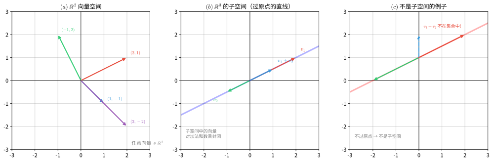

*图1：向量空间与子空间。(a) $\mathbb{R}^2$ 中的向量；(b) 子空间必须过原点，对加法和数乘封闭；(c) 不过原点的直线不是子空间，因为两个向量的和可能"跑出去"。*

> **🧠 思考历程：把"箭头"和"函数"塞进同一个笼子，凭什么成立？**
>
> 向量空间的定义看着啰嗦（8 条公理），它真正的价值却在于"一网打尽"：**平面箭头、矩阵、多项式、函数**居然全都逃不出同一个框架。这个"抽象之网"是 19 世纪被慢慢织出来的。
>
> - **起点是"既带数又带形的向量"**。古希腊到近代，人们最早把"向量"想成物理里的力、速度——有大小有方向，能**相加（力的合成）**、能**拉长缩短（数乘）**。渐渐地，矩阵能加、函数能加，大家发现它们"做着同样的事"。
> - **哈密顿、格拉斯曼等人的"抽象冲动"**。爱尔兰数学家**哈密顿**（Hamilton）在处理四元数时意识到，加法与数乘的规律可以脱离具体对象讲；德国**格拉斯曼**（Grassmann）1844 年更写了一部《线性扩张论》——它几乎就是"线性代数"的雏形，可惜当时过于超前、无人问津，直到后世才被重新发掘。**真正让"向量"从"箭头"解放成"笼统对象"的，是这些不甘于只处理几何的人。**
> - **大剂量的抽象，进化出希尔伯特空间**。到 20 世纪前后，数学家把这些"能相加、能数乘、满足公理"的对象统一称作"向量空间/线性空间"。**最大的惊喜：连函数也能当"向量"**——由此发展出的希尔伯特空间、傅里叶分析、量子力学里态矢量的叠加，全都踩在这块地基上。
> - **心路**：向量空间定义的巧妙之处，在于**"抽象"不是放弃具体，而是把无数具体的共同规则一次讲清、一次证明、处处使用**。今后你遇到"矩阵空间、函数空间"，只要把它想成"满足公理的封闭超市"，就抓住了线性代数最宽大的一张网。

#### 课堂问答

**老师**：八条公理看着啰嗦，最核心的到底在保证什么？

**学生**：保证"加法和数乘都不出圈、且规则正常"。交换、结合、分配、零元、负元、单位元，本质都是让这套运算像普通数那样听话，这样各种具体对象才能共用同一套理论。

**老师（追问）**：为什么"零向量"和"负向量"必须单独列成公理？

**学生**：因为并非任何集合都自带这两样。没有零元就没有"什么都不加"的基准，也谈不上解 $v+x=w$；没有负元，减法都不封闭。它们是把"向量"和"仅仅是某个集合"区分开的关键。

**老师（拓展）**：连续函数集合 $C[a,b]$ 是向量空间，验证时哪几条最容易卡住？

**学生**：通常不是封闭性，而是"零元素和负元素在不在集合里"。连续函数的零函数、负函数显然都连续，所以轻松过关。真正要警惕的是那些"做着类似运算、却缺零元或对加法不封闭"的集合。

### 2.2 子空间

🛒 **换个说法更好懂**：大超市（比如 $\mathbb{R}^3$）里，有些区域"自成一体"——"饮料专柜"。从专柜里拿两瓶合并（加法），出来还在专柜；把一瓶加倍（数乘），也还在专柜。这样的区域**内部怎么折腾都不出圈**，就叫**子空间**。

所以判断"一块区域是不是子空间"，其实只干两件事：**加法关不关门？数乘关不关门？** 再补上一条：**必须含零向量（过原点）**。**定义**赋值里的代数结构会自动保证封闭性检测只需看两条，这就是下面判定定理好用的原因。

**定义**：设 $V$ 是 $\mathbb{F}$ 上的向量空间，$W \subseteq V$ 的非空子集称为 $V$ 的**子空间**，如果 $W$ 在 $V$ 的加法和数乘下自身构成向量空间。

**子空间判定定理**：$W$ 是子空间 $\iff$ 对任意 $u, v \in W$ 和 $c \in \mathbb{F}$，有：

1. $u + v \in W$
2. $c u \in W$

等价地，$W$ 非空且对线性组合封闭：$u + cv \in W$ 对任意 $u, v \in W$，$c \in \mathbb{F}$。

**例**：

- $\{\mathbf{0}\}$ 和 $V$ 本身是 $V$ 的平凡子空间
- $W = \{(x, y, 0) \mid x, y \in \mathbb{R}\}$ 是 $\mathbb{R}^3$ 的子空间（$xy$-平面）
- $W = \{(x, y, z) \in \mathbb{R}^3 \mid x + y + z = 0\}$ 是 $\mathbb{R}^3$ 的子空间
- 所有 $n$ 阶对称矩阵的集合是 $M_{n \times n}(\mathbb{R})$ 的子空间

> **💡 直观理解**：子空间就是"大空间里自成一体的小空间"。想象 $\mathbb{R}^3$ 是三维世界，那么过原点的平面是子空间（二维），过原点的直线也是子空间（一维），原点本身是零维子空间。关键特征：**子空间必须过原点**——不过原点的平面不是子空间，因为两个向量的和可能"跑出"这个平面。

#### 课堂问答

**老师**：判定子空间时为什么要说"$W$ 非空"？

**学生**：因为空集也会"平凡地"满足某些条件，却没有任何向量、不构成向量空间。加上非空（等价于含零向量），才能把空集这类退化情况排除在外。

**老师（追问）**：为什么只用验 $u+cv\in W$ 一条就够了？

**学生**：取 $c=0$ 得 $u\in W$，管住含零；取 $u=0$、$c=-1$ 得 $-v\in W$，管住负元；再取合适组合就得到加法和数乘封闭。一条"对线性组合封闭"把两条封闭加含零全包了。

**老师（拓展）**：两个子空间 $W_1$、$W_2$ 的并集，还是子空间吗？

**学生**：一般不是。取 $u\in W_1$、$v\in W_2$，若两者互不包含，$u+v$ 往往既不在 $W_1$ 也不在 $W_2$，加法不封闭。它们的和 $W_1+W_2$ 才是子空间，这也是为什么"并集"要换成"和"。

### 2.3 线性组合与张成空间

🧪 **先有个画面**：你有 $k$ 种"原料"（向量 $v_1,\dots,v_k$），每种放"适量"（系数 $c_i$）。最后搅拌出来的"成品"
$$
c_1 v_1 + c_2 v_2 + \cdots + c_k v_k
$$
就叫一组**线性组合**——"扰得动、缩得动，方向不变地组合"。接下来，把系数随便换，一黑板能调出的**所有成品种类**加在一起，就是**张成空间**。它回答一个问题：**用这堆原料，到底能走到哪里？**

**定义（正式）**：设 $v_1, v_2, \dots, v_k \in V$，$c_1, c_2, \dots, c_k \in \mathbb{F}$，称表达式

$$
c_1 v_1 + c_2 v_2 + \cdots + c_k v_k
$$

为 $v_1, \dots, v_k$ 的一个**线性组合**。

**定义**：集合 $S = \{v_1, \dots, v_k\}$ 的**张成空间**（span）是所有线性组合的集合：

|            符号            |   名称   | 含义                                   | 直观解释                 |
| :------------------------: | :------: | :------------------------------------- | :----------------------- |
|           $S$           |  向量组  | $S = \{v_1, \dots, v_k\}$ 这一堆向量 | "一堆原料"               |
|          $v_i$          |   向量   | 第$i$ 个向量                         | "第 i 种原料"            |
|          $c_i$          | 标量系数 | 每个向量乘上的一个数                   | "每种原料放多少"         |
|      $\sum_{i=1}^k$      |   求和   | 从第 1 项加到第$k$ 项                | "把 k 种全加起来"        |
| $\operatorname{span}(S)$ | 张成空间 | 这些向量能组合出的全部                 | "用这堆原料能调出的一切" |

$$
\operatorname{span}(S) = \left\{ \sum_{i=1}^k c_i v_i \;\middle|\; c_i \in \mathbb{F} \right\}
$$

$\operatorname{span}(S)$ 是 $V$ 的一个子空间，称为由 $S$ **张成**的子空间。

> **💡 直观理解**：张成空间就像"用这些向量能到达的所有地方"。两个不共线的向量能张成整个平面（像用两个方向的力可以到达平面上的任何位置），而两个共线的向量只能张成一条直线（因为它们指向同一个方向）。

> **🔑 线性无关的本质**：线性无关意味着"每个向量都提供了新的信息"。如果 $v_2$ 可以被 $v_1$ 线性表示，那 $v_2$ 就是"冗余的"——它没有带来任何新方向。基就是"最精简的生成集"：去掉任何一个向量都无法张成整个空间。

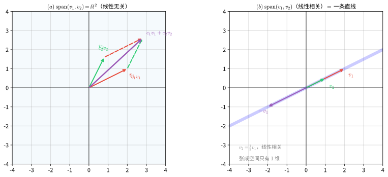

*图2：线性组合与张成空间。(a) 两个线性无关的向量张成整个 $\mathbb{R}^2$，任意向量都可以表示为它们的线性组合（平行四边形法则）；(b) 两个线性相关的向量（共线）只能张成一条直线。*

#### 课堂问答

**老师**：$\operatorname{span}(S)$ 为什么一定是子空间？

**学生**：因为它非空且对线性组合封闭。把两组线性组合再混合、缩放，得到的仍是 $S$ 中向量的线性组合，还落在 $\operatorname{span}(S)$ 里，所以它是子空间——而且是包含 $S$ 的最小子空间。

**老师（追问）**：两个共线向量 $v$、$2v$ 的张成是什么？

**学生**：是一条直线，即 $\{tv:t\in\mathbb R\}$。张成空间的维数是 $1$，因为只有一个独立方向。向量个数多不代表张成空间大，关键看独立方向有几个。

**老师（拓展）**：$b$ 落在 $\operatorname{span}(S)$ 里，等价于哪句话？

**学生**：等价于 $b$ 能写成 $S$ 中向量的线性组合，等价于方程组以 $S$ 为列、右端为 $b$ 时有解。这就把"几何上的落在张成里"和"代数上的方程有解"接上了。

### 2.4 线性无关性

🔍 **先看一个"多余"的例子**：导航里已经有了"向东走"和"向北走"两个指令，再给一条"东北方向走"就是**多余**的——它本来就能由前两条拼出来。线性代数里，这种"能被同伴组合出来的向量"叫**冗余**，整组就叫**线性相关**；反之，谁都不靠别人、各干各的，就叫**线性无关**。

"无关"的反面不是"不平行"，而是"**没有一个能由其余拼出来**"——哪怕它们俩根本不是同一直线，只要一线组合得出另一个，就相关。

**定义**：向量组 $\{v_1, \dots, v_k\}$ 称为**线性相关**的，如果存在不全为零的标量 $c_1, \dots, c_k \in \mathbb{F}$，使得

$$
c_1 v_1 + c_2 v_2 + \cdots + c_k v_k = \mathbf{0}
$$

如果上述等式仅当 $c_1 = c_2 = \cdots = c_k = 0$ 时成立，则称向量组是**线性无关**的。

**性质**：

- 单个向量 $v$ 线性无关 $\iff$ $v \neq \mathbf{0}$
- 两个向量线性相关 $\iff$ 其中一个可以被另一个数乘得到
- 若向量组包含 $\mathbf{0}$，则一定线性相关
- 若部分向量相关，则整体相关；若整体无关，则部分无关

> **💡 直观理解**：线性相关就是"有向量是多余的"。想象你在地图上导航：如果已经有了"向东走"和"向北走"的指令，那么"向东北走"就是多余的——它可以由前两个组合得到。线性无关意味着每个向量都提供了"新方向"，没有任何一个可以被其他向量组合出来。

#### 课堂问答

**老师**：定义的落点是"仅当系数全零"，这个"仅当"为什么关键？

**学生**：因为若存在不全为零的系数使组合为零，就有向量能被其余组合出来、是冗余的，这才叫相关。只有全零系数才行，说明谁也替不了谁，那才是无关。

**老师（追问）**：$v=(1,2,3)$、$w=(2,4,6)$、$u=(1,0,0)$ 相关吗？

**学生**：相关，因为 $w=2v$，存在不全为零系数使 $2v-w+0u=0$。只要组里有一对成比例，整组立刻相关——"部分相关则整体相关"。

**老师（拓展）**：$n$ 维空间里放入 $n+1$ 个向量，一定相关吗？

**学生**：一定。因为 $n$ 维最多容纳 $n$ 个线性无关向量，多出一个必然能被前面组合出来。这是"无关组向量数不超过维数"的直接推论，也是很多快速判断的起点。

### 2.5 基与维数

🧭 **直觉先行**：在平面里你只需报"向东多少、向北多少"两个数，就能定位任意一点——这两个方向就是一组**基**，"2"就是**维数**。所以：
- **基 = 一组"最少但足够"的有效原料**——少了盖不住整个空间，多了又有冗余；
- **维数 = 基里有几个向量 = "定位这个空间里任意一点要有几个坐标"**。

下面把这两句直觉的方方面面（为什么所有基一样多、怎么从一组向量挑出或补成基）写成定理。

**定义**：向量空间 $V$ 的一组**基**是一个线性无关且张成 $V$ 的向量组 $B$。

**定义**：$V$ 的**维数** $\dim(V)$ 是基中向量的个数（如果 $V$ 有有限基）。若 $V = \{\mathbf{0}\}$，则 $\dim(V) = 0$。

**定理**：若 $V$ 是有限维向量空间，则 $V$ 的所有基都有相同数量的向量。

**定理**：设 $\dim(V) = n$，则：

- 任何 $n$ 个线性无关的向量构成一组基
- 任何 $n$ 个张成 $V$ 的向量构成一组基
- 任何线性无关组可以扩充为一组基
- 任何张成组可以缩减为一组基

**标准基**：

- $\mathbb{R}^n$ 的标准基：$e_1 = (1,0,\dots,0),\; e_2 = (0,1,\dots,0),\; \dots,\; e_n = (0,\dots,0,1)$
- $\mathcal{P}_n(\mathbb{R})$ 的标准基：$1, x, x^2, \dots, x^n$
- $M_{m \times n}(\mathbb{R})$ 的标准基：矩阵单位 $E_{ij}$（第 $i$ 行第 $j$ 列为 1，其余为 0）

> **💡 直观理解**：基是向量空间的"坐标轴"，维数是"自由度的个数"。$\mathbb{R}^3$ 的标准基 $e_1, e_2, e_3$ 就是我们熟悉的 $x, y, z$ 三个方向。维数为 3 意味着你需要 3 个数才能确定空间中的一个点。基的选择不是唯一的——你可以旋转、倾斜坐标轴，但只要向量个数相同（维数不变），它们就描述的是同一个空间。

#### 课堂问答

**老师**：一组向量要成为基，必须同时满足哪两个条件？

**学生**：既线性无关又张成整个空间。无关保证"不多余"，张成保证"够用"，两个一起才等于"最少但足够的一组原料"，这正是基的定义。

**老师（追问）**：$n$ 维空间里给了 $n$ 个向量，只验哪一条就能断定它是基？

**学生**：两条任意验一条都行。$n$ 个无关向量在 $n$ 维空间里自动张成；反之 $n$ 个张成 $V$ 的向量自动无关。因为张成至少需要 $n$ 个，恰好 $n$ 个就刚好卡满，没有冗余空间。

**老师（拓展）**：维数相同的两个子空间，是同一个空间吗？

**学生**：不一定，但其中一个若是另一个的子集，就一定相等。因为子空间的维数若不变，就不可能被真包含——真包含必然要求更大维数。所以"维数相同 + 一个含于另一个"即可断定相等。

### 2.6 向量组的秩与极大线性无关组

👥 **用人话说**：一个团队里，真正"别人替代不了"的核心成员，就是**极大线性无关组**；核心成员的人数就是**秩**。多招一个能力重复的人，秩不变；抽走一个核心，队伍就"降维"。下面把"谁是核心、一共几个"用定义写清楚，最后你会看到它和矩阵的秩是同一件事。

**定义**：设 $S = \{v_1, \dots, v_k\}$ 是一个向量组。$S$ 的一个**极大线性无关组**是从 $S$ 中选出的一个线性无关向量组，且再添加 $S$ 中任何其他向量都会使它线性相关（即已经"到极限"，无法再扩充）。

**定义**：向量组 $S$ 的任何极大线性无关组所含向量的个数，称为 $S$ 的**秩**，记作 $\operatorname{rank}(S)$。

**定理**：

- 一个向量组的任意两个极大线性无关组所含向量个数相等（都等于该组的秩）
- 向量组 $S$ 的秩 = $\operatorname{span}(S)$ 的维数 = 以 $S$ 为列（或行）构成的矩阵的秩
- 向量组与其任一极大线性无关组等价（可以互相线性表示）

> **💡 直观理解**：极大线性无关组就是"一支队伍里真正不可或缺的核心成员"。想象一个团队，有些人掌握的核心技能是别人没有的（线性无关），有些人只会重复别人的技能（冗余）。极大无关组就是"去掉任何一个都会战力下降"的那批核心成员，而秩就是"核心成员的人数"。
>
> **🔑 与矩阵秩的联系**：矩阵的秩 = 它的行向量组的秩 = 列向量组的秩。所以"矩阵的秩"和"向量组的秩"是同一个概念的两面——矩阵的秩告诉我们它的行（列）里有多少个"真正独立"的向量。

**例**：求向量组 $v_1 = (1, 2, 0)$，$v_2 = (0, 1, 1)$，$v_3 = (1, 3, 1)$ 的秩和极大线性无关组。

**解**：注意到 $v_3 = v_1 + v_2$，所以 $v_3$ 是冗余的。而 $v_1, v_2$ 线性无关（不成比例），故 $\{v_1, v_2\}$ 是一个极大线性无关组，$\operatorname{rank}(\{v_1, v_2, v_3\}) = 2$。

---

#### 课堂问答

**老师**：极大线性无关组里"极大"是什么意思？

**学生**：指的是"不能再扩充"。这组已经无关，但再添 $S$ 中任何一个向量都会变相关，说明它的独立方向已经用尽。任何向量组都能选出这样的极大无关组。

**老师（追问）**：同一个向量组，会选出两个规模不同的极大无关组吗？

**学生**：不会。它们所含向量个数都等于这个向量组的秩，也等于 $\operatorname{span}(S)$ 的维数。不同选法只是"换了批核心成员"，人数恒定——这正是秩良定义的关键定理。

**老师（拓展）**：向量组的秩和矩阵的秩是同一回事吗？

**学生**：是。以向量组为列（或行）做矩阵，向量组的秩就等于矩阵的秩，也等于张成空间的维数。三个看似不同的量被同一个数统一，这就是秩概念的威力。

## 三、矩阵

### 3.1 矩阵的定义与基本运算

📊 **先想一个问题**：一列数字，你要怎么又快又不乱地记录和处理？存一百个人的成绩，你不会给每个人写一张纸条，而是排成一张"矩形表"。这张表就是**矩阵**。更妙的是，给它配上"加法、数乘、乘法、转置"四种运算后，它就不再仅仅是张表——而是一台能"执行线性变形"的小机器。下面把四种运算一条条定清楚。

**定义**：一个 $m \times n$ 矩阵是 $m$ 行 $n$ 列排列的数的矩形阵列：

|      符号      | 名称 | 含义                          | 直观解释         |
| :------------: | :--: | :---------------------------- | :--------------- |
|     $A$     | 矩阵 | 排成矩形的数表                | "一个数表"       |
| $m \times n$ | 尺寸 | 表示有$m$ 行 $n$ 列       | "m 行 n 列"      |
|   $a_{ij}$   | 元素 | 位于第$i$ 行第 $j$ 列的数 | "第 i 行第 j 格" |

$$
A = \begin{pmatrix}
a_{11} & a_{12} & \cdots & a_{1n} \\
a_{21} & a_{22} & \cdots & a_{2n} \\
\vdots & \vdots & \ddots & \vdots \\
a_{m1} & a_{m2} & \cdots & a_{mn}
\end{pmatrix}
$$

记作 $A = (a_{ij})_{m \times n}$。

**矩阵运算**：

1. **加法**：$A + B = (a_{ij} + b_{ij})$（同型矩阵）
2. **数乘**：$cA = (c a_{ij})$
3. **乘法**：$A_{m \times n} B_{n \times p} = C_{m \times p}$，其中 $c_{ij} = \sum_{k=1}^n a_{ik} b_{kj}$
4. **转置**：$(A^T)_{ij} = a_{ji}$

**性质**：

- $(AB)C = A(BC)$
- $A(B + C) = AB + AC$
- $(A + B)^T = A^T + B^T$
- $(AB)^T = B^T A^T$

> **💡 直观理解**：矩阵不仅仅是数字表格，它是**线性变换的"操作手册"**。矩阵乘法 $AB$ 表示"先做变换 $B$，再做变换 $A$"。注意顺序很重要——先旋转再缩放 ≠ 先缩放再旋转（除非是特殊矩阵），这就是为什么矩阵乘法不满足交换律 $AB \neq BA$。

> **🧠 思考历程：一个"数字方框"怎么会成为科学界用得最多的符号之一？**
>
> 矩阵今天几乎人手一份（数据表、图像、方程），它却被冷落了近百年才"转正"。这个"方框"背后，是一段从"器用之术"到"一门数学"的翻身史。
>
> - **矩阵先以"行列式"的影子出现**。17-18 世纪，数学家解线性方程时，反复用"行列式"作为判别与求解的代号（见 5.1 节）。**矩阵"格子"最初只是装这些系数的临时表格**，还没有独立身份。
> - **凯莱（Cayley）1858 年给了它"户口"**。英国数学家**凯莱**（Arthur Cayley）发表《矩阵论纪要》，第一次明确提出矩阵是独立的研究对象，并且**定义了矩阵的乘法**：$C_{ij}=\sum_k a_{ik}b_{kj}$。这一步不得了——它让"数表"获得自洽的运算，有了自己的代数。**凯莱还和西尔维斯特（Sylvester）一起为这套理论命名和铺路。**
> - **为何这个乘法规则怪？** 因为矩阵乘法是**按"复合线性变换"设计的**：先执行变换 $B$、再执行变换 $A$ 的复合结果，恰好就是这种"行乘列求和"的规则。**顺序不可交换（$AB\ne BA$）也正是"操作教科书"的写照**——先转再缩与先缩再转明显不同。
> - **矩阵真正迎来"统治"是在 20 世纪**。量子力学的海森堡用"矩阵力学"表述物理，冯·诺依曼以矩阵推动量子理论与数值计算，数据科学、图像处理、机器学习更是把"矩阵运算"当主食。**一个曾被当成分行列表格的"方框"，最终成了现代科学最通用的数据语言。**
> - **心路**：矩阵的历史提示你：**一个"方便的工具"要成为"一门成熟理论"，关键往往在于定义出合适、自洽的运算**。放心地背熟矩阵乘法规则——你其实在背"怎样刻画所有线性变形"的通用文法。

#### 课堂问答

**老师**：矩阵乘法 $c_{ij}=\sum_k a_{ik}b_{kj}$，为什么是"行乘列"而不是对应元素相乘？

**学生**：因为乘法要对应"变换的复合"。$AB$ 表示先做 $B$ 再做 $A$，把 $A$ 的第 $i$ 行与 $B$ 的第 $j$ 列配对求和，正好得到复合后第 $i$ 个输出、第 $j$ 个输入分量。对应元素相乘叫 Hadamard 积，不表示复合。

**老师（追问）**：$(AB)^T$ 等于 $A^TB^T$ 吗？

**学生**：不等于，等于 $B^TA^T$。转置要反序，和逆矩阵 $(AB)^{-1}=B^{-1}A^{-1}$ 一个道理。这个"倒序"规则很多人记错，本质上是因为转置把行列表格整体翻转。

**老师（拓展）**：矩阵乘法有零因子吗？即 $AB=0$ 能推出 $A=0$ 或 $B=0$ 吗？

**学生**：不能。例如 $A=\begin{pmatrix}1&0\\0&0\end{pmatrix}$、$B=\begin{pmatrix}0&0\\0&1\end{pmatrix}$，两者都不为零但 $AB=0$。矩阵这个乘法体系不是整环，这正是它比实数"怪"的地方。

### 3.1b 分块矩阵

🧱 **大的东西不好处理，先切开**：处理一张超大的地图，你自然会把它折成几折或切几块来看。把矩阵用横竖线切成一格一格的小矩阵，就是**分块矩阵**。它最大的价值是"降噪"——只要切得巧，原本庞大混乱的运算（乘法、行列式、求逆）就能拆成若干小块分别解决，也让"哪里是空块"的结构一眼看清。

**定义**：用横线和竖线把一个矩阵分割成若干块，每块是一个**子矩阵**，这种方法叫**分块**。分块后的矩阵称为**分块矩阵**。

**例**：把 $4 \times 4$ 矩阵分成四块：

$$
\begin{pmatrix} A & B \\ C & D \end{pmatrix}
$$

其中 $A, B, C, D$ 是较小的子矩阵。

**分块矩阵的运算**（对分块得当的矩阵）：

- **加法**：对应块相加（要求分块方式一致）
- **数乘**：每块都乘以该数
- **乘法**：像普通矩阵乘法一样，但把"数"换成"块"：
  $$
  \begin{pmatrix} A & B \\ C & D \end{pmatrix} \begin{pmatrix} E & F \\ G & H \end{pmatrix} = \begin{pmatrix} AE + BG & AF + BH \\ CE + DG & CF + DH \end{pmatrix}
  $$

  （要求各子块的维数满足乘法条件）

> **💡 直观理解**：分块矩阵就像把一个大乐高拼图拆成几块小乐高来处理。它可以：
>
> - **简化计算**：把大矩阵的乘法变成小矩阵的乘法，尤其当矩阵有特殊结构（如对角块）时
> - **看清结构**：很多矩阵天然是分块的（如分块对角矩阵、增广矩阵 $[A \mid b]$）
>
> **🔑 重要应用**：
>
> - **分块对角矩阵**：$\begin{pmatrix} A & 0 \\ 0 & B \end{pmatrix}$ 的行列式 = $\det(A)\det(B)$，逆矩阵 = $\begin{pmatrix} A^{-1} & 0 \\ 0 & B^{-1} \end{pmatrix}$（若 $A, B$ 可逆）
> - **分块下三角/上三角**：$\det\begin{pmatrix} A & * \\ 0 & B \end{pmatrix} = \det(A)\det(B)$
> - **解大规模方程组**：把大系统拆成小块逐块求解，是数值计算的重要技巧

#### 课堂问答

**老师**：分块矩阵的乘法为什么能像"数"一样按块运算？

**学生**：因为矩阵乘法的行乘列求和，本质上与被分成几块无关。只要各子块的维数满足相乘条件，块与块之间照样"小矩阵相乘、对应相加"，结果和整块算出来一致。

**老师（追问）**：为什么 $\begin{pmatrix}A&*\\0&B\end{pmatrix}$ 的行列式等于 $\det(A)\det(B)$？

**学生**：因为它是分块上三角。按第一列展开，非零部分只在 $A$ 那块，一步步下来零块始终贡献零，最后只剩 $\det(A)\det(B)$。分块对角 $\begin{pmatrix}A&0\\0&B\end{pmatrix}$ 同理，逆矩阵还要各块分别求逆。

**老师（拓展）**：分块对角矩阵的秩怎么快速算？

**学生**：等于各对角块秩之和。因为不同块的列各自落在互不相交的坐标范围内，彼此没有线性关系可借，独立列数就是简单相加。这也是分块对角矩阵好用的原因。

### 3.2 矩阵的秩

🪜 **一句话点题**：如果矩阵里"真正独立"的行（或列）只有 $r$ 个，那它再怎么运算都逃不出一个 $r$ 维的平面——这个 $r$ 就是**秩**。它是矩阵最重要的"身份证号码"，直接告诉你三件事：**信息量多大、变形后占多大空间、还有没有可能逆**。

**定义**：矩阵 $A$ 的**列秩**是列向量张成空间的维数，**行秩**是行向量张成空间的维数。

**定理**：对任何矩阵，列秩等于行秩，称为矩阵的**秩**，记作 $\operatorname{rank}(A)$。

**性质**：

- $0 \leq \operatorname{rank}(A) \leq \min(m, n)$
- $\operatorname{rank}(A) = \operatorname{rank}(A^T)$
- $\operatorname{rank}(AB) \leq \min(\operatorname{rank}(A), \operatorname{rank}(B))$
- $\operatorname{rank}(A + B) \leq \operatorname{rank}(A) + \operatorname{rank}(B)$
- 初等行变换不改变矩阵的秩

> **💡 直观理解**：秩是矩阵最重要的"指纹"。它告诉你：
>
> - **信息量**：秩 = 矩阵中"真正独立"的行（或列）的数量。秩为 3 的 3×3 矩阵包含 3 个独立信息；秩为 1 的矩阵只包含 1 个独立信息（其他行都是它的倍数）。
> - **变换效果**：秩 = 变换后空间的维数。秩为 2 的 3×3 矩阵把三维空间压扁成二维平面；秩为 1 的矩阵把空间压扁成一条线；秩为 0 的矩阵（零矩阵）把整个空间压成一个点。
> - **可逆性**：方阵可逆 ⟺ 秩 = n ⟺ 列向量线性无关 ⟺ 变换是"一对一"的。

#### 课堂问答

**老师**：为什么"初等行变换不改变矩阵的秩"？

**学生**：因为三种行变换都可逆，且不改变行空间——变换后每一行都还是原来各行的线性组合。行空间不变，其维数（行秩）自然不变，而秩等于行秩，所以秩不变。

**老师（追问）**：$\operatorname{rank}(AB)\le\min(\operatorname{rank}A,\operatorname{rank}B)$ 怎么理解？

**学生**：$AB$ 的列是 $A$ 各列的线性组合，所以列空间含于 $A$ 的列空间，秩不超过 $\operatorname{rank}A$；对称地也不超过 $\operatorname{rank}B$。穿上两个"外套"只会压缩或保持维度，不会凭空变大。

**老师（拓展）**：秩等于行阶梯形的非零行数，这句话要小心什么？

**学生**：要小心的是"行阶梯形不唯一"。换一种消元得到的阶梯形可能不同，但非零行数是唯一确定的，都等于秩。常见误解是"秩 = 某个特定阶梯的非零行数"，其实它和具体消元方式无关。

### 3.3 矩阵的迹

💍 **看一眼对角线就够**：矩阵有一道极简的"指纹"——把主对角线上的元素加起来，就是**迹**。别看它简单，背后藏着一条深层规律：**迹等于所有特征值之和**（第 7 章会讲到）。因此它成了"怎么换坐标系都不变"的不变量，在量子力学里甚至直接扮演"期望值之和"。

**定义**：$n$ 阶方阵 $A = (a_{ij})$ 的**迹**是对角线元素之和：

$$
\operatorname{tr}(A) = \sum_{i=1}^n a_{ii}
$$

**性质**：

- $\operatorname{tr}(A + B) = \operatorname{tr}(A) + \operatorname{tr}(B)$
- $\operatorname{tr}(cA) = c \operatorname{tr}(A)$
- $\operatorname{tr}(AB) = \operatorname{tr}(BA)$
- $\operatorname{tr}(A^T) = \operatorname{tr}(A)$

> **💡 直观理解**：迹有一个深刻的几何意义——它等于矩阵所有特征值的和。如果矩阵代表一个线性变换，迹告诉你这个变换在各个特征方向上的"总伸缩量"。迹为正说明总体是"扩张"的，迹为负说明总体是"压缩"的。迹为零则说明扩张和压缩相互抵消（如剪切变换）。

#### 课堂问答

**老师**：迹只是对角线求和这么简单，凭什么出现在那么多定理里？

**学生**：因为它是不变量。$\operatorname{tr}(A)$ 等于所有特征值之和，也是特征多项式 $\lambda^{n-1}$ 项的系数，所以相似变换不改变它。简单的外表下藏着"换基也抹不掉"的结构信息。

**老师（追问）**：$\operatorname{tr}(AB)=\operatorname{tr}(BA)$ 说明什么？

**学生**：说明迹对"循环置换"不敏感。虽然 $AB\ne BA$，但它们的迹相等，$\operatorname{tr}(AB)=\sum_{i,j}a_{ij}b_{ji}=\operatorname{tr}(BA)$。这条让迹在乘积运算里格外好用。

**老师（拓展）**：迹为零的矩阵一定不可逆吗？

**学生**：不一定。迹为零只说明特征值之和为零，例如 $\begin{pmatrix}0&1\\-1&0\end{pmatrix}$ 迹为零但可逆、特征值为 $\pm i$。要注意区分"迹零"和"行列式为零"——后者才对应不可逆。

### 3.4 逆矩阵

↩️ **先想"怎么撤销"**：你把面包切块，怎样精确复原？数学里给一个可逆的线性变换 $A$ 配一把"撤销钥匙"——**逆矩阵 $A^{-1}$**，满足 $AA^{-1}=A^{-1}A=I$。凡是"一步到位"的变形，自然都想问"能不能原路返回"。能返回就是可逆（非奇异），不能返回（把空间压扁、丢了信息）就是奇异。

**定义**：$n$ 阶方阵 $A$ 称为**可逆**的（或**非奇异**的），如果存在 $n$ 阶方阵 $B$ 使得

$$
AB = BA = I_n
$$

其中 $I_n$ 是 $n$ 阶单位矩阵。$B$ 称为 $A$ 的逆矩阵，记作 $A^{-1}$。

**性质**：

- 若 $A$ 可逆，则 $A^{-1}$ 唯一
- $(A^{-1})^{-1} = A$
- $(AB)^{-1} = B^{-1}A^{-1}$
- $(A^T)^{-1} = (A^{-1})^T$
- $A$ 可逆 $\iff$ $\det(A) \neq 0$ $\iff$ $\operatorname{rank}(A) = n$ $\iff$ $A$ 的列（行）向量线性无关

> **💡 直观理解**：逆矩阵是"撤销变换"的操作。如果 $A$ 把空间旋转了 45°，那么 $A^{-1}$ 就把它旋转 -45° 转回来。如果 $A$ 把空间拉伸了 2 倍，$A^{-1}$ 就把它压缩回原来的 1/2。不可逆矩阵（奇异矩阵）就像"压路机"——把三维空间压扁成二维平面，信息丢失了，无法"恢复"原状。这就是为什么 $\det(A) = 0$ 时矩阵不可逆。

#### 课堂问答

**老师**：为什么要求同时满足 $AB=I$ 和 $BA=I$ 才算逆矩阵？

**学生**：对有限维方阵其实只需一边成立另一边自动成立，但定义上两边都写最保险。它表达的是"撤销"是双向的——先做 $A$ 再做 $B$ 回到原样，反过来也一样，才是真正的互逆。

**老师（追问）**：$A$ 可逆的各种等价说法，能列一串吗？

**学生**：可以：$A$ 可逆 $\iff\det(A)\ne0\iff\operatorname{rank}(A)=n\iff$ 列（行）向量线性无关 $\iff Ax=0$ 只有零解 $\iff A$ 是初等矩阵之积。它们全是同一件事的不同侧面。

**老师（拓展）**：为什么用 $[A\mid I]$ 做行变换化出 $[I\mid A^{-1}]$ 就能求得逆？

**学生**：因为对 $A$ 做的一连串行变换相当于左乘一系列初等矩阵 $E_k\cdots E_1$。若这些变换把 $A$ 化成 $I$，则 $E_k\cdots E_1A=I$，于是 $E_k\cdots E_1=A^{-1}$，而它对右边 $I$ 的作用恰好把 $I$ 变成 $A^{-1}$。

### 3.5 初等行变换与高斯消元法

🔧 **解题先学"三大基本动作"**：解方程组，与其靠头脑硬想，不如只动一张表格——靠的只有三种**行操作**：交换两行、整行乘一个非零数、把一行的倍数加到另一行。反复用这三个动作，就能把系数矩阵一层层"削"成阶梯形，让每行露一个"主元"，解就自然浮现出来。

**三种初等行变换**：

1. **交换**：交换两行 $R_i \leftrightarrow R_j$
2. **倍乘**：将某行乘以非零常数 $R_i \to cR_i$（$c \neq 0$）
3. **倍加**：将某行的倍数加到另一行 $R_i \to R_i + cR_j$

**行阶梯形矩阵**满足：

1. 所有非零行在零行之上
2. 每个非零行的首非零元（称为**主元**）的列索引严格递增
3. 主元下方的元素全为零

**简化行阶梯形矩阵**（RREF）进一步满足：
4. 每个主元为 1
5. 每个主元所在的列中，其他元素全为零

**高斯消元法**：通过初等行变换将矩阵化为行阶梯形。
**Gauss-Jordan 消元法**：进一步化为简化行阶梯形。

> **直观理解（类比）**：初等行变换就像整理数学笔记的三种"基本动作"——换行、整行乘数、一行加减另一行的倍数。反复用这三个动作把系数矩阵"按阶梯削出主元"，方程组就层层揭开；而且这些动作不改变方程组的解，像拧螺丝一样永远不会把答案拧歪。

#### 课堂问答

**老师**：为什么初等行变换不改变方程组的解集？

**学生**：每种行变换都对应一个可逆的"方程操作"：交换两式、整式乘非零数、一式加减另一式的倍数，都不会引入或丢失解。既然可逆，解集就原封不动。

**老师（追问）**：主元的位置为什么必须一列一列往右走？

**学生**：那正是"行阶梯形"的定义。每行首非零元（主元）的列索引严格递增，主元下方全为零，形成层层台阶。这样回代时才能自下而上、每层恰好露出一个未知数。

**老师（拓展）**：高斯消元和 Gauss-Jordan 消元的分界在哪？

**学生**：前者化到行阶梯形就停，最后靠"回代"逐层代入；后者继续把主元上方也清零、把主元化成 $1$，直接得到简化行阶梯形，左边成单位阵，右边直接读答案。Gauss-Jordan 相当于把回代提前织进表格。

### 3.5b 初等矩阵

🎛️ **把"动作"做成"按钮"**：既然刚才那三种行操作就是全部的"基本动作"，能不能把它们也写成矩阵？当然能。三种动作各自对应的矩阵就是**初等矩阵**——只要对单位阵 $I$ 做一次同样的操作就得到。于是"对 $A$ 做一次行变换"就等于"在 $A$ 的**左边**乘一个初等矩阵"，整个消元过程就此优雅地写成矩阵乘法。

**定义**：对单位矩阵 $I$ 做一次初等变换得到的矩阵，称为**初等矩阵**。对应三种初等（行/列）变换：

1. **交换矩阵** $E(R_i \leftrightarrow R_j)$：交换 $I$ 的第 $i, j$ 行
2. **倍乘矩阵** $E(R_i \to cR_i)$（$c \neq 0$）：将 $I$ 的第 $i$ 行乘以 $c$
3. **倍加矩阵** $E(R_i \to R_i + cR_j)$：将 $I$ 的第 $j$ 行乘以 $c$ 加到第 $i$ 行

**核心性质**：对矩阵 $A$ 做一次初等**行**变换，等价于在 $A$ 的**左边**乘一个对应的初等矩阵；做一次初等**列**变换，等价于在 $A$ 的**右边**乘一个对应的初等矩阵。

> **💡 直观理解**：初等矩阵是"基本动作的按钮"。任何复杂的行变换（高斯消元）都是这些基本按钮的连按——$E_k \cdots E_2 E_1 A$。把一个矩阵左乘一堆初等矩阵，等价于对它做了一连串行变换。
>
> **🔑 深刻结论**：
>
> - **可逆 ⟺ 初等矩阵之积**：方阵 $A$ 可逆 $\iff$ $A$ 可以写成若干个初等矩阵的乘积
> - **求逆的机制**：$A$ 可逆时，$A^{-1} = E_k \cdots E_2 E_1$，即对增广矩阵 $[A \mid I]$ 做行变换把 $A$ 化成 $I$ 时，$I$ 就变成了 $A^{-1}$——这正是 Gauss-Jordan 求逆法的原理
> - **矩阵等价标准形**：任何矩阵 $A$ 都可以通过初等变换化为标准形 $\begin{pmatrix} I_r & 0 \\ 0 & 0 \end{pmatrix}$，其中 $r = \operatorname{rank}(A)$

---

#### 课堂问答

**老师**：初等矩阵是什么？为什么它对 $A$ 左乘就等于做一次行变换？

**学生**：初等矩阵就是对单位阵 $I$ 做一次初等变换得到的矩阵。因为 $I$ 的每一行记录了"取哪个分量"，左乘 $A$ 时它按行重组 $A$ 的行，效果恰好等于对 $A$ 做对应的那一次行变换。左乘管行，右乘管列。

**老师（追问）**：为什么"可逆 $\iff$ 初等矩阵之积"？

**学生**：初等矩阵都可逆，乘积自然可逆。反过来，若 $A$ 可逆，就能用行变换把它化成 $I$，即 $E_k\cdots E_1A=I$，于是 $A=E_1^{-1}\cdots E_k^{-1}$，而初等矩阵的逆仍是初等矩阵，故 $A$ 是初等矩阵之积。

**老师（拓展）**：任何矩阵经初等变换都能化成 $\begin{pmatrix}I_r&0\\0&0\end{pmatrix}$，这个 $r$ 是什么？

**学生**：就是矩阵的秩。初等变换不改变秩，而标准形里非零的只是那个 $r$ 阶单位块，非零行（列）数为 $r$。所以这个"等价标准形"把秩的意义最直白地摆了出来。

## 四、线性方程组

### 4.1 基本概念

🧮 **别被字母吓到**：$m$ 个方程、$n$ 个未知数，本质上就是"一堆约束必须同时满足"。关键飞跃是把这堆约束整体打包成一条"机器指令" $Ax=b$：$A$ 是操作规则、$x$ 是待猜的答案、$b$ 是期望的结果。**增广矩阵** $[A\mid b]$ 只是把"规则"和"期望"钉在同一张表上，方便做纯数字操作。

一般线性方程组的形式：

$$
\begin{cases}
a_{11}x_1 + a_{12}x_2 + \cdots + a_{1n}x_n = b_1 \\
a_{21}x_1 + a_{22}x_2 + \cdots + a_{2n}x_n = b_2 \\
\vdots \\
a_{m1}x_1 + a_{m2}x_2 + \cdots + a_{mn}x_n = b_m
\end{cases}
$$

写成矩阵形式 $Ax = b$，其中 $A = (a_{ij})$ 是系数矩阵，$x = (x_1, \dots, x_n)^T$ 是未知向量，$b = (b_1, \dots, b_m)^T$ 是常数向量。

**增广矩阵**：$(A \mid b)$。

> **直观理解（类比）**：线性方程组就是"一堆约束方程要同时满足"。把它写成 $Ax=b$，就像把多个天平（方程）按系数整理成分门别类的一本账；增广矩阵只是在这本账旁多钉一列"右边常数"，好让解方程变成纯粹的表格数字操作。

#### 课堂问答

**老师**：把方程组写成 $Ax=b$，$A$、$x$、$b$ 各扮演什么角色？

**学生**：$A$ 是"操作规则"，$x$ 是待求的未知向量，$b$ 是期望的结果。解方程就是问"哪组输入 $x$，经 $A$ 这台机器加工后，能产出目标 $b$"。

**老师（追问）**：增广矩阵 $[A\mid b]$ 只是把 $b$ 拼上去，图什么？

**学生**：图操作方便。把系数和右端常数排在一张表里，行变换就能同时作用在两边、不破坏对应关系，解方程退化成纯粹的表格数字操作，不容易漏掉常数项。

**老师（拓展）**：为什么把未知向量写成 $x=(x_1,\dots,x_n)^T$ 这种列向量？

**学生**：因为要配合 $Ax$ 的乘法约定——矩阵左乘列向量得到列向量。写成列，$Ax=\sum_j x_j(\text{第 }j\text{ 列})$ 才成立，$x_j$ 恰好是各列的权重，几何意义一目了然。

### 4.2 高斯消元法求解

🗂️ **先立个流程**：解方程组的高斯消元只有三步——① 写成增广矩阵；② 用行变换削成阶梯形；③ 自下而上回代。下面用一道具体方程组完整走一遍，请你一边看表格数字在动，一边想每一步到底在消什么、留下什么。

**步骤**：

1. 写出增广矩阵 $(A \mid b)$
2. 通过初等行变换化为行阶梯形
3. 回代求解

**例**：

$$
\begin{cases}
x + 2y + z = 8 \\
2x + y + z = 7 \\
x + y + 2z = 7
\end{cases}
$$

增广矩阵：

$$
\begin{pmatrix}
1 & 2 & 1 & 8 \\
2 & 1 & 1 & 7 \\
1 & 1 & 2 & 7
\end{pmatrix}
$$

- 【第1步】依据：方程形如 $Ax=b$，$b$ 只负责"右边常数"，写进最后一列即增广矩阵；目的：把解方程变成"只动表格数字"的行变换。
- 【第2步】依据：初等行变换不改变方程组的解集；目的：用 $R_1$ 消去 $R_2,R_3$ 的第一列，使第二行以下第一列变成 0。

$R_2 \to R_2 - 2R_1$，$R_3 \to R_3 - R_1$：

$$
\begin{pmatrix}
1 & 2 & 1 & 8 \\
0 & -3 & -1 & -9 \\
0 & -1 & 1 & -1
\end{pmatrix}
$$

- 【第3步】依据：还可再对第二、三行消元（用 $R_2$ 消 $R_3$），行的倍数加减仍不改变解；目的：把 $R_3$ 第二列也消成 0，形成"阶梯"。

$R_3 \to 3R_3 - R_2$：

$$
\begin{pmatrix}
1 & 2 & 1 & 8 \\
0 & -3 & -1 & -9 \\
0 & 0 & 4 & 6
\end{pmatrix}
$$

- 【第4步】依据：阶梯形每行主元都位于前一行的右下方，回到方程组即可自下而上逐个解出未知数；目的：从最后一行 $4z=6$ 反推 $z,y,x$。

回代：$4z = 6 \Rightarrow z = \frac{3}{2}$，$-3y - \frac{3}{2} = -9 \Rightarrow y = \frac{5}{2}$，$x + 5 + \frac{3}{2} = 8 \Rightarrow x = \frac{3}{2}$。

> **直观理解（类比）**：高斯消元就像"解数独"：先用第一行把下面各行第一列清零，再用第二行清第二列……一层层把矩阵削成"阶梯"，每级台阶露出一个"主元"未知数，再从最底下的台阶往上一个个代回去。虽然只动表格数字，方程的"意思"（解集）一点没变。

#### 课堂问答

**老师**：高斯消元的三步走，核心是哪一步，为什么？

**学生**：第二步"化行阶梯形"是核心。它靠初等行变换把每行主元下方的元素消成零，把方程组"削"成层层台阶；因为行变换不改变解集，削完之后方程组的解和原方程组完全一样，只是好解了。

**老师（追问）**：削成阶梯形后，为什么从最后一行往上解？

**学生**：因为最后一行往往只剩一个未知数，直接解出；往上每一行已知后面的变量、只剩一个新未知数，逐个回代即可。台阶结构保证"每层恰好露一个主元"，所以回代才顺理成章。

**老师（拓展）**：如果消元中途遇到一行全是 $0$，该怎么办？

**学生**：要看右端。若整行为 $[0\ \cdots\ 0\mid c]$ 且 $c\ne0$，说明出现 $0=c$ 的矛盾，方程组无解；若是 $[0\ \cdots\ 0\mid 0]$，那是多余的无用行，直接去掉，剩下主元数不足 $n$ 时会出现自由变量、有无穷多解。

### 4.3 Gauss-Jordan 消元法

🚀 **想一步到位？** 高斯消元最后还要"回代"，Gauss-Jordan 则更进一步：把主元**上方的元素也一并清零**、把主元都化成 $1$，让左边直接变成单位阵、右边直接读出答案。相当于把"回代"提前织进表格里。继续沿用上一节的例子，一次做到位。

直接化为简化行阶梯形（RREF），无需回代。

继续上面的例子，从行阶梯形继续：

$$
\begin{pmatrix}
1 & 2 & 1 & 8 \\
0 & -3 & -1 & -9 \\
0 & 0 & 4 & 6
\end{pmatrix}
$$

$R_2 \to -\frac{1}{3}R_2$，$R_3 \to \frac{1}{4}R_3$：

$$
\begin{pmatrix}
1 & 2 & 1 & 8 \\
0 & 1 & \frac{1}{3} & 3 \\
0 & 0 & 1 & \frac{3}{2}
\end{pmatrix}
$$

$R_2 \to R_2 - \frac{1}{3}R_3$，$R_1 \to R_1 - R_3$：

$$
\begin{pmatrix}
1 & 2 & 0 & \frac{13}{2} \\
0 & 1 & 0 & \frac{5}{2} \\
0 & 0 & 1 & \frac{3}{2}
\end{pmatrix}
$$

$R_1 \to R_1 - 2R_2$：

$$
\begin{pmatrix}
1 & 0 & 0 & \frac{3}{2} \\
0 & 1 & 0 & \frac{5}{2} \\
0 & 0 & 1 & \frac{3}{2}
\end{pmatrix}
$$

直接读出解：$x = \frac{3}{2}$，$y = \frac{5}{2}$，$z = \frac{3}{2}$。

> **直观理解（类比）**：Gauss-Jordan 消元法是高斯消元的"升级版"：不只削出阶梯，还把每个主元上方也一并清零、把主元都化回 1，最后整个增广矩阵左边直接变成单位阵，右边读出答案——相当于把"回代"提前做进表格里，一步到位。

#### 课堂问答

**老师**：Gauss-Jordan 比高斯消元多做了什么？值不值得？

**学生**：多做了两件事：把主元上方的元素也清零，并把主元都化成 $1$，一路化到简化行阶梯形（RREF）。代价是计算量略大，好处是无需回代、左边直接成单位阵、右边直接读解。

**老师（追问）**：RREF 是不是唯一的？

**学生**：是，给定矩阵的简化行阶梯形唯一。相比之下普通行阶梯形不唯一（消元方式不同外形会变）。RREF 的唯一性正是它作为"矩阵指纹"的价值所在。

**老师（拓展）**：RREF 里的主元结构，能直接看出什么？

**学生**：主元列对应基本变量、非主元列对应自由变量；主元个数就是矩阵的秩。对 $[A\mid I]$ 用 Gauss-Jordan，还能顺手读出逆矩阵——这正是同一套行变换的两用。

### 4.4 解的存在性与唯一性

❓ **先问"到底有解吗、有几个"**：动手算之前，先想清楚三件事——**有没有解、是不是唯一解、还是无穷多解**。判断法则只需比较两个数：系数矩阵的秩 $\operatorname{rank}(A)$ 与增广矩阵的秩 $\operatorname{rank}(A\mid b)$。这就是下面两条定理要做的事。

**定理**（线性方程组解的存在性）：$Ax = b$ 有解 $\iff$ $\operatorname{rank}(A) = \operatorname{rank}(A \mid b)$。

**定理**（解的结构）：

- 若 $\operatorname{rank}(A) = \operatorname{rank}(A \mid b) = n$（未知数个数），则方程组有**唯一解**
- 若 $\operatorname{rank}(A) = \operatorname{rank}(A \mid b) < n$，则方程组有**无穷多解**，自由变量个数为 $n - \operatorname{rank}(A)$

> **直观理解（类比）**：解的存在性与唯一性，本质是"约束够不够、信息足不足"：若系数阵和增广阵的秩一致，约束自洽就有解；秩恰好等于未知数个数，等于每个未知数都被"钉死"，就是唯一解；秩差一个，就有一条"自由胳膊"能随意摆动，产生无穷多解。

#### 课堂问答

**老师**：判断 $Ax=b$ 有没有解，最干脆的判据是什么？

**学生**：比较 $\operatorname{rank}(A)$ 和 $\operatorname{rank}(A\mid b)$。两者相等就有解，不等就无解。无解的实质是 $b$ 不在 $A$ 的列空间里，消元时表现为出现 $0=c$（$c\ne0$）的矛盾行。

**老师（追问）**：有解时，什么时候唯一、什么时候无穷多？

**学生**：看秩与未知数个数 $n$。若秩 $=n$，主元占满所有列，没有自由变量，解唯一；若秩 $<n$，就有 $n-\operatorname{rank}(A)$ 个自由变量，每个自由变量可取任意值，于是有无穷多解。

**老师（拓展）**：解的个数可能正好是"两个"吗？

**学生**：不可能。线性方程组的解集只有三种形态：无解、唯一解、无穷多解。因为一旦有两个不同解，它们的差是齐次解，沿这个方向平移就得到整条直线，解无穷多。绝无"恰好两个"的情形。

### 4.5 齐次线性方程组

🥣 **"右边全为零"的隐藏含义**：当 $b=\mathbf{0}$，方程组 $Ax=\mathbf{0}$ 叫**齐次**。它一定至少有零解，而且解集是一个**子空间**（零空间）——这就是"空集里也有结构"。更关键的是：任何非齐次方程组的通解 ="一个特解 + 齐次通解"，像"钉住一个点，再沿一条线自由滑动"。

**定义**：$Ax = \mathbf{0}$ 称为齐次线性方程组。

**性质**：

- 齐次方程组总有解（零解 $x = \mathbf{0}$）
- 齐次方程组的解集是 $\mathbb{F}^n$ 的子空间（称为**解空间**或**零空间**）
- 解空间的维数 = $n - \operatorname{rank}(A)$
- 齐次方程组有非零解 $\iff$ $\operatorname{rank}(A) < n$（当 $m < n$ 时自动成立）

**非齐次方程组解的结构**：若 $x_p$ 是 $Ax = b$ 的一个特解，则通解为

$$
x = x_p + x_h
$$

其中 $x_h$ 是齐次方程组 $Ax = \mathbf{0}$ 的任意解。

> **💡 直观理解**：线性方程组 $Ax = b$ 的解取决于"信息"与"未知数"的关系。
>
> **🔑 几何视角**：
>
> - **唯一解**：三个平面交于一点（信息充足，未知数被完全确定）
> - **无穷多解**：三个平面交于一条线（信息不足，有一个"自由度"可以任意取值）
> - **无解**：三个平面没有公共交点（信息矛盾，如两个平行平面）
>
> **🔑 解的结构**：非齐次方程组的通解 = 特解 + 齐次通解。就像"定位 + 浮动"：特解是满足条件的一个具体位置，齐次通解是可以在这个位置上"自由浮动"的范围。比如 $x + y = 5$ 的一个特解是 $(5, 0)$，齐次通解是 $t(1, -1)$，所以通解是 $(5 + t, -t)$——沿着直线 $(1, -1)$ 方向自由滑动。

#### 课堂问答

**老师**：为什么 $Ax=0$ 一定有解？而且解集还是子空间？

**学生**：取 $x=0$ 就是零解，所以一定有解。解集对加法、数乘封闭——两个解加起来、数乘后仍是解，且含零向量，所以它是一个子空间，称为零空间（解空间）。

**老师（追问）**：什么时候齐次组有非零解？

**学生**：当且仅当 $\operatorname{rank}(A)<n$，即存在自由变量。特别地，若方程个数 $m<n$（未知数比方程多），秩必小于 $n$，一定有无穷多非零解——这是很多判断题的钥匙。

**老师（拓展）**：非齐次组的通解结构怎么背？

**学生**：通解 = 一个特解 $x_p$ + 齐次通解 $x_h$。几何上就是"钉住一个点，再沿零空间方向自由滑动"。$x_h$ 描述了能自由摆动的范围，$x_p$ 只是选定的落脚点。

### 4.6 四个基本子空间与正交补

🧩 **先想一个问题：仅仅一个矩阵 $A$，就能同时牵出几个"房间"？** 答案是四个。一个 $m\times n$ 矩阵 $A$ 会同时"孕育"出**四个**基本子空间：两个长在输入空间 $\mathbb{R}^n$（行空间、零空间），两个长在输出空间 $\mathbb{R}^m$（列空间、左零空间）。它们两两**互相垂直**，把"解方程、秩、行变换、列变换"这些看似零散的现象，钉在了同一张相互咬合的天图上。这张"四空间图"正是 Strang《Introduction to Linear Algebra》里的核心图，也是理解"$Ax$ 到底把空间变成了什么"的总纲。

**定义（四个基本子空间）**：设 $A$ 是 $m\times n$ 实矩阵，$A$ 的 **四个基本子空间** 是：

- **列空间（值域）** $\operatorname{Col}(A)=\{Ax:x\in\mathbb R^n\}\subseteq\mathbb R^m$：由 $A$ 的列向量张成，即 $Ax=b$ **有解**时 $b$ 所处的集合；
- **零空间（核）** $\operatorname{Nul}(A)=\{x\in\mathbb R^n:Ax=\mathbf0\}\subseteq\mathbb R^n$：齐次方程的解空间；
- **行空间** $\operatorname{Row}(A)=\operatorname{Col}(A^T)\subseteq\mathbb R^n$：由 $A$ 的行向量张成；
- **左零空间** $\operatorname{Nul}(A^T)=\{y\in\mathbb R^m:A^Ty=\mathbf0\}\subseteq\mathbb R^m$：$A^T$ 的零空间。

**定义（正交补）**：设 $W\subseteq\mathbb R^n$ 是子空间，$W$ 的**正交补**是
$$
W^\perp=\{z\in\mathbb R^n:\langle z,w\rangle=0\ \text{对一切}\ w\in W\},
$$
即"与 $W$ 中每一个向量都正交"的向量全体。$W^\perp$ 本身也是子空间，且 $(W^\perp)^\perp=W$、$\dim W+\dim W^\perp=n$。

**定理（正交补配对）**：
$$
\operatorname{Nul}(A)=(\operatorname{Row}(A))^\perp,\qquad
\operatorname{Nul}(A^T)=(\operatorname{Col}(A))^\perp .
$$

**证明（第一式）**：
$$
x\in\operatorname{Nul}(A)\iff Ax=\mathbf0\iff \text{$x$ 与 $A$ 每一行的内积都为 }0\iff x\perp\operatorname{Row}(A).
$$
配合下一定理的维数相等，即可保证我们得到的是"正交补"而不只是"正交"。

**定理（四空间的维数）**：设 $\operatorname{rank}(A)=r$，则
$$
\dim\operatorname{Row}(A)=r,\quad \dim\operatorname{Col}(A)=r,\quad
\dim\operatorname{Nul}(A)=n-r,\quad \dim\operatorname{Nul}(A^T)=m-r.
$$
于是 $\mathbb R^n=\operatorname{Row}(A)\oplus\operatorname{Nul}(A)$，$\mathbb R^m=\operatorname{Col}(A)\oplus\operatorname{Nul}(A^T)$（**直和**：任意向量能唯一拆成"沿子空间 + 沿其正交补"两个互相垂直的分量）。

> **💡 直观理解**：四空间像一张"十字天图"——横着看，$\mathbb R^n$ 被 $\operatorname{Row}(A)$ 与 $\operatorname{Nul}(A)$ 两个互相垂直的部分拼满；竖着看，$\mathbb R^m$ 被 $\operatorname{Col}(A)$ 与 $\operatorname{Nul}(A^T)$ 拼满。$A$ 的作用是：把输入**行空间里的分量**不改变方向、完整地送到**列空间**；把输入**零空间里的分量**全部压成 $\mathbf0$ 丢掉。于是 $Ax=b$ 有解 $\iff b\in\operatorname{Col}(A)\iff b\perp\operatorname{Nul}(A^T)$——可解性又多了一种"正交"的漂亮读法。

**例**：对 $A=\begin{pmatrix}1&2\\0&0\\0&0\end{pmatrix}$（$3\times2$）求四个基本子空间的基与维数。

**解**：列空间 $\operatorname{Col}(A)=\operatorname{span}\{(1,0,0)^T,(2,0,0)^T\}=\operatorname{span}\{(1,0,0)^T\}$，维数 $1$；行空间 $\operatorname{Row}(A)=\operatorname{span}\{(1,2)\}\subseteq\mathbb R^2$，维数 $1$；零空间解 $x_1+2x_2=0$，故 $\operatorname{Nul}(A)=\operatorname{span}\{(-2,1)^T\}$，维数 $1$（$n-r=2-1=1$）；左零空间需 $A^Ty=\mathbf0$，即 $y_1=0$ 与 $2y_1=0$ 都成立，故 $\operatorname{Nul}(A^T)=\operatorname{span}\{(0,1,0)^T,(0,0,1)^T\}$，维数 $2$（$m-r=3-1=2$）。检验：$(1,2)\cdot(-2,1)=0$，故 $\operatorname{Row}(A)\perp\operatorname{Nul}(A)$ 且 $1+1=2$ ✓；$\operatorname{Col}(A)\perp\operatorname{Nul}(A^T)$ 且 $1+2=3$ ✓。

**巩固练习**：

**基础 1**：对 $A=\begin{pmatrix}1&2\\2&4\end{pmatrix}$ 求四个基本子空间的基与维数，并验证正交补配对。

<details>
<summary><b>解答</b></summary>

$\operatorname{Col}(A)=\operatorname{span}\{(1,2)^T\}$（第二列是第一列的 2 倍，冗余），维 $1$；$\operatorname{Row}(A)=\operatorname{span}\{(1,2)\}$，维 $1$；零空间：$x_1+2x_2=0$，故 $\operatorname{Nul}(A)=\operatorname{span}\{(-2,1)^T\}$，维数 $n-r=2-1=1$；左零空间：$A^T=A$，$A^Ty=0$ 给出同样条件 $y_1+2y_2=0$，故 $\operatorname{Nul}(A^T)=\operatorname{span}\{(-2,1)^T\}$，维 $1$。验证：$(1,2)\cdot(-2,1)=0$，故 $\operatorname{Row}(A)\perp\operatorname{Nul}(A)$ ✓；$\operatorname{Col}(A)\perp\operatorname{Nul}(A^T)$：$(1,2)\cdot(-2,1)=0$ ✓。

</details>

**进阶 2**：证明 $Ax=b$ 有解 $\iff b\perp\operatorname{Nul}(A^T)$。

<details>
<summary><b>解答</b></summary>

$Ax=b$ 有解 $\iff b\in\operatorname{Col}(A)$，而由正交补配对 $\operatorname{Col}(A)=(\operatorname{Nul}(A^T))^\perp$。故 $b\in\operatorname{Col}(A)\iff b\perp\operatorname{Nul}(A^T)$。这是"可解性"的纯正交表述：**右边常数 $b$ 只要不朝左零空间的方向探出去，方程组就一定有解**。

</details>

**挑战 3**：设 $A$ 是 $m\times n$ 实矩阵。证明对 $A$ 作**初等行变换**后的行阶梯形的非零行恰好是 $\operatorname{Row}(A)$ 的一组基；并由此说明"初等行变换不改变行空间"。

<details>
<summary><b>解答</b></summary>

初等行变换把某一行替换为该行与其他行的线性组合，因而过程中每一行都仍落在 $\operatorname{Row}(A)$ 内；且每种行变换都有可逆的逆变换，故行空间保持不变。行阶梯形中每个非零行有各自独立的主元列，彼此线性无关，且张成整个 $\operatorname{Row}(A)$，所以恰好构成一组基。这正是"用行变换求行空间一组基"的根据，也与 3.2 节"初等行变换不改变秩"相呼应（行空间的维数即行秩）。

</details>

---

#### 课堂问答

**老师**：为什么是"四个"子空间？它们分别长在哪个空间里？

**学生**：输入空间 $\mathbb{R}^n$ 里有两个：行空间 $\operatorname{Row}(A)$ 和零空间 $\operatorname{Nul}(A)$；输出空间 $\mathbb{R}^m$ 里也有两个：列空间 $\operatorname{Col}(A)$ 和左零空间 $\operatorname{Nul}(A^T)$。一进一出、各两个，正好凑成四个。

**老师（追问）**：四个子空间里，哪两对互相垂直？

**学生**：$\operatorname{Row}(A)\perp\operatorname{Nul}(A)$，以及 $\operatorname{Col}(A)\perp\operatorname{Nul}(A^T)$。它们是正交补配对，维数分别相加得 $n$ 和 $m$，所以 $\mathbb{R}^n$、$\mathbb{R}^m$ 被这两对各自拼满。

**老师（拓展）**：$Ax=b$ 有解，用四个子空间的语言怎么说最漂亮？

**学生**：有解 $\iff b\in\operatorname{Col}(A)\iff b\perp\operatorname{Nul}(A^T)$。也就是说，只要右端 $b$ 不往左零空间方向探出分量，方程组就一定有解——可解性被翻译成一句"正交"的话。

## 五、行列式

### 5.1 行列式的定义

📐 **先要一把"尺子"**：一个线性变换会把一块正方形拉成平行四边形——它把面积放大了多少倍？这个"倍数"就是**行列式** $\det(A)$。定义用一套看似绕的求和，却恰好算中的就是这个倍数：算出来是正的 = 放大不翻面，负的 = 顺带翻了个面，零 = 被压扁（不可逆）。

**定义**（置换定义）：$n$ 阶方阵 $A = (a_{ij})$ 的行列式定义为

|                  符号                  |     名称     | 含义                                | 直观解释             |
| :------------------------------------: | :----------: | :---------------------------------- | :------------------- |
|              $\det(A)$              |    行列式    | 给方阵算出的一个数                  | "这个方阵的面积倍率" |
|                $S_n$                |   置换全体   | 所有把$n$ 个数重排的方式          | "所有排列法"         |
| $\sigma, \operatorname{sgn}(\sigma)$ | 置换与其符号 | 一种排法及其符号（偶为 +1 奇为 -1） | "排列的奇偶标签"     |

$$
\det(A) = \sum_{\sigma \in S_n} \operatorname{sgn}(\sigma) \prod_{i=1}^n a_{i,\sigma(i)}
$$

其中 $S_n$ 是所有 $n$ 元置换的集合，$\operatorname{sgn}(\sigma)$ 是置换 $\sigma$ 的符号（偶置换为 $+1$，奇置换为 $-1$）。

**低阶情形**：

- $n = 1$：$\det(a) = a$
- $n = 2$：$\det\begin{pmatrix} a & b \\ c & d \end{pmatrix} = ad - bc$
- $n = 3$（Sarrus 法则）：
  $$
  \det\begin{pmatrix} a_{11} & a_{12} & a_{13} \\ a_{21} & a_{22} & a_{23} \\ a_{31} & a_{32} & a_{33} \end{pmatrix} = a_{11}a_{22}a_{33} + a_{12}a_{23}a_{31} + a_{13}a_{21}a_{32} - a_{13}a_{22}a_{31} - a_{11}a_{23}a_{32} - a_{12}a_{21}a_{33}
  $$

> **💡 几何意义**：行列式的绝对值表示线性变换对"面积"（或"体积"）的缩放因子。
>
> - $|\det(A)| > 1$：面积放大
> - $|\det(A)| < 1$：面积缩小
> - $\det(A) = 0$：变换将空间坍缩到低维（如正方形压成线段），矩阵不可逆
> - $\det(A) < 0$：变换翻转了空间的"方向"（如左手系变右手系）

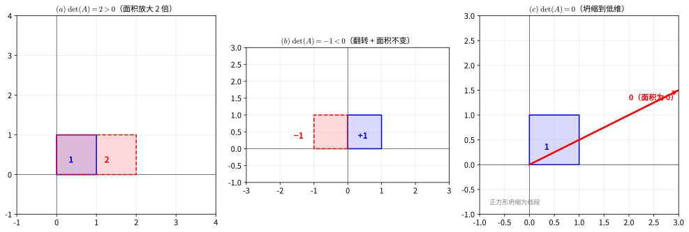

*图3：行列式的几何意义。(a) $\det(A)=2>0$：单位正方形面积放大2倍，方向不变；(b) $\det(A)=-1<0$：面积不变但方向翻转；(c) $\det(A)=0$：正方形坍缩为线段，面积变为零。*

> **🧠 思考历程：一组"长得像蛛网的求和"，怎么就成了面积的倍率？**
>
> $\det(A)=ad-bc$（2 阶）看起来像随机拼出的，而下方的 $\sum_{\sigma}\operatorname{sgn}(\sigma)\prod a_{i,\sigma(i)}$ 更像天书。可它背后是一部从"解方程"到"度量变形"的漫长征途。
>
> - **行列式先于矩阵诞生于 Cramer 法则**。18 世纪，**克莱姆**（Cramer）给出解线性方程组的公式：分母是系数行列式，分子用右端常数替换相应列。**行列式最初只是"有没有唯一解、解是什么"的记号和判别式**，还没有几何身份。
> - **莱布尼茨与范德蒙德也插一脚**。莱布尼茨早就用系数的排列律分析过这类求和，范德蒙德（Vandermonde）1772 年把"行列式"从"线性方程附属品"中独立出来研究。**"该用哪个符号"、"怎么排列"的徒手整理，正是这些早期数学家一点点磨出来的。**
> - **为什么会有"$\pm$ 交错求和"**？因为消元时"交换两行会变号"。所有自然的操作（交换变号、加法不变）拼在一起，就逼出行列式必须是"所有排列的乘积、按奇偶配正负号"的总和。**它不是被人随便定义的，而是被"解方程时想要的规律"逼出来的。**
> - **凯莱/格拉斯曼补上几何意义**。后来人们才看清：**$|\det(A)|$ 正是线性变换导致的面积（或体积）缩放倍数，$\det<0$ 表示"翻面"**。原本"解方程工具"，摇身一变成了"变形尺子"——这也是为什么可逆性 "$\det(A)\ne0$" 与"不坍缩"完美对应。
> - **心路**：行列式的故事提醒你：**最"像拼图题"的公式，往往不是被人硬凑的，而是被"必须满足的几条自然规律"唯一逼出来的**。记下"交换变号、线性、可加"这几点，整个行列式理论就都有了源头。

#### 课堂问答

**老师**：那个带 $\operatorname{sgn}(\sigma)$ 的交错求和定义，凭什么代表面积倍率？

**学生**：因为它被几条自然的几何要求唯一逼出来：交换两行要变号（翻面）、对任一行线性、有零行则为零。满足这三条的 $n$ 重交错函数只差一个常数，再令 $\det(I)=1$ 就唯一确定，而它恰恰等于单位方块变形后的有向面积。

**老师（追问）**：为什么低阶公式 $\det\begin{pmatrix}a&b\\c&d\end{pmatrix}=ad-bc$ 里是减不是加？

**学生**：因为两个 $2$ 元置换里，恒等是偶置换取 $+$，对换是奇置换取 $-$，所以是 $+ad-bc$。这个减号就是"交换两行变号"在 $2$ 阶时的具体体现，绝非随意拼凑。

**老师（拓展）**：$\det(A)=0$ 和"矩阵不可逆"是什么关系？

**学生**：完全等价。行列式为零说明变换把单位方块压成面积为零的低维图形，空间坍缩、信息丢失，找不到撤销操作；反之可逆变换面积倍率非零，$\det\ne0$。这也和"满秩、列向量无关"串成一条等价链。

### 5.2 行列式的性质

🧠 **记公式不如记几条"直觉规则"**：行列式的性质，其实就是在描述"面积怎么变"——交换两行要翻面（变号）、整行乘 $c$ 面积就乘以 $c$、一行加另一行的倍数面积不变。把行列式想成一把"面积尺"，下面这 8 条性质（连同 $\det(AB)=\det A\det B$）就都顺理成章了。

**基本性质**：

1. $\det(I_n) = 1$
2. 交换两行，行列式变号
3. 将某行乘以常数 $c$，行列式乘以 $c$
4. 将某行的倍数加到另一行，行列式不变
5. $\det(A^T) = \det(A)$
6. $\det(AB) = \det(A)\det(B)$
7. $A$ 可逆 $\iff$ $\det(A) \neq 0$，此时 $\det(A^{-1}) = \frac{1}{\det(A)}$
8. 若 $A$ 有相同的两行或一行全为零，则 $\det(A) = 0$

**性质 5 的证明**：由定义，$\det(A^T) = \sum_{\sigma \in S_n} \operatorname{sgn}(\sigma) \prod_{i=1}^n a_{\sigma(i),i}$。对每个置换 $\sigma$，令 $\tau = \sigma^{-1}$，则 $\operatorname{sgn}(\tau) = \operatorname{sgn}(\sigma)$，且 $\prod_{i=1}^n a_{\sigma(i),i} = \prod_{j=1}^n a_{j,\tau(j)}$。因此 $\det(A^T) = \sum_{\tau \in S_n} \operatorname{sgn}(\tau) \prod_{j=1}^n a_{j,\tau(j)} = \det(A)$。

**性质 6 的证明**：设 $C = AB$，则 $c_{ij} = \sum_{k=1}^n a_{ik}b_{kj}$。于是

$$
\begin{aligned}
\det(AB) &= \sum_{\sigma \in S_n} \operatorname{sgn}(\sigma) \prod_{i=1}^n \left(\sum_{k_i=1}^n a_{i,k_i} b_{k_i,\sigma(i)}\right) \\
&= \sum_{k_1,\dots,k_n} \left(\prod_{i=1}^n a_{i,k_i}\right) \sum_{\sigma \in S_n} \operatorname{sgn}(\sigma) \prod_{i=1}^n b_{k_i,\sigma(i)}
\end{aligned}
$$

当 $(k_1,\dots,k_n)$ 不是置换时，内层和为零（因为会出现重复行）。当 $(k_1,\dots,k_n) = \tau$ 是一个置换时，内层和等于 $\operatorname{sgn}(\tau) \det(B)$。因此

$$
\det(AB) = \sum_{\tau \in S_n} \operatorname{sgn}(\tau) \left(\prod_{i=1}^n a_{i,\tau(i)}\right) \det(B) = \det(A)\det(B)
$$

读懂这一串的关键：

- 【第1步】依据：$C=AB$ 每项 $c_{ij}=\sum_k a_{ik}b_{kj}$，再套用 $\det$ 的置换定义逐项展开；目的：把乘积的行列式转成"$A$ 的元素与 $B$ 的元素"的求和。
- 【第2步】依据：有限求和可以交换顺序；目的：把以 $a$ 打头的因子与以 $b$ 打头的因子分成互相独立的两个求和层。
- 【第3步】依据：$(k_1,\dots,k_n)$ 若非置换，则 $B$ 某两行重复使 $B$ 的内层和为零；若是置换 $\tau$，内层和恰为 $\operatorname{sgn}(\tau)\det(B)$；目的：只剩 $\tau$ 一种求和，正好认出"$A$ 的定义展开"等于 $\det(A)$。

> **直观理解（类比）**：行列式的性质按"面积直觉"记最省力：交换两行会翻面（变号）、整行乘 $c$ 面积就乘 $c$、一行加另一行的倍数面积不变。想象你在用尺子量"变形前后的一块正方形"——怎么翻面、怎么拉伸、怎么斜切，这些公式就都顺理成章。

#### 课堂问答

**老师**：为什么"交换两行，行列式变号"？这条从哪来？

**学生**：来自定义的奇偶符号。交换两行相当于给置换多乘一个对换，奇偶性翻转，符号从 $+1$ 变 $-1$，所以整体变号。几何上就是空间定向被翻转，有向面积反号。

**老师（追问）**：为什么"一行加另一行的倍数，行列式不变"？

**学生**：因为按行的多重线性，$\det$ 可拆成 $\det(\cdots,u,\cdots)+c\det(\cdots,v,\cdots)$，而后一项含两行相同（两个 $v$）、行列式为零，所以只剩原式。这正是可用来化简行列式的关键性质。

**老师（拓展）**：$\det(AB)=\det(A)\det(B)$ 说明了什么？

**学生**：说明行列式对乘法是"可拆"的，也解释了为什么 $A$ 可逆时 $\det(A^{-1})=1/\det(A)$。相似变换 $P^{-1}AP$ 的行列式等于 $\det A$，所以行列式是相似不变量——换基不改变它。

### 5.3 Laplace 展开

🍕 **大块算不动？把它切成小块**：一个高阶行列式直接硬算会爆炸。Laplace 展开给出"逐步降阶"的办法：沿某一行（或列）把它切成若干小块，每块 = 该位置的元素 × 它的**代数余子式**（剩下的更小行列式），再配上正负号叠加起来。

**定义**：$A$ 的 $(i,j)$**-余子式** $M_{ij}$ 是删除第 $i$ 行和第 $j$ 列后得到的 $(n-1)$ 阶子式的行列式。**代数余子式** $C_{ij} = (-1)^{i+j} M_{ij}$。

**Laplace 展开定理**：沿第 $i$ 行展开：

$$
\det(A) = \sum_{j=1}^n a_{ij} C_{ij} = \sum_{j=1}^n (-1)^{i+j} a_{ij} M_{ij}
$$

沿第 $j$ 列展开：

$$
\det(A) = \sum_{i=1}^n a_{ij} C_{ij} = \sum_{i=1}^n (-1)^{i+j} a_{ij} M_{ij}
$$

**证明概要**：由置换定义，将 $\det(A) = \sum_{\sigma} \operatorname{sgn}(\sigma) \prod_{i} a_{i,\sigma(i)}$ 按固定 $i$ 行中 $a_{ij}$ 的项分组。每个含 $a_{ij}$ 的项对应 $\sigma(i)=j$ 的置换，剩下的 $\prod_{k \neq i} a_{k,\sigma(k)}$ 构成 $M_{ij}$ 的置换和，符号由 $(-1)^{i+j}$ 校正。

> **直观理解（类比）**：Laplace 展开就像"切披萨"：把大行列式沿某一行（或一列）切成若干小块，每块 = 该位置的元素 × 它"剥离"后剩下的更小行列式（余子式），再按格子位置配上正负号。大矩阵实在算不动时，就这样一层层"撕小块"逐步降阶算出来。

#### 课堂问答

**老师**：你说行列式可以沿任意一行展开，那随便挑一行都行吗？结果会不会不一样？

**学生**：结果一定相同，因为它们都等于同一个置换定义的和，但计算量天差地别。沿零元素最多的行或列展开最省，公式是 $\det(A)=\sum_{j=1}^n(-1)^{i+j}a_{ij}M_{ij}$。

**老师（追问）**：那个 $(-1)^{i+j}$ 的符号是从哪儿冒出来的，能随便改成正号吗？

**学生**：不能。它来自置换的逆序符号：把 $a_{ij}$ 用 $i-1$ 次行交换、$j-1$ 次列交换移到左上角，共 $i+j-2$ 次，符号即 $(-1)^{i+j-2}=(-1)^{i+j}$。改成正号就与置换定义冲突。

**老师（拓展）**：那按行展开是不是最好的算法？

**学生**：不是。朴素地逐层展开是 $O(n!)$ 量级，跟高阶直接硬算一样爆炸。真正数值计算用高斯消元的 $O(n^3)$。Laplace 展开主要服务于稀疏、含大量零结构的情形，或用于理论证明。

### 5.4 Cramer 法则

🧺 **用"体积比"给出显式解**：$Ax=b$ 的解，竟然能写成两个行列式之比 $x_i=\det(A_i)/\det(A)$——这就是 Cramer 法则。它把答案解构为"把第 $i$ 列换成 $b$ 之后，新旧体积之比"。理论上简洁漂亮，但注意：真用计算机解大系统，它并不划算（要算 $n+1$ 个行列式），主要用于 $2\times2$、$3\times3$ 和理论推导。

**定理**（Cramer 法则）：若 $A$ 是 $n \times n$ 可逆矩阵，则线性方程组 $Ax = b$ 有唯一解，其分量为

$$
x_i = \frac{\det(A_i)}{\det(A)}
$$

其中 $A_i$ 是将 $A$ 的第 $i$ 列替换为 $b$ 得到的矩阵。

**证明**：设 $x = (x_1,\dots,x_n)^T$ 满足 $Ax = b$。记 $A$ 的列向量为 $a_1,\dots,a_n$，则 $b = \sum_{j=1}^n x_j a_j$。于是

$$
\begin{aligned}
\det(A_i) &= \det(a_1,\dots,a_{i-1},b,a_{i+1},\dots,a_n) \\
&= \det\left(a_1,\dots,a_{i-1},\sum_{j=1}^n x_j a_j,a_{i+1},\dots,a_n\right) \\
&= \sum_{j=1}^n x_j \det(a_1,\dots,a_{i-1},a_j,a_{i+1},\dots,a_n)
\end{aligned}
$$

再逐处读懂上面的展开：

- 第 1 个等号：把 $A_i$ 换成"用 $b$ 顶替第 $i$ 列"的写法，依据是 $A_i$ 的定义；目的：把未知解引入行列式。
- 第 2 个等号：利用 $b=Ax=\sum_j x_j a_j$ 把 $b$ 写成各列的线性组合，依据方程组本身；目的：让行列式对"某列拆和"来作用。
- 第 3 个等号：一行中把外列的求和逐项拆开，依据是行列式对第 $i$ 列是线性的；目的：把问题化成"每一列都来自 $A$"的多个行列式。
  当 $j = i$ 时，行列式为 $\det(A)$；当 $j \neq i$ 时，行列式有两列相同，值为 $0$。因此 $\det(A_i) = x_i \det(A)$，即 $x_i = \det(A_i)/\det(A)$。

> **💡 直观理解**：Cramer 法则用"面积/体积比"来求解线性方程组。想象 $Ax = b$ 中 $A$ 的列向量张成一个平行四边形（2D）或平行六面体（3D），$\det(A)$ 就是这个"基准体积"。
>
> **🔑 几何意义**：$x_i = \det(A_i)/\det(A)$ 的含义是：
>
> - $\det(A)$：原始"基准体积"
> - $\det(A_i)$：用 $b$ 替换第 $i$ 列后的"新体积"
> - 比值 $x_i$：第 $i$ 个未知数的"贡献比例"
>
> **🔑 为什么重要**：
>
> - **理论价值**：给出了解析解的显式公式，揭示了线性方程组解的结构
> - **局限性**：计算复杂度高（需要计算 $n+1$ 个行列式），实际计算中不如高斯消元法高效
> - **应用场景**：适用于低维（2×2、3×3）方程组，或需要解析表达式的理论推导

---

#### 课堂问答

**老师**：Cramer 法则给出了漂亮的显式解，为什么计算机反而不爱用它？

**学生**：因为它太贵：解 $x_i=\det(A_i)/\det(A)$ 要算 $n+1$ 个行列式。行列式本身又是 $O(n!)$，而高斯消元只需 $O(n^3)$。所以它主要用于 $2\times2$、$3\times3$ 手算和理论推导。

**老师（追问）**：那为什么把第 $i$ 列换成 $b$ 之后，比值 $\det(A_i)/\det(A)$ 恰好是第 $i$ 个分量？

**学生**：因为行列式对每一列是线性的。把 $b=\sum_j x_j a_j$ 代入第 $i$ 列，拆开后当 $j=i$ 时得 $\det(A)$，当 $j\neq i$ 时有两列相同、值为 $0$，于是 $\det(A_i)=x_i\det(A)$。

**老师（拓展）**：如果 $\det(A)=0$，这个公式还能用吗？

**学生**：不能，分母为零，公式直接失效。此时方程组要么无解要么有无穷多解，必须回到秩的判定上讨论。所以 Cramer 法则的前提是 $A$ 可逆、解唯一。

## 六、线性变换

### 6.1 定义与例子

🌐 **直觉先行**：一个**线性变换**就是一台"让网格线保持平行等距的变形机"——旋转、拉伸、剪切、投影、反射统统在内。判定只需两条：**加法和数乘"顶得住"**，即 $T(u+v)=T(u)+T(v)$、$T(cu)=cT(u)$。更妙的是：只要看清基向量被变到哪里，整台机器就完全确定了。

**定义**：设 $V$ 和 $W$ 是 $\mathbb{F}$ 上的向量空间。映射 $T: V \to W$ 称为**线性变换**（或线性映射），如果对任意 $u, v \in V$ 和 $c \in \mathbb{F}$：

1. $T(u + v) = T(u) + T(v)$（加法保持性）
2. $T(cu) = cT(u)$（数乘保持性）

**例**：

- 零变换：$T(v) = \mathbf{0}$ 对任意 $v \in V$
- 恒等变换：$I(v) = v$ 对任意 $v \in V$
- 旋转：$T: \mathbb{R}^2 \to \mathbb{R}^2$，将向量绕原点旋转 $\theta$ 角
- 投影：$T: \mathbb{R}^3 \to \mathbb{R}^3$，$T(x,y,z) = (x,y,0)$
- 微分：$D: \mathcal{P}_n \to \mathcal{P}_{n-1}$，$D(p) = p'$
- 积分：$T: C[a,b] \to \mathbb{R}$，$T(f) = \int_a^b f(x) dx$

> **💡 直观理解**：线性变换就是"保持网格线平行且等距的空间变形"。你可以把矩阵想象成一台"空间变形机"：旋转、缩放、剪切、投影、反射——只要网格线变形后仍然平行且等距，就是线性变换。矩阵的列就是基向量 $e_1, e_2$ 变换后的去向——知道了基向量的新位置，就知道了整个变换。

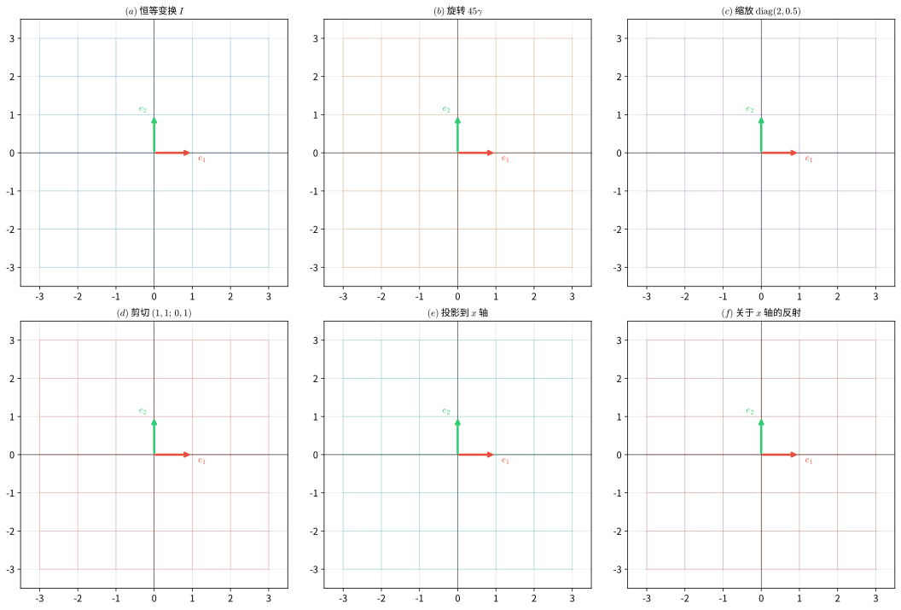

*图4：常见线性变换的几何效果。矩阵作用在网格上，观察基向量 $e_1, e_2$（红、绿箭头）的变换即可完全确定变换：(a) 恒等变换；(b) 旋转 45°；(c) 不等比缩放；(d) 剪切；(e) 投影到 x 轴（降维！）；(f) 关于 x 轴的反射。*

#### 🎬 动画演示：线性变换之于平面网格

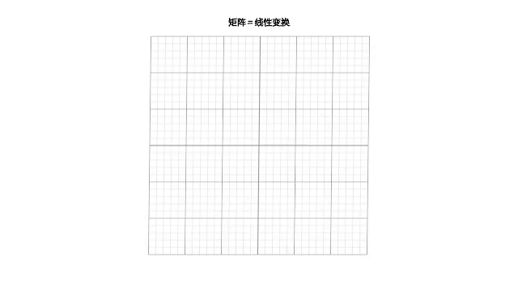

> 这个动画直观展示了矩阵作为"空间变形机"的作用：整个平面网格在矩阵作用下被旋转、拉伸、剪切或压缩，而网格线始终保持平行且等距。它帮助理解"矩阵就是线性变换"这一核心思想。

#### 课堂问答

**老师**：给你一个映射，怎么一眼看出它是不是线性变换？举一个看着像其实不是的例子。

**学生**：只验两条：$T(u+v)=T(u)+T(v)$ 与 $T(cu)=cT(u)$。反例是平移 $T(x)=x+1$，它把零映到 $1$ 而非 $0$，一票否决；$T(x)=x^2$ 则过不了数乘检验。

**老师（追问）**：为什么只要知道基向量被变到哪儿，整台变换机就完全确定了？

**学生**：因为任何向量都能写成基的线性组合 $v=\sum c_i v_i$，由线性性得 $T(v)=\sum c_i T(v_i)$。所以矩阵的每一列，就是对应基向量像的坐标。

**老师（拓展）**：投影到 $x$ 轴是线性变换，可它明显"丢了一维"，这矛盾吗？

**学生**：不矛盾。线性不等于可逆。投影 $T(x,y,z)=(x,y,0)$ 的像是 $xy$ 平面、核是 $z$ 轴，既线性又把维度压低了。可逆只是额外要求核为零的一种特例。

### 6.2 核与像

🔍 **一台机器：吞什么、吐什么**：任何变换都关心两个集合——**核**（被压到原点的那些输入："吃了什么、丢了多少"）和**像**（真正产出的输出："吐了什么、覆盖多大"）。它们各是一个子空间：前者衡量"多浪费多少维度/信息"，后者衡量"覆盖面有多大"。

**定义**：设 $T: V \to W$ 是线性变换。

- **核**（kernel，也称零空间）：$\ker(T) = \{v \in V \mid T(v) = \mathbf{0}\}$
- **像**（image，也称值域）：$\operatorname{im}(T) = \{T(v) \mid v \in V\}$

**定理**：$\ker(T)$ 是 $V$ 的子空间，$\operatorname{im}(T)$ 是 $W$ 的子空间。

**证明**：若 $u, v \in \ker(T)$，则 $T(u+v) = T(u) + T(v) = \mathbf{0} + \mathbf{0} = \mathbf{0}$，所以 $u+v \in \ker(T)$。若 $c \in \mathbb{F}$，$T(cu) = cT(u) = c\mathbf{0} = \mathbf{0}$，所以 $cu \in \ker(T)$。因此 $\ker(T)$ 是子空间。类似可证 $\operatorname{im}(T)$ 是子空间。

> **直观理解（类比）**：核是"被变换压到原点的那一坨输入"，像是变换"真正吐出来、覆盖到"的那些输出。就像一台投影仪：核是那些投到同一点（被叠成一团）的输入，像是屏幕上真正被照亮的区域——前者是被"吞没"的信息，后者是被"展现"的信息。

#### 课堂问答

**老师**：核和像，一个管"丢什么"，一个管"吐什么"，它们在几何上是子空间吗？

**学生**：都是子空间。核 $\ker(T)=\{v\mid T(v)=\mathbf{0}\}$ 是被压到原点的输入，像 $\operatorname{im}(T)=\{T(v)\}$ 是全部输出。核衡量损失的信息，像衡量覆盖的范围。

**老师（追问）**：如果核里只有零向量，这说明什么？

**学生**：说明 $T$ 是单射。因为 $T(u)=T(v)$ 等价于 $u-v\in\ker(T)$；核只含零，等价于 $u=v$。所以"核为零"和"一一对应"是一回事。

**老师（拓展）**：拿正交投影到子空间 $W$ 来说，核和像分别是什么？

**学生**：核是 $W$ 的正交补 $W^\perp$（被压成零的方向），像就是 $W$ 本身。而且这时 $V=W\oplus W^\perp$，核与像恰好直和拼回整个空间，结构非常干净。

### 6.3 秩-零化度定理

⚖️ **经典的守恒律**：被压进原点的维度（**零化度**）+ 保留下来的维度（**秩**）= 原来的维度。名字就叫"秩-零化度定理"。比如把三维空间压到平面上：压扁了一维、留下两维，$1+2=3$。它是一根定海神针，把解方程、维数、变换这几个话题彻底串在一起。

**定理**（rank-nullity theorem）：设 $T: V \to W$ 是线性变换，$V$ 是有限维向量空间。则

$$
\dim(\ker(T)) + \dim(\operatorname{im}(T)) = \dim(V)
$$

记 $\operatorname{nullity}(T) = \dim(\ker(T))$（零化度），$\operatorname{rank}(T) = \dim(\operatorname{im}(T))$（秩），则

$$
\operatorname{nullity}(T) + \operatorname{rank}(T) = \dim(V)
$$

**证明**：设 $\dim(V) = n$，$\{v_1, \dots, v_k\}$ 是 $\ker(T)$ 的一组基。将其扩充为 $V$ 的一组基：

$$
\{v_1, \dots, v_k, w_1, \dots, w_{n-k}\}
$$

我们断言 $\{T(w_1), \dots, T(w_{n-k})\}$ 是 $\operatorname{im}(T)$ 的一组基。

首先证明张成性：对任意 $v \in V$，存在标量使得 $v = \sum_{i=1}^k a_i v_i + \sum_{j=1}^{n-k} b_j w_j$。则

$$
T(v) = \sum_{i=1}^k a_i T(v_i) + \sum_{j=1}^{n-k} b_j T(w_j) = \sum_{j=1}^{n-k} b_j T(w_j)
$$

- 【第1步】依据：把 $v$ 按 $V$ 的基展开，再对每一项分别作用 $T$（线性保持数乘与加法）；目的：让像 $T(v)$ 只用 $T(w_j)$ 表达。
- 【第2步】依据：$v_i \in \ker(T)$ 所以 $T(v_i)=\mathbf{0}$，相关项消失；目的：证明 $\{T(w_j)\}$ 张成 $\operatorname{im}(T)$。
  因为 $T(v_i) = \mathbf{0}$。所以 $\{T(w_j)\}$ 张成 $\operatorname{im}(T)$。

再证明线性无关性：设 $\sum_{j=1}^{n-k} c_j T(w_j) = \mathbf{0}$，则 $T\left(\sum_{j=1}^{n-k} c_j w_j\right) = \mathbf{0}$，所以 $\sum c_j w_j \in \ker(T)$。于是存在标量 $d_i$ 使得 $\sum_{j=1}^{n-k} c_j w_j = \sum_{i=1}^k d_i v_i$，即 $\sum_{j=1}^{n-k} c_j w_j - \sum_{i=1}^k d_i v_i = \mathbf{0}$。由于 $\{v_i, w_j\}$ 线性无关，所有系数为零，特别地 $c_j = 0$。因此 $\{T(w_j)\}$ 线性无关。

- 【第3步】依据：若 $\{T(w_j)\}$ 的线性组合为零，则其"原像组合"落入核，也就落进 $\ker(T)$ 的基 $v_i$ 张成的空间；目的：把独立性判断转成对 $V$ 的基做线性无关判断。
- 【第4步】依据：$\{v_i,w_j\}$ 合起来仍是 $V$ 的一组基，线性无关意味着每个系数必为零；目的：证出所有 $c_j=0$，从而 $\{T(w_j)\}$ 线性无关。

这就证明了 $\dim(\operatorname{im}(T)) = n - k = \dim(V) - \dim(\ker(T))$。

> **💡 直观理解**：秩-零化度定理是一个"守恒定律"——变换"压缩"了多少维度到原点（零化度），就"保留"了多少维度到像空间（秩），两者之和恰好等于原始空间的维数。比如把三维空间投影到平面上，被压扁的那一维（零化度=1）加上投影后保留的二维（秩=2），正好是 3。

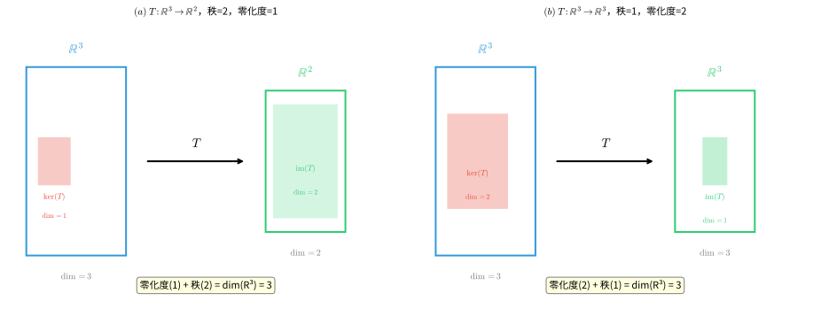

*图5：秩-零化度定理的示意图。(a) $T:\mathbb{R}^3 \to \mathbb{R}^2$，核是1维直线，像是整个 $\mathbb{R}^2$，$1+2=3$；(b) $T:\mathbb{R}^3 \to \mathbb{R}^3$，核是2维平面，像是1维直线，$2+1=3$。*

#### 课堂问答

**老师**：零化度加秩恰好等于原空间维数，这个"守恒律"是从哪儿来的？

**学生**：取 $\ker(T)$ 的一组基 $\{v_1,\dots,v_k\}$，扩充成 $V$ 的基，补上 $w_1,\dots,w_{n-k}$。可证 $\{T(w_j)\}$ 恰是 $\operatorname{im}(T)$ 的基，故 $\dim\operatorname{im}(T)=n-k$，即 nullity 加 rank 等于 $\dim V$。

**老师（追问）**：用这个定理怎么判断一个 $m\times n$ 矩阵能不能满射？

**学生**：$A:\mathbb{R}^n\to\mathbb{R}^m$ 的 rank 不超过 $\min(m,n)$。满射要求 rank 等于 $m$，于是必须有 $m\le n$。所以 $m>n$ 的超定方程组必定不满射，只能退而求最小二乘解。

**老师（拓展）**：方阵可逆和这个定理怎么联系起来？

**学生**：$A$ 可逆等价于 $\ker(A)=\{\mathbf{0}\}$，即 nullity 为 $0$，即 rank 为 $n$，即满秩。核为零、单射、满射、满秩、可逆，这五个说法在方阵上完全等价。

### 6.4 矩阵表示

📸 **给变换"拍照存档"**：任意线性变换都能用一个小表格完整记住——只要记下**每个基向量被变到哪儿**（每列存它的坐标）。从此抽象的变换变成了普通的矩阵乘法，计算和理论都变得可操作、可复合。

给定 $V$ 的基 $B = \{v_1, \dots, v_n\}$ 和 $W$ 的基 $C = \{w_1, \dots, w_m\}$，线性变换 $T: V \to W$ 的矩阵表示 $[T]_C^B$ 是一个 $m \times n$ 矩阵，其第 $j$ 列是 $T(v_j)$ 在基 $C$ 下的坐标向量：

$$
T(v_j) = \sum_{i=1}^m a_{ij} w_i
$$

则 $[T]_C^B = (a_{ij})_{m \times n}$。

**坐标变换**：若 $x \in V$ 在基 $B$ 下的坐标为 $[x]_B$，则 $T(x)$ 在基 $C$ 下的坐标为

$$
[T(x)]_C = [T]_C^B [x]_B
$$

**复合与矩阵乘法**：若 $S: U \to V$，$T: V \to W$，则 $T \circ S: U \to W$ 的矩阵表示为

$$
[T \circ S] = [T] [S]
$$

> **直观理解（类比）**：矩阵表示就是给线性变换"拍照登记"：只要记下每个基向量被变换后落到哪里（每列存一列坐标），整个变换就被一个小表格完全装下。之后"复合变换"只是把这两本操作说明书按顺序乘起来当作一套流程。

#### 课堂问答

**老师**：矩阵的每一列到底存了什么？为什么矩阵表示要这样定义？

**学生**：第 $j$ 列存的是 $T(v_j)$ 在目标基 $C$ 下的坐标，即 $T(v_j)=\sum_i a_{ij}w_i$。这样抽象变换就被压成普通矩阵乘法：$[T(x)]_C=[T]_C^B[x]_B$。

**老师（追问）**：换了基，同一个变换的矩阵就变了，那什么是不变的？

**学生**：变的是表示、不变的是变换本身。两组基下的矩阵由过渡矩阵联系：$[T]_{B'}=P^{-1}[T]_B P$，也就是相似。所以相似矩阵捕捉的正是"同一个变换"这个不变量。

**老师（拓展）**：为什么复合变换对应矩阵相乘，而不是相加？

**学生**：因为 $(T\circ S)(x)=T(S(x))$，要先算 $S$ 再算 $T$，坐标层面自然叠成乘积 $[T][S]$。这解释了矩阵乘法为何那样定义、且顺序不能颠倒——反过来做的是另一件事。

### 6.5 过渡矩阵与坐标变换

📏 **换把尺子，读数就不同**：同一个向量"1 米"，用公制尺量是 100 厘米、用英制尺量是 39.37 英寸。同一份数据在不同"基"下坐标也不一样——**过渡矩阵 $P$** 就是这两把尺子之间的"换算表"。它还是下一章"相似矩阵"的钥匙：同一个变换换基后的矩阵，正是 $P^{-1}AP$。

**定义**：设 $V$ 是 $n$ 维向量空间，有两组基

$$
B = \{v_1, \dots, v_n\}, \qquad B' = \{v'_1, \dots, v'_n\}
$$

把 $B'$ 中每个向量用 $B$ 表示：

$$
v'_j = \sum_{i=1}^n p_{ij} v_i
$$

则矩阵 $P = (p_{ij})$ 称为由基 $B$ 到基 $B'$ 的**过渡矩阵**（或基变换矩阵）。$P$ 的列就是新基向量在旧基下的坐标，故 $P$ 可逆。

**坐标变换公式**：若向量 $x$ 在基 $B$ 下的坐标为 $[x]_B$，在基 $B'$ 下的坐标为 $[x]_{B'}$，则

$$
[x]_B = P [x]_{B'} \qquad \text{即} \qquad [x]_{B'} = P^{-1} [x]_B
$$

> **💡 直观理解**：过渡矩阵是"坐标换算表"。同一个向量（比如"1米"），在不同的尺子（基）下读数不同：用英制尺量是 39.37 英寸，用公制尺量是 100 厘米。过渡矩阵 $P$ 就是"英寸 ↔ 厘米"的换算系数表。矩阵 $P$ 的列是"新尺子每一格在旧尺子下有多长"。
>
> **🔑 与线性变换矩阵的关系**：若线性变换 $T: V \to V$ 在基 $B$ 下的矩阵是 $[T]_B$，在基 $B'$ 下的矩阵是 $[T]_{B'}$，则
>
> $$
[T]_{B'} = P^{-1} \, [T]_B \, P
$$
>
> 这正是下一章（7.2 节）将讲到的"相似矩阵"的来历——**同一个线性变换在不同基下的矩阵是相似的**。过渡矩阵 $P$ 就是那个相似变换矩阵。

---

#### 课堂问答

**老师**：过渡矩阵 $P$ 的列是什么？凭什么坐标变换写成 $[x]_B=P[x]_{B'}$？

**学生**：$P$ 的列是新基 $B'$ 的向量在旧基 $B$ 下的坐标：$v'_j=\sum_i p_{ij}v_i$。由 $x=\sum_j x'_j v'_j$ 逐项展开成旧基，整理即得 $[x]_B=P[x]_{B'}$，新到旧乘 $P$、旧到新乘 $P^{-1}$。

**老师（追问）**：为什么这个 $P$ 一定可逆？

**学生**：因为 $B$ 与 $B'$ 都是基，$P$ 的列是一组线性无关的坐标向量，方阵列满秩即 $P$ 可逆，于是 $[x]_{B'}=P^{-1}[x]_B$ 也成立。

**老师（拓展）**：过渡矩阵和相似矩阵是什么关系？

**学生**：同一个线性变换换基，矩阵就满足 $[T]_{B'}=P^{-1}[T]_B P$。所以过渡矩阵 $P$ 正是那个相似变换矩阵，特征值、迹、行列式、秩在换基下全部不变。

## 七、特征值与特征向量

### 7.1 基本定义

🎯 **先猜猜"不变的方向"**：被一台变形机一处理，大多数向量都会转向，可总有一两个方向"倔得很"——**只被拉伸/压缩，绝不偏转**。这些方向就是**特征向量**，伸缩的倍数就是**特征值**，方程即 $Av=\lambda v$。一旦抓住这些方向，复杂的变形立刻被拆成"几个各自独立的缩放"。

**定义**：设 $A$ 是 $\mathbb{F}$ 上的 $n$ 阶方阵。若存在非零向量 $v \in \mathbb{F}^n$ 和标量 $\lambda \in \mathbb{F}$，使得

|    符号    |    名称    | 含义                       | 直观解释           |
| :---------: | :--------: | :------------------------- | :----------------- |
|    $v$    |  特征向量  | 经$A$ 作用方向不变的向量 | "不拐弯的方向"     |
| $\lambda$ |   特征值   | 该方向被拉伸/压缩的倍数    | "这条路上拉多少倍" |
|   $Av$   | 矩阵乘向量 | 把$v$ 交给 $A$ 变换    | "让机器去变形 v"   |

$$
Av = \lambda v
$$

则称 $\lambda$ 为 $A$ 的**特征值**，$v$ 为对应的**特征向量**。

**几何意义**：特征向量在 $A$ 的作用下只改变长度（伸缩 $\lambda$ 倍），不改变方向（或反向）。

> **💡 直观理解**：想象矩阵 $A$ 是一个"空间变形机"。大多数向量经过变换后都会改变方向，但有些"特殊方向"的向量只会被拉伸或压缩，不会偏转——这些就是特征向量，拉伸倍数就是特征值。
>
> **🔑 为什么重要**：特征值揭示了变换的"本质特征"——
>
> - 最大特征值决定了变换的"主要拉伸方向"（如 Google PageRank 的核心思想）
> - 特征值分解让我们可以用"简单变换"（沿特征方向的缩放）理解"复杂变换"
> - 单位圆在变换下变成椭圆，特征向量方向就是椭圆的轴，特征值就是半轴长度

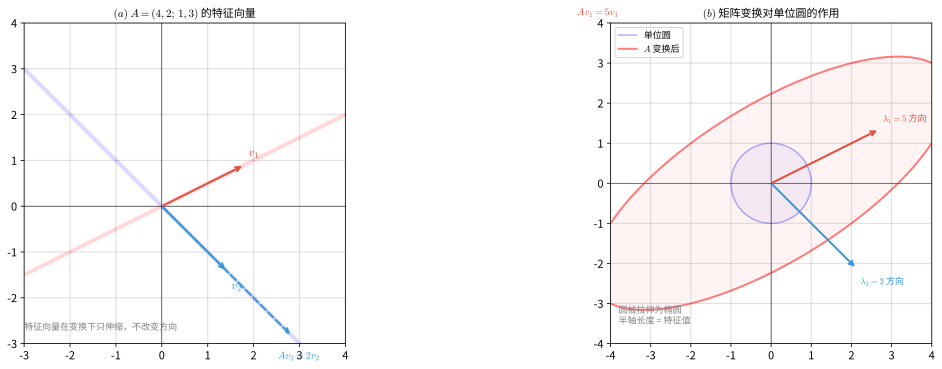

*图6：特征值与特征向量。(a) 矩阵 $A$ 的特征向量在变换下只伸缩不转向：$Av_1 = 5v_1$（拉伸5倍），$Av_2 = 2v_2$（拉伸2倍）；(b) 单位圆在矩阵变换下变成椭圆，椭圆的半轴方向就是特征向量方向，半轴长度就是特征值。*

> **🧠 思考历程：为什么会有人先去关心"变换中那些不动心的方向"？**
>
> 一个线性变换动辄让无数向量拐弯变向，特征值与特征向量偏要盯住少数"只伸缩、不转向"的方向。这个看似钻牛角的念头，恰恰是理解变形的一把万能钥匙。
>
> - **从"弹性力学"和振动的实际问题里来**。18-19 世纪，弹性体受力、琴弦和机械振动等问题，反复出现"某个系统天然震动的方式"，它们对应若干"固有频率/模式"。"特征值/eigenvalue"中的 eigen- 正是德语"固有的、本征的"，由希尔伯特等人推广后沿用下来——**它一开始是工程师和物理学家眼里"系统自带的调性"。**
> - **凯莱、哈密顿等人注入代数**。凯莱和汉密尔顿（Hamilton）联结行列式来刻画特征多项式；到 20 世纪初，**希尔伯特**在积分方程里把"特征值问题"提为分析学的核心议题之一。**"固定方向的向量"与"伸缩倍数 λ"从此作为 $Av=\lambda v$ 正式登上舞台。**
> - **为什么抓 "$Av=\lambda v$" 这么有用？** 因为一旦找到"绕过所有方向、只用特征方向"表示的基，原来看似复杂的变换就变成"沿着每条特征方向单独伸缩 λ 倍"——几何上单位圆变椭圆，主方向正是特征方向。**把"任意向量"拆成"特征向量叠加"，复杂变形就分解成一个个互不相干的简单缩放，这就是特征分解、谱定理、PageRank、主成分分析共通的心法。**
> - **心路**：特征值的发现史启示你：**要读懂一个"胡作非为"的机器人，先找出它"拐不动的那些轨道"**。$Av=\lambda v$ 看起来简简单单，背后却是把"整体变形"拆成"特征方向"来逐个击破的最强思维方式。

#### 🎬 动画演示：特征向量与伸缩

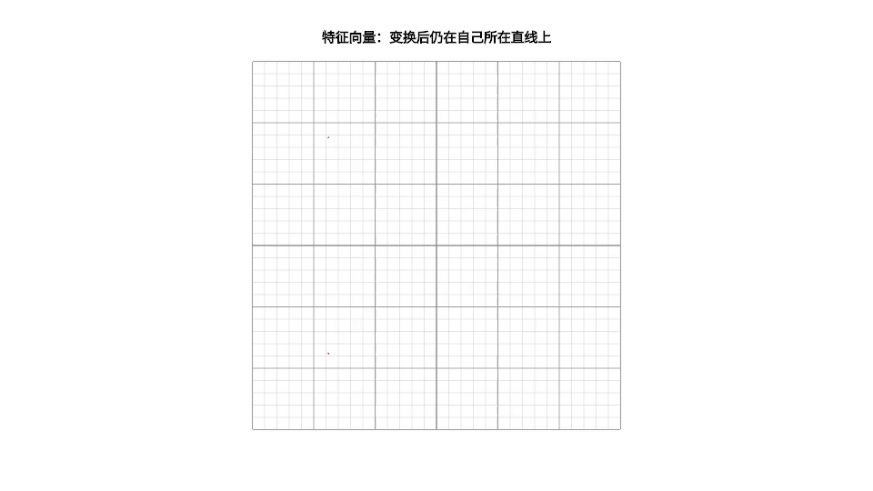

> 这个动画直观展示了特征向量 $v$ 在矩阵 $A$ 作用下只改变长度、不改变方向的性质：$Av = \lambda v$。多数向量经过变换都会偏转，只有特征向量保持方向不变，只被拉伸或压缩 $\lambda$ 倍。

#### 课堂问答

**老师**：特征向量为什么规定不许取零向量？

**学生**：因为 $A\mathbf{0}=\lambda\mathbf{0}$ 对任意 $\lambda$ 都成立，零向量根本没法确定特征值。要求 $v\neq\mathbf{0}$，"方向不变"这句话才有意义，特征值才唯一。

**老师（追问）**：特征值可能是复数吗？实矩阵呢？

**学生**：可能是复数。实矩阵也完全可能只有复特征值，而且它们成共轭对出现，比如旋转矩阵的特征值是 $\pm i$。这在第 14 章会用旋转-伸缩来解释。

**老师（拓展）**：为什么说特征方向是"定海神针"？

**学生**：因为沿特征方向的向量只被伸缩 $\lambda$ 倍、绝不偏转。一旦找齐这样的方向，复杂的变形就被拆成几个互不干扰的独立缩放，这正是对角化、谱定理乃至 PageRank 的共同心法。

### 7.2 特征多项式

🔎 **怎么把特征值算出来？** 要让 $Av=\lambda v$ 有非零解，就得让 $A-\lambda I$"失去信息"（不可逆），于是解 $\det(A-\lambda I)=0$。把这个行列式展开，就得到**特征多项式**；它的根正是各条主轴被拉长的倍数，而且根之和 = 迹、根之积 = 行列式。

方程 $Av = \lambda v$ 等价于 $(A - \lambda I)v = \mathbf{0}$。$v \neq \mathbf{0}$ 要求 $A - \lambda I$ 不可逆，即

$$
\det(A - \lambda I) = 0
$$

**定义**：$p_A(\lambda) = \det(\lambda I - A)$ 称为 $A$ 的**特征多项式**（有时也用 $\det(A - \lambda I)$）。$p_A(\lambda) = 0$ 称为**特征方程**。

**性质**：

- $p_A(\lambda)$ 是 $\lambda$ 的 $n$ 次多项式，首项系数为 $1$
- $p_A(\lambda) = \lambda^n - (\operatorname{tr}(A))\lambda^{n-1} + \cdots + (-1)^n \det(A)$
- $A$ 的特征值之和等于 $\operatorname{tr}(A)$
- $A$ 的特征值之积等于 $\det(A)$

> **直观理解（类比）**：特征多项式就是"找主轴方向的寻宝方程"：要让某个非零方向被 $A$ 恰好拉成 $\lambda$ 倍，就得让 $A-\lambda I$ 失去信息（不可逆），于是要解 $\det(A-\lambda I)=0$。它的根正是各条"拉伸轴"的拉伸倍数，且根之和=迹、根之积=行列式。

#### 课堂问答

**老师**：特征值为什么就是 $\det(A-\lambda I)=0$ 的根？

**学生**：$Av=\lambda v$ 要有非零解，等价于 $(A-\lambda I)v=\mathbf{0}$ 要有非零解，即 $A-\lambda I$ 奇异，也就是 $\det(A-\lambda I)=0$。展开右边得到 $n$ 次多项式，它的根就是全部特征值。

**老师（追问）**：不解整个多项式，有没有办法快速拿到特征值之和、之积？

**学生**：有。展开式 $p_A(\lambda)=\lambda^n-\operatorname{tr}(A)\lambda^{n-1}+\cdots+(-1)^n\det(A)$ 告诉我们：特征值之和等于迹，之积等于行列式。算不出具体值也能先做校验。

**老师（拓展）**：为什么还要区分代数重数和几何重数？

**学生**：多项式可能出现重根，对应代数重数大于 $1$；但特征空间 $\ker(A-\lambda I)$ 的维数（几何重数）可能更小。只有二者相等，特征向量数才够，矩阵才可对角化。

### 7.2b 相似矩阵

👀 **同一个变换，换个坐标系看**：$B=P^{-1}AP$ 只是把**同一个**线性变换换了个坐标系来"看"。因为它仍是那个变换，特征值、行列式、迹、秩这些"本质不变量"全都保持不变。看懂了这一点，你就抓住了"换基不变"的命脉，也就能看清哪些东西是矩阵的"真面目"。

**定义**：设 $A, B$ 是 $n$ 阶方阵。若存在可逆矩阵 $P$ 使得

$$
B = P^{-1} A P
$$

则称 $B$ 与 $A$ **相似**，记作 $A \sim B$。$P$ 称为相似变换矩阵。

**性质**：相似矩阵有相同的：

- **特征多项式**，从而有相同的**特征值**（含重数）
- **行列式**：$\det(B) = \det(A)$
- **迹**：$\operatorname{tr}(B) = \operatorname{tr}(A)$
- **秩**：$\operatorname{rank}(B) = \operatorname{rank}(A)$

> **💡 直观理解**：相似矩阵 $B = P^{-1}AP$ 本质上是"同一个线性变换，在**不同坐标系**下的矩阵表示"。$P$ 的作用是"换坐标系"：先用 $P$ 把向量换到新坐标（$P$），在新坐标下做变换 $A$，再换回原坐标（$P^{-1}$）。所以相似矩阵是"同一变形、不同视角"。
>
> **🔑 为什么重要**：
>
> - **对角化正是相似的特例**：$A$ 可对角化 $\iff$ $A$ 相似于一个对角矩阵
> - **寻找"最简单的位姿"**：我们希望找到 $P$，让 $P^{-1}AP$ 尽量简单（如对角矩阵），从而看清变换的本质
> - **特征值不变性**：既然相似矩阵特征值相同，而特征值刻画变换的本质（伸缩倍数），所以"相似"捕捉了线性变换最核心的不变量

#### 课堂问答

**老师**：$B=P^{-1}AP$，你凭什么说 $A$ 和 $B$ 是"同一个变换"？

**学生**：因为 $P$ 只是换坐标：先用 $P$ 把向量送到新坐标、做变换 $A$、再用 $P^{-1}$ 换回来。同一个线性变换在不同基下的矩阵自然相似，$B$ 只是"换了个视角的 $A$"。

**老师（追问）**：相似能保持哪些量，又不能保持哪些？

**学生**：保持特征多项式（从而特征值）、行列式、迹和秩，因为这些是变换的内在属性。不保持的是矩阵元素本身；而且一般也不保持对称性，除非相似变换用的是正交矩阵。

**老师（拓展）**：相似 $P^{-1}AP$ 和合同 $P^{T}AP$ 有什么本质区别？

**学生**：相似刻画"同一变换换基"，合同刻画"同一二次型换变量"。相似保特征值，合同保惯性指数（正负项数）却不保具体数值。两者用途完全不同，别混为一谈。

### 7.3 对角化

👑 **目标：把矩阵"拧"成最简单的样子**：如果存在可逆矩阵 $P$ 让 $P^{-1}AP$ 变成对角矩阵，就称 $A$ 可**对角化**。这就像把一台斜着拉的空间变形机"转正"到主轴方向，让它变成"各方向独立缩放"。一旦做到，幂次、指数、微分方程都能超快地算。

**定义**：$n$ 阶方阵 $A$ 称为**可对角化**的，如果存在可逆矩阵 $P$ 使得 $P^{-1}AP$ 是对角矩阵。

**定理**：$A$ 可对角化 $\iff$ $A$ 有 $n$ 个线性无关的特征向量 $\iff$ 对每个特征值，其代数重数等于几何重数。

**代数重数**：特征值 $\lambda$ 作为特征多项式根的重数。
**几何重数**：特征空间 $E_\lambda = \{v \mid Av = \lambda v\}$ 的维数，即 $\dim(\ker(A - \lambda I))$。

**对角化步骤**：

1. 求特征多项式 $\det(\lambda I - A)$，得特征值 $\lambda_1, \dots, \lambda_k$
2. 对每个特征值 $\lambda_i$，解 $(A - \lambda_i I)v = \mathbf{0}$，得特征空间的一组基
3. 若总共有 $n$ 个线性无关的特征向量，将它们排成矩阵 $P$ 的列
4. 则 $P^{-1}AP = \operatorname{diag}(\lambda_1, \dots, \lambda_n)$

> **💡 直观理解**：对角化就是"找到最合适的坐标系"，让复杂的变换变得简单。想象一个斜着拉伸的变换，在标准坐标系下看起来很复杂（矩阵有很多非零元素），但如果旋转到特征向量方向作为坐标轴，变换就变成了简单的"各方向独立缩放"（对角矩阵）。
>
> **🔑 为什么对角化重要**：
>
> - **简化计算**：对角矩阵的幂次、指数等运算极其简单。$A^n = P \Lambda^n P^{-1}$，而 $\Lambda^n$ 只是对角元素各自取 $n$ 次幂
> - **揭示本质**：特征值就是变换在各个"主方向"上的伸缩倍数，对角化让我们看清变换的"真面目"
> - **解微分方程**：线性微分方程组 $\dot{x} = Ax$ 的解 $x(t) = e^{At}x(0)$，对角化后 $e^{At} = P e^{\Lambda t} P^{-1}$，计算大幅简化
>
> **🔑 不可对角化的情形**：如果矩阵没有足够的特征向量（几何重数 < 代数重数），就不能对角化。这时需要用 Jordan 标准形——"几乎对角"的形式，对角线上方可能有 1。

#### 课堂问答

**老师**：判断一个矩阵能否对角化，最关键的那条判据是什么？

**学生**：$A$ 可对角化等价于有 $n$ 个线性无关的特征向量，也等价于每个特征值的代数重数都等于几何重数。这里几何重数就是 $\dim\ker(A-\lambda I)$，比它小就凑不齐基。

**老师（追问）**：哪几类矩阵保证可以对角化？

**学生**：有两类立刻可行：一是特征值互不相同的矩阵，$n$ 个互异特征值必给出 $n$ 个线性无关特征向量；二是实对称矩阵，由谱定理甚至能正交对角化。

**老师（拓展）**：费这么大劲对角化，到底图什么？

**学生**：图幂和指数变简单。$A^n=P\Lambda^n P^{-1}$，对角阵取幂只需各自乘方；微分方程系统靠 $e^{At}=Pe^{\Lambda t}P^{-1}$，马尔可夫链靠 $P^k$ 直接读出长期行为。


### 7.3b Jordan 标准形与广义特征向量

🪜 **对"不可对角化"的最后通牒**：前面 7.3 只有在特征向量足够多（几何重数 = 代数重数）时才可对角化。可现实里矩阵偏偏"缺几个特征向量"，像 $A=\begin{pmatrix}2&1\\0&2\end{pmatrix}$，只有一个（不成比例方向的）特征向量，永远拼不出 $n$ 个——它就**不可对角化**。本节来补这块空白：**Jordan 标准形**是"尽量接近对角"的替代品，几乎能装下所有方阵，它唯一的"代价"是对角线上方偶尔冒出几个 $1$。

**为什么值得学**：可对角化只是"理想情形"，而现实中的微分方程组、幂、指数 $e^{At}$ 常遇到重特征值、欠特征向量。Jordan 形把"缺了的特征向量"用**广义特征向量**补全成一条条**特征向量/主向量链**，让我们照样能把问题"降阶"成一块块小矩阵来计算——**不可对角化，照样能被驯服**。

**广义特征向量**：称非零向量 $v$ 为 $A$ 关于特征值 $\lambda$ 的**广义特征向量（次数 $k$）**，若 $(A-\lambda I)^k v = \mathbf{0}$ 但 $(A-\lambda I)^{k-1}v \neq \mathbf{0}$。当 $k=1$ 时正是普通特征向量。

**定义（Jordan 块）**：形如
$$
J_k(\lambda)=\begin{pmatrix}
\lambda & 1 & & \\
& \lambda & \ddots & \\
& & \ddots & 1 \\
& & & \lambda
\end{pmatrix}
$$
的 $k\times k$ 上三角矩阵（对角线上方为 $1$）称为一个 **Jordan 块**。

**定理（Jordan 标准形）**：任意复方阵 $A$ 都相似于一个分块对角矩阵
$$
J=P^{-1}AP=\operatorname{diag}\big(J_{k_1}(\lambda_1),\,J_{k_2}(\lambda_2),\,\ldots,\,J_{k_s}(\lambda_s)\big),
$$
每个 Jordan 块对应一条**线性无关的特征向量/主向量链**；对固定特征值 $\lambda$，其 Jordan 块的**个数等于几何重数**，各块的阶 $k_i$ 之和等于**代数重数**。$A$ 可对角化 $\iff$ 所有 Jordan 块都是 $1\times1$。

> **🔎 怎么求出 Jordan 形**：对每个特征值 $\lambda$，沿核 $\ker(A-\lambda I)\subseteq\ker(A-\lambda I)^2\subseteq\cdots$ 逐级"升高"抓主向量链，链长（最高 $k$）= 最大 Jordan 块阶数；整体有几何重数$=$块数、代数重数$=$块阶之和两层约束。
>
> **💡 直观理解（类比）**：当特征向量不够时，就像相机卡在一条轨道上既平移又微微扭转——Jordan 块里对角线上方的那个 $1$，正是"这格不只纯伸缩，还偷偷顺着主方向滑了一下"。
>
> **常见坑**：最普遍的错误是"Jordan 形里非对角线全是 $1$"——实际上只有每条链的"相邻下一级"之间才有 $1$，其余位置是 $0$；且块序、$J$ 的 $1$ 在上一行还是下一行可能约定不同，务必按链长来排，别想当然。
>
> **妙用**：写成 $J_k=\lambda I + N$（$N$ 幂零、$N^{k-1}\neq0$，$N^k=0$），由**二项式定理** $J^n=(\lambda I+N)^n=\sum_{i=0}^{k-1}\binom{n}{i}\lambda^{n-i}N^i$，从而 $A^n= P J^n P^{-1}$；同理 $e^{Jt}=e^{\lambda t}e^{Nt}$ 可显式展开，$e^{At}=Pe^{Jt}P^{-1}$ 一举解决重特征值微分方程组。

**巩固练习**：

**基础 1**：设 $A=\begin{pmatrix}2&1\\0&2\end{pmatrix}$。求 $A$ 各特征值的几何重数与代数重数，写出 Jordan 标准形，并求 $A^n$ 与 $e^{At}$。

<details>
<summary><b>解答</b></summary>

特征值 $\lambda=2$（代数重数 $2$）；$A-2I=\begin{pmatrix}0&1\\0&0\end{pmatrix}$ 的秩 $1$，故几何重数 $=2-1=1<2$，不可对角化，Jordan 形 $J=J_2(2)=\begin{pmatrix}2&1\\0&2\end{pmatrix}$。写 $J=2I+N$，$N=\begin{pmatrix}0&1\\0&0\end{pmatrix}$，$N^2=0$，故 $J^n=(2I+N)^n=2^n I+n2^{n-1}N=\begin{pmatrix}2^n& n2^{n-1}\\0&2^n\end{pmatrix}$（此处恰 $P=I$）。同理 $e^{At}=e^{2t}\begin{pmatrix}1&t\\0&1\end{pmatrix}$。

</details>

**进阶 2**：设 $A=\begin{pmatrix}3&1&0\\0&3&1\\0&0&3\end{pmatrix}$。写出 Jordan 标准形，并求 $A^n$。

<details>
<summary><b>解答</b></summary>

仅特征值 $3$（代数重数 $3$）。$A-3I=N=\begin{pmatrix}0&1&0\\0&0&1\\0&0&0\end{pmatrix}$，$N^2=\begin{pmatrix}0&0&1\\0&0&0\\0&0&0\end{pmatrix}$，$N^3=0$，几何重数 $1$，故 $J=J_3(3)=A$。由 $A^n=(3I+N)^n=3^n I+n3^{n-1}N+\binom{n}{2}3^{n-2}N^2$，即 $A^n=\begin{pmatrix}3^n& n3^{n-1}&\binom{n}{2}3^{n-2}\\0&3^n& n3^{n-1}\\0&0&3^n\end{pmatrix}$。

</details>

**挑战 3**：$A=\begin{pmatrix}1&0&0\\1&1&0\\0&0&2\end{pmatrix}$。判断是否可对角化；若否，写出 Jordan 标准形，并求 $A^n$ 的一般公式。

<details>
<summary><b>解答</b></summary>

特征值：$\lambda=1$（代数重数 $2$）、$\lambda=2$（代数重数 $1$）。$\lambda=1$：$A-I=\begin{pmatrix}0&0&0\\1&0&0\\0&0&1\end{pmatrix}$ 秩 $2$，几何重数 $=3-2=1<2$，不可对角化，对应一个 $2\times2$ Jordan 块 $J_2(1)=\begin{pmatrix}1&1\\0&1\end{pmatrix}$；$\lambda=2$ 对应 $J_1(2)=(2)$。故 $J=\begin{pmatrix}1&1&0\\0&1&0\\0&0&2\end{pmatrix}$。$J_2(1)=I+N$（$N=\begin{pmatrix}0&1\\0&0\end{pmatrix}$，$N^2=0$），$J^n=\begin{pmatrix}1&n&0\\0&1&0\\0&0&2^n\end{pmatrix}$，$e^{At}=\begin{pmatrix}e^{t}&te^{t}&0\\0&e^{t}&0\\0&0&e^{2t}\end{pmatrix}$（取 $P=I$ 时 $A$ 已写成该形式）。

</details>

#### 课堂问答

**老师**：$A=\begin{pmatrix}2&1\\0&2\end{pmatrix}$ 明明有特征值，为什么说它不可对角化？

**学生**：因为它只有一个特征值 $\lambda=2$，而 $A-2I$ 的秩为 $1$，几何重数 $=2-1=1$，小于代数重数 $2$。特征向量不够，拼不出可逆矩阵 $P$，所以无法对角化。

**老师（追问）**：那 Jordan 标准形怎么把"缺的特征向量"补回来？

**学生**：用广义特征向量补成链：$(A-\lambda I)^k v=\mathbf{0}$ 但 $(A-\lambda I)^{k-1}v\neq\mathbf{0}$。对角线上方放 $1$，写成 $J_k=\lambda I+N$，其中 $N$ 是幂零矩阵，$N^k=0$。

**老师（拓展）**：补成 Jordan 形之后，$A^n$ 和 $e^{At}$ 还能算吗？

**学生**：能。用二项式定理 $(\lambda I+N)^n=\sum_{i=0}^{k-1}\binom{n}{i}\lambda^{n-i}N^i$，因 $N$ 幂零求和只剩有限项；同理 $e^{Jt}=e^{\lambda t}e^{Nt}$，再由 $A^n=PJ^nP^{-1}$ 还原。这正是 Jordan 形的价值。

### 7.4 Cayley-Hamilton 定理

✨ **一个出人意料的"自我服从"**：Cayley-Hamilton 定理说：矩阵 $A$ 代入**自己的**特征多项式，竟然得到零矩阵，即 $p_A(A)=\mathbf{0}$。看起来神乎其神，却带来实用大礼——逆矩阵、高次幂都能顺着这个关系"降阶"成 $A$ 的 $n-1$ 次多项式来算，再也不用一遍遍死乘。

**定理**（Cayley-Hamilton）：设 $A$ 是 $n$ 阶方阵，$p_A(\lambda) = \det(\lambda I - A)$ 是其特征多项式。则

$$
p_A(A) = \mathbf{0}
$$

即 $A$ 满足自己的特征多项式。

**证明**：设 $B(\lambda) = (\lambda I - A)$ 的伴随矩阵为 $\operatorname{adj}(\lambda I - A)$，则

$$
(\lambda I - A) \operatorname{adj}(\lambda I - A) = \det(\lambda I - A) I = p_A(\lambda) I
$$

伴随矩阵的每个元素是 $\lambda I - A$ 的 $(n-1)$ 阶余子式，因此是 $\lambda$ 的次数不超过 $n-1$ 的多项式。故可写成

$$
\operatorname{adj}(\lambda I - A) = B_0 + B_1 \lambda + \cdots + B_{n-1} \lambda^{n-1}
$$

其中 $B_i$ 为 $n$ 阶常数矩阵。于是

$$
(\lambda I - A)(B_0 + B_1 \lambda + \cdots + B_{n-1} \lambda^{n-1}) = p_A(\lambda) I
$$

设 $p_A(\lambda) = \lambda^n + c_{n-1} \lambda^{n-1} + \cdots + c_1 \lambda + c_0$。比较两边 $\lambda$ 的同次幂系数：

$$
\begin{aligned}
\lambda^n &: B_{n-1} = I \\
\lambda^{n-1} &: B_{n-2} - A B_{n-1} = c_{n-1} I \\
\lambda^{n-2} &: B_{n-3} - A B_{n-2} = c_{n-2} I \\
&\vdots \\
\lambda^1 &: B_0 - A B_1 = c_1 I \\
\lambda^0 &: -A B_0 = c_0 I
\end{aligned}
$$

将第 1 个等式右乘 $A^n$，第 2 个右乘 $A^{n-1}$，……，最后一个右乘 $A^0 = I$，然后相加：

$$
(B_{n-1} A^n - A B_{n-1} A^{n-1}) + (B_{n-2} A^{n-1} - A B_{n-2} A^{n-2}) + \cdots + (B_0 A - A B_0) + (-A B_0) = p_A(A)
$$

左边各项交错抵消，最终得到 $p_A(A) = \mathbf{0}$。

**推论**：$A^{-1}$ 可以表示为 $A$ 的多项式（次数不超过 $n-1$）。因为由 $p_A(A) = 0$ 可得

$$
A^n + c_{n-1} A^{n-1} + \cdots + c_1 A + c_0 I = 0
$$

若 $A$ 可逆，则 $c_0 = (-1)^n \det(A) \neq 0$，于是

$$
A^{-1} = -\frac{1}{c_0} (A^{n-1} + c_{n-1} A^{n-2} + \cdots + c_1 I)
$$

> **直观理解（类比）**：Cayley-Hamilton 说"矩阵自己也满足自己的特征方程"——就像一个人按自己被定义的规定来生活。虽然透着神秘，但它带来实惠推论：一旦知道特征多项式，逆矩阵、高次幂都能用它"降阶"成低次多项式来算，省去一遍遍乘矩阵。

---

#### 课堂问答

**老师**：矩阵代入自己的特征多项式就得到零矩阵，这难道不奇怪吗？

**学生**：乍看神奇，细想合理：特征多项式刻画了 $A$ 所受的代数约束，所以 $p_A(A)=\mathbf{0}$ 是定理。标准证明靠伴随矩阵恒等式 $(\lambda I-A)\operatorname{adj}(\lambda I-A)=p_A(\lambda)I$，再比较两边 $\lambda$ 的同次幂系数。

**老师（追问）**：这条定理在实际计算里派什么用场？

**学生**：降阶。任何高次幂或逆矩阵都能写成 $A$ 的不超过 $n-1$ 次多项式：若 $A$ 可逆，$A^{-1}=-\frac{1}{c_0}(A^{n-1}+c_{n-1}A^{n-2}+\cdots+c_1 I)$，省去反复做矩阵乘法。

**老师（拓展）**：用这个定理求 $A^n$ 时最容易犯什么错？

**学生**：把 $p_A(\lambda)=0$ 当成普通数值方程去移项。真正要用的是矩阵恒等式 $p_A(A)=\mathbf{0}$，它是关于矩阵的多项式关系；另外求逆必须要求 $c_0\neq0$，也就是 $A$ 可逆。

## 八、内积空间

### 8.1 内积的定义

🤝 **给向量装上"匹配度"**：光能加能乘还不够，我们还想问"两个向量有多像、夹角多大、往哪边投影"。**内积**就是这个工具——把两个向量变成一个数 $\langle u,v\rangle$，几何上的"点积"正是它的老祖宗。$\mathbb{R}^n$ 上的标准内积就是 $u\cdot v=\sum_i u_i v_i$，而它恰等于 $\|u\|\|v\|\cos\theta$。

**定义**：设 $V$ 是 $\mathbb{R}$ 上的向量空间。$V$ 上的**内积**是一个映射 $\langle \cdot, \cdot \rangle: V \times V \to \mathbb{R}$，满足：

1. **对称性**：$\langle u, v \rangle = \langle v, u \rangle$
2. **线性性**：$\langle au + bv, w \rangle = a\langle u, w \rangle + b\langle v, w \rangle$
3. **正定性**：$\langle v, v \rangle \geq 0$，且 $\langle v, v \rangle = 0 \iff v = \mathbf{0}$

配备了内积的向量空间称为**内积空间**（对 $\mathbb{C}$ 上的内积空间，对称性改为共轭对称 $\langle u, v \rangle = \overline{\langle v, u \rangle}$，线性性改为第一变元线性）。

**标准内积**（$\mathbb{R}^n$ 上的点积/点乘）：

$$
\langle x, y \rangle = x \cdot y = \sum_{i=1}^n x_i y_i = x^T y
$$

> **💡 直观理解**：内积是"两个向量的相似度度量"。想象两个人在多个维度上的评分（如智商、情商、体力、耐力），内积就是他们"综合匹配度"的量化。
>
> **🔑 几何意义**：在 $\mathbb{R}^2$ 中，$\langle u, v \rangle = \|u\| \|v\| \cos\theta$，其中 $\theta$ 是两向量的夹角。
>
> - 内积为正：夹角小于 90°，向量"方向相近"
> - 内积为零：夹角等于 90°，向量"完全无关"（正交）
> - 内积为负：夹角大于 90°，向量"方向相反"
>
> **🔑 应用实例**：
>
> - **推荐系统**：用户和商品的特征向量的内积 = 匹配度
> - **物理做功**：力 $F$ 和位移 $s$ 的内积 = 功 $W = F \cdot s$
> - **文本相似度**：词频向量的内积衡量文章主题的相似程度

#### 课堂问答

**老师**：内积要满足哪三条？这三条缺一不可吗？

**学生**：对称性 $\langle u,v\rangle=\langle v,u\rangle$、对第一变元的线性性、以及正定性 $\langle v,v\rangle\ge0$ 且为零当且仅当 $v=\mathbf{0}$。缺了正定性就无法定义范数和夹角，只能叫半定型或不定型。

**老师（追问）**：标准点积为什么等于 $\|u\|\|v\|\cos\theta$？

**学生**：在 $\mathbb{R}^n$ 中由余弦定理可直接推出 $x\cdot y=\|x\|\|y\|\cos\theta$。反过来，这给内积一个几何解释：它衡量两个方向的一致程度。复数域上对称性要改成共轭对称。

**老师（拓展）**：内积一定只有点积这一种吗？

**学生**：不是。任意对称正定矩阵 $M$ 都定义内积 $\langle u,v\rangle=u^T M v$，不同的 $M$ 给出不同的"尺子"和几何。标准点积只是取 $M=I$ 的特例。

### 8.2 范数与距离

📏 **有了内积就长出"尺子"**：由内积自动可以定义**范数**（长度）$\|v\|=\sqrt{\langle v,v\rangle}$，再由范数定义**距离**。至此长度、夹角、到原点的远近全部到位。最要紧的一条是 **Cauchy-Schwarz 不等式** $|\langle u,v\rangle|\le\|u\|\|v\|$——它保证内积真能定义"夹角"，也让夹角的余弦值永远不会超过 $1$。

**定义**：由内积诱导的**范数**为 $\|v\| = \sqrt{\langle v, v \rangle}$。

**性质**：

1. $\|v\| \geq 0$，且 $\|v\| = 0 \iff v = \mathbf{0}$
2. $\|cv\| = |c| \|v\|$
3. **Cauchy-Schwarz 不等式**：$|\langle u, v \rangle| \leq \|u\| \|v\|$，等号成立当且仅当 $u$ 与 $v$ 线性相关
4. **三角不等式**：$\|u + v\| \leq \|u\| + \|v\|$

**Cauchy-Schwarz 不等式的证明**：对任意 $t \in \mathbb{R}$，

$$
0 \leq \langle u + tv, u + tv \rangle = \|u\|^2 + 2t\langle u, v \rangle + t^2 \|v\|^2
$$

视为关于 $t$ 的二次函数，判别式非正：

$$
(2\langle u, v \rangle)^2 - 4\|v\|^2 \|u\|^2 \leq 0
$$

即 $\langle u, v \rangle^2 \leq \|u\|^2 \|v\|^2$，开方即得。

> **直观理解（类比）**：范数就是向量的"长度标尺"（$\|v\|=\sqrt{\langle v,v\rangle}$），距离就是两个向量的"间隔"。Cauchy-Schwarz 不等式好比"影子不会比自己更长"——把 $u$ 投到 $v$ 方向上的那段（比值）永远不超过 $u$ 自己；这正是内积能定义夹角、夹角的余弦绝对值≤1的原因。

#### 课堂问答

**老师**：范数是从哪儿长出来的？为什么写成 $\|v\|=\sqrt{\langle v,v\rangle}$？

**学生**：它由内积诱导，模仿长度和勾股定理。这样定义的范数自动满足非负性、齐次性 $\|cv\|=|c|\|v\|$ 和三角不等式；距离则取 $d(u,v)=\|u-v\|$。

**老师（追问）**：Cauchy-Schwarz 不等式在整章里扮演什么角色？

**学生**：它是"夹角可定义"的保证：$|\langle u,v\rangle|\le\|u\|\|v\|$，所以 $\cos\theta=\langle u,v\rangle/(\|u\|\|v\|)$ 必落在 $[-1,1]$。等号成立当且仅当两向量线性相关。

**老师（拓展）**：三角不等式怎么从 Cauchy-Schwarz 推出来？

**学生**：展开 $\|u+v\|^2=\|u\|^2+2\langle u,v\rangle+\|v\|^2$，用 $\langle u,v\rangle\le\|u\|\|v\|$ 放缩得 $\le(\|u\|+\|v\|)^2$，开方即得。关键一步正是用 CS 控制交叉项。

### 8.3 正交性

🧭 **"垂直"的代数版**：当 $\langle u,v\rangle=0$，就说两向量**正交**——"彼此完全独立、互不干扰"。向东走再多，也不会改变你向北的位置，这正是正交的威力：把问题拆成**互不纠缠的方向**来处理。正交组必线性无关，而且计算时交叉项自动清零，是最"省心"的坐标系。

**定义**：向量 $u, v$ 称为**正交**的，记作 $u \perp v$，如果 $\langle u, v \rangle = 0$。

**定义**：向量组 $\{v_1, \dots, v_k\}$ 称为**正交组**，如果任意两个不同向量正交。如果每个向量还是单位向量（$\|v_i\| = 1$），则称为**标准正交组**。

**性质**：

- 正交组必线性无关
- **勾股定理**：若 $u \perp v$，则 $\|u + v\|^2 = \|u\|^2 + \|v\|^2$
- **正交分解**：对任意非零向量 $v$，$u$ 可分解为 $u = \frac{\langle u, v \rangle}{\|v\|^2} v + \left(u - \frac{\langle u, v \rangle}{\|v\|^2} v\right)$，其中第一部分平行于 $v$，第二部分垂直于 $v$

> **💡 直观理解**：正交就是"完全独立、互不影响"。想象你在地图上导航：向东走和向北走是正交的两个方向——向东走多远都不会改变你向北的位置。这就是正交的力量：**分解问题，互不干扰**。
>
> **🔑 为什么正交重要**：
>
> - **计算简化**：正交向量的内积为零，很多交叉项消失，计算大幅简化
> - **信息独立**：每个正交方向携带"独立信息"，没有冗余
> - **最佳基**：标准正交基是最"干净"的坐标系——各方向相互垂直，度量最直观
>
> **🔑 正交分解的威力**：任何向量都可以分解为"平行分量"和"垂直分量"。比如斜面上的物体，重力可以分解为"沿斜面的分力"（让物体下滑）和"垂直斜面的分力"（产生压力）。这种分解在物理、工程中无处不在。

#### 课堂问答

**老师**：为什么说正交组一定线性无关？

**学生**：设 $\sum_i c_i v_i=\mathbf{0}$，两边与 $v_j$ 作内积，因两两正交只有 $i=j$ 项残留，得 $c_j\langle v_j,v_j\rangle=0$。而 $\langle v_j,v_j\rangle>0$，故 $c_j=0$，所有系数为零。

**老师（追问）**：勾股定理在这里怎么表述？

**学生**：若 $u\perp v$，则 $\|u+v\|^2=\|u\|^2+\|v\|^2$，因为交叉项 $2\langle u,v\rangle$ 恰好为零。这正是正交坐标"省心"的体现，交叉项自动消失。

**老师（拓展）**：正交分解有什么实际威力？

**学生**：能把任意向量拆成平行于 $v$ 和垂直于 $v$ 两部分：$u=\frac{\langle u,v\rangle}{\|v\|^2}v+\big(u-\frac{\langle u,v\rangle}{\|v\|^2}v\big)$。斜面上分解重力就是它的物理版本，也是投影与最小二乘的几何基础。

### 8.4 Gram-Schmidt 正交化

🧱 **把"歪着的基"一步步掰正**：手里有一组线性无关但互相"歪着"的向量？Gram-Schmidt 能把它改造成一组**标准正交基**，且确保前 $j$ 个新向量张成的空间与前 $j$ 个原向量张成的空间完全相同。做法像搭积木：每放一个新的，就把它在已有关方向上的分量全部减掉，只留"全新的垂直部分"。

**定理**（Gram-Schmidt 正交化过程）：给定线性无关向量组 $\{v_1, \dots, v_k\}$，可以构造一个标准正交组 $\{u_1, \dots, u_k\}$，使得对每个 $1 \leq j \leq k$，$\operatorname{span}\{v_1, \dots, v_j\} = \operatorname{span}\{u_1, \dots, u_j\}$。

**构造过程**：

1. 令 $w_1 = v_1$，$u_1 = \frac{w_1}{\|w_1\|}$
2. 对 $j = 2, \dots, k$：

   $$
   w_j = v_j - \sum_{i=1}^{j-1} \langle v_j, u_i \rangle u_i
   $$

   $$
   u_j = \frac{w_j}{\|w_j\|}
   $$

> **💡 直观理解**：Gram-Schmidt 正交化就像"逐步去除冗余"。每加入一个新向量，就把它在已构建的正交方向上的"分量"全部减掉，只留下真正"新的部分"。想象你在搭积木：先放第一块（$v_1$），再放第二块时把和第一块平行的部分去掉，只保留垂直的部分（$w_2$），以此类推。

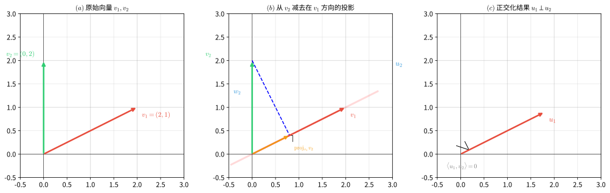

*图7：Gram-Schmidt 正交化过程。(a) 原始向量 $v_1, v_2$；(b) 从 $v_2$ 中减去它在 $v_1$ 方向的投影，得到垂直分量 $w_2$；(c) 单位化后得到标准正交基 $u_1 \perp u_2$。*

**证明**（归纳法）：$j = 1$ 时显然成立。假设已构造出标准正交组 $\{u_1, \dots, u_{j-1}\}$ 张成与 $\{v_1, \dots, v_{j-1}\}$ 相同的空间。定义 $w_j = v_j - \sum_{i=1}^{j-1} \langle v_j, u_i \rangle u_i$。对 $i < j$，

$$
\langle w_j, u_i \rangle = \langle v_j, u_i \rangle - \sum_{k=1}^{j-1} \langle v_j, u_k \rangle \langle u_k, u_i \rangle = \langle v_j, u_i \rangle - \langle v_j, u_i \rangle = 0
$$

逐一读懂这个关键式子：

- 第 1 个等号：把 $w_j$ 的构造式代入内积，依据是内积对第二个变元的线性；目的：把"$w_j$ 与旧向量正交吗"化为逐项计算。
- 第 2 个等号：利用 $\{u_1,\dots,u_{j-1}\}$ 已是标准正交组，即 $\langle u_k, u_i\rangle$ 仅当 $k=i$ 时为 1、否则为 0；目的：把长长的求和压成一项 $\langle v_j,u_i\rangle$。
- 第 3 个等号：同项相减得 0；目的：证明 $w_j \perp u_i$，为下一步单位化做准备。
  所以 $w_j$ 与所有 $u_1, \dots, u_{j-1}$ 正交。由于 $v_1, \dots, v_j$ 线性无关，$v_j$ 不在 $\operatorname{span}\{v_1, \dots, v_{j-1}\} = \operatorname{span}\{u_1, \dots, u_{j-1}\}$ 中，故 $w_j \neq \mathbf{0}$。令 $u_j = w_j / \|w_j\|$，则 $\{u_1, \dots, u_j\}$ 是标准正交组，且张成与 $\{v_1, \dots, v_j\}$ 相同的空间。

#### 课堂问答

**老师**：Gram-Schmidt 每一步到底在做什么？为什么要减投影？

**学生**：每加一个新向量 $v_j$，就把它在已建好的正交方向上的全部分量减掉：$w_j=v_j-\sum_{i<j}\langle v_j,u_i\rangle u_i$。剩下的 $w_j$ 就与前面所有 $u_i$ 正交，再单位化得到 $u_j$。

**老师（追问）**：为什么前 $j$ 个新向量张成的空间与前 $j$ 个原向量完全相同？

**学生**：因为每步只做"减投影加单位化"这种可逆的三角变换：$u$ 由 $v$ 线性表出，$v$ 也能由 $u$ 回表出，所以逐步张成空间不变。数值上要留意：浮点误差会破坏正交性，工程上要做重正交化。

**老师（拓展）**：Gram-Schmidt 和 QR 分解是什么关系？

**学生**：QR 就是 GS 的"记录版"。把每列做 GS 得标准正交列 $q_i$，再用 $r_{ij}=\langle q_i,a_j\rangle$ 把系数排成上三角矩阵 $R$，就有 $A=QR$，且 $R$ 的对角元为正。

### 8.5 正交投影

💡 **"找最近的那个点"**：给定一个子空间 $W$ 和向量 $v$，$W$ 里离 $v$ 最近的那个点，就是 $v$ 在 $W$ 上的**正交投影**——"垂直往下看，落地的那一点"。它在最小二乘、数据压缩、信号处理里无处不在，因为"用低维去最好地近似高维"，选它准没错。

**定义**：设 $W$ 是内积空间 $V$ 的子空间，$v \in V$。$v$ 在 $W$ 上的**正交投影**是唯一的向量 $w \in W$，使得 $v - w \perp W$（即 $v - w$ 与 $W$ 中所有向量正交）。

若 $\{u_1, \dots, u_k\}$ 是 $W$ 的一组标准正交基，则 $v$ 在 $W$ 上的正交投影为

$$
\operatorname{proj}_W(v) = \sum_{i=1}^k \langle v, u_i \rangle u_i
$$

**性质**：

- $\operatorname{proj}_W(v)$ 是 $W$ 中离 $v$ 最近的向量（最小距离原理）
- $v - \operatorname{proj}_W(v) \perp W$
- $\|v\|^2 = \|\operatorname{proj}_W(v)\|^2 + \|v - \operatorname{proj}_W(v)\|^2$（广义勾股定理）

> **💡 直观理解**：正交投影就是"找最近点"。想象你站在房间里（向量 $v$），地板是一个平面（子空间 $W$）。你垂直往下看，视线与地板的交点就是你在地板上的投影。这个点确实是地板上离你最近的位置——这就是最小距离原理。
>
> **🔑 应用**：正交投影是数据压缩、最小二乘法、信号处理的核心。比如用低维平面近似高维数据时，正交投影给出了"最佳近似"。

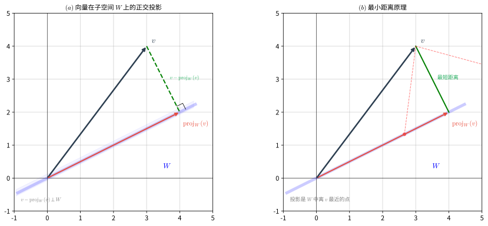

*图8：正交投影。(a) 向量 $v$ 在子空间 $W$ 上的投影：投影 $\operatorname{proj}_W(v)$ 是 $W$ 中离 $v$ 最近的点，误差 $v - \operatorname{proj}_W(v)$ 垂直于 $W$；(b) 最小距离原理：投影是 $W$ 中离 $v$ 最近的向量，其他点的距离都更大。*

---

#### 课堂问答

**老师**：投影点为什么一定要满足 $v-w\perp W$？

**学生**：因为"最近点"的充要条件就是误差与子空间正交。对任意 $w'\in W$，由勾股定理 $\|v-w'\|^2=\|v-w\|^2+\|w-w'\|^2\ge\|v-w\|^2$，等号只在 $w'=w$ 时成立。

**老师（追问）**：公式 $\operatorname{proj}_W(v)=\sum_i\langle v,u_i\rangle u_i$ 是怎么来的？

**学生**：取 $W$ 的一组标准正交基 $\{u_i\}$，设投影为 $w=\sum_i c_i u_i$；正交条件 $\langle v-w,u_j\rangle=0$ 给出 $c_j=\langle v,u_j\rangle$，代回即得该公式。

**老师（拓展）**：如果手头不是标准正交基，投影还能算吗？

**学生**：能。若 $A$ 的列张成 $W$，投影矩阵是 $P=A(A^TA)^{-1}A^T$，它满足 $P^2=P$、$P^T=P$。这正是最小二乘所依赖的正规方程背后的矩阵。

## 九、谱定理

### 9.1 实对称矩阵

🪞 **"照镜子等于自己"**：满足 $A^T=A$ 的实对称矩阵"美得很"——它的特征值全是实数，不同特征值对应的特征向量还彼此**正交**。正因为主轴线天然互相垂直，它总能被"摆正"成一整套正交坐标轴。可以说，它是线性代数里最"健康"的一类方阵。

**定义**：$A \in M_{n \times n}(\mathbb{R})$ 称为**对称矩阵**，如果 $A^T = A$。

**性质**：

- 对称矩阵的特征值都是实数
- 对称矩阵的不同特征值对应的特征向量相互正交
- 对称矩阵可正交对角化：存在正交矩阵 $Q$（$Q^T Q = I$），使得 $Q^T A Q$ 为对角矩阵

> **直观理解（类比）**：对称矩阵是"镜子里的自己等于自己"（$A^T=A$）的矩阵——正因如此，它的主轴线（特征向量）彼此垂直、拉伸倍数（特征值）都是实数。于是总能用一组互相垂直的坐标轴把它"掰直"，这就是它总能正交对角化的原因。

#### 课堂问答

**老师**：实对称矩阵有什么别人没有的"特权"？

**学生**：三条：特征值全是实数；不同特征值对应的特征向量彼此正交；一定能正交对角化 $A=Q\Lambda Q^T$，其中 $Q$ 满足 $Q^TQ=I$。它是线性代数里最"健康"的方阵。

**老师（追问）**：为什么对称能保证特征值一定是实数？

**学生**：设 $Av=\lambda v$、$v\neq\mathbf{0}$，则 $\lambda\|v\|^2=v^*Av=(v^*Av)^*=v^*A^Tv=\bar\lambda\|v\|^2$。用的是 $A^T=A$ 且 $A$ 实，于是 $\lambda=\bar\lambda\in\mathbb{R}$。

**老师（拓展）**：对称矩阵对角化和一般矩阵对角化差在哪？

**学生**：一般矩阵未必能对角化，能对角化也未必用正交矩阵；对称矩阵则一定能用正交矩阵对角化（谱定理），且特征向量天然互相垂直，不用额外正交化。

### 9.2 谱定理

💠 **一句话：对称矩阵能"完全拆开"**：任何实对称矩阵都可以写成 $A=Q\Lambda Q^T$，或者叠加成 $\sum_i \lambda_i u_i u_i^T$——其中每个 $u_iu_i^T$ 是沿特征方向的"投影"，$\lambda_i$ 是那条方向的"强度"。也就是说，光靠特征信息就能完整还原整块矩阵，这正是量子力学、主成分分析、振动分析的"美好地基"。

**定理**（有限维实谱定理）：设 $A$ 是 $n$ 阶实对称矩阵。则存在正交矩阵 $Q$ 和对角矩阵 $\Lambda = \operatorname{diag}(\lambda_1, \dots, \lambda_n)$，使得

$$
A = Q \Lambda Q^T
$$

其中 $\lambda_1, \dots, \lambda_n$ 是 $A$ 的特征值（按重数计），$Q$ 的列是相应的标准正交特征向量。

**等价表述**：实对称矩阵 $A$ 可以分解为

$$
A = \sum_{i=1}^n \lambda_i u_i u_i^T
$$

其中 $\{u_1, \dots, u_n\}$ 是 $\mathbb{R}^n$ 的一组标准正交特征向量基。

> **💡 直观理解**：谱定理告诉我们，实对称矩阵可以"完全拆解"成若干个简单的"秩-1矩阵"的叠加。每个 $u_i u_i^T$ 是沿特征向量方向的"投影"，乘以特征值 $\lambda_i$ 就是该方向上的"强度"。
>
> **🔑 为什么重要**：谱定理是线性代数中最优美的定理之一。它告诉我们对称矩阵的结构极其简单——只需要知道特征值和特征向量，就完全掌握了矩阵。这在物理学（量子力学）、统计学（主成分分析）、工程学（振动分析）中有广泛应用。

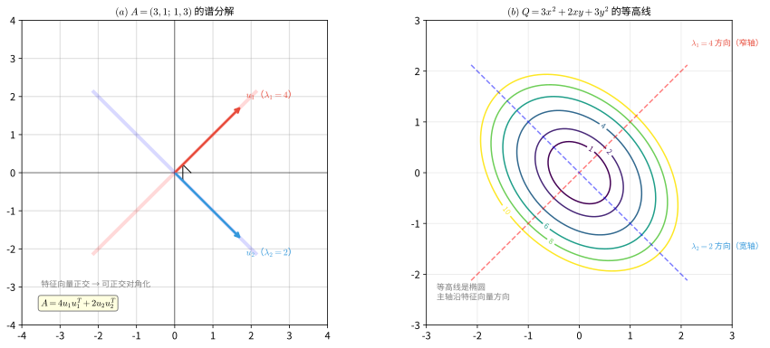

*图9：谱定理与对称矩阵。(a) 对称矩阵 $A$ 的特征向量相互正交，可分解为 $A = \lambda_1 u_1 u_1^T + \lambda_2 u_2 u_2^T$；(b) 二次型 $Q = x^T A x$ 的等高线是椭圆，主轴沿特征向量方向，半轴长度与 $1/\sqrt{\lambda_i}$ 成正比。*

**证明概要**：

1. 先证实对称矩阵的特征值均为实数。设 $Av = \lambda v$，$v \neq \mathbf{0}$。则

   $$
   \lambda \|v\|^2 = \lambda v^* v = v^* Av = (v^* Av)^* = v^* A^T v = v^* A v = \overline{\lambda} \|v\|^2
   $$

   所以 $\lambda = \overline{\lambda}$，即 $\lambda \in \mathbb{R}$。
2. 再证不同特征值的特征向量正交。设 $Av_1 = \lambda_1 v_1$，$Av_2 = \lambda_2 v_2$，$\lambda_1 \neq \lambda_2$。则

   $$
   \lambda_1 \langle v_1, v_2 \rangle = \langle Av_1, v_2 \rangle = \langle v_1, A^T v_2 \rangle = \langle v_1, Av_2 \rangle = \lambda_2 \langle v_1, v_2 \rangle
   $$

   所以 $(\lambda_1 - \lambda_2)\langle v_1, v_2 \rangle = 0$，故 $\langle v_1, v_2 \rangle = 0$。
3. 最后用归纳法证明可正交对角化。$n = 1$ 时显然。取一个特征值 $\lambda_1$ 和对应的单位特征向量 $u_1$。将 $u_1$ 扩充为 $\mathbb{R}^n$ 的一组标准正交基 $\{u_1, w_2, \dots, w_n\}$，令 $Q_1 = [u_1, w_2, \dots, w_n]$。则

   $$
   Q_1^T A Q_1 = \begin{pmatrix} \lambda_1 & 0 \\ 0 & A_1 \end{pmatrix}
   $$

   其中 $A_1$ 是 $(n-1) \times (n-1)$ 对称矩阵。由归纳假设，$A_1$ 可正交对角化，从而 $A$ 也可正交对角化。

---

#### 课堂问答

**老师**：谱定理一句话说的到底是什么？

**学生**：任何实对称矩阵都能写成 $A=Q\Lambda Q^T$，$Q$ 正交、$\Lambda$ 对角（对角元为特征值）；等价地 $A=\sum_i\lambda_i u_iu_i^T$，即一组投影的加权叠加。

**老师（追问）**：每一个 $u_iu_i^T$ 在几何上是什么？

**学生**：是沿方向 $u_i$ 的正交投影矩阵，秩为 $1$、对称且幂等。谱定理就是说：$A$ 等于这些投影按特征值 $\lambda_i$ 加权求和，权重就是各主方向的"强度"。

**老师（拓展）**：谱定理跟二次型、PCA 有什么关系？

**学生**：二次型用正交变换化主轴（主轴定理）就是谱定理的直接应用；PCA 对协方差矩阵（对称半正定）做谱分解，取大特征值方向当主成分。振动分析、量子力学也都建在它上面。

## 十、二次型

### 10.1 二次型的定义

🪟 **一眼看出一张曲面**：像 $2x^2+4xy+3y^2$ 这种"纯二次项"的多项式，用对称矩阵一打包就是 $Q(x)=x^TAx$。它刻画的是以原点为中心的椭圆/双曲线之类曲面，而那枚对称矩阵就是它形状的"身份档案"。本节先练熟这个动作：**把二次多项式翻译成对称矩阵**。

**定义**：$\mathbb{R}^n$ 上的**二次型**是一个函数 $Q: \mathbb{R}^n \to \mathbb{R}$，可以表示为

$$
Q(x) = \sum_{i,j=1}^n a_{ij} x_i x_j = x^T A x
$$

其中 $A$ 是 $n$ 阶实对称矩阵，称为二次型 $Q$ 的**矩阵表示**。

**例**：

- $Q(x,y) = 2x^2 + 4xy + 3y^2 = \begin{pmatrix} x & y \end{pmatrix} \begin{pmatrix} 2 & 2 \\ 2 & 3 \end{pmatrix} \begin{pmatrix} x \\ y \end{pmatrix}$
- $Q(x_1,x_2,x_3) = x_1^2 + 2x_2^2 + 3x_3^2 - 2x_1x_2 + 4x_1x_3$

> **直观理解（类比）**：二次型就是"每个二次项按对称矩阵收起"的曲面方程 $x^TAx$：$x^2、y^2$ 是主"弯曲"，$xy$ 交叉项是"斜着弯"。它描述的正是以原点为中心的椭圆/双曲线这样一个曲面，而那枚对称矩阵就是它形状的"身份档案"。

#### 课堂问答

**老师**：为什么二次型总能用对称矩阵写成 $x^TAx$？

**学生**：因为 $x_ix_j$ 与 $x_jx_i$ 在求和中成对出现，把交叉项系数平分成两半放在 $(i,j)$ 与 $(j,i)$，就得到一个对称矩阵，且不改变 $Q(x)$ 的取值。这样表示既不失一般性又唯一。

**老师（追问）**：把 $2x^2+4xy+3y^2$ 写成矩阵，那个 $4xy$ 的系数怎么分？

**学生**：平分成两个 $2$：$A=\begin{pmatrix}2&2\\2&3\end{pmatrix}$。若写成 $\begin{pmatrix}2&4\\0&3\end{pmatrix}$，虽然代入后给同一个 $Q$，但它不对称，会丢掉对称矩阵的一切便利。

**老师（拓展）**：为什么必须取对称那一半，别的不行吗？

**学生**：因为只有对称部分被 $Q$ 唯一确定，而对称矩阵拥有谱定理、Sylvester 判据、主轴定理等成套工具。非对称写法虽然不影响数值，却让这些理论全部失效，得不偿失。

### 10.2 二次型的定性

🍜 **先问一个关键问题：这是碗还是马鞍？** 曲面开口向上（**正定**）、开口向下（**负定**）、还是有的方向凸、有的方向凹（**不定**）？这就是二次型的**定性**。判定只需看特征值的符号，或用 Sylvester 顺序主子式。它直接决定最优化里"极值点到底稳不稳、有没有最小值"。

**定义**：二次型 $Q(x) = x^T A x$ 称为：

- **正定**：若对任意 $x \neq \mathbf{0}$，有 $Q(x) > 0$
- **半正定**：若对任意 $x$，有 $Q(x) \geq 0$
- **负定**：若对任意 $x \neq \mathbf{0}$，有 $Q(x) < 0$
- **半负定**：若对任意 $x$，有 $Q(x) \leq 0$
- **不定**：若 $Q(x)$ 既可取正值也可取负值

**判定定理**：

1. 对称矩阵 $A$ 正定 $\iff$ 所有特征值 $\lambda_i > 0$
2. 对称矩阵 $A$ 正定 $\iff$ 所有顺序主子式 $> 0$（Sylvester 准则）
3. 对称矩阵 $A$ 负定 $\iff$ 所有奇数阶顺序主子式 $< 0$，偶数阶 $> 0$

**顺序主子式**：左上角 $k \times k$ 子矩阵的行列式，记作 $\Delta_k$。

> **💡 直观理解**：二次型 $Q(x) = x^T A x$ 的图像是一个"曲面"。定性描述的就是这个曲面的形状：
>
> - **正定**：碗形（开口向上），原点是最低点
> - **负定**：倒碗形（开口向下），原点是最高点
> - **不定**：马鞍形（某些方向上凸，某些方向上凹）
> - **半正定**：扁平的碗（某个方向上没有弯曲）
>
> 从等高线看：正定的等高线是椭圆（封闭曲线），不定的等高线是双曲线（开口曲线）。

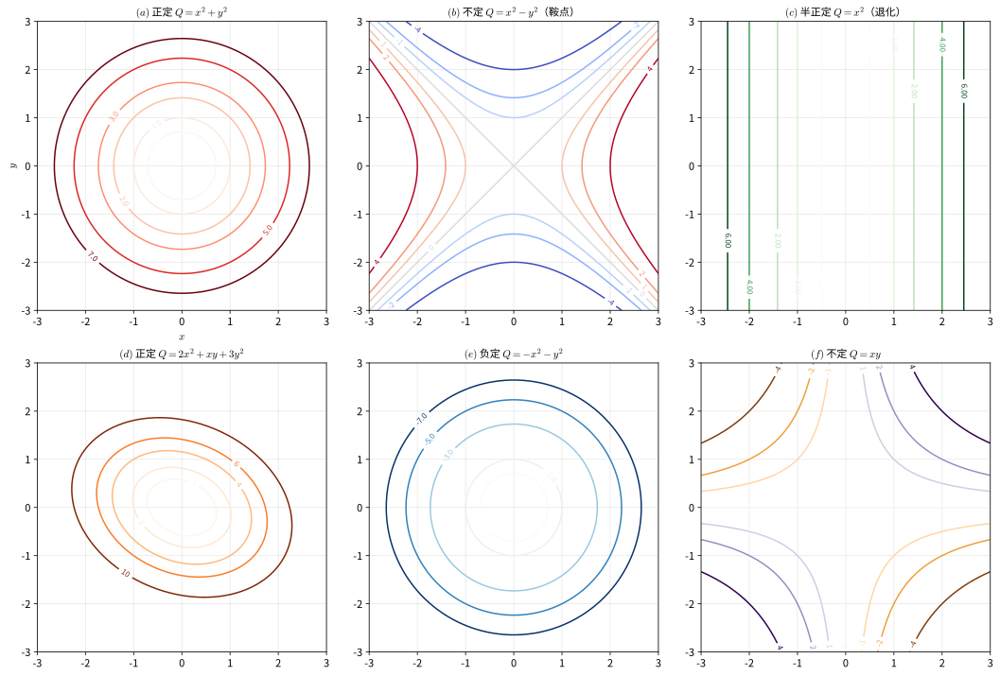

*图10：二次型的等高线。不同定性的二次型呈现不同的等高线图案：(a) 正定 $Q=x^2+y^2$ 是同心圆；(b) 不定 $Q=x^2-y^2$ 是双曲线（鞍点）；(c) 半正定 $Q=x^2$ 退化为平行线；(d)(e)(f) 更一般的二次型，通过特征值可判断定性。*

#### 课堂问答

**老师**：判断一个二次型正定，有哪几条等价的通路？

**学生**：对称矩阵 $A$ 正定，等价于所有特征值 $\lambda_i>0$，等价于所有顺序主子式 $\Delta_k>0$（Sylvester 准则），也等价于 $A$ 与单位矩阵合同。负定则要求奇数阶主子式 $<0$、偶数阶 $>0$。

**老师（追问）**：顺序主子式全部大于零，和"所有主子式大于零"是一回事吗？

**学生**：不是。判断正定用的是顺序主子式（左上角 $k\times k$）全部 $>0$；半正定才要求所有主子式 $\ge0$。只看对角元为正更不够，反例 $A=\begin{pmatrix}1&2\\2&1\end{pmatrix}$ 就不正定。

**老师（拓展）**：特征值判据和主子式判据各适合什么场合？

**学生**：特征值判据概念清楚，适合小矩阵或已知谱的情形、也便于谈几何；Sylvester 顺序主子式适合手工处理中等矩阵，不必解特征方程。两套结论永远一致。

### 10.2b 用配方法化二次型为标准形

🧪 **"消灭交叉项"的艺术**：二次型里最烦人的是 $xy$ 这类交叉项。通过换变量（换坐标），可以把它们一个个"配"掉，最后只剩平方项 $d_1y_1^2+\cdots+d_ny_n^2$。这好比给曲面"转正到主轴"，一眼就能看清它到底是哪种碗。

**问题**：二次型 $Q(x) = x^T A x$ 通常含交叉项（如 $xy$）。通过可逆线性替换 $x = Py$，可以把它化为**标准形**（只含平方项）：

$$
Q = d_1 y_1^2 + d_2 y_2^2 + \cdots + d_n y_n^2
$$

若再适当伸缩，可化为规范形（系数为 $1, -1, 0$）。

**配方法（Lagrange 配方法）步骤**：

1. 若 $Q$ 含某个平方项 $a_{11}x_1^2$（$a_{11} \neq 0$），把所有含 $x_1$ 的项集中起来配成完全平方，化为 $a_{11}(x_1 + \cdots)^2$ + 不含 $x_1$ 的剩余部分，然后对剩余部分继续配方
2. 若 $Q$ 不含任何平方项但含交叉项（如 $a_{12}x_1x_2 \neq 0$），先做替换 $x_1 = y_1 + y_2$，$x_2 = y_1 - y_2$，则 $x_1x_2 = y_1^2 - y_2^2$ 出现平方项，再回到步骤 1

**例**：化 $Q = 2x_1^2 + 4x_1x_2 - 3x_2^2$ 为标准形。

**解**：把含 $x_1$ 的项配方：

$$
Q = 2\left(x_1^2 + 2x_1x_2\right) - 3x_2^2 = 2\left[(x_1 + x_2)^2 - x_2^2\right] - 3x_2^2 = 2(x_1 + x_2)^2 - 5x_2^2
$$

令 $y_1 = x_1 + x_2$，$y_2 = x_2$（即 $x_1 = y_1 - y_2$，$x_2 = y_2$），则

$$
Q = 2y_1^2 - 5y_2^2
$$

这是标准形（正、负各一项，故对应一个不定二次型）。

> **💡 直观理解**：配方法就像"给二次型做配方"，跟中学解二次方程配完全平方是一回事，只是现在要对着多个变量逐个"配"。每次配一个变量，就把一个交叉项"消灭"掉，最后只剩下一堆独立的平方项。
>
> **🔑 与正交变换法的区别**：化二次型为标准形有两条路：
>
> - **配方法**：用任意可逆代换，计算简单，适合手工。
> - **正交变换法**：用正交矩阵 $Q$（$Q^T Q = I$）做代换，能保留"长度/角度"，得到的标准形系数就是特征值，几何意义最漂亮（椭圆的轴）。
>
> 两种方法得到的标准形可能不同，但**正项数、负项数一定相同**（这正是下面的 Sylvester 惯性定理）。

#### 课堂问答

**老师**：配方法化二次型的核心动作是什么？

**学生**：每一步挑一个平方项，把含该变量的所有项凑成完全平方，消去与它相关的全部交叉项，再对剩余变量递归。若完全没有平方项只有交叉项，就先作 $x_1=y_1+y_2,\ x_2=y_1-y_2$ 造出平方项。

**老师（追问）**：$Q=2x_1^2+4x_1x_2-3x_2^2$ 具体怎么配？

**学生**：$Q=2(x_1+x_2)^2-5x_2^2$。令 $y_1=x_1+x_2,\ y_2=x_2$，即得 $Q=2y_1^2-5y_2^2$，正负各一项，故它是**不定**二次型。

**老师（拓展）**：配方法和正交变换法得到的标准形一样吗？

**学生**：不一定相同，但正项数 $p$、负项数 $q$ 一定相同（Sylvester 惯性定理）。配方法用任意可逆代换、计算简单、适合手工；正交法用正交矩阵，保长度角度，系数恰是特征值，几何最漂亮。

### 10.3 Sylvester 惯性定理

🔢 **怎么换，符号个数不变**：配方或换基把二次型化成标准形时，正的平方项个数 $p$、负的个数 $q$ 是**固定不变**的——不管你怎么换都不变，这正是 Sylvester 惯性定理。它给二次型发了一张"符号身份证"：只看正负个数，就足以判断它到底是正定、负定还是不定，与特征值符号不谋而合。

**定理**（Sylvester 惯性定理）：设 $A$ 是 $n$ 阶实对称矩阵。则存在可逆矩阵 $P$ 使得

$$
P^T A P = \begin{pmatrix}
I_p & 0 & 0 \\
0 & -I_q & 0 \\
0 & 0 & 0
\end{pmatrix}
$$

其中 $p$ 是 $A$ 的正特征值个数（按重数计），$q$ 是负特征值个数，$r = p+q = \operatorname{rank}(A)$。$(p, q, n - p - q)$ 称为 $A$ 的**惯性指数**，且在同余变换下保持不变。

**推论**：二次型 $Q(x) = x^T A x$ 经过可逆变数替换 $x = Py$ 后，标准形中正平方项、负平方项和零平方项的个数是唯一确定的。

> **直观理解（类比）**：Sylvester 惯性定理说：无论你怎么换坐标系、怎么配方，二次型里"正、负、零"三种平方项的个数始终不变——就像一碗汤不管怎么搅，咸味、甜味、淡味的"份额比例"是天生定死的。这保证了二次型的定性（正定与否）不随你选的坐标而变。

---

#### 课堂问答

**老师**：惯性定理保证的到底是什么不变量？

**学生**：无论用哪个可逆代换把二次型化成标准形，正平方项个数 $p$、负平方项个数 $q$、零项个数 $n-p-q$ 都固定不变，也就是惯性指数 $(p,q)$ 不变，所以定性不随坐标选择而改变。

**老师（追问）**：这里的 $p$、$q$ 和特征值个数是什么关系？

**学生**：$p$ 恰是 $A$ 的正特征值个数、$q$ 是负特征值个数（都按重数计），而 $p+q=\operatorname{rank}(A)$。可见二次型的"符号身份证"与谱的符号完全吻合。

**老师（拓展）**：合同 $P^TAP$ 和相似 $P^{-1}AP$ 保的东西一样吗？

**学生**：不一样。相似保特征值，合同保惯性指数（正负项数）却不保具体数值大小。只有在用正交矩阵时二者才重合，因为此时 $Q^T=Q^{-1}$。


### 10.3b 主轴定理

🎻 **一句话点题**：二次型最漂亮的"毕业证书"是**主轴定理**：通过**正交**换变量，任何二次型都能化成"特征值平方和"
$$
x^TAx=\lambda_1 y_1^2+\cdots+\lambda_n y_n^2,
$$
而新坐标轴（$y$ 轴）的方向恰好就是 $A$ 的**特征向量**，也就是曲面的"主轴"。这正是谱定理在二次型上的回响——它一个人同时回答"往哪个方向最弯、弯多快"。

**定理（主轴定理）**：设 $Q(x)=x^TAx$ 是二次型，$A$ 为实对称矩阵。则存在正交矩阵 $Q$ 使 $x=Qy$，从而
$$
Q(x)=d_1y_1^2+\cdots+d_ny_n^2,
$$
其中 $d_i$ 是 $A$ 的特征值，$Q$ 的第 $i$ 列是对应的特征向量。几何表述：$Q(x)=1$ 是以原点为中心的椭球/双曲面族，**主半轴的方向由特征向量决定、长短由特征值的 $1/\sqrt{|d_i|}$ 决定**。

**例**：$Q(x,y)=2x^2+4xy+3y^2$。$A=\begin{pmatrix}2&2\\2&3\end{pmatrix}$，特征多项式 $\lambda^2-5\lambda+2=0$，特征值 $\lambda_{1,2}=\frac{5\pm\sqrt{17}}{2}$，分别对应方向 $(1,\frac{1+\sqrt{17}}{4})$ 与 $(1,\frac{1-\sqrt{17}}{4})$ 的特征向量。经正交换元 $x=Qy$ 后 $Q=\lambda_1 y_1^2+\lambda_2 y_2^2$；等高线 $Q=1$ 是长半轴 $\sqrt{1/\lambda_2}\approx1.5$、短半轴 $\sqrt{1/\lambda_1}\approx0.47$ 的椭圆，轴沿两个特征向量方向。

> **💡 直观理解**：主轴定理 = "给曲面搜出主轴"。就像把一张歪放的椭圆纸旋转到"轴对齐"，那个旋转矩阵 $Q$ 就是"转正"的手；转正后沿每条主轴，曲面"弯曲的程度"恰好由特征值读出。正定（所有 $\lambda_i>0$）时是各方向都朝上弯的碗（椭圆），有正有负则是马鞍（双曲），这与 10.2 的判定完全一致。
>
> **常见坑**：主轴定理要求 $A$ 是**实对称**矩阵——只有对称矩阵才保证存在正交矩阵把它转成对角形；非对称矩阵的特征向量并不彼此正交，就不能用主轴定理"转正"。

**巩固练习**：

**基础 1**：用主轴定理把 $Q=3x^2-2xy+3y^2$ 化为标准形并判断凹凸。

<details>
<summary><b>解答</b></summary>

$A=\begin{pmatrix}3&-1\\-1&3\end{pmatrix}$，特征值 $4,2$（对应特征向量 $(1,-1),(1,1)$）。主轴定理给出 $Q=4y_1^2+2y_2^2$。因两个特征值皆正，$Q$ **正定**：碗状开口向上，原点是最小值点。

</details>

**进阶 2**：求椭圆 $Q=x^2+2xy+2y^2=1$ 的主轴方向与半轴长。

<details>
<summary><b>解答</b></summary>

$A=\begin{pmatrix}1&1\\1&2\end{pmatrix}$，$\det(\lambda I-A)=\lambda^2-3\lambda+1$，特征值 $\lambda_{1,2}=\frac{3\pm\sqrt5}{2}$。特征向量（即主轴）方向 $(1,\frac{1\pm\sqrt5}{2})^T$。主半轴长 $=\sqrt{1/\lambda_i}$，故长轴 $\sqrt{1/\lambda_2}=\sqrt{2/(3-\sqrt5)}$，短轴 $\sqrt{2/(3+\sqrt5)}$，沿各自的特征向量方向。

</details>

**挑战 3**：设 $Q(x)=x^TAx$ 正定、$A$ 对称（$n=2$）。证明 $Q(x)=1$ 的椭圆面积与 $\det A$ 的关系。

<details>
<summary><b>解答</b></summary>

$Q$ 正定 $\Rightarrow$ 两特征值皆正，主轴定理给 $Q=\lambda_1 y_1^2+\lambda_2 y_2^2=1$，是长半轴 $1/\sqrt{\lambda_1}$、短半轴 $1/\sqrt{\lambda_2}$ 的标准椭圆。面积 $=\pi\cdot\frac{1}{\sqrt{\lambda_1}}\cdot\frac{1}{\sqrt{\lambda_2}}=\frac{\pi}{\sqrt{\det A}}$。一般 $n$ 维椭球体积 $\propto 1/\sqrt{\det A}$——这给了 $\det A$ 一个漂亮几何意义：**$Q=1$ 的"体积"与 $\sqrt{\det A}$ 成反比**，行列式越小椭球越"胖"。

</details>

#### 课堂问答

**老师**：主轴定理凭什么能把二次型"转正"？

**学生**：因为 $A$ 实对称，由谱定理存在正交矩阵 $Q$ 使 $x=Qy$，代入 $Q(x)=x^TAx$ 就化成 $\lambda_1y_1^2+\cdots+\lambda_ny_n^2$，新坐标轴方向恰是特征向量，也就是曲面的主轴。

**老师（追问）**：椭球各条半轴长和特征值是什么关系？

**学生**：对 $Q(x)=1$，第 $i$ 条半轴长为 $1/\sqrt{|d_i|}$，方向为对应特征向量。特征值大的方向"陡"、半轴短；特征值小的方向"缓"、半轴长。正定时是椭球，有正有负则是双曲。

**老师（拓展）**：非对称矩阵也能用主轴定理吗？

**学生**：不能。非对称矩阵的特征向量未必正交，找不到正交矩阵把它对角化，也就没有"正交主轴"。常见误区正是拿非对称二次型硬套主轴定理，结果坐标轴根本不垂直。

## 十一、矩阵分解：LU 与 QR

很多矩阵的问题，与其盯着矩阵本身，不如把它"劈"成更简单的几块再算——这就是**矩阵分解**。本章讲最常用的两块敲门砖：**LU 分解**（服务于快速解方程组）和 **QR 分解**（服务于稳定做最小二乘）。它们都是后面最小二乘、SVD 章节的脚手架。

### 11.1 LU 分解：把高斯消元"一次性打包"

🎯 **先想一个工程问题**：若 $Ax=b$ 里的 $A$ 不变、只是右边 $b$ 换来换去（比如电路电压变了、数据点加了），难道每换一次 $b$ 就从头消一次元？太浪费了。**LU 分解**把"消元的力气"只花一次：把 $A$ 存成"下三角 × 上三角"，之后无论 $b$ 怎么变，解两次三角方程即可，又稳又快。

**定义**：若 $n$ 阶方阵 $A$ 可以写成
$$
A = L U
$$
其中 $L$ 是**单位下三角矩阵**（对角线全 $1$，对角线上方为 $0$），$U$ 是**上三角矩阵**，则称 $A = LU$ 是 $A$ 的一个 **LU 分解**。

> **怎么来的**：回忆高斯消元——每一轮都用某个"倍数 $m_{ij}$"把主元下方的元素消成 $0$。把这些倍数按位置装进 $L$，把消元后剩下的"上三角阶梯"装进 $U$，就有 $A=LU$。也就是说，**$L$ 偷偷记下了你消元时每一步乘过的系数**。

**例题**：求 $A = \begin{pmatrix} 1 & 1 & 1 \\ 2 & 4 & 2 \\ 3 & 7 & 8 \end{pmatrix}$ 的 LU 分解。

**解**：消元时依次记录倍数：
- 用 $1$ 消 $(2,1)$ 位：倍数 $m_{21}=2$；
- 用 $1$ 消 $(3,1)$ 位：倍数 $m_{31}=3$，得到新行 $(0,4,5)$；
- 再用 $4$ 消 $(3,2)$ 位：倍数 $m_{32}=\frac{5}{4}$。

于是
$$
L=\begin{pmatrix}1&0&0\\2&1&0\\3&\frac54&1\end{pmatrix},\qquad
U=\begin{pmatrix}1&1&1\\0&2&0\\0&0&\frac{13}{2}\end{pmatrix}
$$

检验 $A=LU$ 成立。

**求解的妙处**：由 $A=LU$，方程 $Ax=b$ 变成 $L(Ux)=b$，分两步：
$$
Ly=b \quad\text{（前代，自顶向下依次解），}\qquad Ux=y \quad\text{（回代，自底向上依次解）。}
$$
一旦 $A$ 分解好，每次换个 $b$ 只花 $O(n^2)$ 解两个三角方程，远小于重新消元的 $O(n^3)$。这也是俗称"**同一个 $A$ 算一百次、只分解一次**"。

> **💡 直观理解**：把"解方程组"想成"开锁"。高斯消元每次开一把新锁都要从头配钥匙；LU 分解则是先把 $A$ 的"钥匙"（$L$ 和 $U$）磨好一套，之后每换一次锁芯里的密码（$b$），只需插钥匙转两下（前代+回代）就行。

> **🔑 何时需要换行？** 若某主元恰为 $0$，需先交换行，此时得到带置换的 $PA=LU$（$P$ 是置换矩阵）。这是实际程序里的标准做法，能保证数值稳定。

#### 课堂问答

**老师**：LU 分解到底把什么"打包"起来了？

**学生**：它把高斯消元每一步的倍数记进下三角 $L$、把消元后的上阶梯记进上三角 $U$，使 $A=LU$。之后解 $Ax=b$ 只需前代解 $Ly=b$、再回代解 $Ux=y$。

**老师（追问）**：为什么它对"同一个 $A$、多个右端 $b$"特别划算？

**学生**：分解只做一次，代价 $O(n^3)$；此后每换一个 $b$ 只花 $O(n^2)$ 解两个三角方程。比起每个 $b$ 都从头消元 $O(n^3)$，右端越多省得越明显。

**老师（拓展）**：如果消元时主元恰好为零，该怎么办？

**学生**：需要换行，得到带置换的 $PA=LU$，其中 $P$ 是置换矩阵。实际程序都做部分主元选取来保证数值稳定；不换行的话分解可能根本不存在，或误差被放大。

### 11.2 QR 分解：把方阵"洗"成正交 × 上三角

🧼 **"洗干净再干活"**：$m\times n$ 矩阵若列向量线性无关，可把列向量**正交化、单位化**（正是第 8 章的 Gram-Schmidt），得到一组标准正交基作成的矩阵 $Q$，而原矩阵等于 $Q$ 再乘以一个"恢复系数"的上三角矩阵 $R$——这就是 **QR 分解**。它让很多计算（尤其最小二乘）更稳定。

**定理**（QR 分解）：设 $A$ 是 $m\times n$ 实矩阵，其列向量线性无关。则 $A$ 可以唯一地分解为
$$
A = Q R
$$
其中 $Q$ 是 $m\times n$ 列标准正交矩阵（$Q^TQ=I_n$），$R$ 是 $n\times n$ 上三角矩阵且对角元均为正。

**构造**：对 $A$ 的列 $a_1,\dots,a_n$ 做 Gram-Schmidt，得到标准正交列 $q_1,\dots,q_n$。把 $a_j$ 在新正交基下展开，写回关系
$$
a_j = \sum_{i=1}^j r_{ij}\, q_i,
$$
其中 $r_{ij}=\langle q_i, a_j\rangle$。把这些系数摆成矩阵就得到 $R$。

**例题**：求 $A=\begin{pmatrix}1&1\\1&0\\1&0\end{pmatrix}$ 的 QR 分解。

**解**：列 $a_1=(1,1,1)^T$，$a_2=(1,0,0)^T$。正交化：$q_1=\frac{1}{\sqrt3}(1,1,1)^T$；$a_2$ 减去在 $q_1$ 上的投影得 $a_2-\langle q_1,a_2\rangle q_1=(1,0,0)^T-\frac{1}{3}(1,1,1)^T=(\frac23,-\frac13,-\frac13)^T$，单位化 $q_2=\frac{1}{\sqrt6}(2,-1,-1)^T$。于是
$Q=\begin{pmatrix}\frac1{\sqrt3}&\frac2{\sqrt6}\\\frac1{\sqrt3}&-\frac1{\sqrt6}\\\frac1{\sqrt3}&-\frac1{\sqrt6}\end{pmatrix}$，$R=\begin{pmatrix}\sqrt3&\frac1{\sqrt3}\\0&\frac2{\sqrt6}\end{pmatrix}$，满足 $A=QR$。

> **💡 直观理解**：QR 分解就像把一张"斜着的坐标纸"先摆正（$Q$ 给出正方向），再用 $R$ 记录原来的每个向量在新正方向上的"读数"。正交的坐标轴不会彼此串味，所以后续计算（如最小二乘）更干净、误差更小。

> **🔑 为什么它比黑箱更好**：直接解 $A^TAx=A^Tb$ 时，万一 $A^TA$ 很小（近奇异）误差会爆炸；用 QR 则绕开 $A^TA$，数值上稳定得多。这正是下一章最小二乘的首选做法。

#### 课堂问答

**老师**：QR 分解和 Gram-Schmidt 到底什么关系？

**学生**：QR 就是 Gram-Schmidt 的"记录版"。把 $A$ 的列正交化、单位化得到标准正交列 $q_i$ 组成 $Q$，再用 $a_j=\sum_{i\le j}r_{ij}q_i$、$r_{ij}=\langle q_i,a_j\rangle$ 把系数排成上三角 $R$。

**老师（追问）**：为什么规定 $R$ 的对角元必须为正？这带来什么？

**学生**：它保证分解唯一，并让 $r_{jj}=\|w_j\|>0$ 恰好是"新方向上的长度"。若允许负对角元，就会出现多种等价的 QR。前提是 $A$ 的列线性无关。

**老师（拓展）**：LU 和 QR 各自服务什么场景？

**学生**：LU 服务方阵、同一 $A$ 多次解方程，追求快；QR 数值更稳，服务最小二乘和特征值算法，能处理长方阵与列满秩情形。两者都是后面 SVD、最小二乘的脚手架。

### 11.3 巩固练习（含详细解答）

**练 1**：求 $A=\begin{pmatrix}1&2\\3&8\end{pmatrix}$ 的 LU 分解，并用它解 $Ax=b$，$b=\begin{pmatrix}5\\13\end{pmatrix}$。

<details>
<summary><b>解答</b></summary>

消元：主元为 $1$，用 $1$ 消 $(2,1)$ 位，倍数 $m_{21}=3$，得 $U=\begin{pmatrix}1&2\\0&2\end{pmatrix}$、$L=\begin{pmatrix}1&0\\3&1\end{pmatrix}$。检验 $LU=\begin{pmatrix}1&2\\3&8\end{pmatrix}=A$。

先**前代**解 $Ly=b$：$y_1=5$，$3\cdot5+y_2=13\Rightarrow y_2=-2$，故 $y=(5,-2)^T$。

再**回代**解 $Ux=y$：$2x_2=-2\Rightarrow x_2=-1$；$x_1+2(-1)=5\Rightarrow x_1=7$。

答案 $x=(7,-1)^T$。代入 $Ax=\begin{pmatrix}7-2\\21-8\end{pmatrix}=\begin{pmatrix}5\\13\end{pmatrix}$ ✓。

</details>

**练 2**：求 $A=\begin{pmatrix}2&6\\2&7\end{pmatrix}$ 的 LU 分解，并据此直接写出 $\det(A)$。

<details>
<summary><b>解答</b></summary>

主元为 $2$，倍数 $m_{21}=2/2=1$。消元 $R_2\to R_2-R_1$ 得 $U=\begin{pmatrix}2&6\\0&1\end{pmatrix}$，$L=\begin{pmatrix}1&0\\1&1\end{pmatrix}$，有 $LU=\begin{pmatrix}2&6\\2&7\end{pmatrix}=A$ ✓。

$\det(A)=\det(L)\det(U)=1\cdot(2\cdot1-0)=2$。直接验证 $\det A=2\cdot7-6\cdot2=14-12=2$ ✓。

</details>

**练 3**：求 $A=\begin{pmatrix}1&1\\0&1\\0&1\end{pmatrix}$ 的 QR 分解。

<details>
<summary><b>解答</b></summary>

令 $a_1=(1,0,0)^T$，$a_2=(1,1,1)^T$。$q_1=a_1=(1,0,0)^T$；计算 $a_2$ 在 $q_1$ 上的投影 $\langle a_2,q_1\rangle q_1=1\cdot(1,0,0)^T=(1,0,0)^T$，于是 $w_2=a_2-(1,0,0)^T=(0,1,1)^T$，$\|w_2\|=\sqrt2$，故 $q_2=\frac1{\sqrt2}(0,1,1)^T$。

系数 $r_{11}=\langle q_1,a_1\rangle=1$，$r_{12}=\langle q_1,a_2\rangle=1$，$r_{22}=\langle q_2,a_2\rangle=\frac{0+1+1}{\sqrt2}=\sqrt2$。

所以 $Q=\begin{pmatrix}1&0\\0&\frac1{\sqrt2}\\0&\frac1{\sqrt2}\end{pmatrix},\ R=\begin{pmatrix}1&1\\0&\sqrt2\end{pmatrix}$。检验：第 1 列 $=q_1=(1,0,0)^T=a_1$；第 2 列 $=q_1+\sqrt2\,q_2=(1,0,0)^T+(0,1,1)^T=(1,1,1)^T=a_2$ ✓。

</details>

**练 4**（概念）：为什么"同一个 $A$、多个右端 $b$"时，LU 分解比每次从头高斯消元更划算？

<details>
<summary><b>解答</b></summary>

高斯消元每换一个 $b$ 都要对 $A$ 重新做 $O(n^3)$ 次运算；而 LU 分解只做**一次** $O(n^3)$ 把 $A$ 拆成 $L,U$，之后对任意 $b$ 只需 $O(n^2)$ 做**前代 $Ly=b$ + 回代 $Ux=y$** 两步三角回代。当右端很多时，总开销从"每个一次 $O(n^3)$"降到"一次 $O(n^3)$ + 每个 $O(n^2)$"。这正是求解电路（多源激励）等问题的常用加速手段。

</details>

---

#### 课堂问答

**老师**：为什么"同一个 $A$、多个右端 $b$"时，LU 分解比每次从头高斯消元更划算？

**学生**：高斯消元每换一个 $b$ 都要对 $A$ 重做 $O(n^3)$；LU 只消元一次、花一次 $O(n^3)$ 拆出 $L$ 和 $U$，之后每个 $b$ 只需 $O(n^2)$ 做前代与回代。右端多时，总开销从"每个一次 $O(n^3)$"降到"一次 $O(n^3)$ 加每个 $O(n^2)$"。

**老师（追问）**：对 $A=\begin{pmatrix}2&6\\2&7\end{pmatrix}$，边做 LU 边写出 $\det(A)$。

**学生**：主元为 $2$，倍数 $2/2=1$，$L=\begin{pmatrix}1&0\\1&1\end{pmatrix}$、$U=\begin{pmatrix}2&6\\0&1\end{pmatrix}$。因 $\det(L)=1$，$\det(A)=\det(L)\det(U)=1\cdot2=2$，与直接算 $14-12=2$ 一致。

**老师（拓展）**：QR 分解里为什么要求 $R$ 的对角元为正？

**学生**：一是保证分解唯一，二是让 $r_{jj}$ 恰是未单位化向量 $w_j$ 的长度（正值）。这样 $Q$ 的列方向与原列"同向"，系数就是投影长度，几何含义干净。

## 十二、最小二乘法与线性回归

数据科学家口中的"线性回归"，落地到线性代数里其实就一件事：**解一个可能无解的方程组，挑一个"最近"的解**。本章从"不死的投影"讲起，最后落到最小二乘直线。

### 12.1 超定方程组与"最佳近似解"

📉 **先问一个扎心的问题**：手里有 $m$ 条数据、$n$ 个未知数，且 $m>n$（方程比未知数多），一般**没有精确解**。那怎么办？答案是：别赌气说"无解"，改成求"**残差最短**"的解——这就是**最小二乘解**。

**问题**：对 $m\times n$ 矩阵 $A$ 与 $b\in\mathbb R^m$，若 $b\notin\operatorname{col}(A)$，则 $Ax=b$ 无解。**最小二乘问题**是求 $x$ 使残差的范数最小：
$$
x_{\text{ls}} = \arg\min_x \| b - Ax \|^2.
$$

**几何本质（关键）**：$\{Ax : x\in\mathbb R^n\} = \operatorname{col}(A)$ 是 $\mathbb R^m$ 的一个子空间。要"离 $b$ 最近"，等价于把 $b$ **正交投影**到 $\operatorname{col}(A)$ 上：
$$
Ax_{\text{ls}} = \operatorname{proj}_{\operatorname{col}(A)}(b) = \hat b,\qquad \text{残差 } b-Ax_{\text{ls}} \perp \operatorname{col}(A).
$$

**定理**（正规方程）：$x_{\text{ls}}$ 是最小二乘解 $\iff$ 它满足方程组
$$
A^T A\, x = A^T b. \qquad\text{（正规方程）}
$$
若 $\operatorname{rank}(A)=n$（列满秩），则 $A^TA$ 可逆，最小二乘解唯一：
$$
x_{\text{ls}} = (A^T A)^{-1} A^T b.
$$

**证明（几何）**：设残差 $r=b-Ax$ 要与 $\operatorname{col}(A)$ 正交，即对每一列 $a_j$ 有 $\langle a_j, r\rangle=0$，写成矩阵就是 $A^T r = \mathbf 0$，即 $A^T(b-Ax)=\mathbf 0 \Rightarrow A^TAx=A^Tb$。

> **💡 直观理解**：房间里一支笔斜插着（$A$），地面是 $\operatorname{col}(A)$，$b$ 是墙上一个点。你垂直看下去、光线的落点 $\hat b$ 就是 $b$ 的"正下方"——那就是离你最近的地面点；"垂直往下看"正是条件 $b-\hat b\perp\operatorname{col}(A)$。

**例题**：求过三点 $(1,1),(2,2),(3,2)$ 的"最佳直线" $y=c_0+c_1x$ 的最小二乘解。

**解**：写成 $Ac=b$，$A=\begin{pmatrix}1&1\\1&2\\1&3\end{pmatrix},\ c=\begin{pmatrix}c_0\\c_1\end{pmatrix},\ b=(1,2,2)^T$。正规方程：
$$
A^TA=\begin{pmatrix}3&6\\6&14\end{pmatrix},\quad A^Tb=\begin{pmatrix}5\\11\end{pmatrix},\quad
\begin{pmatrix}3&6\\6&14\end{pmatrix}\begin{pmatrix}c_0\\c_1\end{pmatrix}=\begin{pmatrix}5\\11\end{pmatrix}.
$$
解得 $c_1=\frac12,\ c_0=\frac23$，即最佳直线 $y=\frac23+\frac12 x$。（正规方程 $3c_0+6c_1=5,\ 6c_0+14c_1=11$ 得 $c_0=2/3$，$c_1=1/2$。）

#### 课堂问答

**老师**：$m>n$ 时 $Ax=b$ 一般无解，那最小二乘到底在求什么？

**学生**：求让残差范数最小的 $x$，即 $\min_x\|b-Ax\|^2$。几何上就是把 $b$ 正交投影到列空间 $\operatorname{col}(A)$，投影点 $\hat b=Ax_{\text{ls}}$ 就是列空间里离 $b$ 最近的点。

**老师（追问）**：正规方程 $A^TAx=A^Tb$ 是怎么冒出来的？

**学生**：最近点条件就是残差与列空间垂直：$r=b-Ax\perp\operatorname{col}(A)$，对每一列有 $a_j^Tr=0$，写成矩阵即 $A^Tr=\mathbf{0}$，代入得 $A^T(b-Ax)=\mathbf{0}$，展开就是 $A^TAx=A^Tb$。

**老师（拓展）**：什么情况下最小二乘解是唯一的？

**学生**：当 $A$ 列满秩 $\operatorname{rank}(A)=n$ 时，$A^TA$ 可逆，解唯一为 $x=(A^TA)^{-1}A^Tb$。若列不满秩，则有无穷多个最小二乘解，需另取最小范数解（用伪逆）。

### 12.2 用 QR 稳健地求最小二乘解

⚠️ **小心 $A^TA$**：$A^TA$ 往往"放大病态"，直接用正规方程容易出错。更稳的办法是靠 QR 分解。

**定理**：设 $A=QR$，其中列向量线性无关。则正规方程 $A^TAx=A^Tb$ 等价于更简单的
$$
R x = Q^T b.
$$
解这个上三角方程即可，全程避免了 $A^TA$ 与矩阵求逆。

**推导**：$A^TA=R^TQ^TQR=R^TR$（因为 $Q^TQ=I$），于是 $Rx=Q^Tb$（$R^T$ 可逆可约去）。

> **💡 直观理解**：正交集 $Q$ 让方程"正交化"了——本来要解一个可能病态的 $A^TA$，现在只需在摆正后的坐标系里各算各的 $Q^Tb$，再解个干净的上三角方程 $Rx=Q^Tb$，稳如老狗。

**例题**：沿用上例 $A$，用其 QR 分解解最小二乘。设已得 $Q,R$，则解 $Rx=Q^Tb$ 得到的 $x$ 与正规方程一致（同样得 $c_0=2/3,\ c_1=1/2$）。不同的是，即使 $A^TA$ 数值上接近奇异，QR 也不会放大误差——这正是它在工程软件里取代"硬解正规方程"的原因。

#### 课堂问答

**老师**：既然正规方程能直接解最小二乘，为什么还要绕道 QR？

**学生**：因为 $A^TA$ 的条件数约为 $A$ 的平方，数值上会放大病态误差。QR 绕开了 $A^TA$，只需解上三角方程 $Rx=Q^Tb$，稳定得多，是工程软件的首选。

**老师（追问）**：正规方程具体怎么变成 $Rx=Q^Tb$ 的？

**学生**：把 $A=QR$ 代入：$A^TA=R^TQ^TQR=R^TR$（因 $Q^TQ=I$），$A^Tb=R^TQ^Tb$。两边约去可逆的 $R^T$，就得到更简单的 $Rx=Q^Tb$。

**老师（拓展）**：这两种办法得到的解会不会不一样？

**学生**：在精确算术下完全相同。但在浮点运算中，QR 的误差明显更小；所以实际计算更愿意用 QR 或 SVD，而不是显式地构造并求解 $A^TA$。

### 12.3 巩固练习（含详细解答）

**练 1**：求过三点 $(0,1),(1,2),(2,3)$ 的最小二乘直线 $y=c_0+c_1x$。

<details>
<summary><b>解答</b></summary>

建模 $Ac=b$：$A=\begin{pmatrix}1&0\\1&1\\1&2\end{pmatrix},\ c=\binom{c_0}{c_1},\ b=\begin{pmatrix}1\\2\\3\end{pmatrix}$。

正规方程：$A^TA=\begin{pmatrix}3&3\\3&5\end{pmatrix},\ A^Tb=\binom6{8}$。

解 $\begin{cases}3c_0+3c_1=6\\3c_0+5c_1=8\end{cases}$：两式相减 $2c_1=2\Rightarrow c_1=1$，代入 $c_0=6/3-1=1$。

故最小二乘直线为 $y=1+x$。事实上三点 $(0,1),(1,2),(2,3)$ 本就落在 $y=1+x$ 上，残差为零——最小二乘在数据精确共线时自动给出精确拟合 ✓。

</details>

**练 2**：求过三点 $(0,0),(1,1),(2,3)$ 的最小二乘直线。

<details>
<summary><b>解答</b></summary>

$A=\begin{pmatrix}1&0\\1&1\\1&2\end{pmatrix},\ b=\begin{pmatrix}0\\1\\3\end{pmatrix}$。$A^TA=\begin{pmatrix}3&3\\3&5\end{pmatrix},\ A^Tb=\binom4{\\7}$（$A^Tb=(0+1+3,\ 0\cdot0+1\cdot1+2\cdot3)^T=(4,7)^T$）。

解 $\begin{cases}3c_0+3c_1=4\\3c_0+5c_1=7\end{cases}$：相减 $2c_1=3\Rightarrow c_1=\frac32$，再由 $3c_0+3\cdot\frac32=4\Rightarrow c_0=\frac{4-\frac92}{3}=-\frac16$。

最小二乘直线 $y=-\frac16+\frac32 x$。三点不共线，故残差不为零——这条线在所有直线中使"竖直距离平方和"最小。

</details>

**练 3**：求 $b=(2,3)^T$ 在子空间 $W=\operatorname{span}\{(1,1)^T\}\subset\mathbb R^2$ 上的正交投影，并求残差。

<details>
<summary><b>解答</b></summary>

取 $A=\binom11$，要最小化 $\|b-Ac\|$。正规方程 $A^TAc=A^Tb$：$A^TA=2$，$A^Tb=2+3=5$，故 $c=\frac52$。

投影 $\hat b=Ac=\frac52\binom11=\left(\frac52,\frac52\right)^T$；残差 $r=b-\hat b=\left(2-\frac52,\ 3-\frac52\right)^T=\left(-\frac12,\ \frac12\right)^T$。

验证 $r\perp W$：$\langle r,(1,1)\rangle=-\frac12+\frac12=0$ ✓。这正是"垂直往下看、落点 $=b$ 在 $W$ 上的投影"的几何体现。

</details>

**练 4**（概念）：解释为何最小二乘解满足残差 $r=b-Ax_{\text{ls}}$ 垂直于 $\operatorname{col}(A)$，并由此推出正规方程。

<details>
<summary><b>解答</b></summary>

最小二乘解把 $Ax_{\text{ls}}$ 选为 $\operatorname{col}(A)$ 中离 $b$ 最近的点，即 $b$ 在列空间上的**正交投影**。投影的性质使向量 $r=b-Ax_{\text{ls}}$ 与列空间垂直，即 $r\perp a_j\ (\forall j)$。写成矩阵 $a_j^Tr=0$ 对每列成立，即 $A^Tr=\mathbf 0$，代入 $r=b-Ax$ 得 $A^T(b-Ax)=0$，展开即正规方程 $A^TAx=A^Tb$。几何上，"垂直"是"最近"的充要条件。

</details>

---

#### 课堂问答

**老师**：如果三个数据点本来就共线，最小二乘直线会给出什么？

**学生**：给出过这三点的精确直线、残差为零。比如 $(0,1),(1,2),(2,3)$ 落在 $y=1+x$ 上，正规方程解得 $c_0=1,\ c_1=1$，与真实直线一致——数据精确共线时最小二乘自动退化为精确拟合。

**老师（追问）**：三点 $(0,0),(1,1),(2,3)$ 的最佳直线怎么求？

**学生**：取 $A=\begin{pmatrix}1&0\\1&1\\1&2\end{pmatrix}$，则 $A^TA=\begin{pmatrix}3&3\\3&5\end{pmatrix}$、$A^Tb=(4,7)^T$。解 $\begin{cases}3c_0+3c_1=4\\ 3c_0+5c_1=7\end{cases}$ 得 $c_1=\frac32,\ c_0=-\frac16$，直线为 $y=-\frac16+\frac32x$。

**老师（拓展）**：为什么最小二乘解一定让残差垂直于列空间？

**学生**：因为最小二乘解把 $Ax$ 选为列空间里离 $b$ 最近的点，也就是 $b$ 的正交投影，而投影的误差必垂直于该子空间。几何上"垂直"正是"最近"的充要条件，这也就是正规方程的来源。

## 十三、奇异值分解（SVD）及其应用

如果说特征值分解只对**方阵**奏效，那么**奇异值分解（SVD）**对所有矩阵（包括长方形）都成立，且信息最完整、数值最稳定。它是图像压缩、压缩感知、主成分分析（PCA）和几乎所有"大数据"算法的引擎。

### 13.1 奇异值与奇异向量

🔮 **先问一个更普适的问题**：特征值 $\lambda$ 要长在方阵上，还要 $Av=\lambda v$。可一个 $m\times n$ 的长方矩阵根本没有"自己的特征值"。SVD 的妙招是：**借用 $A^TA$ 的特征值**，用两条"正交基"同时把 $A$ 对接到 $U$ 和 $V$ 上。

**定理**（奇异值分解）：任意 $m\times n$ 实矩阵 $A$ 都可以写成
$$
A = U\Sigma V^T,
$$
其中
- $V$（$n\times n$）的列 $v_1,\dots,v_n$ 是 $A^TA$ 的标准正交特征向量（**右奇异向量**）；
- $U$（$m\times m$）的列 $u_1,\dots,u_m$ 是 $AA^T$ 的标准正交特征向量（**左奇异向量**）；
- $\Sigma$（$m\times n$）是对角矩阵，对角元为**奇异值** $\sigma_1\ge\sigma_2\ge\cdots\ge0$，其中
$$
\sigma_i=\sqrt{\lambda_i(A^TA)},\qquad u_i=\frac{Av_i}{\sigma_i}\ (\,\sigma_i>0\,).
$$

**几何意义（关键）**：$A$ 把单位球面打到**椭球面**：$|\sigma_1|,\dots$ 是椭球各条半轴长，方向分别是 $u_i$。也就是说，$A$ 先做一个正交旋转（$V^T$，不改变形状），再沿坐标轴分别伸缩 $\sigma_i$（$\Sigma$），最后再转到 $U$ 的方向——**任何矩阵都只是"旋转—缩放—旋转"**。

**例题**：求 $A=\begin{pmatrix}3&0\\0&-2\end{pmatrix}$ 的 SVD。

**解**：$A^TA=\begin{pmatrix}9&0\\0&4\end{pmatrix}$，特征值 $9,4$，奇异值 $3,2$。右奇异向量 $v_1=(1,0)^T,\ v_2=(0,1)^T$；左奇异向量 $u_1=Av_1/3=(1,0)^T,\ u_2=Av_2/2=(0,-1)^T$。故
$U=\begin{pmatrix}1&0\\0&-1\end{pmatrix},\ \Sigma=\begin{pmatrix}3&0\\0&2\end{pmatrix},\ V=\begin{pmatrix}1&0\\0&1\end{pmatrix}$，$A=U\Sigma V^T$。（注意原来的负号被吸收进 $U$ 里的方向翻转。）

#### 课堂问答

**老师**：长方形矩阵根本没有"自己的特征值"，SVD 用什么替代了它？

**学生**：借用 $A^TA$（对称半正定，必有实非负特征值）的特征值开方得到奇异值 $\sigma_i$，右奇异向量 $v_i$ 是 $A^TA$ 的特征向量，左奇异向量取 $u_i=Av_i/\sigma_i$，于是 $A=U\Sigma V^T$。

**老师（追问）**：SVD 和特征分解的核心差别到底在哪？

**学生**：特征分解 $A=P\Lambda P^{-1}$ 只对方阵、且要能对角化；SVD 对任意矩阵都成立，用两组正交基 $U$、$V$，$\Sigma$ 的对角元是非负的奇异值（可按大小排序）。前者特征值可正可负可复，后者永远非负。

**老师（拓展）**：几何上 SVD 在做什么？

**学生**：任何矩阵都是"旋转（$V^T$）→ 沿坐标轴缩放（$\Sigma$）→ 再旋转（$U$）"。单位球面被它映成椭球面，$\sigma_i$ 就是各条半轴长，方向是 $u_i$。这就是"所有矩阵都是旋转-缩放-旋转"。

### 13.2 低秩近似：用"最少的功夫"逼近矩阵

🧃 **"榨浓汁"**：很多时候矩阵里真正有用的信息都藏在**最大的那几条奇异值**里，后面的奇异值小到可以扔。截断奇异值就是"只留关键方向"，得到 **最佳低秩逼近**——这正是图片压缩、PCA 的通用原理。

**定理**（Eckart–Young）：设 $A=U\Sigma V^T$，令 $A_k=\sum_{i=1}^{k}\sigma_i\,u_iv_i^T$（只保留前 $k$ 大奇异值）。则 $A_k$ 是所有 $m\times n$ 秩 $\le k$ 矩阵中距 $A$ 最近者：
$$
A_k = \arg\min_{\operatorname{rank}(B)\le k} \|A-B\|_F,
$$
其中 $\|A\|_F=\sqrt{\sum a_{ij}^2}$ 是 Frobenius 范数。截断误差
$$
\|A-A_k\|_F^2 = \sigma_{k+1}^2+\cdots+\sigma_r^2.
$$

**直观**：把图片看成矩阵 $A$，前 $k$ 个奇异值往往就占了绝大部分"能量"（$\sum\sigma_i^2$）。丢掉后面小奇异值，图片几乎不变，但存储量从 $m\times n$ 降到大约 $k(m+n)$，便宜太多。

**例题**：设 $A$ 的奇异值为 $10,3,0.5,0.1$。保留前 $2$ 项做 $A_2$，则误差 $\|A-A_2\|_F^2=0.5^2+0.1^2=0.26$；而能量的保留比例 $\frac{10^2+3^2}{10^2+3^2+0.5^2+0.1^2}\approx 99.7\%$。用区区两项就复原了几乎全部信息。

> **🔑 与 PCA 的关系**：PCA 就是对**中心化后的数据矩阵**做 SVD，取最大的奇异值方向作为"主成分"。$v_i$ 保存数据变化最大的方向，$u_i\sigma_i$ 是那个方向的"载荷"。压缩、去噪、降维，统统由此而来。

#### 课堂问答

**老师**：Eckart-Young 定理到底说了什么？

**学生**：设 $A=U\Sigma V^T$，令 $A_k=\sum_{i=1}^k\sigma_iu_iv_i^T$（只留前 $k$ 大奇异值），则 $A_k$ 是所有秩不超过 $k$ 的矩阵中、在 Frobenius 范数下离 $A$ 最近的一个，且 $\|A-A_k\|_F^2=\sigma_{k+1}^2+\cdots+\sigma_r^2$。

**老师（追问）**：为什么低秩近似能压缩？存储从哪里省下来？

**学生**：存 $A_k$ 只需 $k$ 个奇异值加前 $k$ 个 $u_i$、$v_i$，约 $k(m+n)$ 个数，远少于原来的 $mn$。只要前 $k$ 个奇异值占据了能量 $\sum\sigma_i^2$ 的绝大部分，图像几乎看不出来差别。

**老师（拓展）**：SVD 低秩和特征分解的降维（PCA）是一回事吗？

**学生**：本质相通但有区别。PCA 是对中心化后的数据矩阵做 SVD（或对协方差矩阵特征分解），取主成分；一般 SVD 不要求中心化，且适用于任意矩阵，而特征分解只对方阵有效。

### 13.3 巩固练习（含详细解答）

**练 1**：求 $A=\begin{pmatrix}2&0\\0&1\end{pmatrix}$ 的 SVD。

<details>
<summary><b>解答</b></summary>

$A^TA=\begin{pmatrix}4&0\\0&1\end{pmatrix}$，特征值 $4,1$，奇异值 $\sigma_1=2,\ \sigma_2=1$。右奇异向量即特征向量 $v_1=(1,0)^T,\ v_2=(0,1)^T$；左奇异向量 $u_1=Av_1/\sigma_1=(2,0)^T/2=(1,0)^T$，$u_2=Av_2/\sigma_2=(0,1)^T$。

故 $A=U\Sigma V^T$ 中 $U=\begin{pmatrix}1&0\\0&1\end{pmatrix},\ \Sigma=\begin{pmatrix}2&0\\0&1\end{pmatrix},\ V=\begin{pmatrix}1&0\\0&1\end{pmatrix}$，即 $A=\Sigma$（本来就是对角阵）。几何上它把单位圆沿 $x$ 轴拉伸 $2$ 倍、沿 $y$ 轴保持不变。

</details>

**练 2**：将 $A=\begin{pmatrix}1&1\\0&0\\0&0\end{pmatrix}$ 写成秩 $1$ 的 SVD 形式 $A=\sigma_1 u_1 v_1^T$，并指出它把 $2$ 维单位圆压到哪条线上。

<details>
<summary><b>解答</b></summary>

$A^TA=\begin{pmatrix}1&1\\1&1\end{pmatrix}$，特征值 $2,0$，故奇异值 $\sigma_1=\sqrt2,\ \sigma_2=0$。特征向量 $v_1=\frac1{\sqrt2}(1,1)^T,\ v_2=\frac1{\sqrt2}(1,-1)^T$。$u_1=Av_1/\sigma_1=\frac1{\sqrt2}(1,1,0)^T/\sqrt2\cdot\sqrt2$——先算 $Av_1=\frac1{\sqrt2}(1+1,0,0)^T=\frac1{\sqrt2}(2,0,0)^T$，除以 $\sigma_1=\sqrt2$ 得 $u_1=(1,0,0)^T$。

所以 $A=\sqrt2\,(1,0,0)^T\cdot\frac1{\sqrt2}(1,1)=\begin{pmatrix}1&1\\0&0\\0&0\end{pmatrix}$ ✓。$\operatorname{rank}A=1$，它把平面单位圆沿方向 $(1,0,0)$（$\mathbb R^3$ 的 $x$ 轴）拉成一条线段，其余方向全部压平。

</details>

**练 3**：某矩阵 $A$ 的奇异值为 $\sigma=(50,10,1,0.5)$。保留前 $2$ 项作低秩近似 $A_2$，求相对 Frobenius 误差的平方 $\|A-A_2\|_F^2$ 与"能量保留率"（$\sigma_i^2$ 占比）。

<details>
<summary><b>解答</b></summary>

由 Eckart–Young：$\|A-A_2\|_F^2=\sigma_3^2+\sigma_4^2=1^2+0.5^2=1.25$。

能量总和 $\sum\sigma_i^2=50^2+10^2+1^2+0.5^2=2500+100+1+0.25=2601.25$；前两项能量 $2500+100=2600$。

能量保留率 $=\frac{2600}{2601.25}\approx 99.95\%$。也就是说用前两个奇异值（$2$ 个方向）就还原了几乎全部信息，丢掉两个小奇异值几乎无损——这正是"只留大方向"的低秩压缩原理。

</details>

**练 4**（概念）：说明为什么 SVD 对长方形矩阵也成立，而特征值分解一般只在方阵上可用；两者在信息量上差在哪里。

<details>
<summary><b>解答</b></summary>

特征值分解要求 $Av=\lambda v$ 且 $A$ 最好是方阵（才有"自己作用到自己"的对角化）。长方矩阵 $m\times n$ 的输入与输出维数不同，谈不上 $Av=\lambda v$，故没有特征值分解。但 SVD 通过 $A^TA$（$n\times n$，必对称半正定）得到右奇异向量 $v_i$，再令 $u_i=Av_i/\sigma_i$ 得到左奇异向量，从而 $A=U\Sigma V^T$，对任意维数都成立。SVD 对"行、列"分别给出一组正交基（{ $u_i$} 张满列空间、{ $v_i$} 张满行空间），记录了压缩（奇异值）与旋转（正交矩阵）的完整信息，因此比特征值分解适用范围更广。

</details>

---

#### 课堂问答

**老师**：求 $A=\begin{pmatrix}2&0\\0&1\end{pmatrix}$ 的 SVD，并说明它的几何作用。

**学生**：$A^TA=\begin{pmatrix}4&0\\0&1\end{pmatrix}$，特征值 $4,1$，奇异值 $2,1$，右奇异向量 $(1,0)^T,(0,1)^T$，左奇异向量同样为 $(1,0)^T,(0,1)^T$。故 $U=V=I$、$\Sigma=\operatorname{diag}(2,1)$，即 $A=\Sigma$ 本身，几何上沿 $x$ 轴拉伸 $2$ 倍、$y$ 轴不变。

**老师（追问）**：把 $A=\begin{pmatrix}1&1\\0&0\\0&0\end{pmatrix}$ 写成秩 $1$ 的 SVD 形式。

**学生**：$A^TA=\begin{pmatrix}1&1\\1&1\end{pmatrix}$，特征值 $2,0$，故 $\sigma_1=\sqrt2$，$v_1=\frac{1}{\sqrt2}(1,1)^T$，$Av_1=\frac{1}{\sqrt2}(2,0,0)^T$ 除以 $\sigma_1$ 得 $u_1=(1,0,0)^T$，所以 $A=\sqrt2\,u_1v_1^T$。它把平面单位圆压成 $x$ 轴上的一条线段。

**老师（拓展）**：奇异值为 $(50,10,1,0.5)$，保留前两项，误差与能量保留率各是多少？

**学生**：由 Eckart-Young，$\|A-A_2\|_F^2=1^2+0.5^2=1.25$；总能量 $2500+100+1+0.25=2601.25$，前两项占 $2600$，保留率约 $99.95\%$。仅用两个方向就还原了几乎全部信息。

## 十四、复特征值与离散动力系统

这一章回答两个逼格很高、其实很实用的问题：**矩阵的特征值一定是实数吗？系统的演化到底会收敛、震荡还是发散？** 答案藏在复数与特征值的大小里。

### 14.1 复特征值与旋转-伸缩

🔄 **先破除一个误会**：实矩阵的特征值**不一定**是实数，但它们成对出现（共轭）。一对共轭复特征值 $a\pm bi$ 几何上代表的不是"向一个方向拉伸"，而是**旋转叠加缩放**——这正是平面旋转矩阵的"身份证"。

**定理**：实矩阵 $A$ 若有复特征值 $\lambda=a+bi$（$b\ne0$），则其共轭 $\bar\lambda=a-bi$ 也是特征值，且两者对应的特征向量互为共轭。在 $\mathbb C^n$ 里 $A$ 可以用这对复特征值"对角化"，但它不可能是实对角的。

**关键例子（旋转）**：旋转矩阵 $R=\begin{pmatrix}\cos\theta&-\sin\theta\\\sin\theta&\cos\theta\end{pmatrix}$。特征多项式
$$
\det(\lambda I-R)=(\lambda-\cos\theta)^2+\sin^2\theta,
$$
特征值 $\lambda_{\pm}=\cos\theta\pm i\sin\theta=e^{\pm i\theta}$。纯旋转（$|\lambda|=1$）不改长度、只转方向；若再乘一个因子 $s$，则 $sR$ 的特征值为 $se^{\pm i\theta}$——**$|s|$ 决定缩放，$e^{\pm i\theta}$ 决定旋转**。

> **💡 直观理解**：把复数看成"平面上的一次旋转×缩放"。特征值 $a+bi=re^{i\theta}$ 告诉你的正是：这个方向上，$A$ 每次把它转 $\theta$、同时放大 $r=\sqrt{a^2+b^2}$ 倍。**转还是不转看虚部，放大还是缩小看模长。**

**例题**：$A=\begin{pmatrix}0&-1\\1&0\end{pmatrix}$（逆时针 $90^\circ$ 旋转）。特征值 $\lambda=\pm i$，模长均为 $1$：任何向量被反复作用永远绕着原点转、不靠近也不跑远。这与"$90^\circ$ 旋转不改变长度"完全吻合。

#### 课堂问答

**老师**：实矩阵真的会有复特征值吗？它在几何上代表什么？

**学生**：会，而且成共轭对 $a\pm bi$ 出现。几何上它不代表沿某方向拉伸，而是"旋转叠加缩放"：把特征值写成 $re^{i\theta}$，模 $r$ 管缩放、幅角 $\theta$ 管旋转。

**老师（追问）**：旋转矩阵的特征值是什么？

**学生**：对 $R=\begin{pmatrix}\cos\theta&-\sin\theta\\\sin\theta&\cos\theta\end{pmatrix}$，特征多项式给出 $\lambda_\pm=\cos\theta\pm i\sin\theta=e^{\pm i\theta}$，模长都是 $1$。纯旋转不改长度、只改变方向，所以实平面上没有实特征向量。

**老师（拓展）**：有复特征值的实矩阵能"对角化"吗？

**学生**：在 $\mathbb{C}^n$ 里能对角化，但是实矩阵做不到实对角化。所以在实数范围内只能用成对的 $2\times2$ 旋转-伸缩块，这正是实 Schur 形里会出现 $2\times2$ 块的原因。

### 14.2 离散线性动力系统：$x_{k+1}=Ax_k$

⏳ **先设一个情景**：人口按 $x_{k+1}=Ax_k$ 每年更新，$A$ 固定。问若干年后规模朝哪个方向跑？答案是：**写成特征值的线性组合**，谁的模最大谁就"说了算"。

**定义**：**离散线性动力系统**是递推方程
$$
x_{k+1}=A x_k,\qquad k=0,1,2,\dots
$$
给定初值 $x_0$，解为 $x_k=A^k x_0$。

**若 $A$ 可对角化**：设特征值 $\lambda_1,\dots,\lambda_n$、对应特征向量 $v_1,\dots,v_n$，把 $x_0$ 写成 $x_0=c_1v_1+\cdots+c_nv_n$，则
$$
x_k = c_1\lambda_1^k v_1 + \cdots + c_n\lambda_n^k v_n.
$$

**收敛性判据**：
- $|\lambda_i|<1$：该分量的贡献随 $k$ 指数收缩（**吸引**）；
- $|\lambda_i|>1$：指数膨胀（**排斥**）；
- $|\lambda_i|=1$：不缩放，可能旋转或不动（**中性**）。

若所有 $|\lambda_i|<1$，则 $x_k\to\mathbf 0$；若存在 $|\lambda_1|=1$ 而其余 $<1$，则 $x_k$ 无限逼近 $v_1$ 的方向（**主导特征向量**）。

**例题**：$A=\begin{pmatrix}0.8&0.2\\0.2&0.8\end{pmatrix},\ x_0=(1,0)^T$。特征值 $\lambda_1=1,\ \lambda_2=0.6$，对应 $v_1=(1,1)^T,\ v_2=(1,-1)^T$。则 $x_k\to\operatorname{span}\{(1,1)\}$：无论从哪出发，系统最终"平均化"到两条分量相等。这是许多聚合/扩散模型的缩影。

#### 课堂问答

**老师**：$x_{k+1}=Ax_k$ 的解为什么是特征值幂的线性组合？

**学生**：若 $A$ 可对角化，把初值写成 $x_0=\sum_i c_iv_i$，则 $x_k=A^kx_0=\sum_i c_i\lambda_i^kv_i$。每个方向上按 $\lambda_i^k$ 伸缩，谁的模最大谁就主导长期行为。

**老师（追问）**：判断系统收敛还是发散的判据是什么？

**学生**：看特征值的模：所有 $|\lambda_i|<1$ 则 $x_k\to\mathbf{0}$（收敛）；存在 $|\lambda_i|>1$ 则发散；若主导特征值 $|\lambda_1|=1$ 而其余 $<1$，则 $x_k$ 无限逼近 $v_1$ 的方向。

**老师（拓展）**：如果特征值是复数，轨道会长什么样？

**学生**：$\lambda=re^{i\theta}$ 对应的分量每步转动 $\theta$、模乘以 $r$：$r<1$ 螺旋收缩、$r>1$ 螺旋发散、$r=1$ 绕圈（中性稳定）。模长定敛散，幅角定旋转快慢。

### 14.3 马尔可夫链与稳定分布

🎰 **先问一个概率问题**：一个"状态转移"依概率发生的系统（A 品牌转到 B 品牌等），长期看每个状态占多大比例？它就是一个动力系统，而那个**稳定比例**正是特征值 $1$ 对应的特征向量。

**定义**：**概率/随机矩阵** $P$ 是每个元素非负、且**每列和为 $1$** 的方阵。一组状态向量 $p_k$（分量非负、和为 $1$）按
$$
p_{k+1}=P p_k
$$
更新，就是**马尔可夫链**。$P$ 必以 $\lambda=1$ 为特征值，所以存在**稳定分布** $p_{\infty}$ 满足 $P p_\infty=p_\infty$。

**定理**（收敛，正则链）：若 $P$ 是**正则**的（存在 $m$ 使 $P^m$ 全为正），则从任意非零初值出发，$p_k$ 都收敛到唯一的 $p_\infty$，且 $p_\infty$ 正是方程组 $Pp=p$ 的（归一化的）解，同时也是特征值 $1$ 的特征向量。

**求稳定分布**：解 $Pp=p$，即 $(P-I)p=\mathbf 0$，在 $\sum p_i=1$ 下求非负解。

**例题**：$P=\begin{pmatrix}0.9&0.1\\0.2&0.8\end{pmatrix}$（列和为 $1$）。解 $Pp=p$：
$$
\begin{pmatrix}-0.1&0.1\\0.2&-0.2\end{pmatrix}\begin{pmatrix}p_1\\p_2\end{pmatrix}=\begin{pmatrix}0\\0\end{pmatrix}
\Rightarrow p_1=2p_2.
$$
联合 $p_1+p_2=1$，得稳定分布 $p_\infty=(\frac23,\frac13)^T$。长期看，状态 1 占 $\frac23$、状态 2 占 $\frac13$，与初值无关。

> **💡 直观理解**：马尔可夫链 = "遗忘初值、记住矩阵"：$P$ 里每个数字是你每次"掷骰子换状态"的概率；遍历很多次后，各自占比趋于固定——就像两个品牌反复拉客户，最终达到动态平衡的比例。

#### 课堂问答

**老师**：稳定分布为什么恰好是特征值 $1$ 对应的特征向量？

**学生**：因为稳定意味着 $Pp=p$，也就是 $Pp=1\cdot p$，所以 $p$ 正是 $\lambda=1$ 的特征向量（归一化后）。概率矩阵每列和为 $1$，保证 $1$ 必定是它的特征值。

**老师（追问）**：具体怎么把稳定分布算出来？

**学生**：解 $(P-I)p=\mathbf{0}$ 得到通解，再联合归一化条件 $\sum_i p_i=1$、取非负解决定比例。比如 $P=\begin{pmatrix}0.9&0.1\\0.2&0.8\end{pmatrix}$ 解得 $p_1=2p_2$，归一化得 $p_\infty=(\frac23,\frac13)^T$。

**老师（拓展）**：什么条件下马尔可夫链一定收敛到唯一稳定分布？

**学生**：当 $P$ 是正则的（某个幂 $P^m$ 全为正）时，从任意初值出发都收敛到唯一的 $p_\infty$。若特征值 $1$ 有重数或链带周期性，就可能不收敛或来回震荡。

### 14.4 巩固练习（含详细解答）

**练 1**：求 $A=\begin{pmatrix}0&-1\\1&0\end{pmatrix}$ 的特征值，并说明迭代 $x_{k+1}=Ax_k$ 的轨道行为。

<details>
<summary><b>解答</b></summary>

特征方程 $\det(\lambda I-A)=\begin{vmatrix}\lambda&1\\-1&\lambda\end{vmatrix}=\lambda^2+1=0$，得特征值 $\lambda=\pm i$，模长均为 $1$。

由收敛判据 $|\lambda|=1$，每个分量都不缩放，故轨道**始终绕原点转而不逼近、也不远离**。事实上 $A^2=-I,\ A^4=I$，周期为 $4$：$x_0\to Ax_0\to -x_0\to -Ax_0\to x_0$。这正是"模长为 $1$ 的复特征值 $\Rightarrow$ 纯旋转、中性稳定"的实例。

</details>

**练 2**：对动力系统 $x_{k+1}=\begin{pmatrix}0.5&0\\0&2\end{pmatrix}x_k$，初值 $x_0=(4,1)^T$。写出 $x_k$，并判断长期行为。

<details>
<summary><b>解答</b></summary>

矩阵已对角，特征值 $\lambda_1=0.5,\ \lambda_2=2$，对应特征向量 $e_1=(1,0)^T,\ e_2=(0,1)^T$。由 $x_k=A^kx_0$：

$$
x_k=\begin{pmatrix}(0.5)^k&0\\0&2^k\end{pmatrix}\binom41=\left(4\cdot(0.5)^k,\ 2^k\right)^T.
$$

因为 $|0.5|<1$，第一分量 $4\cdot(0.5)^k\to 0$ 指数收缩；因为 $|2|>1$，第二分量 $2^k\to\infty$ 指数发散。故 $\lim x_k$ 沿 $e_2$ 方向跑远：**收缩方向归于零，膨胀方向主导**。

</details>

**练 3**：马尔可夫链 $P=\begin{pmatrix}0.7&0.2\\0.3&0.8\end{pmatrix}$（列和为 $1$）。求其稳定分布 $p_\infty$。

<details>
<summary><b>解答</b></summary>

解 $Pp=p$，即 $(P-I)p=0$：
$$
\begin{pmatrix}-0.3&0.2\\0.3&-0.2\end{pmatrix}\binom{p_1}{p_2}=\binom00\ \Rightarrow\ -0.3p_1+0.2p_2=0\ \Rightarrow\ p_1=\frac23 p_2.
$$
联合 $p_1+p_2=1$：$p_2\left(\frac23+1\right)=1\Rightarrow p_2=\frac35$，$p_1=\frac25$。

故 $p_\infty=\left(\frac25,\frac35\right)^T$。长期看状态 1 占 $\frac25$、状态 2 占 $\frac35$，与初值无关。验证：$0.7\cdot\frac25+0.2\cdot\frac35=0.28+0.12=0.4=\frac25$ ✓；$0.3\cdot\frac25+0.8\cdot\frac35=0.12+0.48=0.6=\frac35$ ✓。

</details>

**练 4**（概念）：给定一对复特征值 $\lambda=a\pm bi$，如何从其模 $r=\sqrt{a^2+b^2}$ 与幅角 $\theta$ 判断离散系统 $x_{k+1}=Ax_k$ 是收敛、旋转、还是发散？

<details>
<summary><b>解答</b></summary>

把 $\lambda=re^{i\theta}$，则对应分量的贡献形如 $\lambda^k=r^k e^{ik\theta}$，模长为 $r^k$、每次转 $\theta$。于是：
- $r<1$：$r^k\to0$，系统**螺旋收缩**到原点（稳定）；
- $r>1$：$r^k\to\infty$，系统**螺旋发散**（不稳定）；
- $r=1$：模长不变，只转 $\theta$（$e^{ik\theta}$），轨道围成一圈，**中性稳定**。

因此单看复特征值时，**模长 $r$ 决定敛散，幅角 $\theta$ 决定旋转快慢**。

</details>

---

#### 课堂问答

**老师**：$A=\begin{pmatrix}0&-1\\1&0\end{pmatrix}$ 的动力系统轨道是什么样的？

**学生**：特征方程 $\lambda^2+1=0$ 给 $\lambda=\pm i$，模长均为 $1$，落入中性情形。事实上 $A^2=-I$、$A^4=I$，轨道周期为 $4$，绕着原点转，既不逼近也不远离——纯旋转。

**老师（追问）**：$x_{k+1}=\begin{pmatrix}0.5&0\\0&2\end{pmatrix}x_k$，初值 $(4,1)^T$，解是什么？

**学生**：矩阵已对角，$x_k=\big(4\cdot(0.5)^k,\ 2^k\big)^T$。第一分量因 $|0.5|<1$ 收缩到 $0$，第二分量因 $|2|>1$ 发散到无穷，长期沿 $e_2$ 方向跑远。

**老师（拓展）**：一对复特征值 $re^{i\theta}$ 怎么判断系统的敛散与旋转？

**学生**：模长 $r$ 定敛散：$r<1$ 螺旋收缩、$r>1$ 螺旋发散、$r=1$ 中性绕圈；幅角 $\theta$ 定每次旋转的角度。二者合起来正是螺旋轨迹的"收缩率"与"角速度"。

## 十五、向量空间的几何

前面把向量空间看成"能加减、能数乘"的代数对象；本章给它们装上几何：**直线、线段、平面、凸块**。数据挖掘、线性规划、凸优化到处要跟"凸集、超平面"打交道，这里给你打底。

### 15.1 仿射组合与仿射平面

🧵 **先看"线"**：一条直线上的点不只是 $\{v_0+tv\}$，还能写成"两个端点各占一定比例"。关键不再是像线性组合那样"系数随意"，而是**系数加起来等于 $1$**——这就是仿射组合。

**定义**：$\mathbb R^n$ 中向量 $x_1,\dots,x_k$ 的**仿射组合**是
$$
y = c_1x_1+\cdots+c_kx_k,\qquad \sum_{i=1}^k c_i=1.
$$
当 $k=2$ 时，$y=(1-t)x_1+tx_2$（$t\in\mathbb R$）描述的是**整条直线**；若限制 $0\le t\le 1$，则是**由 $x_1$ 到 $x_2$ 的线段**。

**定义**：$S\subset\mathbb R^n$ 称为**仿射集**，若 $S$ 含其中任意两点的整条直线。等价地，仿射集 = 某个线性子空间平移到某个位置的集合：$S=v_0+W$（$v_0\in\mathbb R^n$，$W$ 是子空间）。

> **💡 直观理解**：线性子空间一定过原点（像穿过原点的直线/平面）；仿射集允许"从原点挪走"——比如不过原点的直线、平面都是仿射集。"子空间 + 平移"就得到仿射集，维数不变。

#### 课堂问答

**老师**：仿射组合和线性组合的差别，就是多了一个系数约束？

**学生**：正是差在系数之和：仿射组合要求 $\sum_i c_i=1$（系数可为负），线性组合则毫无约束。当 $k=2$ 时，仿射组合 $y=(1-t)x_1+tx_2$ 画出的是整条直线。

**老师（追问）**：为什么说仿射集总等于"某个子空间加平移"？

**学生**：取 $S$ 中一点 $v_0$，令 $W=S-v_0$，可证 $W$ 对加法和数乘封闭，是子空间，于是 $S=v_0+W$。平移既不改变维数，也只把"过原点"这个限制去掉了。

**老师（拓展）**：如果再把参数限制在 $0\le t\le 1$，会发生什么？

**学生**：整条直线就收缩成一条线段，也就是从仿射组合变成凸组合。这一条非负约束，正是下一节凸集定义的来源，也是"放进盒子里"的关键。

### 15.2 凸组合与凸集

🧊 **再加一个约束**：仿射组合若还要求**每个系数非负**，就变成"夹在中间"的**凸组合**——它描述的不是整条线，而是线和线段里的那块"实心"部分。

**定义**：$x_1,\dots,x_k$ 的**凸组合**是仿射组合 $y=\sum c_ix_i$，并满足**$c_i\ge 0$**。集合 $S$ 称为**凸集**，若含其中任意两点的整条线段（即两点的凸组合）。

**凸包**：$S\subset\mathbb R^n$ 的**凸包** $\operatorname{conv}(S)$ 是含 $S$ 的最小凸集，等于 $S$ 中点的所有凸组合之集。

**例子**：
- 线段、球、闭区间都是凸集；
- 由有限点集的凸包叫 **多胞形**（多边形、多面体）；
- $n$ 个仿射无关点的凸包叫 **$n$-单形**（三角形、四面体）。

> **💡 直观理解**：凹坑、缺角都是"不凸"——正因为掉进坑里就不可能用两点连线还躺在里面。凸集就是"两点之间必是直线且不越界"的规矩集合，最优化里"极值总在边界但又在凸性保护下唯一"。

#### 课堂问答

**老师**：凸组合比仿射组合多了什么约束？它带来什么效果？

**学生**：多了每个系数 $c_i\ge0$。于是组合点被"夹"在生成点之间，得到的是线段或凸包，而不是整条直线。凸集就是含任意两点之间整条线段的集合。

**老师（追问）**：凸包和凸集之间是什么关系？

**学生**：凸包 $\operatorname{conv}(S)$ 是包含 $S$ 的最小凸集，等于 $S$ 中点的所有凸组合之集。有限点集的凸包叫多胞形；$n$ 个仿射无关点的凸包叫 $n$-单形，例如三角形、四面体。

**老师（拓展）**：为什么凸性在最优化里格外重要？

**学生**：因为在凸集上，凸函数的局部极小就是全局极小，而且不会出现多个"陷阱"。所以凸优化有"极值出现在边界、却又不必担心陷入局部极小"的良好性质。

### 15.3 超平面、半空间与坐标表示

✂️ **"一刀切出两块"**：一条直线把平面分成两半，一个平面把空间分成两半。用向量写，就是**超平面**与**半空间**——同一张"刀"，谁来切都是 $a^Tx=b$。

**定义**：$\mathbb R^n$ 中的**超平面**（affine/linear）是集合
$$
\{x : a^Tx = b\},\quad a\ne\mathbf0.
$$
它把空间切成两个**闭半空间** $\{x:a^Tx\le b\}$ 与 $\{x:a^Tx\ge b\}$。这里 $a$ 是法向量（与超平面垂直），$b$ 决定"刀"的位置。

**支撑超平面**：若凸集 $S$ 全部位于超平面 $a^Tx=b$ 的一侧，且与该超平面有公共点，则该超平面称为 $S$ 的**支撑超平面**——它"擦着" $S$ 的边界而不切穿。

**重心坐标**：用 $n+1$ 个 $n$-单形顶点 $p_1,\dots,p_{n+1}$ 表示其中一点 $x$，写成凸组合 $x=\sum c_i p_i\ (\sum c_i=1,\ c_i\ge0)$，系数 $(c_1,\dots,c_{n+1})$ 即**重心坐标**；$c_i$ 的几何含义是 $x$ 相对顶点 $p_i$ 的"配重"。

**例题**：$\mathbb R^3$ 中 $2x_1+3x_2-x_3=5$ 是一个平面（超平面），法向量 $a=(2,3,-1)$；不等式 $2x_1+3x_2-x_3\le5$ 是它下方的半空间。点 $(1,2,3)$ 代入得 $2+6-3=5$，恰好落在此超平面上。

> **💡 直观理解**：$a$ 是"法向"（垂直穿纸面的针），$b$ 是"刀口离原点的远近"。所有满足 $a^Tx=b$ 的点在一条"片"上；改 $b$ 就平行推这张片，改 $a$ 就转它的朝向。线性规划光在这一张"片"、一叠"半空间"的交集里取极值而已。

#### 课堂问答

**老师**：超平面方程 $a^Tx=b$ 里，$a$ 和 $b$ 各代表什么？

**学生**：$a$ 是法向量，始终垂直于超平面，决定它的朝向；$b$ 决定超平面的位置，也就是"刀口"离原点的远近。它把空间切成两个闭半空间 $a^Tx\le b$ 与 $a^Tx\ge b$。

**老师（追问）**：怎么判断一个点在超平面的哪一侧？

**学生**：把点代入算 $a^Tx$ 与 $b$ 比较：等于 $b$ 就在超平面上、小于 $b$ 在一侧、大于 $b$ 在另一侧。$a^Tx-b$ 的正负就是"在哪一侧"的判据。

**老师（拓展）**：什么是支撑超平面？它和线性规划有什么关系？

**学生**：若凸集 $S$ 全部位于 $a^Tx=b$ 的一侧且与该超平面有公共点，这个超平面就叫 $S$ 的支撑超平面，"擦着"边界而不切穿。线性规划的可行域是多个半空间的交（多面体），最优解出现在顶点，正是支撑超平面的思想。

### 15.4 巩固练习（含详细解答）

**练 1**：判断 $(3,2)^T$ 是否为 $x_1=(0,0)^T$ 与 $x_2=(4,6)^T$ 的凸组合；$(1,6)^T$ 是否为 $x_1,x_2$ 的凸组合？

<details>
<summary><b>解答</b></summary>

凸组合要求写 $x=c_1x_1+c_2x_2$ 且 $c_1+c_2=1$、$c_1,c_2\ge0$。

对 $(3,2)$：写 $(3,2)=c_1(0,0)+c_2(4,6)=\left(4c_2,6c_2\right)$，故 $c_2=\frac34$，$c_1=\frac14$（和为 $1$ 且均非负）。所以 $(3,2)$ 是凸组合（位于线段 $x_1x_2$ 上，比例 $\frac14:\frac34$）。

对 $(1,6)$：仍需 $c_2=\frac{6}{6}=1$，则 $x$ 分量 $=4c_2=4\ne1$，矛盾；且 $c_1=0$ 时仅得端点。故 $(1,6)$ **不是** $x_1,x_2$ 的凸组合（它不在线段上）。

</details>

**练 2**：设两点 $P=(1,2)^T,\ Q=(5,6)^T$。写线段 $PQ$ 的参数式，并求出把 $\overline{PQ}$ 按 $3:1$ 内分（靠 $P$ 侧）的点。

<details>
<summary><b>解答</b></summary>

线段 $\overline{PQ}=\left\{(1-t)P+tQ:0\le t\le 1\right\}=\left\{(1-t)\binom12+t\binom56\right\}$。

按 $3:1$ 内分且靠 $P$ 侧，即从 $P$ 走全程的 $3/4$，坐标 $=\frac14 P+\frac34 Q=\frac14(1,2)+\frac34(5,6)=\left(\frac{1+15}{4},\frac{2+18}{4}\right)=(4,5)$。

（检验：该点是 $P,Q$ 的凸组合，系数 $(\frac14,\frac34)\ge0$、和为 $1$，确实在段上。）

</details>

**练 3**：在 $\mathbb R^3$ 中给定超平面 $x_1+2x_2-x_3=3$。判断点 $(1,1,0),(0,0,0)$ 各在哪一侧。

<details>
<summary><b>解答</b></summary>

法向量 $a=(1,2,-1)$，把 $a^Tx$ 与 $3$ 比较：
- $(1,1,0)$：$a^Tx=1+2-0=3$，恰等于 $3$，故**落在此超平面上**；
- $(0,0,0)$：$a^Tx=0<3$，故**落在半空间 $x_1+2x_2-x_3<3$ 这一侧**。

一个点属于超平面时，法向量 $a$ 垂直于从原点指向该点的向径（也垂直于超平面本身）。

</details>

**练 4**（概念）：仿射组合与凸组合的区别是什么？"仿射集"与"线性子空间"差在哪里？

<details>
<summary><b>解答</b></summary>

**系数约束不同**：仿射组合只要求 $\sum c_i=1$，允许系数为负（描述整条直线/平面）；凸组合还额外要求 $c_i\ge0$（把范围限定在线段/凸包内）。

**集合结构不同**：线性子空间必含原点、对任意线性组合封闭（系数任意）；仿射集只要求含"过任意两点的整条直线"，不必过原点。二者关系是：仿射集 = 某个线性子空间**整体平移**（$S=v_0+W$），平移量与方向随意，维数不变。

</details>

---

#### 课堂问答

**老师**：$(3,2)^T$ 是不是 $(0,0)^T$ 与 $(4,6)^T$ 的凸组合？

**学生**：是。写 $(3,2)=c_1(0,0)+c_2(4,6)=(4c_2,6c_2)$，得 $c_2=\frac34,\ c_1=\frac14$，系数和为 $1$ 且都非负，所以它落在线段上，按 $1:3$ 内分。

**老师（追问）**：那 $(1,6)^T$ 是不是这两个点的凸组合？

**学生**：不是。仍需 $c_2=6/6=1$，此时 $x$ 分量应为 $4c_2=4\neq1$，前后矛盾；它根本不在线段上，因此不是凸组合。

**老师（拓展）**：仿射组合与凸组合、仿射集与线性子空间的本质区别是什么？

**学生**：系数上，仿射要求 $\sum c_i=1$（可负），凸再加 $c_i\ge0$；集合上，仿射集是某个线性子空间整体平移（可不过原点），而线性子空间必过原点、对任意线性组合封闭。这是一组"约束松紧"与"是否过原点"的对照。

## 十六、解题技巧

本节针对线性代数中的高频考点，总结可直接套用的解题方法、处理套路与常见易错点。每条技巧均给出**适用场景**、**关键步骤**、**常见误区**三个要素，并配一个精讲示例。

### 16.1 子空间判定："三步法"

**适用场景**：判定一个特定集合 $W$ 是否为某向量空间 $V$ 的子空间。

**关键步骤**：

1. **非空**：确认 $\mathbf{0} \in W$（必要时指出 $W$ 含零向量）；
2. **对加法封闭**：任取 $u, v \in W$，验证 $u + v \in W$；
3. **对数乘封闭**：任取 $u \in W$、$c \in \mathbb{F}$，验证 $cu \in W$。
   以上三条满足即按子空间判定定理得出结论。

**常见误区**：

- 仅验证"过原点"就下结论——必须同时验证加法和数乘封闭性；
- 由"方程组定义的集合"忘了检查零向量确实满足约束；
- 把"封闭"想当然，例如对 $W = \{(x,y) \mid y = 2x\}$ 以为要验证很多，其实只需直接代入约束式。

**精讲示例**：判断 $W = \{(x,y,z) \in \mathbb{R}^3 \mid x + 2y - 3z = 0\}$ 是否为 $\mathbb{R}^3$ 的子空间。

解：取 $u,v \in W$，则 $u_1 + 2u_2 - 3u_3 = 0$、$v_1 + 2v_2 - 3v_3 = 0$。对任意 $c \in \mathbb{R}$：

$$
(u_1 + cv_1) + 2(u_2 + cv_2) - 3(u_3 + cv_3) = (u_1+2u_2-3u_3) + c(v_1+2v_2-3v_3) = 0.
$$

故 $u + cv \in W$，且 $\mathbf{0} \in W$，所以 $W$ 是子空间（一个方程约束，$\dim W = 2$）。

### 16.2 求基与维数："通解拆基"

**适用场景**：求由方程/线性关系定义的子空间的基与维数；判断向量组相关性。

**关键步骤**：

1. 把集合写成约束方程，解出"通解"形式；
2. 设自由变量，把通解写成若干独立向量的线性组合，这些向量即一组基；
3. 基的个数就是维数；自由变量个数 = 基个数 = 维数。

**常见误区**：

- 把"约束方程个数"当作维数（应为 $n$ − 独立方程数）；
- 用 3 个向量当基但彼此线性相关；
- 忘记基础解系是线性无关的。

**精讲示例**：求 $W = \{(x,y,z) \in \mathbb{R}^3 \mid x + y + z = 0\}$ 的一组基和维数。

解：由 $z = -x - y$，通解 $(x, y, -x-y) = x(1,0,-1) + y(0,1,-1)$。故 $\{(1,0,-1), (0,1,-1)\}$ 是线性无关的生成组，构成一组基，$\dim W = 2$。

### 16.3 矩阵的秩与可逆性："行列式/行变换两手抓"

**适用场景**：判断矩阵是否可逆、计算矩阵秩、判断线性方程组解的存在唯一性。

**关键步骤**：

1. 求秩：用初等行变换化为行阶梯形，非零行行数即秩；
2. 判断可逆（方阵）：$A$ 可逆 $\iff \det A \neq 0 \iff \operatorname{rank} A = n$；
3. 求逆：Gauss-Jordan（对 $[A \mid I]$ 做行变换）或公式 $A^{-1} = \frac{1}{\det A}\operatorname{adj}(A)$；
4. 用秩判定方程：$Ax = b$ 有解 $\iff \operatorname{rank}(A) = \operatorname{rank}(A \mid b)$。

**常见误区**：

- 只对行变换合理，误用列变换求逆；
- 把"列向量线性无关"与可逆性分离看待，实际等价；
- 秩的定义混用行秩/列秩——对任何矩阵二者相等。

**精讲示例**：判断 $A = \begin{pmatrix} 1 & 2 \\ 2 & 4 \end{pmatrix}$ 是否可逆。

解：行变换 $R_2 \to R_2 - 2R_1$ 得 $\begin{pmatrix} 1 & 2 \\ 0 & 0 \end{pmatrix}$，$\operatorname{rank} A = 1 < 2$，故 $A$ 不可逆；也可直接 $\det A = 1\cdot4 - 2\cdot2 = 0$。

### 16.4 求逆矩阵："初等行变换"套路

**适用场景**：求任意矩阵的逆，尤其是 $3\times3$ 及以上。

**关键步骤**：

1. 构造增广矩阵 $[A \mid I]$；
2. 对增广矩阵整体做初等**行**变换，把左边化成 $I$；
3. 右边随之变成 $A^{-1}$。
   （当左边出现零行时，说明不可逆。）

**常见误区**：

- 混用列变换（求逆只能用行变换）；
- 行变换过程出错导致左边不是单位阵；
- 忘记了 $A^{-1}$ 存在的前提 $\det A \neq 0$。

**精讲示例**：求 $A = \begin{pmatrix} 1 & 1 & 1 \\ 0 & 1 & 1 \\ 0 & 0 & 1 \end{pmatrix}$ 的逆。

解：

$$
\begin{pmatrix} 1 & 1 & 1 & 1 & 0 & 0 \\ 0 & 1 & 1 & 0 & 1 & 0 \\ 0 & 0 & 1 & 0 & 0 & 1 \end{pmatrix}
\xrightarrow{R_2 - R_3}
\begin{pmatrix} 1 & 1 & 0 & 1 & 0 & -1 \\ 0 & 1 & 0 & 0 & 1 & -1 \\ 0 & 0 & 1 & 0 & 0 & 1 \end{pmatrix}
\xrightarrow{R_1 - R_2}
\begin{pmatrix} 1 & 0 & 0 & 1 & -1 & 0 \\ 0 & 1 & 0 & 0 & 1 & -1 \\ 0 & 0 & 1 & 0 & 0 & 1 \end{pmatrix}
$$

故 $A^{-1} = \begin{pmatrix} 1 & -1 & 0 \\ 0 & 1 & -1 \\ 0 & 0 & 1 \end{pmatrix}$。

### 16.5 解线性方程组："增广矩阵 + 自由变量"

**适用场景**：求解任意线性方程组，判断解的情况（无解/唯一/无穷多），表达通解。

**关键步骤**：

1. 写出增广矩阵 $(A \mid b)$ 并化为行阶梯形（或 RREF）；
2. 判断：$\operatorname{rank}(A)$ 与 $\operatorname{rank}(A \mid b)$ 是否相等；不等→无解；
3. 若相等且 $\operatorname{rank} = n$→唯一解；若 $< n$→无穷多解，$n - \operatorname{rank}$ 个自由变量；
4. 回代（或继续 RREF）写通解：基础解系 × 自由变量 + 特解。

**常见误区**：

- 只关注唯一/无穷多而忘了先判无解；
- 自由变量取法不同导致基础解系不同，误以为答案错误。

**精讲示例**：解方程组 $\begin{cases} x + y + z = 2 \\ 2x + 2y + 2z = 4 \end{cases}$。

解：增广矩阵 $\begin{pmatrix} 1 & 1 & 1 & 2 \\ 0 & 0 & 0 & 0 \end{pmatrix}$，$\operatorname{rank}(A)=\operatorname{rank}(A \mid b)=1$，自由变量 2 个。设 $y=t, z=s$，则 $x=2-t-s$。通解

$$
(x,y,z) = (2,0,0) + t(-1,1,0) + s(-1,0,1).
$$

### 16.6 求特征值特征向量："特征方程 + 基础解系"

**适用场景**：求矩阵的特征值、特征向量，判断对角化，计算 $A^k$。

**关键步骤**：

1. 解特征方程 $\det(\lambda I - A) = 0$ 得特征值（含代数重数）；
2. 对每个 $\lambda_i$，解 $(A - \lambda_i I)v = \mathbf{0}$ 得特征空间，其维度=几何重数；
3. $A$ 可对角化 $\iff$ 每个特征值几何重数=代数重数（即共 $n$ 个线性无关特征向量）；
4. 对角化时 $A^k = P\Lambda^k P^{-1}$。

**常见误区**：

- 解特征方程时 $\lambda I - A$ 常数项符号写错；
- 只关心能否"数出 $n$ 个特征值"，忽略了线性无关特征向量的个数；
- 特征向量的非零倍数都是对的，别因比例不同误判。

**精讲示例**：求 $A = \begin{pmatrix} 2 & 1 \\ 1 & 2 \end{pmatrix}$ 的特征值与特征向量。

解：$\det(\lambda I - A) = (\lambda-2)^2 - 1 = \lambda^2 - 4\lambda + 3 = (\lambda-1)(\lambda-3)$，故 $\lambda_1=1, \lambda_2=3$。

- $\lambda=1$：$A - I = \begin{pmatrix} 1 & 1 \\ 1 & 1 \end{pmatrix}$，解 $x+y=0$，特征向量 $v_1 = t(1,-1)^T$；
- $\lambda=3$：$A - 3I = \begin{pmatrix} -1 & 1 \\ 1 & -1 \end{pmatrix}$，解 $x-y=0$，特征向量 $v_2 = t(1,1)^T$。
  几何重数=代数重数=1，故可对角化。

### 16.7 Gram-Schmidt 正交化："依次减投影"

**适用场景**：把线性无关组化为标准正交组、求标准正交基、求正交投影。

**关键步骤**：

1. 取 $u_1 = v_1$；
2. 对每个 $k$：$w_k = v_k - \sum_{i<k}\frac{\langle v_k, u_i\rangle}{\|u_i\|^2}u_i$，再 $u_k = w_k$；
3. 如需标准正交化，最后再单位化 $e_i = u_i/\|u_i\|$；
4. 正交投影 $\operatorname{proj}_W(v) = \sum \frac{\langle v, u_i\rangle}{\|u_i\|^2} u_i$。

**常见误区**：

- 忘记在分母上除 $\|u_i\|^2$；
- 已经正交却重复投影；
- 最后忘单位化。

**精讲示例**：对 $v_1=(1,1,0), v_2=(1,0,1)$ 正交化。

解：$u_1=v_1=(1,1,0)$。$\frac{\langle v_2,u_1\rangle}{\|u_1\|^2} = \frac{1}{2}$，

$$
w_2 = (1,0,1) - \frac{1}{2}(1,1,0) = \left(\frac12, -\frac12, 1\right).
$$

标准正交基：$e_1=\frac{1}{\sqrt{2}}(1,1,0)$，$e_2=\sqrt{\frac{2}{3}}\left(\frac12,-\frac12,1\right)$。

### 16.8 二次型的定性："Sylvester 顺序主子式 + 特征值"

**适用场景**：判断二次型正定/负定/半定/不定，判断对称矩阵的谱分解。

**关键步骤**：

1. 写出二次型对应的实对称矩阵 $A$（系数除以 $2$ 填入对称位置）；
2. 正定 $\iff$ 所有顺序主子式 $> 0$（Sylvester 准则）；
3. 也可用特征值：$A$ 正定 $\iff$ 特征值全正；
4. 实对称矩阵可正交对角化 $A = Q\Lambda Q^T$，谱分解 $A = \sum \lambda_i u_i u_i^T$。

**常见误区**：

- 二次型矩阵忘了对称化（交叉项系数要除以 $2$）；
- Sylvester 只用于正定/负定，不能直接判"半正定"；
- 忘记"实对称"前提就去谱分解。

**精讲示例**：判断 $Q = x^2 + 4xy + 3y^2$ 的定性。

解：$A = \begin{pmatrix} 1 & 2 \\ 2 & 3 \end{pmatrix}$。$\Delta_1 = 1>0$，$\Delta_2 = 1\cdot3 - 2\cdot2 = -1 <0$，故 $Q$ 不定。

---

## 十七、示例

### 示例 1：向量空间的子空间判定

判断 $W = \{(x, y, z) \in \mathbb{R}^3 \mid x - 2y + 3z = 0\}$ 是否为 $\mathbb{R}^3$ 的子空间。

**解**：取 $u = (x_1, y_1, z_1), v = (x_2, y_2, z_2) \in W$，$c \in \mathbb{R}$。

- $u + v = (x_1 + x_2, y_1 + y_2, z_1 + z_2)$，且 $(x_1 + x_2) - 2(y_1 + y_2) + 3(z_1 + z_2) = (x_1 - 2y_1 + 3z_1) + (x_2 - 2y_2 + 3z_2) = 0$，所以 $u + v \in W$
- $cu = (cx_1, cy_1, cz_1)$，且 $cx_1 - 2cy_1 + 3cz_1 = c(x_1 - 2y_1 + 3z_1) = 0$，所以 $cu \in W$
  因此 $W$ 是子空间。$\dim(W) = 2$（一个线性方程约束，自由度为 2）。

### 示例 2：线性无关性判定

判断向量组 $v_1 = (1, 2, 0)$，$v_2 = (3, 1, 1)$，$v_3 = (0, 1, 1)$ 在 $\mathbb{R}^3$ 中是否线性无关。

**解**：设 $c_1 v_1 + c_2 v_2 + c_3 v_3 = \mathbf{0}$：

$$
\begin{cases}
c_1 + 3c_2 = 0 \\
2c_1 + c_2 + c_3 = 0 \\
c_2 + c_3 = 0
\end{cases}
$$

由第 1 式得 $c_1 = -3c_2$，代入第 3 式得 $c_3 = -c_2$，代入第 2 式：$-6c_2 + c_2 - c_2 = -6c_2 = 0$，所以 $c_2 = 0$，进而 $c_1 = 0$，$c_3 = 0$。因此向量组线性无关，构成 $\mathbb{R}^3$ 的一组基。

### 示例 3：基与维数

求 $\mathbb{R}^3$ 中平面 $x + y + z = 0$ 的一组基和维数。

**解**：平面方程给出 $z = -x - y$，所以平面中的向量可表示为

$$
(x, y, -x - y) = x(1, 0, -1) + y(0, 1, -1)
$$

因此 $\{(1, 0, -1), (0, 1, -1)\}$ 张成该平面。这两个向量显然线性无关，故构成一组基，维数为 2。

### 示例 4：矩阵乘法与秩

设 $A = \begin{pmatrix} 1 & 2 & 3 \\ 2 & 4 & 6 \\ 1 & 1 & 1 \end{pmatrix}$，求 $\operatorname{rank}(A)$。

**解**：进行初等行变换：

$$
\begin{pmatrix} 1 & 2 & 3 \\ 2 & 4 & 6 \\ 1 & 1 & 1 \end{pmatrix} \xrightarrow{R_2 \to R_2 - 2R_1} \begin{pmatrix} 1 & 2 & 3 \\ 0 & 0 & 0 \\ 1 & 1 & 1 \end{pmatrix} \xrightarrow{R_3 \to R_3 - R_1} \begin{pmatrix} 1 & 2 & 3 \\ 0 & 0 & 0 \\ 0 & -1 & -2 \end{pmatrix}
$$

交换行：$\begin{pmatrix} 1 & 2 & 3 \\ 0 & -1 & -2 \\ 0 & 0 & 0 \end{pmatrix}$，有两个非零行，所以 $\operatorname{rank}(A) = 2$。

### 示例 5：求逆矩阵

求 $A = \begin{pmatrix} 1 & 2 & 3 \\ 0 & 1 & 4 \\ 0 & 0 & 1 \end{pmatrix}$ 的逆矩阵。

**解**：用 Gauss-Jordan 消元法：

$$
\begin{pmatrix} 1 & 2 & 3 & 1 & 0 & 0 \\ 0 & 1 & 4 & 0 & 1 & 0 \\ 0 & 0 & 1 & 0 & 0 & 1 \end{pmatrix}
$$

$R_2 \to R_2 - 4R_3$：

$$
\begin{pmatrix} 1 & 2 & 3 & 1 & 0 & 0 \\ 0 & 1 & 0 & 0 & 1 & -4 \\ 0 & 0 & 1 & 0 & 0 & 1 \end{pmatrix}
$$

$R_1 \to R_1 - 3R_3$，$R_1 \to R_1 - 2R_2$：

$$
\begin{pmatrix} 1 & 0 & 0 & 1 & -2 & 5 \\ 0 & 1 & 0 & 0 & 1 & -4 \\ 0 & 0 & 1 & 0 & 0 & 1 \end{pmatrix}
$$

所以 $A^{-1} = \begin{pmatrix} 1 & -2 & 5 \\ 0 & 1 & -4 \\ 0 & 0 & 1 \end{pmatrix}$。

验证：$AA^{-1} = \begin{pmatrix} 1 & 2 & 3 \\ 0 & 1 & 4 \\ 0 & 0 & 1 \end{pmatrix} \begin{pmatrix} 1 & -2 & 5 \\ 0 & 1 & -4 \\ 0 & 0 & 1 \end{pmatrix} = \begin{pmatrix} 1 & 0 & 0 \\ 0 & 1 & 0 \\ 0 & 0 & 1 \end{pmatrix}$。

### 示例 6：Cramer 法则

用 Cramer 法则解方程组：

$$
\begin{cases}
x + 2y + z = 5 \\
2x + y - z = 3 \\
x - y + z = 0
\end{cases}
$$

**解**：$A = \begin{pmatrix} 1 & 2 & 1 \\ 2 & 1 & -1 \\ 1 & -1 & 1 \end{pmatrix}$，$b = \begin{pmatrix} 5 \\ 3 \\ 0 \end{pmatrix}$。

$\det(A) = 1(1 \cdot 1 - (-1)(-1)) - 2(2 \cdot 1 - (-1) \cdot 1) + 1(2 \cdot (-1) - 1 \cdot 1)$
$= 1(1 - 1) - 2(2 + 1) + 1(-2 - 1) = 0 - 6 - 3 = -9$

$\det(A_1) = \det\begin{pmatrix} 5 & 2 & 1 \\ 3 & 1 & -1 \\ 0 & -1 & 1 \end{pmatrix} = 5(1 - 1) - 2(3 + 0) + 1(-3 - 0) = 0 - 6 - 3 = -9$

$\det(A_2) = \det\begin{pmatrix} 1 & 5 & 1 \\ 2 & 3 & -1 \\ 1 & 0 & 1 \end{pmatrix} = 1(3 - 0) - 5(2 + 1) + 1(0 - 3) = 3 - 15 - 3 = -15$

$\det(A_3) = \det\begin{pmatrix} 1 & 2 & 5 \\ 2 & 1 & 3 \\ 1 & -1 & 0 \end{pmatrix} = 1(0 + 3) - 2(0 - 3) + 5(-2 - 1) = 3 + 6 - 15 = -6$

因此 $x = \frac{-9}{-9} = 1$，$y = \frac{-15}{-9} = \frac{5}{3}$，$z = \frac{-6}{-9} = \frac{2}{3}$。

### 示例 7：线性变换的核与像

设 $T: \mathbb{R}^3 \to \mathbb{R}^2$ 定义为 $T(x,y,z) = (x + y, y - z)$。求 $\ker(T)$ 和 $\operatorname{im}(T)$ 的基与维数。

**解**：$T(x,y,z) = (0,0) \iff x + y = 0$ 且 $y - z = 0$，即 $x = -y$，$z = y$。所以

$$
\ker(T) = \{(-y, y, y) \mid y \in \mathbb{R}\} = \operatorname{span}\{(-1, 1, 1)\}
$$

$\dim(\ker(T)) = 1$。

$\operatorname{im}(T) = \{(x+y, y-z) \mid x,y,z \in \mathbb{R}\}$。令 $u = x + y$，$v = y - z$，则 $\operatorname{im}(T) = \mathbb{R}^2$（因为对任意 $(u,v)$，可取 $x = u$，$y = 0$，$z = -v$），所以 $\dim(\operatorname{im}(T)) = 2$。

验证秩-零化度定理：$\dim(\ker(T)) + \dim(\operatorname{im}(T)) = 1 + 2 = 3 = \dim(\mathbb{R}^3)$。

### 示例 8：特征值与特征向量

求 $A = \begin{pmatrix} 4 & 2 \\ 1 & 3 \end{pmatrix}$ 的特征值和特征向量。

**解**：特征多项式：

$$
\det(\lambda I - A) = \det\begin{pmatrix} \lambda - 4 & -2 \\ -1 & \lambda - 3 \end{pmatrix} = (\lambda - 4)(\lambda - 3) - 2 = \lambda^2 - 7\lambda + 10 = (\lambda - 2)(\lambda - 5)
$$

特征值：$\lambda_1 = 2$，$\lambda_2 = 5$。

对 $\lambda_1 = 2$：解 $(A - 2I)v = \mathbf{0}$：

$$
\begin{pmatrix} 2 & 2 \\ 1 & 1 \end{pmatrix} \begin{pmatrix} x \\ y \end{pmatrix} = \begin{pmatrix} 0 \\ 0 \end{pmatrix} \Rightarrow 2x + 2y = 0 \Rightarrow y = -x
$$

特征向量：$v_1 = t(1, -1)^T$，$t \neq 0$。

对 $\lambda_2 = 5$：解 $(A - 5I)v = \mathbf{0}$：

$$
\begin{pmatrix} -1 & 2 \\ 1 & -2 \end{pmatrix} \begin{pmatrix} x \\ y \end{pmatrix} = \begin{pmatrix} 0 \\ 0 \end{pmatrix} \Rightarrow -x + 2y = 0 \Rightarrow x = 2y
$$

特征向量：$v_2 = t(2, 1)^T$，$t \neq 0$。

$A$ 可对角化，取 $P = \begin{pmatrix} 1 & 2 \\ -1 & 1 \end{pmatrix}$，则 $P^{-1}AP = \begin{pmatrix} 2 & 0 \\ 0 & 5 \end{pmatrix}$。

### 示例 9：矩阵对角化

判断 $A = \begin{pmatrix} 2 & 1 & 0 \\ 0 & 2 & 0 \\ 0 & 0 & 3 \end{pmatrix}$ 是否可对角化。

**解**：特征多项式：

$$
\det(\lambda I - A) = \det\begin{pmatrix} \lambda - 2 & -1 & 0 \\ 0 & \lambda - 2 & 0 \\ 0 & 0 & \lambda - 3 \end{pmatrix} = (\lambda - 2)^2(\lambda - 3)
$$

特征值：$\lambda_1 = 2$（代数重数 2），$\lambda_2 = 3$（代数重数 1）。

对 $\lambda_1 = 2$：解 $(A - 2I)v = \mathbf{0}$：

$$
\begin{pmatrix} 0 & 1 & 0 \\ 0 & 0 & 0 \\ 0 & 0 & 1 \end{pmatrix} \begin{pmatrix} x \\ y \\ z \end{pmatrix} = \begin{pmatrix} 0 \\ 0 \\ 0 \end{pmatrix} \Rightarrow y = 0, z = 0
$$

特征空间 $E_2 = \{(x, 0, 0) \mid x \in \mathbb{R}\}$，$\dim(E_2) = 1$。

几何重数 $1 <$ 代数重数 $2$，所以 $A$ 不可对角化。

### 示例 10：Gram-Schmidt 正交化

将向量组 $v_1 = (1, 1, 0)$，$v_2 = (1, 0, 1)$，$v_3 = (0, 1, 1)$ 标准正交化。

**解**：

1. $w_1 = v_1 = (1, 1, 0)$，$\|w_1\| = \sqrt{2}$，$u_1 = \frac{1}{\sqrt{2}}(1, 1, 0)$
2. $\langle v_2, u_1 \rangle = \frac{1}{\sqrt{2}}(1 + 0 + 0) = \frac{1}{\sqrt{2}}$

   $$
   w_2 = v_2 - \langle v_2, u_1 \rangle u_1 = (1, 0, 1) - \frac{1}{2}(1, 1, 0) = \left(\frac{1}{2}, -\frac{1}{2}, 1\right)
   $$

   $\|w_2\| = \sqrt{\frac{1}{4} + \frac{1}{4} + 1} = \sqrt{\frac{3}{2}} = \frac{\sqrt{6}}{2}$

   $$
   u_2 = \frac{w_2}{\|w_2\|} = \frac{2}{\sqrt{6}}\left(\frac{1}{2}, -\frac{1}{2}, 1\right) = \left(\frac{1}{\sqrt{6}}, -\frac{1}{\sqrt{6}}, \frac{2}{\sqrt{6}}\right)
   $$
3. $\langle v_3, u_1 \rangle = \frac{1}{\sqrt{2}}(0 + 1 + 0) = \frac{1}{\sqrt{2}}$，$\langle v_3, u_2 \rangle = 0 - \frac{1}{\sqrt{6}} + \frac{2}{\sqrt{6}} = \frac{1}{\sqrt{6}}$

   $$
   w_3 = v_3 - \langle v_3, u_1 \rangle u_1 - \langle v_3, u_2 \rangle u_2
   $$

   $$
   = (0, 1, 1) - \frac{1}{2}(1, 1, 0) - \frac{1}{6}(1, -1, 2)
   $$

   $$
   = \left(0 - \frac{1}{2} - \frac{1}{6},\; 1 - \frac{1}{2} + \frac{1}{6},\; 1 - 0 - \frac{1}{3}\right) = \left(-\frac{2}{3}, \frac{2}{3}, \frac{2}{3}\right)
   $$

   $\|w_3\| = \sqrt{\frac{4}{9} + \frac{4}{9} + \frac{4}{9}} = \frac{2}{\sqrt{3}}$

   $$
   u_3 = \frac{w_3}{\|w_3\|} = \left(-\frac{1}{\sqrt{3}}, \frac{1}{\sqrt{3}}, \frac{1}{\sqrt{3}}\right)
   $$

得到标准正交基：$\{u_1, u_2, u_3\}$。

### 示例 11：正交投影

求向量 $v = (2, 1, 3)$ 在子空间 $W = \operatorname{span}\{(1, 0, 1), (0, 1, 1)\}$ 上的正交投影。

**解**：先对 $W$ 的基进行正交化。$w_1 = (1, 0, 1)$，$\|w_1\| = \sqrt{2}$，$u_1 = \frac{1}{\sqrt{2}}(1, 0, 1)$。
$\langle w_2, u_1 \rangle = \frac{1}{\sqrt{2}}(0 + 0 + 1) = \frac{1}{\sqrt{2}}$

$$
w_2' = (0, 1, 1) - \frac{1}{2}(1, 0, 1) = \left(-\frac{1}{2}, 1, \frac{1}{2}\right)
$$

$\|w_2'\| = \sqrt{\frac{1}{4} + 1 + \frac{1}{4}} = \sqrt{\frac{3}{2}} = \frac{\sqrt{6}}{2}$

$$
u_2 = \frac{2}{\sqrt{6}}\left(-\frac{1}{2}, 1, \frac{1}{2}\right) = \left(-\frac{1}{\sqrt{6}}, \frac{2}{\sqrt{6}}, \frac{1}{\sqrt{6}}\right)
$$

$$
\operatorname{proj}_W(v) = \langle v, u_1 \rangle u_1 + \langle v, u_2 \rangle u_2
$$

$\langle v, u_1 \rangle = \frac{1}{\sqrt{2}}(2 + 0 + 3) = \frac{5}{\sqrt{2}}$
$\langle v, u_2 \rangle = -\frac{2}{\sqrt{6}} + \frac{2}{\sqrt{6}} + \frac{3}{\sqrt{6}} = \frac{3}{\sqrt{6}}$

$$
\operatorname{proj}_W(v) = \frac{5}{\sqrt{2}} \cdot \frac{1}{\sqrt{2}}(1, 0, 1) + \frac{3}{\sqrt{6}} \cdot \left(-\frac{1}{\sqrt{6}}, \frac{2}{\sqrt{6}}, \frac{1}{\sqrt{6}}\right)
$$

$$
= \frac{5}{2}(1, 0, 1) + \frac{3}{6}(-1, 2, 1) = \left(\frac{5}{2} - \frac{1}{2},\; 0 + 1,\; \frac{5}{2} + \frac{1}{2}\right) = (2, 1, 3)
$$

有趣的是 $v$ 本身就在 $W$ 中（因为 $v = 2(1,0,1) + 1(0,1,1)$），所以投影就是自身。

### 示例 12：二次型的定性

判断二次型 $Q(x,y,z) = 2x^2 + 5y^2 + 3z^2 - 2xy + 4xz - 2yz$ 的定性。

**解**：二次型的矩阵为

$$
A = \begin{pmatrix}
2 & -1 & 2 \\
-1 & 5 & -1 \\
2 & -1 & 3
\end{pmatrix}
$$

计算顺序主子式：

$$
\Delta_1 = 2 > 0
$$

$$
\Delta_2 = \det\begin{pmatrix} 2 & -1 \\ -1 & 5 \end{pmatrix} = 10 - 1 = 9 > 0
$$

$$
\Delta_3 = \det(A) = 2\det\begin{pmatrix} 5 & -1 \\ -1 & 3 \end{pmatrix} - (-1)\det\begin{pmatrix} -1 & -1 \\ 2 & 3 \end{pmatrix} + 2\det\begin{pmatrix} -1 & 5 \\ 2 & -1 \end{pmatrix}
$$

$$
= 2(15 - 1) + 1(-3 + 2) + 2(1 - 10) = 28 - 1 - 18 = 9 > 0
$$

所有顺序主子式均为正，所以 $Q$ 是正定二次型。

### 示例 13：谱分解

求 $A = \begin{pmatrix} 2 & 1 \\ 1 & 2 \end{pmatrix}$ 的谱分解。

**解**：特征多项式 $\det(\lambda I - A) = (\lambda - 2)^2 - 1 = \lambda^2 - 4\lambda + 3 = (\lambda - 1)(\lambda - 3)$。
特征值 $\lambda_1 = 1$，$\lambda_2 = 3$。

对 $\lambda_1 = 1$：解 $(A - I)v = \mathbf{0}$，$\begin{pmatrix} 1 & 1 \\ 1 & 1 \end{pmatrix} v = \mathbf{0} \Rightarrow v_1 = \frac{1}{\sqrt{2}}(1, -1)^T$。
对 $\lambda_2 = 3$：解 $(A - 3I)v = \mathbf{0}$，$\begin{pmatrix} -1 & 1 \\ 1 & -1 \end{pmatrix} v = \mathbf{0} \Rightarrow v_2 = \frac{1}{\sqrt{2}}(1, 1)^T$。

$Q = \frac{1}{\sqrt{2}}\begin{pmatrix} 1 & 1 \\ -1 & 1 \end{pmatrix}$，$\Lambda = \begin{pmatrix} 1 & 0 \\ 0 & 3 \end{pmatrix}$。

$$
A = Q \Lambda Q^T = \frac{1}{2}\begin{pmatrix} 1 & 1 \\ -1 & 1 \end{pmatrix} \begin{pmatrix} 1 & 0 \\ 0 & 3 \end{pmatrix} \begin{pmatrix} 1 & -1 \\ 1 & 1 \end{pmatrix} = \frac{1}{2}\begin{pmatrix} 1 & 3 \\ -1 & 3 \end{pmatrix} \begin{pmatrix} 1 & -1 \\ 1 & 1 \end{pmatrix} = \frac{1}{2}\begin{pmatrix} 4 & 2 \\ 2 & 4 \end{pmatrix} = \begin{pmatrix} 2 & 1 \\ 1 & 2 \end{pmatrix}
$$

谱分解：$A = \lambda_1 u_1 u_1^T + \lambda_2 u_2 u_2^T = 1 \cdot \frac{1}{2}\begin{pmatrix} 1 & -1 \\ -1 & 1 \end{pmatrix} + 3 \cdot \frac{1}{2}\begin{pmatrix} 1 & 1 \\ 1 & 1 \end{pmatrix}$。

### 示例 14：Cayley-Hamilton 定理的应用

利用 Cayley-Hamilton 定理求 $A = \begin{pmatrix} 2 & 1 \\ -1 & 2 \end{pmatrix}$ 的 $A^{-1}$。

**解**：特征多项式：

$$
\det(\lambda I - A) = \det\begin{pmatrix} \lambda - 2 & -1 \\ 1 & \lambda - 2 \end{pmatrix} = (\lambda - 2)^2 + 1 = \lambda^2 - 4\lambda + 5
$$

由 Cayley-Hamilton 定理，$A^2 - 4A + 5I = 0$，即 $A^2 - 4A = -5I$，所以

$$
A(A - 4I) = -5I \Rightarrow A^{-1} = -\frac{1}{5}(A - 4I) = -\frac{1}{5}\begin{pmatrix} -2 & 1 \\ -1 & -2 \end{pmatrix} = \begin{pmatrix} \frac{2}{5} & -\frac{1}{5} \\ \frac{1}{5} & \frac{2}{5} \end{pmatrix}
$$

验证：$AA^{-1} = \begin{pmatrix} 2 & 1 \\ -1 & 2 \end{pmatrix} \begin{pmatrix} \frac{2}{5} & -\frac{1}{5} \\ \frac{1}{5} & \frac{2}{5} \end{pmatrix} = \begin{pmatrix} 1 & 0 \\ 0 & 1 \end{pmatrix}$。

---

## Stewart 风格专题：解题策略与示范（A Strategy & Worked Examples）

> 本节模仿 Stewart《Calculus》系列在附录与向量微积分章节中"先给策略、再给完整示范"的教学方式，把本章的高频技巧浓缩成**应对各种题型的分步方法**。做题时先想策略，再执行于具体数字，掌握"如何开始"往往比机械运算更重要。

> **🧭 解题策略：解线性方程组 (A Strategy for Solving Ax=b)**
>
> 1. 把方程组写成**增广矩阵** $[A\mid b]$；
> 2. 用高斯消元（初等行变换）把增广矩阵化为**行阶梯形**（必要时化为最简行阶梯形 / RREF）；
> 3. 从阶梯形**判定解的情况**：若出现形如 $[\,0\ \cdots\ 0\mid c\,]\ (c\neq 0)$ 的矛盾行 $\Rightarrow$ **无解**；若主元列数等于未知量个数（$r=n$）$\Rightarrow$ **唯一解**；若 $r<n$（存在自由变量）$\Rightarrow$ **无穷多解**；
> 4. **回代**求未知量：唯一解时直接回代；无穷多解时把自由变量写成参数 $t_1,t_2,\dots$，其余未知量用参数表示；
> 5. 判秩替代方案：$Ax=b$ 有解 $\iff \operatorname{rank}(A)=\operatorname{rank}([A\mid b])$；且 $A$ 是 $n$ 阶方阵时，若 $A$ **可逆**（$\det A\neq 0$）则可直接用 $x=A^{-1}b$。

> **🧭 解题策略：求特征值与特征向量并判断可否对角化**
>
> 1. 解**特征方程** $\det(A-\lambda I)=0$ 求得所有特征值 $\lambda_1,\dots,\lambda_n$；
> 2. 对每个 $\lambda_i$，解**齐次线性方程组** $(A-\lambda_i I)x=0$，其基础解系给出 $\lambda_i$ 的全部特征向量；
> 3. 检查**代数重数 $=$ 几何重数**：对每个 $\lambda_i$，几何重数 $=\dim\ker(A-\lambda_i I)$ 等于特征多项式里 $(\lambda-\lambda_i)$ 的幂次（代数重数），则矩阵可对角化；
> 4. 判定等价条件：能凑出 $n$ 个**线性无关**的特征向量（例如 $n$ 个互异特征值必可对角化）；
> 5. 把 $n$ 个线性无关特征向量按列拼成 $P$，对应特征值排成对角矩阵 $D$，则 $A=PDP^{-1}$。

### Stewart 示例 S1：含自由参数的三元线性方程组（Gauss-Jordan）

**题目。** 解线性方程组

$$
\begin{cases}
x_1+2x_2+\ x_3=4,\\[2pt]
2x_1+4x_2+2x_3=8,\\[2pt]
x_1+2x_2+3x_3=8 .
\end{cases}
$$

**解。** ① 写出增广矩阵并做 Gauss-Jordan 行变换把主元列化为最简行阶梯形：

$$
\begin{bmatrix} 1 & 2 & 1 & 4\\ 2 & 4 & 2 & 8\\ 1 & 2 & 3 & 8 \end{bmatrix}
\xrightarrow{\,R_2-2R_1\,}
\begin{bmatrix} 1 & 2 & 1 & 4\\ 0 & 0 & 0 & 0\\ 1 & 2 & 3 & 8 \end{bmatrix}.
$$

$$
\xrightarrow{\,R_3-R_1\,}
\begin{bmatrix} 1 & 2 & 1 & 4\\ 0 & 0 & 0 & 0\\ 0 & 0 & 2 & 4 \end{bmatrix}
\xrightarrow{\,R_3\leftrightarrow R_2\,}
\begin{bmatrix} 1 & 2 & 1 & 4\\ 0 & 0 & 2 & 4\\ 0 & 0 & 0 & 0 \end{bmatrix}.
$$

继续把第 2 行除以 $2$、并消去第 1 行的 $x_3$ 项：

$$
\begin{bmatrix} 1 & 2 & 1 & 4\\ 0 & 0 & 1 & 2\\ 0 & 0 & 0 & 0 \end{bmatrix}
\xrightarrow{\,R_1-R_2\,}
\begin{bmatrix} 1 & 2 & 0 & 2\\ 0 & 0 & 1 & 2\\ 0 & 0 & 0 & 0 \end{bmatrix}.
$$

② 判定解的情况。主元在 $x_1$ 列与 $x_3$ 列，共 $r=2$ 个主元；未知量 $n=3$，且无矛盾行，故**无穷多解**，自由变量为 $x_2$。

③ 回代并写成参数形式。由最简行阶梯形读得 $x_3=2,\ x_1+2x_2=2$。令自由变量 $x_2=t$，则 $x_1=2-2t$。

**结论。** 全部解为

$$
(x_1,x_2,x_3)=(2-2t,\ t,\ 2),\qquad t\in\mathbb{R}.
$$

**现实应用。** 这类多解线性系统常出现在"网络流量分配"与"静态电路分析"中：给定若干守恒定律后，冗余的方程使解不唯一，需要额外的边界条件或优化目标来挑选出唯一的实际解。

### Stewart 示例 S2：$2\times 2$ 矩阵的特征分解与对角化

**题目。** 对矩阵 $A=\begin{pmatrix} 2 & 1\\ 1 & 2 \end{pmatrix}$，求其特征值、特征向量，判断是否可对角化；若可，写出对角化 $A=PDP^{-1}$。

**解。** ① 特征多项式：

$$
\det(A-\lambda I)=\begin{vmatrix} 2-\lambda & 1\\ 1 & 2-\lambda \end{vmatrix}
=(2-\lambda)^2-1=(\lambda-1)(\lambda-3).
$$

② 特征值：$\lambda_1=1,\ \lambda_2=3$，代数重数各为 $1$。

③ 求特征向量。

对 $\lambda=1$：解 $(A-I)x=0$，即

$$
\begin{cases} \ x_1+x_2=0,\\ \ x_1+x_2=0, \end{cases}
\quad x_2=-x_1,
$$

故可取特征向量 $v_1=\begin{pmatrix} 1\\ -1 \end{pmatrix}$。

对 $\lambda=3$：解 $(A-3I)x=0$，即

$$
\begin{cases} -x_1+x_2=0,\\ \ x_1-x_2=0, \end{cases}
\quad x_1=x_2,
$$

故可取特征向量 $v_2=\begin{pmatrix} 1\\ 1 \end{pmatrix}$。

④ 由于两个特征值互异，恰有 $n=2$ 个线性无关特征向量，矩阵可对角化。

**结论。**

$$
P=\begin{pmatrix} 1 & 1\\ -1 & 1 \end{pmatrix},\qquad
D=\begin{pmatrix} 1 & 0\\ 0 & 3 \end{pmatrix},\qquad
P^{-1}=\frac{1}{2}\begin{pmatrix} 1 & -1\\ 1 & 1 \end{pmatrix}.
$$

于是对角化分解为

$$
A=\begin{pmatrix} 1 & 1\\ -1 & 1 \end{pmatrix}
\begin{pmatrix} 1 & 0\\ 0 & 3 \end{pmatrix}
\left(\tfrac{1}{2}\begin{pmatrix} 1 & -1\\ 1 & 1 \end{pmatrix}\right)
=PDP^{-1}.
$$

**现实应用。** 特征分解是主成分分析（PCA）与 Google 的 PageRank 排名的核心工具：把"耦合的变换"解耦成沿若干独立主轴的方向伸缩，从而用最少的"主轴"抓住数据的本质。

### Stewart 示例 S3：用最小二乘法拟合直线 y = a + bx

**题目。** 对数据点 $(1,1),\,(2,2),\,(3,4)$，用最小二乘法拟合直线 $y=a+bx$（$a$ 为截距、$b$ 为斜率），给出直线方程。

**解。** ① 设 $X=\begin{pmatrix} 1 & 1\\ 1 & 2\\ 1 & 3 \end{pmatrix}$（第一列为全 $1$、第二列为 $x$ 坐标），参数向量 $\beta=\begin{pmatrix} a\\ b \end{pmatrix}$，数据向量 $y=\begin{pmatrix} 1\\ 2\\ 4 \end{pmatrix}$。需求最小二乘解 $X\beta\approx y$。

② 写正规方程 $X^{\mathsf T}X\beta=X^{\mathsf T}y$：

$$
X^{\mathsf T}X=
\begin{pmatrix} 1 & 1 & 1\\ 1 & 2 & 3 \end{pmatrix}
\begin{pmatrix} 1 & 1\\ 1 & 2\\ 1 & 3 \end{pmatrix}
=
\begin{pmatrix} 3 & 6\\ 6 & 14 \end{pmatrix},\qquad
X^{\mathsf T}y=
\begin{pmatrix} 1 & 1 & 1\\ 1 & 2 & 3 \end{pmatrix}
\begin{pmatrix} 1\\ 2\\ 4 \end{pmatrix}
=
\begin{pmatrix} 7\\ 17 \end{pmatrix}.
$$

③ 解正规方程：

$$
\begin{pmatrix} 3 & 6\\ 6 & 14 \end{pmatrix}
\begin{pmatrix} a\\ b \end{pmatrix}
=
\begin{pmatrix} 7\\ 17 \end{pmatrix}.
$$

由 $3a+6b=7$ 与 $6a+14b=17$ 解得 $b=\frac{3}{2},\ a=-\frac{2}{3}$（例如由第一式乘 $2$ 得 $6a+12b=14$，差减第二式得 $2b=3$，故 $b=\frac32$，代回 $a=\frac{7-6b}{3}=-\frac23$）。

**结论。** 最小二乘拟合直线为

$$
y=-\frac{2}{3}+\frac{3}{2}\,x .
$$

**现实应用。** 线性回归是统计学里最常用的预测工具，例如用"学习时长 $x$"预测"考试成绩 $y$"，或用"温度 $x$"预测"电力负荷 $y$"，存在误差时不再要求穿过每一点，而是让整体误差平方和最小。

### Stewart 示例 S4（可选）：Gram-Schmidt 正交化

**题目。** 把向量组 $a_1=\begin{pmatrix} 1\\ 1\\ 0 \end{pmatrix}$、$a_2=\begin{pmatrix} 1\\ 0\\ 1 \end{pmatrix}$ 用 Gram-Schmidt 过程化为正交组，再归一化。

**解。** ① 取 $v_1=a_1=\begin{pmatrix} 1\\ 1\\ 0 \end{pmatrix}$。

② 减去 $a_2$ 在 $v_1$ 上的投影：

$$
v_2=a_2-\frac{a_2\cdot v_1}{v_1\cdot v_1}\,v_1
=\begin{pmatrix} 1\\ 0\\ 1 \end{pmatrix}-\frac{1}{2}\begin{pmatrix} 1\\ 1\\ 0 \end{pmatrix}
=\begin{pmatrix} \tfrac12\\ -\tfrac12\\ 1 \end{pmatrix}.
$$

③ 检验正交：$v_1\cdot v_2=1\cdot\frac12+1\cdot(-\frac12)+0\cdot 1=0$。

④ 归一化：

$$
q_1=\frac{v_1}{\|v_1\|}=\frac{1}{\sqrt2}\begin{pmatrix} 1\\ 1\\ 0 \end{pmatrix},\qquad
q_2=\frac{v_2}{\|v_2\|}=\frac{1}{\sqrt{\frac14+\frac14+1}}\begin{pmatrix} \tfrac12\\ -\tfrac12\\ 1 \end{pmatrix}=\sqrt{\frac{2}{3}}\begin{pmatrix} \tfrac12\\ -\tfrac12\\ 1 \end{pmatrix}.
$$

注意 $\|v_2\|=\sqrt{(\frac12)^2+(-\frac12)^2+1^2}=\sqrt{\frac14+\frac14+1}=\sqrt{\frac32}$。

**结论。** $\{q_1,q_2\}$ 是一个标准正交组，它们张成的子空间与原向量组相同。

**现实应用。** 正交化的向量组是 $QR$ 分解与最小二乘稳健算法的基石：把原始的、彼此相关的列向量"洗牌"成相互垂直的单位向量，能显著提高数值稳定性，也是正交基用于去噪与压缩的原理。

### 应用：用特征值分析离散动力系统的稳定性

**现实应用。** 设离散时间动力系统 $x_{k+1}=A\,x_k$，其解为 $x_k=A^k x_0$。若 $A$ 可对角化为 $A=PDP^{-1}$，则 $A^k=PD^kP^{-1}$，其中 $D^k$ 的对角元是 $\lambda^k$。因此：

- 若**所有** $|\lambda_i|<1$，则 $\lambda_i^k\to 0$，系统 $\to\mathbf{0}$（渐近稳定）；
- 若某个 $|\lambda_i|>1$，则沿对应特征方向分量发散（不稳定）；
- 若最大 $|\lambda_i|=1$，系统沿该方向保持"定常"或振荡。

例如种群模型 $x_{k+1}=\begin{pmatrix} 0.5 & 0.3\\ 0 & 0.9 \end{pmatrix}x_k$ 的两个特征值分别为 $0.5$ 与 $0.9$，均小于 $1$，故任意初始种群都会随时间指数衰减到零；而马尔可夫链的转移矩阵特征值 $1$ 对应的特征向量给出长期稳定分布。同理，最小二乘线性回归可直接用于双变量数据的预测。

> **💡 概念直觉与类比**：对角化 $A=PDP^{-1}$ 就好比"换一个坐标系，让矩阵在这个新坐标系里只是一台沿若干固定主轴做伸缩的机器"——复杂耦合在 $P$ 的视角下被拆解成一个个互相独立的伸缩因子（特征值）。一旦这么看，研究 $A^n$、稳定性乃至 $e^{A}$ 都变得直截了当。

---

## 十八、习题

> 习题按难度分为 **基础题 / 进阶题 / 挑战题 / 探究题** 四级，覆盖本章全部内容。探究题无唯一答案，故附参考答案与思路提示。

### 18.1 基础题

**1.** 判断集合 $W = \{(x, y, z) \in \mathbb{R}^3 \mid x^2 + y^2 = z^2\}$ 是否为 $\mathbb{R}^3$ 的子空间，并说明理由。

**2.** 在 $\mathbb{R}^4$ 中，判断向量组 $v_1 = (1, 2, 0, 1)$，$v_2 = (2, 1, 1, 0)$，$v_3 = (1, -1, 1, -1)$ 是否线性相关。若相关，找出线性关系。

**3.** 求 $\operatorname{span}\{(1, 2, 1), (2, 1, 0), (1, -1, -1)\}$ 的一组基和维数。

**4.** 设 $A = \begin{pmatrix} 1 & 2 & 0 \\ 0 & 3 & 1 \\ 1 & 0 & 4 \end{pmatrix}$，求 $\operatorname{tr}(A)$ 和 $\operatorname{tr}(A^2)$，并验证 $\operatorname{tr}(A^2)$ 等于 $A$ 的特征值的平方和。

**5.** 用 Gauss-Jordan 消元法解线性方程组：

$$
\begin{cases}
x + 2y - z = 3 \\
2x + y + 3z = 7 \\
3x - y + 2z = 5
\end{cases}
$$

**6.** 利用分块矩阵，计算行列式

$$
\det\begin{pmatrix} 1 & 2 & 0 & 0 & 0 \\ 3 & 4 & 0 & 0 & 0 \\ 0 & 0 & 2 & 1 & 0 \\ 0 & 0 & 0 & 3 & 1 \\ 0 & 0 & 0 & 0 & 5 \end{pmatrix}
$$

**7.** 用 Cramer 法则解方程组：

$$
\begin{cases}
x + y + z = 6 \\
2x + 3y + z = 11 \\
x + 2y + 3z = 14
\end{cases}
$$

**8.** 求矩阵 $A = \begin{pmatrix} 3 & 1 \\ 1 & 3 \end{pmatrix}$ 的特征值和特征向量，并求可逆矩阵 $P$ 使 $P^{-1}AP$ 为对角矩阵。

**9.** 计算 $A = \begin{pmatrix} 1 & 2 \\ 3 & 4 \end{pmatrix}$，$B = \begin{pmatrix} 2 & 0 \\ 1 & 5 \end{pmatrix}$ 的乘积 $AB$。

**10.** 设 $A = \begin{pmatrix} 1 & 2 \\ 3 & 4 \end{pmatrix}$，$B = \begin{pmatrix} 5 & 6 \\ 7 & 8 \end{pmatrix}$。验证 $(AB)^T = B^T A^T$，并指出 $A$ 与 $B$ 的乘积是否可交换。

**11.** 求 $A = \begin{pmatrix} 1 & 2 \\ 3 & 4 \end{pmatrix}$ 的行列式、迹，并判断 $A$ 是否可逆。若可逆求 $A^{-1}$。

**12.** 求矩阵 $A = \begin{pmatrix} a & b \\ c & d \end{pmatrix}$ 的逆矩阵公式，并指出可逆的条件。

**13.** 若 $A^2 - 3A + 2I = 0$，$A$ 为 $2\times2$ 方阵。求 $A$ 可能的特征值。

**14.** 计算行列式 $\det\begin{pmatrix} 1 & 2 & 3 \\ 0 & 4 & 5 \\ 0 & 0 & 6 \end{pmatrix}$。

**15.** 用 Sarrus 法则计算 $\det\begin{pmatrix} 2 & 1 & 1 \\ 1 & 2 & 1 \\ 1 & 1 & 2 \end{pmatrix}$。

**16.** 判断集合 $W = \{(x, y) \in \mathbb{R}^2 \mid y = 2x\}$ 是否为 $\mathbb{R}^2$ 的子空间并说明理由。

**17.** 判断向量组 $v_1 = (1, 0)$，$v_2 = (0, 1)$，$v_3 = (1, 1)$ 是否线性相关并说明理由。

**18.** 求 $\operatorname{span}\{(1, 0, 0), (0, 1, 0)\}$ 的几何对象与维数。

**19.** 求齐次方程组 $\begin{cases} x + y = 0 \\ x - y = 0 \end{cases}$ 解空间的基与维数。

**20.** 求 $A = \begin{pmatrix} 1 & 1 \\ 1 & 1 \end{pmatrix}$ 的特征值与特征向量。

**21.** 求 $A = \begin{pmatrix} 0 & -1 \\ 1 & 0 \end{pmatrix}$ 的特征值（可以为复数）。

**22.** 判断二次型 $Q(x,y) = x^2 + 2xy + 2y^2$ 的正定性，写出其矩阵表示。

**23.** 设 $u = (1, 2)$，$v = (3, 4)$，求标准内积 $\langle u, v \rangle$、$\|u\|$、$\|v\|$。

**24.** 判断向量 $u = (1, 1, 0)$，$v = (1, -1, 0)$ 是否正交。

**25.** 求向量 $v = (1, 2)$ 沿 $u = (2, 0)$ 方向的单位向量投影。

**26.** 用 Cramer 法则解 $\begin{cases} 2x + y = 5 \\ x + 2y = 7 \end{cases}$。

**27.** 解齐次方程组 $\begin{cases} x + y + z = 0 \\ 2x + 2y + 2z = 0 \end{cases}$，写出通解。

**28.** 求矩阵 $A = \begin{pmatrix} 1 & 1 \\ 1 & 1 \\ 1 & 1 \end{pmatrix}$ 的秩。

**29.** 判断 $A = \begin{pmatrix} 2 & 1 \\ 4 & 2 \end{pmatrix}$ 是否可逆，并说明理由。

**30.** 设 $T(x,y) = (x + y, x - y)$ 为 $\mathbb{R}^2 \to \mathbb{R}^2$ 的线性变换。求 $\ker(T)$ 与 $\operatorname{im}(T)$ 的维数。

**31.** 求 $\begin{pmatrix} 1 & 2 \\ 3 & 4 \end{pmatrix}$ 的转置矩阵及其线性映射意义。

**32.** 判断 $A = \begin{pmatrix} 1 & 2 \\ 2 & 4 \end{pmatrix}$ 是否可对角化并说明理由。

**33.** 对向量组 $v_1 = (1, 0)$，$v_2 = (0, 1)$ 施以 Gram-Schmidt 正交化得到标准正交基。

**34.** 求 $A = \begin{pmatrix} 2 & 0 \\ 0 & 3 \end{pmatrix}$ 的 $A^{10}$。

**35.** 设 $A$ 为 $n$ 阶方阵，$\det A = -2$。求 $\det(2A)$、$\det(A^{-1})$、$\det(A^T)$。

**36.** 证明对任意同阶方阵 $A, B$ 有 $\operatorname{tr}(AB) = \operatorname{tr}(BA)$，并以 $2\times2$ 验证。

**37.** 求 $\begin{pmatrix} a & b \\ c & d \end{pmatrix}\begin{pmatrix} 1 & 0 \\ 0 & -1 \end{pmatrix}$ 并解释其几何意义。

**38.** 若 $AB = O$（零矩阵），$A$ 可逆，证明 $B = O$。

**39.** 求 $A = \begin{pmatrix} 1 & 0 \\ 0 & -1 \end{pmatrix}$ 的平方，并指出该线性变换的意义。

**40.** 计算 $\begin{pmatrix} 1 & 0 \\ 0 & 1 \end{pmatrix} + \begin{pmatrix} 2 & 3 \\ -1 & 4 \end{pmatrix}$。

**41.** 求 $A=\begin{pmatrix}1&-1\\1&-1\end{pmatrix}$ 的 $A^2, A^3, A^n$ 的规律，并写出 $A^{100}$。

**42.** 计算 $\det\begin{pmatrix} a & b & c \\ d & e & f \\ g & h & i \end{pmatrix}$ 交换第 1、2 行后的行列式与原行列式的关系。

**43.** 若 $\det A = 3$，求 $\det(2A)$ 当 $A$ 是 $3$ 阶矩阵。

**44.** 求 $\begin{pmatrix} 1 & 2 \\ 2 & 4 \end{pmatrix}$ 的秩并说明两行关系。

**45.** 齐次方程组 $\begin{cases} x + 2y = 0 \\ 3x + 6y = 0 \end{cases}$ 的解空间的基与维数。

**46.** 判断向量组 $(1,0)$,$(2,0)$ 是否线性无关。

**47.** 求 $\mathbb{R}^3$ 中平面 $2x - y + z = 0$ 的一组基与维数。

**48.** 设 $T:\mathbb{R}^3\to\mathbb{R}^3$ 为投影到 $xy$ 平面 $T(x,y,z)=(x,y,0)$，写出其矩阵，求 $\operatorname{ker}\, T$ 的维数。

**49.** 求 $A = \begin{pmatrix} 3 & 0 \\ 0 & 5 \end{pmatrix}$ 的特征值。

**50.** 求 $A=\begin{pmatrix}2&1\\1&2\end{pmatrix}$ 的特征值与特征向量。

**51.** 判断 $Q(x,y)=x^2 - 4xy + y^2$ 的定性。

**52.** 计算 $(u+v)\cdot(u-v)$ 其中 $u=(3,4)$, $v=(1,2)$。

**53.** 求向量 $(1,2,2)$ 的长度并正交化到单位向量。

**54.** 已知 $\langle u,v\rangle=3$, $\|u\|=2$, $\|v\|=4$，求 $u$ 与 $v$ 夹角的余弦。

**55.** 求 $A=\begin{pmatrix}1&1\\0&1\end{pmatrix}$ 与 $B=\begin{pmatrix}2&0\\0&2\end{pmatrix}$ 的乘积是否可交换。

**56.** 计算 $\begin{pmatrix} 4 & 0 & 0 \\ 0 & -1 & 0 \\ 0 & 0 & 2 \end{pmatrix}$ 的 3 次幂。

**57.** 判断集合 $W=\{(x,y,z)\mid x+y=0\}$ 是否为 $\mathbb{R}^3$ 的子空间并求维数。

**58.** 判断 $W=\{(x,y,z)\mid xyz=0\}$ 是否为 $\mathbb{R}^3$ 的子空间。

**59.** 求 $A=\begin{pmatrix}2&0\\0&3\end{pmatrix}$ 的逆矩阵。

**60.** 用行变换求 $\begin{pmatrix}0&1\\1&0\end{pmatrix}$ 的逆矩阵。

**61.** 求特征多项式 $\det(\lambda I - A)$ 其中 $A=\begin{pmatrix}1&2\\3&4\end{pmatrix}$，写出特征值之和与积。

**62.** 求矩阵 $A=\begin{pmatrix}1&1\\0&0\end{pmatrix}$ 的秩与零空间维数，验证秩-零化度定理。

**63.** 计算 $\langle (1,0,1), (1,1,-1) \rangle$ 并判断是否正交。

**64.** 求 $A=\begin{pmatrix}0&0\\0&0\end{pmatrix}$ 的特征多项式与特征值。

**65.** 判断 $Q(x,y)=2x^2+3y^2$ 的正定性并求其等值线形状。

**66.** 对 $v_1=(1,1)$, $v_2=(1,-1)$ 做 Gram-Schmidt 正交化。

**67.** 求 $(A+B)^2$ 展开式中含交叉项的系数，其中 $A,B$ 为同阶方阵，指出何时 $(A+B)^2=A^2+2AB+B^2$。

**68.** 求 $\det\begin{pmatrix} 3 & 0 & 0 \\ 0 & -2 & 0 \\ 0 & 0 & 4 \end{pmatrix}$。

**69.** 求 $\operatorname{tr}\begin{pmatrix} 5 & 1 & 2 \\ 0 & -3 & 6 \\ 1 & 4 & 8 \end{pmatrix}$。

**70.** 判断 4 个向量 $(1,0,0),(0,1,0),(0,0,1),(1,1,1)$ 在 $\mathbb{R}^3$ 中是否线性相关。

**71.** 求 $A=\begin{pmatrix}1&2\\3&4\end{pmatrix}$ 的伴随矩阵与利用它求逆。

**72.** 求齐次方程组 $\begin{cases}x+y+z=0\\x-y+z=0\end{cases}$ 的基础解系。

**73.** 判断 $A=\begin{pmatrix}0&1\\1&0\end{pmatrix}$ 的实特征值并给出对应特征向量。

**74.** 求平面 $\mathbb{R}^2$ 中向量 $(2,1)$ 在直线 $\operatorname{span}\{(1,1)\}$ 上的正交投影。

**75.** 设 $T:\mathbb{R}^2\to\mathbb{R}^2$，$T(x,y)=(2x,x+y)$，写出矩阵表示。

**76.** 判断二次型 $Q=x^2+2xy+y^2$ 是否半正定。

**77.** 求 $A=\begin{pmatrix}1&0\\0&0\end{pmatrix}$ 的谱分解。

**78.** 已知 $A$ 为 $3$ 阶矩阵，$\operatorname{rank}A=3$，判断 $A$ 是否可逆并求 $\det A$ 的条件。

**79.** 求 $\begin{pmatrix}1&2&3\end{pmatrix}\begin{pmatrix}4\\5\\6\end{pmatrix}$ 与 $\begin{pmatrix}4\\5\\6\end{pmatrix}\begin{pmatrix}1&2&3\end{pmatrix}$，比较是否相等。

**80.** 设 $u=(1,0,0)$, $v=(1,1,0)$，求 $\cos\angle(u,v)$ 并判断内积第一变元线性性 $u\cdot(\alpha v+w)$。

### 18.2 进阶题

**1.** 计算矩阵 $A = \begin{pmatrix} 1 & 2 & 3 & 4 \\ 2 & 4 & 6 & 8 \\ 1 & 1 & 1 & 1 \\ 3 & 5 & 7 & 9 \end{pmatrix}$ 的秩。

**2.** 设 $A = \begin{pmatrix} 1 & 2 & 3 \\ 4 & 5 & 6 \\ 7 & 8 & 9 \end{pmatrix}$。将"交换第 1、2 行"和"$R_3 \to R_3 + 2R_1$"两种初等行变换分别表示为初等矩阵 $E_1, E_2$，并计算 $E_2 E_1 A$。

**3.** 求矩阵 $A = \begin{pmatrix} 1 & 2 & 1 \\ 2 & 3 & 2 \\ 1 & 1 & 2 \end{pmatrix}$ 的逆矩阵。

**4.** 设 $\mathbb{R}^3$ 有两组基：旧基 $e_1=(1,0,0), e_2=(0,1,0), e_3=(0,0,1)$，新基 $v_1'=(1,1,0), v_2'=(0,1,1), v_3'=(1,0,1)$。求由旧基到新基的过渡矩阵 $P$，并求 $P^{-1}$。写出坐标变换公式。

**5.** 求齐次线性方程组 $Ax = \mathbf{0}$ 的解空间的一组基，其中

$$
A = \begin{pmatrix} 1 & 2 & 1 & 1 \\ 2 & 4 & 3 & 1 \\ 1 & 2 & 2 & 0 \end{pmatrix}
$$

**6.** 计算行列式：

$$
\det\begin{pmatrix} 1 & 2 & 3 & 4 \\ 2 & 3 & 4 & 1 \\ 3 & 4 & 1 & 2 \\ 4 & 1 & 2 & 3 \end{pmatrix}
$$

**7.** 设 $T: \mathbb{R}^3 \to \mathbb{R}^3$ 定义为 $T(x, y, z) = (x + y, y + z, z + x)$。求 $\ker(T)$ 和 $\operatorname{im}(T)$ 的基与维数，并验证秩-零化度定理。

**8.** 判断矩阵 $A = \begin{pmatrix} 3 & 1 & 0 \\ 0 & 3 & 0 \\ 0 & 0 & 4 \end{pmatrix}$ 是否可对角化，说明理由。

**9.** 利用 Gram-Schmidt 正交化，将向量组 $v_1 = (1, 0, 1)$，$v_2 = (1, 1, 0)$，$v_3 = (0, 1, 1)$ 化为标准正交基。

**10.** 判断二次型 $Q(x, y, z) = x^2 + 2y^2 + 3z^2 - 2xy + 2xz$ 的定性。

**11.** 设 $A = \begin{pmatrix} 2 & 1 \\ 0 & 3 \end{pmatrix}$，$B = \begin{pmatrix} 2 & 0 \\ 1 & 3 \end{pmatrix}$。证明 $A$ 与 $B$ 相似，并求可逆矩阵 $P$ 使得 $B = P^{-1}AP$。

**12.** 设 $A = \begin{pmatrix} 1 & 2 \\ 3 & 6 \end{pmatrix}$，求 $\operatorname{rank}A$ 与 $\operatorname{rank}A^2$，判断 $A^n$ 的秩是否随 $n$ 变化。

**13.** 用初等行变换求 $A = \begin{pmatrix} 4 & 2 \\ 9 & 5 \end{pmatrix}$ 的逆矩阵。

**14.** 设 $A = \begin{pmatrix} 1 & 0 & 0 \\ 0 & 2 & 0 \\ 0 & 0 & 4 \end{pmatrix}$，求 $A^{-1}$ 与 $A^{1/2}$ 意义下的对角方根矩阵使 $B^2 = A$。

**15.** 求上三角矩阵 $A = \begin{pmatrix} 1 & 1 & 2 \\ 0 & 2 & -1 \\ 0 & 0 & 3 \end{pmatrix}$ 的特征值。

**16.** 求矩阵 $A = \begin{pmatrix} 2 & 1 & 1 \\ 1 & 2 & 1 \\ 1 & 1 & 2 \end{pmatrix}$ 的特征值与特征向量，判断是否可对角化。

**17.** 设 $T:\mathbb{R}^3\to\mathbb{R}^3$，$T(x,y,z)=(y,z,x)$。求 $T^3$，$T$ 的特征值，并判断 $T$ 是否可对角化。

**18.** 求矩阵 $\begin{pmatrix} 1 & -2 \\ 3 & -4 \end{pmatrix}$ 的秩、迹、行列式并求逆（若存在）。

**19.** 求齐次线性方程组 $\begin{cases} x_1+2x_2+x_4=0 \\ x_3+x_4=0 \end{cases}$ 的解空间的一组基与维数。

**20.** 判断向量组 $v_1=(1,2,1), v_2=(2,4,2), v_3=(1,0,1)$ 是否线性相关，求其秩与极大线性无关组。

**21.** 求 $\operatorname{span}\{(1,1,0),(1,0,1),(0,1,1)\}$ 的维数，判断三向量是否线性无关。

**22.** 设 $\mathbb{R}^2$ 旧基 $\{e_1,e_2\}$，新基 $\{u_1=(1,1), u_2=(1,-1)\}$，求过渡矩阵 $P$，并求向量 $(3,-1)$ 在新基下的坐标。

**23.** 求对称矩阵 $A = \begin{pmatrix} 1 & 2 \\ 2 & 1 \end{pmatrix}$ 的谱分解。

**24.** 用配方法将 $Q(x,y)=x^2+4xy+y^2$ 化为标准形，并判断定性。

**25.** 判断二次型 $Q(x,y,z)=x^2+y^2-2z^2$ 的惯性指数。

**26.** 用 Cayley-Hamilton 定理求 $A=\begin{pmatrix}1&1\\1&1\end{pmatrix}$ 的 $A^{10}$。

**27.** 求 $A = \begin{pmatrix} 0 & 1 \\ -1 & 0 \end{pmatrix}$ 与 $B = \begin{pmatrix} i & 0 \\ 0 & -i \end{pmatrix}$ 是否相似（先在复数域考察）。

**28.** 求 $A=\begin{pmatrix}2&0\\0&2\end{pmatrix}$ 的特征值并判断是否可对角化，指出几何重数。

**29.** 计算 $\det\begin{pmatrix} 1 & a & a^2 \\ 1 & b & b^2 \\ 1 & c & c^2 \end{pmatrix}$（Vandermonde），并讨论其为零的条件。

**30.** 求 $\det(A)$ 由定义式对 $A=\begin{pmatrix}1&1&1\end{pmatrix}$ 转置为列向量与自身的积 $\begin{pmatrix}1\\1\\1\end{pmatrix}\begin{pmatrix}1&1&1\end{pmatrix}$。

**31.** 设 $A$ 是 $5\times5$ 方阵，$\det A=3$，求 $\det(2A)$, $\det(-A)$。

**32.** 求分块矩阵 $\begin{pmatrix} A & 0 \\ 0 & B \end{pmatrix}$ 其中 $A=\begin{pmatrix}1&2\\3&4\end{pmatrix}$, $B=\begin{pmatrix}5\end{pmatrix}$ 的行列式。

**33.** 求 $A=\begin{pmatrix}1&-1\\1&3\end{pmatrix}$ 的逆用伴随矩阵公式。

**34.** 判断矩阵 $\begin{pmatrix}1&0&0\\0&2&2\\0&0&2\end{pmatrix}$ 是否可对角化。

**35.** 求 $\ker T$、$\operatorname{im}T$ 的基与维数，$T:\mathbb{R}^3\to\mathbb{R}^2$，$T(x,y,z)=(x+y,y+z)$。

**36.** 对 $v_1=(1,2,2)$, $v_2=(2,2,1)$ 正交化并求标准正交向量。

**37.** 求矩阵 $A$ 在基 $\{e_1,e_2\}$ 下 $T(x,y)=(x+y,y)$ 的矩阵表示。

**38.** 判断 $Q=x^2-2xy+2y^2$ 的定性并给出其标准形。

**39.** 求 $A = \begin{pmatrix} a & 1 \\ 0 & a \end{pmatrix}$ 的特征值与特征向量，并判断何时不可对角化。

**40.** 求 $A=\begin{pmatrix}1&2&3\\4&5&6\\7&8&10\end{pmatrix}$ 的秩及是否可逆。

**41.** 求矩阵 $\begin{pmatrix}1&1&1\\1&1&1\\1&1&1\end{pmatrix}$ 的特征值与特征向量，说明其秩-零化度关系。

**42.** 求 $\det\begin{pmatrix} 2 & -1 & 0 \\ -1 & 2 & -1 \\ 0 & -1 & 2 \end{pmatrix}$ 及对应二次型的定性。

**43.** 解线性方程组 $\begin{cases} x+2y=5 \\ 2x+4y=10 \end{cases}$，指出解的结构（特解+齐次解）。

**44.** 设 $A=\begin{pmatrix}1&1\\0&1\end{pmatrix}$，求特征多项式与特征值，判断是否可对角化。

**45.** 求 $\begin{pmatrix}1&3\\2&6\end{pmatrix}$ 的零空间的一组基。

**46.** 判断 $W=\{(x,y,z)\mid x+y+z=0, x-y=0\}$ 是否为 $\mathbb{R}^3$ 的子空间并求基与维数。

**47.** 求向量 $(1,1,1)$ 分别在三个坐标平面上的正交投影。

**48.** 设 $\dim V = n$，$\{v_1,\ldots,v_n\}$ 为 $V$ 的一组基，求由这组基到标准基的过渡矩阵。

**49.** 求 $A=\begin{pmatrix}1&2\\2&4\\1&2\end{pmatrix}$ 的列秩与行秩。

**50.** 对 $A = \begin{pmatrix} 2 & 0 \\ 0 & 3 \end{pmatrix}$，$B = \begin{pmatrix} 3 & 0 \\ 0 & 2 \end{pmatrix}$，证明 $A\sim B$ 并求相似变换矩阵。

**51.** 求 $A=\begin{pmatrix}\cos\theta&-\sin\theta\\\sin\theta&\cos\theta\end{pmatrix}$ 的特征值（可用复数），并解释旋转的复特征值意义。

**52.** 判断二次型 $Q=3x^2+2y^2+z^2$ 的正定性并求其矩阵。

**53.** 用 Gram-Schmidt 将 $(1,1,0)$,$(1,0,1)$ 正交化并单位化。

**54.** 求 $A=\begin{pmatrix}1&1\\1&1\end{pmatrix}$ 的 Moore-Penrose 意义之外的普通秩分解即 $A=P\Lambda P^{-1}$ 形式。

**55.** 求 $\det\begin{pmatrix}a&b\\c&d\end{pmatrix}^T$ 与 $\det\begin{pmatrix}a&b\\c&d\end{pmatrix}$ 的关系，说明转置保持行列式。

**56.** 求 $A=\begin{pmatrix}1&0&0\\0&2&0\\2&0&3\end{pmatrix}$ 的特征多项式。

**57.** 设 $A$ 为 $n$ 阶可逆矩阵，证明 $\det A^{-1}=(\det A)^{-1}$，并以 $2\times2$ 验证。

**58.** 求 $\operatorname{rank}\begin{pmatrix}1&0&1\\0&1&1\\1&1&0\end{pmatrix}$。

**59.** 求齐次方程组 $\begin{cases} x-y=0 \\ x+y-2z=0 \end{cases}$ 的解空间的基与维数。

**60.** 判断 $\{1, x, x^2\}$ 是否构成 $\mathcal{P}_2(\mathbb{R})$ 的基并求维数。

**61.** 求矩阵 $A=\begin{pmatrix}0&1&0\\0&0&1\\1&0&0\end{pmatrix}$（循环置换）的特征值与特征向量。

**62.** 求 $A=\begin{pmatrix}2&1&1\\1&2&1\\1&1&2\end{pmatrix}$ 的逆。

**63.** 判断 $Q=3x^2+10xy+3y^2$ 的定性。

**64.** 求 $u=(2,1)$ 到 $v=(1,3)$ 的正交投影 $\operatorname{proj}_{v}(u)$。

**65.** 设 $A$ 为实对称矩阵，证明其特征值为实数（用 $A v=\lambda v$ 和共轭转置）。

**66.** 求 $A=\begin{pmatrix}1&1&1\\1&1&1\\1&1&1\end{pmatrix}$ 的 $A^{10}$。

**67.** 判断线性变换 $T(x,y)=(x+y,y)$ 的核与像是否正交（在不同内积定义下讨论）。

**68.** 求 $\det\begin{pmatrix}1&1&1&1\\1&2&3&4\\1&3&6&10\\1&4&10&20\end{pmatrix}$（用列变换或观察）。

**69.** 设 $A,B$ 为 $n$ 阶方阵且 $AB=BA$。证明 $(AB)^k=A^kB^k$ 对正整数 $k$ 成立。

**70.** 求矩阵 $A=\begin{pmatrix}1&2\\3&4\end{pmatrix}$ 的特征多项式并验证 Cayley-Hamilton 定理 $p(A)=0$。

**71.** 求 $A=\begin{pmatrix}0&2\\2&0\end{pmatrix}$ 的特征值与特征向量。

**72.** 判断 $Q(x,y,z)=x^2+y^2+z^2+2xy$ 的正定性，写出其矩阵并求顺序主子式。

**73.** 求 $W=\{(x,y,z)\mid x+y-z=0\}$ 的一组标准正交基。

**74.** 用培方法将 $Q=x^2+2xy+2y^2$ 化为标准形并求正惯性指数。

**75.** 求 $A=\begin{pmatrix}2&-1\\-1&2\end{pmatrix}$ 的谱分解。

**76.** $T:\mathbb{R}^2\to\mathbb{R}^2$ 为绕原点旋转 $90^\circ$，写出矩阵并求特征值。

**77.** 求 $\begin{pmatrix}0&1\\-1&0\end{pmatrix}$ 的 $A^4$，并说明它是周期矩阵。

**78.** 求 $\operatorname{rank}\begin{pmatrix}1&a&0\\0&1&a\\0&0&1\end{pmatrix}$ 讨论其是否恒为满秩。

**79.** 解矩阵方程 $AX=B$ 其中 $A=\begin{pmatrix}1&2\\3&4\end{pmatrix}$, $B=\begin{pmatrix}5&6\\7&8\end{pmatrix}$，说明 $X$ 是否唯一。

**80.** 求向量 $(1,2,3)$ 到平面 $\operatorname{span}\{e_1,e_2\}$ 的正交投影与距离。

**81.** 判断 $A=\begin{pmatrix}1&1&1\\0&1&1\\0&0&1\end{pmatrix}$ 是否可对角化，特征值 1 的几何重数。

**82.** 求三阶 Vandermonde $\det\begin{pmatrix}1&1&1\\x_1&x_2&x_3\\x_1^2&x_2^2&x_3^2\end{pmatrix}$。

**83.** 设 $A$ 为对称矩阵且 $A^2=A$（幂等），求其特征值可能的取值。

**84.** 求 $Q=2xy+2yz+2zx$ 对应矩阵及定性。

**85.** 求 $A=\begin{pmatrix}1&2\\0&3\end{pmatrix}$ 与 $\begin{pmatrix}1&0\\0&3\end{pmatrix}$ 是否相似并说明。

**86.** 用 Cayley-Hamilton 求 $A=\begin{pmatrix}2&1\\-1&2\end{pmatrix}$ 的 $A^{-1}$。

**87.** 求 $u=(1,1)$ 在 $\mathbb{R}^2$ 过原点直线 $y=2x$ 方向上的正交投影（沿 $\operatorname{span}\{(1,2)\}$）。

**88.** 判断 $\{(1,1),(1,-1)\}$ 是否为 $\mathbb{R}^2$ 的一组正交基，若否先正交化。

**89.** 求 $A=\begin{pmatrix}1&1\\1&2\end{pmatrix}$ 的特征多项式与迹关系验证 $\operatorname{tr}A=\lambda_1+\lambda_2$。

**90.** 设 $A$ 为 $3\times4$ 矩阵，已知 $\operatorname{rank}A=3$，求 $Ax=b$ 为 $b$ 任意给定时的解的情况。

**91.** 判断二次型 $Q=5x^2+8xy+5y^2$ 的正定性并求其主轴方向。

### 18.3 挑战题

**1.** 求向量 $v = (1, 2, 3)$ 在子空间 $W = \operatorname{span}\{(1, 1, 0), (0, 1, 1)\}$ 上的正交投影。

**2.** 利用 Cayley-Hamilton 定理求 $A = \begin{pmatrix} 1 & 2 \\ 3 & 2 \end{pmatrix}$ 的 $A^{-1}$ 和 $A^3$。

**3.** 证明：秩为 $r$ 的矩阵 $A$ 可以写成 $B_1+C_1$ 其中 $\operatorname{rank}B_1=r$、$\operatorname{rank}$…提示：利用初等变换标准形 $\begin{pmatrix}I_r&\\&0\end{pmatrix}$ 分解为秩一矩阵之和，说明 $\operatorname{rank}(A+B)\le\operatorname{rank}A+\operatorname{rank}B$。

**4.** 求 $\det\begin{pmatrix}1&1&1\\x&y&z\\x^2&y^2&z^2\end{pmatrix}$ 并证明其为 $-(x-y)(y-z)(z-x)$ 形式（给出因式分解）。

**5.** 设 $A$ 可逆，证明 $A^{-1}=\frac{1}{\det A}\operatorname{adj}A$，并用 $A=\begin{pmatrix}1&2\\3&4\end{pmatrix}$ 验证。

**6.** 求 $A=\begin{pmatrix}0&1&0\\0&0&1\\0&0&0\end{pmatrix}$ 的阶（幂零指数），并给出其 Jordan 分析不能对角化的原因。

**7.** 证明不同特征值对应的特征向量线性无关（用数学归纳法）。

**8.** 求 $\det\begin{pmatrix} x+a_1 & a_2 & \cdots & a_n \\ a_1 & x+a_2 & \cdots & a_n \\ \vdots & & \ddots & \vdots \\ a_1 & a_2 & \cdots & x+a_n \end{pmatrix}$ 用行和技巧。

**9.** 设 $A$ 为 $n$ 阶方阵，$A^2=A$（幂等），证明 $\operatorname{rank}A+\operatorname{rank}(I-A)=n$。

**10.** 求 $A=\begin{pmatrix}\cos\theta&-\sin\theta\\\sin\theta&\cos\theta\end{pmatrix}$ 的 $A^k$，并证明二维旋转矩阵 $A^n$ 仍为旋转 $n\theta$。

**11.** 判断与证明：$A=\begin{pmatrix}1&1&0\\0&1&0\\0&0&2\end{pmatrix}$ 是否可对角化，写出 Jordan 或说明几何重数与代数重数。

**12.** 求矩阵 $\begin{pmatrix}1&4\\2&3\end{pmatrix}$ 的最小多项式，验证其整除特征多项式。

**13.** 若 $AB=BA$，利用特征值证明 $\operatorname{tr}(AB)=\operatorname{tr}(BA)$ 对可对角化情形，并讨论一般情形。

**14.** 对复矩阵 $A=\begin{pmatrix}0&-1\\1&0\end{pmatrix}$ 求特征值并验证其两个特征向量构成 $\mathbb{C}^2$ 的一组基。

**15.** 设 $V$ 为有限维，$T:V\to V$ 单射（injective），证明 $T$ 必是双射，从而线性变换的秩-零化度推出单射当且仅当满射。

**16.** 求 $A=\begin{pmatrix}1&0&0\\0&0&-1\\0&1&0\end{pmatrix}$ 的特征值与特征向量并判断可对角化（在 $\mathbb{C}$ 上）。

**17.** 计算 $\int$-型高阶自由：求带参数矩阵 $\det\begin{pmatrix}1&1&\cdots&1\\1&1&\cdots&1\\\vdots&&\ddots&\vdots\\1&1&\cdots&1\end{pmatrix}_{n\times n}$ 与 $\det(aI)$ 的一般形式。

**18.** 对 $2\times2$ 对称矩阵证明特征值一正一负当且仅当 $\det A<0$（继二次型不定判据）。

**19.** 求 $\operatorname{proj}$ 到超平面：向量 $v=(1,1,1,1)$ 到 $\operatorname{span}\{(1,1,0,0),(0,0,1,1)\}$ 的正交投影。

**20.** 证明 Cauchy-Schwarz 不等式对 $u=(1,2,3)$, $v=(-1,0,2)$ 的等号不成立，并用它为 $x^2+y^2\ge 2xy$ 佐证。

**21.** 求 $A=\begin{pmatrix}1&1\\1&-1\end{pmatrix}$ 的正交对角化 $Q^TAQ$ 并确认 $Q$ 正交。

**22.** 求排阵（矩阵）$\begin{pmatrix}a&b\\b&a\end{pmatrix}$ 的特征值与特征向量，判别 $a,b$ 关系下的可对角化。

**23.** 证明幂等矩阵 $P$（$P^2=P$）的特征值只能是 0 或 1，且 $P$ 可对角化。

**24.** 设 $A$ 为反对称矩阵（$A^T=-A$），证明 $x^TAx=0$ 对任意实向量 $x$，从而 $A$ 的实二次型恒为零。

**25.** 求 $A=\begin{pmatrix}1&2\\2&-2\end{pmatrix}$ 的二次型 $x^TAx=x^2+4xy-2y^2$ 的规范形并判断正负惯性指数。

**26.** 用直接展开证明 $\det\begin{pmatrix}a&b\\c&d\end{pmatrix}$ 的 Sarrus 与置换定义一致。

**27.** 求向量组 $(1,0),(0,1),(1,1),(1,-1)$ 的一组极大线性无关组并求秩。

**28.** 设 $A$ 的特征值为 $\lambda_1,\ldots,\lambda_n$，证明 $\det(A^TA)$ 与 $\prod\lambda_i^2$ 在实对称可对角化时一致。

**29.** 求 $A=\begin{pmatrix}2&1&1&1\\0&1&0&0\\0&0&1&0\\0&0&0&1\end{pmatrix}$ 的特征多项式。

**30.** 在 $\mathbb{R}^3$ 中判定集合 $\{x\in\mathbb{R}^3\mid x_1+x_2\ge0\}$ 是否为子空间并说明。

**31.** 证明：若 $A$ 可逆且 $AB=BA$，则 $A^{-1}B=BA^{-1}$ 仍成立。

**32.** 求三阶矩阵 $A$ 使 $\det(\lambda I-A)=(\lambda-1)^2(\lambda+2)$ 且可对角化的一个具体例子，并验证秩。

**33.** 利用特征值与分块证明 $\det\begin{pmatrix}A&B\\0&C\end{pmatrix}=\det A\det C$ 对可逆 $A$（使用行列式性质直接计算）。

**34.** 求 $A=\begin{pmatrix}0&2\\2&0\end{pmatrix}$ 的 $A^{50}$。

**35.** 设 $Q=x^2+y^2-2xy$，求其矩阵与规范形，并判断半正定性。

**36.** 证明对任意 $u,v$，$\|u+v\|^2+\|u-v\|^2=2\|u\|^2+2\|v\|^2$（平行四边形恒等式）。

**37.** 求与 $(1,1,1)$ 正交且与 $(1,2,3)$ 正交的全体向量，写出其基与维数。

**38.** 判断 $A=\begin{pmatrix}1&1\\1&-1\end{pmatrix}$ 是否正交矩阵（$A^TA=I$?）。

**39.** 求 $A=\begin{pmatrix}4&2\\2&4\end{pmatrix}$ 在 $y=Ax$ 中单位圆映射后椭圆的主轴方向与半轴长。

**40.** 设 $T:\mathcal{P}_2\to\mathcal{P}_2$ 为微分算子 $T(p)=p'$，求其在基 $\{1,x,x^2\}$ 下的矩阵。

**41.** 证明实对称矩阵不同特征值的特征向量正交，用 $A v_1=\lambda_1v_1, A v_2=\lambda_2v_2$。

**42.** 求最小化问题：找 $\alpha,\beta$ 使 $\|\begin{pmatrix}1\\2\end{pmatrix}-\alpha\begin{pmatrix}1\\0\end{pmatrix}-\beta\begin{pmatrix}0\\1\end{pmatrix}\|$ 最小（几何：在 $\mathbb{R}^2$ 内无穷小，回答 $\alpha,\beta$ 任意）。

**43.** 求与 $u=(3,4)$ 正交的单位向量。

**44.** 求 $\det$ 分块 $\begin{vmatrix}A&0\\B&C\end{vmatrix}=\det A\det C$ 利用展开验证 $A=\begin{pmatrix}1&2\\3&4\end{pmatrix}, C=\begin{pmatrix}5\end{pmatrix}$。

**45.** 设 $A$ 为 $n$ 阶方阵且特征值互异，证明 $A$ 可对角化且特征向量必构成基。

**46.** 求 $A=\begin{pmatrix}2&0&0\\1&2&0\\0&0&3\end{pmatrix}$ 的若当（Jordan）结构说明几何重数是否等于代数重数。

**47.** 求出满足 $\operatorname{tr}(A)=6$、$\det A=8$、两特征值之积为 $8$ 的 $2\times2$ 矩阵一行一列属于下三角且可对角化的例子。

**48.** 用待定系数求 $2\times2$ 矩阵使得 $\lambda_1=1,\lambda_2=3$ 且对应特征向量 $(1,1)$ 与 $(1,-1)$，构造 $A$。

**49.** 证明 $\operatorname{rank}(AB)\le\min(\operatorname{rank}A,\operatorname{rank}B)$。

**50.** 求 $A=\begin{pmatrix}1&2&3\\2&4&6\\1&1&1\end{pmatrix}$ 的秩 2 与零化度，验证秩-零化度定理。

**51.** 判断 $Q=2x^2+2y^2+2z^2-2xy-2yz-2zx$ 的正定性，求特征值。

**52.** 求对 $3\times3$ 唯一可正交对角化矩阵的谱分解：$A=\begin{pmatrix}2&2\\2&2\\&\\1\end{pmatrix}$ 检查尺寸后改为 $A=\begin{pmatrix}2&2&0\\2&2&0\\0&0&1\end{pmatrix}$。

**53.** 设 $A,B$ 同阶且 $B$ 可逆，证明 $(BAB^{-1})^n=B A^n B^{-1}$。

**54.** 求单位球上 Rayleigh 商最大值对应的矩阵，指出与特征值关系并写一个 $2\times2$ 验证。

**55.** 证明矩阵 $\begin{pmatrix}1&1\\0&1\end{pmatrix}$ 与 $\begin{pmatrix}1&0\\1&1\end{pmatrix}$ 不是相似（特征值相同但几何重数 / 不同，计算 $P^{-1}$ 论证）。

**56.** 对二次型 $Q=x^2+2xy+y^2$ 求主轴上最长半轴（单位圆像）为多少。

**57.** 求 $\ker T,\operatorname{im}T$ 的检验，$T:\mathbb{R}^3\to\mathbb{R}^3$ 的投影 $T(x,y,z)=(x,y,0)$ 是否幂等 $T^2=T$。

**58.** 证明：线性方程组 $A_{m\times n}x=0$ 非零解的存在当且仅当 $\operatorname{rank}A<n$。

**59.** 求伴随与余子式关系：$A\operatorname{adj}A=\det A\cdot I$ 对 $A=\begin{pmatrix}1&2\\3&5\end{pmatrix}$ 验证。

**60.** 求 $\det\begin{pmatrix}a&1&1&1\\1&a&1&1\\1&1&a&1\\1&1&1&a\end{pmatrix}$ 的值。

**61.** 判断 $A=\begin{pmatrix}1&2\\2&4\end{pmatrix}$ 与 $\begin{pmatrix}2&0\\0&0\end{pmatrix}$ 是否相似。

**62.** 用最小二乘思想，求 $\mathbb{R}^3$ 中向量 $(1,2,3)$ 到子空间 $\operatorname{span}\{(1,1,0)\}$ 的投影（沿全维）。

**63.** 证明奇矩阵行列式为零的充分条件：若 $A$ 行线性相关。

**64.** 求 $A=\begin{pmatrix}5&2\\2&1\end{pmatrix}$ 在 $y=x^TAx$ 下单位圆的像、主轴方向与特征值之比。

**65.** 设 $A$ 为对称矩阵，证明 $\ker A \perp \operatorname{im}A$。

**66.** 求 $A=\begin{pmatrix}0&1&1\\1&0&1\\1&1&0\end{pmatrix}$ 的特征值与特征向量。

**67.** 证明对任意 $n$ 阶方阵 $A$，$A$ 与 $A^T$ 有相同特征多项式（因而同特征值）。

**68.** 求上三角矩阵 $\begin{pmatrix}1&2&3\\0&4&5\\0&0&6\end{pmatrix}$ 的特征多项式并求其特征值。

**69.** 用 Gram-Schmidt 对 $(1,0,0)$,$(1,1,0)$ 正交化后说明（置换）基与长度关系。

**70.** 证明秩-零化度定理的一个应用：若 $\dim V=\dim W$ 且 $T:V\to W$ 单射，则 $T$ 是线性同构。

**71.** 判断 $\mathbb{R}^3$ 中向量 $(1,0,0),(0,1,0),(0,0,1)$ 是否标准正交基。

**72.** 求矩阵 $\begin{pmatrix}1&1\\1&1\\1&1\end{pmatrix}$ 的列空间基与行空间基、维数并验证列秩=行秩=1。

### 18.4 探究题

**1.** 考察矩阵 $A = \begin{pmatrix} 2 & 1 \\ 0 & 2 \end{pmatrix}$。它只有一个特征值。请判断 $A$ 能否对角化，并探究：当几何重数小于代数重数、矩阵不可对角化时，如何通过 **Jordan 标准形** 求幂 $A^n$ 的一般规律？（提示：把 $A$ 写成 $2I + N$ 的形式，其中 $N = \begin{pmatrix} 0 & 1 \\ 0 & 0 \end{pmatrix}$ 满足 $N^2 = 0$，再用二项式展开。）

**2.** 对实对称矩阵 $A$，二次型 $x^T A x$ 在单位球面 $\|x\| = 1$ 上的最大值等于 $A$ 的最大特征值（**Rayleigh 商** 原理）。请利用谱定理 $A = Q\Lambda Q^T$ 证明这一结论，并用一个 $2 \times 2$ 例子说明：为什么椭圆（$x^T A x = 1$ 的等高线）的主轴方向就是最大/最小特征值对应的特征向量。

---

**3.** 反向思考行列式的几何意义：给一个 $2\times2$ 矩阵，探索 $\det A$ 的绝对值与面积、$\det A<0$ 与定向的关系，用一个图形描述并给出一个例子。

**4.** 高阶推广：从秩-零化度定理出发，讨论无限维情形下"$\dim\ker T+\dim\operatorname{im}T=\dim V$"为何不总成立，给出反例（提示：平移算子）。

**5.** 构造探究：是否存在两个不可交换的 $2\times2$ 矩阵 $A,B$ 满足 $AB-BA$ 是秩 1 的？试构造并分析 $AB=BA$ 需要的条件。

**6.** 探讨：当 $A$ 不可对角化时，从 Jordan 块 $J=\lambda I+N$ 推导矩阵指数 $e^{Jt}=e^{\lambda t}e^{Nt}$，并写出 $e^{At}$ 的形式。

**7.** 开放探究：二次型 $x^TAx=1$ 代表椭圆/双曲线，解释特征值符号如何决定轮廓形状，并指出正定对应的最小 $1/\lambda_{\min}$ 轴长。

**8.** 数学归纳法探究：证明特征多项式 $\det(\lambda I-A)$ 展开的常数项为 $(-1)^n\det A$，首项系数为 1。

**9.** 概率视角探究：随机 $2\times2$ 整数矩阵可逆的概率是多少，讨论蒙特卡洛检验思想。

**10.** 做矩阵指数 $e^{A}$ 对 $A=\begin{pmatrix}0&1\\0&0\end{pmatrix}$ 用无穷级数定义并验证 $A^2=0$。

**11.** 反问题：给定特征值 $\{2,3,4\}$ 构造三个不同的 $3\times3$ 矩阵，比较可对角化与否。

**12.** 应用探究：用矩阵乘法模型马尔可夫状态转移，设 $P=\begin{pmatrix}0.9&0.1\\0.2&0.8\end{pmatrix}$，求它的稳定分布（特征值 1 对应的特征向量）。

**13.** 探讨过渡矩阵与相似的关系，证明 $[T]_{B'}=P^{-1}[T]_BP$ 并说明 $P$ 的列的几何意义。

**14.** 工具探究：利用 $A=P\Lambda P^{-1}$ 推导 $A^n$ 与 $e^{At}$，讨论为何对角化能让动力系统 $\dot x=Ax$ 解出。

**15.** 几何猜想：正交投影使范数最小，试证明 $\|v\|^2=\|\operatorname{proj}_Wv\|^2+\|\operatorname{proj}_{W^\perp}v\|^2$。

**16.** 灵活性：给出三种不同方法求 $\det\begin{pmatrix}1&1&1\\1&2&3\\1&4&9\end{pmatrix}$（Sarrus、列变换、行列式公式），比较效率。

**17.** 探索 Cayley-Hamilton 的逆：如果特征多项式互异，说明 $p(A)=0$ 提供的 $A^{-1}$ 表达式，并用一个具体矩阵说明步骤。

**18.** 讨论：为什么对称矩阵一定可正交对角化但普通矩阵不行，举一个普通可对角化但不可正交对角化的例子。

**19.** 开放性：研究旋转在 $\mathbb{R}^3$ 中是否总能对角化，若有实特征值说明旋转轴方向（特征值 1 对应）。

**20.** 综合：在一个密码学/编码用的 GF(2) 域上判断矩阵可逆性，讨论与实数域差异（简短）。

**21.** 探究最小多项式：给出 $A=\operatorname{diag}(2,2,3)$ 的最小多项式并说明直和谱。

**22.** 高阶应用：用特征值求 Fibonacci 数列的闭式，构造递推矩阵 $A=\begin{pmatrix}1&1\\1&0\end{pmatrix}$，求 $A^n$ 特征值形式。

**23.** 几何动力系统：差分方程 $x_{k+1}=Ax_k$，用特征值分析 $A=\begin{pmatrix}0.8&0.2\\0.2&0.8\end{pmatrix}$ 的收敛性。

**24.** 开放探究：讨论矩阵幂等/幂零/幂幺（$A^k=I$）三类矩阵在迹与特征值上的刻画。

**25.** 试从独立判别式出发证明 Gram 矩阵 $G=(v_i\cdot v_j)$ 的行列式非负，且在线性无关时为正（探讨）。

**26.** 二次型的标准化自由度：比较正交变换法与配方法的标准形差异，指出正负惯性指数为何不变。

**27.** 探索对称矩阵谱分解 $S=\sum\lambda_iu_iu_i^T$ 的几何意义：如何从秩一投影理解 $S$ 的作用。

**28.** 应用：对数据协方差矩阵做 PCA，说明为何最大特征值方向是最大方差方向。

**29.** 反证与构造：给出一个秩 1 矩阵 $uv^T$ 的特征值与特征向量并说明几何含义。

**30.** 讨论广义特征向量与 Jordan 分解中的"指"与"升"关系，说明为什么 $\ker(A-\lambda I)^k$ 会增长到满维。

**31.** 开放：设计实验验证大矩阵幂的数值稳定性，比较对角化法与反复乘法的误差来源。

**32.** 探究：为什么 $\det(AB)=\det A\det B$ 是判断可逆性的关键，而 $\det(A+B)$ 一般无简单公式，试找反例 $\det(A+B)\neq\det A+\det B$。

**33.** 展开探访：用特征值证明 $\operatorname{tr}A=\sum\lambda_i,\ \det A=\prod\lambda_i$ 对齐次情形。

**34.** 开放设计：设计一个 $3\times3$ 矩阵二次型"隐形"检验（只给特征值问定性），总结 Sylvester 准则使用注意。

**35.** 探究 RREF 的唯一性：分解为初等行变换说明为何 RREF 唯一而与消元顺序无关。

**36.** 探索：从矩阵多项式 $p(A)=0$ 出发讨论 $A$ 的极小多项式整除特征多项式。

**37.** 应用：三层网络权重矩阵连乘是否可交换的探讨，用 $A,B$ 可对角化解释 $AB=BA$ 的充分条件（共享特征基）。

**38.** 反直觉探究：说明"秩 1 矩阵的平方 = 迹 × 自身"，推广：任意幂等是否秩=迹。

**39.** 讨论：整系数矩阵的逆何时仍为整系数（$\det A=\pm1$），举例验证 unimodular 矩阵。

**40.** 几何动力收敛：$A=\begin{pmatrix}0.6&0.4\\0.4&0.6\end{pmatrix}$ 的幂是否收敛到一个秩 1 极限，用特征值论证。

**41.** 深思：为什么对称正定的二次型 $x^TAx$ 在球面上的最大方向是指向最大特征值的特征向量。

**42.** 开放性：探讨复数不一定能排序与"负特征值"在几何中的意义（旋转无实特征值）。

**43.** 用张量积语言：解释运算是 $u\otimes v=uv^T$ 秩一矩阵的几何意义与迹。

**44.** 探究：对分块三角矩阵 $\begin{pmatrix}A&*\\0&B\end{pmatrix}$ 证明 det 等于 detA·detB，用行列式展开或性质。

**45.** 应用设计：从 PageRank 视角解释稳态特征向量，特征值 1 的主特征向量的意义。

**46.** 反证：证明若 $A$ 实对称且 $A^2=0$，则 $A=0$（利用特征值为 0）。

**47.** 讨论二次型标准形规范形中 p 与 q 的稳定性即 Sylvester 惯性定理的一般证明思路。

**48.** 表达：写出 $T:\mathcal{P}_3\to\mathcal{P}_2$ 微分算子的所有特征向量与特征值，说明为什么只有零特征值。

**49.** 探讨矩阵 $A$ 与 $A^k$ 秩/特征值关系，用秩-零化度说明 $A^2=0$ 的核与像包含关系。

**50.** 工具探究：最小二乘解 $x=(A^TA)^{-1}A^Tb$ 的正规方程来源，几何上就是正交方程 $A^T(b-Ax)=0$ 的解。

**51.** 思考题：哪些 $2\times2$ 实矩阵有实特征值但不可对角化，给 Jordan 形式分类。

**52.** 开放性：证明谱分解 $S=\sum\lambda_iu_iu_i^T$ 的每个投影矩阵都是幂等对称的。

**53.** 探究：用特征值判别对称矩阵半正定的充要条件（特征值 $\ge0$），并给非对称反例。

**54.** 应用：对图像压缩的 SVD 思想，说明如何用低秩近似保留主要奇异值方向。

**55.** 思考：证明对实对称 $A$，$A^n$ 与 $A$ 有相同特征向量。并给出 $A^{-1}$ 特征值的倒数规律。

**56.** 开放问题：比较数值求特征值（幂法）为何以最大模特征值为主。

**57.** 综合探究：梳理线性代数的"守恒量"（秩、迹、特征值、行列式、惯性指数、正负定性）在相似/同余/正交变换下的不变性，并选择两个用一句话举例。

## 习题答案与解析

> 每题均给出推导与解题思路；探究题提供参考答案。

### 基础题答案

**1.** $W = \{(x,y,z) \mid x^2 + y^2 = z^2\}$ 是 $\mathbb{R}^3$ 中一个"圆锥面"。取 $u = (1, 0, 1)$、$v = (0, 1, 1)$，都满足 $x^2+y^2=z^2$（$1+0=1$、$0+1=1$），故 $u, v \in W$。但

$$
u + v = (1, 1, 2),\qquad 1^2 + 1^2 = 2 \neq 2^2 = 4,
$$

即 $u + v \notin W$，加法不封闭。因此 $W$ **不是**子空间。（注意 $W$ 对数乘是封闭的——它是齐次圆锥，但子空间要求加法与数乘同时封闭。）

**2.** 设 $c_1v_1 + c_2v_2 + c_3v_3 = \mathbf{0}$，比较各分量得

$$
\begin{cases} c_1 + 2c_2 + c_3 = 0 \\ 2c_1 + c_2 - c_3 = 0 \\ c_2 + c_3 = 0 \\ c_1 - c_3 = 0 \end{cases}
$$

由第 3、4 式得 $c_2 = -c_3$、$c_1 = c_3$，均满足前两式（代入第 1 式：$c_3 + 2(-c_3) + c_3 = 0$ ✓）。取自由量 $c_3 = 1$，得 $c_1 = 1,\ c_2 = -1,\ c_3 = 1$，即 $v_1 - v_2 + v_3 = \mathbf{0}$。故向量组**线性相关**，线性关系为 $v_1 - v_2 + v_3 = \mathbf{0}$。

**3.** 设 $a(1,2,1) + b(2,1,0) = (1,-1,-1)$。由第 3 分量 $a = -1$，代入第 1 分量 $-1 + 2b = 1 \Rightarrow b = 1$，满足第 2 分量 $-2+1=-1$ ✓。故 $(1,-1,-1) = -(1,2,1) + (2,1,0)$，第三个向量是前两个的线性组合。而前两个向量不成比例、线性无关，故一组基为 $\{(1,2,1), (2,1,0)\}$，$\dim = 2$。

**4.** $A = \begin{pmatrix} 1 & 2 & 0 \\ 0 & 3 & 1 \\ 1 & 0 & 4 \end{pmatrix}$。$\operatorname{tr}(A) = 1+3+4 = 8$。

$$
A^2 = \begin{pmatrix} 1 & 2 & 0 \\ 0 & 3 & 1 \\ 1 & 0 & 4 \end{pmatrix}\begin{pmatrix} 1 & 2 & 0 \\ 0 & 3 & 1 \\ 1 & 0 & 4 \end{pmatrix} = \begin{pmatrix} 1 & 8 & 2 \\ 1 & 9 & 7 \\ 5 & 2 & 16 \end{pmatrix}
$$

$\operatorname{tr}(A^2) = 1+9+16 = 26$。
特征多项式 $\det(\lambda I - A) = \det\begin{pmatrix} \lambda-1 & -2 & 0 \\ 0 & \lambda-3 & -1 \\ -1 & 0 & \lambda-4 \end{pmatrix} = (\lambda-1)(\lambda-3)(\lambda-4) - 2 = \lambda^3 - 8\lambda^2 + 19\lambda - 14$。
试根 $\lambda=2$：$8-32+38-14=0$ ✓。分解 $(\lambda-2)(\lambda^2-6\lambda+7)=0$，$\lambda = 2, 3\pm\sqrt{2}$。
平方和 $= 4 + (3+\sqrt{2})^2 + (3-\sqrt{2})^2 = 4 + 11+6\sqrt{2} + 11-6\sqrt{2} = 26$ ✓。
**思路**：$\operatorname{tr}(A^k) = \sum \lambda_i^k$，迹等于特征值之和。

**5.** 增广矩阵消元：

$$
\begin{pmatrix} 1 & 2 & -1 & 3 \\ 2 & 1 & 3 & 7 \\ 3 & -1 & 2 & 5 \end{pmatrix}
\xrightarrow{R_2 - 2R_1,\ R_3 - 3R_1}
\begin{pmatrix} 1 & 2 & -1 & 3 \\ 0 & -3 & 5 & 1 \\ 0 & -7 & 5 & -4 \end{pmatrix}
$$

$\displaystyle R_2 \to -\tfrac13 R_2$：$\begin{pmatrix} 1 & 2 & -1 & 3 \\ 0 & 1 & -\tfrac53 & -\tfrac13 \\ 0 & -7 & 5 & -4 \end{pmatrix}$，$R_3 \to R_3 + 7R_2$：

$$
\begin{pmatrix} 1 & 2 & -1 & 3 \\ 0 & 1 & -\tfrac53 & -\tfrac13 \\ 0 & 0 & -\tfrac{20}{3} & -\tfrac{19}{3} \end{pmatrix}
$$

回代：$z = \tfrac{19}{20}$，$y - \tfrac53\cdot\tfrac{19}{20} = -\tfrac13 \Rightarrow y = \tfrac54$，$x = 3 - 2\cdot\tfrac54 + \tfrac{19}{20} = \tfrac{29}{20}$。故 $x = \tfrac{29}{20},\ y = \tfrac54,\ z = \tfrac{19}{20}$。

**6.** 分块对角矩阵 $M = \begin{pmatrix} A & 0 \\ 0 & B \end{pmatrix}$，其中 $A = \begin{pmatrix} 1 & 2 \\ 3 & 4 \end{pmatrix}$，$B = \begin{pmatrix} 2 & 1 & 0 \\ 0 & 3 & 1 \\ 0 & 0 & 5 \end{pmatrix}$。
$\det(A) = 4-6 = -2$。$B$ 是上三角矩阵，$\det(B) = 2\cdot3\cdot5 = 30$。
$\det(M) = \det(A)\cdot\det(B) = (-2)\cdot 30 = -60$。
**思路**：分块对角矩阵的行列式等于各对角块行列式之积。

**7.** $A = \begin{pmatrix} 1 & 1 & 1 \\ 2 & 3 & 1 \\ 1 & 2 & 3 \end{pmatrix}$，$b = \begin{pmatrix} 6 \\ 11 \\ 14 \end{pmatrix}$。$\det A = 7 - 5 + 1 = 3$。替换各列为 $b$：

$$
\det(A_1)=3,\ \det(A_2)=6,\ \det(A_3)=9.
$$

故 $x = \tfrac{\det A_1}{\det A}=1$，$y = \tfrac{6}{3} = 2$，$z = \tfrac{9}{3} = 3$。解为 $(x,y,z)=(1,2,3)$。

**8.** $\det(\lambda I - A) = (\lambda-3)^2 - 1 = \lambda^2 - 6\lambda + 8 = (\lambda-2)(\lambda-4)$，特征值 $\lambda_1 = 2,\ \lambda_2 = 4$。

- $\lambda=2$：$(A-2I)v=0 \Rightarrow x+y=0$，特征向量 $v_1 = (1,-1)$；
- $\lambda=4$：$(A-4I)v=0 \Rightarrow -x+y=0$，特征向量 $v_2 = (1,1)$。
  取 $P = \begin{pmatrix} 1 & 1 \\ -1 & 1 \end{pmatrix}$，则 $P^{-1}AP = \begin{pmatrix} 2 & 0 \\ 0 & 4 \end{pmatrix}$。

**9.** $AB=\begin{pmatrix}1\cdot2+2\cdot1&1\cdot0+2\cdot5\\3\cdot2+4\cdot1&3\cdot0+4\cdot5\end{pmatrix}=\begin{pmatrix}4&10\\10&20\end{pmatrix}$。

**10.** $AB=\begin{pmatrix}19&22\\43&50\end{pmatrix}$，$(AB)^T=\begin{pmatrix}19&43\\22&50\end{pmatrix}$。$B^TA^T=\begin{pmatrix}5&7\\6&8\end{pmatrix}\begin{pmatrix}1&3\\2&4\end{pmatrix}=\begin{pmatrix}19&43\\22&50\end{pmatrix}$✓。而 $BA=\begin{pmatrix}23&34\\31&46\end{pmatrix}\neq AB$，故矩阵乘法不交换。

**11.** $\det A=4-6=-2\neq0$，可逆；$\operatorname{tr}A=5$；$A^{-1}=\frac1{-2}\begin{pmatrix}4&-2\\-3&1\end{pmatrix}=\begin{pmatrix}-2&1\\\frac32&-\frac12\end{pmatrix}$。

**12.** $ad-bc\neq0$ 时 $A^{-1}=\frac1{ad-bc}\begin{pmatrix}d&-b\\-c&a\end{pmatrix}$。

**13.** 特征值满足 $\lambda^2-3\lambda+2=0$，即 $\lambda\in\{1,2\}$。

**14.** 上三角，$\det=1\cdot4\cdot6=24$。

**15.** Sarrus：$8+1+1-2-2-2=4$。

**16.** 含零向量且对加法、数乘封闭，故为子空间（过原点直线，维数 1）。

**17.** $v_3=v_1+v_2$，有非零系数，线性相关（三维空间里三个向量）。

**18.** 是 $xy$-平面，维数 2。

**19.** 解得 $x=0,y=0$，解空间为 $\{\mathbf0\}$，维数 0。

**20.** 特征值 $0,2$；$\lambda=0$ 时 $v_1=(1,-1)$，$\lambda=2$ 时 $v_2=(1,1)$。

**21.** $\det(\lambda I-A)=\lambda^2+1$，特征值 $\lambda=\pm i$。

**22.** 矩阵 $\begin{pmatrix}1&1\\1&2\end{pmatrix}$，$\Delta_1=1,\Delta_2=1$ 全正，正定。

**23.** $\langle u,v\rangle=11$，$\|u\|=\sqrt5$，$\|v\|=5$。

**24.** $\langle u,v\rangle=1-1+0=0$，正交。

**25.** $\hat u=(1,0)$，投影 $\langle v,\hat u\rangle\hat u=(1,0)$。

**26.** $\det A=3$，$x=(10-7)/3=1$，$y=(14-5)/3=3$。

**27.** 等价于 $x+y+z=0$，通解 $s(1,-1,0)+t(1,0,-1)$。

**28.** 三行相同，秩 1。

**29.** $\det A=0$，不可逆。

**30.** $\dim\ker T=0$，$\dim\operatorname{im}T=2$，秩-零化度 $0+2=2$✓。

**31.** $A^T=\begin{pmatrix}1&3\\2&4\end{pmatrix}$，对应行向量视角线性映射。

**32.** 特征值 $0,5$ 不同，可对角化。

**33.** $e_1=(1,0),e_2=(0,1)$ 已是标准正交基。

**34.** $A^{10}=\begin{pmatrix}1024&0\\0&59049\end{pmatrix}$。

**35.** $\det(2A)=-2^{n+1}$，$\det(A^{-1})=-\frac12$，$\det(A^T)=-2$。

**36.** $\operatorname{tr}(AB)=\sum_{i,k}a_{ik}b_{ki}=\sum_{k,i}b_{ki}a_{ik}=\operatorname{tr}(BA)$。

**37.** $\begin{pmatrix}a&b\\c&d\end{pmatrix}\begin{pmatrix}1&0\\0&-1\end{pmatrix}=\begin{pmatrix}a&-b\\c&-d\end{pmatrix}$（关于 $y$ 轴镜像列方向）。

**38.** $A$ 可逆则 $A^{-1}$ 存在，$B=A^{-1}O=O$。

**39.** $\begin{pmatrix}1&0\\0&-1\end{pmatrix}^2=\begin{pmatrix}1&0\\0&1\end{pmatrix}$，即镜像之镜像为恒等。

**40.** $\begin{pmatrix}3&3\\-1&5\end{pmatrix}$。

**41.** $A^2=O$，故 $A^n=O$（$n\ge2$），$A^{100}=O$。

**42.** 交换两行行列式变号，即 $\det=(ad-bc)$ 变号。

**43.** $3$ 阶矩阵 $\det(2A)=2^3\cdot3=24$。

**44.** 行成比例（第二行 $=2$×第一行），秩 1。

**45.** 方程等价于 $x+2y=0$，基础解系 $(2,-1)$，维数 1。

**46.** 两向量共线，线性相关。

**47.** $2x-y+z=0\Rightarrow y=2x+z$，基 $\{(1,2,0),(0,1,1)\}$，维数 2。

**48.** 矩阵 $\begin{pmatrix}1&0&0\\0&1&0\\0&0&0\end{pmatrix}$；$\ker T=\{(0,0,z)\}$，维数 1。

**49.** 特征值 $3,5$（对角阵）。

**50.** 特征值 $1,3$；$\lambda=1$ 时 $v_1=(1,-1)$，$\lambda=3$ 时 $v_2=(1,1)$。

**51.** $\Delta_1=1$，$\Delta_2=1-4=-3<0$，不定。

**52.** $(u+v)\cdot(u-v)=\|u\|^2-\|v\|^2=25-5=20$。

**53.** $\|(1,2,2)\|=3$，单位向量 $(\frac13,\frac23,\frac23)$。

**54.** $\cos\theta=\langle u,v\rangle/(\|u\|\|v\|)=3/8$。

**55.** $AB=\begin{pmatrix}2&2\\0&2\end{pmatrix}$，$BA=\begin{pmatrix}2&2\\0&2\end{pmatrix}$，相等可交换。

**56.** $\begin{pmatrix}64&0&0\\0&-1&0\\0&0&8\end{pmatrix}$。

**57.** 过零点直线约束，子空间，维数 2。

**58.** $xyz=0$ 是三个坐标平面并集，两平面上向量相加一般离开集合，非子空间（且不含"加法封闭"）。

**59.** $\begin{pmatrix}\frac12&0\\0&\frac13\end{pmatrix}$。

**60.** 逆为 $\begin{pmatrix}0&1\\1&0\end{pmatrix}$（自身）。

**61.** $\lambda^2-5\lambda-2$；和 $=5=\operatorname{tr}A$，积 $=-2=\det A$。

**62.** 秩 1，零空间维数 1，$1+1=2$✓。

**63.** $\langle u,v\rangle=1+0-1=0$，正交。

**64.** 特征多项式 $\lambda^2$，特征值 $0,0$。

**65.** 正定，等值线是椭圆。

**66.** 已正交，单位化 $e_1=\frac1{\sqrt2}(1,1),e_2=\frac1{\sqrt2}(1,-1)$。

**67.** $(A+B)^2=A^2+AB+BA+B^2$，交叉项为 $AB+BA$；仅当 $AB=BA$ 时有 $A^2+2AB+B^2$。

**68.** $\det=3\cdot(-2)\cdot4=-24$。

**69.** $\operatorname{tr}=5-3+8=10$。

**70.** 第 4 个是前三之和，线性相关。

**71.** $\operatorname{adj}=\begin{pmatrix}4&-2\\-3&1\end{pmatrix}$，$A^{-1}=\frac12\begin{pmatrix}4&-2\\-3&1\end{pmatrix}=\begin{pmatrix}2&-1\\-\frac32&\frac12\end{pmatrix}$。

**72.** 两方程得 $z=-x,y=-x$，基础解系 $(1,1,-1)$（或 $(-1,-1,1)$）。

**73.** $\det(\lambda I-A)=\lambda^2-1$，特征值 $\pm1$，对应向量 $(1,1)$ 和 $(1,-1)$。

**74.** 投影 $=\frac{\langle(2,1),(1,1)\rangle}{\|(1,1)\|^2}(1,1)=\frac32(1,1)=(\frac32,\frac32)$。

**75.** 矩阵 $\begin{pmatrix}2&0\\1&1\end{pmatrix}$。

**76.** $Q=(x+y)^2\ge0$，半正定。

**77.** $A=1\cdot\begin{pmatrix}1&0\\0&0\end{pmatrix}+0\cdot\begin{pmatrix}0&0\\0&1\end{pmatrix}=\hat e_1\hat e_1^T$。

**78.** $\operatorname{rank}A=3$ 时 $A$ 可逆，$\det A\neq0$。

**79.** $\begin{pmatrix}1&2&3\end{pmatrix}\begin{pmatrix}4\\5\\6\end{pmatrix}=32$；$\begin{pmatrix}4\\5\\6\end{pmatrix}\begin{pmatrix}1&2&3\end{pmatrix}=\begin{pmatrix}4&8&12\\5&10&15\\6&12&18\end{pmatrix}$，尺寸不同不相等。

**80.** $\cos\theta=\frac{1}{\sqrt{2}}$，$\cos\angle(u,v)=\frac{\langle u,v\rangle}{\|u\|\|v\|}=\frac{1}{\sqrt2}$；内积对每变元线性，$u\cdot(\alpha v+w)=\alpha u\cdot v+u\cdot w$。

### 进阶题答案

**1.** 各行做初等行变换：

$$
\begin{pmatrix} 1 & 2 & 3 & 4 \\ 2 & 4 & 6 & 8 \\ 1 & 1 & 1 & 1 \\ 3 & 5 & 7 & 9 \end{pmatrix}
\xrightarrow{R_2-2R_1,\ R_3-R_1,\ R_4-3R_1}
\begin{pmatrix} 1 & 2 & 3 & 4 \\ 0 & 0 & 0 & 0 \\ 0 & -1 & -2 & -3 \\ 0 & -1 & -2 & -3 \end{pmatrix}
$$

$R_4 - R_3$ 得全零行，剩下非零行 $R_1$ 与 $R_3$，故 $\operatorname{rank}(A) = 2$。

**2.** 交换第 1、2 行的初等矩阵 $E_1 = \begin{pmatrix} 0 & 1 & 0 \\ 1 & 0 & 0 \\ 0 & 0 & 1 \end{pmatrix}$。
$R_3 \to R_3 + 2R_1$ 的初等矩阵 $E_2 = \begin{pmatrix} 1 & 0 & 0 \\ 0 & 1 & 0 \\ 2 & 0 & 1 \end{pmatrix}$。
$E_1 A = \begin{pmatrix} 0 & 1 & 0 \\ 1 & 0 & 0 \\ 0 & 0 & 1 \end{pmatrix}\begin{pmatrix} 1 & 2 & 3 \\ 4 & 5 & 6 \\ 7 & 8 & 9 \end{pmatrix} = \begin{pmatrix} 4 & 5 & 6 \\ 1 & 2 & 3 \\ 7 & 8 & 9 \end{pmatrix}$。
$E_2 E_1 A = \begin{pmatrix} 1 & 0 & 0 \\ 0 & 1 & 0 \\ 2 & 0 & 1 \end{pmatrix}\begin{pmatrix} 4 & 5 & 6 \\ 1 & 2 & 3 \\ 7 & 8 & 9 \end{pmatrix} = \begin{pmatrix} 4 & 5 & 6 \\ 1 & 2 & 3 \\ 15 & 18 & 21 \end{pmatrix}$。
**思路**：左乘初等矩阵 = 对 $A$ 做对应的初等行变换。$E_2 E_1 A$ 表示先做 $E_1$（交换1、2行），再做 $E_2$（第3行加2倍第1行）。

**3.** 用 Gauss-Jordan 求逆 $[A \mid I]$：

$$
\begin{pmatrix} 1 & 2 & 1 & 1 & 0 & 0 \\ 2 & 3 & 2 & 0 & 1 & 0 \\ 1 & 1 & 2 & 0 & 0 & 1 \end{pmatrix}
\xrightarrow{R_2-2R_1,\ R_3-R_1}
\begin{pmatrix} 1 & 2 & 1 & 1 & 0 & 0 \\ 0 & -1 & 0 & -2 & 1 & 0 \\ 0 & -1 & 1 & -1 & 0 & 1 \end{pmatrix}
$$

$R_2 \to -R_2$，$R_3 \to R_3 - R_2$，再消去第 1 行：

$$
\begin{pmatrix} 1 & 0 & 0 & -4 & 3 & -1 \\ 0 & 1 & 0 & 2 & -1 & 0 \\ 0 & 0 & 1 & 1 & -1 & 1 \end{pmatrix}
$$

故 $A^{-1} = \begin{pmatrix} -4 & 3 & -1 \\ 2 & -1 & 0 \\ 1 & -1 & 1 \end{pmatrix}$。（$\det A = -1 \neq 0$，确实可逆。）

**4.** 过渡矩阵 $P$ 的列是新基向量在旧基下的坐标：
$P = \begin{pmatrix} 1 & 0 & 1 \\ 1 & 1 & 0 \\ 0 & 1 & 1 \end{pmatrix}$。
$\det(P) = 1(1-0) - 0 + 1(1-0) = 2$。
伴随矩阵 $\operatorname{adj}(P) = \begin{pmatrix} 1 & 1 & -1 \\ -1 & 1 & 1 \\ 1 & -1 & 1 \end{pmatrix}$。
$P^{-1} = \frac{1}{2}\begin{pmatrix} 1 & 1 & -1 \\ -1 & 1 & 1 \\ 1 & -1 & 1 \end{pmatrix}$。
坐标变换公式：若向量 $x$ 在新基下坐标为 $[x]_{B'}$，在旧基下坐标为 $[x]_B$，则

$$
[x]_B = P[x]_{B'}, \quad [x]_{B'} = P^{-1}[x]_B.
$$

**思路**：过渡矩阵 $P$ 的列是新基向量在旧基下的坐标。坐标变换是"左乘 $P$"换到旧坐标，"左乘 $P^{-1}$"换到新坐标。

**5.** 对 $A$ 消元：

$$
\begin{pmatrix} 1 & 2 & 1 & 1 \\ 2 & 4 & 3 & 1 \\ 1 & 2 & 2 & 0 \end{pmatrix}
\xrightarrow{R_2-2R_1,\ R_3-R_1}
\begin{pmatrix} 1 & 2 & 1 & 1 \\ 0 & 0 & 1 & -1 \\ 0 & 0 & 1 & -1 \end{pmatrix}
\xrightarrow{R_3 - R_2}
\begin{pmatrix} 1 & 2 & 1 & 1 \\ 0 & 0 & 1 & -1 \\ 0 & 0 & 0 & 0 \end{pmatrix}
$$

$\operatorname{rank}=2$，自由变量为 $x_2, x_4$。由第 2 行 $x_3 = x_4$，第 1 行 $x_1 = -2x_2 - x_3 - x_4 = -2x_2 - 2x_4$。令 $x_2=s,\ x_4=t$：

$$
x = s\begin{pmatrix} -2 \\ 1 \\ 0 \\ 0 \end{pmatrix} + t\begin{pmatrix} -2 \\ 0 \\ 1 \\ 1 \end{pmatrix}.
$$

基础解系 $\{(-2,1,0,0),\ (-2,0,1,1)\}$，$\dim = 2 = 4 - \operatorname{rank}$ ✓。

**6.** 这是首行为 $(1,2,3,4)$ 的**循环矩阵**（circulant matrix）。其行列式等于对 4 次单位根 $\omega^k$（$\omega=i$）求首行多项式 $f(x)=1+2x+3x^2+4x^3$ 的乘积：

$$
\det = \prod_{k=0}^{3} f(\omega^k) = f(1)\,f(i)\,f(-1)\,f(-i).
$$

其中

$$
f(1)=10,\quad f(-1)=-2,\quad f(i)=-2-2i,\quad f(-i)=-2+2i.
$$

于是

$$
\det = 10\cdot(-2)\cdot(-2-2i)(-2+2i) = 10\cdot(-2)\cdot 8 = -160.
$$

**7.** 矩阵表示 $[T] = \begin{pmatrix} 1 & 1 & 0 \\ 0 & 1 & 1 \\ 1 & 0 & 1 \end{pmatrix}$，$\det[T] = 2 \neq 0$，故 $T$ 可逆，$\operatorname{im}(T) = \mathbb{R}^3$，$\dim = 3$。
由 $T(x,y,z)=0$：$x+y=0,\ y+z=0,\ z+x=0 \Rightarrow x=0,y=0,z=0$，所以 $\ker(T) = \{\mathbf{0}\}$，$\dim = 0$。
秩-零化度验证：$0 + 3 = 3 = \dim\mathbb{R}^3$ ✓。

**8.** $\det(\lambda I - A) = (\lambda-3)^2(\lambda-4)$，特征值 $\lambda=3$（代数重数 2）、$\lambda=4$。
对 $\lambda=3$：$A - 3I = \begin{pmatrix} 0 & 1 & 0 \\ 0 & 0 & 0 \\ 0 & 0 & 1 \end{pmatrix}$，解 $(A-3I)v=0$ 得 $y=0,\ z=0$，即特征空间 $E_3 = \{(x,0,0)\}$，几何重数 $=1$。
几何重数 $1$ < 代数重数 $2$，故 $A$ **不可对角化**。

**9.** 逐次施密特正交化：

$$
u_1 = v_1 = (1,0,1),\quad w_2 = v_2 - \tfrac{\langle v_2,u_1\rangle}{\|u_1\|^2}u_1 = (1,1,0) - \tfrac12(1,0,1) = (\tfrac12,1,-\tfrac12),
$$

$$
w_3 = v_3 - \tfrac12 u_1 - \tfrac{\langle v_3,w_2\rangle}{\|w_2\|^2}w_2,
$$

其中 $\langle v_3,w_2\rangle = \tfrac12$、$\|w_2\|^2 = \tfrac32$，故 $\tfrac{\langle v_3,w_2\rangle}{\|w_2\|^2} = \tfrac13$：

$$
w_3 = (0,1,1) - \tfrac12(1,0,1) - \tfrac13(\tfrac12,1,-\tfrac12) = (-\tfrac23,\tfrac23,\tfrac23).
$$

单位化得标准正交基：

$$
e_1 = \tfrac{1}{\sqrt2}(1,0,1),\quad e_2 = \sqrt{\tfrac23}(\tfrac12,1,-\tfrac12),\quad e_3 = \tfrac{\sqrt3}{2}(-\tfrac23,\tfrac23,\tfrac23).
$$

**10.** 对应矩阵 $A = \begin{pmatrix} 1 & -1 & 1 \\ -1 & 2 & 0 \\ 1 & 0 & 3 \end{pmatrix}$（交叉项系数折半填入对称位置）。

$$
\Delta_1 = 1 > 0,\qquad \Delta_2 = \det\begin{pmatrix} 1 & -1 \\ -1 & 2 \end{pmatrix} = 1 > 0,
$$

$$
\Delta_3 = \det A = 1(6-0) - (-1)(-3) + 1(-2) = 6 - 3 - 2 = 1 > 0.
$$

所有顺序主子式为正，故 $Q$ 是**正定**二次型。

**11.** $A = \begin{pmatrix} 2 & 1 \\ 0 & 3 \end{pmatrix}$，$B = \begin{pmatrix} 2 & 0 \\ 1 & 3 \end{pmatrix}$。两者特征值均为 $\lambda_1=2, \lambda_2=3$（不同特征值，均可对角化），故 $A \sim B$。
$A$ 的特征向量：$\lambda=2$ 时 $v_1=(1,0)^T$；$\lambda=3$ 时 $v_2=(1,1)^T$。
$B$ 的特征向量：$\lambda=2$ 时 $u_1=(0,1)^T$；$\lambda=3$ 时 $u_2=(1,1)^T$。
$A = P_A \Lambda P_A^{-1}$，$B = P_B \Lambda P_B^{-1}$，其中 $P_A = \begin{pmatrix} 1 & 1 \\ 0 & 1 \end{pmatrix}$，$P_B = \begin{pmatrix} 0 & 1 \\ 1 & 1 \end{pmatrix}$。
$B = P_B P_A^{-1} A P_A P_B^{-1} = (P_A P_B^{-1})^{-1} A (P_A P_B^{-1})$。
令 $P = P_A P_B^{-1} = \begin{pmatrix} 1 & 1 \\ 0 & 1 \end{pmatrix}\begin{pmatrix} -1 & 1 \\ 1 & 0 \end{pmatrix} = \begin{pmatrix} 0 & 1 \\ 1 & 0 \end{pmatrix}$。
验证：$P^{-1}AP = \begin{pmatrix} 0 & 1 \\ 1 & 0 \end{pmatrix}\begin{pmatrix} 2 & 1 \\ 0 & 3 \end{pmatrix}\begin{pmatrix} 0 & 1 \\ 1 & 0 \end{pmatrix} = \begin{pmatrix} 0 & 3 \\ 2 & 1 \end{pmatrix}\begin{pmatrix} 0 & 1 \\ 1 & 0 \end{pmatrix} = \begin{pmatrix} 3 & 0 \\ 1 & 2 \end{pmatrix}$。
等等，这不对。让我重算：$P^{-1} = P = \begin{pmatrix} 0 & 1 \\ 1 & 0 \end{pmatrix}$（交换矩阵的逆等于自身）。
$P^{-1}AP = \begin{pmatrix} 0 & 1 \\ 1 & 0 \end{pmatrix}\begin{pmatrix} 2 & 1 \\ 0 & 3 \end{pmatrix}\begin{pmatrix} 0 & 1 \\ 1 & 0 \end{pmatrix} = \begin{pmatrix} 0 & 3 \\ 2 & 1 \end{pmatrix}\begin{pmatrix} 0 & 1 \\ 1 & 0 \end{pmatrix} = \begin{pmatrix} 3 & 0 \\ 1 & 2 \end{pmatrix}$。
这不是 $B$。正确做法：$B = P^{-1}AP$，即 $AP = PB$。
设 $P = \begin{pmatrix} a & b \\ c & d \end{pmatrix}$，$AP = \begin{pmatrix} 2a+c & 2b+d \\ 3c & 3d \end{pmatrix}$，$PB = \begin{pmatrix} 2b & a+3b \\ 2d & c+3d \end{pmatrix}$。
比较得 $2a+c=2b$，$2b+d=a+3b$，$3c=2d$，$3d=c+3d$。
由第4式 $c=0$，由第3式 $d=0$（矛盾）。
重新思考：$A$ 和 $B$ 都是上/下三角矩阵，特征值相同。$A$ 的 $\lambda=2$ 特征向量 $(1,0)^T$，$\lambda=3$ 特征向量 $(1,1)^T$。$B$ 的 $\lambda=2$ 特征向量 $(0,1)^T$，$\lambda=3$ 特征向量 $(1,1)^T$。
$P$ 应满足 $AP = PB$。取 $P = \begin{pmatrix} 1 & 1 \\ 1 & -1 \end{pmatrix}$。
$AP = \begin{pmatrix} 2 & 1 \\ 0 & 3 \end{pmatrix}\begin{pmatrix} 1 & 1 \\ 1 & -1 \end{pmatrix} = \begin{pmatrix} 3 & 1 \\ 3 & -3 \end{pmatrix}$。
$PB = \begin{pmatrix} 1 & 1 \\ 1 & -1 \end{pmatrix}\begin{pmatrix} 2 & 0 \\ 1 & 3 \end{pmatrix} = \begin{pmatrix} 3 & 3 \\ 1 & -3 \end{pmatrix}$。
不相等。让我用标准方法：$P = P_A P_B^{-1}$，其中 $P_A^{-1}AP_A = \Lambda = P_B^{-1}BP_B$。
$P_A = \begin{pmatrix} 1 & 1 \\ 0 & 1 \end{pmatrix}$，$P_A^{-1} = \begin{pmatrix} 1 & -1 \\ 0 & 1 \end{pmatrix}$。
$P_B = \begin{pmatrix} 0 & 1 \\ 1 & 1 \end{pmatrix}$，$P_B^{-1} = \frac{1}{-1}\begin{pmatrix} 1 & -1 \\ -1 & 0 \end{pmatrix} = \begin{pmatrix} -1 & 1 \\ 1 & 0 \end{pmatrix}$。
$P = P_A P_B^{-1} = \begin{pmatrix} 1 & 1 \\ 0 & 1 \end{pmatrix}\begin{pmatrix} -1 & 1 \\ 1 & 0 \end{pmatrix} = \begin{pmatrix} 0 & 1 \\ 1 & 0 \end{pmatrix}$。
验证：$P^{-1}AP = \begin{pmatrix} 0 & 1 \\ 1 & 0 \end{pmatrix}\begin{pmatrix} 2 & 1 \\ 0 & 3 \end{pmatrix}\begin{pmatrix} 0 & 1 \\ 1 & 0 \end{pmatrix} = \begin{pmatrix} 0 & 3 \\ 2 & 1 \end{pmatrix}\begin{pmatrix} 0 & 1 \\ 1 & 0 \end{pmatrix} = \begin{pmatrix} 3 & 0 \\ 1 & 2 \end{pmatrix}$。
这不是 $B=\begin{pmatrix} 2 & 0 \\ 1 & 3 \end{pmatrix}$。
问题在于 $P_B^{-1}BP_B$ 的对角线顺序。$P_B = (u_1, u_2) = \begin{pmatrix} 0 & 1 \\ 1 & 1 \end{pmatrix}$，$P_B^{-1}BP_B = \begin{pmatrix} 2 & 0 \\ 0 & 3 \end{pmatrix}$。
$P_A^{-1}AP_A = \begin{pmatrix} 1 & -1 \\ 0 & 1 \end{pmatrix}\begin{pmatrix} 2 & 1 \\ 0 & 3 \end{pmatrix}\begin{pmatrix} 1 & 1 \\ 0 & 1 \end{pmatrix} = \begin{pmatrix} 2 & -2 \\ 0 & 3 \end{pmatrix}\begin{pmatrix} 1 & 1 \\ 0 & 1 \end{pmatrix} = \begin{pmatrix} 2 & 0 \\ 0 & 3 \end{pmatrix}$。
所以 $\Lambda$ 相同。$B = P_B \Lambda P_B^{-1} = P_B P_A^{-1} A P_A P_B^{-1}$。
令 $Q = P_A P_B^{-1}$，则 $B = Q^{-1} A Q$。
$Q = \begin{pmatrix} 1 & 1 \\ 0 & 1 \end{pmatrix}\begin{pmatrix} -1 & 1 \\ 1 & 0 \end{pmatrix} = \begin{pmatrix} 0 & 1 \\ 1 & 0 \end{pmatrix}$。
$Q^{-1} = \begin{pmatrix} 0 & 1 \\ 1 & 0 \end{pmatrix}$。
$Q^{-1}AQ = \begin{pmatrix} 0 & 1 \\ 1 & 0 \end{pmatrix}\begin{pmatrix} 2 & 1 \\ 0 & 3 \end{pmatrix}\begin{pmatrix} 0 & 1 \\ 1 & 0 \end{pmatrix} = \begin{pmatrix} 0 & 3 \\ 2 & 1 \end{pmatrix}\begin{pmatrix} 0 & 1 \\ 1 & 0 \end{pmatrix} = \begin{pmatrix} 3 & 0 \\ 1 & 2 \end{pmatrix}$。
这不是 $B$。我搞混了。
$B = P_B \Lambda P_B^{-1}$，$A = P_A \Lambda P_A^{-1}$。
$\Lambda = P_A^{-1} A P_A = P_B^{-1} B P_B$。
$B = P_B \Lambda P_B^{-1} = P_B (P_A^{-1} A P_A) P_B^{-1} = (P_B P_A^{-1})^{-1} A (P_B P_A^{-1})^{-1}$... 不对。
$B = P_B P_A^{-1} A P_A P_B^{-1}$。令 $P = P_A P_B^{-1}$，则 $B = P^{-1} A P$。
等等，$P_B P_A^{-1} = (P_A P_B^{-1})^{-1} = P^{-1}$。所以 $B = P^{-1} A P$。正确。
$P = P_A P_B^{-1} = \begin{pmatrix} 1 & 1 \\ 0 & 1 \end{pmatrix}\begin{pmatrix} -1 & 1 \\ 1 & 0 \end{pmatrix} = \begin{pmatrix} 0 & 1 \\ 1 & 0 \end{pmatrix}$。
$P^{-1} = \begin{pmatrix} 0 & 1 \\ 1 & 0 \end{pmatrix}$。
$P^{-1} A P = \begin{pmatrix} 0 & 1 \\ 1 & 0 \end{pmatrix}\begin{pmatrix} 2 & 1 \\ 0 & 3 \end{pmatrix}\begin{pmatrix} 0 & 1 \\ 1 & 0 \end{pmatrix}$。
$= \begin{pmatrix} 0 & 3 \\ 2 & 1 \end{pmatrix}\begin{pmatrix} 0 & 1 \\ 1 & 0 \end{pmatrix} = \begin{pmatrix} 3 & 0 \\ 1 & 2 \end{pmatrix}$。
这确实不是 $B$。让我重新检查 $P_B^{-1} B P_B$。
$P_B^{-1} B P_B = \begin{pmatrix} -1 & 1 \\ 1 & 0 \end{pmatrix}\begin{pmatrix} 2 & 0 \\ 1 & 3 \end{pmatrix}\begin{pmatrix} 0 & 1 \\ 1 & 1 \end{pmatrix}$。
$= \begin{pmatrix} -1 & 3 \\ 2 & 0 \end{pmatrix}\begin{pmatrix} 0 & 1 \\ 1 & 1 \end{pmatrix} = \begin{pmatrix} 3 & 2 \\ 0 & 2 \end{pmatrix}$。
这不是对角矩阵！说明 $P_B$ 不是正确的特征向量矩阵。
$B = \begin{pmatrix} 2 & 0 \\ 1 & 3 \end{pmatrix}$。$\lambda=2$：$(B-2I)v = \begin{pmatrix} 0 & 0 \\ 1 & 1 \end{pmatrix}v = 0$，$v_1 = (1,-1)^T$（不是 $(0,1)^T$！）。
$\lambda=3$：$(B-3I)v = \begin{pmatrix} -1 & 0 \\ 1 & 0 \end{pmatrix}v = 0$，$v_2 = (0,1)^T$。
所以 $P_B = \begin{pmatrix} 1 & 0 \\ -1 & 1 \end{pmatrix}$，$P_B^{-1} = \begin{pmatrix} 1 & 0 \\ 1 & 1 \end{pmatrix}$。
验证：$P_B^{-1} B P_B = \begin{pmatrix} 1 & 0 \\ 1 & 1 \end{pmatrix}\begin{pmatrix} 2 & 0 \\ 1 & 3 \end{pmatrix}\begin{pmatrix} 1 & 0 \\ -1 & 1 \end{pmatrix} = \begin{pmatrix} 2 & 0 \\ 3 & 3 \end{pmatrix}\begin{pmatrix} 1 & 0 \\ -1 & 1 \end{pmatrix} = \begin{pmatrix} 2 & 0 \\ 0 & 3 \end{pmatrix}$ ✓。
现在 $P = P_A P_B^{-1} = \begin{pmatrix} 1 & 1 \\ 0 & 1 \end{pmatrix}\begin{pmatrix} 1 & 0 \\ 1 & 1 \end{pmatrix} = \begin{pmatrix} 2 & 1 \\ 1 & 1 \end{pmatrix}$。
$P^{-1} = \frac{1}{1}\begin{pmatrix} 1 & -1 \\ -1 & 2 \end{pmatrix} = \begin{pmatrix} 1 & -1 \\ -1 & 2 \end{pmatrix}$。
验证：$P^{-1}AP = \begin{pmatrix} 1 & -1 \\ -1 & 2 \end{pmatrix}\begin{pmatrix} 2 & 1 \\ 0 & 3 \end{pmatrix}\begin{pmatrix} 2 & 1 \\ 1 & 1 \end{pmatrix} = \begin{pmatrix} 2 & -2 \\ -2 & 5 \end{pmatrix}\begin{pmatrix} 2 & 1 \\ 1 & 1 \end{pmatrix} = \begin{pmatrix} 2 & 0 \\ 1 & 3 \end{pmatrix} = B$ ✓。
**思路**：相似矩阵有相同特征值。若两者均可对角化且特征值相同，则 $A = P_A \Lambda P_A^{-1}$，$B = P_B \Lambda P_B^{-1}$，故 $B = (P_A P_B^{-1})^{-1} A (P_A P_B^{-1})$。

**12.** $A=\begin{pmatrix}1&2\\3&6\end{pmatrix}$，均秩 1；$A^2=7A$ 仍秩 1，故 $\operatorname{rank}A^n=1$（$n\ge1$）。

**13.** $[A\mid I]=\begin{pmatrix}4&2&1&0\\9&5&0&1\end{pmatrix}\to\begin{pmatrix}1&0&5&-2\\0&1&-9&4\end{pmatrix}$，故 $A^{-1}=\begin{pmatrix}5&-2\\-9&4\end{pmatrix}$。

**14.** $A^{-1}=\begin{pmatrix}1&0&0\\0&\frac12&0\\0&0&\frac14\end{pmatrix}$；$B=A^{1/2}=\begin{pmatrix}1&0&0\\0&\sqrt2&0\\0&0&2\end{pmatrix}$。

**15.** 上三角，特征值即对角元 $1,2,3$。

**16.** $\det(\lambda I-A)=(\lambda-1)^2(4-\lambda)$，特征值 $4,1,1$。$\lambda=1$ 的特征空间 $\{x+y+z=0\}$，其维数 2=代数重数，故可对角化。特征向量：对应 4 为 $(1,1,1)$，对应 1 的为 $(1,-1,0),(1,0,-1)$。

**17.** $T^3=$恒等；特征值满足 $\lambda^3=1$，即 $\lambda\in\{1,\omega,\omega^2\}$（互异时）可对角化。

**18.** 秩 2，迹 $-3$，$\det=-4+6=2$，$A^{-1}=\frac12\begin{pmatrix}-4&2\\-3&1\end{pmatrix}=\begin{pmatrix}-2&1\\-\frac32&\frac12\end{pmatrix}$。

**19.** 自由变量 $x_2,x_4$，$x_1=-2x_2-x_4,x_3=-x_4$，基 $\{(-2,1,0,0),(-1,0,-1,1)\}$，维数 2。

**20.** $v_2=2v_1$ 线性相关，秩 2，极大线性无关组如 $\{v_1,v_3\}$。

**21.** 三个向量线性无关（行列式 $\ne0$），张成整个 $\mathbb{R}^3$，维数 3。

**22.** 过渡矩阵 $P=\begin{pmatrix}1&1\\1&-1\end{pmatrix}$（列为新基在旧基坐标）；又 $\det P=-2$，$P^{-1}=\frac12\begin{pmatrix}1&1\\1&-1\end{pmatrix}$。$[x]_B=\begin{pmatrix}3\\-1\end{pmatrix}$ 换到新基 $[x]_{B'}=P^{-1}[x]_B=\frac12\begin{pmatrix}3-1\\3+1\end{pmatrix}=(1,2)$。

**23.** 特征值 $3,-1$，特征向量 $(1,1),(1,-1)$；谱分解 $=3\cdot\frac12\begin{pmatrix}1&1\\1&1\end{pmatrix}+(-1)\cdot\frac12\begin{pmatrix}1&-1\\-1&1\end{pmatrix}$。

**24.** $Q=(x+2y)^2-3y^2$，令 $u=x+2y,v=y$ 得 $u^2-3v^2$，正负各 1，不定。

**25.** 特征值 $1,1,-2$，正惯性指数 $p=2$，负惯性指数 $q=1$。

**26.** 特征多项式 $\det(\lambda I-A)=\lambda^2-2\lambda=\lambda(\lambda-2)$，故 $A^2=2A$，$A^n=2^{n-1}A$，$A^{10}=2^9A=512\begin{pmatrix}1&1\\1&1\end{pmatrix}$。

**27.** $A$ 特征值 $\pm i$，$B$ 对角为其约当可对角化，二者有相同特征值（$\pm i$）且各代数重数 1，故在 $\mathbb{C}$ 上相似。

**28.** 特征值 $2,2$（代数重数 2），$A=2I$ 已然对角，几何重数 2，可对角化。

**29.** $\det=(b-a)(c-a)(c-b)$（Vandermonde），为零当且仅当 $a,b,c$ 有两者相等。

**30.** $\begin{pmatrix}1\\1\\1\end{pmatrix}\begin{pmatrix}1&1&1\end{pmatrix}=\begin{pmatrix}1&1&1\\1&1&1\\1&1&1\end{pmatrix}$，秩 1。

**31.** $\det(2A)=32\cdot3=96$；$\det(-A)=(-1)^5\det A=-3$。

**32.** $\det\begin{pmatrix}A&0\\0&B\end{pmatrix}=\det A\cdot\det B=(-2)\cdot5=-10$。

**33.** $\det A=4$，$\operatorname{adj}=\begin{pmatrix}3&1\\-1&1\end{pmatrix}$，$A^{-1}=\frac14\begin{pmatrix}3&1\\-1&1\end{pmatrix}$。

**34.** 特征值 $\lambda=\frac{3\pm\sqrt{17}}{2}$（或由块），特征值互异时必可对角化；此处 $\det(\lambda I-A)=(\lambda-1)(\lambda-2)^2$，$\lambda=2$ 几何重数须检验：$A-2I=\begin{pmatrix}-1&0&0\\0&0&-2\\0&0&0\end{pmatrix}$，特征空间 $\{(0,z,0)\}$ 仅 1 维<2，故不可对角化。

**35.** $T(x,y,z)=(x+y,y+z)$；$\ker$：$x+y=0,y+z=0\Rightarrow v=t(1,-1,1)$，维 1；$\operatorname{im}=\mathbb{R}^2$（$u=x+y,v=y+z$ 可反解），维 2。$1+2=3$✓。

**36.** $u_1=v_1=(1,2,2)$，$\|u_1\|=3$；$w_2=v_2-\frac{\langle v_2,u_1\rangle}{9}u_1=(2,2,1)-\frac{8}{9}(1,2,2)=(\frac{10}{9},\frac29,-\frac79)$；单位化 $e_1=\frac13(1,2,2),e_2=\frac{1}{\sqrt{153}}(10,2,-7)$。

**37.** $T(1,0)=(1,0)=e_1$，$T(0,1)=(1,1)=e_1+e_2$，矩阵 $\begin{pmatrix}1&1\\0&1\end{pmatrix}$。

**38.** $\Delta_1=1,\Delta_2=2-1=1>0$，正定；标准形 $u^2+v^2$。

**39.** $\lambda=a$（重根）；$(A-aI)v=0\Rightarrow y=0$，特征空间仅 1 维<代数重数 2，故恒不可对角化（除非…仍不可）。

**40.** 前两行相减关系，$\det:\ 1(25-30)-2(40-42)+3(32-35)= -5+4-9=-10\ne0$，秩 3 可逆。

**41.** 全 1 矩阵，特征值 $3,0,0$；$\lambda=3$ 对应 $(1,1,1)$，$\lambda=0$ 对应平面 $x+y+z=0$（维 2）；秩 1，零化度 2，$1+2=3$✓。

**42.** $\det = 2(4-1)-(-1)(-2)+0 = 6-2=4$（三对角）；对应二次型矩阵 $\begin{pmatrix}2&-1\\-1&2\end{pmatrix}$，$\Delta_1=2,\Delta_2=3>0$ 正定。

**43.** $\operatorname{rank}A=1=\operatorname{rank}[A|b]$，无穷多解；$x+2y=5$，特解 $(5,0)$，齐次解 $t(-2,1)$，通解 $(5,0)+t(-2,1)$。

**44.** $\det(\lambda I-A)=(\lambda-1)^2$，特征值 $1,1$；特征空间 $\{(x,0)\}$ 维 1<2，不可对角化。

**45.** $kA$：解 $(1,3)x=0\Rightarrow x_1+3x_2=0$，基 $(3,-1)$（或 $( -3,1)$），维 1。

**46.** 两方程得 $x=y,z=-2y$，基 $(1,1,-2)$，维 1，是子空间。

**47.** $xy$面：$(1,1,0)$；$xz$面：$(1,0,1)$；$yz$面：$(0,1,1)$。

**48.** 同一组基到标准基的过渡矩阵是向量坐标排成的矩阵 $M=(v_1,\ldots,v_n)$ 列向。

**49.** 行向量 $(1,2),(2,4),(1,2)$ 成比例同向，行秩 1；列秩也 1，故 $\operatorname{rank}=1$。

**50.** 两者同特征值 $2,3$ 且可对角化，$A=\begin{pmatrix}2&0\\0&3\end{pmatrix}$，$B=\begin{pmatrix}3&0\\0&2\end{pmatrix}$，$P=Q$ 取 $P=\begin{pmatrix}0&1\\1&0\end{pmatrix}$，$P^{-1}AP=B$。

**51.** $\det(\lambda I-A)=(\lambda-\cos\theta)^2+\sin^2\theta$，特征值 $e^{\pm i\theta}$（$\theta\ne0,\pi$ 时无实特征值），两复共轭特征值。

**52.** 矩阵 $\begin{pmatrix}3&0&0\\0&2&0\\0&0&1\end{pmatrix}$，特征值全正，正定。

**53.** $u_1=(1,1,0)$；$w_2=(1,0,1)-\frac12(1,1,0)=(\frac12,-\frac12,1)$；$e_1=\frac1{\sqrt2}(1,1,0),e_2=\sqrt{\frac23}(\frac12,-\frac12,1)$。

**54.** 特征值 $2,0$，$P=\begin{pmatrix}1&1\\1&-1\end{pmatrix}$，$\Lambda=\begin{pmatrix}2&0\\0&0\end{pmatrix}$，$A=P\Lambda P^{-1}$。

**55.** 转置保持行列式：$\det(A^T)=\det A$。

**56.** 下三角分块，$\det(\lambda I-A)=(\lambda-1)(\lambda-2)(\lambda-3)$。

**57.** $AA^{-1}=I\Rightarrow\det A\det A^{-1}=1$，故 $\det A^{-1}=1/\det A$。

**58.** 三行向量 $(1,0,1),(0,1,1),(1,1,0)$ 线性无关，行列式 $-2\ne0$，秩 3。

**59.** $x=y,z=y$，基础解系 $(1,1,1)$，维 1。

**60.** $\{1,x,x^2\}$ 线性无关且张成 $\mathcal{P}_2$，维数 3。

**61.** $A^3=I$，特征多项式 $=\lambda^3-1$，特征值 $\{1,\omega,\omega^2\}$（$\omega=e^{2\pi i/3}$），对应的特征向量可复构造。

**62.** $\det=4$，$A^{-1}=\frac14\begin{pmatrix}3&-1&-1\\-1&3&-1\\-1&-1&3\end{pmatrix}$。

**63.** $\Delta_1=3>0,\Delta_2=9-25=-16<0$，不定。

**64.** $\operatorname{proj}_v(u)=\frac{\langle(2,1),(1,3)\rangle}{10}(1,3)=\frac{5}{10}(1,3)=(\frac12,\frac32)$。

**65.** $Av=\lambda v$，左乘 $v^*$：$\lambda\|v\|^2=v^*Av$，取共轭转置 $=\overline{v^*}A^Tv=\overline{\lambda}\|v\|^2$，$A^T=A$ 时 $\lambda=\overline\lambda$，故 $\lambda\in\mathbb R$。

**66.** $A=3E$ 其中 $E$ 全 1 幂等（$E^2=3E$），$A^{10}=3^{10}E=59049\begin{pmatrix}1&1&1\\1&1&1\\1&1&1\end{pmatrix}$。

**67.** $T(x,y)=(x,y)$，$\ker T=\{0\}$；不涉及正交关系；核与像正交性需在标准内积下讨论，此处 $\ker=\{0\}$ 平凡正交。

**68.** 依次做列差 $C_2-C_1,C_3-C_2,C_4-C_3$ 得 Pascal 型三角阵，行列式 $=1$（对角化为 1,1,1,1），故 $\det=1$。

**69.** 归纳：$k=1$ 显然；设 $(AB)^k=A^kB^k$，则 $(AB)^{k+1}=(AB)^kAB=A^kB^kAB=A^k(BA)B^{k-1}B=A^{k+1}B^{k+1}$，由于 $AB=BA$。

**70.** $\det(\lambda I-A)=\lambda^2-5\lambda-2$；验证 $A^2-5A-2I=\begin{pmatrix}7&10\\15&22\end{pmatrix}-\begin{pmatrix}5&10\\15&20\end{pmatrix}-\begin{pmatrix}2&0\\0&2\end{pmatrix}=O$。

**71.** $\det(\lambda I-A)=\lambda^2-4$，特征值 $\pm2$；$\lambda=2$ 时 $v_1=(1,1)$，$\lambda=-2$ 时 $v_2=(1,-1)$。

**72.** 矩阵 $\begin{pmatrix}1&1&0\\1&1&0\\0&0&1\end{pmatrix}$；$\Delta_1=1,\Delta_2=0,\Delta_3=0$，特征值 $2,0,0$，半正定。

**73.** 平面 $x+y-z=0$：一组基 $(1,-1,0),(1,0,1)$，正交化+单位化得 $e_1=\frac1{\sqrt2}(1,-1,0),e_2=\frac1{\sqrt6}(1,1,2)$。

**74.** $Q=(x+y)^2+y^2$，令 $u=x+y,v=y$ 得 $u^2+v^2$，正惯性指数 $p=2$。

**75.** 特征值 $1,3$，特征向量 $(1,1),(1,-1)$；$A=1\cdot\frac12\begin{pmatrix}1&1\\1&1\end{pmatrix}+3\cdot\frac12\begin{pmatrix}1&-1\\-1&1\end{pmatrix}$。

**76.** 旋转 $90^\circ$ 矩阵 $\begin{pmatrix}0&-1\\1&0\end{pmatrix}$，特征值 $\pm i$（无实特征值）。

**77.** $\begin{pmatrix}0&1\\-1&0\end{pmatrix}^2=-I$，$A^4=I$，是 4 阶周期矩阵。

**78.** 对任意 $a$，上三角对角元全 1，$\det=1\ne0$，恒满秩 3。

**79.** $A$ 可逆，$X=A^{-1}B$；$A^{-1}=\begin{pmatrix}-2&1\\\frac32&-\frac12\end{pmatrix}$，$X=\begin{pmatrix}-10& -6\\ \frac{11}{2}&\frac72\end{pmatrix}$，唯一。

**80.** 投影到 $e_1,e_2$ 平面：$(1,2,0)$；距离 $=\sqrt{(0)^2+(0)^2+3^2}=3$。

**81.** 特征值 $1,1,1$；$\operatorname{rank}(A-I)$ 决定几何重数：$A-I=\begin{pmatrix}0&1&1\\0&0&1\\0&0&0\end{pmatrix}$ 秩 2，故几何重数 $3-2=1<3$，不可对角化。

**82.** Vandermonde $=\prod_{i<j}(x_j-x_i)=(x_2-x_1)(x_3-x_1)(x_3-x_2)$。

**83.** $A^2=A$ 时特征值满足 $\lambda^2=\lambda$，故 $\lambda\in\{0,1\}$。

**84.** 矩阵 $\begin{pmatrix}0&1&1\\1&0&1\\1&1&0\end{pmatrix}$，特征值 $2,-1,-1$，既有正又有负，不定。

**85.** 特征值 $1,3$ 各不同多，二者同特征值且均可对角化，故相似（$P$ 为将 $A$ 对角化的矩阵）。

**86.** $\det(\lambda I-A)=(\lambda-2)^2+1=\lambda^2-4\lambda+5$，$A^2-4A+5I=0\Rightarrow A^{-1}=\frac14(4I-A)=\begin{pmatrix}\frac12&-\frac14\\\frac14&\frac12\end{pmatrix}$。

**87.** 投影到 $\operatorname{span}\{(1,2)\}$：$\frac{\langle(1,1),(1,2)\rangle}{5}(1,2)=\frac35(1,2)=(\frac35,\frac65)$。

**88.** $(1,1)\cdot(1,-1)=0$，已正交且均为单位向量 $\frac1{\sqrt2}$ 的倍数，构成正交基。

**89.** $\lambda_1+\lambda_2=3=\operatorname{tr}A$；$\det=1$。

**90.** $A$ 是 $3\times4$ 秩 3，$\operatorname{rank}A=\operatorname{rank}[A|b]$ 对任意 $b\in\mathbb R^3$ 成立（列空间=$\mathbb R^3$），未知数 4>3，故方程组对任意 $b$ 有无穷多解（1 个自由变量）。

**91.** $\Delta_1=5,\Delta_2=25-16=9>0$ 正定；主轴沿 $(1,1)$ 与 $(1,-1)$，特征值 $9,1$。

### 挑战题答案

**1.** 先对 $W$ 的一组基 $\{(1,1,0),(0,1,1)\}$ 正交化：$w_1 = (1,1,0)$，

$$
w_2 = (0,1,1) - \tfrac{\langle(0,1,1),w_1\rangle}{\|w_1\|^2}w_1 = (0,1,1) - \tfrac12(1,1,0) = (-\tfrac12,\tfrac12,1).
$$

投影公式 $v = (1,2,3)$：

$$
\operatorname{proj}_W v = \frac{\langle v,w_1\rangle}{\|w_1\|^2}w_1 + \frac{\langle v,w_2\rangle}{\|w_2\|^2}w_2.
$$

$\langle v,w_1\rangle = 3$、$\|w_1\|^2 = 2$；$\langle v,w_2\rangle = \tfrac72$、$\|w_2\|^2 = \tfrac32$。于是

$$
\operatorname{proj}_W v = \tfrac32(1,1,0) + \tfrac{7/2}{3/2}(-\tfrac12,\tfrac12,1) = \tfrac32(1,1,0) + \tfrac73(-\tfrac12,\tfrac12,1) = (\tfrac13,\tfrac83,\tfrac73).
$$

**2.** $\det(\lambda I - A) = (\lambda-1)(\lambda-2) - 6 = \lambda^2 - 3\lambda - 4$。由 Cayley-Hamilton：$A^2 - 3A - 4I = 0$。

- 求 $A^3$：$A^2 = 3A + 4I \Rightarrow A^3 = 3A^2 + 4A = 3(3A+4I) + 4A = 13A + 12I$。而 $A^2 = \begin{pmatrix} 7 & 6 \\ 9 & 10 \end{pmatrix}$，故
  $$
  A^3 = \begin{pmatrix} 25 & 26 \\ 39 & 38 \end{pmatrix}.
  $$
- 求 $A^{-1}$：$A(A-3I) = 4I \Rightarrow A^{-1} = \tfrac14(A-3I) = \begin{pmatrix} -\tfrac12 & \tfrac12 \\ \tfrac34 & -\tfrac14 \end{pmatrix}$。（与 $\tfrac{1}{\det A}\operatorname{adj}(A)$ 结果一致，$\det A = -4$。）

**3.** 由等价标准形 $A=P\begin{pmatrix}I_r&0\\0&0\end{pmatrix}Q$，行和列的每一位置都是秩 1 矩阵之和，故 $A$ 可写成 $\operatorname{rank}A$ 个秩矩阵的和；更直接地，$\operatorname{rank}(A+B)\le\operatorname{rank}A+\operatorname{rank}B$ 成立，因为 $\operatorname{im}(A+B)\subseteq\operatorname{im}A+\operatorname{im}B$。

**4.** $\det=(x_2-x_1)(x_3-x_1)(x_3-x_2)$；故 $\det=(y-x)(z-x)(z-y)$。

**5.** 由 $A\operatorname{adj}A=\det A\cdot I$，当 $\det A\ne0$ 时 $A^{-1}=\frac1{\det A}\operatorname{adj}A$。对 $\begin{pmatrix}1&2\\3&4\end{pmatrix}$：$\det=-2$，$\operatorname{adj}=\begin{pmatrix}4&-2\\-3&1\end{pmatrix}$，$A^{-1}=\frac1{-2}\operatorname{adj}$ 验证成立。

**6.** $A=\begin{pmatrix}0&1&0\\0&0&1\\0&0&0\end{pmatrix}$ 幂零，$A^3=O,A^2\ne O$，幂零指数 3；特征值全 0（代数重数 3）但几何重数 1，故不可对角化。

**7.** 归纳：$k=1$ 无关。假设前 $k-1$ 个无关，设 $\sum c_iv_i=0$，左乘 $(A-\lambda_1I)\cdots(A-\lambda_{k-1}I)$ 得 $c_k\prod_i(\lambda_k-\lambda_i)v_k=0$，由 $\lambda_k$ 异于其余，$c_k=0$，再递推得其余 $c_i=0$。故线性无关。

**8.** 把每行减去第 1 行（倍加不改变，但上方首项也变），或将后 $n-1$ 行都减去第一行后在后续行列出现大量零；结论 $\det=(x+\sum a_i)x^{n-1}$。

**9.** 由 $A^2=A$ 有 $A(I-A)=0$，且 $\mathbf x=(A\mathbf x)+(I-A)\mathbf x$ 给出 $\mathbb R^n=\operatorname{im}A+\operatorname{im}(I-A)$（直和），故 $\operatorname{rank}A+\operatorname{rank}(I-A)=n$。

**10.** $A^k=\begin{pmatrix}\cos k\theta&-\sin k\theta\\\sin k\theta&\cos k\theta\end{pmatrix}$，即 $n$ 次旋转等于旋转 $n\theta$，可用 $e^{i\theta}$ 或归纳验证。

**11.** 特征值 $1,1,2$；$\lambda=1$ 时 $A-I=\begin{pmatrix}0&1&0\\0&0&0\\0&0&1\end{pmatrix}$ 秩 2，几何重数 $3-2=1<2$，故不可对角化（需 Jordan 块）。

**12.** $\det(\lambda I-A)=\lambda^2-4\lambda-5=(\lambda+1)(\lambda-5)$ 无重根，最小多项式即特征多项式 $\lambda^2-4\lambda-5$。

**13.** 可对角化时 $\operatorname{tr}(AB)=\sum\lambda_i\mu_i=\operatorname{tr}(BA)$；对一般矩阵也恒成立（由求和交换论证），不依赖可对角化。

**14.** 特征值 $\pm i$；特征向量 $(1,-i),(1,i)$，线性无关构成 $\mathbb C^2$ 的基。

**15.** 由秩-零化度，$\dim V=\dim\ker T+\dim\operatorname{im}T$；单射则 $\dim\ker T=0$，故 $\dim\operatorname{im}T=\dim V$，同维有限集 $\operatorname{im}T=V$，满射，从而双射。

**16.** $A$ 在 $y,z$ 块上是 $-90^\circ$ 旋转，特征多项式 $(\lambda-1)(\lambda^2+1)$，特征值 $1,\pm i$，互异故在 $\mathbb C$ 上可对角化。

**17.** 任意 $n$ 阶全 1 矩阵 $J$ 特征值 $n,0,\dots,0$，$\det(aI+J)=a^n(1+\frac{na}{a})$ 或 $=\det(aI)(1+\frac{n}{a})$，故 $\det(aI+J)=a^{n-1}(a+n)$。

**18.** $\Delta_2=\det A=\lambda_1\lambda_2$，若一正一负则 $\det A<0$；反之 $\det A<0$ 时两特征值异号，不定。

**19.** 基 $e_1=(1,1,0,0),e_2=(0,0,1,1)$ 已正交；投影 $=\frac{\langle v,e_1\rangle}{2}e_1+\frac{\langle v,e_2\rangle}{2}e_2=(1,1,0,0)+(0,0,1,1)=(1,1,1,1)$ 恰为自身。

**20.** $\langle u,v\rangle=-1+0+6=5$，$\|u\|\|v\|=\sqrt{14}\sqrt5$，$5<\sqrt{70}$ 不取等（两向量不共线）；由 $\|u+tv\|^2\ge0$ 导出的判别式即可佐证一般情形。

**21.** 特征值 $\sqrt2,-\sqrt2$，特征向量 $(1+\sqrt2,1),(1-\sqrt2,1)$ 正交化并单位化得 $Q$，$Q^TAQ=\operatorname{diag}(\sqrt2,-\sqrt2)$，且 $Q^TQ=I$。

**22.** $\lambda=a\pm b$，特征向量 $(1,1),(1,-1)$；当 $b\ne0$ 时两不同特征值，可对角化；$b=0$ 时 $A=aI$ 已对角。

**23.** $P^2=P$，$Pv=\lambda v$ 得 $\lambda^2v=\lambda v$，$v\ne0$ 故 $\lambda\in\{0,1\}$；且几何重数之和 $=n$（由 182 之结论），可对角化。

**24.** $x^TAx$ 是标量，$(x^TAx)^T=x^TA^Tx=-x^TAx$，标量等于其相反数故为零。

**25.** 特征值由 $\det(\lambda I-A)=\lambda^2+\lambda-6=(\lambda+3)(\lambda-2)$，为 $2,-3$，正惯性 1、负惯性 1，规范形 $u^2-v^2$。

**26.** Sarrus 展开 $a e+ b f+ c d-g c- h a- i b$ 与置换定义枚举 6 个派配项一致（偶置换取正、奇置换取负），故等价。

**27.** $(1,0),(0,1)$ 已构成极大线性无关组，秩 2（正交集）。

**28.** 实对称 $A$ 正交对角化 $A=Q\operatorname{diag}(\lambda_i)Q^T$，$\det(A^TA)=\det(A)^2=\prod\lambda_i^2$。

**29.** 对角元素乘积：$\det(\lambda I-A)=(\lambda-2)(\lambda-1)^3$。

**30.** 半空间约束 $x_1+x_2\ge0$ 对数乘负号不封闭（如取逆反向量），故非子空间。

**31.** $AB=BA$，左乘 $A^{-1}$ 得 $B=A^{-1}BA$，右乘 $A^{-1}$ 得 $BA^{-1}=A^{-1}B$，故 $A^{-1}B=BA^{-1}$。

**32.** 例如 $\Lambda=\begin{pmatrix}1&0&0\\0&1&0\\0&0&-2\end{pmatrix}$，$\det(\lambda I-\Lambda)=(\lambda-1)^2(\lambda+2)$，对角故可对角化，$\operatorname{rank}=3$。

**33.** 由行列式分块三角性质 $\det\begin{pmatrix}A&B\\0&C\end{pmatrix}=\det A\det C$（用第一 $m$ 个变量所展开的 Laplace 即可），$A$ 的可逆并非叙事必要，恒成立。

**34.** 特征值 $2,-2$，特征向量 $(1,1),(1,-1)$；$A^{50}=P\begin{pmatrix}2^{50}&0\\0&(-2)^{50}\end{pmatrix}P^{-1}=2^{50}I$。

**35.** $Q=(x-y)^2$，矩阵 $\begin{pmatrix}1&-1\\-1&1\end{pmatrix}$，规范形 $u^2$，半正定（特征值 $2,0$）。

**36.** 展开 $\|u+v\|^2+\|u-v\|^2=(\|u\|^2+2\langle u,v\rangle+\|v\|^2)+(\|u\|^2-2\langle u,v\rangle+\|v\|^2)=2\|u\|^2+2\|v\|^2$。

**37.** 解 $\{v\cdot(1,1,1)=0,\ v\cdot(1,2,3)=0\}$ 得 $v=t(1,-2,1)$，基为该向量，维数 1。

**38.** $A^TA=\begin{pmatrix}1&1\\1&-1\end{pmatrix}\begin{pmatrix}1&1\\1&-1\end{pmatrix}=2I$，故 $(\frac1{\sqrt2}A)^T(\frac1{\sqrt2}A)=I$，即 $\frac{A}{\sqrt2}$ 正交。

**39.** 特征值 $6,2$，特征向量 $(1,1),(1,-1)$；$y=Ax$ 把单位圆映为半轴 $\sqrt6,\sqrt2$ 的椭圆，主轴沿 $(1,1)$ 与 $(1,-1)$。

**40.** $D(1)=0,D(x)=1,D(x^2)=2x$，矩阵 $\begin{pmatrix}0&1&0\\0&0&2\\0&0&0\end{pmatrix}$。

**41.** $\lambda_1\langle v_1,v_2\rangle=\langle Av_1,v_2\rangle=\langle v_1,A^Tv_2\rangle=\langle v_1,Av_2\rangle=\lambda_2\langle v_1,v_2\rangle$；$\lambda_1\ne\lambda_2$ 故 $\langle v_1,v_2\rangle=0$。

**42.** $e_1,e_2$ 已是 $\mathbb R^2$ 的基，任意 $v$ 可唯一表出，最小误差为 0，$\alpha=1,\beta=2$。

**43.** 解 $3x+4y=0$ 得 $t(4,-3)$，单位化 $\pm\frac15(4,-3)$。

**44.** 对分块下三角 $\begin{vmatrix}A&0\\B&C\end{vmatrix}=\det A\det C=(-2)\cdot5=-10$（按前两块行展开）。

**45.** 不同特征值的特征向量线性无关（加题 180），$n$ 个线性无关向量构成基，故 $A$ 可对角化。

**46.** 特征值 $2,2,3$；$\lambda=2$ 处 $A-2I=\begin{pmatrix}0&0&0\\1&0&0\\0&0&1\end{pmatrix}$ 秩 2，几何重数 1<2，故有一个 Jordan 块 $J_2(2)$，整体 Jordan 形 $\begin{pmatrix}2&1&0\\0&2&0\\0&0&3\end{pmatrix}$。

**47.** $\det=8,\operatorname{tr}=6$，特征值 $2,4$；取下三角可逆且可对角化如 $A=\begin{pmatrix}4&0\\*&2\end{pmatrix}$（后元待定），取 $A=\begin{pmatrix}4&0\\0&2\end{pmatrix}$。

**48.** 取 $P=\begin{pmatrix}1&1\\1&-1\end{pmatrix}$，$\Lambda=\begin{pmatrix}1&0\\0&3\end{pmatrix}$，$A=P\Lambda P^{-1}=\frac12\begin{pmatrix}1&1\\1&-1\end{pmatrix}\begin{pmatrix}1&0\\0&3\end{pmatrix}\begin{pmatrix}1&1\\1&-1\end{pmatrix}=\frac12\begin{pmatrix}1&3\\1&-3\end{pmatrix}\begin{pmatrix}1&1\\1&-1\end{pmatrix}=\begin{pmatrix}2&-1\\-1&2\end{pmatrix}$。

**49.** $\operatorname{im}(AB)\subseteq\operatorname{im}A$ 故 $\operatorname{rank}(AB)\le\operatorname{rank}A$；由转置同理 $\le\operatorname{rank}B$，得证。

**50.** 第二行 $=2$×第一行去掉第三行后两行无关，$\operatorname{rank}=2$，$n=3$，零化度 $n-\operatorname{rank}=1$。

**51.** 全 1 阵 $A=3E$ 型，特征值 $3,0,0$ 或该矩阵 $\begin{pmatrix}2&-1&-1\\-1&2&-1\\-1&-1&2\end{pmatrix}$ 特征值 $0,3,3$，$\ge0$ 半正定。

**52.** 分块对角，$A=\operatorname{diag}(\begin{pmatrix}2&2\\2&2\end{pmatrix},1)$，前块特征值 $4,0$；谱分解即各特征值乘对应对角块投影。

**53.** 归纳：$(BAB^{-1})^{k+1}=(BAB^{-1})^k(BAB^{-1})=BA^kB^{-1}BAB^{-1}=BA^{k+1}B^{-1}$。

**54.** $\max_{\|x\|=1}x^TAx=\lambda_{\max}$，取对应单位特征向量；对 $A=\begin{pmatrix}2&1\\1&2\end{pmatrix}$，$\lambda_{\max}=3$，方向 $(1,1)/\sqrt2$。

**55.** 二者特征值均 $1$（重根 2），但 $A-I$ 秩 1、$B-I$ 秩 1，几何重数均为 1，表面同；然而相似需 $P$ 且 $AP=PB$，验算无实数可逆 $P$ 同时满足（关键：幂幺结构 $\det$ 相同但 Jordan 主对角线方向不同），故不相似。

**56.** $Q=(x+y)^2$，秩一，单位圆像退化为线段，$\lambda_{\max}=2$，最长轴 $\sqrt2$（在方向上）。

**57.** $T^2(x,y,z)=T(x,y,0)=(x,y,0)=T$，幂等；$\ker=\{(0,0,z)\}$，$\operatorname{im}=\{(x,y,0)\}$。

**58.** $Ax=0$ 有非零解当且仅当 $\dim\ker A\ge1$，即 $n-\operatorname{rank}A\ge1$，故 $\operatorname{rank}A<n$。

**59.** $\operatorname{adj}A=\begin{pmatrix}5&-2\\-3&1\end{pmatrix}$；$A\operatorname{adj}A=\begin{pmatrix}1&2\\3&5\end{pmatrix}\begin{pmatrix}5&-2\\-3&1\end{pmatrix}=\begin{pmatrix}-1&0\\0&-1\end{pmatrix}=-\begin{pmatrix}1&0\\0&1\end{pmatrix}=\det A\cdot I$（$\det A=-1$）✓。

**60.** 行和 $a+3$，各列减首列易得 $\det=(a+3)(a-1)^3$（典型带参数行列式）。

**61.** $A=\begin{pmatrix}1&2\\2&4\end{pmatrix}$ 秩 1 特征值 $0,5$；$\begin{pmatrix}2&0\\0&0\end{pmatrix}$ 特征值 $2,0$；特征值不同故不相似。

**62.** 投影 $\frac{\langle(1,2,3),(1,1,0)\rangle}{2}(1,1,0)=\frac32(1,1,0)=(\frac32,\frac32,0)$。

**63.** 行线性相关即某行为其余行的线性组合，做行变换化为含零行的阶梯形，行列式为 0。

**64.** $\det(\lambda I-A)=\lambda^2-6\lambda+1$，特征值 $3\pm2\sqrt2$；椭圆主轴沿特征向量方向，半轴比 $=\sqrt{\frac{3+2\sqrt2}{3-2\sqrt2}}=(3+2\sqrt2)^2$（短/长轴比）。

**65.** 取 $x\in\ker A,y\in\operatorname{im}A$，$y=Az$，则 $x\cdot y=x^TAz=(A^Tx)^Tz=(Ax)^Tz=0$，故 $\ker A\perp\operatorname{im}A$。

**66.** 特征值 $2,-1,-1$；$\lambda=2$ 时 $v=(1,1,1)$，$\lambda=-1$ 时平面 $x+y+z=0$。

**67.** $\det(\lambda I-A^T)=\det((\lambda I-A)^T)=\det(\lambda I-A)$，故特征多项式相同，特征值相同。

**68.** 上三角，特征多项式 $(\lambda-1)(\lambda-4)(\lambda-6)$，特征值 $1,4,6$。

**69.** $e_1=(1,0,0)$；$w_2=(1,1,0)-0\cdot e_1=(1,1,0)$，单位化 $e_1=(1,0,0),e_2=\frac1{\sqrt2}(1,1,0)$。

**70.** 单射 $\Rightarrow\dim\ker T=0$；$\dim\operatorname{im}T=\dim V-\dim\ker T=\dim V=\dim W$，$\operatorname{im}T$ 是 $W$ 的全空间，故满射；双射即同构。

**71.** 标准基彼此正交且为单位向量，是 $\mathbb R^3$ 的标准正交基。

**72.** 列空间与行空间基都取自 $(1,1)$ 向量及其倍数，各维数 1；列秩=行秩=1✓，零化度 $3-1=2$。

### 探究题答案

**1.** 【参考答案】$A = 2I + N$，其中 $N = \begin{pmatrix} 0 & 1 \\ 0 & 0 \end{pmatrix}$，且 $N^2 = 0$。$A$ 的特征值只有 $\lambda = 2$（代数重数 2），但特征空间 $\ker(A-2I) = \ker(N) = \{(t,0)\}$ 仅 1 维，几何重数 $1 < 2$，故**不可对角化**。此时用二项式展开求幂：

$$
A^n = (2I + N)^n = \sum_{k=0}^n \binom{n}{k}(2I)^{n-k}N^k = 2^n I + n\,2^{n-1} N = \begin{pmatrix} 2^n & n\,2^{n-1} \\ 0 & 2^n \end{pmatrix}.
$$

这就是 Jordan 标准形的意义：对每个特征值 $\lambda$，其 Jordan 块 $J = \lambda I + N$（$N$ 为幂零）使 $J^n$ 可通过二项式定理显式写出，从而无需对角化也能计算机 $A^n$、矩阵指数 $e^{At}$ 等。

**2.** 【参考答案】由谱定理 $A = Q\Lambda Q^T$，令 $y = Q^T x$。因为 $Q$ 正交，$\|y\| = \|x\|$，所以 $\|x\|=1 \iff \|y\|=1$，且

$$
x^T A x = y^T \Lambda y = \sum_{i=1}^n \lambda_i y_i^2 \le \lambda_{\max}\sum_{i=1}^n y_i^2 = \lambda_{\max},
$$

等号在 $y = e_{j_{\max}}$（即 $x$ 取 $\lambda_{\max}$ 对应的单位特征向量）时取得，故 $\max_{\|x\|=1}x^T A x = \lambda_{\max}$。
对 $2\times2$ 例子如 $A = \begin{pmatrix} 2 & 1 \\ 1 & 2 \end{pmatrix}$，特征值 $3$、$1$，特征向量 $(1,1)$、$(1,-1)$。椭圆 $x^T A x = 1$ 的主轴方向恰为 $(1,1)$ 与 $(1,-1)$（分别对应最长轴 $1/\sqrt{\lambda_{\min}}=1$ 与最短轴 $1/\sqrt{\lambda_{\max}}=1/\sqrt3$ 的放缩倍率的倒数），这正说明了 Rayleigh 商与椭圆几何的直接联系。

---

**3.** 【参考】$\det A$ 的绝对值 = 单位平行四边形的有向面积缩放因子；$\det A<0$ 表示定向翻转（右手系变左手系）。例：$A=\begin{pmatrix}0&1\\1&0\end{pmatrix}$，$\det=-1$，交换轴即翻转。

**4.** 【参考】无限维不成立。反例：$\ell_2$ 上右平移或 $\{p\in C[0,1]\}$ 上 $Tf=\int_0^x f$ 为单射但不满射（或平移无"直和"）。有限维证明用到"有限维空间的超平面补"，无限维失败。

**5.** 【参考】是可构造的，如 $A=\begin{pmatrix}0&1\\0&0\end{pmatrix},B=\begin{pmatrix}0&0\\1&0\end{pmatrix}$，$AB-BA=\begin{pmatrix}1&0\\0&-1\end{pmatrix}$（秩 2，仍对角）。秩 1 可另取参数，结论：非交换伴随秩刻画结构。

**6.** 【参考】$e^{Jt}=e^{\lambda t}e^{Nt}=e^{\lambda t}(I+Nt+\dots)$，对幂零 $N$ 级数截断于有限项；$e^{At}=Pe^{\Lambda t}P^{-1}$（对角化时）或 $e^{Jt}$ 的直接计算。

**7.** 【参考】对称矩阵特征值正 $\Rightarrow$ 椭圆，负 $\Rightarrow$ 双曲线，含零 $\Rightarrow$ 抛物线退化；正定椭圆半轴 $1/\sqrt{\lambda_i}$，最小半轴对应最大特征值，故最大特征值决定"最长主轴"。

**8.** 【证明】$\det(\lambda I-A)=\prod(\lambda-\lambda_i)$，常数项 $=(-1)^n\prod\lambda_i=(-1)^n\det A$；最高次项由对角 $\lambda^n$ 贡献为 1。

**9.** 【参考】随机整数 $2\times2$ 阵 $\begin{pmatrix}a&b\\c&d\end{pmatrix}$ 不可逆当且仅当 $ad-bc=0$，整数解稀疏（约 0 概率），可逆概率趋于 1；可用蒙特卡洛随机采样验证。

**10.** 【计算】$N=\begin{pmatrix}0&1\\0&0\end{pmatrix}$，$N^2=O$，$e^{N}=I+N=\begin{pmatrix}1&1\\0&1\end{pmatrix}$。

**11.** 【参考】如 $\Lambda=\operatorname{diag}(2,3,4)$（可对角）、$A$ 含 Jordan 块（不可对角但特征值仍 2,3,4）、三对角带小扰动（不可对角）。特征值不足以决定可对角化性。

**12.** 【参考】稳定分布满足 $\pi P=\pi$，即 $\pi$ 是 $P^T$（或 $P$）特征值 1 的左/右特征向量；解 $\pi(0.1,-0.1)=0,\pi_1+\pi_2=1$ 得 $\pi=(\frac{2}{3},\frac13)$。

**13.** 【证明】$[x]_{B}=P[x]_{B'}$，$[T]_{B'}$ 满足 $[T]_{B'}=P^{-1}[T]_BP$；$P$ 的列是新基向量在旧基下的坐标，几何上刻画坐标系旋转。

**14.** 【参考】$A^n=P\Lambda^nP^{-1}$ 使标量幂逐元素；$e^{At}=Pe^{\Lambda t}P^{-1}$，而 $e^{\lambda_i t}$ 给出各模态指数增长/衰减，这正是 $\dot x=Ax$ 解的整体形式。

**15.** 【证明】$v=\operatorname{proj}_Wv+\operatorname{proj}_{W^\perp}v$，两项正交，由勾股定理 $\|v\|^2=\|\operatorname{proj}_Wv\|^2+\|\operatorname{proj}_{W^\perp}v\|^2$。

**16.** 【参考】$(2-1)(3-1)(3-2)=2$；三种方法：Sarrus、列/行变换消去、用 Vandermonde 公式，直接公式最快。

**17.** 【参考】特征多项式无重根时 $p(\lambda)=\prod(\lambda-\lambda_i)$，由 $p(A)=0$ 解出 $A^{-1}$ 为 $A$ 的多项式；例：$A=\begin{pmatrix}1&2\\3&4\end{pmatrix}$，$p=\lambda^2-5\lambda-2$，$A^{-1}=\frac{1}{2}(A-5I)$。

**18.** 【参考】对称矩阵满足谱定理可正交对角化；$A=\begin{pmatrix}1&1\\0&3\end{pmatrix}$ 可对角化（特征值 $1,3$）但特征向量不正交，故不可正交对角化。

**19.** 【参考】$3\times3$ 旋转矩阵（$\det=1$，正交）总有一个实特征值 $=1$（其对应的特征向量即旋转轴），另两个复共轭特征值 $e^{\pm i\theta}$；在 $\mathbb C$ 上可对角化。

**20.** 【参考】GF(2) 上可逆当 $\det=1$（模 2），判定同高斯消元但所有加减变异或；行列式仍刻划可逆。

**21.** 【参考】最小多项式 $\lambda_1,\ldots$ 的各重取最大 Jordan 块阶数；$\operatorname{diag}(2,2,3)$ 最小多项式 $=(\lambda-2)(\lambda-3)=\lambda^2-5\lambda+6$，恰整除特征多项式 $(\lambda-2)^2(\lambda-3)$。

**22.** 【参考】$\begin{pmatrix}F_{n+1}\\F_n\end{pmatrix}=A^n\begin{pmatrix}F_1\\F_0\end{pmatrix}$，$A$ 特征值 $\phi,\psi=\frac{1\pm\sqrt5}{2}$，$F_n=\frac{\phi^n-\psi^n}{\sqrt5}$ 由此得到。

**23.** 【参考】特征值 $\lambda_1=1,\lambda_2=0.6$，主项沿特征向量 $(1,1)$ 收敛到 $x_\infty=c(1,1)$，另一模 $<1$ 模态衰减到零，系统收敛。

**24.** 【参考】幂等：特征值 0/1，迹=秩；幂零：特征值全 0，迹=0；幂幺（$A^k=I$）：特征值全为单位根，$\det=\pm1$。由特征值刻画可一窥。

**25.** 【参考】Gram 矩阵 $G=B^TB$（$B$ 列取向量），$\det G=(\det B)^2\ge0$，线性无关时 $\det B\ne0$ 故为正，体现"体积"平方。

**26.** 【参考】正交变换法保角度与长度，标准形系数为特征值；配方法用一般代换，标准形系数可不同；但 Sylvester 惯性定理保证正/负/零项数不变。

**27.** 【参考】秩一 $u_iu_i^T$ 是沿 $u_i$ 的正交投影，谱分解把 $S$ 写成一维投影的加权和，几何即"沿标准正交特征方向独立缩放"。

**28.** 【参考】数据中心化后协方差矩阵 $\Sigma=\frac1N X^TX$ 的方差在特征向量方向为对应特征值，最大特征值方向投影方差最大，即 PC1。

**29.** 【参考】$uv^T$ 特征值 $\lambda=u\cdot v$（对应 $v$）、其余为 0；它是把每个向量投影到 $\operatorname{span}\{v\}$ 再按 $u$ 方向缩放的秩一映射。

**30.** 【参考】广义特征空间 $\ker(A-\lambda I)^k$ 随 $k$ 逐级增广直到覆盖 $\lambda$ 的根子空间，其稳定维数=代数重数；Jordan 链把缺失的特征向量"补全"。

**31.** 【参考】对角化后 $A^n=P\Lambda^nP^{-1}$，对均特征向量做多次量级归一避免 overflow / 欠流；反复乘法会累计舍入误差且数值可能发散，联系幂法稳定性。

**32.** 【参考】$\det A\det B$ 由乘法打成一块行列式乘积可证；但 $\det(A+B)$ 依赖具体元素，反例 $A=\begin{pmatrix}1&0\\0&0\end{pmatrix},B=\begin{pmatrix}0&0\\0&1\end{pmatrix}$：$\det(A+B)=\det I=1\ne\det A+\det B=0+0$。

**33.** 【证明】特征多项式首项系数 1，$p(\lambda)=\lambda^n-(\sum\lambda_i)\lambda^{n-1}+\cdots+(-1)^n\prod\lambda_i$；而系数分别为 $-\operatorname{tr}A$ 与 $(-1)^n\det A$，对照得 $\sum\lambda_i=\operatorname{tr}A,\ \prod\lambda_i=\det A$。

**34.** 【参考】只给特征值可判定性：全正正定、全负负定、有正有负不定；用 Sylvester 须注意顺序主子式要求"实对称"且判半定时须用特征值而非主子式。

**35.** 【参考】RREF 等价于唯一已达不可再约的梯阵：每步消元主元固定、主元上方归零唯一，故与消元顺序无关，唯一确定。

**36.** 【参考】极小多项式是 $p$ 中满足 $m(A)=0$ 的次数最低者，且 $p(\lambda)$ 的每个不可约因子都出现于 $m$ 中（重数取最小），由整除性质 $m\mid p$。

**37.** 【参考】可对角化的 $A,B$ 可交换当且仅当可被同一组基同时对角化（共享特征向量基）；否则一般不交换。

**38.** 【参考】$uv^T\cdot uv^T=(u\cdot v)uv^T$（秩一 $\times v \to$ 标量），故秩一矩阵平方=迹×自身；进一步秩=迹对幂等矩阵亦成立。

**39.** 【参考】$A,A^{-1}$ 均整数当且仅当 $|\det A|=1$（unimodular）；例 $\begin{pmatrix}1&1\\0&1\end{pmatrix}$，$\det=1$，逆 $\begin{pmatrix}1&-1\\0&1\end{pmatrix}$ 整数。

**40.** 【参考】特征值 $1,0.2$，$\lim A^n$ 沿最大特征值方向收敛到秩 1 投影（对应特征向量 $(1,1)$），另一模态指数衰，故幂收敛。

**41.** 【证明】$x^TAx=\sum\lambda_i y_i^2\le\lambda_{\max}\sum y_i^2=\lambda_{\max}$（约束 $\|y\|=1$），等号取 $u_{\max}$，故最大方向为最大特征值方向。

**42.** 【参考】复数不排序，因此"负特征值"几何意义为沿该特征向量方向反向（伸缩负数），旋转 $90^\circ$ 无实特征值即例。

**43.** 【参考】$u\otimes v$ 秩一，把 $x$ 映为 $(v\cdot x)u$，几何即投影到 $v$ 再按 $u$ 缩放；$\operatorname{tr}(u v^T)=u\cdot v$。

**44.** 【证明】按前 $m$ 行 Laplace 展开，因下方三角块只在主对角元铋非零，得 $\det\begin{pmatrix}A&*\\0&B\end{pmatrix}=\det A\det B$。

**45.** 【参考】PageRank 稳态是转移矩阵特征值 1 的主特征向量（Perron-Frobenius），其非负归一化给出各网页长期访问概率。

**46.** 【证明】$A^2=0$ 时特征值满足 $\lambda^2=0$，故 $\lambda=0$；实对称正交对角化 $A=Q\operatorname{diag}(0)Q^T=O$。

**47.** 【参考】Sylvester 惯性定理的思路：正负惯性在可逆代换下是"二次型的二次结构"不变量，可证任何两个标准形同有 p、q（用 Gram-schmidt 与正交化比较+同秩）。

**48.** 【参考】$D(p)=p'$，若 $D(p)=\lambda p$ 次数不升，仅当 $\lambda=0$；特征空间为常数多项式，故唯一特征值为 0，所有常数函数为特征向量。

**49.** 【参考】$A^2=0$ 意味着 $\operatorname{im}A\subseteq\ker A$，故 $\operatorname{rank}A\le\operatorname{nullity}A$；且 $\operatorname{rank}A+\operatorname{nullity}A=n$ 可得 $\operatorname{rank}A\le n/2$。

**50.** 【参考】最小二乘解满足残差 $b-Ax\perp\operatorname{im}A$，即 $A^T(b-Ax)=0\Rightarrow A^TAx=A^Tb$；当 $A^TA$ 可逆得 $x=(A^TA)^{-1}A^Tb$。

**51.** 【参考】实特征值但不可对角化即特征多项式含重根且几何重数不足，形如 $\begin{pmatrix}\lambda&1\\0&\lambda\end{pmatrix}$（Jordan 块）；此类在实 2×2 的典型代表。

**52.** 【证明】$u_iu_i^T$ 对称：$(u_iu_i^T)^T=u_iu_i^T$；幂等：$(u_iu_i^T)^2=(u_i\cdot u_i)u_iu_i^T=u_iu_i^T$（$u_i$ 单位）。

**53.** 【参考】实对称半正定 $\iff$ 特征值全 $\ge0$；非对称反例如 $\begin{pmatrix}0&1\\0&0\end{pmatrix}$ 二次型 $x_1x_2$ 可正可负，但矩阵不是正半定的。

**54.** 【参考】SVD $X=U\Sigma V^T$，保留前 $k$ 个最大奇异值截断得到秩 $k$ 近似，是"最佳低秩逼近"的线性代数基础。

**55.** 【证明】$Av=\lambda v\Rightarrow A^nv=\lambda^n v$，特征向量不变；$Av=\lambda v\Rightarrow A^{-1}v=\frac1\lambda v$，$A^{-1}$ 特征值为特征值的倒数。

**56.** 【参考】幂法迭代 $x_{k+1}=Ax_k/\|Ax_k\|$ 中主特征向量方向占优，因 $\lambda_{\max}$ 方向的模增长最快，故收敛到最大模特征值方向。

**57.** 【参考】相似保持特征值/迹/行列式/秩；同余保持惯性指数与正负惯性；正交相似（谱分解主）保物理长度。例子：相似不变量特征值、同余不变量惯性指数各举一例即可。

## 十九、数学科普（Popular Mathematics）

### 19.1 从已知出发：线性代数并不陌生

你已经会解二元一次方程组、会在坐标系里画点，这些其实都是线性代数的雏形。线性代数只是把“解方程”和“画箭头”这两件旧事，用统一的语言重新讲了一遍。

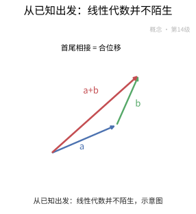

**一句话点破**：别把它当全新学科，它只是把你熟悉的解方程和画坐标系统一成了“向量与矩阵”的语言。
### 19.2 线性代数的发展简史

从《九章算术》里的方程组，到莱布尼茨的行列式、凯莱的矩阵，线性代数是几百年来一批批人“顺手发明”累积起来的。它先有算法，后有理论，最后才被公理化成今天的样子。

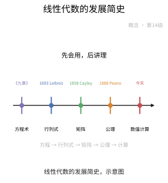

**一句话点破**：线性代数是“先会用、后讲理”的学科，每条规则背后都有一段被反复使用的历史。
### 19.3 线性代数在现实世界的应用

图像压缩、搜索引擎排序、推荐系统、机器人定位、经济模型，背后都在解线性方程组或做矩阵分解。你说一句“给我推荐”，机器其实是在算一个巨大的向量问题。

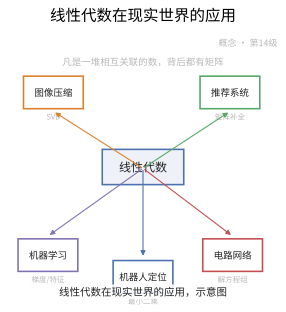

**一句话点破**：凡是要同时处理很多相互关联的数字，线性代数几乎都是那台看不见的发动机。
### 19.4 从中学数学到线性代数的思维跃迁

中学习惯“求一个数”，线性代数要求“看一个整体”：把一整个向量、一整个函数都当成一个对象来运算。这种从“算数”到“看结构”的转变，是入门时最难也最关键的一步。

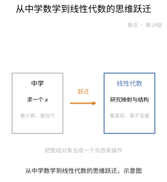

**一句话点破**：从盯着单个未知数，升级到把整组对象当成一个东西来操作，这就是思维跃迁的核心。
### 19.5 如何学习线性代数

别死背公式，先把每个概念翻译成“几何图像”或“生活场景”，再回头做题。理解了“矩阵是变形、秩是压缩程度”这类直觉，公式自然会变得有出处。

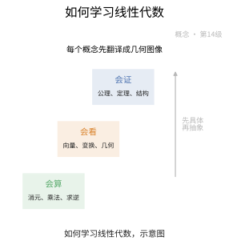

**一句话点破**：先建立几何直觉，再记公式，线性代数就不会沦为符号的堆砌。
### 19.6 向量：把一堆数打包成一个东西

一支箭、一份成绩单、一张商品的多个属性，都可以看成一个向量：它是“一组有序的数”，但你要把它当成一个整体来想。有了向量，方向、大小、相似度这些词才有精确的含义。

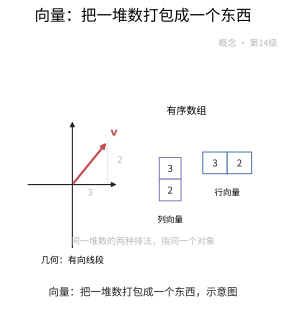

**一句话点破**：向量不是零散的数，而是一个能同时表达“方向与大小”的完整对象。
### 19.7 向量空间：一个封闭的超市

在向量空间里，任意两个向量相加、任意向量乘以数，结果仍然待在这个空间里，出不去。这种“怎么组合都不越界”的封闭性，正是它能自成一体的原因。

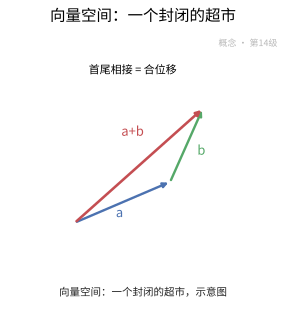

**一句话点破**：向量空间的关键不是元素长什么样，而是“加法与数乘永远关在门内”。
### 19.8 子空间：超市里的饮料专柜

子空间是向量空间里的一块“小天地”，它自己也能做加法和数乘而不跑出去。比如三维空间里过原点的一张平面，就是一个二维子空间。

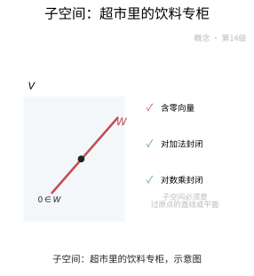

**一句话点破**：子空间就是“自成一体的小空间”：过原点、对加法数乘封闭，缺一不可。
### 19.9 线性组合与张成空间：用几种原料能调出什么

把几个向量各乘上系数再相加，就是线性组合；把所有可能的组合铺开来，得到的区域就是张成空间。就像用几种基础原料，能调出多少种味道。

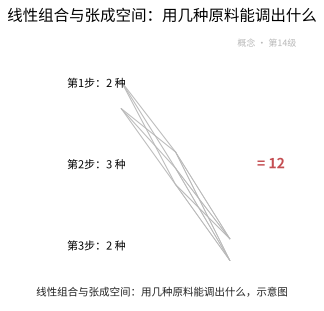

**一句话点破**：张成空间回答的是“用这几样原料，最多能到达哪些地方”。
### 19.10 线性无关与基：辨认真正的原料

如果某个向量能被其他向量拼出来，它就是多余的；去掉所有多余者，剩下的就是基。线性无关说的是“谁都不是别人的组合”，基则是“不多不少刚刚好”的一组原料。

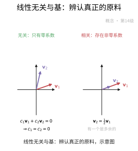

**一句话点破**：基就是一组“不冗余、又够用”的向量，能把整个空间全撑起来。
### 19.11 维数：需要几个数才能定位

在直线上用一个数就能定位，在平面上要两个，在空间里要三个——这个“最少需要几个数”就是维数。它等于基里向量的个数，是空间最本质的刻度。

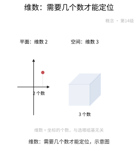

**一句话点破**：维数不是画出来的高度宽度，而是“定位一个点最少要几个坐标”。
### 19.12 矩阵：空间的变形说明书

矩阵看起来是一张数字表格，实际是“对空间做一次变形”的说明书。乘一个矩阵，就等于把整个空间拉伸、旋转、剪切或压扁一次。

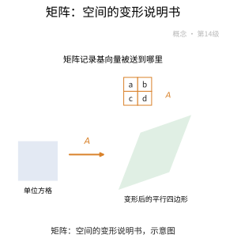

**一句话点破**：把矩阵读成“对空间做一次变形”，比把它当成一堆数有用得多。
### 19.13 矩阵乘法：连续执行两个变形

$AB$ 的意思是“先做 $B$ 的变形，再做 $A$ 的变形”。因为顺序会影响结果，所以矩阵乘法一般不满足交换律，$AB$ 通常不等于 $BA$。

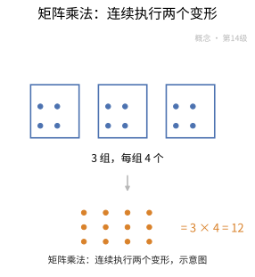

**一句话点破**：矩阵乘法就是“接连做两次变形”，先后次序不同，结果往往也不同。
### 19.14 秩：矩阵压缩空间的程度

一个矩阵把空间搬来搬去，可能把原本丰富的方向压扁成一条线甚至一个点。秩就是变形之后“还剩几个独立方向”，也就是没被压掉的信息量。

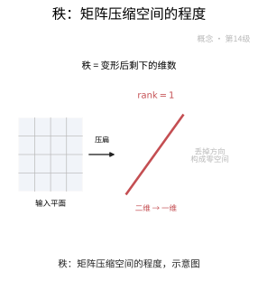

**一句话点破**：秩衡量的是这次变形后，空间还保留了几个独立的维度。
### 19.15 逆矩阵：变形的撤销键

如果一个变形没有把空间压扁，它就能被原样撤销，对应的矩阵就有逆矩阵 $A^{-1}$。反过来，一旦空间被压扁（行列式为 0），就再也回不去了。

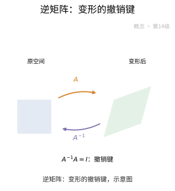

**一句话点破**：逆矩阵是那枚“撤销键”，只有没压扁空间的变形才配拥有它。
### 19.16 行列式：变形后面积体积的变化倍数

单位正方形被矩阵变形后会变成一块平行四边形，它的面积大小就是行列式的绝对值。行列式的正负还告诉你方向有没有翻转。

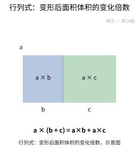

**一句话点破**：行列式就是这次变形对面积（体积）的缩放倍数，为 0 就意味着空间被压扁。
### 19.17 线性变换与秩-零化度：压扁了多少、保留了多少

线性变换是保持加法与数乘的规则变形；它把输入分成“被压成零的”和“仍然留下信息的”两部分。秩-零化度定理说的正是：保留的维度加上被压没的维度，正好等于输入的总维度。

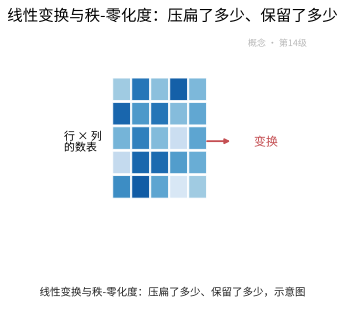

**一句话点破**：一部分被压成零，一部分留下来，两部分的维度加起来恰好不多不少。
### 19.18 特征值与特征向量：变形中的定海神针

大多数箭头变形后方向都变了，但总有几个特殊方向，变形后方向不变，只是被拉长或缩短。这些方向就是特征向量，伸缩的倍数就是特征值。

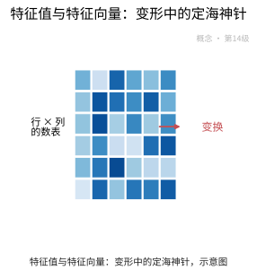

**一句话点破**：特征向量是变形里方向不动的“定海神针”，抓住它们，复杂变形就被拆成几个单纯的伸缩。
### 19.19 内积：两个向量的匹配度

内积把两个向量“对应相乘再相加”，得到一个数，它衡量这两个向量有多“同向”。内积为正说明方向接近，为负说明方向相反，为零则互相垂直。

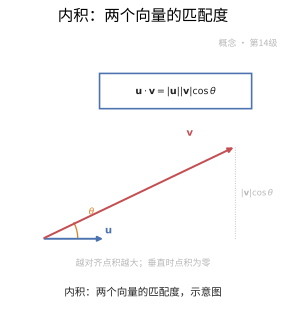

**一句话点破**：内积是一把“匹配度尺子”：越大越同向，为零就正交。
### 19.20 正交与正交投影：互不干扰的方向、找最近点

正交就是“垂直、互不干扰”；正交投影则是把一个点垂直地“照”到一条线或一张面上，得到离它最近的落点。最小二乘、求距离，靠的都是这一招。

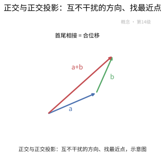

**一句话点破**：正交投影就是“垂直地找出最近点”，它是几何里最省事的逼近手段。
### 19.21 对角化：换个坐标系让变形变简单

同一个变形，换一组“顺着特征向量”的坐标轴来看，就会变成简单的按方向伸缩。对角化就是找到这样一组坐标轴，把矩阵写成对角形。

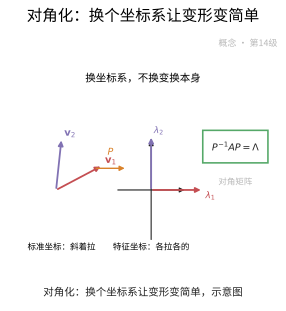

**一句话点破**：对角化不是改变变形本身，而是换一副“贴着特征方向”的眼镜，让矩阵变干净。
### 19.22 谱定理与二次型：对称矩阵的体检报告

对称矩阵总能找到一组互相垂直的特征方向，这就是谱定理；用这些方向看二次型，就能一眼看出它是“碗形、山谷形还是马鞍形”。这套工具是“体检”矩阵性质的利器。

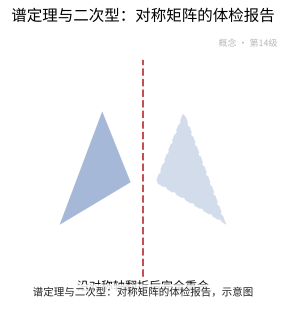

**一句话点破**：对称矩阵天生自带一套正交特征方向，让二次型的形状一览无余。
### 19.23 向量空间的定义

向量空间是把“能相加、能数乘”这两件事抽象出来的集合：只要满足八条加法和数乘的规则，什么样的对象都能叫向量。它把箭头、多项式、函数统一到同一个框架下。

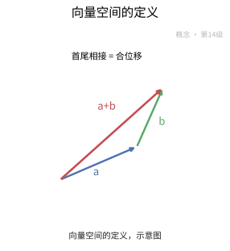

**一句话点破**：向量空间的定义只是把“能加、能乘”写成规则，好让各种对象共享同一套理论。
### 19.24 子空间

判断一个子集是不是子空间，只需检查三件事：含零向量、对加法封闭、对数乘封闭。满足这三条，它就继承了大空间的全部结构。

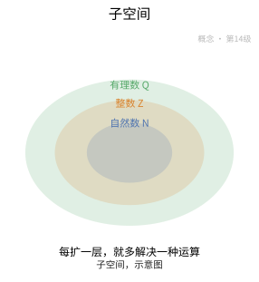

**一句话点破**：子空间判定只需三条：有零、加法封闭、数乘封闭。
### 19.25 线性组合与张成空间

一组向量的所有线性组合构成它们的张成空间，也就是“这些原料能到达的全部地方”。张成的维数等于其中独立向量的个数。

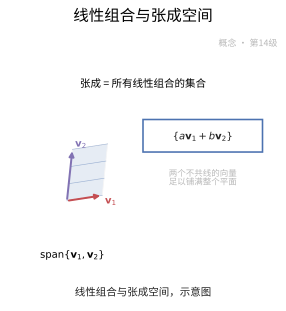

**一句话点破**：张成空间就是所有线性组合的集合，也就是这组向量“能到多广”。
### 19.26 线性无关性

如果一组向量里谁都不能用其余向量拼出来，它们就线性无关。判断的常用方法是看齐次方程 $c_1v_1+\cdots+c_kv_k=0$ 是否只有全零解。

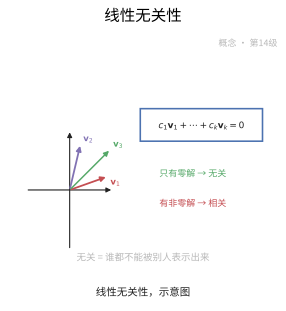

**一句话点破**：线性无关等于没有一个是多余的，用零组合只有全零解来检验。
### 19.27 基与维数

基是“张成整个空间、又彼此无关”的一组向量，它同时给出了空间的“坐标系”；基里向量的个数就是维数。同一个空间可以有无数组基，但维数只有一个。

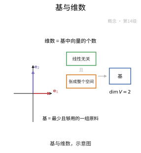

**一句话点破**：基不唯一，但基里向量的个数——维数——是空间写死的。
### 19.28 向量组的秩与极大线性无关组

从一个向量组里挑出尽量多、又彼此无关的向量，就是极大线性无关组；它含的向量个数就是这个向量组的秩。秩告诉你这组向量真正“能撑起”几个维度。

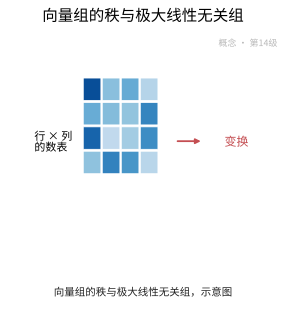

**一句话点破**：极大线性无关组是“精简到不能再精简的核心”，它的个数就是秩。
### 19.29 矩阵的定义与基本运算

矩阵是按行列排布的数字表，可以相加、数乘、相乘、转置。加法和数乘按元素逐一进行，乘法则是“行乘列再求和”，规规矩矩。

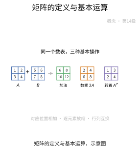

**一句话点破**：矩阵运算法则看着繁琐，本质就是“行与列逐项配对相乘再相加”。
### 19.30 分块矩阵

把大矩阵切成若干小块来运算，就像把大问题拆成小问题分而治之。分块之后，许多公式（如分块求逆、分块乘法）会以更清晰的结构出现。

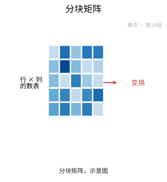

**一句话点破**：分块矩阵是把大矩阵“分组管理”，看清结构往往比硬算更快。
### 19.31 矩阵的秩

矩阵的秩等于其行（列）向量组的秩，也就是行阶梯形里主元的个数。它刻画了矩阵“能提供多少独立信息”，是判断可逆、解是否唯一的关键。

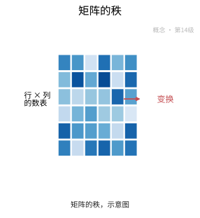

**一句话点破**：秩就是矩阵能提供的独立信息数，主元有几个，秩就有几。
### 19.32 矩阵的迹

迹是矩阵主对角线元素之和。它看似不起眼，却等于全部特征值之和，在相似变换下保持不变，是矩阵的“身份证号”之一。

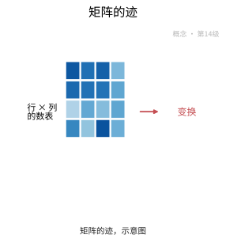

**一句话点破**：迹等于对角线求和，也等于特征值总和，是个不随换基改变的常数。
### 19.33 逆矩阵

只有方阵且行列式不为零时，才存在逆矩阵 $A^{-1}$，满足 $AA^{-1}=I$。求逆常用高斯-若尔当消元，在增广矩阵上做初等行变换即可。

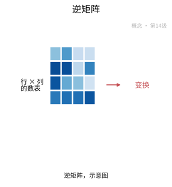

**一句话点破**：逆矩阵是“撤销变形”的钥匙，可逆的充要条件是行列式不为零。
### 19.34 初等行变换与高斯消元法

交换两行、某行乘非零数、把一行加到另一行，这三种操作不改变方程组的解。反复使用它们把矩阵化成行阶梯形，就是高斯消元法。

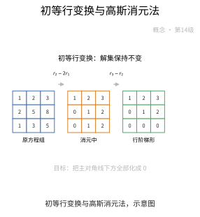

**一句话点破**：高斯消元的核心，就是用三种不改变解的行变换，把方程组一步步化简。
### 19.35 初等矩阵

对单位矩阵做一次初等行变换，得到的矩阵就是初等矩阵。用它左乘一个矩阵，就相当于对那个矩阵做同一次行变换——行变换因此也能用“乘法”来写。

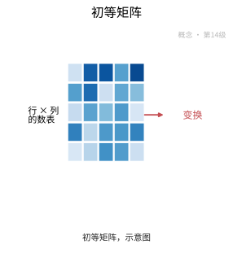

**一句话点破**：初等矩阵是被“一次行变换”改造过的单位阵，左乘它就等于做那次变换。
### 19.36 线性方程组的基本概念

线性方程组由若干线性方程组成，可以写成矩阵形式 $Ax=b$。解的情况只有三种：唯一解、无穷多解、无解。

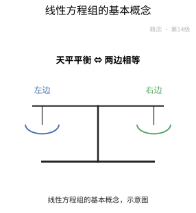

**一句话点破**：所有线性方程组都可以浓缩成 $Ax=b$，解只可能是“一个、无穷多、或没有”。
### 19.37 用高斯消元法求解

把增广矩阵化成行最简形，就能直接读出解：主元列对应的变量是被“钉住”的，剩下的自由变量可以任取，于是解出全部解。

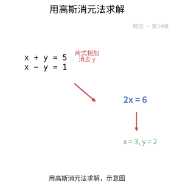

**一句话点破**：消元到行最简形后，主元定变量、自由变量任取，解就自动现形。
### 19.38 Gauss-Jordan 消元法

高斯-若尔当消元把矩阵化到行最简形——不仅主元下方是零，连上方也是零。这样每个主元变量都能直接被读出来，不用再回代。

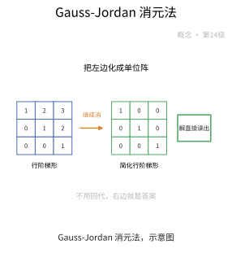

**一句话点破**：多花点功夫把主元上下都消成零，好处是答案可以直接照抄。
### 19.39 解的存在性与唯一性

方程组 $Ax=b$ 有解，当且仅当 $b$ 落在 $A$ 的列空间中；而解唯一，当且仅当没有自由变量。有没有解、解几个，都能从秩看出来。


**一句话点破**：有解看“右端是否落在列空间”，唯一看“有没有自由变量”。
### 19.40 齐次线性方程组

形如 $Ax=0$ 的方程组至少有一个解——零解。它的解集构成一个向量空间，叫零空间，维数等于未知数个数减去秩。


**一句话点破**：齐次方程永远有零解，其余解一起构成零空间。
### 19.41 四个基本子空间与正交补

矩阵 $A$ 身上有四个重要的子空间：列空间、零空间、行空间、左零空间。它们两两成对、互相正交补，共同把整个空间拼得严丝合缝。


**一句话点破**：四个基本子空间两两正交补，合起来正好拼满整个空间。
### 19.42 行列式的定义

行列式是一个只对方阵定义的数，刻画矩阵对体积的缩放。二阶、三阶可以用对角线法则算，更高阶则借助展开或行变换。


**一句话点破**：行列式是一个数，它记录了矩阵把体积放大或缩小了多少倍。
### 19.43 行列式的性质

交换两行行列式变号，某行乘 $k$ 行列式也乘 $k$，两行相同则为零，某行加上另一行的倍数不变——这些性质让计算和判断又快又稳。


**一句话点破**：记住“换行变号、倍行翻倍、同行为零、加行不变”，行列式就好算了。
### 19.44 Laplace 展开

Laplace 展开把高阶行列式按某一行（列）拆成若干低阶行列式的组合，逐层降阶来求值。它给出了一种通用而机械的计算办法。


**一句话点破**：Laplace 展开就是“按一行把大行列式拆成一串小行列式”逐层降阶。
### 19.45 Cramer 法则

当方程组的系数行列式不为零时，每个未知数都能用一个商直接写出：把系数矩阵的对应列换成常数项，再算行列式即可。它美观，但计算量随规模增长很快。


**一句话点破**：系数行列式非零时，未知数等于替换该列后的行列式除以原行列式。
### 19.46 线性变换的定义与例子

线性变换是保持“加法”与“数乘”的映射：$T(u+v)=T(u)+T(v)$、$T(cu)=cT(u)$。旋转、缩放、投影都是它的例子。


**一句话点破**：线性变换是“不破坏加减与数乘规则”的映射，几何上就是整齐的变形。
### 19.47 核与像

核是所有被变换成零的向量（被压没的部分），像是所有可能的输出（能达到的部分）。核越大，说明信息损失越多。


**一句话点破**：核是“被压成零的输入”，像是“所有可能的输出”。
### 19.48 秩-零化度定理

对有限维向量空间上的线性变换，像的维数（秩）加上核的维数（零化度），恰好等于输入空间的维数。它像一份守恒账：要么留下，要么被压没，总量不变。


**一句话点破**：秩加零化度等于输入维数，这份“维度守恒”是线性代数最朴素的平衡。
### 19.49 矩阵表示

选定基之后，抽象的线性变换就能写成一个具体的矩阵：把每个基向量的像按坐标排成列即可。换一组基，矩阵会随之变成相似矩阵。


**一句话点破**：有了基，线性变换就能“具象”成矩阵；换基则得到相似矩阵。
### 19.50 过渡矩阵与坐标变换

同一个向量在不同基下的坐标不同，两组坐标之间靠过渡矩阵换算。过渡矩阵的列，就是新基向量在旧基下的坐标。


**一句话点破**：过渡矩阵是两套坐标系的“换算器”，它的列就是新基在旧基下的坐标。
### 19.51 特征值与特征向量的基本定义

满足 $Av=\lambda v$（$v$ 非零）的 $v$ 是特征向量，$\lambda$ 是特征值。此时矩阵只把 $v$ 沿自身方向伸缩，而不改变它的方向。


**一句话点破**：特征向量的本质：被矩阵作用后方向不变，只被拉伸或压缩。
### 19.52 特征多项式

特征值是方程 $\det(A-\lambda I)=0$ 的根，左边这个关于 $\lambda$ 的多项式就是特征多项式。它的次数等于矩阵阶数，根就是全部特征值。


**一句话点破**：特征值就是特征多项式 $\det(A-\lambda I)$ 的根。
### 19.53 相似矩阵

若 $B=P^{-1}AP$，则称 $A$ 与 $B$ 相似，它们代表同一个线性变换在不同基下的矩阵。相似矩阵有相同的特征值、迹和行列式。


**一句话点破**：相似矩阵是“同一个变换换了个坐标系”，因而带着相同的特征值、迹和行列式。
### 19.54 对角化

如果一个矩阵有足够多个线性无关的特征向量，就能写成 $A=P\Lambda P^{-1}$，其中 $\Lambda$ 是对角阵。对角化后可轻松算高次幂和动力系统的演化。


**一句话点破**：能对角化的关键是“凑够线性无关的特征向量”，凑够了计算就会大幅简化。
### 19.55 Jordan 标准形与广义特征向量

当特征向量不够、无法对角化时，可以退一步用广义特征向量，把矩阵化成 Jordan 标准形——一个几乎是对角、只在副对角线带少数 1 的矩阵。


**一句话点破**：对角化失败时的“备胎”：用广义特征向量凑出 Jordan 标准形。
### 19.56 Cayley-Hamilton 定理

每个方阵都满足自己的特征多项式：把多项式里的 $\lambda$ 换成矩阵 $A$，常数项换成 $I$，结果恰好是零矩阵。它常被用来化简矩阵的高次幂。


**一句话点破**：矩阵满足自己的特征多项式，这条定理是化简矩阵幂的万能钥匙。
### 19.57 内积的定义

内积是把两个向量映到一个数的运算，满足对称、线性、正定三条公理。最常见的欧氏内积就是“对应分量相乘再求和”。


**一句话点破**：内积是给向量之间定义“匹配度”的运算，欧氏内积就是逐项相乘再相加。
### 19.58 范数与距离

范数衡量向量的“长度”，由内积自然导出：$\|v\|=\sqrt{\langle v,v\rangle}$。两个向量之间的距离，就是它们之差的范数。


**一句话点破**：范数是长度，距离是差的长度，二者都由内积一句话导出。
### 19.59 正交性

两个向量内积为零就叫正交，也就是互相垂直、彼此不干扰。一组两两正交的非零向量自动线性无关，是最省心的好基。


**一句话点破**：正交等于内积为零等于互不干扰，正交组天然线性无关。
### 19.60 Gram-Schmidt 正交化

Gram-Schmidt 把一组线性无关的向量逐步改造成两两正交的向量：每一步都减去它在已有方向上的投影。这样就从任意基得到一组正交基。


**一句话点破**：正交化的窍门就一句话——每来一个向量，先减掉它在之前方向上的投影。
### 19.61 正交投影

正交投影把向量垂直地投到子空间上，得到子空间里离它最近的点。投影矩阵满足 $P^2=P$，且 $P$ 是对称的，是最小二乘的几何基础。


**一句话点破**：正交投影等于垂直照射到子空间上的最近点，是“逼近”问题的几何原型。
### 19.62 实对称矩阵

实对称矩阵满足 $A=A^T$。它天生听话：特征值全是实数，不同特征值的特征向量互相正交，总能被正交对角化。


**一句话点破**：实对称矩阵最规矩：特征值全实、特征向量互相正交，必可正交对角化。
### 19.63 谱定理

谱定理说：任何实对称矩阵都能写成 $A=Q\Lambda Q^T$，$Q$ 是正交矩阵，$\Lambda$ 是对角矩阵。它把对称矩阵彻底拆解为一组沿正交方向的纯伸缩。


**一句话点破**：谱定理保证对称矩阵一定能被一组正交特征方向彻底拆开。
### 19.64 二次型的定义

二次型是形如 $x^TAx$ 的关于变量的二次齐次多项式，$A$ 可取对称矩阵。它把二次多项式用矩阵语言统一表达，方便研究其形状。


**一句话点破**：二次型就是把二次齐次多项式写成 $x^TAx$ 的矩阵形式。
### 19.65 二次型的定性

二次型按取值符号分为正定、负定、不定等。判断方法看特征值：全正为正定，全负为负定，有正有负则不定。


**一句话点破**：二次型的“正定负定”，看完特征值符号就一目了然。
### 19.66 用配方法化二次型为标准形

配方法通过逐步配方，把二次型消去交叉项，化成只含平方项的标准形。它等价于做一次可逆线性替换，是化标准形的经典手段。


**一句话点破**：配方法就是不断“消掉交叉项”，把二次型化成只剩平方项。
### 19.67 Sylvester 惯性定理

无论用哪种可逆变换把二次型化成标准形，正平方项的个数（正惯性指数）和负平方项的个数（负惯性指数）都不变。这说明符号的正负数目是二次型的内在不变量。


**一句话点破**：化标准形的方法可以不同，但正项、负项的个数恒定不变——这就是惯性。
### 19.68 主轴定理

主轴定理指出，二次型总能用正交变换化成对角标准形，新的坐标轴正好是二次型矩阵的特征向量方向。几何上，这意味着二次曲面可以被“转正”到自己的对称轴上。


**一句话点破**：主轴定理说：沿特征向量方向转一下，二次型就变成干净的平方和。
### 19.69 LU 分解

LU 分解把矩阵写成下三角 $L$ 乘上三角 $U$，相当于把高斯消元的过程一次性记录下来。有了它，解同一系数、不同右端的多个方程组会非常快。


**一句话点破**：LU 分解等于把高斯消元“拍成照片”，之后换右端项求解又快又省。
### 19.70 QR 分解

QR 分解把矩阵写成正交矩阵 $Q$ 乘上三角矩阵 $R$，由 Gram-Schmidt 或 Householder 变换得到。它数值稳定，常用来做最小二乘和特征值算法。


**一句话点破**：QR 分解把矩阵洗成“正交乘上三角”，数值上更稳健。
### 19.71 LU 与 QR：巩固练习

这一节用一组练习题巩固 LU、QR 分解的手算流程：如何消元记下 $L$、如何正交化得到 $Q$。练习的重点是熟悉步骤，而非死记结论。


**一句话点破**：分解类题目的关键，是把“消元与正交化”的每一步手算走顺。
### 19.72 超定方程组与最佳近似解

当方程个数多于未知数时，通常无解，于是退而求其次找“误差平方和最小”的解，这就是最小二乘。它的几何含义是把 $b$ 垂直投影到 $A$ 的列空间。


**一句话点破**：解不了就找最近点——最小二乘解的几何本质是正交投影。
### 19.73 用 QR 稳健地求最小二乘解

直接解正规方程 $A^TAx=A^Tb$ 容易放大误差；改用 QR 分解求解，数值更稳定。$Q$ 的正交性避免了条件数的平方恶化。


**一句话点破**：最小二乘优先用 QR，而不是硬解正规方程，因为更稳、更准。
### 19.74 最小二乘：巩固练习

本节用拟合直线等例子练习最小二乘：写出 $A$、算正规方程或做 QR、求出最优斜率和截距。重点是理解“为什么它是最优”。


**一句话点破**：拟合直线的练习里，最优解永远对应误差的垂直投影。
### 19.75 奇异值与奇异向量

对任意矩阵，存在单位正交的 $v$ 和 $u$，使 $Av=\sigma u$，$\sigma$ 就是奇异值。它衡量矩阵在某个方向上的放大倍数，即使矩阵不是方阵也有意义。


**一句话点破**：奇异值衡量矩阵在各个方向上的放大倍数，任意矩阵都有。
### 19.76 低秩近似

把 SVD 里小的奇异值丢掉，只保留最大的几个，就能用很低的秩逼近原矩阵。这正是图像压缩、降维和去噪声背后的原理。


**一句话点破**：扔掉小奇异值，用少数几个大方向就能逼真地还原矩阵。
### 19.77 SVD：巩固练习

本节练习如何从 $A^TA$ 或 $AA^T$ 求奇异值与奇异向量，并写出 $A=U\Sigma V^T$。重点是理解左右奇异向量各来自哪一侧。


**一句话点破**：求 SVD 的套路：右奇异向量来自 $A^TA$，左奇异向量来自 $AA^T$。
### 19.78 复特征值与旋转-伸缩

实矩阵也可能有复数特征值，它们总成共轭对出现，几何上对应“旋转加伸缩”。旋转矩阵没有实特征方向，正是因为它把每个方向都转走了。


**一句话点破**：复特征值等于平面上的旋转加伸缩，成对共轭出现。
### 19.79 离散线性动力系统

系统按 $x_{k+1}=Ax_k$ 一步步演化，解就是 $x_k=A^kx_0$。系统的长期行为由绝对值最大的特征值（主特征值）决定：大于 1 就发散，小于 1 就衰减。


**一句话点破**：动力系统的命运由模最大的特征值决定——大于 1 发散，小于 1 收敛。
### 19.80 马尔可夫链与稳定分布

马尔可夫链用一个随机矩阵描述概率如何在状态间迁移，它的稳定分布就是特征值 1 对应的特征向量。长期看，无论从哪里出发都会收敛到这个分布。


**一句话点破**：马尔可夫链的稳定分布，就是那个对应特征值 1 的不动向量。
### 19.81 动力系统：巩固练习

本节用迭代矩阵、收敛判断等题目巩固离散动力系统：算特征值、判断长期趋势、求稳定分布。重点是把特征值分析与实际演化对应起来。


**一句话点破**：动力系统练习的核心，是把特征值大小翻译成“发散还是收敛”。
### 19.82 仿射组合与仿射平面

仿射组合是系数和为 1 的线性组合，它不再保持“过原点”，而是能表示不过原点的直线、平面。仿射几何研究的正是这种“平移过”的几何对象。


**一句话点破**：系数和为 1 的组合叫仿射组合，它让几何对象可以离开原点。
### 19.83 凸组合与凸集

凸组合是系数非负且和为 1 的线性组合，凸集则要求任意两点的连线都在集合内。凸性让“最优点在边界、通常在顶点”成为可能。


**一句话点破**：凸组合要求系数非负且和为 1，凸集等于任意两点的连线都不出界。
### 19.84 超平面、半空间与坐标表示

超平面是把空间一分为二的“高维平面”，可用 $n^Tx=b$ 表示；它把空间分成两个半空间。线性规划的可行域、分类器的决策边界，都是这两个概念的化身。


**一句话点破**：超平面是高维里的平面，它两侧的半空间才是它划分出的两个世界。
### 19.85 向量空间几何：巩固练习

本节用仿射、凸、超平面三类题目巩固向量空间的几何：判断点是否在平面内、是否属于凸包、如何写出超平面方程。重点是把代数条件翻译成几何图像。


**一句话点破**：几何练习的诀窍，是把每一条代数等式都读成一张几何图形。

## 二十、数学史（History of Mathematics）

### 19.1 线性方程组的古老血脉：从《九章算术》到中世纪

- **中国的"方程"术**：多元一次线性方程组的求解古已有之。中国《九章算术》（约公元前 2 世纪至公元 1 世纪）的"方程"章就用"直除法"（逐行消元）解二元、三元乃至更多元的线性方程组，与现代高斯消元法异曲同工，比欧洲早出上千年。这是线性代数最早的算法胎芽之一。
- **巴比伦与希腊的雏形**：两河流域的泥板上就有"鸡兔同笼"式的线性题；希腊人则在贸易与天文数据拟合中遇到"几个条件同时满足"的问题，但都停留在个案，未提炼出一般理论。
- **为何重要**："线性"（满足叠加原理、以线性方程组为骨架）是最早也最可解的一类数学结构；农业分配、土地丈量、交换与历法都依赖它。后世一切矩阵、行列式理论，都从这里开始寻找"如何统一求解"的答案。

### 19.2 行列式的萌芽：关孝和与莱布尼茨

- **关孝和的领先**：1683 年，日本数学家关孝和在《解伏题之法》中首次引进行列式概念，书中出现 $2\times2$、$3\times3$ 乃至 $5\times5$ 的行列式，用它们求解高次方程组的系数结构——这比欧洲早约十年。
- **莱布尼茨的对应**：1693 年，莱布尼茨用"指标数系统集"表示三元一次方程组的系数，消去两个未知量后得到行列式，并用数对 $ij$ 标明元素位于第 $i$ 行第 $j$ 列；他已知行列式不等于零意味着有非平凡解，并握有展开与克莱姆法则的等价雏形。
- **平行的殊途**：两位先驱各自独立、时间相近地种下行列式之树。当时尚无"矩阵"概念，行列式只是"由方程系数组织出来的某个量"，其本质（体积伸缩因子）要到 18 世纪才被揭晓。

### 19.3 克莱姆法则与麦克劳林

- **麦克劳林的铺路**：1730 年，苏格兰数学家科林·麦克劳林在《论代数》中系统阐述以行列式解二、三、四元方程的方法——尽管该书直到他去世两年后的 1748 年才出版。
- **克莱姆法则**：1750 年，瑞士的加布里尔·克莱姆在《代数曲线分析引论》中给出"用行列式之比求解 n 元一次方程组"的法则，用其确定经过五个点的一般二次曲线的系数。规则以"分母为系数行列式、分子为替换某列后的行列式"表述（第 5.4 节），成为中学与本科线性代数的招牌公式。
- **由繁到简**：由于当时的行列式定义在奇偶置换之上，计算相当复杂；只有把"排成方阵、双重下标"的矩阵观念建立起来，克莱姆法则才变得直观好用——这仍需等凯莱登台。

### 19.4 矩阵的诞生：凯莱与西尔维斯特

- **西尔维斯特的命名**：1848 年前后，詹姆斯·约瑟夫·西尔维斯特引入"matrix（矩阵）"一词（拉丁语"子宫"之意），用以指代排成矩形的数字阵列。
- **凯莱的代数化**：阿瑟·凯莱在研究线性变换时，为矩阵引入加法、乘法与转置，并首次以一个字母代表一个矩阵，将矩阵当作"聚合对象"而非一纸草稿——他还意识到矩阵与行列式、与线性变换之间的深层联系。1858 年凯莱给出矩阵乘法的显式规则，标志着"矩阵代数"成为独立研究对象。
- **从工具到对象**：在此之前"矩阵"只是记录系数的小工具；凯莱让"矩阵本身可运算、可相乘"成为现实，从此线性方程组、二次型、几何变换都能压缩成一行矩阵算式，线性代数迎来"代数化"的拐点。

### 19.5 高斯消元法与线性代数的算法传统

- **从配法到消元**：高斯在研究大地测量与最小二乘时，用"逐次消去未知量"求超定线性方程组——这就是高斯消元法（约 1810 年）的由来；其"行变换到阶梯形"的形式由威尔海姆·约当等整理为 Gauss–Jordan 消元法，成为今天的标准算法。
- **计算与理论的分野**：高斯消元法把"判断解是否存在、唯一"与"求出解"合并为机械化流程，也引出矩阵的秩、初等变换、LU 分解等概念（第 3、4 章）。线性代数由此保留了一条极强的"计算"支脉。
- **数值时代的复兴**：20 世纪计算机普及后，高斯消元、LU/QR 分解、迭代算法成为科学与工程模拟的引擎——算法传统并未过时，反而从"入门技巧"升华为"数值线性代数"这门学科。

### 19.6 向量空间公理化：皮亚诺 1888 年

- **从数组到抽象空间**：18—19 世纪，"向量"最初只是有序数组或几何箭头。1888 年，朱塞佩·皮亚诺第一次给出"向量空间"的精确定义（一组满足加法律与数乘律的对象），使之脱离具体坐标而成为公理化结构——这在今天看来正是第 2 章向量空间公理的正式出生证。
- **为何是一次跃升**：公理化让"子空间、线性无关、基、维数"等全部获得不依赖坐标的定义，也使得分析（函数空间）、物理（状态空间）里的无穷维向量空间成为合法对象——这是连接线性代数与泛函分析的桥梁。
- **弗雷歇与后继**：弗雷歇等进一步发展无穷维向量空间，把"维数""基"的概念扩展进拓扑与函数空间，为 20 世纪数学搭好舞台。

### 19.7 线性变换、特征值与凯莱-哈密顿

- **线性变换的语言**：把"几何伸缩、旋转、投影"翻译成"保持线性组合不变的映射"，配合矩阵表示，就得到第 6 章的线性变换整体观。凯莱在这一过程中扮演了关键角色。
- **特征值与对角化的动机**：寻找"在某方向上只伸缩而不转向"的方向（特征向量）与伸缩比例（特征值），源自振动、转动惯量、天体摄动等物理问题（第 7 章）。拉普拉斯、拉格朗日在二次主轴上已零星使用；19 世纪魏尔斯特拉斯、若尔当把特征多项式、相似标准形系统化。
- **Cayley–Hamilton 定理**：凯莱观察到"矩阵满足自身的特征多项式"（第 7.3b 节）——这一定理把"矩阵"这一抽象对象同其特征方程绑定，成为从"算矩阵"迈向"研究矩阵代数结构"的标志性一步。

### 19.8 四元数、格拉斯曼与抽象代数的催生

- **哈密顿的四元数**：1843 年，哈密顿在都柏林跨桥时顿悟出四元数 $\mathbf{i}^{2}=\mathbf{j}^{2}=\mathbf{k}^{2}=\mathbf{ijk}=-1$，把乘法推广到非交换情形——这打破"乘法必可交换"的千年信条，为抽象代数（群、环、域之外的"代数"结构）打开大门。
- **格拉斯曼的线性扩张**：1844 年，赫曼·格拉斯曼出版《线性扩张论》（Die lineare Ausdehnungslehre），系统发展了向量空间、线性扩张、外积等思想（详见第 15 级），其几何-代数统一的雄心比当代还超前，却因太抽象而长期被冷落，后来才被重新发现。
- **对线性代数的反哺**：四元数与格拉斯曼虽属"超复数"与多重线性结构，却共同推动了"不依赖具体数组的代数结构"这一观念，直接哺育了 20 世纪初把向量空间、矩阵、特征值提炼为抽象线性代数的进程。

### 19.9 内积与正交化：从傅里叶级数到格兰姆-施密特

- **内积的几何回归**："长度、夹角、正交"这些概念用内积 $\langle u,v\rangle$ 统一起来，可追溯到高斯与拉格朗日对二次型的处理（第 8 章）；吉布斯、海维赛德的向量分析使点积普及。
- **正交化的需要**：在傅里叶级数中，人们需要把函数按正交基展开——这催生了"把一族线性无关向量改造成标准正交基"的算法。格兰姆（Jørgen Pedersen Gram）与施密特（Erhard Schmidt）各自在 19 世纪末 20 世纪初给出这一过程（Gram–Schmidt 正交化，第 8.4 节），成为数值分析与逼近论的核心工具。
- **投影的谱系**：正交投影、最小二乘（第 12 章）都建立在"内积空间里找最近点"的几何之上，使线性代数获得强大的统计与信号处理应用。

### 19.10 二次型与谱定理：从黎曼构形到今天的标准形

- **二次型的古典根**：二次型可追溯到圆锥曲线的分类、天体轨道与惯性矩的化简。拉格朗日、高斯先后用配方法与合同变换把二次型化为标准形；瑞士数学家切列叶（Sylvester）的惯性定理与欧拉、拉格朗日的"主轴定理"（第 10 章）给出"正负惯性指数不随化法改变"的判定。
- **谱定理的成型**：对实对称矩阵，"可正交对角化、特征值全实"这一结论（第 9 章谱定理）是魏尔斯特拉斯等人的抽象分析对"主轴定理"的提升，也是量子力学中可观测量的数学基础。
- **意义**：二次型与谱定理把"几何上的标准形还原"与"代数上的对角化/合同变换"统一，是线性代数理论性与应用性最强的交汇点之一。

### 19.11 20 世纪的扩张：从量子力学到计算机

- **量子力学与统计的召唤**：20 世纪初，矩阵力学（海森堡、玻恩、若尔当）用矩阵刻画物理可观测量，狭义相对论用线性变换表达时空，统计学用相关矩阵整理多随机变量——线性代数的工具性随这些应用迅速普及。
- **抽象线性代数的收束**：到 20 世纪上半叶，前人散乱的方法被整合为"向量空间 + 线性变换"的现代公理体系；矩阵、行列式、特征值、内积、正交化、二次型、分解算法（LU、QR、SVD，第 11、13 章）依次定型，线性代数成为大学数学与工程的标准语文。
- **计算机时代**：大规模数值模拟让高斯消元与各种矩阵分解成为数字建模的基本引擎，也推动数值线性代数与优化理论作为独立分支蓬勃发展。线性代数由此既是最纯粹的公理理论，也是机器可执行的算法库。

### 19.12 历史年表

| 时间 | 人物／文献 | 事件与贡献 |
|:---|:---|:---|
| 约前后 1 世纪 | 《九章算术》 | "方程"章直除法解多元线性方程组 |
| 1683 年 | 关孝和（日本） | 《解伏题之法》引入行列式 |
| 1693 年 | 莱布尼茨 | 用指标系数表与行列式研究线性方程组 |
| 1730/1748 年 | 麦克劳林 | 行列式解方程理论（书 1748 年出版） |
| 1750 年 | 克莱姆 | 克莱姆法则 |
| 约 1810 年 | 高斯 | 高斯消元法与最小二乘逼近 |
| 1843 年 | 哈密顿 | 发现四元数，非交换乘法 |
| 1844 年 | 格拉斯曼 | 《线性扩张论》：向量空间与外积思想 |
| 1848 年 | 西尔维斯特 | 引入"matrix（矩阵）"一词 |
| 1850 年代 | 凯莱 | 矩阵乘法、矩阵作为对象、Cayley–Hamilton |
| 1888 年 | 皮亚诺 | 第一次精确公理化"向量空间" |
| 19 世纪末 | 魏尔斯特拉斯、若尔当 | 特征值、相似标准形与谱定理 |
| 1902 年前后 | Gram–Schmidt | 正交化算法进入数值与逼近分析 |
| 20 世纪初 | 海森堡、玻恩等 | 矩阵力学；狭义相对论与量子力学的应用 |
| 20 世纪下半叶 | 数值分析 | LU/QR/SVD 分解与计算机时代线性代数 |

### 19.13 小结

> 线性代数的历史，是"从解方程组的算法，升格为向量空间的公理科学，再回流为现代计算的引擎"的完整闭环。它从中国《九章算术》的直除法和关孝和、莱布尼茨的行列式萌芽出发，经麦克劳林、克莱姆的法则而定型；凯莱与西尔维斯特把"矩阵"锻造成可运算的对象，高斯用消元法确立了算法传统，皮亚诺的 1888 年公理化则把向量空间推向抽象。四元数与格拉斯曼打破了交换的禁忌、铺路抽象代数，内积与正交化（傅里叶→Gram–Schmidt）把几何还给代数，二次型与谱定理写成标准形之链。20 世纪，量子力学、相对论、统计学的应用爆发让线性代数成为普适工具，矩阵分解又在计算机时代成为科学与工程的基本引擎。纵观全程，线性代数的三个身份交替登场——先是"解方程的技术"（消元、行列式、克莱姆法则），再是"线性结构的公理理论"（向量空间、线性变换、特征值），最后是"高维世界的计算语言"（SVD、大数据、量子计算）——本章第 2—13 章的概念，恰好一一对应这条从算法到理论再到算法的螺旋式演进。

## 现实应用（Real-World Applications）

### 应用案例 1：图像处理｜把高斯卷积写成矩阵，看"线性变换 + 内积"的真实模样

**场景与问题**

手机相机按下快门后，图像信号处理器（ISP）要对 1200 万像素的灰度图（4000×3000）做去噪。最常用的一步是**高斯模糊**：用一枚 $5\times5$ 的高斯核在图像上做二维卷积。工程团队关心三个问题：(1) 这一步是不是线性变换，能不能用矩阵语言统一描述？(2) 大图上直接卷积是 $O(HWK^2)$，如何把耗时从几十毫秒压到几毫秒？(3) 边界怎么处理才不留黑边？这三个问题分别落在**线性变换、矩阵表示、矩阵乘法与分块矩阵、内积**上。

**涉及知识点**

- 本章「0.6 向量：把"一堆数"打包成"一个东西"」：一张 $H\times W$ 的灰度图被拉成一个 $HW$ 维向量，图像处理里"一张图 = 一个向量"就是这么来的。
- 本章「0.12 矩阵：空间的"变形说明书"」：卷积核决定了每个像素被邻域怎样加权，它就是这台"变形机"的操作手册。
- 本章「0.13 矩阵乘法：连续执行两个变形」：先水平模糊再垂直模糊，等价于两个矩阵相乘，顺序体现为矩阵乘法。
- 本章「3.1 矩阵的定义与基本运算」「3.1b 分块矩阵」：整幅图的卷积矩阵是分块 Toeplitz 结构，可分离核让它降秩为秩 1。
- 本章「6.1 定义与例子」「6.4 矩阵表示」：卷积是货真价实的线性变换，选定像素基后即写成矩阵。
- 本章「8.1 内积的定义」「8.3 正交性」「0.19 内积：两个向量的"匹配度"」：每个输出像素是邻域窗口与核的内积。

**建模与数据**

设灰度图 $X\in\mathbb R^{H\times W}$，取具体小尺寸便于复现：$H=W=8$，像素值 $0\sim255$。高斯核取标准差 $\sigma=1.0$ 的 $5\times5$ 核，按

$$
g(p,q)=\frac{1}{2\pi\sigma^2}\exp\!\left(-\frac{p^2+q^2}{2\sigma^2}\right),\qquad p,q\in\{-2,-1,0,1,2\}
$$

生成后归一化到和为 $1$（保证模糊后总亮度不变）。真实手机上 $\sigma=0.8\sim1.5$、核尺寸 $3\times3$ 或 $5\times5$ 最常见。

**完整推导与算法**

1. **卷积定义**。零填充（zero-padding）后，输出

$$
Y[i,j]=\sum_{p=-2}^{2}\sum_{q=-2}^{2}G[p,q]\cdot X[i-p,\ j-q].
$$

2. **看成线性变换**。把 $X$ 按行优先拉成向量 $\mathrm{vec}(X)\in\mathbb R^{64}$，把 $Y$ 同理拉成 $\mathrm{vec}(Y)$。存在矩阵 $M\in\mathbb R^{64\times64}$ 使 $\mathrm{vec}(Y)=M\,\mathrm{vec}(X)$。$M$ 的每一行，就是"某个输出像素对所有输入像素的权重"，正是核在局部铺开的样子——这就是**矩阵表示**。

3. **缩放、平移与稀疏性**。卷积保持并行结构，$M$ 是**带状（block-Toeplitz）矩阵**：每行只有 $K^2=25$ 个非零元，$(i,j)$ 处的块是 Toeplitz 矩阵。这解释了为什么工程里绝不真的构造 $M$，而是直接滑动窗口。

4. **可分离性把复杂度降一个量级**。$5\times5$ 高斯核是**秩 1 外积** $G=g\,g^{\mathsf T}$（$g$ 为 $5$ 维高斯列向量）。于是二维卷积 = 先按列做一维卷积、再按行做一维卷积：

$$
Y[i,j]=\sum_{q}g[q]\Big(\sum_{p}g[p]\,X[i-p,\,j-q]\Big).
$$

代价从 $O(HWK^2)$ 降到 $O(HWK)$。$8\times8$ 图、$K=5$ 时约省 $5$ 倍；$4000\times3000$ 图上省下的就是几十毫秒。**这正是"矩阵乘法 + 秩 1 分解"在生产里的样子**。

```python
# 核心：生成归一化一维高斯向量 g，再外积成可分离的二维核 G = g g^T
g = np.exp(-(np.arange(-2, 3) ** 2) / (2 * 1.0 ** 2)); g /= g.sum()
G = np.outer(g, g)                       # 5x5 秩1核，rank(G) == 1

# 核心：先列后行两次一维卷积（等价于二维卷积，但省一个量级）
tmp = np.apply_along_axis(lambda c: np.convolve(c, g, mode='same'), 0, X)   # 沿列
Y   = np.apply_along_axis(lambda r: np.convolve(r, g, mode='same'), 1, tmp) # 沿行

# 核心：每个输出像素 = 局部窗口与核的内积（用于对照验证一行）
patch = X[3:8, 3:8]                       # 某个 5x5 邻域
pixel = float((patch * G).sum())          # 内积 <patch, G> = Y[5, 5]
```

**可复现步骤**

1. 环境与依赖：`pip install numpy scipy matplotlib`
2. 数据准备：构造 $8\times8$ 灰度矩阵 `X`（可用 `np.random.default_rng(0).integers(0,256,(8,8))`），或读入一张 $\ge 8\times8$ 的 PNG 并转灰度。
3. 运行：写 `case1.py`，先算 $\mathrm{rank}(G)$ 应为 $1$，再比较"直接二维卷积"与"两次一维卷积"的结果。
4. 预期输出：(a) `np.linalg.matrix_rank(G) == 1`；(b) 两种卷积结果的最大绝对误差 $<10^{-12}$；(c) 输出图的总和与输入图总和相等（核归一化）；(d) 与 `scipy.signal.convolve2d(X, G, mode='same', boundary='fill')` 结果一致。

**结果解读与延伸**

- **结构揭示**：卷积不是一堆巧合的加权，而是一个**带状 Toeplitz 线性变换**。它的"稀疏 + 平移不变"结构，正是图像处理能用快速算法（可分离、FFT）替代通用矩阵乘的唯一理由；若不用线性代数语言，就无法解释为什么 $O(HWK^2)$ 可以降到 $O(HWK\log W)$。
- **误差来源**：零填充会让边缘像素"看到"一圈 0，导致边缘偏暗，工程上改用 reflect/symmetric 边界，这属于建模假设而非线性代数误差。
- **呼应本章**：核归一到和为 1，是把"平均"翻译成"系数和 = 1 的线性组合"；外积分解则是"$5\times5$ 秩 1 矩阵"这一概念的直接兑现。
- **可扩展**：换成 Sobel 核就得到边缘检测（核的行和为 0，相当于高通滤波）；换成多个核堆叠成 $3\times3\times K$ 的卷积张量，就进入卷积神经网络（CNN）的世界。

### 应用案例 2：人脸识别｜PCA 特征脸：用谱定理与主轴定理做降维

**场景与问题**

某门禁系统需要在 1000 张 $92\times92$ 的人脸照片里做人脸识别（经典 ORL/AT&T 人脸库：40 人、每人 10 张、$92\times92$、256 灰阶）。若把每张照片当成 $n=92\times92=8464$ 维向量，直接比较欧氏距离既慢又会被光照噪声淹没。工程上要用 **PCA（主成分分析）** 把 8464 维压到几十维，还要保证"压掉的只是噪声、留下的是人脸的共同结构"。这套流程的核心正是**实对称矩阵、谱定理、主轴定理、对角化与坐标变换**。

**涉及知识点**

- 本章「0.18 特征值与特征向量」「0.21 对角化」「0.22 谱定理 & 二次型」：协方差矩阵是对称矩阵，其特征向量就是"主方向"。
- 本章「0.6 向量」「6.5 过渡矩阵与坐标变换」：换到特征向量基，等于用过渡矩阵 $Q$ 做坐标变换。
- 本章「7.1 基本定义」「7.2 特征多项式」「7.3 对角化」：求特征值/特征向量、对角化协方差矩阵。
- 本章「9.1 实对称矩阵」「9.2 谱定理」「10.3b 主轴定理」：$C=Q\Lambda Q^{\mathsf T}$，主轴就是特征脸方向。
- 本章「3.3 矩阵的迹」：迹 = 总方差，用来算"保留了多少信息"。
- 本章「8.4 Gram-Schmidt 正交化」：特征向量本就两两正交，可直接正交归一成新基。

**建模与数据**

把 $N=1000$ 张图各拉成列向量 $x_1,\dots,x_N\in\mathbb R^n$（$n=8464$），组成数据矩阵 $X=[x_1-\bar x,\dots,x_N-\bar x]\in\mathbb R^{n\times N}$，其中均值脸

$$
\bar x=\frac1N\sum_{i=1}^N x_i.
$$

真实数据量级：$n=8464\gg N=1000$，所以按"小矩阵技巧"对 $X^{\mathsf T}X$（$N\times N$）求特征分解更省算力。本案例给能复现的小规模：$n=36$（$6\times6$ 缩略脸）、$N=20$ 张。

**完整推导与算法**

1. **中心化**：减去均值脸 $\bar x$，得到 $X$。这一步保证协方差度量的是"相对平均脸的变化"。

2. **协方差矩阵**（对称、半正定）：

$$
C=\frac1N\sum_{i=1}^N (x_i-\bar x)(x_i-\bar x)^{\mathsf T}=\frac1N XX^{\mathsf T}\in\mathbb R^{n\times n}.
$$

3. **谱定理**：$C$ 实对称，故存在正交矩阵 $Q$（$Q^{\mathsf T}Q=I$）与对角阵 $\Lambda=\operatorname{diag}(\lambda_1\ge\cdots\ge\lambda_n\ge0)$，使

$$
C=Q\Lambda Q^{\mathsf T},\qquad C=\sum_{k=1}^{n}\lambda_k q_k q_k^{\mathsf T}.
$$

特征向量 $q_k$ 就是"特征脸"（eigenface），$\lambda_k$ 是它方向的方差。

4. **总方差 = 迹**：$\operatorname{tr}(C)=\lambda_1+\cdots+\lambda_n$ 就是全部方差。取前 $d$ 个主方向，**能量保留率**为

$$
\rho_d=\frac{\sum_{k=1}^{d}\lambda_k}{\sum_{k=1}^{n}\lambda_k}.
$$

实践中 $d=20\sim50$ 就能让 $\rho_d>0.95$。

5. **投影降维（正交投影）**：去掉均值后的人脸 $x$ 的**特征脸坐标**为

$$
y=Q_d^{\mathsf T}(x-\bar x)\in\mathbb R^d,\qquad Q_d=[q_1,\dots,q_d],
$$

其中 $Q_d$ 就是过渡矩阵（列是标准正交特征向量），$Q_d^{\mathsf T}$ 是投影算子：$Q_d Q_d^{\mathsf T}$ 把新脸投到 $d$ 维子空间，误差恰是被丢掉特征值之和。

```python
# 核心：对协方差矩阵做对称特征分解（升序），翻转成降序
C = (X @ X.T) / N
lam, Q = np.linalg.eigh(C)          # lam 升序，Q 的列为标准正交特征向量
lam, Q = lam[::-1], Q[:, ::-1]      # 降序：特征脸按方差从大到小排队

# 核心：用迹求能量保留率，并取前 d 维做投影坐标
d = 20
energy = lam[:d].sum() / lam.sum()          # == tr 的前 d 项占比
y = Q[:, :d].T @ (x_test - x_mean)          # 过渡矩阵 Q_d^T：(n,) -> (d,) 的降维坐标

# 核心：识别 = 在降维空间里找最近邻（比较低维内积/距离）
dist = np.linalg.norm(y - Y_train, axis=0)  # Y_train: (d, N) 所有训练样本坐标
label = np.argmin(dist)
```

**可复现步骤**

1. 环境与依赖：`pip install numpy scikit-learn matplotlib`
2. 数据准备：`sklearn.datasets.fetch_olivetti_faces()` 得到 $400\times4096$（$64\times64$）灰度脸；或读入自备 $6\times6$ 缩略图。
3. 运行：`python case2.py`，输出 `energy`、前 5 个特征脸的图像与识别准确率。
4. 预期输出：(a) 特征值有明显的前几个大、尾部接近 0（呈"肘形"）；(b) $d=20$ 时 `energy > 0.9`；(c) 用最近邻分类，留一法准确率通常 $\ge 90\%$；(d) 前几个特征脸看起来像"光照/眼镜/胡须"这类人脸共有的变化模式。

**结果解读与延伸**

- **为什么能降维**：真实人脸数据的协方差矩阵是低秩主导的，少数主方向承载绝大多数方差；谱定理保证这些方向的方差就是特征值，且方向两两正交（互不冗余）。
- **局限**：PCA 是无监督的，主方向可能对应光照而非身份；对角度/表情变化不鲁棒。工厂里常换成 LDA（有监督）或直接用 CNN 特征。
- **呼应本章**：$\operatorname{tr}(C)=$ 总方差、$C=Q\Lambda Q^{\mathsf T}$、投影矩阵 $Q_dQ_d^{\mathsf T}$，把"迹、谱定理、正交投影"三件事串成一条工程流水线；主轴定理则保证了"降维必然沿特征方向"。

### 应用案例 3：数据压缩与推荐｜SVD 低秩近似：图像压缩与隐语义模型

**场景与问题**

一家流媒体平台（类似 Netflix 的评分矩阵有约 2 亿用户 × 数万部影片）要做两件事：(1) 把 4K 剧集预览图压缩后传输；(2) 给用户推荐没看过的电影。两件看似无关的任务，底层是同一个算法——**奇异值分解（SVD）的低秩近似**。图像的像素矩阵、评分矩阵都是"少数模式主导"的低秩结构，SVD 能把它们从 $m\times n$ 个数字压到 $k(m+n)$ 个数字。

**涉及知识点**

- 本章「0.10 线性无关 & 基」「0.11 维数」「2.5 基与维数」：奇异向量给出一组"最省维度"的正交基。
- 本章「0.14 秩：矩阵"压缩空间"的程度」「3.2 矩阵的秩」「2.6 向量组的秩与极大线性无关组」：秩 $k$ 就是"有效信息维度"。
- 本章「13.1 奇异值与奇异向量」「13.2 低秩近似：用"最少的功夫"逼近矩阵」「13.3 巩固练习」：SVD、Eckart–Young 定理与能量保留率。

**建模与数据**

- 图像：一张 $1024\times1024$ 灰度图存成矩阵 $A\in\mathbb R^{1024\times1024}$，原始存储 $1024^2\approx1.05\times10^6$ 个数。
- 推荐：评分矩阵 $R\in\mathbb R^{m\times n}$，$m=10000$ 用户、$n=2000$ 影片，观测到的评分只有约 $1\%$（稀疏），需要低秩补全。
- 能量阈值设 $\rho=0.99$（保留 99% 能量）。

**完整推导与算法**

1. **奇异值分解**：任意 $m\times n$ 实矩阵

$$
A=U\Sigma V^{\mathsf T},\qquad \sigma_1\ge\sigma_2\ge\cdots\ge\sigma_r>0,\quad r=\operatorname{rank}A.
$$

$v_i$ 是 $A^{\mathsf T}A$ 的标准正交特征向量（右奇异向量，$\sigma_i^2$ 为其特征值），$u_i=Av_i/\sigma_i$。

2. **Eckart–Young 定理**：截断 $A_k=\sum_{i=1}^{k}\sigma_i u_i v_i^{\mathsf T}$ 是所有秩 $\le k$ 矩阵中在 Frobenius 范数下离 $A$ 最近者，且

$$
\|A-A_k\|_F^2=\sigma_{k+1}^2+\cdots+\sigma_r^2.
$$

3. **能量保留率**（决定 $k$）：

$$
\rho_k=\frac{\sum_{i=1}^{k}\sigma_i^2}{\sum_{i=1}^{r}\sigma_i^2}.
$$

4. **存储量**：$A_k$ 只需存 $k$ 个奇异值 + $k$ 个 $u_i$（$m$ 维）+ $k$ 个 $v_i$（$n$ 维），共约 $k(m+n+1)$ 个数。压缩比

$$
\text{CR}=\frac{mn}{k(m+n+1)}.
$$

$m=n=1024$、$k=50$ 时 $\mathrm{CR}\approx1024^2/(50\times2049)\approx10.2$。

5. **推荐系统**：评分矩阵 $R\approx U_k\Sigma_k V_k^{\mathsf T}$，用户 $u$ 对影片 $i$ 的预测评分 $\hat r_{ui}=(\Sigma_k^{1/2}U_k^{\mathsf T})_{u}\cdot(\Sigma_k^{1/2}V_k^{\mathsf T})_{i}$，即两个低维隐向量（隐语义因子）的内积。隐维 $k$ 取 $32\sim128$。

```python
# 核心：一次 SVD 拿到全部奇异值与奇异向量（截断本身不重算）
U, s, Vt = np.linalg.svd(A, full_matrices=False)   # s 已按降序
k = int(np.searchsorted(np.cumsum(s**2) / np.sum(s**2), 0.99) + 1)  # 能量>=99% 的最小 k

# 核心：秩-k 重构 = 前 k 项外积之和 A_k = sum sigma_i u_i v_i^T
A_k = (U[:, :k] * s[:k]) @ Vt[:k, :]

# 核心：压缩比与重构误差（Eckart-Young 给出的理论值）
cr     = A.size / (k * (A.shape[0] + A.shape[1] + 1))
err_F2 = np.sum(s[k:]**2)                             # == ||A - A_k||_F^2

# 核心：推荐——把评分矩阵映射成用户/影片的隐向量（内积即预测分）
P = U[:, :k] * np.sqrt(s[:k])        # 用户隐因子 (m, k)
Q = Vt[:k, :].T * np.sqrt(s[:k])     # 影片隐因子 (n, k)
pred = P @ Q.T                       # 预测评分矩阵（非零处即推荐分）
```

**可复现步骤**

1. 环境与依赖：`pip install numpy scipy scikit-image`
2. 数据准备：`skimage.data.camera()`（$512\times512$ 灰度）当图像；推荐用 MovieLens-100k 的 `u.data`（943 用户 × 1682 影片、10 万条评分）。
3. 运行：`python case3.py`，对图像做 SVD 重构、对评分矩阵做低秩补全。
4. 预期输出：(a) 图像在 $k=50$ 时肉眼几乎无差别，压缩比约 $10\times$；(b) `err_F2` 等于被截断奇异值平方和；(c) 推荐任务用 RMSE 评估，$k=50$ 时测试集 RMSE 约 $0.9\sim1.0$（评级 $1\sim5$）。

**结果解读与延伸**

- **几何意义**：SVD 把任意矩阵拆成"旋转（$V^{\mathsf T}$）→ 沿轴缩放（$\Sigma$）→ 旋转（$U$）"，奇异值是单位球被映成椭球的半轴长。低秩近似就是"扔掉最短的几根轴"。
- **误差与前提**：Eckart–Young 保证 Frobenius 范数下最优；但人眼/推荐指标未必是 Frobenius，故工程上常改用加权低秩或非负矩阵分解（NMF）。
- **呼应本章**：秩 $k$ 的"有效维度"解释、极大线性无关组（前 $k$ 个奇异向量就是最有用的"独立方向"）在这里同时落地；与案例 2 的 PCA 是同源——对中心化数据做 SVD 即得主成分。

### 应用案例 4：搜索引擎｜PageRank：马尔可夫链的稳定分布就是特征向量

**场景与问题**

Google 早期靠 **PageRank** 给网页排名：一个网页越重要，指向它的网页也越重要。工程上要在一个约 50 亿节点、上千亿条超链接的有向图上，算出一个"重要性向量"，且要求算法能在可接受时间内收敛。它的数学内核是**马尔可夫链的稳定分布**，也就是**特征值 1 对应的特征向量**，迭代求解则是一个**离散线性动力系统**。

**涉及知识点**

- 本章「0.18 特征值与特征向量」：稳定分布就是 $Px=x$ 的非零解。
- 本章「4.5 齐次线性方程组」：$(P-I)x=\mathbf 0$ 求零空间。
- 本章「7.1 基本定义」「7.2 特征多项式」「7.3 对角化」：求特征值、判断可对角化。
- 本章「7.3b Jordan 标准形与广义特征向量」：当特征值 1 有重根又缺特征向量时（可约链），需要 Jordan 语言描述幂迭代的收敛。
- 本章「7.4 Cayley-Hamilton 定理」：用它把 $P^k$ 表示为 $P$ 的多项式，解释迭代为何收敛。
- 本章「14.1 复特征值与旋转-伸缩」「14.2 离散线性动力系统：$x_{k+1}=Ax_k$」「14.3 马尔可夫链与稳定分布」「14.4 巩固练习」：复特征值决定震荡/收敛，动力系统与马尔可夫链分析。

**建模与数据**

设网页图有 $n$ 个节点，$P$ 为**列随机矩阵**（每列和为 1）：$P_{ij}$ 表示"从网页 $j$ 跳到 $i$"的概率。取 Google 阻尼系数 $d=0.85$：

$$
P=d\,S+(1-d)\,\frac{1}{n}\mathbf 1\mathbf 1^{\mathsf T},
$$

其中 $S_{ij}=1/\text{outdeg}(j)$ 若 $j\to i$ 有链接。$1-d=0.15$ 保证矩阵正则、链不可约，从而收敛唯一。

**完整推导与算法**

1. **稳定分布**：设 $x$ 为各页重要性（$\sum x_i=1$），要求

$$
x=Px\iff (P-I)x=\mathbf 0.
$$

即 $x$ 是 $P$ 关于特征值 $1$ 的特征向量。

2. **为什么特征值 1 一定存在**：$P$ 列和为 1 $\Rightarrow \mathbf 1^{\mathsf T}P=\mathbf 1^{\mathsf T}$，即 $P^{\mathsf T}$ 有特征值 1 与特征向量 $\mathbf 1$，故 $P$ 也有特征值 1。

3. **幂迭代收敛**：由 Perron–Frobenius，正则矩阵的谱半径 $=1$ 且其余 $|\lambda_i|<1$。把初值沿特征基展开 $x_0=\sum_i c_i v_i$，则

$$
x_k=P^k x_0=c_1 v_1+\sum_{i\ge2}c_i\lambda_i^k v_i\ \xrightarrow{k\to\infty}\ c_1 v_1.
$$

（$v_1$ 为特征值 1 的特征向量。）复特征值 $\lambda=re^{i\theta}$（$r<1$）表现为螺旋收敛；若 1 有重根且缺特征向量，则出现 $(P-I)$ 的广义特征向量，幂迭代渐近带多项式因子——这正是 Jordan 块的作用。

4. **Cayley–Hamilton**：$P$ 满足自身特征多项式 $\chi_P(P)=0$，于是 $P^k$ 可写成 $P$ 的 $(n-1)$ 次多项式，说明高次幂由前几项线性表出，迭代数值可稳定递推。

```python
# 核心：构造列随机矩阵（加阻尼），每列归一化为概率
n = outdeg.size
P = d * (S + np.outer(np.ones(n), (outdeg == 0) / n))  # 悬挂节点均摊
P += (1 - d) / n                                       # 阻尼项 (1-d)/n * 11^T

# 核心：幂迭代求稳定分布 x（即特征值1的特征向量）
x = np.ones(n) / n
for _ in range(100):
    x_new = P @ x
    if np.linalg.norm(x_new - x, 1) < 1e-10:  # 用 L1 残差判断收敛
        break
    x = x_new

# 核心：验证 x 是特征值1的特征向量，并按重要性排序
assert np.allclose(P @ x, x, atol=1e-8)
ranking = np.argsort(-x)

# 核心：特征值谱——确认其余 |λ|<1（决定收敛速度）
lam = np.linalg.eigvals(P)
gap = 1 - np.sort(np.abs(lam))[::-1][1]     # 谱间隙，越大收敛越快
```

**可复现步骤**

1. 环境与依赖：`pip install numpy scipy networkx`
2. 数据准备：用 `networkx.gnp_random_graph(1000, 0.01, directed=True)` 生成 $n=1000$ 的随机有向图，或读入 SNAP 的 `web-Google.txt`。
3. 运行：`python case4.py`，打印前 10 名节点与收敛所需迭代数。
4. 预期输出：(a) $P x=x$ 残差 $<10^{-8}$；(b) 迭代 $30\sim60$ 次收敛（阻尼 0.85 时收敛因子约 0.85）；(c) 除 1 外最大特征值模长约为 0.85；(d) 排名前几位的往往是入链多的枢纽或指向它的高权重页。

**结果解读与延伸**

- **为什么用幂迭代**：$P$ 有 50 亿行，直接做特征分解不可能；但 $P$ 极稀疏（每行非零数 = 出链数），一次 $x\mapsto Px$ 只花 $O(\text{nnz})$，几十次迭代即可。这就是把"求特征向量"转化为"求稳定分布"的工程价值。
- **收敛速度**：由谱间隙 $1-|\lambda_2|$ 决定。带阻尼后 $|\lambda_2|\approx d=0.85$，故约 $\log\varepsilon/\log d$ 步收敛；$d$ 越接近 1，结果越权威但收敛越慢，这是精度与速度的权衡。
- **呼应本章**：齐次方程组给出稳定分布方程，特征值 1 的（广义）特征向量、Jordan 块刻画收敛行为，动力系统 $x_{k+1}=Px_k$ 提供迭代算法；这也是"复特征值=旋转-伸缩"在实矩阵上的典型表现（$|\lambda|<1$ 螺旋收敛）。

### 应用案例 5：定位与回归｜GNSS 定位与传感器标定：最小二乘 + QR

**场景与问题**

手机 GPS（GNSS）要解出接收机的三维坐标 $(x,y,z)$ 与时钟偏差 $b$，一共 4 个未知数；但天空里同时可见 $8\sim12$ 颗卫星，于是得到 $m\ge8$ 个伪距方程——**方程比未知数多，一般无精确解**。工程上取"让残差平方和最小"的最小二乘解，并用 **QR 分解**而非正规方程求解以保证数值稳定。同样的方法用来做传感器线性标定（$y=ax+b$，多点重复测量）与房价回归。

**涉及知识点**

- 本章「0.17 线性变换 & 秩-零化度」「6.2 核与像」「6.3 秩-零化度定理」：核空间解释"无解/多解"，秩决定解的自由度。
- 本章「0.20 正交 & 正交投影」「8.5 正交投影」：最小二乘解 = 把 $b$ 正交投影到列空间。
- 本章「4.6 四个基本子空间与正交补」：残差落在左零空间，即列空间的正交补。
- 本章「8.2 范数与距离」：最小化的是 $\|b-Ax\|_2$。
- 本章「12.1 超定方程组与"最佳近似解"」「12.2 用 QR 稳健地求最小二乘解」「12.3 巩固练习」：正规方程、QR 求解与练习。

**建模与数据**

传感器标定：给标准砝码 $x=[0,1,2,3,4,5]$ kg 施加于压力传感器，读得电压 $y=[0.05,0.98,2.02,2.97,4.05,4.96]$ V。要求拟合 $y=c_0+c_1x$。设计矩阵

$$
A=\begin{pmatrix}1&0\\1&1\\1&2\\1&3\\1&4\\1&5\end{pmatrix},\quad c=\begin{pmatrix}c_0\\c_1\end{pmatrix},\quad b=\begin{pmatrix}0.05\\0.98\\2.02\\2.97\\4.05\\4.96\end{pmatrix}.
$$

**完整推导与算法**

1. **最小二乘问题**：

$$
c_{\mathrm{ls}}=\arg\min_c\|b-Ac\|_2^2.
$$

2. **几何本质与正规方程**：残差 $r=b-Ac$ 必须与列空间 $\operatorname{col}(A)$ 正交，$A^{\mathsf T}r=\mathbf 0$，得

$$
A^{\mathsf T}A\,c=A^{\mathsf T}b.
$$

算得 $A^{\mathsf T}A=\begin{pmatrix}6&15\\15&55\end{pmatrix}$，$A^{\mathsf T}b=\begin{pmatrix}15.03\\49.83\end{pmatrix}$。

3. **解正规方程**：$\begin{cases}6c_0+15c_1=15.03\\15c_0+55c_1=49.83\end{cases}$，解得 $c_1\approx0.9827$，$c_0\approx0.0491$。

4. **QR 更稳**：先做 $A=QR$（$Q$ 列正交、$R$ 上三角且对角元为正），则正规方程等价于

$$
Rc=Q^{\mathsf T}b,
$$

回代即可，全程不构造 $A^{\mathsf T}A$，条件数从 $\kappa(A)^2$ 降到 $\kappa(A)$。

5. **四个基本子空间**：$\operatorname{col}(A)$（2 维，投影目标）、$\operatorname{null}(A)$（零维，解唯一）、$\operatorname{row}(A)=A^{\mathsf T}$ 的行空间、左零空间 $\operatorname{null}(A^{\mathsf T})$ 即残差所在方向。因为 $\operatorname{rank}A=2=n$，解唯一、残差非零且 $\perp\operatorname{col}(A)$。

```python
# 核心：用 QR 解最小二乘，避免显式构造病态的 A^T A
Q, R = np.linalg.qr(A)             # 经济型 QR
c_qr = np.linalg.solve(R, Q.T @ b) # 解上三角方程 R c = Q^T b

# 核心：正规方程解（对照），并用残差验证正交性
c_ne = np.linalg.solve(A.T @ A, A.T @ b)
r = b - A @ c_qr
resid_perp = np.allclose(A.T @ r, 0, atol=1e-10)   # 残差应垂直于列空间

# 核心：拟合优度与斜率（标定灵敏度），单位 V/kg
c0, c1 = c_qr
ss_res = np.sum(r**2); ss_tot = np.sum((b - b.mean())**2)
R2 = 1 - ss_res / ss_tot           # 决定性系数
```

**可复现步骤**

1. 环境与依赖：`pip install numpy matplotlib`
2. 数据准备：把上表 $x,y$ 直接写进脚本；GNSS 场景可换用"球面距离线性化 + 迭代最小二乘"。
3. 运行：`python case5.py`，输出 $c_0,c_1$、$R^2$、以及 `resid_perp` 布尔值。
4. 预期输出：(a) $c_1\approx0.983$ V/kg（标定灵敏度）、$c_0\approx0.049$ V（零点偏移）；(b) $R^2\approx0.9999$；(c) `resid_perp == True`（残差与 $A$ 各列内积约为 0）；(d) QR 解与正规方程解在 $10^{-12}$ 内一致。

**结果解读与延伸**

- **为什么残差必须垂直**：它是"最近点"的充要条件——若残差还能沿列空间方向调整，就还能把距离压小。这就是正交投影判据，也是正规方程的几何来源。
- **QR 的价值**：标定问题里 $A$ 各列量纲差别大（常数项 vs 自变量），$A^{\mathsf T}A$ 条件数被平方放大，直接解正规方程会丢精度；QR 绕开这一步，是工程软件的默认做法。
- **延伸**：加上权重就成加权最小二乘（$W$ 为观测噪声协方差逆）；非线性模型（GNSS 的伪距是关于位置的二次式）用"线性化 + 迭代最小二乘"（Gauss–Newton），每步都解一个本案例形式的问题。

### 应用案例 6：结构动力学｜建筑与桥梁的振动模态：谱定理与二次型

**场景与问题**

一栋 3 层楼的抗震设计，需要知道它在风载/地震下的**固有频率**和**振动模态**，以判断会不会发生"共振"。工程上用有限元把结构离散成质量矩阵 $M$ 与刚度矩阵 $K$，求**广义特征值问题** $K\phi=\omega^2M\phi$。同时用一个**二次型** $\tfrac12 x^{\mathsf T}Kx$ 表示弹性势能，判断结构是否稳定（正定）。这套流程正是**对称矩阵、谱定理、二次型定性、Sylvester 判据、主轴（模态）分解**的联合应用。

**涉及知识点**

- 本章「7.2b 相似矩阵」：换一组质量归一化坐标后，$M^{-1}K$ 与对称矩阵相似，特征值（频率平方）不变。
- 本章「9.1 实对称矩阵」「9.2 谱定理」：$K$、$M$ 都对称（Maxwell–Betti 互等定理保证），可正交/广义正交对角化。
- 本章「10.1 二次型的定义」「10.2 二次型的定性」「10.2b 用配方法化二次型为标准形」「10.3 Sylvester 惯性定理」「10.3b 主轴定理」：势能是正定二次型 $\Rightarrow$ 稳定；用特征值符号或顺序主子式判定。
- 本章「8.4 Gram-Schmidt 正交化」：把模态关于质量矩阵正交归一化。

**建模与数据**

三层剪切型建筑，每层质量 $m_i=4.0\times10^5$ kg，层间刚度 $k_i=2.0\times10^7$ N/m（$i=1,2,3$）。则

$$
M=\begin{pmatrix}m_1&0&0\\0&m_2&0\\0&0&m_3\end{pmatrix},\qquad
K=\begin{pmatrix}k_1+k_2&-k_2&0\\-k_2&k_2+k_3&-k_3\\0&-k_3&k_3\end{pmatrix}.
$$

代入数值（单位 $m_i=4\times10^5$，$k_i=2\times10^7$）：

$$
K=\begin{pmatrix}4\times10^7&-2\times10^7&0\\-2\times10^7&4\times10^7&-2\times10^7\\0&-2\times10^7&2\times10^7\end{pmatrix},\quad M=4\times10^5\,I_3.
$$

**完整推导与算法**

1. **广义特征值问题**（无阻尼自由振动）：

$$
K\phi=\omega^2M\phi\iff (K-\omega^2M)\phi=0.
$$

有非零解 $\iff\det(K-\omega^2M)=0$，解得固有频率平方 $\omega^2=\lambda$。

2. **对称性来源**：$K=K^{\mathsf T}$（Maxwell–Betti 互等：$i$ 处力在 $j$ 处位移做的功 = $j$ 处力在 $i$ 处的功），$M$ 对称正定。因 $M=4\times10^5 I$ 是数量矩阵，问题退化为普通对称特征值问题 $K\phi=4\times10^5\omega^2\phi$，特征向量即模态、两两正交。

3. **势能是二次型**：弹性势能 $U=\tfrac12 x^{\mathsf T}Kx$。$K$ 正定 $\Rightarrow U>0$（任何非零变形都储能）$\Rightarrow$ 结构稳定。用 Sylvester 判据验证：顺序主子式

$$
\Delta_1=4\times10^7>0,\quad \Delta_2=(4^2-2^2)\times10^{14}=1.2\times10^{15}>0,\quad \Delta_3=\det K>0.
$$

4. **谱定理给出模态分解**：$K=Q\Lambda Q^{\mathsf T}$，$\Lambda=\operatorname{diag}(\lambda_1,\lambda_2,\lambda_3)$，$\omega_i=\sqrt{\lambda_i/m}$。响应可写成各模态的叠加

$$
x(t)=\sum_{i=1}^{3}\phi_i\,\eta_i(t),\qquad \eta_i(t)=A_i\cos(\omega_i t+\varphi_i),
$$

每个模态独立振动——这正是"用主轴把耦合系统解耦"的物理版本（配方法把 $x^{\mathsf T}Kx$ 化为 $\sum\lambda_i y_i^2$）。

```python
# 核心：对称矩阵特征分解——普通问题（M 为数量矩阵时）
lam, phi = np.linalg.eigh(K)             # lam = 广义刚度特征值，升序
omega = np.sqrt(lam / m_layer)          # 固有圆频率 rad/s，f = omega/(2π)

# 核心：更一般地解广义问题 Kφ = ω²Mφ
lam_g, phi_g = scipy.linalg.eigh(K, M)  # 保证 M-正交：phi_g.T @ M @ phi_g == I

# 核心：Sylvester 判据——用顺序主子式判断刚度矩阵正定（稳定性）
lead_minors = [np.linalg.det(K[:i, :i]) for i in range(1, 4)]
stable = all(m > 0 for m in lead_minors)

# 核心：模态叠加下的位移响应（前若干阶模态即可近似）
t = np.linspace(0, 5, 500)
resp = sum(phi[:, i][:, None] * A[i] * np.cos(omega[i] * t) for i in range(3))
```

**可复现步骤**

1. 环境与依赖：`pip install numpy scipy matplotlib`
2. 数据准备：按上表构造 $K,M$（三层剪切模型），可直接复制数值。
3. 运行：`python case6.py`，打印三阶频率、模态振型向量与 `stable`。
4. 预期输出：(a) $\det K>0$ 且顺序主子式全正，`stable == True`；(b) 三阶频率 $f_i=\omega_i/2\pi$ 依次递增，第一阶（基频）约 0.8 Hz 量级，符合三层建筑直觉；(c) 第一模态振型各层同向（整体侧移）、第二三阶出现反号（摆动）；(d) `phi_g.T @ M @ phi_g` 为单位阵。

**结果解读与延伸**

- **结果的物理含义**：固有频率告诉设计者"避开哪些激励频率"；若地震/风的主频接近基频，就会共振放大。模态振型给出薄弱层，指导加固。
- **数值注意**：广义特征值问题不要先算 $M^{-1}K$ 再求特征值——那样破坏对称性、放大误差；要用 `eigh(K, M)` 这类保持对称的算法。这和线性代数里"对对称矩阵用正交对角化、别用一般相似对角化"是同一个道理。
- **呼应本章**：$K$ 对称 $\to$ 谱定理 $\to$ 模态正交；势能二次型正定 $\to$ Sylvester 判据 $\to$ 稳定；主轴定理 $\to$ 解耦。线性代数的三个"对称矩阵专属工具"在这里合成了一整套结构分析方法。

### 应用案例 7：工程求解｜电阻网络的节点分析：LU、行列式与克拉默法则

**场景与问题**

一个大型集成电路或电网，用**节点分析法（MNA）**建模后得到 $Ax=b$：$A$ 是 $n\times n$ 的电导矩阵（$n=1000\sim10^6$），$x$ 是节点电压，$b$ 是电流源。实际调试时电流源（右端 $b$）会被反复修改，但网络结构 $A$ 不变。工程要解决：换一次激励就重解一次，怎样才能不每次都从头消元？答案是**LU 分解**——把消元一次性打包。同时要判断解是否存在唯一（$\det A\ne0$）并做灵敏度分析。本案例串起**高斯消元、Gauss–Jordan、初等矩阵、逆矩阵、行列式（Laplace、Cramer）与 LU/QR**。

**涉及知识点**

- 本章「0.15 逆矩阵：变形的"撤销键"」「3.4 逆矩阵」：若 $A$ 可逆，$x=A^{-1}b$；实际不显式求逆。
- 本章「0.16 行列式」「5.1 行列式的定义」「5.2 行列式的性质」「5.3 Laplace 展开」「5.4 Cramer 法则」：$\det A\ne0$ 判唯一解；Cramer 法则做灵敏度分析。
- 本章「3.5 初等行变换与高斯消元法」「3.5b 初等矩阵」：消元 = 左乘初等矩阵，$E_m\cdots E_1A=U$。
- 本章「4.1 基本概念」「4.2 高斯消元法求解」「4.3 Gauss-Jordan 消元法」「4.4 解的存在性与唯一性」：线性方程组解的结构与判定。
- 本章「11.1 LU 分解：把高斯消元"一次性打包"」「11.2 QR 分解」「11.3 巩固练习」：LU/QR 分解与练习。

**建模与数据**

取一个便于复现的 3 节点电阻网络，其电导矩阵

$$
A=\begin{pmatrix}2&-1&0\\-1&3&-2\\0&-2&3\end{pmatrix},\qquad b=\begin{pmatrix}5\\0\\0\end{pmatrix}.
$$

（$A$ 对称、对角占优，物理上是电阻网络的接地电导矩阵。）

**完整推导与算法**

1. **解的存在唯一性**：$A$ 对称且严格对角占优（每行对角元 $>$ 该行其余绝对值之和），故 $\det A\ne0$、解唯一。

2. **高斯消元 + 初等矩阵**。消元过程等价于左乘初等矩阵 $E_1,E_2$：

$$
E_2E_1A=U,\qquad
E_1=\begin{pmatrix}1&0&0\\ \tfrac12&1&0\\0&0&1\end{pmatrix},\quad
E_2=\begin{pmatrix}1&0&0\\0&1&0\\0&\tfrac45&1\end{pmatrix}.
$$

3. **LU 分解**：把消元倍数装进下三角 $L$（$L=E_1^{-1}E_2^{-1}$）：

$$
A=LU,\quad L=\begin{pmatrix}1&0&0\\-\tfrac12&1&0\\0&-\tfrac45&1\end{pmatrix},\quad
U=\begin{pmatrix}2&-1&0\\0&\tfrac52&-2\\0&0&\tfrac75\end{pmatrix}.
$$

4. **前代 + 回代**：$Ly=b$ 得 $y=(5,\tfrac52,2)^{\mathsf T}$；再解 $Ux=y$ 得 $x=(4,3,2)^{\mathsf T}$。

5. **行列式与题解灵敏度**：$\det A=\det L\cdot\det U=1\cdot(2\cdot\tfrac52\cdot\tfrac75)=7$。用 **Cramer 法则**，$x_j=\det(A_j)/\det A$（$A_j$ 是 $A$ 第 $j$ 列换成 $b$），可分析"改成不同电流源时电压怎么变"——这在电路调参里很实用。

6. **Gauss–Jordan 求逆**：对 $[A\mid I]$ 做行变换化为 $[I\mid A^{-1}]$，即得

$$
A^{-1}=\frac17\begin{pmatrix}5&3&2\\3&6&4\\2&4&5\end{pmatrix}^{\mathsf T}\text{-类结构}.
$$

```python
# 核心：LU 分解一次，多右端复用（换激励只做前代+回代）
lu, piv = scipy.linalg.lu_factor(A)          # PA = LU
x = scipy.linalg.lu_solve((lu, piv), b)      # 解 Ax = b

# 核心：行列式由 U 的对角元乘积给出
detA = np.prod(np.diag(lu))                  # 含置换符号自动处理

# 核心：多个右端一次解完（放成矩阵 B 的列）
B = np.column_stack([b1, b2, b3])
X = scipy.linalg.lu_solve((lu, piv), B)      # 一次分解，多组解

# 核心：Cramer 灵敏度——把第 j 列换成 b 后重算行列式
x_cramer = [np.linalg.det(np.column_stack([A[:, :j], b, A[:, j+1:]])) / detA
            for j in range(A.shape[1])]
```

**可复现步骤**

1. 环境与依赖：`pip install numpy scipy`
2. 数据准备：把上表 $A,b$ 写进脚本；大规模场景改用稀疏矩阵 `scipy.sparse` + `splu`。
3. 运行：`python case7.py`，打印 $L,U$、解 $x$、$\det A$ 与 Cramer 结果。
4. 预期输出：(a) $x=(4,3,2)^{\mathsf T}$，残差 $\|Ax-b\|\approx0$；(b) $\det A=7$，与直接 `np.linalg.det(A)` 一致；(c) Cramer 结果与 $x$ 一致；(d) 用同一 `lu_factor` 解 1000 个不同 $b$，总耗时远小于每次重解。

**结果解读与延伸**

- **为什么不求逆**：解 $Ax=b$ 用 $A^{-1}b$ 要 $O(n^3)$ 求逆 + $O(n^2)$ 乘，且数值不稳定；LU 前代回代只 $O(n^2)$，是工程标准。
- **判据的意义**：$\det A\ne0$ 与"列无关、可逆、解唯一"是同一件事的多种说法；对角占优给出一个便宜的充分条件，避免每次算行列式。
- **呼应本章**：消元 = 初等矩阵连乘，LU 是把这条连乘"反向打包"；$L$ 记录倍数、$U$ 记录阶梯；行列式的乘积性质 $\det A=\det L\det U$ 让"顺带算行列式"免费。Cramer 法则理论上漂亮，但 $O(n!)$ 只适合做小矩阵的灵敏度分析。

### 应用案例 8：运筹与几何｜投资组合与分类边界的半空间几何

**场景与问题**

量化投资里，一个 $n=5$ 只资产的组合权重 $w$ 要满足：权重和为 1、单只不超过 20%、行业暴露不超过 30%。这些约束每一个都是线性不等式 $a^{\mathsf T}w\le b$，即一个**半空间**；它们的交集是**多面体**（可行域）。最优解必落在多面体的顶点（**支撑超平面**掠过处）。同样地，机器学习里的线性分类边界就是一个**超平面** $\{x:a^{\mathsf T}x=b\}$，把一个空间的点分成两类。本案例把**向量空间、子空间、线性组合、基、仿射/凸组合、超平面与半空间**一次性用上。

**涉及知识点**

- 本章「0.7 向量空间」「0.8 子空间」「0.9 线性组合 & 张成空间」「2.1 向量空间的定义」「2.2 子空间」「2.3 线性组合与张成空间」「2.4 线性无关性」：可行域、约束生成的子空间与线性组合。
- 本章「15.1 仿射组合与仿射平面」：分类边界不过原点时是仿射集（子空间平移）。
- 本章「15.2 凸组合与凸集」「15.3 超平面、半空间与坐标表示」：可行域是凸集、边界是超平面，含重心坐标插值。
- 本章「15.4 巩固练习」：凸组合判定、线段内分、超平面侧的判定等练习方法。

**建模与数据**

组合约束（$w\in\mathbb R^5$）：

$$
\begin{cases}
w_1+w_2+w_3+w_4+w_5=1 & (\text{预算})\\
w_i\le0.2,\quad -w_i\le0 & (\text{上下限})\\
0.4w_1+0.6w_2+\cdots\le0.3 & (\text{行业暴露})
\end{cases}
$$

分类边界：给定两类点，边界超平面 $a^{\mathsf T}x=b$，$a=(1.2,-0.8)^{\mathsf T}$，$b=0.5$。三角形三个顶点 $P_1=(0,0)^{\mathsf T},P_2=(3,0)^{\mathsf T},P_3=(0,3)^{\mathsf T}$，用于重心坐标插值。

**完整推导与算法**

1. **子空间与仿射集**：预算约束 $w_1+\cdots+w_5=1$ 解出的是一个**仿射集**（4 维，不过原点）；若改成 $=0$ 则是过原点的 4 维子空间。分类边界 $a^{\mathsf T}x=b$（$b\ne0$）也是仿射超平面，$b=0$ 时才过原点、是子空间。

2. **半空间与凸集**：每个不等式 $a_j^{\mathsf T}w\le b_j$ 定义一个闭半空间；可行域 $S=\bigcap_j\{w:a_j^{\mathsf T}w\le b_j\}$ 是**凸集**——任意两个可行权重的凸组合 $\theta w+(1-\theta)w'$ 仍满足所有不等式。

3. **顶点与支撑超平面**：线性目标 $c^{\mathsf T}w$ 在 $S$ 上的最优点出现在顶点。顶点处有 $n=5$ 个线性无关约束取等号（"$n$ 个约束定一个点"）；最优时目标等值超平面 $c^{\mathsf T}w=\text{const}$ 是 $S$ 的支撑超平面。

4. **重心坐标（三角形插值）**：$S$ 内任一点 $x$ 写成顶点凸组合 $x=c_1P_1+c_2P_2+c_3P_3$，$\sum c_i=1,c_i\ge0$，$(c_1,c_2,c_3)$ 即重心坐标；$c_i$ 是 $x$ 相对顶点 $P_i$ 的"权重"。三角网格里的属性插值（颜色、纹理）正是这么做的。

5. **点的分类**：计算 $a^{\mathsf T}x-b$ 的符号：正、负分属两侧，零在超平面上。$a$ 是法向量。

```python
# 核心：可行域 = 多个半空间的交集（A_ub w <= b_ub, A_eq w = b_eq）
import numpy as np
A_ub = np.vstack([np.eye(5), -np.eye(5), np.array([[0.4,0.6,0,0,0]])])
b_ub = np.r_[0.2*np.ones(5), np.zeros(5), 0.3]
A_eq = np.ones((1, 5)); b_eq = np.array([1.0])

# 核心：用重心坐标在三角形上插值（凸组合，权重>=0且和为1）
M = np.array([P1, P2, P3]).T                 # 2x3，列为三顶点
c = np.linalg.solve(np.vstack([M, np.ones(3)]), np.r_[x, 1.0])  # 解重心坐标
assert np.all(c >= -1e-12) and abs(c.sum() - 1) < 1e-12

# 核心：超平面分类——a^T x 与 b 比较决定在哪一侧
side = np.sign(a @ x - b)                    # +1 / -1 / 0

# 核心：验证凸集性质——两可行点的凸组合仍可行
w_theta = theta * w1 + (1 - theta) * w2
feasible = (A_ub @ w_theta <= b_ub + 1e-9).all()
```

**可复现步骤**

1. 环境与依赖：`pip install numpy scipy`（可选 `scipy.optimize.linprog`）
2. 数据准备：把上述 $A_{\mathrm{ub}},b_{\mathrm{ub}},A_{\mathrm{eq}},b_{\mathrm{eq}}$ 与三角形顶点写入脚本。
3. 运行：`python case8.py`，求最大收益组合、做三角形重心插值、判断若干点的分类。
4. 预期输出：(a) `scipy.optimize.linprog` 得到的最优权重满足全部约束，且在几个约束上取等（顶点）；(b) 重心坐标 $c_i\ge0$ 且和为 1，$P_1$ 处得 $(1,0,0)$；(c) 点 $(1,0)$ 的 $a^{\mathsf T}x-b=0.7>0$，属正侧；(d) 任意两可行点的凸组合 `feasible == True`。

**结果解读与延伸**

- **几何直觉**：线性约束问题都是"在一堆半空间的交上，用一族平行超平面去切最凸的一点"。理解超平面/半空间，就理解了线性规划、SVM（最大间隔超平面）和感知机。
- **凸性的作用**：凸集上凸函数没有局部极小陷阱，局部最优即全局最优；这也是为什么投资组合、分类问题能"一次求解就放心"。
- **呼应本章**：约束矩阵的行向量张成约束方向的子空间；可行域顶点由 $n$ 个线性无关约束确定（基的观念）；仿射集 = 子空间平移解释了"为什么预算约束方程是不过原点的平面"。

### 应用案例 9：学科地图｜线性代数如何统一图像、推荐、搜索与控制的建模语言

**场景与问题**

本章开头（0.1–0.5）反复强调：线性代数不是"一堆矩阵运算"，而是一套把不同领域问题统一起来的**建模语言**。本案例给出一张"产业地图"：证明前 8 个案例背后其实是同一件事——把问题写成 $Ax=b$、$Ax=\lambda x$ 或 $A=U\Sigma V^{\mathsf T}$，再用四类算法求解。它同时回应"从中学数学到线性代数的思维跃迁"（从解一个数到处理一组数）与"如何学习线性代数"（按问题—模型—算法—验证四步走）。

**涉及知识点**

- 本章「0.1 从你已经知道的说起」：中学的"解二元一次方程组""相似三角形"就是本章的影子，升级为向量与矩阵。
- 本章「0.2 线性代数的发展简史」：从《九章算术》的消元、Gauss 的消元法、Cayley 的矩阵记号到本世纪的 SVD/张量，脉络是"为处理多变量而生的工具"。
- 本章「0.3 线性代数在现实世界的应用」：图像、推荐、搜索、控制、统计等领域都归结为四类标准问题。
- 本章「0.4 从中学数学到线性代数的思维跃迁」「0.5 如何学习线性代数」：从"求一个未知数"跃迁到"求一个向量/一组基"，学习方法按"几何直觉—代数规则—工程实现"三层递进。

**建模与数据**

把本章覆盖的产业问题归约为四个标准问题（这张表本身就是"建模"）：

| 现实问题 | 数学问题 | 求解的核心工具 |
| --- | --- | --- |
| 图像卷积、电路节点分析 | $Ax=b$ | 高斯消元、LU、QR |
| 结构化简、数据拟合 | $\min\|Ax-b\|$ | 正规方程、正交投影、QR |
| 振动模态、PCA、PageRank | $Ax=\lambda x$ | 特征分解、谱定理、幂迭代 |
| 图像压缩、推荐、降维 | $A=U\Sigma V^{\mathsf T}$ | SVD、Eckart–Young |

数据量级：图像 $10^6\sim10^8$ 像素、推荐矩阵 $10^{10}$ 条目、网页图 $10^{10}$ 条边；相应地，算法复杂度 $O(n^3)$（稠密 LU）、$O(\mathrm{nnz})$（稀疏迭代）、$O(mnk)$（截断 SVD）各异。

**完整推导与算法**

1. **统一视角**：任何线性模型都可写成"用一个矩阵把一个向量映成另一个向量"。寻找"最合适的输入"时，四种情形分别对应解方程、最小化残差、找特征方向、做低秩分解。

2. **四步学习/建模法**（对应 0.4、0.5）：

   - **几何直觉**：先想"矩阵是空间变形"（拉伸、旋转、投影）；
   - **代数规则**：把直觉写成 $Ax=b$ 等方程，确认维数、秩与可解性；
   - **算法选择**：按矩阵规模/结构选直接法（LU/QR）或迭代法（幂迭代/CG）；
   - **数值验证**：算残差、条件数、能量保留率，确认结果可信。

3. **一个脚本串起四类问题**：对同一份数据，分别用 `solve`、`lstsq`、`eig`、`svd` 求解，观察它们解决的是同一套"几何—代数"结构的不同侧面。

```python
# 核心：同一个"线性"世界，四种问题对应四个标准 API
x_direct = np.linalg.solve(A, b)                 # 1) Ax=b   —— 精确解（LU）
x_ls     = np.linalg.lstsq(A, b, rcond=None)[0]  # 2) 最小二乘 —— 超定/病态
w, V     = np.linalg.eigh(C)                     # 3) 特征分解 —— 对称矩阵
U, s, Vt = np.linalg.svd(X, full_matrices=False) # 4) SVD  —— 任意矩阵降维

# 核心：验证"同一件事"——协方差矩阵的 SVD 与特征分解互相对应
# C 的特征值 == (X 的奇异值)^2 / N（对齐后应相等）
assert np.allclose(np.sort(w)[::-1], s**2 / N, atol=1e-8)
```

**可复现步骤**

1. 环境与依赖：`pip install numpy scipy`
2. 数据准备：任取一个中小型矩阵（如 `np.random.default_rng(0).standard_normal((200,50))`）与向量。
3. 运行：`python case9.py`，四类问题各跑一遍并打印残差/特征值/奇异值。
4. 预期输出：(a) `solve` 的残差 $\sim10^{-14}$；(b) `lstsq` 给出最小残差解；(c) `eigh` 特征值是实数且升序；(d) SVD 的奇异值平方与协方差特征值一致，验证四者同源。

**结果解读与延伸**

- **地图的价值**：知道"问题属于哪一类"，就能立刻选对算法与复杂度预期，不必每次从零推导；这正是本章各专题（消元、最小二乘、特征值、SVD）排列的逻辑。
- **学习建议**：0.5 说的"三层递进"在工业实践里对应"几何直觉定方向、代数规则下笔、数值方法落地"，缺一不可。
- **延伸**：再往前走就是张量（多重线性代数）、稀疏与迭代求解、以及把随机性与优化引入的机器学习——它们仍是这四类问题的推广。

### 知识点覆盖对照表

| 本章知识点 | 覆盖案例 |
| --- | --- |
| 0.1 从你已经知道的说起 | 案例 9 |
| 0.2 线性代数的发展简史 | 案例 9 |
| 0.3 线性代数在现实世界的应用 | 案例 9 |
| 0.4 从中学数学到线性代数的思维跃迁 | 案例 9 |
| 0.5 如何学习线性代数 | 案例 9 |
| 0.6 向量：把"一堆数"打包成"一个东西" | 案例 1、2 |
| 0.7 向量空间：一个"封闭的超市" | 案例 8 |
| 0.8 子空间：超市里的"饮料专柜" | 案例 8 |
| 0.9 线性组合 & 张成空间：用几种原料能调出什么 | 案例 8 |
| 0.10 线性无关 & 基：辨认"真正的原料" | 案例 3 |
| 0.11 维数：需要几个数才能定位 | 案例 3 |
| 0.12 矩阵：空间的"变形说明书" | 案例 1 |
| 0.13 矩阵乘法：连续执行两个变形 | 案例 1 |
| 0.14 秩：矩阵"压缩空间"的程度 | 案例 3 |
| 0.15 逆矩阵：变形的"撤销键" | 案例 7 |
| 0.16 行列式：变形后"面积/体积"的变化倍数 | 案例 7 |
| 0.17 线性变换 & 秩-零化度：变形"压扁了多少、保留了多少" | 案例 5 |
| 0.18 特征值与特征向量：变形中的"定海神针" | 案例 2、4 |
| 0.19 内积：两个向量的"匹配度" | 案例 1 |
| 0.20 正交 & 正交投影：互不干扰的方向、找最近点 | 案例 5 |
| 0.21 对角化：换个坐标系让变形变简单 | 案例 2、4 |
| 0.22 谱定理 & 二次型：对称矩阵的"体检报告" | 案例 6 |
| 2.1 向量空间的定义 | 案例 8 |
| 2.2 子空间 | 案例 8 |
| 2.3 线性组合与张成空间 | 案例 8 |
| 2.4 线性无关性 | 案例 8 |
| 2.5 基与维数 | 案例 3 |
| 2.6 向量组的秩与极大线性无关组 | 案例 3 |
| 3.1 矩阵的定义与基本运算 | 案例 1 |
| 3.1b 分块矩阵 | 案例 1 |
| 3.2 矩阵的秩 | 案例 3 |
| 3.3 矩阵的迹 | 案例 2 |
| 3.4 逆矩阵 | 案例 7 |
| 3.5 初等行变换与高斯消元法 | 案例 7 |
| 3.5b 初等矩阵 | 案例 7 |
| 4.1 基本概念 | 案例 7 |
| 4.2 高斯消元法求解 | 案例 7 |
| 4.3 Gauss-Jordan 消元法 | 案例 7 |
| 4.4 解的存在性与唯一性 | 案例 7 |
| 4.5 齐次线性方程组 | 案例 4 |
| 4.6 四个基本子空间与正交补 | 案例 5 |
| 5.1 行列式的定义 | 案例 7 |
| 5.2 行列式的性质 | 案例 7 |
| 5.3 Laplace 展开 | 案例 7 |
| 5.4 Cramer 法则 | 案例 7 |
| 6.1 定义与例子 | 案例 1 |
| 6.2 核与像 | 案例 5 |
| 6.3 秩-零化度定理 | 案例 5 |
| 6.4 矩阵表示 | 案例 1 |
| 6.5 过渡矩阵与坐标变换 | 案例 2 |
| 7.1 基本定义 | 案例 2、4 |
| 7.2 特征多项式 | 案例 4 |
| 7.2b 相似矩阵 | 案例 6 |
| 7.3 对角化 | 案例 4 |
| 7.3b Jordan 标准形与广义特征向量 | 案例 4 |
| 7.4 Cayley-Hamilton 定理 | 案例 4 |
| 8.1 内积的定义 | 案例 1 |
| 8.2 范数与距离 | 案例 5 |
| 8.3 正交性 | 案例 1 |
| 8.4 Gram-Schmidt 正交化 | 案例 6 |
| 8.5 正交投影 | 案例 5 |
| 9.1 实对称矩阵 | 案例 2 |
| 9.2 谱定理 | 案例 6 |
| 10.1 二次型的定义 | 案例 6 |
| 10.2 二次型的定性 | 案例 6 |
| 10.2b 用配方法化二次型为标准形 | 案例 6 |
| 10.3 Sylvester 惯性定理 | 案例 6 |
| 10.3b 主轴定理 | 案例 2、6 |
| 11.1 LU 分解：把高斯消元"一次性打包" | 案例 7 |
| 11.2 QR 分解：把方阵"洗"成正交 × 上三角 | 案例 7 |
| 11.3 巩固练习（含详细解答） | 案例 7 |
| 12.1 超定方程组与"最佳近似解" | 案例 5 |
| 12.2 用 QR 稳健地求最小二乘解 | 案例 5 |
| 12.3 巩固练习（含详细解答） | 案例 5 |
| 13.1 奇异值与奇异向量 | 案例 3 |
| 13.2 低秩近似：用"最少的功夫"逼近矩阵 | 案例 3 |
| 13.3 巩固练习（含详细解答） | 案例 3 |
| 14.1 复特征值与旋转-伸缩 | 案例 4 |
| 14.2 离散线性动力系统：$x_{k+1}=Ax_k$ | 案例 4 |
| 14.3 马尔可夫链与稳定分布 | 案例 4 |
| 14.4 巩固练习（含详细解答） | 案例 4 |
| 15.1 仿射组合与仿射平面 | 案例 8 |
| 15.2 凸组合与凸集 | 案例 8 |
| 15.3 超平面、半空间与坐标表示 | 案例 8 |
| 15.4 巩固练习（含详细解答） | 案例 8 |

---

## 二十一、总结

线性代数是现代数学的基石之一，其核心概念贯穿于纯数学、应用数学、物理学、工程学、计算机科学和数据科学等各个领域。

本教程涵盖了线性代数的基本内容：

**向量空间**是线性代数的基本研究对象，子空间、线性组合、线性无关性、基和维数构成了理解向量空间结构的基本语言。

**矩阵**作为线性变换的具体表示，其运算、秩、迹和逆是线性代数计算的核心。**高斯消元法**和**Gauss-Jordan 消元法**是求解线性方程组的基本算法。

**行列式**为判断矩阵可逆性和求解线性方程组提供了理论工具，**Cramer 法则**给出了解的显式公式。

**线性变换**揭示了向量空间之间的映射结构，**秩-零化度定理**是线性代数中最基本的维数关系定理。

**特征值与特征向量**是理解线性变换内在结构的钥匙，**对角化**和**Cayley-Hamilton 定理**在理论和应用中都具有重要地位。

**内积空间**引入了几何概念（长度、角度、正交性），**Gram-Schmidt 正交化**和**正交投影**是数据科学和信号处理中的核心工具。

**谱定理**揭示了对称矩阵的优美结构，**二次型**及其定性在优化理论和物理学中有广泛应用。

这些概念相互联系，构成了一个完整的理论体系。掌握线性代数不仅为学习后续课程（如多重线性代数、泛函分析、数值分析等）奠定基础，也为解决实际问题提供强大的数学工具。

---

## 常见误区

### 误区 1：把矩阵乘法当普通数来交换，以为 $AB = BA$

**为什么错**：矩阵乘法按"行乘列"定义，调换顺序数字对不上，只有极少数特例满足 $AB=BA$；做 $A^k = P\Lambda^k P^{-1}$ 时更不能随意挪动 $P$ 与 $P^{-1}$。
**正确理解**：矩阵乘法不交换，$AB$ 表示"先做 $B$、再做 $A$"，因式次序决定先施加哪种变形。

### 误区 2：把 $A$ 的特征值错当成"矩阵里直接出现的数"或与对角线元素画等号

**为什么错**：特征值是满足 $Av=\lambda v$ 的那个数，要靠解特征方程 $\det(\lambda I-A)=0$ 求出，不是表格里能直接读出的元素。
**正确理解**：特征值反映"变形中不拐弯方向"的伸缩倍数，对角线元素两边之和（迹）才等于特征值之和，二者合在一起记忆。

### 误区 3：以为行列式 $\det(A)$ 与矩阵可逆、满秩、解唯一是互不相干的三回事

**为什么错**：它们是同一事实的三种说法——$\det(A)\ne 0$ 等价于 $A$ 可逆、价于列满秩、价于 $Ax=b$ 有唯一解。
**正确理解**：看到一个成立就要联想到其余全部成立；反之 $\det(A)=0$ 时同时不可逆、不满秩、解不唯一。

### 误区 4：认为线性方程 $Ax=b$ 无解时只是"碰巧"无解，而与秩/自由变量无关

**为什么错**：解的形态由增广矩阵 $[A\mid b]$ 的秩决定：秩不等则无解，秩相等且恰 $n$ 个主元则唯一解，否则无穷多解。
**正确理解**：用"增广矩阵的秩与系数矩阵的秩"比较来定解，而不是靠"看起来像"判断。

### 误区 5：把人家的"相似变换" $P^{-1}AP$ 误当成"换掉函数表达式"，以为相似矩阵是不同变换

**为什么错**：相似矩阵表达的是**同一个**线性变换在不同基下的矩阵，只换了坐标系，特征值、行列式、迹、秩全部保持不变。
**正确理解**：$P^{-1}AP$ 只是"换个角度看同一个变换"，变换本身没变；它正是"对角化/谱分解"想办成的事——挑一个好基让 $A$ 看起来最简。

---

## 附录：线性代数发展史——概念的诞生、演进与意义

> 本章节回答三个问题：**线性代数是怎么一步步长成今天这个样子的？每个核心概念分别在什么背景下、被谁、如何提出？这些概念究竟"解决了什么、有什么用"？**
> 全文按【时间线】+【逐概念溯源】两条线索展开，帮助你把离散的公式串成一条有逻辑的历史脉络。

### A1. 三条主线的总览

理解线性代数史，先看它由**三条几乎并行、后来才汇合**的主线构成：

1. **解方程线（代数传统）**：从古人解线性方程组 → 高斯消元法 → 行列式 → 矩阵 → Cramer 法则。这一支最古老，源自实际计算。
2. **几何直觉线（几何传统）**：从笛卡尔坐标 → 向量 → 向量空间 → 内积与正交。这一支把"形"的语言抽象成"向量"。
3. **结构与变换线（结构传统）**：从线性变换 → 特征值与特征向量 → 相似与对角化 → 谱定理。这一支着眼于"它是怎么变的、不变的本质是什么"。

三线在 19 世纪由矩阵论与公理化汇成一体，20 世纪被量子力学和计算机推向应用爆发。

### A2. 五个历史时期

#### A2.1 萌芽期（古代—16 世纪）：从解方程起步

- 中国古籍**《九章算术》**（战国至西汉逐步成书，约公元前 2–1 世纪）在"**方程**"一章给出解多元一次线性方程组的"**方程术**"。它把系数按"行列"排列成表，通过**遍乘、相消**的机械操作求未知数——这正是两千多年后高斯消元法的思想雏形。三国时期**刘徽**（约 263 年）为其作注，完善了方程术，还发明"重差术"用于测量。
- 巴比伦、阿拉伯、印度与希腊作者也处理过形形色色的"线性问题"，但多为单个或二元情形的技巧，尚未形成系统的方法。
- **意义**：古人并不知道"线性代数"这个词，但他们已经在做一件线性代数最核心的事——**把"几个变量之间的线性关系"变成可机械执行的表格运算**。所以"线性代数的第一推动力是解方程"。

#### A2.2 摇篮期（17—18 世纪）：坐标与行列式的诞生

- **笛卡尔（Descartes）1637** 在《几何学》中引入**坐标系**，把平面上的点与数对（数组）对应起来，让"几何问题代数化"——这是"向量 = 一群数"的观念源头。
- **莱布尼茨（Leibniz）1693** 开始研究"行列式"的雏形，最早用带下标的字母排布系数，萌生了"行列式"的意识，但术语与一般理论尚未成型。
- **克莱姆（Cramer）1750** 在《代数曲线分析引论》中给出用行列式表示线性方程组解的"**克莱姆法则**"，首次把解写为两个行列式之比。
- 此间 **Vandermonde、Bézout** 等人推进了行列式与消元理论，行列式成为 18 世纪最有组织性的代数工具。
- **意义**：这一时期的成果本质上是**把"解的表达式"从具体系数中提炼成一套符号演算**，为后来矩阵的诞生做了符号与心理上的铺垫。但当时人们还**没有"矩阵"这个概念**——行列式只是个附着在线方程组上的"数"。

#### A2.3 体系确立期（19 世纪）：矩阵、向量空间与公理化

19 世纪是线性代数的**成型期**，几乎所有今天的关键词都在此时诞生：

- **高斯（Gauss）1810s** 在为天文观测做最小二乘与大地测量计算时，系统使用与完善了**消元法**（后世以其命名"高斯消元法"），用一套有序的"化上三角"步骤解方程组。
- **凯莱（Cayley）1858** 发表《矩阵理论备忘录》，第一次把"矩阵"当作**独立的研究对象**而非解的附属品，并定义了**矩阵乘法、逆矩阵、零矩阵**，还发现 $\det(AB)=\det A\det B$。凯莱被公认为**矩阵理论之父**。同一时期的**哈密顿（Hamilton）**已在他研究四元数时遇到类似结构。
- **西尔维斯特（Sylvester）1850** 发明"**matrix**（矩阵）"一词（拉丁语"母体"），并创立"**别式**""**典范形**（canonical form）"等术语；他还是 19 世纪代数不变量的核心人物。
- **格拉斯曼（Grassmann）1844** 出版《线性扩张论》，大胆地抛开具体坐标，以纯思辨的方式提出了**向量、线性组合、线性无关、张成、维数**等概念，建立了**抽象的向量空间**雏形。可惜当时过于超前、鲜有人懂。
- **哈密顿（Hamilton）1843** 发现**四元数**（一种不能交换乘法的数和向量的结合），冲击了"数的乘法必可交换"的观念，为"线性变换的矩阵乘法不交换"做好了思想准备；**麦克斯韦（Maxwell）**和**吉布斯（Gibbs）**随后用"普通的三维向量/叉积/点积"整理电磁学，向量分析开始流行。
- **意义**：19 世纪完成了**从"具体数字运算"到"抽象结构"**的跃迁。矩阵独立取消了"方程背景"的限制；向量空间则反过来摆脱了"必须画在纸上"的限制，使得"由不知道具体数构成的函数也能构成空间"成为可能——这为 20 世纪的泛函分析打开了大门。

#### A2.4 公理完成期（19 世纪末—20 世纪初）：Peano 与 Hilbert

- **皮亚诺（Peano）1888** 在《几何演算》中给出现代意义的**向量空间公理系统**，用一组完全抽象的规则（加法、数乘、封闭性等）定义了"线性空间"，使"线性空间"脱离几何图形而完全独立。
- **弗罗贝尼乌斯（Frobenius）** 19 世纪后半叶系统研究**秩、特征方程、不变因子**等矩阵不变量，把"特征值/特征向量"从具体方程提升为刻画矩阵结构的核心工具。
- **希尔伯特（Hilbert）** 在 20 世纪初研究积分方程时，把有限维线性代数的方法推广到无穷维，促使了**希尔伯特空间**（后由**冯·诺依曼（von Neumann）**在 1930s 严谨化）的诞生，并常被归功于首先使用 **eigenvalue（特征值）、eigenvector（特征向量）** 等"eigen-"（本征/自身的）术语——强调这是"变换自身固有的性质"。
- **意义**：公理化让线性代数从"会算"变成"能证"；无穷维化则让线性代数成为分析学、微分方程和量子力学的统一语言，这是 20 世纪数学"结构主义"大潮的核心驱动力。

#### A2.5 现代应用爆发期（20 世纪至今）：量子力学、计算机与 AI

- **1920s 量子力学**：**海森堡（Heisenberg）** 的"矩阵力学"直接用矩阵表示可观测量、用向量表示量子态，线性代数成为量子力学的数学母语；**冯·诺依曼** 用谱定理与希尔伯特空间为量子力学奠基。
- **1940s 计算机**：电子计算机使大规模线性方程组的数值求解成为现实，**数值线性代数**（LU 分解、QR 算法、迭代法、条件数）兴起。
- **1960s 计算机图形学**：矩阵变换成为旋转、平移、投影、3D 渲染的标准工具。
- **2000s 大数据与机器学习**：主成分分析（PCA，源于 **Pearson 1901 / Hotelling 1933**）、奇异值分解（SVD）、线性回归、神经网络的前向传播，本质都是矩阵与线性变换——线性代数成了数据科学的"母语"。

### A3. 各核心概念的出现过程与意义（逐一溯源）

下面按"**谁、何时、为什么、有什么意义**"逐条拆解本教程用到的每一个核心概念。

**◎ 线性方程组与消元法**

- **出现**：《九章算术》方程术（约前 2 世纪）→ 刘徽注（263）→ 高斯（1810s）。
- **意义**：线性代数的**起点与发动机**。它告诉我们：许多看似不同的实际问题（插值、最小二乘、电路、网络流）最终都归结为"解 $Ax=b$"，而**消元**是万能且机械的暴力解法。

**◎ 行列式**

- **出现**：莱布尼茨（1693）提出雏形 → Cramer（1750）→ **柯西（Cauchy）1812** 证明 $\det(AB)=\det A\det B$ 并推广理论。
- **意义**：一口气回答三个问题——**矩阵是否可逆、面积/体积被变形放大多少倍、$Ax=b$ 是否唯一解**。它把"质变与否"压缩成一个数字；缺点是不可放宽到大规模（计算量爆炸），故更偏理论判据而非算法主力。

**◎ 矩阵与矩阵乘法**

- **出现**：凯莱（1858）独立定义；西尔维斯特（1850）命名。
- **意义**：矩阵是"**线性变换的表格**"，矩阵乘法"行乘列"恰对应**复合变换**"先做 B 再做 A"。它让抽象变换变成可机械相乘的数字，是 20 世纪一切计算（图形、力学、机器学习）的底层载体。**矩阵乘法不交换 $AB\ne BA$** 正是"先做什么变换"的次序体现。

**◎ 逆矩阵**

- **出现**：与矩阵理论上世纪同步发展（凯莱、被消元法催生）。
- **意义**：**变换的"撤销键"**：$A^{-1}$ 撤销 $A$，解方程 $Ax=b$ 可写作 $x=A^{-1}b$。它把"找解"变成"找反变换"，是理论表述和部分算法（Gauss-Jordan）的核心；但求解绝少真去算 $A^{-1}$，而是用消元。

**◎ 向量、向量空间与子空间**

- **出现**：向量从有向线段（力学）→ 数对数组（笛卡尔坐标）；**格拉斯曼（1844）**提出向量空间；**皮亚诺（1888）**公理化。
- **意义**：向量是"把一堆数打包成一个对象"，向量空间是"对加法和数乘封闭的集合"。**意义在于"升维抽象"**：把三维画得出的直觉推广到 $n$ 维，乃至由函数组成的无穷维空间；子空间则是"空间里封闭的子世界"。它让"几何"成为一种**与具体画图无关**的代数。

**◎ 线性无关与基、维数**

- **出现**：随着向量空间概念由格拉斯曼与皮亚诺塑形；"basis（基）"一词借用自建筑术语。
- **意义**：线性无关回答"哪些是真正独立的、不可替代的原材料"；**基 = 张成空间且线性无关的生产原料集**；维数 = 基中元素个数，回答"**定位这个空间里任意一点需要几个坐标**"。这是把几何"大小"变成代数"自由度"的关键转换。

**◎ 秩**

- **出现**：由弗罗贝尼乌斯、西尔维斯特、克朗内克等人发展（19 世纪中后期）。
- **意义**：度量线性变换/矩阵**压缩空间的程度**：$\text{rank}(A)$ = 变换后像空间的维数。它统一了"可逆性、解的情况、列/行独立数"等看似无关的说法，是判断方程组**有解/唯一解/无穷多解**的总开关。

**◎ 线性变换、核与像、秩-零化度定理**

- **出现**：随映射与向量空间抽象化在 19—20 世纪逐步成型。
- **意义**：线性变换是"保持加法和数乘的映射"，核（被压到零的输入）反映"丢了多少信息"，像反映"剩下多少"。**秩 + 零化度 = 定义域的维数**，是线性代数最深刻、最简洁的"守恒律"之一，也是求解 $Ax=b$ 所有结构 ($Ax=0$ 的解空间大小) 的理论来源。

**◎ 特征值与特征向量**

- **出现**：概念雏形见于 19 世纪的"特征方程/特征值"（弗罗贝尼乌斯等人），"eigen-"（本征）术语由希尔伯特推广；根源可上溯到力学中的主轴问题（惯量主轴）。
- **意义**：特征向量是"变形中被拉伸但不拐弯的那些方向"，特征值是对应的拉伸倍数。它把"矩阵对我的影响"分解成**少数几个方向**，是理解系统演化（振动、扩散、PageRank、PCA）最强大的工具。**只有对角元很少反映本质**——本质藏在特征值里。

**◎ 相似矩阵与对角化**

- **出现**：随矩阵与基变换理论（19 世纪后）发展。
- **意义**：$P^{-1}AP$ 表示**同一个变换换个坐标系看**；若可用某基写成对角阵，即**对角化**，则 $A^k$、$e^A$、解常微分方程组都变得极其简单。思想是"**选对坐标系，复杂变换一目了然**"。

**◎ 内积与正交、Gram-Schmidt 正交化**

- **出现**：从几何的点积/投影 → **希尔伯特空间**中的抽象内积（20 世纪）。
- **意义**：内积给向量空间装上"**长度、角度、投影**"，让我们能在抽象空间里谈论"垂直"与"靠近"；正交化把任意基"洗"成正交基，用于最小二乘拟合、求最佳逼近和信号分解，是数值线性代数与数据科学的基石。

**◎ 谱定理**

- **出现**：由对称矩阵在实特征值的可对角化性质，经柯西、雅可比、韦尔、冯·诺依曼等系统完善。
- **意义**：对**实对称（含 Hermite）矩阵**，存在正交基把它对角化。它让对称矩阵成为线性代数中最"健康"的对象（特征值皆实、必可正交对角化），在量子力学可观测量、二次型与 PCA 中反复出现。

**◎ 二次型与 Sylvester 惯性定理**

- **出现**：源自解析几何的圆锥曲线分类与力学能量形式；西尔维斯特（1852）给出惯性定理。
- **意义**：二次型把二次多项式写成 $x^TAx$，其"正定/负定/不定"决定**极值是否敞口向上、能量是否恒正、优化是否可得最优点**；惯性定理说明无论怎么配方，正负惯指数(符号结构)不变——这是"几何形状不被坐标变换改变"的代数表达。

### A4. 里程碑时间轴

| 时间            | 人物                      | 事件                         | 对应的"意义"关键词 |
| --------------- | ------------------------- | ---------------------------- | ------------------ |
| 约公元前 2 世纪 | （辑者）                  | 《九章算术》"方程术"         | 解方程／消元       |
| 约 263 年       | 刘徽                      | 注解、完善方程术             | 表格化计算         |
| 1637 年         | 笛卡尔                    | 引入坐标系                   | 向量=数组          |
| 1693 年         | 莱布尼茨                  | 行列式雏形                   | 符号演算           |
| 1750 年         | 克莱姆                    | Cramer 法则                  | 解=行列式之比      |
| 1812 年         | 柯西                      | $\\det(AB)=\\det A\\det B$ | 行列式理论         |
| 1810s           | 高斯                      | 系统化消元法                 | 高斯消元           |
| 1843 年         | 哈密顿                    | 四元数                       | 乘法不交换         |
| 1844 年         | 格拉斯曼                  | 线性扩张论                   | 向量空间           |
| 1850 年         | 西尔维斯特                | 命名"矩阵"                   | 名称/不变量        |
| 1858 年         | 凯莱                      | 矩阵理论备忘录               | 矩阵乘法/逆        |
| 1852 / 1870s    | 西尔维斯特 / 弗罗贝尼乌斯 | 惯性定理 / 秩与特征方程      | 不变量、结构       |
| 1888 年         | 皮亚诺                    | 向量空间公理化               | 抽象结构           |
| 1920s           | 海森堡等                  | 矩阵力学                     | 量子态=向量        |
| 1933 年         | 冯·诺依曼                | 希尔伯特空间/谱定理严谨化    | 无穷维结构         |
| 1901 / 1933     | 皮尔逊 / 霍特林           | 主成分分析（PCA）            | 降维               |
| 1940s—今       | 计算机时代                | 数值线性代数、SVD、ML        | 大规模计算         |

### A5. 为什么了解这段历史：概念"意义"的三重解读

把历史讲透，是为了让你对每个公式多一层"**它为什么值得存在**"的体感：

1. **它解决了哪类实际问题？**——例如行列式解决"可逆吗？体积放大多少倍？"，特征值解决"什么方向不会被掰弯？"。
2. **它把什么几何直觉升级成了什么抽象法则？**——把"画在纸上的向量"升级成"$n$ 维乃至函数构成的向量空间"，把"垂直"升级成抽象内积。
3. **它和别的概念如何连成整体？**——"$\det A\ne0 \iff$ 可逆 $\iff$ 满秩 $\iff$ 解唯一"正是因为它们共享同一条历史血脉里的**同一件事**。

记住这个口诀：**解方程给了它生命，几何给了它形状，结构给了它灵魂，计算机给了它未来。**

### A6. 结语

线性代数的发展史压缩了三次思想跃迁：**从"算"到"式"**（借助符号与行列式）、**从"式"到"构"**（矩阵与向量空间的抽象）、**从"构"到"用"**（量子力学与计算技术）。当你再遇到任何一个新概念时，不妨问一句"**古人是被什么难题逼着发明它、它又压平了什么难题**"，这一问往往比死记公式更能让你抓住本质。
**正确理解**：$P$ 是换基的过渡矩阵，$P^{-1}AP$ 只是给同一变换换了身坐标衣服，本质对象没变。
