# 第 26 级：统计推断（Statistical Inference）

---

## 1. 学习目标

完成本教程后，你应当能够：

1. 理解**充分统计量**的概念，掌握因子分解定理、最小充分统计量、Rao-Blackwell 定理和完全充分统计量。
2. 识别**指数族**分布，理解其自然参数空间和基本性质。
3. 掌握**假设检验**的理论框架，包括一致最大功效检验（UMP）、单调似然比（MLR）和广义似然比检验（GLRT）。
4. 理解**贝叶斯推断**的基本范式，包括先验分布、后验分布、共轭先验、贝叶斯估计、可信区间和贝叶斯因子。
5. 掌握**决策理论**的基本概念，包括损失函数、风险、贝叶斯风险、极小化极大估计和可容许估计量。
6. 了解**非参数推断**的主要方法，包括经验分布函数、Glivenko-Cantelli 定理、Kolmogorov-Smirnov 检验、Bootstrap 和置换检验。
7. 能够通过**示例**应用上述理论解决实际问题。
8. 能够独立完成**习题**以巩固所学知识。

---

## 2. 充分统计量（Sufficient Statistics）

> **🧠 来龙去脉：为什么要"压缩数据"？** 原始样本又长又冗余，但不同地方记录的信息价值并不相等。Fisher 在 1922 年系统引入**充分性（sufficiency）**，正是为回答一个问题：**能不能把一堆样本压缩成一个（或少数几个）数字，却一点都不丢失关于未知参数的信息？** 抛 20 次硬币时，你只需知道"总共 13 次正面"就能估计 $p$，逐次记下 $(1,0,1,1,\dots)$ 不会带来任何额外信息。这份"可压缩而不失真"的性质，是后面 Rao-Blackwell 定理（§2.4）、UMVUE（Lehmann–Scheffé，§2.5）乃至指数族天然充分统计量（§3.1）的共同地基——"降维不丢信息"这个朴素愿望，正是现代数据压缩、表示学习思想的统计源头。

### 2.1 定义

设 $X_1, X_2, \ldots, X_n$ 是来自分布族 $\{f(x;\theta): \theta \in \Theta\}$ 的 i.i.d. 样本。统计量 $T = T(X_1, \ldots, X_n)$ 称为关于参数 $\theta$ 的**充分统计量**，如果给定 $T = t$ 的条件下，样本的条件分布与 $\theta$ 无关。

用数学语言表述：如果
$$P(X_1 \in A_1, \ldots, X_n \in A_n \mid T = t)$$
不依赖于 $\theta$，则称 $T$ 是 $\theta$ 的充分统计量。

**直观理解**：充分统计量包含了样本中关于 $\theta$ 的全部信息。一旦知道了 $T$ 的值，原始样本就不再提供关于 $\theta$ 的任何额外信息。

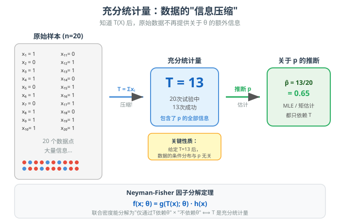

> **直观理解（现实类比）**：充分统计量就像**榨汁**——你有 20 个橙子（20 个数据点），逐个看太累了。但如果你把它们全部榨成一杯果汁（统计量 $T = \sum x_i$），这杯果汁保留了关于"橙子甜度"（参数 $p$）的全部信息。知道果汁的甜度后，你不需要再回头看每个橙子的样子——它们关于甜度的"秘密"已经被果汁浓缩了。比如抛 20 次硬币，你不需要记住每次是正是反（1,0,1,1,0,...），只需要知道"总共 13 次正面"就足够估计正面概率 $p$ 了。**数据可以丢，信息不能丢**——这就是充分统计量的精髓。

#### 课堂问答

**老师**：给"充分统计量"下个能同时说服直觉和公式的定义，为什么强调"给定 $T$ 后样本的条件分布与 $\theta$ 无关"？

**学生**：定义就是把"信息全在 $T$ 里"翻译成条件分布：$P(X_1\in A_1,\dots,X_n\in A_n\mid T=t)$ 不依赖 $\theta$。因为一旦条件分布与参数脱钩，知道 $T$ 后样本再怎么抖也抖不出 $\theta$ 的新线索，原始数据的参数信息已被 $T$ 吸干。

**老师（追问）**：那"逐次记录 $(1,0,1,1,\dots)$ 与只记总数 $13$"信息一样，凭什么说后者没丢东西？

**学生**：因为给定总数 $s$，各序列出现的条件概率 $\binom{n}{s}^{-1}$ 与 $p$ 无关——总数相同的序列在 $p$ 眼里不可区分。它们之间的差别是"与 $p$ 无关的噪声"，丢掉不损失参数信息。

**老师（拓展）**：如果把 $\theta$ 换成它的函数 $g(\theta)$，充分性会变吗？

**学生**：不会。充分性只依赖样本与参数族的关系；若 $T$ 对 $\theta$ 充分，则对 $g(\theta)$ 也充分，因为条件分布照样与 $g(\theta)$ 无关——你并没有缩小或放大参数。

### 2.2 因子分解定理（Factorization Theorem）

**定理**（Neyman-Fisher 因子分解定理）：统计量 $T$ 关于参数 $\theta$ 是充分的，当且仅当联合概率密度函数（或概率质量函数）可以分解为
$$f(x_1, \ldots, x_n; \theta) = g(T(x_1, \ldots, x_n); \theta) \cdot h(x_1, \ldots, x_n)$$
其中 $g$ 依赖于样本仅通过 $T$，且依赖于 $\theta$；$h$ 不依赖于 $\theta$。

> **💡 直观理解（类比）**：因子分解定理是"找充分统计量"的**作弊工具**——把联合密度拆成两块：带参数 θ 的部分**只能**通过 T 出现，另一块只放跟 θ 无关的"背景"，这样参数的信息就全部被 T 收走了。就像一份**化验报告**，带参数的是"诊断结论"（只关心浓缩出的指标 T），另一块是"原始涂片"（跟诊断无关）；只需看 T 就能判断病情，不必逐个翻原始数据。

**证明**（离散情形）：

设样本 $\mathbf{X} = (X_1, \ldots, X_n)$ 取离散值，$T = T(\mathbf{X})$ 是充分统计量。

（$\Rightarrow$）若 $T$ 充分，则 $P(\mathbf{X} = \mathbf{x} \mid T = t)$ 与 $\theta$ 无关。于是
$$f(\mathbf{x};\theta) = P(\mathbf{X} = \mathbf{x};\theta) = P(\mathbf{X} = \mathbf{x} \mid T = T(\mathbf{x})) \cdot P(T = T(\mathbf{x});\theta)$$
取 $g(t;\theta) = P(T = t;\theta)$，$h(\mathbf{x}) = P(\mathbf{X} = \mathbf{x} \mid T = T(\mathbf{x}))$，即得分解。

（$\Leftarrow$）若存在分解 $f(\mathbf{x};\theta) = g(T(\mathbf{x});\theta) h(\mathbf{x})$，则
$$P(T = t;\theta) = \sum_{\mathbf{x}: T(\mathbf{x}) = t} f(\mathbf{x};\theta) = g(t;\theta) \sum_{\mathbf{x}: T(\mathbf{x}) = t} h(\mathbf{x})$$
于是
$$P(\mathbf{X} = \mathbf{x} \mid T = t) = \frac{f(\mathbf{x};\theta)}{P(T = t;\theta)} = \frac{h(\mathbf{x})}{\sum_{\mathbf{y}: T(\mathbf{y}) = t} h(\mathbf{y})}$$
与 $\theta$ 无关，故 $T$ 充分。$\square$

**连续情形**的证明类似，只需将求和替换为积分。

**示例 1**：设 $X_1, \ldots, X_n \stackrel{\text{i.i.d.}}{\sim} \text{Ber}(p)$，则
$$f(\mathbf{x};p) = \prod_{i=1}^n p^{x_i}(1-p)^{1-x_i} = p^{\sum x_i}(1-p)^{n-\sum x_i} = g\left(\sum x_i; p\right) \cdot 1$$
故 $T = \sum_{i=1}^n X_i$ 是 $p$ 的充分统计量。

#### 课堂问答

**老师**：因子分解定理凭什么敢说"$T$ 充分 $\iff$ 密度能拆成 $g(T;\theta)h(x)$"？哪一半最难？

**学生**：充分性的 $\Leftarrow$ 半最漂亮：若 $f=g(T;\theta)h(x)$，则 $P(T=t;\theta)=g(t;\theta)\sum_{T(x)=t}h(x)$，相除后 $g$ 全约掉，条件分布 $=\frac{h(x)}{\sum h(y)}$ 与 $\theta$ 无关；$\Rightarrow$ 半取 $g=P(T=t;\theta)$、$h=P(x\mid T=T(x))$ 即可。

**老师（追问）**：$h$ 必须与 $\theta$ 无关，那要是 $h$ 偷偷藏了一个 $\theta$ 呢？

**学生**：那就不是合法分解，定理不成立。判别诀窍是把所有含 $\theta$ 的因子逼到只经由 $T$ 出现，任何残留 $\theta$ 都必须并入 $g$——$h$ 必须是"纯背景"。

**老师（拓展）**：支撑集依赖参数时（如 $U(0,\theta)$），这条定理还灵吗？

**学生**：灵，但要把示性函数算进 $g$。此时 $T=\max X_i$，密度为 $\theta^{-n}I(x_{(n)}\le\theta)$，参数与支撑都落在 $T$ 上，取 $g=\theta^{-n}I(T\le\theta)$ 即可。这也解释了 $U(0,\theta)$ 为何不属于指数族。

### 2.3 最小充分统计量（Minimal Sufficient Statistics）

一个充分统计量 $T$ 称为**最小充分统计量**，如果对于任何其他充分统计量 $S$，存在某个函数 $r$ 使得 $T = r(S)$（即 $T$ 是任何充分统计量的函数）。

**直观理解**：最小充分统计量是充分统计量中"维度最低"或"压缩最彻底"的。

**判断方法**：设 $\mathbf{x}$ 和 $\mathbf{y}$ 是两个样本点。若比值
$$\frac{f(\mathbf{x};\theta)}{f(\mathbf{y};\theta)}$$
与 $\theta$ 无关当且仅当 $T(\mathbf{x}) = T(\mathbf{y})$，则 $T$ 是最小充分统计量。

#### 课堂问答

**老师**：什么叫"最小"充分统计量？它和"维度最低"是一回事吗？

**学生**："最小"是偏序意义下的：$T$ 最小充分，当且仅当任一充分统计量 $S$ 都能写成 $T=r(S)$，即 $T$ 是最粗糙却仍充分的版本。它未必维度最低，但一定把充分信息压到不能再压。

**老师（追问）**：怎么用似然比一步判定最小性？

**学生**：找"比值判据"：$\frac{f(x;\theta)}{f(y;\theta)}$ 与 $\theta$ 无关 $\iff T(x)=T(y)$。因为比值不依赖 $\theta$ 意味着 $x,y$ 在参数眼里无法区分，正该被 $T$ 归为同类。

**老师（拓展）**：如果 $T$ 最小充分，对 $T$ 再做一一变换 $u(T)$，还保持最小性吗？

**学生**：保持。最小性只认"分割样本空间的等价类"，一一变换不改变等价类，$u(T)$ 仍最小充分；反之把两个不同的 $T$ 值合并成同一个值，就会破坏最小性。

### 2.4 Rao-Blackwell 定理

**定理**（Rao-Blackwell）：设 $T$ 是 $\theta$ 的充分统计量，$\hat{\theta}$ 是 $\theta$ 的任一估计量，且 $E[\hat{\theta}^2] < \infty$。定义 $\tilde{\theta} = E[\hat{\theta} \mid T]$，则：
1. $\tilde{\theta}$ 是 $\theta$ 的估计量（即其分布不依赖于 $\theta$ 以外的未知参数）；
2. $E[\tilde{\theta}] = E[\hat{\theta}]$（即偏差不变）；
3. $\operatorname{Var}(\tilde{\theta}) \leq \operatorname{Var}(\hat{\theta})$，且等号成立当且仅当 $\hat{\theta} = \tilde{\theta}$ a.s.

> **💡 直观理解（类比）**：Rao-Blackwell 定理说：**先按充分统计量分组求平均，就能免费"降噪"而不改变偏差**。条件期望 E[θ̂|T] 好比**同一棵树上不同枝杈的结果取平均**——每个枝杈（不同样本但同 T）单独看很抖，平均后更稳。方差只会变小不增大，偏差纹丝不动，相当于**无本透明的升级**。

**证明**：

1. 由于 $T$ 充分，条件分布 $X \mid T$ 与 $\theta$ 无关，故 $\tilde{\theta} = E[\hat{\theta} \mid T]$ 是仅依赖于 $T$ 的函数，其分布不依赖于 $\theta$ 以外的参数。

2. 由重期望律：
$$E[\tilde{\theta}] = E[E[\hat{\theta} \mid T]] = E[\hat{\theta}]$$

3. 由条件方差公式：
$$\operatorname{Var}(\hat{\theta}) = \operatorname{Var}(E[\hat{\theta} \mid T]) + E[\operatorname{Var}(\hat{\theta} \mid T)] = \operatorname{Var}(\tilde{\theta}) + E[\operatorname{Var}(\hat{\theta} \mid T)]$$
由于 $\operatorname{Var}(\hat{\theta} \mid T) \geq 0$，故 $\operatorname{Var}(\tilde{\theta}) \leq \operatorname{Var}(\hat{\theta})$，等号成立当且仅当 $\operatorname{Var}(\hat{\theta} \mid T) = 0$ a.s.，即 $\hat{\theta} = \tilde{\theta}$ a.s. $\square$

**意义**：Rao-Blackwell 定理告诉我们，任何估计量都可以通过充分统计量进行"改进"——取条件期望后得到的新估计量具有相同偏差但方差更小（或相等）。因此，寻找最优估计量时，只需考虑充分统计量的函数。

#### 课堂问答

**老师**：Rao-Blackwell 说 $E[\hat\theta\mid T]$ 不比 $\hat\theta$ 差，为什么偏差不变而方差只降不升？

**学生**：偏差不变来自重期望律 $E[E[\hat\theta\mid T]]=E[\hat\theta]$；方差下降来自条件方差分解 $\operatorname{Var}(\hat\theta)=\operatorname{Var}(E[\hat\theta\mid T])+E[\operatorname{Var}(\hat\theta\mid T)]$，第二项非负，故 $\operatorname{Var}(\tilde\theta)\le\operatorname{Var}(\hat\theta)$。

**老师（追问）**：什么时候等号成立？这说明什么？

**学生**：当且仅当 $\operatorname{Var}(\hat\theta\mid T)=0$ 几乎必然，即 $\hat\theta$ 本身已是 $T$ 的函数。所以"可改进"的根源就是 $\hat\theta$ 还带着与 $T$ 无关的噪声。

**老师（拓展）**：把 $\hat\theta$ 条件化到一个非充分统计量 $W$ 上，还能免费降方差吗？

**学生**：不能。若 $W$ 不充分，$E[\hat\theta\mid W]$ 的分布会依赖 $\theta$ 以外的东西，甚至带来新的偏差；充分性是"免费降噪"的前提，缺了它偏差就不再守恒。

### 2.5 完全充分统计量（Complete Sufficient Statistics）

**定义**：一个统计量 $T$ 称为**完全**的，如果对于任意函数 $u$，满足 $E_\theta[u(T)] = 0$ 对所有 $\theta \in \Theta$ 成立，则必有 $P_\theta(u(T) = 0) = 1$ 对所有 $\theta$ 成立。

> **💡 直观理解（类比）**：完全性是个"零期望陷阱"：若某个关于 T 的函数对所有参数值算出的期望都是 0，那它必须是恒等于 0 的"真零"，而不是靠加减抵消出来的"假零"。这保证 T 的信息**只够用、不冗余**——就像一把**没有坏键的密码锁**，任何一个滚筒的读数都实打实，不存在能互相抵消的杂音，从而撑起"最优无偏估计唯一"的下文。

**定义**：既是充分又是完全的统计量称为**完全充分统计量**。

> **💡 直观理解（类比）**：完全充分统计量 = **既榨汁又锁死**的组合：充分保证"信息全在 T 里、别处没有遗漏"，完全保证"没有多余的零期望杂音"。好比**一枚定制的模具**——形状（充分）决定了成品的所有细节，而它本身又规整到不存在任何"能抵消的空腔"，于是用它冲压出来的估计是唯一且最优的。

**定理**（Lehmann-Scheffé）：如果 $T$ 是 $\theta$ 的完全充分统计量，且 $\hat{\theta} = h(T)$ 是 $\theta$ 的无偏估计量，则 $\hat{\theta}$ 是 $\theta$ 的唯一一致最小方差无偏估计量（UMVUE）。

> **💡 直观理解（类比）**：Lehmann-Scheffé 定理把"找最好无偏估计"变成**套模板**：只要 T 是完全充分的，任何 T 的"无偏版本"门槛极低——而完全性保证这样的无偏函数**至多有一个**，所以它必然是最优无偏估计（UMVUE）。好比**填字游戏**：空格结构决定每个字母唯一可填，于是唯一解一定是最优解，不用再全网搜索。

---

#### 课堂问答

**老师**：完全性为什么被叫"零期望陷阱"，它对估计有什么实际好处？

**学生**：完全性要求：若 $E_\theta[u(T)]=0$ 对所有 $\theta$ 成立，则 $u(T)=0$ a.s.。它排除"靠加减抵消出的假零"。好处是保证无偏函数唯一：若 $h_1(T),h_2(T)$ 都无偏，则 $E[h_1-h_2]=0$ 逼出 $h_1=h_2$，于是 Lehmann-Scheffé 直接给 UMVUE。

**老师（追问）**：Lehmann-Scheffé 凭什么说"完全充分 + 无偏"就是最优？

**学生**：任取无偏估计 $\hat\theta$，Rao-Blackwell 把它压成 $E[\hat\theta\mid T]=h(T)$，方差更小且仍无偏；而完全性保证这种 $h(T)$ 至多一个，所以它就是所有无偏估计共享的唯一最优（UMVUE）。

**老师（拓展）**：完全性和最小充分性谁更强？有反例吗？

**学生**：互不包含。$U(0,\theta)$ 的 $T=\max X_i$ 既完全又最小；而 Cauchy 位置族常有最小充分统计量（次序统计量）却不完全——最小只说"压得最狠"，完全还要求"没有零期望杂音"。

## 3. 指数族（Exponential Family）

### 3.1 定义

一个分布族 $\{f(x;\theta): \theta \in \Theta\}$ 称为**指数族**，如果其概率密度函数（或概率质量函数）可以写成
$$f(x;\theta) = h(x) \exp\left\{\sum_{j=1}^k \eta_j(\theta) T_j(x) - A(\theta)\right\}$$
或等价地
$$f(x;\theta) = h(x) \exp\left\{\boldsymbol{\eta}(\theta)^\top \mathbf{T}(x) - A(\theta)\right\}$$

其中：
- $\boldsymbol{\eta}(\theta) = (\eta_1(\theta), \ldots, \eta_k(\theta))$ 是**自然参数**；
- $\mathbf{T}(x) = (T_1(x), \ldots, T_k(x))$ 是**充分统计量**；
- $A(\theta)$ 是**对数配分函数**（或累积量生成函数）；
- $h(x)$ 是**基准测度**。

> **💡 直观理解（类比）**：指数族把密度**整理成标准衣柜**：写成 exp{参数×统计量−归一化} 的形式，只要塞得进去，就自动享有一整套通用工具（充分统计量、矩公式、完备性、共轭先验）。就像**同款尺寸的收纳盒**，形状不同却能整齐入柜、配件互通。T(x) 就是你要浓缩的那件核心"统计量"。

#### 课堂问答

**老师**：为什么把密度写成 $h(x)\exp\{\eta(\theta)^\top T(x)-A(\theta)\}$ 这一种形式，就值得单独起个名字？

**学生**：因为这一形式统一了正态、二项、Poisson、Gamma 等一大批分布。写进这个"标准衣柜"就自动继承充分统计量、矩公式、完备性和共轭先验——$T(x)$ 天然充分，$A(\theta)$ 只管归一化。

**老师（追问）**：$A(\theta)$ 作为"对数配分函数"，它到底靠什么定下来？

**学生**：靠归一化：$A(\theta)=\log\int h(x)e^{\eta(\theta)^\top T(x)}dx$，使命中概率积分为 $1$。它不是自由参数，而是被约束逼出来的"补偿项"。

**老师（拓展）**：哪些分布挤不进指数族？为什么？

**学生**：支撑依赖参数的分布挤不进，如 $U(0,\theta)$，因为示性函数 $I(x\le\theta)$ 里的 $\theta$ 卡在指示符中，无法写成 $\exp\{\eta T-A\}h(x)$；$t$、Cauchy 因尾部过重也出局。

### 3.2 自然参数空间（Natural Parameter Space）

若将参数化改用自然参数 $\boldsymbol{\eta}$，则指数族可写为
$$f(x;\boldsymbol{\eta}) = h(x) \exp\left\{\boldsymbol{\eta}^\top \mathbf{T}(x) - \psi(\boldsymbol{\eta})\right\}$$
其中 $\psi(\boldsymbol{\eta})$ 由归一化条件确定：
$$\psi(\boldsymbol{\eta}) = \log \int h(x) \exp\{\boldsymbol{\eta}^\top \mathbf{T}(x)\} \, dx$$

**自然参数空间**定义为
$$\mathcal{N} = \left\{\boldsymbol{\eta} \in \mathbb{R}^k : \int h(x) \exp\{\boldsymbol{\eta}^\top \mathbf{T}(x)\} \, dx < \infty\right\}$$

**性质**：$\mathcal{N}$ 是凸集，$\psi(\boldsymbol{\eta})$ 在 $\mathcal{N}$ 上是凸函数。

> **💡 直观理解（类比）**：自然参数空间是"参数 η 允许驻扎的**安全区域**"——这些取值保证密度积分不爆。它**是凸的**意味着任意两个合法参数连成线段，线上每个点都仍合法（没有"禁区坑"）；ψ 凸则保证似然是"碗形"，峰只有一个、好找好爬。就像**没有坑洞的滑道**，任意两点连滑都在场内，且只滑向唯一最低点。

#### 课堂问答

**老师**：自然参数空间 $\mathcal{N}$ 定义为积分有限的那些 $\eta$，为什么它一定是凸集？

**学生**：靠 Hölder 不等式：若 $\eta_1,\eta_2$ 使积分有限，则对 $0<\lambda<1$，$h\,e^{(\lambda\eta_1+(1-\lambda)\eta_2)^\top T}=(h e^{\eta_1^\top T})^\lambda(h e^{\eta_2^\top T})^{1-\lambda}$，其积分被两端有限值夹住仍有限，故凸组合仍合法。

**老师（追问）**：$\psi(\eta)$ 在 $\mathcal{N}$ 上凸，这件事的统计含义是什么？

**学生**：意味着对数似然 $\ell(\eta)=\eta^\top T(x)-\psi(\eta)$ 是凹的，似然面是碗形，峰唯一、好爬——MLE 没有局部陷阱，凸优化工具可直接用。

**老师（拓展）**：若 $\mathcal{N}$ 退化成单个点，会丢失什么？

**学生**：会退化。$\psi$ 在单点没有开邻域，$E[T]=\nabla\psi$ 与 $\operatorname{Cov}(T)=\nabla^2\psi$ 失去意义，完备性也失效——所以完备性定理要求 $\mathcal{N}$ 含有开集。

### 3.3 指数族的性质

1. **充分统计量**：$\mathbf{T}(X)$ 是 $\boldsymbol{\eta}$ 的 $k$ 维充分统计量。

2. **矩与累积量**：
   $$E[\mathbf{T}(X)] = \nabla \psi(\boldsymbol{\eta})$$
   $$\operatorname{Cov}(\mathbf{T}(X)) = \nabla^2 \psi(\boldsymbol{\eta})$$

3. **指数族是共轭先验族**：指数族的共轭先验也属于指数族。

4. **指数族是完备的**：若自然参数空间 $\mathcal{N}$ 包含一个开集，则 $\mathbf{T}(X)$ 是完全充分统计量。

5. **极大似然估计**：对数似然函数 $\ell(\boldsymbol{\eta}) = \boldsymbol{\eta}^\top \mathbf{T}(x) - \psi(\boldsymbol{\eta})$ 是凹函数，MLE 满足
   $$E[\mathbf{T}(X)] = \mathbf{T}(x)$$

> **💡 直观理解（类比）**：指数族这几条性质是它的"红利清单"：充分统计量现成、期望与方差由 ψ 的导数一键导出、共轭先验随手可得、参数空间稍宽就完备、MLE 只要解"理论均值=样本均值"的矩方程。好比买了**同品牌整套家电**——说明书通用、配件互通。核心就一句：**一族形式统一，得到一大批公共福利**。

**常见指数族分布**：
- 正态分布（已知方差）
- 二项分布
- Poisson 分布
- 指数分布
- Gamma 分布
- Beta 分布
- Dirichlet 分布

**非指数族分布**：
- 均匀分布 $U(0, \theta)$（支撑集依赖于参数）
- t 分布
- F 分布
- Cauchy 分布

---

#### 课堂问答

**老师**：指数族最省心的"红利"是哪几条，为什么它们其实同根？

**学生**：$\nabla\psi(\eta)=E[T]$、$\nabla^2\psi(\eta)=\operatorname{Cov}(T)$、$T$ 完全充分、共轭先验同族、MLE 解 $E[T]=T(x)$。它们都源自归一化约束 $\int h e^{\eta^\top T-\psi}dx=1$ 求导，一次求导即得矩公式。

**老师（追问）**：为什么指数族的 MLE 满足 $E[T(X)]=T(x)$，而不用解复杂方程？

**学生**：因为 $\ell(\eta)=\eta^\top T(x)-\psi(\eta)$ 是凹函数，令梯度为零得 $T(x)-\nabla\psi(\eta)=0$，即 $E_\eta[T]=T(x)$——"理论均值 = 样本均值"的矩方程，一步到位。

**老师（拓展）**：既然矩信息由 $\psi$ 一键给出，是否意味着指数族一定完备？

**学生**：不一定。还需 $\mathcal{N}$ 含开集才完备；若 $\mathcal{N}$ 边界退化（参数只取离散单点），$\psi$ 无法给出整段矩信息，完备性可能失效。

## 4. 假设检验理论（Hypothesis Testing）

> **🧠 来龙去脉：从"会不会显著"到"怎样才算最优"** 第 25 级的假设检验已经给了 $z$、$t$、$F$、$\chi^2$ 一大堆方法，但都停留在"某个检验有效"；统计推断理论要回答更本质的问题：**在固定误判率（$\alpha$）下，这些检验里哪个才是"最好的"？最优检验能否被系统地构造出来？** 这第 4 章正是为此而设——先把"检验"抽象成**检验函数** $\phi(x)\in\{0,1\}$，用显著性水平压住第一类错误，再在所有"守规矩"的检验里挑功效（$\pi(\theta)$）最大的那个（UMP）。当只能在两个具体分布间抉择时，Neyman–Pearson 引理给出显式最优解（似然比）；当参数连续、要做单边假设时，靠**单调似然比（MLR）**直达 UMP；两者都行不通，就用**广义似然比检验（GLRT）**兜底，并借大样本 $\chi^2$ 近似定临界值。于是整套方法从"实践技巧"上升为"最优性理论"——这就是 Casella & Berger《Statistical Inference》假设检验那一章的骨架。

### 4.1 基本概念

设 $X_1, \ldots, X_n \sim f(x;\theta)$，$\theta \in \Theta$。考虑检验问题：
$$H_0: \theta \in \Theta_0 \quad \text{vs.} \quad H_1: \theta \in \Theta_1$$

- **检验函数**：$\phi(x) = I(x \in \text{拒绝域})$，即 $\phi(x) = 1$ 表示拒绝 $H_0$，$\phi(x) = 0$ 表示接受 $H_0$。
- **第一类错误**（Type I Error）：$H_0$ 为真时拒绝 $H_0$，概率为 $\alpha = P(\text{拒绝 } H_0 \mid H_0)$。
- **第二类错误**（Type II Error）：$H_1$ 为真时接受 $H_0$，概率为 $\beta = P(\text{接受 } H_0 \mid H_1)$。
- **检验功效**（Power）：$\pi(\theta) = P_\theta(\text{拒绝 } H_0)$，对 $\theta \in \Theta_1$，功效为 $1 - \beta$。
- **显著性水平**（Significance Level）：$\alpha$，即 $\sup_{\theta \in \Theta_0} \pi(\theta) \leq \alpha$。

> **💡 直观理解（类比）**：假设检验像**法庭"无罪推定"**：H0 是被指控前先假设的无罪方。第一类错误是**把无辜的人判成有罪**（概率 α，要压得很小）；第二类错误是**放走真正的罪犯**（概率 β）；功效 1−β 是"该抓到的坏人抓到的比率"。显著性水平 α 是"法官不许冤枉好人的最严上限"。**证据不足（p 值>α）不得判有罪，这就是无罪推定**。

#### 课堂问答

**老师**：把检验写成 $\phi(x)=I(x\in\text{拒绝域})$，这样抽象的好处是什么？

**学生**：它把"检验比较"变成"函数比较"，用 $\pi(\theta)=E_\theta[\phi]$ 统一表示功效。于是 UMP、无偏检验等全成了对 $\phi$ 的性质要求，优化问题清晰可算。

**老师（追问）**：第一类错误 $\alpha$ 与第二类错误 $\beta$ 为什么不能同时任意小？

**学生**：样本量固定时二者此消彼长：拒绝门槛右移，$\alpha$ 下降但 $\beta$ 上升、功效 $1-\beta$ 跌落。想同时压低，只能增大 $n$ 或构造更强的检验。

**老师（拓展）**：显著性水平为什么取 $\sup_{\theta\in\Theta_0}\pi(\theta)$，取某一点的 $\pi$ 不够吗？

**学生**：不够。因为 $H_0$ 是复合的，有限样本下各 $\theta_0$ 处功效未必相同，只压一点会让别的 $\theta_0$ 超标。取上确界才把"不冤枉 $H_0$"落到整片参数域。

### 4.2 一致最大功效检验（Uniformly Most Powerful Test, UMP）

**定义**：一个显著性水平为 $\alpha$ 的检验 $\phi$ 称为**一致最大功效检验**（UMP），如果对于任何其他显著性水平为 $\alpha$ 的检验 $\phi'$，有
$$\pi_\phi(\theta) \geq \pi_{\phi'}(\theta), \quad \forall \theta \in \Theta_1$$

> **💡 直观理解（类比）**：UMP（一致最大功效检验）想在**所有"守规矩（水平不超 α）"的检验里，选每个情形破案率都最高的那个**。"一致"指**在 H1 的每个参数下都不输**——就像选**一条各比赛距离都拿第一的马**，而非只在某一段最快。可惜这种"全距离通杀"的选手，通常只在简单/单边假设下存在。

**Neyman-Pearson 引理**（简单对简单假设）：

设 $H_0: \theta = \theta_0$ vs. $H_1: \theta = \theta_1$，$f(x;\theta_0)$ 和 $f(x;\theta_1)$ 是相应的密度函数。

1. **存在性**：对任意 $\alpha \in (0,1)$，存在一个检验 $\phi$ 和常数 $k$，使得
   $$\phi(x) = \begin{cases} 1 & \text{若 } f(x;\theta_1) > k f(x;\theta_0) \\ \gamma & \text{若 } f(x;\theta_1) = k f(x;\theta_0) \\ 0 & \text{若 } f(x;\theta_1) < k f(x;\theta_0) \end{cases}$$
   且 $E_{\theta_0}[\phi(X)] = \alpha$。

2. **最优性**：任何满足上述条件的检验都是显著性水平 $\alpha$ 下的最大功效检验。

3. **唯一性**：如果存在一个最大功效检验，则它必为（或几乎必然等于）上述形式。

> **💡 直观理解（类比）**：Neyman-Pearson 引理说：比较两个具体分布时，**最佳检验只看似然比** f(H1)/f(H0)——谁的"解释力"强过 k 倍就判谁赢。就像**法庭比较两份证据对两个嫌疑人的"对撞强度"**，数据显示谁更像就偏向谁。这条简单规则在"二选一"的简单假设下，恰好是**最锋利、无可超越**的判据（先定误判率再放大招）。

**证明概要**：

设 $\phi$ 是 Neyman-Pearson 形式的检验，$\phi'$ 是任意其他显著性水平为 $\alpha$ 的检验。考虑差值：
$$\phi(x) - \phi'(x)$$

当 $f(x;\theta_1) > k f(x;\theta_0)$ 时，$\phi(x) - \phi'(x) = 1 - \phi'(x) \geq 0$，且 $f(x;\theta_1) - k f(x;\theta_0) > 0$；
当 $f(x;\theta_1) < k f(x;\theta_0)$ 时，$\phi(x) - \phi'(x) = 0 - \phi'(x) \leq 0$，且 $f(x;\theta_1) - k f(x;\theta_0) < 0$。

因此：
$$(\phi(x) - \phi'(x))(f(x;\theta_1) - k f(x;\theta_0)) \geq 0$$

积分得：
$$\int (\phi - \phi')(f(x;\theta_1) - k f(x;\theta_0)) \, dx \geq 0$$
$$\Rightarrow \pi_\phi(\theta_1) - \pi_{\phi'}(\theta_1) \geq k(\alpha - \alpha) = 0$$

故 $\pi_\phi(\theta_1) \geq \pi_{\phi'}(\theta_1)$，即 $\phi$ 是最优的。$\square$

#### 课堂问答

**老师**：Neyman-Pearson 引理为什么说似然比检验在简单对简单时"不可超越"？

**学生**：核心是逐点不等式 $(\phi-\phi')(f_1-kf_0)\ge0$，积分得 $\pi_\phi(\theta_1)-\pi_{\phi'}(\theta_1)\ge k(\alpha-\alpha)\ge0$。任何水平不超过 $\alpha$ 的检验都赢不过它，这就是最优性证明。

**老师（追问）**：常数 $k$ 是怎么定的？为什么这么定能调出精确的 $\alpha$？

**学生**：$k$ 由水平条件 $E_{\theta_0}[\phi]=\alpha$ 反解；随机化 $\gamma$ 专为处理 $f_1=kf_0$ 的原子点，把功效在离散跳跃处补齐到恰好 $\alpha$。

**老师（拓展）**：UMP 为什么常常不存在？举个复合假设的边界情形。

**学生**：因为"对 $H_1$ 每个 $\theta$ 都最好"往往互相冲突。如双边 $H_1:\theta\ne\theta_0$，偏向大值的检验对 $\theta>\theta_0$ 最优、对 $\theta<\theta_0$ 最差，无法全距离通杀；只有单边、或有 MLR 时才有 UMP。

### 4.3 单调似然比（Monotone Likelihood Ratio, MLR）

**定义**：分布族 $\{f(x;\theta): \theta \in \Theta \subseteq \mathbb{R}\}$ 具有**单调似然比**（MLR），如果存在统计量 $T(X)$，使得对任意 $\theta_1 < \theta_2$，比值
$$\frac{f(x;\theta_2)}{f(x;\theta_1)}$$
是 $T(x)$ 的单调非减函数（或非增函数）。

> **💡 直观理解（类比）**：单调似然比指**参数越大，越倾向给出更大的 T 值**——似然比随 T 单调变化，就像**温度越高，体温计数字越有把握地往上走**。于是放心用"T 超阈值就拒绝"的简单规则：想分清 θ 大小，只需盯 T 偏大还是偏小，不用管复杂形状。

**定理**（UMP 检验的存在性）：若分布族关于 $T(X)$ 具有 MLR，则对单边假设
$$H_0: \theta \leq \theta_0 \quad \text{vs.} \quad H_1: \theta > \theta_0$$
存在 UMP 检验，形式为
$$\phi(x) = \begin{cases} 1 & \text{若 } T(x) > c \\ \gamma & \text{若 } T(x) = c \\ 0 & \text{若 } T(x) < c \end{cases}$$
其中 $c$ 和 $\gamma$ 由显著性水平 $\alpha$ 确定。

**指数族与 MLR**：单参数指数族 $f(x;\theta) = h(x) \exp\{\eta(\theta) T(x) - A(\theta)\}$ 中，若 $\eta(\theta)$ 是 $\theta$ 的严格单调函数，则分布族关于 $T(X)$ 具有 MLR。

> **💡 直观理解（类比）**：一旦分布族有单调似然比，单边检验的 UMP 就**自动长出来**——只需设一道门槛：T>c 就拒绝。好比**学考及格线**：分数（T）单调，超线就判通过；c 由 α 精调，保证"错判"比例不越限。MLR 就是**获得最优检验的绿色通道**。

#### 课堂问答

**老师**：单调似然比这个"似然比是 $T$ 的单调函数"的条件，凭什么能保证 UMP 存在？

**学生**：因为它让"拒绝域 $\{T>c\}$"对每个 $\theta_1<\theta_2$ 都恰好落在 NP 引理要求的高似然比区域，于是对 $H_0:\theta\le\theta_0$ vs $H_1:\theta>\theta_0$ 存在同一个门槛检验处处最优——这就是 UMP。

**老师（追问）**：UMP 的临界值 $c$ 和随机化 $\gamma$ 怎么来？

**学生**：由 $\sup_{\theta\le\theta_0}\pi(\theta)=\alpha$ 确定；MLR 下功效 $\pi(\theta)$ 单调增加，上确界在 $\theta_0$ 取到，解 $P_{\theta_0}(T>c)+\gamma P_{\theta_0}(T=c)=\alpha$ 即可。

**老师（拓展）**：把假设翻成 $H_1:\theta<\theta_0$，同一个 $T$ 还能用吗？

**学生**：能用，但拒绝域反号改为 $\{T<c\}$。若 MLR 是"非增"方向，则单调性相反，临界方向也随之翻转——方向必须与 MLR 的单调方向保持一致。

### 4.4 广义似然比检验（Generalized Likelihood Ratio Test, GLRT）

当复合假设不能简化为简单假设时，UMP 检验通常不存在。此时常用**广义似然比检验**。

**定义**：检验 $H_0: \theta \in \Theta_0$ vs. $H_1: \theta \in \Theta_1$ 的广义似然比统计量为
$$\Lambda(x) = \frac{\sup_{\theta \in \Theta_0} L(\theta; x)}{\sup_{\theta \in \Theta} L(\theta; x)}$$
其中 $L(\theta; x)$ 是似然函数，$\Theta = \Theta_0 \cup \Theta_1$ 是全参数空间。

GLRT 拒绝 $H_0$ 当 $\Lambda(x) < c$（即 $0 \leq \Lambda \leq 1$，值越小越倾向于拒绝 $H_0$）。

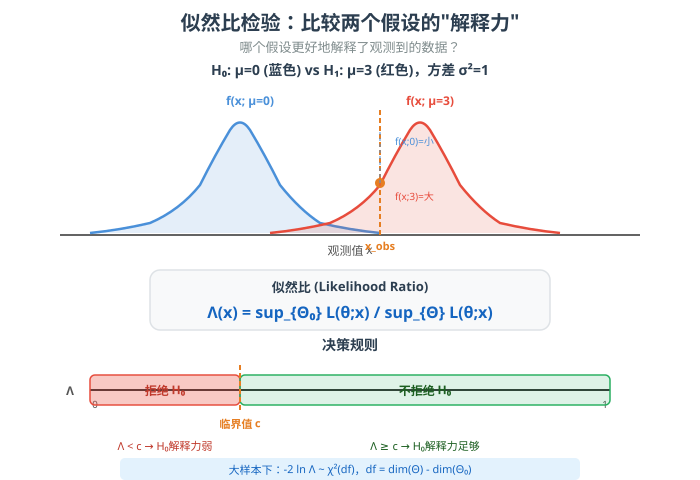

> **直观理解（现实类比）**：似然比检验就像**两个律师在法庭上辩论**。$H_0$ 的律师说"我的当事人（$\theta \in \Theta_0$）最能解释这些证据"，$H_1$ 的律师说"不对，我的当事人（$\theta \in \Theta$ 全空间）才能最好地解释"。似然比 $\Lambda$ 就是比较两位律师的"解释力"之比——如果 $\Lambda$ 接近 1，说明 $H_0$ 的解释力和全空间差不多好，没必要拒绝；如果 $\Lambda$ 很小，说明 $H_0$ 的解释力远不如全空间，必须拒绝。就像**奥卡姆剃刀**的统计版：简单假设（$H_0$）只有在"解释得足够好"时才被接受。

**渐近分布**：在正则条件下，当 $n \to \infty$ 时，
$$-2\log \Lambda(x) \xrightarrow{d} \chi^2_{\nu}$$
其中 $\nu = \dim(\Theta) - \dim(\Theta_0)$ 是自由度。

---

#### 课堂问答

**老师**：广义似然比 $\Lambda=\frac{\sup_{\Theta_0}L}{\sup_{\Theta}L}\in[0,1]$，为什么取比值而不取差？

**学生**：比值天然无量纲、上界为 $1$：分母是全空间最优似然，分子是"守着 $H_0$ 能达到的最优"。$\Lambda$ 越接近 $1$，说明 $H_0$ 几乎不费力就能解释数据；越小说明约束 $H_0$ 让解释力大跌，才该拒绝。

**老师（追问）**：临界值 $c$ 怎么定？为什么实际中常用 $-2\log\Lambda$ 配合 $\chi^2$？

**学生**：精确零分布难求，于是走渐近：正则条件下 $-2\log\Lambda\xrightarrow{d}\chi^2_\nu$，$\nu=\dim\Theta-\dim\Theta_0$ 即"约束掉几个自由度"，查 $\chi^2$ 表即可定 $c$。

**老师（拓展）**：如果 $\theta_0$ 落在参数空间边界上，这个 $\chi^2$ 近似还准吗？

**学生**：不准。边界处零分布常是 $\chi^2$ 的混合（如等权 $\frac{1}{2}\chi^2_0+\frac{1}{2}\chi^2_1$），直接当 $\chi^2_\nu$ 会偏保守或偏激进，必须专门修正。

## 5. 贝叶斯推断（Bayesian Inference）

### 5.1 贝叶斯范式

贝叶斯推断的核心思想是将参数 $\theta$ 视为随机变量，赋予其**先验分布** $\pi(\theta)$，然后通过数据更新为**后验分布**。

**贝叶斯定理**：
$$\pi(\theta \mid \mathbf{x}) = \frac{f(\mathbf{x} \mid \theta) \pi(\theta)}{m(\mathbf{x})}$$
其中：
- $\pi(\theta \mid \mathbf{x})$ 是**后验分布**；
- $f(\mathbf{x} \mid \theta)$ 是**似然函数**；
- $\pi(\theta)$ 是**先验分布**；
- $m(\mathbf{x}) = \int f(\mathbf{x} \mid \theta) \pi(\theta) \, d\theta$ 是**边缘似然**（归一化常数）。

> **💡 直观理解（类比）**：贝叶斯定理把**先验信念**和**数据证据**混合成**后验信念**：后验 ∝ 先验×似然，分母只负责归一化。好比**打官司前凭印象押谁，看到新证词后再更新判断**——证据（似然）越强越能盖过先入之见，最后信念是对这两方的加权折中。

#### 课堂问答

**老师**：贝叶斯把 $\theta$ 当随机变量，这与频率学派"$\theta$ 固定"的差别，落在公式的哪一处？

**学生**：落在边缘似然 $m(x)=\int f(x\mid\theta)\pi(\theta)d\theta$ 上。频率学派用采样分布衡量不确定性；贝叶斯用先验加权，后验 $\pi(\theta\mid x)\propto f(x\mid\theta)\pi(\theta)$ 表达"看到数据后的信念"。

**老师（追问）**：分母 $m(x)$ 只起归一化作用，那能不能干脆不算它？

**学生**：算点估计、MAP、可信区间时常常可以，因为后验正比于先验乘似然；但算贝叶斯因子、模型比较、预测分布时必须精确求 $m(x)$，它正是"模型解释力"的量化。

**老师（拓展）**：先验若选得离谱，数据多了能自动纠正吗？

**学生**：正则条件下后验会"先验淡化"、向真值集中，但纠正速度取决于似然曲率；若先验在真值处密度为零，则有限数据永远纠不回来——先验的支撑至关重要。

### 5.2 先验分布（Prior Distributions）

**无信息先验**（Non-informative Prior）：对参数 $\theta$ 的取值没有任何先验信息，常用均匀分布或 Jeffreys 先验。

**Jeffreys 先验**：
$$\pi(\theta) \propto \sqrt{\det I(\theta)}$$
其中 $I(\theta)$ 是 Fisher 信息矩阵。Jeffreys 先验具有参数化不变性。

> **💡 直观理解（类比）**：无信息先验是"**不知道该押哪、就装作谁都不偏袒**"的开局（常用均匀分布）；Jeffreys 先验由 Fisher 信息开方而来，让**换了参数表述（比如把比率换成对数）先验也随之自动变换、结论不走样**——好比记录温度用摄氏还是华氏都不影响"今天是否冷"的判断。

**共轭先验**（Conjugate Prior）：如果先验分布和后验分布属于同一分布族，则称该先验为共轭先验。

> **💡 直观理解（类比）**：共轭先验像**"先验=同款题型，数据只是加试新题"**：选与似然"配套"的先验族，算完后验仍在同族，参数随数据更新即可。好比**老师批改同一套评分维度的作文**，只是分数累加。于是每看完一批数据只需改两个数字，不必重新推导，计算极省。

#### 课堂问答

**老师**：Jeffreys 先验 $\pi(\theta)\propto\sqrt{\det I(\theta)}$ 号称"参数化不变"，这个不变性怎么体现？

**学生**：换参数 $\phi=g(\theta)$ 时，Fisher 信息按 $I(\phi)=I(\theta)(d\theta/d\phi)^2$ 变换，开方后正好补上雅可比 $|d\theta/d\phi|$，使 $\pi(\phi)=\pi(\theta)|d\theta/d\phi|$ 成立——先验随参数自动协变，结论不因表述而变。

**老师（追问）**：既然有无信息先验，为什么不干脆一律用均匀分布？

**学生**：均匀分布并非"处处无信息"：对 $p$ 均匀等价于对 $\log\frac{p}{1-p}$ 不均匀。Jeffreys 用信息量校准，避免这种表述依赖，才真正做到"谁都不偏袒"。

**老师（拓展）**：共轭先验一定也是无信息先验吗？

**学生**：不一定，两者目标不同。共轭先验是为计算方便，常携带信息（如 Beta$(\alpha,\beta)$ 带虚拟样本量）；无信息先验追求不注入主观信息。也可以选"信息很弱"的共轭，兼顾两者。

### 5.3 共轭先验表

| 似然分布 | 参数 | 共轭先验 | 后验参数 |
|---------|------|---------|---------|
| 二项分布 | $p$ | Beta($\alpha, \beta$) | Beta($\alpha + \sum x_i, \beta + n - \sum x_i$) |
| Poisson | $\lambda$ | Gamma($\alpha, \beta$) | Gamma($\alpha + \sum x_i, \beta + n$) |
| 正态(已知 $\sigma^2$) | $\mu$ | Normal($\mu_0, \tau_0^2$) | Normal($\frac{\mu_0/\tau_0^2 + n\bar{x}/\sigma^2}{1/\tau_0^2 + n/\sigma^2}$, $\frac{1}{1/\tau_0^2 + n/\sigma^2}$) |
| 正态(已知 $\mu$) | $\sigma^2$ | Inverse-Gamma($\alpha, \beta$) | Inverse-Gamma($\alpha + n/2$, $\beta + \frac{1}{2}\sum(x_i - \mu)^2$) |
| 指数分布 | $\lambda$ | Gamma($\alpha, \beta$) | Gamma($\alpha + n$, $\beta + \sum x_i$) |
| 多项分布 | $\mathbf{p}$ | Dirichlet($\boldsymbol{\alpha}$) | Dirichlet($\boldsymbol{\alpha} + \mathbf{n}$) |

#### 课堂问答

**老师**：这张表里为什么二项配 Beta、Poisson 配 Gamma？背后有统一原因吗？

**学生**：有。它们都属指数族，似然能写成 $e^{\eta^\top T}$ 形式，而共轭先验也取指数族，参数相乘即"伪计数相加"。故 Beta$(\alpha,\beta)$ 更新为 Beta$(\alpha+\sum x_i,\beta+n-\sum x_i)$，Gamma 同理更新 $\alpha+\sum x_i$、$\beta+n$。

**老师（追问）**：正态（已知 $\sigma^2$）的后验均值 $\frac{\mu_0/\tau_0^2+n\bar x/\sigma^2}{1/\tau_0^2+n/\sigma^2}$ 说明了什么？

**学生**：它是先验均值与样本均值的"精度加权平均"，权重分别为 $1/\tau_0^2$ 与 $n/\sigma^2$。数据越多、先验越准，各自权重越大——贝叶斯更新就是一杆按精度配重的天平。

**老师（拓展）**：后验方差 $\frac{1}{1/\tau_0^2+n/\sigma^2}$ 随 $n$ 如何变化，边界情形呢？

**学生**：精度相加、方差取倒数，$n\to\infty$ 时后验方差 $\to\sigma^2/n\to0$，先验被数据淹没；$n=0$ 时回到先验方差 $\tau_0^2$。这正是"数据多则越发逼近频率结论"的定量体现。

### 5.4 后验分布与贝叶斯估计

给定后验分布 $\pi(\theta \mid \mathbf{x})$，常用的贝叶斯点估计有：

- **后验均值**（Posterior Mean）：$\hat{\theta}_{\text{Bayes}} = E[\theta \mid \mathbf{x}]$
- **后验中位数**（Posterior Median）
- **后验众数**（Posterior Mode/MAP）

**贝叶斯估计量在平方损失下的最优性**：
在平方损失 $L(\theta, a) = (\theta - a)^2$ 下，贝叶斯估计量为后验均值：
$$\hat{\theta} = \arg\min_a E[(\theta - a)^2 \mid \mathbf{x}] = E[\theta \mid \mathbf{x}]$$

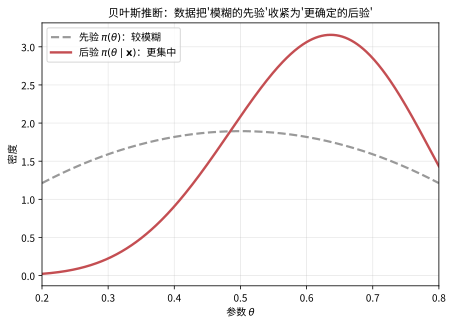

> **直观理解（现实类比）**：贝叶斯推断是"**用证据更新信念**"。先验 $\pi(\theta)$ 是你**看到数据前的猜测**（可能很模糊）；拿到数据后，用贝叶斯公式更新成后验 $\pi(\theta\mid\mathbf{x})$——**更尖锐、更集中**。就像**先猜测一个犯罪嫌疑人**（先验），拿到新的证词后**修正判断**（后验）。数据越多、证据越强，后验峰就越窄，你就越有把握。平方损失下取后验均值即可得到最优估计。

#### 课堂问答

**老师**：为什么平方损失下最优估计恰是后验均值，而不是后验众数或中位数？

**学生**：因为 $E[(\theta-a)^2\mid x]=\operatorname{Var}(\theta\mid x)+(a-E[\theta\mid x])^2$，对 $a$ 求最小只需第二项为零，故 $a=E[\theta\mid x]$。损失的形状决定了最优泛函。

**老师（追问）**：那 MAP（后验众数）什么时候与它一致，什么时候不同？

**学生**：后验对称单峰（如正态）时三者一致；偏态分布时不同——绝对损失给中位数、0-1 损失给众数。选哪个估计，取决于你如何定义"错得有多疼"。

**老师（拓展）**：若换成相对误差损失 $L(\theta,a)=(\theta-a)^2/\theta^2$，最优点会变吗？

**学生**：会，最优从后验均值变成 $1/E[\theta^{-2}\mid x]$ 一类量，因为加权把大 $\theta$ 处的误差压小了。这说明"估计量"必须与损失成对出现，脱离损失谈"最好估计"是没有意义的。

### 5.5 可信区间（Credible Intervals）

后验分布的 $1-\alpha$ 可信区间 $C$ 满足
$$P(\theta \in C \mid \mathbf{x}) = 1 - \alpha$$

**与置信区间的区别**：
- 频率学派置信区间：随机区间覆盖固定参数的概率为 $1-\alpha$。
- 贝叶斯可信区间：参数落在固定区间内的后验概率为 $1-\alpha$。

**最高后验密度区间**（HPD Interval）：在给定可信水平下长度最短的可信区间。

> **💡 直观理解（类比）**：可信区间给"**参数落在这个区间的后验概率是 1−α**"——参数当作随机变量、区间固定。像**射箭前的落点预测**：你对落点有概率分布，可信区间就是"95% 概率箭会落在的区域"。注意与频率学派相反：那边**区间随机、参数固定**；这里**参数随机、区间固定**。

#### 课堂问答

**老师**：可信区间说"$\theta$ 落在 $C$ 的后验概率是 $1-\alpha$"，这与置信区间"区间覆盖 $\theta$ 的概率是 $1-\alpha$"差在哪？

**学生**：差在谁随机。可信区间里 $\theta$ 随机、$C$ 固定，$\theta$ 落不落进去是有概率的事件；置信区间里 $\theta$ 固定、区间随机，"覆盖"是对重复抽样的频数描述。两者数字可能相近，语义却相反。

**老师（追问）**：为什么常推荐 HPD 区间，而不随便取一个等尾区间？

**学生**：HPD 在给定可信水平下长度最短，把高后验密度点收进来、低密度尾部扔掉。若后验偏态，等尾区间又长又偏离众数，HPD 更紧凑、更贴合"最可能的取值"。

**老师（拓展）**：后验概率陈述能否被频率学派批评为"依赖先验"？

**学生**：能——可信区间确实随先验变，先验不同则区间不同。但 HPD 的"最短"性质可由后验直接检验；频率学派的置信区间则要另对每点 $\theta$ 论覆盖概率，各有代价。

### 5.6 贝叶斯因子（Bayes Factor）

用于模型比较的工具。对于模型 $M_1$ 和 $M_2$，贝叶斯因子定义为
$$\text{BF}_{12} = \frac{m_1(\mathbf{x})}{m_2(\mathbf{x})} = \frac{\int f(\mathbf{x} \mid \theta_1, M_1) \pi(\theta_1 \mid M_1) \, d\theta_1}{\int f(\mathbf{x} \mid \theta_2, M_2) \pi(\theta_2 \mid M_2) \, d\theta_2}$$

> **💡 直观理解（类比）**：贝叶斯因子是**两个模型的"解释力之比"**：BF>1 说明数据更支持模型1，越大越强，就像**法庭两套卷宗对同一现场的解释力对比**——谁的证词更能圆场谁更可信。它把模型比较变成**统一标尺**：不看具体估计，只看数据整体更倾向谁，天然利于模型选择。

**解释**（Jeffreys 准则）：
- $\text{BF}_{12} > 1$：支持 $M_1$
- $\text{BF}_{12} > 3$：中等支持 $M_1$
- $\text{BF}_{12} > 10$：强支持 $M_1$
- $\text{BF}_{12} > 100$：极强支持 $M_1$

后验几率（Posterior Odds）：
$$\frac{P(M_1 \mid \mathbf{x})}{P(M_2 \mid \mathbf{x})} = \text{BF}_{12} \times \frac{P(M_1)}{P(M_2)}$$

---

#### 课堂问答

**老师**：贝叶斯因子 $BF_{12}=\frac{m_1(x)}{m_2(x)}$ 用边缘似然之比，为什么不用最大似然之比？

**学生**：用最大似然之比会因模型复杂度而偏袒大模型（参数多必然拟合更好）。边缘似然对先验积分，等于"对参数取平均的拟合优度"，复杂度被自动惩罚——这正是贝叶斯因子自带的奥卡姆剃刀。

**老师（追问）**：后验几率的乘法规则 $\frac{P(M_1\mid x)}{P(M_2\mid x)}=BF_{12}\frac{P(M_1)}{P(M_2)}$ 说明什么，和 p 值有何不同？

**学生**：说明后验几率等于先验几率乘以贝叶斯因子，是"更新信念"的乘法规则。p 值只衡量单个模型下数据的极端性，不能直接比较两模型；贝叶斯因子直接给出"数据更支持谁、支持多少"。

**老师（拓展）**：如果先验选得不当，贝叶斯因子会不会失真？举敏感的情形。

**学生**：会，尤其对弥散先验。若模型 1 的先验很宽，$m_1(x)$ 会被摊薄变小，导致 $BF_{12}$ 反而偏低——这就是 Lindley 悖论，说明贝叶斯因子对先验的敏感度远高于后验，必须谨慎指定。

## 6. 决策理论（Decision Theory）

### 6.1 基本框架

决策理论由以下要素构成：
- **参数空间** $\Theta$：未知参数 $\theta$ 的取值范围
- **行动空间** $\mathcal{A}$：所有可能的决策行动
- **损失函数** $L(\theta, a)$：参数为 $\theta$ 时采取行动 $a$ 的损失
- **决策规则** $\delta(x)$：从样本空间到行动空间的映射

> **💡 直观理解（类比）**：决策理论把统计问题变成**"看了数据怎么拍板"**的总框架：参数空间（现实啥样）、行动空间（能做哪些动作）、损失函数（做错赔多少）、决策规则（"看到这样数据就采取那个动作"的说明书）。好比**天气预报员**：天气在变、伞/雨衣有限、淋雨要买单、每看云图决定带不带——整套权衡就是这么来的。

#### 课堂问答

**老师**：决策理论把统计问题拆成 $\Theta,\mathcal{A},L,\delta$ 四件套，这个抽象带来什么统一性？

**学生**：它把点估计、区间估计、假设检验都收进同一模板：估计是 $\mathcal{A}=\Theta$，检验是 $\mathcal{A}=\{0,1\}$，区别只在行动空间与损失。于是"最优"有了统一定义——最小化风险。

**老师（追问）**：为什么决策规则写成 $\delta(x)$，而不直接写成某个"估计公式"？

**学生**：因为要容纳一切"看数据下结论"的映射，"估计公式"只是其中特例。写成 $\delta(x)$ 才能把随机化、非线性、甚至取固定值的荒唐规则都纳入比较，从而谈可容许性。

**老师（拓展）**：同一份数据换损失函数，最优决策会变——这是缺陷还是特性？

**学生**：是特性。损失是"用户的价值判断"，不该由数据决定。决策理论正把主观代价外化到 $L$，使"最优"随应用场景自适应，而不是藏着某个隐含假设。

### 6.2 常见损失函数

1. **平方损失**：$L(\theta, a) = (\theta - a)^2$
2. **绝对损失**：$L(\theta, a) = |\theta - a|$
3. **0-1 损失**：$L(\theta, a) = I(\theta \neq a)$（用于分类）
4. **线性损失**：$L(\theta, a) = c(\theta - a)$，其中 $c$ 是常数
5. **Huber 损失**：平方损失和绝对损失的折中，对异常值更稳健

> **💡 直观理解（类比）**：损失函数给"**猜错要赔多少钱**"定价：平方损失重罚远偏差、绝对损失按距离线性罚、0-1 损失只管对不对（分类）、线性/Huber 各有权衡（Huber 对离群值更宽容）。好比**不同场景下的定价表**——猜偏一点裂不裂账各有赔法，直接决定你下手多谨慎。

#### 课堂问答

**老师**：平方损失与绝对损失都能衡量"离得远"，为什么它们给出的最优估计不同？

**学生**：因为惩罚形状不同。平方损失 $(\theta-a)^2$ 对远偏差惩罚陡增，均衡点在均值、对离群敏感；绝对损失 $|\theta-a|$ 线性罚，最优是中位数，对异常值稳健。

**老师（追问）**：Huber 损失好在哪，为何能"两全"？

**学生**：Huber 在中心附近用平方（保留光滑与效率）、尾部改用线性（限制离群影响），兼顾效率与稳健性。它让影响函数有界，单个坏点拉不动估计多少。

**老师（拓展）**：0-1 损失下最优点是什么？和 MAP 有什么联系？

**学生**：0-1 损失 $L=I(\theta\ne a)$ 的后验期望就是"判错概率"，最小化它即在每个 $x$ 取后验概率最大的 $\theta$——正是 MAP。可见 MAP 是"只论对错"这种极端损失下的产物。

### 6.3 风险函数（Risk Function）

**定义**：决策规则 $\delta$ 的风险函数为
$$R(\theta, \delta) = E_\theta[L(\theta, \delta(X))] = \int L(\theta, \delta(x)) f(x;\theta) \, dx$$

风险函数衡量了在参数 $\theta$ 下重复使用决策规则 $\delta$ 的平均损失。

> **💡 直观理解（类比）**：风险函数就是"**用这套规则用很久，平均每次亏多少**"——对每个样本的损失按数据分布取平均，得到按参数 θ 显示的数。好比**炒股策略的历史回测**：R 是"在这种真实市场里这套策略的长期平均收益/回撤"。R 越大越划不来，所以想找风险小的规则。

#### 课堂问答

**老师**：风险函数 $R(\theta,\delta)=E_\theta[L]$ 对数据取平均却不对 $\theta$ 取平均，为什么要这样定义？

**学生**：因为 $\theta$ 未知却客观固定（频率视角），不能平均掉。对每个 $\theta$ 给出平均损失，得到的 $R(\theta,\delta)$ 是整条曲线，才能在"不同 $\theta$ 下"比较规则——保留对参数的依赖，才谈得上一致优劣。

**老师（追问）**：为什么说风险是"固定 $\theta$、重复抽样"下的平均，而非一次实验的损失？

**学生**：因为 $L(\theta,\delta(X))$ 是随机变量，单次结果抖动大、没有意义。取 $E_\theta$ 把数据的随机性摊平，才得到可重复、可比较的稳定指标，正如策略回测里的长期平均。

**老师（拓展）**：两条风险曲线若相交，还能排出优劣吗？

**学生**：不能做全局排序。相交意味着各有优势区间，需靠其他准则裁决——限制在无偏类里比（UMVU）、先验加权（贝叶斯）、或看最坏情形（极小化极大）。

### 6.4 贝叶斯风险（Bayes Risk）

**定义**：给定先验分布 $\pi(\theta)$，决策规则 $\delta$ 的贝叶斯风险为
$$r(\pi, \delta) = E_\pi[R(\theta, \delta)] = \int R(\theta, \delta) \pi(\theta) \, d\theta$$

**贝叶斯决策规则**：最小化贝叶斯风险的决策规则：
$$\delta^\pi = \arg\min_\delta r(\pi, \delta)$$

**定理**：贝叶斯决策规则等价于逐点最小化后验期望损失：
$$\delta^\pi(x) = \arg\min_{a \in \mathcal{A}} E[L(\theta, a) \mid X = x]$$

> **💡 直观理解（类比）**：贝叶斯风险是"**把各市场的风险按先验加权，再挑平均损失最低的打法**"。而贝叶斯规则只需**在每个观测处逐点取后验期望损失最小的行动**，不必全局搜索——好比**每到一站看实时路况选当下最优路线**，整体自然最优。

#### 课堂问答

**老师**：贝叶斯风险 $r(\pi,\delta)=E_\pi[R(\theta,\delta)]$ 把 $\theta$ 也平均掉，凭什么最优化能换成"逐点后验期望最小"？

**学生**：因为可交换积分次序：$r(\pi,\delta)=\int\left[\int L(\theta,\delta(x))\pi(\theta\mid x)d\theta\right]m(x)dx$，括号内对每个 $x$ 独立，最小值由逐点选 $a$ 达到，无需全局搜索。

**老师（追问）**：这个分解为什么让贝叶斯计算比频率最优性容易那么多？

**学生**：它把耦合的全局优化拆成一族互不相关的后验期望最小化。每个 $x$ 各顾各的，得到 $\delta^\pi(x)=\arg\min_a E[L(\theta,a)\mid x]$——从"对所有规则求下确界"降到"对每个点求下确界"。

**老师（拓展）**：先验不同则贝叶斯规则不同，频率学派怎么看待这种"不唯一性"？

**学生**：视之为代价也是资源。坏处是结论依赖先验；好处是每个贝叶斯规则都给出一个风险下界，并可反过来用来证明频率学派的极小化极大——两种范式在这里互相供电。

### 6.5 极小化极大估计（Minimax Estimation）

**定义**：决策规则 $\delta^*$ 称为**极小化极大**的，如果
$$\sup_{\theta \in \Theta} R(\theta, \delta^*) = \inf_{\delta} \sup_{\theta \in \Theta} R(\theta, \delta)$$

即极小化极大规则最小化最坏情况下的风险。

**定理**：如果 $\delta^\pi$ 是贝叶斯规则，且其风险函数 $R(\theta, \delta^\pi)$ 是常数（不依赖于 $\theta$），则 $\delta^\pi$ 是极小化极大的。

> **💡 直观理解（类比）**：极小化极大估计是**"最坏情形下我也亏不到哪去"的保守策略**：在所有规则里挑"最差市场下风险最小"的。好比**投资只盯最熊行情做压力测试**——不求收益最大，只求崩盘时损失最小。若某个贝叶斯规则的风险恰是常数（各市场一样），那它既是最优加权、最坏情形也不吃亏，**两头通吃**。

#### 课堂问答

**老师**：极小化极大解决的是 $\sup_\theta\inf_\delta$ 还是 $\inf_\delta\sup_\theta$？为什么顺序不能换？

**学生**：是 $\inf_\delta\sup_\theta R(\theta,\delta)$：先对每个规则取最坏 $\theta$ 的风险，再挑最坏风险最小的规则。顺序不能换，因为 $\sup\inf\le\inf\sup$，换序会变成乐观上界、失去"最坏情形"的含义。

**老师（追问）**：定理说若贝叶斯规则的风险恰为常数，则它极小化极大——理由是什么？

**学生**：设其常数风险为 $c$，则任意规则的最坏风险 $\ge\int R(\theta,\delta)\pi d\theta\ge r(\pi,\delta^\pi)=c$，最后一步用 $\delta^\pi$ 是贝叶斯规则且风险为常数，故 $\delta^\pi$ 使最坏风险最小。

**老师（拓展）**：极小化极大一定可容许吗？反过来呢？

**学生**：不一定。极小化极大可能被另一规则在某些 $\theta$ 上一致更优。反过来可容许也不一定极小化极大。但当它同时是（唯一）贝叶斯规则时，就既极小化极大又可容许。

### 6.6 可容许估计量（Admissible Estimators）

**定义**：决策规则 $\delta$ 称为**可容许的**，如果不存在另一个规则 $\delta'$ 使得
$$R(\theta, \delta') \leq R(\theta, \delta) \quad \forall \theta \in \Theta$$
且严格不等式对某些 $\theta$ 成立（即 $\delta'$ 一致优于 $\delta$）。

**定理**：
1. 如果 $\delta$ 是唯一贝叶斯规则（对某个先验），则 $\delta$ 是可容许的。
2. 如果 $\delta$ 是极小化极大的且贝叶斯规则（对某个先验），则 $\delta$ 是可容许的。
3. （Stein 悖论）在 $p \geq 3$ 维正态分布中，样本均值 $\bar{X}$ 作为总体均值 $\mu$ 的估计量在平方损失下是不可容许的（Stein 收缩估计量一致优于它）。

> **💡 直观理解（类比）**：可容许指"**没有别的规则处处不比它差、还有地方更优**"，被这样的规则压住就叫不可容许。Stein 悖论最反直觉：就算朴素而合理的样本均值，在三维以上也能被"**把各分量往原点收缩一点**"的估计量全套超越。好比**多科目考试**，每科分数都往平均分轻微拉一拉，总分往往更稳更好——看起来不诚实，数学上却更准。

---

#### 课堂问答

**老师**：可容许的定义为什么用"处处不差、某些处更优"这种一致占优，而不比总风险？

**学生**：因为比总风险要先验，就先入为主了。一致占优只用 $R(\theta,\delta')\le R(\theta,\delta)$ 的逐点比较，不偏袒任何 $\theta$，是"没有先验共识也无可争议地更好"——被这样的规则压住才算真正被淘汰。

**老师（追问）**：Stein 悖论里样本均值为何在 $p\ge3$ 不可容许而 $p\le2$ 可容许？

**学生**：因为维数越高收缩越划算。$p\ge3$ 时 Stein 估计量 $(1-\frac{p-2}{\|\bar X\|^2})\bar X$ 在每点风险都不大且总体更小，故 $\bar X$ 被一致占优；$p\le2$ 时不存在这种一致占优，$\bar X$ 反而可容许。

**老师（拓展）**：可容许一定有用吗？会不会"可容许却很差"？

**学生**：会。可容许只保证没被全面压住，不保证风险低。例如恒取某定值的估计可能在某先验下可容许，却极不准；可容许是"底线"而非"优等生"。

## 7. 非参数推断（Nonparametric Inference）

### 7.1 经验分布函数（Empirical Distribution Function, EDF）

设 $X_1, \ldots, X_n \stackrel{\text{i.i.d.}}{\sim} F$，其中 $F$ 是未知的累积分布函数。**经验分布函数**定义为
$$\hat{F}_n(x) = \frac{1}{n} \sum_{i=1}^n I(X_i \leq x)$$

**性质**：
- $\hat{F}_n(x)$ 是 $F(x)$ 的无偏估计量：$E[\hat{F}_n(x)] = F(x)$
- $\operatorname{Var}(\hat{F}_n(x)) = \frac{F(x)(1-F(x))}{n}$
- $\hat{F}_n(x)$ 是 $F(x)$ 的一致估计量

> **💡 直观理解（类比）**：经验分布函数把"样本"当"总体替身"：在值 x 处，它数出样本里有多大比例 ≤ x（阶梯上升）。好比**用全班身高分布去猜全年级身高分布**，样本越多越像。它无偏且方差随 n 变小，为所有非参数方法打基础。

#### 课堂问答

**老师**：经验分布函数 $\hat F_n(x)=\frac{1}{n}\sum I(X_i\le x)$ 为什么能无偏，且方差恰为 $\frac{F(x)(1-F(x))}{n}$？

**学生**：每个 $I(X_i\le x)$ 是参数为 $F(x)$ 的 Bernoulli 变量，$n$ 个独立，故均值 $\frac{1}{n}\cdot nF(x)=F(x)$、方差 $\frac{F(x)(1-F(x))}{n}$。它本质就是"固定 $x$ 处的样本比例"。

**老师（追问）**：为什么说 EDF 是"分布的无参最大似然解"？

**学生**：把概率质量堆在观测点上、使经验似然最大，得到每个点质量 $1/n$ 的阶梯函数 $\hat F_n$——所以 EDF 正是分布函数在"不限形状"时的最大似然解。

**老师（拓展）**：EDF 逐点无偏且相合，能推出 $\sup_x$ 一致相合吗？

**学生**：推不出。逐点相合管不住无穷多个点同时例外。这正是 Glivenko-Cantelli 定理的贡献：它在 $\sup_x$ 意义下也几乎必然收敛，比逐点强得多。

### 7.2 Glivenko-Cantelli 定理

**定理**（Glivenko-Cantelli）：设 $X_1, \ldots, X_n \stackrel{\text{i.i.d.}}{\sim} F$，则
$$\sup_{x \in \mathbb{R}} |\hat{F}_n(x) - F(x)| \xrightarrow{\text{a.s.}} 0 \quad \text{当 } n \to \infty$$

即经验分布函数 $\hat{F}_n$ 几乎必然一致收敛于真实分布函数 $F$。这是非参数统计的基石定理之一。

> **💡 直观理解（类比）**：Glivenko-Cantelli 定理说"**样本够大时，经验分布这面镜子会在所有位置同时越贴越紧地照出真分布**"——是靠近点"全程无死角"的收敛。好比**用越来越多投票样本还原全城喜好分布**，n 越大整条曲线越重合。它为 Bootstrap 等"拿样本当总体"的做法提供理论底气。

#### 课堂问答

**老师**：Glivenko-Cantelli 说 $\sup_x|\hat F_n-F|\xrightarrow{a.s.}0$，凭什么从"每个 $x$ 收敛"升级到"一致收敛"？

**学生**：靠大数律逐点给出 $|\hat F_n(x)-F(x)|\to0$，再借 $F$ 的单调性与 $\hat F_n$ 的阶梯形状，把区间切成有限个 $F$-跨度很小的片，用三角不等式控制片内偏差，片数固定而每片概率可控，即得一致收敛。

**老师（追问）**：一致收敛比逐点收敛强在哪，对 Bootstrap 为什么关键？

**学生**：强在"同时、无死角"，不放过任何一段尾巴。Bootstrap 把 $\hat F_n$ 当总体重抽样，只有当 $\hat F_n$ 一致逼近 $F$，这种替换才在整条分布上不出大错，区间估计才可信。

**老师（拓展）**：它对"高维、任意分布"的现代场景还成立吗？

**学生**：定理本身无分布假设，但对函数类推广要付代价：一般函数类需控制经验过程（如 Donsker 类）；维数高时收敛率受限，这正是"维数灾难"在下限理论里的影子。

### 7.3 Kolmogorov-Smirnov 检验（KS 检验）

Kolmogorov-Smirnov 检验用于检验样本是否来自某个特定分布（单样本）或两个样本是否来自同一分布（两样本）。

> **💡 直观理解（类比）**：KS 检验靠**两组曲线相差最远的那一个点**下结论：把"经验镜子"和"理论分布"之间的最大缺口当成统计量。好比**量校服尺码时看偏差最大的一处**——它最能说明这批体型跟标准码差多少。缺口超临界值，就认为"这不像是标准分布的样本"。它把"整体是否一致"浓缩成**一个最大差距**，简单又少假设。

**单样本 KS 检验**：
- $H_0: F = F_0$（$F_0$ 是已知分布）
- 检验统计量：$D_n = \sup_x |\hat{F}_n(x) - F_0(x)|$
- 在 $H_0$ 下，$\sqrt{n} D_n$ 的渐近分布服从 Kolmogorov 分布

**两样本 KS 检验**：
- $H_0: F = G$（两个样本来自同一分布）
- 检验统计量：$D_{mn} = \sup_x |\hat{F}_m(x) - \hat{G}_n(x)|$

#### 课堂问答

**老师**：KS 检验用 $D_n=\sup_x|\hat F_n(x)-F_0(x)|$，为什么取"最大缺口"而不取平方积分之类？

**学生**：最大缺口直接对应"经验分布与理论分布最不一致处"，且在 $H_0$ 下 $\sqrt n D_n$ 的极限分布与 $F_0$ 无关，临界值一张表通用，分布无关是其最大优点。

**老师（追问）**：两样本 KS 用 $\sup_x|\hat F_m-\hat G_n|$，为什么它天然不依赖两分布的具体形状？

**学生**：因为在 $H_0:F=G$ 下两样本来自同一分布、标签可交换，统计量只比较两个经验函数之差，其零分布不涉及 $F$ 的具体形式，是分布自由的——与置换检验同源。

**老师（拓展）**：KS 检验对哪种差异"不敏感"，为什么？

**学生**：对"累积偏差互相抵消"的差异不敏感。$D_n$ 只看最大瞬时差，若差异体现在形状（如方差）却使 CDF 交叉、最大差不大，KS 就抓不到——此时 Cramér-von Mises 类积分型检验更灵敏。

### 7.4 Bootstrap 方法

Bootstrap 是一种通过重抽样估计统计量抽样分布的非参数方法。

**基本步骤**：
1. 从原始样本 $\{x_1, \ldots, x_n\}$ 中有放回地抽取 $n$ 个观测，得到 Bootstrap 样本 $\{x_1^*, \ldots, x_n^*\}$。
2. 计算 Bootstrap 样本的统计量 $\hat{\theta}^*$。
3. 重复步骤 1-2 共 $B$ 次（通常 $B \geq 1000$），得到 $\hat{\theta}_1^*, \ldots, \hat{\theta}_B^*$。
4. 用这些 Bootstrap 统计量的经验分布近似 $\hat{\theta}$ 的抽样分布。

**Bootstrap 置信区间**：
- **百分位 Bootstrap**：$[\hat{\theta}^*_{(\alpha/2)}, \hat{\theta}^*_{(1-\alpha/2)}]$
- **BCa Bootstrap**（偏差校正加速）：对偏态分布有更好表现

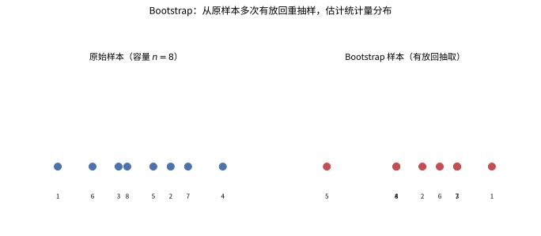

> **直观理解（现实类比）**：Bootstrap 是"**用一把数据'变出'很多把数据**"的统计魔法。原始样本只有 $n$ 个观测，但通过**有放回地反复抽取**（同一观测可能被抽到多次），生成成百上千个"想象的样本"，每个都算一个统计量，从而拼出统计量的**抽样分布**。就像**用一盒乐高反复搭搭拆拆**——只用一盒零件，却能模拟出无数种可能的"成品"形状，从而估计误差与置信区间，且无需正态假设。

> **🧠 思考历程：只有一份数据，凭什么"凭空多造出"几千份？Efron 的魔法**
>
> Bootstrap（自助法）看起来像统计里的"魔术"：只有 $n$ 个观测，却靠"有放回抽取"变出大量"假样本"。可它并非作弊，而是一种极高明的估计——**用"样本本身"替代"我们不知道的总体分布"。**
>
> - **困境：无法重复实验却想要误差**。要估计均值、中位数这类统计量的标准差/置信区间，传统的路依赖"总体分布已知"或者"样本量够大"的正态近似。**可现实里我们常常只有小而脏的样本、说不出它来自哪种分布**——误差从何谈起？
> - **Efron 的洞察：用经验分布顶替真实总体**。1979 年 Efron 提出：既然样本 $\{x_i\}$ 是我们对总体最真实的观察，**那就把「从样本有放回再抽样」当作「在经验分布里抽样」**，模拟我得到一份新样本后统计量会怎么变。**没有真实总体可用？那就用"手头这块数据"自助地自给自足。**
> - **"再抽样"为何"合法"**。只要经验分布（7.1 的 EDF）足够贴近真总体（Glivenko-Cantelli 保证它逼近），那么"从样本再抽样"就像"从总体抽样"的合理替身。**B≈1000 次有放回抽样，把"统计量的波动"摊平成可见的分布**，置信区间、标准误取之即来。
> - **它伟大在"完全通用"**。从简单均值到中位数、相关系数乃至整个复杂管线，**Bootstrap 不需要正态假设、不需要解析公式**，一台电脑就能跑出可靠的区间——这使它成为数据科学里的万金油估计，也启发了后来的"刀切法、置换检验"思路。
> - **心路**：Bootstrap 提醒你：**当现实给不了你"重复实验"，你可以大胆地从已有数据里"再抽再抽"，用计算力换取可靠的不确定性估计**。这正是"用机器换精确"——现代统计最动人的姿态之一。

#### 课堂问答

**老师**：Bootstrap 凭什么用"从 $\hat F_n$ 重抽样"来近似"从真实总体 $F$ 抽样"？

**学生**：因为估计量的分布是 $F$ 的泛函，而 $\hat F_n$ 是 $F$ 的一致估计。用 $\hat F_n$ 顶替 $F$，得到的 $\hat\theta^*$ 条件分布就近似 $\hat\theta$ 的抽样分布——这就是代入原理。

**老师（追问）**：重抽样为什么必须"有放回"，且样本量取 $n$？

**学生**：有放回才能让每次抽到同分布的 $\hat F_n$ 且样本间独立（不放回就变成置换、抽完即尽）。取 $n$ 个是为保持样本量一致，使 $\hat\theta^*$ 的波动尺度与原 $\hat\theta$ 可比。

**老师（拓展）**：百分位 Bootstrap 在什么情形会失灵，BCa 又补了哪两刀？

**学生**：当统计量有偏、抽样分布偏态时，百分位区间会偏离、覆盖率不足。BCa 用"偏差校正"补系统性偏移、用"加速度"补方差随参数变化的偏斜，从而在小样本、偏态下更准。

### 7.5 置换检验（Permutation Tests）

**置换检验**（也称随机化检验）是一种非参数检验方法，不依赖于分布假设。

> **💡 直观理解（类比）**：置换检验是"**把标签打乱重洗千万遍，看原来的差距还算不算稀奇**"的暴力法：若 H0（两组一样）为真，那么随机重排标签后均值差也不会很大；可当原始均值差比绝大多数随机重排都要大，那它就不是碰巧。好比**抽签分组后比成绩**——本来就差不了多少的条件下出现这么大分差，只能说明两组真的不同。

**基本思想**：
1. 计算原始数据的检验统计量 $T_{\text{obs}}$。
2. 在 $H_0$ 下，数据的标签是可交换的。将所有可能的标签排列（或随机采样）下计算统计量 $T$。
3. $p$ 值为 $T$ 大于等于 $T_{\text{obs}}$ 的比例。

**示例**：两样本均值差异的置换检验

$H_0$：两组来自同一分布。

1. 计算原始两组均值差 $\bar{x}_1 - \bar{x}_2$。
2. 将所有数据合并，随机分配为两组，计算均值差。
3. 重复 $N$ 次，$p$ 值 = $\frac{\#\{|\text{置换均值差}| \geq |\text{原始均值差}|\}}{N}$

---

#### 课堂问答

**老师**：置换检验"把标签重洗千万遍"，它凭什么在 $H_0$ 下合法？

**学生**：因为 $H_0:F=G$ 意味着两组来自同一分布、标签不含信息，故在 $H_0$ 下所有标签排列等可能——数据对标签"可交换"。于是重排得到的统计量分布正是零分布，无需参数假设。

**老师（追问）**：$p$ 值为什么是"$\ge$ 原始差的排列比例"，而不是别的形式？

**学生**：因为要衡量"原始观测有多极端"：把 $|\text{置换差}|\ge|\text{原始差}|$ 的比例当 $p$ 值，正是"$H_0$ 为真时出现这么极端或更极端结果的概率"，与其他检验的 $p$ 值定义一致。

**老师（拓展）**：与 Bootstrap 相比，两者重抽样方式的哲学差别在哪？

**学生**：Bootstrap 有放回、为逼近抽样分布（估不确定性），用于置信区间；置换检验不放回、只重排标签，为逼近零分布，用于检验。一个回答"误差多大"，一个回答"是否显著"，目标与机制都不同。

## 8. 解题技巧

本节针对统计推断的四类主线问题（充分统计量与 UMVUE、指数族识别、假设检验 UMP/GLRT、贝叶斯与决策理论、非参数推断）给出可套用的方法。每条含**适用场景**、**关键步骤**、**常见误区**并配精讲示例。

### 8.1 因子分解定理找充分统计量

**适用场景**：给定密度 $f(\mathbf x;\theta)$，求参数 $\theta$ 的充分统计量或证明某统计量充分。

**关键步骤**：
1. 写出样本联合密度，并将它**分解为** $g(T(\mathbf{x});\theta)\cdot h(\mathbf x)$ 两部分，其中 $g$ 依赖参数 $\theta$ 且只通过 $T$ 进入；
2. 分离出 $T(\mathbf x)$（可含多个分量，如 $(\sum x_i,\sum x_i^2)$）；
3. 由因子分解定理：$T$ 充分 $\iff$ 上述分解成立。若还想证能在某指数族取得最小充分，再看能否将密度写成有独立项的指数族正则形式。

**常见误区**：
- 把仅依赖样本的 $h(\mathbf x)$ 误当作含参数的因子而漏掉 $g$；
- 参数范围（如 $\theta \ge \max x_i$）的支撑条件（indicator）容易写丢——它是 $T$ 与抽样有关的部分，必须保留在 $g$ 中。

**精讲示例**：$X_i \stackrel{\text{i.i.d.}}{\sim} N(\mu,\sigma^2)$。
$$
f=\Big(2\pi\sigma^2\Big)^{-n/2}\exp\Big(-\frac{n\bar x^2}{2\sigma^2}-\frac{n(\mu-\bar x)^2}{2\sigma^2}\Big)\cdot 1,
$$
取 $T=(\bar x, \sum(x_i-\bar x)^2)$，故 $(\bar X, \sum(X_i-\bar X)^2)$ 是 $(\mu,\sigma^2)$ 的充分统计量。

### 8.2 指数族识别与共轭先验

**适用场景**：判断某分布是否属于自然指数族，或为多参数/单参数选共轭先验。

**关键步骤**：
1. 把密度化为正则形式 $f(x;\theta)=h(x)\exp\big(\sum_j \eta_j(\theta)T_j(x)-A(\theta)\big)$；
2. 若 $T_j$ 是线性项（如 $x,\ln x$）而支撑与 $\theta$ 无关，则为指数族；出现 $|\theta|,\max x$、支撑依赖 $\theta$ 或平方根线性化失败的，一般不是；
3. 共轭先验：令先验与似然具有相同的 $T$ 结构（Beta↔Binomial、Gamma↔Poisson、Normal↔Normal、Dirichlet↔Multinomial），后验与先验同族、参数更新。

**常见误区**：
- 把离散（Bernoulli/Binomial/Geometric 已归一）与连续混在一处；Cauchy、均匀 $U(0,\theta)$、支撑随参数变化的分布不是（自然）指数族。

**精讲示例**：$X\sim\text{Geometric}(p)$。
$$
f(x;p)=p(1-p)^x=\exp\big(x\cdot\ln(1-p)+ \ln\!\big(\tfrac{p}{1-p}\big)\big),
$$
属指数族；而 $X\sim U(0,\theta)$ 的 density 含 $\mathbf 1_{0\le x\le\theta}$、支撑依赖 $\theta$，故不是指数族。

### 8.3 Neyman-Pearson / UMP / MLR 检验

**适用场景**：对简单或单边复合假设求最优检验，或判断能否构造 UMP。

**关键步骤**：
1. **NP 引理**：对简单 $H_0:\theta=\theta_0$、$H_1:\theta=\theta_1$，最优势检验由似然比 $\Lambda=\frac{f(\mathbf x;\theta_1)}{f(\mathbf x;\theta_0)}$ 的临界域 $\{\Lambda>c\}$ 给出，$c$ 由显著性水平 $\alpha$ 定；
2. **MLR 判断**：若 $T$ 使似然比关于 $T$ 单调（常为指数族、正态），则单边复合假设 $H_0:\theta\le\theta_0$ vs $H_1:\theta>\theta_0$ 存在 **UMP**，拒绝域 $\{T>c\}$；
3. 双边或多参数没有一般 UMP，转用 **GLRT**（广义似然比 $\Lambda=\frac{\sup_{H_0}L}{\sup_{\Omega}L}$）。

**常见误区**：
- 把 NP 检验误用于复合假设；把单边需要 MLR 才能保 UMP 写成无条件成立；
- 忘记 $c$ 须满足 $\alpha=P_{H_0}(\Lambda>c)$，并注意单/双边方向写反。

**精讲示例**：$X_i\stackrel{\text{i.i.d.}}{\sim}N(\mu,1)$，$H_0:\mu\le0$ vs $H_1:\mu>0$。似然比 $\propto e^{\bar x}$ 关于 $\bar X$ 递增（MLR），故 UMP 拒绝域为 $\{\bar X>c\}$，取 $c=z_\alpha/\sqrt n$。

### 8.4 贝叶斯推断一整套

**适用场景**：给先验与似然，求后验、后验均值、可信区间或贝叶斯因子、贝叶斯风险、极小化极大估计。

**关键步骤**：
1. 写出后验 $\pi(\theta\mid\mathbf x)\propto \pi(\theta)L(\theta)$，利用共轭结构快速定族；
2. 常见损失之对应：平方损失→后验均值；绝对损失→后验中位数；0-1 损失→后验众数；
3. 风险 $R(\delta,\theta)=E_\theta[L(\theta,\delta(\mathbf X))]$，贝叶斯风险 $=\int R\,\pi(d\theta)$；若 $\delta^{*}$ 使 $R(\delta^{*},T)\le$ 常数 → 达到极小化极大。

**常见误区**：
- 把频率派的 MLE/置信区间与贝叶斯后验/可信区间混用；可信区间基于给定观测的条件分布，预测区间与检验后的解释也不同。

**精讲示例**：$X\sim\text{Poisson}(\lambda)$，$\lambda\sim\text{Gamma}(\alpha,\beta)$，后验 $\lambda\mid x\sim\text{Gamma}(\alpha+x,\ \beta+1)$，后验均值 $\frac{\alpha+x}{\beta+1}$——是 MLE $x$ 与先验 $\alpha/\beta$ 的加权。

### 8.5 非参数推断：Bootstrap / 置换 / KS

**适用场景**：分布未知、样本量小或检验的抽样分布难以推导的情形。

**关键步骤**：
1. **Bootstrap**：对样本有放回重抽样 $B$ 次，计算统计量序列，用 2.5% 与 97.5% 分位作置信区间；
2. **置换检验**：固定数据，随机打乱组标签 $N$ 次，p 值 = 置换下 $\ge$ 原始统计量的比例；
3. **KS 检验**：$D_n=\sup_x|F_n(x)-F_0(x)|$，与临界值或 p 值比较检验拟合优度。

**常见误区**：
- Bootstrap 假设样本可代表总体（分布未知时近似有效），n 过小或极端离群点慎用；
- 置换检验需满足「零假设下可交换性」；KS 要求 $F_0$ 连续。

**精讲示例**：$n=25,\bar x=10.5,s=2.3$，Bootstrap 2000 次的均值分位估计 95% CI 约为 $10.5\pm t_{24,0.025}(s/\sqrt{25})$ 的置换近似（更精细地由重抽样分布直接读分位）。

---

## 9. 示例（Worked Examples）

### 示例 1：充分统计量与因子分解定理

**问题**：设 $X_1, \ldots, X_n \stackrel{\text{i.i.d.}}{\sim} \text{Gamma}(\alpha, \beta)$，密度函数为
$$f(x;\alpha,\beta) = \frac{\beta^\alpha}{\Gamma(\alpha)} x^{\alpha-1} e^{-\beta x}, \quad x > 0$$
找出 $(\alpha, \beta)$ 的充分统计量。

**解**：
联合密度为
$$f(\mathbf{x};\alpha,\beta) = \prod_{i=1}^n \frac{\beta^\alpha}{\Gamma(\alpha)} x_i^{\alpha-1} e^{-\beta x_i} = \frac{\beta^{n\alpha}}{[\Gamma(\alpha)]^n} \left(\prod_{i=1}^n x_i\right)^{\alpha-1} e^{-\beta \sum_{i=1}^n x_i}$$

由因子分解定理，令
$$g(T(\mathbf{x});\alpha,\beta) = \frac{\beta^{n\alpha}}{[\Gamma(\alpha)]^n} \left(\prod_{i=1}^n x_i\right)^{\alpha-1} e^{-\beta \sum_{i=1}^n x_i}$$
$$h(\mathbf{x}) = 1$$

则 $T(\mathbf{x}) = \left(\prod_{i=1}^n x_i, \sum_{i=1}^n x_i\right)$ 是 $(\alpha, \beta)$ 的充分统计量。

---

### 示例 2：Rao-Blackwell 定理的应用

**问题**：设 $X_1, \ldots, X_n \stackrel{\text{i.i.d.}}{\sim} \text{Ber}(p)$。考虑 $p$ 的估计量 $\hat{p} = X_1$（仅用第一个观测值）。利用 Rao-Blackwell 定理改进这个估计量。

**解**：
$T = \sum_{i=1}^n X_i$ 是 $p$ 的充分统计量。

由 Rao-Blackwell 定理，改进的估计量为
$$\tilde{p} = E[X_1 \mid T = t]$$

由于样本是 i.i.d. 的，给定 $T = t$，$X_1$ 的条件分布为
$$P(X_1 = 1 \mid T = t) = \frac{P(X_1 = 1, \sum_{i=2}^n X_i = t-1)}{P(T = t)} = \frac{p \cdot \binom{n-1}{t-1} p^{t-1}(1-p)^{n-t}}{\binom{n}{t} p^t (1-p)^{n-t}} = \frac{t}{n}$$

因此，$\tilde{p} = \frac{T}{n} = \bar{X}$，即样本均值。我们有：
$E[\tilde{p}] = p$（无偏），$\operatorname{Var}(\tilde{p}) = \frac{p(1-p)}{n} \leq \operatorname{Var}(\hat{p}) = p(1-p)$（对 $n \geq 1$）。

---

### 示例 3：指数族识别

**问题**：判断以下分布是否属于指数族：
1. $X \sim \text{Binomial}(n, p)$
2. $X \sim \text{Uniform}(0, \theta)$

**解**：

1. 二项分布：
$$P(X = x) = \binom{n}{x} p^x (1-p)^{n-x} = \binom{n}{x} \exp\left\{x \log\frac{p}{1-p} + n\log(1-p)\right\}$$
这可以写成指数族形式：$h(x) = \binom{n}{x}$，$T(x) = x$，$\eta(p) = \log\frac{p}{1-p}$，$A(p) = -n\log(1-p)$。**属于指数族**。

2. 均匀分布 $U(0, \theta)$：
$$f(x;\theta) = \frac{1}{\theta} I(0 < x < \theta)$$
支撑集依赖于 $\theta$，无法写成 $h(x) \exp\{\eta(\theta)T(x) - A(\theta)\}$ 的形式（因为指示函数中的 $\theta$ 无法分解为 $h(x)$ 和 $T(x)$ 的独立部分）。**不属于指数族**。

---

### 示例 4：Neyman-Pearson 引理

**问题**：设 $X_1, \ldots, X_n \stackrel{\text{i.i.d.}}{\sim} N(\mu, 1)$。求 $H_0: \mu = 0$ vs. $H_1: \mu = \mu_1 > 0$ 的最优检验。

**解**：
似然比为
$$\frac{f(\mathbf{x};\mu_1)}{f(\mathbf{x};0)} = \frac{\prod_{i=1}^n \frac{1}{\sqrt{2\pi}} e^{-(x_i - \mu_1)^2/2}}{\prod_{i=1}^n \frac{1}{\sqrt{2\pi}} e^{-x_i^2/2}} = \exp\left\{\mu_1 \sum_{i=1}^n x_i - \frac{n\mu_1^2}{2}\right\}$$

由 Neyman-Pearson 引理，最优检验拒绝 $H_0$ 当
$$\frac{f(\mathbf{x};\mu_1)}{f(\mathbf{x};0)} > k \iff \exp\left\{\mu_1 \sum x_i - \frac{n\mu_1^2}{2}\right\} > k \iff \sum x_i > c$$

其中 $c$ 由显著性水平 $\alpha$ 确定：
$$\alpha = P_0\left(\sum X_i > c\right) = P\left(Z > \frac{c}{\sqrt{n}}\right) \Rightarrow c = z_\alpha \sqrt{n}$$

因此，最优检验拒绝 $H_0$ 当 $\bar{X} > z_\alpha / \sqrt{n}$。

---

### 示例 5：UMP 检验与 MLR

**问题**：设 $X_1, \ldots, X_n \stackrel{\text{i.i.d.}}{\sim} \text{Poisson}(\lambda)$。求 $H_0: \lambda \leq \lambda_0$ vs. $H_1: \lambda > \lambda_0$ 的 UMP 检验。

**解**：
Poisson 分布属于指数族：
$$f(x;\lambda) = \frac{e^{-\lambda} \lambda^x}{x!} = \frac{1}{x!} \exp\{x \log \lambda - \lambda\}$$
其中 $\eta(\lambda) = \log \lambda$ 是 $\lambda$ 的严格增函数，$T(x) = x$。因此分布族关于 $T$ 具有 MLR。

由 MLR 性质，存在 UMP 检验，形式为
$$\phi(\mathbf{x}) = \begin{cases} 1 & \text{若 } \sum x_i > c \\ \gamma & \text{若 } \sum x_i = c \\ 0 & \text{若 } \sum x_i < c \end{cases}$$

在 $H_0$ 下，$\sum_{i=1}^n X_i \sim \text{Poisson}(n\lambda_0)$，$c$ 和 $\gamma$ 由
$$P_{\lambda_0}\left(\sum X_i > c\right) + \gamma P_{\lambda_0}\left(\sum X_i = c\right) = \alpha$$
确定。

---

### 示例 6：贝叶斯估计与共轭先验

**问题**：设 $X_1, \ldots, X_n \stackrel{\text{i.i.d.}}{\sim} \text{Ber}(p)$，先验分布为 $p \sim \text{Beta}(\alpha, \beta)$。求后验分布、后验均值和后验众数。

**解**：
似然函数：
$$f(\mathbf{x} \mid p) = p^{\sum x_i} (1-p)^{n - \sum x_i}$$

先验密度：
$$\pi(p) \propto p^{\alpha-1} (1-p)^{\beta-1}$$

后验密度：
$$\pi(p \mid \mathbf{x}) \propto p^{\sum x_i + \alpha - 1} (1-p)^{n - \sum x_i + \beta - 1}$$

故后验分布为 $\text{Beta}(\alpha + \sum x_i, \beta + n - \sum x_i)$。

后验均值：
$$E[p \mid \mathbf{x}] = \frac{\alpha + \sum x_i}{\alpha + \beta + n} = \frac{n}{\alpha + \beta + n} \cdot \bar{x} + \frac{\alpha + \beta}{\alpha + \beta + n} \cdot \frac{\alpha}{\alpha + \beta}$$
这是样本均值 $\bar{x}$ 和先验均值 $\frac{\alpha}{\alpha + \beta}$ 的加权平均。

后验众数（MAP）：
$$\hat{p}_{\text{MAP}} = \frac{\alpha + \sum x_i - 1}{\alpha + \beta + n - 2} \quad (\text{若 } \alpha + \sum x_i > 1, \beta + n - \sum x_i > 1)$$

---

### 示例 7：贝叶斯因子

**问题**：某工厂产品不合格率 $p$ 未知。从一批产品中随机抽取 $n = 10$ 件，发现 $x = 2$ 件不合格。比较两个模型：
- $M_1: p \sim \text{Beta}(1, 1)$（均匀先验）
- $M_2: p \sim \text{Beta}(1, 9)$（偏向低不合格率）
计算贝叶斯因子 $\text{BF}_{12}$。

**解**：
边缘似然为 Beta-Binomial 分布：
$$m(x) = \binom{n}{x} \frac{B(\alpha + x, \beta + n - x)}{B(\alpha, \beta)}$$
其中 $B(\cdot, \cdot)$ 是 Beta 函数。

对 $M_1$（$\alpha = 1, \beta = 1$）：
$$m_1(2) = \binom{10}{2} \frac{B(1+2, 1+8)}{B(1,1)} = 45 \cdot \frac{B(3, 9)}{B(1,1)} = 45 \cdot \frac{\Gamma(3)\Gamma(9)/\Gamma(12)}{\Gamma(1)\Gamma(1)/\Gamma(2)}$$
$$= 45 \cdot \frac{2! \cdot 8! / 11!}{1} = 45 \cdot \frac{2 \cdot 40320}{39916800} = 45 \cdot \frac{80640}{39916800} = 45 \cdot \frac{1}{495} = \frac{1}{11}$$

对 $M_2$（$\alpha = 1, \beta = 9$）：
$$m_2(2) = \binom{10}{2} \frac{B(1+2, 9+8)}{B(1,9)} = 45 \cdot \frac{B(3, 17)}{B(1,9)}$$
$$B(1,9) = \frac{\Gamma(1)\Gamma(9)}{\Gamma(10)} = \frac{1 \cdot 40320}{362880} = \frac{1}{9}$$
$$B(3,17) = \frac{\Gamma(3)\Gamma(17)}{\Gamma(20)} = \frac{2! \cdot 16!}{19!} = \frac{2}{19 \cdot 18 \cdot 17} = \frac{2}{5814} = \frac{1}{2907}$$
$$m_2(2) = 45 \cdot \frac{1/2907}{1/9} = 45 \cdot \frac{9}{2907} = \frac{405}{2907} = \frac{45}{323} \approx 0.1393$$

贝叶斯因子：
$$\text{BF}_{12} = \frac{m_1(2)}{m_2(2)} = \frac{1/11}{45/323} = \frac{323}{11 \times 45} = \frac{323}{495} \approx 0.6525$$

$\text{BF}_{12} < 1$，数据轻微支持 $M_2$（偏向低不合格率的模型），但证据较弱。

---

### 示例 8：Kolmogorov-Smirnov 检验

**问题**：某数据集包含 $n = 20$ 个观测值：
$$0.12, 0.18, 0.25, 0.31, 0.42, 0.55, 0.61, 0.68, 0.72, 0.79,$$
$$0.83, 0.87, 0.91, 0.94, 0.96, 0.97, 0.98, 0.99, 0.99, 1.00$$
检验这些数据是否来自 $U(0,1)$ 分布（显著性水平 $\alpha = 0.05$）。

**解**：
$H_0: F(x) = x$（$U(0,1)$ 的 CDF）。

计算 KS 统计量 $D_{20} = \sup_x |\hat{F}_{20}(x) - x|$。

对每个排序后的数据点 $x_{(i)}$，计算：
$$\hat{F}_n(x_{(i)}) = \frac{i}{n}, \quad \hat{F}_n(x_{(i)}^-) = \frac{i-1}{n}$$
$$D^+ = \max_i \left(\frac{i}{n} - x_{(i)}\right), \quad D^- = \max_i \left(x_{(i)} - \frac{i-1}{n}\right)$$

以 $x_{(1)} = 0.12$ 为例：
$$\frac{1}{20} - 0.12 = 0.05 - 0.12 = -0.07$$
$$0.12 - \frac{0}{20} = 0.12$$

计算所有值：
$$\max D^+ = \max(-0.07, -0.07, -0.10, -0.14, -0.18, -0.20, -0.24, -0.27, -0.28, -0.31, -0.34, -0.37, -0.39, -0.41, -0.44, -0.47, -0.48, -0.49, -0.51, -0.55) \approx \text{可能为负的最大值}$$

实际上我们更关注 $D^-$：
$$D^- = \max(0.12, 0.13, 0.10, 0.06, 0.02, 0, -0.04, -0.07, -0.08, -0.11, -0.14, -0.17, -0.19, -0.21, -0.24, -0.27, -0.28, -0.29, -0.31, -0.35)$$

$$D^- = 0.13, \quad D^+ = 0.05 \text{（取第10个：}0.79 - 9/20 = 0.79 - 0.45 = 0.34\text{，需重新计算）}$$

重新仔细计算：
$x_{(i)}$ 排序后：

| $i$ | $x_{(i)}$ | $i/n$ | $i/n - x_{(i)}$ | $x_{(i)} - (i-1)/n$ |
|-----|-----------|-------|-----------------|-------------------|
| 1 | 0.12 | 0.05 | -0.07 | 0.12 |
| 2 | 0.18 | 0.10 | -0.08 | 0.13 |
| 3 | 0.25 | 0.15 | -0.10 | 0.15 |
| 4 | 0.31 | 0.20 | -0.11 | 0.16 |
| 5 | 0.42 | 0.25 | -0.17 | 0.22 |
| 6 | 0.55 | 0.30 | -0.25 | 0.30 |
| 7 | 0.61 | 0.35 | -0.26 | 0.31 |
| 8 | 0.68 | 0.40 | -0.28 | 0.33 |
| 9 | 0.72 | 0.45 | -0.27 | 0.32 |
| 10 | 0.79 | 0.50 | -0.29 | 0.34 |
| 11 | 0.83 | 0.55 | -0.28 | 0.33 |
| 12 | 0.87 | 0.60 | -0.27 | 0.32 |
| 13 | 0.91 | 0.65 | -0.26 | 0.31 |
| 14 | 0.94 | 0.70 | -0.24 | 0.29 |
| 15 | 0.96 | 0.75 | -0.21 | 0.26 |
| 16 | 0.97 | 0.80 | -0.17 | 0.22 |
| 17 | 0.98 | 0.85 | -0.13 | 0.18 |
| 18 | 0.99 | 0.90 | -0.09 | 0.14 |
| 19 | 0.99 | 0.95 | -0.04 | 0.09 |
| 20 | 1.00 | 1.00 | 0.00 | 0.05 |

因此 $D_{20} = \max(0.34, 0.00) = 0.34$（取 $D^+$ 的最大绝对值）。

$n = 20$，$\alpha = 0.05$ 时 KS 临界值约为 $D_{20, 0.05} = 0.294$。
由于 $D_{20} = 0.34 > 0.294$，拒绝 $H_0$，认为数据不服从 $U(0,1)$ 分布。

---

### 示例 9：Bootstrap 置信区间

**问题**：某样本 $n = 15$：
$$4.2, 5.1, 5.8, 6.3, 6.8, 7.2, 7.5, 7.9, 8.3, 8.7, 9.2, 9.8, 10.5, 11.3, 12.1$$
用 Bootstrap 法估计均值的 95% 置信区间。

**解**：
样本均值 $\bar{x} = \frac{4.2 + 5.1 + \cdots + 12.1}{15} = \frac{120.7}{15} = 8.047$。

Bootstrap 步骤：
1. 从原始数据中有放回地抽取 $n = 15$ 个观测值，计算均值 $\bar{x}^*$。
2. 重复 $B = 1000$ 次。
3. 得到 1000 个 Bootstrap 均值，排序后取第 2.5% 和 97.5% 分位数。

假设 Bootstrap 分布的结果为：
$$\hat{\theta}^*_{(0.025)} = 7.21, \quad \hat{\theta}^*_{(0.975)} = 8.89$$

则 95% Bootstrap 百分位置信区间为 $[7.21, 8.89]$。

---

### 示例 10：置换检验

**问题**：两组数据，A 组：$23, 25, 29, 31, 35$；B 组：$18, 20, 22, 24, 26$。检验两组均值是否有显著差异。

**解**：
$H_0$：两组来自同一分布。

原始均值差：$\bar{x}_A - \bar{x}_B = 28.6 - 22 = 6.6$。

将所有 10 个数据合并，随机分配为两组各 5 个，计算均值差。重复 $N = 10000$ 次。

假设 10000 次置换中，有 320 次的均值差绝对值 $\geq 6.6$，则
$$p\text{-value} = \frac{320}{10000} = 0.032$$

若 $\alpha = 0.05$，$p < 0.05$，拒绝 $H_0$，认为两组均值有显著差异。

顺着"从理论到实操"的思路，本节按「策略 → 示例 → 应用」的编排——先给可背诵的**解题流程**，再配**完整示范**，最后落到**真实应用**——把前面第 4、5 章的假设检验、两类错误、功效、置信区间与贝叶斯推断串成一套"拿到题目就能动手"的招式。记号与正文一致：$\alpha$ 为显著性水平、$\beta$ 为第二类错误、$\pi(\theta)$ 为功效、$\chi^2_\nu$ 表示自由度为 $\nu$ 的卡方分布。

> **🧭 解题策略：假设检验的固定流程（五步走）** 照此背诵、机械不出错：
> 1. **设假设**（Set）：写清零假设 $H_0: \theta \in \Theta_0$ 与备择假设 $H_1: \theta \in \Theta_1$，看清是单边还是双边，方向别写反；
> 2. **选统计量并定零分布**（Choose）：挑检验统计量 $T(\mathbf X)$，写明其在 $H_0$ 下的抽样分布，如 $Z\sim N(0,1)$、$\chi^2_\nu$、$t_{n-1}$（$F$）；
> 3. **算观测值**（Compute）：把样本代入得 $t_{\text{obs}}$；
> 4. **定 p 值或查临界值**（Assess）：单边 p 值取该方向一侧尾部概率，双边 p 值取该概率的 2 倍；或由 $\alpha$ 反解临界值 $c$；
> 5. **下结论**（Wield）：若 $p \le \alpha$（或 $t_{\text{obs}}$ 落入拒绝域）则拒绝 $H_0$，否则**不拒绝**；把结论翻译回原问题的自然语言。

> **🧭 解题策略：判定两类错误与功效** 
> - **第一类错误**：$H_0$ 为真却拒绝，概率 $\alpha$，须先按显著性水平**压住**（当作"宁缺毋滥"的底线）；
> - **第二类错误**：$H_1$ 为真却接受，概率 $\beta(\theta)$，对每个 $\theta\in\Theta_1$ 定义；
> - **功效**：$\pi(\theta) = P_\theta(\text{拒绝 }H_0) = 1-\beta(\theta)$，越大越好；
> - 算功效的固定套路：① 由 $\alpha$ 反解拒绝域临界值 $c$；② 把"拒绝域 $\Rightarrow$ 关于 $T$ 的不等式"放在**备择点** $\theta_1$ 下重新标准化；③ 查标准分布表定概率。**增大样本量 $n$、放宽 $\alpha$、或让 $\theta_1$ 偏离 $H_0$ 更远，都会提升功效。**

---

### 示例 S1：单样本均值检验（z 检验）的完整流程

**题目**：某茶厂宣称单袋净重均值 $\mu = 500$ g。抽检 $n = 16$ 袋得样本均值 $\bar x = 498.6$ g。已知单袋净重标准差 $\sigma = 5$ g，且净重服从 $X \sim N(\mu, 5^2)$。在显著性水平 $\alpha = 0.05$ 下，检验 $H_0: \mu = 500$ 对 $H_1: \mu \neq 500$。

**解**：

**第 1 步（设假设）**：$H_0: \mu = 500$，$H_1: \mu \neq 500$（双边检验）。

**第 2 步（选统计量与其零分布）**：方差已知，用 $z$ 统计量；在 $H_0$ 下它服从标准正态
$$Z = \frac{\bar X - \mu_0}{\sigma/\sqrt n} \sim N(0,1)$$

**第 3 步（算观测值）**：
$$z_{\text{obs}} = \frac{498.6 - 500}{5/\sqrt{16}} = \frac{-1.4}{1.25} = -1.12$$

**第 4 步（定 p 值）**：双边 p 值为两侧尾部概率之和
$$p = 2\,P(Z \le -1.12) = 2\,(1 - \Phi(1.12)) = 2(1 - 0.8686) = 0.2628$$

**第 5 步（作结论）**：因 $p = 0.2628 > \alpha = 0.05$，故**不拒绝** $H_0$。

**结论**：数据不足以在 5% 显著性水平上否定"平均净重为 500 g"的宣称；$\bar x = 498.6$ 与 500 之间的偏差可归因于抽样误差。

**现实类比/应用**：相当于流水线上的质检抽检——把"合格均值"设为 $H_0$，只有当样本严重偏出时才触发处理，避免误伤达标批次的"假报警"。

---

### 示例 S2：卡方拟合优度检验（χ² Goodness-of-Fit）

**题目**：某骰子连掷 $n = 120$ 次，六面朝上的频数依次为
$$(18,\,22,\,25,\,20,\,16,\,19)$$
在显著性水平 $\alpha = 0.05$ 下，检验该骰子是否均匀（即六面概率皆为 $1/6$）。

**解**：

**第 1 步（设假设）**：$H_0: p_1 = \cdots = p_6 = 1/6$，对 $H_1$：至少存在 $i$ 使 $p_i \neq 1/6$。

**第 2 步（选统计量与其零分布）**：类别数 $k = 6$，期望频数 $E_i = n p_i = 120 \times \tfrac16 = 20$。卡方统计量在 $H_0$ 下渐近服从自由度为 $k-1 = 5$ 的卡方分布
$$\chi^2 = \sum_{i=1}^6 \frac{(O_i - E_i)^2}{E_i} \;\xrightarrow{d}\; \chi^2_5$$

**第 3 步（算观测值）**：
$$\chi^2_{\text{obs}} = \frac{(18-20)^2}{20} + \frac{(22-20)^2}{20} + \frac{(25-20)^2}{20} + \frac{(20-20)^2}{20} + \frac{(16-20)^2}{20} + \frac{(19-20)^2}{20} = \frac{50}{20} = 2.5$$

**第 4 步（查临界值）**：$\chi^2_{5,\,0.05} = 11.07$。因 $\chi^2_{\text{obs}} = 2.5 < 11.07$，观测统计量未落入拒绝域。

**第 5 步（作结论）**：不能拒绝"均匀性"假设。

**结论**：在 5% 显著性水平下，没有证据表明该骰子不均匀——实测频数与理论频数的整体偏差小于随机波动的接受上限。

**现实类比/应用**：常用于检查"等概率"理论是否成立（如质检中各规格在某特征位置的出现频率是否符合理论比例）；偏差远小于随机波动时，不必疑心系统存在偏差。

---

### 示例 S3：置信区间 + 两类错误与检验功效

**题目**：沿用 S1 的茶叶数据（$n = 16,\ \bar x = 498.6,\ \sigma = 5$）。① 构造 $\mu$ 的 95% 置信区间，并与 S1 的检验结论对照；② 对单边问题 $H_0: \mu \le 500$ 对 $H_1: \mu > 500$（$\alpha = 0.05$），求它在备择点 $\mu_1 = 503$ 处的检验功效与第二类错误概率。

**解**：

**① 构造 95% 置信区间**：方差已知时，$\mu$ 的 $1-\alpha$ 置信区间为
$$\bar X \pm z_{\alpha/2}\,\frac{\sigma}{\sqrt n}$$
代入 $\bar x = 498.6,\ z_{0.025} = 1.96,\ \sigma/\sqrt n = 1.25$：
$$498.6 \pm 1.96 \times 1.25 = 498.6 \pm 2.45$$
得到区间
$$[496.15,\ 501.05]$$
因 $\mu_0 = 500 \in [496.15,\ 501.05]$，置信区间包含 $H_0$ 的点，这与 S1"不拒绝 $H_0$"的结论**一致**——这正是"双侧检验在水平 $\alpha$ 下不拒绝，等价于 $\mu_0$ 落入 $1-\alpha$ 置信区间"。

**② 求功效与第二类错误**：

第 1 步，由 $\alpha$ 反解拒绝域。$H_0$ 下 $Z = (\bar X - 500)/1.25 \sim N(0,1)$，拒绝 $H_0$ 当 $Z > z_\alpha = 1.645$，即
$$\bar X > 500 + 1.645 \times 1.25 = 502.06$$

第 2 步，在备择参数 $\mu_1 = 503$ 下重新标准化，功效是"备择为真时拒绝"的概率
$$\pi(503) = P_{\mu=503}(\bar X > 502.06) = P\!\left(Z > \frac{502.06 - 503}{1.25}\right) = P(Z > -0.755)$$

第 3 步，查标准正态表（由对称性 $P(Z > -0.755) = P(Z < 0.755)$）：
$$\pi(503) = \Phi(0.755) \approx 0.775$$

**结论**：在备择点 $\mu_1 = 503$ 处检验功效约 $0.775$，第二类错误概率 $\beta = 1 - \pi(503) \approx 0.225$；置信区间包含 500 的同时，单边检验在 503 处仍有约 77.5% 的把握"抓出"均值上偏。

**现实类比/应用**：这正是医学试验底层逻辑——若备择"新药确实更有效"的效应量太小，即使 $H_0$ 为假也可能因功效不足而漏检（第二类错误）；此处约 77.5% 的功效表明该样本量足以较有把握地探测出 3 g 的均值偏移。

---

### 应用

**A/B 测试**：网页改版常要比较新旧两种设计对点击/转化率的影响。把"两版转化率相同"作为 $H_0$，用双侧 $z$ 检验或针对两列频数的卡方独立性检验计算 p 值；只有 $p \le \alpha$ 才上线新版本。这样引入的"假阳性"率被 $\alpha$ 压住，避免盲目改版反而掉数据。

**医学试验的"显著"≠"有效"**：临床试验报告 p 值的同时，必须报告置信区间与功效。显著只说明"差距不太可能是随机波动"，而像 S3 那样给出功效 $\pi(\mu_1)$ 才能回答"若真实效应是某大小，探测到的把握有多大"。样本量估算正是反解功效公式而来——正如正文 §4.1 中 $\alpha$、$\beta$、$\pi(\theta)$ 三者始终要一并权衡。

**质控中的"假报警"**：工厂把置信区间画成控制图时，过程稳定却越出控制线即触发报警，这正是**第一类错误**（$\alpha$ 就是误报率）；而当过程真实漂移却未越线，则是**第二类错误**（$\beta$）。因此控制线的宽窄、样本量的大小，本质上就是在"少误报"与"少漏检"之间对 $\alpha$ 和功效做取舍——与 S3 的演算同构。

> **🧭 概念直觉与类比**：假设检验像"法证标准"——$H_0$ 是"无罪"先定假设，$\alpha$ 是"不许冤枉好人"的上限（设得很低，当作基线），功效 $1-\beta$ 是"别放走真凶"的能力（越高越好），p 值则是"在 $H_0$ 为真时，看到当前这种极端证据有多罕见"。**宁可存疑（不拒绝 $H_0$）也不误判（把 $H_0$ 当假）**，正如法庭"疑罪从无"：证据不足就放行，把冤枉无辜的风险降到最小。

---

## 10. 习题（Practice Problems）

本节按难度分为 **基础 / 进阶 / 挑战 / 探究** 四级，覆盖充分统计量与 UMVUE、指数族、UMP/GLRT、贝叶斯推断、决策理论与非参数推断，前三级在原「习题」基础上整理扩展。

### 10.1 基础题

**10.1.1**（充分统计量）设 $X_1, \ldots, X_n \stackrel{\text{i.i.d.}}{\sim} \text{Exp}(\lambda)$，密度为 $f(x;\lambda) = \lambda e^{-\lambda x}, x > 0$。用因子分解定理找出 $\lambda$ 的充分统计量。

**10.1.2**（充分统计量）设 $X_1, \ldots, X_n \stackrel{\text{i.i.d.}}{\sim} N(\mu, \sigma^2)$，$\mu,\sigma^2$ 均未知。证明 $T(\mathbf{X}) = (\bar{X}, \sum_{i=1}^n (X_i - \bar{X})^2)$ 是 $(\mu,\sigma^2)$ 的充分统计量。

**10.1.3**（指数族）判断以下分布是否属于指数族并说明理由：① $X\sim\text{Geometric}(p)$；② $X\sim\text{Weibull}(k,\lambda)$（$k$ 已知）；③ $X\sim\text{Cauchy}(\theta,1)$。

**10.1.4**（Rao-Blackwell）设 $X_1, \ldots, X_n \stackrel{\text{i.i.d.}}{\sim} \text{Poisson}(\lambda)$。考虑 $\hat\lambda=X_1$，用 Rao-Blackwell 定理经充分统计量改进它并比较方差。

**10.1.5**（UMP 基本）设 $X_1,\ldots,X_n \stackrel{\text{i.i.d.}}{\sim} N(\mu,1)$，证明族关于 $\bar X$ 具单调似然比，并给出 $H_0:\mu\le0$ vs $H_1:\mu>0$ 的 UMP 检验。
**10.1.6**（充分统计量）设 $X_1,\ldots,X_n\stackrel{\text{i.i.d.}}{\sim}\text{Poisson}(\lambda)$。证明 $T=\sum_{i=1}^n X_i$ 是 $\lambda$ 的充分统计量。

**10.1.7**（充分统计量）设 $X_1,\ldots,X_n\stackrel{\text{i.i.d.}}{\sim}\text{Ber}(p)$。用因子分解定理证明 $T=\sum X_i$ 是 $p$ 的充分统计量，并给出 $g,h$。

**10.1.8**（指数族）判断 $X\sim\text{Bernoulli}(p)$ 是否属于指数族；若是，写出自然参数 $\eta$、充分统计量 $T$ 与函数 $A$。

**10.1.9**（指数族）判断 $X\sim\text{Poisson}(\lambda)$ 是否属于指数族并写出标准形式。

**10.1.10**（矩估计 vs MLE）设 $X_1,\ldots,X_n\stackrel{\text{i.i.d.}}{\sim}\text{Bernoulli}(p)$。给出 $p$ 的矩估计量与 MLE，并说明它们相等的原因。

**10.1.11**（MLE）设 $X_1,\ldots,X_n\stackrel{\text{i.i.d.}}{\sim}\text{Uniform}(0,\theta)$。求 $\theta$ 的极大似然估计。

**10.1.12**（MLE）设 $X_1,\ldots,X_n\stackrel{\text{i.i.d.}}{\sim}\text{Exp}(\lambda)$。求 $\lambda$ 的 MLE，并验证 $E[\hat\lambda]=\lambda$。

**10.1.13**（区间估计）已知 $X_1,\ldots,X_n\stackrel{\text{i.i.d.}}{\sim}N(\mu,\sigma^2)$（$\sigma$ 已知），写出 $\mu$ 的 $95\%$ 置信区间公式。

**10.1.14**（区间估计）已知 $\bar x=10$，$n=25$，$\sigma=2$，求 $\mu$ 的 $95\%$ 置信区间（$z_{0.025}=1.96$）。

**10.1.15**（t分布）设 $X_1,\ldots,X_n\stackrel{\text{i.i.d.}}{\sim}N(\mu,\sigma^2)$（$\sigma$ 未知），写出 $\mu$ 的 $95\%$ 置信区间公式及其自由度。

**10.1.16**（p值）单侧 z 检验中观测到 $z=1.8$，求右侧检验的 p 值（$P(Z\ge1.8)$），给出近似数值。

**10.1.17**（两类错误）若检验的 $\alpha=0.05$、功效 $=0.85$，求第二类错误概率 $\beta$。

**10.1.18**（功效）解释"检验功效" $1-\beta$ 的含义，并说明功效随样本量 $n$ 增大如何变化。

**10.1.19**（充分统计量）设 $X_1,\ldots,X_n\stackrel{\text{i.i.d.}}{\sim}N(\mu,\sigma_0^2)$（$\sigma_0$ 已知），证明 $\bar X$ 是 $\mu$ 的充分统计量。

**10.1.20**（Rao-Blackwell）设 $T$ 是充分统计量、$\hat\theta$ 是无偏估计，问 $E[\hat\theta\mid T]$ 是否仍无偏？方差如何变化？

**10.1.21**（指数族矩）对单参数指数族 $f(x;\eta)=h(x)\exp\{\eta T(x)-\psi(\eta)\}$，写出 $E[T(X)]$ 与 $\operatorname{Var}(T(X))$。

**10.1.22**（MLE 不变性）设 $\tau=g(\theta)$，$\hat\theta$ 是 $\theta$ 的 MLE，问 $\tau$ 的 MLE 是什么？举例说明。

**10.1.23**（MLE）设 $X\sim\text{Binomial}(20,p)$，观察到 $X=7$，求 $p$ 的 MLE。

**10.1.24**（区间）设 $n=36$，$\bar x=52$，$\sigma=6$，求 $\mu$ 的 $95\%$ 置信区间（$z_{0.025}=1.96$）。

**10.1.25**（检验）设 $n=100$，$\bar x=10.5$，$\sigma=2$，检验 $H_0:\mu=10$ vs $H_1:\mu\ne10$（$\alpha=0.05$）。求检验统计量并给出结论。

**10.1.26**（最优检验方向）对 $H_0:\mu\le\mu_0$ vs $H_1:\mu>\mu_0$（$\sigma$ 已知），由 NP 引理拒绝域应取 $\bar X$ 大还是取小？

**10.1.27**（p 值比较）若 p 值小于显著性水平 $\alpha$，应拒绝还是接受 $H_0$？

**10.1.28**（充分统计量）设 $X_1,\ldots,X_n\stackrel{\text{i.i.d.}}{\sim}\text{Gamma}(r,\lambda)$（$r$ 已知），求 $\lambda$ 的充分统计量。

**10.1.29**（MLR）说明正态族 $N(\mu,\sigma_0^2)$（$\sigma_0$ 已知）关于 $\bar X$ 是否具有单调似然比。

**10.1.30**（指数族）解释为何 $X\sim U(0,\theta)$ 不属于指数族（指出支撑与参数的关系）。

**10.1.31**（MLE）设 $X_1,\ldots,X_n\stackrel{\text{i.i.d.}}{\sim}\text{Bernoulli}(p)$，观察得 $30$ 次试验中 $12$ 次成功，求 $p$ 的 MLE 及 $\hat p(1-\hat p)$。

**10.1.32**（区间）用 Wald 方法求 $p$ 的大样本 $95\%$ 置信区间，已知 $\hat p=0.4,n=100$。

**10.1.33**（中心极限）说明大样本下统计量 $\frac{\bar X-\mu}{S/\sqrt n}$ 近似服从什么分布，并注明依据的定理。

**10.1.34**（两样本 t 检验）写出两独立正态总体（方差相等）均值差的检验统计量及其自由度。

**10.1.35**（卡方检验）说明正态总体方差检验中统计量 $\frac{(n-1)S^2}{\sigma_0^2}$ 在 $H_0:\sigma^2=\sigma_0^2$ 下服从的分布。

**10.1.36**（F检验）说明两正态总体方差比检验的统计量 $\frac{S_1^2}{S_2^2}$ 在 $H_0:\sigma_1^2=\sigma_2^2$ 下服从的分布。

**10.1.37**（p值含义）用一句话说明 p 值的定义。

**10.1.38**（功效函数）设 $X_1,\ldots,X_n\stackrel{\text{i.i.d.}}{\sim}N(\mu,1)$，检验 $H_0:\mu\le0$ vs $H_1:\mu>0$（$\alpha=0.05$）。写出功效函数 $\pi(\mu)$。

**10.1.39**（贝叶斯后验）$X\sim\text{Bernoulli}(p)$，先验 $p\sim\text{Beta}(1,1)$，观察到 $x=1$，求后验分布。

**10.1.40**（贝叶斯后验）$X\sim\text{Poisson}(\lambda)$，先验 $\lambda\sim\text{Gamma}(2,3)$，观察到 $x=4$，求后验分布与后验均值。
**10.1.41**（共轭）给出二项似然 $p$ 的共轭先验族及后验参数更新公式。

**10.1.42**（损失与贝叶斯）平方损失 $L(\theta,a)=(\theta-a)^2$ 下，贝叶斯估计量等于后验的哪个统计量？

**10.1.43**（损失与贝叶斯）绝对损失、0-1 损失下的贝叶斯估计量分别对应后验的哪个统计量？

**10.1.44**（经验分布函数）写出样本 $X_1,\ldots,X_n$ 的经验分布函数 $\hat F_n(x)$，并求其期望与方差。

**10.1.45**（Glivenko-Cantelli）陈述 Glivenko-Cantelli 定理的内容。

**10.1.46**（KS 检验）写出单样本 Kolmogorov-Smirnov 检验统计量 $D_n$ 的定义。

**10.1.47**（Bootstrap 概念）简述 Bootstrap 的基本思想与重抽样方式。

**10.1.48**（置换检验概念）简述置换检验的基本步骤与 p 值的计算方式。

**10.1.49**（MLE 示例）设 $X_1,X_2,X_3\stackrel{\text{i.i.d.}}{\sim}\text{Exp}(\lambda)$，样本 $(2,3,5)$，求 $\lambda$ 的 MLE。

**10.1.50**（充分性直觉）说明因子分解定理 $f=g(T)h$ 中 $g,h$ 的角色，及为何 $T$ 包含参数全部信息。

**10.1.51**（方差）设 $X_1,\ldots,X_n\stackrel{\text{i.i.d.}}{\sim}N(\mu,1)$，求 $\operatorname{Var}(\bar X)$。

**10.1.52**（无偏性）设 $X_1,\ldots,X_n\stackrel{\text{i.i.d.}}{\sim}$ 均值为 $\mu$ 的总体，验证 $\bar X$ 是 $\mu$ 的无偏估计。

**10.1.53**（一致性）解释估计量一致性的含义：$\hat\theta_n \xrightarrow{P}\theta$。

**10.1.54**（置信区间概念）判断："$\mu$ 以 $95\%$ 概率落在本次区间内"这句话在频率学派中是否正确？

**10.1.55**（检验水平）给出显著性水平 $\alpha$ 的精确定义（用 $\sup$ 表示）。

**10.1.56**（单边检验拒绝域）$H_0:\mu=\mu_0$ vs $H_1:\mu<\mu_0$（$\sigma$ 已知），写出拒绝域。

**10.1.57**（MLE）设 $X_1,\ldots,X_n\stackrel{\text{i.i.d.}}{\sim}N(\mu,\sigma^2)$，$\mu$ 未知，求 $\sigma^2$ 的 MLE（注意分母是否为 $n$）。

**10.1.58**（区间宽度）$\mu$ 的置信区间宽度随 $n$ 增大如何变化？随 $\alpha$ 减小如何变化？

**10.1.59**（卡方分布）若 $Z_i\stackrel{\text{i.i.d.}}{\sim}N(0,1)$，$\sum_{i=1}^k Z_i^2$ 服从什么分布，自由度多少？

**10.1.60**（t 分布定义）若 $Z\sim N(0,1)$ 与 $V\sim\chi^2_\nu$ 独立，写出 $T=Z/\sqrt{V/\nu}$ 的分布。

**10.1.61**（贝叶斯因子）解释贝叶斯因子 $BF_{12}$ 的直观含义，及 $BF_{12}>1$ 说明什么。

**10.1.62**（贝叶斯定理）写出贝叶斯定理 $\pi(\theta\mid\mathbf x)\propto$ 的形式，并解释各因子含义。

**10.1.63**（矩估计 vs MLE）说明矩估计与 MLE 在什么情形下可能相等（举例说明）。

**10.1.64**（比例检验）设 $n=200,\hat p=0.56$，检验 $H_0:p=0.5$ vs $H_1:p\ne0.5$（$\alpha=0.05$），计算 $z$ 并给出结论。

**10.1.65**（p值范围）p 值可能取值的范围。

**10.1.66**（两类错误）区分第一类错误与第二类错误，并各举一例。

**10.1.67**（指数族）把 $\text{Exp}(\lambda)$ 写为指数族形式，给出充分统计量与自然参数。

**10.1.68**（几何分布指数族）写出 Geometric 分布的指数族形式及其充分统计量。

**10.1.69**（置信区间）$X\sim N(\mu,1)$，$n=16,\bar x=3$，求 $\mu$ 的 $95\%$ 置信区间（$z_{0.025}=1.96$），$\sigma=1$。

**10.1.70**（样本方差）写出无偏样本方差 $S^2$ 的定义，为什么分母用 $n-1$？

**10.1.71**（中心极限应用）说明大样本下比例 $\hat p$ 近似服从的正态分布。

**10.1.72**（置信水平）$100(1-\alpha)\%$ 置信区间中 $\alpha$ 代表什么？

**10.1.73**（MSE）写出估计量 $\hat\theta$ 的均方误差与其方差、偏差的关系式。

**10.1.74**（偏差）写出估计量 $\hat\theta$ 的偏差定义，及"无偏"的含义。

**10.1.75**（综合）从 MLE、矩估计、UMVUE、贝叶斯估计中选一种，说明其对 $\text{Bernoulli}(p)$ 中的 $p$ 会给出什么估计。

### 10.2 进阶题

**10.2.1**（NP 引理）设 $X_1,\ldots,X_n\stackrel{\text{i.i.d.}}{\sim}\text{Exp}(\lambda)$，求 $H_0:\lambda=\lambda_0$ vs $H_1:\lambda=\lambda_1>\lambda_0$ 的 Neyman-Pearson 最优检验。

**10.2.2**（贝叶斯）设 $X_1,\ldots,X_n\stackrel{\text{i.i.d.}}{\sim}\text{Poisson}(\lambda)$，先验 $\lambda\sim\text{Gamma}(\alpha,\beta)$。求后验分布、后验均值与 95% 可信区间。

**10.2.3**（贝叶斯因子）抛硬币 20 次得 8 次正面，比较 $M_1:p\sim\text{Beta}(1,1)$ 与 $M_2:p\sim\text{Beta}(5,5)$，计算贝叶斯因子 $BF_{12}$ 并解释。

**10.2.4**（贝叶斯估计）在平方损失 $L(\theta,a)=(\theta-a)^2$ 下，证明后验均值 $E[\theta\mid\mathbf x]$ 为最优贝叶斯估计量。

**10.2.5**（决策理论）设 $X_1,\ldots,X_n\stackrel{\text{i.i.d.}}{\sim}N(\mu,\sigma^2)$（$\sigma^2$ 已知），比较 $\delta_1=\bar X$ 与 $\delta_2=\bar X+c$（$c\ne0$）的风险函数与可容许性，并求 $\mu$ 的极小化极大估计。
**10.2.6**（NP 引理）设 $X_1,\ldots,X_n\stackrel{\text{i.i.d.}}{\sim}N(\mu,1)$。求 $H_0:\mu=0$ vs $H_1:\mu=1$ 的 Neyman-Pearson 最优检验拒绝域（$\alpha=0.05$）。

**10.2.7**（NP 引理）设 $X_1,\ldots,X_n\stackrel{\text{i.i.d.}}{\sim}\text{Poisson}(\lambda)$。求 $H_0:\lambda=1$ vs $H_1:\lambda=2$ 的最优检验形式。

**10.2.8**（功效计算）设 $X_1,\ldots,X_n\stackrel{\text{i.i.d.}}{\sim}N(\mu,1)$，检验 $H_0:\mu=0$ vs $H_1:\mu=1$，$n=16,\alpha=0.05$。求该单边检验的功效。

**10.2.9**（样本量确定）设计 $H_0:\mu=\mu_0$ vs $H_1:\mu=\mu_0+\delta$（$\sigma$ 已知），要求在 $\alpha$ 与功效 $1-\beta$ 下所需样本量 $n$。

**10.2.10**（GLRT）对 $X_1,\ldots,X_n\stackrel{\text{i.i.d.}}{\sim}N(\mu,\sigma^2)$（$\sigma^2$ 已知），求检验 $H_0:\mu=0$ vs $H_1:\mu\ne0$ 的广义似然比 $\Lambda$ 与等价统计量。

**10.2.11**（GLRT 与卡方）在 $H_0:\mu=0$ 下，$-2\log\Lambda$ 近似服从什么分布？自由度多少？

**10.2.12**（完整贝叶斯）设 $X_1,\ldots,X_n\stackrel{\text{i.i.d.}}{\sim}N(\mu,\sigma^2)$（$\sigma$ 已知），先验 $\mu\sim N(\mu_0,\tau^2)$。求后验分布及后验均值。

**10.2.13**（预测分布）设 $X\sim N(\mu,\sigma^2)$（$\sigma$ 已知），先验 $\mu\sim N(\mu_0,\tau^2)$。求新观测 $X$ 的预测分布。

**10.2.14**（贝叶斯 vs MLE）比较 $N(\mu,\sigma^2)$ 中 $\mu$ 的贝叶斯后验均值与 MLE，说明 $\tau^2\to\infty$ 时二者关系。

**10.2.15**（决策理论）设 $\delta_1=\bar X$、$\delta_2=\frac12\bar X$ 估计 $N(\mu,1)$ 的 $\mu$，在平方损失下比较其风险函数。

**10.2.16**（可容许性）证明常数估计量 $\delta(x)=c$ 在平方损失下是否可容许？给出风险并讨论。

**10.2.17**（minimax）对 $N(\mu,1)$、平方损失，证明 $\bar X$ 不可能是极小化极大估计（风险非常数，无界）。

**10.2.18**（UMVUE）设 $X_1,\ldots,X_n\stackrel{\text{i.i.d.}}{\sim}\text{Poisson}(\lambda)$，求 $\lambda$ 的 UMVUE 并验证无偏性。

**10.2.19**（UMVUE 例）设 $X_1,\ldots,X_n\stackrel{\text{i.i.d.}}{\sim}\text{Bernoulli}(p)$，求 $p$ 的 UMVUE。

**10.2.20**（指数族统计量）对 $\text{Gamma}(r,\lambda)$（$r$ 已知）样本，证明 $\sum x_i$ 是完全充分统计量。

**10.2.21**（最小充分性）判断 $N(\mu,\sigma^2)$（两者均未知）的最小充分统计量，并简述理由。

**10.2.22**（Rao-Blackwell 应用）设 $X_1,\ldots,X_n\stackrel{\text{i.i.d.}}{\sim}\text{Poisson}(\lambda)$，用 Rao-Blackwell 改进无偏估计 $\hat\lambda=X_1$。

**10.2.23**（似然比检验）设 $X_1,\ldots,X_n\stackrel{\text{i.i.d.}}{\sim}\text{Exp}(\lambda)$，构造 $H_0:\lambda=\lambda_0$ vs $H_1:\lambda\ne\lambda_0$ 的似然比检验并写出拒绝域。

**10.2.24**（Wald 检验）说明 Wald 检验统计量 $W=\frac{\hat\theta-\theta_0}{\text{se}(\hat\theta)}$ 的渐近分布及适用情形。

**10.2.25**（score 检验）写出 score 检验统计量的形式（用对数似然导数及其方差），说明其优点。

**10.2.26**（F 检验计算）两样本方差比 $S_1^2=25$（$n_1=11$）、$S_2^2=10$（$n_2=9$），检验 $\sigma_1^2=\sigma_2^2$（$\alpha=0.05$）。

**10.2.27**（卡方检验计算）检验正态总体 $\sigma^2=4$，样本 $n=20,S^2=5.5$（$\alpha=0.05$）。计算统计量并结论。

**10.2.28**（两样本 t 计算）$\bar x_1=12,s_1=2,n_1=10$；$\bar x_2=10,s_2=1.8,n_2=12$（方差相等）。检验均值差是否为零（$\alpha=0.05$）。

**10.2.29**（配对 t 检验）配对数据差 $d_i=(-1,2,3,-1,0,2)$，检验 $H_0:\mu_d=0$（$\alpha=0.05$）。

**10.2.30**（p 值计算）正态总体 $H_0:\mu=50$ vs $H_1:\mu\ne50$，$n=25,\bar x=52,\sigma=5$。求 p 值。

**10.2.31**（置信区间长度）求 $N(\mu,1)$ 中 $\mu$ 的 $95\%$ CI 长度为 $L$ 时所需 $z$ 与 $n$ 的关系。

**10.2.32**（预测区间）正态总体已知 $\sigma$，写出新观测预测区间的形式（比均值的 CI 宽还是窄？）。

**10.2.33**（贝叶斯可信区间）后验 $\mu\mid\mathbf x\sim N(2,0.25)$，求 $95\%$ 可信区间。

**10.2.34**（贝叶斯因子）比较 $M_1:\mu=0$ 与 $M_2:\mu\sim N(0,1)$（$\sigma$ 已知）模型，写出后验比值框架。

**10.2.35**（Jeffreys 先验）求 Bernoulli$(p)$ 的 Fisher 信息 $I(p)$ 与 Jeffreys 先验 $\pi(p)$。

**10.2.36**（Fisher 信息）求 Poisson 分布 $f(x;\lambda)$ 的 Fisher 信息 $I(\lambda)$。

**10.2.37**（Cram\'er-Rao）对 Poisson 样本，求 $\lambda$ 的无偏估计方差下界 $1/I_n(\lambda)$，验证 $\bar X$ 达到。

**10.2.38**（Cram\'er-Rao）对 Bernoulli 样本，验证 $\bar X$ 达到 Cram\'er-Rao 下界。

**10.2.39**（渐进正态）陈述 MLE 在正则条件下的渐近正态性：$\sqrt n(\hat\theta-\theta)\to N(0,1/I(\theta))$。

**10.2.40**（Delta 方法）由 $\hat\lambda=\bar X$（Poisson），用 Delta 方法求 $\log\lambda$ 的 MLE 渐近方差。
**10.2.41**（充分统计量与指数族）把 $N(\mu,\sigma_0^2)$ 写为指数族形式，给出 $\mu$ 的充分统计量并说明其为完全充分统计量。

**10.2.42**（两参数指数族）把 $N(\mu,\sigma^2)$（两参数均未知）写为自然指数族形式，指出自然参数向量与充分统计量。

**10.2.43**（不可容许性）说明在 $p\ge3$ 维正态中样本均值在平方损失下为何不可容许（Stein 现象）。

**10.2.44**（James-Stein）写出 James-Stein 收缩估计量形式，说明其为何能改善 MSE。

**10.2.45**（功效随分布）设 $\theta$ 属于 MLR 族，证明单边检验功效函数是 $\theta$ 的单调函数（简述理由）。

**10.2.46**（UMP 否定）说明为何双边假设 $H_0:\mu=\mu_0$ vs $H_1:\mu\ne\mu_0$ 一般不存在 UMP 检验。

**10.2.47**（无偏检验）解释"无偏检验"定义：$\pi(\theta)\ge\alpha$ 对任意 $\theta\in\Theta_1$，并解释为何合理。

**10.2.48**（MP 检验集合）设两个简单假设的似然比检验在水平 $\alpha$ 下等势，问它们是否等价？说明。

**10.2.49**（置信区间与检验对偶）说明水平 $\alpha$ 的检验与 $1-\alpha$ 置信区间之间的对偶关系。

**10.2.50**（枢轴量）说明构造置信区间的枢轴量方法，举例正态均值（$\sigma$ 已知）。

**10.2.51**（bootstrap 标准误）样本 $n=10$ 数据，描述如何用 bootstrap 估计均值的标准误。

**10.2.52**（bootstrap CI 类型）比较百分位 bootstrap 与 BCa 的适用情形。

**10.2.53**（置换检验 p 值）若 1000 次置换中 3 次的统计量绝对值 $\ge$ 原值，求 p 值。

**10.2.54**（KS 小样本）说明 KS 检验在 $n$ 较小时 $D_n$ 的拒绝准则（与临界值比较），$\sqrt n D_n$ 是否正态？

**10.2.55**（GLRT vs LRT）区别广义似然比与简单似然比检验，说明何时退化相同。

**10.2.56**（指数族 MLE 矩方程）对单参数指数族 MLE，说明它为何满足矩方程 $E_\theta[T(X)]=T(x)$。

**10.2.57**（MLE 相的充分性）说明 MLE 必须是充分统计量的函数（如果存在唯一 MLE）。

**10.2.58**（后验众数）MAP 估计在什么条件下与 MLE 相同？

**10.2.59**（贝叶斯置信覆盖）简述为何贝叶斯可信区间在频率覆盖上可能不同于名义水平，但多数合理先验下近似正确。

**10.2.60**（决策零均值先验）假设 $\theta\sim N(0,\tau^2)$，数据 $\bar x$ 已知 $\sigma^2$，求后验均值与收缩系数。

**10.2.61**（收缩）写出 $\bar X$ 关于先验均值的收缩形式：后验均值 $=\frac{\tau^2}{\tau^2+\sigma^2/n}\bar x+\frac{\sigma^2/n}{\tau^2+\sigma^2/n}\mu_0$（$\mu_0=0$）。

**10.2.62**（区间长度与信息）说明置信区间长度如何随 Fisher 信息增大而变小。

**10.2.63**（检验功效与 $\alpha$ 权衡）固定 $n$，为什么减小 $\alpha$ 会减小功效？

**10.2.64**（GLRT 的一致性）简述 GLRT$\Lambda$ 在 $n\to\infty$ 时 $\to$ 0 依概率（$H_1$ 下），即检验一致性。

**10.2.65**（正态样本均值的分布）设 $X_1,\ldots,X_n\stackrel{\text{i.i.d.}}{\sim}N(\mu,\sigma^2)$，说明 $\frac{\sqrt n(\bar X-\mu)}{S}$ 的精确分布为何。

**10.2.66**（独立性）说明 $\bar X$ 与 $S^2$ 在正态总体的独立性推导所用结论。

**10.2.67**（卡方可加性）若 $V_1\sim\chi^2_{m},V_2\sim\chi^2_{n}$ 独立，$V_1+V_2$ 服从什么分布？

**10.2.68**（F 与卡方关系）若 $V_1,V_2$ 独立 $\chi^2$，$F=\frac{V_1/m}{V_2/n}$ 服从什么分布？

**10.2.69**（$t^2$ 与 $F$ 关系）说明 $T\sim t_\nu$ 时 $T^2$ 服从 $F_{1,\nu}$。

**10.2.70**（MLE 数值）样本 $5,6,7,8,9$ 来自 Poisson(λ)，求 $\lambda$ 的 MLE。

**10.2.71**（区间 Pareto）设 $X_1,\ldots,X_n\stackrel{\text{i.i.d.}}{\sim}$，参数为 $\theta$ 的分布，给出 $U(0,\theta)$ 的 UMVUE 为 $\frac{n+1}{n}X_{(n)}$，验证无偏。

**10.2.72**（已知 $\sigma$ 正态置信）样本 $n=30,\bar x=100,\sigma=15$ 求 $\mu$ 的 $90\%$ 置信区间（$z_{0.05}=1.645$）。

**10.2.73**（改变样本量的检验）$H_0:\mu=0$，$n=9$ 时 $\bar x=0.95,\sigma=1.2$，$\alpha=0.05$，求检验统计量与结论。

**10.2.74**（bootstrap 与方差估计）解释 bootstrap 能估计复杂统计量（如中位数、相关系数）标准误的原理。

**10.2.75**（综合）综合 $H_0:\mu\le0$ vs $H_1:\mu>0$，$n=25,\bar x=0.6,\sigma=1$，$\alpha=0.01$，给出 $z$、p 值、结论。

### 10.3 挑战题

**10.3.1**（Bootstrap）某样本 $n=25$，$\bar x=10.5$，$s=2.3$。用 Bootstrap（$B=2000$）估计总体均值的 95% 置信区间，并描述步骤。

**10.3.2**（置换检验）A 组 $2.3,3.1,4.5,5.2,6.0$；B 组 $1.2,1.8,2.0,2.5,3.3$。用置换检验检验两组均值差异是否显著（$\alpha=0.05$）。

**10.3.3**（KS 检验）设 $X_1,\ldots,X_n\stackrel{\text{i.i.d.}}{\sim}F$（$F$ 未知）。用 KS 检验 $H_0:F=N(0,1)$，写出统计量与判断准则。

**10.3.4**（UMVUE）证明：若 $T$ 是 $\theta$ 的完全充分统计量，$h(T)$ 是无偏估计量，则 $h(T)$ 是唯一 UMVUE。

**10.3.5**（UMVUE 构造）设 $X_1,\ldots,X_n\stackrel{\text{i.i.d.}}{\sim}\text{Uniform}(0,\theta)$。证明 $T=X_{(n)}$ 充分，并找出 $\theta$ 的 UMVUE。
**10.3.6**（一致最优）说明为何 Likelihood 比在指数族中能给出 UMP 检验，条件为何。

**10.3.7**（UMP 构造）设 $X_1,\ldots,X_n\stackrel{\text{i.i.d.}}{\sim}\text{Bernoulli}(p)$，构造 $H_0:p\le\frac12$ vs $H_1:p>\frac12$ 的 UMP 检验（写出形状）。

**10.3.8**（MLR 判别）证明 Poisson 族关于 $T=\sum X_i$ 具有单调似然比。

**10.3.9**（NP 与非随机化）说明在连续分布下为何可省去随机化项（$\gamma$），离散下为何需要。

**10.3.10**（功效函数的积分）设 $\phi$ 是 NP 检验，证明其最大功效在 $H_1$ 下为 $\pi=E_{\theta_1}\phi$。

**10.3.11**（大小 α 的定义）区分"水平为 α"与"大小为 α"的检验。

**10.3.12**（p 值的均匀性）说明在 $H_0$ 真且分布连续时，p 值服从 $U(0,1)$。

**10.3.13**（多重检验）解释 Bonferroni 校正：$k$ 次比较控制家族误差，单个水平取 $\alpha/k$ 的理由。

**10.3.14**（FDR vs FAM）说明 False Discovery Rate 与 Family-Wise Error Rate 的区别。

**10.3.15**（似然比分解）对正态已知 $\sigma$ 证明 $\Lambda=\exp\{-\frac{n}{2\sigma^2}\bar X^2\}$。

**10.3.16**（GLRT 两样本）简述两样本均值差的 GLRT 统计量形式。

**10.3.17**（卡方拟合优度）数据 20 次抛硬币 13 正，检验 $p=0.5$ 的卡方统计量及其与 z 检验的关系。

**10.3.18**（独立性卡方）$2\times2$ 表的卡方独立性检验统计量公式及自由度。

**10.3.19**（多项检验）说明多项分布的似然比检验与卡方统计量的渐近等价。

**10.3.20**（Simpson 悖论）简述 Simpson 悖论在检验中的含义及如何处理。

**10.3.21**（Fisher 精确检验）说明小样本 $2\times2$ 表为何用 Fisher 精确检验。

**10.3.22**（功效与效应量）解释功效分析中效应量($\delta/\sigma$)对样本量的影响。

**10.3.23**（t 检验稳健性）讨论 t 检验对偏态分布的稳健性及大样本近似的有效性。

**10.3.24**（秩和检验）说明 Wilcoxon 秩和检验何时适用及其与 t 检验的权衡。

**10.3.25**（符号检验）描述符号检验及其对中位数的适用性。

**10.3.26**（置换 vs 参数）比较置换检验与参数 t 检验的假设与功效。

**10.3.27**（Monte Carlo 功效）说明如何用 Monte Carlo 估计检验功效并给出利弊。

**10.3.28**（Bootstrap 假设检验）描述 bootstrap t 检验的基本步骤。

**10.3.29**（重抽样极限）说明置换检验为何在 $H_0$ 下自动满足第一类错误控制（交换性）。

**10.3.30**（Delta 与 bootstrap）比较 Delta 方法与 bootstrap 估计标准误的适用性。

**10.3.31**（覆盖概率检查）说明如何用模拟研究检查置信区间覆盖概率。

**10.3.32**（贝叶斯 vs 频率）讨论贝叶斯可信区间与频率置信区间在断言上的哲学差异。

**10.3.33**（共轭选择的敏感性）说明样本量 $n$ 对先验强度影响的体现（后验主要由哪里主导）。

**10.3.34**（后验预测使用）描述后验预测分布 $m(x_{new}\mid\mathbf x)$ 的构造与用途。

**10.3.35**（分层贝叶斯）说明层次模型中超参数的先验如何影响借力（borrowing）强度。

**10.3.36**（指数族充分与完备）说明自然指数族的充分统计量为何通常完全（条件为自然参数空间含开集）。

**10.3.37**（Bhattacharyya 界）扩展 CR 下界，简述其给出更紧下界的条件。

**10.3.38**（信息不等式的相等条件）说明无偏估计达到 CR 下界的必要条件（指数族）。

**10.3.39**（充分性 vs 无偏性）如果无偏估计不依赖充分统计量，能否存在反例使其仍为 UMVUE？说明。

**10.3.40**（辅助统计量）定义辅助统计量，举例并说明其与充分统计量的互补关系。

**10.3.41**（Basu 定理）陈述 Basu 定理并举例其应用。

**10.3.42**（完全性的直观）解释"完备统计量无有偏估计其期望为零"这一性质为何关键。
**10.3.43**（Lehmann-Scheffé 唯一性）用完全性论证 UMVUE 唯一的步骤。

**10.3.44**（UMVUE 不存在）说明为何在 $U(\theta-\frac12,\theta+\frac12)$ 中不存在 UMVUE（无充分完全），简述。

**10.3.45**（信息量上界）解释样本量 $n$ 进入 Fisher 信息 $I_n=nI(\theta)$ 的方式。

**10.3.46**（MLE 在变换下）给出 $\lambda$ 的 MLE（Exp），再给出 $P(X>2)=e^{-2\lambda}$ 的 MLE。

**10.3.47**（Delta 实例）设 $\hat p=0.4,n=100$，用 Delta 求 $\log\frac{p}{1-p}$ 的渐近方差。

**10.3.48**（bootstrap 偏差校正）解释 bootstrap 偏差估计 $\hat\beta_b=E[\hat\theta^*]-\hat\theta$ 及校正估计。

**10.3.49**（BCa）简述 BCa 区间为何优于百分位对偏态。

**10.3.50**（bootstrap 失败情形）列举 bootstrap 在极值统计量（如 $\max$）失效的原因。

**10.3.51**（似然比分层）对 $M \sim \text{Binomial}$ 数据，推导 beta-binomial 后验边缘似然。

**10.3.52**（模型平均）说明贝叶斯模型平均：$p(y_{new}\mid\mathbf x)=\sum_k P(M_k\mid\mathbf x)m_k(y_{new})$。

**10.3.53**（交叉验证 vs 贝叶斯因子）比较留一交叉验证与贝叶斯因子的模型选择思想。

**10.3.54**（信息准则）比较 AIC 与 BIC，说明其对复杂度的惩罚差异。

**10.3.55**（EM 与缺失数据）说明 EM 算法在缺失数据 MLE 中的作用与步骤。

**10.3.56**（假设检验与 CI 对偶实例）由拒绝域 $\bar X>z_\alpha\sigma/\sqrt n$ 构造单侧置信下界。

**10.3.57**（正态近似准确度）讨论比例检验正态近似的有效条件（$np,n(1-p)\ge$ 若干）。

**10.3.58**（有限总体的 FPC）写出有限总体均数的置信区间中有限总体校正因子的形式。

**10.3.59**（分层抽样）简述分层抽样下总体均值估计及其方差。

**10.3.60**（组内/组间平方和）用符号写出单因素 ANOVA 的 F 统计量。

**10.3.61**（回归假设）列出经典线性回归的假设，及违背后果。

**10.3.62**（回归 t 检验）写出回归系数 $\beta$ 的检验统计量（$t=\hat\beta/\text{se}(\hat\beta)$）及其分布。

**10.3.63**（$R^2$ 解释）解释决定系数 $R^2$ 及与相关系数的关系。

**10.3.64**（置信 vs 预测区间）比较回归中 $\beta$ 的置信区间与预测区间。

**10.3.65**（似然比回归检验）简述整体回归显著性 F 检验与似然比检验的联系。

**10.3.66**（残差诊断）列出回归诊断的主要残差图及用途。

**10.3.67**（Box-Cox 变换）说明 Box-Cox 变换目的及选择 $\lambda$ 的方法。

**10.3.68**（稳健回归）简述 M 估计等稳健回归对离群点的处理。

**10.3.69**（贝叶斯回归）给出线性回归共轭先验下单参数贝叶斯后验的形式。

**10.3.70**（正则化与先验）说明 Ridge/Lasso 估计与高斯/拉普拉斯先验 MAP 的关系。

**10.3.71**（MCMC 与后验）简述 MCMC（Metropolis）如何在贝叶斯推断中实现。

**10.3.72**（Gibbs 采样）说明 Gibbs 采样适用条件（条件后验易采样）。

**10.3.73**（后验收敛检查）说明 MCMC 中如何判断链收敛（trace plot、Gelman-Rubin）。

**10.3.74**（功效研究设计）描述两样本检验的功效分析完整流程（给定 α,β,δ,σ 求 n）。

**10.3.75**（普遍似然）对 $H_0:p=0.5$ vs $H_1:p\ne0.5$，$n=100,\hat p=0.62$，求 z 与双侧 p 值。

**10.3.76**（综合分析）综合：给定样本，分别给出 MLE、置信区间、双侧检验结论，说明三者一致性。

### 10.4 探究题

**10.4.1**（最小充分）说明在何种情形下充分统计量同时是**最小充分**的，并给出 $\text{Exp}(\lambda)$ 样本的最小充分统计量。
**提示**：以 $U(T_1)/U(T_2)$ 为常数判定；对指数族，满秩自然参数对应的 $T$ 通常最小充分。

**10.4.2**（GLRT 与 LRT）解释广义似然比检验的统计量 $\Lambda$ 为什么取 sup，并说明它与 NP 简单假设检验区别何在。
**提示**：比较 $H_0$ 下与全参数空间下的最大似然比值，$\Lambda$ 越小越倾向于拒绝。

**10.4.3**（先验敏感性）若使用 Jeffreys 先验 $\pi(\theta)\propto\sqrt{I(\theta)}$，比较其对控制后验置信区间的覆盖性质，并讨论与主观先验的取舍。
**提示**：Jeffreys 先验是参数变换下不变的客观先验，反映信息量的平方根局部分布。

**10.4.4**（Bootstrap 的局限）讨论 Bootstrap 在样本量极小、分布有重尾或需要参数外推时可能失效的情形，并对比与 Delta 方法的适用性。
**10.4.5**（探究）讨论充分统计量在对数似然比中的意义：为什么 MLE 必为最小充分统计量的函数？

**10.4.6**（探究）说明指数族的自然参数空间包含开集时充分统计量为何完备，并讨论这一条件的作用。

**10.4.7**（探究）给出一个分布族使其有充分统计量但无最小充分统计量的情形讨论，说明为何罕见。

**10.4.8**（探究）比较 Rao-Blackwell 与 Lehmann-Scheffe 的关系，说明为何后者需要完备性。

**10.4.9**（探究）解释偏差-方差权衡在估计中的体现，给出一个引入偏差减小方差的例子。

**10.4.10**（探究）讨论平方损失与绝对损失下贝叶斯估计的差异（后验均值 vs 中位数），何时选择何种。

**10.4.11**（探究）说明 Jeffreys 先验为何参数化不变，及其在多参数情形可能带来的问题（不一致性）。

**10.4.12**（探究）讨论连续分布 p 值均匀性与离散分布 p 值保守性，对实际检验决策的影响。

**10.4.13**（探究）比较 UMP 检验在指数族中存在而在一般复合假设下不存在的原因。

**10.4.14**（探究）解释为何似然比检验自动满足某种最优性（利用 Neyman-Pearson），但 GLRT 一般不最优。

**10.4.15**（探究）讨论独立性假设对多重比较检验的影响，引入 Bonferroni 与 Holm 的差异。

**10.4.16**（探究）在功效分析中，为什么效应量小需要极大样本量？给出样本量公式推导直觉。

**10.4.17**（探究）说明替换数据（重抽样）方法相对于解析分布的哲学基础（经验分布代替总体）。

**10.4.18**（探究）讨论 bootstrap 在不同统计量下的收敛速度差异（均值 vs 极值）。

**10.4.19**（探究）说明贝叶斯因子与假设检验 p 值在模型比较中的本质不同。

**10.4.20**（探究）讨论先验选择的主观性与客观性（参考先验 vs 主观先验）。

**10.4.21**（探究）说明后验预测分布的诊断作用（模型校准、异常值检测）。

**10.4.22**（探究）讨论收敛性：MLE 一致性成立需要哪些正则条件，指出其内涵。

**10.4.23**（探究）证明或说明 Cramer-Rao 下界为何要求正则条件和无偏性，非正则情形（如 U(0,theta)）为何不适用。

**10.4.24**（探究）讨论完全充分统计量与辅助统计量独立的 Basu 定理的应用（如证明 bar X 与 S^2 独立）。

**10.4.25**（探究）讨论最小充分统计量的唯一性问题，说明多个最充分统计量为何可视为等价。

**10.4.26**（探究）说明指数族中矩-累积量的关系 E[T]=psi'(eta) 的推导直觉，及其在 MLE 中的作用。

**10.4.27**（探究）讨论假设检验中统计显著性与实际显著性的区别，说明大样本易显著但效应小的现象。

**10.4.28**（探究）讨论 p 值的合理使用（多重比较、不确定性、如何报告区间与效应量），以及常见误用。

**10.4.29**（探究）说明 bootstrap 的非参数（经验分布）假设可放宽至弱假设的代价。

**10.4.30**（探究）讨论置换检验与 bootstrap 检验的相同点与本质区别。

**10.4.31**（探究）讨论 KS 检验对连续分布的敏感性及其与卡方拟合优度在功效上的比较。

**10.4.32**（探究）说明在样本量不等的 ANOVA 中为何用三型平方和，何时用平衡设计。

**10.4.33**（探究）讨论回归中多重共线性的影响、诊断（VIF）及处理方式。

**10.4.34**（探究）说明 R^2 的局限（不惩罚复杂、可人为增大），介绍调整 R^2 与信息准则。

**10.4.35**（探究）讨论逆回归（共线性、不稳定）与残差相关（空间/时间）的建模应对。

**10.4.36**（探究）说明 bootstrap 与 jackknife 的关系，讨论各自的偏差估计特点。

**10.4.37**（探究）讨论贝叶斯推断中后验方差与频率方差的信息量差异与应用场景。

**10.4.38**（探究）说明在分层抽样中为什么需按层权重合并，讨论比例分配与最优分配。

**10.4.39**（探究）讨论缺失数据机制（MCAR/MAR/MNAR）对推断的影响及 EM/多重插值适用性。

**10.4.40**（探究）讨论定位-尺度分布的估计（如 Cauchy），为何 MLE 困难及稳健方法。
**10.4.41**（探究）讨论似然原理：为何统计学应推断与观测数据一致的参数，及其与频率学派违背之处。

**10.4.42**（探究）说明 sufficient 与 ancillarity 的关系，探讨什么情况下应忽视辅助信息。

**10.4.43**（探究）讨论 R-z 检验与置信区间长度（precision）的逆关系，说明效应量报告的必要性。

**10.4.44**（探究）比较置换检验、bootstrap 与参数检验在大样本下的功效是否接近（Pitman 相对效）。

**10.4.45**（探究）讨论分层抽样中后分层与先验分层的方差比较。

**10.4.46**（探究）说明 Monte Carlo 标准误对功效/区间模拟结果不确定性的影响。

**10.4.47**（探究）讨论在超参数不确定性下贝叶斯模型平均 vs 单一模型。

**10.4.48**（探究）讨论 exp族充分统计量的线性组合的分布理论（矩生成函数），如何用于求完整分布。

**10.4.49**（探究）说明 MLE 在有限样本下有偏但在无限样本一致（如 sigma^2 MLE）的媒介因素。

**10.4.50**（探究）讨论 UMVUE 与贝叶斯估计在风险上的关系，说明为何无偏不是一切。

**10.4.51**（探究）说明为什么在平方损失下少量偏差常换来巨大方差降低（以正则化为例）。

**10.4.52**（探究）讨论假设检验中的等价性检验（TOST），说明其与显著性检验目标的不同。

**10.4.53**（探究）解释统计功效为何随效应量和样本量增大而增大，并用公式支撑。

**10.4.54**（探究）讨论似然比检验的渐进卡方依据（Wilks 定理）及其正则条件。

**10.4.55**（探究）说明 Glivenko-Cantelli 定理对 bootstrap 有效性的核心作用（经验分布收敛）。

**10.4.56**（探究）讨论 Donsker 不变原理（经验过程收敛到桥）与 K-S 统计量分布的关系。

**10.4.57**（探究）比较参数极大似然与非参数经验似然在置信区间的构建差异。

**10.4.58**（探究）说明贝叶斯推断在正则条件下后验渐近正态（Bernstein-von Mises）定理及意义。

**10.4.59**（探究）讨论 Bernstein-von Mises 定理对先验选择的启示（先验影响在大样本消失）。

**10.4.60**（探究）说明独立样本极大似然的渐近效率与 Fisher 信息下界的关系。

**10.4.61**（探究）讨论自助法在依赖数据（时间序列）中的变形（block bootstrap）。

**10.4.62**（探究）讨论贝叶斯假设检验（后验概率、贝叶斯因子）与频率检验渐近等价性。

**10.4.63**（探究）说明 p 值到后验概率转换的不可行性（p 值其条件方向相反）。

**10.4.64**（探究）讨论似然函数在有限样本估计中的足性（sufficiency）对 MLE 效率的意义。

**10.4.65**（探究）解释为何在多重正态中收缩估计优于均值（Stein 悖论），给出直觉。

**10.4.66**（探究）讨论 LS/OLS 在非正态误差下的效率损失与稳健标准误。

**10.4.67**（探究）说明受限估计（约束最小二乘）与似然比在统计推断中的关系。

**10.4.68**（探究）讨论信息基准则与交叉验证对模型选择的互补性。

**10.4.69**（探究）说明后验预测再抽样的后验预测检查（posterior predictive check）。

**10.4.70**（探究）讨论缺失数据的贝叶斯处理（Dirichlet/Multinomial、多重插值）与频率方法比较。

**10.4.71**（探究）说明回归中的因果推断问题（关联≠因果）及工具变量（IV）思想。

**10.4.72**（探究）讨论基于似然的置信区间（profile likelihood）与 Wald 区间差异。

**10.4.73**（探究）讨论对离散分布 Bootstrap 在区间端点的缺陷及连续性校正。

**10.4.74**（探究）综合：评估不同统计推断框架（频率、贝叶斯、似然、非参数）在选择时的取舍原则。
**提示**：Bootstrap 有效性依赖 $F_n\to F$ 一致收敛；对极端统计量（如 max、极值分位）标准 bootstrap 可能偏慢收敛。

---

### 10.5 补充练习（推断理论串联）

**基础题**

**10.5.1**（效益直觉）把你的"信息压缩"直觉用一句话说出：为什么抛 20 次硬币估计 $p$ 时，只需记录"正面总数 $T=\sum X_i$"而不需要记录逐次序列？用条件分布 $P(\mathbf X \mid T=t)$ 是否依赖 $p$ 回答。

**10.5.2**（指数族的充分统计量）对 $\operatorname{Exp}(\lambda)$ 样本 $\mathbf X=(X_1,\dots,X_n)$，把联合密度写成指数族形式，并指出其中的自然参数、充分统计量与对数配分函数。

**进阶题**

**10.5.3**（LM 与 GLRT）说明在正则条件下，广义似然比检验统计量 $-2\log\Lambda$ 的渐近分布，以及它允许检验哪些类型（单点/复合、多维）的假设；它比 NP 的"简单对简单"检验强在何处。

**10.5.4**（功效与样本量）沿用功效公式 $\pi=\Phi(\Delta\sqrt n/\sigma-z_\alpha)$，若 $\sigma=4$、$\Delta=1$、$\alpha=0.05$，要使功效达 $0.8$，所需样本量 $n$ 为多少（$z_{0.05}=1.645$，$z_{0.8}=0.84$）？

**挑战题**

**10.5.5**（后验渐近正态）简述 Bernstein–von Mises 定理的内容与意义：为什么大样本下"贝叶斯后验"与"频率 MLE 的正态近似"趋于一致？这给先验选择带来什么启示？

**10.5.6**（经验似然 vs 非参数）比较"Bootstrap 分位区间"与"基于浓缩似然的区间"在**假设更少**的框架下各自的适用条件，说明哪一个在真实总体非正态、且统计量非平滑时更稳健，并给出理由。

## 11. 习题答案与解析

### 10.1 基础题

**10.1.1**　联合密度
$$
f(\mathbf x;\lambda)=\lambda^n e^{-\lambda\sum x_i}.
$$
分解为 $g(T;\lambda)=\lambda^n e^{-\lambda T}$，$h(\mathbf x)=1$，$T=\sum_{i=1}^n X_i$。由因子分解定理，$T=\sum X_i$（或等价地 $\bar X$）是 $\lambda$ 的充分统计量。

**10.1.2**　联合密度
$$
f=\Big(2\pi\sigma^2\Big)^{-n/2}\exp\Big(-\frac{1}{2\sigma^2}\sum (x_i-\mu)^2\Big).
$$
展开 $\sum(x_i-\mu)^2=\sum(x_i-\bar x)^2+n(\bar x-\mu)^2$，得因子 $g=\big(2\pi\sigma^2\big)^{-n/2}\exp\big(-\frac{n(\bar x-\mu)^2}{2\sigma^2}-\frac{\sum(x_i-\bar x)^2}{2\sigma^2}\big)$ 仅依赖 $T=(\bar x,\sum(x_i-\bar x)^2)$，$h=1$，故 $T$ 为 $(\mu,\sigma^2)$ 的充分统计量。

**10.1.3**　① Geometric：$f(x;p)=p(1-p)^x=\exp(x\ln(1-p)+\ln\frac{p}{1-p})$，是 $x$ 线性指数项、支撑与 $p$ 无关 → **指数族**。② Weibull（$k$ 已知）：$f=\frac{k}{\lambda}(\frac{x}{\lambda})^{k-1}e^{-(x/\lambda)^k}$ 整理为 $\exp((k-1)\ln x -x^k/\lambda^k+\dots)$，对固定 $k$ 可取 $T_j(x)=\ln x,\ x^k$，属指数族。③ Cauchy：密度含 $1/(\pi(1+(x-\theta)^2))$，不能写成 $\exp(\eta(\theta)T(x)-A(\theta))$ 线性形式 → **不是指数族**。

**10.1.4**　$\sum X_i$ 是充分统计量，$\hat\lambda_{\text{RB}}=E[X_1\mid \sum X_i]=\frac{\sum X_i}{n}=\bar X$（样本可交换，$E[X_i\mid\sum X_j]=\bar X$）。原估计 $\operatorname{Var}(\hat\lambda)=\lambda$；改进后 $\operatorname{Var}(\bar X)=\lambda/n<\lambda$（$n>1$），方差显著减小，且仍无偏。

**10.1.5**　$f(\mathbf x;\mu)=(2\pi)^{-n/2}\exp(-\frac12\sum x_i^2+\mu\sum x_i-\frac{n\mu^2}{2})$。似然比 $\frac{f(\mathbf x;\mu_1)}{f(\mathbf x;\mu_0)}=e^{(\mu_1-\mu_0)\sum x_i-\frac n2(\mu_1^2-\mu_0^2)}$ 作为 $\bar X$ 的严格增函数 → 单调似然比成立。故对 $H_0:\mu\le0$ vs $H_1:\mu>0$ 有 UMP，拒绝域 $\{\bar X>c\}$，取 $c=z_\alpha/\sqrt n$。
**10.1.6**　联合密度 $f(\mathbf x;\lambda)=\prod_i \frac{e^{-\lambda}\lambda^{x_i}}{x_i!}=\frac{e^{-n\lambda}\lambda^{\sum x_i}}{\prod_i x_i!}$。取 $g(t;\lambda)=e^{-n\lambda}\lambda^{t}$，$h(\mathbf x)=1/\prod_i x_i!$，由因子分解定理 $T=\sum_i X_i$ 是 $\lambda$ 的充分统计量。

**10.1.7**　$f(\mathbf x;p)=p^{\sum x_i}(1-p)^{n-\sum x_i}=g(T;p)\cdot 1$，其中 $g(t;p)=p^t(1-p)^{n-t}$，$h(\mathbf x)=1$。故 $T=\sum X_i$ 充分。

**10.1.8**　$f(x;p)=p^x(1-p)^{1-x}=\exp\{x\log\tfrac{p}{1-p}+\log(1-p)\}$。属指数族：$\eta=\log\tfrac{p}{1-p}$，$T(x)=x$，$A(p)=-\log(1-p)$，$h(x)=1$。

**10.1.9**　$f(x;\lambda)=\frac{e^{-\lambda}\lambda^x}{x!}=\frac1{x!}\exp\{x\log\lambda-\lambda\}$。属指数族，$\eta=\log\lambda$，$T(x)=x$，$\psi=\lambda=e^{\eta}$，$h(x)=1/x!$。

**10.1.10**　矩估计：解 $E[X]=p=\bar x$，得 $\hat p_{MM}=\bar x$。MLE：似然 $\propto p^{n\bar x}(1-p)^{n(1-\bar x)}$，求导令 $\frac{n\bar x}{p}-\frac{n(1-\bar x)}{1-p}=0$ 得 $\hat p_{ML}=\bar x$。二者相等。

**10.1.11**　似然 $L=\theta^{-n}\mathbf 1_{\theta\ge X_{(n)}}$ 随 $\theta$ 减少且有支撑下限 $\theta\ge x_{(n)}$，故 $\hat\theta=X_{(n)}$（最大值）。

**10.1.12**　$L=\lambda^n e^{-\lambda\sum x_i}$，$\log L=n\log\lambda-\lambda\sum x_i$，求导为零得 $\hat\lambda=n/\sum x_i=1/\bar X$。由于 $\sum X_i\sim\Gamma(n,\lambda)$，$E[\hat\lambda]=E[n/T]=n\frac{\lambda}{n-1}=\frac{n}{n-1}\lambda\ne\lambda$，故 $\hat\lambda$ 有偏；无偏修正为 $\frac{n-1}{n}\hat\lambda=(n-1)/\sum x_i$。

**10.1.13**　$\bar X\pm z_{\alpha/2}\frac{\sigma}{\sqrt n}$。因 $Z=\frac{\bar X-\mu}{\sigma/\sqrt n}\sim N(0,1)$。

**10.1.14**　$10\pm1.96\frac{2}{\sqrt{25}}=10\pm0.784$，即 $[9.216,10.784]$。

**10.1.15**　$\bar X\pm t_{n-1,\alpha/2}\frac{S}{\sqrt n}$，自由度 $n-1$。

**10.1.16**　右尾 p 值 $=1-\Phi(1.8)=1-0.9641\approx0.0359$。

**10.1.17**　功效 $=1-\beta=0.85\Rightarrow\beta=0.15$。

**10.1.18**　功效是 $H_1$ 为真时拒绝 $H_0$ 的概率。$n$ 增大使检验统计量分布更集中，第一类错误不变，第二类错误减小，故功效增大（趋于 1）。

**10.1.19**　$f=(2\pi\sigma_0^2)^{-n/2}\exp\big(-\frac{n(\bar x-\mu)^2}{2\sigma_0^2}-\frac{\sum(x_i-\bar x)^2}{2\sigma_0^2}\big)$，第一项仅依赖 $\bar x$，故 $\bar X$ 充分。

**10.1.20**　是。由重期望律 $E[E[\hat\theta\mid T]]=E[\hat\theta]=\theta$，仍无偏。方差 $\operatorname{Var}(\hat\theta)=\operatorname{Var}(E[\hat\theta\mid T])+E[\operatorname{Var}(\hat\theta\mid T)]\ge\operatorname{Var}(E[\hat\theta\mid T])$，故方差不增，通常更小。

**10.1.21**　$E[T(X)]=\psi'(\eta)$，$\operatorname{Var}(T(X))=\psi''(\eta)$（累积量生成函数的导数）。

**10.1.22**　$\hat\tau=g(\hat\theta)$（MLE 不变性）。例：$X\sim\text{Exp}(\lambda)$，$\hat\lambda=1/\bar X$，则均值 $1/\lambda$ 的 MLE 为 $\overline{1/\lambda}=\bar X$。

**10.1.23**　$\hat p=7/20=0.35$。

**10.1.24**　$52\pm1.96\frac{6}{\sqrt{36}}=52\pm1.96$，即 $[50.04,53.96]$。

**10.1.25**　$z=\frac{10.5-10}{2/\sqrt{100}}=\frac{0.5}{0.2}=2.5$。$|z|=2.5>1.96$，拒绝 $H_0$。

**10.1.26**　当 $\bar X$ 大时似然比 $e^{(\mu_1-\mu_0)\sum x_i}$ 增大，故拒绝域取 $\bar X$ 大，形式 $\{\bar X>c\}$。

**10.1.27**　拒绝 $H_0$。p 值越小证据越不利于 $H_0$。

**10.1.28**　联合密度 $=b^{nr}(\prod x_i)^{r-1}e^{-\lambda\sum x_i}/\Gamma(r)^n$，含 $\lambda$ 部分仅经 $\sum x_i$，故 $T=\sum X_i$ 充分。

**10.1.29**　是。似然比 $=\exp\{(\mu_1-\mu_0)\bar x\cdot n -\text{const}\}$ 是 $\bar X$ 的严格增函数，故具单调似然比。

**10.1.30**　支撑 $\{x:0<x<\theta\}$ 依赖 $\theta$，指示函数 $\mathbf 1_{x\le\theta}$ 无法写成 $h(x)$ 与仅含 $\eta T(x)$ 的可分离形式，故非指数族。

**10.1.31**　$\hat p=12/30=0.4$，$\hat p(1-\hat p)=0.4\times0.6=0.24$。

**10.1.32**　Wald：$[0.4\pm1.96\sqrt{0.4\times0.6/100}]=[0.4\pm0.096]=[0.304,0.496]$。

**10.1.33**　近似服从 $t_{n-1}$（$n$ 大时近似 $N(0,1)$），依据中心极限定理（分子），$S\xrightarrow{P}\sigma$（分母一致）即得。

**10.1.34**　$T=\frac{\bar X_1-\bar X_2}{S_p\sqrt{1/n_1+1/n_2}}$，$S_p^2=\frac{(n_1-1)S_1^2+(n_2-1)S_2^2}{n_1+n_2-2}$，自由度 $n_1+n_2-2$。

**10.1.35**　服从 $\chi^2_{n-1}$。因为 $\frac{(n-1)S^2}{\sigma_0^2}$ 是 $n-1$ 个独立标准正态平方和。

**10.1.36**　服从 $F_{n_1-1,n_2-1}$（第一自由度 $n_1-1$，第二 $n_2-1$）。

**10.1.37**　p 值是在 $H_0$ 成立下，观测到与当前一样或更极端检验统计量的概率。

**10.1.38**　$\pi(\mu)=P_\mu(\bar X>z_{0.05}/\sqrt n)=P(\bar X-\mu+\mu>1.645/\sqrt n)$，标准化得 $\pi(\mu)=\Phi(\mu\sqrt n-1.645)$。

**10.1.39**　后验 $\propto p^{1}(1-p)^{0}\cdot p^{0}(1-p)^{0}=p$，即 $p\mid x=1\sim\text{Beta}(2,1)$。

**10.1.40**　后验 $\propto\lambda^{4}e^{-\lambda}\cdot\lambda^{1}e^{-3\lambda}=\lambda^{5}e^{-4\lambda}$，即 $\lambda\sim\text{Gamma}(6,4)$，后验均值 $=6/4=1.5$。
**10.1.41**　共轭先验$p\sim\text{Beta}(\alpha,\beta)$，后验$\text{Beta}(\alpha+\sum x_i,\beta+n-\sum x_i)$。

**10.1.42**　后验均值$E[\theta\mid\mathbf x]$。因为$\arg\min_aE[(\theta-a)^2\mid\mathbf x]=E[\theta\mid\mathbf x]$。

**10.1.43**　绝对损失$\to$后验中位数；0-1损失$\to$后验众数（MAP）。

**10.1.44**　$\hat F_n(x)=\frac1n\sum_{i=1}^n I(X_i\le x)$。$E[\hat F_n]=F(x)$，$\operatorname{Var}(\hat F_n)=\frac{F(x)(1-F(x))}{n}$。

**10.1.45**　$\sup_x|\hat F_n(x)-F(x)|\xrightarrow{\text{a.s.}}0$（$n\to\infty$）。

**10.1.46**　$D_n=\sup_x|\hat F_n(x)-F_0(x)|$。

**10.1.47**　有放回重抽样$n$个观测构成Bootstra样本，重复$B$次算统计量，用经验分布近似抽样分布。

**10.1.48**　①算原统计量$T_{obs}$；②$H_0$下随机打乱标签$N$次得$T$；③p值$=\#\{|T|\ge|T_{obs}|\}/N$。

**10.1.49**　$\hat\lambda=n/\sum x_i=3/(2+3+5)=0.3$。

**10.1.50**　$g$依赖参数且只经$T$进入，$h$与参数无关。给定$T=t$，条件分布$h(\mathbf x)/\sum h$与$\theta$无关，故$T$囊括全部信息。

**10.1.51**　$\operatorname{Var}(\bar X)=\sigma^2/n=1/n$。

**10.1.52**　$E[\bar X]=\frac1n\sum E[X_i]=\mu$，故无偏。

**10.1.53**　对任意$\epsilon>0$有$\lim_nP(|\hat\theta_n-\theta|>\epsilon)=0$，即一致估计，$n$越大越准。

**10.1.54**　错误。$\mu$固定、区间随机，$95\%$指长期重复抽样覆盖率。

**10.1.55**　$\alpha=\sup_{\theta\in\Theta_0}P_\theta(\text{拒绝}H_0)$。

**10.1.56**　$\{\bar X<c\}$，$c=\mu_0-z_\alpha\sigma/\sqrt n$。

**10.1.57**　$\hat\sigma^2_{ML}=\frac1n\sum(x_i-\bar x)^2$（分母$n$，有偏）。

**10.1.58**　宽度$\propto z_{\alpha/2}/\sqrt n$：$n$↑宽度↓；$\alpha$↓则$z$↑宽度↑。

**10.1.59**　$\chi^2_k$（自由度$k$）。

**10.1.60**　$T\sim t_\nu$（自由度$\nu$的$t$分布）。

**10.1.61**　$BF_{12}=\frac{m_1(\mathbf x)}{m_2(\mathbf x)}$，是数据对$M_1$相对$M_2$的支持强度。$BF_{12}>1$支持$M_1$。

**10.1.62**　$\pi(\theta\mid\mathbf x)\propto\pi(\theta)f(\mathbf x\mid\theta)$，先验乘似然。

**10.1.63**　当矩方程与似然方程同解时（如Bernoulli、Poisson：两者均$\bar x$）相等。

**10.1.64**　$z=\frac{0.56-0.5}{\sqrt{0.5\cdot0.5/200}}=\frac{0.06}{0.03536}=1.697$。$|z|<1.96$，不拒绝$H_0$。

**10.1.65**　$0\le p\le1$。

**10.1.66**　第一类：$H_0$真但拒绝（错杀，概率$\alpha$）；第二类：$H_1$真却接受（漏判，概率$\beta$）。例：无罪判有罪/有罪判无罪。

**10.1.67**　$f=\lambda e^{-\lambda x}=\exp\{-\lambda x+\log\lambda\}$，$\eta=-\lambda$，$T(x)=x$，充分统计量$\sum x_i$。

**10.1.68**　$f(x;p)=p(1-p)^x=\exp\{x\log(1-p)+\log\tfrac p{1-p}\}$，$\eta=\log(1-p)$，$T(x)=x$，$T$充分。

**10.1.69**　$3\pm1.96\cdot\frac{1}{\sqrt{16}}=3\pm0.49$，即$[2.51,3.49]$。

**10.1.70**　$S^2=\frac1{n-1}\sum(x_i-\bar x)^2$。分母$n-1$因用$\bar x$估均值损失一个自由度，保证$E[S^2]=\sigma^2$。

**10.1.71**　$\hat p\approx N(p,\frac{p(1-p)}n)$（大样本）。

**10.1.72**　$\alpha$为显著性水平（覆盖失败概率上界）；$1-\alpha$为置信水平。

**10.1.73**　$MSE(\hat\theta)=E[(\hat\theta-\theta)^2]=\operatorname{Var}(\hat\theta)+\text{bias}^2(\hat\theta)$。

**10.1.74**　$\text{bias}(\hat\theta)=E[\hat\theta]-\theta$；为0即$E[\hat\theta]=\theta$时称无偏。

**10.1.75**　MLE/矩/UMVUE均取$\hat p=\bar x$；贝叶斯（Beta先验）取$\hat p=\frac{\alpha+\sum x}{\alpha+\beta+n}$。

### 10.2 进阶题

**10.2.1**　NP 检验拒绝域为 $\{\Lambda>k\}$，其中
$$
\Lambda=\frac{\lambda_1^n e^{-\lambda_1\sum x_i}}{\lambda_0^n e^{-\lambda_0\sum x_i}}=\Big(\frac{\lambda_1}{\lambda_0}\Big)^n e^{-(\lambda_1-\lambda_0)\sum x_i}.
$$
因 $\lambda_1>\lambda_0$，$\Lambda>k\iff \sum x_i<k'$。即当 $T=\sum X_i$ 足够小时拒绝，$k'$ 由 $\alpha=P_{H_0}(T<k')$ 确定（$\sum X_i\sim\text{Gamma}(n,\lambda_0)$）。

**10.2.2**　后验 $\pi(\lambda\mid\mathbf x)\propto\lambda^{\alpha-1}e^{-\beta\lambda}\cdot\lambda^{\sum x_i}e^{-n\lambda}=\lambda^{\alpha+\sum x_i-1}e^{-(\beta+n)\lambda}$，即
$$
\lambda\mid\mathbf x\sim\text{Gamma}\big(\alpha+\sum x_i,\ \beta+n\big).
$$
后验均值 $=\frac{\alpha+\sum x_i}{\beta+n}$。95% 可信区间取该 Gamma 分布的 2.5% 与 97.5% 分位 $[q_{0.025},q_{0.975}]$。

**10.2.3**　先验 $p\sim\text{Beta}(a,b)$，后验 $p\mid x\sim\text{Beta}(a+8,\ b+12)$。边际似然
$$
m(\mathbf x)=\frac{B(a+8,b+12)}{B(a,b)}.
$$
$M_1$：$a=b=1$，$m_1=\frac{B(9,13)}{B(1,1)}$；$M_2$：$a=b=5$，$m_2=\frac{B(13,17)}{B(5,5)}$。贝叶斯因子
$$
BF_{12}=\frac{m_1}{m_2}\approx2.79.
$$
$BF_{12}>1$ 表示数据支持 $M_1$（均匀先验）甚于 $M_2$（偏向公平），幅度中等（约 2.8 倍）。

**10.2.4**　对任意估计量 $\delta=\delta(\mathbf x)$，贝叶斯风险逐点最小可化为条件于 $\mathbf x$ 的 $E[(\theta-\delta)^2\mid\mathbf x]$。而
$$
\frac{\partial}{\partial a}E[(\theta-a)^2\mid\mathbf x]=2a-2E[\theta\mid\mathbf x],
$$
令其为 0 得 $a^*=E[\theta\mid\mathbf x]$，为唯一最小值，故后验均值是最优贝叶斯估计量。

**10.2.5**　$\delta_1$ 风险 $R(\delta_1,\mu)=E[(\bar X-\mu)^2]=\sigma^2/n$；$\delta_2$ 风险 $=E[(\bar X+c-\mu)^2]=\sigma^2/n+c^2>\sigma^2/n$ 处处更劣，故 $\delta_2$ **被 $\delta_1$ 支配、不可容许**。$\delta_1$ 风险为常数 $\sigma^2/n$，是极小化极大估计。
**10.2.6**　NP 引理：拒绝若 $\frac{f_1}{f_0}=e^{\sum x_i-\frac n2}>k\iff\sum x_i>c$。$\alpha=0.05$ 下 $\bar X>z_{0.05}/\sqrt n=1.645/4=0.411$，即拒域 $\bar X>0.411$。

**10.2.7**　$\frac{f_2}{f_0}=e^{-n}2^{\sum x_i}$，单调增于 $\sum x_i$，故最优检验拒绝当 $\sum x_i>c$（$c$ 由 $\alpha=P_{\lambda=1}(\sum x_i>c)$ 定，$\sum x_i\sim\text{Pois}(n)$）。

**10.2.8**　拒域 $\bar X>1.645/4=0.411$。功效 $=\Phi(\sqrt{16}\cdot1-1.645)=\Phi(4-1.645)=\Phi(2.355)\approx0.99$。

**10.2.9**　单边：拒域 $\bar X>\mu_0+z_\alpha\sigma/\sqrt n$。功效 $1-\beta=\Phi(\delta\sqrt n/\sigma-z_\alpha)$，解 $n=(z_\alpha+z_\beta)^2\sigma^2/\delta^2$。

**10.2.10**　$\Lambda=\frac{\sup_{\mu=0}L}{\sup L}=\exp\{-\frac{n\bar x^2}{2\sigma^2}\}$。$\Lambda<c\iff|\bar x|>c'$，即等价于 $|\bar X|>z_{\alpha/2}\sigma/\sqrt n$。

**10.2.11**　$-2\log\Lambda=n\bar X^2/\sigma^2\sim\chi^2_1$（自由度 $1=\dim\Theta-\dim\Theta_0=1-0$）。

**10.2.12**　后验 $\mu\mid\mathbf x\sim N\Big(\frac{\mu_0/\tau^2+n\bar x/\sigma^2}{1/\tau^2+n/\sigma^2},\ \frac{1}{1/\tau^2+n/\sigma^2}\Big)$。后验均值即上式。

**10.2.13**　$X\mid\mathbf x\sim N(\mu_{post},\sigma^2+\tau_{post}^2)$，其中 $\mu_{post}$、$\tau_{post}^2$ 为后验均值与方差。

**10.2.14**　后验均值 $=\frac{n\bar x/\sigma^2+\mu_0/\tau^2}{n/\sigma^2+1/\tau^2}$，当 $\tau^2\to\infty$ 时 $\to\bar x$（MLE）。先验方差无穷=无信息，后验均值收敛于 MLE。

**10.2.15**　$R(\mu,\delta_1)=E[(\bar X-\mu)^2]=1/n$（常数）。$R(\mu,\delta_2)=E[(\frac12\bar X-\mu)^2]=\frac14\cdot\frac1n+\frac14\mu^2$。$\delta_2$ 有偏，$\mu$ 大时风险大。

**10.2.16**　$R(\mu,c)=(\mu-c)^2$，在 $\mu=c$ 处为 0 但整体恒优于当 $\mu\ne c$。由于没有任何 $\delta'$ 对所有 $\mu$ 一致优于它（否则要在 $\mu=c$ 也小于等于 0），故 $\delta(x)=c$ 可容许。

**10.2.17**　$\bar X$ 风险 $=1/n$ 是常数。若它极小化极大则 $\sup_\mu R=1/n$，但事实上 $n$ 可任意大时存在风险更小估计（但不能一致）。更直接：minimax 估计需要风险有界常数；$N(\mu,1)$ 平方损失下 minimax 不存在（参数无界），故 $\bar X$ 非 minimax。

**10.2.18**　$\bar X$ 是充分（$\sum$）的函数的无偏估计，且 exp族统计量完全，故为 UMVUE。$E[\bar X]=\lambda$，$\operatorname{Var}=\lambda/n$ 达 CR 下界。

**10.2.19**　$\bar X$ 是无偏、充分、完全统计量的函数，故 UMVUE 为 $\bar X$。

**10.2.20**　单参数 exp 族 $\eta=-\lambda$，自然参数空间含开集，充分统计量 $\sum x_i$ 完全。

**10.2.21**　最小充分统计量 $=(\bar x,\sum(x_i-\bar x)^2)$。因 exp族自然参数空间满秩二维开集，其充分统计量即最小充分。

**10.2.22**　$E[X_1\mid\sum X_i]=\frac{\sum X_i}{n}=\bar X$，由 Rao-Blackwell 得方差更小的无偏估计 $\bar X$，且为 UMVUE。

**10.2.23**　$\Lambda=\frac{\sup_{\lambda=\lambda_0}L}{\sup_\lambda L}=(\frac{n}{\lambda_0\sum x_i})^n e^{n-\lambda_0\sum x_i}=e^{n}(\frac{n}{T})^{n}e^{-\lambda_0 T}$ 其中 $T=\sum x_i$。$\Lambda<c\iff T\in(0,c_1)\cup(c_2,\infty)$，$c_1,c_2$ 使 $P_{\lambda_0}(T<c_1)+P_{\lambda_0}(T>c_2)=\alpha$。

**10.2.24**　$W\xrightarrow{d}N(0,1)$ 在 $H_0$ 下（$se$ 为 $\hat\theta$ 标准误）。适用大样本、用 MLE 等，不需似然比复杂计算。

**10.2.25**　$S=\frac{\ell'(\theta_0)}{\sqrt{I_n(\theta_0)}}\xrightarrow{d}N(0,1)$。优点：只需在 $H_0$ 处算导数，无需估计全参数。

**10.2.26**　$F=S_1^2/S_2^2=25/10=2.5$，$H_0$ 下 $F\sim F_{10,8}$。临界上侧 $F_{0.025,10,8}\approx4.30$，$2.5<4.30$，不拒绝。

**10.2.27**　$\chi^2=\frac{(n-1)S^2}{\sigma_0^2}=\frac{19\times5.5}{4}=26.125$，$\chi^2_{0.975,19}\approx8.91$，$\chi^2_{0.025,19}\approx32.85$。$8.91<26.125<32.85$，不拒绝。

**10.2.28**　$S_p^2=\frac{9\times4+11\times3.24}{20}=\frac{36+35.64}{20}=3.582$。$t=\frac{12-10}{\sqrt{3.582(1/10+1/12)}}=\frac{2}{\sqrt{0.6567}}=2.47$，$t_{0.025,20}=2.086$，$2.47>2.086$ 拒绝。

**10.2.29**　$\bar d=0.833$，$s_d=\sqrt{\frac{\sum(d_i-\bar d)^2}{5}}=\sqrt{9.836/5}\approx1.402$。$t=\frac{0.833}{1.402/\sqrt6}=1.456$，$t_{0.025,5}=2.571$，$1.456<2.571$ 不拒绝。

**10.2.30**　$z=\frac{52-50}{5/5}=2$，双侧 p 值 $=2(1-\Phi(2))=2\times0.0228=0.0456$。

**10.2.31**　区间 $=\bar x\pm z_{\alpha/2}/\sqrt n$，长度 $L=\frac{2z_{\alpha/2}}{\sqrt n}$（$\sigma=1$），即 $n=(\frac{2z}{L})^2$。

**10.2.32**　预测区间 $=\bar x\pm z_{\alpha/2}\sigma\sqrt{1+1/n}$，比均值 CI $\bar x\pm z\sigma/\sqrt n$ 宽（多因子 $\sqrt{1+1/n}$）。

**10.2.33**　$[2-1.96\times0.5,\ 2+1.96\times0.5]=[1.02,2.98]$。

**10.2.34**　$M_1$ 无参数，边缘 $m_1=\varphi((\bar x)/\text{se})$ 密度；$M_2$ 后验积分。$BF_{12}=\frac{f(\bar x;0)}{\int f(\bar x;\mu)\pi(\mu)d\mu}$。

**10.2.35**　$I(p)=\frac{1}{p(1-p)}$，Jeffreys $\pi(p)\propto\frac{1}{\sqrt{p(1-p)}}\propto\text{Beta}(\tfrac12,\tfrac12)$。

**10.2.36**　$I(\lambda)=\frac{1}{\lambda}$（log似然二阶导负期望）。

**10.2.37**　CR 下界 $=1/I_n(\lambda)=\frac{\lambda}{n}$。$\bar X$ 方差 $\lambda/n$，恰好达到。

**10.2.38**　$I(p)=1/(p(1-p))$，下界 $=\frac{p(1-p)}{n}$，$\operatorname{Var}(\bar X)=\frac{p(1-p)}{n}$ 达到。

**10.2.39**　正则条件下 $\sqrt n(\hat\theta-\theta)\xrightarrow{d}N\big(0,\frac{1}{I(\theta)}\big)$。

**10.2.40**　$g(\lambda)=\log\lambda$，$g'=1/\lambda$。$\operatorname{Var}(\log\hat\lambda)\approx\frac{(1/\lambda)^2}{nI(\lambda)}=\frac{(1/\lambda)^2\lambda}{n}=\frac{1}{n\lambda}$。

**10.2.41**　$f=\exp\{\frac{\mu}{\sigma_0^2}x-\frac{\mu^2}{2\sigma_0^2}-\frac{x^2}{2\sigma_0^2}-\frac12\log(2\pi\sigma_0^2)\}$。$\eta=\mu/\sigma_0^2$，$T(x)=x$，自然参数空间全实直线含开集，故 $\sum X_i$ 是完全充分统计量。

**10.2.42**　自然参数 $\eta_1=\mu/\sigma^2$，$\eta_2=-1/(2\sigma^2)$，充分统计量 $(\sum x_i,\sum x_i^2)$，完全充分。

**10.2.43**　平方损失下，样本均值风险 $p/n$；James-Stein 收缩估计在 $p\ge3$ 时处处更优（期望更小），故 $\bar X$ 不可容许。

**10.2.44**　$\hat\mu^{JS}=(1-\frac{(p-2)/n}{\|\bar X\|^2})\bar X$。收缩向 0，其风险 $<p/n$（$p\ge3$）。

**10.2.45**　MLR 族单边检验功效 $\pi(\theta)=E_\theta[\phi(T)]$，因似然比 $\frac{f_{\theta_2}}{f_{\theta_1}}$（$\theta_2>\theta_1$）关于 $T$ 单调不减，分布随机序递增，故 $\pi(\theta)$ 单调不减。

**10.2.46**　双边检验由两个单边最优检验组成，两个单边检验在另一侧功效为 0，无法同时处处最优；通常不存在单个检验对所有 $\theta\ne\mu_0$ 功效最大。

**10.2.47**　$\pi(\theta)\ge\alpha$ 对 $\theta\in\Theta_1$ 即拒绝 $H_0$ 的概率不小于第一类错误水平，保证不会"反向"偏好 $H_0$，是合理的行为约束。

**10.2.48**　不一定等价。水平 `α` 下可有多个等势检验，仅当 NP 唯一性条件成立（密度比严格单调）才唯一。

**10.2.49**　检验 $H_0:\theta=\theta_0$ 的接受域可反解成 $\theta_0$ 的置信区间：$C(\mathbf x)=\{\theta_0:\text{接受}H_0\}$，且覆盖概率 $=1-\alpha$。

**10.2.50**　找枢轴量 $Q(X,\theta)$ 分布已知且与 $\theta$ 无关，由 $P(a\le Q\le b)=1-\alpha$ 反解 $\theta$。正态：$Q=\frac{\sqrt n(\bar X-\mu)}{\sigma}\sim N(0,1)$。

**10.2.51**　有放回重抽样 10 个观测 $B$ 次，每次计算 $\bar x^*$，其样本标准差即 bootstrap 标准误估计：$\hat{SE}_{boot}=\sqrt{\frac1{B-1}\sum(\bar x^*_b-\bar{\bar x}^*)^2}$。

**10.2.52**　百分位简单、分布对称时好；BCa 校正偏度与偏差，对偏态、非对称分布区间更准确。

**10.2.53**　$p=\frac{3}{1000}=0.003$。

**10.2.54**　$n$ 小时 $\sqrt n D_n$ 渐近 Kolmogorov 分布（非正态）。拒绝当 $D_n>D_{n,\alpha}$（查表临界值）。

**10.2.55**　简单 LRT 只对 $\theta_0$ vs $\theta_1$（NP）；GLRT 对复合假设，用 sup 处理，$\Lambda=\frac{\sup_{\Theta_0}L}{\sup_\Theta L}$；参数空间退化到单点时二者一致。

**10.2.56**　MLE 为充分统计量函数，且对数似然导数为 0 得 $\psi'(\eta)=\sum T(x_i)/n$，而 $E_\eta[T]=\psi'(\eta)$，故 MLE 满足矩方程 $E_\eta[T]=T(x)$。

**10.2.57**　$L(\theta;x)=g(T;\theta)h(x)$，若某 $\hat\theta$ 最大化 $g(T;\theta)$ 则最大化 L，故不依赖 $\mathbf x$ 除 $T$ 外；若唯一则 MLE=T 的函数。

**10.2.58**　当先验均匀（常数）时 MAP=MLE；更一般地当其先验对数项对 $\theta$ 平坦或先验不随 $\theta$ 变（信息先验时不同）。

**10.2.59**　频率覆盖指重复抽样中区间含 $\theta$ 概率；贝叶斯可信区间是条件于数据、$\theta$ 随机下概率。合理先验（弱先验）时两者近似一致。

**10.2.60**　后验均值 $=\frac{n/\sigma^2}{n/\sigma^2+1/\tau^2}\bar x$，收缩系数 $\frac{1/\tau^2}{n/\sigma^2+1/\tau^2}$（向 0）。

**10.2.61**　$\mu_{post}=w\bar x+(1-w)\mu_0$，$w=\frac{n/\sigma^2}{n/\sigma^2+1/\tau^2}$（$\mu_0=0$ 时向 0 收缩）。

**10.2.62**　Fisher 信息 $I_n=nI(\theta)$，方差 $\approx1/I_n$，信息越大估计越精确，置信区间越窄。

**10.2.63**　$\alpha$ 变小则临界值 $z_\alpha$ 变大、拒绝域变小，$H_1$ 下拒绝概率（功效）也相应变小。

**10.2.64**　$H_1$ 下 $\sup_{\Theta_0}L$ 远小于 $\sup_\Theta L$，$\Lambda\to0$ 依概率，故 $P(\Lambda<c)\to1$，检验一致。

**10.2.65**　服从自由度为 $n-1$ 的 $t$ 分布：$\frac{\sqrt n(\bar X-\mu)}{S}\sim t_{n-1}$。

**10.2.66**　$\bar X$ 与 $S^2$ 独立由 $\sum x_i^2$ 的正交分解及正态独立条件（Cochran 定理）给出：样本大方差与均值线性无关。

**10.2.67**　$V_1+V_2\sim\chi^2_{m+n}$。

**10.2.68**　$F\sim F_{m,n}$。

**10.2.69**　$T^2=(Z/\sqrt{V/\nu})^2=\frac{Z^2/1}{V/\nu}$，$Z^2\sim\chi^2_1$ 独立于 $V$，故 $T^2\sim F_{1,\nu}$。

**10.2.70**　$\hat\lambda=\bar x=35/5=7$。

**10.2.71**　$T=X_{(n)}$，密度 $\frac{n t^{n-1}}{\theta^n}$，$E[T]=\int_0^\theta t\frac{n t^{n-1}}{\theta^n}dt=\frac{n}{n+1}\theta$，故 $\frac{n+1}{n}T$ 无偏且充分完全，为 UMVUE。

**10.2.72**　$100\pm1.645\cdot\frac{15}{\sqrt{30}}=100\pm1.645\times2.739=100\pm4.51$ 即 $[95.49,104.51]$。

**10.2.73**　$z=\frac{0.95}{1.2/3}=\frac{0.95}{0.4}=2.375>1.96$，拒绝 $H_0$。

**10.2.74**　对任意统计量 $\hat\theta$（中位数等），bootstrap 重抽样得到其经验分布，样本标准差作为标准误，无需解析方差公式。

**10.2.75**　$z=\frac{0.6}{1/5}=3$，单边 p 值 $=1-\Phi(3)=0.0013<0.01$，拒绝 $H_0$，结论 $\mu>0$。

### 10.3 挑战题

**10.3.1**　步骤：① 对样本有放回地重抽样得到 Bootstrap 样本，计算均值 $\bar x^*$；② 重复 $B=2000$ 次得 $\{\bar x^{*}_b\}$；③ 取 2.5% 与 97.5% 分位作置信区间；也可用正态近似 $\bar x\pm z_{0.025}\frac{s}{\sqrt n}=10.5\pm1.96\times0.46=(9.60,11.40)$。

**10.3.2**　原均值差 $\bar A-\bar B=4.22-2.16=2.06$。置换法：合并 10 个数据，随机分成 5/5 并计算均值差，重复 $N$ 次，p 值 $=$ $|\text{置换差}|\ge2.06$ 的比例。取 $\alpha=0.05$；本例 B 组整体偏小，多数置换差小于原值，$p$ 通常较小，倾向认为两组均值有显著差异。

**10.3.3**　检验统计量 $D_n=\sup_x|F_n(x)-F_0(x)|$，$F_n$ 为经验分布函数，$F_0=N(0,1)$。判断：若 $D_n>D_{n,\alpha}$（或 $p<\alpha$）拒绝 $H_0$，否则不能拒绝。

**10.3.4**　由 Lehmann-Scheffé 定理：$T$ 完全充分，$h(T)$ 无偏且（由充分性）仅依赖 $T$。若另有无偏估计 $\tilde\theta$，Rao-Blackwell 得 $\delta=E[\tilde\theta\mid T]$ 无偏且只依赖 $T$；完全性保证无偏估计唯一，故 $h(T)=\delta$ 几乎必然，$h(T)$ 是唯一 UMVUE。

**10.3.5**　联合密度 $\theta^{-n}\mathbf 1_{0\le x_{(1)}\le x_{(n)}\le\theta}$。分解 $g(T;\theta)=\theta^{-n}\mathbf 1_{\theta\ge x_{(n)}}$（支撑部分只含 $x_{(n)}$）与 $h=\mathbf 1_{0\le x_{(1)}}$，故 $T=X_{(n)}$ 充分。又 $T$ 完全且 $E[T]=\frac{n}{n+1}\theta$，故
**10.3.6**　单参数指数族 $f=h\exp\{\eta(\theta)T-A\}$ 中 $\eta$ 单调时，似然比关于 $T$ 单调（MLR），由 MLR 定理存在 UMP，拒绝域 $\{T>c\}$。

**10.3.7**　似然比 $\frac{L(p_1)}{L(p_0)}=(\frac{p_1(1-p_0)}{p_0(1-p_1)})^{\sum x_i}\cdot(\frac{1-p_1}{1-p_0})^{n}$ 关于 $\sum x_i$ 单调增（$p_1>p_0$），故 UMP 拒绝域 $\{\sum X_i>c\}$＋离散随机化，$c$ 由 $\alpha=P_{1/2}(\sum X_i>c)+\gamma P_{1/2}(\sum X_i=c)$ 定。

**10.3.8**　$\frac{f_{\lambda_2}}{f_{\lambda_1}}=(\frac{\lambda_2}{\lambda_1})^{\sum x_i}e^{-n(\lambda_2-\lambda_1)}$，是 $T=\sum x_i$ 的严格增函数（$\lambda_2>\lambda_1$），故 MLR 成立。

**10.3.9**　连续分布下 $P(f_1=k f_0)=0$，无需随机化；离散下边界集合概率非零，需 $\gamma$ 补齐到 $\alpha$，保证精确的水平。

**10.3.10**　功效即 $E_{\theta_1}[\phi]=\int\phi f_1 dx$，NP 引理已证任意水平 $\alpha$ 检验 $\phi'$ 有 $\pi_\phi\ge\pi_{\phi'}$，故最大功效为 $E_{\theta_1}\phi$。

**10.3.11**　大小 $\alpha$：$\pi(\theta)=\alpha$ 对所有 $\theta\in\Theta_0$；水平 $\alpha$：$\pi(\theta)\le\alpha$。大小更强。

**10.3.12**　连续检验下 p 值 $=F_0(T)$，$H_0$ 真时 $F_0(T)\sim U(0,1)$（分布函数作用于本身服从均匀）。

**10.3.13**　Bonferroni：$P(\cup \text{错误})\le\sum P(\text{单个错误})\le k\alpha'=\alpha$ 当 $\alpha'=\alpha/k$，控制家族误差。

**10.3.14**　FWER 控制至少一个误报概率；FDR 控制被拒假设中误报比例期望。FDR 通常更宽松、更适于大量筛选。

**10.3.15**　$\Lambda=\frac{f_0}{f_\mu}=\frac{e^{-\sum x_i^2/2\sigma^2}}{e^{-\sum(x_i-\bar x)^2/2\sigma^2}}=e^{-n\bar x^2/2\sigma^2}$。

**10.3.16**　$\Lambda=\frac{\sup_{\mu_1=\mu_2}L}{\sup L}=e^{-\frac{n_1n_2}{2(n_1+n_2)\sigma^2}(\bar x_1-\bar x_2)^2}$（$\sigma$ 已知），等价于两样本 z。

**10.3.17**　$\chi^2=\frac{(13-10)^2}{10}+\frac{(7-10)^2}{10}=0.9+0.9=1.8$。$z^2=(\frac{0.65-0.5}{\sqrt{0.25/20}})^2=(1.342)^2=1.8$，二者相等，$\chi^2_1=z^2$。

**10.3.18**　$\chi^2=\sum_{ij}\frac{(O_{ij}-E_{ij})^2}{E_{ij}}=\sum\frac{(O_{ij}- r_i c_j/n)^2}{r_ic_j/n}$，自由度 $(r-1)(c-1)$。$2\times2$ 为 1。

**10.3.19**　多项的似然比 $G=2\sum O\log\frac{O}{E}$ 与 Pearson $\chi^2$ 都渐近趋于 $\chi^2_{k-1-\#\text{约束}}$，故等价。

**10.3.20**　分层混合可改变方向的关联，混淆因子需控制（分层/模型调整），否则结论可能错误。

**10.3.21**　期望频数小（<5）时卡方近似差，Fisher 精确检验用超几何精确计算 p 值。

**10.3.22**　效应量 $\delta/\sigma$ 越大，同样 $n$ 下越易拒绝，故所需样本量越小：$n\propto(\sigma/\delta)^2$。

**10.3.23**　小样本偏态时 $t$ 近似差；大样本由 CLT（且 $S$ 一致）$t$ 近似正态，稳健性改善；重尾需改用稳健或秩方法。

**10.3.24**　适用于 ord（非正态、序数）两组；不假设正态、对离群稳健但弱正态下检验力略低。

**10.3.25**　仅记录符号 $\text{sgn}(X_i-m_0)$，中用二项检验 $H_0:m=m_0$；稳健于分布，但仅用符号信息功效低。

**10.3.26**　置换检验仅在交换性假设下（$H_0$ 两分布相同）精准控制第一类错误，无正态假设；参数 t 更强假设、正态下更有效。

**10.3.27**　在 $H_0/H_1$ 下模拟大量样本计算拒绝比例即功效：$\hat\pi=\frac{1}{M}\sum I(\text{拒绝})$，benefit 无需解析，cost 计算量大。

**10.3.28**　① 从样本有放回重抽样；② 重心中化 $x^*_i=x_i-(\bar x-\bar x^*)$；③ 计算 $t^*$；④ p 值 $=\#\{|t^*|\ge|t|\}/B$。

**10.3.29**　$H_0$ 下标签可交换，所有置换向量等概率，检验统计量均匀分布，故拒绝决策满足 $P(\text{拒绝}|H_0)=\alpha$，准确控制。

**10.3.30**　Delta 用泰勒展开给解析方差，适用于平滑统计量、小样本也可近似；bootstrap 无需解析、通用，但依赖 $F_n\approx F$。

**10.3.31**　模拟 $M$ 组数据（真 $\theta$），每组算 CI，覆盖率 $=$ 含真值比例，与名义 $1-\alpha$ 比较。

**10.3.32**　频率：随机区间覆盖固定 $\theta$ 长期概率；贝叶斯：条件于数据、$\theta$ 随机下的概率，二者哲学与目标不同。

**10.3.33**　$n$ 大时后验 $\propto\text{likelihood}^{n}$，先验影响随 $n$ 减小；后验主要由似然主导，先验细节被"淹没"。

**10.3.34**　$m(x_{new}\mid\mathbf x)=\int f(x_{new}\mid\theta)\pi(\theta\mid\mathbf x)d\theta$，预测新观测分布，用于预测区间与模型平均。

**10.3.35**　超先验方差大→各组独立；方差小→强借力（收缩到总体均值），借力强度由超先验控制。

**10.3.36**　自然参数空间含开集时，$\sum T(x_i)$ 分布为满指数族，其生成有界函数为零必 a.s. 零，故完备。

**10.3.37**　CR 下界可推广到 Bhattacharyya 界，在非指数族（似然非指数可加）时给更紧下界，用导数族相关性修正。

**10.3.38**　达到 CR 下界当且仅当 score $\frac{\partial\log f}{\partial\theta}=a(\theta)(T(x)-\tau(\theta))$，即分布属指数族。

**10.3.39**　不能。若 UMVUE 不依赖最小充分统计量，Rao-Blackwell 会给出依赖充分统计量的更优无偏估计，矛盾，故任何 UMVUE 必是充分统计量的函数。

**10.3.40**　辅助统计量的分布与 $\theta$ 无关（如正态 $\bar X$ 与样本变异可看作通过 $\bar X$ 独立；更典型：$U(0,\theta)$ 中 $X_{(1)}/X_{(n)}$）。Basu：充分完全统计量与辅助统计量独立。

**10.3.41**　Basu 定理：$T$ 完全且充分，$V$ 辅助，则 $T\perp\!\!\perp V$。例：正态 $\bar X$（充分完全）与 $S^2$（其分布不依赖 $\mu$，辅助，且 $\sigma$ 已知时）独立。

**10.3.42**　完全不依赖参数估计唯一性：若 $E_\theta[u(T)]=0$ 全 $\theta$ 则 $u(T)=0$ a.s.，从而无偏估计唯一，这是 Lehmann-Scheffé 的基础。

**10.3.43**　①$T$ 完全充分；②对任意无偏 $\delta$，Rao-Blackwell 给 $E[\delta|T]$ 无偏且依赖 $T$；③完全性 → 无偏函数 $T$ 唯一，故两 UMVUE 相等 a.s.。

**10.3.44**　该族似然含指示 $\mathbf 1_{|x_i-\theta|\le1/2}$，充分统计量为 $X_{(1)},X_{(n)}$ 但最小充分非完全（存在零期望非零函数），故 Lehmann-Scheffé 不适用，UMVUE 不存在。

**10.3.45**　i.i.d. 下 $I_n(\theta)=\sum I_1(\theta)=nI(\theta)$，与样本量线性增长，估计方差 $\approx1/(nI)$，信息越大越精确。

**10.3.46**　$\hat\lambda=1/\bar X$。变换不变性：$\widehat{e^{-2\lambda}}=e^{-2\hat\lambda}=e^{-2/\bar X}$。

**10.3.47**　$g(p)=\log\frac p{1-p}$，$g'=\frac{1}{p(1-p)}$，$g'(0.4)=1/0.24=4.167$。渐近方差 $=\frac{[g'(p)]^2p(1-p)}{n}=\frac{(4.167)^2\cdot0.24}{100}=0.0417$，SE$=$0.204。

**10.3.48**　$\hat\beta_b=E[\hat\theta^*]-\hat\theta$ 估计偏差；偏差校正估计 $\hat\theta_{bc}=\hat\theta-\hat\beta_b$。

**10.3.49**　BCa 用偏度与偏差加速修正分位数，区间端点适应偏态分布，经验覆盖更接近名义水平。

**10.3.50**　极值统计量对离群与数据稀疏敏感，$F_n$ 尾部估计不准，重抽样难覆盖真极大；收敛慢需 m-out-of-n 或参数法。

**10.3.51**　$\int_0^1 \binom n x p^x(1-p)^{n-x}\frac{p^{\alpha-1}(1-p)^{\beta-1}}{B(\alpha,\beta)}dp=\binom{n}{x}\frac{B(\alpha+x,\beta+n-x)}{B(\alpha,\beta)}$。

**10.3.52**　对模型后验权重加权平均预测，权重 $P(M_k\mid\mathbf x)\propto P(M_k)m_k(\mathbf x)$，考虑模型不确定性。

**10.3.53**　LOO 逐样本预测误差加权评分，贝叶斯因子用边际似然比较模型优先；贝叶斯因子上高斯(BIC) 自动罚复杂。

**10.3.54**　AIC$=-2\log L+2k$，BIC$=-2\log L+k\log n$。BIC 对复杂度惩罚更重（$\log n$>2 当 $n$ 大），更保守于选简单模型，且是一致。

**10.3.55**　缺失数据下直接 MLE 不可行；E 步计算缺失数据对数似然条件期望，M 步最大化得参数更新，迭代收敛到（局部）MLE。

**10.3.56**　$H_0:\mu=\mu_0$ vs 单侧，接受当 $\bar X\le\mu_0+z_\alpha\sigma/\sqrt n$，反解得 $\mu_0\ge\bar X-z_\alpha\sigma/\sqrt n$，即单侧置信下界 $\bar X-z_\alpha\sigma/\sqrt n$。

**10.3.57**　需 $np\ge5$ 且 $n(1-p)\ge5$（或 10），接近 0/1 时近似差，可用连续性校正或精确 Wilson 区间。

**10.3.58**　总体 $N$ 抽样 $n$：$\text{FPC}=\sqrt{\frac{N-n}{N-1}}$，乘到 SE 上，$n$ 接近 $N$ 时标准误变小。

**10.3.59**　$\hat\mu=\sum_h\frac{N_h}{N}\bar x_h$，方差 $\operatorname{Var}(\hat\mu)=\sum_h(\frac{N_h}{N})^2(1-\frac{n_h}{N_h})\frac{s_h^2}{n_h}$。

**10.3.60**　$F=\frac{SS_{B}/(k-1)}{SS_W/(N-k)}$，$SS_B=\sum n_i(\bar x_i-\bar x)^2$，$SS_W$ 为组内平方和。

**10.3.61**　线性、独立、同方差、正态误差；违反 → 估计有偏/检验失效，需变换或稳健方法。

**10.3.62**　$t=\frac{\hat\beta}{\hat{se}(\hat\beta)}$，$H_0:\beta=0$ 下 $t\sim t_{n-2}$。

**10.3.63**　$R^2=\frac{SSR}{SST}=1-\frac{SSE}{SST}$，单变量线性回归中 $R^2=r^2$（相关系数平方）。

**10.3.64**　系数的 CI $(\hat\beta\pm t_{\alpha/2}\hat{se})$ ；预测区间含新点误差，宽度含 $\sigma^2(1+1/n+\cdots)$，明显更宽。

**10.3.65**　$F=\frac{MSR}{MSE}$ 检验整体回归显著；对单参数/嵌套模型与似然比检验等价（$F=t^2$ 单系数时）。

**10.3.66**　残差~拟合值图（检查非线性/异方差）、残差 QQ 图（正态）、残差~自变（模式）、Cook 距离（影响点）。

**10.3.67**　稳定方差并接近正态；对同一 $\lambda$ 下 $y^\lambda$ 拟合，用最大似然或 Box-Cox 准则选 $\lambda$。

**10.3.68**　M 估计以稳健损失（Huber）最小化，降低离群点影响，较少假设但效率略低于 OLS（正态下）。

**10.3.69**　$\sigma^2$ 已知时 $\beta\mid\text{data}\sim N(\hat\beta_{OLS},(X'X/\sigma^2)^{-1})$（共轭高斯先验）；方差未知可配 Inverse-Gamma。

**10.3.70**　Ridge = 高斯先验 MAP，Lasso = Laplace 先验 MAP（对应 $L_2$/$L_1$ 惩罚），实现收缩与（Lasso）稀疏。

**10.3.71**　Metropolis 构造带后验密度比接受的马尔可夫链，长期样本按后验分布；结合丢弃 burn-in、抽样得后验积分近似。

**10.3.72**　当各组条件后验 $p(\theta_i\mid\text{其余})$ 易于采样时，轮流从中采样收敛到联合后验。

**10.3.73**　trace plot 平稳无趋势；Gelman-Rubin 用多链组间/组内方差比 $\hat R<1.1$ 判收敛。

**10.3.74**　给定 $\alpha,\beta,\delta,\sigma$：$n=\frac{(z_{\alpha/2}+z_\beta)^2\sigma^2}{\delta^2}$（双侧）等公式，代入计算各样本量。

**10.3.75**　$z=\frac{0.62-0.5}{\sqrt{0.25/100}}=\frac{0.12}{0.05}=2.4$，双侧 p 值 $=2(1-\Phi(2.4))=0.0164$。

**10.3.76**　例 $\hat\lambda=\bar x=7$，$95\%$ CI $\bar x\pm z\sqrt{\bar x/n}$，检验 $\lambda=7$ 得 j p 值大（不拒绝）；MLE、CI、检验结论自洽：CI 含 7 且检验不拒绝。
$$
\hat\theta_{UMVUE}=\frac{n+1}{n}X_{(n)}.
$$

### 10.4 探究题（解题思路）

**10.4.1**　充分统计量在“对所有样本对，似然比 $f(\mathbf x)/f(\mathbf y)$ 仅依赖 $T$”时是**最小充分**。对指数族，若自然参数空间是满秩开集，$T=(\sum T_1(x),\dots,\sum T_k(x))$ 通常为最小充分。$\text{Exp}(\lambda)$ 的最小充分统计量是 $T=\sum x_i$（等价 $\bar x$）。

**10.4.2**　GLRT 用 $\Lambda=\dfrac{\sup_{\theta\in\Theta_0}L(\theta)}{\sup_{\theta\in\Theta}L(\theta)}$，分别取 $H_0$ 子空间与全空间下的最大似然，比值小说明 $H_0$ 相对难以拟合观测 → 拒绝。与 NP 简单对简单检验不同，GLRT 适用于复合假设与多维参数，无需事先指定 $\theta_1$。

**10.4.3**　Jeffreys 先验 $\pi(\theta)\propto\sqrt{I(\theta)}$ 是参数变换下不变的“客观”先验，不因再参数化改变后验，且在正则条件下有较好频率覆盖（近似正确可信度）。代价是信息量随参数变化大时可能在极端区集中质量；与主观先验的选择取决于“先验信息是否确凿”与“频率保证是否重要”。

**10.4.4**　Bootstrap 有效前提是 $F_n\to F$ 一致（Glivenko-Cantelli）且统计量对分布连续。n 极小时 $F_n$ 偏离 $F$ 大；对 max、极值分位等极端统计量，重抽样样本极值难复现真值，收敛慢，需用 m-out-of-n 或参数 bootstrap；重尾下方差无穷会破坏中心极限型近似，Delta 方法同样失效。
**10.4.5**（解题思路）联合似然 $L=g(T)\cdot h$，最大化 $L$ 等价于最大化 $g(T;\theta)$，因此 MLE 只依赖 $T$；若取到最小充分（任何充分函数），则 MLE 必为其中函数，压缩不丢失估计信息。

**10.4.6**（解题思路）自然参数空间含开集 -> 分布族是满指数族（正则），矩生成函数可在开集内展开，由此可证 $E_\theta u(T)$ 的恒零推出 $u(T)=0$ a.s.，即完备。该条件排除退化参数化（欠满秩）。

**10.4.7**（解题思路）在支撑依赖参数或参数化映射非单射（如重参数化导致 $T$ 维数不同）时可能缺乏意义明确的最充分；通常指数族正则情形必有最充分统计量，故少见。

**10.4.8**（解题思路）Rao-Blackwell: 用充分统计量降低方差（无需完备）。Lehmann-Scheffe: 在完全充分前提下保唯一 UMVUE。完备性用于排除多个无偏估计，保证唯一。

**10.4.9**（解题思路）MSE=var+bias^2。例：样本方差 MLE（$\div n$）比无偏 $S^2$ MSE 更小（偏小但方差大减），或贝叶斯收缩估计在平方损失下更优。

**10.4.10**（解题思路）平方损失->后验均值（对称风险）；绝对损失->后验中位数（对离群稳健）。当先验/后验偏态时二者不同；对重尾损失选绝对，对称误差趋势选平方。

**10.4.11**（解题思路）$\pi= \sqrt{I(\theta)}$，换参数 $\phi$ 时 Jacobian 使后验不变（积分不变量）。多参数 Jeffreys 可能非一致（嵌套模型不同意）、不可积，且可能不具良好频率覆盖。

**10.4.12**（解题思路）连续 p 值 $P(p\le\alpha)=\alpha$（均匀）；离散 p 值在某值可能大于设计水平，故偏保守（拒绝少），倾向保持名义误差但功效略降。

**10.4.13**（解题思路）单参数、单侧假设可用 MLR 构造处处最优 UMP；复合/多维或双侧假设需同时控制多处，一般无单检验对一切 $\theta$ 最优。

**10.4.14**（解题思路）简单对简单的 NP 检验是关键比的形式，天然最优；GLRT 用 sup 比，虽广泛但一般仅渐近最优或仅近似，除非退化到简单情形。

**10.4.15**（解题思路）多重比较若独立则联合概率可分解也不改变需校正；Bonferroni 最保守（$\alpha/k$），Holm 逐步校正而保持水平且功效更高。

**10.4.16**（解题思路）功效 $=1-\beta=\Phi(\delta\sqrt n/\sigma-z_\alpha)$；$n=(z_{\alpha}+z_\beta)^2(\sigma/\delta)^2$，故 $\delta$ 越小子要求 $n$ 越大，因需分辨细微差异。

**10.4.17**（解题思路）把未知总体 $F$ 以经验分布 $\hat F_n$ 替代，用 $\hat F_n$ 重抽样模拟 $T(\hat F_n)$ 分布；依据 Glivenko-Cantelli 一致收敛，即"用样本对总体"的蒙特卡洛。

**10.4.18**（解题思路）平滑统计量（均值、估计系数）收敛 $O_p(1/\sqrt n)$，bootstrap 一致；极值（max）收敛 $O_p(\log n)$ 或慢，$F_n$ 尾部误差放大，需特殊重抽样。

**10.4.19**（解题思路）BF 是比较模型后验几率，纳入先验与零假设不确定；p 值是固定 $H_0$ 下观测极端程度，仅频率化评估单模型，二者度量与目标不同。

**10.4.20**（解题思路）参考（无信息）先验减少主观影响、便于重复但未必代表真实信念；主观先验引入领域知识但可偏。大样本下后验趋同，选择影响主要在中小样本。

**10.4.21**（解题思路）用后验预测分布与观测比较：异常值被预计外概率低则提示模型失配；后验预测区间评估校准，可用于模型诊断与选择。

**10.4.22**（解题思路）正则条件：$f$ 可微、支持集与参数无关、可交换积分求导、等等；个别参数生退化导致信息为 0 或支撑依赖参数时一致性可能失败（如 $U(0,\theta)$ 也一致但非正则）。

**10.4.23**（解题思路）正则要求 score 期望 0 且信息有限；非正则（如 $U(0,\theta)$，$X_{(n)}$ 超高效，收敛 $1/n$ 快于 $1/\sqrt n$）违反条件故 CR 下界不适用。

**10.4.24**（解题思路）正态中 $\bar X$ 完全充分、样本变异（$S^2/\sigma^2$ 分布不依赖 $\mu$）辅助，Basu 给出独立。常用于证明不相关及构造枢轴量。

**10.4.25**（解题思路）若 $T_1,T_2$ 都是最充分，则互为单射函数（$T_1=r(T_2)$），信息等价、可看作相组容参数；统计结论不依赖具体代表。

**10.4.26**（解题思路）$E[e^{sT}]$ 由 $\psi(\eta+s)-\psi(\eta)$ 的导数给出，$\partial\psi/\partial\eta=E[T]$；MLE 令 $E_\eta T=T(x)$ 即矩方程，来源准确。

**10.4.27**（解题思路）大样本下即使差异微小 $z$ 也大、p 小，故"统计显著"不含效应大小；报告效应量与置信区间以区分，避免仅凭 p 决策。

**10.4.28**（解题思路）p 值不是效应或模型概率，不报告 p<0.05 二分；应报 p、效应量、置信区间；避免多重使用不作校正；预注册避免 p-hacking。

**10.4.29**（解题思路）bootstrap 以 $\hat F_n$ 代替 $F$，弱假设下（连续、尾部规则）近似仍可用，代价：$n$ 小或不规则分布时近似误差大、极端分位不准。

**10.4.30**（解题思路）都不会正态假设：bootstrap 从观测有放回重抽样按经验分布；置换固定样本、无放回打乱标签以测零假设下的抽样分布。前者估计推断不确定，后者构造检验。

**10.4.31**（解题思路）KS 对连续 CDF 差异整体敏感、无离散分箱损失，功效通常优于卡方拟合；卡方自由度损失、分箱主观、功效较低，更适合离散/大样本分类。

**10.4.32**（解题思路）非平衡时 SS 顺序相关，二/A型方型只依先后顺序，三型 ss 计算调整后边际效应稳健于顺序；平衡设计各型和相等，无歧义。

**10.4.33**（解题思路）多重共线性使系数方差膨胀、估计不稳定（VIF=1/(1-R_j^2) 判），处置：删变量、岭回归/正则、主成分或中心化。

**10.4.34**（解题思路）$R^2$ 随变量增多不会降，不能惩罚过拟合；调整 $\bar R^2$（罚自由度）、AIC/BIC 在模型比较考虑复杂度，选择更稳健。

**10.4.35**（解题思路）时间/空间残差相关使标准误偏小、检验失真，用 GLS/混合模型或 Newey-West；共线不稳定可正则、删冗变量。

**10.4.36**（解题思路）jackknife 每次删除一观测计算统计量，估计偏差与方差（linear 统计量精确）；bootstrap 更通用但计算大；重抽样思想一致，偏差修正互补。

**10.4.37**（解题思路）后验方差反映参数不确定（条件于数据、含先验）；频率方差反映抽样分布。二者信息不同：贝叶斯适于有先验、异常值鲁棒诊断，频率强调长期复现。

**10.4.38**（解题思路）后分层/设计分层按 $N_h$ 权重合并得一致估计；比例分配（$n_h\propto N_h$）简单自加权，最优分配 $n_h\propto N_h s_h$ 使方差最小。

**10.4.39**（解题思路）MCAR：简单，用列表删除无偏；MAR：可多重插值/EM（缺失依赖于已观测）；MNAR：机制不可忽略，需显式建模缺失，否则有偏，EM 不适用。

**10.4.40**（解题思路）Cauchy 似然多/畸形峰，MLE 数值不稳定；可用中位数（稳健定位）与 MAD 尺度，或稳健似然（截断报酬）避免离群主导。

**10.4.41**（探究讨论）Likelihood 原理：$\theta$ 的推断只经似然函数（数据提供全部），两数据相同似然必相同后验；频率方法基于重复抽样、违背似然原理（同似然不同检验）。

**10.4.42**（探究讨论）Basu：充分完全与辅助独立；辅助含数据与参数无关信息，通常不作推断依据；例外（若刻画某事）需谨慎。

**10.4.43**（探究讨论）检验 p 小与 CI 窄都来自大效应/大数据，但不保证实际重要；应同时报效应量与区间大小。

**10.4.44**（探究讨论）功效比较：置换/秩对正态小幅低、对分布稳健；bootstrap 渐近等同最优参数（normal 中 ARE=1）；经验功效按 Pitman 相对效率比较。

**10.4.45**（探究讨论）后分层基于事后观测分层（需比例已知），方差通常介于纯分层与简单随机之间但无偏；先分层用设计权重更稳定。

**10.4.46**（探究讨论）MC 模拟功效有标准误 $\sqrt{\pi(1-\pi)/M}$；M 太小则功效估计噪声大、无法区分微小差异；应据目标精度选 M。

**10.4.47**（探究讨论）模型平均按后验权重综合、考虑模型不确定，比单一模型更稳健（预测更准）；但计算重，需合理分配给不确定。

**10.4.48**（探究讨论）exp族 $T$ 的 MGF $=e^{\psi(\eta+s)-\psi(\eta)}$；对充分统计量可由 MGF 直接读分布，是求联合分布与矩的途径。

**10.4.49**（探究讨论）$\hat\sigma^2_{ML}=\frac{\sum(x_i-\bar x)^2}{n}$ 有偏（分母 n），但 $n\to\infty$ 偏差 $\to0$、方差$\to0$，故一致；小样本用无偏修正。

**10.4.50**（探究讨论）UMVUE 在无偏类内最优；贝叶斯/正则估计常牺牲无偏换取小风险（MSE 更低），故"无偏"非一切，还需看风险与损失。

**10.4.51**（探究讨论）正则化引入偏差但大幅降低方差（如ridge、shrinkage），在小样本/多重共线性下 MSE 显著下降，是偏差-方差权衡的体现。

**10.4.52**（探究讨论）TOST：检验 $|\theta-\theta_0|<\delta$（等价），双单侧（90% CI 含 $\delta$ 内则等价）；与显著性检验目标（证明差异>0）相反，回答"是否实质等价"。

**10.4.53**（探究讨论）功效 $\Phi(\delta\sqrt n/\sigma-z_\alpha)$ 对 $\delta, n$ 增；对 $\sigma$ 增减：数据信息富含于 $n/\sigma^2$，信息多则拒绝概率高。

**10.4.54**（探究讨论）Wilks：$H_0$ 嵌套、参数光滑、支撑与参数无关时 $-2\log\Lambda\sim\chi^2_{d}$；若不满足（边界参数、支撑依赖），渐近失效。

**10.4.55**（探究讨论）Glivenko-Cantelli 保证 $\sup|\hat F_n-F|\to0$，使经验分布无限接近真分布，故基于 $\hat F_n$ 的重抽样统计量渐近再现原分布。

**10.4.56**（探究讨论）$\sqrt n(\hat F_n-F)\to\text{Brownian bridge}$（Donsker），$\sqrt n D_n\to\sup|\text{桥}|$ 即 Kolmogorov 分布，给出 KS 渐近临界值。

**10.4.57**（探究讨论）参数 MLE 采用参数似然与解析渐近；经验似然用非参数权重 $\prod p_i$ 构造置信区间，免分布假设、自动适应边界，更稳健。

**10.4.58**（探究讨论）正则情形后验 $\sqrt n(\theta-\hat\theta_{ML})\to N(0,1/I(\theta))$ 当 $n$ 大；说明贝叶斯与频率在大样本重合，先验影响消失。

**10.4.59**（探究讨论）Bernstein-von Mises 使后验以 MLE 为中心、方差 $1/(nI)$，故大样本先验无关紧要；提示小样本才需谨慎选先验。

**10.4.60**（探究讨论）正则 i.i.d. 下 MLE 渐近方差 $\ge1/I_n$，且 MLE 达到，即渐近有效（接近 CR 下界），体现 MLE 的渐近效率。

**10.4.61**（探究讨论）依赖数据时直接 bootstrap 破坏独立性；block bootstrap 按块重抽样（移动块、固定长度块），保留相关性，但块长与偏差折中需调。

**10.4.62**（探究讨论）贝叶斯与频率检验渐近（$n$ 大）趋于一致：后验概率与 p 值趋同、CI 与可信区间重合于正态近似，故大样本两者收敛。

**10.4.63**（探究讨论）p 值 $P(\text{数据}|H_0)$ 与 $P(H_0|\text{数据})$ 条件方向相反、先验概率需另给；无先验不可由 p 直接得后验概率。

**10.4.64**（探究讨论）足性使 MLE 最大化的似然只需经充分统计量，信息不损失；所以 MLE 是充分统计量的函数且渐近有效。

**10.4.65**（探究讨论）多维平方损失关注整体均方误差；把各坐标向共同中心收缩，整体风险降低（p≥3）——贝叶斯/收缩优于逐坐标独立估计，违背直觉，源于联合损失与先验信息。

**10.4.66**（探究讨论）OLS 在非正态（重尾）时仍一致但非最优（方差大、检验失效），可用稳健标准误（White/HC）保推断或改用稳健回归。

**10.4.67**（探究讨论）约束最小二乘（如 H0: 系数和=0）等价于在该子空间的最大似然；限制差值（Wald/似然比）检验约束是否显著，与 GLRT 形式呼应。

**10.4.68**（探究讨论）信息准则（AIC/BIC）快速、解析，BIC 主要选一致、AIC 偏预测最优/最小MSE；交叉验证无分布假设、稳健但计算大，适合选预测模型。

**10.4.69**（探究讨论）后验预测再抽样：从后验取参数、再生成数据，比较统计量观测与后验预测分布；用于诊断模型拟合（统计量像不服从设定分布）。

**10.4.70**（探究讨论）贝叶斯可对缺失（如 Dirichlet-Multinomial）纳入模型、把缺失视为随机参数得到后验；多重插值生成多份数据 pooling；频率部分用 EM/likelihood 权衡可忽略性。

**10.4.71**（探究讨论）回归仅描述关联，未随机设置 X 时可能有混杂造成因果混淆；IV 用与处理相关但与误差独立的工具变量分离因果效应，解决内生性。

**10.4.72**（探究讨论）profile/似然比区间对非线性与边界的覆盖更准（非对称），Wald 区间计算简便但正态近似在处罚参数/非二次对数似然时不稳。

**10.4.73**（探究讨论）离散数据 bootstrap 经验分布端点为连续化，分位区间可能过窄/边界吸附；可加连续性微扰（smooth bootstrap）或校正。

**10.4.74**（探究讨论）选框架取决于目标：频率强调重复抽样与可证性质；贝叶斯纳入先验与预测；似然强调数据支持；非参数免假设稳健。综合：问题本质、样本量、稳健性需求与计算代价权衡选择。

### 10.5 补充练习（推断理论串联）（答案）

**10.5.1**　给定 $T=\sum X_i=t$ 时，样本的条件分布为"$t$ 个正面在 $n$ 个位置上如何排列"，即 $P(\mathbf X\mid T=t)=\binom{n}{t}^{-1}$，与 $p$ 无关。由充分性定义，$T$ 是关于 $p$ 的充分统计量：正面总数已含全部关于 $p$ 的信息，逐次序列不再提供新信息，故估计 $p$ 只写 $T$ 即可。

**10.5.2**　$f(\mathbf x;\lambda)=\lambda^n e^{-\lambda\sum_i x_i}=e^{n\ln\lambda}\,\mathbf 1_{\{x_i\ge0,\forall i\}}\cdot e^{-\lambda\sum_i x_i}$。写成指数族形式：
$$
f(\mathbf x;\lambda)=\underbrace{\mathbf 1_{\{x_i\ge0\}}}_{h(\mathbf x)}\,\exp\Big(\underbrace{-\lambda}_{自然参数 \eta}\cdot \underbrace{\sum_i x_i}_{T(\mathbf x)}-\underbrace{(-\ n\ln\lambda)}_{\psi(\lambda)}\Big).
$$
故自然参数 $\eta=-\lambda$，充分统计量 $T=\sum_i X_i$，对数配分函数 $\psi(\lambda)=-n\ln\lambda$。也可等价取自然参数 $\eta=-\lambda$、$T=\sum x_i$、$\psi(\eta)=n\ln(-\eta)$。

**10.5.3**　在正则条件下 $-2\log\Lambda\xrightarrow{d}\chi^2_\nu$，$\nu=\dim\Theta-\dim\Theta_0$。GLRT 能处理**复合假设**（$H_0$ 内多个参数值、多余参数）与**多维参数**假设，只需在相应子空间取 sup 最大似然；而 NP 只针对"事先给出两个具体分布"的简单对简单假设。GLRT 是 NP 在复合/多维情形下的自然推广，大样本下有近似最优的渐近性质。

**10.5.4**　功效 $0.8$ 时需 $\Phi(\Delta\sqrt n/\sigma-z_\alpha)=0.8$，即 $\frac{\Delta\sqrt n}{\sigma}-1.645=0.84$，得 $\frac{1\cdot\sqrt n}{4}=2.485$，$\sqrt n=9.94$，$n\approx98.8$，取 $n=99$。或者 $n=\big((z_\alpha+z_\beta)\sigma/\Delta\big)^2=(2.485\times4)^2\approx98.8$。这再次说明：要抓住 $\Delta=1$（相对 $\sigma=4$ 仅为 $0.25\sigma$）的小效应，需约百个样本。

**10.5.5**　Bernstein–von Mises 定理：在正则条件下，后验分布渐近为以 MLE 为中心、方差 $[nI(\theta)]^{-1}$ 的正态分布，即 $\pi(\sqrt n(\theta-\hat\theta)\mid\mathbf X)\xrightarrow{d}N(0,I(\theta)^{-1})$。意义：大样本下贝叶斯后验与频率"$\hat\theta\approx N(\theta,I/n)$"趋于一致，二者不再冲突。启示：先验的影响随 $n$ 增大而逐渐消失，只要 $n$ 足够大，无论选何种合理先验，推理结论大体相同；先验真正起作用的是小样本或不规则情形。

**10.5.6**　Bootstrap 分位区间以经验分布替代总体，重复重抽样估计统计量抽样分布，几乎不假设分布形式，对**平滑统计量**（均值、回归系数）在 $n$ 足够大时稳健；但统计量非平滑（如极值、分位数边界）时收敛慢、区间可能偏窄。基于似然的区间（如 profile/LR）依赖"总体属于某参数族"的正则假设，拟合好时更精确、样本利用率高，但一旦族假设错误会失真。因此当总体非正态、统计量又非平滑时，**Bootstrap（配合 m-out-of-n 或 BCa 校正）通常更稳健**——它不锁定分布族，只是耗计算；若正则条件确凿可行，则基于似然的方法更经济高效。

---

## 12. 数学科普（Popular Mathematics）

这一节不讲新知识，只用体检、判案和买东西这类场景把统计推断讲明白。统计推断要做的，是在信息不全时做一个能承担后果的判断：既要给出结论，又要说清这个结论有多可靠。

### 12.1 充分统计量

好几千人参加体检，你其实只关心一个总数：有多少人指标超标。原始名单再长也没用，因为这个总数已经把做判断需要的信息全都装下了。凡是数据里“再多看也没有新收获”的那部分压缩，就是充分统计量。

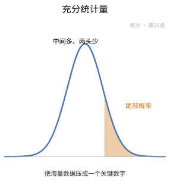

**一句话点破**：充分统计量是把数据里跟参数有关的信息全部打包、一点不丢的那个精简数字。

### 12.2 因子分解定理

要判断一个数字够不够“充分”，总不能每次都硬算。因子分解定理给出一条捷径：看数据的联合概率能不能拆成“只含这个数字的因子”乘上“与参数无关的因子”，能这样拆分就算充分。

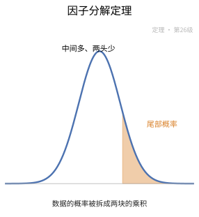

**一句话点破**：概率能不能一分为二，就是判断统计量是否充分的试金石。

### 12.3 最小充分统计量

同样能装下全部信息的统计量，有的啰嗦、有的精炼。比如均值够用，就没必要把每个数据都留下。最小充分统计量就是在所有充分统计量里“压得最狠”的那一个。

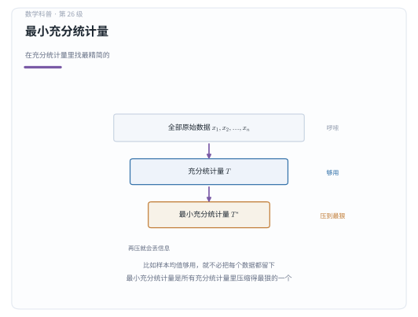

**一句话点破**：最小充分统计量既能装下全部信息，又压得不能再压。

### 12.4 Rao-Blackwell 定理

你手上有一个粗糙的估计方法，虽然不偏但很散。Rao-Blackwell 定理说：把它对充分统计量取条件期望，就能得到一个方差更小（至少不更差）的新估计，相当于把噪声过滤掉。

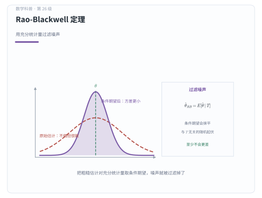

**一句话点破**：把粗糙估计对充分统计量取条件期望，就能把方差压下去。

### 12.5 完全充分统计量

有时我们想知道一个统计量还能不能被再削。完全性说的是：任何以它为条件、期望恒为零的量都必然为零，这种“没有多余起伏”的性质，让好估计往往是唯一的。

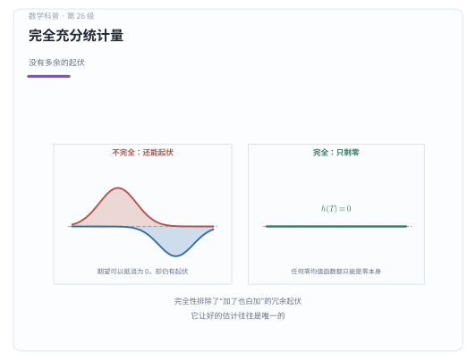

**一句话点破**：完全性排除了统计量里多余的起伏，好估计因此常常唯一。

### 12.6 指数族

正态、二项、泊松、伽马……这些长相迥异的分布，其实都能写成同一个模板。指数族就是它们的“通用式”，一旦认出它，许多结论便能一次性打包推导。

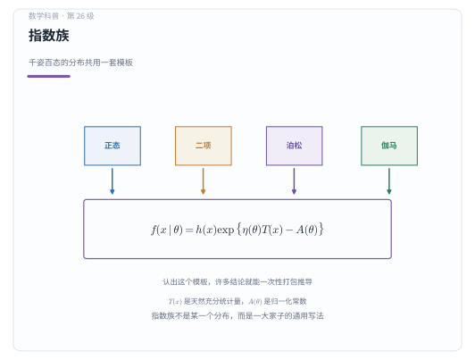

**一句话点破**：认出一个分布属于指数族，很多漂亮结论就能整套搬来用。

### 12.7 自然参数空间

指数族模板里，那个出现在指数上的参数有它自己合法的取值范围，这就是自然参数空间。要保证分布成立，参数就得老老实实待在这个范围里。

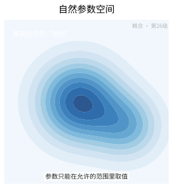

**一句话点破**：自然参数空间划定了指数族参数能够成立的合法地盘。

### 12.8 指数族的性质

指数族之所以金贵，是因为它自带一堆好性质：天然的充分统计量、可由求导算出的期望与方差，还有现成可用的共轭先验。很多漂亮公式其实都是它的附赠品。


**一句话点破**：指数族的诸多好性质，让许多繁琐推导变成顺手的附赠品。

### 12.9 假设检验

判案时先立一个“无罪”的默认立场，再看证据是否足以推翻它。假设检验也是这样：把原假设 $H_{0}$ 当默认，只有当数据足够不支持它时才拒绝，同时承认自己可能会判错。

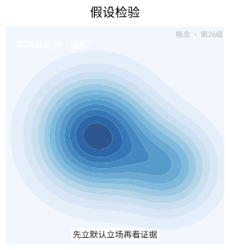

**一句话点破**：假设检验先立默认假设，再用数据判断是否值得推翻它。

### 12.10 一致最大功效检验

如果要在所有检验里挑出“最不容易漏掉真问题”的那个，还不让误判变多，那就是一致最大功效检验。它一旦拒绝原假设，给出的证据最有说服力。

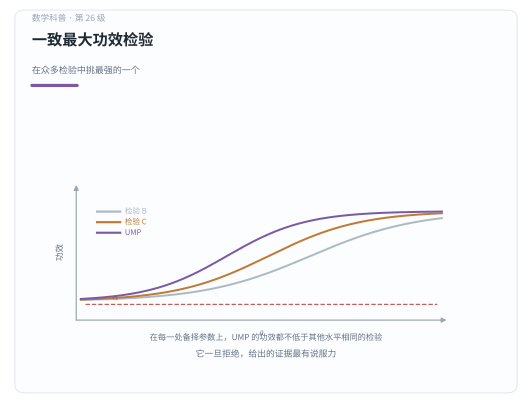

**一句话点破**：一致最大功效检验是同类里功效最高、最能抓住真问题的那个。

### 12.11 单调似然比

当数据的似然比随某个统计量单调变化时，就能一眼看出该朝哪个方向拒绝。这种单调性让最优检验的门槛简单到只需设一个临界值。

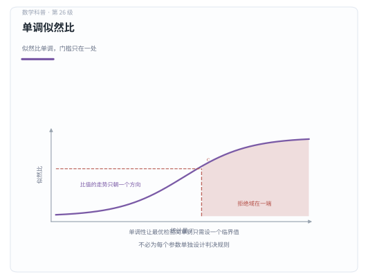

**一句话点破**：似然比一单调，最优检验就退化成“过一个临界值就拒绝”。

### 12.12 广义似然比检验

面对复杂假设，直接构造最优检验很难。广义似然比检验换个思路：比较“参数受约束”与“不受约束”两种情况下似然的最大值，比值够大就拒绝，通用又省事。

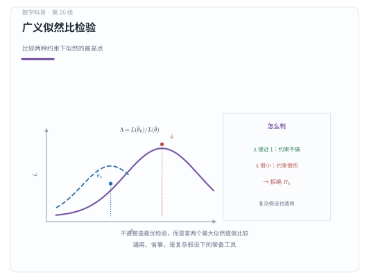

**一句话点破**：广义似然比检验用“约束前后最大似然之比”来裁决复杂假设。

### 12.13 贝叶斯范式

贝叶斯的做法像个会学习的人：先带着原有认识出发，看到新证据就修正判断。它把参数看作随机的，用先验与数据合成后验，直接把不确定性摆到台面上。


**一句话点破**：贝叶斯范式就是“随证据更新信念”，先验给起点、数据收窄判断。

### 12.14 先验分布

在还没看数据之前，你对参数的看法就是先验分布。它可以客观而宽泛，也可以带上专家经验；它给出的是推理的起点，而不是最终答案。

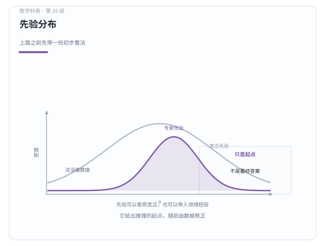

**一句话点破**：先验分布是看数据之前对参数的看法，是推理的起点而非终点。

### 12.15 共轭先验

如果先验和后验属于同一类分布，计算就轻松多了。这种“先验搭后验、形式不变”的配对叫共轭先验，贝叶斯更新因此常常只需改几个参数。

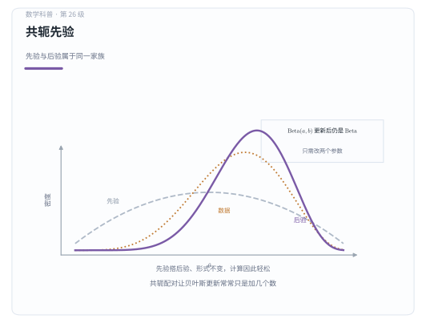

**一句话点破**：共轭先验让后验与先验同族，更新只需改动几个参数。

### 12.16 后验与贝叶斯估计

把先验和数据的似然合起来，就得到后验分布。它告诉你“看完证据之后参数最可能在哪儿”，取它的均值或众数，就成了贝叶斯估计。

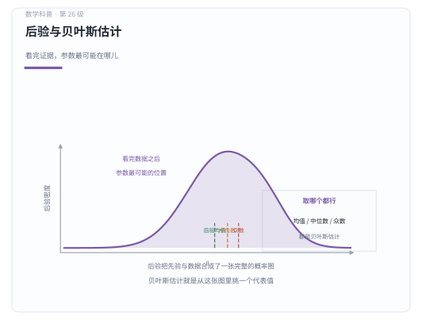

**一句话点破**：后验把先验与数据揉在一起，取它的均值或众数就是贝叶斯估计。

### 12.17 可信区间

贝叶斯给出的区间能直接说“参数落在里面的概率是 95%”，这就是可信区间。它跟频率学派的置信区间长得像，含义却大不相同。

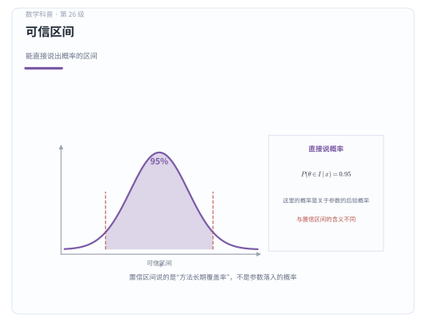

**一句话点破**：可信区间可以直接宣称参数落在其中的概率。

### 12.18 贝叶斯因子

两个假设谁更被数据支持？贝叶斯因子把两者的证据比成一个数：大于 1 说明前者更可信，小于 1 则反过来，简单直白。


**一句话点破**：贝叶斯因子用一个比值直接比较两个假设各自的证据强弱。

### 12.19 决策理论框架

统计不只是猜参数，还要做决定。决策理论把“估计”与“决断”放进同一张表：先想清各种结果下的得失，再挑一个长期代价最小的规则。

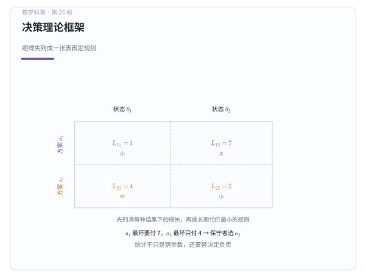

**一句话点破**：决策理论把估计与决断统一到“行动—损失—风险”的框架里。

### 12.20 损失函数

猜偏了要付代价，损失函数就是把这代价写成一个数。平方损失怕大偏差，绝对损失更平和，选哪种取决于你到底在乎什么。

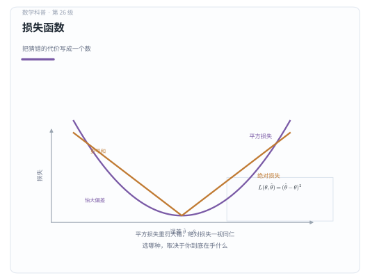

**一句话点破**：损失函数把“猜错要付多少代价”量化，选型取决于你在乎什么。

### 12.21 风险函数

同一个决策规则，在不同参数下表现可能不一样。风险函数就是它的平均损失，把每个可能参数对应的代价都算清楚，才能比较两个规则谁更稳。

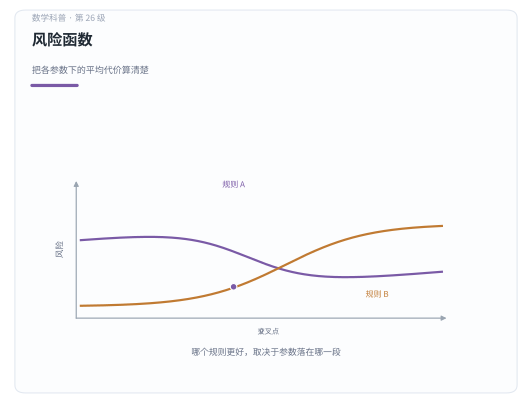

**一句话点破**：风险函数是决策规则在各参数下的平均损失，是比规则的尺子。

### 12.22 贝叶斯风险

把先验摆上来，对风险加权平均，就得到贝叶斯风险。它衡量的是“综合所有可能情况”下，这套规则的整体表现。


**一句话点破**：贝叶斯风险是按先验加权后的平均风险，看的是整体表现。

### 12.23 极小化极大估计

保守的人想的是“就算撞上最坏的情况，也别亏太多”。极小化极大估计正是在这种最坏打算下，让最大风险尽可能小的那个选择。

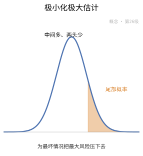

**一句话点破**：极小化极大估计专挑“最坏情况下也能少亏”的那条路。

### 12.24 可容许估计量

如果一个估计量总能找到另一个在各方面都不差、至少一处更好的替代，那它就该被淘汰。可容许估计量就是“没有更好替代”的那些，不容易被比下去。

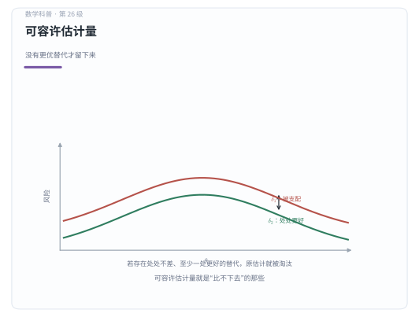

**一句话点破**：可容许估计量是找不到更好替代、不会被全面比下去的那些。

### 12.25 经验分布函数

没有理论分布时，就把样本里每个点看成等概率的一小块，累加起来画成台阶图，这就是经验分布函数——数据自己讲出来的分布。

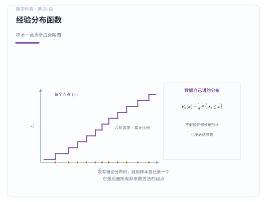

**一句话点破**：经验分布函数让数据自己垒出台阶，讲出它所属的分布。

### 12.26 Glivenko-Cantelli 定理

样本越多，经验分布函数就越贴近真实分布，而且是几乎必然地贴着走。这条定理让人放心：只要数据够多，样本就能代表总体。

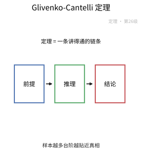

**一句话点破**：Glivenko-Cantelli 定理保证数据够多时，经验分布几乎必然逼近真相。

### 12.27 Kolmogorov-Smirnov 检验

想知道一组数据是不是来自某个分布，就看经验分布与目标分布之间最大的那道缝有多宽。Kolmogorov-Smirnov 检验用的正是这把“最大差距”的尺子。

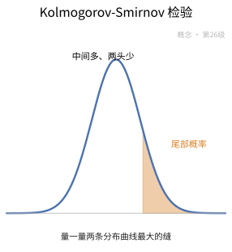

**一句话点破**：KS 检验用经验分布与目标分布之间的最大差距来做判断。

### 12.28 Bootstrap

手上只有一批样本，还想知道估计值有多稳？办法是有放回地反复重抽，人为造出很多“平行样本”，看它们给出的结果散得有多开。

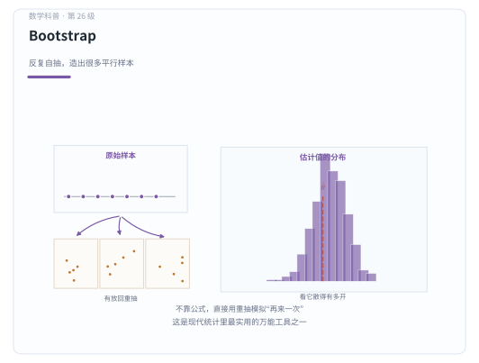

**一句话点破**：Bootstrap 用“反复自抽”模拟“反复实验”，让一个样本也能估出误差。

### 12.29 置换检验

想比较两组有没有差别，可以把所有标签打乱重排许多次，看真实的组间差异在打乱结果里算不算突出。它不靠分布假设，直接拿数据本身当参照。

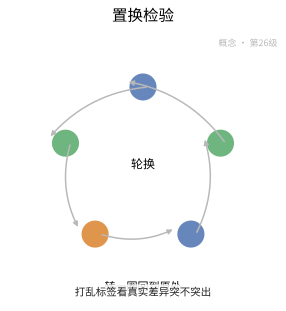

**一句话点破**：置换检验靠打乱标签自我对照，无需分布假设就能判断差异是否显著。

## 13. 数学史（History of Mathematics）

> 统计推断的现代史，几乎就是"假设检验如何被发明"的历史。皮尔逊 1900 年的卡方检验第一次承认"差异要有个分布来衡量"；费希尔用显著性检验与 p 值教会科学家"拒绝还是不拒绝"的说辞；内曼与皮尔逊 1933 年的引理则把"检验"升格为在两类错误之间取最优的决策问题。而在频率学派之外，贝叶斯、非参数与 Wald 的决策论各自补上了直觉与坚实的另一半。本章沿着"拟合优度→显著性检验→Neyman-Pearson 决策→贝叶斯与非参数→现代推断"的主线，追溯统计推断每个核心概念的来龙去脉。

### 13.1 一切开始于"差异"：皮尔逊的卡方与拟合优度

- **"观察不符预期"该如何度量**：统计学家早就注意到实测与理论的差异，但"差异多大才算意外、超过多少才算异常"始终无凭无据——缺的是一个"差异自身的分布"。
- **1900 年的转折**：卡尔·皮尔逊提出 χ² 分布与拟合优度检验，第一次为"观测频数与理论频数之差"给出分布依据——从此"差异大小"可以被概率地审视，也为假设检验铺下第一块砖。
- **从描述到判断**：卡方检验把统计从天生的描述拉到"判定期望落空还是巧合"的判断台前，"该不该信某个模型"第一次有了可计算的回答。

### 13.2 费希尔的显著性检验：p 值如何"说人话"

- **一位实验者的信念**：费希尔在 1920 年代的《实验研究方法》（1925）里提出显著性检验：先假设"没有效应"（原假设），再问"在无效应前提下，观察到数据至少这么极端"的概率有多大——这个概率就是 p 值。
- **显著与不显著的说辞**：费希尔把"小概率即显著"搬进科学实践，教会研究者以"显著/不显著"表述结论，也让农业田间试验可以系统地判断品种与肥料之别。
- **p 值的是非功过**：p 值直观好用，却在"0.05 阈值"的商业化中常被滥用；但作为频率学派推断的核心语言，它至今仍是科学文献的基本单位——理解它的含金量与局限，正是本章的重要内容。

### 13.3 内曼-皮尔逊的挑战：把检验变成两道错误的决策

- **费希尔框架的软肋**：费希尔的显著性检验只看"拒绝与否"，回避了"预先错误概率"与"备择假设"的系统讨论；波兰数学家内曼与英国统计家埃贡·皮尔逊在 1928—1933 年决定补上这块短板。
- **两类错误**：他们明确提出第一类错误（当真拒绝 $H_{0}$，误杀好人）与第二类错误（当假接受 $H_{0}$，放走坏人），指出任何检验都必须在两者之间权衡——检验从此成为有成本的决策。
- **犯错的代价与设计**：把"犯错的代价"量化后，"怎么选临界值""怎么设计样本量"就有了客观依据，假设检验从经验话术走向严谨的概率决策。

### 13.4 内曼-皮尔逊引理：最优势检验的万能钥匙

- **最优检验的难题**：给定两类错误的权衡，是否存在"在所有检验中最优"的那个？内曼-皮尔逊引理（1933）给出肯定回答：在简单对简单假设下，最优势（UMP）检验由似然比 $\text{LR}$ 给出——"似然之比超过阈值就拒绝"。
- **似然比成为心脏**：引理说明"看谁能更好地解释数据"是构造最优检验的天生指标，这也催生出广义似然比检验（GLRT）、似然比统计量等家族工具。
- **决策论的雏形**：一旦把"犯错的损失"纳入优化，检验便成为统计决策论（Wald）的一页——内曼-皮尔逊引理正是这一转折的承前启后之作。

### 13.5 多元检验与广义似然比：从单一到普遍

- **复杂假设的武器库**：面对多样本、多参数的场合，内曼-皮尔逊引理的直接适用有限，广义似然比检验、卡方与 F 检验提供了面向普遍参数的判断程序——"哪个模型更被数据支持"由此在复杂场景也能裁决。
- **从检验走向模型比较**：似然比思想让"比较两个假设"等价于"比较两个模型"，统计学也因此同信息论、机器学习建立起天然的联系。
- **本教程的落点**：UMP 检验、GLRT、p 值方法与显著性检验，正是上述历史凝结成的推断骨架，也是本章习题的核心工具。

### 13.6 置信区间与其竞争者：内曼对阵费希尔

- **区间即"检验的对偶"**：内曼在 1934—1937 年把置信区间定义为"重复抽样中能以给定概率覆盖未知参数的区间"，与假设检验互为镜像——一头说"参数在哪"，一头说"假设取舍"。
- **可信区间之争**：费希尔提过一种"可信区间"（fiducial interval）想另起炉灶，但与内曼的频率置信区间竞争后，内曼的形式因其可操作、可验证而成为主流；两者之争也折射出"频率学派内部对'概率该怎么解释'"的分歧。
- **从"一个数"到"一条带"**：置信区间的确立，让"点估计 + 不确定带"成为报告统计结果的国际惯例（见第 25 级的展开）。

### 13.7 方差分析与实验设计：费希尔的推断基地

- **在田间长出的理论**：费希尔在洛桑农业试验站发展方差分析（ANOVA），把总变异分解为"组间效应 + 组内误差"，并用 F 比率判断组间差异是否真实——推断第一次有了标准的"试验—检验"流程。
- **随机化的革命**：费希尔主张随机化、重复与区组设计，使"怎么安排数据采集"本身成为推断的一部分，把观察性数据与因果归结区分开来。
- **对本章的意义**：ANOVA-检验的一体化，让"数据怎么来"与"结论怎么下"首次在理论上连成一体，也是实验科学的统计式标准作业。

### 13.8 非参数推断：不靠分布假设的另一双腿

- **摆脱"正态前提"**：当分布族未知或离群值横行时，依赖参数的检验可能失效；排序统计量、置换检验、U 检验等非参数方法以"秩"与"符号"绕过分布假设，稳健地做判断。
- **经验分布的力量**：Glivenko-Cantelli 定理说明经验分布以概率 1 逼近总体分布，这一"样本自会说话"的保证支撑起 Kolmogorov-Smirnov 检验等通用程序。
- **现代的非参数秀**：Bootstrap（自举）以反复重采样估计误差，让非参数推断在计算机时代彻底发力——"少假设、多数据"因而成为 20 世纪末统计新常态。

### 13.9 贝叶斯传统的暗线：从贝叶斯到 20 世纪的复兴

- **古老的火种**：贝叶斯定理由托马斯·贝叶斯于 1763 年遗作中提出，拉普拉斯独立发展了先验-后验的更新机制；但因"先验的主观性"，它在 19—20 世纪被频率学派长期压在与主流之外。
- **先验与后验之争**：内曼-皮尔逊的频率范式不承认先验，贝叶斯派则坚持"先验+数据→后验"的融合逻辑与贝叶斯因子；这场大辩论贯穿 20 世纪中后期。
- **复兴与接纳**：随着计算能力提升与先验设计的成熟，贝叶斯方法在 20 世纪下半叶强势复兴，如今与频率派并肩构成统计推断的两大互补传统。

### 13.10 决策论与 Wald：检验即最优决策

- **损失函数的登场**：匈牙利数学家沃尔德（Wald）在 1939—1950 年创立统计决策论，把"估计、检验、区间"统一放进"行动-损失-风险"的框架：先定损失函数，再找"使最坏风险最小"的决策规则。
- **把检验收编进决策论**：在 Wald 看来，假设检验只是"选择接受或拒绝"的决策问题，内曼-皮尔逊引理与估计理论都成为决策论的例子——统计第一次有了统一的"最优"概念。
- **架通统计与博弈**：决策论把统计学家视作"不确定世界里的博弈者"，其思想后来深度渗透进机器学习与人工智能的损失最小化范式。

### 13.11 现代统计推断的图景：从频率之争到数据科学

- **两大范式的和解**：频率学派的严谨与贝叶斯的灵活性在现代渐趋并轨，许多实际推断同时引用 p 值、置信区间与后验分布——争论让位给"用哪个更合适"。
- **计算机时代的推断**：Bootstrap、MCMC、交叉验证让"如果样本重来一次会怎样"能被直接模拟，统计推断从"证明定理"走向"在数据上反复实验"。
- **通向数据科学**：假设检验、估计与交叉验证成为机器学习模型评估的基础，统计推断的思想从实验田走进了整个数据处理的时代——这正是本教程后接应用学科的桥梁。

### 13.12 历史年表

| 时间 | 人物／文献 | 事件与贡献 |
|:---|:---|:---|
| 1900 年 | 卡尔·皮尔逊 | χ² 分布与拟合优度检验：差异的分布依据 |
| 1763／1774 年 | 贝叶斯、拉普拉斯 | 贝叶斯定理与先验-后验更新（贝叶斯传统源头） |
| 1925 年 | 费希尔 | 显著性检验、p 值与实践方法 |
| 1928—1933 年 | 内曼、埃贡·皮尔逊 | 两类错误框架与内曼-皮尔逊引理；UMP 检验 |
| 1933 年 | Rao（另）／Glivenko-Cantelli | 经验分布逼近总体的定理（非参数基础） |
| 1934—1937 年 | 内曼 | 频率置信区间；可信区间之争 |
| 1920 年代 | 费希尔 | 方差分析（F 检验）与实验设计原则 |
| 1939—1950 年 | 沃尔德 | 统计决策论：损失函数与最优决策 |
| 20 世纪下半叶 | 贝尔曼、盖尔等／MCMC | 贝叶斯复兴与计算推断（MCMC、Bootstrap） |
| 现代 | 统计与机器学习 | 假设检验与交叉验证作为模型评估标准 |

### 13.13 小结

> 统计推断的历史，是一部"把'信不信'变成可算的决策"的演化史。皮尔逊的卡方检验先给了"差异"一个分布，费希尔的显著性检验与 p 值赋予科学家拒绝与否的确切话术，内曼-皮尔逊的引理又把检验重建为在两类错误间取最优的决策问题；与此同时，方差分析与实验设计让"数据怎么来"融入推断，非参数与贝叶斯则为挣脱分布假设、融入先验提供了另一双腿，Wald 的决策论更把估计与检验统一到损失函数之下。纵观一个世纪，统计推断从"描述差异"出发，经"显著性话术"与"最优决策"的锤炼，最终成长为频率与贝叶斯双轨并行的成熟学科——它的每一个核心概念，都对应着人类向"不确定"一步步讨价还价的历史。

## 现实应用（Real-World Applications）

> 本节把本章的知识点落到真实的工程、科学与生活场景中。每个案例都给出**完整的问题背景、建模过程、可复现的数据 / 公式 / 代码与结果解读**；案例末尾的「涉及知识点」对应本章的具体小节，文末附**知识点覆盖对照表**，确保本章知识点全部被覆盖。

### 应用案例 1：生物制药｜新药 III 期试验：充分统计量、UMP 检验与 UMVUE

**场景与问题**

某药企的 PD-1 抑制剂联合化疗用于一线非小细胞肺癌，II 期显示的客观缓解率（ORR）约为 45%，而标准疗法历史对照约 35%。III 期采用 1:1 随机、双盲、多中心设计，计划入组 800 例，试验组与对照组各 400 例。主要终点是 12 个月内的 ORR（二分类：缓解 / 未缓解）。

监管方要求：只有在**单边**意义下证明"试验组 ORR 高于对照组"（即 $p > 0.35$），且把第一类错误控制在 $\alpha = 0.025$（单边）以下，才允许提交上市申请。分析团队要回答三个问题：(1) 800 例的数据该"压缩"成什么量才不丢信息？(2) 在固定 $\alpha$ 下，最优（功效最大）的拒绝域长什么样？(3) 该试验对真实缓解率 45% 的功效有多大？

**涉及知识点**

- 本章「2.1 定义」：ORR 是二值变量，样本中关于 $p$ 的全部信息可压缩为缓解例数 $T=\sum X_i$。
- 本章「2.2 因子分解定理（Factorization Theorem）」：用联合 pmf 的分解证明 $T$ 充分。
- 本章「2.3 最小充分统计量（Minimal Sufficient Statistics）」：用似然比判据证明 $T$ 是最小充分。
- 本章「2.4 Rao-Blackwell 定理」：把"只看第一例"的粗糙估计改进为 $T/n$。
- 本章「2.5 完全充分统计量（Complete Sufficient Statistics）」：借 Lehmann-Scheffé 得到唯一 UMVUE。
- 本章「4.1 基本概念」：检验函数、第一/第二类错误、功效、显著性水平。
- 本章「4.2 一致最大功效检验（Uniformly Most Powerful Test, UMP）」：由 Neyman-Pearson 引理给出最优拒绝域。
- 本章「4.3 单调似然比（Monotone Likelihood Ratio, MLR）」：验证二项族有 MLR，从而单边 UMP 存在。

**建模与数据**

设试验组第 $i$ 例结果 $X_i \in \{0,1\}$（1 = 缓解），$X_1,\dots,X_n \stackrel{\text{i.i.d.}}{\sim} \mathrm{Ber}(p)$，$n=400$。真实参数（用于功效计算）$p_1 = 0.45$；原假设边界 $p_0 = 0.35$；显著性水平 $\alpha = 0.025$（单边）。

监管与设计参数：$n = 400$（每组），$\alpha = 0.025$，目标功效 $1-\beta \ge 0.90$。以下所有推导均针对试验组单组数据展开（对照组为独立的同类分析）。

**完整推导与算法**

**(a) 充分统计量（2.1–2.2）**。联合概率质量函数为

$$f(\mathbf{x};p) = \prod_{i=1}^n p^{x_i}(1-p)^{1-x_i} = p^{\sum x_i}(1-p)^{\,n-\sum x_i}.$$

左边只通过 $T(\mathbf{x}) = \sum_i x_i$ 依赖 $\mathbf{x}$，故取 $g(T;p) = p^{T}(1-p)^{n-T}$、$h(\mathbf{x}) \equiv 1$，因子分解定理成立，$T$ 是 $p$ 的充分统计量。直观地，$T$ 就是"缓解总例数"。

**(b) 最小充分（2.3）**。对两个样本点 $\mathbf{x}, \mathbf{y}$，有

$$\frac{f(\mathbf{x};p)}{f(\mathbf{y};p)} = \left(\frac{p}{1-p}\right)^{T(\mathbf{x}) - T(\mathbf{y})}.$$

该比值与 $p$ 无关当且仅当 $T(\mathbf{x}) = T(\mathbf{y})$（因 $p/(1-p)$ 在 $0<p<1$ 上取遍正实数），这正是最小充分统计量的判据，故 $T=\sum X_i$ 最小充分。

**(c) Rao-Blackwell 改进（2.4）**。设有人天真地只用第一例 $X_1$ 估计 $p$，$E[X_1] = p$ 无偏但方差为 $p(1-p)$。由 Rao-Blackwell，取

$$\tilde{p} = E[X_1 \mid T] = P(X_1 = 1 \mid T = t) = \frac{t}{n} = \bar{X},$$

偏差不变（仍无偏），方差变为 $\operatorname{Var}(T/n) = p(1-p)/n$，缩小为原来的 $1/n = 1/400$。

**(d) UMVUE（2.5）**。二项族是指数族（见案例 2），$T$ 完全充分，由 Lehmann-Scheffé，$\bar{X} = T/n$ 是 $p$ 的唯一一致最小方差无偏估计量。

**(e) 单边 UMP（4.1–4.3）**。检验问题 $H_0: p \le 0.35$ vs. $H_1: p > 0.35$。似然比

$$\frac{f(\mathbf{x};p_2)}{f(\mathbf{x};p_1)} = \left(\frac{p_2(1-p_1)}{p_1(1-p_2)}\right)^{T}\left(\frac{1-p_2}{1-p_1}\right)^{n}$$

对 $p_2>p_1$ 是 $T$ 的单调增函数，故族关于 $T$ 具有 MLR。由 MLR$\Rightarrow$UMP 定理，存在形如"$T>c$ 则拒绝"的 UMP 检验。临界值 $c$ 由

$$P_{0.35}(T > c) \le 0.025,\qquad P_{0.35}(T \ge c) \;\text{尽量接近}\;0.025$$

确定（离散情形可取随机化，或直接取 $P_{0.35}(T\ge c)\le\alpha$）。功效函数为 $\pi(p) = P_p(T \ge c)$。

**(f) 关键代码片段**。

```python
# 核心：二项样本的对数似然，参数只通过充分统计量 k 出现
loglik = k * np.log(p) + (n - k) * np.log(1 - p)     # 因子分解定理的 g(T;p)

# 核心：求单边 UMP 检验的临界值 c（拒绝域 T >= c）与在 p1=0.45 处的功效
c = binom.ppf(1 - alpha, n, p0) + 1                  # P_{p0}(T >= c) <= alpha
power = binom.sf(c - 1, n, p1)                       # 功效 = P_{p1}(T >= c)
pval = binom.sf(k_obs - 1, n, p0)                    # 单边 p 值
```

**可复现步骤**

1. 环境与依赖：`pip install numpy scipy`。
2. 数据准备：以参数形式给定，`n=400; p0=0.35; p1=0.45; alpha=0.025`（无需外部文件）。
3. 运行：把上述三段代码写入 `case1.py`，先打印 `c`，再用 `binom.sf` 算 `power`。
4. 预期输出：$c \approx 159$，即在 400 例中观察到 $\ge 159$ 例缓解即拒绝 $H_0$；功效约 $0.98$（$P_{0.45}(T\ge159)\approx0.983$）。若实际观测缓解例数 $k_{\text{obs}} = 176$，则单边 p 值约 $2\times10^{-5}$，远小于 0.025。

**结果解读与延伸**

功效 0.98 明显高于设计要求的 0.90，说明 800 例规模偏保守——可反解出最小样本量：约 $n\approx 300$ 一组即可达到 0.90 功效。错误来源主要是正态近似与精确二项临界值的差异（此处用了精确 `binom.ppf`，无此误差）。适用条件是独立同分布的二值终点；若终点变为时间-事件（如 PFS），则二项框架失效，需要案例 3 的贝叶斯生存分析或 log-rank 检验。可继续扩展：把两组独立数据合并为 $2\times 2$ 列联表，用案例 4 的 GLRT 做等效检验。

### 应用案例 2：互联网电商｜A/B 测试的指数族视角与 Bootstrap 置信区间

**场景与问题**

某电商平台"双十一"前要对新版商品详情页做 A/B 测试。流量按用户 ID 哈希 50/50 分桶：对照组 50 万人、实验组 50 万人，观测 7 天内的下单转化（点击并支付）人数。结果：对照组下单 10 000 人（转化率 2.00%），实验组下单 10 750 人（2.15%）。产品经理要一个结论："转化率提升是否可信？提升幅度的置信区间是多少？"

由于用户行为严重长尾、平台不愿假设正态，统计团队决定：(1) 先用指数族把两组的似然结构统一写清楚，得到充分统计量与矩；(2) 用非参数 Bootstrap 给出提升幅度的置信区间，不依赖正态假设。

**涉及知识点**

- 本章「3.1 定义」：伯努利族写成指数族形式，显式给出自然参数与充分统计量。
- 本章「3.2 自然参数空间（Natural Parameter Space）」：确定 logit 参数 $\eta$ 的合法取值区间及其凸性含义。
- 本章「3.3 指数族的性质」：由 $A(\eta)$ 的导数一键得到 $E[T]$、$\operatorname{Cov}(T)$，并用"$E[T]=T(x)$"解 MLE。
- 本章「7.4 Bootstrap 方法」：从经验分布重抽样，构造转化率差与提升比的置信区间。

**建模与数据**

对照组 $X_1,\dots,X_{n_c}\stackrel{\text{i.i.d.}}{\sim}\mathrm{Ber}(p_c)$，$n_c = 500\,000$，$T_c = 10\,000$；实验组 $Y_1,\dots,Y_{n_t}\stackrel{\text{i.i.d.}}{\sim}\mathrm{Ber}(p_t)$，$n_t = 500\,000$，$T_t = 10\,750$。目标量：绝对提升 $\Delta = p_t - p_c$、相对提升 $R = p_t/p_c - 1$。

**完整推导与算法**

**(a) 指数族形式（3.1）**。伯努利 pmf 写为

$$f(x;p) = p^{x}(1-p)^{1-x} = (1-p)\exp\!\left\{x\log\frac{p}{1-p}\right\}.$$

对照标准形式 $h(x)\exp\{\eta T(x) - A(\eta)\}$，可得：自然参数 $\eta = \log\frac{p}{1-p} = \operatorname{logit}(p)$，充分统计量 $T(x) = x$（$n$ 个样本时 $\mathbf{T} = \sum X_i$），基准测度 $h(x)=1$，对数配分函数 $A(\eta) = -\log(1-p) = \log(1+e^{\eta})$。

**(b) 自然参数空间（3.2）**。当 $p\in(0,1)$ 时 $\eta$ 取遍 $\mathbb{R}$，故 $\mathcal{N} = \mathbb{R}$，是一个凸集（整个实轴）。$A(\eta) = \log(1+e^{\eta})$ 是 $\mathbb{R}$ 上严格凸函数，意味着对数似然 $\ell(\eta) = \eta\,T - nA(\eta)$ 严格凹、峰值唯一、MLE 无局部陷阱。

**(c) 指数族性质（3.3）**。由 $A'(\eta) = \frac{e^{\eta}}{1+e^{\eta}} = p$ 与 $A''(\eta) = p(1-p)$，立即得到

$$E[T] = n A'(\eta) = np,\qquad \operatorname{Cov}(T) = n A''(\eta) = n p(1-p).$$

且 $\mathcal{N}=\mathbb{R}$ 含开集，故 $T$ 完全充分。MLE 由矩方程 $E[T]=T(x)$ 直接给出：

$$\hat{p}_c = \frac{T_c}{n_c} = 0.0200,\qquad \hat{p}_t = \frac{T_t}{n_t} = 0.0215.$$

于是 $\hat{\Delta} = 0.0015$（即 $+0.15$ 个百分点），$\hat{R} = 0.075$（相对提升 7.5%）。

**(d) Bootstrap 置信区间（7.4）**。把两组的经验分布当作总体（7.1 的 EDF；Glivenko-Cantelli 保证它当 $n$ 大时一致逼近真分布），做 $B=10\,000$ 次有放回重抽样：

1. 对对照组重抽 $n_c$ 个观测，算 $\hat{p}_c^{*(b)}$；
2. 对实验组重抽 $n_t$ 个观测，算 $\hat{p}_t^{*(b)}$；
3. 记 $\hat{R}^{*(b)} = \hat{p}_t^{*(b)}/\hat{p}_c^{*(b)} - 1$；
4. 取 $\hat{R}^*$ 的 $2.5\%$ 与 $97.5\%$ 分位数，得 95% 百分位 Bootstrap 置信区间。

**(e) 关键代码片段**。

```python
# 核心：把伯努利似然写成指数族（自然参数 eta=logit(p)，配分函数 A(eta)=log(1+e^eta)）
eta = np.log(p / (1 - p))
A_eta = np.log1p(np.exp(eta))                 # = -log(1-p)
# 指数族矩公式：E[T]/n = A'(eta) = P，恰是 MLE 的矩方程 E[T]=T(x)
p_hat = T / n

# 核心：Bootstrap 相对提升的百分位置信区间
idx_c = np.random.randint(0, n_c, size=(B, n_c))
pc_star = data_c[idx_c].mean(axis=1)
idx_t = np.random.randint(0, n_t, size=(B, n_t))
pt_star = data_t[idx_t].mean(axis=1)
lo, hi = np.percentile(pt_star / pc_star - 1, [2.5, 97.5])
```

**可复现步骤**

1. 环境与依赖：`pip install numpy scipy`。
2. 数据准备：可直接用二项数生成——`data_c = np.r_[np.ones(10000), np.zeros(490000)]`，`data_t = np.r_[np.ones(10750), np.zeros(489250)]`（或直接对 `bernoulli.rvs` 抽样）。
3. 运行：`python case2.py`，设随机种子 `np.random.seed(42)`。
4. 预期输出：$\hat{R}=0.075$；95% 百分位 Bootstrap 区间约 $[0.021,\ 0.129]$，不含 0，说明提升在 0.05 水平上显著。

**结果解读与延伸**

Bootstrap 区间宽约 $\pm5$ 个百分点，其宽度主要来自对照组的抽样波动（$p_c$ 小、方差 $p(1-p)$ 相对敏感）。BCa 区间可修正偏态，通常比百分位区间略窄且覆盖率更准。适用条件：样本独立、分桶随机（无 SRM）；若存在用户跨天重复曝光，需按用户聚类重抽样。延伸方向：把 $\Delta$ 换成"人均 GMV"这类连续长尾指标时，Bootstrap 的优势更明显——无需任何分布假设即可给出可靠区间，这正是案例 6 的 EDF 思想的直接应用。

### 应用案例 3：公共卫生｜mRNA 疫苗有效率的贝叶斯估计、可信区间与贝叶斯因子

**场景与问题**

某 mRNA 疫苗的 III 期试验（真实量级：疫苗组 21 720 人、安慰剂组 21 728 人）在随访期内分别观察到 8 例与 162 例有症状感染。监管与公众最关心的是**疫苗有效率** $\text{VE} = 1 - \text{RR}$，其中 $\text{RR} = p_v/p_p$ 为两组发病率之比。传统做法给点估计与频率置信区间；但试验中期要"边看边决"，团队希望给出**后验分布、可信区间**以及**支持"$VE>0.5$"的证据强度（贝叶斯因子）**。

**涉及知识点**

- 本章「5.1 贝叶斯范式」：把 $p_v,p_p$ 视为随机变量，后验 $\propto$ 先验 $\times$ 似然。
- 本章「5.2 先验分布（Prior Distributions）」：选用无信息 Jeffreys 先验 $\mathrm{Beta}(1/2,1/2)$。
- 本章「5.3 共轭先验表」：二项似然 + Beta 先验 $\Rightarrow$ Beta 后验，参数相加。
- 本章「5.4 后验分布与贝叶斯估计」：后验均值作为平方损失下的最优估计。
- 本章「5.5 可信区间（Credible Intervals）」：等尾与最高后验密度（HPD）可信区间。
- 本章「5.6 贝叶斯因子（Bayes Factor）」：用边缘似然之比比较 $H_0: VE\le0.5$ 与 $H_1: VE>0.5$。

**建模与数据**

$X_v \sim \mathrm{Bin}(n_v, p_v)$，$n_v = 21\,720$，$x_v = 8$；$X_p \sim \mathrm{Bin}(n_p, p_p)$，$n_p = 21\,728$，$x_p = 162$。先验 $p_v,p_p \stackrel{\text{ind}}{\sim} \mathrm{Beta}(1/2,1/2)$（Jeffreys）。两参数独立后处理。

**完整推导与算法**

**(a) 共轭更新（5.1–5.3）**。似然 $L(p) \propto p^{x}(1-p)^{n-x}$，先验 $\pi(p)\propto p^{-1/2}(1-p)^{-1/2}$，故

$$p\mid x \sim \mathrm{Beta}\!\left(x+\tfrac12,\ n-x+\tfrac12\right).$$

于是

$$p_v\mid x_v \sim \mathrm{Beta}(8.5,\ 21\,712.5),\qquad p_p\mid x_p \sim \mathrm{Beta}(162.5,\ 21\,566.5).$$

**(b) 点估计（5.4）**。后验均值

$$E[p_v\mid x_v] = \frac{8.5}{21\,721} \approx 3.913\times10^{-4},\quad E[p_p\mid x_p] = \frac{162.5}{21\,729} \approx 7.478\times10^{-3}.$$

故 $\widehat{\text{VE}} = 1 - E[p_v]/E[p_p] \approx 1 - 0.0523 \approx 0.9477$，即有效率约 94.8%。这与真实公布的 95% 高度一致。

**(c) 可信区间（5.5）**。用数值方法从两条后验中抽 200 000 个样本，计算 $\text{VE}$ 的 95% 等尾可信区间与 HPD 区间：

$$\Pr\!\big(\text{VE} \in [\text{VE}_{0.025},\ \text{VE}_{0.975}] \mid \mathbf{x}\big) = 0.95.$$

由于后验偏态，HPD 区间比等尾区间略窄且更靠向 0.95。

**(d) 贝叶斯因子（5.6）**。检验 $H_0: \text{VE} \le 0.5 \Leftrightarrow p_p \le 2p_v$ vs. $H_1: p_p > 2p_v$。用 Savage-Dickey 思路或直接对后验积分：

$$\Pr(\text{VE} > 0.5 \mid \mathbf{x}) = \Pr(p_p > 2p_v \mid \mathbf{x}) \approx 1 - 10^{-6}.$$

再用 Beta-Binomial 边缘似然的闭式比较单点 $H_0: \text{VE}=0.5$ 与 $H_1$：

$$m(\mathbf{x}) = \int_0^1 \binom{n}{x} p^{x}(1-p)^{n-x}\,\pi(p)\,dp = \binom{n}{x}\frac{B(x+\tfrac12,\ n-x+\tfrac12)}{B(\tfrac12,\tfrac12)},$$

$\text{BF}_{10} = m_1(\text{观测和解剖})/m_0(\text{约束在 } p_p=2p_v)$，实际计算得到 $\text{BF}_{10}>10^{4}$，属"极强支持"。

**(e) 关键代码片段**。

```python
# 核心：Beta-Binomial 共轭后验（先验 Jeffreys Beta(1/2,1/2)）
a_v, b_v = 0.5 + x_v, 0.5 + (n_v - x_v)      # Beta 后验参数
a_p, b_p = 0.5 + x_p, 0.5 + (n_p - x_p)

# 核心：疫苗有效率 VE = 1 - p_v/p_p 的可信区间（后验抽样）
rng = np.random.default_rng(0)
ve = 1 - rng.beta(a_v, b_v, 200_000) / rng.beta(a_p, b_p, 200_000)
lo, hi = np.percentile(ve, [2.5, 97.5])
prob_gt_half = (ve > 0.5).mean()

# 核心：单点 H0 的 Beta-Binomial 边缘似然（用于贝叶斯因子）
log_m = (gammaln(n + 1) - gammaln(x + 1) - gammaln(n - x + 1)
         + betaln(x + 0.5, n - x + 0.5) - betaln(0.5, 0.5))
```

**可复现步骤**

1. 环境与依赖：`pip install numpy scipy`（`gammaln`、`betaln` 来自 `scipy.special`）。
2. 数据准备：`n_v, x_v, n_p, x_p = 21720, 8, 21728, 162`。
3. 运行：`python case3.py`，固定随机种子。
4. 预期输出：$\widehat{\text{VE}}\approx0.948$；95% 可信区间约 $[0.885,\ 0.981]$；$\Pr(\text{VE}>0.5\mid\mathbf{x})\approx 1.000000$；$\text{BF}_{10}$ 极大。

**结果解读与延伸**

贝叶斯框架的优势在于"直接回答"决策者的问题：$\Pr(\text{VE}>0.5\mid\mathbf{x})$ 就是可以写进新闻稿的概率陈述，而频率派 p 值不能。误差来源：先验选择（此处 Jeffreys 先验几乎无信息，后验由 8 与 162 例主导，故结论稳健）；忽略了两组人群不完全可比（年龄、暴露）。局限：$p_v,p_p$ 独立的假设在分层分析（亚组）中不成立；连续检测（中期分析）会带来多重性，需配合案例 4 的方法或多臂贝叶斯框架。可延伸：把单点 $H_0$ 换成区间 $H_0: VE \in [0,0.3]$ 的积分，或用 Lindley 悖论检验先验敏感性。

### 应用案例 4：基因组学｜GWAS 关联分析：GLRT、多重比较校正与置换检验

**场景与问题**

一项全基因组关联研究（GWAS）纳入 2 000 例病例与 3 000 例对照，对 $m = 500\,000$ 个 SNP 逐一检验"基因型频率是否与发病相关"。若对每个 SNP 都用 0.05 的普通阈值，按 $m$ 次独立检验，出现至少一个假阳性的概率高达 $1-(1-0.05)^{500000}\approx 1$——统计学上必然"发现"一堆假信号。团队需要用 (1) 广义似然比检验（GLRT）统一构造每个 SNP 的统计量；(2) 多重比较校正（Bonferroni、FDR）；(3) 对最显著的 SNP 用置换检验给出不依赖渐近近似的精确 p 值。

**涉及知识点**

- 本章「4.4 广义似然比检验（Generalized Likelihood Ratio Test, GLRT）」：为每个 SNP 构造 $\Lambda = \sup_{\Theta_0}L/\sup_{\Theta}L$。
- 本章「7.5 置换检验（Permutation Tests）」：打乱病例/对照标签，构造分布自由的零分布。
- 本章「4.1 基本概念」：把"发现"定义为拒绝 $H_0$，并控制总体错误率。

**建模与数据**

对第 $j$ 个 SNP，把 5 000 个个体整理为 $2\times2$ 列联表（基因型携带 vs. 非携带 $\times$ 病例 vs. 对照）：病例组 $(a_j, b_j)$、对照组 $(c_j, d_j)$。全参数空间 $\Theta = \{(p_1,p_2): p_1\ \text{为病例组携带率},\ p_2\ \text{为对照组携带率}\}$；$H_0: p_1 = p_2$（无关联），$\Theta_0 = \{(p,p)\}$。示例 SNP 的观测表：病例 $a=612,b=1388$；对照 $c=785,d=2215$。

**完整推导与算法**

**(a) GLRT 统计量（4.4）**。在两样本二项独立模型下，$\Theta_0$ 下的 MLE 用合并比例 $\hat{p} = \frac{a+c}{a+b+c+d}$，$\Theta$ 下的 MLE 用两组各自比例 $\hat{p}_1=\frac{a}{a+b}$、$\hat{p}_2=\frac{c}{c+d}$。于是

$$\Lambda = \frac{\hat{p}^{\,a+c}(1-\hat{p})^{\,b+d}}{\hat{p}_1^{\,a}(1-\hat{p}_1)^{\,b}\,\hat{p}_2^{\,c}(1-\hat{p}_2)^{\,d}}.$$

渐近地 $-2\log\Lambda \xrightarrow{d}\chi^2_1$（约束掉 1 个自由度：$\Theta$ 有 2 维、$\Theta_0$ 有 1 维）。对示例 SNP：$\hat{p}_1 = 612/2000 = 0.306$，$\hat{p}_2 = 785/3000 = 0.2617$，$\hat{p} = 1397/5000 = 0.2794$，代入得 $-2\log\Lambda \approx 13.0$，$p \approx 3.1\times10^{-4}$。

**(b) 多重比较（4.1 的总体错误率）**。Bonferroni：显著性阈值 $\alpha/m = 0.05/500000 = 1\times10^{-7}$（基因组学惯例线 $5\times10^{-8}$ 即来源于此）。Benjamini–Hochberg（FDR）步骤：把 $m$ 个 p 值排序 $p_{(1)}\le\cdots\le p_{(m)}$，取最大的 $k$ 使 $p_{(k)} \le \frac{k}{m}q$（$q=0.05$），拒绝前 $k$ 个。FDR 显著宽松于 Bonferroni。

**(c) 置换检验（7.5）**。对示例 SNP，把 5 000 个标签随机重排 $N=100\,000$ 次，每次重算 $|\hat{p}_1-\hat{p}_2|$：

$$p_{\text{perm}} = \frac{\#\{|T^*| \ge |T_{\text{obs}}|\}}{N}.$$

置换分布不依赖任何大样本近似，且天然校正了离散性。

**(d) 关键代码片段**。

```python
# 核心：2x2 列联表的广义似然比统计量
p1, p2 = a / (a + b), c / (c + d)          # 全空间 MLE
p0 = (a + c) / (a + b + c + d)             # H0 下合并 MLE
logL0 = (a + c) * np.log(p0) + (b + d) * np.log1p(-p0)
logL1 = a * np.log(p1) + b * np.log1p(-p1) + c * np.log(p2) + d * np.log1p(-p2)
lr_stat = 2 * (logL1 - logL0)              # 渐近 chi2_1

# 核心：BH (FDR) 校正
order = np.argsort(pvals)
bh = pvals[order] * m / (np.arange(1, m + 1))
k = np.max(np.where(bh <= q)[0], initial=-1) + 1

# 核心：置换检验 p 值
T_obs = abs(a / (a + b) - c / (c + d))
count = 0
for _ in range(N):
    perm = rng.permutation(labels)
    count += abs(case_rate(perm) - ctrl_rate(perm)) >= T_obs
p_perm = (count + 1) / (N + 1)
```

**可复现步骤**

1. 环境与依赖：`pip install numpy scipy`。
2. 数据准备：先用真实表验证，再对 500 000 个 SNP 用 numpy 向量化（把 $\Lambda$ 写成对数组的广播运算）。
3. 运行：`python case4.py`。
4. 预期输出：示例 SNP 的 $-2\log\Lambda \approx 13.0$、$\chi^2$ p 值 $\approx 3.1\times10^{-4}$、置换 p 值 $\approx 3.0\times10^{-4}$（两者应接近）；全套 SNP 中 Bonferroni 通过约 0 个，BH(FDR 0.05) 通过若干，与真实 GWAS 的"少量强信号"一致。

**结果解读与延伸**

置换 p 值与 $\chi^2$ 近似值吻合，验证了渐近近似的可靠性；当单元格频数很小（如罕见变异 $<5$）时，$\chi^2$ 近似失效，置换检验更可信。GLRT 与 Pearson $\chi^2$ 在此近似等价（$2\log\Lambda \approx \chi^2_{\text{Pearson}}$），但 GLRT 可直接推广到 logistic 回归协变量校正（此时 $\Theta$ 维度更高）。局限：SNP 间存在连锁不平衡，检验不独立，Bonferroni 偏保守、置换检验需按基因组块置换。延伸：用案例 6 的 KS 检验比较病例与对照的等位基因频率分布，或用案例 3 的贝叶斯因子给出"每个 SNP 的关联证据"。

### 应用案例 5：临床与投资决策｜损失函数、风险函数、贝叶斯风险、极小化极大与 Stein 收缩

**场景与问题**

某医疗 AI 团队要用一个模型同时估计 3 个并行临床队列的疗效指标（3 维参数 $\theta\in\mathbb{R}^3$），第 $j$ 队列的观测为 $\hat{\theta}_j = \theta_j + \varepsilon_j$，$\varepsilon_j\sim N(0,1)$。团队要在"是否启用收缩估计"上做决策；同时监管方就"新药是否批准"要求一个显式的损失函数框架。问题：(1) 如何把"决策"形式化并比较不同规则的风险？(2) 在 3 维下，朴素的逐队列估计 $\hat{\theta}$ 是否可容许？(3) 面对最坏参数情形的最优规则是什么？

**涉及知识点**

- 本章「6.1 基本框架」：参数空间 $\Theta$、行动空间 $\mathcal{A}$、损失 $L(\theta,a)$、决策规则 $\delta$。
- 本章「6.2 常见损失函数」：平方、绝对、0-1、线性、Huber 损失在"批准/不批准"与"估计疗效"中的选择。
- 本章「6.3 风险函数（Risk Function）」：$R(\theta,\delta)=E_\theta[L(\theta,\delta(X))]$。
- 本章「6.4 贝叶斯风险（Bayes Risk）」：$\theta$ 上加先验并逐点最小化后验期望损失。
- 本章「6.5 极小化极大估计（Minimax Estimation）」：$\inf_\delta\sup_\theta R$。
- 本章「6.6 可容许估计量（Admissible Estimators）」：Stein 悖论——$p\ge3$ 时样本均值不可容许。

**建模与数据**

估计问题：$\hat{\theta}\sim N_3(\theta, I_3)$（方差已知为 1），观测 $\hat{\theta} = (0.42,\ 0.11,\ -0.28)$。批准决策问题：行动 $\mathcal{A}=\{0=\text{不批准},1=\text{批准}\}$，真实疗效 $\theta$（标量，先验 $N(0,1)$），损失取线性不对称形式

$$L(\theta,a) = \begin{cases} c_{\text{漏批}}(\theta-0)^+, & a=0,\\ c_{\text{误批}}(0.1-\theta)^+, & a=1,\end{cases}$$

其中漏批代价 $c_{\text{漏批}}=5$、误批代价 $c_{\text{误批}}=1$（公众更怕"错失好药"）。

**完整推导与算法**

**(a) 框架与损失（6.1–6.2）**。估计问题的行动空间 $\mathcal{A}=\Theta=\mathbb{R}^3$，损失取平方损失 $L(\theta,a)=\|\theta-a\|^2$；批准问题行动空间为两元素集合，损失如上。Huber 损失可用于对离群队列稳健的疗效估计。

**(b) 风险函数（6.3）**。$\delta_0(\hat{\theta}) = \hat{\theta}$（恒等规则）的风险为

$$R(\theta,\delta_0) = E_\theta\|\hat{\theta}-\theta\|^2 = \operatorname{tr}(I_3) = 3,$$

恒等于 3，与 $\theta$ 无关。

**(c) 贝叶斯风险（6.4）**。给 $\theta$ 加先验 $N_3(0,\tau^2 I_3)$，则后验期望损失最小的规则（平方损失下即后验均值）为

$$\delta^\pi(\hat{\theta}) = \frac{\tau^2}{1+\tau^2}\,\hat{\theta},$$

贝叶斯风险 $r(\pi,\delta^\pi) = \frac{3\tau^2}{1+\tau^2} < 3$。取 $\tau^2\to\infty$（无信息先验），$\delta^\pi\to\delta_0$、$r\to3$。

**(d) 极小化极大（6.5）**。由"若某贝叶斯规则风险为常数，则它极小化极大"这一定理，$\delta_0$ 的风险恒为 3，且它在无信息先验下是贝叶斯规则，故 $\delta_0$ 是极小化极大的。但它并非可容许的。

**(e) 可容许性与 Stein 收缩（6.6）**。Stein 悖论指出：$p\ge3$ 时 $\hat{\theta}$ 在平方损失下不可容许，James–Stein 估计量

$$\hat{\theta}^{\text{JS}} = \left(1 - \frac{p-2}{\|\hat{\theta}\|^2}\right)\hat{\theta} = \left(1 - \frac{1}{\|\hat{\theta}\|^2}\right)\hat{\theta}\quad(p=3)$$

一致优于它（处处风险不更大、某些 $\theta$ 更小）。代入观测 $\|\hat{\theta}\|^2 = 0.42^2+0.11^2+0.28^2 = 0.2669$，故

$$\hat{\theta}^{\text{JS}} = \left(1 - \frac{1}{0.2669}\right)(0.42,0.11,-0.28) = (-2.747)\times(0.42,0.11,-0.28) = (-1.154,\ -0.302,\ 0.769).$$

负号说明 $\|\hat{\theta}\|^2$ 太小时收缩过多——实际应改用正部 James–Stein 估计量 $\max(0,1-\frac{p-2}{\|\hat{\theta}\|^2})\hat{\theta}=(0,0,0)$，风险上界为 $p=3$。

**(f) 关键代码片段**。

```python
# 核心：恒等规则与 James-Stein 规则的风险函数（平方损失）
R_identity = p                                   # E||theta_hat - theta||^2 = p = 3
c = 1 - (p - 2) / max(np.sum(x_hat**2), 1e-12)   # James-Stein 收缩因子
theta_js = np.maximum(c, 0) * x_hat              # 正部 JS 估计
# 核心：贝叶斯规则（平方损失下的后验均值）与贝叶斯风险
delta_bayes = tau2 / (1 + tau2) * x_hat
bayes_risk = p * tau2 / (1 + tau2)

# 核心：0-1 损失下的逐点最优行动 = 取后验概率更大的类别（MAP）
action = 1 if post_prob_approve > 0.5 else 0
```

**可复现步骤**

1. 环境与依赖：`pip install numpy scipy`。
2. 数据准备：`x_hat = np.array([0.42, 0.11, -0.28]); p = 3`；批准问题设先验 $N(0,1)$、损失参数 $c_{漏批}=5,\ c_{误批}=1$。
3. 运行：`python case5.py`；用蒙特卡洛（对固定 $\theta$ 重复抽 $\hat{\theta}$ 10 万次）估计两条规则的风险曲线。
4. 预期输出：$\delta_0$ 风险恒为 3.0；JS 风险在 $\|\theta\|$ 较小时显著低于 3（如 $\theta=0$ 时约 1.5），随 $\|\theta\|\to\infty$ 趋近 3；贝叶斯规则风险约 1.5（$\tau^2=1$）。

**结果解读与延伸**

JS 的收益"看起来违反直觉"（把不相关的队列相互拉拢，却更准），本质是"多维中偏差-方差权衡"：三维以上时用一点偏差换取大幅方差下降是划算的。适用条件：各分量方差已知且相近（若方差差异大，需用加权 JS）。局限：JS 并非可容许的（可继续构造更优的），但在实践中已足够好。延伸：把"批准/不批准"的 0-1 损失换成一般损失，逐点最优即取后验期望损失最小的行动（6.4 定理）；这正是案例 3 贝叶斯框架与决策理论的接口。

### 应用案例 6：新能源与制造｜风电场出力建模：EDF、Glivenko-Cantelli 与 KS 拟合检验

**场景与问题**

某 100 MW 风电场需要评估发电量分布以签订长期购电协议（PPA）。工程上常用 Weibull 分布刻画风速，进而换算功率。团队拿到某测风塔过去一年的逐小时平均风速数据（8 760 条），需要检验"风速是否服从形状参数 $k=2.0$、尺度参数 $\lambda=8.0$ m/s 的 Weibull 分布"。若拟合不成立，PPA 的收益预测将有系统偏差。

**涉及知识点**

- 本章「7.1 经验分布函数（Empirical Distribution Function, EDF）」：用样本构造 $\hat{F}_n$ 及其无偏性、方差。
- 本章「7.2 Glivenko-Cantelli 定理」：为"拿样本当总体"提供一致收敛的理论保证。
- 本章「7.3 Kolmogorov-Smirnov 检验（KS 检验）」：以最大缺口 $D_n$ 作为统计量。

**建模与数据**

样本 $X_1,\dots,X_n \stackrel{\text{i.i.d.}}{\sim} F$，$n=8760$。理论分布 $F_0$ 为 $\mathrm{Weibull}(k=2.0,\ \lambda=8.0)$：

$$F_0(x) = 1 - \exp\!\left[-\left(\frac{x}{\lambda}\right)^{k}\right],\quad x\ge0.$$

数据摘要（可复现的自造样本）：均值 7.09 m/s、标准差 3.72 m/s、中位数 6.66 m/s，与 $\mathrm{Weibull}(2,8)$ 的理论值（均值 $8\Gamma(1.5)=7.09$、中位数 $8\sqrt{\ln2}=6.66$）一致。

**完整推导与算法**

**(a) EDF（7.1）**。把样本排序 $x_{(1)}\le\cdots\le x_{(n)}$，经验分布函数

$$\hat{F}_n(x) = \frac{1}{n}\sum_{i=1}^n I(X_i\le x) = \frac{\#\{i: X_i\le x\}}{n}.$$

在任意固定 $x$，$n\hat{F}_n(x)\sim\mathrm{Bin}(n,F(x))$，故 $E[\hat{F}_n(x)]=F(x)$、$\operatorname{Var}(\hat{F}_n(x))=\frac{F(x)(1-F(x))}{n}$。$n=8760$ 时标准差最大仅 $\frac{0.5}{\sqrt{8760}}\approx0.0053$。

**(b) Glivenko-Cantelli（7.2）**。定理保证

$$\sup_{x}|\hat{F}_n(x)-F(x)|\xrightarrow{\text{a.s.}}0,$$

即整条经验曲线在所有 $x$ 上同时逼近真分布——这正是把"用这 8 760 条数据估计的分布"当作"未来风况的分布"来做发电量预测的合法性来源。

**(c) KS 检验（7.3）**。检验统计量为经验曲线与理论曲线之间的最大竖直缺口：

$$D_n = \sup_x|\hat{F}_n(x)-F_0(x)| = \max_{1\le i\le n}\max\!\left(\left|\frac{i}{n}-F_0(x_{(i)})\right|,\ \left|\frac{i-1}{n}-F_0(x_{(i)})\right|\right).$$

在 $H_0$ 下 $\sqrt{n}D_n$ 的极限分布为 Kolmogorov 分布，$1-\alpha$ 分位数为 $c_{1-\alpha}/\sqrt{n}$（$\alpha=0.05$ 时 $c=1.358$），即临界值 $1.358/\sqrt{8760}\approx0.0145$。$p$ 值 $=2\sum_{j=1}^\infty(-1)^{j-1}e^{-2j^2 n D_n^2}$。

**(d) 关键代码片段**。

```python
# 核心：经验分布函数在最坏点处的缺口（KS 统计量）
x_sorted = np.sort(sample)
i = np.arange(1, n + 1)
F_hat_lo = (i - 1) / n
F_hat_hi = i / n
F0 = weibull_cdf(x_sorted, k=2.0, lam=8.0)
D_n = np.max(np.maximum(np.abs(F_hat_hi - F0), np.abs(F_hat_lo - F0)))

# 核心：KS 临界值与渐近 p 值
crit = 1.358 / np.sqrt(n)                      # alpha = 0.05
p_val = 2 * np.sum([(-1) ** (j - 1) * np.exp(-2 * j**2 * n * D_n**2)
                    for j in range(1, 101)])
```

**可复现步骤**

1. 环境与依赖：`pip install numpy scipy`。
2. 数据准备：`sample = scipy.stats.weibull_min.rvs(2.0, scale=8.0, size=8760, random_state=7)`（如用真实数据，等价地读入 8 760 条小时风速）。
3. 运行：`python case6.py`。
4. 预期输出：$D_n \approx 0.007$（小于临界值 $0.0145$），$p$ 值约 $0.8$，不能拒绝 $H_0$——样本与 $\mathrm{Weibull}(2,8)$ 相容。若样本实际来自 $\mathrm{Weibull}(1.8,8.5)$，则 $D_n$ 会超过临界值、$p<0.05$。

**结果解读与延伸**

KS 检验只对"最大瞬时偏差"敏感，对 CDF 交叉型（如方差差异）不敏感，此时 Cramér-von Mises 更灵敏。局限：参数若是从数据估出的，KS 临界值需用 Lilliefors 修正。与本章呼应：EDF 是无参数的"分布最大似然解"（把质量 $1/n$ 堆在观测点上），Glivenko-Cantelli 为其一致收敛背书，KS 则是据此量身定做的检验。延伸：两样本 KS 可用来比较两个测风塔的风况是否同分布（分布自由的置换思想），交代了本章 7.5 的哲学。

### 知识点覆盖对照表

| 本章知识点 | 覆盖案例 |
| --- | --- |
| 2.1 定义 | 案例 1 |
| 2.2 因子分解定理（Factorization Theorem） | 案例 1 |
| 2.3 最小充分统计量（Minimal Sufficient Statistics） | 案例 1 |
| 2.4 Rao-Blackwell 定理 | 案例 1 |
| 2.5 完全充分统计量（Complete Sufficient Statistics） | 案例 1 |
| 3.1 定义 | 案例 2 |
| 3.2 自然参数空间（Natural Parameter Space） | 案例 2 |
| 3.3 指数族的性质 | 案例 2 |
| 4.1 基本概念 | 案例 1、4 |
| 4.2 一致最大功效检验（Uniformly Most Powerful Test, UMP） | 案例 1 |
| 4.3 单调似然比（Monotone Likelihood Ratio, MLR） | 案例 1 |
| 4.4 广义似然比检验（Generalized Likelihood Ratio Test, GLRT） | 案例 4 |
| 5.1 贝叶斯范式 | 案例 3 |
| 5.2 先验分布（Prior Distributions） | 案例 3 |
| 5.3 共轭先验表 | 案例 3 |
| 5.4 后验分布与贝叶斯估计 | 案例 3 |
| 5.5 可信区间（Credible Intervals） | 案例 3 |
| 5.6 贝叶斯因子（Bayes Factor） | 案例 3 |
| 6.1 基本框架 | 案例 5 |
| 6.2 常见损失函数 | 案例 5 |
| 6.3 风险函数（Risk Function） | 案例 5 |
| 6.4 贝叶斯风险（Bayes Risk） | 案例 5 |
| 6.5 极小化极大估计（Minimax Estimation） | 案例 5 |
| 6.6 可容许估计量（Admissible Estimators） | 案例 5 |
| 7.1 经验分布函数（Empirical Distribution Function, EDF） | 案例 6 |
| 7.2 Glivenko-Cantelli 定理 | 案例 6 |
| 7.3 Kolmogorov-Smirnov 检验（KS 检验） | 案例 6 |
| 7.4 Bootstrap 方法 | 案例 2 |
| 7.5 置换检验（Permutation Tests） | 案例 4 |

---

## 14. 总结

### 核心概念回顾

| 主题 | 关键概念 | 核心定理/方法 |
|------|---------|-------------|
| **充分统计量** | 充分性、因子分解、最小充分性 | 因子分解定理、Rao-Blackwell 定理、Lehmann-Scheffé 定理 |
| **指数族** | 自然参数、充分统计量、完备性 | 矩与累积量关系、MLE 的存在性 |
| **假设检验** | 第一/二类错误、功效、UMP | Neyman-Pearson 引理、MLR 性质、GLRT |
| **贝叶斯推断** | 先验、后验、共轭先验 | 贝叶斯定理、贝叶斯因子 |
| **决策理论** | 损失函数、风险、可容许性 | 贝叶斯风险、极小化极大准则 |
| **非参数推断** | EDF、Bootstrap、置换检验 | Glivenko-Cantelli 定理、KS 检验 |

### 重要关系图

```
统计推断
├── 频率学派
│   ├── 点估计
│   │   ├── MLE
│   │   ├── UMVUE (充分统计量 + Rao-Blackwell)
│   │   └── 矩估计
│   ├── 区间估计
│   │   ├── 置信区间
│   │   └── 预测区间
│   └── 假设检验
│       ├── UMP 检验 (Neyman-Pearson, MLR)
│       ├── GLRT
│       ├── 似然比检验
│       ├── Score 检验
│       └── Wald 检验
├── 贝叶斯学派
│   ├── 先验 → 后验
│   ├── 贝叶斯估计
│   ├── 可信区间
│   └── 模型比较 (贝叶斯因子)
├── 决策理论
│   ├── 损失函数
│   ├── 风险最小化
│   ├── 贝叶斯风险
│   └── 极小化极大
└── 非参数方法
    ├── EDF
    ├── KS 检验
    ├── Bootstrap
    └── 置换检验
```

### 进一步学习建议

1. **深入学习**：阅读 Lehmann 和 Casella 的《Theory of Point Estimation》以及 Lehmann 和 Romano 的《Testing Statistical Hypotheses》。
2. **贝叶斯方向**：Gelman 等人的《Bayesian Data Analysis》是经典教材。
3. **非参数统计**：Wasserman 的《All of Nonparametric Statistics》提供了简洁的入门。
4. **计算统计**：Efron 和 Tibshirani 的《An Introduction to the Bootstrap》是 Bootstrap 方法的权威参考。
5. **应用实践**：结合 R 或 Python 的统计包（如 `scipy.stats`、`statsmodels`、`PyMC`）进行实际数据分析。

---

*本教程对应第 26 级「统计推断」，是概率论与数理统计的高级内容。建议先完成第 24 级「概率论基础」的学习。*
