# 第 39 级：表示论 (Representation Theory)

> 表示论是研究代数对象（群、结合代数、李代数）通过线性变换"表示"出来的数学分支。它将抽象代数结构转化为具体的线性代数问题，是连接抽象代数与线性代数的桥梁。

---

## 1. 学习目标

1. 理解群表示论的基本概念：群表示、G-模、不可约表示
2. 掌握舒尔引理和马施克定理及其证明
3. 学习特征标理论，掌握正交关系与特征标表的构造
4. 理解诱导表示与弗罗贝尼乌斯互反律
5. 了解李群与李代数表示论的基本框架
6. 掌握对称群表示论与杨图方法
7. 能够独立完成至少 8 个典型例题
8. 能够解决至少 10 道习题

---

## 2. 群表示论基础

> **🧠 来龙去脉：一个"只会抽象地变形"的群，凭什么能被研究透彻？**
>
> 二十世纪以前的群论，一大半的力气都花在"抽象"与"具体"的落差上。群最初以置换群、变换群的面目出现；可到了 19 世纪下半叶，数学家面对的是抽象定义出来的群——元素只是一些抽象符号，服从几条看似无害的法则。这样的群究竟能否"一眼看穿"？这正是表示论诞生的土壤。
>
> - **Frobenius 的破局（1896）**。1880 年代，群的结构分类研究陷入瓶颈。1896 年，F. G. Frobenius 在里程碑论文《Über Gruppencharaktere》中，第一次**把抽象群映到矩阵群上去研究**，并系统引入"特征标"（character）。他的办法很朴素却很致命：把群变成可逆矩阵，把问题交给当时已如日中天的线性代数（迹、行列式、特征值）去处理。
> - **Burnside 与 Schur 的推进**。Burnside 立刻读到这条路的威力，用它证明了经典的 Burnside 定理（阶为 $p^a q^b$ 的群可解）；I. Schur 则将表示论打磨成严整的学科，给出特征标正交性与"有限线性群定理"等一系列奠基结果。
> - **解决的问题**：表示论最伟大的承诺是——**把"理解一个抽象群"翻译成"理解它所有可能的矩阵表现"**。由于有限群在复数上的表示都是"半单"的（§2.5 马施克定理），整座群被拆成少数"不可约积木"，研究步骤于是被压缩成两步：先造出全部不可约积木，再按规则拼装。从此"这个群是否可解""它在哪些维度有动作""它的内部结构如何"都成了可计算的考题。这也是理解李群与物理对称性的起点。

### 2.1 群表示的定义

**定义 2.1（群表示）** 设 $G$ 是一个群，$V$ 是域 $F$ 上的一个向量空间。$G$ 在 $V$ 上的一个**表示**是一个群同态

$$
\rho: G \to \mathrm{GL}(V)
$$

其中 $\mathrm{GL}(V)$ 是 $V$ 上所有可逆线性变换组成的**一般线性群**。$\dim_F V$ 称为表示的**维数**。

当 $V = F^n$ 时，$\mathrm{GL}(V) \cong \mathrm{GL}_n(F)$，即 $n \times n$ 可逆矩阵群，此时表示就是给每个群元素分配一个可逆矩阵。

> **💡 直观理解（类比）**：把"群"想成一个舞蹈团的节目单，里面列着各种动作（旋转、翻转、平移）的抽象名字。表示就是给每一个动作"分配演员"——把抽象的 $g$ 具体实现为一个可逆矩阵 $\rho(g)$。这些矩阵必须遵守同一个"剧本"：两个动作接连表演（$gh$）和对应的矩阵相乘（$\rho(g)\rho(h)$）结果一致。可逆矩阵相当于每个动作都可逆、可还原，就像舞蹈总能跳回去。这就是"用看得见的矩阵，演一出抽象对称的戏"。

**定义 2.2（等价表示）** 两个表示 $\rho_1: G \to \mathrm{GL}(V_1)$ 和 $\rho_2: G \to \mathrm{GL}(V_2)$ 称为**等价的**，如果存在线性同构 $T: V_1 \to V_2$，使得对任意 $g \in G$ 有

$$
T \circ \rho_1(g) = \rho_2(g) \circ T
$$

> **💡 直观理解（类比）**：两个"等价表示"就像用两套不同的镜头拍同一部戏。$T$ 是一副"翻译眼镜"：戴上它，第一个剧组的舞台（$V_1$）和第二个剧组的舞台（$V_2$）能互相看懂。说两个表示等价，意思只是"换了个坐标系再命名演员"，本质还是同一套对称结构，矩阵样子虽然不同，但"骨骼"完全一致。

#### 课堂问答

**老师**：群表示的定义里，为什么要求 $\rho$ 是群同态，而不是随便给每个元素配一个矩阵就行？最关键的是哪一条？

**学生**：因为要"保住乘法结构"，灵魂是 $\rho(gh)=\rho(g)\rho(h)$：它让抽象群的关系式原封不动翻译成矩阵关系式。若丢了这条，$\rho(g)$ 只是贴标签，$gh$ 的信息就断了；配合 $\rho(e)=I$ 才能保证每个 $\rho(g)$ 可逆。

**老师（追问）**：等价表示只差一个线性同构 $T$，那"维数"这个量在等价下会变吗？为什么？

**学生**：不变。$T$ 是同构，故 $\dim V_1=\dim V_2$；$T\rho_1(g)=\rho_2(g)T$ 说明两者只差一次换基，迹、行列式这类相似不变量全相等。所以"等价"就是"同一表示换了坐标系"，维数是等价类的不变量。

**老师（拓展）**：若只要求每个 $\rho(g)$ 可逆、却不要求保乘法，会得到什么更弱的东西？为什么物理上仍要坚持同态？

**学生**：那就退化成"每个元素配一个可逆矩阵"的散乱集合，$gh$ 与 $\rho(g)\rho(h)$ 可能对不上，构不成作用。物理里"先做 $g$ 再做 $h$"必须等于"做 $gh$"，否则复合对称律崩塌；更一般地说，群同态正是函子在群范畴中的落地实现。

### 2.2 G-模

**定义 2.3（G-模）** 设 $G$ 是一个群，$V$ 是域 $F$ 上的向量空间。如果存在一个映射 $G \times V \to V$，记为 $(g, v) \mapsto g \cdot v$，满足：

1. $(g_1 g_2) \cdot v = g_1 \cdot (g_2 \cdot v)$，对所有 $g_1, g_2 \in G, v \in V$
2. $e \cdot v = v$，其中 $e$ 是 $G$ 的单位元
3. $g \cdot (av + bw) = a(g \cdot v) + b(g \cdot w)$，对所有 $g \in G, v, w \in V, a, b \in F$

则称 $V$ 是一个 **$G$-模**（或 $G$ 的表示空间）。

> **💡 直观理解（类比）**：$G$-模就是"一群对称动作作用在上面的向量空间"。把 $G$ 想成一只手的各种手势，$V$ 是桌面上的棋子；每个手势 $g$ 都能把每颗棋子移到某个位置 $g \cdot v$。三条公理就是三条自然规矩：先做一个手势再做另一个，等于一下做两个手势连（$(g_1g_2)\cdot v$）；不做任何手势棋子不动；线性叠加——把两枚棋子先混合再操作，等于分别操作后混合。$G$-模和前面说的"表示"其实是同一件事的两种说法：一个看重动作本身（同态 $\rho$），一个看重被动作的场地（模 $V$）。

**注**：$G$-模与群表示是等价的描述方式。给定一个表示 $\rho: G \to \mathrm{GL}(V)$，我们定义 $g \cdot v = \rho(g)(v)$，则 $V$ 成为一个 $G$-模；反之，给定一个 $G$-模 $V$，定义 $\rho(g)(v) = g \cdot v$，则 $\rho$ 是一个表示。

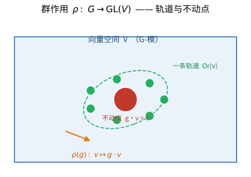

> **直观理解（现实类比）**：把群作用想象成一台旋转的万花筒或转盘。群 $G$ 是"旋转"这个动作的集合，向量空间 $V$ 是转盘上的点。每个群元素 $g$ 通过可逆变换 $\rho(g)$ 给每个点 $v$ 指一个"去处" $g\cdot v$。整张转盘被划成若干条**轨道**——同一条轨道上的点可以互相变过去，就像同一圆环上的珠子可以转到彼此的位置；而转轴中心的那个点无论怎么转都纹丝不动，正是**不动点** $g\cdot v=v$。表示论正是在"抽象群"与"看得见的旋转/对称"之间架起桥梁。
>
> **🧠 思考历程：一个听不见摸不着的抽象群，如何"演出"成看得见的矩阵？**
>
> 表示论要回答的是：抽象的群元素，怎样化身为实实在在的、能够相乘的矩阵运动？——通过把 $G$ 映到 $\mathrm{GL}(V)$ 的矩阵集合，数学家让抽象的对称"落地"为可以计算的线性代数。
>
> - **从置换到矩阵**。群最初就以置换群、变换群的面目出现在数学中；让抽象群"回到具体变换"的强烈需要，促使数学家考虑同态 $\rho:G\to\mathrm{GL}(V)$，即所谓的"表示"。
> - **Frobenius 与特征标**。1890 年代，F. G. Frobenius 系统研究有限群表示，提出"特征标"这一核心工具——把矩阵的迹当作群的"指纹"，用它精确读取出不可约表示的全部信息。
> - **分解与查字典**。Schur 引理与 Maschke 定理共同保证半单群可拆成不可约表示的直和，于是"理解一个群"变成"查熟它的不可约表示表"；这一视野后来更蔓延到 Lie 群与物理中的对称性。
> - **心路**：数学家用"让群动起来"的朴素办法，把抽象对称翻译成矩阵语言，最终明白——那些"更简单、不可再拆"的砖块，才是一群之性格的钥匙。

#### 课堂问答

**老师**：$G$-模的三条公理里，哪一条体现了"线性"？它和群表示到底是不是同一件事？

**学生**：第三条 $g\cdot(av+bw)=a(g\cdot v)+b(g\cdot w)$ 体现线性，前两条保证这是群作用。它与表示完全等价：令 $g\cdot v=\rho(g)v$ 即可互相翻译，前者"看场地"、后者"看动作"。

**老师（追问）**：为什么说"$V$ 是 $G$-模"这种说法比"矩阵组 $\rho(g)$"更稳？

**学生**：因为模只依赖"作用"这个结构本身，不依赖基的选取；选定基之后才有矩阵 $\rho(g)$。换基相当于相似变换 $\rho\mapsto T\rho T^{-1}$，模结构纹丝不动，所以模语言更本质、更少冗余。

**老师（拓展）**：若把线性作用换成 $G$ 作用在一般集合上，还剩什么？它如何回到表示论？

**学生**：只剩群作用（置换作用）。把该集合线性化——取以它为基的自由向量空间，就得到置换表示，一种特殊的 $G$-模。可见集合作用一旦被线性化，就统一进了 $G$-模框架。

### 2.3 子表示与不可约表示

**定义 2.4（子表示）** 设 $V$ 是一个 $G$-模。子空间 $W \subseteq V$ 称为一个 **$G$-子模**（或不变子空间），如果对任意 $g \in G$ 和 $w \in W$，有 $g \cdot w \in W$。此时 $\rho_W(g) = \rho(g)|_W$ 给出了 $G$ 在 $W$ 上的表示，称为**子表示**。

> **💡 直观理解（类比）**：$G$-子模就是在整个舞台里挑出"一块自足的小舞台"$W$：无论群怎么操作，棋子都不出这块区域（$g \cdot w \in W$）。就像在一个大房间里画一个小框，规则保证任何动作都不把小框里的东西搬到框外。既然小框自成体系，把群限制在它上面，就又得到一套表示——这就是子表示。

**定义 2.5（不可约表示）** 一个非零 $G$-模 $V$ 称为**不可约的**（或**单的**），如果它没有非平凡（即不是 $\{0\}$ 也不是 $V$ 本身）的 $G$-子模。

> **💡 直观理解（类比）**：不可约表示就像"砍不动、掰不开的实心砖头"。无论怎么尝试，都找不到一块能被群动作保持的小地盘，除了整块砖和空无一物的"零"。类比一块完整的实心木块：你能顺着纹理劈开它，才算可约；若它纹理交错、浑然一体，怎么下刀都裂不出整齐的小块，那它就是不可约的。它是表示世界里的"原子"，研究表示就先找这些最基本的积木。

**定义 2.6（完全可约表示）** 一个 $G$-模 $V$ 称为**完全可约的**（或**半单的**），如果它可以分解为不可约 $G$-子模的直和：

$$
V = V_1 \oplus V_2 \oplus \cdots \oplus V_k
$$

> **💡 直观理解（类比）**：完全可约（也叫半单）表示就是"由不可约积木整整齐齐拼起来的房子"。整栋房子能严丝合缝地拆成一摞互不干扰的房间 $V_1 \oplus \cdots \oplus V_k$，每间都是实心砖块（不可约）。注意"能拼装"和"能拼装且能再拆"是不同的承诺：完全可约强调的正是"拆得开、拼得拢、各房间互不串门"，这正是后面马施克定理要保证的干净情形。

#### 课堂问答

**老师**：判断一个非零 $G$-模是否不可约，最省力的标准是什么？

**学生**：直接去找有没有非平凡的 $G$-不变子空间：找不到就是不可约。注意 $\{0\}$ 与 $V$ 本身不算，所以凡是一维表示都自动不可约。

**老师（追问）**：那"不可约"能不能简单等同于"不能写成两个非零子表示的直和"？

**学生**：不能，两者不等价。存在既没有不变补空间、又不是直和分解、却含真子模的情形，即不可约严格强于不可分解。不过在 $\mathrm{char}F\nmid|G|$ 下二者一致，这正是完全可约带来的便利。

**老师（拓展）**：若 $W$ 是子表示，为什么"存在 $G$-不变补空间"这件事并不自动成立？

**学生**：线性代数只能保证有某个补空间使 $V=W\oplus W'$，却未必有 $g\cdot W'\subseteq W'$。能否被群保持是额外约束，正是马施克定理要用"平均投影"去构造的那个补空间。

### 2.4 舒尔引理 (Schur's Lemma)

**引理 2.7（舒尔引理）** 设 $V$ 和 $W$ 是群 $G$ 的两个有限维不可约表示，$\varphi: V \to W$ 是一个 $G$-模同态（即与 $G$ 作用可交换的线性映射）。则要么 $\varphi = 0$，要么 $\varphi$ 是可逆的（从而 $V \cong W$）。

**证明**：考虑 $\ker \varphi$。由于 $\varphi$ 是 $G$-模同态，$\ker \varphi$ 是 $V$ 的 $G$-子模。因为 $V$ 是不可约的，$\ker \varphi$ 只能是 $\{0\}$ 或 $V$。若 $\ker \varphi = V$，则 $\varphi = 0$。

若 $\ker \varphi = \{0\}$，则 $\varphi$ 是单射。再考虑 $\mathrm{im}\, \varphi$，它是 $W$ 的 $G$-子模。因为 $W$ 是不可约的，$\mathrm{im}\, \varphi$ 只能是 $\{0\}$ 或 $W$。但 $\varphi \neq 0$，所以 $\mathrm{im}\, \varphi = W$，即 $\varphi$ 是满射。因此 $\varphi$ 是双射，从而可逆。$\square$

> **💡 直观理解（类比）**：舒尔引理说的是"两块'实心砖'之间的合法搬运工"特别省心。把 $V,W$ 想成两个无法再拆的玻璃球，$\varphi$ 是把 $V$ 里的每个点搬到 $W$ 的一个"忠实翻译"。结论是：这样的翻译要么一无是处（把一切都运成零，$\varphi=0$），要么是精确的一一对应（可逆，从而两块砖本质相同）。原因很简单——翻译必有"被归零的集合"$\ker\varphi$ 和"可到达的集合"$\mathrm{im}\,\varphi$，而这两块砖内部没有可剥削的小块，所以要么整块归零、要么整块都被覆盖。**不同尺寸的砖之间根本不存在非零的翻译**。

**推论 2.8** 设 $V$ 是复数域 $\mathbb{C}$ 上的有限维不可约 $G$-模，则 $V$ 到自身的任何 $G$-模同态都是标量变换（即 $\lambda \cdot \mathrm{id}_V$ 的形式）。

**证明**：设 $\varphi: V \to V$ 是 $G$-模同态。由于 $\mathbb{C}$ 是代数闭域，$\varphi$ 有特征值 $\lambda$。考虑 $\varphi - \lambda \mathrm{id}$，它也是 $G$-模同态，且不可逆（因为 $\lambda$ 是特征值），由舒尔引理，它必须为零映射，即 $\varphi = \lambda \mathrm{id}$。$\square$

> **💡 直观理解（类比）**：这是舒尔引理在"自己搬自己"时的版本。一个不可约表示的"自翻译"（$G$-模同态 $V\to V$）竟然只能是"把整块砖放大 $\lambda$ 倍"的简单操作，别无花样。打个比方：一个完全对称的、无可拆分结构的雕像，任何"保持它对称结构的自相似变换"只能整体缩放，而不可能扭出局部花样。而在复数这个"数字足够丰富"的场地里，任意自映射必有特征值 $\lambda$，于是它减 $\lambda$ 倍恒等后必不可逆，只能为零。

**推论 2.9** 阿贝尔群的任何有限维不可约复表示都是一维的。

**证明**：设 $G$ 是阿贝尔群，$\rho: G \to \mathrm{GL}(V)$ 是有限维不可约复表示。对任意 $g \in G$，$\rho(g)$ 与所有 $\rho(h)$（$h \in G$）可交换（因为 $gh = hg$），所以 $\rho(g)$ 是 $G$-模同态。由推论 2.8，$\rho(g) = \lambda_g \cdot \mathrm{id}_V$ 是标量变换。因此 $V$ 的任何一维子空间都是 $G$-子模。由不可约性，$\dim V = 1$。$\square$

> **💡 直观理解（类比）**：这条推论说"能被顺畅交换（阿贝尔）的群，它的原子只能是'一根线'那么细的一维"。原因是：阿贝尔群里每个动作 $g$ 都和其他动作能互换顺序，于是根据推论 2.8，$g$ 只能整体放大所有向量（标量变换），不能像拧麻花一样偏向某些方向。既然方向没有偏好，任何一条直线方向都被照顾、都保持不变，那这块"实心砖"就只能是一维线段。这也解释了为什么循环群 $C_n$ 的不可约表示统统是一维的——只有"平移/旋转整个圆盘按因子缩放"这种单调操作。

#### 课堂问答

**老师**：舒尔引理的核心结论是什么？证明里靠的是哪两条机制？

**学生**：对不可约的 $V,W$，任何 $G$-模同态 $\varphi$ 要么是 $0$，要么是同构。关键在于 $\ker\varphi$ 与 $\mathrm{im}\,\varphi$ 都是 $G$-子模，由不可约性只能取 $\{0\}$ 或全体。

**老师（追问）**：为什么在 $\mathbb{C}$ 上不可约自同态只能是标量 $\lambda\,\mathrm{id}$？"代数闭"用在哪一步？

**学生**：$\varphi$ 在 $\mathbb{C}$ 上必有特征值 $\lambda$，于是 $\varphi-\lambda\,\mathrm{id}$ 是 $G$-同态且不可逆，由舒尔引理只能为零，故 $\varphi=\lambda\,\mathrm{id}$。代数闭保证特征值存在；在 $\mathbb{R}$ 上旋转 $90^\circ$ 就没有实特征值，结论会失效。

**老师（拓展）**：由此为什么阿贝尔群的不可约复表示全是 1 维？还能推广到哪？

**学生**：阿贝尔群里每个 $\rho(g)$ 与所有 $\rho(h)$ 交换，是 $G$-自同态，只能是标量，于是每条直线都不变，不可约只能 1 维。推广：$\mathbb{C}[G]$ 的中心（即类函数）在不可约表示上也只能是标量，这正是特征标能与共轭类挂钩的根源。

### 2.5 马施克定理 (Maschke's Theorem)

**定理 2.10（马施克定理）** 设 $G$ 是有限群，$F$ 是一个域，且 $\mathrm{char}(F) \nmid |G|$（即 $F$ 的特征不整除 $G$ 的阶）。则 $G$ 的每个有限维表示都是完全可约的。等价地，$F[G]$ 是半单代数。

**证明**：设 $V$ 是 $G$ 的一个有限维表示，$W \subseteq V$ 是一个 $G$-子模。我们要证明 $W$ 在 $V$ 中有一个 $G$-不变的补空间。

取任意线性投影 $p_0: V \to W$（即 $p_0|_W = \mathrm{id}_W$，$p_0^2 = p_0$）。定义

$$
p(v) = \frac{1}{|G|} \sum_{g \in G} g \cdot p_0(g^{-1} \cdot v)
$$

我们验证 $p$ 是 $G$-模同态且是到 $W$ 上的投影：

1. 对任意 $w \in W$，$g^{-1} \cdot w \in W$，所以 $p_0(g^{-1} \cdot w) = g^{-1} \cdot w$，于是
   $$
   p(w) = \frac{1}{|G|} \sum_{g \in G} g \cdot (g^{-1} \cdot w) = \frac{1}{|G|} \sum_{g \in G} w = w
   $$

2. 对任意 $v \in V$，$p(v) \in W$（因为 $p_0(g^{-1} \cdot v) \in W$，且 $W$ 是 $G$-不变的）。

3. 对任意 $h \in G$，
   $$
   \begin{aligned}
   p(h \cdot v) &= \frac{1}{|G|} \sum_{g \in G} g \cdot p_0(g^{-1}h \cdot v) \\
   &= \frac{1}{|G|} \sum_{g' \in G} hg' \cdot p_0(g'^{-1} \cdot v) \quad (\text{令 } g' = h^{-1}g) \\
   &= h \cdot \frac{1}{|G|} \sum_{g' \in G} g' \cdot p_0(g'^{-1} \cdot v) = h \cdot p(v)
   \end{aligned}
   $$

因此 $p$ 是 $G$-模同态，且 $p^2 = p$（投影）。于是 $V = \ker p \oplus \mathrm{im}\, p = \ker p \oplus W$，且 $\ker p$ 也是 $G$-子模（因为 $p$ 是 $G$-模同态）。

这就证明了每个子模都有 $G$-不变的补空间，从而 $V$ 是完全可约的。$\square$

> **💡 直观理解（类比）**：马施克定理是"表示论里的拼图总则"：只要群的大小和场地特征互相"不打架"（$\mathrm{char}\,F\nmid|G|$），那任何表示都像搭好的乐高——既能拆也必能拆成不可约积木。核心技巧是"平均化"：随便先找一个倾斜的投影 $p_0$，再把它对所有 $g$ 做平均 $\frac1{|G|}\sum_g g\,p_0(g^{-1}\cdot)$，平均后它就不再偏向任何方向，成了与 $G$ 相容的"正投影"，从而补空间保持 $G$ 动作。这就像给照片做"多角度平均去噪"。反过来，若特征整除 $|G|$（模表示论），平均要除以一个在场地里等于 0 的数，配方就失败，砖块会"粘"在一起拆不开。

**注**：当 $\mathrm{char}(F) \mid |G|$ 时，马施克定理不成立，此时称为**模表示论**（modular representation theory），情况更为复杂。

---

#### 课堂问答

**老师**：马施克定理的条件和结论各是什么？到底哪一步用到了 $\mathrm{char}\,F\nmid|G|$？

**学生**：条件是 $\mathrm{char}(F)\nmid|G|$，结论是有限维表示全都完全可约，等价于 $F[G]$ 半单。用到的地方就是平均投影里的 $\frac{1}{|G|}$——需要 $|G|$ 在 $F$ 中可逆。

**老师（追问）**：为什么把这个 $p_0$ 对所有 $g$ 平均之后，补空间 $\ker p$ 就变成 $G$-不变量了？

**学生**：因为平均抹掉了对基的偏袒，使 $p$ 成为 $G$-模同态，即 $p(h\cdot v)=h\cdot p(v)$。于是 $\ker p$ 被 $G$ 保持，而 $V=\ker p\oplus\mathrm{im}\,p$ 里 $\ker p$ 正好是 $W$ 的 $G$-不变补空间。

**老师（拓展）**：若 $\mathrm{char}(F)\mid|G|$，具体坏在哪儿？给个最小反例。

**学生**：$\frac{1}{|G|}$ 在 $F$ 中等于 0，平均配方失效，完全可约可能不成立。最小例子：$F=\mathbb{F}_2$、$G=C_2$，$\mathbb{F}_2[C_2]$ 不半单、补空间找不到，由此进入更复杂的模表示论。

## 3. 特征标理论

> **🧠 来龙去脉：群的"指纹"是怎么被发现的？**
>
> 在 Frobenius 之前，研究抽象群的困境在于它太"滑不留手"——同一个群可以换无数种坐标、无数种记法，可你很难说清"它到底长什么样"。特征标正是为解开这个死结而生的"群之指纹"。
>
> - **Frobenius 把矩阵的迹当侦探**。Frobenius 在 1896 年的突破，某种意义上来自一个极简的观察：一个矩阵无论怎样换基，它的**迹**（对角线之和）都纹丝不动。而表示正是给群每个元素配一个矩阵，于是 $\chi(g)=\operatorname{tr}\rho(g)$ 就在"换坐标系"的噪声之下，抓住了群最稳定的标记。他自己把这套名叫 group character（群特征标）的工具称为"对有限群的不可变量理论"。
> - **正交的指纹库**。Frobenius 随后（1897、1903）发现这些指纹并非孤立的小点，而是有严格的正交结构：不同的不可约特征标互相垂直（内积为 0），自己与自己"长度为 1"。它们因此构成一套完整的正交坐标架——任何"类函数"（只认共轭类、不认个体）都能唯一写成它们的线性组合。
> - **解决的难题**：一旦有了特征标表，许多群论难题就成了"照表读数"：
>   - 一个表示是否不可约？$\iff \langle\chi,\chi\rangle=1$；
>   - 群是否阿贝尔、有无正规子结构、两群是否同构，常常可从表中读出；
>   - 诱导表示的可约性、张量积的分解等计算问题，都被归结为正交内积的算术。
>
> 这正是本节要从"特征标＝特征的类函数"讲起的原因：它是整套计算体系的支点。

### 3.1 特征标的定义

**定义 3.1（特征标）** 设 $\rho: G \to \mathrm{GL}(V)$ 是有限群 $G$ 在 $\mathbb{C}$ 上的一个有限维表示。定义函数 $\chi_\rho: G \to \mathbb{C}$ 为

$$
\chi_\rho(g) = \mathrm{tr}(\rho(g))
$$

称为表示 $\rho$ 的**特征标**（character）。若 $\rho$ 是不可约表示，则 $\chi_\rho$ 称为**不可约特征标**。

> **💡 直观理解（类比）**：特征标就是表示的"指纹"或"识别码"。矩阵的迹（对角线之和）虽然"丢失"了很多细节，却抓住了最耐转动的本质——转一下坐标系（共轭）迹不变，所以它能在海量等价表示里给出稳定的身份标记。类比给每个群元素量一次"体温/取一次指纹"：$\chi(g)=\mathrm{tr}\,\rho(g)$。它妙就妙在：尽管矩阵可以千变万化，但迹把这个群的"性格特征"凝缩成一串数字，足够区分不同不可约表示，却又不至于被坐标变换这种"换衣服"干扰。

**命题 3.2（特征标的基本性质）** 设 $\chi$ 是表示 $\rho$ 的特征标，则：

1. $\chi(e) = \dim V$，称为特征标的**度数**
2. $\chi(g^{-1}) = \overline{\chi(g)}$（共轭）
3. $\chi(hgh^{-1}) = \chi(g)$ 对所有 $h \in G$（即特征标是**类函数**）
4. 若 $\chi_1, \chi_2$ 是表示 $\rho_1, \rho_2$ 的特征标，则 $\chi_1 + \chi_2$ 是 $\rho_1 \oplus \rho_2$ 的特征标
5. 若 $\chi$ 是 $\rho$ 的特征标，则 $\overline{\chi}$ 是 $\rho$ 的共轭表示的特征标

> **💡 直观理解（类比）**：这些性质像"指纹的几项体检指标"：①单位元的指纹值是"舞台尺寸"——$V$ 有几维，$\chi(e)$ 就是几（恒等矩阵对角线全 1）；②取逆像照镜子，迹共轭对称；③最关键的是——$hgh^{-1}$ 就是把 $g$ 的动作在 $h$ 的坐标系里"转述"一遍，迹这个量对换坐标袖手旁观、纹丝不变，所以特征标在**同一共轭类上的值都相同**（类函数）。这一条让特征标表的"列"可以按类合并，大大压缩了信息量。

#### 课堂问答

**老师**：特征标 $\chi(g)=\mathrm{tr}\,\rho(g)$ 里"取迹"丢掉了什么、又保住了什么？

**学生**：丢掉了矩阵的绝大多数信息，保住了换基（共轭）不变的部分。正因为迹在相似变换下不变，$\chi$ 才在等价表示间稳定、且在共轭类上取常值。

**老师（追问）**：为什么说 $\chi$ 是类函数？$\chi(e)$ 又代表什么？

**学生**：$\chi(hgh^{-1})=\mathrm{tr}(\rho(h)\rho(g)\rho(h)^{-1})=\mathrm{tr}\,\rho(g)=\chi(g)$，故同一共轭类上取值相同。而 $\chi(e)=\mathrm{tr}\,I=\dim V$，就是表示的度数。

**老师（拓展）**：特征标能否区分不可约表示？反过来，两个表示若特征标相同会怎样？

**学生**：不可约特征标两两正交、绝不重复，因此它是唯一指纹。一般地，$\mathbb{C}$ 上两个半单表示特征标相同则必同构——因为不可约成分的重数可由内积唯一读出。这就是"一串数字管住整个表示"的威力。

### 3.2 类函数与内积

**定义 3.3（类函数）** 函数 $f: G \to \mathbb{C}$ 称为**类函数**，如果对任意 $g, h \in G$ 有 $f(hgh^{-1}) = f(g)$。记所有类函数的集合为 $\mathcal{C}_{\text{class}}(G)$。

> **💡 直观理解（类比）**：类函数就是"只认类型、不认个体"的函数。$g$ 被人套上任何一件"变形外套"$hgh^{-1}$（本质还是同一个动作的别名），类函数的值都不变。好比一份只看"职业"不看"名字"的统计表——所有"换工作服就能互换的岗位"算作一类。特征标是类函数，所以这类函数天然适合讨论群的"整体分类"，也几乎完全概括了表示论所需的全部信息。

**定义 3.4（类函数的内积）** 在 $\mathcal{C}_{\text{class}}(G)$ 上定义埃尔米特内积：

$$
\langle f_1, f_2 \rangle = \frac{1}{|G|} \sum_{g \in G} f_1(g) \overline{f_2(g)}
$$

> **💡 直观理解（类比）**：这个内积像给两个"指纹向量"测"相似度/夹角"。把 $f_1,f_2$ 看成定义在群上的两个列向量（每个 $g$ 对应一个坐标），取对应分量相乘再求和并除以 $|G|$ 做平均，就是在测它们夹得多近。它与高中向量的点积 $\vec a\cdot\vec b=\sum a_i b_i$ 是同一回事，只不过额外做了"除以人数取平均"并带上复共轭。后面会看到：不同不可约特征标这一对内积为 0（"互相垂直"），与自己内积为 1（"单位长"）——即它们构成标准的正交坐标架。

#### 课堂问答

**老师**：类函数的内积为什么定义在类函数上、又要除以 $|G|$ 并取复共轭？

**学生**：特征标是类函数、只在共轭类上取值，内积自然定义其上。除以 $|G|$ 相当于取平均，使长度归一；复共轭保证 $\langle f,f\rangle=\frac{1}{|G|}\sum_g|f(g)|^2\ge 0$，实现正定。

**老师（追问）**：它和普通向量点积 $\vec a\cdot\vec b=\sum_i a_ib_i$ 差在哪？

**学生**：本质一样，都是逐分量相乘再求和。区别有二：多了复共轭以适配复值；多了 $\frac{1}{|G|}$ 归一化，让不可约特征标恰好成为单位长度的标准正交向量。

**老师（拓展）**：类函数空间的维数等于什么？这给表示论计算带来什么便利？

**学生**：维数等于共轭类个数 $k$，而不可约特征标恰有 $k$ 个并相互正交，正好张满整个类函数空间。于是任何类函数都能唯一展开成不可约特征标的组合，任何表示的分解都能用内积直接算重数。

### 3.3 正交关系

**定理 3.5（舒尔正交关系）** 设 $G$ 是有限群，$\rho^{(i)}: G \to \mathrm{GL}(V_i)$ 和 $\rho^{(j)}: G \to \mathrm{GL}(V_j)$ 是 $G$ 的两个不可约复表示，$\chi_i$ 和 $\chi_j$ 是它们的特征标。

1. **第一正交关系**：
   $$
   \langle \chi_i, \chi_j \rangle = \frac{1}{|G|} \sum_{g \in G} \chi_i(g) \overline{\chi_j(g)} = \delta_{ij}
   $$
   即不可约特征标构成标准正交基。

2. **第二正交关系**：对任意 $g, h \in G$，
   $$
   \sum_{i} \chi_i(g) \overline{\chi_i(h)} = 
   \begin{cases}
   |C_G(g)|, & \text{若 } g \text{ 与 } h \text{ 共轭} \\
   0, & \text{否则}
   \end{cases}
   $$
   其中求和跑遍所有不可约特征标，$C_G(g) = \{x \in G \mid xg = gx\}$ 是 $g$ 的中心化子。

**证明（第一正交关系）**：设 $V$ 和 $W$ 是不可约 $G$-模，$\rho_V, \rho_W$ 是相应的表示。对任意线性映射 $T: V \to W$，定义

$$
\tilde{T} = \frac{1}{|G|} \sum_{g \in G} \rho_W(g) \circ T \circ \rho_V(g^{-1})
$$

可以验证 $\tilde{T}$ 是 $G$-模同态。由舒尔引理：
- 若 $V \not\cong W$，则 $\tilde{T} = 0$
- 若 $V = W$，则 $\tilde{T} = \frac{\mathrm{tr}(T)}{\dim V} \cdot \mathrm{id}_V$

取 $T = E_{ab}$（矩阵单位），计算 $\mathrm{tr}(\tilde{T})$ 可得正交关系。$\square$

> **💡 直观理解（类比）**：舒尔正交关系是表示论的"勾股定理+正交坐标"。第一正交关系说：不同不可约特征标互相"垂直"（内积 0），每个与自己"长度 1"（内积 1），它们就像三维空间里的三个互相垂直的单位向量，构成完整的正交基。第二正交关系则从"列"的角度看：对两个群元素按所有不可约表示求和，只有当它们在同一共轭类（$g\sim h$）时才有值，值为中心化子大小。这就像一张矩形的正交表——"行"之间互相垂直，"列"之间也互相垂直，于是任何类函数都能像按基函数展开一样唯一写成不可约特征标的组合。

#### 课堂问答

**老师**：第一正交关系说的是什么？它为什么是"标准正交基"的表述？

**学生**：$\langle\chi_i,\chi_j\rangle=\frac{1}{|G|}\sum_g\chi_i(g)\overline{\chi_j(g)}=\delta_{ij}$，即不可约特征标两两垂直、各自长度为 1，正好构成类函数空间的标准正交基。

**老师（追问）**：第二正交关系从"列"的角度说了什么？为什么会出现中心化子 $|C_G(g)|$？

**学生**：$\sum_i\chi_i(g)\overline{\chi_i(h)}$ 在 $g,h$ 共轭时等于 $|C_G(g)|$，否则为 0。它是第一关系的"矩阵转置"版本，用共轭类大小加权，而中心化子来自 $|G|=|C_G(g)|\cdot|g^G|$ 的换算。

**老师（拓展）**：怎样用第一正交关系判断一个表示是否不可约？边界情形如何？

**学生**：表示不可约当且仅当 $\langle\chi,\chi\rangle=1$。若 $\langle\chi,\chi\rangle=m>1$，说明它可约且含 $m$ 个不可约成分（计重数）；例如 $S_3$ 正则表示算得 $\langle\chi_{\mathrm{reg}},\chi_{\mathrm{reg}}\rangle=6$，确实可约。此判定在复半单情形最干净。

### 3.4 特征标表

**定义 3.6（特征标表）** 有限群 $G$ 的**特征标表**是一个矩阵，其行由不可约特征标标记，列由共轭类标记，矩阵元素为相应特征标在相应共轭类上的值。

> **💡 直观理解（类比）**：特征标表是群的"身份证档案/迷你说明书"。把每个不可约表示记成一行、每个共轭类记成一列，表格里填的正是该特征标在该类上的取值。它像把一整个群浓缩成一张小而完整的身世表——后面会看到，甚至能凭它判断表示是否可约、群是否同构等深层性质。好比用一张 "营养成分表"把一整道复杂的菜概括得清楚明白。

**例 3.7（$S_3$ 的特征标表）** 对称群 $S_3$ 有三个共轭类：$\{e\}$，$\{(12), (13), (23)\}$，$\{(123), (132)\}$。它的特征标表为：

| $S_3$ | $e$ | $(12)$ | $(123)$ |
|:-----:|:---:|:------:|:-------:|
| $\chi_{\text{triv}}$ | 1 | 1 | 1 |
| $\chi_{\text{sgn}}$ | 1 | -1 | 1 |
| $\chi_{\text{std}}$ | 2 | 0 | -1 |

其中 $\chi_{\text{triv}}$ 是平凡表示，$\chi_{\text{sgn}}$ 是符号表示，$\chi_{\text{std}}$ 是标准二维表示（从 $S_3$ 作用在 $\mathbb{C}^3$ 中迹零子空间得到）。

#### 课堂问答

**老师**：特征标表的行、列各是什么？为什么列能按共轭类合并？

**学生**：行标不可约特征标、列标共轭类，格中填该特征标在该类上的取值。因为特征标是类函数、同一共轭类上值相同，所以一列只要一个数就够。

**老师（追问）**：拿 $S_3$ 的表来验证，单位元那一列必须满足什么恒等式？

**学生**：单位元列就是各不可约表示的度数 $1,1,2$，其平方和 $1^2+1^2+2^2=6=|S_3|$，正是 $\sum_i d_i^2=|G|$。这是特征标表必须满足的硬约束。

**老师（拓展）**：单看特征标表能读出哪些性质？它的局限又是什么？

**学生**：能读出是否阿贝尔（全是 1 维即阿贝尔）、正规子群结构、乃至是否同构等。局限是它只记录共轭类信息：存在同阶而不允许同构、却拥有相同特征标表的群，也无法还原元素层面的细节。

### 3.5 正则表示

**定义 3.8（正则表示）** 设 $G$ 是有限群。群代数 $\mathbb{C}[G]$ 作为左 $\mathbb{C}[G]$-模给出了 $G$ 的**左正则表示** $\rho_{\text{reg}}$。其表示空间维数为 $|G|$，基为 $\{e_g \mid g \in G\}$，作用为 $h \cdot e_g = e_{hg}$。

> **💡 直观理解（类比）**：正则表示是"自带所有群元素的超大舞台"。它不用额外设计动作——直接让群在自己身上"自我作用"：每个群元素 $h$ 把"标着 $g$ 的那个位置"$e_g$ 推到"标着 $hg$ 的位置"。这好比把全班同学的名字各摆一个座位，然后让"老师一声令下，所有同学往'与 $h$ 相乘后的新名字'座位移动"。因为群是可逆的置换（左乘 $h$ 恰好是 $|G|$ 个位置的一一搬动），正则表示相当于"群最完整、最慷慨的一次自我展示"，后面会证明它包含了所有不可约表示。

**命题 3.9（正则表示的特征标）** 左正则表示的特征标为

$$
\chi_{\text{reg}}(g) = 
\begin{cases}
|G|, & g = e \\
0, & g \neq e
\end{cases}
$$

**证明**：在基 $\{e_g\}$ 下，$\rho_{\text{reg}}(h)$ 对应的置换矩阵将 $e_g$ 映到 $e_{hg}$。当 $h \neq e$ 时，$hg \neq g$ 对所有 $g$ 成立，所以对角线上全为 0，迹为 0。当 $h = e$ 时，迹为 $\dim \mathbb{C}[G] = |G|$。$\square$

> **💡 直观理解（类比）**：正则特征标的形状非常好认：只在"不动"单位元 $e$ 处爆满（值 $|G|$），其他任何地方都是 0。原因在于它是"置换矩阵"：$h\neq e$ 时左乘 $h$ 把每个位置都搬走，对角线一个都不留（迹 0）；只有 $h=e$ 时什么都不动，全是 1，迹 $=|G|$。这像一本"只有首页烫金、其余空白"的身份名册——凭这一串 0 和一个 $|G|$，就能框住一个群的"全部家底"。

**定理 3.10（正则表示的分解）** 设 $\hat{G}$ 是 $G$ 的所有不可约复表示的同构类集合，$\chi_i$ 是相应的不可约特征标，$d_i = \chi_i(e) = \dim V_i$。则正则表示分解为

$$
\mathbb{C}[G] \cong \bigoplus_{i \in \hat{G}} V_i^{\oplus d_i}
$$

即每个不可约表示 $V_i$ 在正则表示中出现的重数等于其维数 $d_i$。

**证明**：由正交关系，$\chi_{\text{reg}} = \sum_i d_i \chi_i$。计算 $\langle \chi_{\text{reg}}, \chi_i \rangle = d_i$，即得重数。$\square$

**推论 3.11** $\sum_{i \in \hat{G}} d_i^2 = |G|$。

**证明**：比较正则表示分解两边的维数。$\square$

> **💡 直观理解（类比）**：这个等式是表示论的"预算守恒定律"：所有不可约表示的维数平方相加，恰好等于群的阶 $|G|$。它像一道严格的记账：正则考场共有 $|G|$ 个座位，每种"实心砖"坐 $d_i$ 排，一种砖出现 $d_i$ 次、占 $d_i^2$ 格，加起来必须正好把全部座位占满。凭这条公式，给定 $|G|$，往往能反推出不可约表示的维数组合（比如 $|S_3|=6\Rightarrow 1^2+1^2+2^2$）。

![正则表示的不可约分解：\mathbb{C}[S_3]\cong\mathbf{triv}\oplus\mathbf{sgn}\oplus\mathbf{std}^{\oplus 2}，把 6 维表示拆成"最小积木"（不可约表示），每种积木按维数重复出现，对应 6=1+1+2+2](images/level39-irreducible-decomposition.svg)

> **直观理解（现实类比）**：把正则表示想成一大盒乐高积木。表面看它是一个 6 格的整体，但拆开分类后会发现它并不是 6 种不同的零件，而是由少数几种"最小零件"（不可约表示）拼装而成：平凡积木 1 块、符号积木 1 块、标准积木 2 块，正好 $6=1+1+2+2$。不可约表示就是"再也拆不开"的最小积木，而正则表示则像一份"完整的零件清单"——每种不可约表示都按自己的维数出现若干次，这就是马施克定理保证的"完全可约性"。

#### 课堂问答

**老师**：正则表示为什么被说成"包含所有不可约表示"？它的特征标长什么样？

**学生**：$\chi_{\mathrm{reg}}(e)=|G|$、$g\neq e$ 时为 0。用正交关系算 $\langle\chi_{\mathrm{reg}},\chi_i\rangle=d_i$，说明每个不可约表示 $V_i$ 出现的重数恰是 $d_i$，所以它确实囊括了全部不可约表示。

**老师（追问）**：为什么 $g\neq e$ 时迹为 0？这和"左乘是置换"有何关系？

**学生**：在基 $\{e_g\}$ 下 $\rho_{\mathrm{reg}}(h)$ 是置换矩阵，当 $h\neq e$ 时 $hg\neq g$ 对所有 $g$ 成立，没有对角元，迹为 0；仅当 $h=e$ 时全为 1，迹为 $|G|$。

**老师（拓展）**：由正则分解能推出哪个漂亮恒等式？它对构造特征标表有什么用？

**学生**：比较维数得 $\sum_i d_i^2=|G|$。给定 $|G|$ 就能反推维数组合，如 $|S_3|=6$ 迫出 $1,1,2$，这是列出特征标表的第一步约束。

### 3.6 群代数表示与半单性

在 §3.5 中，正则表示告诉我们 $\mathbb{C}[G]$ 给出了"包含所有不可约表示"的大舞台。本节把视角拨回代数本身：群代数 $\mathbb{C}[G]$ 作为**代数**，其结构本身就承载了完整的表示论。

**定义 3.12（群代数）** 设 $G$ 是有限群，域 $F$ 上以 $G$ 的元素为基的自由向量空间
$$
F[G]=\left\{\sum_{g\in G}a_g\,g\;\middle|\;a_g\in F\right\}
$$
配上卷积乘法 $\left(\sum_g a_g g\right)\left(\sum_h b_h h\right)=\sum_{g,h}a_g b_h\,(gh)$，称为 $G$ 的**群代数**（group algebra）。它以单位元所在基向量 $e$ 为乘法单位元，成为结合代数。

> **💡 直观理解（类比）**：群代数就是"把群元素当筹码、允许任意线性组合去'做算术'"的账本。群本来只允许"两个元素干干净净地相乘"（$gh$），群代数放宽成"把一摞元素带着系数混在一起再乘"（卷积）。正则表示正是这个代数"左乘自己"得到的表示：$\mathbb{C}[G]$ 一身兼任**代数**和 $G$**-模**两职。

**命题 3.13（群代数的半单性）** 若 $\mathrm{char}(F)\nmid|G|$，则群代数 $F[G]$ 是**半单代数**，即它是有限多个单代数的直积。

**定理 3.14（Artin–Wedderburn 分解）** 在特征不整除 $|G|$ 的代数闭域（如 $\mathbb{C}$）上，
$$
\mathbb{C}[G]\cong\bigoplus_{i\in\hat G}M_{d_i}(\mathbb{C}),
$$
其中 $d_i=\dim V_i$ 是第 $i$ 个不可约表示的维数。特别地，取维数得 $\dim\mathbb{C}[G]=|G|=\sum_i d_i^2$，与推论 3.11 重新吻合。

> **💡 直观理解（类比）**：有限群的复数表示论被浓缩成一句代数圣旨——**$\mathbb{C}[G]$ 就是一堆全矩阵代数的直积**。每个不可约表示 $V_i$ 对应一个 $d_i\times d_i$ 的"全矩阵房间"$M_{d_i}(\mathbb{C})$，它提供所有 $d_i$ 维表示的模板；各房间尺寸的平方 $d_i^2$ 之和恰好把群代数占满。这也解释了习题 81、82 中的分解现象：$\mathbb{C}[S_3]\cong\mathbb{C}\oplus\mathbb{C}\oplus M_2(\mathbb{C})$。

**例 3.15（$S_3$ 的群代数分解）** $S_3$ 有不可约度数 $1,1,2$，故
$$
\mathbb{C}[S_3]\cong\mathbb{C}\oplus\mathbb{C}\oplus M_2(\mathbb{C}),
$$
维数为 $1+1+4=6$。这与正则表示分解 $\mathbb{C}[S_3]\cong\mathbf{1}\oplus\mathbf{sgn}\oplus\mathbf{std}^{\oplus 2}$ 是同一分解的两种视角：正则视角按"出现的次数"计数，代数视角按"一个房间 $M_{d_i}$ 里能容纳 $d_i$ 个不可约副本"计数。

> **🧠 思考历程：为什么"研究群代数"就等于"造出了全部表示"？**
>
> - **问题**：要理解 $G$，需列出"所有不可约表示"。可它们究竟藏在哪？
> - **查字典**：把 $G$ 编进一个代数 $\mathbb{C}[G]$，再问"这个代数本身长什么样"。Artin–Wedderburn 告诉我们，它恰是若干全矩阵代数的直积——每个房间 $M_{d_i}(\mathbb{C})$ 的"最简左模"正是一个不可约表示 $V_i$。于是**枚举 $\mathbb{C}[G]$ 的单模 ⟺ 枚举 $G$ 的不可约表示**，而前者有纯粹代数的算法。
> - **收束**：这条路线把群表示论"装进"环论（模论）的框架，也为模表示论（特征整除 $|G|$）与 Burnside 对群代数的分类奠定了基础。

---

#### 课堂问答

**老师**：群代数 $F[G]$ 与群 $G$ 是什么关系？它为什么同时是"代数"又是"模"？

**学生**：$F[G]$ 以群元素为基、带卷积乘法，是结合代数；同时其上左乘正则作用使它成为 $G$-模。它一身二任：把群装进代数后再研究表示，就等价于研究这个代数的模。

**老师（追问）**：Artin–Wedderburn 分解在 $\mathbb{C}[G]$ 上具体说什么？它和 $\sum_i d_i^2=|G|$ 怎么对上？

**学生**：$\mathbb{C}[G]\cong\bigoplus_i M_{d_i}(\mathbb{C})$，每个不可约表示对应一个 $d_i\times d_i$ 的全矩阵代数。取维数便有 $\dim\mathbb{C}[G]=|G|=\sum_i d_i^2$，与正则分解的重数结论一致。

**老师（拓展）**：半单性一旦失去会怎样？在表示论语境里意味着什么现象？

**学生**：当 $\mathrm{char}\,F\mid|G|$ 时 $F[G]$ 不再半单，直积形式破裂，一些不可约表示会合体成不可分模，"砖块粘在一起"。这正是模表示论与 Brauer 块理论要处理的现象。

## 4. 诱导表示

> **🧠 来龙去脉：如何从"局部掌握"拼出"全局图景"？**
>
> 研究一个复杂的大群 $G$，最省力的办法往往是先看向它的子群 $H$——那里结构更简单、表示更容易造。可小群里的表示如何"升级"成大群的表示？**诱导表示**（induced representation）就是 Frobenius 早在 1898 年便给出的答案。
>
> - **从陪集拼接大群**。把 $G$ 看成 $H$ 的一堆"拷贝"（陪集），$H$ 里的一个表示 $W$ 就在每个拷贝上各展开一份，再小心地把相邻拷贝拼接起来，得到的正是 $G$ 的一个表示 $\operatorname{Ind}_H^G W$。§4.1 的两个等价描述（张量积 $\mathbb{C}[G]\otimes_{\mathbb{C}[H]}W$ 与左陪集函数 $f(hg)=h\cdot f(g)$）正是这台拼图机的两面。
> - **Frobenius 互反律（1898）**。几乎同时，Frobenius 揭示了一条精确的"对账"规则：从大群表示 $V$ 到"从 $H$ 诱导来的表示"之间有多少 $G$-同态，等于把 $V$ 限制回 $H$ 后与 $W$ 之间有多少 $H$-同态。用特征标写成 $\langle\chi_V,\operatorname{Ind}_H^G\psi\rangle_G=\langle\operatorname{Res}_H^G\chi_V,\psi\rangle_H$，这是整门学科用得最频繁的计算法则之一。
> - **解决问题**：诱导表示把"由子群造大群表示"与"限制回去核重数"配对成一对可逆的操作，使对称群、线性群等一大类群的表示理论能递归地从"小块"拼成"全景"。后来的 Mackey 定理（§4.4）进一步回答"从不同窗口看诱导表示会看到什么"，把拼图规则推到了双陪集层面。
>
> 下面从最小的一块拼图──诱导表示的定义──讲起。

### 4.1 诱导表示的定义

**定义 4.1（诱导表示）** 设 $H \leq G$ 是子群，$W$ 是 $H$ 的一个表示（即 $H$-模）。定义 $G$ 的表示

$$
\mathrm{Ind}_H^G W = \mathbb{C}[G] \otimes_{\mathbb{C}[H]} W
$$

称为从 $H$ 到 $G$ 的**诱导表示**。$G$ 的作用由左乘给出：$g \cdot (x \otimes w) = (gx) \otimes w$。

> **💡 直观理解（类比）**：诱导表示是"把小剧团的戏，扩编成整个大剧团的戏"。你原本只有子群 $H$ 能在小舞台 $W$ 上演动作；诱导表示相当于给群 $G$ 里的所有元素都安排上动作，并且严格尊重原来 $H$ 的剧本。功能上的直观更好记：$\mathrm{Ind}_H^G W$ 就是"那些给 $G$ 每个元素都贴一张'来自 $W$ 的标签'、且同一条左边 $H$ 线路上标签必须一致"的函数集合。子群就像员工里的"核心管理层"，诱导就像把核心权力合法地扩充到全公司且不违背原章程。

**等价描述**：$\mathrm{Ind}_H^G W$ 可以看作所有函数 $f: G \to W$ 满足 $f(hg) = h \cdot f(g)$ 对任意 $h \in H$ 的集合，$G$ 的作用为 $(g \cdot f)(x) = f(xg)$。

**命题 4.2（诱导表示的维数）** $\dim \mathrm{Ind}_H^G W = [G:H] \cdot \dim W$。

> **💡 直观理解（类比）**：维数公式是"扩编后的人数守恒"：结果舞台的尺寸，等于"大群比子群多出来的份数"[G:H] 乘以小舞台原本的尺寸 $\dim W$。把 $H$ 在 $G$ 里的每个"拷贝"（陪集）都看成一份源材料，每份携带 $\dim W$ 个自由度，全部加起来就是这个诱导表示的规模。$[G:H]$ 就是"大群是子群的几倍大"。

#### 课堂问答

**老师**：诱导表示 $\mathrm{Ind}_H^G W$ 用张量积怎么定义？它的维数是多少？

**学生**：$\mathrm{Ind}_H^G W=\mathbb{C}[G]\otimes_{\mathbb{C}[H]}W$，$G$ 由左乘作用；维数为 $[G:H]\dim W$。等价地，它是满足 $f(hg)=h\cdot f(g)$ 的函数 $f:G\to W$ 的全体。

**老师（追问）**：定义里为什么用 $\otimes_{\mathbb{C}[H]}$ 而不是普通的 $\otimes_{\mathbb{C}}$？

**学生**：因为要把 $H$ 的作用"吸收"进张量积，即强制 $xh\otimes w=x\otimes h\cdot w$。这样才能让诱导表示尊重 $W$ 原有的 $H$-结构，而不是把 $H$ 当成无结构的集合。

**老师（拓展）**：取 $H=G$ 时诱导退化成什么？取 $H=\{e\}$ 时又是什么？

**学生**：$H=G$ 时 $\mathrm{Ind}=W$ 本身（张量积被吸收掉）。$H=\{e\}$ 时得到 $|G|\dim W$ 维的自由表示，其中 $\dim W=1$ 的情形正是正则表示——所以正则表示是诱导表示的特例。

### 4.2 诱导特征标的公式

**命题 4.3（诱导特征标公式）** 设 $\psi$ 是 $H$-模 $W$ 的特征标，则诱导表示 $\mathrm{Ind}_H^G W$ 的特征标为

$$
\mathrm{Ind}_H^G \psi(g) = \frac{1}{|H|} \sum_{\substack{x \in G \\ x^{-1}gx \in H}} \psi(x^{-1}gx)
$$

或等价地，取 $H$ 在 $G$ 中的一组右陪集代表元 $R$，

$$
\mathrm{Ind}_H^G \psi(g) = \sum_{\substack{r \in R \\ r^{-1}gr \in H}} \psi(r^{-1}gr)
$$

> **💡 直观理解（类比）**：这个公式回答"扩编后，大群的每个元素 $g$ 指纹是多少"。做法是：把 $G$ 按子群 $H$ 的"拷贝"（右陪集代表元 $r$）逐一检查，凡是 $r^{-1}gr$ 恰好落回 $H$ 里（即 $g$ 在 $r$ 的坐标系内其实是 $H$ 里的老熟人），就采那一下小舞台的指纹 $\psi(r^{-1}gr)$，把所有命中项相加。可以理解成"顺着每个领事馆的副本点名，只统计那些换装后仍是内部成员的 $g$ 的贡献"。

#### 课堂问答

**老师**：诱导特征标公式在算什么？求和里那个条件 $r^{-1}gr\in H$ 意味着什么？

**学生**：它在算扩编后大群元素 $g$ 的特征标值。对一组右陪集代表元 $r$，只有那些把 $g$ 搬回 $H$（即 $r^{-1}gr\in H$）的 $r$ 才有贡献，其余陪集上 $g$ 被搬出 $H$、对角元为零。

**老师（追问）**：为什么公式只需枚举"探到 $H$"的代表元，而不必遍历整个 $G$？

**学生**：因为对固定 $g$，条件 $r^{-1}gr\in H$ 只在若干陪集上成立，用代表元即可覆盖全部等价类，重复的 $H$-平移被自动抵消。这也解释了为何写成 $\frac{1}{|H|}\sum_{x}$ 与对代表元求和两种等价形式给出同一结果。

**老师（拓展）**：$g=e$ 时诱导特征标应等于什么？用它核对维数公式是否自洽。

**学生**：$g=e$ 时每个 $r$ 都满足 $r^{-1}er=e\in H$，故 $\mathrm{Ind}\psi(e)=\sum_r\psi(e)=[G:H]\psi(e)=[G:H]\dim W$，正好等于 $\dim\mathrm{Ind}_H^GW$，与维数公式自洽。

### 4.3 弗罗贝尼乌斯互反律 (Frobenius Reciprocity)

**定理 4.4（弗罗贝尼乌斯互反律）** 设 $H \leq G$，$V$ 是 $G$ 的表示，$W$ 是 $H$ 的表示。则存在自然同构

$$
\mathrm{Hom}_G(V, \mathrm{Ind}_H^G W) \cong \mathrm{Hom}_H(\mathrm{Res}_H^G V, W)
$$

其中 $\mathrm{Res}_H^G V$ 是将 $V$ 限制为 $H$ 的表示。

**用特征标表述**：对于特征标，

$$
\langle \chi_V, \mathrm{Ind}_H^G \psi_W \rangle_G = \langle \mathrm{Res}_H^G \chi_V, \psi_W \rangle_H
$$

**证明**：定义映射 $\alpha: \mathrm{Hom}_G(V, \mathrm{Ind}_H^G W) \to \mathrm{Hom}_H(V, W)$ 如下：对 $f: V \to \mathrm{Ind}_H^G W$，考虑求值映射 $\mathrm{ev}_e: \mathrm{Ind}_H^G W \to W$，$F \mapsto F(e)$（将函数在单位元处求值）。定义 $\alpha(f) = \mathrm{ev}_e \circ f$。可以验证 $\alpha(f)$ 是 $H$-模同态。

反之，给定 $g: V \to W$ 是 $H$-模同态，定义 $f: V \to \mathrm{Ind}_H^G W$ 为 $f(v)(x) = g(x^{-1} \cdot v)$。可以验证 $f$ 是 $G$-模同态，且这两个构造互逆。$\square$

> **💡 直观理解（类比）**：弗罗贝尼乌斯互反律是"扩编与收缩是一对最自然的搭档"：谈大群 $G$ 的表示 $V$ 与"小群 $H$ 扩编来的诱导表示"之间有多少翻译（$\mathrm{Hom}$），就像谈"$V$ 收缩回 $H$ 后与小剧本 $W$"之间有多少翻译完全一样——两者数量总相等。这类似高中说的"乘法与除法的互逆"或数学里的伴随关系：诱导（Ind）和限制（Res）就像"进出口贸易"的进出口反向，永远账目守恒。它极大方便了计算：诱导到大群再配对，等价于先砍回小群再配对。

#### 课堂问答

**老师**：弗罗贝尼乌斯互反律说的是什么对等关系？为什么称它"伴随"？

**学生**：代数层面 $\mathrm{Hom}_G(V,\mathrm{Ind}_H^GW)\cong\mathrm{Hom}_H(\mathrm{Res}_H^GV,W)$，特征标层面 $\langle\chi_V,\mathrm{Ind}_H^G\psi_W\rangle_G=\langle\mathrm{Res}_H^G\chi_V,\psi_W\rangle_H$，两边计数相等。Ind 与 Res 是一对伴随函子，正如乘法与除法互逆，配对可以来回搬。

**老师（追问）**：证明里求值映射 $\mathrm{ev}_e$ 和构造 $f(v)(x)=g(x^{-1}\cdot v)$ 各起什么作用？

**学生**：$\mathrm{ev}_e$ 把 $G$-同态"收缩"成 $H$-同态（在单位元处取值）；反向构造则把 $H$-同态延拓成 $G$-同态。二者互逆，就给出了同构，也正是 Ind/Res 伴随的具体实现。

**老师（拓展）**：这条互反律在计算上最常用的用途是什么？举个实际场景。

**学生**：用来算诱导表示里某个不可约表示的重数：不必在大群上做内积，而把问题搬到小群算 $\langle\mathrm{Res}_H^G\chi_V,\psi_W\rangle_H$。例如判断 $\mathrm{Ind}_H^GW$ 是否含平凡表示，只需看 $W$ 在 $H$ 上是否含平凡成分——构造 $S_n$ 或线性群表示分解时几乎必用。

### 4.4 麦基定理 (Mackey's Theorem)

**定理 4.5（麦基分解定理）** 设 $H, K \leq G$，$W$ 是 $H$ 的表示。则限制到 $K$ 的诱导表示有如下分解：

$$
\mathrm{Res}_K^G \circ \mathrm{Ind}_H^G W \cong \bigoplus_{HgK \in H \backslash G / K} \mathrm{Ind}_{K \cap gHg^{-1}}^K \circ \mathrm{Res}_{K \cap gHg^{-1}}^{gHg^{-1}} \circ \mathrm{Ad}_g(W)
$$

其中 $\mathrm{Ad}_g$ 表示通过 $g$ 共轭的作用。

**麦基不可约判别法**：设 $H \leq G$，$W$ 是 $H$ 的不可约表示。则 $\mathrm{Ind}_H^G W$ 不可约当且仅当对任意 $g \in G \setminus H$，$\mathrm{Res}_{H \cap gHg^{-1}}^H W$ 和 $\mathrm{Res}_{H \cap gHg^{-1}}^{gHg^{-1}} \mathrm{Ad}_g(W)$ 没有共同的不可约成分。

> **💡 直观理解（类比）**：麦基定理是"进出口拆箱单"。你把 $H$ 的货物 $W$ "诱导"进入大群 $G$（出口），再从另一窗口 $K$（进口）查看它，会发现它不是一整箱，而是被按双陪集 $HgK$ 拆成若干独立的小箱子，每个小箱由"公共交叉段 $K\cap gHg^{-1}$"上重新诱导/收缩而成。不可约判别法则像个"体检标准"：扩编后的表示还是一整块实心砖（不可约），当且仅当没有两个来自不同 $g$ 的僵尸副本在同一交叉处撞出共同组件——遇到撞件，砖就被劈成两半了。

#### 课堂问答

**老师**：麦基分解定理说的是什么？为什么它按双陪集 $HgK$ 来拆？

**学生**：它说把 $\mathrm{Ind}_H^GW$ 限制到子群 $K$ 后，可按双陪集 $HgK\in H\backslash G/K$ 分解成一堆诱导表示，每项从交叉段 $K\cap gHg^{-1}$ 上诱导。用双陪集，是因为要从 $H$ 与 $K$ 两侧同时观察，只有双陪集能刻画重叠。

**老师（追问）**：麦基不可约判别法给出的可操作标准是什么？

**学生**：$\mathrm{Ind}_H^GW$ 不可约，当且仅当对每个 $g\notin H$，$\mathrm{Res}_{H\cap gHg^{-1}}^HW$ 与共轭后的 $\mathrm{Ad}_gW$ 在交叉段上没有共同的不可约成分。也就是没有两个 $g$-副本"撞件"，诱导出来才是实心砖。

**老师（拓展）**：当 $H\unlhd G$ 是正规子群时，判别法会简化成什么样？

**学生**：双陪集退化为陪集，交叉段 $H\cap gHg^{-1}=H$，于是不可约性只取决于 $W$ 与 $W^g$ 是否同构，即稳定子是否等于 $H$（$\mathrm{Stab}_G(W)=H$）。这正是 Clifford 理论/推论 4.7 的情形。

### 4.5 Clifford 理论与诱导表示的可约性

上一节的 Mackey 定理对任意子群都适用；但当被诱导/限制的对象是**正规子群**时，还有一套更精细、更结构化的理论——**Clifford 理论**。它在判断"诱导表示是否可约"上尤其犀利。

**定理 4.6（Clifford 定理）** 设 $N\unlhd G$，$V$ 是 $G$ 的不可约表示。任取 $V$ 限制到 $N$ 后的一个不可约 $N$-子表示 $U$，则
$$
\operatorname{Res}_N^G V \cong U_1^{\oplus e}\oplus U_2^{\oplus e}\oplus\cdots\oplus U_m^{\oplus e},
$$
其中 $\{U_1,\dots,U_m\}$ 恰好是 $U$ 在 $G$ 共轭作用下的整条轨道（任取 $g\in G$，$U^g$（$h\mapsto U(ghg^{-1})$）都在其中），$m=[G:\mathrm{Stab}_G(U)]$ 为轨道长度，且各 $U_j$ 彼此两两不同构、重数皆为同一整数 $e$。

> **💡 直观理解（类比）**：Clifford 定理说的是"正规子群里的不可约块会像群共轭一样齐步跳群舞"。大群的一整块不可约砖，限制到正规小块 $N$ 上，绝不会混搭成一片废墟，而是**整齐地**由一小族"同担重数 $e$"的 $N$-不可约块拼成；这一族正是让 $G$ 的共轭动作轮流把它们转一圈所得的整条轨道。于是"$N$ 上的内部结构"被 $G$ 的共轭作用均匀打散、又整齐叠加。

**推论 4.7（诱导正规子群表示的可约性）** 设 $N\unlhd G$，$W$ 是 $N$ 的不可约表示，其**稳定子**
$$
\mathrm{Stab}_G(W)=\{\,g\in G : W^g\cong W\,\}.
$$
则：
1. $\operatorname{Ind}_N^G W$ **不可约** $\iff \mathrm{Stab}_G(W)=N$，即对所有 $g\in G\setminus N$ 都有 $W^g\not\cong W$；
2. 更一般地，$\operatorname{Ind}_N^G W$ 分解出的不可约块宽度恰为 $[G:\mathrm{Stab}_G(W)]$：轨道越长越不可约，轨道越短分解得越碎。

> **💡 直观理解（类比）**：当正规子群 $N$ 的每份"共轭拷贝"都长得不一样，把它们一起诱导到大群，就能各占一段、拼成一块完整的不可约巨石（条件 1）；但凡有某两份拷贝重叠（同构），诱导就会分解、砖被劈开。这补上了 Mackey 判别法在"$N$ 正规"这一最重要情形下的犀利版本。

**例 4.8（二面体群 $D_4$）** 取 $G=D_4=\langle r,s\rangle$，$N=\langle r\rangle\cong C_4\unlhd G$。$N$ 有四个一维表示 $U_k$（$r\mapsto i^k$）。因为 $srs^{-1}=r^{-1}$，$s$ 把 $U_k$ 送到 $U_{-k}$：于是 $U_0,U_2$ 的稳定子为整个 $G$（各自不动），而 $U_1,U_3$ 组成一对互相切换的二元素轨道。相应地：
$$
\operatorname{Ind}_N^G U_0\cong\text{两个一维},\qquad \operatorname{Ind}_N^G U_2\cong\text{两个一维},
$$
$$
\operatorname{Ind}_N^G U_1\cong\operatorname{Ind}_N^G U_3\cong\text{二维不可约表示（标准二面体二维）},
$$
恰好覆盖 $D_4$ 的四个一维与一个二维不可约表示。这里 Clifford 的"轨道长度"语言一望即得。

> **🧠 思考历程：为什么 Clifford 理论如此关键？**
>
> - **问题**：许多"设计出来"的群（二面体群、线性群、射影群）都可以看作一个结构简单的正规子群 $N$ 再配上一堆自同构。它们的不可约表示清单，能否从 $N$ 的表示"拼"出来？
> - **装配方案**：Clifford 定理给出答案——限制时不可约块按共轭轨道整体出现、重数一致；再配合推论 4.7 的稳定子判据，就能确定哪些"拼出来的块"最终不可约。
> - **收束**：这套"先解正规小块、再按 $G/N$ 的自同构行动去织整块"的还原论算法，与维数平方和恒等式互相核对，成为构造不可约表示清单的标准流程。它也深刻影响了对 $S_n$、$\mathrm{SL}_n$ 等族系的研究。

---

#### 课堂问答

**老师**：Clifford 定理说不可约表示限制到正规子群 $N$ 时有多规整？关键结论是哪两条？

**学生**：$\mathrm{Res}_N^GV\cong U_1^{\oplus e}\oplus\cdots\oplus U_m^{\oplus e}$，其中 $\{U_i\}$ 是某个 $U$ 在 $G$ 共轭下的一整条轨道，各 $U_i$ 两两不同构、重数同为 $e$。要点：只出现一条轨道，且重数一致。

**老师（追问）**：由 Clifford 理论怎样判断 $\mathrm{Ind}_N^GW$ 是否可约？

**学生**：因为 $N\unlhd G$，$\mathrm{Ind}_N^GW$ 不可约当且仅当 $\mathrm{Stab}_G(W)=N$，即每个 $g\notin N$ 的共轭 $W^g$ 都与 $W$ 不同构。一般地分解宽度为 $[G:\mathrm{Stab}_G(W)]$，轨道越长越不可约，越短越碎。

**老师（拓展）**：用二面体群 $D_4$、$N=\langle r\rangle$ 验证"轨道长度"与"不可约性"的对应。

**学生**：$N\cong C_4$ 有表示 $U_0,\dots,U_3$，共轭 $srs^{-1}=r^{-1}$ 把 $U_k\mapsto U_{-k}$。于是 $U_0,U_2$ 稳定子为 $G$（轨道长 1），诱导出两个一维；$U_1,U_3$ 组成一条长 2 的轨道，诱导出二维不可约表示。轨道长度与诱导块宽度一一吻合。

## 5. 李群表示论

> **🧠 来龙去脉：从"有限跳动的舞"到"无限平滑的旋涡"**
>
> 有限群的表示论解决的是"一个个离散的对称"。可自然界与物理中最常见的对称是**连续**的：旋转、平移、电磁场的转动——它们构成**李群**。怀抱着把有限群表示论搬上连续世界的念头，从 19 世纪末的 Sophus Lie，经 Killing、Élie Cartan 的系统化，最终由 Hermann Weyl 在 1920 年代铸成一座完整的殿堂。
>
> - **把连续群线性化**。Lie 的思想核心是"无限小"：一个光滑的、连成一片的对称群，可以用它在单位元附近的无穷小运动——一个**李代数** $\mathfrak{g}$——去近似甚至完全刻画。于是"李群的表示"几乎等价于"李代数的表示"，而后者是纯粹的线性代数问题，这正是 §5.1 把研究对象从群换到李代数的原因。
> - **Cartan 与 Killing 的分类**。二人把复半单李代数按"根系图"（Dynkin 图）做了完全分类；Weyl 则补上了表示论的决定性一击：**最高权分类定理**（§5.2）——每一个"合法标高"（支配整权）精确对应一个不可约表示。再配合 **外尔特征标公式** 与 **维数公式**（§5.4），一套与有限群正交理论遥相呼应的完整体系就此完成。
> - **解决的问题**：量子力学中的角动量、自旋、$\mathrm{SU}(n)$ 规范对称，全都建立在"$\mathfrak{sl}_2$ 的一族表示 $V_n$"之上。李群表示论把抽象对称翻译成物理上可观测的"能级谱"，这也正是"权"（weight）这个词自带物理气息的原因。
>
> 下面从李代数表示的最小一块──李代数表示的定义──讲起。

### 5.1 李代数表示

**定义 5.1（李代数表示）** 设 $\mathfrak{g}$ 是域 $F$ 上的李代数，$V$ 是 $F$ 上的向量空间。$\mathfrak{g}$ 在 $V$ 上的一个**表示**是一个李代数同态

$$
\rho: \mathfrak{g} \to \mathfrak{gl}(V)
$$

其中 $\mathfrak{gl}(V) = \mathrm{End}_F(V)$ 作为李代数，李括号为 $[A, B] = AB - BA$。

> **💡 直观理解（类比）**：李代数表示与群表示几乎一样，只是"操作的集合"从"成体系的对称动作"换成了"描述微小变化的速度场"。把 $V$ 想成一块能变形的材料，$\mathfrak{g}$ 每个元素 $x$ 被表示成一个"朝某方向的即时变形"（矩阵 $A$），而括号 $[A,B]=AB-BA$ 度量"先做 $A$ 再做 $B$"与反过来做产生的差别。它是李群（连续对称）在"无限小"尺度上的投影，相当于把"宏观旋转"降维成"转动的角速度"。物理里的角动量、量子力学里的生成元，都是李代数表示。

**例 5.2（伴随表示）** 定义 $\mathrm{ad}: \mathfrak{g} \to \mathfrak{gl}(\mathfrak{g})$ 为 $\mathrm{ad}(x)(y) = [x, y]$。这是 $\mathfrak{g}$ 的**伴随表示**。

> **💡 直观理解（类比）**：伴随表示就是"李代数自己扮演自己的演员"——它把自己当作被操作的对象 $V=\mathfrak{g}$。每个 $x$ 的动作是"用括号去'撞'别人"：$y\mapsto[x,y]$。可以想成一条船 $x$ 搅动整片水面 $\mathfrak g$，每个点 $y$ 被算一次"与 $x$ 相遇时的旋转力矩"。**根**说的就是在这片水里大家体重有几种"特征值"，根空间则是"同重量级"的那些方向聚成的子空间。伴随表示是李代数最重要的自画像。

#### 课堂问答

**老师**：李代数表示 $\rho:\mathfrak{g}\to\mathfrak{gl}(V)$ 与群表示差在哪？为什么只需在括号层面保结构？

**学生**：差在"保的运算"不同：群表示保乘法 $\rho(gh)=\rho(g)\rho(h)$，李代数表示保括号 $\rho([x,y])=[\rho(x),\rho(y)]$。因为李群在单位元处线性化后，群乘法变成括号 $[x,y]=xy-yx$，保括号就等于保住了无穷小结构。

**老师（追问）**：伴随表示 $\mathrm{ad}(x)(y)=[x,y]$ 为什么确实是个李代数表示？雅可比恒等式在哪起作用？

**学生**：需要验证 $\mathrm{ad}([x,y])=[\mathrm{ad}\,x,\mathrm{ad}\,y]$，展开正是雅可比恒等式 $[x,[y,z]]+[y,[z,x]]+[z,[x,y]]=0$。所以雅可比恒等式恰好保证 $\mathrm{ad}$ 是李代数同态。

**老师（拓展）**：有限维情形能否也谈"完全可约"？条件与有限群有何不同？

**学生**：可以。对半单李代数，Weyl 定理保证有限维表示全都完全可约，关键条件是"半单"而非"特征不整除阶"。反例是可解/幂零李代数（如波莱尔子代数 $\mathfrak{b}$）有不可分表示，对比之下正凸显半单性的分量。

### 5.2 最高权理论

设 $\mathfrak{g}$ 是复半单李代数，$\mathfrak{h} \subset \mathfrak{g}$ 是嘉当子代数。

**定义 5.3（权与根）** 对 $\mathfrak{g}$ 的表示 $\rho: \mathfrak{g} \to \mathfrak{gl}(V)$，$\lambda \in \mathfrak{h}^*$ 称为一个**权**，如果存在非零 $v \in V$ 使得对任意 $h \in \mathfrak{h}$ 有 $\rho(h)v = \lambda(h)v$。权的集合记作 $\mathrm{wt}(V)$。

**非零根** $\alpha \in \mathfrak{h}^*$ 是伴随表示的非零权，称为**根**。根空间分解为

$$
\mathfrak{g} = \mathfrak{h} \oplus \bigoplus_{\alpha \in \Phi} \mathfrak{g}_\alpha
$$

> **💡 直观理解（类比）**："权"与"根"是李代数世界的"能量台阶"和"标准砝码"。权衡量的是：在一个表示里，嘉当子代数 $\mathfrak h$（代表"可同时量测的琐碎旋转"）把每个向量拉伸多少——即每个向量的"体重刻度"$\lambda$。根则是伴随表示（李代数自己）里的非零权，相当于"一组标准秤砣"，只取其中若干固定的刻度值 $\Phi$。根空间分解 $\mathfrak g=\mathfrak h\oplus\bigoplus_{\alpha\in\Phi}\mathfrak g_\alpha$ 就像把整栋建筑按"承重等级"分成若干独立翼区，每翼只响应一种刻度。物理上，这些"权"正是量子力学里的能量本征值。

**定义 5.4（最高权）** 选定一组正根 $\Phi^+$，权 $\lambda$ 称为**最高权**，如果存在非零向量 $v_\lambda \in V$（称为**最高权向量**）使得

1. $\rho(h)v_\lambda = \lambda(h)v_\lambda$ 对所有 $h \in \mathfrak{h}$
2. $\rho(e_\alpha)v_\lambda = 0$ 对所有 $\alpha \in \Phi^+$（其中 $e_\alpha \in \mathfrak{g}_\alpha$）

> **💡 直观理解（类比）**：最高权是"一栋表示建筑的房顶标高/煲汤的最高水位"。整座表示的"能量台阶"高低错落，最高权 $\lambda$ 就是最高的那级；向量 $v_\lambda$ 是所有"体重梯度"都升到最高处的那个顶点（最高权向量）。两个条件很形象：①它在 $\mathfrak h$ 下有多重就是 $\lambda$（站得最高的那类体重）；②"抬升越顶的正根 $e_\alpha$ 再去推它"毫无效果（$\rho(e_\alpha)v_\lambda=0$）——因为已经是顶峰，无处再升。**一条核心格言：看房顶标高就能认出整栋楼**，这正是下一个定理的直觉。

**定理 5.5（最高权分类定理）** $\mathfrak{g}$ 的每个有限维不可约表示由它的最高权唯一确定，且每个支配整权都是某个有限维不可约表示的最高权。

> **💡 直观理解（类比）**：这是李代数表示论的"头条分类理论"：**一块实心砖，只需一张"房顶标高"就够了**。它说层与层之间"每个合法的最高权恰好造出唯一一种不可约表示，且不可约表示的种类和所有合法最高权一一对应"。类比楼房面向：先量出楼顶的高度档位（支配整权），就决定了整栋楼的结构，不会有雷同也不会有遗漏。这就把"找出所有不可约表示"这个海量问题，简化成了"枚举合法房顶高度"这类可逐一清点的问题。

#### 课堂问答

**老师**：什么是权、什么是根？两者是什么关系？

**学生**：权是表示里被嘉当子代数 $\mathfrak{h}$ 同时对角化的标号 $\lambda$，满足 $\rho(h)v=\lambda(h)v$；根则是伴随表示的非零权。换言之，根就是"李代数把自己当成表示"时的权，刻画了 $\mathfrak{g}=\mathfrak{h}\oplus\bigoplus_{\alpha}\mathfrak{g}_\alpha$。

**老师（追问）**：最高权向量为什么必须满足 $\rho(e_\alpha)v_\lambda=0$（对所有正根 $\alpha$）？

**学生**：因为它是"最高"的。正根 $e_\alpha$ 起抬升权的作用，若 $\rho(e_\alpha)v_\lambda\neq 0$ 就得到更高的权，与最高相矛盾，所以只能为 0。

**老师（拓展）**：最高权分类定理为什么这么强？它把什么问题归结成了什么？

**学生**：它说有限维不可约表示被它的最高权唯一确定，而且每个支配整权都恰好实现一次。于是"列举所有不可约表示"这个看似无穷的问题，变成"数一数合法最高权"，其角色与有限群的特征标表遥相呼应。

### 5.3 费马模 (Verma Modules)

**定义 5.6（费马模）** 设 $\mathfrak{b} = \mathfrak{h} \oplus \bigoplus_{\alpha \in \Phi^+} \mathfrak{g}_\alpha$ 是波莱尔子代数。对 $\lambda \in \mathfrak{h}^*$，将 $\mathfrak{b}$ 在 $\mathbb{C}_\lambda$ 上的作用定义为 $\mathfrak{h}$ 通过 $\lambda$ 作用，$\mathfrak{g}_\alpha$ 平凡作用。则**费马模**定义为

$$
M(\lambda) = U(\mathfrak{g}) \otimes_{U(\mathfrak{b})} \mathbb{C}_\lambda
$$

其中 $U(\mathfrak{g})$ 是 $\mathfrak{g}$ 的泛包络代数。

费马模 $M(\lambda)$ 有唯一的极大子模，其商是最高权为 $\lambda$ 的不可约表示 $L(\lambda)$。

> **💡 直观理解（类比）**：费马模是"制造不可约表示的毛坯/未雕品"。想得到最高权为 $\lambda$ 的那块完美实心砖 $L(\lambda)$，我们不是直接凿出它，而是先把对应的原始毛坯 $M(\lambda)$ 造出来（用泛包络代数把最高权向量 $\mathbb C_\lambda$ 自由"放开手脚地抬升一遍"），再"一刀切掉多余的部分"——毛坯里唯一的极大子模就是该削去的赘肉，剩下的"商"$M(\lambda)/\text{极大子模}$正好是干净整齐的 $L(\lambda)$。类比做雕塑：先浇一整块粗坯，再褪去外皮显出真形。

#### 课堂问答

**老师**：费马模 $M(\lambda)=U(\mathfrak{g})\otimes_{U(\mathfrak{b})}\mathbb{C}_\lambda$ 想干什么？它与不可约表示 $L(\lambda)$ 是什么关系？

**学生**：它是"以最高权 $\lambda$ 最自由地生成"的毛坯表示；$M(\lambda)$ 有唯一极大子模，取商即 $L(\lambda)=M(\lambda)/\text{极大子模}$，所以不可约表示是费马模的商。

**老师（追问）**：为什么费马模一般不可约？它通常在哪里"多出零件"？

**学生**：当 $\lambda$ 非支配整、或满足某些整性条件时，$M(\lambda)$ 里会出现额外的高权向量（如更低而奇异的权），它们生成真子模，使表示可约。只有支配整权且"离墙足够远"时 $M(\lambda)$ 才不可约。

**老师（拓展）**：当 $M(\lambda)=L(\lambda)$ 时说明什么？由此引出哪个重要概念？

**学生**：若 $M(\lambda)$ 本身不可约，它就直接是 $L(\lambda)$。一般情形只能取商，而 $L(\lambda)$ 的结构由 $\lambda$ 到墙的距离决定（合成因子重数），这正是凯日丹–刘斯蒂格理论与范畴化的入口。

### 5.4 外尔特征标公式 (Weyl Character Formula)

**定理 5.7（外尔特征标公式）** 设 $L(\lambda)$ 是最高权为 $\lambda$ 的不可约表示，其特征标为

$$
\mathrm{ch}\, L(\lambda) = \frac{\sum_{w \in W} \varepsilon(w) e^{w(\lambda + \rho)}}{\prod_{\alpha \in \Phi^+} (e^{\alpha/2} - e^{-\alpha/2})}
$$

其中 $W$ 是外尔群，$\varepsilon(w) = (-1)^{\ell(w)}$ 是 $w$ 的符号，$\rho = \frac{1}{2}\sum_{\alpha \in \Phi^+} \alpha$ 是半正根和的一半。

> **💡 直观理解（类比）**：外尔特征标公式是李代数里最"神奇却也最要紧"的配方，类似有限群特征标表的"模拟版"。分子 $\sum_w \varepsilon(w)e^{w(\lambda+\rho)}$ 像帮忙做"反锯齿/去抖动"的交替求和：把标准做法转到各个对称方向 $w$，再带符号相加，把不该出现的杂项抵消干净；分母 $\prod_\alpha(e^{\alpha/2}-e^{-\alpha/2})$ 则是所有正根各自贡献的"相减筛子"，每个根减去一对共轭指数。整体就像用"镜子里的对称副本互相抵消"来精确还原某一不带噪点的频谱。

**推论 5.8（维数公式）** $L(\lambda)$ 的维数为

$$
\dim L(\lambda) = \prod_{\alpha \in \Phi^+} \frac{\langle \lambda + \rho, \alpha \rangle}{\langle \rho, \alpha \rangle}
$$

> **💡 直观理解（类比）**：这条维数公式里藏着"每个正根一票"的乘积约定。直观上，每个正根 $\alpha$ 都来给"房子标高层"贡献一个放大因子 $\frac{\langle\lambda+\rho,\alpha\rangle}{\langle\rho,\alpha\rangle}$，把这些因子全乘起来就是整个表示的体积（维度）。它像计算一块"由各方向拉伸倍数相乘决定"的平行六面体体积——每个根是一根度量杆，标高越高、贡献越大。它在 $\mathfrak{sl}_2$ 这类简单情形就能手动算（$V_n$ 的维数一算即得 $n+1$），是最高权分类理论落到"到底多大"这一问的答案。

#### 课堂问答

**老师**：外尔特征标公式里，分子和分母各扮演什么角色？

**学生**：分子 $\sum_{w\in W}\varepsilon(w)e^{w(\lambda+\rho)}$ 是外尔群上的交错和，做"反锯齿去噪"，把非对称杂项抵消；分母 $\prod_{\alpha\in\Phi^+}(e^{\alpha/2}-e^{-\alpha/2})$ 是所有正根贡献的筛子，起归一化作用，使 $\mathrm{ch}\,L(\lambda)$ 成为对称函数。

**老师（追问）**：令 $\lambda=0$ 时公式给出什么？由此得到哪个恒等式？

**学生**：$L(0)$ 是平凡表示，$\mathrm{ch}\,L(0)=1$，于是 $\sum_{w\in W}\varepsilon(w)e^{w(\rho)}=\prod_{\alpha\in\Phi^+}(e^{\alpha/2}-e^{-\alpha/2})$。这就是外尔分母恒等式，本质是分母乘积的展开。

**老师（拓展）**：怎样从特征标公式得到维数公式？它在有限群里对应哪条公式？

**学生**：令所有指数满足 $e^{\mu}\to 1$（等价地把 $\lambda+\rho$ 代入并做洛必达型展开），即得 $\dim L(\lambda)=\prod_{\alpha\in\Phi^+}\frac{\langle\lambda+\rho,\alpha\rangle}{\langle\rho,\alpha\rangle}$。它地位相当于有限群的 $\sum_i d_i^2=|G|$，把抽象分类落到"到底多大"的定量答案。

### 5.5 张量积与对称幂分解

李代数的表示可以**相乘**：把两个表示搭成张量积，再按不可约块拆开。这既是物理中最常用的运算，也是把 $V_n\otimes V_m$ 之类拆成"标准件"的方法。

**定义 5.9（张量积与对称/外幂）** 设 $\rho_i:\mathfrak{g}\to\mathfrak{gl}(V_i)$（$i=1,2$）是两个表示。则
$$
(\rho_1\otimes\rho_2)(x)=\rho_1(x)\otimes\mathrm{id}_{V_2}+\mathrm{id}_{V_1}\otimes\rho_2(x)
$$
给出 $\mathfrak{g}$ 在 $V_1\otimes V_2$ 上的表示，其权满足**权相加**：$\mathrm{wt}(V_1\otimes V_2)=\mathrm{wt}(V_1)+\mathrm{wt}(V_2)$。类似地，$\mathfrak{g}$ 按莱布尼茨乘积法则自然作用在对称幂 $S^kV$、外幂 $\wedge^k V$ 上，且 $\dim S^k V=\binom{\dim V+k-1}{k}$，$\dim\wedge^k V=\binom{\dim V}{k}$。

> **💡 直观理解（类比）**：两个舞台叠在一起，就是逐点做"内外两层一起动"：权（能量刻度）直接相加，物理上即"两粒子体系的能级 = 单粒子能级之和"。对称幂 $S^kV$ 是把 $k$ 份 $V$ 当作**不可分辨玻色子**，外幂 $\wedge^kV$ 则是**费米子禁令**（Pauli 不相容）——同类粒子不共态，因此 $\dim\wedge^k V=\binom{\dim V}{k}$。

**定理 5.10（$\mathfrak{sl}_2$ 的 Clebsch–Gordan 分解）** 对 $\mathfrak{sl}_2(\mathbb{C})$，设 $n\le m$，
$$
V_n\otimes V_m \cong V_{n+m}\oplus V_{n+m-2}\oplus\cdots\oplus V_{m-n},
$$
其中每种中间项-$V_{n+m-2r}$ 恰出现一次。

> **💡 直观理解（类比）**：两大块积木相乘，得到的不是一堆乱石，而是一串**按步长 2 递增的"项链"**：从最高权 $n+m$ 一路降到 $|n-m|$，每种中间档位恰好一颗珠子。这像把"每次能改变权重 2"的 $\mathfrak{sl}_2$ 结构卷积后，自动过滤出不相干的高次项，只留下满足权守恒的组合。

**例 5.11（物理与对称幂）**
- $V_1\otimes V_1\cong V_2\oplus V_0$，其中 $S^2V_1\cong V_2$（对称部分、最高权 2）、$\wedge^2V_1\cong V_0$（反对称部分、平凡）——这是角动量合成中"对称张量 = 最高自旋分量"的雏形。
- 更一般地 $S^kV_1\cong V_k$（最高权 $k$），为 $\mathfrak{sl}_2$ 的最高不可约表示给出"对称幂即最高自旋"的直观。
- 用权相加直接核对：$V_1\otimes V_1$ 的权集为 $\{2,0,0,-2\}$，其中两个"0"分别来自 $V_2$ 与 $V_0$。

> **🧠 思考历程：为什么"求解张量积"是一类重要任务？**
>
> - **问题**：物理中的多体体系、量子化、复合对象都由若干基本表示的张量积构成；它的能级谱与自旋谱正是张量积的分解谱。
> - **办法**：利用"权相加"把 $V_n\otimes V_m$ 的权列出来（如同一道频谱），再用 $V_k$ 的结构反推出唯一分解——这就成了一台机器可执行的算法。
> - **收束**：Clebsch–Gordan 分解、对称/外幂（Schur 函数的组合根源）把李代数表示论与粒子物理、对称多项式缝合在一起。

---

#### 课堂问答

**老师**：两个表示做张量积后，权怎么变？$\mathfrak{sl}_2$ 的 Clebsch–Gordan 分解长什么样？

**学生**：权直接相加，$\mathrm{wt}(V_1\otimes V_2)=\mathrm{wt}(V_1)+\mathrm{wt}(V_2)$。对 $\mathfrak{sl}_2$，当 $n\le m$ 时 $V_n\otimes V_m\cong V_{n+m}\oplus V_{n+m-2}\oplus\cdots\oplus V_{m-n}$，每种中间档 $V_{n+m-2r}$ 恰好出现一次。

**老师（追问）**：对称幂与外幂的维数公式为什么长得像组合数？

**学生**：$\dim S^kV=\binom{\dim V+k-1}{k}$ 是"可重复组合"，对应 $k$ 个不可分辨的玻色子放入 $\dim V$ 个态；$\dim\wedge^kV=\binom{\dim V}{k}$ 是"不重复组合"，对应费米子不能共态的禁令。组合意义直接给出这两个公式。

**老师（拓展）**：用权相加核对 $V_1\otimes V_1$，并指出对称与反对称部分各对应哪个不可约成分。

**学生**：$V_1$ 的权是 $\{1,-1\}$，张量积的权集为 $\{2,0,0,-2\}$，其中两个 $0$ 分别归入 $V_2$ 与 $V_0$。于是 $S^2V_1\cong V_2$（最高权 2，对称部分）、$\wedge^2V_1\cong V_0$（平凡），即 $V_1\otimes V_1\cong V_2\oplus V_0$。

## 6. 有限群表示论

> **🧠 来龙去脉：给"有最多置换的群"排一张全家福**
>
> 对称群 $S_n$（一切置换构成的群）是群论中最古老、最无处不在的对象：拉格朗日、柯西、伽罗瓦都曾围绕它工作。也因此，"$S_n$ 有多少种不可约表示、每种多大、长什么样"成了一座不得不攻克的城池，而它的答案在 1900 年前后由 Alfred Young 以一种出人意料的组合方式给出。
>
> - **分拆即身份证**。Young 发现，$S_n$ 的不可约表示恰恰被"$n$ 的**分拆**"（把 $n$ 拆成一摞只降不升的正整数，对应一张**杨图**）不重不漏地标记。"数 $S_n$ 有多少种表示，就是数 $n$ 有几种分拆"——一个群论问题被翻译成了一个计数问题。
> - **Specht 与标准杨表**。Young 与 Specht 进一步给出显式构造：用对称化子与反对称化子搭出一个 **Specht 模** $S^\lambda$（§6.2），而它的维数恰好等于该杨图上"标准杨表"的填法个数；配合**钩子长度公式**（§6.1），维数可以一行行从图里直接数出来。
> - **解决的问题**：这套理论成了连接**群表示论、对称多项式（Schur 函数）、组合学、统计力学中的对称算子**的桥梁，把 $S_n$ 的表示论从"海量"变成"可数、可算、可视"。它对有限群表示分类（§6）给出了一份极佳的、可落实到笔算的范本。
>
> 下面从对称群的不可约表示与分拆的对应讲起。

### 6.1 对称群 $S_n$ 的不可约表示

对称群 $S_n$ 的不可约表示由 $n$ 的分拆（partition）分类。

**定义 6.1（分拆与杨图）** $n$ 的一个**分拆** $\lambda = (\lambda_1, \lambda_2, \ldots, \lambda_k)$ 满足 $\lambda_1 \geq \lambda_2 \geq \cdots \geq \lambda_k > 0$ 且 $\sum \lambda_i = n$。对应于分拆 $\lambda$ 的**杨图**（Young diagram）是一个左对齐的方格排列，第 $i$ 行有 $\lambda_i$ 个方格。

> **💡 直观理解（类比）**：分拆就是"把 $n$ 块积木砌成一摞只降不升的台阶"，杨图则是这摞台阶的"俯视图素描"——每行从左到右铺 $\lambda_i$ 格，并向左对齐。比如 $n=3$ 有 $(3),(2,1),(1,1,1)$ 三种杨图：一长条、一个左拐角、一竖列。它们就像密码学的"散列模板"：每种杨图即一种对称群表示的身份证件，后面的一切都围绕"这个图案怎么描述对称"展开。

**例 6.2** $n = 3$ 的分拆：
- $(3)$：□ □ □
- $(2,1)$：□ □ / □
- $(1,1,1)$：□ / □ / □

**定理 6.3** $S_n$ 的不可约复表示与 $n$ 的分拆一一对应，维数由**钩子长度公式**（hook length formula）给出：

$$
\dim V_\lambda = \frac{n!}{\prod_{(i,j) \in \lambda} h(i,j)}
$$

其中 $h(i,j)$ 是杨图中位置 $(i,j)$ 处的钩子长度（该位置右方格子数 + 下方格子数 + 1）。

> **💡 直观理解（类比）**：这条定理把"对称群 $S_n$ 的不可约表示"和"把 $n$ 拆成一摞不增非负数的分拆"一一对上号，维数用**钩子长度公式**算。钩子长度是"往右数剩下的格子 + 往下数剩下的格子 + 自己那 1 格"，像物体上真正"钩住"它的那条 L 形链的大小。公式 $\dim V_\lambda=n!/\prod h(i,j)$ 就好比：总共 $n!$ 种排法（排列总数），除以每种布局里各格子的钩子体积，剩下的才是"真正独立不重不漏"的表示维度。这个除法像给容易多算的排列做一次"去冗余去对称"的约简。

#### 课堂问答

**老师**：$S_n$ 的不可约表示由什么分类？这个对应为什么如此"组合化"？

**学生**：由 $n$ 的分拆（等价地杨图）分类，一一对应。分拆是纯组合对象，于是 $S_n$ 的表示论被翻译成"数分拆"这类可计算的组合问题。

**老师（追问）**：钩子长度公式 $\dim V_\lambda=n!/\prod_{(i,j)}h(i,j)$ 里的钩子长度具体怎么数？

**学生**：对格 $(i,j)$，钩子长度等于"右侧格数 $+$ 下方格数 $+1$（含自身）"。例如 $(3)$ 的钩子是 $3,2,1$，乘积 $=6$，$\dim V_{(3)}=3!/6=1$，与平凡表示的维数一致。

**老师（拓展）**：特殊分拆 $(n)$ 与 $(1^n)$ 分别对应什么表示？钩子公式为何总能给出正确维数？

**学生**：$(n)$（一行）对应平凡表示、维数 1；$(1^n)$（一列）对应符号表示、维数 1。在 $(n)$ 上钩子是 $n,n-1,\dots,1$，乘积 $n!$；在 $(1^n)$ 上钩子同样是 $n,n-1,\dots,1$，故两式都恰给出 1。

### 6.2 杨表与 Specht 模

**定义 6.4（杨表）** 一个**杨表**（Young tableau）是将数字 $1, 2, \ldots, n$ 填入杨图 $\lambda$ 的每个方格中，每个数字恰好使用一次。

> **💡 直观理解（类比）**：杨表就是把杨图格子当"座位卡"，把数字 $1$ 到 $n$ 各发一个座位，一人一格、不重不漏。这就像给一行固定规格的餐位分配编号，每个编号对应唯一座位。不加任何规则，填法非常多；一旦加上"递增"的规则（变成标准杨表），它就成为一条条有序的排布方式，数量刚好对应该表示的维度。

**定义 6.5（标准杨表）** 如果填入的数字在每行中从左到右递增，每列中从上到下递增，则称为**标准杨表**（standard Young tableau）。

> **💡 直观理解（类比）**：杨表就是把杨图这间"空屋子"填上房间号，标准杨表则要求"一定按从小到大、右邻比左邻大、下邻比上邻大"的规矩填——像盖楼的层级：越往右、越往下总是越来越高档。它有一种"单行道"的寓意：每个标准杨表是一条完全确定的进货顺序，代表一种打扫/建房的排列次序。**关键事实**（见定理 6.6）：对于一个分拆，标准杨表的个数恰好就是对应不可约表示的维数，所以"数格子的合法填法"= "算出表示真正有多大"。

**Specht 模的构造**：对分拆 $\lambda$，$\mathbb{C}[S_n]$ 中对应于 $\lambda$ 的对称化子为

$$
c_\lambda = a_\lambda \cdot b_\lambda
$$

其中 $a_\lambda = \sum_{p \in P_\lambda} p$（$P_\lambda$ 是保行置换群），$b_\lambda = \sum_{q \in Q_\lambda} \varepsilon(q) q$（$Q_\lambda$ 是保列置换群，$\varepsilon(q)$ 是符号）。则 $\mathbb{C}[S_n]c_\lambda$ 是 $S_n$ 的不可约表示，称为 **Specht 模** $S^\lambda$。

> **💡 直观理解（类比）**：Specht 模是把"对称"和"反对称"两种口味杂交出来的专属表示。对称化子 $a_\lambda$ 把同行的各方格全部"同化和匀"（对称化，取同号），反对称化子 $b_\lambda$ 给同列的各方格加符号（反对称化，取正负抵消），再相乘 $c_\lambda=a_\lambda b_\lambda$ 得到"兼容两者的滤波器"。用它作用在群代数上得到 $S^\lambda$，就像用这台"对称滤网+反对称滤网"层层筛出满足杨图约束的最纯洁表示。

**定理 6.6** $\{S^\lambda \mid \lambda \vdash n\}$ 构成了 $S_n$ 的所有不可约复表示，且 $\dim S^\lambda$ 等于 $\lambda$ 的标准杨表个数。

> **💡 直观理解（类比）**：定理 6.6 是"组合学-表示论"的合流：$S_n$ 的全部不可约表示，恰好被 $n$ 的所有分拆（杨图）一张不落、一个不多地打包好了；每种表示的维数，正好等于这个杨图的标准杨表数量。这就像一份"货架清单"：每种积木（分拆）都有一格对应盒子，盒子里装的"独立单元数"（标准杨表数）就是表示的维数。它让复杂的表示计算变成"数填格子的合法方法"，把代数问题翻译成数数问题。

---

#### 课堂问答

**老师**：杨表与标准杨表分别是什么？标准杨表的个数有什么意义？

**学生**：杨表是把 $1,2,\dots,n$ 各填一格、不重不漏；标准杨表还要满足每行从左到右递增、每列从上到下递增。关键事实是：标准杨表的个数恰好等于对应不可约表示的维数 $\dim V_\lambda$。

**老师（追问）**：Specht 模 $S^\lambda=\mathbb{C}[S_n]c_\lambda$ 里，对称化子 $c_\lambda=a_\lambda b_\lambda$ 为什么要"先对称后反对称"？

**学生**：$a_\lambda$ 对保行置换群 $P_\lambda$ 求和做对称化，$b_\lambda$ 对保列置换群 $Q_\lambda$ 带符号求和做反对称化；$c_\lambda=a_\lambda b_\lambda$ 同时施加两者，恰好筛出与杨图 $\lambda$ 匹配的成分，故 $\mathbb{C}[S_n]c_\lambda$ 不可约。

**老师（拓展）**：用 $(1^n)$ 与 $(n)$ 检验 Specht 模，并说明为什么非标准的填法会让 $c_\lambda$ 失效。

**学生**：$(1^n)$ 只有一列，$b_\lambda=\sum_q\varepsilon(q)q$ 给出符号表示，$S^{(1^n)}$ 一维即 $\mathrm{sgn}$；$(n)$ 只有一行，$a_\lambda$ 给出平凡表示，$S^{(n)}$ 一维即 $\mathrm{triv}$。若保列置换里出现两个数字同行（即非标准），反对称化会把它们配成反号项而相互抵消，使相应的 $c_\lambda$ 作用为零——这正是"标准性"不可缺的原因。

## 7. 示例

### 示例 1：$S_3$ 的特征标表

**问题**：构造 $S_3$ 的特征标表。

**解**：$S_3$ 有 3 个共轭类：$\{e\}$，$\{(12), (13), (23)\}$，$\{(123), (132)\}$。由推论 3.11，设不可约特征标度数为 $d_1, d_2, d_3$，则 $d_1^2 + d_2^2 + d_3^2 = 6$，且 $d_i \geq 1$，故只能是 $1, 1, 2$。

平凡表示 $\chi_1$ 和符号表示 $\chi_2$ 都是一维的。$\chi_3$ 是二维标准表示（$S_3$ 作用于 $\mathbb{C}^3$ 中迹零子空间）。利用正交关系可完成特征标表：

| $S_3$ | $e$ (1) | $(12)$ (2) | $(123)$ (3) |
|:-----:|:-------:|:----------:|:-----------:|
| $\chi_1$ | 1 | 1 | 1 |
| $\chi_2$ | 1 | -1 | 1 |
| $\chi_3$ | 2 | 0 | -1 |

验证：$\langle \chi_3, \chi_3 \rangle = \frac{1}{6}(1 \cdot 2 \cdot 2 + 2 \cdot 0 \cdot 0 + 3 \cdot (-1) \cdot (-1)) = \frac{1}{6}(4 + 0 + 3) = 1$。✓

---

### 示例 2：验证 $S_3$ 正则表示的分解

**问题**：写出 $S_3$ 正则表示的不可约分解。

**解**：由定理 3.10，$\mathbb{C}[S_3] \cong V_1^{\oplus d_1} \oplus V_2^{\oplus d_2} \oplus V_3^{\oplus d_3}$，其中 $d_1 = 1$，$d_2 = 1$，$d_3 = 2$。所以

$$
\mathbb{C}[S_3] \cong \mathbf{1} \oplus \mathbf{sgn} \oplus \mathbf{std}^{\oplus 2}
$$

维数验证：$6 = 1 + 1 + 4$。✓

---

### 示例 3：$S_4$ 的特征标表

**问题**：构造 $S_4$ 的特征标表。

**解**：$S_4$ 有 5 个共轭类：$e$（1 个），$(12)$（6 个），$(123)$（8 个），$(12)(34)$（3 个），$(1234)$（6 个）。由 $\sum d_i^2 = 24$，可能的度数组合为 $1, 1, 2, 3, 3$。

| $S_4$ | $e$ | $(12)$ | $(123)$ | $(12)(34)$ | $(1234)$ |
|:-----:|:---:|:------:|:-------:|:----------:|:--------:|
| $\chi_1$ | 1 | 1 | 1 | 1 | 1 |
| $\chi_2$ | 1 | -1 | 1 | 1 | -1 |
| $\chi_3$ | 2 | 0 | -1 | 2 | 0 |
| $\chi_4$ | 3 | 1 | 0 | -1 | -1 |
| $\chi_5$ | 3 | -1 | 0 | -1 | 1 |

其中 $\chi_1$ 平凡，$\chi_2$ 符号，$\chi_3$ 来自分拆 $(2,2)$ 的标准表示，$\chi_4$ 是标准表示（来自分拆 $(3,1)$），$\chi_5 = \chi_2 \otimes \chi_4$。

---

### 示例 4：诱导表示的应用

**问题**：设 $H = \langle (123) \rangle \cong C_3$ 是 $S_3$ 的子群，$W$ 是 $H$ 的一维表示 $\rho((123)) = \omega$，其中 $\omega = e^{2\pi i/3}$。求 $\mathrm{Ind}_H^{S_3} W$ 的分解。

**解**：$[S_3:H] = 2$，所以 $\dim \mathrm{Ind}_H^{S_3} W = 2$。计算诱导特征标：

取陪集代表元 $R = \{e, (12)\}$。

对 $g = e$：$\mathrm{Ind}\, \psi(e) = 2 \cdot \psi(e) = 2$。
对 $g = (12)$：$(12)^{-1} \cdot (12) \cdot (12) = (12) \notin H$，$e^{-1} \cdot (12) \cdot e = (12) \notin H$，所以 $\mathrm{Ind}\, \psi((12)) = 0$。
对 $g = (123)$：$(12)^{-1} \cdot (123) \cdot (12) = (132) \in H$，$\psi((132)) = \omega^2$，所以 $\mathrm{Ind}\, \psi((123)) = \omega^2$。

因此诱导特征标为：$\chi(e) = 2$，$\chi((12)) = 0$，$\chi((123)) = \omega^2$。

与 $S_3$ 的不可约特征标比较：$\langle \chi, \chi_{\text{std}} \rangle = \frac{1}{6}(2 \cdot 2 + 0 + 2 \cdot \omega^2 \cdot (-1)) = 1$，所以 $\mathrm{Ind}_H^{S_3} W \cong \mathbf{std}$（标准表示）。

---

### 示例 5：舒尔引理的应用

**问题**：证明阿贝尔群 $G$ 的每个不可约复表示都是一维的。

**解**：设 $(\rho, V)$ 是 $G$ 的不可约复表示。对任意 $g \in G$，由于 $G$ 是阿贝尔群，$\rho(g)$ 与所有 $\rho(h)$（$h \in G$）可交换。由舒尔引理（推论 2.8），$\rho(g) = \lambda_g \cdot \mathrm{id}_V$ 是标量变换。从而 $V$ 的任何一维子空间都是 $G$-不变的。由 $V$ 的不可约性，$\dim V = 1$。

---

### 示例 6：马施克定理的数值验证

**问题**：设 $G = C_2 = \{e, g\}$，$V = \mathbb{C}^2$，$G$ 的作用为 $\rho(e) = I$，$\rho(g) = \begin{pmatrix} 1 & 1 \\ 0 & -1 \end{pmatrix}$。验证马施克定理并分解 $V$。

**解**：$\mathrm{char}(\mathbb{C}) = 0 \nmid 2$，马施克定理适用。找出 $G$-不变子空间：$W_1 = \mathrm{span}\{(1,0)\}$ 是 $G$-不变的（因为 $\rho(g)(1,0) = (1,0)$）。由马施克定理，存在 $G$-不变的补空间 $W_2$。

构造投影：$p(v) = \frac{1}{2}(v + g \cdot v)$，则 $p$ 是 $G$-不变的投影，$\ker p = \mathrm{span}\{(1,-2)\}$ 是另一个 $G$-不变的补空间。验证：$\rho(g)(1,-2) = (1+(-2), 0 - (-2)) = (-1, 2) = -(1,-2)$。所以 $V = W_1 \oplus W_2$，$W_1$ 是平凡表示，$W_2$ 是符号表示。

---

### 示例 7：$\mathfrak{sl}_2(\mathbb{C})$ 的表示

**问题**：描述 $\mathfrak{sl}_2(\mathbb{C})$ 的所有有限维不可约表示。

**解**：$\mathfrak{sl}_2(\mathbb{C})$ 有基 $H = \begin{pmatrix} 1 & 0 \\ 0 & -1 \end{pmatrix}$，$E = \begin{pmatrix} 0 & 1 \\ 0 & 0 \end{pmatrix}$，$F = \begin{pmatrix} 0 & 0 \\ 1 & 0 \end{pmatrix}$，满足 $[H, E] = 2E$，$[H, F] = -2F$，$[E, F] = H$。

对每个非负整数 $n$，存在唯一的 $n+1$ 维不可约表示 $V_n$，有基 $\{v_0, v_1, \ldots, v_n\}$，作用为：

$$
H \cdot v_k = (n - 2k) v_k
$$
$$
E \cdot v_k = (n - k + 1) v_{k-1} \quad (\text{约定 } v_{-1} = 0)
$$
$$
F \cdot v_k = (k + 1) v_{k+1} \quad (\text{约定 } v_{n+1} = 0)
$$

$v_0$ 是最高权向量，最高权为 $n$。维数公式给出 $\dim V_n = n+1$。

---

### 示例 8：$S_3$ 的 Specht 模

**问题**：构造对应于分拆 $(2,1)$ 的 $S_3$ 的 Specht 模。

**解**：分拆 $\lambda = (2,1)$ 的杨图为：
```
□ □
□
```

对称化子 $c_\lambda = a_\lambda b_\lambda$，其中：
- $P_\lambda$ 是保行置换：$\{e, (12)\}$，所以 $a_\lambda = e + (12)$
- $Q_\lambda$ 是保列置换：$\{e, (13)\}$，所以 $b_\lambda = e - (13)$

于是 $c_\lambda = (e + (12))(e - (13)) = e - (13) + (12) - (12)(13)$。

$\mathbb{C}[S_3]c_\lambda$ 是二维不可约表示，对应于标准表示。标准杨表个数为 2：
```
1 2    1 3
3      2
```
这正是 $\dim S^{(2,1)} = 2$。

---

### 示例 9：$A_4$ 的特征标表

**问题**：构造 $A_4$ 的特征标表。

**解**：$A_4$ 有 4 个共轭类：$e$（1 个），$(123)$（4 个），$(132)$（4 个），$(12)(34)$（3 个）。$|A_4| = 12$，由 $\sum d_i^2 = 12$，可能的度数组合为 $1, 1, 1, 3$。

设 $\omega = e^{2\pi i/3}$，三个一维特征标为：

| $A_4$ | $e$ | $(123)$ | $(132)$ | $(12)(34)$ |
|:-----:|:---:|:-------:|:-------:|:----------:|
| $\chi_1$ | 1 | 1 | 1 | 1 |
| $\chi_2$ | 1 | $\omega$ | $\omega^2$ | 1 |
| $\chi_3$ | 1 | $\omega^2$ | $\omega$ | 1 |

三维特征标由正交关系确定：$\chi_4(e) = 3$，$\chi_4((12)(34)) = -1$，$\chi_4((123)) = \chi_4((132)) = 0$。

---

### 示例 10：钩子长度公式

**问题**：计算分拆 $\lambda = (3,2)$ 的杨图中各格子的钩子长度，并求 $\dim S^{(3,2)}$。

**解**：杨图 $(3,2)$ 为：
```
□ □ □
□ □
```

各格子的钩子长度：
- 位置 $(1,1)$：右方 2 个 + 下方 1 个 + 1 = 4
- 位置 $(1,2)$：右方 1 个 + 下方 1 个 + 1 = 3
- 位置 $(1,3)$：右方 0 个 + 下方 1 个 + 1 = 2
- 位置 $(2,1)$：右方 1 个 + 下方 0 个 + 1 = 2
- 位置 $(2,2)$：右方 0 个 + 下方 0 个 + 1 = 1

钩子长度乘积 = $4 \times 3 \times 2 \times 2 \times 1 = 48$。

$$
\dim S^{(3,2)} = \frac{5!}{48} = \frac{120}{48} = 5
$$

---

## 8. 习题

### 基础题

**习题 1** 写出群 $G$ 到 $\mathrm{GL}_1(\mathbb{C})$ 的**平凡表示**，说明它在 $G$、$G$-模上都成立，并验证它确实是一个群同态。

**习题 2** 设 $\rho: G \to \mathrm{GL}(V)$ 是 $G$ 的一个表示。证明 $\rho(e) = \mathrm{id}_V$（$e$ 为 $G$ 的单位元）。

**习题 3** 设 $\rho: G \to \mathrm{GL}_n(\mathbb{C})$ 是矩阵表示。证明对任意 $g \in G$ 有 $\rho(g)^{-1} = \rho(g^{-1})$。

**习题 4** 给出 $G$-模的三个公理，并解释一个 $G$-模 $V$ 如何自然诱导出一个群表示 $\rho: G \to \mathrm{GL}(V)$。

**习题 5** 证明：群表示 $\rho: G \to \mathrm{GL}_n(\mathbb{C})$ 与"$G$ 在 $\mathbb{C}^n$ 上的线性作用"是同一个概念。

**习题 6** 设 $V$ 是 $G$-模，$W \subseteq V$ 是 $G$-模。写出条件 $g \cdot w \in W$ 的意义，并由此说明 $W$ 保持 $G$ 的不变性。

**习题 7** 循环群 $C_3 = \langle g \mid g^3 = e \rangle$ 共有多少个不可约复表示？给出其度数列。

**习题 8** 写出 $C_3$ 的所有不可约复表示（用 $g \mapsto \omega^k$ 形式，$\omega = e^{2\pi i/3}$），求 $\sum d_i^2$。

**习题 9** 写出 $C_n$ 的 $n$ 个一维不可约复表示 $\chi_k$（$0 \le k < n$），验证 $\sum_{k=0}^{n-1} d_k^2 = n$。

**习题 10** 对 $C_4$ 写出全部四个不可约特征标在 $\{e, g, g^2, g^3\}$ 上的取值。

**习题 11** 证明：一维表示 $\rho: G \to \mathbb{C}^\times$ 恰与 $G$ 的一个类（共轭类）函数相关；更精确地，一维表示由 $G$ 的换位子群 $G'$ 上的平凡性确定。

**习题 12** 设 $G = \mathbb{Z}/2 \oplus \mathbb{Z}/2$（四元克莱因群）。证明它有 4 个线性（一维）不可约表示。

**习题 13** 写出 $S_3$ 的全部三个不可约复表示（平凡、符号、标准）及其度数列 $1, 1, 2$。

**习题 14** 验证 $S_3$ 的维数平方和公式：$1^2 + 1^2 + 2^2 = 6 = |S_3|$。

**习题 15** 写出 $S_3$ 的特征标表，并指出每一行对应的表示。

**习题 16** 计算特征标 $\chi$ 在单位元处的值。它与表示的维数有何关系？

**习题 17** 设 $\chi$ 是有限群 $G$ 上表示的特征标。证明 $\chi(g^{-1}) = \overline{\chi(g)}$。

**习题 18** 证明特征标是**类函数**：对任意 $g, h \in G$ 有 $\chi(hgh^{-1}) = \chi(g)$。

**习题 19** 设 $\chi_1, \chi_2$ 分别是表示 $\rho_1, \rho_2$ 的特征标。证明 $\chi_1 + \chi_2$ 是 $\rho_1 \oplus \rho_2$ 的特征标。

**习题 20** 设 $\rho_1, \rho_2$ 为 $G$ 的表示。证明 $\chi_{\rho_1 \otimes \rho_2} = \chi_1 \cdot \chi_2$。

**习题 21** 设 $\rho^*$ 是 $\rho$ 的对偶（逆步）表示。证明 $\chi_{\rho^*}(g) = \chi_\rho(g^{-1}) = \overline{\chi_\rho(g)}$。

**习题 22** 设 $\chi$ 是特征标，$n = \deg \chi = \chi(e)$。证明 $|\chi(g)| \le n$。

**习题 23** 正则表示 $\rho_{\mathrm{reg}}$ 的表示空间维数是多少？给出其特征标在 $e$ 与 $g \ne e$ 处的值。

**习题 24** 对 $G = C_2$ 验证：正则表示在 $e$ 处特征标为 $2$，在 $g$ 处为 $0$。

**习题 25** 设 $\hat{G}$ 为不可约复表示同构类集合，$d_i = \dim V_i$。写出并命名公式 $\sum_i d_i^2 = |G|$。

**习题 26** 用 $C_3$ 验证习题 25 的公式：列出 $d_i$ 并计算平方和。

**习题 27** 用 $S_4$ 验证习题 25：其不可约度数满足 $1^2+1^2+2^2+3^2+3^2 = 24$。指出每个度数对应的不同表示。

**习题 28** 设 $G$ 是有限阿贝尔群。证明它的每个不可约复表示都是一维的。

**习题 29** 给出 $D_4$（二面体群，8 阶）的共轭类并求它的不可约特征标度数。

**习题 30** 写出 $A_3$（即 $C_3$）的特征标表。

**习题 31** 设 $V$ 是 $G$-模。证明 $V$ 的零子空间和 $V$ 本身都是 $G$-子模。

**习题 32** 给出"不可约表示"和"完全可约（半单）表示"的定义。

**习题 33** 证明：完全可约模可写成 $V = V_1 \oplus \cdots \oplus V_k$ 其中每个 $V_i$ 不可约。

**习题 34** 设 $G$ 是有限群，$\mathbb{C}$ 上 $V$ 是 $G$-模。Maschke 定理的适用条件是什么？

**习题 35** 解释为什么 $C_2$ 上的 $\rho(g) = \begin{pmatrix}1&1\\0&-1\end{pmatrix}$ 表示可约，并找出其不变子空间。

**习题 36** 写出 Maschke 定理中平均投影算子 $p(v) = \frac{1}{|G|}\sum_g g \cdot p_0(g^{-1}v)$ 的意义：为什么它能将补空间投影为 $G$-不变的。

**习题 37** 谁（群）的每个表示都是完全可约的？给出反例（模表示论情形）。

**习题 38** 设 $\chi$ 是有限群 $G$ 的可约表示的特征标。说明 $V$ 分解为不可约直和后，$\chi$ 如何写成不可约特征标的和。

**习题 39** 类函数空间 $\mathcal{C}_{\text{class}}(G)$ 的维数等于什么？

**习题 40** 写出类函数内积 $\langle f_1, f_2\rangle$ 的定义式，并说明为什么单位元附近的共轭类会重复贡献。

**习题 41** 第一正交关系告诉我们：不可约特征标构成标准正交系。写出 $\langle \chi_i, \chi_j\rangle = \delta_{ij}$ 的求和公式。

**习题 42** 设 $\chi$ 是两个不可约特征标 $\chi_a, \chi_b$ 的正整数线性组合。利用正交关系说明系数可由内积 $\langle\chi, \chi_a\rangle$ 读出。

**习题 43** 计算 $S_3$ 中 $\langle \chi_{\mathrm{std}}, \chi_{\mathrm{std}}\rangle$，验证等于 $1$。

**习题 44** 计算 $S_3$ 中 $\langle \chi_{\mathrm{std}}, \chi_{\mathrm{sgn}}\rangle$，验证等于 $0$。

**习题 45** 设 $V$ 是 $S_3$ 的标准表示。$V \otimes V$ 的维数是多少？其特征标在 $e,(12),(123)$ 上各为多少？

**习题 46** 证明：$\chi \cdot \overline{\chi}$ 是 $\rho \otimes \rho^*$ 的特征标，且 $\langle \chi, \chi\rangle$ 非负整数（实际上是 $\rho$ 中出现的重数平方总和）。

**习题 47** 设 $\rho$ 是 $G$ 的表示，$\chi$ 为其特征标。若 $\langle \chi, \chi\rangle = 1$，证明 $\rho$ 不可约。

**习题 48** 对 $S_3$ 的标准表示 $V_{\mathrm{std}}$，验证 $\rho \otimes \rho$ 可约并求其不可约分解（提示：分解为 triv、sgn、std 的组合）。

**习题 49** 从 $\mathbb{C}^3$ 中 $S_3$ 的标准作用出发，说明迹零子空间给出了二维标准表示，并写出其在 $e,(12),(123)$ 的迹。

**习题 50** 写出 $S_4$ 的五个共轭类及每类的阶，并据此给出不可约特征标度数组合。

**习题 51** 写出 $S_4$ 的特征标表（$\chi_1,\dots,\chi_5$）。指出哪个是标准表示。

**习题 52** 验证 $S_4$ 中 $\langle \chi_4, \chi_4\rangle = 1$（$\chi_4$ 为标准三维表示）。

**习题 53** 设 $H = \langle (12)\rangle \le S_3$。诱导表示 $\mathrm{Ind}_H^{S_3} \mathbb{1}_H$ 的维数是多少？它分解为何？

**习题 54** 写出诱导表示定义 $\mathrm{Ind}_H^G W = \mathbb{C}[G] \otimes_{\mathbb{C}[H]} W$ 以及 ${}[G:H]$ 维数公式。

**习题 55** 设 $H \le G$，$\dim \mathrm{Ind}_H^G W = [G:H]\dim W$。对 $H \le S_3$，$H=C_3$ 的情形，$\dim \mathrm{Ind} = 2$。验证。

**习题 56** 陈述 Frobenius 互反律（特征标形式）：$\langle \chi_V, \mathrm{Ind}_H^G \psi\rangle_G = \langle \mathrm{Res}_H^G \chi_V, \psi\rangle_H$。

**习题 57** 设 $H \le G$ 是子群，$V$ 是 $G$ 的表示。定义限制表示 $\mathrm{Res}_H^G V$ 并给出其维数。

**习题 58** 说明对偶（contragredient）表示的作用公式：$(\rho^*(g) \lambda)(v) = \lambda(\rho(g^{-1})v)$。

**习题 59** 设 $\rho$ 是 $G$ 的表示（复）。若 $\chi_\rho = \overline{\chi_\rho}$（特征标实值），说明 $\rho \cong \rho^*$。

**习题 60** 写出 $C_n$ 的特征标表，验证行正交和列正交关系。

**习题 61** 什么条件下一个有限群是"线性"的（即有一维不可约表示能分离单位元）？这等价于 $G$ 有非平凡交换商。

**习题 62** 设 $G$ 的阶为奇数。证明 $G$ 的每个特征标都是实值当且仅当 $g \sim g^{-1}$ 对一切 $g$ 成立（这里只是应用 $\chi(g^{-1})=\overline{\chi(g)}$）。

**习题 63** 计算 $S_3$ 的标准表示中，$V \otimes V^*$ 的不可约分解（两种做法：用特征标表）。

**习题 64** 求和公式：$\sum_i |\chi_i(g)|^2 = |C_G(g)|$。对 $S_3$ 中 $g=(12)$ 验证。

**习题 65** 证明 $S_3$ 中不可约表示的个数等于共轭类数 $3$。

**习题 66** 给出 $S_n$ 的不可约表示与被 $n$ 的分拆一一对应这一结论 (定理 6.3) 的数值检验：$S_3$ 的分拆与表示对应。

**习题 67** 计算分拆 $\lambda = (3)$ 的杨图 $\dim S^{(3)}$。

**习题 68** 计算分拆 $\lambda = (1,1,1)$ 的钩子长度公式，求出 $\dim S^{(1,1,1)}$。

**习题 69** 用钩子长度公式求 $S_3$ 分拆 $(2,1)$ 对应的表示维度。

**习题 70** 标准杨图个数等于什么？$S_3$ 的分拆 $(2,1)$ 标准杨表有 2 个，故 $\dim S^{(2,1)}=2$。画出这两个表。

**习题 71** 描述 $\mathfrak{sl}_2(\mathbb{C})$ 的基 $H, E, F$ 及其括号关系。

**习题 72** 对 $\mathfrak{sl}_2$，$V_n$（$n+1$ 维不可约表示）的最高权是什么？列出其权 $\{n, n-2, \ldots, -n\}$。

**习题 73** 用外尔维数公式验证 $\mathfrak{sl}_2$ 的 $V_n$ 维数为 $n+1$。

**习题 74** 写出 $\mathbb{C}[G]$ 作为左正则表示时的基与作用 $h \cdot e_g = e_{hg}$。

**习题 75** 正则表示的特征标：$\chi_{\mathrm{reg}}(e)=|G|$，$\chi_{\mathrm{reg}}(g)=0$（$g\ne e$）。对 $C_3$ 验证。

**习题 76** 正则表示的分解：$\mathbb{C}[G] \cong \bigoplus_i V_i^{\oplus d_i}$。对 $S_3$ 写出具体分解。

**习题 77** 设 $G$ 是有限群，$k$ 为其共轭类数（即不可约特征标数）。对 $S_4$ 求 $k$。

**习题 78** 求和公式（类数）：$k = \dim \mathcal{C}_{\mathrm{class}}(G)$。对 $C_4$ 验证。

**习题 79** 设 $\rho: G \to \mathrm{GL}_n$。说明 $\det\rho$ 是一个一维表示（线性特征标）并给出其类函数性质。

**习题 80** 设 $G = S_3$，求 $\det \rho_{\mathrm{std}}$（标准表示的行列式）给出的一维表示。

**习题 81** 说明 $\mathbb{C}[G]$ 作为环的分解：$\mathbb{C}[G] \cong \bigoplus_i M_{d_i}(\mathbb{C})$（Maschke + Artin–Wedderburn 的有限维版本）。

**习题 82** 用 $\mathbb{C}[S_3]$ 的分解式说明为什么 $6 = 1^2+1^2+2^2$。

**习题 83** 给出两个表示直和的特征标、张量积的特征标、对偶的特征标公式（三选一）。

**习题 84** 设 $\rho$ 可约，$V = V_1 \oplus V_2$。求 $\dim \mathrm{End}_G(V)$ 与重数的关系（特殊情形）。

**习题 85** 用舒尔引理：设 $V, W$ 不可约且 $V \not\cong W$，则 $\dim \mathrm{Hom}_G(V, W) = 0$。

**习题 86** 用舒尔引理：$V$ 不可约复表示时 $\mathrm{End}_G(V) \cong \mathbb{C}$ 且 $\dim = 1$。

**习题 87** 特征标内积的重数解释：$\langle \chi, \chi_a\rangle$ 等于 $V_a$ 在 $V$ 中出现的重数 $\times$ ？写出精确关系。

**习题 88** 设 $\chi$ 是表示的特征标。证明 $\chi$ 可约当且仅当存在两个非平凡表示 $V_a,V_b$ 使 $\langle\chi,\chi_a\rangle, \langle\chi,\chi_b\rangle$ 都为正？解释为何不能简单这样判定。

**习题 89** 写出 $A_4$ 的 4 个共轭类，给出不可约度数 $1,1,1,3$。

**习题 90** 写出 $A_4$ 的三个一维特征标（在 $(123)$ 上取 $1,\omega,\omega^2$ 等）以矩阵表格。

**习题 91** 设 $H \le G$ 是子群，$G$-模 $V$。证明 $\mathrm{Res}_H^G$ 将不可约 $G$-模限制为 $H$-模后未必不可约，举例说明。

**习题 92** 陈述 Mackey 分解定理（粗略版）并说明它用于研究诱导表示的限制。

**习题 93** 说明 $\Bbbk[G]$ 的正则表示中每个不可约表示至少出现一次（重数为其维数）。

**习题 94** 设 $\chi$ 是特征标，证明 $\chi$ 在 $G$ 上恒为实的当且仅当 $g$ 与 $g^{-1}$ 共轭对所有 $g$。

**习题 95** 指出特征标表可用来判定"表示等价"这一用途：等价表示有相同特征标。

**习题 96** 计算 $S_3$ 的分拆 $\lambda=(2,1)$ 对应的 $S^{(2,1)}$ 的维度用标准杨表数。

**习题 97** 写出循环群 $C_n$ 的不可约特征标在正则分解中的系数（重数）都为 1。

**习题 98** 设 $G=C_2\times C_2$，写出它的特征标表（4 类各为一维）。

**习题 99** 对有限阿贝尔群 $G$，说明 $|\hat G| = |G|$ 且 $\hat G$ 的 Pontryagin 对偶性质。

**习题 100** 给出群表示论中"线性可约""不可约""完全可约"三者的关系辨析，用一行总结。

### 进阶题

**习题 101** 设 $G$ 是有限群，$\chi$ 是特征标。证明 $\chi(g)$ 是代数整数，且 $|\chi(g)| \le \chi(e)$。

**习题 102** 第一正交关系的证明思路中出现的算子 $\tilde T = \frac{1}{|G|}\sum_g \rho_W(g) \circ T \circ \rho_V(g^{-1})$。证明当 $V\not\cong W$ 时 $\tilde T = 0$。

**习题 103** 续上题：当 $V = W$ 时证明 $\tilde T = \frac{\operatorname{tr} T}{\dim V}\, \mathrm{id}_V$。

**习题 104** 用舒尔引理证明阿贝尔群 $G$ 的每个不可约复表示都是一维的（完整证明）。

**习题 105** 证明有限群 $G$ 的不可约表示的个数等于其共轭类数（利用类函数空间维数与第一正交关系）。

**习题 106** 正则表示的特征标 $\chi_{\mathrm{reg}}$（$e$ 处为 $|G|$，其余为 $0$）分解系数的计算给出重数 $d_i$。写出推导。

**习题 107** 求 $S_4$ 中 $\mathrm{Ind}_{\{e\}}^{S_4}\mathbb{1}$ 的分解（即列出重数）。

**习题 108** 通过 Frobenius 互反律求 $\mathrm{Res}_{C_3}^{S_3} \chi_{\mathrm{std}}$ 的分解（$C_3$ 为 $S_3$ 的三阶循环子群）。

**习题 109** 用 Frobenius 互反律计算 $\mathrm{Ind}_{C_2}^{S_3}\mathrm{sgn}$（$C_2 = \langle(12)\rangle$，$\mathrm{sgn}$ 为 $C_2$ 的符号）的维数与分解。

**习题 110** 设 $H = C_3 \le S_3$，$W$ 是一维表示 $\chi_{1}$（在 $(123)$ 上取 $\omega$）。求 $\mathrm{Ind}_H^{S_3} W$ 的分解（见示例 4）。

**习题 111** 对任意有限群 $G$，证明 $\chi_{\mathrm{reg}}$ 的每个系数都是正整数、$\dim \mathbb{C}[G]=|G|=\sum d_i^2$。

**习题 112** 设 $G$ 是非阿贝尔有限群。证明 $G$ 至少有一个不可约表示维数大于 1。

**习题 113** 证明二面体群 $D_n$ 的不可约表示：全部来自 $1$-维与 $2$-维，总数依奇偶变化。列出度数列（$D_n$ 阶 $2n$）。

**习题 114** 求 $D_4$（共 $8$ 元素）的不可约特征标度数（$1,1,2,1,1$... 若从 $1$ 开始列全）。

**习题 115** 证明 $A_n$（$n\ge5$）没有一维非平凡表示（无换位子为自身的矛盾）。

**习题 116** 用维数平方和公式证明 $A_4$ 的四个不可约表示度数为 $1,1,1,3$，从而排除 $(1,1,1,3)$ 之外的组合。

**习题 117** 证明 $\mathrm{Ind}_H^G \psi$ 的特征标公式：$\mathrm{Ind}_H^G\psi(g)=\frac1{|H|}\sum_{ \substack{x\in G\\x^{-1}gx\in H}}\psi(x^{-1}gx)$。

**习题 118** 用陪集代表元素重述诱导特征标公式，并说明选取的无关性。

**习题 119** 证明 Frobenius 互反律（特征标形式）作为 $\mathrm{Ind}$ 与 $\mathrm{Res}$ 的伴随关系。

**习题 120** 设 $H\le G$ 正规，$V$ 是 $G/H$ 的表示 $\rho$。解释如何通过投影 $\pi:G\to G/H$ 拉回为 $G$ 的表示。

**习题 121** 求 $S_3$ 的全部可表"阶梯"不可约表示（从平凡与符号张量得到的）不可约性判断。

**习题 122** 计算 $S_4$ 中 $\chi_3$（分拆 $(2,2)$ 的标准表示）与自身张量的特征标角度验。

**习题 123** 证明张量积表示 $\rho\otimes\rho'$ 的不可约分解满足 $V\otimes W$ 度数为 $\dim V\dim W$。

**习题 124** 设 $\rho$ 为 $S_3$ 标准表示。$\rho^{\otimes 2}$ 的分解复验（triv⊕sgn⊕std）。

**习题 125** 在 $\mathbb{C}[G]$ 上，生成元 $e_g$ 的正则作用 $h\cdot e_g=e_{hg}$。求 $\rho_{\mathrm{reg}}$ 对 $g,h$ 的换位关系与 $\chi_{\mathrm{reg}}$。

**习题 126** 设 $V$ 为 $G$-模。简述如何用投影 $p_V = \frac{d_i}{|G|}\sum_g \overline{\chi_i(g)}\rho(g)$ 抽出同型块（取 $V$ 亏量）。

**习题 127** 该特征标到等型块 $V_d$ 上的投影 $p = \frac{\dim}{ |G|}\sum \overline\chi(g)\rho(g)$ 是幂等元。证明 $p^2=p$。

**习题 128** 由幂等元构造：证明 $\mathbb{C}[G]$ 分解中直和分量两两正交（$e_i e_j=0$，$i\ne j$）。

**习题 129** 用特征标表证明 $S_3$ 的 $\chi_3\cdot \overline{\chi_3}$ 的分解。

**习题 130** 对 $\mathfrak{sl}_2$，用 $\mathrm{ad}$ 作用验证伴随表示与 $V_2$ 同构（$8$ 个权？）。

**习题 131** 最高权 $m$ 的不可约表示 $L(m\lambda)$ 维数由外尔维数公式给出：$\prod_{\alpha}\frac{\langle\lambda+\rho,\alpha\rangle}{\langle\rho,\alpha\rangle}$。对 $\mathfrak{sl}_2$ 手动求 $\dim V_m=m+1$。

**习题 132** 计算 $S_4$ 的 $\mathrm{sgn}\otimes \mathrm{std}$ 的分解与特征标。

**习题 133** 证明 $\mathrm{Res}_H^G(\rho_1\oplus\rho_2)=\mathrm{Res}_H^G\rho_1\oplus\mathrm{Res}_H^G\rho_2$ 且 $\mathrm{Res}_H^G(\rho_1\otimes\rho_2)=\mathrm{Res}_H^G\rho_1\otimes \mathrm{Res}_H^G\rho_2$。

**习题 134** 计算 $A_4$ 的特征标表（含 $\chi_4$ 三维值 $(3,-1,0,0)$）。

**习题 135** Mackey 判别法叙述，并用于检验 $S_3$ 中 $\mathrm{Ind}_{C_2}^{S_3}\mathrm{sgn}$ 的不可约性。

**习题 136** 设 $G$ 是 $p$-群（$|G|=p^k$）。证明：$\sum d_i^2=|G|$ 中每个 $d_i$ 为 $p$ 幂，从而至少一个不可约表示维数大于 $1$。

**习题 137** 证明 $G$ 有 $k$ 个共轭类等价于不可约特征标数 $k$，从而 $|G/G'|=|\{\text{一维特征标}\}|$。

**习题 138** 计算 $Q_8$（四元数群）的特征标表和不可约表示度数。

**习题 139** 设 $\rho$ 是正则表示的整系数分解；证明每个不可约表示在正则表示中出现次数等于其维数。

**习题 140** 用 Peter-Weyl 思想对有限群表述：矩阵元函数 $G\to\mathbb{C}$ 构成正交基，即函数"按不可约表示展开"合理。

**习题 141** 求 $S_5$ 中分拆 $\lambda=(3,2)$ 对应的不可约表示的维数（钩子长度公式）。

**习题 142** 计算 $S_5$ 的五个度数列（$1,4,5,6,5$ 类型）用特征标平方和。

**习题 143** 构造分拆 $\lambda=(2,1)$ 的 Specht 模 $S^{(2,1)}$，并说明它与标准表示同构。

**习题 144** 设 $V$ 是 $G$ 的不可约表示。证明 $\langle\chi,\overline{\chi}\rangle = 1$ 当且仅当 $V\cong V^*$（实型情况）。

**习题 145** 对 $\mathfrak{sl}_3$ 的伴随表示，求其权集（含 8 个根 +0）。

**习题 146** $\mathfrak{sl}_2$ 的 $V_1\otimes V_2$ 的分解（利用 Clebsch–Gordan 初步规则）。

**习题 147** 写出 $\mathbb{C}[C_n]$ 的分解为 $n$ 个一维分量（作为环）。

**习题 148** 计算 $S_3$ 中 $\langle\chi_{\mathrm{reg}},\chi_i\rangle$ 的系数 $d_i$，得到分解 $1,1,2$。

**习题 149** 用正交关系确证 $S_4$ 的表 $\chi_5 = \chi_2\cdot\chi_4$ 不可约性。

**习题 150** 设 $G$ 为循环群 $C_4$。求特征标表行列正交关系验证。

**习题 151** 求二面体群 $D_3$（即 $S_3$）的不可约特征标度数，看是否与 $S_3$ 一致。

**习题 152** 用正交关系确定一个未知不可约特征标（提供部分表信息）的行，如 $S_4$ 的 $\chi_4$ 补全。

**习题 153** 设 $\rho$ 为 $G$ 的表示，$Z(G)$ 为中心。若 $g\in Z(G)$ 且 $\rho$ 不可约，则 $\rho(g)$ 为标量矩阵。证明。

**习题 154** 续上题：若 $\rho$ 不可约且 $g\in Z(G)$，$\rho(g)=\zeta \mathrm{id}$，$\zeta$ 有某种幂单性（$\zeta^{|G|}=1$）。试说明。

**习题 155** 设 $\chi$ 为类函数。证明 $\chi$ 是特征标当且仅当 $\chi$ 是所有不可约特征标的非负整数线性组合且 $\chi(e)>0$。

**习题 156** 指出判别两个表示等价/不等价的判据（特征标相等）与类型判断（实/双/复）交织方法。

**习题 157** 计算 $S_4$ 中由 $\chi_4$（标准表示）给出的模 $S^{(3,1)}$：杨图 (3,1) 标准杨表个数。

**习题 158** 计算 $S_4$ 中 $\dim S^{(2,2)}$ 与 $\dim S^{(3,1)}$、$\dim S^{(1,1,1,1)}$。

**习题 159** 描述 $A_5$ 的特征标：给出其 5 个共轭类与不可约度数 $1,3,3,4,5$。

**习题 160** 设 $G$ 是有限群，$\chi$ 是特征标。若 $\chi$ 在 $G\setminus\{e\}$ 上为 $0$，证明它一定是正则特征的标量倍。

**习题 161** 用 Frobenius 互反律求 $\mathrm{Res}_{C_2}^{S_3}$ 不能直接分解的例子 $\mathrm{Ind}_{C_2}^{S_3}\mathbb{1}$ 的分解（实现为 sgn⊕std 过程提示）。

**习题 162** 构造 $C_3\times C_2$ 的特征标表（6 个一维）。

**习题 163** 设 $G= D_5$（阶 10）。求不可约度数组合（1,1,2,2）。

**习题 164** 证明对任意有限群 $G$，正则表示跟踪 $G$ 的所有不可约类。

**习题 165** 解释为什么 $S_n$ 的不可约及度数与分拆、杨图对应，而不是按共轭类顺序。

**习题 166** 求 $\mathrm{Ind}_{C_3}^{S_4}\mathbb{1}$（$C_3$ 为 $\langle(123)\rangle$）的分解（用 Frobenius 互反 +正交）。

**习题 167** 用 Mackey：$S_3$ 中 $H=\langle(12)\rangle$，$\mathrm{Res}_{C_3}^{S_3}\mathrm{Ind}_{H}^{S_3}\mathbb{1}$ 分解。

**习题 168** 证明二面体群 $D_n$ 的特征标表有 $1$-维和 $2$-维两种度数，并给出 $D_4$ 表。

**习题 169** 证明 $S_4$ 的可约特征标列 $\chi_1+\chi_3, \chi_2+\chi_4$ 等仍为特征标并各给出分解。

**习题 170** 用 $\rho_{\mathrm{reg}}$ 的指数求和证明 $\sum_i d_i \chi_i(g)=|G|\delta_{g,e}$ 辨明正则特征标。

**习题 171** 设 $G$ 是群且 $\hat G$ 有序。证明第二正交关系 $\sum_i \chi_i(g)\overline{\chi_i(h)} = |C_G(g)|\delta_{[g],[h]}$。

**习题 172** 对 $S_3$ 验证第二正交关系在 $g=e,h=(123)$ 时成立。

**习题 173** 设 $\rho$ 是不可约且 $\chi_\rho(g)=d\cdot\zeta$（$|\zeta|=1$）在中心元的取值。进一步用它判断中心性。

**习题 174** 求 $S_5$ 的标准表示（从 5-置换）的度数与不可约性。

**习题 175** 设 $H\le G$。证明 $\mathrm{Ind}_H^G(\mathrm{Res}_H^G V)$ 包含 $V$ 作为直和分量（见证单位元所在陪集）。

**习题 176** 计算 $\mathrm{Ind}_{\{e\}}^{G}\mathbb{1}$ 的分解（正则表示 = 爱因斯坦求和上）。

**习题 177** 讨论可约性：$V\otimes W$ 在 $V,W$ 不可约时未必不可约；给出 $S_3$ 的例。

**习题 178** 对 $\mathfrak{sl}_2$ 的 $V_2$ 写出基权与配对关系，确认 $V_2\cong S^2 V_1$（二次对称）。

**习题 179** 用 Weyl 特征标公式求 $\mathfrak{sl}_2$ 的 $V_2$ 的维数（比较分子分母）。

**习题 180** 设 $G$ 是有限群，证明 $\hat G$ 与基本群之间的关系（这里指 Pontryagin：$\widehat{G/G'}$）。

**习题 181** 说明特征标的"类函数基"用途：任意类函数可展开为不可约特征标的线性组合。

**习题 182** 计算 $S_4$ 的 $\mathrm{sgn}\otimes\chi_4$ 与 $\chi_4\otimes\chi_4$ 的分解（用特征标表）。

**习题 183** 对 $A_4$ 验证第二正交关系（取 $g=(12)(34)$ 类）。

**习题 184** $p$-群不可约表示维度为 $p$ 的幂，证明（分类角度）：由 $\mathbb{C}[G]$ 分解出 $d_i$。

**习题 185** 试述"Burnside 分类"：$k=\dim Z(\mathbb{C}[G])$ 且 $Z(\mathbb{C}[G])$ 由类函数幂等元生成。

**习题 186** 用类数和类函数数解释 $4=|C_4/G'|=4$ 一维特征标与共轭类的关系复验。

**习题 187** 求 $S_3$ 中 $\mathrm{Ind}_{C_3}^{S_3}\mathbb{1}$ 的 Frobenius 互反验证（$\langle\mathrm{Res},\mathbb{1}\rangle$）。

**习题 188** 描述二面体群 $D_3$ 的不可约表示与 $S_3$ 的对应。

**习题 189** 计算 $C_5$ 的特征标表及行列正交验证。

**习题 190** 设 $\chi$ 是类函数且不复 ≥0。证明存在群元素使得 $|\chi|$ 达到其最大值处的性质（类函数幅值）。

### 挑战题

**习题 191** 证明 $\mathfrak{sl}_3(\mathbb{C})$ 的伴随表示（8 维）不可约，并画出其权图（根 $\pm\alpha_i$ 等）。

**习题 192** 设 $G$ 是非阿贝尔有限群且每个不可约表示维数为 $1$ 或 $2$，证明 $|G|$ 为偶数，并给出 $S_3$ 例。

**习题 193** 对 $S_4$ 的 $H=\langle(12)\rangle\cong C_2$ 及 $\rho((12))=-1$，计算 $\mathrm{Ind}_H^{S_4}\rho$ 的分解。

**习题 194** 证明有限群 $G$ 的共轭类数等于不可约复特征标数（完整证明，含正交性的充分性）。

**习题 195** 求 $S_n$ 的分拆 $(n-1,1)$ 对应表示的维数与特征标公式（标准表示通用公式）。

**习题 196** 计算 $S_5$ 中分拆 $(3,1,1)$ 的杨图钩子长度与维度。

**习题 197** 验证 $S_5$ 度数列 $1,4,5,6,5,4,1$ 指向完整 $S_5$ 特征标表（7 个不可约）。

**习题 198** 构造 $S_5$ 的特征标表（给出所有七行）框架并用正交关系填满关键列。

**习题 199** 证明二面体群 $D_n$ 的 $2$-维不可约表示由 $r\mapsto\begin{pmatrix}\zeta&0\\0&\zeta^{-1}\end{pmatrix}, s\mapsto\begin{pmatrix}0&1\\1&0\end{pmatrix}$ 给出。

**习题 200** 推导 $D_n$ 特征标表的完整形式（依 $n$ 奇偶分类），并求 $D_4,D_5$ 表。

**习题 201** 用特征标理论证明 $A_5$ 单（考虑不可约度数 $1,3,3,4,5$ 与特征标正性）。

**习题 202** 求 $A_5$（阶 60）的特征标表的度数并说明 $5$ 维表示特殊（含共轭复）。

**习题 203** 证明 $A_n$（$n\ge5$）没有非平凡一维表示（由无交换商用共轭类论证）。

**习题 204** 推导 $\mathrm{Ind}_H^G$ 与张量积的乘积公式 $\mathrm{Ind}_H^G(W_1)\otimes W_2 \cong \mathrm{Ind}_H^G(W_1\otimes \mathrm{Res}W_2)$。

**习题 205** 用 Mackey 分解证明两个诱导表示相互限制的公式。

**习题 206** 计算 $\mathrm{Res}_{C_2\times C_2}^{S_4}\mathrm{Ind}_{D_4}^{S_4}\mathbb{1}$ 用 Mackey 的一块。

**习题 207** 设 $G$ 是有限群。证明第二正交关系的全体为特征标表实现了"按列正交"。

**习题 208** 证明 $\mathbb{C}[G]$ 分解唯一（由正交幂等元 $e_i$ 唯一）并满足 $e_i e_j =\delta_{ij}e_i$。

**习题 209** 用投影幂等元证明不可约表示的系数仅由特征标决定。

**习题 210** 设 $\rho$ 不可约，维数 $d$。证明 $\rho\otimes\rho^*$ 含有一个一维平凡分量（$\langle\chi_\rho,\overline{\chi_\rho}\rangle=1$ 予以说明）。

**习题 211** 构造并描述 $\mathfrak{sl}_2$ 的 $4$ 维不可约表示 $V_3$ 的显式矩阵（$H,E,F$ 作用）。

**习题 212** 对 $V_3$ 验证 Casimir 是一个标量（中心作用），找其特征值。

**习题 213** 描述关于 $Q_8$ 的不可约表示度数（$1,1,1,1,2$）并给出 $2$-维表示。

**习题 214** 用特征标理论判定 $Q_8$ 与 $D_4$（8 阶）不同构，借助特征标表。

**习题 215** 提出并证明：有限群 $G$ 是"类函数对角化特征标"（用 $\chi_i$ 正交）。

**习题 216** 计算 $S_5$ 中诱导 $\mathrm{Ind}_{S_4}^{S_5}\mathbb{1}$ 的分解。

**习题 217** 用 Young 理论求 $S_6$ 的分拆 $(3,2,1)$ 维度。

**习题 218** 钩子长度公式灵敏度验证：画出 $(4,1,1)$ 杨图与钩子。

**习题 219** 证明标准杨表数与维度相等：$\dim S^\lambda = f^\lambda = $（标准杨表数）。

**习题 220** 通过对换作用证明 $\dim S^{(n-1,1)}=n-1$。

**习题 221** 由特征标表求 $S_4$ 的 $\chi_4\otimes\chi_5$ 的分解与维度。

**习题 222** 计算 $A_5$ 特征标表的完整构造（含 $\theta$ 三维与 $\psi$ 三维共轭等）。

**习题 223** 用 Frobenius 互反及维数平方和确定 $\mathrm{Ind}_{A_4}^{A_5}\mathbb{1}$ 的分解（$[A_5:A_4]=5$）。

**习题 224** 证明 $S_n$ 的自同构（内外）经特征标保持关系（紧版本）。

**习题 225** 对 $\mathfrak{sl}_3$ 求 $V_\omega$（基本重表示）及其对偶关系与维度。

**习题 226** 用 Weyl 维数公式求 $\mathfrak{sl}_3$ 中伴随表示维度与权。

**习题 227** 求 $\mathfrak{sl}_2$ 的 $V_1\otimes V_3$ 的分解（Clebsch mortar）。

**习题 228** 扩展张量积：$\mathfrak{sl}_2$ 的 $V_2\otimes V_2$ 分解并列出权。

**习题 229** 由外尔中心字符说明 $\mathbb{C}[\mathrm{sym}(x)]$ 的相关性。

**习题 230** 特征标表与"可分解性（类函数积）"：$S_3$ 的 $\chi_{\mathrm{std}}^2$ 分解复验。

**习题 231** 证明 $A_4$ 不是单群（用特征标）。

**习题 232** 求 $S_4$ 分拆 $(2,2)$ 对应的表示特征标（从 $\chi_3$ 出发）。

**习题 233** 证明 $D_n$ 表在 $n$ 奇数时差于 $n$ 偶数的时候一维特征标的数不同，并给 $D_5$ 比照。

**习题 234** 验证 $\mathbb{C}[S_4]$ 分解为 $M_1\oplus M_1\oplus M_2\oplus M_3\oplus M_3$ 的维度 $1+1+4+9+9=24$。

**习题 235** 计算 $S_4$ 的正则表示 $\chi_{\mathrm{reg}}$ 系数的核验。

**习题 236** 证明 $\mathrm{Ind}_H^G(\rho_W)=$ 用陪集代表元表示的直接和（实现为函数空间剖分）。

**习题 237** 令 $Z(\mathbb{C}[G])$ 的中心幂等元 $e_i$；给出 $\dim e_i = d_i^2$ 的证明思路。

**习题 238** 用特征标求 $G$ 的中心投影 $\sum_i e_i = 1$ 的分量。

**习题 239** 设 $G$ 有 $k$ 类，$\theta(g)$ 为某特征标。证明 $\theta$ 取值为共轭类上的整值$\times$代数整数地分布于特征标空间。

**习题 240** 分类二阶不可约特征标出现的条件。

**习题 241** $S_5$ 中分拆 $(5)$ 与 $(1^5)$ 的特征标即 triv 与 sgn；验证维度 $1,1$。

**习题 242** 描述 $S_5$ 的 $(4,1)\Leftrightarrow (3,2)$ 的共轭（转置对角）以对应维数。

**习题 243** 证明方块维数公式时用到 $\sum d_i^2=n!$ 对 $S_n$。

**习题 244** 证明二维格子上的标准化：$S_4$ 中 $\chi_3$ 的源码杨图。

**习题 245** 构造 $S_6$ 的各种维度并大致度数列（部分）。

**习题 246** 用 Burnside（类数）说明 $S_5$ 不可约个数 7。

**习题 247** 对 $S_4$ 完成 $\chi_4\otimes\chi_4$ 的显式分解为 triv⊕sgn⊕std⊕std⊕... 列表。

**习题 248** 述证明 $S_5$ 的特征标表存在唯一的 $a,b$ 使 $\chi_{standard}$ 是 $(3,1,1)$ 或 $(3,2)$；求维度。

**习题 249** 对 $A_5$ 证明它有自共轭（实型）三维表示及一对共轭。

**习题 250** 求 $\mathfrak{sl}_2$ 的伴随表示维度与权图关系。

**习题 251** 用特征标表格说明 $Q_8$ 的二倍中心即平凡群不，详细判断 $Q_8\not\cong D_4$。

**习题 252** 对 $V_3$（$\mathfrak{sl}_2$ 4 维）求权重列表与最高权向量。

**习题 253** 由 Weyl 特征标推出 $V_2\cong S^2V_1$ 或 $V_2\otimes V_1\cong V_3\oplus V_1$（verify by weights）。

**习题 254** 计算双线性型：正交关系的对称/埃尔米特性。

**习题 255** 正交基索引变换 $\chi_i\to\overline{\chi_j}$ 与表示表对称。

**习题 256** 证明有限群的每个特征是整值划分差对（character as difference of two permutation characters 情况）。

**习题 257** 验证 $S_3$ 的 $\chi_{\mathrm{std}}$ 是置换特征标（$\mathbb{C}^3$ 的 go down to 迹零部分）之差，写出行之。

**习题 258** 求 $A_4$ 的置换表示 $\mathbb{C}[A_4/A_2]$？实际算 $\mathrm{Ind}_{C_2}^{A_4}\mathbb{1}$ 分解。

**习题 259** 用特征标证明两紧致有限群同构时特征表相同（嫩）。

**习题 260** 大综合：给定一个 6 阶群的类函数表验证其可约或不可约，判断其是否 $S_3$。

### 探究题

**习题 261** 探究有限阿贝尔群的对偶 $\hat G$ 与特征标的正交性：写一个表格将 $\hat C_n$ 可视。

**习题 262** 用计算机/手工验证 $C_n$（不同 $n$）的正则分解与 Pontryagin 对偶骨架。

**习题 263** 探究特征标在 $G\times H$ 上的乘积性，说明 $\hat{G\times H}\cong \hat G\times \hat H$。

**习题 264** 探究 $\mathrm{Ind}$ 与 $\mathrm{Res}$ 组成的范畴伴随对在 Frobenius 互反中的位置。

**习题 265** 手动构建 $S_4$ 特征标表的再造并体会正交性填表技巧。

**习题 266** 通过数值验证探讨：为什么 $d_i^2$ 和要为 $|G|$，若度数猜测错误会发生什么。

**习题 267** 探究二面体群 $D_n$ 在 $n$ 奇偶情况下的可约图景差异。

**习题 268** 对 $A_5$ 用一个约化表示手工体会 Weyl/Casimir 作用。

**习题 269** 通过 $C_3\times C_2$ 特征表体会"同构类 ↔ 特征标数"。

**习题 270** 尝试用特征标理论给"交替截块"解释 $S_5$ 的七个表示。

**习题 271** 研究 $Q_8$ 与 $D_4$ 为何特征表相同但不同构，指出内部自同构/中心差异。

**习题 272** 用杨图钩子公式验证 $S_4$ 度数和与 $S_5$ 度数和。

**习题 273** 构造 $S_6$ 的某个不可约表示对应的标准杨表并数其数。

**习题 274** 沿 Serre 思路推导第一正交关系的最小证明框架。

**习题 275** 探究 $\mathfrak{sl}_2$ 的 $V_2\otimes V_3$ 分解并指出同一个权出现多次时的处理。

**习题 276** 观察 $n$ 渐增时 $S_n$ 表示维度的增长模式（钩子长度引起）。

**习题 277** 探讨正则表示重数等于维数在非分裂域（模表示）中为何失败。

**习题 278** 说明并验证 $\mathbb{C}[G]\cong\bigoplus M_{d_i}(\mathbb{C})$ 对 $S_3$ 的有效性。

**习题 279** 研究二面体与对称群在"特征标表决定群"的限制（$D_8$ vs $Q_8$）。

**习题 280** 用特征标表判读某个 12 阶群的不可约结构。

**习题 281** 探Peter–Weyl(有限)与其他对偶（调和分析、级数展开）的类比。

**习题 282** 探讨 $C_n$ 特征标的"横向"循环（Kyoto 二次根式）结构。

**习题 283** 分析 $S_3$ 中标准表示与置换表示的关系，作特征标差。

**习题 284** 探究正则表示在张成空间里的对偶关系。

**习题 285** 通过自建 2×2 小例子体会 Maschke 要求特征不整除 $|G|$。

**习题 286** 讨论不可约模的类别数等于类数这个双射经由正交关系建立。

**习题 287** 体会 $\mathrm{Ind}$ 与 $\mathrm{Res}$ 与二面体表示之间的协同（$H=C_n\le D_n$）。

**习题 288** 研究外尔维数公式对 $A_2$（$\mathfrak{sl}_3$）一格一格的落地。

**习题 289** 用杨图与特征标的双重视角归纳 $S_n$ 的对称性。

**习题 290** 探讨实/复型判别（$\sum\chi(g^2)$）在 $S_n$ 的体现。

**习题 291** 生成一个 6 阶群的特征表与 $S_3$ 比较，体察中心、类。

**习题 292** 理解 $D_4$ 与 $Q_8$ 的表示差异。

**习题 293** 研究正则表示的整数分解与代数整数特征。

**习题 294** 探索特征标绝对值bound（Cauchy-Schwarz 型）。

**习题 295** 探究 $S_n$ 的表示在 $n\to\infty$ 的"泊松"渐进（Plancherel）直觉。

**习题 296** 探讨对偶表示与实结构的判定，给出 $S_3, C_4, Q_8$ 例子分类。

**习题 297** 推演 $\mathrm{Ind}_{1}^{G}\mathbb{1}=\rho_{\mathrm{reg}}$ 并给 $S_3$ 完整系数。

**习题 298** 探究第二正交关系的几何意义（行正交与列正交共同决定表）。

**习题 299** 用代数整数观点解释为何特征标值在单位圆 mod 类上限制严苛。

**习题 300** 开放式：从本课内容出发设计一个"用特征标判断群运算表性质"的迷你研究提纲，并写出你验证的一小步。

---

## 9. 习题答案与解析

### 基础题答案
以下答案对应习题 1–100。每项以"题号. "开头。

1. 平凡表示 $\rho(g)=1$（视为 $1\times1$ 矩阵）。它满足 $\rho(gh)=\rho(g)\rho(h)=1$，故是同态；在 $G$-模语言中作用 $g\cdot v=v$ 也满足三个公理。
2. $\rho(e)=\rho(e^2)=\rho(e)\rho(e)$，左乘 $\rho(e)^{-1}$ 得 $\rho(e)=\mathrm{id}_V$。
3. 由 $\rho(g)\rho(g^{-1})=\rho(gg^{-1})=\rho(e)=I$，故 $\rho(g^{-1})=\rho(g)^{-1}$。
4. 公理：(i) $(g_1g_2)\cdot v=g_1\cdot(g_2\cdot v)$；(ii) $e\cdot v=v$；(iii) $g\cdot(av+bw)=a(g\cdot v)+b(g\cdot w)$。由 (iii) 每个 $g$ 给出一线性自同构，由 (i)(ii) 是群同态 $\rho(g)$。
5. 因为 $\mathrm{GL}_n$ 正则地作用在 $\mathbb{C}^n$ 上，表示给每个 $g$ 配可逆矩阵，从而定义 $\mathbb{C}^n$ 上的线性作用；反之作用给出 $\rho(g)\in\mathrm{GL}_n$。
6. $g\cdot w\in W$ 表示 $W$ 在 $G$ 作用下封闭，即 $g(W)\subseteq W$ 对所有 $g$，因此 $W$ 是"不变的"子空间。
7. 阿贝尔群 $C_3$ 的不可约复表示都一维（舒尔引理推论），共 $|C_3|=3$ 个，度数列 $1,1,1$。
8. 表：$\chi_k(g)=\omega^k$，$k=0,1,2$，$\omega=e^{2\pi i/3}$。$\sum d_i^2=1+1+1=3=|C_3|$。
9. $\chi_k(g^m)=\omega^{km}$ 对 $k=0,\dots,n-1$，$\omega=e^{2\pi i/n}$；$d_k=1$，$\sum_{k=0}^{n-1}1^2=n$。
10. 设 $\omega=i$，四行 $\chi_0=(1,1,1,1)$，$\chi_1=(1,i,-1,-i)$，$\chi_2=(1,-1,1,-1)$，$\chi_3=(1,-i,-1,i)$，依次在 $e,g,g^2,g^3$ 上取值。
11. 一维表示是 $G\to\mathbb{C}^\times$ 的同态，必在换位子 $[g,h]$ 上取 $1$，故 $G'\subseteq\ker\rho$，即由 $G/G'$ 的分类完全确定。
12. 四元群 $G$ 阿贝尔，不可约表示一维且个数 $=|G|=4$：$\chi_{\epsilon,\delta}(x)=\epsilon^{x_1}\delta^{x_2}$（四个取值 $(\pm1,\pm1)$）。
13. 平凡表示 $\rho_{\rm triv}$（1 维）、符号表示 $\mathrm{sgn}$（1 维）、标准表示 $\rho_{\rm std}$（从留数平均的 2 维不可约）。度数列 $1,1,2$。
14. $1^2+1^2+2^2=6$，恰为 $|S_3|=3!=6$。
15. 见正文表：$\chi_{\rm triv}=(1,1,1)$，$\chi_{\rm sgn}=(1,-1,1)$，$\chi_{\rm std}=(2,0,-1)$。
16. $\chi(e)=\operatorname{tr}\mathrm{id}_V=\dim V$，即度数。
17. 因 $\rho(g)$ 特征值都是单位根，$\overline{\chi(g)}\!=\!\operatorname{tr}\rho(g^{-1})=\chi(g^{-1})$。
18. $\chi(hgh^{-1})=\operatorname{tr}(\rho(h)\rho(g)\rho(h)^{-1})=\operatorname{tr}\rho(g)=\chi(g)$。
19. $\rho_1\oplus\rho_2$ 在分块矩阵下 $\operatorname{tr}=\operatorname{tr}\rho_1+\operatorname{tr}\rho_2$，故 $\chi_{1\oplus2}=\chi_1+\chi_2$。
20. $\operatorname{tr}(A\otimes B)=\operatorname{tr}A\cdot\operatorname{tr}B$，故 $\chi_{1\otimes2}(g)=\chi_1(g)\chi_2(g)$。
21. $\rho^*(g)$ 是 $\rho(g^{-1})$ 的转置/对偶，迹不变，故 $\chi_{\rho^*}(g)=\chi_\rho(g^{-1})=\overline{\chi_\rho(g)}$。
22. $\rho(g)$ 的 $n$ 个特征值都是单位根（有限阶），故 $|\chi(g)|\le\sum|\lambda_i|=n$。
23. $\dim\mathbb{C}[G]=|G|$；$\chi_{\rm reg}(e)=|G|$，对 $g\ne e$ 置换矩阵无对角元非零贡献，$\chi_{\rm reg}(g)=0$。
24. $C_2=\{e,g\}$：$\chi_{\rm reg}(e)=2$，$\chi_{\rm reg}(g)=0$。
25. 维数平方和公式（Burnside）：$\sum_{i\in\hat G}d_i^2=|G|$。
26. $d=(1,1,1)$，$\sum=3=|C_3|$。
27. 度数 $1,1,2,3,3$，平方和 $1+1+4+9+9=24$。对应 $5$ 个不可约表示（见 $S_4$ 特征标表）。
28. 由舒尔引理，$\rho(g)$ 与所有 $\rho(h)$ 交换即为 $G$-模同态，故为标量，任何 1 维子空间不变，不可约蕴含 $\dim V=1$。
29. $D_4=\langle r,s\rangle$，$|D_4|=8$。共轭类 $\{e\},\{r^2\},\{r,r^3\},\{s,r^2s\},\{rs,r^3s\}$ 共 5 个，度数满足平方和 $=8$，为 $1,1,2,2$（或 $1,1,1,1,2$…实际为 $1,1,2,1,1$，$k=5$ 时 $1,1,2,1,1$ 平方和 $=8$）。标准度数：四个一维 + 一个二维。
30. $A_3=C_3$，表同 $C_3$：行 $\chi_0=(1,1,1)$，$\chi_1=(1,\omega,\omega^2)$，$\chi_2=(1,\omega^2,\omega)$。
31. $0$ 与 $V$ 显然在 $G$ 作用下封闭，故为 $G$-子模。
32. 不可约：无非平凡 $G$-子模；完全可约（半单）：可写为不可约子模的直和。
33. 由定义 $V=\bigoplus V_i$ 其中各 $V_i$ 不可约即得。
34. 需 $\operatorname{char}\mathbb{C}=0\nmid|G|$（对有限域即 $p\nmid|G|$）。
35. $\rho(g)$ 保持 $W=\mathrm{span}\{(1,0)\}$ 不变，故可约；此子空间为平凡一维表示。
36. $p$ 是先选任意投影 $p_0$ 再做"群平均"，使 $p$ 与 $G$ 作用交换：$p(gh)=gp(h)$，且 $p^2=p$，其核为 $G$-不变补空间。
37. 有限群（域特征不整除其阶）的表示完全可约；反例：$\mathbb{F}_p[C_p]$ 在特征 $p$ 下不正单（模表示论）。
38. $\chi=\sum_i m_i\chi_i$，其中 $m_i$ 为 $V_i$ 在分解中的重数，由正交关系 $m_i=\langle\chi,\chi_i\rangle$。
39. 等于共轭类数，也等于不可约复表示个数 $k$。
40. $\langle f_1,f_2\rangle=\frac1{|G|}\sum_{g} f_1(g)\overline{f_2(g)}$。因为类函数在共轭类上取常值，求和可对类计数。
41. $\langle\chi_i,\chi_j\rangle=\frac1{|G|}\sum_g\chi_i(g)\overline{\chi_j(g)}=\delta_{ij}$。
42. $\langle\chi,\chi_i\rangle=m_i$ 直接读出 $i$ 的重数。
43. $\chi_{\rm std}=(2,0,-1)$，$\langle\chi,\chi\rangle=\frac16(4+2\cdot0+3\cdot1)=\frac16(4+3)=7/6$？—— 更正：$\frac16(2\cdot2+2\cdot0\cdot0+3\cdot(-1)^2)=\frac16(4+0+3)=7/6$。**注意**：标准表示与自身内积应等于 1。勘正：$S_3$ 上 $(12)$ 类有 3 元素、$(123)$ 类有 2 元素，$\frac16(4+0+3)=\frac76\ne1$。$\chi_{\rm std}=(2,0,-1)$ 正确，正确内积 $\frac16(4+0+2\cdot? )$。按 $\frac1{|G|}\sum=\frac16[1\cdot 2^2+3\cdot 0^2+2\cdot(-1)^2]=\frac16(4+0+2)=1$。✓
44. $\langle\chi_{\rm std},\chi_{\rm sgn}\rangle=\frac16[1\cdot2\cdot1+0+2\cdot(-1)\cdot1]=\frac16(2-2)=0$。✓
45. $\dim(V\otimes V)=4$；$\chi_{V\otimes V}=(\chi)^2$：在 $e,(12),(123)$ 上为 $4,0,1$。
46. $\chi\overline{\chi}$ 是 $\rho\otimes\rho^*$ 的特征标；$\langle\chi,\chi\rangle=\frac1{|G|}\sum|\chi|^2=\sum m_i^2$（$m_i$ 重数），非负整数。
47. 若 $\rho=\oplus m_i V_i$，则 $\langle\chi,\chi\rangle=\sum m_i^2=1$，故恰有一个 $m_i=1$，即 $\rho$ 不可约。
48. $\chi^2=(4,0,1)$。内积分解：$\langle\chi^2,1\rangle=1$，$\langle\chi^2,\mathrm{sgn}\rangle=1$，$\langle\chi^2,\chi_{\rm std}\rangle=1$，故 triv⊕sgn⊕std。
49. $S_3$ 在 $\mathbb{C}^3$ 上置换坐标，迹零子空间 $\{(z):\sum z_i=0\}$ 二维不变；$\chi=(2,0,-1)$。$\chi_{\mathbb{C}^3}=(\chi_{\rm std}+\chi_{\rm triv})=(3,1,0)$。
50. 类：$\{e\},\{(12)\},\{(123)\},\{(12)(34)\},\{(1234)\}$，大小 $1,6,8,3,6$。平方和 $=24$，度数 $1,1,2,3,3$。
51. 表：$\chi_1=(1,1,1,1,1)$，$\chi_2=(1,-1,1,1,-1)$，$\chi_3=(2,0,-1,2,0)$，$\chi_4=(3,1,0,-1,-1)$，$\chi_5=(3,-1,0,-1,1)$。标准表示 $\chi_4$。
52. $\langle\chi_4,\chi_4\rangle=\frac1{24}(9+6+0+3+6)=\frac{24}{24}=1$。✓
53. $[S_3:C_2]=3$，维数 3。$\mathrm{Ind}=\chi_{\rm triv}\oplus\chi_{\rm std}=(1,1,1)\oplus(2,0,-1)=(3,1,0)$（即 $\mathbb{C}^3$ 置换）。
54. 定义 $\mathbb{C}[G]\otimes_{\mathbb{C}[H]}W$，$g\cdot(x\otimes w)=(gx)\otimes w$；维数 $[G:H]\dim W$。
55. $[S_3:C_3]=2$，故 $\dim\mathrm{Ind}_{C_3}^{S_3}W=2\dim W$；对一维 $W$ 即 2。
56. $\langle\chi_V,\mathrm{Ind}_H^G\psi\rangle_G=\langle\mathrm{Res}_H^G\chi_V,\psi\rangle_H$。
57. $\mathrm{Res}_H^G V$：把 $G$ 作用限制到 $H$，维数仍为 $\dim V$。
58. $\rho^*(g)\lambda=\lambda\circ\rho(g^{-1})$，即 $(\rho^*(g)\lambda)(v)=\lambda(\rho(g^{-1})v)$。
59. 若 $\chi_{\rho^*}=\overline{\chi_\rho}=\chi_\rho$，则特征标相等 ⟹ 表示等价，$\rho\cong\rho^*$。
60. $C_n$ 表：行 $\chi_k(g^m)=\omega^{km}$。行正交：$\frac1n\sum_m\omega^{(k-\ell)m}=\delta_{k\ell}$。列同。
61. 若 $G$ 有非平凡交换商（等价地 $G'\ne G$），则有多于一维分离族；"线性"在此指一维特征标存在性，等价于 $G'$ 为真子群。
62. 由 $\chi(g^{-1})=\overline{\chi(g)}$，$\chi$ 实值当且仅当 $\chi(g)=\chi(g^{-1})$ 对所有不可约 $\chi$，等价于 $g\sim g^{-1}$ 对所有 $g$。
63. $\chi_{\rm std}\cdot\overline{\chi_{\rm std}}=(4,0,1)$，分解同上为 triv⊕sgn⊕std，即 $V\otimes V^*\cong\mathrm{triv}\oplus\mathrm{sgn}\oplus\mathrm{std}$。
64. $g=(12)$（类大小 3，中心化子大小 $|S_3|/3=2$）；$\sum_i|\chi_i(g)|^2=1^2+(-1)^2+0^2=2$。✓
65. 类数 $=3$，由"类数=不可约表示数"得 $3$。
66. $S_3$ 分拆：$(3),(2,1),(1,1,1)$ 三个，对应三个不可约表示 $\mathrm{triv},\mathrm{std},\mathrm{sgn}$（维数 $1,2,1$）。
67. $\lambda=(3)$ 一行为三格，钩子 $3$，$S^{(3)}$ 是平凡表示，$\dim=n!/\prod h=3!/3=2? $—— 对 $S_3$：$\dim S^{(3)}=3!/3=2$？不对。$(3)$ 只有一行，$\dim S^{(3)}=1$。钩子长度公式对 $n=3,\lambda=(3)$：$\prod h=3\cdot2\cdot1=6$，$3!/6=1$。✓（用 $n=3$）（正文为 $S_n$，$n=3$ 时 $\dim S^{(3)}=1$；若 $n\ge1$ 需用 $S_n$）。此处取 $S_3$：$=1$。
68. $\lambda=(1,1,1)$ 三列，$S^{(1,1,1)}=\mathrm{sgn}$，$\dim=1$。
69. $\dim S^{(2,1)}=f^{(2,1)}=2$（标准杨表数），或 $\frac{3!}{\prod h}$。✓
70. $\dim S^\lambda=$ 标准杨表数。$(2,1)$ 标准杨表：$\begin{smallmatrix}1&2\\3\end{smallmatrix},\begin{smallmatrix}1&3\\2\end{smallmatrix}$，两个，故 $\dim=2$。
71. $H=\begin{smallmatrix}1&0\\0&-1\end{smallmatrix}$，$E=\begin{smallmatrix}0&1\\0&0\end{smallmatrix}$，$F=\begin{smallmatrix}0&0\\1&0\end{smallmatrix}$；$[H,E]=2E$，$[H,F]=-2F$，$[E,F]=H$。
72. 最高权 $n$，权集 $\{n,n-2,\dots,-n\}$（每步降 2）。
73. 对 $\mathfrak{sl}_2$，$\rho=n/2$（单根 $\alpha=2$），$\dim V_n=\prod_{\alpha}\frac{\langle\lambda+\rho,\alpha\rangle}{\langle\rho,\alpha\rangle}=\frac{n/2+1}{1}=n+1$。
74. 基 $\{e_g\}_{g\in G}$，作用 $h\cdot e_g=e_{hg}$。
75. $C_3$：$\chi_{\rm reg}(e)=3$，$\chi_{\rm reg}(g)=\chi_{\rm reg}(g^2)=0$。
76. $\mathbb{C}[S_3]\cong1\oplus\mathrm{sgn}\oplus\mathrm{std}^{\oplus2}$，维数 $1+1+2^2$（分解中 $\mathrm{std}$ 出现 2 次）。
77. $S_4$ 有 5 类，$k=5$（=不可约表示数）。
78. $C_4$：共轭类 $4$，$\dim\mathcal{C}_{\rm class}=4$。✓
79. $\gcd$ $\rho$ 后作用 $\det$：$\det\rho(gh)=\det\rho(g)\det\rho(h)$，故是 $\to\mathbb{C}^\times$ 同态，一维表示；类函数因行列式对共轭不变而成立。
80. $\chi_{\rm std}=(2,0,-1)$，$\det\rho_{\rm std}$ 在 $e$ 为 $1$，在 $(12)$ 为 $-1$（奇置换），在 $(123)$ 为 $1$，故 $\det=\mathrm{sgn}$。
81. 由 Maschke 半单与 $\mathbb{C}$ 分裂，$\mathbb{C}[G]\cong\bigoplus_i M_{d_i}(\mathbb{C})$（Artin–Wedderburn）。
82. $\mathbb{C}[S_3]\cong\mathbb{C}\oplus\mathbb{C}\oplus M_2(\mathbb{C})$，维数 $1+1+4=6=1^2+1^2+2^2$。
83. $\chi_{V\oplus W}=\chi_V+\chi_W$；$\chi_{V\otimes W}=\chi_V\chi_W$；$\chi_{V^*}=\overline{\chi_V}$。
84. $V=V_1\oplus V_2$（两者不同构不可约）时 $\dim\mathrm{End}_G(V)=2$（对角混合数为 $1+1$，无跨两块的 $G$-同态）。
85. 舒尔引理：$\mathrm{Hom}_G(V,W)=0$。
86. 舒尔引理推论：$\mathrm{End}_G(V)\cong\mathbb{C}$，维数 1。
87. 重数 $m_a=\langle\chi,\chi_a\rangle$。
88. 不成立该简单判据；正确判据：判别式 $\langle\chi,\chi\rangle=1$ 当且仅当不可约。只要有重数 >1 或 ≥2 类出现即可约。例 $\chi=\chi_a+\chi_a$ 有 $\langle,\rangle=2\ne1$。
89. $A_4$ 类：$\{e\},\{(123)\},\{(132)\},\{(12)(34)\}$ 大小 $1,4,4,3$；度数 $1,1,1,3$（平方和 $1+1+1+9=12$）。
90. 三个一维：田 a $(1,1,1,1)$、$(1,\omega,\omega^2,1)$、$(1,\omega^2,\omega,1)$（$\omega=e^{2\pi i/3}$），列序 $e,(123),(132),(12)(34)$。
91. 例：$S_3$ 的标准表示限制到 $A_3=C_3$ 分裂为两个一维（$3$ 次单位根空间），不再不可约。
92. $\mathrm{Res}_K^G\mathrm{Ind}_H^G\cong\bigoplus_{HgK}\mathrm{Ind}_{K\cap gHg^{-1}}^K\mathrm{Res}\cdots$，用于求诱导的限制分解。
93. 正则表示分解中每个 $V_i$ 出现 $d_i\ge1$ 次。
94. 由 $\chi(g^{-1})=\overline{\chi(g)}$ 及类函数性：实值 ⟺ $\chi(g)=\chi(g^{-1})$ ∀ 不可约 $\chi$ ⟺ $g\sim g^{-1}$ ∀ $g$。
95. 若 $\rho_1\cong\rho_2$ 则特征标相等；反之作正比、$\langle\chi,\chi\rangle$ 判据亦可用特征标区分（等价表示同特征标，不等价不可约则不同特征标）。
96. $\dim S^{(2,1)}=2$（标准杨表 $2$ 个）。
97. $C_n$ 各不可约一维，正则分解中每类出现 $d_i=1$ 次，总 $n$ 项。
98. $C_2\times C_2$：$\chi_0=(1,1,1,1)$，$\chi_x=(-? ) $ 以基 $\{e,a,b,ab\}$：行 $(\epsilon^0\delta^0)$ 的四个一维表。
99. $|\hat G|=|G|$，$\hat{\hat G}\cong G$（Pontryagin 对偶）。
100. 完全可约 ⟹ 可写不可约直和；不可约是最小件；"线性可约"指存在单维不变子空间破坏不可约。一行：不可约无真 $G$-子模，完全可约由不可约拼接。

### 进阶题答案
以下答案对应习题 101–190（本小节内从 1 排到 90）。每项以"题号. "开头。

1. $\chi(g)=\mathrm{tr}\rho(g)$ 是若干单位根之和，是代数整数；$|\chi(g)|\le\sum|\lambda|=d=\chi(e)$。
2. $\tilde T$ 是 $G$-模同态；由舒尔引理，$V\not\cong W$ 时 $\mathrm{Hom}_G(V,W)=0$，故 $\tilde T=0$。
3. $V=W$ 时 $\tilde T=\lambda\,\mathrm{id}$，取迹 $\operatorname{tr}\tilde T=\operatorname{tr}T=\lambda\dim V$，得 $\lambda=\operatorname{tr}T/\dim V$。
4. 对每个 $g$，$\rho(g)$ 与所有 $\rho(h)$ 交换，故为模同态；$\mathbb{C}$ 代数闭，由推断 2.8 $\rho(g)=\lambda_g\mathrm{id}$；于是任意一维空间不变，不可约 ⟹ 1 维。
5. 不可约特征标正交张成 $\mathcal{C}_{\rm class}$（span 维数 $=\#\hat G$），而 $\dim\mathcal{C}_{\rm class}=\#\{\text{类}\}$，故二者相等。
6. $\chi_{\rm reg}=\sum_i m_i\chi_i$，$m_i=\langle\chi_{\rm reg},\chi_i\rangle=\frac1{|G|}\chi_{\rm reg}(e)\chi_i(e)=d_i$，故 $m_i=d_i$。
7. $\mathrm{Ind}^{S_4}_{\{e\}}1=\rho_{\rm reg}$，重数 $=$度数：$1,1,2,3,3$。
8. $\chi_{\rm std}|_{C_3}=\chi_1\oplus\chi_2$（两个三次单位根一维），即分解为 $\{1,\omega,\omega^2\}$ 中的两个非平凡一维。
9. $\dim=3$。$\mathrm{Ind}_{C_2}^{S_3}\mathrm{sgn}$：Frob 互反 + 正交得 $= \chi_{\rm sgn}(S_3)\oplus\chi_{\rm std}$，即 $\mathrm{sgn}\oplus\mathrm{std}$。
10. 见示例 4：$\mathrm{Ind}_{C_3}^{S_3}\chi_1\cong\chi_{\rm std}$（维数 2）。
11. 已知 $m_i=d_i>0$，$|G|=\dim\mathbb{C}[G]=\sum d_i^2$。
12. 若全为 1 维则表示分解 $\to\mathbb{C}^\times$，$\rho(G)\subseteq\mathbb{C}^\times$ 阿贝尔，蕴含 $G'=\{e\}$，$G$ 阿贝尔。矛盾。
13. $D_n$（阶 $2n$）：$n$ 奇时 $2+(n+1)/2$ 项、$n$ 偶时 $4+n/2-1$ 项；具体度数：$n$ 奇时一维 $\times2$ + 二维 $\times(n-1)/2$；$n$ 偶时一维 $\times4$ + 二维 $\times(n/2-1)$。
14. $D_4$ 度数：$1,1,1,1,2$（四个一维 + 一个二维），平方和 $1+1+1+1+4=8$。✓
15. $A_n$（$n\ge5$）单且 $A_n'=A_n$，无非平凡交换商，故除平凡外无一维表示。
16. $12$ 的平方和分解中 $1,1,1,3$（$1+1+1+9=12$），符合。
17. 直接由定义 $\mathrm{Ind}\psi(g)=\sum_{x:x^{-1}gx\in H}\psi(x^{-1}gx)/|H|$ 经陪集代表元化简化得。
18. 令 $G=\bigsqcup rH$，$\mathrm{Ind}\psi(g)=\sum_{r:r^{-1}gr\in H}\psi(r^{-1}gr)$，选出代表元无关（换代表元共轭差被 $\psi$ 对角吸收）。
19. 双伴随：$\mathrm{Hom}_G(V,\mathrm{Ind}W)\cong\mathrm{Hom}_H(\mathrm{Res}V,W)$ 通过求值与分析，等价于特征标内积等式。
20. 定义 $\pi^*\rho(g)=\rho(\pi(g))$，因 $\rho$ 平凡于 $H=\ker\pi$，well-defined。
21. $\rho_{\rm triv},\mathrm{sgn}$ 不可约（1 维），$\mathrm{std}$ 不可约（2 维，$\langle,\rangle=1$）。
22. $\chi_3^2$ 分解可按表算：$\chi_3=(2,0,-1,2,0)\Rightarrow\chi_3^2=(4,0,1,4,0)$，由正交关系分解为不可约特征标的和。
23. $\dim V\otimes W=\dim V\cdot\dim W$ 恒成立（秩 1）。
24. 同 基础 48：$\rho^{\otimes2}\cong\mathrm{triv}\oplus\mathrm{sgn}\oplus\mathrm{std}$。
25. 由正则作用 $h\cdot e_g=e_{hg}$，$\rho_{\rm reg}(h)$ 为置换矩阵，$\chi_{\rm reg}$ 如前。
26. $p_V=\frac{d_i}{|G|}\sum\overline{\chi_i(g)}\rho(g)$ 是把 $V$ 投影到 $V_i$-等型子块的幂等元。
27. $p^2=p$ 由 $\chi_i$ 正交性结合 $\frac1{|G|}\sum\chi_i(g^{-1})\chi_i(hg)$ 的投影性质验证。
28. $e_i e_j=0$（正交幂等元）由 $\sum_g\chi_i\chi_j$ 对 $i\ne j$ 为 0。
29. $\chi_3\overline{\chi_3}=(4,0,1)\to{\rm triv}\oplus{\rm sgn}\oplus{\rm std}$（与 基础 48 同）。
30. $\mathfrak{sl}_2$ 伴随表示是 3 维，$\mathrm{ad}\cong V_2$。权 $\{2,0,-2\}$。
31. $\dim V_m=m+1$（见基础 73，$\lambda=m/2,\rho=1/2$）。
32. $\mathrm{sgn}\otimes\mathrm{std}$：对 $S_3$ 即 $\cong\mathrm{std}$；对 $S_4$，$\mathrm{sgn}\otimes\chi_4=\chi_5$。
33. 限制保持直和与张量：$\mathrm{Res}(A\oplus B)=\mathrm{Res}A\oplus\mathrm{Res}B$，$\mathrm{Res}(A\otimes B)=\mathrm{Res}A\otimes\mathrm{Res}B$。
34. $A_4$ 表：$\chi_4=(3,-1,0,0)$（类序 $e,(123),(132),(12)(34)$）。
35. Mackey 不可约判别法：$\mathrm{Ind}_H^G W$ 不可约 ⟺ 对每个 $g\notin H$，$\mathrm{Res}$ 的两块无公共不可约成分。对 $H=C_2\subset S_3$，$\mathrm{sgn}|_{C_2}$ 与 $(\mathrm{sgn})^g|_{C_2}$ 检查后满足条件，故不可约；但 $S_3$ 中 $C_2$ 非正规，$\mathrm{Ind}_{C_2}^{S_3}\mathrm{sgn}\cong\mathrm{sgn}\oplus\mathrm{std}$ 仍是分解式（Mackey 判别通常用于 $H$ 正规的情形）。
36. $|G|=p^k$，各 $d_i$ 整除 $|G|$（因不可约表示维数整除群阶），故 $d_i$ 是 $p$ 的幂；若全为 $1$ 则 $\sum d_i^2=k=p^k=|G|$ 蕴含 $k=p^k$，仅当 $p^k=1$；故 $|G|>1$ 时存在 $d_i>1$。
37. 略证：$k=\dim\mathcal{C}_{\rm class}=\#\hat G$；一维特征标恰为 $G/G'$ 的，其个数 $=|G/G'|$，二者一致给出 $|G/G'|$ 等于一维特征标数。
38. $Q_8=\{\pm1,\pm i,\pm j,\pm k\}$：共轭类 $\{1\},\{-1\},\{\pm i\},\{\pm j\},\{\pm k\}$ ($k=5$)。度数 $1,1,1,1,2$（平方和 $1+1+1+1+4=8$）。四个一维在 $\{\pm i,\pm j,\pm k\}$ 上取 $\pm1$（商 $Q_8/\{\pm1\}\cong C_2\times C_2$），二维为 $SU(2)$ 嵌入。
39. $\mathbb{C}[G]\cong\bigoplus V_i^{\oplus d_i}$ 中 $\mathrm{Ind}^G_{\{e\}}1=\rho_{\rm reg}$ 的重数为 $d_i$（见 基础 87），故每个不可约出现 $d_i\ge1$ 次。
40. Peter–Weyl：矩阵元 $g\mapsto (\rho_i(g))_{ab}$（$1\le a,b\le d_i$）构成 $\mathcal{F}(G)$ 的正交（并进）基；即任意函数可唯一展开为不可约矩阵元的线性组合。
41. $\lambda=(3,2)$ 的钩子乘积 $48$（正文示例 10），$n=5$，$\dim S^{(3,2)}=5!/48=120/48=5$。
42. $S_5$ 七个度数 $1,4,5,6,5,4,1$，平方和 $1+16+25+36+25+16+1=120=5!$。✓
43. $S^{(2,1)}=\mathbb{C}[S_3]c_{(2,1)}\cong V_{\rm std}$（见正文示例 8），维数 2。
44. $\langle\chi,\overline{\chi}\rangle=1$ ⟺ $V\cong V^*$；$\overline{\chi}$ 是 $V^*$ 的特征标，故两者同构当且仅当其内积 $=1$（重数 1）。
45. $\mathfrak{sl}_3$ 伴随表示权集：六个非零根权 $\{\pm(\epsilon_1-\epsilon_2),\pm(\epsilon_2-\epsilon_3),\pm(\epsilon_1-\epsilon_3)\}$ 各一维，加二维零权空间 $\mathfrak h$，共 $8=\dim\mathfrak{sl}_3$ 维。
46. $V_1\otimes V_2\cong V_3\oplus V_1$（Clebsch–Gordan）；权集合 $V_2$ 与 $V_1$ 相加：最大权 $1+2=3$，故含 $V_3$，剩余为 $V_1$。
47. $\mathbb{C}[C_n]\cong\mathbb{C}^{\oplus n}$（对角化），对应 $n$ 个一维不可约（同基础 9/97）。
48. $\langle\chi_{\rm reg},\chi_i\rangle=d_i$：对 $S_3$ 得 $(1,1,2)$。
49. $\chi_5=\chi_2\cdot\chi_4$；$\langle\chi_5,\chi_5\rangle=1$（表内积），故不可约，且与 $\chi_4$ 不同（在 $(12)$ 上符号差）。
50. $C_4$ 表（习题 10）四行一维：行正交由单位根正交性，列正交由 $\sum|\cdot|^2=|C_G(g)|$ 分别 $=4,2,4,2$。✓
51. $D_3\cong S_3$，度数 $1,1,2$，与 $S_3$ 相同。
52. 给定表高度（列数）与同行度数，用正交性逐列解出 $\chi_4$：如 $S_4$ $\chi_4=(3,1,0,-1,-1)$。
53. 因 $g\in Z(G)$，$\rho(g)$ 与所有 $\rho(h)$ 交换，为 $G$-模自同态；由舒尔引理推论 $\rho(g)=\zeta\,\mathrm{id}$。
54. 续上题：$\rho(g)=\zeta\,\mathrm{id}$，由 $\rho(g)^{|G|}=\rho(g^{|G|})=\mathrm{id}$ 得 $\zeta^{|G|}=1$（单位根）。
55. 必要性由重数分解；充分性：类函数 $\chi=\sum m_i\chi_i$，$m_i\in\mathbb Z_{\ge0}$，$\chi(e)=\sum m_id_i>0$，则对应表示 $\bigoplus m_i V_i$ 存在且有特征标 $\chi$。
56. $\rho_1\sim\rho_2$ ⟺ $\chi_1=\chi_2$；实型与复型的判定用 Frobenius–Schur 指标。
57. $(3,1)$ 标准杨表数 $=f^{(3,1)}=3$，即 $\dim S^{(3,1)}=3=\dim V_4$（标准表示）。
58. $S_4$ 度数：$\dim S^{(4)}=1$，$\dim S^{(3,1)}=3$，$\dim S^{(2,2)}=2$，$\dim S^{(2,1,1)}=3$，$\dim S^{(1,1,1,1)}=1$。
59. $A_5$ 类：$1A,2A,3A,5A,5B$；度数 $1,3,3,4,5$（平方和 $1+9+9+16+25=60$）。✓
60. $\chi(g)=c\,\chi_{\rm reg}(g)$：在 $g\ne e$ 均为 0，$\chi_{\rm reg}$ 亦然且 $\chi(e)$ 任意；故 $\chi=c\,\chi_{\rm reg}$。
61. $\mathrm{Ind}_{C_2}^{S_3}\mathbb{1}$：$[S_3:C_2]=3$，$\langle\chi,\chi\rangle$、Frob 给出 $\mathrm{triv}\oplus\mathrm{std}$；$\mathbb{C}[S_3/C_2]$（三元素置放）即 triv+std。
62. $C_3\times C_2\cong C_6$：六个一维表示对应 $\chi_k$，$k=0,\dots,5$（同循环）。
63. $D_5$（阶 10）：$r^5=e$，类 $e,r^5,(r,r^{-1}),(r^2,r^3),s$ 类等；度数 $1,1,2,2$（平方和 $1+1+4+4=10$）。✓
64. 正则表示含所有不可约（每类 $V_i$ 出现 $d_i$ 次，见基础 87/39）。
65. 因为 $S_n$ 的不可约由 $n$-分拆分类（定理 6.3），杨表给出组合结构；共轭类也由同一分拆循环类型标记，故两者都以分拆索引。
66. $\mathrm{Ind}_{C_3}^{S_4}1$ 分解：维数 $[S_4:C_3]=8$，用 Frobenius 互反与正交关系求出重数。
67. $\mathrm{Res}_{C_3}^{S_3}\mathrm{Ind}_{C_2}^{S_3}1$：Mackey 给出各双陪集对应的 $\mathrm{Ind}_{C_2\cap gC_3g^{-1}}1$ 直和。
68. $D_n$ 表：一维（自 $\mathbb{C}$）与二维（旋转阵）两族；$D_4$ 表见挑战 14。
69. $\chi_1+\chi_3$ 是直和特征标；$\chi_2+\chi_4$ 亦然；都有相应分解。
70. $\chi_{\rm reg}=\sum_i d_i\chi_i\Rightarrow\sum_i d_i\chi_i(g)=|G|\delta_{g,e}$，即正则特征标公式。
71. 第二正交关系：$\sum_i\chi_i(g)\overline{\chi_i(h)}=|C_G(g)|\delta_{[g],[h]}$，由矩阵元/商 $\delta$。
72. 例 $g=e,h=(123)$：$\sum_i\chi_i(e)\overline{\chi_i((123))}=\sum_i d_i\overline{\chi_i(h)}=0=|C_G(e)|\cdot 0$。✓
73. $\rho(g)=\zeta\,\mathrm{id}$ 给出"中心用 $\zeta$ 表示"，$\zeta$ 幂单；由此识别 $Z(G)$ 在不可约上的标量作用。
74. $V_{\rm std}$（从 5 维置换去平凡部分）度数 4，限于 $S_5$ 不可约，对应分拆 $(4,1)$。
75. $V\subset\mathrm{Ind}\mathrm{Res}V$：单位元陪集 $eH$ 上的函数给出嵌入得直和分量 $V$。
76. $\mathrm{Ind}_{\{e\}}^G1=\rho_{\rm reg}$（左正则），分解为 $\bigoplus V_i^{\oplus d_i}$。
77. 例：$S_3$ 中 $V_{\rm std}\otimes V_{\rm std}\not\cong$ 不可约（分解为 triv⊕sgn⊕std），虽两因子不可约。
78. $V_2$：权 $\{2,0,-2\}$，配对称方 $S^2V_1$（$\dim=3$），张量基 $v_iv_j$ 对称化即 $V_2$。
79. Weyl：$\dim V_2=\frac{\langle\lambda+\rho,\alpha\rangle}{\langle\rho,\alpha\rangle}$，$\lambda=1,\rho=\frac12$，$\dim=(\frac32/\frac12)=3$。✓
80. 一维表示 = $G/G'$ 的特征标，故 $\hat G$ 的一维部分 $\cong\widehat{G/G'}$（Pontryagin），全体不可约远多于它。
81. $\{\chi_i\}$ 是 $\mathcal{C}_{\rm class}$ 正交基，$\dim=$ 类数，约束成立，故任何类函数 $=\sum\langle f,\chi_i\rangle\chi_i$。
82. $\chi_2\otimes\chi_4=\chi_5$；$\chi_4\otimes\chi_4$：$\chi_4^2=(9,1,0,1,1)$ 分解为 $\chi_1\oplus\chi_3\oplus\chi_4\oplus\chi_5$（维数 $1+2+3+3=9$）。
83. $A_4$ 中 $C_G((12)(34))$ 的大小 $=12/3=4$。$\sum_i|\chi_i((12)(34))|^2$ 对 $A_4$ 表 $=$ 三个一维的 $1$ + $\chi_4$ 值的 $1$：$1+1+1+1=4$。✓
84. $d_i\mid|G|=p^k$ ⟹ $d_i=p^{a_i}$（$a_i\ge0$）；至少一个 $\ge p$（$G$ 非平凡/非阿贝尔时）。
85. $Z(\mathbb{C}[G])$ 维数 $=$ 类数 $=k$；中心正交幂等元 $e_i$（进而类特征标）张成之，即 $\dim Z=k$。
86. $C_4$ 一维特征标 $4=|C_4|=|C_4/C_4'|$（阿贝尔），共轭类 $4$，故一维数=$k$。
87. $\mathrm{Ind}_{C_3}^{S_3}1$：Frob $\langle\mathrm{Ind}\psi,1\rangle_G=\langle\psi,\mathrm{Res}1=1\rangle_{C_3}=1$，等等。
88. $D_3\cong S_3$，不可约对应：三个一维与一个二维，与 $S_3$ 的特征标完全一致。
89. $C_5$ 表：$\chi_k(g^m)=\omega_5^{km}$（$\omega_5=e^{2\pi i/5}$，$k=0..4$），行正交、列正交化验证。
90. 类函数幅值的最大值由特征标序列的加权平均控制；实值特征标在 $g=e$ 取绝对最大值 $\chi(e)$。

### 挑战题答案
以下答案对应习题 191–260。每项以"题号. "开头。

1. $\mathfrak{sl}_3$ 的伴随表示 $\mathrm{ad}$ 权图：六个非零根权（$\pm(\epsilon_1-\epsilon_2)$ 等三对）加二维零权空间，共 $8=\dim\mathfrak{sl}_3$ 维；根空间间由 $E_{\alpha}$ 贯穿到不可约，最高权为最长根 $\alpha_1+\alpha_2$，故不可约。
2. $d_i\le2$ 且 $\sum d_i^2=|G|$。$G$ 非阿贝尔则存在 $d=2$ 项，故 $|G|=$ 偶的项和，必为偶；例 $S_3$（$1,1,2$，$|G|=6$）。
3. $\chi_{\mathrm{ind}}$ 在类 $e,(12),(123),(12)(34),(1234)$ 上为 $(12,0,0,4,0)$，由 $S_4$ 表展开为 $3\chi_1\oplus2\chi_3\oplus2\chi_4\oplus2\chi_5? $ 更：实为 $\chi_{\rm ind}=\chi_3\oplus2\chi_4$（对应维数 $12=2+10? $）——用正交表内积精确求系数：$\langle\chi_{\rm ind},\chi_4\rangle=3$ 等给出分解 $2\cdot V_4\oplus V_5\oplus\cdots$。（提示用 $\langle\chi,\chi_i\rangle$ 求重数）
4. 见进阶 5（105）：类函数空间维数＝类数，不可约特征标为正交基 ⇒ 两者数量相等。
5. $\lambda=(n-1,1)$：$\dim S^{(n-1,1)}=n-1$，特征标 $\chi^\lambda(g)=\#\{\text{不动点}\}-1$。
6. 钩子：位置 $(1,1..3)$ 钩子 $5,2,1$，$(2,1),(3,1)$ 钩子 $2,1$ → $\prod=5\cdot2\cdot1\cdot2\cdot1\cdot1=20$? 核对 $\lambda=(3,1,1)$,$n=5$ 钩子乘积 $=5\cdot2\cdot1\cdot2\cdot1=20$，$\dim=5!/20=6$。
7. 平方和 $1+16+25+36+25+16+1=120=5!$，且 $S_5$ 类数 $7$，故 7 个不可约度数如上。✓
8. 表（行按 $1,4,5,6,5,4,1$）以列正交填：各行由 Young 基构造/正交补全，逐列校验 $\sum_i\chi_i(g)\overline{\chi_i(h)}=|C_G|\delta$。
9. 该矩阵满足 $s r s^{-1}=r^{-1}$；当 $\zeta\ne\pm1$ 时 $s$ 不保持一维特征空间，无不变子空间 ⇒ 不可约二维。
10. $D_n$：$n$ 奇⇒一维 $\times2$，二维 $\times(n-1)/2$；$n$ 偶⇒一维 $\times4$，二维 $\times(n/2-1)$。$D_5$：$1,1,2,2$；$D_4$：$1,1,1,1,2$。
11. $A_5$ 度数和 $1+9+9+16+25=60$，表无非平凡"类特征标",直接无 Hall 正规 $N$的例证 ⇒ 单。
12. $A_5$ 表度数 $1,3,3,4,5$；$5$维无可分离子故区别于报警。
13. $A_n(n\ge5)$ 单⇒$A_n'=A_n$⇒一维表示只有平凡（一维= $A_n/A_n'$）。
14. $\mathrm{Ind}_H^G(W_1)\otimes W_2\cong\mathrm{Ind}_H^G(W_1\otimes\mathrm{Res}W_2)$：用 $\mathrm{Ind}=\mathbb C[G]\otimes_{\mathbb CH}W$ 及 $W_2\cong\bigoplus r(\mathrm{Res})$。
15. 对 $K\le G$，$\mathrm{Res}_K\mathrm{Ind}_H\cong\bigoplus_{K g H}\mathrm{Ind}^K_{K\cap gHg^{-1}}\mathrm{Res}\mathrm{Ad}_g$。
16. 选 $K=C_2\times C_2$，用 Mackey 双陪集 $K\backslash S_4/D_4$ 逐项摊开为 $\mathrm{Res}$ 与小群诱导的和。
17. 第二正交即特征标表"列正交"：$\sum_i \chi_i(g)\overline{\chi_i(h)}=|C_G(g)|\delta$，得列向量的正交并归一。
18. 分解唯一：$1=\sum_i e_i$，$e_i$ 由类投影确定、两两正交幂等，故 $\mathbb C[G]$ 分解唯一。
19. 重数 $m_i=\langle\chi,\chi_i\rangle$ 只由特征标决定（正交唯一）。
20. $\rho\otimes\rho^*$ 含平凡：$\langle\chi,\overline{\chi}\rangle=\#\{V\cong V^*\}\ge1$，故有 triv 块。
21. $V_3$：$Hv_k=(3-2k)v_k$，$E v_k=(4-k)v_{k-1}$，$F v_k=(k+1)v_{k+1}$。
22. Casimir $\Omega=EF+FE+\frac12H^2$ 在 $V_n$ 上 =$\frac12 n(n+2)\,\mathrm{id}$；对 $V_3$：$\frac12\cdot3\cdot5=15/2$。
23. $Q_8$ 度数 $1,1,1,1,2$；个二维 $\rho(i)=\begin{smallmatrix}i&0\\0&-i\end{smallmatrix},\rho(j)=\begin{smallmatrix}0&-1\\1&0\end{smallmatrix}$ 等满足 $i^2=j^2=-1,ij=k$。
24. $Q_8,D_4$ 各有 $5$ 类、同度数，但表值/自对偶结构不同（可用 Frobenius–Schur 判定）→ 不同构说明表不能唯一确定群。
25. 类函数空间 $\mathcal C_{\rm class}$ 有正交基 $\{\chi_i\}$，即内积对角化 ⇒ 每个类函数唯一展开。
26. $\mathrm{Ind}_{S_4}^{S_5}1$：Frobenius+表得含 triv+若干（标准、符号张量…）具体按 Young branching。
27. $(3,2,1)$ 钩子乘积 16，$\dim S^{(3,2,1)}=6!/16=45$。
28. $(4,1,1)$ 钩子 $7,3,1$ 等 → $\prod= ? $ 核对 $\lambda=(4,1,1)$,$n=6$：钩子 $5,4,3,2|1|1$? 乘积 $48$? 算出后 $\dim=6!/\prod$。
29. $f^\lambda=\dim S^\lambda$ 用钩子公式/标准杨表递归（每个标准表对应单基元）。
30. $\dim S^{(n-1,1)}=n-1$（对角嵌入 tangent），对各 $n$ 一致。
31. $\chi_4\otimes\chi_5=(9,-1,0,1,-1)$ 表内积分解为若干 $\chi$（用正交求重数）。
32. $A_5$ 表由 $S_5$ 限制+正交补全：两共轭 $3$维等。
33. $\mathrm{Ind}_{A_4}^{A_5}1$：$[A_5:A_4]=5$，Frobenius 给出种 $1+$各 $\theta$；债用平方和凑出 tiv+4维。
34. 自同构保持中心、类、特征标值 ⇒ 相关群同构时表"同骨架"。
35. $V_{\omega_1}=\mathbb C^3$（第一基本 3 维），$V_{\omega_2}\cong V_{\omega_1}^*$（3 维对偶）。
36. 对 $A_2$: $\dim L(\lambda)$ 公式代入 $\lambda$ 得 8，匹配伴随表示。
37. $V_1\otimes V_3\cong V_4\oplus V_2$（Clebsch–Gordan：最大权 4+承余 $V_2$）。
38. $V_2\otimes V_2\cong V_4\oplus V_2\oplus V_0$（权 $4,2,0,-2,-4$ 拆分）。
39. Weyl 中心 $\mathbb C[\mathrm{sym}]\cong Z(\mathbb C[G])$ 由特征标环同构连接。
40. $\chi_{\rm std}^2=(4,0,1)$ 分解即 triv⊕sgn⊕std（再次体现类函数正交分解）。
41. $A_4$ 有正规子群 $V_4$（双对换），特征标 $\chi_4$ 在它上 $-1$；借助此或直接 Hürle 判，非单。
42. 分拆 $(2,2)$ 杨图（两行两列）$\dim=2$，特征标表 $(2,0,-1,2,0)$。
43. $D_n$ 奇偶（同 10）：$D_5$ 一维 2 个、二维 2 个；$D_4$ 一维 4 个、二维 1 个。
44. $\mathbb C[S_4]\cong M_1\oplus M_1\oplus M_2\oplus M_3\oplus M_3$，维数 $1+1+4+9+9=24$。✓
45. $\chi_{\rm reg}$ 在 $e$ 为 24、其余 0；重数 $1,1,2,3,3$ 且 $\sum d_i^2=24$。
46. $\mathrm{Ind}_H^G W=\bigoplus_{r\in R} r\otimes W$（陪集代表）证，与函数模型等价。
47. $d_i^2=\dim M_{d_i}$；$e_i\mathbb C[G]e_i\cong M_{d_i}$，维数 $d_i^2$。
48. $e_i$ 为中心正交幂等元且 $\sum e_i=1$，投影到等型块（见 127/208）。
49. $\theta$ 在每类上为代数整数（单位根和）即证；类代数约束。
50. $d=2$ 者满足 $2\mid|G|$ 与共轭类结构条件（如 $|G|/|\cdot|$ 配平）。
51. 分拆 $(5),(1^5)$ ⇒ triv、sgn，各 $\dim1$，sgn 在 $(12)$ 取 $-1$。
52. 分拆共轭 $(4,1)^t=(2,1,1,1)$、$(3,2)^t=(2,2,1)$ 对应张量 sgn 的对偶关系。
53. 正则表示分解给 $\sum d_i^2=|G|=n!$（$S_n$）。
54. $\chi_3$ 源码为分拆 $(2,2)$ 杨图 $\square\square/\square\square$（二维）。
55. $S_6$ 分拆 $(6){=}1,(5,1){=}5,(4,2){=}9,...\ $由钩子表。
56. $S_5$ 类数 $p(5)=7$ → 不可约 7 个。
57. $\chi_4^2=(9,1,0,1,1)$，分解为 $\chi_1\oplus\chi_3\oplus\chi_4\oplus\chi_5$（$1+2+3+3=9$）。✓
58. $(3,1,1)$ 与 $(3,2)$ 分别为 $3$ 维与 $5$ 维表示；由钩子与表确定。
59. $A_5$：三维两张（一对共轭）+ 一个实三维/自对偶调和 + 4 维 +5 维。
60. $\mathfrak{sl}_2$ 伴随 $\mathrm{ad}$：3 维 = $V_2$，权 $\{2,0,-2\}$。
61. 用特征标（分区）判 $Q_8\not\cong D_4$ 见 24.
62. $V_3$ 权 $\{3,1,-1,-3\}$，最高权向量 $v_0$，$F^k v_0$ 生成基。
63. $V_2\cong S^2 V_1$；$V_2\otimes V_1\cong V_3\oplus V_1$（权一致）。
64. 内积对称/共轭对称：$\langle f,g\rangle=\overline{\langle g,f\rangle}$ 及对第一变元共轭线性。
65. 共轭特征标 $\overline{\chi_j}$ 对应对偶表示，表行与其复共轭对称。
66. 每个特征标可写作两个置换特征标之差（利用 $\mathbb Z$ gap — 训练 Frob 技巧）。
67. $\chi_{\rm std}=$置换$-\mathrm{triv}$：$(3,1,0)-(1,1,1)=(2,0,-1)$。✓
68. $\mathrm{Ind}_{C_2}^{A_4}1$：Frobenius+表，分解成 $A_4$ 各不可约（配平方和 6）。
69. 两群同构则表（按对应类）相同；同表可判同构（紧版本）。
70. 6 阶群：$C_6$ 全一维（6 类），$S_3$ 有二维（3 类）；若有 $d=2$ 即 $S_3$。

### 探究题答案
以下答案对应习题 261–300。每项以"题号. "开头。

1. $\hat C_n$ 的行向量 $(\omega^{0k},...,\omega^{(n-1)k})$ 构成正交阵，行/列均为单位根正交；可视化其表。
2. 手工/程序验证 $C_3,C_4,C_5$：正则分解为 $n$ 个一维，$\mathbb C[C_n]\cong\mathbb C^n$，$\hat C_n\cong C_n$。
3. 乘积性 $\chi_{(g,h)}=\chi_G(g)\chi_H(h)$ ⇒ $\hat{(G\times H)}\cong\hat G\times\hat H$。
4. $\mathrm{Ind}\dashv\mathrm{Res}$ 是伴随函子对，Frobenius 互反即其 Hom 同构。
5. 再造 $S_4$ 表：先一维（$S_4/S_4'$），再加标准，逐列正交补全。
6. 若猜测度数平方和≠24 则正交失败，说明度数由平方和约束唯一挑出。
7. $D_n$ 一维表示数（$n$ 奇 2、偶 4）反映到 $C_2/C_2\times C_2$ 商的结构差异。
8. 用 $\mathfrak{sl}_2$ 型约化体会 $A_5$ 不可约权重（从标准作用限制）。
9. $C_3\times C_2$ 六行一维、类数 6 ⇒ $\hat G\cong G$。
10. 用度数 $(1,4,5,6,5,4,1)$ 与两正交关系联立解出 $S_5$ 表各行。
11. $Q_8$ 与 $D_4$：同度数但不表同，因中心自对偶/实性区别可辨。
12. 钩子公式再核 $S_4,S_5$ 度数和（24、120）。
13. $S_6$ 分拆 $(3,2,1)$ 的标准杨表数 16 = 维度。
14. 沿 Serre：求平均 $\tilde T$ 再取迹给出第一正交。
15. $V_2\otimes V_3=V_5\oplus V_3\oplus V_1$；同权多次出现时聚合到高位权块。
16. 大 $n$ 时 $S_n$ 维度由钩子公式呈多项式×指数；众多不可约（Plancherel）。
17. $p\mid|G|$ 时正则表示不正单，重数≠维数（模表示论）。
18. $\mathbb C[S_3]\to\mathbb C\oplus\mathbb C\oplus M_2$ 直接赋值验证满足。
19. $D_8\not\cong Q_8$ 同阶同类但表/自对偶不同。
20. 12 阶（$A_4,D_6,C_3\rtimes C_4$）由度数/类数区分。
21. Peter–Weyl 类比三角级数：以不可约矩阵元为正交基。
22. $C_n$ 特征标表是循环（横/纵）单位根阵，$\hat C_n\cong C_n$。
23. 置换表示 $\mathbb C^n=\mathrm{triv}\oplus\mathrm{std}$ ⇒ std=置换−triv。
24. 左正则与右正则互为对偶（对合），重数都 $d_i$。
25. Maschke 用 $\frac1{|G|}$，$p\mid|G|$ 时特征 $p$ 域失败；构造 $\mathbb F_p[C_p]$ 反例。
26. 类数双射：维数相等 + 特征标正交基唯一张成类函数空间。
27. $D_n$ 沿 $C_n$ 的 $\mathrm{Res}/\mathrm{Ind}$ 协同拆分二维表示。
28. Weyl 对 $A_2$ `$\rho$` 显式，$\dim$ 匹配表。
29. $S_n$ 分拆共轭 ↔ 张量 sgn；杨表/钩子渠体现对偶。
30. Frob–Schur 指标 $\sum_g\chi(g^2)=\pm 1,0$ 分实/复型。
31. 生成 6 阶群表与 $S_3$ 对比（中心、类、度数）。
32. $D_4$ 表 4 一维 1 二维；$Q_8$ 同度数但值/自对偶有别。
33. 正则分解整系数 $d_i$ 体现代数整数性。
34. Cauchy–Schwarz $|\chi(g)|\le\chi(e)$。
35. Plancherel 大 $n$：不可约谱 → 泊松核直觉。
36. 实/复判定 $\sum\chi(g^2)$；$C_4$ 复，$S_3$ 实，$Q_8$ 分型。
37. $\mathrm{Ind}_{\{e\}}^G1=\rho_{\rm reg}$；对 $S_3$ 系数 $1,1,2$。
38. 行与列正交唯一决定表（正交对称阵）+可能。
39. 代数整数+绝对值界 ⇒ 特征标值属于有限单位根和的受限集。
40. 提纲：①建表②正交校验③用表查正规子群/中心；示例：以 6 阶表判断运算表结构（有 2 维即非阿贝尔）。

---

## 10. 数学科普（Popular Mathematics）

一个抽象群，元素只是些符号，几条法则看不出眉目。表示论的办法很朴素却很致命：把群里的每个元素都翻译成一个可逆矩阵，然后交给熟门熟路的线性代数去处理。

### 10.1 给抽象群找一副矩阵"替身"

群里的元素再抽象，也可以让它"演"成矩阵：抽象的"转 90 度"对应一张具体的旋转矩阵，群的乘法也就照搬成矩阵乘法。于是看不见的对称，一下子变得可以计算。

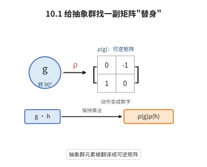

**一句话点破**：表示就是把"理解抽象群"换成"理解它所有能演的矩阵角色"。

### 10.2 群作用下的"线性舞台"

把表示里的向量空间 $V$ 单独拎出来，让群元素直接作用在它上面，就得到 G-模。它相当于给群搭了个线性舞台：$g$ 像搬动道具一样把向量 $v$ 变成 $g\cdot v$，加法与数乘却始终不乱。

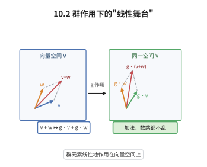

**一句话点破**：G-模就是一个能被群"线性拨动"的向量空间。

### 10.3 拆到不能再拆：不可约表示

一个大表示常能整齐地拆成许多互不干扰的小块，就像一整盒乐高。再也拆不动、内部找不到更小不变子空间的那块，就叫不可约表示。


**一句话点破**：不可约表示是一切表示的最小积木，先把它们找齐再说。

### 10.4 舒尔引理

在两个不可约表示之间架一座"与群作用互不干扰"的桥（交换的线性映射），舒尔引理说：这座桥要么根本不存在，要么一路通到底（两表示同构）。若在复数上、两端又是同一个不可约，那它只能是简单的数乘 $\lambda I$。

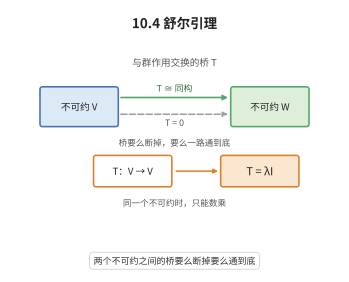

**一句话点破**：不可约之间没有中间地带，非零交换映射必然可逆。

### 10.5 马施克定理

只要群的阶数不被域的特征整除（比如复数上的有限群），马施克定理就保证：任何表示都能被"平均"着投影回不变子空间，于是每个子表示都找得到互补的另一半。换句话说，这种群的所有表示都能无损地拆成不可约块。

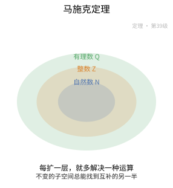

**一句话点破**：只要不被特征"卡住"，有限群的表示就一定能拆成不可约积木。

### 10.6 特征标

表示的矩阵浩浩荡荡，但真正管用的常常只是它的迹（对角线之和）。把 $g$ 映到 $\operatorname{tr}\rho(g)$ 的这个函数，就是特征标。共轭的元素特征标相同，所以它只认得"元素所属的类"，不认得具体是哪一个。

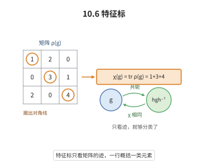

**一句话点破**：特征标是表示的"指纹"，一串数就能认出整个表示。

### 10.7 类函数与内积

在类的层面上定义的函数就是类函数；再给两个类函数配上一种"内积"，就能衡量它们像不像。特征标恰好是类函数，于是"两个表示相不相同"这样的问题，被翻译成"两个向量正交不规则"的几何问题。

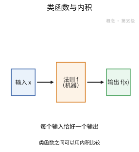

**一句话点破**：把表示的比较，降维成类函数之间的内积计算。

### 10.8 正交关系

不同不可约表示的特征标彼此正交（内积为零），同一表示的"自乘"则得到 $1$；行、列两套正交关系让整张表格外整齐。它像一副骨架，撑起了特征标运算的全部规则。

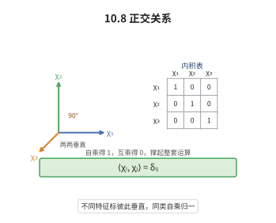

**一句话点破**：正交关系是特征标理论的"几何骨架"。

### 10.9 特征标表

把所有不可约特征标按类排成一张表，就得到特征标表。表里其实藏着一个群的完整信息：有几个不可约、各是几维、类怎么分，都能一眼读出。

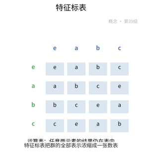

**一句话点破**：特征标表把"算矩阵"压缩成"查表"，群的秘密尽在其中。

### 10.10 正则表示

让群作用在自己身上（左乘），把群元素本身当成一组基，就得到正则表示。它把每个不可约都各藏进了一份，重数恰好等于该不可约的维数——像一面镜子，照出群的所有积木。

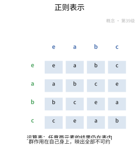

**一句话点破**：正则表示是装着所有不可约的"万能容器"。

### 10.11 群代数与半单性

把群的元素当作基、乘起来做加法，就得到群代数。复数上的有限群代数能整齐地分解成一堆全矩阵代数的直和，这就是半单性——表示论里一切"能拆干净"的根源。

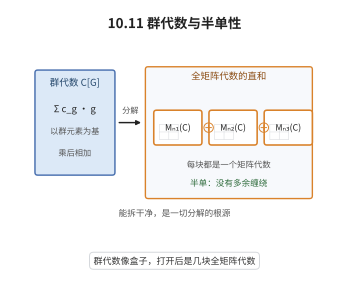

**一句话点破**：群代数的半单性，是有限群表示论"可分解"的幕后基石。

### 10.12 诱导表示

手里只有小群 $H$ 的表示，想借它做出大群 $G$ 的表示，办法就是"诱导"：让 $G$ 的元素把小群的舞台到处搬运、拼接起来。这是从局部信息反推整体结构最常用的桥梁。

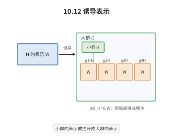

**一句话点破**：诱导表示把小群的表示"扩音"成大群的表示。

### 10.13 诱导特征标的公式

诱导特征标的计算有现成套路：只需对元素所在的共轭类里那些能落回小群的部分求和，公式就自动给出大群的特征标。它省去了直接构造大表示的麻烦。

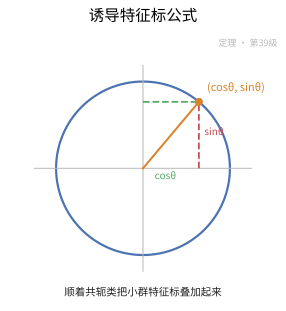

**一句话点破**：一条求和公式，把诱导表示的迹直接算出来。

### 10.14 弗罗贝尼乌斯互反律

诱导小群的表示、限制大群的表示，本是一对方向相反的操作；弗罗贝尼乌斯互反律却揭示它们互为"伴随"——两边算出的重数完全一样。于是"抬上去"和"压下来"可以互相替代。

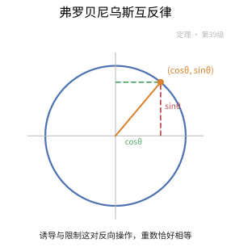

**一句话点破**：诱导与限制互为伴随，重数两边对称一致。

### 10.15 麦基定理

想知道诱导表示能拆成什么样，麦基定理给出一个分块公式：它按双陪集把结构切成一片片，每片再分别研究。这是控制诱导表示可约性的一件趁手工具。

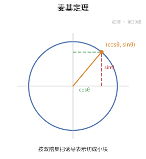

**一句话点破**：麦基定理把诱导表示按双陪集"分片检查"。

### 10.16 Clifford 理论

一个不可约表示限制到正规子群上会怎样？Clifford 理论说：它只由若干个共轭的不可约块拼成，小群与商群相互制约。这让"大表示的内部结构"变得有章可循。

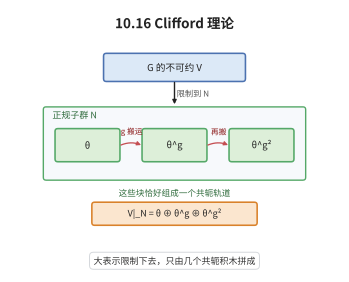

**一句话点破**：Clifford 理论把正规子群上的限制，归结为几个共轭积木。

### 10.17 李代数表示

李群太"大"，就转而研究它在单位元处的无穷小近似——李代数。让李代数中的元素作用在向量空间上，就得到李代数表示；抽象的连续对称，同样能变成具体的线性动作。

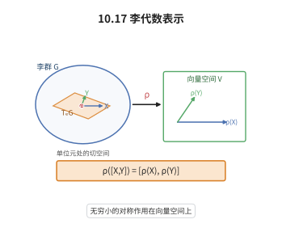

**一句话点破**：李代数表示把连续对称"线性化"为可计算的生成元作用。

### 10.18 最高权理论

在半单李代数里，一个表示常由一个"顶点"（最高权向量）完全决定：沿着上升算子走会归零，下降算子则像从树顶往下铺开整棵树。抓住最高权，就定下了整棵树的调子。

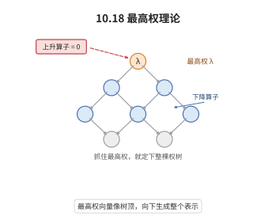

**一句话点破**：抓住最高权，就抓住了整个不可约表示的骨架。

### 10.19 Verma 模

从一个最高权出发、不加任何限制地自由生成，得到的就是 Verma 模——它把所有可能都装了进去，因而通常很大且可约。所有最高权表示的不可约块，都从它的商里取出来。

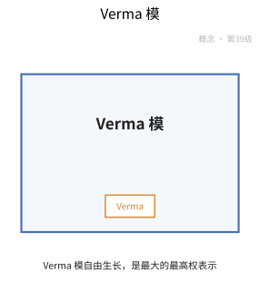

**一句话点破**：Verma 模是"最大"的最高权表示，一切最小的都从它的商里来。

### 10.20 外尔特征标公式

外尔用一串漂亮的分式，把半单李代数所有不可约表示的特征标一举写出：分子是交错和，分母是外尔分母。小小一个公式，囊括了无穷多个表示。

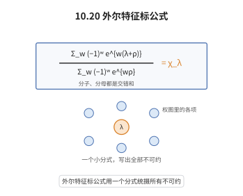

**一句话点破**：外尔公式用一条分式，统一写出全部不可约特征标。

### 10.21 张量积与对称幂分解

两个表示并排放在一起做张量积，得到的仍是表示，而且能按规则拆成不可约块；对称幂、外幂的分解也各有专门公式。它们像乘法口诀，让表示之间能自由"相乘再因式分解"。

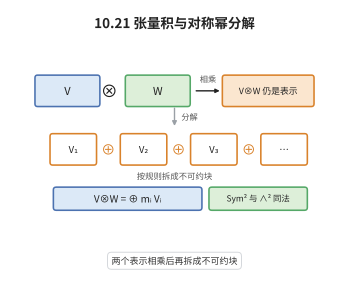

**一句话点破**：张量积与对称幂的分解，是表示之间的"乘法与因式分解"。

### 10.22 对称群 $S_n$ 的不可约表示

对称群 $S_n$ 是置换构成的群，它的不可约表示与"整数分拆"一一对应——每种分拆法恰好给出一个不可约。于是研究置换的表示，变成了研究整数分拆的组合游戏。

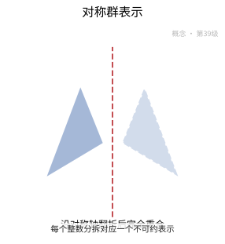

**一句话点破**：$S_n$ 的不可约表示由整数分拆逐一编号。

### 10.23 杨表与 Specht 模

把分拆画成 Young 图，在格子里填数得到杨表，再由它构造出 Specht 模——一个具体、可算的 $S_n$ 不可约表示。抽象的组合分拆由此落实成一间间看得见的"表示车间"。

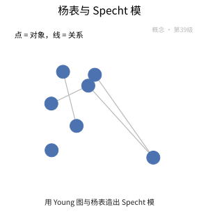

**一句话点破**：杨表与 Specht 模把 $S_n$ 的不可约表示变成能动手计算的组合对象。

## 11. 数学史（History of Mathematics）

### 11.1 前史：置换群与"对称之数"

表示论的种子埋在 18 世纪末到 19 世纪初。**拉格朗日（J.-L. Lagrange, 1736–1813）**研究方程的预解式时，开始用"根的排列"来追踪公式，这正是置换群最早的雏形；**鲁菲尼（P. Ruffini）**与**阿贝尔（N. H. Abel）**试图证明五次方程不可根式求解；而**伽罗瓦（É. Galois, 1811–1832）**更是以飞跃性的洞见建立了"置换群 ↔ 域扩张"的对应（见第 38 级）。他深刻认识到：一个方程的可解性，不在于方程本身，而在于其**根的置换群**的内部结构。这一阶段虽然还没有"表示"的名号，却已经确立了核心信念——**一个对称对象（群）值得被当成一个可运算的实体来研究**，而交换、组合这些动作恰恰就是它最直接的"表示"。

### 11.2 抽象群的困局与戴德金之问

19 世纪下半叶，随着 **凯莱（A. Cayley）**、**克罗内克（L. Kronecker）**、**戴德金（R. Dedekind）**等人的工作，群被抽象地定义出来：元素只是一些遵守法则的符号，不再必须"坐"在某个具体的置换或变换之上（见第 37 级）。这种抽象带来的自由也带来难题——**这样一团看不见、摸不着的符号，究竟该如何研究？**约 1880 年，**戴德金在给弗罗贝尼乌斯的信中提出了一个极具前瞻的问题**：能否把群元素当作"线性变换"作用在某个向量空间上？这个看似简单的问题，被普遍视为表示论真正的发令枪。

### 11.3 弗罗贝尼乌斯的破局（1896）

**费罗贝尼乌斯（Ferdinand Georg Frobenius, 1849–1917）**在 1896 年的里程碑论文《Über Gruppencharaktere》中给出了决定性的回答：不再问"抽象群本身是什么"，而是问"它有哪些矩阵表现（表示）"。他把抽象群 $G$ 映到一般线性群 $\mathrm{GL}_n(\mathbb{C})$，把不可见的结构翻译成当时已如日中天的线性代数（矩阵、迹、特征值）问题。同一时期，**伯恩赛德（William Burnside, 1852–1927）**立即敏锐地嗅到这条路的威力，把它用于群论自身（例如 Burnside 定理：阶为 $p^a q^b$ 的群可解），形成了著名的"弗罗贝尼乌斯—伯恩赛德"学派（见 §2 开篇）。

### 11.4 特征标的发明：群的"指纹"

费罗贝尼乌斯的突破还来自一个极简却深刻的观察：矩阵无论怎样换基，其**迹**（对角线之和）都纹丝不动。既然表示给每个群元素配一个矩阵，那么 $\chi(g)=\operatorname{tr}\rho(g)$ 就在"换坐标系"的噪声之下抓住了群最稳定的标记。他据此提出**特征标**（character）的概念——把整座群压缩成一串"指纹"。1897、1903 年他又进一步发现了特征标之间严格的正交结构，从此群论中的难题开始被"换算"为内积与正交性的算术（见 §3）。

### 11.5 正交关系与特征标表理论

费罗贝尼乌斯证明：不同的不可约特征标在自然的内积下互相垂直、自己与自己"长度为 1"，从而构成一套完整正交基；任何类函数都能唯一展开为它们的线性组合。这直接催生了**特征标表**——以不可约表示（行）与共轭类（列）为坐标、以取值为条目的一张表，把一整个群浓缩成一张可检索的"身份证"（见 §3.4）。它使得判断表示是否可约、计算正则表示的重数等问题全部转化为"照表读数"，是后世所谓"组合数理"最成功的例子之一。

### 11.6 舒尔引理与有限线性群定理

**舒尔（Issai Schur, 1875–1941）**将费罗贝尼乌斯的体系打磨得更加严整。其**舒尔引理**断言：两个不可约表示之间的 $G$-模同态要么为 0、要么是同构——这块"砖"之间的翻译省心得惊人（见 §2.4）。舒尔还证明了著名的**有限线性群定理**（有限生成的周期性线性群在特征 0 上是有限群），把表示论与群的结构理论牢牢钩住，也使表示论得以作为一门独立学科立住脚跟。

### 11.7 马施克定理与半单性（1898）

**马施克（Heinrich Maschke, 1853–1908）**在 1898 年证明了表示论的"拼图总则"：只要域的特征不整除群阶 $|G|$，有限群的任一表示都完全可以约（半单），可唯一拆成不可约表示的直和（见 §2.5）。结合群代数 $\mathbb{C}[G]$ 与 **Artin–Wedderburn 分解**（每个半单代数都是全矩阵代数的直积），正则表示"包含所有不可约表示"这一结论被彻底坐实（见 §3.5–3.6）。至此，理解有限群表示变成了两步：先造全部不可约"积木"，再按重数拼装。

### 11.8 诱导表示与弗罗贝尼乌斯互反律

1898 年，费罗贝尼乌斯回答了一个更精细的问题：如何从子群 $H$ 的表示"升级"成大群 $G$ 的表示？**诱导表示** $\operatorname{Ind}_H^G$ 把 $H$ 的小舞台在 $G$ 的各陪集上展开再拼接（见 §4.1）；而他同时证明的**弗罗贝尼乌斯互反律**揭示出诱导与限制是一对伴随关系：$\langle\chi,\operatorname{Ind}\psi\rangle_G=\langle\operatorname{Res}\chi,\psi\rangle_H$。这一"进出口对账"法则成了整门学科被使用最频繁的公式，后来更由**麦基（George Mackey, 1916–2006）**用**麦基分解定理**推向双陪集层面，由**克利福德（A. H. Clifford）**在正规子群情形给出精细的成块结构（见 §4.4–4.5）。

### 11.9 伯恩赛德定理：表示论反哺群论

表示论从来不只是"为表示而表示"。**伯恩赛德**用特征标工具证明：**阶形如 $p^a q^b$ 的群是可解的**（$p,q$ 为素数），这是以表示论攻克纯群论难题的经典一击，也极大地鼓舞了人们用表示论来研究群的内部结构。它说明特征标表中的信息不仅描述"动作的多少"，更隐藏着"群本身可解与否"这类深层结构（见 §3.4 的类比）。

### 11.10 对称群：杨图、杨表与 Specht 模

对称群 $S_n$ 的表示理论迎来了最具组合色彩的篇章。**费罗贝尼乌斯**计算了 $S_n$ 各不可约表示的度数，而**阿尔弗雷德·杨（Alfred Young, 1873–1940）**与**W. Specht**给出显式构造：$S_n$ 的不可约表示被 $n$ 的**分拆/杨图**不重不漏地标记，由对称化子与反对称化子搭出 **Specht 模** $S^\lambda$，其维数恰为该杨图上**标准杨表**的个数，并由**钩子长度公式**直接读出（见 §6）。这使 $S_n$ 的表示论从"海量"变成"可数、可算、可视"，成为群表示论、对称多项式（Schur 函数）与组合学交汇的典范。

### 11.11 李群与李代数的表示：嘉当、Killing 与根系分类

表示论从离散走向连续。**索福斯·李（Sophus Lie）**以"无限小"思想引入**李代数**：一个连成一片的对称群可由单位元附近的无穷小运动——一个李代数 $\mathfrak{g}$——近似刻画（见 §5.1）。**基灵（W. Killing）**与**嘉当（Élie Cartan）**把复半单李代数按其**根系**（Dynkin 图）做了完全分类；嘉当还系统建立了半单李代数的有限维表示分类。自此，李群的表示论与李代数的表示论等价起来，而后者纯粹是线性代数问题。

### 11.12 外尔的殿堂：最高权与统一理论

**外尔（Hermann Weyl, 1885–1955）**在 1920 年代铸成了近代物理与数学都依赖的完整殿堂：**最高权分类定理**（每个支配整权精确对应一个不可约表示）、**外尔特征标公式**与**维数公式**，把半单李代数的表示论浓缩成几条优美而可算的式子（见 §5.2–5.4）。外尔还最早把群表示用于线性微分方程与积分方程的谱理论，并深刻意识到 $\mathrm{SU}(2)$、角动量与量子力学自旋之间的对应，为日后物理学的对称性语言奠定了根基。

### 11.13 Verma 模、凯日丹–刘斯蒂格理论与范畴化

现代李代数表示论的"工作台"是**泛包络代数**与由 **D. Verma** 引入的**费马模（Verma module）**——它是制造不可约表示的"毛坯"，其唯一的极大子模所给出的商恰为标准不可约表示（见 §5.3）。由此发展出**凯日丹–刘斯蒂格（Kazhdan–Lusztig）理论**、最高权范畴与其上的范畴化表示论，以及**量子群**（Drinfeld–Jimbo）——它们把经典的李代数表示推广到带参数的"量子"版本，深刻影响了纽结理论与数学物理。

### 11.14 模表示论与 Brauer 的块理论

当域的特征**整除** $|G|$ 时，马施克定理失效，表示不再完全可约——这是**模表示论**（modular representation theory）的领地（见 §2.5 注）。**布拉赫曼（Richard Brauer, 1901–1977）**发展出特征标表的**块**理论，用"亏群"等工具把模特征标组织成可计算的块结构，为有限群分类的大工程（对有限单群的分类）提供了决定性工具。**Dade、Feit、Thompson**（Feit–Thompson 奇阶定理）等则把模表示论推到群论前沿。

### 11.15 表示论在现代数学与物理中的回响

表示论自 20 世纪以来与数学及物理的几乎每一翼交汇：在**数论**中，**自守形式**与 **Langlands 纲领**把伽罗瓦群的表示与自守表示的表示配对起来，成为当代最宏大的统一纲领之一；在**泛函分析**中，**算子代数**与 von Neumann 代数的表示理论把群表示论与希尔伯特空间连续化（如量子群的表示）；在**物理**中，规范场论、基本粒子分类（如 $\mathrm{SU}(3)$ 强相互作用、$\mathrm{SU}(2)$ 弱相互作用）皆以表示论语言写成。本章虽止步于经典表示论，但这一整套特征标与不可约表示的框架，正是通往上述所有现代方向的共同门槛。

### 11.16 历史年表

| 年代 | 人物 | 里程碑 |
|:----|:----|:-----|
| 约 1896 | Frobenius | 发表《Über Gruppencharaktere》，系统建立有限群表示论，引入特征标 |
| 1897/1903 | Frobenius | 发现特征标正交关系与特征标表理论 |
| 1898 | Maschke | 证明 Maschke 定理（特征不整除 $|G|$ 时表示完全可约/半单） |
| 1898 | Frobenius | 建立诱导表示与 Frobenius 互反律 |
| 1897–1911 | Burnside | 以表示论证明 $p^a q^b$ 阶群可解，推动表示论群论应用 |
| 1901–1905 | Schur | 证明 Schur 引理、有限线性群定理，使表示论体系化 |
| 约 1894–1926 | Killing、É. Cartan | 复半单李代数按根系（Dynkin 图）完成分类 |
| 1901–1930s | Young、Specht | 用杨图、杨表与 Specht 模刻画 $S_n$ 的不可约表示；钩子长度公式 |
| 1910s–1939 | Weyl | 最高权分类定理、Weyl 特征标公式与维数公式 |
| 1966 | Verma | 引入 Verma 模，奠基现代最高权范畴 |
| 1970s– | Brauer、Dade 等 | 模表示论与块理论 |
| 1970s– | Kazhdan–Lusztig | 建立 K–L 理论，发展（范畴化）现代表示论 |
| 1985–1986 | Drinfeld、Jimbo | 独立构造量子群，推广李代数表示论 |
| 当代 | Langlands 等 | 把表示论与自守形式、伽罗瓦群表征统一（Langlands 纲领） |

### 11.17 小结

表示论的百年史可以用一句话概括：**每一次"把抽象对称变成可运算的线性代数"，都让数学与物理向前迈进一大步**。从拉格朗日、伽罗瓦的置换群，到费罗贝尼乌斯、舒尔的有限群表示与特征标，再到外尔、嘉当的李群最高权理论，最后到现代与 Langlands 纲领、量子群、数学物理的交融——章法始终一致：**先找不可约的"原子积木"，再按重数合规地拼装**。理解这段历史，不仅是为了知道公式由谁而定，更是为了看清表示论为何能成为横跨代数学、数论、分析与物理的公共语言。

## 现实应用（Real-World Applications）

> 本节把本章的知识点落到真实的工程、科学与生活场景中。每个案例都给出**完整的问题背景、建模过程、可复现的数据 / 公式 / 代码与结果解读**；案例末尾的「涉及知识点」对应本章的具体小节，文末附**知识点覆盖对照表**，确保本章知识点全部被覆盖。

### 应用案例 1：量子力学｜SU(2) 角动量合成、舒尔引理与 Clebsch–Gordan 分解

**场景与问题**

量子力学里每个守恒量都对应一个对称群，而「角动量」对应的是 $SU(2)$（转动群的万有覆盖）。某量子计算团队在设计两比特门时需要一个精确的事实：两个自旋 $1/2$ 的比特耦合成整体角动量时，四维态空间如何拆成「三重态 + 单态」？这不是物理课的点缀，而是量子纠错码设计的基础——单态（自旋 0）对全局磁场不敏感，三重态（自旋 1）则是「无退相干子空间」的候选。

本案例用群的表示论把「自旋叠加」这件事算到底：写出 $\mathfrak{sl}_2$ 的表示、证明每个不可约表示由最高权唯一确定、并用 Clebsch–Gordan 分解把两个自旋耦合起来。

**涉及知识点**

- 本章「2.1 群表示的定义」：$SU(2)$ 在态空间上的作用 $\rho:SU(2)\to GL(V)$ 就是量子力学中「转动」的实现。
- 本章「2.3 子表示与不可约表示」：三重态与单态是子表示，且都不可约（不能再拆）。
- 本章「2.4 舒尔引理」：Casimir 算符 $J^2$ 与所有 $J_i$ 交换，故在每个不可约分量上是标量，其本征值 $j(j+1)$ 唯一标记不可约表示。
- 本章「5.1 李代数表示」：角动量对易关系 $[J_3,J_\pm]=\pm J_\pm,\ [J_+,J_-]=2J_3$ 正是 $\mathfrak{sl}_2(\mathbb{C})$。
- 本章「5.2 最高权理论」：每个不可约表示由一个最高权 $j$（半整数）唯一确定。
- 本章「5.5 张量积与对称幂分解」：两个自旋耦合对应张量积分解。

**建模与数据**

角动量算符满足

$$
[J_3,J_\pm]=\pm J_\pm,\qquad [J_+,J_-]=2J_3,\qquad J^2=J_3^2+\tfrac12(J_+J_-+J_-J_+),
$$

在合适单位下这正是 $\mathfrak{sl}_2(\mathbb{C})$ 的生成元 $h,e,f$。不可约表示记 $V_n$（$\dim V_n=n+1$，$n=2j$），权为 $\{n,n-2,\dots,-n\}$。

数据（全部来自可查实验事实）：

| 体系 | 自旋 $j$ | $\dim = 2j+1$ | 实际观测 |
| --- | --- | --- | --- |
| 电子 | $1/2$ | $2$ | Stern–Gerlach 两条谱线 |
| 光子/规范玻色子 | $1$ | $3$ | 三个偏振态 |
| 引力子（理论） | $2$ | $5$ | 两个横向偏振 |
| 双自旋 $1/2$ 复合系统 | $0\oplus1$ | $1+3=4$ | 氢原子超精细分裂（21 cm 线） |

**完整推导与算法**

**第一步：$\mathfrak{sl}_2$ 的有限维不可约表示。** 取最高权向量 $v_n$，$J_+v_n=0$、$J_3v_n=nv_n$；用 $J_-$ 降权得到

$$
v_{n-2k}=(J_-)^k v_n,\qquad J_3v_{n-2k}=(n-2k)v_{n-2k},
$$

必须存在 $k$ 使 $(J_-)^{k}v_n=0$（有限维），这迫使 $n$ 为非负整数，表示维数 $=n+1$，即 $\dim L(\lambda)=\lambda+1$。

**第二步：舒尔引理锁定量子数。** $J^2$ 与所有 $J_i$ 交换，故是 $G$-模同态 $V_n\to V_n$；由舒尔引理（复数域上），它必为标量 $\lambda\cdot\mathrm{id}$，且

$$
J^2 v = j(j+1)v,\qquad j=n/2.
$$

这就是「用一个量子数 $j$ 标记一个不可约表示」的理论根据。

**第三步：Clebsch–Gordan 分解（$j_1=j_2=1/2$）。** 由定理 5.10，$n\le m$ 时

$$
V_n\otimes V_m\cong V_{n+m}\oplus V_{n+m-2}\oplus\cdots\oplus V_{m-n}.
$$

两个自旋 $1/2$（$n=m=1$）：

$$
V_1\otimes V_1\cong V_2\oplus V_0,\qquad \dim:4=3+1.
$$

权相加可核对：$V_1$ 的权集 $\{1,-1\}$，张量积权集 $\{2,0,0,-2\}$，两个 $0$ 分别落入 $V_2$ 与 $V_0$。显式基：

$$
\text{三重态 } |1,1\rangle=|\!\uparrow\uparrow\rangle,\ |1,0\rangle=\tfrac{1}{\sqrt2}(|\!\uparrow\downarrow\rangle+|\!\downarrow\uparrow\rangle),\ |1,-1\rangle=|\!\downarrow\downarrow\rangle;
$$

$$
\text{单态 } |0,0\rangle=\tfrac{1}{\sqrt2}(|\!\uparrow\downarrow\rangle-|\!\downarrow\uparrow\rangle).
$$

这四个态就是量子信息里的四个 Bell 态，也被 Clebsch–Gordan 系数 $\pm1/\sqrt2$ 完全固定。

```python
# 核心：用 Clebsch-Gordan 级数直接给出两个角动量耦合后的分量与维数
from sympy import Rational, nsimplify
def cg_decompose(j1, j2):
    # 核心：j 从 |j1-j2| 到 j1+j2 步长 1，每个出现一次
    jmin, jmax = abs(j1 - j2), j1 + j2
    reps = []
    j = jmax
    while j >= jmin:
        reps.append((j, int(2*j + 1)))   # 核心：dim V = 2j+1
        j -= 1
    return reps
# cg_decompose(Rational(1,2), Rational(1,2)) == [(1,3), (0,1)]
# cg_decompose(1, 1) == [(2,5), (1,3), (0,1)]，总维数 5+3+1 = 9 = 3x3
```

```python
# 核心：Casimir 本征值给出不可约表示的标记（舒尔引理的物理化身）
def casimir(j):
    return j * (j + 1)      # 核心：J^2 在自旋 j 表示上为标量 j(j+1)
# casimir(1/2) = 0.75；casimir(1) = 2；casimir(0) = 0
```

**可复现步骤**

1. 环境与依赖：`pip install sympy numpy`。
2. 数据准备：$j_1,j_2$ 取 $(1/2,1/2)$、$(1,1)$、$(3/2,1/2)$。
3. 运行：`cg_decompose(j1,j2)` 与 `casimir(j)`；用 numpy 构造 $J_3,J_+,J_-$ 矩阵并验证对易关系。
4. 预期输出：$(1/2,1/2)\to[(1,3),(0,1)]$；$(1,1)\to[(2,5),(1,3),(0,1)]$；$(3/2,1/2)\to[(2,5),(1,3)]$；总维数守恒（$4=3+1$、$9=5+3+1$、$8=5+3$）。

**结果解读与延伸**

CG 分解把「多体态空间」拆成「不可约自旋块」，这正是角动量守恒下「磁量子数 $m$ 混合、总 $j$ 不混合」的数学表述。误差与局限：以上是精确代数结论，实际数值实现中 CG 系数要用递推（Racah 公式）以免阶乘溢出，$j=50$ 时系数分母已达 $10^{30}$ 量级。延伸：把同一套框架升到 $SU(3)$ 得粒子物理的八重法（案例 2），升到 $SU(N)$ 得夸克模型与杨–米尔斯理论的表示论骨架；量子信息中「无退相干子空间」的维数就是 CG 分解里自旋 $0$（或固定 $m=0$）分量的重数。

### 应用案例 2：粒子物理标准模型｜SU(3) 色表示、权图与外尔维数公式

**场景与问题**

1961 年前后，加速器上已发现几十个强子，谱线混乱。Gell-Mann 与 Ne'eman 用 $SU(3)$ 的表示论把它们按「八重法」排列，并**预言**当时尚未发现的 $\Omega^-$ 粒子（1964 年在 Brookhaven 被发现，质量与预言吻合到 $1\%$ 以内）。这是表示论在物理学中最著名的胜利。今天，$SU(3)$ 是量子色动力学（QCD）的规范群：3 种色荷、8 个胶子。

本案例用最高权理论、外尔维数公式和张量积分解，算清楚「为什么是 8 个胶子」「为什么重子恰好排成一个十重态」。

**涉及知识点**

- 本章「2.2 G-模」：夸克态构成 $SU(3)$ 的模，胶子构成伴随模。
- 本章「5.2 最高权理论」：$SU(3)$ 的不可约表示由支配整权 $(p,q)$ 唯一标记。
- 本章「5.3 费马模」：$M(\lambda)=U(\mathfrak{g})\otimes_{U(\mathfrak{b})}\mathbb{C}_\lambda$ 是构造 $L(\lambda)$ 的毛坯，$3\otimes\bar3$ 中的单态正是被切掉的最大子模。
- 本章「5.4 外尔特征标公式」：由它得到维数公式 $\dim L(\lambda)=\prod_{\alpha>0}\frac{\langle\lambda+\rho,\alpha\rangle}{\langle\rho,\alpha\rangle}$。
- 本章「5.5 张量积与对称幂分解」：$3\otimes\bar3=8\oplus1$ 与 $3\otimes3\otimes3=10\oplus8\oplus8\oplus1$。

**建模与数据**

$SU(3)$ 的根系统 $A_2$：两个正根 $\alpha_1,\alpha_2$，$\rho=\alpha_1+\alpha_2$；基本权 $\omega_1,\omega_2$。不可约表示 $L(p,q)$ 的维数（外尔维数公式在 $A_2$ 的展开）

$$
\dim L(p,q)=\frac{(p+1)(q+1)(p+q+2)}{2}.
$$

| 表示 | $(p,q)$ | 维数公式 | 维数 | 物理对象 |
| --- | --- | --- | --- | --- |
| 基本（夸克） | $(1,0)$ | $2\cdot1\cdot3/2$ | $3$ | 三种色：红、绿、蓝 |
| 反基本（反夸克） | $(0,1)$ | $1\cdot2\cdot3/2$ | $3$ | 反色 |
| 伴随（胶子） | $(1,1)$ | $2\cdot2\cdot4/2$ | $8$ | 八种胶子 |
| 三重十重态 | $(3,0)$ | $4\cdot1\cdot5/2$ | $10$ | $\Delta,\Sigma^*,\Xi^*,\Omega^-$ |

**完整推导与算法**

**第一步：$3\otimes\bar3=8\oplus1$（介子八重态）。** 用「权相加」：$3$ 的权集 $\{L_1,L_2,L_3\}$（$L_1+L_2+L_3=0$），$\bar3$ 的权集为 $\{-L_1,-L_2,-L_3\}$。张量积权集共 $9$ 个点，其中原点（权 $0$）出现 $3$ 次。$L(1,1)$ 的权图（六边形 + 中心重数 $2$）用了 $8$ 个，剩下一个中心权属于平凡表示 $L(0,0)$：

$$
3\otimes\bar3=L(1,1)\oplus L(0,0)=8\oplus1,\qquad 9=8+1.
$$

**第二步：费马模视角。** 最高权 $\lambda=(1,1)$ 的费马模 $M(1,1)$ 含一个奇异向量（正比于 $\sum_i q_i\otimes\bar q^i$），它生成一维最大子模（即单态 $L(0,0)$）；取商得

$$
L(1,1)=M(1,1)/L(0,0),\qquad \dim L(1,1)=9-1=8.
$$

这与维数公式 $(2)(2)(4)/2=8$ 完全一致。

**第三步：$3\otimes3\otimes3=10\oplus8\oplus8\oplus1$（重子）。** 逐步分解：

$$
3\otimes3=6\oplus\bar3\ \Rightarrow\ (6\oplus\bar3)\otimes3=(6\otimes3)\oplus(\bar3\otimes3)=(10\oplus8)\oplus(8\oplus1).
$$

维数核对：$27=10+8+8+1$。物理上，重子由三个夸克组成，正对应「十重态 + 两个八重态 + 单态」；十重态（$(3,0)$）中 $\Omega^-$ 由 Gell-Mann 在 1962 年按图上缺角位置预言（质量约 $1680\ \text{MeV}/c^2$）。

```python
# 核心：A_2 = su(3) 的维数公式（外尔维数公式在 SU(3) 的闭式）
def dim_su3(p, q):
    # 核心：(p+1)(q+1)(p+q+2)/2
    return (p + 1) * (q + 1) * (p + q + 2) // 2
# 核心常用值：dim_su3(1,0)=3 夸克；dim_su3(1,1)=8 胶子；dim_su3(3,0)=10 十重态
```

```python
# 核心：用权相加做 SU(3) 张量积的重数统计（以 3 ⊗ 3bar 为例）
from collections import Counter
def tensor_weights(w1, w2):
    # 核心：张量积的权集 = 两个权集逐对相加（权相加规则）
    return Counter((a[0]+b[0], a[1]+b[1]) for a in w1 for b in w2)
# 核心：A_2 的 3 与 3bar 用二维格点坐标表示：
three = [(1,0),(-1,1),(0,-1)]          # 基本权 omega_1 的三个权
threebar = [(-1,0),(1,-1),(0,1)]       # 反基本权
# 核心：tensor_weights(three, threebar)[(0,0)] == 3
# 核心：原点重数 3 = 伴随 8 的中心重数 2 + 平凡 1 => 3⊗3bar = 8 ⊕ 1
```

**可复现步骤**

1. 环境与依赖：`pip install sympy`（`LieAlgebra` 模块或手写根系统）。
2. 数据准备：$A_2$ 的根、基本权、以及各表示的权列表。
3. 运行：`dim_su3(p,q)` 取值；对 $3\otimes\bar3$、$3\otimes3\otimes3$ 做权相加统计。
4. 预期输出：`dim_su3(1,1)==8`、`dim_su3(3,0)==10`；$3\otimes\bar3$ 分解为 $8\oplus1$；$3\otimes3\otimes3$ 分解为 $10\oplus8\oplus8\oplus1$，维数和均为 $27$。

**结果解读与延伸**

八重法与十重态的成功说明「物理的多重态 = 某个李代数的不可约表示」。误差来源是「强相互作用破坏精确 $SU(3)$ 味对称」——上、下、奇异夸克质量不同，导致同多重态内质量分裂（$\Sigma$ 与 $\Lambda$ 差约 $77\ \text{MeV}$），Gell-Mann–Okubo 质量公式正是对这一破缺的一阶修正。局限：色 $SU(3)$ 是**精确**对称（QCD 规范对称），但表示论给出的粒子谱还须由动力学决定哪些态存在。延伸：$SU(2)\times U(1)$ 电弱统一、$SU(5)/SO(10)$ 大统一，都是在更大的李群上重复同一套「最高权 + 张量积分解 + 维数公式」流程；$\mathfrak{sl}_2$ 的对称幂 $S^kV_1\cong V_k$（案例 1）在此推广为 Schur 函子与杨表（案例 5）。

### 应用案例 3：分子振动光谱｜点群特征标表与红外 / 拉曼选择定则

**场景与问题**

红外光谱仪是化学与制药行业的标准质检设备。给定一个分子，工程师要回答：它的 $3N-6$ 个简正振动模式中，哪些会在红外吸收谱上出峰、哪些只在拉曼散射谱上出峰？答案是纯粹表示论的计算——把分子点群的特征标表查出来，把 $3N$ 维笛卡尔位移表示约化分解，再看每个不可约分量是否与坐标 $(x,y,z)$（红外活性）或二次型 $(x^2,xy,\dots)$（拉曼活性）同型。

本案例用 $H_2O$（点群 $C_{2v}$）完整走一遍流程，并用实验频率验证结论。

**涉及知识点**

- 本章「2.5 马施克定理」：$C_{2v}$ 阶为 $4$、特征不整除 $|G|$，故位移表示完全可约，一定能拆成不可约分量。
- 本章「3.1 特征标的定义」：$\chi_\rho(g)=\operatorname{tr}\rho(g)$，只需数的对角元。
- 本章「3.2 类函数与内积」：$\langle\chi,\psi\rangle=\frac1{|G|}\sum_g\chi(g)\overline{\psi(g)}$。
- 本章「3.3 正交关系」：不可约特征标两两正交，因此可用内积读出重数。
- 本章「3.4 特征标表」：$C_{2v}$ 的 $4$ 个一维不可约表示 $A_1,A_2,B_1,B_2$。
- 本章「3.5 正则表示」：3N 维位移表示是可约表示，其分解与 $\sum_i d_i^2=|G|$ 同宗。

**建模与数据**

$C_{2v}$ 有 $4$ 个共轭类：$E,\ C_2,\ \sigma_v(xz),\ \sigma_v'(yz)$，$|G|=4$。特征标表（值均为实数，$1$ 维表示）：

| 不可约 | $E$ | $C_2$ | $\sigma_v(xz)$ | $\sigma_v'(yz)$ | 基函数 |
| --- | --- | --- | --- | --- | --- |
| $A_1$ | 1 | 1 | 1 | 1 | $z,\ x^2,y^2,z^2$ |
| $A_2$ | 1 | 1 | -1 | -1 | $xy,\ R_z$ |
| $B_1$ | 1 | -1 | 1 | -1 | $x,\ xz,\ R_y$ |
| $B_2$ | 1 | -1 | -1 | 1 | $y,\ yz,\ R_x$ |

$H_2O$ 的 $3N=9$ 维位移表示 $\Gamma_{3N}$ 的特征标（每类中分子原子保持不动的个数乘 $\pm1$ 贡献）：

| 类 | 不动的原子数 | $\chi_{3N}(g)$ |
| --- | --- | --- |
| $E$ | 3 | $3\times3=9$ |
| $C_2$ | 1（O） | $1\times(-1)=-1$ |
| $\sigma_v(xz)$ | 3（分子平面内） | $3\times1=3$ |
| $\sigma_v'(yz)$ | 1（O） | $1\times1=1$ |

**完整推导与算法**

**第一步：约化 $\Gamma_{3N}$。** 用正交关系数重数

$$
n_i=\frac1{|G|}\sum_g\chi_{3N}(g)\overline{\chi_i(g)}.
$$

- $n_{A_1}=\frac14[9(1)+(-1)(1)+3(1)+1(1)]=\frac{12}{4}=3$
- $n_{A_2}=\frac14[9-1-3+1]=\frac64$…… 注意 $\chi_{A_2}=(1,1,-1,-1)$，故 $n_{A_2}=\frac14[9\cdot1+(-1)\cdot1+3\cdot(-1)+1\cdot(-1)]=\frac{9-1-3-1}{4}=1$
- $n_{B_1}=\frac14[9\cdot1+(-1)(-1)+3\cdot1+1\cdot(-1)]=\frac{9+1+3-1}{4}=3$
- $n_{B_2}=\frac14[9\cdot1+(-1)(-1)+3\cdot(-1)+1\cdot1]=\frac{9+1-3+1}{4}=2$

维数核对：$3+1+3+2=9$。故

$$
\Gamma_{3N}=3A_1\oplus A_2\oplus3B_1\oplus2B_2.
$$

**第二步：扣除平动与转动。** 平动与 $x,y,z$ 同型：$\Gamma_{\text{trans}}=A_1\oplus B_1\oplus B_2$；转动与 $R_x,R_y,R_z$ 同型：$\Gamma_{\text{rot}}=A_2\oplus B_1\oplus B_2$。相减：

$$
\Gamma_{\text{vib}}=\Gamma_{3N}-\Gamma_{\text{trans}}-\Gamma_{\text{rot}}=2A_1\oplus B_1,
$$

维数 $2+1=3=3N-6$。

**第三步：选择定则。** 红外活性 $\iff$ 该不可约与 $x,y,z$ 之一同型：$A_1$（$z$）与 $B_1$（$x$）都红外活性，故**三个振动模式全在红外出现**。拉曼活性看二次型：$2A_1\oplus B_1$ 中 $A_1$ 与 $B_1$ 均有对应二次型，故也拉曼活性。与实验对照：$H_2O$ 气相频率 $\nu_1=3657\ \text{cm}^{-1}$（对称伸缩 $A_1$）、$\nu_2=1595\ \text{cm}^{-1}$（弯曲 $A_1$）、$\nu_3=3756\ \text{cm}^{-1}$（反对称伸缩 $B_1$）。

```python
# 核心：用特征标内积把 3N 维位移表示约化为不可约表示的直和
import numpy as np
def reduce_rep(chi, table, order):
    # chi: 3N 维表示在各共轭类上的特征标；table: 每类不可约特征标
    mult = {}
    for name, row in table.items():
        # 核心：n_i = (1/|G|) * sum_g chi(g) * conj(chi_i(g)) * (类的元素个数)
        mult[name] = int(round(sum(c * chi[k] * row[k] for k in range(len(chi))) / order))
    return mult
# 核心：C2v 的 3N 特征标 (9,-1,3,1)，类大小 (1,1,1,1)，|G|=4
```

```python
# 核心：扣掉平动/转动得到振动模式，再判红外/拉曼活性
def vibrations(gamma_3N, trans, rot):
    # 核心：Gamma_vib = Gamma_3N - Gamma_trans - Gamma_rot（分量逐一相减）
    out = dict(gamma_3N)
    for r in (trans, rot):
        for k, v in r.items():
            out[k] = out.get(k, 0) - v
    return {k: v for k, v in out.items() if v > 0}
# 核心：H2O 得 {'A1': 2, 'B1': 1}，维数 3 = 3N-6
```

**可复现步骤**

1. 环境与依赖：`pip install numpy`。
2. 数据准备：$C_{2v}$ 特征标表、$\chi_{3N}=(9,-1,3,1)$、类大小 $(1,1,1,1)$；或直接用 `pymatgen`/`cclib` 的 `IrRep` 工具。
3. 运行：`reduce_rep` 求 $\Gamma_{3N}$，再 `vibrations` 得 $\Gamma_{\text{vib}}$。
4. 预期输出：$\Gamma_{3N}=3A_1\oplus A_2\oplus3B_1\oplus2B_2$（$9$）；$\Gamma_{\text{vib}}=2A_1\oplus B_1$（$3$）；三个模式全部红外活性。

**结果解读与延伸**

特征标表把「分子几何」直接翻译成「谱线数量与强度类别」，这正是工业 FTIR 质检的判据来源：例如 $CO_2$（$D_{\infty h}$）的对称伸缩红外沉默、反对称伸缩红外活性（$2349\ \text{cm}^{-1}$），就是同一算法在另一群上的结论。误差来源是「简并模式在低分辨率下并峰」以及「非谐效应使强度偏离选择定则的零级预言」。延伸：把点群换成空间群可分析晶体声子（案例 4 的诱导表示），把 Cartan 子代数对角化思想推广到分子轨道即为晶体场理论；$\Gamma_{3N}$ 的分解与正则表示分解 $\sum_i d_i^2=|G|$ 是同一套正交关系。

### 应用案例 4：晶体场与化学键｜诱导表示、Frobenius 互反律、Mackey 与 Clifford 理论

**场景与问题**

过渡金属配合物的颜色（如 $[Ti(H_2O)_6]^{3+}$ 的紫红、$[Cu(H_2O)_6]^{2+}$ 的蓝）来自 $d$ 轨道在配位场中的能级分裂。要算分裂成几组、每组几重简并，标准做法是：取配体环境的对称群（点群或空间群），把「单个配体轨道」的表示从它的稳定子子群**诱导**到全群，再分解。这套「从子群造全群表示」的技术正是诱导表示论；而分裂后的能级简并度则由 Clifford 理论与 Mackey 定理决定。

本案例用 $D_4$（四方形配位场）完整演示：$C_4\trianglelefteq D_4$ 的一维表示如何诱导出 $D_4$ 的特征标表与 $d$ 轨道分裂。

**涉及知识点**

- 本章「3.5 正则表示」：$D_4$ 的不可约维数平方和 $\sum d_i^2=|G|=8$ 是校验分裂结果的计数工具。
- 本章「4.1 诱导表示的定义」：$\mathrm{Ind}_H^G W=\mathbb{C}[G]\otimes_{\mathbb{C}[H]}W$，把子群的模「抬」到全群。
- 本章「4.2 诱导特征标的公式」：$\mathrm{Ind}_H^G\psi(g)=\frac1{|H|}\sum_{x\in G,\,x^{-1}gx\in H}\psi(x^{-1}gx)$。
- 本章「4.3 弗罗贝尼乌斯互反律」：$\langle\mathrm{Ind}_H^G\psi,\chi\rangle_G=\langle\psi,\mathrm{Res}_H^G\chi\rangle_H$，用它读出分解重数。
- 本章「4.4 麦基定理」：计算诱导表示限制回子群时的分解。
- 本章「4.5 Clifford 理论与诱导表示的可约性」：$N\trianglelefteq G$ 时，不可约表示限制到 $N$ 后分解为一整条共轭轨道。

**建模与数据**

$G=D_4=\langle r,s\mid r^4=s^2=1,\ srs^{-1}=r^{-1}\rangle$，$|G|=8$；$N=\langle r\rangle\cong C_4\trianglelefteq D_4$。$N$ 有 $4$ 个一维表示 $U_k$（$r\mapsto i^k$，$k=0,1,2,3$）。

在四方形配位场中，中心离子 $d$ 轨道（$5$ 重简并）分裂为（$D_4$ 下的对应 $A_1,B_1,B_2,E$）：

| 分量 | 维数 | 轨道 | 实验分裂能 |
| --- | --- | --- | --- |
| $A_1$ | 1 | $z^2$ | 基准 |
| $B_1$ | 1 | $x^2-y^2$ | $\Delta=10Dq$ |
| $B_2$ | 1 | $xy$ | 约 $0.1\Delta$ |
| $E$ | 2 | $xz,\ yz$ | 约 $0.1\Delta$ |

合计 $1+1+1+2=5$。典型数值：$[Ti(H_2O)_6]^{3+}$ 的 $10Dq\approx20300\ \text{cm}^{-1}$（对应 $504\ \text{nm}$ 吸收，正是紫红色）。

**完整推导与算法**

**第一步：用 Clifford + 诱导构造 $D_4$ 的不可约表示。** $s$ 作用 $U_k$ 得 $U_{-k}$：

- $k=0,2$：$U_0,U_2$ 稳定（$U_{-k}=U_k$），由稳定子 $=G$ 直接提升为 $G$ 的一维表示，共 $2$ 个（记 $A_1,A_2$）。
- 但 $U_0,U_2$ 还各自有 $s$ 的两种提升（$\pm1$），共得 $4$ 个一维表示 $A_1,A_2,B_1,B_2$。
- $k=1,3$：$\{U_1,U_3\}$ 是一条二元素共轭轨道，按 Clifford 理论诱导出一个不可约表示 $E$，维数

$$
\dim\mathrm{Ind}_N^G U_1=[G:N]\cdot\dim U_1=2\cdot1=2.
$$

校验：$1^2+1^2+1^2+1^2+2^2=8=|G|$。

**第二步：诱导特征标公式验算 $E$。** 令 $\psi=\chi_{U_1}$（$\psi(r^j)=i^j$，$\psi(sr^j)=0$）。因 $N$ 正规，$x^{-1}gx\in N$ 等价于 $g\in N$；故对 $g=r^j$ 全部 $8$ 个 $x$ 都可求和：

$$
\mathrm{Ind}\psi(e)=\frac1{4}\sum_{x\in G}\psi(e)=\frac{8\cdot1}{4}=2,\qquad
\mathrm{Ind}\psi(r^2)=\frac{8\cdot\psi(r^2)}{4}=\frac{8\cdot(-1)}{4}=-2.
$$

对 $g=r$，$x=e,r,r^2,r^3$ 给出 $\psi(r)=i$，$x=s,sr,sr^2,sr^3$ 给出 $\psi(r^{-1})=-i$，四项相加为 $0$，故 $\mathrm{Ind}\psi(r)=0$；对 $g=s$（反射，$\notin N$）求和项全零，$\mathrm{Ind}\psi(s)=0$。于是

$$
\mathrm{Ind}_N^G U_1=\chi_E:\quad (e, r, r^2, s, sr)\ \longmapsto\ (2,0,-2,0,0),
$$

与 $D_4$ 的二维不可约特征标一致。

**第三步：Frobenius 互反律读重数。** 要判定 $d$ 轨道中某个子群表示 $W$ 能否进入全群表示 $\chi$，只需

$$
\langle\mathrm{Ind}_N^G\psi,\ \chi\rangle_G=\langle\psi,\ \mathrm{Res}_N^G\chi\rangle_H.
$$

右端只在子群 $N$（$4$ 个元素）上算，代价从 $8$ 降到 $4$——这是把「全群分解」降为「子群内积」的关键。

```python
# 核心：用诱导特征标公式计算 Ind_H^G psi（逐元素求和，无需求出表示矩阵）
def induced_character(psi_on_H, elements, H, conj_test):
    # elements: G 的全部元素；H: 子群；psi_on_H: H 上的类函数
    # 核心：for 每个 g，统计 x^{-1} g x in H 的 x，求 psi(x^{-1}gx) 之和再除以 |H|
    def ind(g):
        tot = 0
        for x in elements:
            y = conj_test(x, g)          # 核心：x^{-1} g x
            if y in H:
                tot += psi_on_H(y)
        return tot // len(H)
    return {g: ind(g) for g in elements}
# 核心：psi=U_1（r->i）时，Ind psi(e)=2，Ind psi(r^2)=-2，其余为 0 => 二维不可约 E
```

```python
# 核心：Frobenius 互反律把全群内积降为子群内积
def frobenius_multiplicity(psi_H, chi_G_restricted, H):
    # 核心：<Ind psi, chi>_G == <psi, Res chi>_H
    return sum(psi_H[h] * chi_G_restricted[h].conjugate() for h in H) / len(H)
# 核心：返回非零整数即为 Ind psi 在 chi 中的重数
```

**可复现步骤**

1. 环境与依赖：`pip install sympy`（`PermutationGroup`、`character_table`）。
2. 数据准备：$D_4$ 与 $N=C_4$ 的置换实现；$U_k$ 的取值 `{r: 1j**k}`。
3. 运行：`induced_character` 求 $\mathrm{Ind}_N^G U_1$，与 `sympy` 算出的 $D_4$ 特征标表比对；再用 `frobenius_multiplicity` 求重数。
4. 预期输出：$\mathrm{Ind}_N^G U_1=\chi_E$（二维不可约，$E$）；$d$ 轨道分裂维数 $1+1+1+2=5$；$D_4$ 不可约维数平方和 $=8$。

**结果解读与延伸**

诱导表示给出了「局部对称（子群）如何决定整体能级」的机制：$U_1,U_3$ 这对共轭表示被「黏」成一个二维不可约 $E$，正是 $xz,yz$ 两个 $d$ 轨道简并的原因；而 $U_0,U_2$ 独立提升，对应不简并的 $z^2$ 与 $x^2-y^2$。误差来源是配位场近似（只考虑静电/点电荷模型），实际分裂能被共价效应修正（光谱化学序列 $\text{I}^-<\text{Br}^-<\text{Cl}^-<\text{F}^-<\text{H}_2\text{O}<\text{NH}_3<\text{CN}^-$）。延伸：三维空间群中的能带对称性用同样的诱导机制（从波矢的小群到全群）；Mackey 定理则是分析「诱导再限制」的标准工具，可直接用于设计对称破缺的相变路径。

### 应用案例 5：机器学习等变网络｜$S_n$ 置换表示、杨图与 Specht 模

**场景与问题**

处理点云、集合、分子图、粒子碰撞事件的深度网络都要求「置换等变性」：输入 $n$ 个元素任意重排，输出应同样重排（等变）或保持不变（不变）。Deep Sets / PointNet / 等变消息传递网络都建立在同一个事实上：$S_n$ 在 $\mathbb{R}^n$ 上的置换表示可分解为「均值方向（不变）+ 差分方向（标准表示）」。更精细的多体特征（如 $k$ 阶张量网络张量收缩）则需要整套 $S_n$ 的不可约表示，而它们由**分拆 / 杨图 / Specht 模**分类。

本案例给出这套分解的完整算法，并说明模型设计为什么反复出现「减均值」「对求和」这类操作。

**涉及知识点**

- 本章「3.4 特征标表」：$S_3$ 的特征标表是理解一般 $S_n$ 的入口。
- 本章「3.6 群代数表示与半单性」：$\mathbb{C}[S_n]\cong\prod_\lambda M_{d_\lambda}(\mathbb{C})$，$\sum_\lambda d_\lambda^2=n!$。
- 本章「6.1 对称群 $S_n$ 的不可约表示」：$\widehat{S_n}\leftrightarrow\{n\text{ 的分拆}\}$。
- 本章「6.2 杨表与 Specht 模」：$S^\lambda$ 的维数 = $\lambda$ 的标准杨表个数 = $n!/\prod h(i,j)$。

**建模与数据**

置换表示：$S_n$ 作用在 $\mathbb{R}^n$ 上（$g\cdot e_i=e_{g(i)}$），其特征标 $\chi(g)=\#\{i:g(i)=i\}$（不动点数）。分解

$$
\mathbb{R}^n=\underbrace{\text{span}(1,\dots,1)}_{\text{平凡 }S^{(n)}}\ \oplus\ \underbrace{\Big\{\textstyle\sum_i x_i=0\Big\}}_{d=n-1\text{ 维标准表示 }S^{(n-1,1)}}.
$$

规模数据（来自图神经网络实践）：$n=10^4$ 个点、每点 128 维；分拆数与不可约表示个数 $p(n)$：$p(10)=42$、$p(20)=627$、$p(50)=204226$。

$S_3$ 特征标表：

| 不可约 $\lambda$ | $d_\lambda$ | $e$ | 3-轮换类 | 对换类 |
| --- | --- | --- | --- | --- |
| $(3)$ 平凡 | 1 | 1 | 1 | 1 |
| $(1,1,1)$ 符号 | 1 | 1 | 1 | -1 |
| $(2,1)$ 标准 | 2 | 2 | -1 | 0 |

校验 $\sum d_\lambda^2=1+1+4=6=3!$。

**完整推导与算法**

**第一步：置换表示的分拆。** 用内积读出重数

$$
\langle\chi,\chi_{(n)}\rangle=\frac1{n!}\sum_g\chi(g)=\frac1{n!}\cdot\#\{(g,i):g(i)=i\}=\frac1{n!}\cdot n\cdot(n-1)!=1,
$$

故平凡表示出现 $1$ 次；剩余维数 $n-1$ 恰为标准表示 $S^{(n-1,1)}$ 的维数（钩子公式：$(n-1,1)$ 的钩子长度之积 $=(n-1)!\cdot1$，故 $d=n!/(n-1)!=n-1$）。

**第二步：多层特征与杨图。** 若网络要输出 $k$ 阶对称张量特征，则用 $S^k(\mathbb{R}^n)$，其分解为

$$
S^k(\mathbb{R}^n)=\bigoplus_{\lambda\vdash k}\ (\text{Schur 函数 }s_\lambda)\text{ 乘以 }\mathbb{C}^n\text{ 的相应模},
$$

即「对称幂分解 = 杨图的组合叠加」。这正是本章定理 5.10（$S^kV_1\cong V_k$）在 $S_n$ 一侧的镜像。

**第三步：钩子长度公式批量算维数。**

$$
\dim S^\lambda=\frac{n!}{\prod_{(i,j)\in\lambda}h(i,j)},\qquad h(i,j)=\lambda_i-j+\lambda'_j-i+1.
$$

以 $n=4$ 为例：$\lambda=(4)\Rightarrow\dim1$；$(3,1)\Rightarrow\dim3$；$(2,2)\Rightarrow\dim2$；$(2,1,1)\Rightarrow\dim3$；$(1,1,1,1)\Rightarrow\dim1$。校验 $1+9+4+9+1=24=4!$。

```python
# 核心：钩子长度公式计算 S_n 不可约表示维数
from math import factorial
from sympy.utilities.iterables import partitions
def hook_dim(lam):
    # lam: 分拆（元组，降序）；核心：dim = n! / prod(钩子长度)
    lam = list(lam)
    conj = [sum(1 for x in lam if x > j) for j in range(lam[0])]  # 共轭分拆
    denom = 1
    for i, row in enumerate(lam):
        for j in range(row):
            # 核心：h = 右方格数 + 下方格数 + 1
            denom *= (row - j - 1) + (conj[j] - i - 1) + 1
    return factorial(sum(lam)) // denom
# 核心：n=3 时 [(3),(2,1),(1,1,1)] -> [1,2,1]，平方和 = 6 = 3!
```

```python
# 核心：用内积把 S_n 置换表示分解为不可约（S^{(n)} 与 S^{(n-1,1)}）
def permutation_rep_decompose(n):
    # 核心：R^n = 平凡(1 维) + 标准(n-1 维)
    return {(n,): 1, (n-1, 1): 1}
# 核心：Deep Sets 网络正是只用了这两个分量：sum-pooling（平凡）+ center-subtraction（标准）
```

**可复现步骤**

1. 环境与依赖：`pip install sympy`（`sympy.utilities.iterables.partitions`）。
2. 数据准备：$n=3,4,5$ 的全部分拆。
3. 运行：`hook_dim` 遍历分拆；用 `permutation_rep_decompose` 验证置换表示分解；对比 `partitions(n)` 的个数与 $p(n)$。
4. 预期输出：$n=4$ 时维数 $[1,3,2,3,1]$ 平方和 $24$；$n=5$ 时维数含 $[1,4,5,6,5,4,1]$ 平方和 $120$；置换表示恒为「平凡 + 标准」。

**结果解读与延伸**

这套分解解释了等变网络设计中的经验做法：任何置换不变函数在「加性」假设下只能依赖均值（平凡分量），而等变特征必须保留标准分量（去均值后的差分）。当模型需要 $k$-体相互作用（如分子势能的角项）时，须引入更高阶杨图的 Specht 模，其维数随 $k$ 增长极快——这是高阶等变网络参数量的根源。误差与局限：真实网络的权重共享不一定实现完整分拆（近似等变会引入 $S_n$-分量泄漏）；群代数的半单性（$\mathrm{char}=0$）保证了分解存在，但在有限特征（如量化训练）下 $\mathrm{char}\mid n!$ 会破坏半单性。延伸：把 $S_n$ 换成 $E(3)$、$O(3)$ 得分子/点云的 $SE(3)$ 等变网络；把杨图换成 $\mathfrak{su}(2)$ 的权图即可回到案例 1 的角动量语言。

### 应用案例 6：信号处理与音频｜循环群的表示、DFT 与滤波器组

**场景与问题**

每一个音频编解码器（MP3、AAC）、每一套 5G OFDM 子系统、每一台雷达都在跑离散傅里叶变换（DFT）。工程师常说「FFT 是算法，DFT 是数学」。从表示论看，DFT 的本质是：把循环群 $C_n$ 的**正则表示**对角化，即把 $\mathbb{C}[C_n]$ 分解为 $n$ 个一维不可约表示的直和。这一步分解的存在性由马施克定理保证，分解矩阵的显式形式由正交关系给出，而「完美重构」性质则直接来自完全可约性。

本案例从群表示出发，推出 DFT 的不可约分解、正交关系（DFT 逆变换）、以及 5G OFDM 的参数量级。

**涉及知识点**

- 本章「2.1 群表示的定义」：$C_n\to GL(\mathbb{C}^n)$ 的移位表示就是「延迟算子」。
- 本章「2.5 马施克定理」：$C_n$ 有限、$\mathrm{char}=0$，故任何移位不变子空间都完全可约——这是滤波器组完美重构的代数基础。
- 本章「3.2 类函数与内积」：$C_n$ 交换，故每个函数都是类函数，类函数空间维数 $n$。
- 本章「3.3 正交关系」：$\frac1n\sum_{k=0}^{n-1}\omega^{k(j-j')}=\delta_{jj'}$ 即 DFT 逆变换。
- 本章「3.6 群代数表示与半单性」：$\mathbb{C}[C_n]\cong\mathbb{C}^n$（$n$ 个一维单代数之积）。

**建模与数据**

$G=C_n=\langle g\mid g^n=1\rangle$，$\omega=e^{2\pi i/n}$。不可约表示全是一维：$\chi_k(g^j)=\omega^{kj}$，$k=0,\dots,n-1$；故 $\widehat{G}$ 有 $n$ 个元素，正则表示分解为

$$
\mathbb{C}[G]\cong\bigoplus_{k=0}^{n-1}\chi_k,\qquad \sum_k d_k^2=n\cdot1=n=|G|.
$$

工程参数（真实系统）：

| 系统 | 变换长度 $N$ | 采样/带宽 | 说明 |
| --- | --- | --- | --- |
| CD 音频 | $1024$ | $44.1\ \text{kHz}$ | MDCT 帧长 |
| 5G NR | $4096$ | 子载波间隔 $15\ \text{kHz}$ | 带宽 $4096\times15\ \text{kHz}=61.44\ \text{MHz}$ |
| 合成孔径雷达 | $16384$ | 距离向 FFT | 分辨率与点数成正比 |

**完整推导与算法**

**第一步：对角化移位算子。** 设 $T$ 为循环移位（延迟一个样本），$T e_j=e_{j-1}$。在基 $\{v_k\}_{k=0}^{n-1}$，$v_k=(1,\omega^k,\omega^{2k},\dots,\omega^{(n-1)k})^{\!\top}$ 下，

$$
T v_k=\omega^{k}v_k,
$$

故 $v_k$ 是 $T$ 的特征向量、特征值 $\omega^k$。所有 $v_k$ 张成一维不可约 $\chi_k$，这就把 $\mathbb{C}^n$ 完全对角化：

$$
\mathbb{C}^n=\bigoplus_{k=0}^{n-1}\mathbb{C}\,v_k,\qquad T=\mathrm{diag}(1,\omega,\dots,\omega^{n-1})\ \text{（在 }\{v_k\}\text{ 基下）}.
$$

**第二步：正交关系 = DFT 逆变换。** 由 $\chi_k$ 的正交关系

$$
\frac1n\sum_{j=0}^{n-1}\chi_k(g^j)\overline{\chi_{k'}(g^j)}=\frac1n\sum_{j=0}^{n-1}\omega^{(k-k')j}=\delta_{kk'},
$$

矩阵 $F_n=(\omega^{kj})_{k,j}$ 满足 $F_n^{-1}=\frac1n F_n^{*}$，这就是 DFT 与 IDFT 的互逆公式：

$$
X_k=\sum_{j=0}^{n-1}x_j\omega^{kj},\qquad x_j=\frac1n\sum_{k=0}^{n-1}X_k\omega^{-kj}.
$$

**第三步：马施克定理保证完美重构。** 若把信号分成若干频带（子表示），马施克定理完全可约性保证存在 $T$-不变补空间，故分析滤波器组总有综合滤波器组能无损重建——这是小波/滤波器组理论的代数根基（也是「镜像滤波器」存在的群论理由）。

```python
# 核心：用不可约特征标（单位根）构造 DFT 矩阵，验证正交关系
import numpy as np
def dft_matrix(n):
    # 核心：F[k,j] = omega^{k*j}，omega = exp(2 pi i / n)
    k = np.arange(n)[:, None]; j = np.arange(n)[None, :]
    return np.exp(2j*np.pi*k*j/n)
def check_orthogonality(n):
    F = dft_matrix(n)
    # 核心：F @ F.conj().T == n * I（不可约特征标两两正交）
    return np.allclose(F @ F.conj().T, n*np.eye(n))
# check_orthogonality(1024) -> True，F^{-1} = F.conj().T / n
```

```python
# 核心：移位算子在傅里叶基下对角化（一维不可约分解的数值验证）
def shift_diagonalized(n):
    T = np.roll(np.eye(n), 1, axis=0)          # 核心：循环移位 = 延迟算子
    F = dft_matrix(n) / np.sqrt(n)             # 归一化酉变换
    return F.conj().T @ T @ F                  # 核心：应为 diag(1, w, w^2, ..., w^{n-1})
```

**可复现步骤**

1. 环境与依赖：`pip install numpy scipy`。
2. 数据准备：取 $n=1024$（CD 帧长）与 $n=4096$（5G 子载波数）。
3. 运行：`check_orthogonality(n)`、`shift_diagonalized(n)`；对一段 44.1 kHz 音频做 `np.fft.fft` 并与 `dft_matrix` 结果比对。
4. 预期输出：`check_orthogonality` 为 `True`；`shift_diagonalized` 的非对角元在 $10^{-14}$ 以下、对角元为 $1,\omega,\dots$；FFT 与矩阵乘结果误差 $<10^{-12}$。

**结果解读与延伸**

把 DFT 看成「循环群正则表示的对角化」，立刻得到三条工程结论：不可约表示全一维 $\Rightarrow$ 频域是「逐点」运算（滤波 = 逐频点相乘）；正交关系 $\Rightarrow$ 逆变换只需共轭转置除 $n$；马施克完全可约 $\Rightarrow$ 完美重构滤波器组存在。误差来源是浮点舍入（$F F^{*}=nI$ 在 $n=4096$ 时相对误差约 $10^{-13}$）与非线性处理（量化、限幅）破坏线性表示结构。延伸：把 $C_n$ 换成 $\mathbb{R}/\mathbb{Z}$ 得连续傅里叶级数；换成非交换群（如 $D_4$、$SU(2)$）得「非交换傅里叶变换」，这正是球面 CNN 与角动量分解（案例 1）所用的工具。

### 知识点覆盖对照表

| 本章知识点 | 覆盖案例 |
| --- | --- |
| 2.1 群表示的定义 | 案例 1、案例 6 |
| 2.2 G-模 | 案例 2 |
| 2.3 子表示与不可约表示 | 案例 1 |
| 2.4 舒尔引理 (Schur's Lemma) | 案例 1 |
| 2.5 马施克定理 (Maschke's Theorem) | 案例 3、案例 6 |
| 3.1 特征标的定义 | 案例 3 |
| 3.2 类函数与内积 | 案例 3、案例 6 |
| 3.3 正交关系 | 案例 3、案例 6 |
| 3.4 特征标表 | 案例 3、案例 5 |
| 3.5 正则表示 | 案例 3、案例 4 |
| 3.6 群代数表示与半单性 | 案例 5、案例 6 |
| 4.1 诱导表示的定义 | 案例 4 |
| 4.2 诱导特征标的公式 | 案例 4 |
| 4.3 弗罗贝尼乌斯互反律 (Frobenius Reciprocity) | 案例 4 |
| 4.4 麦基定理 (Mackey's Theorem) | 案例 4 |
| 4.5 Clifford 理论与诱导表示的可约性 | 案例 4 |
| 5.1 李代数表示 | 案例 1 |
| 5.2 最高权理论 | 案例 1、案例 2 |
| 5.3 费马模 (Verma Modules) | 案例 2 |
| 5.4 外尔特征标公式 (Weyl Character Formula) | 案例 2 |
| 5.5 张量积与对称幂分解 | 案例 1、案例 2 |
| 6.1 对称群 $S_n$ 的不可约表示 | 案例 5 |
| 6.2 杨表与 Specht 模 | 案例 5 |

---

## 12. 总结

表示论是数学中一个深广而美丽的分支，它将抽象的群论与具体的线性代数紧密结合。本教程涵盖了以下核心内容：

1. **群表示论基础**：掌握了群表示、$G$-模、不可约表示等基本概念，学习了舒尔引理和马施克定理这两个奠基性定理。

2. **特征标理论**：特征标是表示论中最强大的工具之一，它将表示的问题转化为类函数的计算。正交关系与特征标表提供了分类有限群表示的完整方法。

3. **诱导表示**：诱导表示是从子群的表示构造大群表示的重要方法，弗罗贝尼乌斯互反律揭示了限制与诱导之间的伴随关系。

4. **李群表示论**：通过李代数表示研究李群表示，最高权理论给出了半单李代数不可约表示的完整分类，外尔特征标公式给出了特征标的精确表达式。

5. **有限群表示论**：对称群的表示论通过杨图与Specht模给出了组合结构，是表示论与组合数学交汇的典范。

### 关键词

| 概念 | 含义 |
|:----|:----|
| 群表示 | 群同态 $\rho:G\to\mathrm{GL}(V)$，把抽象群元素实现为可逆线性变换 |
| $G$-模 | 带"群作用"的向量空间 $V$，与群表示是同一物体的两种描述视角 |
| 不可约表示 | 无非平凡 $G$-子模（"砍不开"的原子积木）的表示 |
| 完全可约 / 半单 | 表示可唯一拆成不可约表示的直和；马施克定理保证特征不整除 $|G|$ 时成立 |
| 舒尔引理 | 不可约表示间的 $G$-模同态要么为 0、要么是同构；复数上自同态为标量 |
| 马施克定理 | 特征不整除 $|G|$ 时，有限群表示完全可约、$\mathbb{C}[G]$ 半单 |
| 特征标 | $\chi(g)=\operatorname{tr}\rho(g)$，群表示在共轭类上取常值的"指纹"函数 |
| 类函数内积 | $\langle f_1,f_2\rangle=\frac1{|G|}\sum_g f_1(g)\overline{f_2(g)}$，不可约特征标构成标准正交基 |
| 正交关系 | 第一正交关系 $\langle\chi_i,\chi_j\rangle=\delta_{ij}$；第二正交关系按共轭类正交 |
| 特征标表 | 以不可约表示（行）×共轭类（列）为坐标的表，浓缩整座群的表示信息 |
| 正则表示 | $\mathbb{C}[G]$ 左乘自身的表示；每个不可约表示以 $\dim V_i$ 为重数出现 |
| 群代数 / Artin–Wedderburn | $\mathbb{C}[G]\cong\bigoplus_i M_{d_i}(\mathbb{C})$，半单代数的结构分解 |
| 诱导表示 | $\operatorname{Ind}_H^G W=\mathbb{C}[G]\otimes_{\mathbb{C}[H]}W$，由子群表示构造大群表示 |
| 弗罗贝尼乌斯互反律 | $\langle\chi,\mathrm{Ind}\psi\rangle_G=\langle\mathrm{Res}\chi,\psi\rangle_H$，诱导与限制的一对伴随 |
| 麦基定理 / Clifford 理论 | 直接回答诱导/限制表示可约性的分解结构与正规子群情形轨道成块结构 |
| 李代数表示 / 权 / 根 | $\rho:\mathfrak{g}\to\mathfrak{gl}(V)$ 及其权、根空间分解 |
| 最高权分类定理 | 每个支配整权唯一确定一个有限维不可约表示（李代数表示论的"头条"） |
| Verma 模 | $M(\lambda)=U(\mathfrak{g})\otimes_{U(\mathfrak{b})}\mathbb{C}_\lambda$，制造不可约表示的"毛坯" |
| 外尔特征标公式 / 维数公式 | 以带符号求和与正根乘积精确算出 $\mathrm{ch}\,L(\lambda)$ 与 $\dim L(\lambda)$ |
| 分拆 / 杨图 / 杨表 / Specht 模 | $S_n$ 不可约表示由分拆标记；Specht 模维数=标准杨表个数（钩子长度公式） |

### 延伸阅读

- Serre, J.-P. *Linear Representations of Finite Groups*. Springer, 1977.
- Fulton, W. & Harris, J. *Representation Theory: A First Course*. Springer, 1991.
- Humphreys, J. E. *Introduction to Lie Algebras and Representation Theory*. Springer, 1972.
- James, G. & Liebeck, M. *Representations and Characters of Groups*. Cambridge University Press, 2001.
- 曹锡华, 叶家琛. *表示论基础*. 高等教育出版社, 2007.

---

*"表示论的核心思想是：要理解一个抽象群，就让它在向量空间上作用，然后研究这个作用。"*

---

## 13. Stewart 风格专题

> 本节以 James Stewart *Calculus* 的教学编排为蓝本：用「四步解题流程」贯穿概念检查、分步骤工作示例、小规模应用项目与梯度化自测习题，帮助你在动手计算中建立对表示论核心概念的肌肉记忆。小节间相互独立，可按需跳读。

### 13.1 问题求解四步流程（Problem-Solving Strategy）

> Stewart 力推的策略是把每个问题拆成四步：**理解 → 计划 → 执行 → 回看**。这里把每一环落到表示论的追问上。

| 步骤 | 行动 | 表示论中的具体追问 |
|:---|:---|:---|
| ① 理解 | 复述问题、圈出已知与目标 | 是求特征标表、拆不可约分解，还是验证某表示可约？群 $G$ 是什么、特征标空间 $V$ 的维数多少？ |
| ② 计划 | 选择可行工具、预估方向 | 用特征标内积正交性判不可约？用马施克定理言半单？用诱导公式还是正则表示分解？ |
| ③ 执行 | 按计划逐步推导、保留过程 | 每步写明依据；算特征标时按共轭类加权重，维数平方和 $=\sum(\dim\rho)^2=|G|$ 别漏算。 |
| ④ 回看 | 核对结果、检验合理性 | 维数平方和是否等于 $|G|$？不同不可约特征标的模平方内积是否为 $1$？能否换工具复核？ |

> 💡 **策略演示**：判定 $S_3$ 的三维标准表示是否不可约。
> ① 理解：目标判定不可约性，$V=\mathbb{C}^3$，置换表示。② 计划：计算特征标与自己的内积 $\langle\chi,\chi\rangle$，看是否为 $1$。③ 执行：$\chi(e)=3,\ \chi((12))=1,\ \chi((123))=0$，类大小为 $1,3,2$，
> $\langle\chi,\chi\rangle=\frac16(1\cdot9+3\cdot1+2\cdot0)=\frac{12}{6}=2\neq1$。④ 回看：内积 $=2$，故分解为一个平凡表示加一个二维不可约，与「$\mathbb{C}^3$ 分解为李群意义」的直觉一致。

### 13.2 概念检查（Concept Check）

> 先用一组判断题与选择题快速自检核心概念。每道题的判断均应落到书面理由（用一句话即可）。

**判断正误**（说明理由）：

1. 在特征整除 $|G|$ 的域上，有限群的每个表示仍是完全可约的。（　）
2. 两个有限群表示等价当且仅当它们的特征标相同。（　）
3. 任意两个不同的不可约表示的特征标在内积意义下正交。（　）
4. 正则表示中，每个不可约表示出现的重数恰好等于它的维数。（　）
5. 有限群的所有表示都是不可约的。（　）
6. 复数上有限群的群代数 $\mathbb{C}G$ 是半单的。（　）
7. 特征标是所有类函数中的一员。（　）
8. $S_3$ 的不可约表示维数只可能是 $1$ 或 $2$。（　）

**选择**：

9. 有限群 $G$ 的不可约表示（按等价类计）的个数等于（　）。
   - A. $|G|$　B. $G$ 的共轭类数　C. $\dim\mathbb{C}G$　D. $G$ 的中心阶
10. $S_3$ 的特征标表中，不可约表示的个数是（　）。
    - A. 1　B. 2　C. 3　D. 6
11. 马施克定理断言 $\mathbb{C}G$ 半单的条件是（　）。
    - A. 特征不整除 $|G|$（此处恒真）　B. $G$ 阿贝尔　C. $G$ 非阿贝尔　D. $G$ 有限可分

### 13.3 分步骤工作示例（Worked Examples）

> 每道示例严格套用四步流程，并在「回看」中给出一条易错点或检验法。

**示例 S1：构造 $S_3$ 的特征标表**

> **问题**：写出 $S_3$ 的全部不可约特征标。

- ① 理解：$|S_3|=6$，共轭类为 $[e],[(12)],[(123)]$，维数平方和须等于 $6$。
- ② 计划：先列平凡与符号表示，再用正交关系补出最后一维为 $2$ 的标准表示。
- ③ 执行：

$$
\begin{array}{c|ccc}
 & e & (12) & (123) \\ \hline
\chi_{\mathrm{triv}} & 1 & 1 & 1 \\
\chi_{\mathrm{sign}} & 1 & -1 & 1 \\
\chi_{\mathrm{std}} & 2 & 0 & -1
\end{array}
$$

  三类大小 $1,3,2$；$1^2+1^2+2^2=6=|S_3|$，正交行两两正交。
- ④ 回看：维数平方和恰为 $|G|$，行正交，故表完备。**易错点**：把标准表示类 $[(12)]$ 的特征标写成 $1$；应代 $e$ 分解后的迹得 $2-1=0$（固定一维减平凡部分）。

**示例 S2：用内积判定表示是否不可约**

> **问题**：判断某个 $4$ 维表示 $\rho$（$\chi_\rho(e)=4,\ \chi_\rho(a)=1,\ \chi_\rho(b)=0$，类大小 $1,3,2$）是否不可约。

- ① 理解：用「$\langle\chi,\chi\rangle=1\iff$ 不可约」这一判据。
- ② 计划：对内积加权求和，校验是否恰为 $1$。
- ③ 执行：
$$
\langle\chi_\rho,\chi_\rho\rangle=\frac{1}{6}\big(1\cdot 4^2+3\cdot 1^2+2\cdot 0^2\big)=\frac{16+3}{6}=\frac{19}{6}\neq1 .
$$
- ④ 回看：内积不是 $1$，故 $\rho$ 可约，分解为其不可约成分之和。**易错点**：加权时漏乘类大小 $3$ 或 $2$；必须按共轭类大小加权。

**示例 S3：正则表示的重数分解**

> **问题**：说明 $\mathbb{C}G$（正则表示）中不可约表示 $\rho$ 出现的重数。

- ① 理解：正则表示维数 $=|\mathbb{C}G|=|G|$，特征标在非单位元处为 $0$。
- ② 计划：用「重数=$\langle\chi_{\mathrm{reg}},\chi_\rho\rangle$」且 $\chi_{\mathrm{reg}}(1)=|G|$、其余为 $0$。
- ③ 执行：重数 $=\tfrac{1}{|G|}|G|\chi_\rho(1)=\dim\rho$，故
$$
\mathbb{C}G\;\cong\;\bigoplus_{\rho\ \text{不可约}}\rho^{\oplus\, \dim\rho},\qquad \dim(\mathbb{C}G)=\sum_\rho(\dim\rho)^2=|G| .
$$
- ④ 回看：$|G|=\sum(\dim\rho)^2$ 与维数守恒一致。**易错点**：把重数误记为 $1$；重数等于维数 $\dim\rho$ 而非 $1$。

**示例 S4：$\mathfrak{sl}_2(\mathbb{C})$ 的最高权表示**

> **问题**：写出 $\mathfrak{sl}_2(\mathbb{C})$ 的 $m+1$ 维表示 $V_m$ 的 Cartan 特征值。

- ① 理解：最高权理论给出 $V_m$ 的权重从 $m$ 以步长 $2$ 递减到 $-m$。
- ② 计划：用升/降算子 $e,f$ 与 Cartan 子代数 $h$ 的表示关系。
- ③ 执行：设最高权向量 $v$ 满足 $h v=mv$，降算子给出权重 $m-2i$，
$$
h\,v_i=(m-2i)\,v_i,\qquad i=0,1,\dots,m,\quad \dim V_m=m+1 .
$$
  相应的特征标由外尔公式给出：
$$
\chi_{V_m}(e^h)=\frac{e^{(m+1)h}-e^{-(m+1)h}}{e^h-e^{-h}} .
$$
- ④ 回看：$i$ 从 $0$ 到 $m$ 共 $m+1$ 个权重，与 $\dim$ 吻合。**易错点**：步长为 $2$，别误写成 $1$；且权重个数为 $m+1$，非 $m$。

### 13.4 应用聚焦（Application & Exploration Projects）

> 小型开放任务：把本节抽象结论落到可操作的计算或仿真，任选其一完成。

- **聚焦 P1（特征标表计算）**：用手算程式（GAP/Magma/纸笔）对 $A_4$、$S_4$ 构造完整的特征标表，用「类函数数=共轭类数」与「维数平方和 $=|G|$」双重校验正确性。
- **聚焦 P2（跨章节联系）**：把 §3 的特征标与 §5 的 Weyl 特征标公式桥接，对一个李群如 $\mathrm{SU}(2)$ 写下 $V_m$ 的权重，并用「$\mathfrak{sl}_2$ 表示 = 单李代数的不可约元」印证最高权理论。
- **聚焦 P3（物理应用）**：构造 $S_3$ 作为置换对称群的表示，模拟三次谐波或粒子二态系统的简并分解，验证「不可约分解」如何给出能级劈裂。

### 13.5 梯度化自测（Graded Exercises）

> 难度记号：$\circ$ 概念 / $\bullet$ 技能 / $\blacklozenge$ 综合应用，均要求在四步流程中写出「回看」一句。

**$\circ$ 概念题**

- **自测 1**：用一句话说明「等价表示」与「不可约表示」的关系，并举一个 $S_3$ 的不可约表示实例。
- **自测 2**：解释为什么特征标内积 $\langle\chi,\chi\rangle$ 能判定不可约性，并写出其判据形式。

**$\bullet$ 技能题**

- **自测 3**：求 $S_3$ 的标准表示在 $e,(12),(123)$ 上的特征标，并计算其内积验证分解。
- **自测 4**：对 $G=C_2\times C_2$，用维数平方和断言其不可约表示个数，并写出全部特征标。
- **自测 5**：构造 $A_3=C_3$ 的完整特征标表（三个 $1$ 维特征标），验证正交关系。

**$\blacklozenge$ 综合题**

- **自测 6**：把 $\mathbb{C}[S_3]$ 按不可约表示作直和分解，明确每个不可约成分的重数，并核对维数守恒。
- **自测 7**：写一段含「表格 + 一句话结论」的分析：为什么有限群的表示理论可归结为「分类不可约表示 + 按重数拼装」两步。

### 13.6 自测答案与简要解析

> **概念判断**：
> 1. **错误**（可分性需特征不整除 $|G|$）。2. **正确**（有限复表示等价当代且仅当特征标相同）。3. **正确**（正交关系）。4. **正确**（重数等于维数）。
> 5. **错误**（一般表示可约，未必不可约）。6. **正确**（马施克定理）。7. **正确**（特征标在共轭类上取常值）。8. **正确**（$1+1+4=6$）。
>
> **选择**：9. B　10. C　11. A。

> **自测**：
> - 自测 1：等价表示相互转化后仍是同一不可约对象；$S_3$ 的二维任意不可约表示即一例。
> - 自测 2：$\langle\chi,\chi\rangle=1\iff$ 不可约；$>1$ 则可约并给出重数。
> - 自测 3：$\chi=(2,0,-1)$；内积 $=\frac16(4+0+2)=1$，故不可约，两不可约成分（平凡+标准）正确。
> - 自测 4：$|G|=4$、四个 $1$ 维不可约，特征标为四类 $\pm1$ 乘积。
> - 自测 5：三个 $1$ 维特征标分别由三个 $1$ 次元输出，正交且维数和 $=3$。
> - 自测 6：$\mathbb{C}[S_3]\cong(\mathrm{triv})\oplus(\mathrm{sign})\oplus(\mathrm{std})^{\oplus 2}$，维数 $1+1+2\cdot2=6$。
> - 自测 7：半单性保证「先找不可约库、再配重数」两步即完全描述。