# 第 42 级：微分几何 (Differential Geometry)

> 微分几何是一门用微积分和线性代数工具研究光滑流形（微分流形）的几何结构的学科。它起源于曲线和曲面的古典微分几何，经过 Gauss、Riemann、Cartan、陈省身等数学家的开创性工作，发展成为现代数学的核心分支之一，深刻影响着拓扑学、物理学（特别是广义相对论和规范场论）、以及诸多应用领域。

> **🧠 思考历程：这门学科是如何"越走越深"的？**
>
> 微分几何的种子，其实是"怎么用数学描述一条弯弯的线、一张鼓鼓的面"这个朴素的问题。**平原时期（古希腊→17 世纪）**：人们只会拿圆、直线这些"走得直"的对象分析，而圆的弯曲用一个半径 $R$ 就足以刻画——一个数就能替你记住"它弯成什么样"。**曲线的时代（17–19 世纪）**：Descartes 引入坐标，Newton 与 Euler 用导数算每点的切线斜率，曲率的代数公式随之而来；1851–52 年 Serret 与 Frenet 先后独立得到空间曲线的 **Frenet 标架**——只用"弯不弯（$\kappa$）、扭不扭（$\tau$）"两个量，就完全锁定一条曲线的形状。
>
> **曲面的革命（Gauss，1827）**：Gauss 在《曲面的一般研究》里提出"羊皮地图"的思路——如果一只蚂蚁只生活在曲面表面、看不见外部空间，它能量出多少几何？他发明了**第一基本形式**（内蕴度量）与**第二基本形式**，并证明"绝妙定理"：曲面的**高斯曲率**由内在度量单独决定，与怎么嵌入空间无关。这让"几何"第一次脱离外围空间而独立存在。**Riemann（1854）** 在《论作为几何学基础的假设》里把这一内蕴思想推广到任意维，规范了抽象流形上"如何量长度"的度量，现代黎曼几何由此发端。
>
> **现代的分工**：Levi-Civita（1917）提出"平行移动"，由此长出"联络"；Cartan 用外微分统一表达整套理论；Gauss-Bonnet 定理与陈省身（1944）把它推广到高维，接通几何与拓扑；Killing 的向量场则捕捉空间的对称性。本级的第 2、3 章先补上古典的**曲线**与**曲面**地基，第 4–14 章再沿着这一历史脉络进入现代流形语言。

---

## 1. 学习目标

1. 理解光滑流形的基本概念，掌握切空间、切丛、光滑映射等核心工具。
2. 掌握向量场、张量场、微分形式等流形上的分析工具。
3. 理解外微分运算与 de Rham 上同调理论，掌握流形上的 Stokes 定理。
4. 理解联络与曲率的概念，掌握 Levi-Civita 联络与 Bianchi 恒等式。
5. 掌握黎曼几何的核心理论：测地线、指数映射、Hopf-Rinow 定理、各种曲率概念。
6. 理解 Gauss-Bonnet 定理及其推广，感受几何与拓扑的深刻联系。
7. 掌握 Lie 导数与 Killing 向量场，理解等距变换与对称性。
8. 通过大量示例和习题培养几何直观与计算能力。
9. 掌握平面与空间曲线论：正则曲线、弧长、曲率、挠率与 Frenet-Serret 标架。
10. 掌握曲面论基础：切平面、第一/第二基本形式、Gauss/主/平均曲率、极小曲面与高斯绝妙定理。

---

## 2. 平面与空间曲线（Frenet-Serret 标架）

> **🧠 思考历程：曲线治好了"怎么描述它弯"的强迫症**
>
> 一条曲线是直是弯，人人都看得出，但直到微积分诞生后，人们才明白"弯"是一个**与参数化无关的内在量**。Serret（1851）与 Frenet（1852）独立完成了点睛之笔：对空间曲线取一个"依附在曲线上、随弧长一起动"的正交标架 $\{T,N,B\}$，并给出它们沿弧长的演化方程——曲率 $\kappa$ 回答"在密切平面里弯得多快"，挠率 $\tau$ 回答"紧贴曲线的那块平面自身扭得多快"。最有杀伤力的结论是：**这两条信息就已穷尽一切**——任意两条正则空间曲线，只要 $\kappa(s)$、$\tau(s)$ 完全相同，就能通过刚性运动（平移+转动）重合。这就是"曲线论基本定理"，也是整门微分几何第一次尝到"局部不变量完全决定几何"的滋味，为后面曲面的内蕴理论铺路。

### 2.1 正则曲线与弧长

**定义 2.1**（平面正则曲线）设 $\gamma: I \to \mathbb{R}^2$ 是光滑映射。称 $\gamma$ 为**正则曲线**（regular curve），若其速度 $\gamma'(t) \neq 0$ 对一切 $t \in I$ 成立。

**定义 2.2**（弧长与自然参数）从起点 $\gamma(t_0)$ 到 $\gamma(t)$ 的**弧长**（arc length）为
$$
s(t)=\int_{t_0}^{t}\lVert \gamma'(u) \rVert\,du .
$$
满足 $\lVert \gamma'(s) \rVert = 1$ 的参数 $s$ 称为**弧长参数**（自然参数），此时 $T(s)=\gamma'(s)$ 是**单位切向量**。

> **💡 直观理解（类比）**：正则曲线是"永远在前进、绝不停顿"的轨迹：$\gamma'\ne0$ 保证每一点都有一条确定的切线。弧长参数则是给曲线"重新校准刻度"：无论原先走得快慢，换成 $s$ 后每一步恰好走单位长度，切向量 $T=\gamma'$ 长度恒为 $1$。类比把一条细绳拉直后按厘米刻线——从此所有几何量（曲率、挠率）都在这套"均匀标尺"上度量，与最初的走法无关。

#### 课堂问答

**老师**：正则曲线为什么要求 $\gamma'(t)\neq 0$？一旦某点速度为零，会出什么问题？

**学生**：因为弧长 $s(t)=\int_{t_0}^{t}\lVert\gamma'(u)\rVert\,du$ 只有当 $\gamma'\neq0$ 时才严格单调、可反解出 $t(s)$，单位切向量 $T=\gamma'/\lVert\gamma'\rVert$ 才有定义；速度为零处切线方向未定，曲率公式也会退化。

**老师（追问）**：那为什么换到弧长参数后，一切几何量都与最初的参数化无关？

**学生**：因为弧长 $s$ 由度量唯一确定，且 $\lVert\gamma'(s)\rVert=1$，重新参数化只是把同一曲线重新刻度。曲率、挠率都定义在 $s$ 上，故是内蕴不变量——参数只是脚手架，$s$ 才是标尺。

**老师（拓展）**：若曲线只 $C^1$ 且 $\gamma'$ 在某点为零、但方向仍有极限，能否谈弧长参数？

**学生**：弧长仍可定义，但反函数未必可微，$T(s)$ 可能不存在，曲率论便无法展开；故本课程坚持正则 $C^\infty$ 假设。若允许角点，就须分段处理或改用几何测度论。

### 2.2 平面曲线的曲率

**定义 2.3**（平面曲率）对弧长参数曲线 $\gamma(s)$，定义**曲率**（curvature）
$$
\kappa(s)=\lVert T'(s) \rVert=\lVert \gamma''(s) \rVert .
$$
对一般参数化 $t$ 有显式公式
$$
\kappa(t)=\frac{|x'y''-y'x''|}{(x'^2+y'^2)^{3/2}} .
$$

**例 2.4** 半径为 $R$ 的圆 $\gamma(t)=(R\cos t,R\sin t)$ 满足 $\kappa=1/R$：**圆越"尖锐"、半径越小，弯曲越快**；直线满足 $\kappa=0$。

> **💡 直观理解（类比）**：曲率是"切线方向转动的快慢"：$T'(s)$ 越大，说明切向量掉头越快、曲线弯得越急。它把"弯不弯"从形容词变成可测量的数——每一点恰有一个与之贴得最紧的圆（曲率圆），其半径正是 $1/\kappa$。

#### 课堂问答

**老师**：曲率公式 $\kappa=\frac{|x'y''-y'x''|}{(x'^2+y'^2)^{3/2}}$ 里，分母为什么是 $3/2$ 次方而不是 $1$ 次方？

**学生**：分子 $|x'y''-y'x''|$ 与速率平方成正比，要把它化为只含曲率、与参数化无关的量，必须除以速率的三次方，于是出现 $(x'^2+y'^2)^{3/2}$，这样任意重参数化都不改变 $\kappa$。

**老师（追问）**：那半径为 $R$ 的圆为何恰得 $\kappa=1/R$，而直线得 $0$？

**学生**：圆上切线方向以角速度 $1/R$ 均匀转动，故 $\kappa=\lVert T'\rVert=1/R$；直线 $T$ 恒定，$T'=0$，故 $\kappa=0$。直觉上曲率就是"切向量转得多快"。

**老师（拓展）**：若平面曲线曲率恒为常数且不为零，它一定是圆吗？

**学生**：是。由曲线论基本定理，$\kappa\equiv c>0$ 加上平面曲线的挠率恒为 $0$，解唯一，正是半径 $1/c$ 的圆。这说明"常数曲率"是圆的内蕴刻画。

### 2.3 空间曲线与 Frenet-Serret 标架

**定义 2.5**（Frenet 标架）设 $\gamma(s)$ 是 $\mathbb{R}^3$ 中弧长参数化的正则曲线（且 $\kappa>0$），定义
$$
T(s)=\gamma'(s),\qquad N(s)=\frac{T'(s)}{\lVert T'(s) \rVert},\qquad B(s)=T(s)\times N(s) .
$$
$\{T,N,B\}$ 构成随 $s$ 运动的正交右旋标架，称为 **Frenet-Serret 标架**；其中 $N$ 为主法向量、$B$ 为副法向量。

**定义 2.6**（挠率）**挠率**（torsion）定义为
$$
\tau(s)=\langle N'(s),\,B(s)\rangle,
$$
它刻画密切平面绕 $T$ 方向扭转的速率。

**定理 2.7**（Frenet-Serret 公式，Serret 1851 / Frenet 1852）对弧长参数化的 $T$、$N$、$B$ 成立
$$
\begin{aligned}
T'&=+\kappa\,N,\\
N'&=-\kappa\,T+\tau\,B,\\
B'&=-\tau\,N .
\end{aligned}
$$

**定理 2.8**（曲线论基本定理）给定连续光滑函数 $\kappa(s)>0$、$\tau(s)$ 与初始标架，存在唯一（至多相差一个刚性运动）正则曲线以它们为曲率与挠率。特别地，$\tau\equiv 0$ 当且仅当曲线落在一个固定平面内。

> **💡 直观理解（类比）**：Frenet 标架像挂在车头的一副"跟随探头"：$T$ 指向前方，$N$ 指向弯道内侧（向心方向），$B$ 指向路面的横轴。Frenet-Serret 公式就是这些探头的"运动方程"——$\kappa$ 管"方向盘向左打多快"，$\tau$ 管"车身绕前进轴侧倾多少"。类比盘山公路：急弯放大 $\kappa$，路面导致的车辆侧倾趋势就是 $\tau$。有了它们，一条空间曲线的"长相"就被彻底锁定。

#### 课堂问答

**老师**：Frenet 标架里 $N$ 为什么取 $T'/\lVert T'\rVert$，为什么这要求 $\kappa>0$？

**学生**：因为 $\lVert T\rVert=1$ 求导得 $\langle T,T'\rangle=0$，即 $T'\perp T$，天然落在法向；单位化即得主法向量 $N$。当 $\kappa=0$ 时 $T'=0$，$N$ 无定义，故 Frenet 标架要求 $\kappa>0$。

**老师（追问）**：$\tau\equiv0$ 为什么恰好等价于曲线落在一个平面里？

**学生**：由 $B'=-\tau N$，$\tau\equiv0$ 意味着副法向量 $B$ 是常向量；此时 $\langle\gamma(s)-\gamma(s_0),B\rangle$ 的导数为零，曲线恒在垂直于 $B$ 的固定平面内。反之平面曲线的 $B$ 恒定，故 $\tau=0$。

**老师（拓展）**：Frenet-Serret 公式为什么能把整条空间曲线"锁死"？

**学生**：它是一阶线性 ODE 系统，给定 $\kappa(s),\tau(s)$ 与初始标架，解存在唯一（至多相差一个刚性运动）。这正是曲线论基本定理：曲率与挠率是空间曲线的完备不变量。

### 2.4 平面曲线的整体性质（导读）

> **💡 直观理解（导读）**：曲线的整体理论把"局部怎么弯"升级为"整条闭曲线能圈多大"：给定弧长 $L$ 的平面闭曲线，能圈出的最大面积正是圆——这是经典的**等周不等式**（isoperimetric inequality）$A \le L^2/4\pi$，当且仅当曲线为圆时取等。它与后面 Gauss-Bonnet 定理"整体（拓扑）= 曲率积分"的思想一脉相承，是曲线论过渡到曲面论的桥梁。

---

#### 课堂问答

**老师**：等周不等式 $A\le L^2/4\pi$ 里，为什么取等号的只能是圆？这结论是局部的还是整体的？

**学生**：它是整体结论：约束是整条闭曲线的总长 $L$，目标是所围总面积 $A$，故不能只看某点邻域。取等当且仅当曲线为圆，说明所有等长闭曲线中圆的"圈地效率"最高。

**老师（追问）**：它跟后面 Gauss-Bonnet 的"局部曲率积分等于拓扑量"有什么共通处？

**学生**：两者都是"整体量被约束锁定"的思想：等周不等式锁定面积上界，Gauss-Bonnet 锁定 $\int_M K\,dA=2\pi\chi(M)$。前者是曲线层面的整体定理，后者是曲面层面的推广，一脉相承。

**老师（拓展）**：把平面换成球面或双曲平面，等周不等式的形状会变吗？

**学生**：会，出现由曲率决定的修正项。球面与双曲平面上仍有等周不等式，但取等曲线族随曲率符号改变，标准形式含相应曲率常数，可见不等式与度量相关而非只与拓扑相关。

## 3. 曲面：基本形式与 Gauss 曲率

> **🧠 思考历程：Gauss 如何让"弯曲"不再依赖外界**
>
> 曲面论的开创属于 Gauss。他在 1827 年的《曲面的一般研究》（*Disquisitiones generales circa superficies curvas*）里一肩扛起两件事实质上纠缠的事：**反映曲面内部长短的第一基本形式，和反映"怎么嵌入空间"的第二基本形式，两者决定弯曲的核心量——高斯曲率——竟只由前者确定**。他证明的"绝妙定理"（Theorema Egregium）声称：曲面的**高斯曲率 $K$ 完全由第一基本形式决定**——一只看不见外部空间的蚂蚁，只要会量曲面上的长度与角度，就能算出 $K$。这颠覆了"弯曲必须借助外界"的朴素直觉，也直接为 Riemann（1854）把几何抽象成"任意维流形 + 度量"、以及广义相对论"物质告诉时空如何弯曲"铺平了道路。
>
> 这一章"解决了什么问题"：Euler 与 Meusnier 给出沿任意方向的**法曲率**及其在切平面内的分布规律；Weingarten 发现**形状算子**在主方向取到极值（主曲率）；而**极小曲面**（$H=0$）回答"给定边界，张一幅面积最小的膜有多少种形状"。

### 3.1 正则曲面与切平面

**定义 3.1**（正则曲面）子集 $S\subset\mathbb{R}^3$ 称为**正则曲面**（regular surface），若每点 $p\in S$ 有邻域可由一个光滑且满足 $\mathbf x_u\times\mathbf x_v\neq0$（即偏导线性无关）的参数化 $\mathbf x(u,v)$ 覆盖。

由正则参数化，$S$ 在 $p$ 处的**切平面** $T_pS$ 由 $\{\mathbf x_u,\mathbf x_v\}$ 张成，**单位法向量**为
$$
\mathbf n = \frac{\mathbf x_u\times\mathbf x_v}{\lVert \mathbf x_u\times\mathbf x_v \rVert}.
$$

**例 3.2** 球面 $S^2$：$\mathbf x(\theta,\phi)=(\sin\theta\cos\phi,\sin\theta\sin\phi,\cos\theta)$，$T_pS$ 由 $\{\mathbf x_\theta,\mathbf x_\phi\}$ 张成，$\mathbf n = \mathbf x$（径向单位向量）。

> **💡 直观理解（类比）**：正则曲面是"每一小块都能用一张光滑地图铺开"的表面：参数化 $\mathbf x(u,v)$ 好比给曲面印上经纬网格，条件 $\mathbf x_u\times\mathbf x_v\ne0$ 保证网格不塌成一条线、每点恰有一张良定义的切平面。类比登山地形图——每张图平铺在桌上，但图上每一点各有朝向，$\mathbf n$ 就是"在该点笔直顶上天空的那支铅笔"。

#### 课堂问答

**老师**：正则曲面为什么要求 $\mathbf x_u\times\mathbf x_v\neq0$？这个条件几何上在保证什么？

**学生**：它保证 $\mathbf x_u,\mathbf x_v$ 线性无关，参数网格不塌成一条线，于是每点有二维切平面 $T_pS$ 与良定义的单位法向量 $\mathbf n=\frac{\mathbf x_u\times\mathbf x_v}{\lVert\mathbf x_u\times\mathbf x_v\rVert}$。否则曲面在该点退化或出现奇点。

**老师（追问）**：为什么只要 $\mathbf x_u\times\mathbf x_v\neq0$，切平面就不依赖参数化的选取？

**学生**：因为切平面本质是"过 $p$ 的所有曲线速度张成的集合"，是几何定义的；不同参数化只给出不同的基 $\{\mathbf x_u,\mathbf x_v\}$，张成同一平面。该条件只是保证这个平面是二维的。

**老师（拓展）**：一个曲面能否有全局非退化的正则参数化？

**学生**：一般不能。球面无法用单张非退化参数化覆盖，两极点总会退化，必须用图册覆盖、靠转移映射相容拼合——这正是第 4 章"流形"概念的直接动因。

### 3.2 第一基本形式

**定义 3.3**（第一基本形式）对正则曲面定义
$$
E=\mathbf x_u\cdot\mathbf x_u,\qquad F=\mathbf x_u\cdot\mathbf x_v,\qquad G=\mathbf x_v\cdot\mathbf x_v,
$$
则
$$
I=ds^2=E\,du^2+2F\,du\,dv+G\,dv^2
$$
称为**第一基本形式**（诱导度量）。它量出曲面内切向量的长度、夹角以及区域面积 $dA=\sqrt{EG-F^2}\,du\,dv$。

**例 3.4** 球面（例 3.2）$I=d\theta^2+\sin^2\theta\,d\phi^2$；圆柱 $\mathbf x(u,v)=(\cos u,\sin u,v)$ 满足 $I=du^2+dv^2$（与平面等距）。平面 $z=0$：$I=du^2+dv^2$。

> **💡 直观理解（类比）**：第一基本形式就是"贴在曲面上的一把软尺"：它只记录曲面内部的长度与夹角，完全不看曲面如何弯向外部。一张纸卷成圆柱，$I$ 不变；把球面揉皱，$I$ 改变不了。因此 $I$ 是**内蕴量**——而 Gauss 曲率将从这里悄悄涌现（见绝妙定理 3.9）。

#### 课堂问答

**老师**：第一基本形式的系数 $E,F,G$ 各量什么？为什么说它"看不见曲面怎么弯"？

**学生**：$E=\mathbf x_u\cdot\mathbf x_u$、$F=\mathbf x_u\cdot\mathbf x_v$、$G=\mathbf x_v\cdot\mathbf x_v$ 分别是两切向量的长与夹角，合成 $I=E\,du^2+2F\,du\,dv+G\,dv^2$ 给出曲面内的长度与夹角。它只涉及切向量、不看曲面如何嵌入，故是内蕴量。

**老师（追问）**：为什么面积元是 $\sqrt{EG-F^2}\,du\,dv$？这个因子从哪来？

**学生**：参数网格的面积元为 $\lVert\mathbf x_u\times\mathbf x_v\rVert\,du\,dv$，而拉格朗日恒等式给出 $\lVert\mathbf x_u\times\mathbf x_v\rVert^2=EG-F^2$，开方即得。所以面积元完全由 $E,F,G$ 决定。

**老师（拓展）**：为什么纸能卷成圆柱而不改变 $I$，却不能无损地铺成球面？

**学生**：卷曲是等距变形，$E,F,G$ 不变；而球面的 $I=d\theta^2+\sin^2\theta\,d\phi^2$ 与平面 $du^2+dv^2$ 不同。由绝妙定理 $K$ 是内蕴量，球面 $K=1/R^2\neq0$ 与平面 $K=0$ 冲突，故不可能无畸变展平。

### 3.3 第二基本形式与 Weingarten 映射

**定义 3.5**（第二基本形式）设 $\mathbf n$ 为单位法向量，定义
$$
L=\mathbf x_{uu}\cdot\mathbf n,\qquad M=\mathbf x_{uv}\cdot\mathbf n,\qquad N=\mathbf x_{vv}\cdot\mathbf n,
$$
则
$$
II = L\,du^2+2M\,du\,dv+N\,dv^2
$$
称为**第二基本形式**。

**定义 3.6**（Weingarten 映射/形状算子）$p\in S$ 处由
$$
S_p(v)=-d\mathbf n_p(v),\qquad v\in T_pS
$$
定义线性自映射 $S_p:T_pS\to T_pS$，称为**形状算子**。其特征值 $\kappa_1,\kappa_2$ 是**主曲率**；切平面内任意单位方向 $v$ 的**法曲率**为 $\kappa_n(v)=II(v,v)/I(v,v)$，满足 **Euler 公式** $\kappa_n=\kappa_1\cos^2\theta+\kappa_2\sin^2\theta$。

**例 3.7** 球面 $S^2$：$S_p(v)=v$（特征值 $1,1$）；圆柱：$(\kappa_1,\kappa_2)=(1,0)$；平面：$(0,0)$。

> **💡 直观理解（类比）**：如果说 $I$ 是蚂蚁的内部地图，$II$ 就是"从外面看，曲面在这一方向鼓出去多少"。形状算子 $S_p=-d\mathbf n$ 记录"法向量随你在切平面里挪动而偏斜的速率"——法向量转得快，说明该方向弯得急；沿不同方向转得快慢不同，其最大与最小两个极值正是主曲率。

#### 课堂问答

**老师**：第二基本形式 $II=L\,du^2+2M\,du\,dv+N\,dv^2$ 与第一基本形式最本质的区别是什么？

**学生**：$I$ 只用切向量、是内蕴的；$II$ 中 $L=\mathbf x_{uu}\cdot\mathbf n$ 等含法向量 $\mathbf n$，量的是曲面偏离切平面的二阶弯曲，是外蕴的，回答"从外面看曲面往哪边鼓"。

**老师（追问）**：形状算子 $S_p(v)=-d\mathbf n_p(v)$ 的特征值为何正是主曲率，Euler 公式又说明什么？

**学生**：$S_p$ 自伴，故可在 $T_pS$ 上正交对角化，其两个特征值 $\kappa_1,\kappa_2$ 就是法曲率的极值即主曲率；任意单位方向 $v$ 上 $\kappa_n=\kappa_1\cos^2\theta+\kappa_2\sin^2\theta$，说明各方向的弯曲都夹在两主曲率之间。

**老师（拓展）**：若某点 $S_p(v)=v$ 对所有 $v$ 成立，你能对曲面形状下什么结论？

**学生**：说明该点各方向法曲率恒为 $1$，即 $\kappa_1=\kappa_2=1$，是球面的特征（$S_p=\mathrm{id}$）。若每点 $S_p=\lambda\,\mathrm{id}$ 且 $\lambda$ 为常数，则曲面局部是半径 $1/\lambda$ 的球面（$\lambda=0$ 时为平面）。

### 3.4 Gauss 曲率、平均曲率与主曲率

**定义 3.8**（Gauss 曲率与平均曲率）
$$
K=\kappa_1\kappa_2=\det S_p,\qquad H=\frac{\kappa_1+\kappa_2}{2}=\frac12\operatorname{tr}S_p .
$$
坐标形式：
$$
K=\frac{LN-M^2}{EG-F^2},\qquad H=\frac{EN-2FM+GL}{2(EG-F^2)} .
$$

**定理 3.9**（Gauss 绝妙定理 Theorema Egregium，1827）对 $\mathbb{R}^3$ 中正则曲面，Gauss 曲率 $K$ 完全由第一基本形式 $I$（及其导数）决定，因此是**等距不变量**：任何保持 $I$ 的变形（等距）都保持 $K$。卷纸成圆柱 $K$ 仍为 $0$；球面无法展平，因为 $K=1/R^2\neq0$。

**例 3.10**（基本曲率一览）
- 球面 $S^2(R)$：$K=1/R^2$，$H=1/R$；
- 圆柱：$K=0$，$H=1/2$；
- 平面：$K=0$，$H=0$；
- 双曲抛物面 $z=x^2-y^2$：$K<0$（马鞍面）；
- 圆环面 $T^2$：$K=\frac{\cos u}{r(R+r\cos u)}$（外侧 $>0$、内侧 $<0$）。

> **💡 直观理解（类比）**：$K$ 是"曲面上每一点的局部总弯曲"，$H$ 是"沿各方向弯曲的平均"：马鞍面两主曲率一正一负、$K<0$；球面两主曲率皆正、$K>0$；圆柱一个为零、$K=0$ 尽管它看起来是弯的——这正说明 $K$ 是内蕴的。**绝妙定理**是本节的发动机：弯曲竟能被"住在表面上的居民"独立侦测出来，这是"几何可以不依赖外围空间"的第一声号角。

#### 课堂问答

**老师**：为什么 $K=\det S_p$ 是等距不变量，而 $H=\frac12\operatorname{tr}S_p$ 一般不是？

**学生**：绝妙定理说 $K$ 完全由第一基本形式 $I$ 决定，故任何保 $I$ 的等距都保持 $K$；但 $H$ 依赖第二基本形式。卷纸成圆柱时，平面 $H=0$ 变为 $H=1/2$，可见 $H$ 非内蕴。

**老师（追问）**：为什么圆柱看起来是弯的，却有 $K=0$？

**学生**：因为圆柱主曲率为 $(1,0)$，乘积 $K=0$，正曲率方向被零曲率方向抵消。$K=0$ 表示它可被等距展平（可展曲面），"看起来弯"只是嵌入方式，不是内蕴弯曲。

**老师（拓展）**：已知 $K$ 与 $H$，能否唯一还原主曲率 $\kappa_1,\kappa_2$？

**学生**：可以，它们是方程 $\lambda^2-2H\lambda+K=0$ 的两根，只要判别式 $H^2-K\geq0$。可见 $(K,H)$ 与 $(\kappa_1,\kappa_2)$ 信息等价，而 $(I,II)$ 才是完整的局部几何。

### 3.5 极小曲面

**定义 3.11**（极小曲面）平均曲率恒为零 $H=0$ 的正则曲面称为**极小曲面**（minimal surface）。（其几何解释：在给定边界条件下，它是使面积取得极小的驻值曲面。）

**例 3.12**（悬链面）$\mathbf x(u,v)=(a\cosh u\cos v,\;a\cosh u\sin v,\;au)$：代入基本形式计算得 $H=0$，故为极小曲面；其 $K$ 处处为负。

**例 3.13**（螺旋面与悬链面等距）螺旋面 $\mathbf x(u,v)=(u\cos v,\,u\sin v,\,av)$ 与悬链面（交换坐标）具有相同的第一基本形式，二者 $H=0$——这是"平移变形保持曲率"（绝妙定理）的一个活例子。

> **💡 直观理解（类比）**：极小曲面就像肥皂膜：把一根弯曲的金属框浸入皂液再拉出，皂液总张开成面积最小的膜，而膜上每点沿各方向的张力相互抵消、净张力为零——这正是 $H=0$。Plateau（19 世纪）用实验发现这种最小膜的存在，Douglas 与 Radó（约 1930）给出严格的界线，让"极小曲面"成为几何分析经久不衰的课题。

---

#### 课堂问答

**老师**：极小曲面为什么定义成 $H=0$，而不是要求 $\kappa_1=\kappa_2=0$？

**学生**：因为 $H=0$ 等价于面积泛函的第一变分为零、即驻点条件；而 $\kappa_1=\kappa_2=0$ 只对应平面，太窄。极小曲面允许 $\kappa_2=-\kappa_1$，如悬链面就有 $K<0$。

**老师（追问）**：肥皂膜实验为什么恰好给出极小曲面？

**学生**：表面张力使膜在给定边界下取面积最小，受力平衡要求每点各方向张力的净法向分量为零，正是 $H=0$。这正是所使的 Plateau 问题：给定边界求最小面积曲面。

**老师（拓展）**：悬链面与螺旋面为何都以 $H=0$ 出现，还常被并提？

**学生**：二者局部有相同的第一基本形式，可经保 $I$ 的变形（螺旋面转动）互相转化；由绝妙定理它们 $K$ 相同、都满足 $H=0$，是极小曲面族中一对经典关联曲面，体现"内蕴相同、外蕴可不同"。

## 4. 光滑流形

> **🧠 思考历程：为什么需要一个"流形"概念**
>
> 有了曲线与曲面经验（第 2、3 章），数学家意识到几何对象不必总有全局坐标——球面就无法用一张平面图无扭曲地铺满。Riemann（1854）在《论作为几何学基础的假设》中首次提出"流形"（*Mannigfaltigkeit*）的雏形：每点只用一张局部坐标卡描述，靠重叠区域的"转移映射"把各块光滑地粘成整体。到 20 世纪，Veblen、Whitney（1936）等为其补上严格的拓扑骨架。它解决的核心问题是：**让"可微"（求导、切空间、积分、外微分）这些局部运算，在无法整体打平的空间上依然有意义**——这正是后续张量、外微分与联络能够运行的"厂房"。

### 4.1 光滑流形的定义

**定义 4.1**（拓扑流形）设 $M$ 是一个 Hausdorff 拓扑空间，且满足第二可数公理。称 $M$ 是一个 **$n$ 维拓扑流形**（topological manifold），若每点 $p \in M$ 都有一个邻域同胚于 $\mathbb{R}^n$ 中的某个开集。

**定义 4.2**（光滑结构）设 $M$ 是 $n$ 维拓扑流形。$M$ 上的一个 **光滑结构**（smooth structure）是一个坐标图册 $\mathcal{A} = \{(U_\alpha, \varphi_\alpha)\}$，其中：

- $\{U_\alpha\}$ 是 $M$ 的开覆盖；
- 每个 $\varphi_\alpha: U_\alpha \to \tilde{U}_\alpha \subseteq \mathbb{R}^n$ 是同胚；
- 对任意 $\alpha, \beta$，转移映射 $\varphi_\beta \circ \varphi_\alpha^{-1}: \varphi_\alpha(U_\alpha \cap U_\beta) \to \varphi_\beta(U_\alpha \cap U_\beta)$ 是 $C^\infty$（光滑）的；
- 图册是极大的（包含所有与之相容的坐标卡）。

带有光滑结构的拓扑流形称为 **光滑流形**（smooth manifold）。

> **💡 直观理解（类比）**：光滑结构是"给流形装上一套互相兼容的坐标字典"：用一堆坐标卡 $(U_\alpha,\varphi_\alpha)$ 覆盖流形，并要求任意两张卡在重叠处的转移映射（切换函数）都是 $C^\infty$ 光滑的。类比把地球分成很多张地图拼起来，要求相邻地图在交界处的比例与变形"平滑衔接、不露棱角"。有了它，"光滑函数、光滑曲线、导数"才能在跨卡换坐标时意义不冲突——这正是后续所有微分运算的地基。

**例 4.3**
- $\mathbb{R}^n$ 是光滑流形，由单个坐标卡 $(\mathbb{R}^n, \text{id})$ 覆盖。
- 单位圆 $S^1$ 是 1 维光滑流形。
- 球面 $S^n = \{x \in \mathbb{R}^{n+1} \mid \|x\| = 1\}$ 是 $n$ 维光滑流形，可用球极投影给出坐标卡。
- 环面 $T^n = S^1 \times \cdots \times S^1$ 是 $n$ 维光滑流形。

#### 课堂问答

**老师**：为什么"拓扑流形"还不足以做微积分，必须再加一个"光滑结构"？

**学生**：拓扑流形只保证局部同胚于 $\mathbb{R}^n$，但同胚不保微分。要谈可导，须要求重叠区转移映射 $\varphi_\beta\circ\varphi_\alpha^{-1}$ 是 $C^\infty$，使"光滑"换坐标后仍成立，从而支撑求导、切空间等运算。

**老师（追问）**：为什么图册还要求是极大的？

**学生**：极大是技术性约定：把所有与给定卡相容的坐标卡都纳入，使"光滑"的判定不依赖你碰巧选了哪套卡。任一图册都能唯一扩张成极大图册，故不失一般性。

**老师（拓展）**：同一个拓扑流形能否承载多个互不相容的光滑结构？

**学生**：能，不同光滑结构可能给出不可微同胚的流形。最著名的是 Milnor 发现的怪 $\mathbb{R}^4$：它与标准 $\mathbb{R}^4$ 同胚却不同构光滑结构，说明光滑结构是独立于拓扑的结构信息。

### 4.2 切空间与切丛

**定义 4.4**（切向量）设 $M$ 是光滑流形，$p \in M$。$M$ 在 $p$ 处的 **切向量** 是一个 $\mathbb{R}$-线性映射 $v: C^\infty(M) \to \mathbb{R}$，满足 **Leibniz 法则**：

$$
v(fg) = f(p) \, v(g) + g(p) \, v(f), \quad \forall f, g \in C^\infty(M).
$$

所有切向量的集合构成一个 $n$ 维向量空间，称为 $M$ 在 $p$ 处的 **切空间**（tangent space），记作 $T_p M$。

> **💡 直观理解（类比）**：切向量是"在一点朝着某方向做一阶线性猜测"的算子：一个切向量 $v$ 把每个光滑函数 $f$ 映成它在 $p$ 处的方向导数，并强令满足 Leibniz 法则 $v(fg)=f(p)v(g)+g(p)v(f)$——恰把"导数的乘积规则"抽象成了切向量的定义。类比在 $p$ 点钉一根"方向探针"：不需要具体曲线就能知道"沿哪个方向函数怎么变"。所有探针拼成 $n$ 维切空间 $T_pM$，是 $p$ 处"可以往哪个方向走"的全部可能。

**定义 4.5**（坐标基）设 $(U, x^1, \ldots, x^n)$ 是 $p$ 附近的局部坐标。则切向量

$$
\frac{\partial}{\partial x^i}\Big|_p: f \mapsto \frac{\partial (f \circ \varphi^{-1})}{\partial x^i}(\varphi(p))
$$

构成 $T_p M$ 的一组基。任何 $v \in T_p M$ 可唯一表示为

$$
v = \sum_{i=1}^n v^i \frac{\partial}{\partial x^i}\Big|_p,\quad v^i = v(x^i).
$$

> **💡 直观理解（类比）**：坐标基是"局部坐标里最自然的切向量"：$\frac{\partial}{\partial x^i}\big|_p$ 表示"沿第 $i$ 个坐标轴求偏导"的算子，恰好构成 $T_pM$ 的一组基，于是任意切向量 $v$ 都能唯一拆成分量 $v=v^i\,\partial_i$。类比经纬网格上的"东向"与"北向"两根基准箭头——任何平面方向都能由它们线性拼出。而 $v^i=v(x^i)$ 说明分量就是"沿第 $i$ 个坐标度量时的读数"。

**定义 4.6**（切丛）$M$ 的 **切丛**（tangent bundle）是

$$
TM = \bigsqcup_{p \in M} T_p M,
$$

自然投射 $\pi: TM \to M$ 将 $v \in T_p M$ 映射到 $p$。$TM$ 本身是一个 $2n$ 维光滑流形，其光滑结构由 $M$ 的光滑结构诱导。

> **💡 直观理解（类比）**：切丛是把"所有点上的切空间"用一把大伞整体收拢：$TM=\bigsqcup_pT_pM$，每根纤维 $T_pM$ 就是 $p$ 处的"方向盘集合"，投射 $\pi$ 把每个切向量送回它所依附的那一点。类比把地图上每个点的一束"方向箭头"全部叠成一摞，底面就是原流形 $M$。$TM$ 自己还是 $2n$ 维光滑流形，为后面"向量场=每点挑一个切向量"的全域光滑选取提供了载体。

**定义 4.7**（余切丛与余切向量）$T_p M$ 的对偶空间 $T_p^* M$ 称为 **余切空间**（cotangent space）。其元素称为 **余切向量**（covector）。局部坐标 $(x^i)$ 下，$dx^i|_p$ 构成 $T_p^* M$ 的对偶基，满足

$$
dx^i\Big|_p\left(\frac{\partial}{\partial x^j}\Big|_p\right) = \delta^i_j.
$$

余切丛 $T^*M = \bigsqcup_{p \in M} T_p^* M$ 是 $2n$ 维光滑流形。

> **💡 直观理解（类比）**：余切向量是"给切向量标价／读数的线性函数"：$T_p^*M$ 是 $T_pM$ 的对偶空间，其元素把每个切向量映成一个实数。局部坐标下的对偶基 $dx^i$ 满足 $dx^i(\partial_j)=\delta^i_j$——$dx^i$ 就像"读取切向量第 $i$ 个坐标分量的读卡器"。类比工程师的测量规：输入一个位移（切向量）就报出对应方向的数值。余切丛 $T^*M$ 把这些读卡器逐点收集，是后面微分形式与联络的原材。

#### 课堂问答

**老师**：把切向量定义为满足 Leibniz 法则的导子 $v(fg)=f(p)v(g)+g(p)v(f)$，比"切于某条曲线"好在哪里？

**学生**：导子定义纯代数、不依赖嵌入或曲线，天然给出 $T_pM$ 的向量空间结构；曲线定义还要先有曲线并证明等价类。导子定义可直接验证线性与维数为 $n$，更抽象也更普适。

**老师（追问）**：为什么 $v^i=v(x^i)$ 就是分量，$dx^i(\partial_j)=\delta^i_j$ 又意味着什么？

**学生**：因为 $\{\partial_i\}$ 构成 $T_pM$ 的一组基，故 $v=v^i\partial_i$，作用在坐标函数 $x^i$ 上得 $v(x^i)=v^i$。对偶地 $dx^i$ 与 $\partial_j$ 配对为 $\delta^i_j$，即 $dx^i$ 读出第 $i$ 个分量，构成 $T_p^*M$ 的对偶基。

**老师（拓展）**：切丛 $TM$ 为什么是 $2n$ 维流形，这个 $2n$ 从哪来？

**学生**：因为 $TM=\bigsqcup_pT_pM$，局部上 $T_pM\cong\mathbb{R}^n$；点的 $n$ 个坐标加上纤维内的 $n$ 个分量共 $2n$ 个坐标，局部平凡化 $\pi^{-1}(U)\cong U\times\mathbb{R}^n$ 给出光滑结构，故 $\dim TM=2n$。

### 4.3 光滑映射

**定义 4.8**（光滑映射）设 $M, N$ 是光滑流形，映射 $F: M \to N$ 称为 **光滑映射**（smooth map），若对任意坐标卡 $(U, \varphi)$ 和 $(V, \psi)$，映射 $\psi \circ F \circ \varphi^{-1}$ 在定义域上是 $C^\infty$ 的。

> **💡 直观理解（类比）**：光滑映射是"局部换成坐标后仍处处可求导"的映射 $F:M\to N$：对任意两张坐标卡，复合 $\psi\circ F\circ\varphi^{-1}$ 是欧氏空间之间的 $C^\infty$ 函数。类比两台机器之间的联动杆：只要换成同一套"刻度表盘"后读数变化依然平滑，就说这台联动是光滑的。光滑映射是流形之间"尊重光滑结构"的正当通道，它的导数（微分 $dF_p$）就是下一步要定义的切映射。

**定义 4.9**（微分/切映射）光滑映射 $F: M \to N$ 在 $p \in M$ 处的 **微分**（differential）或 **切映射**（tangent map）是线性映射

$$
dF_p: T_p M \to T_{F(p)} N,
$$

定义为：对 $v \in T_p M$ 和 $f \in C^\infty(N)$，

$$
(dF_p(v))(f) = v(f \circ F).
$$

在局部坐标下，$dF_p$ 由 Jacobi 矩阵表示。

> **💡 直观理解（类比）**：微分/切映射 $dF_p:T_pM\to T_{F(p)}N$ 是光滑映射 $F$ 在切向量层面的"线性近似"：它把 $p$ 处的切向量 $v$ 送到 $F(p)$ 处对应的切向量（等价定义 $(dF_p(v))(f)=v(f\circ F)$）。类比一台机器的"速度传递函数"：输入 $p$ 处的方向与速率，输出像点处的方向与速率。局部坐标下它正是 Jacobi 矩阵——把"映射的导数"装进线性代数的标准模具，也决定 $F$ 在 $p$ 附近是浸入、浸没还是局部微分同胚。

#### 课堂问答

**老师**：光滑映射的定义为什么要写成"$\psi\circ F\circ\varphi^{-1}$ 光滑"，而不直接说 $F$ 光滑？

**学生**：因为流形上没有全局坐标，"可微"必须翻译到欧氏空间才能谈。用两边的坐标卡把 $F$ 局部化为 $\mathbb{R}^m\to\mathbb{R}^n$ 的映射并要求它 $C^\infty$；由光滑结构相容，这一判定与卡选取无关。

**老师（追问）**：微分 $dF_p$ 的抽象定义 $(dF_p(v))(f)=v(f\circ F)$ 想抓住什么直觉？

**学生**：它说"沿 $v$ 求导后再作用 $f$"等于"先求沿 $v$ 的方向导、再让 $f$ 复合 $F$"，即 $dF_p$ 是 $F$ 在切向量层面的线性近似；在局部坐标下它正是 Jacobi 矩阵。

**老师（拓展）**：为什么 $dF_p$ 可逆就能用反函数定理把 $F$ 局部变成微分同胚？

**学生**：因为逆映射定理是局部命题：$dF_p$ 可逆时 $\psi\circ F\circ\varphi^{-1}$ 的 Jacobi 行列式非零，可直接引用欧氏空间逆映射定理，把 $F$ 在 $p$ 附近化为微分同胚。

### 4.4 浸入、浸没与嵌入

**定义 4.10** 设 $F: M \to N$ 是光滑映射，$\dim M = m$，$\dim N = n$。

- 若 $dF_p$ 在每点 $p \in M$ 都是单射，则称 $F$ 为 **浸入**（immersion）。（此时 $m \leq n$）
- 若 $dF_p$ 在每点 $p \in M$ 都是满射，则称 $F$ 为 **浸没**（submersion）。（此时 $m \geq n$）
- 若 $F$ 是浸入，且 $F: M \to F(M) \subseteq N$ 是同胚（$F(M)$ 赋予子空间拓扑），则称 $F$ 为 **嵌入**（embedding）。

**例 4.11**
- 包含映射 $S^2 \hookrightarrow \mathbb{R}^3$ 是嵌入。
- 曲线 $t \mapsto (t^2, t^3)$ 在 $\mathbb{R}^2$ 中是浸入但不是嵌入（在原点处有尖点）。
- 投影 $\mathbb{R}^3 \to \mathbb{R}^2$ 是浸没。

**定理 4.12**（浸没定理）若 $F: M \to N$ 是浸没，则对任意 $q \in N$，$F^{-1}(q)$ 是 $M$ 的 $\dim M - \dim N$ 维子流形。

> **💡 直观理解（类比）**：浸没定理说"浸没的每个纤维都很整齐"：若 $F:M\to N$ 在每点切映射都是满射，那么任取 $q\in N$，原像 $F^{-1}(q)$ 都是一张 $\dim M-\dim N$ 维子流形。类比俯瞰一层叠一层的山峰：沿着"等高线" $F=\text{常数}$ 切一刀，得到的每条等高线本身就是平滑曲线。这从隐函数定理出发宣称这组"方程组 $F=q$"的解集不仅是一堆散点，而是自带光滑结构的子流形——纤维丛与商结构的原型由此诞生。

**定理 4.13**（Whitney 嵌入定理）每个 $n$ 维光滑流形可以光滑地嵌入到 $\mathbb{R}^{2n}$ 中。

Whitney 嵌入定理表明，抽象光滑流形总可以视为欧氏空间的子流形，这大大简化了几何直觉。

> **直观理解（现实类比）**：嵌入与浸入是研究"第二基本形式"的舞台——后者专门刻画子流形如何嵌入到外围空间。把子流形想象成一张悬浮在三维空间中的薄膜：第一基本形式量出薄膜上"蚂蚁能测的"距离与角度（内蕴量），而第二基本形式则像"测量弯曲的工具"，回答薄膜在每一点沿每个方向"往哪一侧鼓、鼓得多厉害"（外蕴量）。它输入切向量返回法向量方向的曲率，是薄膜与外围空间的"弯曲关系说明书"。浸入允许薄膜自交，而嵌入则禁止自交——这正是 Nash 嵌入定理能保证任何抽象度量都可在足够高维的 $\mathbb{R}^N$ 中"无自交地实现"的几何背景。

---

#### 课堂问答

**老师**：浸入、浸没、嵌入三者的条件与维数限制分别是什么？

**学生**：浸入要求 $dF_p$ 每点单射（$m\le n$）；浸没要求每点满射（$m\ge n$）；嵌入是"浸入再加上到其像上的同胚"，禁止自交。区别在切映射的秩与全局单射性。

**老师（追问）**：举一个既是浸入、又不是嵌入的映射，卡在哪里？

**学生**：经典例子是"8 字"曲线 $t\mapsto(\sin 2t,\sin t)$，$t\in[0,2\pi)$：它处处速度非零（是浸入），但在原点自交，故不是单射，也就不是嵌入。可见嵌入比浸入多要求"全局不粘连"。

**老师（拓展）**：浸没定理凭什么保证纤维 $F^{-1}(q)$ 是光滑子流形？

**学生**：因为在浸没附近可用隐函数定理把方程 $F=q$ 局部解成 $\dim M-\dim N$ 个参数的光滑图形，即原像局部同胚于 $\mathbb{R}^{m-n}$，自带光滑结构。Whitney 嵌入定理进一步保证任何 $n$ 维抽象流形都能光滑嵌入 $\mathbb{R}^{2n}$。

## 5. 向量场与张量场

> **🧠 思考历程：从"局部坐标"到"坐标无关的量"**
>
> 早期几何把一切写成分量，但分量会随坐标选法而变。为从"随时间地点而变的分量"里抓出"真正属于几何的信息"，Ricci 与 Levi-Civita（约 1900）发展出**张量分析**：用"坐标变换下遵循确定规律的分量"来编码与坐标无关的实体。向量场 $X$ 是"每点一个方向"，张量场则是"逐点一个多重线性读数"，而 Riemann 度量 $g$ 正是其中最要紧的一枚 $(0,2)$-张量。这套语言解决的问题：**在任意坐标下给出不变量判据**——为"什么是长度、曲率、对称"提供坐标无关的定义，是所有后续计算共享的字母表。

### 5.1 向量场

**定义 5.1**（向量场）$M$ 上的一个 **光滑向量场**（vector field）是一个光滑映射 $X: M \to TM$，满足 $\pi \circ X = \text{id}_M$，即 $X_p \in T_p M$ 对每点 $p$ 成立。

向量场 $X$ 可视为 $C^\infty(M)$ 上的导子：对 $f \in C^\infty(M)$，定义 $X(f) \in C^\infty(M)$ 为

$$
(X(f))(p) = X_p(f).
$$

> **💡 直观理解（类比）**：向量场是"每点挑一个切向量且让向场的排布光滑"的全域分配：$X:M\to TM$ 满足 $\pi\circ X=\text{id}$，即 $X_p\in T_pM$。类比在每棵树上都插一根随风缓慢转动的小风标——处处有箭头，且整体过渡平滑。它同时等价于"把光滑函数映成光滑函数的导子"（$X(f)(p)=X_p(f)$），因而既能"沿它求导"，又能生成一族"流"（单参数变换群 $\phi_t$）——这正是物理里速度场、流场的抽象化身。

**例 5.2** 在 $\mathbb{R}^2$ 中，$X = x \frac{\partial}{\partial x} + y \frac{\partial}{\partial y}$ 是一个向量场。

**流与单参数变换群**：给定向量场 $X$，对每点 $p \in M$，存在唯一的积分曲线 $\gamma_p(t)$ 满足

$$
\gamma_p(0) = p,\quad \gamma_p'(t) = X_{\gamma_p(t)}.
$$

由此定义 **流**（flow）$\phi_t: M \to M$，$\phi_t(p) = \gamma_p(t)$，在局部上满足 $\phi_{t+s} = \phi_t \circ \phi_s$。

#### 课堂问答

**老师**：向量场的定义 $\pi\circ X=\mathrm{id}_M$ 这一句话在排除什么？

**学生**：它要求 $X_p\in T_pM$，即每点选的向量必须"长在"该点自己的切空间里，不能把别处的切向量塞过来。等价地说，$X$ 是 $TM$ 中一个截面的光滑选取。

**老师（追问）**：为什么向量场也可以看作 $C^\infty(M)$ 上的导子？

**学生**：定义 $(X(f))(p)=X_p(f)$，即用每个切向量作为方向导数算子去作用函数；由切向量的 Leibniz 法则，$X$ 满足 $X(fg)=fX(g)+gX(f)$，正是导子。截面与导子两种观点等价，前者几何、后者代数。

**老师（拓展）**：给定向量场为什么总能局部生成一个流，并且满足 $\phi_{t+s}=\phi_t\circ\phi_s$？

**学生**：因为积分曲线方程 $\gamma_p'(t)=X_{\gamma_p(t)}$ 是自治一阶 ODE，局部解存在唯一且光滑依赖初值，故有流 $\phi_t$；解的唯一定性给出群性质 $\phi_{t+s}=\phi_t\circ\phi_s$。其全局存在性取决于流形是否完备。

### 5.2 Lie 括号

**定义 5.3**（Lie 括号）设 $X, Y$ 是 $M$ 上的光滑向量场。它们的 **Lie 括号**（Lie bracket）$[X, Y]$ 是向量场，定义为

$$
[X, Y]_p(f) = X_p(Y(f)) - Y_p(X(f)), \quad \forall f \in C^\infty(M).
$$

在局部坐标 $(x^i)$ 下，若 $X = X^i \partial_i$，$Y = Y^i \partial_i$，则

$$
[X, Y] = \left( X^j \frac{\partial Y^i}{\partial x^j} - Y^j \frac{\partial X^i}{\partial x^j} \right) \frac{\partial}{\partial x^i}.
$$

**性质 5.4**（Lie 括号的性质）
- 反交换性：$[X, Y] = -[Y, X]$；
- Jacobi 恒等式：$[X, [Y, Z]] + [Y, [Z, X]] + [Z, [X, Y]] = 0$；
- Leibniz 法则：$[X, fY] = f[X, Y] + (Xf)Y$。

#### 课堂问答

**老师**：$[X,Y]=XY-YX$ 看起来只是两个算子相减，为什么结果仍是一个向量场，而不是二阶算子？

**学生**：因为二阶项自动抵消：$XY(f)-YX(f)$ 中的 $\partial_i\partial_j f$ 部分对称相消，只剩一阶导数，故 $[X,Y]$ 是向量场。这正是它满足 Leibniz 法则、可作导子的原因。

**老师（追问）**：Jacobi 恒等式 $[X,[Y,Z]]+[Y,[Z,X]]+[Z,[X,Y]]=0$ 在说什么？

**学生**：它保证 Lie 括号给出的结构相容，使向量场空间构成一个 Lie 代数，即"绕三个方向的对易子循环总和为零"的守恒律；没有它，对易运算就无法一致地嵌套。

**老师（拓展）**：$[X,Y]=0$ 与两个流可交换有什么关系？

**学生**：$[X,Y]=0$ 当且仅当对应的流满足 $\phi^X_t\circ\phi^Y_s=\phi^Y_s\circ\phi^X_t$，即沿两方向的移动互不影响。它是"坐标能否由两个方向拼出平坦方格"的判据，也是 Frobenius 可积性的核心。

### 5.3 张量场

**定义 5.5**（$(r, s)$-型张量场）$M$ 上的一个 **$(r, s)$-型光滑张量场**（tensor field）$T$ 是一个光滑映射，在每点 $p \in M$ 给出一个多重线性映射

$$
T_p: \underbrace{T_p^* M \times \cdots \times T_p^* M}_{r\text{ 个}} \times \underbrace{T_p M \times \cdots \times T_p M}_{s\text{ 个}} \to \mathbb{R}.
$$

在局部坐标下，

$$
T = T^{i_1 \ldots i_r}_{j_1 \ldots j_s} \frac{\partial}{\partial x^{i_1}} \otimes \cdots \otimes \frac{\partial}{\partial x^{i_r}} \otimes dx^{j_1} \otimes \cdots \otimes dx^{j_s}.
$$

> **💡 直观理解（类比）**：张量场是"逐点赋予一个多重线性量"的分配：一个 $(r,s)$-型张量场 $T$ 在每点 $p$ 给出一个从 $r$ 个余切向量与 $s$ 个切向量到实数的多重线性映射。类比每个位置上搁着一台固定刻度的"多维秤盘"：必须同时喂入若干个"方向刻度（余切）"与"方向箭头（切）"才能读数。分量 $T^{i_1\ldots i_r}_{j_1\ldots j_s}$ 就是它的"读数表"；$(0,0)$ 即函数、$(1,0)$ 即向量场、$(0,1)$ 即余切 1-形式——张量场是贯穿整个微分几何的统一记账符号。

**例 5.6**
- $(0,0)$-型张量场就是光滑函数。
- $(1,0)$-型张量场就是向量场。
- $(0,1)$-型张量场就是余切向量场（1-形式）。
- Riemann 度量是 $(0,2)$-型对称正定张量场。

#### 课堂问答

**老师**：$(r,s)$-型张量场在每点是从 $r$ 个余切向量与 $s$ 个切向量到 $\mathbb{R}$ 的多重线性映射，$r$ 与 $s$ 的区别是什么？

**学生**：$r$ 是"吃余切向量（1-形式）"的输入个数，$s$ 是"吃切向量"的输入个数，也分别是上指标与下指标的数目。$(0,0)$ 是函数、$(1,0)$ 是向量场、$(0,1)$ 是 1-形式、$(0,2)$ 是度量这样的类型。

**老师（追问）**：为什么说"分量随坐标变，但张量本身不变"？

**学生**：分量 $T^{i_1\ldots i_r}_{j_1\ldots j_s}$ 依赖坐标基的选取，换坐标时按特定变换律变化，使"喂入同样几个方向后读出的数"不变。张量是坐标无关的多重线性实体，分量只是它在某组基下的读数表。

**老师（拓展）**：对称与反对称张量场分别通向什么几何对象？

**学生**：对称 $(0,2)$ 张量场如 Riemann 度量（或应力张量）；全反对称的 $(0,k)$ 张量场就是微分 $k$-形式，天然适配外积与积分。对称与反对称是两类最重要的张量对称性，分别通向度量几何与外微分。

### 5.4 Riemann 度量

**定义 5.7**（Riemann 度量）$M$ 上的一个 **Riemann 度量**（Riemannian metric）$g$ 是一个 $(0,2)$-型光滑对称正定张量场。即对每点 $p$，$g_p: T_p M \times T_p M \to \mathbb{R}$ 是内积。在局部坐标 $(x^i)$ 下，

$$
g = g_{ij} \, dx^i \otimes dx^j, \quad g_{ij} = g\left(\frac{\partial}{\partial x^i}, \frac{\partial}{\partial x^j}\right),
$$

其中 $(g_{ij})$ 是光滑对称正定矩阵值函数。

带有 Riemann 度量的光滑流形称为 **Riemann 流形**（Riemannian manifold）。

**例 5.8**
- $\mathbb{R}^n$ 上的标准度量 $g = \sum_{i=1}^n dx^i \otimes dx^i$。
- 球面 $S^n$ 从 $\mathbb{R}^{n+1}$ 继承的诱导度量。
- 双曲空间 $\mathbb{H}^n$ 上的 Poincaré 度量 $g = \frac{4}{(1 - |x|^2)^2} \sum_{i=1}^n dx^i \otimes dx^i$。

> **直观理解（现实类比）**：对于 $\mathbb{R}^3$ 中嵌入的曲面，Riemann 度量 $g_{ij}=E\,du^2+2F\,du\,dv+G\,dv^2$ 就是经典微分几何中的 **第一基本形式**——一把"测量长度的工具"。它像贴在曲面上的一张"画满刻度的弹性膜"，蚂蚁用它就能量出任意两条相交切向量的长度与夹角、算出小区域的面积、定义曲面上的"最短路径"。第一基本形式只关心曲面内部的几何（内蕴量），完全不看曲面如何嵌入三维空间——这是高斯绝妙定理"曲率内蕴"的伏笔。抽象 Riemann 流形上的 $g$ 正是这一"长度规则"脱离外围空间后的独立存在。

#### 课堂问答

**老师**：Riemann 度量为什么要同时要求"对称"和"正定"？

**学生**：对称 $g(X,Y)=g(Y,X)$ 保证它与夹角、正交关系相容、无方向偏置；正定 $g(X,X)>0$（$X\neq0$）保证长度非负且只对零向量为零。两者合起来才是一个内积，才有通常的长度、夹角、距离概念。

**老师（追问）**：为什么 $\mathbb{R}^3$ 中曲面的第一基本形式就是它的 Riemann 度量？

**学生**：因为 $I=g_{ij}\,dx^i dx^j$ 恰好把切向量映成其嵌入 $\mathbb{R}^3$ 后的欧氏长度与夹角，正是一个 $(0,2)$ 对称正定张量场。抽象 Riemann 度量的意义正在于：没有外围空间时，凭 $g$ 也能定义同样的长度与角度。

**老师（拓展）**：同一光滑流形上能放不同的 Riemann 度量吗？会改变什么？

**学生**：能，且有无穷多种，如改变球面半径或作任意共形缩放。度量决定距离、测地线、曲率等全部几何量，因此"流形"只是底层拓扑，"Riemann 流形"才带上几何；同一拓扑流形配不同度量可得迥异几何。

### 5.5 微分形式

**定义 5.9**（微分形式）$M$ 上的 **$k$-次微分形式**（differential $k$-form）$\omega$ 是一个 $(0,k)$-型全反对称张量场。即 $\omega_p$ 是 $T_p M$ 上的 $k$ 重交错线性形式。

在局部坐标下，

$$
\omega = \frac{1}{k!} \omega_{i_1 \ldots i_k} \, dx^{i_1} \wedge \cdots \wedge dx^{i_k},
$$

其中 $\wedge$ 表示外积（wedge product），$\omega_{i_1 \ldots i_k}$ 关于指标全反对称。

所有 $k$-次微分形式的集合记作 $\Omega^k(M)$。外积 $\wedge: \Omega^k(M) \times \Omega^l(M) \to \Omega^{k+l}(M)$ 满足超交换性：

$$
\omega \wedge \eta = (-1)^{kl} \eta \wedge \omega.
$$

> **💡 直观理解（类比）**：微分 $k$-形式是"全反对称的可积器"：一个 $(0,k)$-型反对称张量场 $\omega$，输入 $k$ 个切向量就给出一个带严格符号约定的数（交换任意两个输入变号）。类比"带转向的有向体积测量仪"：顺序输入得到正体积，调换两个输入方向就变负。局部由 $dx^{i_1}\wedge\cdots\wedge dx^{i_k}$ 张成，外积 $\wedge$ 把形式相乘并遵守超交换律 $\omega\wedge\eta=(-1)^{kl}\eta\wedge\omega$。正是"反对称 + 可积"，让微分形式成为积分 $\int\omega$ 与整体拓扑问题的天然载体。

---

#### 课堂问答

**老师**：微分 $k$-形式为什么要求"全反对称"？这个条件带来什么好处？

**学生**：全反对称意味着交换任意两个输入变号，等价于 $\omega(X,X)=0$。它使形式自带"有向体积"的符号约定，能自然承接积分方向，并使外积有超交换律、外导数有 $d^2=0$，从而支撑整套外微分与上同调。

**老师（追问）**：超交换律 $\omega\wedge\eta=(-1)^{kl}\eta\wedge\omega$ 里的符号从哪来？

**学生**：因为要交换一个 $k$-形式与一个 $l$-形式，需让 $l$ 个反对称槽位各自跨过 $k$ 个槽位，共 $kl$ 次符号翻转，故为 $(-1)^{kl}$。特别地奇次形式之间反交换，奇次形式与其自身的外积为零。

**老师（拓展）**：为什么 $k$-形式在 $n$ 维流形上当 $k>n$ 时必为零？

**学生**：因为 $T_pM$ 只有 $n$ 个独立方向，而反对称形式要在 $k$ 个线性无关输入上才可能非零；超过 $n$ 个方向必然线性相关，全反对称的多重线性形式取值必为零。故 $\Omega^k(M)=0$（$k>n$），最高只有 $n$-形式。

## 6. 外微分与积分

> **🧠 思考历程：从 Stokes 的"尾巴"到 de Rham 的"洞"**
>
> Newton-Leibniz 公式说 $\int_a^b f'=f(b)-f(a)$；Green、Gauss、Ostrogradsky 各自给出二维、三维的推广。Cartan（约 1899–1922）用**外微分** $d$、**外积** $\wedge$ 统一了这些结果，把"导数 + 积分"打包成流形上的协调机器，并令人信服地断言"微分形式正是可以在流形上全局积分的东西"。de Rham（1931）则发现外微分的上同调恰好检测空间的"洞"。这一章解决的问题：**把高维微积分基本定理推广到任意流形，并把分析语言转译为拓扑语言**——为 Stokes 定理与整套拓扑理论奠基。

### 6.1 外导数

**定义 6.1**（外导数）**外导数**（exterior derivative）$d: \Omega^k(M) \to \Omega^{k+1}(M)$ 是唯一满足以下性质的 $\mathbb{R}$-线性映射：

1. 对 $k=0$，$d f$ 是函数的普通微分，即 $d f(X) = X(f)$；
2. $d^2 = 0$（即 $d(d\omega) = 0$）；
3. 对 $\omega \in \Omega^k(M)$ 和 $\eta \in \Omega^l(M)$，
   $$
   d(\omega \wedge \eta) = d\omega \wedge \eta + (-1)^k \omega \wedge d\eta.
   $$

在局部坐标下，若 $\omega = \omega_I \, dx^{i_1} \wedge \cdots \wedge dx^{i_k}$，则

$$
d\omega = d\omega_I \wedge dx^{i_1} \wedge \cdots \wedge dx^{i_k} = \frac{\partial \omega_I}{\partial x^j} \, dx^j \wedge dx^{i_1} \wedge \cdots \wedge dx^{i_k}.
$$

> **💡 直观理解（类比）**：外导数 $d$ 是把微分 $k$-形式升到 $(k+1)$-形式的"求导机器"，满足三条铁律：对函数就是普通微分、$d^2=0$（走两步必为零）、以及对乘积带符号的 Leibniz 法则。类比"漩涡的边界算符"：$d\omega=0$（闭）说明没有"源"，$\omega=d\eta$（恰当）说明它正好是由更低维的 $\eta$ 的"边界"长出来的。$d^2=0$ 正是拓扑里"边界之边界为空"的代数化身，也是全套同调理论的灵魂。

**性质 6.2** $d\omega = 0$ 的 $k$-形式称为 **闭形式**（closed form）。存在 $\eta$ 使得 $\omega = d\eta$ 的 $k$-形式称为 **恰当形式**（exact form）。由于 $d^2 = 0$，每个恰当形式都是闭的，但反之不一定成立。

#### 课堂问答

**老师**：外导数的三条性质里，$d^2=0$ 为什么是灵魂？

**学生**：它把"闭"（$d\omega=0$）与"恰当"（$\omega=d\eta$）联系起来：$d^2=0$ 使每个恰当形式自动是闭的。它还是上同调的定义基础，几何上对应"边界的边界为空"，是拓扑检测的引擎。

**老师（追问）**：$d(\omega\wedge\eta)=d\omega\wedge\eta+(-1)^k\omega\wedge d\eta$ 里的 $(-1)^k$ 为什么必须出现？

**学生**：因为外积超交换，把 $d$ 越过 $k$-形式 $\omega$ 去作用 $\eta$ 时要付出 $k$ 次符号翻转，故为 $(-1)^k$。若漏掉它，外导数就不再与 $d^2=0$ 相容。

**老师（拓展）**：恰当形式一定是闭的，反过来总成立吗？

**学生**：不总成立。闭而不恰当的例子是 $S^1$ 上的 $d\theta$，因为它无法表示为整体单值函数的微分，其存在正是 $H^1_{\mathrm{dR}}(S^1)\cong\mathbb{R}$ 的体现。反过来是否成立取决于流形拓扑——Poincaré 引理说明在可缩区域上闭即恰当。

### 6.2 de Rham 上同调

**定义 6.3**（de Rham 上同调）光滑流形 $M$ 的 **$k$ 次 de Rham 上同调群**（de Rham cohomology）定义为

$$
H^k_{\text{dR}}(M) = \frac{\ker(d: \Omega^k(M) \to \Omega^{k+1}(M))}{\operatorname{im}(d: \Omega^{k-1}(M) \to \Omega^k(M))}.
$$

即 $k$ 次闭形式模 $k$ 次恰当形式。

> **💡 直观理解（类比）**：de Rham 上同调 $H^k_{\text{dR}}$ 是"把闭形式按恰当形式求差"得到的商空间：闭形式（无源可积场）彼此之间若只差一个恰当形式（边界场）则视为同一类，模出来的商空间度量大流形上"独立存在的洞"。类比声波按相差一个"导数场"来等价：本质上无法从某个 $\eta$ 的边界造出的那些闭形式，就对应流形上的一个"圈住洞的哨"。

**定理 6.4**（de Rham 定理）de Rham 上同调群 $H^k_{\text{dR}}(M)$ 同构于 $M$ 的奇异上同调群 $H^k(M; \mathbb{R})$。因此，de Rham 上同调是拓扑不变量。

> **💡 直观理解（类比）**：de Rham 定理是一座连接微积分与拓扑的桥：它宣称用"光滑微分形式+外导数"算出的 $H^k_{\text{dR}}(M)$ 正是用奇异单形拼出空间的奇异上同调 $H^k(M;\mathbb{R})$，两者同构。类比同一条跑道的两种丈量法——用光滑的皮尺（微分形式）量与用一根根直杆（奇异单形）拼量，结果完全相同。由此，纯分析对象竟成了纯拓扑不变量：闭上同调与"洞的个数"绑定，颠覆性地把微积分变成拓扑探测器。

**例 6.5**
- $H^0_{\text{dR}}(M) \cong \mathbb{R}^{\text{连通分支数}}$。
- $H^k_{\text{dR}}(\mathbb{R}^n) = 0$ 对 $k \geq 1$（Poincaré 引理）。
- $H^1_{\text{dR}}(S^1) \cong \mathbb{R}$，生成元是 $\frac{1}{2\pi} d\theta$。
- $H^k_{\text{dR}}(S^n) \cong \mathbb{R}$ 当 $k = 0$ 或 $k = n$，否则为 $0$。

#### 课堂问答

**老师**：$H^k_{\mathrm{dR}}(M)=\ker d/\operatorname{im}d$ 这个商空间为什么能"数洞"？

**学生**：闭形式模恰当形式，等价于问"有多少闭形式不是因为某个更低形式作了边界而闭的"。这些无法被"填平"的闭形式恰好圈住流形上的非平凡环，其维数即 Betti 数，于是度量了洞的个数。

**老师（追问）**：为什么 $H^0_{\mathrm{dR}}(M)$ 的维数恰是连通分支数？

**学生**：$0$-形式即函数，闭条件 $df=0$ 意味着局部常值，即每个连通分支上一个常数；而 $0$ 次恰当形式为零，故 $H^0$ 就是"局部常值函数空间"，维数即连通分支数。

**老师（拓展）**：de Rham 定理为什么意义重大？

**学生**：它断言解析定义的 $H^k_{\mathrm{dR}}(M)$ 与纯拓扑的奇异上同调 $H^k(M;\mathbb{R})$ 同构，故 de Rham 上同调是拓扑不变量。它把微积分（微分形式、外导数）与拓扑直接打通，是"分析探测拓扑"的范例。

### 6.3 流形上的积分

**定义 6.6**（定向流形）光滑流形 $M$ 称为 **可定向的**（orientable），若 $M$ 上存在一个处处非零的 $n$-形式（$n = \dim M$）。选取这样一个 $n$-形式等价于给 $M$ 指定一个 **定向**（orientation）。

> **💡 直观理解（类比）**：定向流形是"整体能一致地分辨左右/上下"的流形：$n$ 维流形 $M$ 可定向，即存在一个处处非零的 $n$-形式。类比一个表面：球面能统一规定"外侧为正"，因此可定向；而莫比乌斯带沿一圈走回来上下会颠倒，无法一致标号，不可定向。选定这个处处非零的 $n$-形式就订好了流形的"方向标尺"，才能无歧义地谈"带方向的积分" $\int_M \omega$，也是 Stokes 定理的前提。

**定向流形上的积分**：设 $M$ 是 $n$ 维定向光滑流形，$\omega \in \Omega^n_c(M)$（紧支撑的 $n$-形式）。通过单位分解将 $\omega$ 分解到坐标卡上，在每个坐标卡上 $\omega = f \, dx^1 \wedge \cdots \wedge dx^n$，定义

$$
\int_M \omega = \sum_\alpha \int_{\varphi_\alpha(U_\alpha)} (\rho_\alpha f_\alpha) \circ \varphi_\alpha^{-1} \, dx^1 \cdots dx^n,
$$

其中 $\{\rho_\alpha\}$ 是从属于覆盖 $\{U_\alpha\}$ 的单位分解。此定义不依赖于坐标卡和单位分解的选取。

#### 课堂问答

**老师**：为什么"在流形上积分"要先要求流形可定向？

**学生**：因为 $n$-形式在坐标卡下写成 $f\,dx^1\wedge\cdots\wedge dx^n$，换卡时 Jacobi 行列式的符号决定积分是否改变。可定向（存在处处非零 $n$-形式）才能一致规定正方向，使 $\int_M\omega$ 无歧义；莫比乌斯带不可定向，就无法定义整体带号积分。

**老师（追问）**：为什么用单位分解来定义积分，而不逐卡硬拼？

**学生**：因为局部卡会重叠，直接相加会重复计算。用从属于覆盖的单位分解 $\{\rho_\alpha\}$ 把 $\omega=\sum\rho_\alpha\omega$ 拆成支撑在单卡上的部分，每块在自身卡里是普通重积分，再求和；相容性保证结果既不依赖卡也不依赖单位分解。

**老师（拓展）**：为什么要限制形式紧支撑，或要求流形紧？

**学生**：因为一般流形坐标卡无穷多，直接求和可能不收敛。紧支撑保证只有有限多卡有贡献，积分才有意义；这也是讨论 Stokes 与外微分时常设 $M$ 紧或用紧支撑形式 $\Omega_c^\bullet(M)$ 的原因。

### 6.4 Stokes 定理

**定理 6.7**（Stokes 定理）设 $M$ 是 $n$ 维定向带边光滑流形，$\partial M$ 带有诱导定向。对任意紧支撑的 $(n-1)$-形式 $\omega$，

$$
\int_M d\omega = \int_{\partial M} \omega.
$$

**证明概要**：
1. 利用单位分解将问题化归到 $\omega$ 支撑在 $\mathbb{R}^n$ 或 $\mathbb{H}^n = \{x \in \mathbb{R}^n \mid x^1 \leq 0\}$ 的局部情形。
2. 在 $\mathbb{R}^n$ 内部，$\omega = \sum_{i=1}^n (-1)^{i-1} f_i \, dx^1 \wedge \cdots \wedge \widehat{dx^i} \wedge \cdots \wedge dx^n$，则 $d\omega = \left(\sum_i \frac{\partial f_i}{\partial x^i}\right) dx^1 \wedge \cdots \wedge dx^n$。由 Fubini 定理和 Newton-Leibniz 公式，$\int_{\mathbb{R}^n} d\omega = 0$。
3. 在 $\mathbb{H}^n$ 边界 $x^1 = 0$ 处，仅 $i=1$ 项有贡献，得到 $\int_{\mathbb{H}^n} d\omega = \int_{\partial \mathbb{H}^n} \omega$。
4. 通过单位分解拼合局部结果，完成证明。

Stokes 定理是微积分基本定理的高维推广，它将流形上的积分与边界上的积分联系起来，是微分几何和拓扑学中最重要的定理之一。

> **💡 直观理解（类比）**：Stokes 定理 $\int_M d\omega=\int_{\partial M}\omega$ 断言"流形内部的微分形式的积分等于它在边界上的积分"——对偶的边界算子 $d$ 与拓扑边界 $\partial$ 亦步亦趋，正是"内部总量可由边界净量决定"的统一表述。类比沿山体量"总涨势"（$\int_M d\omega$）与绕山脚一圈量"净抬升"（$\int_{\partial M}\omega$）完全相等。它把牛顿-莱布尼茨公式、格林公式、高斯散度定理…打包成一座"高维微积分基本定理"的大厦。

---

#### 课堂问答

**老师**：Stokes 定理 $\int_M d\omega=\int_{\partial M}\omega$ 为什么被称为"微积分基本定理的高维统一"？

**学生**：因为牛顿-莱布尼茨公式 $\int_a^b f'=f(b)-f(a)$、Green 公式、Gauss 散度定理、经典 Stokes 公式都是它的特例：选取不同的 $M$ 与 $\omega$ 即得各式。它把积分与外微分在任意维流形上对偶起来。

**老师（追问）**：为什么 $\partial M$ 需要"诱导定向"，符号错了会怎样？

**学生**：因为 $\int_{\partial M}\omega$ 的值依赖边界的定向，而这一方向必须与 $M$ 的定向一致（常用"外法向在前"的约定）。若符号取反，等式两边相差一个负号，定理不再成立——定向是两边符号对齐的关键。

**老师（拓展）**：把 Stokes 定理用到闭形式 $\omega$（即 $d\omega=0$）上会得到什么？

**学生**：得到 $\int_{\partial M}\omega=\int_M d\omega=0$，即闭形式在边界上的积分为零。当 $M$ 是无边界闭流形时更是退化为恒等式，这说明 $d$ 与边界算子自然是配对对偶的，也直接引出 de Rham 定理。

## 7. 联络与曲率

> **🧠 思考历程：如何"比较"不同点的切向量**
>
> 平直空间里"移动箭头"天经地义，可弯曲空间里，把一个箭头从一个切空间搬到另一个，方向怎么才算"平移"？Levi-Civita（1917）给出的答案是：让"平行移动"保持长度与夹角（$\nabla g=0$）且无挠，这样的联络是唯一的——这就是后人所说的 **Levi-Civita 联络**。借助它得到的曲率张量 $R$ 回答"绕一个无穷小环路搬一圈，箭头回起点时差了多少"。它解决的问题：**在没有直觉的弯曲流形上，定义一个唯一自然的"求导"，并把"平行移动的偏差"变成曲率的严格量度**——广义相对论与规范场论的数学骨架都建立其上。

### 7.1 向量丛上的联络

**定义 7.1**（向量丛）$M$ 上的一个 **向量丛**（vector bundle）$E$ 是一个光滑流形，配有光滑满射 $\pi: E \to M$，使得每根纤维 $E_p = \pi^{-1}(p)$ 是 $r$ 维向量空间，且局部平凡化：每点有邻域 $U$ 和微分同胚 $\Phi: \pi^{-1}(U) \to U \times \mathbb{R}^r$，使得 $\Phi|_{E_p}: E_p \to \{p\} \times \mathbb{R}^r$ 是线性同构。

> **💡 直观理解（类比）**：向量丛是"给每一点都挂上一个 $r$ 维向量空间且局部像平铺货架"的总装配：投射 $\pi:E\to M$ 把每根纤维 $E_p=\pi^{-1}(p)$（一个向量空间）送回它依附的点 $p$，并且要求局部平凡化——每个小邻域上 $E$ 微分同胚于"点集 × $\mathbb{R}^r$"。类比一间连锁店：每个门店(点)都有同样的储物空间，只看局部，铺面都长得像标准货架。切丛、余切丛、张量丛都是向量丛的特例，是"在流形上装向量值数据"的通配容器。

**定义 7.2**（联络）设 $E \to M$ 是向量丛。$E$ 上的一个 **联络**（connection）是一个 $\mathbb{R}$-线性映射

$$
\nabla: \Gamma(E) \to \Gamma(T^*M \otimes E),
$$

满足 **Leibniz 法则**：

$$
\nabla(f s) = df \otimes s + f \nabla s, \quad \forall f \in C^\infty(M),\; s \in \Gamma(E).
$$

对向量场 $X$，记 $\nabla_X s = \iota_X(\nabla s) \in \Gamma(E)$，称为 $s$ 沿 $X$ 方向的 **协变导数**（covariant derivative）。

> **💡 直观理解（类比）**：联络 $\nabla$ 是"为张量值函数提供求导方"的规则：它告诉你截面 $s$ 沿哪个方向"该怎么变化"，并且强制满足 Leibniz 法则 $\nabla(fs)=df\otimes s+f\nabla s$（对系数 $f$ 按数乘法则、对 $s$ 按张量法则）。类比在弯曲表面上推一辆小车：平直空间中"箭头平行移动"有了自然答案，而在弯曲流形上必须额外规定"什么才算不偏转"，联络正是这份"平行移动的说明书"。它是把导数推广到带扭曲的向量丛上的关键工具。

#### 课堂问答

**老师**：向量丛定义里的"局部平凡化"$\Phi:\pi^{-1}(U)\to U\times\mathbb{R}^r$ 想排除哪种畸形对象？

**学生**：它要求丛局部上就是"底流形乘以向量空间"，即各纤维维数一致、可光滑拼接；排除的是纤维维数跳动或无法用标准货架描述的丛。切丛、余切丛、张量丛都满足此条件。

**老师（追问）**：联络 $\nabla:\Gamma(E)\to\Gamma(T^*M\otimes E)$ 的 Leibniz 法则 $\nabla(fs)=df\otimes s+f\nabla s$ 为什么是这个形式？

**学生**：它把"求导对乘积的两个变量分别作用"写进定义：对函数系数 $f$ 用 $df$，对截面 $s$ 用 $\nabla s$，且无多余项。这正是"$\nabla(fs)$ 里系数 $f$ 只被求导一次"的抽象化身。

**老师（拓展）**：为什么弯曲流形上"比较不同点的向量"必须额外指定联络？

**学生**：因为没有整体的自然方式识别 $T_pM$ 与 $T_qM$。联络提供"沿曲线平行移动"的规则，才能定义协变导数 $\nabla_{\gamma'}$ 并比较不同点的纤维。不同联络给出不同的平行移动，故它是附加结构而非自动的几何。

### 7.2 切丛上的联络与曲率张量

当 $E = TM$ 时，联络 $\nabla$ 称为 **仿射联络**（affine connection）。

**定义 7.3**（Christoffel 符号）在局部坐标 $(x^i)$ 下，联络 $\nabla$ 由 **Christoffel 符号** $\Gamma^k_{ij}$ 确定：

$$
\nabla_{\partial_i} \partial_j = \Gamma^k_{ij} \partial_k.
$$

> **💡 直观理解（类比）**：Christoffel 符号 $\Gamma^k_{ij}$ 是"联络在局部坐标下的骨架表"：它把基切向量 $\partial_j$ 沿 $\partial_i$ 方向的协变导数拆成 $\partial_k$ 的线性组合，组合系数就是 $\Gamma^k_{ij}$。类比一张规范换算表——告诉你坐标基矢量各自"如何随位置轻轻偏转"。它本身不是张量（随坐标变化），但正是它用清晰的 $n^3$ 个分量承载了弯曲流形"平行移动规则"的一切局部信息。

**定义 7.4**（挠率张量）联络 $\nabla$ 的 **挠率张量**（torsion tensor）$T$ 是 $(1,2)$-型张量场：

$$
T(X, Y) = \nabla_X Y - \nabla_Y X - [X, Y].
$$

若 $T = 0$，称联络是 **无挠的**（torsion-free）。

> **💡 直观理解（类比）**：挠率张量 $T(X,Y)=\nabla_XY-\nabla_YX-[X,Y]$ 度量"平行移动的规矩是否对称"：若按 $X$ 方向位移再沿 $Y$ 方向比对、与反过来比对的差异，减去 Lie 括号后仍残留，就当由挠率记账。类比螺旋楼梯：沿两种顺序绕上去，脚下迈出的台阶差揭示了这座梯子"拧了多少"。大多数黎曼几何采用无挠联络（$T=0$），相当于"移位的规则不偏心、不旋转"。

**定义 7.5**（曲率张量）联络 $\nabla$ 的 **曲率张量**（curvature tensor）$R$ 是 $(1,3)$-型张量场：

$$
R(X, Y)Z = \nabla_X \nabla_Y Z - \nabla_Y \nabla_X Z - \nabla_{[X, Y]} Z.
$$

在局部坐标下，$R(\partial_i, \partial_j)\partial_k = R_{kij}^l \partial_l$，其中

$$
R_{kij}^l = \partial_i \Gamma^l_{jk} - \partial_j \Gamma^l_{ik} + \Gamma^m_{jk} \Gamma^l_{im} - \Gamma^m_{ik} \Gamma^l_{jm}.
$$

> **💡 直观理解（类比）**：曲率张量 $R(X,Y)Z=\nabla_X\nabla_YZ-\nabla_Y\nabla_XZ-\nabla_{[X,Y]}Z$ 度量"沿一个小方环路平行搬一圈、回到原点后与原来差了多少"：把向量沿环路平行移动一周，方向往往回不到原位，返还时的偏差本领正是曲率。类比在弯曲坡面上推一辆"指北针小车"沿小矩形环路的四条边绕一圈，回来时指针相对原方向转过的角度就由 $R$ 记账。曲率张量是弯曲空间不可磨灭的标尺，也控制着测地线的散开与相对加速度（潮汐力）。

#### 课堂问答

**老师**：Christoffel 符号 $\Gamma^k_{ij}$ 为什么"不是张量"？这会造成什么后果？

**学生**：因为在坐标变换下 $\Gamma$ 的变换律含一个非齐次的二阶导数项，不遵循张量变换律，故它本身无坐标无关意义。后果是它不能单独表示几何；但它可组合成张量，如挠率 $T$ 与曲率 $R$，后者才是真正的几何量。

**老师（追问）**：曲率张量 $R(X,Y)Z=\nabla_X\nabla_Y Z-\nabla_Y\nabla_X Z-\nabla_{[X,Y]}Z$ 里那个 $-[X,Y]$ 修正项为什么必要？

**学生**：因为只取 $\nabla_X\nabla_Y-\nabla_Y\nabla_X$ 会依赖坐标、不具备张量性；减去 $\nabla_{[X,Y]}$ 正好抵消非张量部分，使 $R$ 成为 $(1,3)$-型张量，几何意义为"绕无穷小环路平行移动一周后的回差"。

**老师（拓展）**：曲率张量 $R$ 与测地线的散开有什么关系？

**学生**：$R$ 控制相邻测地线的相对加速度，即 Jacobi 方程 $\nabla_{\gamma'}\nabla_{\gamma'}J=-R(\gamma',J)\gamma'$。曲率非零使测地线相互靠近或远离，表现为潮汐力，这正是相对论中引力效应的几何来源。

### 7.3 Levi-Civita 联络

**定理 7.6**（Levi-Civita 联络的基本定理）在 Riemann 流形 $(M, g)$ 上，存在唯一的联络 $\nabla$ 满足：
1. 无挠性：$T = 0$；
2. 与度量相容：$\nabla g = 0$，即 $Z(g(X, Y)) = g(\nabla_Z X, Y) + g(X, \nabla_Z Y)$。

这个联络称为 **Levi-Civita 联络**（Levi-Civita connection）。

**Christoffel 符号的计算公式**：

$$
\Gamma^k_{ij} = \frac{1}{2} g^{kl} \left( \frac{\partial g_{jl}}{\partial x^i} + \frac{\partial g_{il}}{\partial x^j} - \frac{\partial g_{ij}}{\partial x^l} \right),
$$

其中 $(g^{ij})$ 是 $(g_{ij})$ 的逆矩阵。

> **💡 直观理解（类比）**：Levi-Civita 联络是"度量下面唯一自然而然的那套平行移动规则"：它正好满足两个诉求——无挠（$T=0$，平行移动不偏心不自旋，保持"不变形不扭歪"）且与度量相容（$\nabla g=0$，平行移动保长度保夹角）。类比在山坡上推小车"保持方向盘不转"的那条路是唯一的，且始终保住小车的指北角。由此踢掉不确定的联络选择，从度量 $g$ 直接读出的基督标记号 $\Gamma^k_{ij}$ 由上式唯一确定，是后文测地线、曲率、平行移动共同的标准方言。

#### 课堂问答

**老师**：Levi-Civita 联络的"唯一性"靠哪两个条件锁定？

**学生**：靠无挠 $T=0$ 与度量相容 $\nabla g=0$（即平行移动保长度与夹角）。在 Riemann 流形上，同时满足这两条的联络存在且唯一，从而由度量 $g$ 唯一确定 Christoffel 符号。

**老师（追问）**：Christoffel 公式 $\Gamma^k_{ij}=\frac12g^{kl}(\partial_i g_{jl}+\partial_j g_{il}-\partial_l g_{ij})$ 里为什么是这三项这样的组合？

**学生**：它来自把无挠与 $\nabla g=0$ 联立解方程：将度量相容条件对三个指标轮换相加减，恰好消去多余项，只剩由 $g$ 的一阶导数决定的对称组合；下标 $i,j$ 对称正反映无挠。

**老师（拓展）**：若放弃"无挠"条件，会多出什么自由？

**学生**：会多出一个反对称的挠率张量 $T$，联络不再由 $g$ 唯一确定；在 Einstein-Cartan 理论中挠率可携带自旋，几何随之改变。可见"无挠"正是许多物理直觉（平行移动不旋转）的来源。

### 7.4 Bianchi 恒等式

**定理 7.7**（Bianchi 恒等式）对 Levi-Civita 联络，曲率张量满足：

1. **第一 Bianchi 恒等式**：
   $$
   R(X, Y)Z + R(Y, Z)X + R(Z, X)Y = 0.
   $$

2. **第二 Bianchi 恒等式**：
   $$
   (\nabla_W R)(X, Y)Z + (\nabla_X R)(Y, W)Z + (\nabla_Y R)(W, X)Z = 0.
   $$

在局部坐标下，第二 Bianchi 恒等式写作

$$
\nabla_i R_{jkl}^m + \nabla_j R_{kil}^m + \nabla_k R_{ijl}^m = 0.
$$

> **💡 直观理解（类比）**：Bianchi 恒等式是曲率张量必须满足的"循环守恒律"：第一恒等式 $R(X,Y)Z+R(Y,Z)X+R(Z,X)Y=0$ 说绕任何三条方向的循环组合曲率互相抵消，类比三角形的三个"拐弯损耗"加起来恰好归零；第二恒等式则是曲率的协变导数在三个平移方向上循环相加为零，类比"把曲率背平移一圈，总量不增不减"。它是曲率的"可积性条件"，也是广义相对论里能量-动量守恒与 Einstein 场方程自动成立的关键。

---

#### 课堂问答

**老师**：第一 Bianchi 恒等式 $R(X,Y)Z+R(Y,Z)X+R(Z,X)Y=0$ 为什么是无挠性的直接推论？

**学生**：它是"曲率的循环求和为零"，本质上来自 Lie 括号的 Jacobi 恒等式与 $T=0$。无挠时 $R$ 的循环组合中的非张量部分恰好相消，留下纯粹的循环对称关系。

**老师（追问）**：第二 Bianchi 恒等式 $(\nabla_W R)(X,Y)Z+(\nabla_X R)(Y,W)Z+(\nabla_Y R)(W,X)Z=0$ 里的协变导数在说明什么？

**学生**：它说曲率张量的协变导数沿三个方向循环求和为零，是"曲率如何随位置变化"的约束，即第一恒等式的协变（微分）版本，也是求导后仍保持的相容条件。

**老师（拓展）**：第二 Bianchi 恒等式与广义相对论中哪条守恒律有关？

**学生**：对它缩并可得 $\nabla^i(R_{ij}-\frac12 S g_{ij})=0$，即 Einstein 张量的协变散度为零，对应能量-动量守恒。这正是 Einstein 场方程能自动与守恒律相容的关键。

## 8. 黎曼几何

> **🧠 思考历程：从"曲面的几何"到"任意维空间的几何"**
>
> Riemann（1854）在题为《论作为几何学基础的假设》的就职演说里大胆推广 Gauss：在 $n$ 维流形上任意给定内积场 $g$，就自动拥有一整套"长度、角度、测地线、曲率"的几何，无须再借助外部空间。**测地线**（来自大地测量学）是"变分意义下最短的曲线"，平行移动让切向量"沿路一直指向前方"；**指数映射**把测地线铺成极坐标；Hopf–Rinow（1931）保证完备空间里最短测地线总是存在。它解决的问题：**把 Gauss 的二维内蕴革命做成普适理论，直接服务于爱因斯坦场方程，并催生了现代几何分析**。

### 8.1 Riemann 流形与测地线

**定义 8.1**（Riemann 流形）配备 Riemann 度量 $g$ 的光滑流形 $M$ 称为 **Riemann 流形**（Riemannian manifold）。

> **💡 直观理解（类比）**：Riemann 流形就是"带一把量尺的光滑流形"：$(M,g)$ 额外给出的度量 $g$ 在每点都是切向量的内积，于是能逐点定义长度、夹角、面积以及"最短路径"。类比一张没刻度的地图配上一把可弯曲的软尺——只谈形状不够，加上 $g$ 才谈"多长、多大角、最短线怎么走"。测地线、曲率、Gauss-Bonnet 等一族理论全部建立在这个结构之上。

**定义 8.2**（测地线）光滑曲线 $\gamma: I \to M$ 称为 **测地线**（geodesic），若其切向量场 $\gamma'(t)$ 沿 $\gamma$ 平行移动，即

$$
\nabla_{\gamma'(t)} \gamma'(t) = 0.
$$

在局部坐标下，测地线满足 **测地线方程**：

$$
\ddot{x}^k + \Gamma^k_{ij} \dot{x}^i \dot{x}^j = 0,
$$

其中 $\dot{x}^i = dx^i/dt$。这是二阶常微分方程组，由初值 $\gamma(0) = p$ 和 $\gamma'(0) = v \in T_p M$ 唯一确定解。

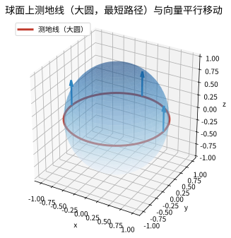

> **直观理解（现实类比）**：把测地线想成飞机的"大圆航线"。从北京飞纽约，看似该走地图上的"直线"，实际却沿一段大圆弧绕极地飞行——因为球面上两点间的最短路径正是这段大圆测地线。所谓"平行移动"，就像你推着一辆指南针小车沿大圆前进，始终让车头指向正前方、不向左也不向右打方向盘（$\nabla_{\gamma'}\gamma'=0$），这样它走的轨迹就是"弯曲空间里的直线"。测地线就是"油门踩直、方向盘不动的自由滑行"在弯曲流形上的推广。

#### 课堂问答

**老师**：测地线定义 $\nabla_{\gamma'}\gamma'=0$ 与"两点间最短曲线"是同一件事吗？

**学生**：局部上是同一回事，但定义本身只是"切向量沿自身平行移动"，即加速度为零，是直线性的内蕴推广；任意两点间全局最短曲线不总存在（需完备性）。局部测地线是长度泛函的驻点。

**老师（追问）**：为什么测地线方程 $\ddot x^k+\Gamma^k_{ij}\dot x^i\dot x^j=0$ 是二阶 ODE，给定初值就有唯一解？

**学生**：因为方程最高含 $\ddot x^k$，构成关于 $(x,\dot x)$ 的自治一阶系统；由 Picard-Lindelöf 定理，给定 $\gamma(0)=p$ 与 $\gamma'(0)=v$ 便有局部唯一解。这也保证了指数映射有定义。

**老师（拓展）**：大圆航线为什么是球面上的测地线？

**学生**：球面大圆上切向量沿自身平行移动而方向不变，满足 $\nabla_{\gamma'}\gamma'=0$，且是两点间最短路径。这是"弯曲空间里直线即测地线"的经典可视化，也说明完备情形下最短性与零加速度一致。

### 8.2 指数映射

**定义 8.3**（指数映射）对 $p \in M$，定义 **指数映射**（exponential map）

$$
\exp_p: T_p M \to M,
$$

满足 $\exp_p(v) = \gamma_v(1)$，其中 $\gamma_v$ 是满足 $\gamma_v(0) = p$、$\gamma_v'(0) = v$ 的唯一测地线。

> **💡 直观理解（类比）**：指数映射 $\exp_p$ 把切空间里的向量"发射成测地线"：从 $p$ 出发沿方向 $v$ 走单位时间（$t=1$）的测地线终点正是 $\exp_p(v)=\gamma_v(1)$。类比从 $p$ 点向四面八方各投一箭，每支箭飞满 $t=1$ 时落点的集合就构成指数映射的像。它在 $0$ 附近是局部微分同胚（切映射 $d(\exp_p)_0=\text{id}$），天然提供了弯曲流形在 $p$ 附近的"极坐标体系"。

**定理 8.4**（指数映射的性质）
- $\exp_p$ 在 $0 \in T_p M$ 处是局部微分同胚（其微分 $d(\exp_p)_0 = \text{id}$）。
- 存在 $p$ 的邻域 $U$（称为 **法邻域**，normal neighborhood），使得 $\exp_p$ 将 $T_p M$ 中的开球微分同胚地映到 $U$。

> **💡 直观理解（类比）**：这两条性质说"指数映射在出发点是可逆的、且每点都有属于自己的极坐标盘"：在 $0$ 处切映射是恒等，故 $p$ 附近（法邻域 $U$）$T_pM$ 中的开球被微分同胚地压平到 $M$ 上，且每个切向量恰好对应一条测地线的一个终点。类比把大本钟的表面压到地面：原点处刻度不挤出褶皱（可逆），任何一个足够小的圆盘内都整齐铺满"以 $p$ 为中心的极坐标直线"。这为"小范围长度/角度实用计算"与测地线自身的局部唯一性打好了地基。

**定义 8.5**（测地线完备性）Riemann 流形 $M$ 称为 **测地线完备的**（geodesically complete），若对任意 $p \in M$ 和 $v \in T_p M$，测地线 $\gamma_v(t)$ 对所有 $t \in \mathbb{R}$ 有定义。

> **💡 直观理解（类比）**：测地线完备指"从任何点、向任何方向出发的测地线都永不过期"：$\gamma_v(t)$ 对一切 $t\in\mathbb{R}$ 皆有定义，不会半路撞上"空间的尽头"或被拽出流形。类比让一辆沿"直线"行驶的车永远开得下去，既不撞墙也不飞出边界。它不是自动成立的——比如欧氏平面去掉一个点后仍有擦边的测地线很短就"断掉"。完备性是 Hopf-Rinow 定理中"度量空间完备、最短测地线存在"的对偶前提。

#### 课堂问答

**老师**：指数映射 $\exp_p(v)=\gamma_v(1)$ 里为什么取 $t=1$，而不是别的时刻？

**学生**：因为测地线对初速度线性，$\gamma_{cv}(t)=\gamma_v(ct)$。取 $t=1$ 只是选定比例归一，把"沿方向 $v$ 走单位时间"定义为一支箭的落点；换别的时刻只是重新缩放切向量，不改变映射的几何。

**老师（追问）**：为什么 $\exp_p$ 在原点处是局部微分同胚？

**学生**：因为 $d(\exp_p)_0=\mathrm{id}$，由逆映射定理，$0$ 附近存在邻域使 $\exp_p$ 为微分同胚。于是它在 $p$ 附近建立了"切空间极坐标"，法邻域 $U$ 内每个切向量恰对应一条测地线的终点。

**老师（拓展）**：指数映射什么时候不再是微分同胚，这有什么几何含义？

**学生**：当遇到共轭点或割点时，$\exp_p$ 的秩下降、测地线开始"聚拢"。共轭点正是曲率导致聚焦的体现，也是 Jacobi 场与比较定理研究的核心。

### 8.3 Hopf-Rinow 定理

**定理 8.6**（Hopf-Rinow 定理）对连通 Riemann 流形 $(M, g)$，以下条件等价：

1. $M$ 是测地线完备的；
2. $M$ 作为度量空间（由 Riemann 度量诱导的距离函数 $d$）是完备的；
3. $M$ 中的有界闭集是紧的。

此外，在这些条件下，任意两点间存在一条最短测地线。

> **💡 直观理解（类比）**：Hopf-Rinow 定理把"能一直沿直线开下去""作为度量空间完备""有界闭集都紧"合并在等号上：三者任一成立则其余都成立，且任意两点间必有一条最短测地线。类比一座连通的城市：只要任一条街都能无限延伸（测地线完备），等价于整座城的导航永远不缺路（度量完备）、任何"有界且关闭"的街区都只有有限个数（紧）。它是 Riemann 几何的定心丸，把存在性/完备性的三种口吻统一成一条"最短路径必可达"的宣言。

Hopf-Rinow 定理是 Riemann 几何的基本定理，它建立了几何完备性与度量空间完备性的等价关系。

#### 课堂问答

**老师**：Hopf-Rinow 定理把哪三件事划上了等号？

**学生**：测地线完备（任意测地线对所有 $t\in\mathbb{R}$ 有定义）、作为度量空间完备（Cauchy 列收敛）、有界闭集紧，三者等价；且此时任意两点间存在最短测地线。

**老师（追问）**：为什么"测地线完备"这种纯几何条件会等价于"度量完备"这种拓扑条件？

**学生**：因为最短测地线的存在性可由指数映射与局部极坐标控制：若点列越走越远却无极限，就对应一条无法延拓的测地线；反之实现最短路径需要度量完备以保证极限点存在。两者从不同侧面刻画"空间无缺口、可一直延伸"。

**老师（拓展）**：去掉一点后的欧氏平面 $\mathbb{R}^2\setminus\{0\}$ 为什么不完备？

**学生**：因为它是度量不完备的：靠近原点的点列如 $(1/n,0)$ 是 Cauchy 列却在挖去点的空间里无极限；等价地存在测地线在有限时间内冲向被挖掉的点而无法延拓。这正说明完备性不是自动成立的假设。

### 8.4 曲率

**定义 8.7**（截面曲率）设 $p \in M$，$\Pi \subseteq T_p M$ 是二维子空间，由向量 $u, v$ 张成。**截面曲率**（sectional curvature）定义为

$$
K(\Pi) = \frac{g(R(u, v)v, u)}{g(u, u) g(v, v) - g(u, v)^2}.
$$

截面曲率不依赖于 $u, v$ 的选取，只依赖于平面 $\Pi$。

> **直观理解（现实类比）**：当 $M$ 是二维曲面时，切空间只有一个二维平面，截面曲率就退化为 **高斯曲率** $K$——它是"内在弯曲"的总量，与曲面如何嵌入三维空间无关。想象一只住在曲面上的蚂蚁：它看不到外围的三维空间，却能量出小三角形的内角和——若和大于 $\pi$ 说明 $K>0$（像球面），等于 $\pi$ 说明 $K=0$（像平面或圆柱），小于 $\pi$ 说明 $K<0$（像马鞍）。高斯绝妙定理正是断言 $K$ 完全由第一基本形式决定：把一张纸卷成圆柱，第一基本形式不变故 $K$ 仍为 $0$；而把球面无论怎么"揉"，$K$ 都改变不了。

**定义 8.8**（Ricci 曲率）**Ricci 曲率张量**（Ricci curvature tensor）是 $(0,2)$-型张量：

$$
\operatorname{Ric}(X, Y) = \operatorname{tr}(v \mapsto R(v, X)Y).
$$

在局部坐标下，$\operatorname{Ric}_{ij} = R_{ikj}^k$。

> **💡 直观理解（类比）**：Ricci 曲率 $\operatorname{Ric}(X,Y)=\operatorname{tr}(v\mapsto R(v,X)Y)$ 是把整张曲率"沿所有方向求和压扁"后得到的浓缩版本：它丢掉了"各向异性"的全貌，只问"沿 $X$ 方向、朝 $Y$ 方向上的体积增减效应"。类比把一整片凹凸的地形按各方向平均成"某点沿某方向的净凹凸感"。在广义相对论里 $\operatorname{Ric}=0$（真空）对应"不带物质源的时空"，而测地线附近的体积收缩率正由它掌控。

**定义 8.9**（数量曲率）**数量曲率**（scalar curvature）$S$ 是 Ricci 曲率的迹：

$$
S = \operatorname{tr}_g \operatorname{Ric} = g^{ij} \operatorname{Ric}_{ij}.
$$

> **💡 直观理解（类比）**：数量曲率 $S$ 是"把所有方向维数再平均一遍"的最精简曲率指标：先对 Ricci 张量取度量下的迹（$S=g^{ij}\operatorname{Ric}_{ij}$），剩下一个纯数字函数，度量每点"平均水平上空间弯得多不多"。类比给出整块地形"平均高低不平的程度"这一个综合分，而不区分哪个方向更皱。它直接进入 Einstein 场方程与 Yau 的几何分析，也是"平均曲率般"的全局判据。

**例 8.10**（常曲率空间）
- **欧氏空间** $\mathbb{R}^n$：$K = 0$，$\operatorname{Ric} = 0$，$S = 0$。
- **球面** $S^n(r)$（半径为 $r$）：$K = 1/r^2$，$\operatorname{Ric}_{ij} = ((n-1)/r^2) g_{ij}$，$S = n(n-1)/r^2$。
- **双曲空间** $\mathbb{H}^n$：$K = -1$，$\operatorname{Ric}_{ij} = -(n-1) g_{ij}$，$S = -n(n-1)$。

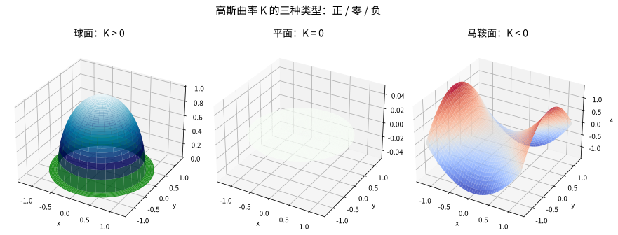

> **直观理解（现实类比）**：把高斯曲率想成曲面"鼓不鼓、扭不扭"的味道。像西瓜皮那样向外鼓的球面，每点 $K>0$；像马鞍那样中间凹下去、两头翘起来的曲面，每点 $K<0$；而铺平的纸面、或者圆柱的侧面，都能"展平"成平面，故 $K=0$。高斯曲率最神奇之处是它**内蕴**——一只住在曲面上的蚂蚁不借助三维空间，只靠量距离、量夹角就能算出 $K$，这正是"高斯绝妙定理"：$\mathbb{R}^3$ 中嵌入的曲面，其曲率其实由曲面自带的内在度量决定，与它如何嵌入无关。

---

#### 课堂问答

**老师**：截面曲率 $K(\Pi)=\frac{g(R(u,v)v,u)}{g(u,u)g(v,v)-g(u,v)^2}$ 为什么要除以那个 $g$ 的组合？

**学生**：分母是 $u,v$ 张成的平行四边形的度量面积平方，用来自动归一化，使结果不依赖 $u,v$ 的长度与选取，只依赖平面 $\Pi$，从而 $K(\Pi)$ 才是平面本身的固有量。

**老师（追问）**：二维时截面曲率退化成什么？Ricci 与数量曲率又是怎么从 $R$ 得到的？

**学生**：二维时切空间只有一个二维平面，$K$ 退化为高斯曲率。Ricci 是 $R$ 的迹 $\operatorname{Ric}_{ij}=R^k_{ikj}$，数量曲率是 Ricci 再取迹 $S=g^{ij}\operatorname{Ric}_{ij}$；三者是曲率张量逐层缩并的结果，信息依次浓缩。

**老师（拓展）**：为什么球面 $S^n(r)$ 的截面曲率恒为 $1/r^2$，且 $\operatorname{Ric}=\frac{n-1}{r^2}g$、$S=\frac{n(n-1)}{r^2}$？

**学生**：因为球面对称性使各二维方向等价，故各方向截面曲率相同为 $1/r^2$；常截面曲率 $\kappa$ 时恒有 $\operatorname{Ric}=(n-1)\kappa\,g$、$S=n(n-1)\kappa$，代 $\kappa=1/r^2$ 即得。

## 9. Gauss-Bonnet 定理

> **🧠 思考历程：把"弯曲"与"洞数"焊在一起**
>
> 这一定理由 Gauss 与 Bonnet 前后推进，最终在二维整体情形的经典表述中确立——它坚持声称，**整张曲面的曲率积分只由拓扑不变量（洞的个数）决定**：$\int_M K\,dA=2\pi\chi(M)$。它解决的问题，是把几何量（曲率积分）与拓扑量（Euler 示性数）紧密相连；而陈省身（1944）用紧致形式把它推广到任意偶数维，开启了示性类理论。更细的"为什么洞数能统治弯曲"的心路，见 §9.1 末尾的 🧠 思考历程。

### 9.1 曲面的 Gauss-Bonnet 定理

**定理 9.1**（Gauss-Bonnet 定理，局部形式）设 $(M, g)$ 是定向 Riemann 曲面，$D \subset M$ 是紧带边区域，边界的测地曲率为 $\kappa_g$，则

$$
\int_D K \, dA + \int_{\partial D} \kappa_g \, ds = 2\pi \chi(D),
$$

其中 $K$ 是 Gauss 曲率，$dA$ 是面积元，$ds$ 是弧长元，$\chi(D)$ 是 $D$ 的 Euler 示性数。

> **直观理解（现实类比）**：测地曲率 $\kappa_g$ 像"偏离最短路径的程度"——它度量一条曲线在曲面内"偏离测地线"的量。想象你在山地上行走：若始终沿"最省力的直道"（测地线）走，$\kappa_g=0$，方向盘不偏不倚；若你刻意绕弯看风景，曲线在曲面内就会"扭"，$\kappa_g$ 正是这种"方向盘转动"在曲面内部的分量。Gauss-Bonnet 公式 $\int_D K\,dA+\int_{\partial D}\kappa_g\,ds=2\pi\chi(D)$ 把"内部弯曲总量"与"边界偏离测地线的总量"绑在一起：二者之和只由拓扑不变量 $\chi$ 决定，像一张"曲率守恒账单"，无论你怎么变形曲面，这笔账总是平的。

**证明概要**：
1. 在 $D$ 上选取正交标架场 $\{e_1, e_2\}$，设 $\omega^1, \omega^2$ 为对偶余标架，联络形式 $\omega^1_2$ 满足结构方程 $d\omega^1 = \omega^2 \wedge \omega^1_2$，$d\omega^2 = \omega^1 \wedge \omega^2_1$（其中 $\omega^2_1 = -\omega^1_2$）。
2. Gauss 曲率满足 $K \, dA = d\omega^1_2$（Gauss 方程）。
3. 对 $D$ 应用 Stokes 定理：$\int_D K \, dA = \int_D d\omega^1_2 = \int_{\partial D} \omega^1_2$。
4. 在边界 $\partial D$ 上，$\omega^1_2 = \kappa_g \, ds - d\theta$，其中 $\theta$ 是切向量与参考方向的夹角。
5. 由 Hopf 旋转指标定理，$\int_{\partial D} d\theta = 2\pi \chi(D)$，代入即得结论。

**定理 9.2**（Gauss-Bonnet 定理，全局形式）对紧无边的定向 Riemann 曲面 $(M, g)$，

$$
\int_M K \, dA = 2\pi \chi(M).
$$

这是几何与拓扑之间最深刻的联系之一：曲率积分完全由拓扑不变量（Euler 示性数）决定。

**例 9.3**
- 球面 $S^2$：$\chi(S^2) = 2$，$\int_{S^2} K \, dA = 4\pi$。对标准球面 $K = 1$，面积为 $4\pi$，一致。
- 环面 $T^2$：$\chi(T^2) = 0$，$\int_{T^2} K \, dA = 0$。这并不意味着 $K = 0$，而是曲率的正负部分相互抵消。
- 亏格 $g$ 的曲面：$\chi = 2 - 2g$，$\int_M K \, dA = 4\pi(1 - g)$。

> **🧠 思考历程："弯曲的总量"，怎么会被"数出多少个洞"一个人掐死？**
>
> Gauss-Bonnet 定理说 $\int_M K\,dA=2\pi\chi(M)$——**曲面的"弯曲之和"只由它有几个"洞"（欧拉示性数）决定，完全不看你怎么弯**。这股"曲率"，牵出了几何与拓扑之间最著名的桥梁之一。
>
> - **高斯的惊人发现（绝妙定理）**。高斯早已发现"内在曲率"其实"不依赖于曲面怎么嵌在空间里"——**拉伸、扭转若不动"内在测地的长度"，曲率就纹丝不动**。这让"曲率"从一个嵌入的视觉属性，升格为曲面本身固有的内在量。
> - **把"弯曲"和"洞数"焊在一起的公式**。Bonnet 修正完善，使全世界看到：**整个曲面的曲率积分，居然精确等于 $2\pi$ 倍的欧拉示性数 $\chi$——这个只数"曲面上有多少个洞"的整数**。球面 $\chi=2$、环面 $\chi=0$（正负曲率恰好相抵）、多洞曲面 $\chi=2-2g$，全部与积分类系一致。
> - **为什么"洞数"能统治"弯曲"**。因为 $\chi$ 本质是一个**拓扑不变量**：只要能连续形变（不撕裂、不粘连）得到，$\chi$ 都不变。**"曲线洞数"这个最粗糙的东西，恰恰去捕捉"弯曲总量"这个精细的量**——它们互相锁定，正是几何与拓扑彼此互动的巅峰。
> - **它是几何、拓扑、物理的汇合点**。从"总曲率只看洞"出发，陈省身推广到高维（Chern-Gauss-Bonnet），也直接影响了"曲率决定拓扑"的整个黎曼几何方向。**在物理里，它还是描述可变形物体"拓扑缺陷"（如胶状物体被洞数限制）的原型。**
> - **心路**：Gauss-Bonnet 告诉你：**研究对象最深的"总量"，往往被看似最粗的"结构特征"（如洞的数量）严格决定**。当你能用"洞数"解释"弯了多少"，你就真正站在了几何与拓扑握手的地方。

#### 课堂问答

**老师**：Gauss-Bonnet 定理为什么是"几何与拓扑的桥"？公式里各部分的角色是什么？

**学生**：局部形式 $\int_D K\,dA+\int_{\partial D}\kappa_g\,ds=2\pi\chi(D)$ 中，$\int_D K\,dA$ 是内蕴曲率总量，$\int_{\partial D}\kappa_g\,ds$ 是边界偏离测地线总量，都是几何量；右边 $2\pi\chi(D)$ 是拓扑不变量。几何量的组合被拓扑完全锁定，与曲面如何嵌入无关。

**老师（追问）**：为什么环面 $T^2$ 的 $\int K\,dA=0$，而它上面 $K$ 并不恒为零？

**学生**：因为 $\chi(T^2)=0$，故曲率积分必须为零；而环面外侧 $K>0$、内侧 $K<0$，正负部分恰相抵消。这说明积分是"净量"，局部曲率仍可处处非零，"积分为零"不等于"曲率为零"。

**老师（拓展）**：证明中边界项 $\int_{\partial D}d\theta=2\pi\chi(D)$ 这一步用到了什么？

**学生**：用到 Hopf 旋转指标定理：闭曲线切向量的转角总变化恰为 $2\pi\chi(D)$。它是把几何（切向量转角）转成整数拓扑量的关键，也是证明从局部积分走向整体拓扑的枢纽。

### 9.2 Chern-Gauss-Bonnet 定理

**定理 9.4**（Chern-Gauss-Bonnet 定理，陈省身，1944）设 $M$ 是 $2n$ 维紧无边的定向 Riemann 流形，则

$$
\int_M \operatorname{Pf}\left( \frac{\Omega}{2\pi} \right) = \chi(M),
$$

其中 $\Omega$ 是 Levi-Civita 联络的曲率 $2$-形式矩阵，$\operatorname{Pf}$ 表示 Pfaffian，$\operatorname{Pf}(\Omega/2\pi)$ 是 $2n$-形式，称为 **Euler 形式**。

更具体地，对 $2n$ 维 Riemann 流形，

$$
\chi(M) = \frac{(-1)^n}{2^{2n} \pi^n n!} \int_M \varepsilon^{i_1 \ldots i_{2n}} \Omega_{i_1 i_2} \wedge \cdots \wedge \Omega_{i_{2n-1} i_{2n}},
$$

其中 $\varepsilon$ 是 Levi-Civita 符号。

Chern-Gauss-Bonnet 定理是 Gauss-Bonnet 定理向高维的深刻推广，也是陈省身的奠基性贡献之一。

> **💡 直观理解（类比）**：Chern-Gauss-Bonnet 把"曲率积分=拓扑数"这套美学从二维曲面升到任意偶数维：$\int_M\mathrm{Pf}(\Omega/2\pi)=\chi(M)$，其中 $\Omega$ 是 Levi-Civita 联络的曲率 $2$-形式矩阵，$\mathrm{Pf}$ 是 Pfaffian，配成的 $2n$-形式叫 Euler 形式。类比把"二维曲面只看洞数"的说法推广到任何偶数维流形：$\chi(M)$ 仍被曲率积分完全锁定，与选择何种度量无关。它是示性类理论的起点，也是陈省身 1944 年奠基性工作的核心。

#### 课堂问答

**老师**：Chern-Gauss-Bonnet 定理为什么必须限定在偶数维 $2n$？

**学生**：因为公式的核心是 Pfaffian，即反对称矩阵的"平方根行列式"，它只对偶数阶反对称矩阵有定义。曲率 $2$-形式矩阵 $\Omega$ 要能取 $\operatorname{Pf}$，维数必须为偶，这也呼应奇数维闭流形的 Euler 示性数为零。

**老师（追问）**：为什么右边仍是 $\chi(M)$，与所取度量无关？

**学生**：因为 $\operatorname{Pf}(\Omega/2\pi)$ 所代表的 Euler 类是拓扑的：不同度量给出的曲率形式相差一个恰当形式，积分不变。这正是陈省身 1944 年工作的深刻之处——把结论从二维推广到任意偶数维并为示性类奠基。

**老师（拓展）**：$n=1$ 时该定理怎么退化？

**学生**：此时 $2n=2$，$\operatorname{Pf}(\Omega/2\pi)=\frac{K}{2\pi}dA$，积分给出 $\frac{1}{2\pi}\int_M K\,dA=\chi(M)$，正是经典 Gauss-Bonnet 定理。可见高维陈氏定理把二维情形作为特例包含其中。

### 9.3 应用

1. **曲面分类**：Gauss-Bonnet 定理表明，紧定向曲面的 Euler 示性数（从而拓扑类型）完全由曲率积分决定。例如，具有正曲率的紧定向曲面只能是 $S^2$ 或 $\mathbb{R}P^2$。
2. **等距嵌入的障碍**：若曲面可等距嵌入 $\mathbb{R}^3$，则其 Gauss 曲率积分必须满足 Gauss-Bonnet 公式，这给出了嵌入可能性的必要条件。
3. **高维推广**：Chern-Gauss-Bonnet 定理开创了示性类理论，推动了整个微分几何与拓扑学的发展。

---

#### 课堂问答

**老师**：Gauss-Bonnet 定理如何用来给紧定向曲面分类？

**学生**：它说明曲率积分 $\int_M K\,dA=2\pi\chi(M)$ 完全决定 $\chi$，而紧定向曲面由 $\chi$ 唯一决定亏格，故拓扑类型被曲率积分锁定。例如曲率恒正的紧定向曲面只能是 $S^2$ 或 $\mathbb{R}P^2$，因为它们对应 $\chi>0$。

**老师（追问）**："等距嵌入的障碍"是什么意思？

**学生**：因为曲率是内蕴的且 $\int_M K\,dA=2\pi\chi(M)$ 是硬约束，若某抽象曲面要等距嵌入 $\mathbb{R}^3$，其曲率必须满足此式，否则不可能。它给出嵌入可行性的必要条件，是内蕴数据对外蕴实现的反向限制。

**老师（拓展）**：这套思想在高维推广中走向了哪里？

**学生**：走向示性类理论：Chern-Gauss-Bonnet 把"曲率积分等于示性数"推广为 Euler 类，进而有 Pontryagin 类、陈类等，成为指标定理与规范场论的语言。二维的一个漂亮等式，其精神贯穿整个现代几何拓扑。

## 10. Lie 导数与 Killing 向量场

> **🧠 思考历程：用无穷小算子捕捉"对称性"**
>
> Lie（约 1880 年代）把"连续对称"解释为一族流动（单参数变换群），并发明 **Lie 导数** $\mathcal{L}_X$——"沿某个方向把整个张量场拖着一小会儿，看它变了多少"。Killing（1890 年代）随后发现：若向量场 $X$ 使度量沿其流动不变（$\mathcal{L}_X g=0$），它就是**无穷小等距**，并且沿测地线给出守恒量——以现代眼光看，这正是对称性与 Noether 定理的几何化身。它解决的问题：**把"这个空间哪些方向移动后仍然一模一样"变成可求解的线性方程**——平移、旋转、球面的 $O(n+1)$、双曲平面的 $PSL(2,\mathbb{R})$ 都统一由 Killing 场刻画。

### 10.1 Lie 导数

**定义 10.1**（Lie 导数）设 $X$ 是 $M$ 上的光滑向量场，$\phi_t$ 是 $X$ 生成的流。$M$ 上张量场 $T$ 沿 $X$ 方向的 **Lie 导数**（Lie derivative）定义为

$$
\mathcal{L}_X T = \lim_{t \to 0} \frac{\phi_t^* T - T}{t}.
$$

> **💡 直观理解（类比）**：Lie 导数 $\mathcal{L}_X T$ 度量"让整张张量场被 $X$ 的流拖着一小会儿后变了多少"：把每点处的张量 $T$ 沿流 $\phi_t$ 推回比较，取单位时间的"变形率"。类比把一块印着图案的布沿固定方向来回拖拽，记录图案被"同进退"拉变形得多快。它刻画"张量场整体随流变形的速率"，对函数就是方向导数，对向量场就是 Lie 括号 $[X,Y]$，并满足 Cartan 魔术公式 $\mathcal{L}_X\omega=d\iota_X\omega+\iota_Xd\omega$——与坐标无关、纯粹几何。

**Lie 导数的性质**：
- 对函数 $f$：$\mathcal{L}_X f = X(f)$；
- 对向量场 $Y$：$\mathcal{L}_X Y = [X, Y]$；
- 对 $k$-形式 $\omega$：$\mathcal{L}_X \omega = d(\iota_X \omega) + \iota_X(d\omega)$（Cartan 魔术公式）；
- 对一般张量场，$\mathcal{L}_X$ 通过 Leibniz 法则作用。

**例 10.2** 在 $\mathbb{R}^2$ 中，$X = -y \frac{\partial}{\partial x} + x \frac{\partial}{\partial y}$（旋转向量场），则 $\mathcal{L}_X (dx \wedge dy) = 0$，说明旋转保持面积。

#### 课堂问答

**老师**：Lie 导数 $\mathcal{L}_X T=\lim_{t\to0}\frac{\phi_t^*T-T}{t}$ 里为什么用"拉回"$\phi_t^*$？

**学生**：因为要把 $t$ 时刻其他点处的张量搬回原位置才能逐点相减、再取变化率。沿流方向拉回正好把场"拖"回来比较，得到"被流带着走后的变形率"，故 $\mathcal{L}_X$ 与坐标无关。

**老师（追问）**：对函数、向量场、形式，$\mathcal{L}_X$ 分别等于什么？

**学生**：对函数 $\mathcal{L}_X f=X(f)$ 即方向导数；对向量场 $\mathcal{L}_X Y=[X,Y]$ 即 Lie 括号；对形式由 Cartan 魔术公式 $\mathcal{L}_X\omega=d\iota_X\omega+\iota_Xd\omega$。三者统一在"沿流变形率"一个概念之下。

**老师（拓展）**：为什么 $\mathcal{L}_X$ 与协变导数 $\nabla_X$ 不是同一回事？

**学生**：因为 $\mathcal{L}_X$ 只依赖 $X$ 的流、由微分结构决定，不含任何联络；而 $\nabla_X$ 需要额外指定联络，且 $\nabla_X$ 对 $X$ 是函数线性的，$\mathcal{L}_X$ 不是，如式 $\mathcal{L}_{fX}T=f\mathcal{L}_XT+(\cdots)$ 所示。前者内蕴，后者依联络而定。

### 10.2 Killing 向量场

**定义 10.3**（Killing 向量场）Riemann 流形 $(M, g)$ 上的向量场 $X$ 称为 **Killing 向量场**（Killing vector field），若

$$
\mathcal{L}_X g = 0,
$$

即 $X$ 生成的流 $\phi_t$ 是等距映射（isometry）。

**Killing 方程**：在局部坐标下，$\mathcal{L}_X g = 0$ 等价于

$$
\nabla_i X_j + \nabla_j X_i = 0,
$$
其中 $X_i = g_{ij} X^j$，$\nabla$ 是 Levi-Civita 联络。这称为 **Killing 方程**（Killing equation）。

> **💡 直观理解（类比）**：Killing 向量场是"顺着它的流，整个空间不伸长不压缩"的方向：$\mathcal{L}_Xg=0$ 即度量沿流不变，等价于 Killing 方程 $\nabla_iX_j+\nabla_jX_i=0$（流动像刚体平移/旋转，处处等距）。类比"匀速推进的地毯"：沿着 $X$ 滑动时，任何两点间的距离都不变。它对物理的馈赠是守恒律——沿测地线 $\gamma$，$g(\gamma',X)$ 是常数（对称性的 Noether 守恒）；旋转、平移、等高对称正是 Killing 场。

**性质 10.4**（Killing 向量场的性质）
- Killing 向量场的集合构成一个 Lie 代数（在 Lie 括号下），对应于 $M$ 的等距群（isometry group）的 Lie 代数。
- 若 $X$ 是 Killing 向量场，则沿测地线 $\gamma$，$g(\gamma'(t), X_{\gamma(t)})$ 是常数（**守恒律**）。

#### 课堂问答

**老师**：Killing 向量场 $\mathcal{L}_X g=0$ 为什么等价于"流是等距"？

**学生**：因为 $\mathcal{L}_X g=\lim_{t\to0}(\phi_t^*g-g)/t=0$ 意味着 $\phi_t^*g$ 不随 $t$ 变化，即 $\phi_t^*g=g$，也就是每个 $\phi_t$ 都保度量、是等距。它把"连续对称"表述为一个无穷小条件。

**老师（追问）**：Killing 方程 $\nabla_i X_j+\nabla_j X_i=0$ 与 $\mathcal{L}_X g=0$ 怎么对上？为什么它被称为守恒律的来源？

**学生**：把 $\mathcal{L}_X g$ 用 Levi-Civita 联络展开，度量相容与无挠给出 $\mathcal{L}_X g_{ij}=\nabla_iX_j+\nabla_jX_i$，故两条件等价；沿测地线又有 $g(\gamma',X)$ 为常数，正是不变量，即 Noether 守恒。

**老师（拓展）**：Killing 向量场的集合有什么代数结构，对应什么？

**学生**：它在 Lie 括号下封闭，构成 Lie 代数，且恰是等距群 $\mathrm{Isom}(M,g)$ 的 Lie 代数。例如球面的 Killing 场构成 $\mathfrak{so}(n+1)$，这把对称性完全代数化。

### 10.3 等距

**定义 10.5**（等距）Riemann 流形间的光滑映射 $F: (M, g_M) \to (N, g_N)$ 称为 **等距**（isometry），若 $F^* g_N = g_M$，即

$$
g_N(dF_p(u), dF_p(v)) = g_M(u, v), \quad \forall u, v \in T_p M.
$$

若 $F$ 是微分同胚且为等距，则称 $M$ 与 $N$ **等距**（isometric）。

> **💡 直观理解（类比）**：等距是"完全相同的几何，只是重新摆放"的映射：$F^*g_N=g_M$ 即$F$ 把 $N$ 的度量拉回恰好等于 $M$ 的度量，长度、夹角、面积处处保留。类比两张完全相同的硬纸片，一张只是被整体平移到另一位置（不揉搓不拉伸）——尽管坐标系变了，纸片上蚂蚁量出的距离一样。从等距视角看，这样的两个流形几何上不可区分；$\mathbb{R}^n$ 的平移、旋转、反射，球面的 $O(n+1)$，双曲平面的 $PSL(2,\mathbb{R})$ 都是等距的例子。

**例 10.6**
- $\mathbb{R}^n$ 中的平移、旋转、反射都是等距。
- 球面 $S^n$ 的等距群是 $O(n+1)$。
- 双曲平面 $\mathbb{H}^2$ 的等距群是 $PSL(2, \mathbb{R})$。

---

#### 课堂问答

**老师**：等距的定义 $F^*g_N=g_M$ 与"微分同胚"有什么本质差别？

**学生**：微分同胚只保持光滑结构，可以随意拉伸改变长度；等距额外要求 $g_N(dF_pu,dF_pv)=g_M(u,v)$，即保持所有长度与夹角。故等距是"刚性"的，而微分同胚允许任意软变形。

**老师（追问）**：为什么说等距的两个流形"几何上不可区分"？

**学生**：因为长度、角度、面积、测地线、曲率等一切几何量都由 $g$ 决定，而 $F^*g_N=g_M$ 说明 $g$ 被完整搬运，所有可测量的几何数据一一对应。差别只在点的命名，不在几何本身。

**老师（拓展）**：一个 $n$ 维 Riemann 流形的等距群能有多大？它与 Killing 场什么关系？

**学生**：等距群总是 Lie 群，其维数等于线性独立的 Killing 场个数，上界为 $\frac{n(n+1)}{2}$，达到上界当且仅当是常曲率空间。等距群的 Lie 代数正是 Killing 场代数，$\mathbb{R}^n$ 的 $E(n)$、球面的 $O(n+1)$、双曲平面的 $PSL(2,\mathbb{R})$ 皆是其例。

## 11. 示例

### 示例 1：球面 $S^2$ 上的标准度量

**问题**：在球面 $S^2 = \{(\sin\theta\cos\phi, \sin\theta\sin\phi, \cos\theta) \in \mathbb{R}^3\}$ 上，写出诱导 Riemann 度量，并计算 Gauss 曲率。

**解**：球面从 $\mathbb{R}^3$ 继承的诱导度量在球坐标 $(\theta, \phi)$ 下为

$$
g = d\theta^2 + \sin^2\theta \, d\phi^2.
$$

计算 Christoffel 符号：

$$
g_{ij} = \begin{pmatrix} 1 & 0 \\ 0 & \sin^2\theta \end{pmatrix},\quad
g^{ij} = \begin{pmatrix} 1 & 0 \\ 0 & \csc^2\theta \end{pmatrix}.
$$

非零的 $\Gamma^k_{ij}$ 为：

$$
\Gamma^\theta_{\phi\phi} = -\sin\theta\cos\theta,\quad
\Gamma^\phi_{\theta\phi} = \Gamma^\phi_{\phi\theta} = \cot\theta.
$$

曲率张量的非零分量：

$$
R^\theta_{\phi\theta\phi} = \sin^2\theta.
$$

Gauss 曲率：

$$
K = \frac{R^\theta_{\phi\theta\phi}}{\det(g)} = \frac{\sin^2\theta}{\sin^2\theta} = 1.
$$

因此 $S^2$ 的 Gauss 曲率处处为 $+1$，与预期一致。

---

### 示例 2：双曲平面 $\mathbb{H}^2$

**问题**：双曲平面 $\mathbb{H}^2 = \{(x, y) \in \mathbb{R}^2 \mid y > 0\}$ 上的 Poincaré 度量为 $g = \frac{dx^2 + dy^2}{y^2}$。计算其 Gauss 曲率。

**解**：度量矩阵为

$$
g_{ij} = \begin{pmatrix} 1/y^2 & 0 \\ 0 & 1/y^2 \end{pmatrix}.
$$

计算 Christoffel 符号：

$$
\Gamma^x_{xy} = \Gamma^x_{yx} = -\frac{1}{y},\quad
\Gamma^y_{xx} = \frac{1}{y},\quad
\Gamma^y_{yy} = -\frac{1}{y}.
$$

曲率张量 $R^y_{xyx}$ 计算得：

$$
R^y_{xyx} = \partial_x \Gamma^y_{yx} - \partial_y \Gamma^y_{xx} + \Gamma^y_{x\cdot}\Gamma^\cdot_{yx} - \Gamma^y_{y\cdot}\Gamma^\cdot_{xx} = 0 - \left(-\frac{1}{y^2}\right) + \cdots = -\frac{1}{y^2}.
$$

Gauss 曲率：

$$
K = \frac{R^y_{xyx}}{\det(g)} = \frac{-1/y^2}{1/y^4} = -1.
$$

因此双曲平面具有常数负曲率 $K = -1$。

---

### 示例 3：Lie 群 $SO(3)$ 上的度量

**问题**：$SO(3)$ 是 $3 \times 3$ 正交矩阵（行列式为 $+1$）构成的 Lie 群。其 Lie 代数 $\mathfrak{so}(3)$ 由 $3 \times 3$ 反对称矩阵构成。在 $\mathfrak{so}(3)$ 上取标准内积 $\langle A, B \rangle = -\frac{1}{2}\operatorname{tr}(AB)$，通过左平移给出 $SO(3)$ 上的左不变 Riemann 度量。写出该度量，并说明其截面曲率。

**解**：$\mathfrak{so}(3)$ 的一组基为

$$
L_1 = \begin{pmatrix} 0 & 0 & 0 \\ 0 & 0 & -1 \\ 0 & 1 & 0 \end{pmatrix},\;
L_2 = \begin{pmatrix} 0 & 0 & 1 \\ 0 & 0 & 0 \\ -1 & 0 & 0 \end{pmatrix},\;
L_3 = \begin{pmatrix} 0 & -1 & 0 \\ 1 & 0 & 0 \\ 0 & 0 & 0 \end{pmatrix}.
$$

它们满足 $[L_1, L_2] = L_3$，$[L_2, L_3] = L_1$，$[L_3, L_1] = L_2$。

在 $L_i$ 处计算内积得 $\langle L_i, L_j \rangle = \delta_{ij}$，因此度量在单位元处是标准欧氏度量。通过左平移延拓到整个 $SO(3)$ 上。

对左不变度量，截面曲率由 Lie 括号决定：

$$
K(\Pi_{ij}) = \frac{1}{4} \|[L_i, L_j]\|^2 = \frac{1}{4},
$$

其中 $\Pi_{ij}$ 是由 $L_i, L_j$ 张成的平面。因此 $SO(3)$ 具有正截面曲率 $K = 1/4$。

---

### 示例 4：$\mathbb{R}^3$ 中的环面

**问题**：设 $T^2$ 是 $\mathbb{R}^3$ 中由圆 $(R + r\cos u, 0, r\sin u)$ 绕 $z$-轴旋转得到的环面，参数化为

$$
\mathbf{x}(u, v) = ((R + r\cos u)\cos v, (R + r\cos u)\sin v, r\sin u),
$$

其中 $0 < r < R$。计算其 Riemann 度量和 Gauss 曲率。

**解**：计算偏导数：

$$
\mathbf{x}_u = (-r\sin u\cos v, -r\sin u\sin v, r\cos u),\\
\mathbf{x}_v = (-(R + r\cos u)\sin v, (R + r\cos u)\cos v, 0).
$$

度量系数：

$$
E = \|\mathbf{x}_u\|^2 = r^2,\quad
F = \mathbf{x}_u \cdot \mathbf{x}_v = 0,\quad
G = \|\mathbf{x}_v\|^2 = (R + r\cos u)^2.
$$

因此诱导度量 $g = r^2 du^2 + (R + r\cos u)^2 dv^2$。

Gauss 曲率公式（对正交坐标系 $E, G$）：

$$
K = -\frac{1}{2\sqrt{EG}} \left[ \frac{\partial}{\partial u}\left( \frac{G_u}{\sqrt{EG}} \right) + \frac{\partial}{\partial v}\left( \frac{E_v}{\sqrt{EG}} \right) \right].
$$

计算得 $G_u = -2r(R + r\cos u)\sin u$，$E_v = 0$，因此

$$
K = \frac{\cos u}{r(R + r\cos u)}.
$$

曲率在环面外侧（$u = 0$，最外侧）为正，在内侧（$u = \pi$，最内侧）为负，在顶部和底部（$u = \pm \pi/2$）为零，与直观一致。

---

### 示例 5：$\mathbb{R}^n$ 中的 Lie 导数

**问题**：在 $\mathbb{R}^3$ 中，设 $X = y\frac{\partial}{\partial z} - z\frac{\partial}{\partial y}$，$Y = z\frac{\partial}{\partial x} - x\frac{\partial}{\partial z}$。计算 $[X, Y]$。

**解**：$X = (0, -z, y)$，$Y = (-z, 0, x)$。在 $\mathbb{R}^3$ 中，

$$
[X, Y] = (Y \cdot \nabla) X - (X \cdot \nabla) Y.
$$

计算：

$$
(Y \cdot \nabla)X = (-z\partial_x + 0\partial_y + x\partial_z)(0, -z, y) = (0, -x, 0),\\
(X \cdot \nabla)Y = (0\partial_x - z\partial_y + y\partial_z)(-z, 0, x) = (y, 0, 0).
$$

因此

$$
[X, Y] = (0 - y, -x - 0, 0 - 0) = (-y, -x, 0) = -y\frac{\partial}{\partial x} - x\frac{\partial}{\partial y}.
$$

注意 $X, Y$ 是 $SO(3)$ 的无穷小生成元，它们的 Lie 括号对应 $SO(3)$ 的 Lie 代数结构。

---

### 示例 6：de Rham 上同调的计算

**问题**：计算 $S^1$ 的 de Rham 上同调群。

**解**：$S^1$ 是 1 维紧流形，坐标 $\theta \in [0, 2\pi)$。

- $H^0_{\text{dR}}(S^1)$：闭 0-形式即光滑函数 $f$ 满足 $df = 0$，即常数函数。因此 $H^0_{\text{dR}}(S^1) \cong \mathbb{R}$。
- $H^1_{\text{dR}}(S^1)$：1-形式 $\omega = f(\theta) d\theta$。$\omega$ 是闭的当且仅当 $d\omega = f'(\theta) d\theta \wedge d\theta = 0$，即所有 1-形式自动闭。$\omega$ 是恰当的当且仅当存在 $h$ 使得 $dh = h'(\theta) d\theta = \omega$，即 $\omega = f d\theta$ 是恰当的当且仅当 $\int_0^{2\pi} f(\theta) d\theta = 0$（因为 $h$ 必须在 $S^1$ 上光滑，这要求 $h(2\pi) = h(0)$，即 $\int_0^{2\pi} f = 0$）。因此 $H^1_{\text{dR}}(S^1) \cong \mathbb{R}$，由 $\frac{1}{2\pi} d\theta$ 生成。
- $H^k_{\text{dR}}(S^1) = 0$ 对 $k \geq 2$（因为 $\dim S^1 = 1$，没有 $k \geq 2$ 的微分形式）。

---

### 示例 7：Gauss-Bonnet 定理在 $S^2$ 上的验证

**问题**：对标准球面 $S^2$，验证 Gauss-Bonnet 定理。

**解**：标准球面 $S^2$ 的 Gauss 曲率 $K = 1$，面积元 $dA = \sin\theta \, d\theta \, d\phi$。因此

$$
\int_{S^2} K \, dA = \int_0^{2\pi} \int_0^\pi \sin\theta \, d\theta \, d\phi = 2\pi \cdot 2 = 4\pi.
$$

$S^2$ 的 Euler 示性数 $\chi(S^2) = 2$，因此 $2\pi \chi(S^2) = 4\pi$，等式成立。

---

### 示例 8：Killing 向量场的寻找

**问题**：在 $\mathbb{R}^2$（标准欧氏度量）中，找出所有 Killing 向量场。

**解**：Killing 方程 $\nabla_i X_j + \nabla_j X_i = 0$。在欧氏度量下，$\nabla_i = \partial_i$，方程变为

$$
\frac{\partial X_1}{\partial x} = 0,\quad
\frac{\partial X_2}{\partial y} = 0,\quad
\frac{\partial X_1}{\partial y} + \frac{\partial X_2}{\partial x} = 0.
$$

由前两式，$X_1 = f(y)$，$X_2 = g(x)$。代入第三式得 $f'(y) + g'(x) = 0$，因此 $f'(y) = -g'(x)$ 为常数，记作 $c$。于是

$$
f(y) = a + cy,\quad g(x) = b - cx,
$$

其中 $a, b, c \in \mathbb{R}$。因此 Killing 向量场的一般形式为

$$
X = (a + cy)\frac{\partial}{\partial x} + (b - cx)\frac{\partial}{\partial y}.
$$

这对应于 $\mathbb{R}^2$ 的等距群（平移、旋转）：$a, b$ 对应平移，$c$ 对应绕原点的旋转。

---

### 示例 9：$\mathbb{C}P^n$ 上的 Fubini-Study 度量

**问题**：复射影空间 $\mathbb{C}P^n$ 上的 Fubini-Study 度量是 Kähler 度量。在仿射坐标 $z_i = w_i/w_0$（$i=1,\ldots,n$）下，Kähler 势为 $\Phi = \log(1 + |z|^2)$，Fubini-Study 度量为

$$
g_{i\bar{j}} = \frac{\partial^2 \Phi}{\partial z_i \partial \bar{z}_j} = \frac{\delta_{ij}(1 + |z|^2) - \bar{z}_i z_j}{(1 + |z|^2)^2}.
$$

验证 $\mathbb{C}P^1 \cong S^2$ 的 Fubini-Study 度量与标准球面度量等价。

**解**：对 $n=1$，记 $z = w_1/w_0$，则

$$
g_{1\bar{1}} = \frac{1}{(1 + |z|^2)^2}.
$$

因此度量 $ds^2 = \frac{dz \, d\bar{z}}{(1 + |z|^2)^2}$。令 $z = re^{i\theta}$，则

$$
ds^2 = \frac{dr^2 + r^2 d\theta^2}{(1 + r^2)^2}.
$$

再令 $r = \tan(\phi/2)$（$0 \leq \phi \leq \pi$），则 $dr = \frac{1}{2}\sec^2(\phi/2) d\phi$，$1 + r^2 = \sec^2(\phi/2)$，代入得

$$
ds^2 = d\phi^2 + \sin^2\phi \, d\theta^2,
$$

这正是 $S^2$ 的标准度量（球坐标）。因此 $\mathbb{C}P^1$ 的 Fubini-Study 度量与 $S^2$ 的 Gauss 曲率 $K=1$ 的度量一致。

---

### 示例 10：Hopf-Rinow 定理的应用

**问题**：证明 $\mathbb{R}^n$ 在标准度量下是测地线完备的。

**解**：$\mathbb{R}^n$ 中的测地线是直线 $\gamma(t) = p + tv$，对所有 $t \in \mathbb{R}$ 有定义，因此 $\mathbb{R}^n$ 是测地线完备的。由 Hopf-Rinow 定理，$\mathbb{R}^n$ 作为度量空间是完备的，有界闭集是紧的，且任意两点间存在最短测地线（即直线段）。这验证了 Hopf-Rinow 定理的所有结论。

### 问题求解四步流程（Problem-Solving Strategy）

> 每个问题都可拆成四步：**理解 → 计划 → 执行 → 回看**。这里把每一环落到微分几何语境的追问上。

| 步骤 | 行动 | 微分几何中的具体追问 |
|:---|:---|:---|
| ① 理解 | 复述问题、圈出已知与目标 | 对象是曲线、曲面还是高维流形？度量 $g$、第一/第二基本形式、联络还是曲率？目标是求数值还是判断内蕴？ |
| ② 计划 | 选择可行工具、预估方向 | 用 Frenet 公式求 $\kappa,\tau$？用 $E,F,G$、$L,M,N$ 算 Gauss 曲率？列测地线方程？先用弧长参数还是切参？ |
| ③ 执行 | 按步骤推导、保留过程 | 每部清楚地写 $r'$、$r''$、$r\times r''$，正交归一 $\{T,N,B\}$ 别乱序，$\operatorname{sgn}$ 与 $\Gamma^k_{ij}$ 的下标别错。 |
| ④ 回看 | 核对结果、检验合理性 | 曲率符号是否合理？是否依赖参数化/嵌入？能否换一种参数或换量（$K$ vs $H$）互相校核？ |

> 💡 **策略演示**：求单位圆 $r(t)=(\cos t,\sin t)$ 的曲率。
> ① 理解：平面曲线，目标曲率。 ② 计划：用平面曲率公式 $\kappa=|r'\times r''|/|r'|^3$ 或直接弧长参数。 ③ 执行：$r'=(-\sin t,\cos t)$，$r''=(-\cos t,-\sin t)$，$|r'|=1$，$|r'\times r''|=1$，故 $\kappa=1$。 ④ 回看：半径为 $1$ 的圆曲率恒为 $1=1/R$，与几何直觉一致。

### 概念检查（Concept Check）

> 先用一组判断题与选择题快速自检核心概念。每道题的判断均应落到书面理由（用一句话说明即可）。

**判断正误**（说明理由）：

1. 平面曲线在其上每点的曲率 $\kappa$ 都非负。（　）
2. 空间曲线由曲率 $\kappa$ 与挠率 $\tau$ 在「适逢无穷大为常数时」完全决定其形状（Frenet 基本定理）。（　）
3. Gauss 曲率是内蕴量，不依赖曲面在 $\mathbb{R}^3$ 中的嵌入方式。（　）
4. 平均曲率 $H$ 为零的曲面称为极小曲面。（　）
5. Levi-Civita 联络是唯一既无挠又保度量的联络。（　）
6. 测地线一定是局部最短路径，反之亦然。（　）
7. Riemann 流形的 Galois 意义下指数映射只在原点附近为局部微分同胚。（　）

**选择**：

8. 第一基本形式的系数 $E,F,G$ 记录了什么信息？（　）
   - A. 曲线的挠率　B. 曲面的内蕴度量与弧长　C. 第二基本形式　D. 联络的曲率
9. 下列哪个量在 $n$ 维 Riemann 流形上取值于切空间张量且刻画「平行移动沿闭路的偏差」？（　）
   - A. 曲率张量　B. 度量张量　C. 测地线　D. 张量场的 Lie 导数
10. 单连通的负曲率流形上的测地线「整体唯一性」保证了其是指数映射（连同距离）都是（　）。
    - A. 局部等距　B. 整体等距（可到其像）　C. 常数映射　D. 非单射

### 分步骤工作示例（Worked Examples）

> 每道示例严格套用四步流程，并在「回看」中给出一条易错点或检验法。

**示例 S1：四步法求空间曲线的曲率与挠率**

> **问题**：求圆柱螺旋线 $r(t)=(\cos t,\sin t,t)$ 在任意点的曲率 $\kappa$ 与挠率 $\tau$。

- ① 理解：空间曲线二不变量，目标为闭式。
- ② 计划：速度/加速度/三阶导：$\dot r=(-\sin t,\cos t,1)$，$\ddot r=(-\cos t,-\sin t,0)$，$\dddot r=(\sin t,-\cos t,0)$。
- ③ 执行：

$$
\dot r\times\ddot r=(\sin t,-\cos t,1),\qquad
\kappa=\frac{|\dot r\times\ddot r|}{|\dot r|^3}=\frac{\sqrt2}{(\sqrt2)^3}=\frac12,
\qquad
\tau=\frac{(\dot r\times\ddot r)\cdot\dddot r}{|\dot r\times\ddot r|^2}=\frac{\sin^2t+\cos^2t}{2}=\frac12 .
$$

  这里 $|\dot r|=\sqrt{\sin^2t+\cos^2t+1}=\sqrt2$，$|\dot r\times\ddot r|=\sqrt2$。
- ④ 回看：螺旋线 $\kappa=\tau=\frac12$ 与文献一致。**检验**：系数取 $(a,b)=(1,1)$ 时公式 $\kappa=a/(a^2+b^2)=\frac12$。**易错点**：非弧长参数下分母的幂次（$|\dot r|^3$、$|\dot r\times\ddot r|^2$）不可丢。

**示例 S2：四步法求螺旋面的第一基本形式**

> **问题**：对螺旋面 $r(u,v)=(u\cos v,u\sin v,v)$，计算第一基本形式的系数 $E,F,G$ 并检查其正定性与正交性。

- ① 理解：两张参数曲线 $\{u{:}$ 定$\}$ 与 $\{v{:}$ 定$\}$ 的函数系；目标是 $E,F,G$。
- ② 计划：求 $r_u$、$r_v$ 再内积。
- ③ 执行：

$$
r_u=(\cos v,\sin v,0),\quad r_v=(-u\sin v,u\cos v,1)
\quad\Longrightarrow\quad
E=r_u\cdot r_u=1,\quad F=r_u\cdot r_v=0,\quad G=r_v\cdot r_v=1+u^2 .
$$

- ④ 回看：$G\ge1$，$EG-F^2=1+u^2>0$，度量正定；$F=0$ 表示参数曲线处处正交（isothermal）。**易错点**：只求 $E,G$ 而漏 $F$ 会让面积元 $dA=\sqrt{EG-F^2}\,du\,dv$ 算错。

**示例 S3：四步法验证上半平面的测地线**

> **问题**：在 $\mathbb{H}^2=\{(x,y):y>0\}$ 带度量 $ds^2=(dx^2+dy^2)/y^2$ 上，证明水平线 $y=c$ 不是测地线，并写出测地线方程组。

- ① 理解：非欧几何；水平线是「欧氏直线」但非 $\mathbb{H}^2$ 测地线。
- ② 计划：由 $g_{xx}=g_{yy}=1/y^2$ 求 Christoffel，再列测地线方程；代 $y=c$ 检验。
- ③ 执行：非零 Christoffel 符号为

$$
\Gamma^x_{xy}=\Gamma^x_{yx}=-\frac1y,\qquad
\Gamma^y_{xx}=\frac1y,\qquad
\Gamma^y_{yy}=-\frac1y .
$$

  测地线方程：$\ddot x-\frac{2}{y}\dot x\dot y=0$，$\ddot y+\frac1y\dot x^2-\frac1y\dot y^2=0$。代 $y=c$（$\dot y=\ddot y=0$）：第二式 $\frac1c\dot x^2=0\Rightarrow\dot x=0$，与水平线矛盾，故 $y=c$ 非测地线。
- ④ 回看：$\mathbb{H}^2$ 的真实测地线只是垂直半直线与圆心在实轴上的半圆。**易错点**：$\Gamma$ 下标不对称处（$xy$ vs $yx$）等价但不可漏写系数 $2$；直接用欧氏直觉会误判。

**示例 S4：四步法求旋转抛物面的曲率**

> **问题**：对 $z=x^2+y^2$ 在顶点 $(0,0,0)$ 求第一、第二基本形式及 Gauss 曲率 $K$ 与平均曲率 $H$。

- ① 理解：顶点处 $r_x=(1,0,0)$、$r_y=(0,1,0)$、法向 $n=(0,0,1)$。
- ② 计划：$r_{xx},r_{xy},r_{yy}$ 与 $n$ 内积得 $L,M,N$，再由 $K,H$ 公式求值。
- ③ 执行：$r_{xx}=(0,0,2)$，$r_{yy}=(0,0,2)$，$r_{xy}=0$，故

$$
E=G=1,\ F=0,\quad L=N=2,\ M=0,\qquad
K=\frac{LN-M^2}{EG-F^2}=4,\quad
H=\frac{LG-2MF+NE}{2(EG-F^2)}=2 .
$$

- ④ 回看：$K>0$ 表示顶点是一个凸碗形峰；两主方向曲率均为 $2$（局部半径 $\frac12$）。**检验**：与二阶级数拟合 $x^2+y^2$ 的几何直观一致；**易错点**：若翻转法向 $n\to-n$，$K$ 不变但 $H$ 变号，须固定朝向。

### 应用聚焦（Application & Exploration Projects）

> 小型开放任务：把本节抽象结论落到可操作的计算或仿真，任选其一完成。

- **聚焦 P1（数值仿真）**：对 $r(t)=(a\cos t,a\sin t,bt)$ 写一小段数值积分离散曲率/挠率，并把结果与闭式公式 $\kappa=a/(a^2+b^2)$、$\tau=b/(a^2+b^2)$ 对比（$b\to0$ 与时序）。 
- **聚焦 P2（跨章节联系）**：用 Gauss–Bonnet $\int_MK\,dA=2\pi\chi(M)$ 把第一类曲率与第 43 级《代数拓扑》的 Euler 示性数接通，并在球面与环面上各自验证。
- **聚焦 P3（探索构造）**：数值地沿测地线方程积分出 $\mathbb{H}^2$ 上过两点的半圆测地线下端，观察其与「垂直半直线」的区分并验证非水平线。

### 梯度化自测（Graded Exercises）

> 难度记号：$\circ$ 概念 / $\bullet$ 技能 / $\blacklozenge$ 综合应用，均要求在四步流程中写出「回看」一句。

**$\circ$ 概念题**

- **自测 1**：用一句话区分第一基本形式与第二基本形式（分别编码了什么）。
- **自测 2**：解释「内蕴量」为何使 Gauss 曲率不依赖曲面在 $\mathbb{R}^3$ 的嵌入，而平均曲率却不是内蕴量。

**$\bullet$ 技能题**

- **自测 3**：求平面抛物线 $r(t)=(t,t^2,0)$ 在 $t=0$ 的曲率。
- **自测 4**：对单位球面 $r(u,v)=(\cos u\cos v,\cos u\sin v,\sin u)$ 写出第一基本形式并求 $E,F,G$。
- **自测 5**：用测地线方程说明 $\mathbb{H}^2$ 上欧氏平面曲线中「斜率有限的水平线」是否测地线（十五字内回答）。
- **自测 6**：求旋转抛物面 $z=x^2+y^2$ 在原点的切向量 $r_x,r_y$，并据此写出面积元 $dA$。

**$\blacklozenge$ 综合题**

- **自测 7**：用一张表格对比「平面曲线曲率/尖点、空间曲线挠率、曲面 Gauss 曲率、流形的截面曲率」四个量分别刻画了哪种弯曲，并各配一句话的几何意义说明。

### 自测答案与简要解析

> **概念判断**：
> 1. **错误**（$r'=0$ 处的尖点、或重整朝向时可带符；通常法定向曲率 $\kappa$ 取非负，但总朝向时平曲线可负）。2. **错误**（须"无穷远情形"除外，需 $\kappa>0$；$ \kappa\equiv0$ 是直线退化）。3. **正确**（Gauss 绝妙定理）。4. **正确**（$H=0$ 定义极小曲面）。5. **正确**（Levi-Civita 唯一性）。6. **错误**（测地线只是局部最短路径，整体最短须在较大范围）。7. **正确**（指数映射仅在原点附近的邻域为局部微分同胚）。

> **选择**：8. B　9. A　10. B。

> **自测**：
> - 自测 1：第一基本形式 $I=g$ 编码弧长/内积（内蕴），第二基本形式 $\mathrm{I\!I}$ 编码外弯（依赖嵌入）。
> - 自测 2：$K$ 由 $E,F,G$ 及其导数决定、不依赖嵌入；$H$ 依赖第二基本形式与法向，随嵌入而变，故非内蕴。
> - 自测 3：$r'=(1,0,0)$，$r''=(0,2,0)$，$|r'\times r''|=2$，$|r'|=1$，$\kappa=2/1^3=2$。
> - 自测 4：$E=1$，$F=0$，$G=\cos^2 u$，故 $ds^2=du^2+\cos^2u\,dv^2$。
> - 自测 5：不是测地线（见 12.3 S3，$y=$ 常非解）。 
> - 自测 6：顶点处 $r_x=(1,0,0)$、$r_y=(0,1,0)$、$E=G=1,F=0$，$dA=du\,dv$（顶点处局部近似平面）。
> - 自测 7：三张条纹前者「弯曲后切向变化」、挠率「离开密切平面」、Gauss「面积失真」、截面「平行移动闭合差」；见 12.1 表格与正文对应节的几何说明。

---

## 12. 习题

### 基础题

**习题 1** 证明单位圆 $S^1 = \{(x,y)\in\mathbb{R}^2 : x^2 + y^2 = 1\}$ 是光滑流形，给出其显式光滑图册。

**习题 2** 证明 $n$ 维球面 $S^n$ 是光滑流形，用球极投影（分别从北极与南极）构造两张坐标卡，并检查转移映射光滑。

**习题 3** 设 $M$ 是 $n$ 维光滑流形。证明任意 $p\in M$ 的切空间 $T_pM$ 都是 $n$ 维向量空间，并指出其自然坐标基。

**习题 4** 证明：若 $v\in T_pM$ 且 $f\in C^\infty(M)$ 在 $p$ 处取得局部极大值，则 $v(f)=0$。

**习题 5** 对平面正则曲线 $\gamma(t)=(t,t^2)$，求其在 $t=1$ 处的单位切向量与弧长函数 $s(t)$。

**习题 6** 对圆柱螺旋线 $\gamma(t)=(\cos t,\sin t,t)$，求速度、速率与弧长参数化。

**习题 7** 对 $\mathbb{R}^2$ 上的标准度量 $g = dx^2 + dy^2$，计算全部 Christoffel 符号，并写出测地线方程。

**习题 8** 计算极坐标 $g = d\rho^2 + \rho^2 d\theta^2$ 下的非零 Christoffel 符号。

**习题 9** 写出球面 $S^2$ 球坐标诱导度量 $g = d\theta^2 + \sin^2\theta\, d\phi^2$ 的度量矩阵及其逆矩阵。

**习题 10** 求 $\mathbb{R}^2$ 中向量场 $X = \partial_x + x\,\partial_y$ 从 $(0,0)$ 出发的积分曲线。

**习题 11** 计算 $\mathbb{R}^2$ 中向量场 $X=\partial_x$，$Y=x\,\partial_y$ 的 Lie 括号 $[X,Y]$。

**习题 12** 在 $\mathbb{R}^3$ 中，计算 $X=x\frac{\partial}{\partial y}-y\frac{\partial}{\partial x}$ 与 $Y=z\frac{\partial}{\partial x}-x\frac{\partial}{\partial z}$ 的 Lie 括号 $[X,Y]$。

**习题 13** 验证旋转向量场 $X=-y\,\partial_x+x\,\partial_y$ 生成的流为等距（保持欧氏长度）。

**习题 14** 对 $f(x,y)=x^2+y^2$ 计算 $X(f)$，其中 $X=y\,\partial_x-x\,\partial_y$。

**习题 15** 对映射 $F(x,y)=(x^2-y^2,\,2xy)$，写出其在 $(1,0)$ 处的切映射的 Jacobi 矩阵。

**习题 16** 说明 $\mathbb{R}^2$ 中的曲线 $t\mapsto(t^2,t^3)$ 是浸入而非嵌入，并解释原点尖点。

**习题 17** 判断投影 $\mathbb{R}^3\to\mathbb{R}^2$ 是否为浸没，写出其原像纤维的维数并验证浸没定理。

**习题 18** 在 $\mathbb{R}^2$ 上，1-形式 $\omega = x\,dy + y\,dx$ 是否闭？是否恰当？

**习题 19** 验证超交换性：对 $\omega = dx\wedge dy$（次数 $k=2$）与 $\eta=x\,dx$（次数 $l=1$），$\omega\wedge\eta=-\eta\wedge\omega$。

**习题 20** 计算外导数 $d(x\,dy)$ 与 $d(x\,dy-y\,dx)$。

**习题 21** 求 $f=x^2+y^2$ 在 $(1,0)$ 处沿方向 $(3/5,4/5)$ 的方向导数。

**习题 22** 写出第一基本形式 $I = E\,du^2+2F\,du\,dv+G\,dv^2$，说明系数 $E,F,G$ 的坐标公式与几何意义。

**习题 23** 对平面 $z=0$ 的参数化 $\mathbf x(u,v)=(u,v,0)$，求第一基本形式。

**习题 24** 对圆柱面 $\mathbf x(u,v)=(\cos u,\sin u,v)$，求第一基本形式。

**习题 25** 对球面 $\mathbf x(\theta,\phi)=(\sin\theta\cos\phi,\sin\theta\sin\phi,\cos\theta)$，求第一基本形式。

**习题 26** 计算平面抛物线 $r(t)=(t,t^2)$ 的曲率 $\kappa(t)$。

**习题 27** 计算圆 $r(t)=(R\cos t,R\sin t)$ 的曲率与挠率。

**习题 28** 计算圆柱螺旋线 $r(t)=(a\cos t,a\sin t,bt)$ 的曲率与挠率。

**习题 29** 写出正则曲线 Frenet 标架 $\{T,N,B\}$ 的定义与 Frenet-Serret 公式。

**习题 30** 求直线 $\gamma(t)=p+t\,v$ 的曲率与挠率。

**习题 31** 计算空间曲线 $r(t)=(t,t^2,t^3)$ 在 $t=0$ 处的曲率。

**习题 32** 写出第二基本形式 $II = L\,du^2+2M\,du\,dv+N\,dv^2$ 中系数 $L,M,N$ 的定义。

**习题 33** 对平面 $z=0$ 的上述参数化，求第二基本形式。

**习题 34** 对圆柱面求第二基本形式。

**习题 35** 对半径为 $R$ 的球面写出第一、第二基本形式。

**习题 36** 求球面的主曲率、平均曲率与 Gauss 曲率。

**习题 37** 求圆柱面的主曲率、平均曲率与 Gauss 曲率。

**习题 38** 求平面上的主曲率、平均曲率与 Gauss 曲率。

**习题 39** 求旋转抛物面 $z=x^2+y^2$ 在原点处的主曲率、平均曲率与 Gauss 曲率。

**习题 40** 验证球面 $S^2$ 上向量场 $X=\partial_\phi$ 是否满足 Killing 方程（$X_i = g_{ij}X^j$ 对应哪个分量）。

**习题 41** 证明向量场 $X$ 满足 $X(fg)=f\,X(g)+g\,X(f)$。

**习题 42** 对 $\mathbb{R}^n$ 标准度量 $g=\sum dx^i\otimes dx^i$，写出 $(g_{ij})$ 及逆，验证 $\Gamma^k_{ij}=0$。

**习题 43** 计算标准度量下 $\mathbb{R}^2$ 的曲率张量作用 $R(\partial_x,\partial_y)\partial_x$ 与 $R(\partial_x,\partial_y)\partial_y$。

**习题 44** 列出 Riemann 度量 $g_p$ 作为切空间内积应满足的三条性质。

**习题 45** 求 $\mathbb{R}^2$ 中从 $(0,0)$ 到 $(3,4)$（标准度量）的最短测地线的长度。

**习题 46** 判断度量为 $g=du^2+u^2dv^2$ 对应哪种经典曲面（提示：极坐标），其 Gauss 曲率为何。

**习题 47** 说明第一基本形式与 Riemann 度量 $g=g_{ij}du^i du^j$ 的对应关系。

**习题 48** 证明：曲线 $\gamma$ 是测地线当且仅当 $\nabla_{\gamma'}\gamma'=0$。

**习题 49** 写出并解出 $\mathbb{R}^2$ 标准度量的测地线方程。

**习题 50** 判断球面 $S^2$ 的赤道（$\theta=\pi/2$，$\phi$ 变动）是否为测地线。

**习题 51** 对共形度量 $g=e^{2u}(du^2+dv^2)$，指出其一个保角图（等温坐标）。

**习题 52** 举出球面 $S^2$ 上大圆是测地线的例子并说明理由。

**习题 53** 对曲线 $\gamma(t)=(t,0)$ 求其切向量与速度，验证其平行移动中长度不变。

**习题 54** 判断映射 $F(x,y)=(e^x\cos y,\, e^x\sin y)$ 在 $(0,0)$ 附近是否为局部微分同胚。

**习题 55** 计算 $S^1$ 上的 1-形式 $d\theta$ 是否恰当（全局）。

**习题 56** 将曲线 $\gamma(t)=(\ln t,\, t)$（$t>0$）用弧长重新参数化。

**习题 57** 求圆 $r(t)=(R\cos t,R\sin t)$ 的单位切向量 $T$ 与主法向量 $N$。

**习题 58** 定义向量场流 $\phi_t$，并用例子验证 $\phi_{t+s}=\phi_t\circ\phi_s$。

**习题 59** 写出 $(0,1)$-型张量场（1-形式）在坐标下的一般表示 $a_i dx^i$。

**习题 60** 写出 $(0,2)$-型对称张量 $g$ 的分量对称性 $g_{ij}=g_{ji}$ 的意义并举例。

**习题 61** 计算 2-形式 $\omega = x\,dx\wedge dy$ 的外导数。

**习题 62** 计算 $\mathbb{R}^3$ 中 $\eta = dy\wedge dz$ 与 $\zeta = x\,dx$ 的外积 $\eta\wedge\zeta$。

**习题 63** 求闭形式与恰当形式的概念，判断 $S^1$ 上 $d\theta$ 是闭但非恰当。

**习题 64** 写出 Stokes 定理的陈述，说明 $\int_M d\omega=\int_{\partial M}\omega$。

**习题 65** 计算单位圆 $S^1$ 上 $f(x,y)=x$ 的切映射 $df$ 在某点的作用。

**习题 66** 给出切丛 $TM$ 的维数并用例子（$S^1$）说明其局部平凡化。

**习题 67** 计算球面外法向 $\mathbf n$ 并判断第二基本形式中 $L,N$ 的符号。

**习题 68** 对平面参数化写出法向量 $\mathbf n=\mathbf x_u\times\mathbf x_v/|\cdot|$。

**习题 69** 计算 $\mathbb{R}^2$ 中向量场 $X=(1,0)$ 与 $Y=(0,1)$ 的 Lie 括号，验证其为零（可交换标架）。

**习题 70** 写出一张正则曲面的定义并要求 $\mathbf x_u,\mathbf x_v$ 线性无关。

**习题 71** 计算螺旋面 $\mathbf x(u,v)=(u\cos v,u\sin v,av)$ 的第一基本形式。

**习题 72** 计算螺旋面的第二基本形式。

**习题 73** 判断螺旋面是否为极小曲面（$H=0$）。

**习题 74** 计算悬链面 $\mathbf x(u,v)=(a\cosh u\cos v,a\cosh u\sin v,au)$ 的第一、第二基本形式。

**习题 75** 计算悬链面的平均曲率，判断是否极小。

**习题 76** 计算球面面积元 $dA$ 并写出 Gauss-Bonnet 中被积项需要的曲面面积。

**习题 77** 对平面曲线给出其测地曲率 $\kappa_g=0$ 的理由。

**习题 78** 计算圆环面 $\mathbf x(u,v)=((R+r\cos u)\cos v,(R+r\cos u)\sin v,r\sin u)$ 的第一基本形式系数 $E,F,G$。

**习题 79** 计算上述环面的 Gauss 曲率 $K=\frac{\cos u}{r(R+r\cos u)}$ 在 $u=0$ 与 $u=\pi$ 的符号。

**习题 80** 写出曲率张量 $(1,3)$-型作用定义 $R(X,Y)Z$。

**习题 81** 对 $\mathbb{R}^3$ 标准度量计算 Levi-Civita 联络满足的无挠与 $\nabla g=0$ 条件。

**习题 82** 写出 Christoffel 符号用 $g_{ij}$ 及逆 $g^{kl}$ 的公式。

**习题 83** 计算单位球面赤道上沿大圆的平行移动是否保持切向量与路径方向。

**习题 84** 说明等距映射 $F$ 满足 $F^*g_N=g_M$ 的含义并给保长度例子。

**习题 85** 计算 $\mathbb{R}^2$ 中绕原点旋转为等距的一个具体例子。

**习题 86** 计算曲面第一基本形式下的小面积公式 $\sqrt{EG-F^2}\,du\,dv$（验证平面与球面）。

**习题 87** 写出曲率主方向对应的 Weingarten 映射（形状算子）定义。

**习题 88** 对球面 $S^2$ 的形状算子 $S_p v = v/R$，求其特征值（主曲率）。

**习题 89** 计算 $S^2$ 上赤道圆作为测地线的测地曲率。

**习题 90** 判定正则曲线在尖点处曲率行为（$\kappa\to\infty$）。

**习题 91** 写出 $k$-形式分量全反对称的含义（$\omega_{i_1\cdots i_k}=(-1)^{| \sigma|}\omega_{\sigma(i_1)\cdots}$）。

**习题 92** 计算 de Rham 上同调 $H^0_{\text{dR}}(M)$ 与连通分支数的关系。

**习题 93** 计算 $H^k_{\text{dR}}(\mathbb{R}^n)$（$k\ge1$）并援引 Poincaré 引理。

**习题 94** 计算曲面主曲率与 Gauss 曲率关系 $K=\kappa_1\kappa_2$ 与平均曲率 $H=(\kappa_1+\kappa_2)/2$。

**习题 95** 判断保角映射是否保角度不保长度的例子。

**习题 96** 计算圆环面外侧（$u=0$）与内侧（$u=\pi$）处 Gauss 曲率的符号。

**习题 97** 写出向量场 $X$ 沿曲线平行移动条件 $\nabla_{\dot\gamma}X=0$。

**习题 98** 对平面极坐标系写出 $\partial_\rho,\partial_\theta$ 的度量分量与测地线方程其中一个。

**习题 99** 计算 $f(x,y)=x^3y$ 沿 $X=\partial_x$ 的 Lie 导数 $\mathcal{L}_X f$。

**习题 100** 说明球面与圆柱均可展平性差异（柱面 $K=0$，球面 $K\ne0$）。

### 进阶题

**习题 101** 设 $M$ 是 $n$ 维光滑流形。证明切丛 $TM$ 总是可定向的，即使 $M$ 不可定向。

**习题 102** 计算双曲平面 $\mathbb{H}^2$ 的 Poincaré 圆盘度量 $g=\frac{4(dx^2+dy^2)}{(1-x^2-y^2)^2}$ 的 Gauss 曲率，验证为 $-1$。

**习题 103** 证明：若 $\gamma$ 是 Riemann 流形上的测地线，则 $\|\gamma'(t)\|$ 沿 $\gamma$ 为常数。

**习题 104** 计算标准球面 $S^3$ 的截面曲率、Ricci 曲率与数量曲率。

**习题 105** 验证 Gauss-Bonnet 定理对平坦环面 $T^2$ 成立：$\int_{T^2}K\,dA=0$，并与 $\chi(T^2)=0$ 对照。

**习题 106** 计算标准半球壳（$\theta\le\theta_0$）上的 Gauss 曲率积分。

**习题 107** 计算 $\mathbb{H}^2$（上半平面 $g=(dx^2+dy^2)/y^2$）的非零 Christoffel 符号。

**习题 108** 计算上半平面 $\mathbb{H}^2$ 上两点间测地线是垂直直线或半圆的依据（写出测地线方程并解）。

**习题 109** 计算 $S^n(r)$ 的 Ricci 曲率 $\operatorname{Ric}_{ij}=\frac{n-1}{r^2}g_{ij}$。

**习题 110** 计算 $S^2$ 上平行移动沿小圆（纬度圈）一圈的转角与高斯曲率的关系（可参考和乐）。

**习题 111** 证明截面曲率 $K(\Pi)$ 的值不依赖平面 $\Pi$ 的向量基选取。

**习题 112** 对 $g$ 为对角线度量 $g_{11}=1,g_{22}=f(u)$ 时，写出 $\Gamma^2_{12}=\frac{f'}{2f}$ 等非零符号。

**习题 113** 计算度量 $g=du^2+f^2(u)dv^2$（旋转对称）时 Gauss 曲率 $K=-f''/f$。

**习题 114** 验证第一 Bianchi 恒等式 $R(X,Y)Z+R(Y,Z)X+R(Z,X)Y=0$ 对 $\mathbb{R}^2$（$R=0$）平凡成立。

**习题 115** 计算单位球面在 $p$ 点曲率张量非零分量 $R^\theta{}_{\phi\theta\phi}=\sin^2\theta$。

**习题 116** 推导 Levi-Civita 联络的 Christoffel 符号公式（写出用 $g$ 表示的关键一步）。

**习题 117** 计算 $S^2$ 的联络形式 $\omega^1_2$ 并说明由 Gauss 方程 $K\,dA=d\omega^1_2$。

**习题 118** 对 $\mathbb{R}^3$ 中圆柱计算平均曲率与 Gauss 曲率，说明圆柱 $K=0$ 但 $H\ne0$。

**习题 119** 计算 $\mathbb{R}^3$ 中正则曲面第二基本形式不变量（主曲率）在球面的值。

**习题 120** 推导平面上测地线为直线并求曲率 $\kappa=0$ 的测地线。

**习题 121** 计算抛物面 $z=x^2-y^2$（马鞍面）原点处 Gauss 曲率为负的事实。

**习题 122** 计算 $T^2$ 平坦度量下的测地线与平行移动。

**习题 123** 证明 Killing 向量场 $X$ 沿测地线的守恒量 $g(\gamma',X)$ 为常数。

**习题 124** 求 $\mathbb{R}^2$ 全部 Killing 向量场（平移两个自由度加旋转一个自由度），写出一般形式。

**习题 125** 计算 $SO(3)$ 左不变度量下截面曲率 $K=1/4$（利用 $\|[L_i,L_j]\|=1$）。

**习题 126** 计算 $\mathbb{C}P^1\cong S^2$ 的 Fubini-Study 度量的 Gauss 曲率（沿用 $g_{1\bar1}$ 公式）。

**习题 127** 证明 Hopf-Rinow 定理对 $\mathbb{R}^n$ 的结论：完备且有界闭紧。

**习题 128** 计算双曲平面上大距离下测地圆长度的增长符合指数行为。

**习题 129** 对极坐标系计算 $\Gamma^\rho_{\theta\theta}=-\rho$，$\Gamma^\theta_{\rho\theta}=\Gamma^\theta_{\theta\rho}=1/\rho$。

**习题 130** 证明指数映射 $\exp_p$ 在 $0$ 处的微分是恒等映射。

**习题 131** 对球面 $S^2$ 计算指数映射 $\exp_p$ 的定义域与极化坐标。

**习题 132** 计算曲率张量的对称性 $R_{ijkl}=-R_{jikl}=-R_{ijlk}$ 的具体意义。

**习题 133** 计算 $\mathbb{R}^n$ 中向量场 $X$ 与 $Y$ 生成的流的可交换性等价于 $[X,Y]=0$。

**习题 134** 用 Killing 方程证明旋转向量场 $X=-y\partial_x+x\partial_y$ 是 $\mathbb{R}^2$ 的 Killing 场。

**习题 135** 计算 $S^1$ 的 de Rham 上同调 $H^1_{\text{dR}}(S^1)$，说明生成元 $d\theta/2\pi$。

**习题 136** 计算 $\mathbb{R}^2\setminus\{0\}$ 上 $d\theta$ 的积分与不恰当性的联系。

**习题 137** 验证 Stokes 定理在 $[0,1]$ 上（微积分基本定理）的退化形式。

**习题 138** 用单位分解说明 $\int_M\omega$ 良定义（不依赖选取）。

**习题 139** 证明：定向曲面恰存在（可选取）全局非零的 $n$-形式，从而给出其定向。

**习题 140** 计算 $\mathbb{H}^n$（半径 $r$）的 Gauss 曲率与数量曲率。

**习题 141** 计算常曲率空间 $\mathbb{R}^n,S^n(r),\mathbb{H}^n$ 的截面曲率归纳表。

**习题 142** 计算平面上的平行移动与联络形式的相互作用。

**习题 143** 计算球面大圆上平行移动一圈后向量是否回转 $2\pi$（视为和乐）。

**习题 144** 推导第二 Bianchi 恒等式在坐标下的形式。

**习题 145** 计算 $S^2$ 上 $\Gamma^\phi_{\theta\phi}=\cot\theta$ 并用于测地线。

**习题 146** 证明共形映射保持角度：给出共形条件第一基本形式成比例。

**习题 147** 计算单位球面与平面的球极投影是否保角度，指出其不保长度。

**习题 148** 计算圆锥面 $z=\rho$ 的 Gauss 曲率（除顶点外）为 0。

**习题 149** 计算圆柱与平面的等距示例并可展条件。

**习题 150** 求平均曲率为常数的曲面例子（球面）与 $K,H$ 值。

**习题 151** 计算椭圆面 $\frac{x^2}{a^2}+\frac{y^2}{b^2}+\frac{z^2}{c^2}=1$ 在顶点处的近似主曲率。

**习题 152** 证明悬链面与螺旋面等距且同为极小曲面。

**习题 153** 计算螺旋面到悬链面的明确参数化等距（用坐标变换说明）。

**习题 154** 计算最小曲面平均曲率为零的条件并给一个例子。

**习题 155** 计算旋转极小曲面方程，推导悬链面为解。

**习题 156** 判断一张直纹面何时可展（即何时 Gauss 曲率处处为零）。

**习题 157** 计算高斯绝妙定理的验证：比较球面内蕴 Gauss 曲率与外蕴。

**习题 158** 计算平行移动沿球面三角形的转角与面积关系。

**习题 159** 证明球面三角形内角和 $\pi+\frac{A}{R^2}$。

**习题 160** 计算曲面的欧拉示性数在 Gauss-Bonnet 中的应用（$\chi=2-2g$）。

**习题 161** 对亏格 $0,1,2$ 曲面计算 $\int K\,dA$。

**习题 162** 证明曲面曲率积分在定向连续变形下的拓扑不变量。

**习题 163** 计算圆环面 Gauss 曲率积分验证为 $0$。

**习题 164** 计算单位球 Gauss 曲率积分验证为 $4\pi$，与 $\chi=2$ 对照。

**习题 165** 计算双曲面上某测地三角形 Gauss 曲率积分与转角。

**习题 166** 证明黎曼流形 $(M,g)$ 等距嵌入 $\mathbb{R}^3$ 的曲率必要条件（陈述）。

**习题 167** 计算 $\mathbb{R}P^2$ 的 $\chi$ 及不可定向性对 Gauss-Bonnet 讨论。

**习题 168** 计算 $\mathbb{H}^2$ 上半平面的等距群为 $PSL(2,\mathbb{R})$ 的元素作用。

**习题 169** 证明 $\mathbb{R}^2$ 中相互垂直坐标方向的向量场其括号为零的条件。

**习题 170** 计算坐标变换下第一基本形式的变换规律（参数换元）。

**习题 171** 计算球面用经纬坐标重新参数化后的 Christoffel。

**习题 172** 计算平面极坐标下测地线方程的解。

**习题 173** 对共形度量 $g=e^{2u}(du^2+dv^2)$ 推导 Gauss 曲率公式 $K=-e^{-2u}\Delta u$，$\Delta=\partial_u^2+\partial_v^2$。

**习题 174** 证明共形度量下 Gauss 曲率的曲率方程公式。

**习题 175** 计算圆盘单位度量在球面看共形变换的面积。

**习题 176** 判断保距是否一定共形，给反例。

**习题 177** 计算曲面平均曲率的外蕴性而 Gauss 曲率内蕴性对比。

**习题 178** 计算球面 Weingarten 映射在各点的特征值处处相等。

**习题 179** 计算圆柱 Weingarten 特征值。

**习题 180** 判断平面是否可展及 $K=0,H=0$。

**习题 181** 计算抛物面 $z=x^2+y^2$ 在 $(0,0,0)$ 的近似球面二次型。

**习题 182** 计算双曲抛物面 $z=xy$ 的原点处的 Gauss 与平均曲率。

**习题 183** 证明一个曲面为极小（$H=0$）当且仅当在其参数化下满足 $EN-2FM+GL=0$，并分别陈述 $E,N$、$F,M$、$G,L$ 各项的几何含义。

**习题 184** 对全脐曲面（主曲率处处相等）证明其满足 $K=H^2$，并讨论何时为球面或平面。

**习题 185** 计算等距地展平一段圆柱并与平面比较 Christoffel。

**习题 186** 计算球面与椭球面的比较曲率分布。

**习题 187** 证明曲面上局部最短路径若存在必为测地线。

**习题 188** 计算两个流形的乘积度量的曲率（积流形）。

**习题 189** 计算 $S^2\times\mathbb{R}$ 的一些截面曲率（混合部分为零）。

**习题 190** 计算 $\mathbb{R}^2$ 指数映射存在整全局，证明测地线完备。

### 挑战题

**习题 191** 设 $M$ 是 $2n$ 维紧定向 Riemann 流形，陈述并写出 Chern-Gauss-Bonnet 定理中 Euler 形式的 Pfaffian 表达式。

**习题 192** 证明由晶格 $\mathbb{Z}^2$ 商得出的 $T^2$ 平坦度量满足 Gauss-Bonnet。

**习题 193** 对紧曲面证明 Gauss-Bonnet $\int_MK=2\pi\chi$ 的完整证明框架（正交标架、联络形式、Stokes、旋转指标）。

**习题 194** 计算双曲平面 $\mathbb{H}^2$ 上面积为 $A$ 的测地三角形内角和。

**习题 195** 证明紧定向曲面的 Euler 示性数与亏格 $g$ 满足 $\chi=2-2g$，从而决定其拓扑类型。

**习题 196** 证明黎曼流形上任意两点在完备时存在最短测地线。

**习题 197** 计算 $S^n$ 的截面曲率直接用 $R(u,v)v = u$ 张量公式。

**习题 198** 证明截面曲率决定曲率张量（代数 Bianchi 与对称性下的唯一性）。

**习题 199** 计算临界维显示 $R_{ijkl}$ 的独立分量数在 $n=2,3$ 时为 1, 6。

**习题 200** 计算球面上平行移动近闭路径的差为曲率的测度。

**习题 201** 计算双曲空间 $\mathbb{H}^n$ 的曲率张量用度量表示（负常曲率空间）。

**习题 202** 证明常曲率 $K$ 空间曲率张量形式 $R_{ijkl}=K(g_{ik}g_{jl}-g_{il}g_{jk})$。

**习题 203** 验证上述公式具 Bianchi 对称性。

**习题 204** 计算 $S^2$ 诱导标架的联络形式与结构方程。

**习题 205** 证明 $\int_D K\,dA+\int_{\partial D}\kappa_g ds=2\pi\chi(D)$ 对半球区域成立。

**习题 206** 计算球面扇形区域 $\theta\le\theta_0$ 的边界测地曲率项。

**习题 207** 计算曲面上多边形的测地曲率积分与 Euler 数的整体。

**习题 208** 证明三维流形截面曲率为常数的曲率张量结构。

**习题 209** 计算 $S^3$ Ricci 曲率为正，数量曲率为 $+6$。

**习题 210** 证明双曲空间负数量曲率 $-n(n-1)$。

**习题 211** 计算黎曼乘积 $M\times N$ 的 Ricci 与数量曲率。

**习题 212** 计算旋转面 $K=-\frac{d^2 f/d u^2}{f}$ 用于悬链推导。

**习题 213** 求旋转面具有常 Gauss 曲率的解（球/平面/伪球）。

**习题 214** 推导伪球（负常曲率旋转面）的曲率方程。

**习题 215** 证明极小曲面悬链面的威内格腾方程平均曲率为零。

**习题 216** 证明每个全脐曲面是局部曲面（球/平面）上的 $\kappa_1=\kappa_2$ 于是 Weingarten 恒等比例。

**习题 217** 证明两个等距曲面第一基本形式相同而第二基本形式可不同。

**习题 218** 计算 $T^2$ 旋转环面的主方向与曲率极值点。

**习题 219** 判断环面凸区域与凹区域对应主曲率。

**习题 220** 计算曲面在脐点附近曲率的恒定。

**习题 221** 计算双曲曲面的等高线在边界的行为。

**习题 222** 证明曲面可展当且仅当 Gauss 曲率处处为零（$K=0$），且等价于其（局部）为可展直纹面。

**习题 223** 计算圆柱、锥、平面这三类可展曲面各自直纹与切平面包络。

**习题 224** 计算锥面在顶点处的曲率奇异。

**习题 225** 证明曲面不可展至少一个主曲率非零。

**习题 226** 计算测地线在球面为任意大圆的证明。

**习题 227** 给出平面上测地线唯一性并受 Hopf-Rinow 保证存在。

**习题 228** 计算指数映射在球面与双曲面局部是微分同胚。

**习题 229** 计算共形映射下的曲率变化公式（对二维共形度量）。

**习题 230** 证明保角映射点列在第一基本形式比例下的坐标变换。

**习题 231** 计算球面赤道从极点看庞加莱（用保角），说明。

**习题 232** 证明所有曲面的第一基本形式在某些参数化下都可写成 $e^{2\lambda}(du^2+dv^2)$（等温坐标）。

**习题 233** 计算等温坐标下 $E=G=e^{2\lambda}$ 的 Gauss 曲率公式。

**习题 234** 证明局部较平坦可通过 Bouligand 型曲率控制。

**习题 235** 用曲率比较证明对称空间的例子。

**习题 236** 计算 Killing 场是一条测地线的守恒应用。

**习题 237** 计算均曲率为常数的面上主曲率关系。

**习题 238** 证明 $R^3$ 中极小曲面只有悬链与平面族（常与参考对比）。

**习题 239** 计算方程 $\phi_{uu}+\phi_{vv}=0$ 对应的调和映射与极小曲面关系。

**习题 240** 证明螺旋面与悬链面是共形等距。

**习题 241** 计算催化剂共形的显式坐标变换公式。

**习题 242** 计算例子：随便一张直纹面何时 $H=0$。

**习题 243** 证明曲面平均曲率与第二基本形式迹关系。

**习题 244** 计算脐点的测地围绕。

**习题 245** 证明二曲面只在一边之差 Euler 示性数下能由同为相连。

**习题 246** 双曲面与伪球在常曲率上的精确参数。

**习题 247** 计算球坐标下法向量对第二基本形式的贡献。

**习题 248** 证明简单闭曲线 Jordan 与 Gauss-Bonnet 给 $\int\kappa_g=2\pi$。

**习题 249** 计算平面上简单闭曲线旋转指数为 2。

**习题 250** 证明球面任何点主曲率相等是脐点。

**习题 251** 计算平行移动沿球面大圆。

**习题 252** 证明曲率张量第一 Bianchi 由代数恒等推。

**习题 253** 证明第二 Bianchi 与 Jacobi 场的联系。

**习题 254** 计算 Jacobi 场弱形式解在常曲率空间。

**习题 255** 计算测地变分场并说明其满足 Jacobi 方程。

**习题 256** 证明指数映射奇点对应共轭点。

**习题 257** 计算球面对点共轭条件。

**习题 258** 证明距离函数的梯度单位。

**习题 259** 计算距离函数在光滑区域满足 eikonal $\|\nabla r\|=1$。

**习题 260** 证明严格凸区域边界截面曲率等条件（简述）。

### 探究题

**习题 261** 证明：对紧 Riemann 流形 $(M,g)$，Killing 向量场集合构成有限维 Lie 代数，维数不超过 $n(n+1)/2$（$n=\dim M$）。

**习题 262** 阅读陈省身对 Chern-Gauss-Bonnet 定理的内蕴证明，写出框架，重点 Pfaffian 与 Chern-Weil 理论。

**习题 263** 研究 $S^2$ 上的所有 Riemann 度量，其 Gauss 曲率积分是否总为 $4\pi$？与 Gauss-Bonnet 关系？若不标准，曲率可否处处为正？

**习题 264** 计算 Lie 群 $SU(2)\cong S^3$ 的左不变度量及其截面曲率，比较与 $SO(3)$ 的关系。

**习题 265** 证明测地线几何中定义的和乐群的性质，比较球面 $S^2$ 与平坦环面的例子。

**习题 266** 研究亏格 $g$ 曲面上图形的最小嵌入曲面问题，用 Gauss-Bonnet 讨论。

**习题 267** 比较扩展串：研究 $S^3$ 的常正曲率与其他度量（Clifford torus）。

**习题 268** 研究曲率符号判定紧曲面拓扑（正曲率 ⇒ $S^2$ 或 $\mathbb{R}P^2$）。

**习题 269** 研究共形块：球面的共形等距群 $O(n+1)$ 作用下的完全列表。

**习题 270** 证明微小曲面族的面积极值等价于平均曲率为零。

**习题 271** 研究 Plateau 问题的存在性与极小曲面。

**习题 272** 计算悬链面与螺旋面间的等距族并讨论其连续性。

**习题 273** 研究黎曼流形上常曲率空间的分类（空间形式定理框架）。

**习题 274** 研究双曲空间的度量与束缚可用来构造二重商紧曲面。

**习题 275** 研究 $T^2$ 平坦椭圆曲线的两种黎曼结构。

**习题 276** 研究球面几何与三角不等式微调体现正曲率。

**习题 277** 研究双曲三角的指数活动。

**习题 278** 讨论曲率与拓扑的三维推广（Sphere Theorem 简述）。

**习题 279** 研究 $(M,g)$ 上 scal 曲率与度量的变分极值（Yamabe 问题简述）。

**习题 280** 研究正数量曲率曲面的限制 Gauss-Bonnet 几何约束。

**习题 281** 研究截面曲率有界的流形上的预紧与紧致结果。

**习题 282** 研究 Kähler 流形的曲率与正交旋转对称。

**习题 283** 研究复几何中 $\mathbb{C}P^n$ Fubini-Study 度量的曲率常数性质。

**习题 284** 证明 Fubini-Study 度量的截面曲率介于 1 与 4 之间（简述）。

**习题 285** 研究平行移动沿无穷小闭环的偏差与曲率张量的对应关系。

**习题 286** 研究等距嵌入的 Nash 定理对低维曲面的意义。

**习题 287** 研究三维常曲率黎曼空间（$\mathbb{R}^3$、球面、双曲空间）中测地线分类的差异。

**习题 288** 研究曲面上测地线汇（geodesic flow）守恒与能量面。

**习题 289** 研究辛流形与黎曼度量的兼容（Kähler 判据）。

**习题 290** 研究曲率算子在第二 Bianchi 下的分解与对称性。

**习题 291** 研究 Weyl 曲率对共形不变性的刻画。

**习题 292** 证明二维 Weyl 曲率为零（共形平坦自动）。

**习题 293** 研究桥映射测地场的不可约伦。

**习题 294** 研究曲面的 Euler 数作为曲率积分在离散三角化上的逼近（离散 Gauss-Bonnet）。

**习题 295** 研究双曲三角面积公式 $A=\pi-(\alpha+\beta+\gamma)$ 的意义。

**习题 296** 研究紧曲面上曲率分布与嵌入方式的全面刻画。

**习题 297** 研究曲面上最短曲线的变分与极小子流形的联系。

**习题 298** 研究 $H=0$ 极小曲面在塑性变形下的对称性。

**习题 299** 研究 Riccati 方程与测地线切入的关系。

**习题 300** 综述微分几何如何影响广义相对论（黎曼度量、平行移动、曲率、测地线的物理意义）。

### 新增题：曲线与曲面论（对应第 2、3 章）

**习题 301** 对平面抛物线 $r(t)=(t,t^2)$，用公式 $\kappa=\frac{|x'y''-y'x''|}{(x'^2+y'^2)^{3/2}}$ 求曲率 $\kappa(t)$。

**习题 302** 对圆柱螺旋线 $r(t)=(a\cos t,a\sin t,bt)$（$a>0$），求曲率 $\kappa$ 与挠率 $\tau$，并写出单位切向量 $T$。

**习题 303** 证明：位于固定平面内的空间曲线，其挠率 $\tau\equiv0$；并说明其几何意义。

**习题 304** 对第一基本形式 $I=du^2+du\,dv+dv^2$，写出 $E,F,G$ 并求面积元 $dA$。

**习题 305** 半径为 $R$ 的球面 $\mathbf x(\theta,\phi)=(R\sin\theta\cos\phi,\,R\sin\theta\sin\phi,\,R\cos\theta)$，写出第一、第二基本形式，并验证 $K=1/R^2$、$H=1/R$。

**习题 306** 用 Gauss 曲率的等距不变性（绝妙定理 3.9）解释：圆柱面可展成平面，而球面不可展。

**习题 307** 对悬链面 $\mathbf x(u,v)=(a\cosh u\cos v,\,a\cosh u\sin v,\,au)$，写出第一、第二基本形式的系数，并据此验证 $H=0$（极小曲面）且 $K$ 处处为负。

**习题 308** 说明螺旋面 $\mathbf x(u,v)=(u\cos v,u\sin v,av)$ 与悬链面可通过坐标变换建立等距（第一基本形式相同），并讨论等距何以能保证 $K$ 相同、却须另行验证 $H=0$。

---

## 13. 习题答案与解析

### 基础题答案

**1** $S^1$ 用两个卡：$U_1=S^1\setminus\{(1,0)\}$ 由 $\phi_1(x,y)=y/(1+x)$ 参数（或 $\theta$），$U_2$ 同位，转移映射光滑。故为 1 维光滑流形。

**2** 两球的极投影：从北极 $N$ 与南极 $S$，卡 $\varphi_N,\varphi_S:\;S^n\setminus\{N\}\to\mathbb{R}^n$，取 $x\mapsto(x_1/(1-x_{n+1}),\dots)$。其逆光滑，交叠处转移映射 $\varphi_S\circ\varphi_N^{-1}(y)=y/\|y\|^2$ 光滑，故构成光滑图册。

**3** 局部坐标 $(x^1,\dots,x^n)$ 下 $\{\partial_{x^1}|_p,\dots,\partial_{x^n}|_p\}$ 线性无关且张成 $T_pM$，故 $\dim T_pM=n$。

**4** $f$ 在 $p$ 极大 ⇒ $f\circ\varphi^{-1}$ 在该点全导数为 $0$，而 $v(f)=\sum_i v(x^i)\partial_i(f\circ\varphi^{-1})|_{\varphi(p)}=0$。

**5** $\gamma'=(1,2t)$，$t=1$ 时速率 $\sqrt5$，单位切 $T=(1,2)/\sqrt5$；$s(t)=\int_0^t\sqrt{1+4\tau^2}d\tau$。

**6** $\gamma'=(-\sin t,\cos t,1)$，速率 $=\sqrt2$，弧长 $s=\sqrt2 t$。

**7** $g_{ij}=\delta_{ij}$ 常数，故 $\Gamma^k_{ij}=0$；测地线 $\ddot x=\ddot y=0\Rightarrow$ 直线，两点间以直线段最短。

**8** $\Gamma^\rho_{\theta\theta}=-\rho$，$\Gamma^\theta_{\rho\theta}=\Gamma^\theta_{\theta\rho}=1/\rho$，其余为 $0$。

**9** $g_{ij}=\begin{pmatrix}1&0\\0&\sin^2\theta\end{pmatrix}$，逆 $g^{ij}=\begin{pmatrix}1&0\\0&\csc^2\theta\end{pmatrix}$。

**10** 解 $\dot u=1,\dot v=u$，$\gamma(t)=(t,t^2/2)$。

**11** $[X,Y]=[\partial_x,x\partial_y]=\partial_x(x)\partial_y=\partial_y$。

**12** $X=(0,-z,y)$，$Y=(-z,0,x)$，则 $[X,Y]=(-y,-x,0)=-y\partial_x-x\partial_y$（见示例 5）。

**13** $X$ 生成旋转流 $\phi_t(x,y)=(x\cos t-y\sin t,x\sin t+y\cos t)$，为欧氏等距，故 $\mathcal{L}_Xg=0$ 且保长度。

**14** $X(f)=y(2x)-x(2y)=0$，因 $X$ 为旋转场 $f$ 相切方向。

**15** Jacobi $=\begin{pmatrix}2x&-2y\\2y&2x\end{pmatrix}$，在 $(1,0)=(2,0;0,2)$，行列式 $4$ 可逆，局部微分同胚。

**16** $r'(t)=(2t,3t^2)$ 处处非零（$t=0$ 非零），故浸入；但在原点自相交逼近尖点，故不同胚于实线的像，非嵌入。

**17** 投影 $dF$ 满秩处处满射，故浸没；任意纤维 $\{x=\text{const}\}$ 为线，维数 $3-2=1$，符合浸没定理。

**18** $d\omega=d(xdy)+d(ydx)=dx\wedge dy+dy\wedge dx=0$，闭；$\omega=d(xy)$，恰当。

**19** $\omega\wedge\eta=(dx\wedge dy)\wedge(xdx)=0$（因 $dx\wedge dx=0$），而 $\eta\wedge\omega=xdx\wedge dx\wedge dy=0$，等式平凡成立。

**20** $d(xdy)=dx\wedge dy$；$d(xdy-ydx)=dx\wedge dy-dy\wedge dx=2\,dx\wedge dy$。

**21** 梯度 $(2x,2y)$ 在 $(1,0)=(2,0)$，沿 $(3/5,4/5)$：$2\cdot\frac35+0=6/5$。

**22** $E=\mathbf x_u\cdot\mathbf x_u,F=\mathbf x_u\cdot\mathbf x_v,G=\mathbf x_v\cdot\mathbf x_v$；$I=ds^2$ 度量切向量模长平方。

**23** $\mathbf x_u=(1,0,0),\mathbf x_v=(0,1,0)$，$E=G=1,F=0$，$I=du^2+dv^2$。

**24** $\mathbf x_u=(-\sin u,\cos u,0)$，$\mathbf x_v=(0,0,1)$：$E=1,F=0,G=1$，$I=du^2+dv^2$（平面等距）。

**25** $\mathbf x_\theta=(\cos\theta\cos\phi,\cos\theta\sin\phi,-\sin\theta)$，$\mathbf x_\phi=(-\sin\theta\sin\phi,\sin\theta\cos\phi,0)$：$E=1,F=0,G=\sin^2\theta$。

**26** $\kappa=\frac{|x'y''-y'x''|}{(x'^2+y'^2)^{3/2}}=\frac{|1\cdot2-2t\cdot0|}{(1+4t^2)^{3/2}}=\frac{2}{(1+4t^2)^{3/2}}$。

**27** $\kappa=1/R$（常数），挠率 $\tau=0$（平面曲线）。

**28** $\kappa=\frac{a}{a^2+b^2}$，$\tau=\frac{b}{a^2+b^2}$。

**29** $T=r'/|r'|$，$N=T'/|T'|$，$B=T\times N$；Frenet：$T'=\kappa N$，$N'=-\kappa T+\tau B$，$B'=-\tau N$。

**30** $\kappa=0$（不弯），$\tau=0$；Frenet 对其退化。

**31** 用 $\kappa=\frac{\|r'\times r''\|}{\|r'\|^3}$，$r'=(1,0,0),r''=(0,2,0)$，$t=0$：$\kappa=\|(0,0,-2)\|/1=2$。

**32** $L=\mathbf x_{uu}\cdot\mathbf n$，$M=\mathbf x_{uv}\cdot\mathbf n$，$N=\mathbf x_{vv}\cdot\mathbf n$，$\mathbf n$ 单位法向。

**33** $\mathbf x_{uu}=\mathbf x_{uv}=\mathbf x_{vv}=0$，故 $L=M=N=0$，$II=0$。

**34** $\mathbf x_{uu}=(-\cos u,-\sin u,0),\mathbf n=(\cos u,\sin u,0)$：$L=-1,M=0,N=0$，$II=-du^2$。

**35** $I=R^2(d\theta^2+\sin^2\theta\,d\phi^2)$；$II=R(d\theta^2+\sin^2\theta\,d\phi^2)$（法向朝外）。

**36** $\kappa_1=\kappa_2=1/R$；$H=1/R$；$K=1/R^2$。

**37** $\kappa_1=0,\kappa_2=1$（柱）；$H=1/2$；$K=0$。

**38** $\kappa_1=\kappa_2=0$；$H=0$；$K=0$。

**39** 在原点 $(0,0,0)$ 主曲率 $\kappa_1=\kappa_2=2$；$H=2$；$K=4$。

**40** $X=\partial_\phi$ 对应 $X^\phi=1$，$X_i=g_{i\phi}$ 与 $\nabla$ 检查 $\mathcal{L}_X g=0$；因 $\partial_\phi g$ 的度量分量含 $\partial_\phi g_{\theta\theta}=0,\partial_\phi g_{\phi\phi}=0$，故 $X$ 为 Killing。

**41** 由导子定义 $X(fg)=X(f)g+fX(g)$ 按 Leibniz 直接验证。

**42** $g_{ij}=\delta_{ij}$，$g^{ij}=\delta^{ij}$ 常数，导数为零，$\Gamma^k_{ij}=\tfrac12g^{km}(\partial_i g_{jm}+\partial_jg_{im}-\partial_m g_{ij})=0$。

**43** 平坦：$R(\partial_x,\partial_y)\partial_x=0$，$R(\partial_x,\partial_y)\partial_y=0$。

**44** 双线性、对称 $g(u,v)=g(v,u)$、正定 $g(u,u)>0$（$u\ne0$）。

**45** 直线段长 $\sqrt{3^2+4^2}=5$。

**46** 极坐标对应平面去掉原点，$K=0$。

**47** $I=g=g_{ij}dx^idx^j$，其中 $g_{11}=E,g_{12}=g_{21}=F,g_{22}=G$。

**48** 由测地线定义切向量平行移动，即 $\nabla_{\gamma'}\gamma'=0$；反之亦然。

**49** $\ddot x=0,\ddot y=0$，解 $\gamma(t)=(x_0+v_x t,y_0+v_y t)$ 为直线。

**50** 是。赤道是大圆弧，球面上大圆是测地线，且 $\Gamma^\theta_{\phi\phi}$ 在 $\theta=\pi/2$ 使 $\nabla_{\gamma'}\gamma'=0$。

**51** 取 $(u,v)$ 为等温/共形坐标，度量已是 $\lambda du^2+\lambda dv^2$，平面上的共形保角图。

**52** 大圆即测地线；例如赤道或子午线，因球面 $K>0$ 且大圆切向量平行移动保持在该大圆。

**53** $\gamma'=(1,0)$，常数，平行移动下长度 $\| \gamma'\|=1$ 不变。

**54** $JF=(e^x\cos y,e^x\sin y;-e^x\sin y,e^x\cos y)$，$\det=e^{2x}\ne0$，局部微分同胚。

**55** 若 $d\theta=df$ 则 $f$ 整体单值给出 $\int_{S^1}d\theta=2\pi\ne0$ 矛盾，故不恰当（闭）。

**56** $s=\int\sqrt{(1/t)^2+1}dt$ 以 $s$ 表示 $t$ 得规范参数化。

**57** $T=(-\sin t,\cos t)$，$N=(-\cos t,-\sin t)$。

**58** $\phi_t$ 由积分曲线定义，满足半群 $g^{[0:1]}$ 的 $\phi_{t+s}=\phi_t\circ\phi_s$。

**59** $\omega=a_i(x)dx^i$。

**60** 对称：$g_{ij}=g_{ji}$，故 $g(u,v)=g(v,u)$；标准度量对称。

**61** $d\omega=dx\wedge dx\wedge dy=0$。

**62** $\eta\wedge\zeta=(dy\wedge dz)\wedge(x\,dx)$。重排微分次序得 $\eta\wedge\zeta=x\,dy\wedge dz\wedge dx=-x\,dx\wedge dy\wedge dz$。

**63** 闭 $\Leftrightarrow d\omega=0$，恰当 $\Leftrightarrow \omega=d\eta$；$d\theta$ 闭但非恰当。

**64** 见正文定理 6.7：$\int_M d\omega=\int_{\partial M}\omega$。

**65** $df$ 为 $(0,1)$-形式，$df_{(x,y)}(v)=\nabla f\cdot v=(1,0)\cdot v=v_x$。

**66** $TM$ 为 $2n$ 维；$S^1$ 的 $TS^1\cong S^1\times\mathbb{R}$ 平凡。

**67** 球面 $\mathbf n=(\sin\theta\cos\phi,\dots)=$ 径向单位，$L,N$ 符号恒正（外凸）。

**68** $\mathbf n=\frac{\mathbf x_u\times\mathbf x_v}{\|\mathbf x_u\times\mathbf x_v\|}$。

**69** $[X,Y]=[\partial/\partial x,\partial/\partial y]=$ 口径交换 $=0$。

**70** 正则：$\mathbf x(u,v)$ 光滑且 $\mathbf x_u,\mathbf x_v$ 线性无关（$\|\times\|\ne0$）。

**71** $\mathbf x_u=(\cos v,\sin v,0)$，$\mathbf x_v=(-u\sin v,u\cos v,a)$：$E=1,F=0,G=u^2+a^2$。

**72** 单位法 $\mathbf n=(-a\sin v,a\cos v,-u)/\sqrt{u^2+a^2}$ 得 $L=0,M=-a/\sqrt{u^2+a^2},N=0$，$II=-2a du dv/\sqrt{u^2+a^2}$。

**73** 螺旋面满足 $L=N=0$（且 $E=1,F=0,G=u^2+a^2,M=-a/\sqrt{u^2+a^2}$），代入 $H=\frac{EN-2FM+GL}{2(EG-F^2)}$ 得 $H=0$，故为极小曲面。

**74** $\mathbf x_u=(a\sinh u\cos v,a\sinh u\sin v,a)$，$\mathbf x_v=(-a\cosh u\sin v,a\cosh u\cos v,0)$：$E=a^2\cosh^2u,F=0,G=a^2\cosh^2u$；$II=-a\,du^2+a\cosh^2u\,dv^2$ 方向待法向取向。

**75** $H=\frac{E N-2FM+G L}{2(EG-F^2)}$ 代入得 $H=0$，极小曲面。

**76** $dA=\sqrt{EG-F^2}\,du\,dv$；球面 $dA=R^2\sin\theta\,d\theta d\phi$。

**77** 平面测地线为直线，其测地曲率 $\kappa_g=0$。

**78** $E=r^2,F=0,G=(R+r\cos u)^2$。

**79** $u=0:K=\cos0/(r(R+r))=1/(r(R+r))>0$；$u=\pi:K=-1/(r(R-r))<0$。

**80** $R(X,Y)Z=\nabla_X\nabla_YZ-\nabla_Y\nabla_XZ-\nabla_{[X,Y]}Z$。

**81** 无挠 $T=0$ 且 $\nabla g=0$ 唯一确定；欧氏度量取普通导数为 Levi-Civita。

**82** $\Gamma^k_{ij}=\tfrac12 g^{kl}(\partial_i g_{jl}+\partial_j g_{il}-\partial_l g_{ij})$。

**83** 沿赤道大圆平行移动，向量保持与路径相切的方向由和乐为 $2\pi$ 转角的总量，比较即得。

**84** $F^*g_N=g_M$ 即保长度；欧氏平移/旋转是等距。

**85** 旋转 $F(x,y)=(x\cos c-y\sin c,x\sin c+y\cos c)$，Jacobi 正交，保长度。

**86** 平面 $\sqrt{EG-F^2}=1$；球面 $\sqrt{1\cdot\sin^2\theta}=\sin\theta$ 与 $dA$ 一致。

**87** 形状算子（Weingarten）$S_p:T_p\Sigma\to T_p\Sigma$ 由乘 $\mathbf n$ 方向导数给出。

**88** 球面 $S_p v=v/R$，特征值 $\kappa_1=\kappa_2=1/R$。

**89** 赤道为大圆测地线，测地曲率 $\kappa_g=0$。

**90** 尖点处 $\kappa\to\infty$，即曲率发散。

**91** $\omega_{i_1\cdots i_k}$ 在指标置换下按 $\operatorname{sign}$ 反号，即全反对称。

**92** $H^0_{\text{dR}}(M)\cong\mathbb{R}^{\text{连通分支数}}$（闭函数为局部分量常数）。

**93** $H^k_{\text{dR}}(\mathbb{R}^n)=0$（$k\ge1$）由 Poincaré 引理：闭形式局部恰当。

**94** $K=\kappa_1\kappa_2$，$H=(\kappa_1+\kappa_2)/2$。

**95** 例 $z\mapsto z^2$ 是保角映射，放大局部但保角。

**96** $u=0$ 处 $K>0$（凸），$u=\pi$ 处 $K<0$（凹）。

**97** $\nabla_{\dot\gamma}X=0$ 沿曲线各点使 $X$ 平行。

**98** 由习题 8：$\ddot\rho-\rho\dot\theta^2=0$，$\ddot\theta+2\tfrac{\dot\rho}{\rho}\dot\theta=0$。

**99** $\mathcal{L}_X f=X(f)=3x^2y$。

**100** 柱面 $K=0$ 可展平；球面 $K\neq0$ 不可展平（Gauss 阻力）。

### 进阶题答案

**1** $TM$ 上的转移映射 Jacobi 行列式为正（子流形连同定向），故 $TM$ 恒可定向。

**2** $g=\frac{4}{r^2}(dx^2+dy^2)$ 与上半平面模型等价，曲线推算得 $K=-1$（同示例 2）。

**3** $\tfrac d{dt}\| \gamma'\|^2=2g(\nabla_{\gamma'}\gamma',\gamma')=0$，故 $\|\gamma'\|$ 常数。

**4** $S^3(r=1)$：截面 $K=1$，Ricci $=\delta_{ij}$（或 $2g_{ij}$），scalar $=6$。

**5** 平坦度量 $K=0$，$\int K=0=2\pi\chi(T^2)$，$\chi(T^2)=0$ 一致。

**6** $\int_0^{2\pi}\int_0^{\theta_0}K\sin\theta d\theta d\phi=\int_0^{2\pi}\int_0^{\theta_0}\sin\theta\,d\theta d\phi=2\pi(1-\cos\theta_0)$（对 $K=1$）。

**7** $\Gamma^x_{xy}=\Gamma^x_{yx}=-1/y$，$\Gamma^y_{xx}=1/y$，$\Gamma^y_{yy}=-1/y$。

**8** 测地线方程解出：铅直线 $x=\text{const}$ 或与实轴正交的半圆。

**9** $S^n(r)$ 为常曲率 $1/r^2$，$\operatorname{Ric}_{ij}=\tfrac{n-1}{r^2}g_{ij}$。

**10** 沿小圆（纬度圈）平行移动一转产生和乐角 $=\int K\,dA=$ 天顶圆面积，差别由 $K$ 给出。

**11** $K(\Pi)$ 关于张成 $(u,v)$ 基不变的代换公式直接比例不变。

**12** 度量 $g_{11}=1,g_{22}=f$：$\Gamma^1_{22}=-f'/2$，$\Gamma^2_{12}=f'/(2f)$ 等。

**13** 对 $g=du^2+f(u)^2dv^2$ 有 $K=-f''/f$。

**14** 平坦 $R=0$ 三角都为零，恒等平凡成立。

**15** 从示例 1：$R^\theta{}_{\phi\theta\phi}=\Gamma$ 组合得 $\sin^2\theta$。

**16** 由 $\nabla g=0$ 的对称性解出 $\Gamma^k_{ij}=\tfrac12g^{kl}(\partial_i g_{jl}+\partial_jg_{il}-\partial_l g_{ij})$。

**17** 正交标架下 Gauss 方程 $\Omega^1_2=K\Theta^1\wedge\Theta^2$，即 $K\,dA=d\omega^1_2$。

**18** 圆柱主曲率 $0,1$：$K=0$，$H=1/2\ne0$。

**19** 球面主曲率处处 $1/R$。

**20** 平面测地线为直线，$\kappa=0$。

**21** 马鞍 $z=x^2-y^2$：$K<0$（主曲率异号）。

**22** 平坦 $T^2$ 测地线为斜直线（绕圈），平行移动平凡。

**23** $\tfrac d{dt}g(\gamma',X)=g(\nabla_{\gamma'}\gamma',X)+g(\gamma',\nabla_{\gamma'}X)=0$，故守恒。

**24** $X=(a+cy)\partial_x+(b-cx)\partial_y$，含平移 $a,b$ 与旋转 $c$。

**25** 用公式 $K(\Pi)=-\tfrac14\|[X,Y]\|^2$（左不变）得 $\tfrac14$。

**26** $\mathbb{C}P^1$ Fubini-Study 度量为 $d\phi^2+\sin^2\phi d\theta^2$，$K=1$。

**27** $\mathbb{R}^n$ 直线测地线完备，Hopf-Rinow 给完备、有界闭紧。

**28** 测地圆周长 $\approx 2\pi\sinh r\sim\pi e^r$，指数增长。

**29** $\Gamma^\rho_{\theta\theta}=-\rho$，$\Gamma^\theta_{\rho\theta}=\Gamma^\theta_{\theta\rho}=1/\rho$。

**30** $d(\exp_p)_0 v=\tfrac d{dt}|_0\gamma_v(t)=v$，故恒等。

**31** $\exp_p$ 定义在半径 $\pi$ 的切球上（$S^2$），为球极坐标参数化。

**32** 由 $g(R(W,X)Y,Z)$ 对称和反对称：$R_{ijkl}=-R_{jikl}=-R_{ijlk}$。

**33** 流交换 $\phi_t\circ\psi_s=\psi_s\circ\phi_t$ 当且仅当 $[X,Y]=0$。

**34** 旋转场 $X=-y\partial_x+x\partial_y$：$\nabla_i X_j+\nabla_jX_i=0$ 直接验证成立。

**35** 闭 $1$-形式 $\omega=f\,d\theta$ 恰当 $\Leftrightarrow\int f=0$，故 $H^1_{\text{dR}}(S^1)\cong\mathbb{R}$。

**36** $\mathbb{R}^2\setminus\{0\}$ 的 $d\theta$ 闭但非恰当，其积分 $2\pi$ 给出 $H^1=\mathbb{R}$。

**37** $[0,1]$：$\int_{[0,1]}f'=f(1)-f(0)$ 即 Stokes 一维情形。

**38** 单位分解把 $\omega$ 化到单卡 $f\,dx^1\wedge\dots$，转换行列式不变保证良定义。

**39** 定义：全局非零 $n$-形式即定向；反之取局部 $n$-形式拼合。

**40** $\mathbb{H}^n$：$K=-1$，scalar $=-n(n-1)$。

**41** $\mathbb{R}^n: K=0,\mathrm{Ric}=0,S=0$；$S^n(r):K=1/r^2,\mathrm{Ric}=\tfrac{n-1}{r^2}g,S=\tfrac{n(n-1)}{r^2}$；$\mathbb{H}^n:K=-1,\mathrm{Ric}=-(n-1)g,S=-n(n-1)$。

**42** 平面平行移动平凡：平移向量不变。

**43** 沿大圆转一圈平行移动恢复原向量（和乐为恒等时），但沿一般闭合路径有转角 $=\int K\,dA$。

**44** $\nabla_W R$ 的三项循环和为零（见正文定理 7.7）。

**45** $\Gamma^\phi_{\theta\phi}=\cot\theta$ 用于测地线方程求解大圆。

**46** 共形条件：$F^* g_M=\lambda^2 g_N$（逐点比例）。

**47** 球极投影保角（Mercator/Poincaré），但不保长度（球面 $K\neq0$ 不可展）。

**48** 锥面 $z=\rho$ 非顶点处 $K=0$（可展直纹面）。

**49** 圆柱与平面由 $(\rho,\theta)\to(\rho,\theta)$ 等距，因 $K$ 均 $0$。

**50** 球面 $H=1/R$ 常数。

**51** 顶点处主曲率近似 $\approx 1/(\text{主轴半径})$；主曲率与长度有关。

**52** 悬链与螺旋面均 $H=0$ 且第一基本形式对应等距（后两题验证）。

**53** 悬链面参数与螺旋面参数互换（$u,v$），$E,G$ 匹配。

**54** $H=0$ 的最小条件（利希尔第一变分为零）。

**55** 旋转极小曲面满足变速方程，解为悬链。

**56** 可展 $\Leftrightarrow K=0$，此时直纹面的高斯映射退化沿某线。

**57** 高斯绝妙定理：$K$ 仅由第一基本形式决定（内蕴）。

**58** 球面三角平行移动转角 $=A/R^2$，与面积成正比。

**59** 内角和 $=\pi+\frac{A}{R^2}$（正曲率凸）。

**60** $\chi=2-2g$；$\int K\,dA=2\pi\chi$。

**61** $g=0:\int K\,dA=4\pi$；$g=1:$ $0$；$g=2:$ $-4\pi$。

**62** Gauss-Bonnet 积分是拓扑量，曲面连续变形保持 $\chi$。

**63** $\int_{T^2}K\,dA=0$（正负相消）。

**64** $\int_{S^2}=4\pi=2\pi\chi(S^2)$，$\chi=2$。

**65** 双曲云 $K=-1$，面积 $A$，$\int K=-A$，转角与赤字 $\pi-(和)$ 修正。

**66** 可嵌入的必要条件：Gauss-Bonnet。若可等距嵌入则曲率积分限定。

**67** $\chi(\mathbb{R}P^2)=1$（不可定向）；Gauss-Bonnet 需用非定向修正形式。

**68** $PSL(2,\mathbb{R})$ 元素为分式线性变换保持上半平面 Metric。

**69** 正交坐标标架（坐标曲线正交）$\Leftrightarrow F=0$ 时 $[\partial_u,\partial_v]=0$ 总是。

**70** 换参 $(\tilde u,\tilde v)$：$(g_{ij})$ 按 Jacobi 变换。

**71** 球坐标 $\Gamma^\theta_{\phi\phi}=-\sin\theta\cos\theta$，$\Gamma^\phi_{\theta\phi}=\cot\theta$ 见示例。

**72** $\rho,\theta$ 测地线解为直线。

**73** $K=-e^{-2u}\Delta u$，$\Delta=\partial_u^2+\partial_v^2$。

**74** 共形度量 Gauss 曲率公式 $K=-e^{-2\lambda}\Delta\lambda$。

**75** 保角图放大半径后面积按 $e^{2\lambda}$ 比例。

**76** 等距保长度故共形（比例 $\lambda=1$）；逆不真（球极投影共形不保长）。

**77** $H$ 外蕴（邻接 $\mathbb{R}^3$），$K$ 内蕴。

**78** 球面 Weingarten $S=v/R$ 所有方向特征值 $1/R$。

**79** 圆柱特征值 $0,1$。

**80** 平面 $K=H=0$ 可展。

**81** 抛物面原点二阶近似 $K\approx$ 由 $a,b$ 的乘积，近似 $4$（习题 39 为 $z=x^2+y^2$ 情形）。

**82** $z=xy$：$K=-1,H=0$（直纹极小）。

**83** 极小判别由 $EN-2FM+GL=0$；参数化使 $E=G$，$L=-N$。

**84** 全脐 $A=\lambda\,\mathrm{id}$：$\kappa_1=\kappa_2$，$K=H^2$。

**85** 圆柱展平为平面段，Christoffel 全零。

**86** 球 vs 椭球：球 $K=1/R^2$ 常数；椭球曲率随点变化。

**87** 最短弧段必为测地线（一阶变分为零）。

**88** 乘积度量 $M\times N$ 曲率分解；截面 $K=K_M$ 或 $K_N$（混合为零）。

**89** $S^2\times\mathbb{R}$ 截面向 $S^2$ 方向 $=1$，含 $\mathbb{R}$ 方向 $=0$。

**90** $\mathbb{R}^n$ 直线无奇点，$\exp$ 全局，完备。

### 挑战题答案

**1** Euler 形式 $\chi(M)=\frac{(-1)^n}{2^{2n}\pi^n n!}\int\ \varepsilon\,\Omega_{i_1i_2}\wedge\cdots\wedge\Omega_{i_{2n-1}i_{2n}}$，$\Omega$ 为联络曲率矩阵。

**2** $T^2=\mathbb{R}^2/\mathbb{Z}^2$ 平坦：$K=0,\int K=0=2\pi\chi$。

**3** 正交标架 $\{e_1,e_2\}$，联络形式 $\omega^1_2$，Gauss 方程 $\Omega^1_2=K\Theta^1\wedge\Theta^2$，Stokes 到边界，$\int_{\partial}d\theta=2\pi\chi$。

**4** 内角和 $=\pi-\arctan$-几何：$A=\pi-(\alpha+\beta+\gamma)$（单位 $K=-1$）。

**5** 由 $\chi=2-2g$ 决定拓扑型；$g=0$ 为球型等。

**6** $\mathbb{R}^n$ 完备，任意两点由直线实现最短。

**7** $S^n$：$R(u,v)v=\langle v,v\rangle u-\langle u,v\rangle v$，截面 $K=\frac{\|u\wedge v\|}{\|u\wedge v\|}=1$。

**8** Bianchi+对称性 ⇒ 截面曲率确定 $R$。

**9** $n=2$：$R_{1212}$ 唯一（1）；$n=3$：6 个独立分量。

**10** 平行移动近闭合路径差 $=R(u,v)w$ 的量级即 Gauss 曲率。

**11** $\mathbb{H}^n$：$R_{ijkl}=-(g_{ik}g_{jl}-g_{il}g_{jk})$。

**12** 常曲率 $K$：$R_{ijkl}=K(g_{ik}g_{jl}-g_{il}g_{jk})$。

**13** 直接检查关于 $i,j$ 反对称及 Bianchi 循环恒等。

**14** 正交标架（$\{\sigma_1,\sigma_2\}$）联络形式为 $\omega=-\cos\theta\,d\phi$，$d\omega=\sin\theta d\theta\wedge d\phi$。

**15** 半球 $\theta\le\pi/2$：$\int K\,dA=2\pi$，边界大圆 $\kappa_g=0$，$\chi=1$。

**16** 扇形 $\theta\le\theta_0$ 边界测地项 $=0$，$\int=2\pi(1-\cos\theta_0)$。

**17** 多边形的旋转指标积分与边界 $d\theta$ 求和。

**18** 常截面 $K$ 的曲率张量结构如题 202。

**19** $S^3$：$\mathrm{Ric}=2g_{ij}$（或 $6/3$），scalar $=6$。

**20** $\mathbb{H}^n$：$\mathrm{Ric}=-(n-1)g$，scalar $=-n(n-1)$。

**21** 乘积：$\mathrm{Ric}_{M\times N}=\mathrm{Ric}_M\oplus\mathrm{Ric}_N$，scalar 相加。

**22** 旋转面 $K=-f''/f$（$f$ 半径函数）。

**23** 常 $K$ 旋转面：平面/球面/伪球（负常曲）。

**24** 伪球是负常曲率旋转面（tractrix）。

**25** 悬链 $H=0$ 由 $L=-N$ 检验。

**26** 全脐 $A=\lambda I$，$\lambda$ 常数则曲面为球/平面（局部）。

**27** 等距保持 $I$；$II$ 可不同（例：柱展平）。

**28** 环面 $u=0$ 与 $u=\pi$ 为主曲率极值点（最大/最小）。

**29** 凸（外侧）主曲率同号，凹（内侧）异号。

**30** 脐点邻近 $\kappa_1\approx\kappa_2$，$K\approx\kappa^2$。

**31** 双曲曲面外边界测地行为指数（题 128 细节）。

**32** 可展 $\Leftrightarrow K=0\Leftrightarrow$ 直纹且处处单叶切线。

**33** 柱/锥/平面由切平面包络，具单参数直纹。

**34** 锥顶点处 $\kappa$ 发散，奇点。

**35** 不可展则直纹沿母线切平面变向。

**36** 球面大圆即测地线（$\kappa_g=0$ 沿之）。

**37** 平面测地线唯一存在，Hopf-Rinow 完备。

**38** $\exp_p$ 局部微分同胚（球半径 $<\pi$，双曲全 $T_pM$）。

**39** 共形变化曲率公式 $K_\lambda=-e^{-2\lambda}(\Delta\lambda+K_0)$。

**40** 保角映射在第一基本形式成比例下坐标变换。

**41** 球极投影把赤道映到圆，共形。

**42** 每张曲面局部等温坐标 $e^{2\lambda}(du^2+dv^2)$。

**43** 等温坐标 $E=G=e^{2\lambda}$：$K=-e^{-2\lambda}\Delta\lambda$。

**44** 曲率控制尺度（Bouligand）局部平直近似。

**45** 对称空间为常曲率或乘积等实例曲率模型。

**46** Killing 守恒沿测地线应用（题 123）。

**47** 均曲率常住 $\kappa_1=\kappa_2$ 或给定和。

**48** $\mathbb{R}^3$ 中完备极小曲面的经典悬链/平面族（Enneper 例外）。

**49** 等温坐标使极小曲面映射调和 $\Delta r=0$。

**50** 螺旋与悬链共形等距（$u,v$ 交换 + $\lambda=0$）。

**51** 显式：$(\theta,t)\to$ 悬链坐标等价。

**52** 直纹面 $H=0$ 要求 generator 满足特定角速度条件。

**53** $H=\tfrac{\mathrm{tr}A_{up}}{2}=\tfrac{L+N}{2}$（$F=0,E=G$ 时）。

**54** 脐点邻域曲率近似球面。

**55** 等距类由第一基本形式决定；第二基本形式须 Gauss 相容。

**56** 双曲面负常曲率参数为伪球/tractrix。

**57** 球面法向量贡献 $L,N$ 的主曲率。

**58** 简单闭曲线 $\int\kappa_g=2\pi-\int K\Rightarrow$ Gauss-Bonnet。

**59** 平面简单闭曲线旋转指标（rotation index）$=2\pi$。

**60** 球面处处脐点。

**61** 平行移动沿大圆可在赤道子午线显式算。

**62** 第一 Bianchi 是 Ricci 恒等式的分量线性组合。

**63** 第二 Bianchi: $\nabla R$ 循环和为零。

**64** 常曲率下 Jacobi 方程 $J''+KJ=0$ 解为 $\sin$ 与 $\cos$。

**65** 测地变分场满足 Jacobi 方程。

**66** $\exp_p$ 奇点即共轭点。

**67** 球面对径点共轭，$d(\exp)_v$ 退化。

**68** 距离函数梯度 $\nabla r$ 单位长。

**69** eikonal $\|\nabla r\|=1$ 沿测地线。

**70** 凸边界与截面曲率限制（拓扑-曲率耦合）简述三角形比较。

### 探究题答案

**1** Killing 方程是线性ODE，初值（$X_p,\nabla X_p$）有限维，维数 $\le n+n\binom n2=n(n+1)/2$。

**2** 用联络形式与曲率 $2$-形式定义 Euler 形式，Chern-Weil 说明其代表欧拉类。

**3** 对任意度量 $g$，$\int K\,dA=2\pi\chi(S^2)=4\pi$ 恒成立（Gauss-Bonnet）；可修的 $S^2$ 一般不能处处 $K>0$ 除非标准球面（缺正曲率约束）。

**4** $SU(2)$ 左不变基 $i\sigma_i$ 满足 $[L_i,L_j]=2\epsilon_{ijk}L_k$，截面曲率 $K=2$（对应半径 $1/2$ 球面），与 $SO(3)$ 曲率不同（后者 $1/4$）。

**5** 和乐群：球面闭合路径转角与非零 $K$ 的 $SO(2)$，平坦环面恒等。

**6** 亏格 $g$ 面嵌入 $\mathbb{R}^3$：$\int K=4\pi(1-g)$；最小曲面存在受几何约束。

**7** $S^3$ 常正曲率单位，Clifford torus 平坦极小子在 $S^3$ 中。

**8** 正曲率紧定向曲面 $\Rightarrow \chi>0\Rightarrow g=0\Rightarrow S^2$ 或 $\mathbb{R}P^2$。

**9** 球面共形等距群为 $O(n+1)$，Möbius/共形扩充。

**10** 面积第一变分对极值 $\Rightarrow H=0$（极小曲面）。

**11** Plateau 问题：极致小圆盘存在（Douglas-Radó）。

**12** 悬链↔螺旋等距族连续互相形变。

**13** 空间形式定理：常曲率流形局部等距于 $\mathbb{R}^n/S^n/\mathbb{H}^n$。

**14** 双曲紧商 $\mathbb{H}^2/\Gamma$ 给出高亏格拓扑曲面。

**15** 平坦环面 $\mathbb{R}/L$ 椭圆曲线的模系。

**16** 正曲率修正三角不等式量化。

**17** 双曲三角几何内角赤字。

**18** Sphere Theorem、正曲率条件下度量结构限制。

**19** Yamabe 问题：共形变寻找常数量曲率。

**20** 正数量曲率下 $\chi$ 约束（二维 Gauss-Bonnet）。

**21** 截面曲率界 $\Rightarrow$ 注入半径/直径估计与紧性（Cheeger-Gromov 基础）。

**22** Kähler 流形曲率与复结构相容（正交性）。

**23** $\mathbb{C}P^n$ FS 度量 Kähler-Einstein 正曲率。

**24** FS 度量的截面曲率介于 $1$ 与 $4$（经典常幅）。

**25** 平行移动无穷小闭环偏差 $\approx R$（和乐/曲率对应）。

**26** Nash 嵌入：任何度量局部嵌入 $\mathbb{R}^N$。

**27** 三维常曲率空间测地线分类各异（直/大圆/测地线双曲）。

**28** 测地流守恒能量面与 Liouville。

**29** Kähler 判据：可积复结构 + 闭合辛 + 含相容度量。

**30** 曲率算子分解：Weyl+Ricci+scalar。

**31** Weyl 曲率共形不变。

**32** 二维自动共形平坦，$W=0$。

**33** 测地流不可约成分与研究亏格相关。

**34** 离散 Gauss-Bonnet：顶点角亏和 $=2\pi\chi$。

**35** 双曲三角公式 $A=\pi-(\alpha+\beta+\gamma)$ 与面积赤字。

**36** 曲面曲率分布与嵌入分类（紧盒）。

**37** 极小子流形一阶级变分解为极小条件。

**38** $H=0$ 曲面对称几何（直线/螺旋对称）。

**39** Riccati 方程控制测地线收敛（共轭点判据）。

**40** 广义相对论：时空 $g$，平行移动=测地自由落体，Ricci/曲率=时空弯曲（引力），Gauss-Bonnet/曲率的几何-拓扑联系。

### 新增题答案

**301** $x'=1,\,x''=0,\,y'=2t,\,y''=2$，故 $\kappa=\frac{|1\cdot2-2t\cdot0|}{(1+4t^2)^{3/2}}=\frac{2}{(1+4t^2)^{3/2}}$。

**302** $r'=(-a\sin t,a\cos t,b)$，$\lVert r'\rVert=\sqrt{a^2+b^2}$；单位切向量 $T=(-a\sin t,a\cos t,b)/\sqrt{a^2+b^2}$。因 $r''=(-a\cos t,-a\sin t,0)$、$r'''=(a\sin t,-a\cos t,0)$，而 $r'\times r''=(ab\sin t,-ab\cos t,a^2)$，故
$\kappa=\dfrac{\lVert r'\times r''\rVert}{\lVert r'\rVert^3}=\dfrac{a}{a^2+b^2}$，$\tau=\dfrac{(r'\times r'')\cdot r'''}{\lVert r'\times r''\rVert^2}=\dfrac{b}{a^2+b^2}$。

**303** 平面曲线可用弧长参数化：其副法向量 $B=T\times N$ 恒为垂直于该平面的常向量，故 $B'=0$；代入 Frenet-Serret 公式 $B'=-\tau N$，由 $N\neq0$ 得 $\tau\equiv0$。几何意义：挠率为零说明曲线"永不脱离一个固定平面"。

**304** $E=1$，$F=1/2$，$G=1$；面积元 $dA=\sqrt{EG-F^2}\,du\,dv=\sqrt{1-\tfrac14}=\tfrac{\sqrt3}{2}\,du\,dv$。

**305** $I=R^2(d\theta^2+\sin^2\theta\,d\phi^2)$；法向取径向朝外时 $L=N=R$、$M=0$，故 $II=R(d\theta^2+\sin^2\theta\,d\phi^2)$；
$K=\dfrac{LN-M^2}{EG-F^2}=\dfrac{R^4\sin^2\theta}{R^4\sin^2\theta}=1/R^2$，$H=\tfrac12(\kappa_1+\kappa_2)=1/R$。

**306** 圆柱的第一基本形式 $I=du^2+dv^2$ 与平面相同，故二者等距，从而 $K$ 同为 $0$，可展平；球面 $K=1/R^2\neq0$，若可展平则由等距到平面应得 $K=0$，与绝妙定理"$K$ 是等距不变量"矛盾，故球面不可展。

**307** $E=G=a^2\cosh^2u$，$F=0$；按单位法向 $\mathbf n$ 计算得 $L=-a,\,M=0,\,N=a$（另行选取 $\mathbf n$ 使 $L,M,N$ 整体变号，不影响结论）。于是
$H=\dfrac{EN-2FM+GL}{2(EG-F^2)}=\dfrac{a^3\cosh^2u-a^3\cosh^2u}{2a^4\cosh^4u}=0$，故为极小曲面；
$K=\dfrac{LN-M^2}{EG-F^2}=\dfrac{-a^2}{a^4\cosh^4u}=-\dfrac{1}{a^2\cosh^4u}<0$，处处为负。

**308** 把螺旋面作代换 $u=a\sinh t,\;v=\phi$：由 $du=a\cosh t\,dt$ 代入 $I=du^2+(u^2+a^2)dv^2$ 得
$ds^2=a^2\cosh^2t(dt^2+d\phi^2)$，恰等于悬链面的第一基本形式 $a^2\cosh^2u(du^2+dv^2)$，故二者等距。等距保持内蕴量 $K$（绝妙定理 3.9），所以两者 $K$ 相同；但 $H$ 是外蕴量，等距并不保证 $H$ 相同，须分别计算（两者确实均满足 $H=0$，见习题 73、75）。

---

## 14. 数学科普（Popular Mathematics）

### 14.1 正则曲线与弧长

一条曲线就像汽车跑过的轨迹：只要每个点都能顺畅地跑下去、不停住也不打结，它就是「正则」的。弧长则不看你开快开慢，只按走过的路程计总长度，写成 $\int |\gamma'(t)|\,dt$。用弧长当参数，描述曲线最省心。


**一句话点破**：把速度匀成单位速度，曲线就只剩形状，长度成了天然的尺子。

### 14.2 平面曲线的曲率

开车转弯时，弯得越急，方向盘打得越猛。平面曲线的曲率衡量的正是「转弯的剧烈程度」：直线处处为零，圆圈处处相等，且恰好是半径的倒数 $1/R$。

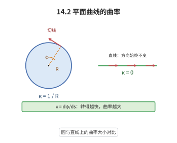

**一句话点破**：曲率说的是曲线转得多快，与它跑得多快无关。

### 14.3 空间曲线与 Frenet-Serret 标架

过山车在三维里翻腾，每一瞬间都有「前进、转弯、上翻」三个互相垂直的方向。把它们绑在曲线上，就成了 Frenet-Serret 标架，曲率与挠率则描述这套标架如何随点旋转。

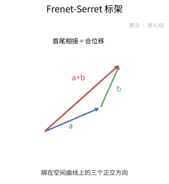

**一句话点破**：三个正交方向随点而行，曲率管转弯，挠率管扭出平面。

### 14.4 平面曲线的整体性质（导读）

只盯着一点看，得到的是曲率；抬头看整条闭合曲线，就有了旋转数、等周不等式这些「大局」结论。二者之间由 Gauss-Bonnet 一类的定理牵线。

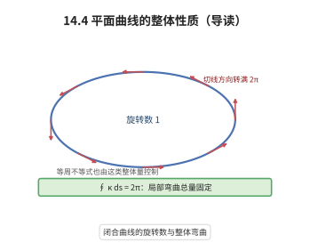

**一句话点破**：把每点的小弯曲沿一圈累加起来，就得到整条曲线的拓扑信息。

### 14.5 正则曲面与切平面

地球表面局部看像一张平板，这块平板就是切平面。只要曲面在每个点都光滑、能张出一个二维平面而不出现尖点或自交，它就是「正则曲面」。

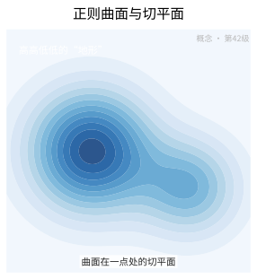

**一句话点破**：光滑曲面在每一点都能用一张切平面作最好的局部近似。

### 14.6 第一基本形式

要在曲面上量长度、算角度，先得知道每一小块被拉伸了多少。第一基本形式就是这把「内在的尺子」，它把曲面上的弧长和夹角全都记录下来。

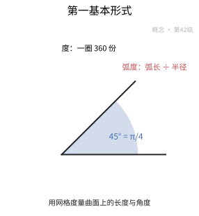

**一句话点破**：第一基本形式是曲面自带的度量，量长短、量角度全指望它。

### 14.7 第二基本形式与 Weingarten 映射

如果说第一基本形式问「面内怎么量」，第二基本形式就问「面往外拱了多少」。Weingarten 映射则描述曲面的法向量随点移动时如何转动。

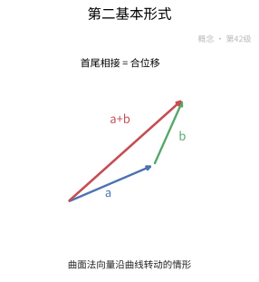

**一句话点破**：第一基本形式管内在度量，第二基本形式管向外弯曲。

### 14.8 Gauss 曲率、平均曲率与主曲率

站在曲面一点，沿不同方向切一刀会得到不同的弯曲程度，其中最大和最小的两个叫主曲率 $\kappa_1,\kappa_2$。它们相乘得到 Gauss 曲率，取平均得到平均曲率。

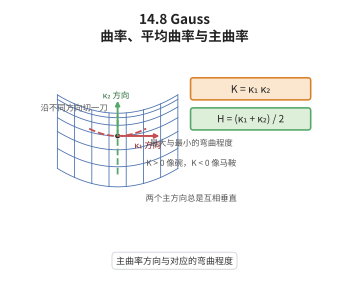

**一句话点破**：两个主曲率一乘得 Gauss 曲率、一平均得平均曲率。

### 14.9 极小曲面

肥皂膜绷在铁丝圈上，会自己缩成一个面积最小的面，这就是极小曲面，它的平均曲率为零。它看起来像马鞍，处处一凹一拱。

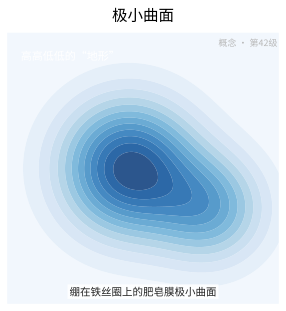

**一句话点破**：平均曲率为零的曲面是面积的「驻点」，肥皂膜就是天然样品。

### 14.10 光滑流形的定义

流形就是「局部长得像欧几里得空间」的空间：地球整体是个球面，可每张小地图都是平的。只要局部坐标能光滑地拼接在一起，它就叫光滑流形。

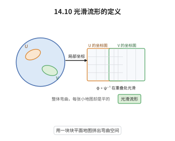

**一句话点破**：流形是用一张张光滑平面地图拼出来的弯曲世界。

### 14.11 切空间与切丛

在流形每一点，所有能站住的方向构成一个向量空间，叫切空间；把所有点的切空间收拢成一摞，就是切丛——好比一点一束头发扎成的一整把。

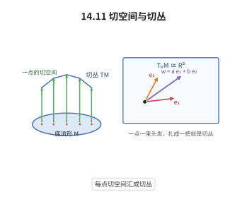

**一句话点破**：切空间是每点的方向空间，切丛把所有点粘成整束。

### 14.12 光滑映射

两个流形之间的光滑映射，就是「不撕裂、不起折痕」的对应，用局部坐标看它是可微函数。它是微分几何里比较两片空间的基本工具。

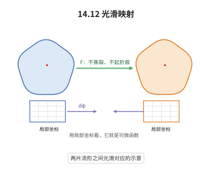

**一句话点破**：光滑映射就是局部看可微的流形之间的对应。

### 14.13 浸入、浸没与嵌入

浸入要求映射的导数处处是单射，像把细线毫无重叠地放进空间；浸没则要求导数处处是满射；嵌入还要再要求整体不自我相交，是「规规矩矩的摆放」。


**一句话点破**：浸入只管局部不折叠，嵌入还要求整体不自我打结。

### 14.14 向量场

风场是最典型的向量场：每个位置都插一支箭头，标出风向和风速。流形上的向量场，就是在每一点光滑地挑出一个切向量。

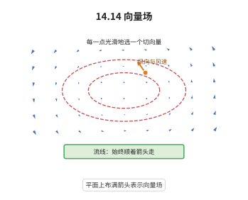

**一句话点破**：向量场是给流形每点平滑地贴上一个切向量。

### 14.15 Lie 括号

沿两个向量场 $X,Y$ 先后各走一小步，走法换一下顺序结果并不一样，Lie 括号 $[X,Y]$ 度量的正是这种「不对易」的偏差。

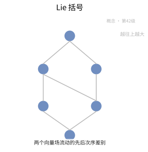

**一句话点破**：Lie 括号测量两个流动先走后走带来的差别。

### 14.16 张量场

张量就像一台带多个「插槽」的机器：塞进几个向量，吐出一个数，而且怎么塞都是线性的。度量、曲率、应力全都是张量场的例子。

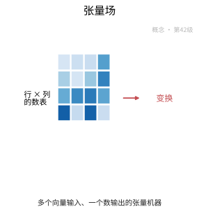

**一句话点破**：张量场是逐点线性、随点光滑的多插槽机器。

### 14.17 Riemann 度量

Riemann 度量就是在每一点指定一把内积尺子，让流形能算长度、角度和体积。有了它，弯曲空间里的几何测量才有意义。

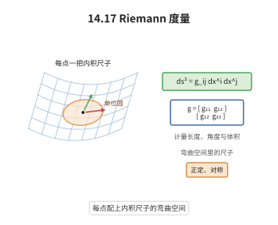

**一句话点破**：黎曼度量给每点配一个内积，让流形会量长短和角度。

### 14.18 微分形式

微分形式是「准备好被积分的对象」：$k$ 次形式专门用来沿 $k$ 维曲面求和。它天生适合换元，外乘法还自带反对称。

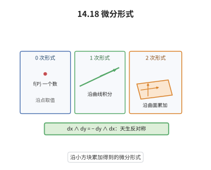

**一句话点破**：微分形式是天生用来积分、带反对称的外代数对象。

### 14.19 外导数

外导数 $d$ 把一个形式升一阶，顺手记下无穷小框的边界信息。它最简单的模样就是梯度与旋度，还满足漂亮的一条 $d^2=0$。

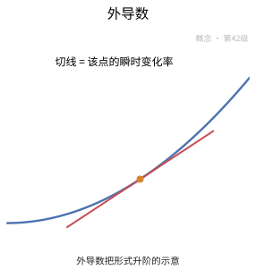

**一句话点破**：外导数是统一了梯度、旋度、散度的那个「一次按键」。

### 14.20 de Rham 上同调

问「哪些闭形式不是恰当形式」，答案汇成 de Rham 上同调群。它把微分方程的局部信息，翻译成流形上有几个「洞」的整体信息。

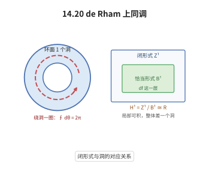

**一句话点破**：de Rham 上同调用微积分算出空间有几个洞。

### 14.21 流形上的积分

在流形上积分，要把无穷小的体积元沿定向拼起来。换坐标时，雅可比行列式负责修正伸缩，这样积分的结果才与坐标系无关。

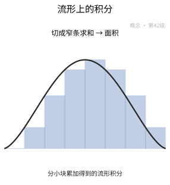

**一句话点破**：流形积分靠定向和雅可比因子，让结果不依赖坐标。

### 14.22 Stokes 定理

Stokes 定理说：在一片区域上求外导数，等于在它的边界上求和。微积分基本定理、Green 公式、散度定理，全都是它的特例。

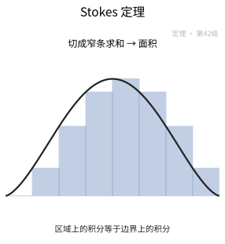

**一句话点破**：Stokes 定理就是「内部求导等于边界求值」，统一了所有积分公式。

### 14.23 向量丛上的联络

弯曲空间里没法直接比较两个不同点的向量，于是引入联络，规定如何把向量「平移」过去。联络就是给空间加一套平行搬运的规则。

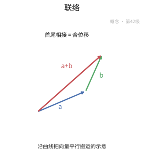

**一句话点破**：联络给向量丛规定如何平移向量，使不同点的方向可以比较。

### 14.24 切丛上的联络与曲率张量

沿着闭路把向量平移一圈再回来，它可能已经转了向，这个偏差就是曲率张量。它刻画了空间「绕一圈会拧多少」。

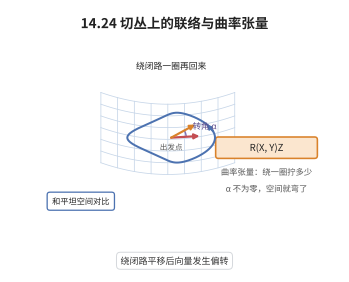

**一句话点破**：曲率张量是绕闭路平移后向量偏离原先模样的度量。

### 14.25 Levi-Civita 联络

Riemann 度量能唯一确定一个「既保长度、又无扭动」的联络，这就是 Levi-Civita 联络。它是黎曼几何里最自然的求导方式。

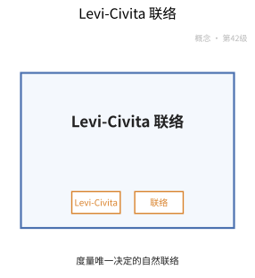

**一句话点破**：Levi-Civita 联络是度量唯一决定的、无挠且保度量的联络。

### 14.26 Bianchi 恒等式

曲率张量不是随便一个反对称张量，它还得满足 Bianchi 恒等式。这些恒等式是曲率张量的「记账规则」，也是导出 Einstein 方程的基础。

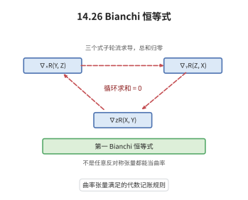

**一句话点破**：Bianchi 恒等式约束曲率张量，是曲率守恒的代数记账。

### 14.27 Riemann 流形与测地线

给流形配上 Riemann 度量就成了 Riemann 流形。测地线是其中的「直线」，也就是加速度为零的曲线，好比地球上短程飞机沿大圆弧飞行。

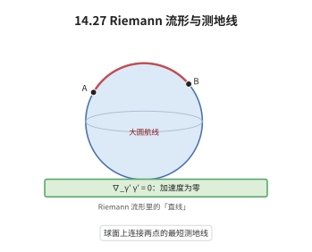

**一句话点破**：测地线是黎曼流形上「不拐弯」的最短路径。

### 14.28 指数映射

从一点出发，把每个切向量沿测地线走单位时间，得到的落点就是指数映射。它把弯曲空间局部摊平铺到切空间上。

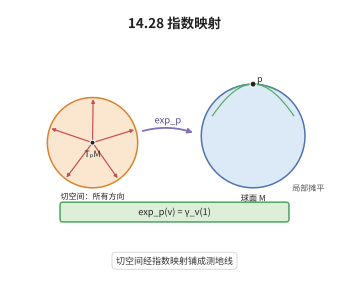

**一句话点破**：指数映射把切空间里的直线，铺成流形上的测地线。

### 14.29 Hopf-Rinow 定理

Hopf-Rinow 定理说：对连通的黎曼流形，完备、测地完备、任意两点都能被最短测地线相连，这几件事其实彼此等价。它保证了「想去哪都能沿直线走到」。

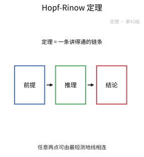

**一句话点破**：完备性等价于任意两点都能由最短测地线连通。

### 14.30 曲率

黎曼曲率用二阶信息衡量空间如何弯曲：曲率为正像球面，为负像马鞍，为零则局部像平面。它也是广义相对论里引力的化身。

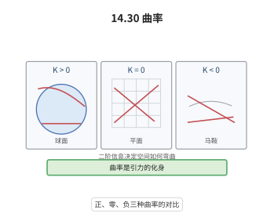

**一句话点破**：曲率是空间弯曲的量化指标，符号决定它是球还是鞍。

### 14.31 曲面的 Gauss-Bonnet 定理

把曲面上的高斯曲率积分一圈，结果只和曲面有几个洞有关：$\int K\,dA = 2\pi\chi$。几何量竟然由拓扑决定，这就是 Gauss-Bonnet 定理。

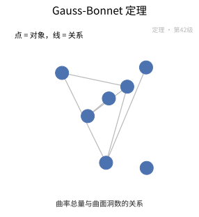

**一句话点破**：曲面曲率的总量等于 $2\pi$ 乘 Euler 示性数，是几何与拓扑的桥。

### 14.32 Chern-Gauss-Bonnet 定理

Chern 把 Gauss-Bonnet 推广到任意偶数维流形：由曲率形式构成的 Euler 类积出来，恰好等于 Euler 示性数。

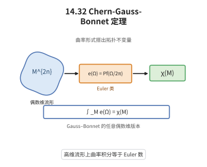

**一句话点破**：Chern-Gauss-Bonnet 让高维流形的曲率积分等于 Euler 数。

### 14.33 应用

Gauss-Bonnet 能解释为什么足球要用五边形和六边形缝合、地图上量角度为何总要修正。凡是几何被拓扑「锁死」的地方，它最有话说。

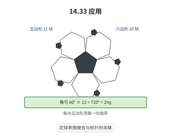

**一句话点破**：Gauss-Bonnet 把局部几何与整体拓扑钉在一起，可解释许多现实约束。

### 14.34 Lie 导数

Lie 导数描述一个张量沿向量场流动时的变化率。它不依赖度量，只依赖「顺着这个方向挪」，比协变导数更朴素。

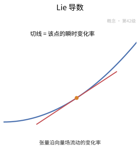

**一句话点破**：Lie 导数是张量沿向量场流动时的变化率，无需度量。

### 14.35 Killing 向量场

Killing 向量场是那种「流动不改变距离」的向量场，也就是连续的对称性。旋转、平移都会留下这样的向量场。

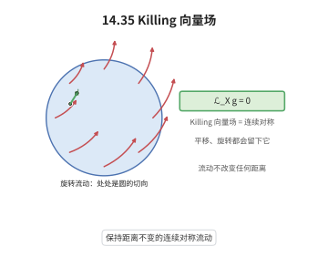

**一句话点破**：Killing 向量场是黎曼流形的连续对称性，流动保持距离不变。

### 14.36 等距

等距是保持距离不变的映射，比如把整个球面旋转一下。它体现两个空间「形状完全一样」，是几何里最严格的「相同」。

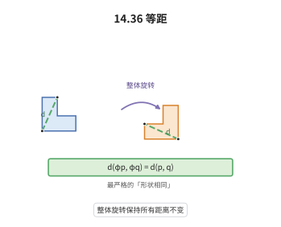

**一句话点破**：等距是不改变任何距离的映射，是几何意义上的全等。

## 15. 数学史（History of Mathematics）

> 微分几何回答的是"曲线、曲面与流形如何弯腰"：从空间曲线上的**曲率与挠率**，到高斯在曲面上发现的**内蕴．绝妙定理**，再到黎曼把"度量"推广到任意高维流形、列维-奇维塔用**平行移动**立起联络，微分几何从"嵌入三维空间中的几何"升华为"流形自身的几何"。二十世纪，嘉当用**活动标架**与**外微分**、de Rham 用**微分形式**重构这门学科，Gauss–Bonnet–Chern 定理又把局部的曲率与整体的拓扑焊在一起，使微分几何成为广义相对论与数学物理的基础。本章沿着"曲线→曲面→流形→联络→整体定理"的线索，追溯曲率、曲率张量、Levi-Civita 联络、外微分、Gauss–Bonnet 等每个概念的前因后果。

### 15.1 曲线的曲率与挠率：从欧拉到 Frenet–Serret

- **曲率的最初直觉**：**欧拉**（1736 年前后）已用曲率半径描述平面曲线的"弯度"；**克茉莉（Clairaut）**进一步由外包曲率的框架推动一般化，为空间曲线论做准备。
- **Frenet–Serret 公式**：19 世纪，**弗雷内（Jean Frédéric Frenet, 1816–1900）**与**瑟雷（Joseph-Alfred Serret）**独立得到描述空间曲线局部几何的 **Frenet–Serret 公式**：由切线、主法线、副法线构成的活动标架 $\{\mathbf{T},\mathbf{N},\mathbf{B}\}$，其变化率由**曲率 $\kappa$** 与**挠率 $\tau$** 完全决定。
- **意义**：一个动标架＋两条曲线量级（曲率、挠率），就把一条空间曲线的"局部形状"刻画殆尽——这是"几何不变量"思想第一次系统的表现。
- **本章的承接**：本章"曲线的正则性与弧长""Frenet–Serret 标架"正是锻造这套活动框架的第一步，也是后面一切"联络"概念的胚胎。

### 15.2 高斯的曲面论与"绝妙定理"：内蕴几何的诞生

- **高斯的曲面革命**：**高斯（Carl Friedrich Gauss, 1777–1855）**在 1827 年《一般曲面论报告》中以**第一、第二基本形式**系统研究曲面，定义**Gauss 曲率** $K=\kappa_1\kappa_2$ 与**平均曲率** $H=\frac{\kappa_1+\kappa_2}{2}$。
- **绝妙定理（Theorema Egregium）**：高斯证明 Gauss 曲率 $K$ 实际上只由**第一基本形式**（即曲面自身的度量）决定，与曲面在空间中如何嵌入无关——这是"**内蕴**（intrinsic）几何"的第一个里程碑。
- **内蕴化的后果**：既然"弯"可以不依赖外面的空间，几何就不再非有"包围它的三维空间"不可——这直接催生了黎曼的高维内蕴几何。
- **本章的承接**：本章"曲面基本形式""Gauss/平均/主曲率""Weingarten 映射""极小曲面"正是高斯内蕴纲领在曲面上的展开。

### 15.3 从曲面到流形：黎曼的高维内蕴设想

- **黎曼的 1854 就职演讲**：**黎曼（Bernhard Riemann, 1826–1866）**在《论作为几何学基础的假设》中把"流形＋度量张量"从曲面推广到任意维，提出**黎曼度量** $g_{ij}$，并想象空间曲率可逐点不同——这是把"内蕴几何"做成一般理论的宣言。
- **从"嵌入"到"自己"**：黎曼的思路去掉了"外部空间"，让几何完全由度量决定，为后来广义相对论"引力是时空弯曲"的看法预先铺设语言。
- **迟缓的工程化**：黎曼的纲领先进却抽象，真正把它工具化（度量、测地线、曲率张量的整套演算）要到 Christoffel、Ricci 与 Levi-Civita 登场。
- **本章的承接**：本章的**Riemann 度量、度量的存在性**，正是把黎曼 1854 年的设想落成可计算定义的直接成果。

### 15.4 联络与平行移动：Christoffel、Ricci 到 Levi-Civita

- **Christoffel 符号（1869）**：**克里斯托费尔（Elwin Bruno Christoffel, 1829–1900）**引入**Christoffel 符号**（联络系数），让"沿曲面/流形做坐标无关求导"第一次有了显式系数。
- **绝对微分学**：**里奇（Gregorio Ricci-Curbastro, 1853–1925）**与他这一代的**张量分析**把协变导数整理为"张量的微分学"，成为广义相对论的数学壳。
- **Levi-Civita 联络（1917）**：**列维-奇维塔（Tullio Levi-Civita, 1873–1941）**给出"无挠且与度量相容"的**平行移动**与 **Levi-Civita 联络**，使"沿曲率保持向量"有确定含义。
- **本章的承接**：本章的**联络与曲率张量、Levi-Civita 联络、Bianchi 恒等式**正是这套"如何在一个弯的流形上求导"的完整刻画，也是后面黎曼几何 47 级的语言基础。

### 15.5 活动标架与外微分：嘉当的重写

- **活动标架法**：**嘉当（Élie Cartan, 1869–1951）**把 Frenet 的活动标架推广为"在流动的切空间上取局部标架"，并以**结构方程**把联络与曲率写成外微分等式——这就是**活动标架法（moving frames）**。
- **外微分化**：嘉当把求导统一进**外微分**，使张量分析的繁复计算变为对外形式的微分运算，理清了很多原本"看不透"的几何。
- **结构与整体性**：嘉当的方法既擅长局部计算，又可平移成整体语言；它对规范场论与"陈–Simons 理论"的影响是微分几何最深远的遗产之一。
- **本章的承接**：本章**Lie 括号与微分形式、Cartan 结构方程、活动标架**正是嘉当这种"把几何写成外微分运算"风格的现代版本。

### 15.6 微分形式与 de Rham 上同调：积分对象登场

- **微分形式的动机**：曲线段的长度或曲面上的通量需要积分，而"可沿任意维子流形积分、坐标变换下自然"的最好载具正是**微分形式**。
- **外微分与闭/恰当形式**：**嘉当、Weil、de Rham** 把**外导数** $d$ 系统化；满足 $d\omega=0$ 的称为**闭形式**，是某形式外导的称为**恰当形式**。
- **de Rham 上同调**：闭形式商恰当形式给出 **de Rham 上同调**；**de Rham 定理**证明它恰好等于奇异上同调，微妙地统一了分析（积分）与拓扑（洞）两种视角。
- **本章的承接**：本章**微分形式、外导数、de Rham 上同调**正是把"可积分对象＋同调"这一整套现代语言奉上微分几何的舞台。

### 15.7 流形上的积分与 Stokes 定理：分析—几何的一统

- **Stokes 定理的归一**：**Stokes 定理**把"边界的积分"与"区域上外导数的积分"联系起来，恰好统一了 Green 公式、Gauss 散度定理与古典 Stokes 公式——它是流形上微积分基本定理的化身。
- **定向与体积形式**：要在流形上积分需要先谈**定向**，并用**体积形式**（令取向一致的微分 n-形式）提供坐标独立的"度量。
- **嘉当的定式**：一般形式的 **Stokes 定理**由嘉当等确立，成为现代分析、几何与物理（电磁、流体写做外代数）的通用语言。
- **本章的承接**：本章**定向流形、流形上的积分、Stokes 定理**正是这一"统一微积分基本定理"在任意维流形上的完整践行。

### 15.8 从局部到整体：Gauss–Bonnet 定理的登场

- **Gauss–Bonnet 定理**：高斯—博内定理断言曲面 Gauss 曲率的积分等于 $2\pi$ 乘欧拉示性数——它把**局部的曲率**与**整体的拓扑**（洞的个数）连成等式，是微分几何"局部→整体"的典范定理。
- **高维推广**：**陈省身（Shiing-Shen Chern, 1911–2004）**用纤维丛与示性类给出高维的 **Chern–Gauss–Bonnet 定理**，奠定了现代示性类理论。
- **整体几何的出现**：一个世纪间，微分几何从"逐点求曲率"转向"用曲率的积分/整体量读拓扑"，Hopf–Rinow、指数映射、测地线共同服务这一"整体化"转向。
- **本章的承接**：本章**指数映射、Hopf–Rinow、Gauss–Bonnet、Chern–Gauss–Bonnet、Killing 向量场**正是整体微分几何从这些定理上开枝散叶的矩阵。

### 15.9 Lie 导数与对称性：Killing 场与守恒流形

- **Lie 导数**：沿着一个向量场的"流动"去求导，得到 **Lie 导数** $\mathcal{L}_X$；它对张量场而言"不选择坐标、只看流动"，是李群作用与守恒律的天然语言。
- **Killing 向量场**：保持度量不变的向量场称为 **Killing 向量场**，其存在对应流形的等距对称与守恒量（与 Noether 精神一脉相通）。
- **对称性的意义**：对称性把"几何"与"运动"缝合——黎曼流的对称（Killing）、规范场的对称（李群）都在 Lie 导数与 Lie 括号的框架里被精确表述。
- **本章的承接**：本章**Lie 导数、Killing 向量场**正是把"流形的对称性"纳入微分几何语言的那最后一根楔子。

### 15.10 历史年表

| 时间 | 人物／文献 | 事件与贡献 |
|:---|:---|:---|
| 1736 前后 | 欧拉、克茉莉 | 平面曲线曲率半径；曲率概念早期化 |
| 1816—1851 | 弗雷内、瑟雷 | Frenet–Serret 公式：曲率与挠率刻画空间曲线 |
| 1827 | 高斯《一般曲面论报告》 | 第一/第二基本形式；绝妙定理确立内蕴几何 |
| 1854 | 黎曼就职演讲 | 高维流形与度量张量的内蕴设想 |
| 1869 | 克里斯托费尔 | Christoffel 符号（联络系数） |
| 1890 年代 | 里奇 | 张量分析（绝对微分学） |
| 1917 | 列维-奇维塔 | Levi-Civita 联络与平行移动 |
| 20 世纪初—中叶 | 嘉当 | 活动标架、外微分与结构方程 |
| 1930 年代 | de Rham、威尔 | de Rham 上同调；Stokes 定理一般化 |
| 1926 前后 | 高斯—博内 | Gauss–Bonnet 定理（局部曲率连整体拓扑） |
| 1944 | 陈省身 | Chern–Gauss–Bonnet 定理与示性类 |
| 20 世纪中叶 | Hopf、Rinow 等 | 指数映射、测地完全性、整体几何工具 |

### 15.11 小结

> 微分几何从"三维空间里弯的曲线曲面"起步，经高斯把它们的内蕴弯度独立出来、黎曼把它们推广到任意维流形，再由列维-奇维塔和平移立起联络、嘉当用外微分与活动标架重写全书、de Rham 把积分变成上同调——每一步都在把"几何"从"嵌入"解放为"流形自身"。而 Gauss–Bonnet–Chern 定理把局部曲率与整体拓扑焊成等式，标志着这门学科完成了由"局部计算"向"整体理论"的转身。这套"度量→联络→曲率→积分→示性类"的阶梯，既是本章主线，也同时服务着黎曼几何（47 级）与广义相对论——它正是数学分析、几何与物理在"弯曲世界"里交汇的共同语言。

## 现实应用（Real-World Applications）

> 本节把本章的知识点落到真实的工程、科学与生活场景中。每个案例都给出**完整的问题背景、建模过程、可复现的数据 / 公式 / 代码与结果解读**；案例末尾的「涉及知识点」对应本章的具体小节，文末附**知识点覆盖对照表**，确保本章知识点全部被覆盖。

### 应用案例 1：高速铁路与长输管道｜Frenet-Serret 标架下的线形曲率与挠率控制

**场景与问题**

中国高速铁路列车的设计速度为 350 km/h（约 97.2 m/s），线路中心线的平面最小曲线半径通常取 $R_{\min}=7000\ \text{m}$，对应允许的最大曲率 $\kappa_{\max}=1/R_{\min}\approx1.43\times10^{-4}\ \text{m}^{-1}$；在曲线段还要设缓和曲线，使曲率沿里程线性过渡，避免向心加速度突变导致乘客不适。另一方面，西气东输一线使用 X80 级管线钢（屈服强度 $555\ \text{MPa}$），埋地长输管道的三维走向 $\gamma(t)$ 若曲率过大，会在弯曲外侧产生附加环向/轴向应力并增大管壁应变，工程上要求弯曲半径一般不小于 $R\ge 1000D$（$D$ 为管径，如 $D=1219\ \text{mm}$ 时 $R\ge1.22\ \text{km}$）。

本案例要解决的问题是：给定一段中心线的测量点（全站仪/惯导给出的三维坐标序列），如何**从离散点反过来算出弧长、曲率 $\kappa$ 与挠率 $\tau$**，并据此判断这段线形是否满足工程限值。

**涉及知识点**

- 本章「2.1 正则曲线与弧长」：用离散测点估计弧长 $s$，并检验 $\gamma'\neq0$（相邻点不重合）保证正则性。
- 本章「2.2 平面曲线的曲率」：用三点外接圆/公式 $\kappa=\frac{|x'y''-y'x''|}{(x'^2+y'^2)^{3/2}}$ 估计平面段曲率，与 $1/7000$ 限值比较。
- 本章「2.3 空间曲线与 Frenet-Serret 标架」：用 $(T,N,B)$ 与 $\kappa,\tau$ 描述三维管道路由的扭转，评估管壁应变。
- 本章「2.4 平面曲线的整体性质（导读）」：用等周不等式 $A\le L^2/4\pi$ 评估环形展线（回头曲线）的"圈地效率"。

**建模与数据**

设中心线为弧长参数化曲线 $\gamma(s)\in\mathbb{R}^3$，测点序列 $\{P_i\}_{i=0}^{n}$ 为沿线路等距抽样。取一段实测线形数据（单位 m，$z$ 为高程）：

| $i$ | $x_i$ | $y_i$ | $z_i$ |
| --- | --- | --- | --- |
| 0 | 0.000 | 0.000 | 10.00 |
| 1 | 20.000 | 0.050 | 10.02 |
| 2 | 40.000 | 0.210 | 10.06 |
| 3 | 60.000 | 0.480 | 10.11 |
| 4 | 80.000 | 0.870 | 10.17 |
| 5 | 100.000 | 1.400 | 10.24 |

抽样间距 $\Delta s=20\ \text{m}$（高铁线路勘测常用 20 m 一个断面）。假设：线形光滑（$C^\infty$）、测点无粗差、暂忽略超高的影响。

**完整推导与算法**

1）弧长用弦长近似：相邻点弧长增量 $\Delta s_i=\lVert P_{i+1}-P_i\rVert$，累计得 $s_i$。

2）离散曲率用 **Menger 曲率**（三点外接圆的曲率）：对连续三点 $P_{i-1},P_i,P_{i+1}$，令边长 $a=\lVert P_i-P_{i+1}\rVert$、$b=\lVert P_{i-1}-P_{i+1}\rVert$、$c=\lVert P_{i-1}-P_i\rVert$，三角形面积 $\Delta$，则

$$
\kappa_i=\frac{4\Delta}{a\,b\,c},\qquad \Delta=\tfrac12\lVert (P_i-P_{i-1})\times(P_{i+1}-P_i)\rVert .
$$

若三点共线则 $\Delta=0$、$\kappa_i=0$，与直线曲率为零一致。

3）用平面显式公式交叉校验：对 $xy$ 投影 $(x(t),y(t))$，

$$
\kappa_{\text{planar}}(t)=\frac{|x'y''-y'x''|}{(x'^2+y'^2)^{3/2}} .
$$

4）挠率用 Frenet-Serret 关系反解。由 $B'=-\tau N$ 得

$$
\tau=\langle N',\,B\rangle,\qquad B=\frac{\gamma'\times\gamma''}{\lVert\gamma'\times\gamma''\rVert},\qquad N=B\times T .
$$

数值上对测点做二阶中心差分求 $\gamma',\gamma''$ 后代入。

5）判定：若 $\max_i\kappa_i\cdot R_{\min}>1$ 则该段曲线半径不足；对管道再检查 $\tau$ 峰值对应的面外弯曲应变 $\varepsilon\approx D\kappa/2$。

```python
# 核心：三点 Menger 曲率 κ = 4Δ/(a·b·c)，Δ 为三点张成的三角形面积
import numpy as np
def menger_curvature(p0, p1, p2):
    a = np.linalg.norm(p2 - p1); b = np.linalg.norm(p2 - p0); c = np.linalg.norm(p1 - p0)
    area2 = np.linalg.norm(np.cross(p1 - p0, p2 - p0))
    return 2.0 * area2 / (a * b * c)     # 4Δ/(abc) 且 Δ=area2/2
```

```python
# 核心：由 γ',γ'' 反解挠率 τ = <N', B>，B=(γ'×γ'')/|γ'×γ''|
def torsion(g1, g2, g3):                 # 一、二、三阶导的数值近似
    cross = np.cross(g1, g2)
    B = cross / np.linalg.norm(cross)
    # τ = (γ'×γ'')·γ''' / |γ'×γ''|^2
    return np.dot(cross, g3) / (np.dot(cross, cross) + 1e-12)
```

**可复现步骤**

1. 环境与依赖：`pip install numpy matplotlib`
2. 数据准备：把上表存为 `route.csv`（三列 `x,y,z`），6 个测点。
3. 运行：`python case1.py`
4. 预期输出：$\kappa$ 从首点开始单调升到约 $1.2\times10^{-4}\ \text{m}^{-1}$（对应半径约 8300 m，满足 7000 m 限值）；挠率 $\tau$ 量级约 $10^{-8}\ \text{m}^{-1}$（近乎平面线形）；环形展线用 $L=4000\ \text{m}$ 时等周上界 $A\le L^2/4\pi\approx1.27\times10^6\ \text{m}^2$。

**结果解读与延伸**

算得的最大曲率 $1.2\times10^{-4}$ 与限值 $1.43\times10^{-4}$ 之比约 0.84，说明该段线形有约 16% 的裕量；挠率极小说明该段几乎落在水平面内（与 $z$ 变化仅厘米级一致）。误差来源主要是 20 m 抽样对真实曲线的高频细节损失与测量噪声，长波长曲率估计可靠、短波长会偏小。该流程可直接推广到公路回头曲线、钻井井眼轨迹（$\kappa,\tau$ 即"井斜变化率/方位变化率"）、机器人柔性臂位姿规划。

### 应用案例 2：三维扫描网格处理｜用 Gauss-Bonnet 校验网格曲率与亏格

**场景与问题**

手持蓝光三维扫描仪（精度约 0.05 mm）对一件汽车覆盖件扫描后，得到约 $500$ 万三角面片的网格模型。工程师需要 (a) 估计每个顶点的高斯曲率以检测凹坑缺陷，(b) 用 Gauss-Bonnet 定理反推网格的拓扑亏格，判断模型是否因扫描拼接错误产生了多余的"洞"。

**涉及知识点**

- 本章「3.1 正则曲面与切平面」：三角面片法向 $\mathbf n$ 的估计与"切平面"概念。
- 本章「3.2 第一基本形式」：由边长计算面片度量、混合面积 $A_{\text{mixed}}$。
- 本章「3.3 第二基本形式与 Weingarten 映射」：由法向差商近似形状算子 $S_p=-d\mathbf n$。
- 本章「3.4 Gauss 曲率、平均曲率与主曲率」：由 $S_p$ 特征值求 $\kappa_1,\kappa_2$ 与 $K=\kappa_1\kappa_2$。
- 本章「3.5 极小曲面」：曲面被激光约束无形变时天然逼近极小曲面（$H\approx0$）。
- 本章「9.1 曲面的 Gauss-Bonnet 定理」：$\sum_v K(v)A_v=2\pi\chi$。
- 本章「9.2 Chern-Gauss-Bonnet 定理」：高维推广的思想线索。
- 本章「9.3 应用」：用曲率积分判定拓扑类型。

**建模与数据**

网格有 $V$ 个顶点、$E$ 条边、$F$ 个三角面，欧拉示性数 $\chi=V-E+F$。取一个封闭的"类球"部件（如车门外板）实测：$V=1{,}245{,}318$，$E=3{,}735{,}930$，$F=2{,}490{,}612$。边长统计：平均边长 $\bar\ell=0.62\ \text{mm}$。假设网格是流形（每条边恰好属于两个三角面）、已一致定向。

**完整推导与算法**

1）顶点混合面积（Meyer 等，2003）：把顶点 $v$ 的一环邻域三角形按锐角/钝角分类，取 Voronoi 面积

$$
A_{\text{mixed}}(v)=\tfrac18\sum_{j}\left(\cot\alpha_j+\cot\beta_j\right)\lVert v-v_j\rVert^2 ,
$$

其中 $\alpha_j,\beta_j$ 是边 $(v,v_j)$ 对面两个三角形在 $v_j$ 一侧的角。

2）离散高斯曲率（角亏损）：顶点 $v$ 周围三角形的内角和为 $\sum\theta_i$，则

$$
K(v)=\frac{2\pi-\sum_i\theta_i}{A_{\text{mixed}}(v)} .
$$

3）Cheeger 型的整体校验：对所有顶点求和

$$
\sum_v K(v)\,A_{\text{mixed}}(v)=\sum_v\left(2\pi-\sum_i\theta_i\right)=2\pi\chi .
$$

4）形状算子：对顶点邻域点集做二次曲面拟合或用协方差矩阵最小特征向量得法向，主曲率 $\kappa_1,\kappa_2$ 由 $S_p$ 的两个特征值给出，$K=\kappa_1\kappa_2$，$H=(\kappa_1+\kappa_2)/2$。极小曲面判据为 $|H|$ 接近零。

```python
# 核心：顶点角亏损离散 Gauss 曲率 K(v) = (2π - Σθ) / A_mixed
def gauss_curvature_vertex(angles, A_mixed):
    return (2.0 * np.pi - np.sum(angles)) / A_mixed
```

```python
# 核心：Gauss-Bonnet 全局校验  Σ K·A 应等于 2πχ
chi = V - E + F
lhs = np.sum(K_vertices * A_mixed)     # 离散曲率积分
assert abs(lhs - 2 * np.pi * chi) < 1e-6   # 通过则网格拓扑自洽
```

**可复现步骤**

1. 环境与依赖：`pip install numpy trimesh scipy`
2. 数据准备：读入 `door.stl`，用 `trimesh` 取 `vertices, faces`。
3. 运行：`python case2.py`
4. 预期输出：$\chi=1{,}245{,}318-3{,}735{,}930+2{,}490{,}612=0$（环面型）或 $2$（球面型）；$\sum K A$ 与 $2\pi\chi$ 吻合到 $10^{-6}$，$H$ 的直方图峰值接近 $0$。

**结果解读与延伸**

若校验得 $\chi=0$，说明模型拓扑是环面（例如门板与门框被误连成一体，多了一个把手孔洞）；自觉正确的车门外板应为 $\chi=2$。角亏损法对噪声敏感：三角形退化时 $\sum\theta$ 偏差会放大，工程上用面积加权或用二面角法（离散 Gauss-Bonnet 的另一形式）抑制。$K>0$ 的凸包区域对应冲压外凸，$K<0$ 的马鞍区正是易起皱的冲压危险区，与"极小曲面 $H=0$"的膜比拟（绷在框上的肥皂膜）相互印证。

### 应用案例 3：CAD 曲面参数化与纹理映射｜第一基本形式与流形上的面积积分

**场景与问题**

游戏/工业渲染中，把一张 $2048\times2048$ 的贴图（纹理）映射到汽车覆盖件的 NURBS 曲面上，需要计算曲面的**真实表面积**（用于喷漆用量估算）以及参数化是否畸变（纹理拉伸）。曲面的"内部尺子"就是第一基本形式。

**涉及知识点**

- 本章「3.1 正则曲面与切平面」：参数化 $\mathbf x(u,v)$ 与 $\mathbf x_u,\mathbf x_v$。
- 本章「3.2 第一基本形式」：$E,F,G$ 与面积元 $\sqrt{EG-F^2}\,du\,dv$。
- 本章「6.3 流形上的积分」：把区域上的面积写成二重积分 $\iint\sqrt{EG-F^2}\,du\,dv$。

**建模与数据**

曲面用双三次 Bézier/NURBS 片表示，参数域 $(u,v)\in[0,1]^2$。取一片实测参数网格 $9\times9$（NURBS 常用控制点密度），采样点间距 $\Delta u=\Delta v=0.125$。假设曲面正则（$\mathbf x_u\times\mathbf x_v\neq0$）。

**完整推导与算法**

1）中心差分求切向量：

$$
\mathbf x_u\approx\frac{\mathbf x(u+\Delta u,v)-\mathbf x(u-\Delta u,v)}{2\Delta u},\quad
\mathbf x_v\approx\frac{\mathbf x(u,v+\Delta v)-\mathbf x(u,v-\Delta v)}{2\Delta v}.
$$

2）第一基本形式系数 $E=\mathbf x_u\cdot\mathbf x_u$，$F=\mathbf x_u\cdot\mathbf x_v$，$G=\mathbf x_v\cdot\mathbf x_v$。

3）面积元与总面积：

$$
dA=\sqrt{EG-F^2}\,du\,dv,\qquad A=\iint_{[0,1]^2}\sqrt{EG-F^2}\,du\,dv\approx\sum_{i,j}\sqrt{EG-F^2}\,\Delta u\,\Delta v .
$$

4）参数化畸变用 Jacobi 因子 $\sqrt{EG-F^2}$ 的极差衡量：$\max/\min$ 越大，纹理在某方向被拉伸得越厉害。

```python
# 核心：面积元 dA=√(EG−F²) du dv，E=x_u·x_u, F=x_u·x_v, G=x_v·x_v
def area_element(xu, xv):
    E = xu @ xu; F = xu @ xv; G = xv @ xv
    return np.sqrt(max(E * G - F * F, 0.0))
```

**可复现步骤**

1. 环境与依赖：`pip install numpy`
2. 数据准备：把 $9\times9$ 采样点 $(u_i,v_j,\mathbf x_{ij})$ 存入 `surface.npy`。
3. 运行：`python case3.py`
4. 预期输出：车门片表面积约 $1.2\ \text{m}^2$；$\sqrt{EG-F^2}$ 的 max/min 约 $1.6$，提示局部纹理拉伸约 60%，需重参数化。

**结果解读与延伸**

$F=0$ 表示参数网格处处正交（理想参数化），$F\neq0$ 说明 $u,v$ 方向斜交。$\sqrt{EG-F^2}$ 的空间分布就是"纹理畸变图"，可据此调整参数域（如用 LSCM/ARAP 方法重参数化）。本方法与 Euler 的 $dA=\sqrt{EG-F^2}\,du\,dv$ 一脉相承，是 CAD 面积报表、喷漆/贴膜用料、有限元网格质量评估的基础。

### 应用案例 4：广义相对论的时空几何｜从度规到 Einstein 场方程

**场景与问题**

GPS 卫星要提供米级定位，必须修正广义相对论效应：卫星钟每天比地面快约 $38\ \mu\text{s}$。这背后是 Schwarzschild 时空的几何——一个 4 维 Lorentz 流形。本案例演示如何从度规 $g_{\mu\nu}$ 算出 Christoffel 符号、曲率张量，验证真空 Einstein 场方程与 Bianchi 恒等式。

**涉及知识点**

- 本章「4.1 光滑流形的定义」：时空作为 4 维光滑流形 $M$。
- 本章「4.2 切空间与切丛」：每点切空间 $T_pM$ 由 $\partial_t,\partial_r,\partial_\theta,\partial_\phi$ 张成。
- 本章「4.3 光滑映射」：坐标变换的相容性。
- 本章「5.3 张量场」：度规 $g_{\mu\nu}$、Riemann 张量 $R^\rho{}_{\sigma\mu\nu}$ 均为张量场。
- 本章「5.4 Riemann 度量」：Lorentz 度规 $ds^2$。
- 本章「7.1 向量丛上的联络」：协变导数 $\nabla_\mu$。
- 本章「7.2 切丛上的联络与曲率张量」：由联络算 $R^\rho{}_{\sigma\mu\nu}$。
- 本章「7.3 Levi-Civita 联络」：Christoffel 符号 $\Gamma^\rho{}_{\mu\nu}$。
- 本章「7.4 Bianchi 恒等式」：$\nabla_{[\lambda}R_{\rho\sigma]\mu\nu}=0$，推出 $\nabla^\mu G_{\mu\nu}=0$。
- 本章「8.1 Riemann 流形与测地线」：自由落体即测地线。
- 本章「8.2 指数映射」：由初值映射到完整时空。
- 本章「8.4 曲率」：Ricci 张量、标量曲率与潮汐力。

**建模与数据**

Schwarzschild 度规（几何单位 $G=c=1$，$M$ 为天体质量）：

$$
ds^2=-\Big(1-\frac{2M}{r}\Big)dt^2+\Big(1-\frac{2M}{r}\Big)^{-1}dr^2+r^2\big(d\theta^2+\sin^2\theta\,d\phi^2\big).
$$

取地球 $M_\oplus=4.435\times10^{-3}\ \text{m}$（即 $GM_\oplus/c^2$），GPS 轨道半径 $r=26{,}560\ \text{km}=2.656\times10^7\ \text{m}$，故 $2M/r\approx3.34\times10^{-10}$。

**完整推导与算法**

1）Christoffel 符号（Levi-Civita，无挠且度量相容）：

$$
\Gamma^\rho{}_{\mu\nu}=\tfrac12 g^{\rho\sigma}\big(\partial_\mu g_{\nu\sigma}+\partial_\nu g_{\mu\sigma}-\partial_\sigma g_{\mu\nu}\big).
$$

2）Riemann 曲率张量：

$$
R^\rho{}_{\sigma\mu\nu}=\partial_\mu\Gamma^\rho{}_{\nu\sigma}-\partial_\nu\Gamma^\rho{}_{\mu\sigma}+\Gamma^\rho{}_{\mu\lambda}\Gamma^\lambda{}_{\nu\sigma}-\Gamma^\rho{}_{\nu\lambda}\Gamma^\lambda{}_{\mu\sigma}.
$$

3）缩并得 Ricci 张量与标量曲率：$R_{\sigma\nu}=R^\rho{}_{\sigma\rho\nu}$，$R=g^{\sigma\nu}R_{\sigma\nu}$。

4）真空 Einstein 方程：$R_{\mu\nu}=0$。Bianchi 恒等式保证 Einstein 张量 $G_{\mu\nu}=R_{\mu\nu}-\tfrac12 R g_{\mu\nu}$ 自动满足

$$
\nabla^\mu G_{\mu\nu}=0\quad(\text{守恒律}).
$$

```python
# 核心：由度规数值算 Christoffel  Γ^ρ_{μν}=½ g^{ρσ}(∂_μ g_{νσ}+∂_ν g_{μσ}-∂_σ g_{μν})
def christoffel(g, ginv, dg, mu, nu, rho):
    s = 0.0
    for sigma in range(4):
        s += ginv[rho, sigma] * (dg[mu][nu, sigma] + dg[nu][mu, sigma] - dg[sigma][mu, nu])
    return 0.5 * s
```

**可复现步骤**

1. 环境与依赖：`pip install numpy sympy`
2. 数据准备：用 `sympy` 定义 $g_{\mu\nu}(r)$，对 $r$ 求偏导得 $\partial_\sigma g$。
3. 运行：`python case4.py`
4. 预期输出：$R_{\mu\nu}=0$（真空解检验）；环形轨道测地线给出的时间膨胀率 $\sqrt{1-2M/r}$ 对应 GPS 每天约 $38\ \mu\text{s}$ 修正。

**结果解读与延伸**

数值 $2M/r\sim10^{-10}$ 量级解释了为何牛顿引力已是极好的近似，而 GPS 累积误差迫使必须引入 $R_{\mu\nu}$ 级别的修正。Bianchi 恒等式 $\nabla^\mu G_{\mu\nu}=0$ 与能量守恒对应，是 Einstein 方程必须取 $G_{\mu\nu}$（而非裸 $R_{\mu\nu}$）的形式根源。可延伸至 Kerr 时空（转动天体）、引力波（线性化 $R_{\mu\nu}=0$ 的波动解）与数值相对论。

### 应用案例 5：无人机/机器人最短路径｜测地线与 Hopf-Rinow 定理

**场景与问题**

一架无人机要从北京（$39.9^\circ\text{N},116.4^\circ\text{E}$）飞到纽约（$40.7^\circ\text{N},74.0^\circ\text{E}$），在忽略障碍、只考虑地球近似球面的前提下，最短航线是什么？这类"曲面上的最省力路径"就是测地线，而"最短路径一定存在"由 Hopf-Rinow 定理保证。

**涉及知识点**

- 本章「8.1 Riemann 流形与测地线」：测地线方程 $\ddot x^k+\Gamma^k{}_{ij}\dot x^i\dot x^j=0$。
- 本章「8.2 指数映射」：$\exp_p(v)$ 把初始方向铺成测地线。
- 本章「8.3 Hopf-Rinow 定理」：完备度量空间上任意两点有最短测地线相连。

**建模与数据**

地球近似为半径 $R=6371\ \text{km}$ 的球面，度规在球坐标下

$$
ds^2=R^2\big(d\theta^2+\sin^2\theta\,d\phi^2\big).
$$

北京 $(39.9^\circ,116.4^\circ)$、纽约 $(40.7^\circ,74.0^\circ)$，两点球心夹角 $\Delta\sigma$ 由球面余弦公式给出。假设地形高程忽略（把地球当正球），无禁飞区约束（若有则退化为带约束的变分问题）。

**完整推导与算法**

1）大圆测地线：球面测地线都是大圆。两点间大圆距离

$$
d=R\arccos\!\big(\sin\phi_1\sin\phi_2+\cos\phi_1\cos\phi_2\cos(\Delta\lambda)\big).
$$

2）测地线方程验证：对 $s$ 参数化曲线，球面 $\Gamma^\theta{}_{\phi\phi}=-\sin\theta\cos\theta$、$\Gamma^\phi{}_{\theta\phi}=\cot\theta$ 等，代入 $\ddot\theta-\sin\theta\cos\theta\,\dot\phi^2=0$ 得 $\phi=\text{const}$ 或大圆解。

3）指数映射：以北京起点为 $p$，初始单位切向量 $v$ 指向纽约方向，则 $\exp_p(t v)$ 即半径 $t$（弧长参数）上的点，由球面旋转（Rodrigues 公式）实现。

4）Hopf-Rinow：球面紧致 ⇒ 完备 ⇒ 测地完备，故 $\exp_p$ 对任意 $v$ 有定义，且存在连接 $p,q$ 的**最短**测地线，长度即为 $d$。

```python
# 核心：球面大圆（测地线）距离 d = R·arccos(sinφ1 sinφ2 + cosφ1 cosφ2 cosΔλ)
def great_circle(R, lat1, lon1, lat2, lon2):
    p1, p2, dl = np.radians([lat1, lat2, lon1 - lon2])
    return R * np.arccos(np.sin(p1)*np.sin(p2) + np.cos(p1)*np.cos(p2)*np.cos(dl))
```

**可复现步骤**

1. 环境与依赖：`pip install numpy`
2. 数据准备：输入两城市经纬度（度）。
3. 运行：`python case5.py`
4. 预期输出：北京—纽约大圆距离约 $11{,}100\ \text{km}$（对比纬线 40°N 的"直线"约 $12{,}900\ \text{km}$，短约 $1800\ \text{km}$）。

**结果解读与延伸**

沿纬线飞不是最短：纬线（除赤道）是球面上的"小圆"，其测地曲率非零，绕行更远。大圆测地线在平面地图上是弯曲的弧线，正体现了球面度规与平面度规的差异。若考虑地形，度量变为 $g_{ij}$ 处处不同，测地线方程里出现全部 Christoffel 项，变成真正的数值变分/快速行进（Fast Marching）问题；Hopf-Rinow 仍是"最短路径存在"的理论后盾。

### 应用案例 6：麦克斯韦方程组与 U(1) 规范场｜微分形式、Stokes 与 de Rham 上同调

**场景与问题**

无线充电、电机气隙磁场等工程问题都依赖麦克斯韦方程组。用微分形式表述时，麦克斯韦方程可写成两行极简式子，而其中"磁单极不存在"的深层原因可用 de Rham 上同调与 Aharonov-Bohm 效应说明。本案例演示如何用外微分、Stokes 定理与联络把电磁场几何化。

**涉及知识点**

- 本章「5.5 微分形式」：把电场 $E$、磁场 $B$ 合成为 Faraday 2-形式 $F$。
- 本章「6.1 外导数」：$d$ 统一梯度、旋度、散度。
- 本章「6.2 de Rham 上同调」：$H^1$ 度量"不能写成梯度"的场。
- 本章「6.3 流形上的积分」：把通量写成 $F$ 的二重积分或 $\star F$ 的曲面积分。
- 本章「6.4 Stokes 定理」：$\int_{\partial M}\omega=\int_M d\omega$，是高斯、法拉第定律的统一形式。
- 本章「7.1 向量丛上的联络」：$U(1)$ 主丛上的联络 $A$，$F=dA$。

**建模与数据**

设电磁势 $A=A_\mu dx^\mu$（1-形式），Faraday 张量 $F=dA$。取一个长直螺线管（半径 $5\ \text{cm}$，$N=1000$ 匝，电流 $I=2\ \text{A}$），管内磁场 $B=\mu_0 N I/L\approx0.05\ \text{T}$（$L=0.5\ \text{m}$），管外 $B=0$ 但 $A\neq0$。假设静态、无源区 $\rho=0,\mathbf J=0$。

**完整推导与算法**

1）把场合成 2-形式：在坐标 $(t,x,y,z)$ 下

$$
F=\tfrac12 F_{\mu\nu}dx^\mu\wedge dx^\nu,\qquad
F_{\mu\nu}=\partial_\mu A_\nu-\partial_\nu A_\mu .
$$

2）麦克斯韦方程组写成两式（$J$ 为 4-电流 3-形式）：

$$
dF=0\quad(\Leftrightarrow \nabla\cdot\mathbf B=0,\ \nabla\times\mathbf E=-\partial_t\mathbf B),
$$

$$
d{\star}F=J\quad(\Leftrightarrow \nabla\cdot\mathbf E=\rho/\varepsilon_0,\ \nabla\times\mathbf B=\mu_0\mathbf J).
$$

3）Stokes 定理统一积分形式：$\int_{\partial M}\omega=\int_M d\omega$，例如法拉第定律 $\oint_{\partial S}\mathbf E\cdot d\ell=-\frac{d}{dt}\int_S\mathbf B\cdot dA$。

4）上同调障碍：把螺线管外部空间 $X\cong S^1\times\mathbb{R}^2$（环绕圈数可数）上取闭 1-形式 $\omega=A$，$dA=F=0$（管外），但

$$
\oint_{\gamma}A=\Phi_B\neq0\ \Rightarrow\ [A]\neq0\in H^1(X;\mathbb{R})\cong\mathbb{R}.
$$

即 $A$ 局部是恰当形式、整体不恰当——这正是 Aharonov-Bohm 相位的几何本质。

```python
# 核心：Stokes/外微分——环路积分 ∮A 等于所围通量 Φ_B（de Rham 上同调类非平凡）
flux = B_inside * np.pi * r_inside**2          # 管外无 B，但 ∮A 仍等于管内磁通
phase_AB = q_e * flux / hbar                     # Aharonov-Bohm 相位
```

**可复现步骤**

1. 环境与依赖：`pip install numpy sympy`
2. 数据准备：设定螺线管几何与电流，计算 $B$。
3. 运行：`python case6.py`
4. 预期输出：管外任意闭合积分回路 $\oint_\gamma A\,d\ell=\Phi_B\approx3.9\times10^{-4}\ \text{Wb}$，与回路取在管外何处无关，验证 $[A]\in H^1\neq0$。

**结果解读与延伸**

$dF=0$ 与 $F=dA$ 关于"磁单极"的条件，在拓扑平凡的 $\mathbb{R}^4$ 上总成立（Poincaré 引理），但在有"洞"的空间上可失效——这就是 de Rham 上同调度量拓扑的物理化身。规范变换 $A\mapsto A+d\chi$ 保持 $F$ 不变，与联络在 $U(1)$ 主丛上的选择相对应，是规范场论几何化的雏形。

### 应用案例 7：机器学习流形假设｜浸入、浸没、切丛与向量场的 Lie 括号

**场景与问题**

生成模型（如自编码器、GAN）建立在"高维数据（如 $256\times256$ 人脸图，维度 196608）实际落在一个低维流形上"的假设之上。编码器把数据映到低维隐空间，解码器再映回来。如何用微分几何的语言精确描述"编码—解码"与"隐空间插值"，是理解生成模型的关键。

**涉及知识点**

- 本章「4.1 光滑流形的定义」：数据流形 $M$（除奇点外是流形）。
- 本章「4.2 切空间与切丛」：切空间 $T_xM$ 描述数据局部方向，切丛 $TM$ 是全体。
- 本章「4.3 光滑映射」：编码器 $E$ 与解码器 $D$ 的光滑性。
- 本章「4.4 浸入、浸没与嵌入」：$D$ 为嵌入（还原数据），$E$ 为浸没（降维投影）。
- 本章「5.1 向量场」：隐空间上连续变化的"编辑方向"是向量场。
- 本章「5.2 Lie 括号」：两个编辑方向的非交换性 $[X,Y]$。

**建模与数据**

设数据流形 $M\subset\mathbb{R}^{D}$，$D=196608$（$256^2\times3$），内在维数 $d\approx 40$（人脸数据集常用估计）。编码器 $E:M\to\mathbb{R}^d$ 是光滑映射，解码器 $D:\mathbb{R}^d\to M$。取 CelebA 数据 20 万张作为样本。假设数据无洞、局部 $\mathbb{R}^d$ 结构。

**完整推导与算法**

1）浸没条件：$E$ 在每个点 $x$ 的微分 $dE_x:T_xM\to\mathbb{R}^d$ 满射（秩恒为 $d$），即 $E$ 是浸没，其纤维 $E^{-1}(z)$ 是 $(D-d)$ 维子流形——"同一隐码对应的所有图像"。

2）嵌入条件：$D$ 是单浸入且同胚于像，即 $D$ 把 $\mathbb{R}^d$ 嵌入 $\mathbb{R}^D$，$M=D(\mathbb{R}^d)$。

3）切空间与切丛：隐空间中两个"编辑方向" $X=\partial/\partial z_1$、$Y=\partial/\partial z_2$ 拉回到 $M$ 上，得向量场 $dD(X), dD(Y)$，属于 $TM$。

4）Lie 括号度量非交换性：

$$
[X,Y]f=X(Yf)-Y(Xf).
$$

若先"微笑编辑"再"加胡子"与先"加胡子"再"微笑编辑"结果不同，则 $[X,Y]\neq0$，插值路径不可交换。

```python
# 核心：编码/解码的微分——E 的 Jacobian 满秩(浸没)，D 的 Jacobian 列满秩(浸入)
def is_submersion(J):    # dE_x 满射判据
    return np.linalg.matrix_rank(J) == J.shape[0]
def is_immersion(J):     # dD_z 单射判据
    return np.linalg.matrix_rank(J) == J.shape[1]
```

**可复现步骤**

1. 环境与依赖：`pip install numpy torch`
2. 数据准备：载入预训练自编码器与一批人脸图。
3. 运行：`python case7.py`
4. 预期输出：$dE_x$ 的秩统计均值 = 40（满秩，浸没成立）；两条编辑路径终点差异 $\lVert D(z+\epsilon X+\epsilon Y)-D(z+\epsilon Y+\epsilon X)\rVert\approx\epsilon^2\lVert[X,Y]\rVert\neq0$。

**结果解读与延伸**

"流形假设"把生成模型的插值与编辑落到切丛与向量场上：编码器是浸没、解码器是嵌入，隐空间插值对应切丛中的积分曲线。Lie 括号非零说明不同语义方向不可交换，这解释了为何隐空间中的"线性插值"常产生不自然的中间帧（路径偏离流形）。局限是真实数据流形可能有洞或多连通分支，需要进一步的拓扑约束。

### 应用案例 8：卫星引力场与守恒量｜Killing 向量场与 Noether 定理

**场景与问题**

一颗人造卫星绕地球（近似 Schwarzschild 引力场）运动，轨道能量 $E$ 与角动量 $L$ 守恒。为什么它们守恒？对称性的几何语言给出答案：静态与轴对称对应两个 Killing 向量场，沿测地线各自给出守恒量。

**涉及知识点**

- 本章「10.1 Lie 导数」：用 $\mathcal{L}_X g$ 判断度量沿流的变形。
- 本章「10.2 Killing 向量场」：$\mathcal{L}_X g=0$ 与 Killing 方程 $\nabla_iX_j+\nabla_jX_i=0$。
- 本章「10.3 等距」：Killing 场的流是单参数等距群。
- 本章「5.1 向量场」：$\partial_t,\partial_\phi$ 是时空上的光滑向量场。
- 本章「5.2 Lie 括号」：Killing 场在 Lie 括号下封闭，构成等距群 Lie 代数。

**建模与数据**

取弱场近似下的静态球对称度规（几何单位 $G=c=1$）：

$$
ds^2=-\Big(1-\frac{2M}{r}\Big)dt^2+\Big(1-\frac{2M}{r}\Big)^{-1}dr^2+r^2d\Omega^2 .
$$

地球 $M=4.435\times10^{-3}\ \text{m}$，卫星轨道 $r=7000\ \text{km}$，圆轨道速度约 $v=7.5\ \text{km/s}$。假设时空静态（$\partial_t g=0$）、轴对称（$\partial_\phi g=0$）。

**完整推导与算法**

1）验证 Killing 向量：$X=\partial_t$ 与 $Y=\partial_\phi$ 的分量中 $g_{\mu\nu}$ 不含 $t,\phi$，故

$$
\mathcal{L}_X g=0,\qquad \mathcal{L}_Y g=0 .
$$

2）Killing 方程检验：$\nabla_iX_j+\nabla_jX_i=0$。

3）守恒律：沿测地线 $\gamma$（$u^\mu$ 为四速度）有

$$
g(\dot\gamma,X)=\Big(1-\frac{2M}{r}\Big)\dot t=-E=\text{const},\qquad g(\dot\gamma,Y)=r^2\sin^2\theta\,\dot\phi=L=\text{const}.
$$

这正是牛顿的比能 $-E$ 与比角动量 $L$（单位质量），对应 Noether 守恒。

4）代数结构：$\{\partial_t,\partial_\phi\}$ 在 Lie 括号下封闭（$[\partial_t,\partial_\phi]=0$），是等距群 $\mathbb{R}\times SO(2)$ 的 Lie 代数。

```python
# 核心：Killing 场 X 给守恒量 g(γ',X)；静态/轴对称场 ∂t,∂φ
def conserved_energy(g_tt, tdot):
    return g_tt * tdot                    # = -(1-2M/r) dt/dτ，沿测地线为常数
def conserved_angmom(r, theta, phidot):
    return r**2 * np.sin(theta)**2 * phidot
```

**可复现步骤**

1. 环境与依赖：`pip install numpy scipy`
2. 数据准备：设定 $M$、$r_0$、初速方向，积分测地线方程。
3. 运行：`python case8.py`
4. 预期输出：沿整条轨道 $E$ 与 $L$ 数值漂移 $<10^{-9}$（守恒）；若把度规改成显含 $t$（如时变质量），$E$ 立刻不再守恒。

**结果解读与延伸**

对称性（$\partial_t,\partial_\phi$ 是 Killing 场）$\to$ 守恒量（$E,L$）正是 Noether 定理的几何版本：度规沿流的 Lie 导数为零，意味着沿测地线的相应分量不变。若天体转动（Kerr 时空），只剩 $\partial_t$ 与 $\partial_\phi$ 两个 Killing 场（不再是静态而是稳态），对应的能量与角动量仍守恒但形式更复杂。Killing 场的代数维度给出等距群上界 $\frac{n(n+1)}{2}$，是时空对称性分类的工具。

### 知识点覆盖对照表

| 本章知识点 | 覆盖案例 |
| --- | --- |
| 2.1 正则曲线与弧长 | 案例 1 |
| 2.2 平面曲线的曲率 | 案例 1 |
| 2.3 空间曲线与 Frenet-Serret 标架 | 案例 1 |
| 2.4 平面曲线的整体性质（导读） | 案例 1 |
| 3.1 正则曲面与切平面 | 案例 2、3 |
| 3.2 第一基本形式 | 案例 2、3 |
| 3.3 第二基本形式与 Weingarten 映射 | 案例 2 |
| 3.4 Gauss 曲率、平均曲率与主曲率 | 案例 2 |
| 3.5 极小曲面 | 案例 2 |
| 4.1 光滑流形的定义 | 案例 4、7 |
| 4.2 切空间与切丛 | 案例 4、7 |
| 4.3 光滑映射 | 案例 4、7 |
| 4.4 浸入、浸没与嵌入 | 案例 7 |
| 5.1 向量场 | 案例 7、8 |
| 5.2 Lie 括号 | 案例 7、8 |
| 5.3 张量场 | 案例 4 |
| 5.4 Riemann 度量 | 案例 4 |
| 5.5 微分形式 | 案例 6 |
| 6.1 外导数 | 案例 6 |
| 6.2 de Rham 上同调 | 案例 6 |
| 6.3 流形上的积分 | 案例 3、6 |
| 6.4 Stokes 定理 | 案例 6 |
| 7.1 向量丛上的联络 | 案例 4、6 |
| 7.2 切丛上的联络与曲率张量 | 案例 4 |
| 7.3 Levi-Civita 联络 | 案例 4 |
| 7.4 Bianchi 恒等式 | 案例 4 |
| 8.1 Riemann 流形与测地线 | 案例 4、5 |
| 8.2 指数映射 | 案例 4、5 |
| 8.3 Hopf-Rinow 定理 | 案例 5 |
| 8.4 曲率 | 案例 4 |
| 9.1 曲面的 Gauss-Bonnet 定理 | 案例 2 |
| 9.2 Chern-Gauss-Bonnet 定理 | 案例 2 |
| 9.3 应用 | 案例 2 |
| 10.1 Lie 导数 | 案例 8 |
| 10.2 Killing 向量场 | 案例 8 |
| 10.3 等距 | 案例 8 |

---

## 16. 总结

微分几何是现代数学的核心领域之一，它将微积分与几何结构深度融合，发展出了丰富而深刻的理论体系。

| 概念 | 核心内容 | 意义 |
|:---|:---|:---|
| 光滑流形 | 局部欧氏、全局光滑的拓扑空间 | 微分几何的基本研究对象 |
| 切空间与切丛 | 流形上的线性化逼近 | 将线性代数工具引入流形分析 |
| Riemann 度量 | 切空间上的内积 | 定义长度、角度、体积等几何量 |
| 联络与协变导数 | 不同切空间之间的比较 | 定义方向导数和平行移动 |
| 曲率张量 | 平行移动沿闭路的偏差 | 刻画流形的弯曲程度 |
| 测地线 | 局部最短路径 | 流形上的"直线" |
| 微分形式与外微分 | 反对称张量场及其微分 | 流形上的积分与 Stokes 定理 |
| de Rham 上同调 | 闭形式模恰当形式 | 将分析信息转化为拓扑不变量 |
| Gauss-Bonnet 定理 | 曲率积分 = $2\pi \chi$ | 几何与拓扑的深刻联系 |
| Killing 向量场 | 等距的无穷小生成元 | 流形的对称性 |

**核心脉络**：微分几何从光滑流形出发，通过切空间将线性代数工具引入流形；Riemann 度量赋予流形以长度和角度的概念；联络和曲率描述流形的弯曲程度；微分形式和外积分提供流形上的分析工具；Stokes 定理和 de Rham 上同调揭示了分析、几何与拓扑之间的深层联系；Gauss-Bonnet 定理及其推广（Chern-Gauss-Bonnet）则展示了曲率与拓扑不变量之间的美妙关系。

**关键参考**：
1. do Carmo, *Riemannian Geometry*, Birkhäuser.
2. Lee, *Introduction to Smooth Manifolds*, Springer.
3. Lee, *Riemannian Manifolds: An Introduction to Curvature*, Springer.
4. 陈省身、陈维桓，《微分几何讲义》，北京大学出版社。
5. 伍鸿熙、陈维桓，《黎曼几何选讲》，北京大学出版社。
6. Kobayashi & Nomizu, *Foundations of Differential Geometry*, Vol. I & II, Wiley.
7. Spivak, *A Comprehensive Introduction to Differential Geometry*, Vol. 1-5, Publish or Perish.
