# 第 49 级：偏微分方程 (Partial Differential Equations)

> 偏微分方程 (Partial Differential Equations, PDEs) 是描述自然界中连续变化现象的数学语言。从流体力学中的 Navier-Stokes 方程到电磁学中的 Maxwell 方程，从量子力学中的 Schrödinger 方程到金融数学中的 Black-Scholes 方程，PDE 几乎渗透到所有科学和工程领域。本课程从 PDE 的基本分类出发，系统介绍经典 PDE 的求解方法、基本理论以及现代 PDE 理论的核心工具，包括 Sobolev 空间与弱解理论。

---

## 1. 学习目标

1. 理解 PDE 的基本分类（椭圆型、抛物型、双曲型）及其物理背景。
2. 掌握一阶 PDE 的特征线法，能够求解常见的一阶 PDE。
3. 熟练掌握波动方程、热传导方程和 Laplace 方程的经典求解方法。
4. 理解分离变量法、Fourier 变换和 Laplace 变换在 PDE 求解中的应用。
5. 掌握 Green 函数方法，能够构造 Poisson 方程的解。
6. 理解最大值原理及其在 PDE 理论中的重要应用。
7. 理解能量估计方法，掌握 PDE 解的唯一性证明技巧。
8. 掌握 Sobolev 空间的基本理论，理解弱解的概念与 Lax-Milgram 定理。

---

## 2. 核心概念

### 2.1 PDE 的基本概念
> **🧠 来龙去脉（谁、何时、解决什么问题）**：常微分方程（ODE）只管"一条曲线随时间怎么走"，可 17–18 世纪微积分发明后（Leibniz、Newton），物理学家面对的却是"一整块场"——琴弦、鼓膜、水流、温度场、引力场，每个点都在互相牵动。把这种"相互依赖的场"写成方程，就自然诞生了 PDE：它问的不是一个变量怎么变，而是整个场的演化或平衡法则。它解决了一个核心问题：**如何用数学抓住"连续介质中每一点的局部变化（导数）如何拼出全局状态"**——这正是弹性、流体、热、电、磁、量子力学共同的数学底座。粗看，ODE 是一棵树的生长，PDE 是一片森林的演化。

**定义 2.1**（偏微分方程）设 $u: \Omega \subseteq \mathbb{R}^n \to \mathbb{R}$ 是未知函数。一个涉及 $u$ 及其偏导数的等式称为一个 **偏微分方程**。一般形式为：

$$
F(x, u, Du, D^2u, \dots, D^ku) = 0,
$$

其中 $Du = (\partial_{x_1}u, \dots, \partial_{x_n}u)$，$D^2u = (\partial_{x_i x_j}u)$，以此类推。$k$ 称为方程的 **阶数** (order)。

> **💡 直观理解（类比）**：偏微分方程就像给"一片区域"（场）写下的规则手册，规定每个点的状态 $u$ 如何随位置和时间变化。类比天气系统——温度、气压、风速每点不同且持续演化，PDE 就是描述整片"场"如何演化或达到平衡的法则，而不是只针对单个质点。

**定义 2.2**（线性与非线性）若 $F$ 关于 $u$ 及其各阶导数是线性的，则称该 PDE 是 **线性的** (linear)。否则称为 **非线性的** (nonlinear)。

线性二阶 PDE 的一般形式为：

$$
\sum_{i,j=1}^n a_{ij}(x) \partial_{x_i x_j} u + \sum_{i=1}^n b_i(x) \partial_{x_i} u + c(x) u = f(x).
$$

> **💡 直观理解（类比）**：线性 PDE 像"放大镜"——输入翻倍输出也翻倍，多种效果可以直接叠加。类比音量调节：线性方程里把音量调大就整体成比例放大，多首歌可以简单叠加；而"非线性"像堵车，越堵越慢、很难再按比例叠加。

#### 课堂问答

**老师**：ODE 与 PDE 都叫"微分方程"，凭什么把 PDE 单列为一门学问？它究竟在描述什么？

**学生**：ODE 的解是一条曲线、只有一个自变量；PDE 的解是一片"场" $u(x_1,\dots,x_n)$，多个自变量且各点互相牵动。它刻画的是"连续介质中每一点的局部变化如何拼出全局状态"，一般式 $F(x,u,Du,D^2u,\dots,D^ku)=0$ 就是逐点的局部法则。

**老师（追问）**："线性"这两个字在这里的分量有多重？

**学生**：极重。线性意味着叠加原理成立——两个解之和仍是解，输入翻倍输出也翻倍。二阶线性 PDE 能统一写成 $a_{ij}\partial_{ij}u+b_i\partial_iu+cu=f$，后面分类、分离变量、Green 函数全靠它；一旦非线性，叠加失效，直觉立刻坍缩。

**老师（拓展）**：若方程里出现 $uu_x$ 这种乘积项，本质会怎样变？

**学生**：它仍是一阶方程，却是非线性的，$F$ 关于 $u$ 与导数不再是一次。解可能在有限时间爆破、特征线相交生成激波，叠加原理全废——守恒律方程正是双曲理论的深水区。

### 2.2 PDE 的分类：椭圆型、抛物型、双曲型
> **🧠 来龙去脉（谁、何时、解决什么问题）**：18–19 世纪，Laplace（引力论）、Fourier（热学）、Euler 与 d'Alembert（波动）各自写下了不同的 PDE，却各自想办法求解。19 世纪人们逐渐意识到这些方程在数学结构上差异巨大：有的"信息以有限速度沿特征线跑、适合初值+边值"（波动），有的"信息以无限速度扩散"（热），有的"无时间方向、只适合边值、处处光滑"（Laplace）。分类由此诞生。它解决的核心问题是：**动笔求解之前先判明一个二阶 PDE 属于哪一族，从而知道该配什么定解条件、解会有怎样的传播/光滑性**，把散落的具体方程规约成三大类型，指导解法与适定性判断。

对于二阶线性 PDE，其分类由主部系数矩阵的特征值决定。考虑如下形式：

$$
\sum_{i,j=1}^n a_{ij} \partial_{x_i x_j} u + \text{低阶项} = 0,
$$

其中 $A(x) = (a_{ij}(x))$ 是对称矩阵。

**定义 2.3**（分类）在点 $x$ 处：
- 若矩阵 $A(x)$ 的所有特征值同号（全正或全负），则称方程为 **椭圆型** (elliptic)；
- 若 $A(x)$ 有一个特征值为零，其余同号，则称方程为 **抛物型** (parabolic)；
- 若 $A(x)$ 有一个特征值与其余特征值异号，则称方程为 **双曲型** (hyperbolic)。

**典型例子**：
- **Laplace 方程**：$\Delta u = 0$，椭圆型。
- **热传导方程**：$\partial_t u - \Delta u = 0$，抛物型。
- **波动方程**：$\partial_t^2 u - \Delta u = 0$，双曲型。

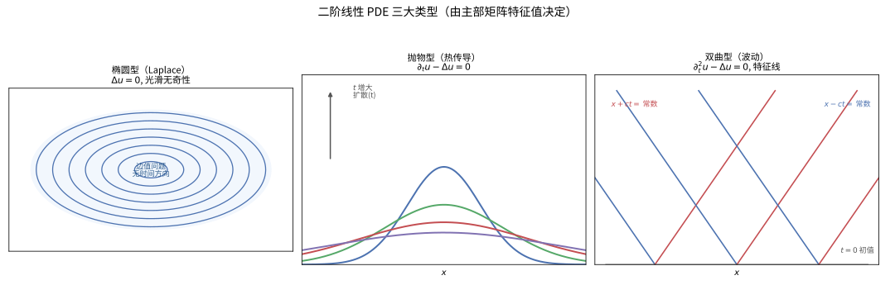

> **直观理解（现实类比）**：三类方程就像三种"信息传播方式"。椭圆型（$\Delta u=0$）像一张绷紧的鼓面，所有点同时互相约束，没有时间方向、处处光滑；抛物型（$\partial_t u-\Delta u=0$）像滴入水中的墨滴，随时间单向扩散、趋向均匀；双曲型（$\partial_t^2 u-\Delta u=0$）像扔进池塘的石子激起的水波，有明确的速度、沿特征线向外传播并保持波形。

#### 课堂问答

**老师**：同是二阶线性 PDE，为什么还要分成椭圆、抛物、双曲三族？

**学生**：只看主部系数矩阵 $A=(a_{ij})$ 的特征值符号：全同号是椭圆，有一个为零、其余同号是抛物，有一个与其余异号是双曲。$\Delta u=0$、$u_t-\Delta u=0$、$u_{tt}-\Delta u=0$ 恰各占一族。

**老师（追问）**：这个符号差别为什么能决定"该配什么定解条件"？

**学生**：因为符号决定信息传播方式。椭圆无实特征方向、无时间方向，适定问题只给边界条件；抛物有一个零特征、单向扩散，配初值加边值；双曲有异号特征、实特征线存在，须给初值再沿特征线传播。配错条件问题就不适定。

**老师（拓展）**：变系数时 $A(x)$ 随点变号，一个方程还能是"混合型"吗？

**学生**：能。此时同一方程在不同区域属于不同型，称混合型，典型如 Tricomi 方程：亚音速区椭圆、超音速区双曲，型变处正是物理上的音速线——分类由"整体标签"变成了"局部标签"。

### 2.3 一阶偏微分方程与特征线法
> **🧠 来龙去脉（谁、何时、解决什么问题）**：d'Alembert 在 1747 年解弦振动时已经发现，扰动沿 $x\pm ct=$ 常数这两条直线传播；Riemann 后来把"一阶 PDE 沿特征曲线化为 ODE"系统化为方法。它解决的核心问题：**一阶（及双曲）PDE 不像椭圆那样"处处耦合"，信息沿特定的特征线忠实地走——顺着这些曲线把 PDE 换成更简单的 ODE 从头积分，就能显式求解，并看清"信息从哪来、往哪去、彼此是否撞车"（特征线相交即激波/多值）**。

一阶 PDE 的一般形式为：

$$
F(x, u, Du) = 0.
$$

**特征线法** (Method of Characteristics) 的基本思想是将 PDE 沿特定曲线（特征线）转化为 ODE。

**拟线性一阶 PDE**：

$$
a(x, u) \cdot Du = f(x, u),
$$

其中 $a = (a_1, \dots, a_n)$。特征线由以下 ODE 系统定义：

$$
\frac{dx}{ds} = a(x, u), \quad \frac{du}{ds} = f(x, u).
$$

> **💡 直观理解（类比）**：特征线法把求解 PDE 变成"顺着特定小路追着信息跑"。类比在河道的支流上划船——每条特征线是一条小河，船（$u$ 值）沿河按 ODE 前进，只要能沿每一条河走通，就能拼出整片流域的解；信息只在河上忠实传播。

**例 2.4**（输运方程）考虑：

$$
\partial_t u + c \cdot \nabla_x u = 0, \quad u(x, 0) = g(x),
$$

其中 $c \in \mathbb{R}^n$ 是常向量。特征线为 $\frac{dx}{dt} = c$，即 $x = x_0 + ct$。沿特征线，$\frac{du}{dt} = 0$，故 $u$ 为常数。因此解为：

$$
u(x, t) = g(x - ct).
$$

> **💡 直观理解（类比）**：输运方程描述"信息原封不动地搬家"。类比传送带——把初值波形 $g$ 整体放在一条以速度 $c$ 匀速前进的传送带上，沿线箱子里的内容不改变，只是位置随 $x-ct$ 匀速平移。

#### 课堂问答

**老师**：一阶 PDE 看似比二阶简单，为什么反而要用"特征线法"绕路？

**学生**：因为一阶方程的信息只沿特征线走，线外互不干扰。沿特征线 $\frac{dx}{ds}=a(x,u)$、$\frac{du}{ds}=f(x,u)$ 把 PDE 降成 ODE，积完即得沿线之值，再拼起线族便是全局解。

**老师（追问）**：以输运方程 $u_t+c u_x=0$、$u(x,0)=g(x)$ 为例，$u(x,t)=g(x-ct)$ 是怎么"看出来"的？

**学生**：特征线满足 $\frac{dx}{dt}=c$，即 $x=x_0+ct$；沿线 $\frac{du}{dt}=0$，初值原样搬运，故 $u$ 只依赖出发点 $x_0=x-ct$，于是 $u(x,t)=g(x-ct)$——信息整体平移、波形不变。

**老师（拓展）**：若特征线彼此相交，这套方法会怎样失效？

**学生**：相交处从不同初值传来的 $u$ 值冲突，光滑解无法延续，出现多值或激波（如 Burgers 方程）。相交时刻就是经典解的生命终点，之后必须转入弱解与熵条件框架。

### 2.4 波动方程 (Wave Equation)
> **🧠 来龙去脉（谁、何时、解决什么问题）**：波动方程源于琴弦振动。1747 年 d'Alembert 写下并求解 $\partial_t^2u=c^2\partial_x^2u$；随后 Euler 与 Daniel Bernoulli 就"行波还是驻波"展开著名论战，这场争论最终由 Fourier 级数调和。它解决的核心问题：**把"弦/波以有限速度 $c$ 传播、初值的位置与速度如何决定整片波"写成方程，并追问某点的解只依赖多久之前、多近初值的信息（依赖区间/因果性）**——这是"光锥"与相对论因果性的数学雏形。

一维波动方程：

$$
\partial_t^2 u - c^2 \partial_x^2 u = 0, \quad (x, t) \in \mathbb{R} \times (0, \infty),
$$

初始条件：

$$
u(x, 0) = f(x), \quad \partial_t u(x, 0) = g(x).
$$

其解由 **d'Alembert 公式** 给出（见第 3 节）。

高维波动方程：

$$
\partial_t^2 u - c^2 \Delta u = 0, \quad (x, t) \in \mathbb{R}^n \times (0, \infty).
$$

> **直观理解（现实类比）**：双曲型 PDE 像"波动"——声波、光波、水波方程是其典范。向池塘扔一块石头，水波以有限速度 $c$ 沿特征线向外传播，波峰波形在传播中保持（一维情形完全保持，高维有衰减但仍有清晰波前）。方程 $\partial_t^2 u - c^2\Delta u=0$ 中信息不能瞬间到达远处：$t$ 时刻 $x$ 处的状态只受"光锥" $[x-ct,x+ct]$ 内初值的影响。这就是"有限传播速度"，也是相对论因果性的数学雏形。

#### 课堂问答

**老师**：波动方程与热方程都带时间，凭什么波动方程"保持波形"，热方程却"越摊越平"？

**学生**：根子在阶数。波动方程 $u_{tt}-c^2u_{xx}=0$ 时间上是二阶的，允许解沿特征线 $x\pm ct=$ 常数双向传播，位移信息不衰减；热方程 $u_t-k\Delta u=0$ 时间只一阶，是不可逆扩散，注定单调抹平。

**老师（追问）**：为什么说波动方程体现了"有限传播速度"？

**学生**：因为 $t$ 时刻 $x$ 处的解只依赖初值在依赖区间 $[x-ct,x+ct]$ 内的取值，区间外的初值来不及影响它。扰动最大速度恰为 $c$，这正是"光锥"的雏形。

**老师（拓展）**：一维与高维波动方程在波形保持上有何本质差别？

**学生**：一维完全保持波形（严格行波）；高维则出现下降效应：三维波前之后彻底平静（强惠更斯），二维却留下"尾波"，波形不再原样保持，能量越向波前集中。

### 2.5 热传导方程 (Heat Equation)
> **🧠 来龙去脉（谁、何时、解决什么问题）**：1822 年 Fourier 出版《热的解析理论》（Théorie analytique de la chaleur），首次为热传导建立方程 $\partial_t u-k\Delta u=0$。为解它，他系统引入了"把初值写成三角级数"的做法（即后来的 Fourier 级数/变换），深刻重塑了分析学。它解决的核心问题：**描述不可逆扩散过程——热量只从高向低流动、随时间趋于均匀，并回答"任意初值经它演化后有多光滑、解是否唯一"**（光滑化与唯一性）。

热传导方程（扩散方程）：

$$
\partial_t u - k \Delta u = 0, \quad (x, t) \in \mathbb{R}^n \times (0, \infty),
$$

初始条件 $u(x, 0) = f(x)$。其解可用 Fourier 变换表示为与 Gauss 核的卷积：

$$
u(x, t) = \int_{\mathbb{R}^n} \Phi(x - y, t) f(y) \, dy,
$$

其中 $\Phi(x, t) = (4\pi k t)^{-n/2} e^{-|x|^2/(4kt)}$ 是热核 (heat kernel)。

> **直观理解（现实类比）**：抛物型 PDE 像"扩散"——热传导方程是其典范。把一滴墨水滴入清水：随着时间推移，墨水从高浓度区向低浓度区流动，浓度差不断被抹平，最终整杯水颜色均匀。方程 $\partial_t u - \Delta u=0$ 正描述这种"由高向低、趋于均匀"的不可逆过程（时间箭头）。它信息传播速度无限（任何扰动瞬间影响全空间），但强度指数衰减，远处影响微乎其微，且解随时间越来越光滑。

#### 课堂问答

**老师**：热方程的解写成热核卷积，这个积分在物理上究竟做了什么？

**学生**：热核 $\Phi(x,t)=(4\pi kt)^{-n/2}e^{-|x|^2/(4kt)}$ 是一个随 $t$ 变宽变矮的 Gauss 分布。卷积就是用这个"越来越宽的模糊滤镜"给初值 $f$ 加权平均，高浓度被摊向低浓度，恰是"由高向低、趋于均匀"。

**老师（追问）**：为什么热方程的解瞬间变得无穷光滑，哪怕初值只是 $L^1$？

**学生**：因为 $t>0$ 时热核 $\Phi(\cdot,t)$ 是 $C^\infty$ 且各阶导数可积，$u=\Phi*f$ 的任意阶导数都能把求导全落到光滑核上。解的粗糙底线被核接管——这正是抛物方程的"光滑化"。

**老师（拓展）**：既然解处处光滑，热方程能"逆着时间解"吗？

**学生**：不能。热核在频域是 $e^{-k\xi^2 t}$，反解需乘 $e^{+k\xi^2 t}$，高频分量被无限放大，任何微小误差都被炸成无穷——反向热方程不适定，时间箭头不可逆。

### 2.6 Laplace 方程与 Poisson 方程
> **🧠 来龙去脉（谁、何时、解决什么问题）**：Laplace 在 1782 年前后的引力/位势论中写下 $\Delta u=0$，Poisson 随后补充带源形式 $-\Delta u=f$（磁位势）。它解决的核心问题：**刻画无时间方向的静态平衡态——稳态温度、弹性膜、静电位势——并揭示这类"处处自我平均"函数的本质：调和函数极其光滑，极值只出现在边界**，为均值性质、最大值原理、Green 函数奠定舞台。

**Laplace 方程**：

$$
\Delta u = 0,
$$

其解称为 **调和函数** (harmonic functions)。

> **直观理解（现实类比）**：椭圆型 PDE 像"平衡态"——没有时间变化，所有点同时互相约束。想象一张绷紧的鼓面或稳态温度分布：内部每点的温度都是周围温度的加权平均（均值性质），任何"凸起"都会被周围拉平，极值只能出现在边界。Laplace 方程 $\Delta u=0$ 描述的正是这种"处处自我平均"的静态平衡，所以解总是无穷光滑——粗糙在平衡态下没有立足之地。

**Poisson 方程**：

$$
-\Delta u = f.
$$

> **💡 直观理解（类比）**：Poisson 方程是"带热源/电源的稳态平衡"。类比房间：Laplace 方程描述的是一面恒温的墙，而 Poisson 方程就像屋里还架着一台持续发热的暖气（源 $f$）——温度分布不再处处自我平均，但每个点靠"不断向外供热"维持稳态，源越强的地方就越热。

#### 课堂问答

**老师**：Laplace 方程 $\Delta u=0$ 的解为何叫"调和函数"，它有什么独有的性格？

**学生**：它满足均值性质：每点的值等于周围球面（球体）上值的平均，即"处处自我平均"。由此极值只能在边界出现，内部冒不出孤立的峰谷。

**老师（追问）**：Poisson 方程 $-\Delta u=f$ 比它多了什么，性质怎么变？

**学生**：多了源项 $f$，相当于每点带一台持续供热/电源。此时内部不再自我平均，源强处值更高；但"源 $f$ 经 Green 函数卷积成解"的线性结构保留，调和情形正是 $f=0$ 的特例。

**老师（拓展）**：把右端取成点源 $f=\delta(x-y)$，这个"单位响应"是什么？

**学生**：就是基本解 $\Phi(x-y)$。它是 Poisson 方程的"原子积木"：任意源 $f$ 的解由基本解卷积（再作边界修正即 Green 函数）叠加得到——线性叠加原理在位势论里的极致形态。

### 2.7 分离变量法 (Separation of Variables)
> **🧠 来龙去脉（谁、何时、解决什么问题）**：Daniel Bernoulli（约 1750）主张弦振动是无数驻波（谐波 $\sin(n\pi x/L)$）的叠加；Dirichlet 又在一维 Sturm-Liouville 问题上用特征函数展开。Fourier 及后续分析学派把这套"分离变量 + 级数展开"推向系统化。它解决的核心问题：**在有界区域把多维 PDE 拆成若干一维 ODE 特征值问题，再用正交特征函数叠加逼近通解**——好比用一组正交的"基本乐音"拼出任意的"音色"。

分离变量法是求解有界区域上 PDE 的经典方法。其基本思想是假设解具有变量分离形式，将 PDE 分解为若干个常微分方程。

> **💡 直观理解（类比）**：分离变量法的直觉是"把多维问题拆成几个一维小问题逐个击破"。类比织布——横线与竖线各自独立纺织后再交织成整块布；要预测长方形餐桌的温度分布，就分开研究"长边方向"和"短边方向"各自怎么变化，再把它们相乘拼出整块区域。

**例 2.5** 考虑有界弦的波动方程：

$$
\partial_t^2 u = c^2 \partial_x^2 u, \quad 0 < x < L, \quad t > 0,
$$

边界条件 $u(0, t) = u(L, t) = 0$。设 $u(x, t) = X(x)T(t)$，代入得：

$$
\frac{T''}{c^2 T} = \frac{X''}{X} = -\lambda,
$$

其中 $\lambda$ 是分离常数。解得 $X_n(x) = \sin\left(\frac{n\pi x}{L}\right)$，$T_n(t) = A_n \cos\left(\frac{n\pi c t}{L}\right) + B_n \sin\left(\frac{n\pi c t}{L}\right)$。通解为：

$$
u(x, t) = \sum_{n=1}^\infty \left[A_n \cos\left(\frac{n\pi c t}{L}\right) + B_n \sin\left(\frac{n\pi c t}{L}\right)\right] \sin\left(\frac{n\pi x}{L}\right).
$$

> **💡 直观理解（类比）**：分离变量法像"用乐高拼出任意形状"。类比弹琴——把一串复杂的弦振动分解成一个个"泛音"（驻波 $\sin(n\pi x/L)$），每个泛音各自独立按自己的频率振动，再按不同权重叠加，就拼出整根弦的真实抖动。

#### 课堂问答

**老师**：分离变量法凭什么敢假设 $u(x,t)=X(x)T(t)$，这不是在赌一个特解吗？

**学生**：是有依据的赌。方程与边界都线性，只要找到一簇两两正交的特征函数（如 $\sin\frac{n\pi x}{L}$），其任意线性叠加仍满足方程和边界。赌的是"通解能由这簇基展开"，而 Fourier 级数的完备性保证这件事。

**老师（追问）**：分离常数为什么取 $-\lambda$ 而不是 $+\lambda$？

**学生**：为了让空间方程 $X''=-\lambda X$ 在齐次边界下给出振荡解 $\sin\frac{n\pi x}{L}$。若取 $+\lambda$，$X$ 变成指数型，一般无法两端同时为零，只剩平凡解。$\lambda>0$ 正是特征值条件筛出的离散谱。

**老师（拓展）**：为什么通解里是 $\sin\frac{n\pi x}{L}$ 这些"网格化"频率，而非任意函数？

**学生**：因为边界 $u(0,t)=u(L,t)=0$ 只容许整数个半波长的驻波。区域一旦有界，特征值就被边界"量化"成离散谱——这也是量子力学能级量子化的同一数学机制。

### 2.8 Fourier 变换与 Laplace 变换
> **🧠 来龙去脉（谁、何时、解决什么问题）**：Fourier 1822 年把周期函数展开成三角级数；把"周期→非周期"的极限推广成 Fourier 积分（变换）经 Cauchy、Poisson 等之手成形，再由 Plancherel（1910）等人给出严格的 $L^2$ 理论。它解决的核心问题：**微分（求导）在频域变成乘法，把 PDE 化为代数或 ODE**——对全空间上的热方程、Schrödinger 方程等几乎是最直接的一招，也是整个调和分析的基石。

**Fourier 变换**：

$$
\hat{f}(\xi) = \frac{1}{(2\pi)^{n/2}} \int_{\mathbb{R}^n} f(x) e^{-i x \cdot \xi} \, dx,
$$

其逆变换为：

$$
f(x) = \frac{1}{(2\pi)^{n/2}} \int_{\mathbb{R}^n} \hat{f}(\xi) e^{i x \cdot \xi} \, d\xi.
$$

Fourier 变换将微分运算转化为代数运算：$\widehat{\partial_{x_i} u} = i\xi_i \hat{u}$，从而将 PDE 转化为代数方程。

**Laplace 变换**：

$$
\mathcal{L}[f](s) = \int_0^\infty f(t) e^{-st} \, dt, \quad \operatorname{Re}(s) > 0,
$$

特别适用于带有初始条件的初值问题。

#### 课堂问答

**老师**：Fourier 变换解 PDE 的"杀手锏"究竟是哪一步？

**学生**：是把微分变成乘法：$\widehat{\partial_{x_i}u}=i\xi_i\hat u$。PDE 由此在频域化成一个常微分或代数方程，解完再逆变换回去，无限维的求导问题被压成有限代数操作。

**老师（追问）**：解热方程时，变换把 $\partial_t u-k\partial_x^2u=0$ 变成了什么？

**学生**：变成 $\frac{d}{dt}\hat u=-k\xi^2\hat u$ 这个一阶 ODE，解为 $\hat u(\xi,t)=\hat f(\xi)e^{-k\xi^2t}$。每个频率独立按 $e^{-k\xi^2t}$ 衰减，频率越高衰减越快，这正是高频被抹平、解变光滑的频域解释。

**老师（拓展）**：既然 Fourier 变换这么好用，为什么还需要 Laplace 变换？

**学生**：Fourier 变换要求函数整体可积或缓增，处理带初始条件、只定义在 $t\ge0$ 的初值问题不顺手。Laplace 变换 $\mathcal{L}[f](s)=\int_0^\infty f(t)e^{-st}dt$ 天然只积半轴，把初值自动嵌进去，是解带初值发展方程的原生工具。

### 2.9 Green 函数 (Green's Functions)
> **🧠 来龙去脉（谁、何时、解决什么问题）**：1828 年自学成才的英国数学家 George Green 在《论数学分析在电与磁理论中的应用》中首次用"点源响应再积分"的方法求解位势问题，并建立 Green 恒等式。它解决的核心问题：**把"任意源分布 $f$ 与边界值 $g$"造成的解，写成"单个点源的响应（Green 函数）按权重叠加"**——这是线性叠加原理的极致：只要算出"单位点"的应答，其余全靠卷积与边界积分组装。

Green 函数方法是求解带有边界条件的线性 PDE 的有力工具。对于 Poisson 方程 $-\Delta u = f$，Green 函数 $G(x, y)$ 满足：

$$
-\Delta_x G(x, y) = \delta(x - y), \quad G(x, y)|_{x \in \partial\Omega} = 0.
$$

解可表示为：

$$
u(x) = \int_\Omega G(x, y) f(y) \, dy.
$$

> **直观理解（现实类比）**：边值问题像"边界决定内部"——一张弹性膜的形状完全由边缘固定方式决定。把鼓面的边缘按某种曲线 $g$ 固定在框架上，则膜在内部自然达到平衡位置 $u$，满足 $\Delta u=0$ 且 $u|_{\partial\Omega}=g$。这就是 Dirichlet 问题：内部不再有"自由意志"，一切由边界牵动。Green 函数 $G(x,y)$ 像一个"影响力权重表"：边界每点 $y$ 的值 $g(y)$ 以多大权重贡献于内部点 $x$，由 $\frac{\partial G}{\partial\nu_y}$ 给出；源项 $f$ 在 $y$ 处则以 $G(x,y)$ 为权重注入 $x$。

#### 课堂问答

**老师**：Green 函数的本质是什么，为什么它能让"任意源加边界"的问题一步落地？

**学生**：它是"单个点源的响应"。$G(x,y)$ 满足 $-\Delta_xG(x,y)=\delta(x-y)$ 且边界为零。由线性叠加，任意源 $f$ 与边值 $g$ 造成的解都能写成 $G$ 的卷积加边界积分——把"无穷多种源"的求解压缩成"算一次点源应答"。

**老师（追问）**：为什么 Green 函数选取时要求它在边界上恒为零？

**学生**：为了让 Green 第二恒等式中含 $\partial_\nu u$ 的边界项消失，从而解式中只留下源项与已知的 Dirichlet 边值 $g$。这正是"选对基本解、消掉未知边界导数"的标准手法。

**老师（拓展）**：Green 函数有哪些结构性对称？

**学生**：$G(x,y)=G(y,x)$ 对称；且 $x\neq y$ 时 $G>0$、$\frac{\partial G}{\partial\nu_y}\le0$。后两者保证了 Poisson 积分核非负，从而由非负边值可直接推出解非负——这是最大/最小值原理的又一入口。

### 2.10 基本解 (Fundamental Solutions)
> **🧠 来龙去脉（谁、何时、解决什么问题）**：基本解是 Green 函数与现代分布理论（Schwartz）的共同源头：先问"右端是一个点源 $\delta$ 时方程的解是什么"，再靠卷积把点源拼成任意源 $f$。它解决的核心问题：**把"一记点源"当作单位砖，用叠加砌出通解**；其奇性（如 $|x|^{2-n}$、$\log|x|$）也刻画了 PDE 的根本解析性质。

**基本解** 是 PDE 在 $\mathbb{R}^n$ 上的特解，对应于右端为 Dirac delta 函数的情形。

**Laplace 方程的基本解**：

$$
\Phi(x) = 
\begin{cases}
-\frac{1}{2\pi} \log |x|, & n = 2, \\[4pt]
\frac{1}{n(n-2)\alpha(n)} \frac{1}{|x|^{n-2}}, & n \geq 3,
\end{cases}
$$

其中 $\alpha(n)$ 是 $\mathbb{R}^n$ 中单位球的体积。它满足 $-\Delta \Phi = \delta_0$（在分布意义下）。

> **💡 直观理解（类比）**：基本解是"一滴墨或一个点源激起的应答"。类比往平静水面正中丢一颗石子，激起的涟漪廓形就是方程的基本解；由于方程是线性的，把无数这样的"单点涟漪"叠加起来（卷积），就能得到任意源分布 $f$ 造成的整体效果。

#### 课堂问答

**老师**：基本解与 Green 函数都对应"点源"，它们到底是不是一回事？

**学生**：不是。基本解是 $\mathbb{R}^n$ 上点源的特解，不含任何边界；Green 函数是带上边界条件修正后的版本，$G(x,y)=\Phi(x-y)-\phi^x(y)$，其中 $\phi^x$ 用来把边界上的值调零。无界且无边条件时两者才重合。

**老师（追问）**：为什么当 $n\ge3$ 时基本解是 $\frac{1}{|x|^{n-2}}$，而 $n=2$ 变成 $\log|x|$？

**学生**：因为 $|x|^{2-n}$ 的径向 Laplacian 恰为零，且在无穷远处衰减。到了 $n=2$，替代常数、仍满足 $\Delta\Phi\propto\delta$ 的径向函数就变成 $\log|x|$——这是维度决定的临界现象。

**老师（拓展）**：基本解的奇性除了"能拼解"，还蕴含什么信息？

**学生**：它刻画了 PDE 的根本解析性质。奇性强度与维数、方程阶数绑定，直接决定解的正则性上限与唯一性论证方式——$-\Delta\Phi=\delta$ 正是弱解框架与分布理论的源头。

### 2.11 最大值原理 (Maximum Principle)
> **🧠 来龙去脉（谁、何时、解决什么问题）**：最大值原理萌生于 19 世纪后期的位势论与调和函数研究（Harnack、Poincaré、Picard 等），后成为椭圆与抛物理论的核心工具。它解决的核心问题：**不必显式求解，就能断言内部不出现孤立的峰/谷，从而推出解的有界性、唯一性与先验估计**——是存在性、正则性与最优性论证的共同基石。

最大值原理是椭圆型和抛物型 PDE 理论的核心工具之一，它表明调和函数（以及更一般的椭圆型方程的解）在区域内部不能取到极值，除非该函数是常数。

> **💡 直观理解（类比）**：最大值原理的全局直觉是"没有外援就冲不上顶峰"。类比一间没有内部热源的恒温空调房——任意时刻最冷（或最热）的点只能贴在墙（边界）上出现，内部温度永远被周围"平均"着，房间正中冒不出突兀的高峰或低谷。

**定理 2.6**（弱最大值原理）设 $\Omega \subset \mathbb{R}^n$ 是有界开集，$u \in C^2(\Omega) \cap C(\overline{\Omega})$ 满足 $\Delta u \geq 0$（即 $u$ 是次调和的），则：

$$
\max_{\overline{\Omega}} u = \max_{\partial\Omega} u.
$$

> **💡 直观理解（类比）**：弱最大值原理说"最热/最高点一定在墙边（边界）上"。类比冬夜的暖气房——只要没有管道把热源直接埋在房间内部，屋内最高温度点只能出现在外墙（边界）附近，内部温度处处被周围"自我平均"，冒不出孤零零的局部尖峰。

#### 课堂问答

**老师**：最大值原理最"反直觉"的地方在哪里，它凭什么能替代显式求解？

**学生**：它断言调和（更一般次调和）函数在区域内部除非常数外不能取到极值，即 $\max_{\overline\Omega}u=\max_{\partial\Omega}u$。于是无需解出 $u$ 本身，仅凭"内部不冒峰"就能控制解的有界性与唯一性。

**老师（追问）**：为什么"内部取到最大值"就一定逼出函数为常数？

**学生**：由次调和函数的球均值不等式 $\phi(r)\ge u(x)$，若一点取到最大值 $M$，则其邻域的平均也等于 $M$；而处处 $u\le M$，故邻域内每点都等于 $M$，集合既开又闭，连通性逼其等于全区域。

**老师（拓展）**：把 $\Delta u\ge0$ 换成 $\Delta u\le0$，结论怎么调整？

**学生**：不等式方向翻转，得到最小值原理：内部不能取到最小值（除非常数），故 $\min_{\overline\Omega}u=\min_{\partial\Omega}u$。更一般地，对 $Lu=0$ 的椭圆算子，只要低阶项符号合适，同样成立对应的最大/最小值原理。

### 2.12 能量估计 (Energy Estimates)
> **🧠 来龙去脉（谁、何时、解决什么问题）**：波动与弹性中的"能量守恒"直觉由来已久（Rayleigh 等），20 世纪初被提升为 PDE 的证明手段：给解定义一个"能量"，用守恒（$E'=0$）或不增（$E'\le0$）把解"按住"。它解决的核心问题：**不写显式解也能证明解的唯一性、稳定性与先验界**，是线性与非线性、以及数值稳定分析中最主要的先验工具之一。

能量估计是通过构造适当的能量泛函来获得 PDE 解的先验估计。对于波动方程，自然能量是：

$$
E(t) = \frac{1}{2} \int_\Omega \left[(\partial_t u)^2 + |\nabla u|^2\right] dx.
$$

对于热方程，能量是：

$$
E(t) = \frac{1}{2} \int_\Omega u^2 \, dx.
$$

能量估计在证明解的唯一性和稳定性中起关键作用。

> **💡 直观理解（类比）**：能量估计靠"总能量"来看守解不放飞。类比一个密封无摩擦的秋千——动能加势能（总能量）守恒，只要初始能量为零，秋千就永远静止；PDE 里构造能量泛函（如 $\tfrac12\int(\dot u^2+|\nabla u|^2)$），用"守恒或不增"（$E'\le0$）锁住解，一举证明唯一性与稳定性。

#### 课堂问答

**老师**：能量估计凭什么"不解方程"就能证明唯一性和稳定性？

**学生**：因为它给解定义一个单调不增的能量泛函。波动方程取 $E=\frac12\int[(\partial_tu)^2+|\nabla u|^2]dx$（守恒），热方程取 $E=\frac12\int u^2dx$（不增）。两个解之差 $v$ 满足方程且零初值，能量从 $0$ 出发既不增也不负，只能恒为 $0$，故 $v\equiv0$。

**老师（追问）**：以热方程为例，$E(t)$ 为什么必然不增？

**学生**：$E'(t)=\int v\partial_tv\,dx=k\int v\partial_x^2v\,dx=-k\int(\partial_xv)^2dx\le0$，分部积分后边界项在衰减条件下消失，剩下的正是负的半正定项——这是热方程不可逆性的定量写法。

**老师（拓展）**：能量估计只能证明唯一性吗？

**学生**：远不止。同一套能量还给出先验界与稳定性，并直接支撑 Galerkin 方法的存在性与数值格式的稳定性分析——它是 PDE 里最通用的先验工具之一。

### 2.13 二阶椭圆型方程 (Second-Order Elliptic Equations)
> **🧠 来龙去脉（谁、何时、解决什么问题）**：Laplace/Poisson 只是最特殊的椭圆方程；各向异性材料、变系数介质（如 $\text{div}(a\nabla u)=f$）要求把理论推广到"系数可变但解仍不失控"的情形，由此引入一致椭圆条件。它解决的核心问题：**统一处理系数非均匀的椭圆问题，并保证其解保有 Laplace 情形的定性行为（正则性、极值、存在唯一）**。

一般形式的二阶椭圆型方程：

$$
-\sum_{i,j=1}^n \partial_{x_j}(a_{ij}(x) \partial_{x_i} u) + \sum_{i=1}^n b_i(x) \partial_{x_i} u + c(x) u = f(x),
$$

其中系数矩阵 $(a_{ij}(x))$ 满足一致椭圆条件：存在 $\theta > 0$ 使得

$$
\sum_{i,j=1}^n a_{ij}(x) \xi_i \xi_j \geq \theta |\xi|^2, \quad \forall \xi \in \mathbb{R}^n, \forall x \in \Omega.
$$

#### 课堂问答

**老师**：有了 Laplace/Poisson 还不够吗，为什么要把理论推广到"二阶椭圆型方程"？

**学生**：因为真实材料往往各向异性、系数随位置变，如 $\mathrm{div}(a\nabla u)=f$ 中 $a=a(x)$。若结构散乱，解可能失控。引入一致椭圆条件 $\sum a_{ij}\xi_i\xi_j\ge\theta|\xi|^2$ 正是给"系数非均匀但解仍不失控"立规矩。

**老师（追问）**：一致椭圆条件到底"保证"了什么？

**学生**：它保证主部算子在所有方向和所有点都像 $-c\Delta$ 一样非退化，从而保住 Laplace 情形的定性行为：正则性、极值原理、存在唯一。它是常数系数与变系数理论之间的桥梁。

**老师（拓展）**：若让 $\theta\to0$，或只用正定而不用一致条件，会怎样？

**学生**：一致椭圆性会失效（退化椭圆），此时解可能不光滑、极值原理与通常估计可能崩塌。仅正定而不一致（如 $a$ 在边界附近急剧退化），正则性也会显著减弱——这正是退化椭圆方程需要另一套理论的缘由。

### 2.14 Sobolev 空间 (Sobolev Spaces)
> **🧠 来龙去脉（谁、何时、解决什么问题）**：1930 年代苏联数学家 Sergei Sobolev 为把变分方法用于 PDE，提出"弱导数"与带导数信息的函数空间 $W^{k,p}$。此前许多自然出现的"解"并非古典二阶可微，放进古典框架寸步难行。它解决的核心问题：**为不光滑（甚至不连续）的解提供合法的函数空间及其上完整的分析工具（范数、嵌入、紧性、迹定理）**，是现代弱解与变分理论的地基。

Sobolev 空间是包含弱导数信息的函数空间，是现代 PDE 理论的基础。

**定义 2.7**（Sobolev 空间）对于 $k \in \mathbb{N}$，$1 \leq p \leq \infty$，定义：

$$
W^{k,p}(\Omega) = \{ u \in L^p(\Omega) \mid D^\alpha u \in L^p(\Omega), \forall |\alpha| \leq k \},
$$

其中 $D^\alpha u$ 是 $u$ 的 $\alpha$ 阶弱导数。当 $p = 2$ 时，记 $H^k(\Omega) = W^{k,2}(\Omega)$。

Sobolev 空间 $W^{k,p}(\Omega)$ 配备范数：

$$
\|u\|_{W^{k,p}} = \left(\sum_{|\alpha| \leq k} \|D^\alpha u\|_{L^p}^p\right)^{1/p} \quad (1 \leq p < \infty).
$$

> **💡 直观理解（类比）**：Sobolev 空间是"带导数能力积分"的函数空间。类比给一根琴弦写档案——不只记录每个点的"高度"（$L^p$ 取值），还同时考察它上方的"坡度变化"（有没有可积的弱导数）以及陡峭程度。这样在研究解时能同时算上"高度"和"坡度"，是弱解理论的地基。

#### 课堂问答

**老师**：Sobolev 空间相对于 $L^p$ 到底多出了什么，为何成为现代 PDE 的地基？

**学生**：它把"弱导数"一起算进范数：$W^{k,p}=\{u\in L^p: D^\alpha u\in L^p,\ |\alpha|\le k\}$，范数 $\|u\|_{W^{k,p}}=(\sum_{|\alpha|\le k}\|D^\alpha u\|_{L^p}^p)^{1/p}$。于是同时掌握"高度"与"坡度"，为不光滑的解提供合法舞台。

**老师（追问）**：为什么要用"弱导数"而不是"古典导数"？

**学生**：因为许多自然出现的解并非古典可微。弱导数用分部积分定义，即使 $u$ 不连续也能定义，却在不光滑处之外与古典导数一致——这让大量 PDE 的实际解得以进入分析框架。

**老师（拓展）**：给一个"有导数却不古典可微"的例子，并说明 $H_0^1$ 中下标 $0$ 的含义。

**学生**：典型如 $u(x)=|x|$ 在 $(-1,1)$，它在 $H^1$ 里、弱导数 $\mathrm{sgn}(x)$ 可积，但于 $0$ 处古典不可微。下标 $0$ 表示 $H_0^1$ 是 $C_c^\infty$ 在 $H^1$ 范数下的闭包，即"边界为零"的那批函数——弱形式与边界条件在它上面才自然成立。

### 2.15 弱解 (Weak Solutions)
> **🧠 来龙去脉（谁、何时、解决什么问题）**：当右端或初值很粗（如 $f\in L^2$、不连续初值）时古典解通常不存在；19–20 世纪的变分学派发现，把方程乘上光滑试探函数再积分，可以"放宽"解的定义。它解决的核心问题：**把"处处可导、处处成立"放宽为"对任意温和的试探函数 $v$ 在积分意义下成立"，让更多实际问题有解，而在数据光滑时自动退回古典解**。

弱解是将 PDE 的解释放为积分形式的概念，它允许解在经典意义下不可微。

对于 Poisson 方程 $-\Delta u = f$，其弱形式为：求 $u \in H_0^1(\Omega)$ 使得

$$
\int_\Omega \nabla u \cdot \nabla v \, dx = \int_\Omega f v \, dx, \quad \forall v \in H_0^1(\Omega).
$$

> **💡 直观理解（类比）**：弱解放宽了"处处可导"的要求，只要求"放进积分里、对温和的试探函数 $v$ 说话"时成立。类比用秤称一块有褶皱的布料——不必逐点量厚度（那是强解），只需整体称重，并与各种"秤面"（试探函数）比对读数一致，就算它合格，允许布料略带毛刺、不够平滑。

#### 课堂问答

**老师**：弱解放宽了"处处可导"的要求，这会带来隐患吗，怎么保证它不失控？

**学生**：不会失控。弱解是求 $u\in H_0^1$ 使 $\int\nabla u\cdot\nabla v\,dx=\int fv\,dx$ 对所有 $v\in H_0^1$ 成立。它只在积分意义下说话，但一旦 $u$ 光滑，这个恒等式经分部积分恰好退回古典 $-\Delta u=f$，即古典解必是弱解。

**老师（追问）**：这个积分式是怎么"放宽"掉二阶导数的？

**学生**：把 $-\Delta u=f$ 乘试探函数 $v$ 再积分，对 $\int(-\Delta u)v$ 分部积分，把二阶导数转移成一个一阶导数的对称积 $\int\nabla u\cdot\nabla v$。要求降到一阶，只需 $u\in H^1$ 即可，二阶可微不再是门槛。

**老师（拓展）**：弱解唯一之后，还缺什么才算圆满？

**学生**：还缺"正则性"——弱解未必古典。椭圆正则性原理证明：若 $f\in L^2$，则 $u\in H^2_{\rm loc}$，$f$ 越光滑 $u$ 越光滑，于是弱解在数据光滑时自动升级为古典解。存在性加正则性，才算把问题真正解决。

### 2.16 存在唯一性定理 (Existence and Uniqueness Theorems)
> **🧠 来龙去脉（谁、何时、解决什么问题）**：PDE 的首要问题是"是否有解、解是否唯一、解是否连续依赖数据"（Hadamard 的适定性三要素）。20 世纪中叶 Lax 与 Milgram（1954）把变分/椭圆的存在性归结为一个抽象泛函定理；对含时间的发展方程则靠半群（Hille–Yosida）或 Faedo–Galerkin。它解决的核心问题：**在弱解框架下大规模地回答存在唯一性，而不必逐一显式构造**。

PDE 理论的核心问题之一是解的存在性和唯一性。对于椭圆型方程，Lax-Milgram 定理提供了统一的框架；对于发展方程（抛物型和双曲型），则需要结合半群理论或 Faedo-Galerkin 方法。

---

#### 课堂问答

**老师**：适定性（well-posedness）三要素是什么，为什么 PDE 特别强调它？

**学生**：存在、唯一、连续依赖数据。缺任一都不算"好问题"：无解则无意义，不唯一则无从预测，不连续依赖则微小误差被放大，物理上不可信。

**老师（追问）**：椭圆与发展方程证明存在性的路线为什么不一样？

**学生**：椭圆型用 Lax-Milgram 一类抽象泛函定理，化为 Hilbert 空间上强制双线性型的可解性，一举拿存在唯一；发展方程带时间，需靠半群理论或 Faedo-Galerkin，先在有限维逼近中求解、再从先验估计取极限。

**老师（拓展）**：能否举例说明"条件放宽到不适定"是什么景象？

**学生**：反向热方程就是典型：解存在却对初值不连续依赖，高频误差被指数放大，任意小扰动导致解面目全非。这说明适定性的第二、三条不是装饰，一旦破坏，问题在数值与物理层面都不可用。

## 3. 定理与证明

### 3.1 d'Alembert 公式：一维波动方程的解

**定理 3.1**（d'Alembert 公式）考虑一维波动方程的 Cauchy 问题：

$$
\begin{cases}
\partial_t^2 u - c^2 \partial_x^2 u = 0, & (x, t) \in \mathbb{R} \times (0, \infty), \\[4pt]
u(x, 0) = f(x), & x \in \mathbb{R}, \\[4pt]
\partial_t u(x, 0) = g(x), & x \in \mathbb{R}.
\end{cases}
$$

则其解由 d'Alembert 公式给出：

$$
u(x, t) = \frac{f(x + ct) + f(x - ct)}{2} + \frac{1}{2c} \int_{x - ct}^{x + ct} g(s) \, ds.
$$

**证明**：我们采用特征线法。将波动方程 $u_{tt} - c^2 u_{xx} = 0$ 分解为两个一阶算子：

$$
(\partial_t - c\partial_x)(\partial_t + c\partial_x) u = 0.
$$

引入新变量：

$$
\xi = x + ct, \quad \eta = x - ct.
$$

由链式法则：

$$
\partial_x = \partial_\xi + \partial_\eta, \quad \partial_t = c(\partial_\xi - \partial_\eta).
$$

计算二阶导数：

$$
\begin{aligned}
\partial_t^2 u &= c^2(\partial_\xi^2 - 2\partial_\xi\partial_\eta + \partial_\eta^2)u, \\
\partial_x^2 u &= (\partial_\xi^2 + 2\partial_\xi\partial_\eta + \partial_\eta^2)u.
\end{aligned}
$$

代入波动方程：

$$
c^2(\partial_\xi^2 - 2\partial_\xi\partial_\eta + \partial_\eta^2)u - c^2(\partial_\xi^2 + 2\partial_\xi\partial_\eta + \partial_\eta^2)u = -4c^2 \partial_\xi\partial_\eta u = 0,
$$

即 $\partial_\xi\partial_\eta u = 0$。这等价于 $u(\xi, \eta) = F(\xi) + G(\eta)$，其中 $F, G$ 是任意 $C^2$ 函数。

回到原变量：

$$
u(x, t) = F(x + ct) + G(x - ct).
$$

现在利用初始条件确定 $F$ 和 $G$。由 $u(x, 0) = f(x)$ 得：

$$
F(x) + G(x) = f(x). \tag{1}
$$

由 $\partial_t u(x, 0) = g(x)$ 得：

$$
cF'(x) - cG'(x) = g(x). \tag{2}
$$

对 (2) 式积分：

$$
F(x) - G(x) = \frac{1}{c} \int_0^x g(s) \, ds + C, \tag{3}
$$

其中 $C$ 是积分常数。联立 (1) 和 (3)：

$$
\begin{aligned}
F(x) &= \frac{1}{2} f(x) + \frac{1}{2c} \int_0^x g(s) \, ds + \frac{C}{2}, \\[4pt]
G(x) &= \frac{1}{2} f(x) - \frac{1}{2c} \int_0^x g(s) \, ds - \frac{C}{2}.
\end{aligned}
$$

代入 $u(x, t) = F(x + ct) + G(x - ct)$：

$$
\begin{aligned}
u(x, t) &= \frac{1}{2} f(x + ct) + \frac{1}{2c} \int_0^{x+ct} g(s) \, ds + \frac{C}{2} \\
&\quad + \frac{1}{2} f(x - ct) - \frac{1}{2c} \int_0^{x-ct} g(s) \, ds - \frac{C}{2} \\[4pt]
&= \frac{f(x + ct) + f(x - ct)}{2} + \frac{1}{2c} \int_{x-ct}^{x+ct} g(s) \, ds.
\end{aligned}
$$

至此，d'Alembert 公式得证。□

**注**：d'Alembert 公式揭示了波动方程的一个重要性质——**有限传播速度**：在时刻 $t$，点 $x$ 处的解只依赖于初始数据在区间 $[x - ct, x + ct]$ 上的值。这个区间称为 **依赖区间** (domain of dependence)。

![特征线与初值条件：双曲方程沿特征线 x\pm ct= 常数传播，点 (x_0,t_0) 的值只由初值在依赖区间 [x_0-ct_0,x_0+ct_0] 上的 u(x,0)=f、\partial_t u(x,0)=g 决定](images/level49-characteristics.svg)

> **直观理解（现实类比）**：特征线就像信息的高速公路，信号只能沿固定斜率的直线传播。你可以把初值 $t=0$ 想象成一条"源头河岸"，$(x_0,t_0)$ 处的解是从上游一个区间同时涌来的水汇合而成——太上游或太下游的水（初值）根本来不及到达这里。这正是"光锥"思想：任何影响都有速度上限，远处的扰动在有限时间内无法波及。

> **🧠 思考历程："拉琴的弦抖起来"这种麻烦，怎么被 d'Alembert 一两笔写成明白解？**
>
> 一维波动方程解起来本该让人头疼，可 d'Alembert 公式却给出一个朴素而完美的答案：**解就是两个反向行波的和**，只靠初值的位移与速度就能拼出整条弦的抖动。它背后的直觉，深刻影响了"影响有速度上限"这个宏大思想。
>
> - **把"二阶"拆成"左行右行两道波"**。波动方程 $u_{tt}=c^2u_{xx}$ 本质上说"扰动沿两条特征线 $x\pm ct=$ 常数跑"。**把二阶方程分解成"沿 $x-ct$ 不变的波"和"沿 $x+ct$ 不变的波"两大块**，各自由初值的一只手脚决定——这就是 d'Alembert 拆分主意，也让"特征线"成为双曲方程的地图。
> - **初值的位移和速度各司其职**。公式里 $\dfrac{f(x+ct)+f(x-ct)}2$ 处理"掰开得位移"，而 $\dfrac1{2c}\int g$ 处理"初速度"。**位移部分是两条反向波的简单平均，速度部分是一个积分**——把"弦一开始在动"也翻译成两股波合并后的样子。整个解就这样"长"出来。
> - **它给世界的礼物：有限传播速**。解在某点只依赖初值的一个有限区间（依赖区间）——**意味着"影响"总以有限速度往前跑，"远处的事到不了近处"。** 这正是"光锥"思想的雏形，也让广义相对论、数值计算里的"稳定性"有了直觉底座。
> - **一部跨越百年的故事**。波动方程的研究从弦振动开始，经牛顿、泰勒、欧拉、伯努利一路推进，最终由 d'Alembert 给出清晰解；随后又被傅立叶、黎曼等深化为广义的 PDE 理论。**"解决一道弦振动题"带动了整个偏微分方程与现代分析抬头。**
> - **心路**：d'Alembert 公式告诉你：**当一个复杂系统可被拆解为"沿特征线传播的波"，直觉就变成公式**。学会顺着"信息往哪条路走"（特征线/光锥）去想问题，常常比闷头求闭式解更接近真相。

#### 课堂问答

**老师**：d'Alembert 公式把解写成两项，这两项各自管什么？

**学生**：$u=\frac{f(x+ct)+f(x-ct)}{2}+\frac{1}{2c}\int_{x-ct}^{x+ct}g(s)ds$。第一项由初位移 $f$ 分成左右两道行波取平均，第二项由初速度 $g$ 在依赖区间上的积分贡献——初值的"位置"与"速度"各司其职。

**老师（追问）**：一维波动方程的解为什么能恰好写成 $F(x+ct)+G(x-ct)$？

**学生**：把算子分解为 $(\partial_t-c\partial_x)(\partial_t+c\partial_x)u=0$，换特征坐标 $\xi=x+ct$、$\eta=x-ct$ 后方程化为 $\partial_\xi\partial_\eta u=0$，其通解正是 $F(\xi)+G(\eta)$，即两条反向行波之和。

**老师（拓展）**：这个公式对初值光滑性有何要求，若 $f,g$ 不连续会怎样？

**学生**：古典解要求 $f\in C^2$、$g\in C^1$。若初值只是分段光滑（如折线），解在特征线上出现导数跳跃，$u_{xx}$ 在特征线成为分布——此时解仍在弱/分布意义下存在，物理上对应波前的"折角"以速度 $c$ 传播。

### 3.2 热方程解的存在唯一性：Fourier 变换方法
> **🧠 来龙去脉（谁、何时、解决什么问题）**：热方程 Cauchy 问题解的存在唯一性，核心是"热核 + 卷积 + 能量"三件套：先对 $x$ 做 Fourier 变换，把 $\partial_t-\partial_x^2$ 变成常微分 $d/dt+k\xi^2$，解出再逆变换回卷积。它回答"给定初值，热方程的解是否存在、是否唯一、有多光滑"——光滑化在这里最彻底（$t>0$ 立即可微），唯一性靠 $L^2$ 能量 $E'\le0$。

**定理 3.2**（热方程 Cauchy 问题的解）考虑热传导方程的 Cauchy 问题：

$$
\begin{cases}
\partial_t u - k \partial_x^2 u = 0, & (x, t) \in \mathbb{R} \times (0, \infty), \\[4pt]
u(x, 0) = f(x), & x \in \mathbb{R},
\end{cases}
$$

其中 $f \in L^1(\mathbb{R})$。则存在唯一的解 $u \in C^\infty(\mathbb{R} \times (0, \infty))$，由下式给出：

$$
u(x, t) = \int_{-\infty}^\infty \Phi(x - y, t) f(y) \, dy = \frac{1}{\sqrt{4\pi k t}} \int_{-\infty}^\infty e^{-(x-y)^2/(4kt)} f(y) \, dy.
$$

**证明**：我们分存在性和唯一性两部分证明。

**存在性**：对空间变量 $x$ 应用 Fourier 变换。记 $\hat{u}(\xi, t) = \mathcal{F}[u(\cdot, t)](\xi)$。利用 Fourier 变换的性质 $\widehat{\partial_x^2 u} = -\xi^2 \hat{u}$，原方程化为：

$$
\frac{d}{dt} \hat{u}(\xi, t) + k \xi^2 \hat{u}(\xi, t) = 0, \quad \hat{u}(\xi, 0) = \hat{f}(\xi).
$$

这是一个关于 $t$ 的常微分方程，其解为：

$$
\hat{u}(\xi, t) = \hat{f}(\xi) e^{-k\xi^2 t}.
$$

现在应用 Fourier 逆变换：

$$
u(x, t) = \frac{1}{2\pi} \int_{-\infty}^\infty \hat{f}(\xi) e^{-k\xi^2 t} e^{i x \xi} \, d\xi.
$$

利用卷积定理，Fourier 逆变换将乘积变为卷积。注意到 $e^{-k\xi^2 t}$ 的 Fourier 逆变换是：

$$
\mathcal{F}^{-1}[e^{-k\xi^2 t}](x) = \frac{1}{\sqrt{4\pi k t}} e^{-x^2/(4kt)} =: \Phi(x, t).
$$

因此，

$$
u(x, t) = (f * \Phi(\cdot, t))(x) = \int_{-\infty}^\infty \Phi(x - y, t) f(y) \, dy.
$$

容易验证 $\Phi(x, t)$ 满足 $\partial_t \Phi = k \partial_x^2 \Phi$（可直接求导验证），且 $\Phi(x, t) \to \delta(x)$ 当 $t \to 0^+$（在分布意义下），从而 $u(x, t) \to f(x)$ 当 $t \to 0^+$。

**唯一性**：假设 $u_1$ 和 $u_2$ 是两个解，令 $v = u_1 - u_2$，则 $v$ 满足热方程且 $v(x, 0) = 0$。考虑能量泛函：

$$
E(t) = \frac{1}{2} \int_{-\infty}^\infty v(x, t)^2 \, dx.
$$

对 $t$ 求导：

$$
\begin{aligned}
E'(t) &= \int_{-\infty}^\infty v \partial_t v \, dx = k \int_{-\infty}^\infty v \partial_x^2 v \, dx \\
&= k \left[ v \partial_x v \right]_{-\infty}^\infty - k \int_{-\infty}^\infty (\partial_x v)^2 \, dx \\
&= -k \int_{-\infty}^\infty (\partial_x v)^2 \, dx \leq 0,
\end{aligned}
$$

其中假设了 $v$ 和 $\partial_x v$ 在无穷远处衰减为零（由 $L^1$ 初始条件和解的正则性可保证）。因此 $E(t) \leq E(0) = 0$，而 $E(t) \geq 0$，故 $E(t) \equiv 0$，从而 $v \equiv 0$。唯一性得证。□

> **💡 直观理解（类比）**：定理说明热方程对任意初值都能给出光滑且唯一的解。类比把一块粗糙的蜡放在火上慢慢烘软——无论初态多棱角，热量迅速把棱角抹平，内部每个时刻都圆润光滑；唯一性来自"热量只能从热流向冷"的不可逆性，两个不同起点不可能汇流到同一条平滑的温升曲线。

#### 课堂问答

**老师**：用 Fourier 变换证热方程"存在唯一"，存在性那步的关键代换是什么？

**学生**：对 $x$ 作 Fourier 变换，利用 $\widehat{\partial_x^2u}=-\xi^2\hat u$ 把 PDE 变成常微分 $\frac{d}{dt}\hat u+k\xi^2\hat u=0$，解得 $\hat u=\hat f\,e^{-k\xi^2t}$。再用卷积定理逆变换回 $u=\Phi*f$，即热核卷积。

**老师（追问）**：唯一性在这里为什么不用变换，而用能量？

**学生**：因为能量法更直接也更能推广：令两个解之差 $v$，$v(x,0)=0$，取 $E=\frac12\int v^2dx$，则 $E'=-k\int(\partial_xv)^2dx\le0$，故 $E\equiv0$、$v\equiv0$。变换依赖可积性假设，能量法只需解的衰减性，适用范围更宽。

**老师（拓展）**：为什么说热方程"光滑化"比波动方程彻底？

**学生**：因为热核因子 $e^{-k\xi^2t}$ 对高频给出指数级强衰减，$t>0$ 瞬间把任意 $L^1$ 初值磨成 $C^\infty$；波动方程频域因子是 $e^{\pm ic|\xi|t}$，只改变相位不衰减，初值的光滑度被原样继承，绝不会有"瞬时光滑化"。

### 3.3 Laplace 方程的最大值原理
> **🧠 来龙去脉（谁、何时、解决什么问题）**：强最大值原理是位势论献给椭圆方程的最大礼物：调和/次调和函数一旦在内部取到最大，就必为常数。它回答的核心问题：**无需显式解，仅凭"内部不冒峰、极值被边界锁住"即可推出唯一性、有界性与大把先验估计**。

**定理 3.3**（强最大值原理，Strong Maximum Principle）设 $\Omega \subset \mathbb{R}^n$ 是连通开集，$u \in C^2(\Omega)$ 满足 $\Delta u \geq 0$（即 $u$ 是次调和函数）。若 $u$ 在 $\Omega$ 内部某点达到最大值，则 $u$ 在 $\Omega$ 内为常数。

**证明**：设 $M = \sup_\Omega u$，且存在 $x_0 \in \Omega$ 使得 $u(x_0) = M$。定义集合：

$$
\Omega_M = \{ x \in \Omega \mid u(x) = M \}.
$$

由连续性，$\Omega_M$ 是 $\Omega$ 中的闭集（相对于 $\Omega$）。我们要证明 $\Omega_M = \Omega$。由于 $\Omega$ 是连通的，只需证明 $\Omega_M$ 也是开集（在 $\Omega$ 中）。

任取 $x^* \in \Omega_M$。由于 $\Omega$ 是开集，存在 $R > 0$ 使得 $B(x^*, R) \subset \Omega$。对任意 $0 < r < R$，考虑球面平均值：

$$
\frac{1}{n\alpha(n) r^{n-1}} \int_{\partial B(x^*, r)} u(y) \, dS(y).
$$

由于 $\Delta u \geq 0$，均值不等式成立（见引理）：

$$
\frac{1}{n\alpha(n) r^{n-1}} \int_{\partial B(x^*, r)} u(y) \, dS(y) \geq u(x^*) = M.
$$

但 $u \leq M$ 在 $\Omega$ 中成立，故上述均值必须等于 $M$。由连续性，$u(y) = M$ 对所有 $y \in \partial B(x^*, r)$ 成立。由于 $r$ 是任意的，$u \equiv M$ 在 $B(x^*, R)$ 上成立，从而 $B(x^*, R) \subset \Omega_M$，即 $\Omega_M$ 是开集。

因此 $\Omega_M$ 既是开集又是闭集，且非空，由 $\Omega$ 的连通性知 $\Omega_M = \Omega$，即 $u \equiv M$ 在 $\Omega$ 上恒成立。□

> **💡 直观理解（类比）**：强最大值原理比弱版本更狠——一旦内部某点摸到最高高度，整片区域都必须保持这一高度。类比一张绷紧的鼓面：如果内部某一点凸到顶而周围不比它低，那整张面其实已被拉成一个常数平面，凸起不可能孤零零地矗立在区域内部。

**引理 3.4**（次调和函数的均值不等式）若 $\Delta u \geq 0$ 在 $\Omega$ 中，则对任意 $x \in \Omega$ 和充分小的 $r > 0$，

$$
\frac{1}{n\alpha(n) r^{n-1}} \int_{\partial B(x, r)} u(y) \, dS(y) \geq u(x).
$$

**引理的证明**：定义辅助函数：

$$
\phi(r) = \frac{1}{n\alpha(n) r^{n-1}} \int_{\partial B(x, r)} u(y) \, dS(y).
$$

作变量替换 $y = x + rz$，$z \in \partial B(0, 1)$，则：

$$
\phi(r) = \frac{1}{n\alpha(n)} \int_{\partial B(0, 1)} u(x + rz) \, dS(z).
$$

对 $r$ 求导：

$$
\begin{aligned}
\phi'(r) &= \frac{1}{n\alpha(n)} \int_{\partial B(0, 1)} \nabla u(x + rz) \cdot z \, dS(z) \\
&= \frac{1}{n\alpha(n) r^{n-1}} \int_{\partial B(x, r)} \frac{\partial u}{\partial \nu} \, dS \\
&= \frac{1}{n\alpha(n) r^{n-1}} \int_{B(x, r)} \Delta u \, dy \quad (\text{散度定理}) \\
&\geq 0.
\end{aligned}
$$

因此 $\phi(r)$ 是单调不减的。又 $\lim_{r \to 0^+} \phi(r) = u(x)$，故 $\phi(r) \geq u(x)$。□

> **💡 直观理解（类比）**：均值不等式说"把周围一圈平均一下，不会比圆心还低"。类比站在喷泉中心的花岗岩圆台上环顾——四周的泉水持续上涌（次调和的"源"高于桌面），所以半径越大、周围的平均高度越高，站在圆心是最低处。它是最大值原理的一颗小螺丝。

**推论 3.5**（弱最大值原理）设 $\Omega$ 是有界开集，$u \in C^2(\Omega) \cap C(\overline{\Omega})$ 满足 $\Delta u \geq 0$，则 $\max_{\overline{\Omega}} u = \max_{\partial\Omega} u$。若 $\Delta u \leq 0$，则 $\min_{\overline{\Omega}} u = \min_{\partial\Omega} u$。

> **💡 直观理解（类比）**：推论把"内部不冒峰"升格为大范围结论。类比测绘一座没有内湖的盆地——内部任何点都不可能比四周山脊更高，所以全盆地最高点一定出现在边界一线；把高差符号翻转（$\Delta u\le0$）则同理，最低点也在边界。

**推论 3.6**（唯一性）Poisson 方程 $-\Delta u = f$ 在 $\Omega$ 上，$u|_{\partial\Omega} = g$ 的 Dirichlet 问题至多有一个解。

> **💡 直观理解（类比）**：唯一性说"同样的框边和材料只能张出一张鼓面"。类比给定琴框形状和四边张力，绷紧的膜内部位置是唯一确定的——你无法在同一框边下张出两片形状不同却又都"自我平衡"的膜，否则它们的差会在内部取到极值，与最大值原理冲突。

#### 课堂问答

**老师**：强最大值原理与弱版本相比，"强"在哪里？

**学生**：弱版本只说最大值一定在边界取到；强版本更进一步——只要内部某点摸到最大值，整个（连通）区域上 $u$ 就恒等于该常数。即"内部不许出现孤立的峰"，强弱之别在于结论的强度。

**老师（追问）**：证明里最关键的"撬棍"是什么？

**学生**：是次调和函数的球均值不等式 $\phi(r)\ge u(x)$。若 $u(x_0)=M$，则该点邻域平均 $\ge M$，而处处 $u\le M$，故邻域内全等于 $M$；取值集合 $\Omega_M$ 既开又闭，连通性逼它等于整个 $\Omega$。

**老师（拓展）**：如何用最大值原理立刻得到一个 Dirichlet 问题的唯一性？

**学生**：设 $u_1,u_2$ 都解 $-\Delta u=f$、$u=g$，则 $w=u_1-u_2$ 满足 $\Delta w=0$、$w|_{\partial\Omega}=0$。对 $w$ 与 $-w$ 各用一次最大值原理，得 $\max_{\overline\Omega}w=0$ 且 $\min_{\overline\Omega}w=0$，故 $w\equiv0$——边值问题的解唯一。

### 3.4 Poisson 方程解的表示：Green 函数方法
> **🧠 来龙去脉（谁、何时、解决什么问题）**：在基本解与 Green 函数（2.9–2.10 节）之上，本节能把"Green 表示"严格化：借助 Green 第二恒等式，把解写成"源 $f$ 经核 $G$ 的体积分 + 边界值 $g$ 经法向导数核 $-\partial G/\partial\nu$ 的边界积分"。它回答：**任意源与边界共同作用时，内部每点的值如何由它们线性决定**。

**定理 3.7**（Green 函数表示公式）设 $\Omega \subset \mathbb{R}^n$ 是有界光滑区域，$u \in C^2(\overline{\Omega})$ 是 Poisson 方程 $-\Delta u = f$ 在 $\Omega$ 中、$u = g$ 在 $\partial\Omega$ 上的解。则 $u$ 可表示为：

$$
u(x) = \int_\Omega G(x, y) f(y) \, dy - \int_{\partial\Omega} \frac{\partial G}{\partial \nu_y}(x, y) g(y) \, dS(y),
$$

其中 $G(x, y)$ 是 Green 函数，满足：

$$
\begin{cases}
-\Delta_y G(x, y) = \delta(x - y), & y \in \Omega, \\[4pt]
G(x, y) = 0, & y \in \partial\Omega.
\end{cases}
$$

**证明**：证明基于 Green 第二恒等式。令 $\Phi(x - y)$ 是 Laplace 方程的基本解，即 $-\Delta_y \Phi(x - y) = \delta(x - y)$。

定义修正函数 $\phi^x(y)$ 满足：

$$
\Delta_y \phi^x = 0 \quad (y \in \Omega), \qquad \phi^x(y) = \Phi(x - y) \quad (y \in \partial\Omega).
$$

则 Green 函数为 $G(x, y) = \Phi(x - y) - \phi^x(y)$。

现在应用 Green 第二恒等式。对任意 $u, v \in C^2(\overline{\Omega})$：

$$
\int_\Omega (u \Delta v - v \Delta u) \, dy = \int_{\partial\Omega} \left( u \frac{\partial v}{\partial \nu} - v \frac{\partial u}{\partial \nu} \right) dS.
$$

取 $v(y) = G(x, y)$。注意在分布意义下 $\Delta_y G(x, y) = -\delta(x - y)$。将 $u$ 和 $G$ 代入：

$$
\int_\Omega u(y) \Delta_y G(x, y) \, dy - \int_\Omega G(x, y) \Delta_y u(y) \, dy = \int_{\partial\Omega} \left( u(y) \frac{\partial G}{\partial \nu_y} - G(x, y) \frac{\partial u}{\partial \nu}(y) \right) dS(y).
$$

由于 $G(x, y)|_{y \in \partial\Omega} = 0$，$-\Delta u = f$，且 $\Delta_y G = -\delta(x - y)$，上式化为：

$$
-\int_\Omega u(y) \delta(x - y) \, dy + \int_\Omega G(x, y) f(y) \, dy = \int_{\partial\Omega} u(y) \frac{\partial G}{\partial \nu_y} \, dS(y).
$$

即：

$$
-u(x) + \int_\Omega G(x, y) f(y) \, dy = \int_{\partial\Omega} g(y) \frac{\partial G}{\partial \nu_y} \, dS(y).
$$

整理得：

$$
u(x) = \int_\Omega G(x, y) f(y) \, dy - \int_{\partial\Omega} \frac{\partial G}{\partial \nu_y}(x, y) g(y) \, dS(y).
$$

□

> **💡 直观理解（类比）**：Green 表示公式告诉你"内部一点的值 = 体内'广播'来的源项回音 + 边界'指挥'传来的命令"。类比在音乐厅中央的听众听到的声音——把全场"源"（乐器）按距离加权叠加，再叠加上墙壁（边界）反射回来的"边界值"信号；Green 函数就是那套权重/回音表，源 $f$ 和边值 $g$ 各自按它加权。

**注**：Green 函数 $G(x, y)$ 对 $x$ 和 $y$ 是对称的：$G(x, y) = G(y, x)$。此外，$G(x, y) > 0$ 对 $x \neq y$ 成立，且 $\frac{\partial G}{\partial \nu_y} \leq 0$（这保证了 Poisson 积分核的非负性）。

#### 课堂问答

**老师**：Green 表示公式里为什么源项与边界项是"减号"相连，这个符号可信吗？

**学生**：来自 Green 第二恒等式的移项与 $G|_{\partial\Omega}=0$ 的消项：$u(x)=\int_\Omega G(x,y)f(y)dy-\int_{\partial\Omega}\frac{\partial G}{\partial\nu_y}g(y)dS(y)$。减号是恒等式自然给出的，不是凑的。

**老师（追问）**：为什么要求 Green 函数在边界为零，这一步在推导中起什么作用？

**学生**：为的是让恒等式里含 $\frac{\partial u}{\partial\nu}$ 的未知边界项直接消失。否则公式里会多出我们并不掌握的 $\frac{\partial u}{\partial\nu}$，表达式无法闭合。

**老师（拓展）**：注意到 $\frac{\partial G}{\partial\nu_y}\le0$，这对解的正定性意味着什么？

**学生**：法向导数的符号保证边界积分核 $-\frac{\partial G}{\partial\nu_y}\ge0$。于是当边值 $g\ge0$、源 $f\ge0$ 时两项都非负，直接得出 $u\ge0$——Green 表示自动蕴含了最大值原理式的正定性结论。

### 3.5 Lax-Milgram 定理
> **🧠 来龙去脉（谁、何时、解决什么问题）**：见 §2.16 的动机。本节把"弱解存在唯一"归纳为一个抽象 Hilbert 空间定理：只要双线性型连续且强制（$B(u,u)\ge\alpha\|u\|^2$），用 Riesz 表示 + 闭值域即可证明对任意有界泛函存在唯一解。回答：**把椭圆存在性从"逐个构造"升级为"检验两个条件即可"**。

**定理 3.8**（Lax-Milgram 定理）设 $H$ 是 Hilbert 空间，内积为 $\langle \cdot, \cdot \rangle$，范数为 $\|\cdot\|$。设 $B: H \times H \to \mathbb{R}$ 是双线性型，满足：

1. **连续性** (boundedness)：存在 $C > 0$ 使得 $|B(u, v)| \leq C \|u\| \|v\|$，$\forall u, v \in H$；
2. **强制性** (coercivity)：存在 $\alpha > 0$ 使得 $B(u, u) \geq \alpha \|u\|^2$，$\forall u \in H$。

则对任意有界线性泛函 $F \in H^*$，存在唯一的 $u \in H$ 使得：

$$
B(u, v) = F(v), \quad \forall v \in H.
$$

**证明**：证明分为三步。

**第 1 步：构造 Riesz 表示下的算子方程。**

对每个固定的 $u \in H$，映射 $v \mapsto B(u, v)$ 是 $H$ 上的有界线性泛函。由 Riesz 表示定理，存在唯一的 $A u \in H$ 使得：

$$
B(u, v) = \langle A u, v \rangle, \quad \forall v \in H.
$$

显然 $A: H \to H$ 是线性算子。由 $B$ 的连续性：

$$
\|A u\| = \sup_{\|v\|=1} |\langle A u, v \rangle| = \sup_{\|v\|=1} |B(u, v)| \leq C \|u\|,
$$

故 $A$ 是有界线性算子，$\|A\| \leq C$。

由强制性：

$$
\langle A u, u \rangle = B(u, u) \geq \alpha \|u\|^2, \quad \forall u \in H. \tag{4}
$$

同样，$F$ 也可由 Riesz 表示：存在 $f \in H$ 使得 $F(v) = \langle f, v \rangle$，$\forall v \in H$。于是问题化为求解 $A u = f$。

**第 2 步：证明 $A$ 的值域 $R(A)$ 是闭的，且 $R(A) = H$。**

由 (4) 式：

$$
\alpha \|u\|^2 \leq \langle A u, u \rangle \leq \|A u\| \|u\|,
$$

从而 $\alpha \|u\| \leq \|A u\|$。这说明 $A$ 是下方有界的。

若 $A u_n \to v$，则 $\{A u_n\}$ 是 Cauchy 列，由 $\alpha \|u_n - u_m\| \leq \|A u_n - A u_m\|$ 知 $\{u_n\}$ 也是 Cauchy 列，故 $u_n \to u$。由连续性，$A u_n \to A u$，故 $v = A u \in R(A)$，即 $R(A)$ 是闭的。

现证 $R(A) = H$。若不然，$R(A) \neq H$，则存在非零 $w \in R(A)^\perp$。但由 (4)：

$$
\alpha \|w\|^2 \leq \langle A w, w \rangle = 0,
$$

矛盾。故 $R(A) = H$。

**第 3 步：存在唯一性。**

由于 $A$ 是满射且单射（由 $\alpha \|u\| \leq \|A u\|$ 知 $A u = 0 \Rightarrow u = 0$），$A$ 是双射。因此对任意 $f \in H$，存在唯一的 $u = A^{-1} f$ 满足 $A u = f$，即 $B(u, v) = \langle f, v \rangle = F(v)$ 对所有 $v \in H$ 成立。□

> **💡 直观理解（类比）**：Lax-Milgram 定理其实在说"一个稳定、不偷懒的线性系统必有唯一且稳定的求解结果"。类比弹簧秤——"连续性"像连接件结实牢固、不会突然失衡，"强制性"像弹簧不会软塌（推得越用力读数涨得越快）；只要这两个条件齐备，再怎么施压都能被唯一而稳定地撑住。它是椭圆 PDE 弱解存在唯一性的"通用插座"。

**应用**：考虑椭圆型方程的弱形式。设 $\Omega \subset \mathbb{R}^n$ 是有界开集，$H = H_0^1(\Omega)$。定义双线性型：

$$
B(u, v) = \int_\Omega \left( \sum_{i,j=1}^n a_{ij}(x) \partial_{x_i} u \partial_{x_j} v + \sum_{i=1}^n b_i(x) \partial_{x_i} u \, v + c(x) u v \right) dx.
$$

若系数满足一致椭圆条件和适当的正性条件，则 $B$ 满足 Lax-Milgram 定理的条件，从而弱解存在唯一。

#### 课堂问答

**老师**：Lax-Milgram 定理把"解椭圆问题"归结为验证哪两个条件？

**学生**：连续性 $|B(u,v)|\le C\|u\|\|v\|$ 与强制性 $B(u,u)\ge\alpha\|u\|^2$。只要两者成立，对任意有界泛函 $F$ 就存在唯一 $u$ 使 $B(u,v)=F(v)$ 对所有 $v$ 成立。

**老师（追问）**：证明里"值域 $R(A)$ 是闭的且等于 $H$"这一步为什么离不开强制性？

**学生**：强制性给出 $\alpha\|u\|\le\|Au\|$，于是 $A$ 下方有界：$Au_n\to v$ 立刻推出 $u_n$ 收敛，$R(A)$ 闭；又若 $R(A)\neq H$，取非零 $w\in R(A)^\perp$ 会得 $\alpha\|w\|^2\le\langle Aw,w\rangle=0$ 矛盾，故 $R(A)=H$。

**老师（拓展）**：为什么说 Lax-Milgram 比 Riesz 表示定理"更有用"？

**学生**：Riesz 表示只适用于内积本身（要求对称且强制），而 Lax-Milgram 允许双线性型 $B$ 不对称——椭圆问题的能量型 $B$ 往往含有对流项，正好非对称。它把 Riesz 从"对称世界"解放到"非对称但仍强制"的广阔天地。

### 3.6 Sobolev 嵌入定理
> **🧠 来龙去脉（谁、何时、解决什么问题）**：得到弱解后还要知道它有多"好"。Sobolev 嵌入定理回答：**已知弱导数到某阶（$W^{k,p}$），可推断函数提升到更强的可积性（$q\le p^*=\frac{np}{n-kp}$）甚至连续/ Hölder（$kp>n$）**，从而把弱解的正则性接通到古典意义。

**定理 3.9**（Sobolev 嵌入定理，Sobolev Embedding Theorem）设 $\Omega \subset \mathbb{R}^n$ 是有界光滑区域，$1 \leq p < \infty$，$k \geq 1$。

1. **临界情况**：若 $k p < n$，则 $W^{k,p}(\Omega) \hookrightarrow L^q(\Omega)$ 对任意 $q \leq p^* = \frac{np}{n - kp}$ 连续嵌入，且对 $q < p^*$ 是紧嵌入（Rellich-Kondrachov 定理）。

2. **极限情况**：若 $k p = n$，则 $W^{k,p}(\Omega) \hookrightarrow L^q(\Omega)$ 对任意 $q < \infty$ 连续嵌入。

3. **超临界情况**：若 $k p > n$，则 $W^{k,p}(\Omega) \hookrightarrow C^{k - \lfloor n/p \rfloor - 1, \gamma}(\overline{\Omega})$ 连续嵌入，其中 $\gamma = \lfloor n/p \rfloor + 1 - n/p$（若 $n/p$ 不是整数），或 $\gamma$ 是任意小于 $1$ 的正数（若 $n/p$ 是整数）。

**关键证明步骤**（$W^{1,p}(\mathbb{R}^n) \hookrightarrow L^{p^*}(\mathbb{R}^n)$ 的 Gagliardo-Nirenberg-Sobolev 不等式）：

我们证明 $1 \leq p < n$ 时的 Gagliardo-Nirenberg-Sobolev 不等式：

$$
\|u\|_{L^{p^*}(\mathbb{R}^n)} \leq C \|Du\|_{L^p(\mathbb{R}^n)}, \quad \forall u \in C_c^1(\mathbb{R}^n),
$$

其中 $p^* = \frac{np}{n-p}$。

**第 1 步：$p = 1$ 的情形。** 对 $u \in C_c^1(\mathbb{R}^n)$，由微积分基本定理，对每个 $i = 1, \dots, n$：

$$
|u(x)| \leq \int_{-\infty}^{x_i} |\partial_{x_i} u(x_1, \dots, x_{i-1}, t, x_{i+1}, \dots, x_n)| \, dt.
$$

记 $F_i(x) = \int_{-\infty}^\infty |\partial_{x_i} u| \, dx_i$（与第 $i$ 个坐标无关），则 $|u(x)| \leq F_i(x)$。于是：

$$
|u(x)|^{n/(n-1)} \leq \prod_{i=1}^n F_i(x)^{1/(n-1)}.
$$

对 $x_1$ 积分，利用 Hölder 不等式：

$$
\begin{aligned}
\int_{-\infty}^\infty |u|^{n/(n-1)} dx_1 &\leq F_1^{1/(n-1)} \int_{-\infty}^\infty \prod_{i=2}^n F_i^{1/(n-1)} dx_1 \\
&\leq F_1^{1/(n-1)} \prod_{i=2}^n \left( \int_{-\infty}^\infty F_i \, dx_1 \right)^{1/(n-1)}.
\end{aligned}
$$

注意 $\int_{-\infty}^\infty F_i \, dx_1 = \int_{\mathbb{R}^2} |\partial_{x_i} u| \, dx_1 dx_i = \| \partial_{x_i} u \|_{L^1(\mathbb{R}^2)}$（对 $i \neq 1$）。重复此过程，对 $x_2, \dots, x_n$ 依次积分，最终得到：

$$
\|u\|_{L^{n/(n-1)}(\mathbb{R}^n)} \leq \prod_{i=1}^n \| \partial_{x_i} u \|_{L^1(\mathbb{R}^n)}^{1/n} \leq \frac{1}{n} \sum_{i=1}^n \| \partial_{x_i} u \|_{L^1(\mathbb{R}^n)}.
$$

因此 $\|u\|_{L^{n/(n-1)}(\mathbb{R}^n)} \leq \frac{1}{n} \|Du\|_{L^1(\mathbb{R}^n)}$，即 $p = 1$ 时结论成立，$p^* = n/(n-1)$。

**第 2 步：$1 < p < n$ 的情形。** 对 $u \in C_c^1(\mathbb{R}^n)$，令 $v = |u|^\gamma$，其中 $\gamma > 0$ 待定。应用 $p = 1$ 的结果到 $v$：

$$
\|v\|_{L^{n/(n-1)}} \leq \frac{1}{n} \|Dv\|_{L^1}.
$$

但 $Dv = \gamma |u|^{\gamma-1} \operatorname{sgn}(u) Du$，故 $\|Dv\|_{L^1} \leq \gamma \int_{\mathbb{R}^n} |u|^{\gamma-1} |Du| \, dx$。

由 Hölder 不等式，对任意 $1 \leq q \leq \infty$：

$$
\int_{\mathbb{R}^n} |u|^{\gamma-1} |Du| \, dx \leq \left( \int_{\mathbb{R}^n} |u|^{(\gamma-1)q'} \, dx \right)^{1/q'} \|Du\|_{L^p},
$$

其中 $\frac{1}{p} + \frac{1}{q'} = 1$，即 $q' = \frac{p}{p-1}$。

另一方面，$\|v\|_{L^{n/(n-1)}} = \left( \int_{\mathbb{R}^n} |u|^{\gamma n/(n-1)} \, dx \right)^{(n-1)/n}$。

令 $\gamma$ 满足 $\frac{\gamma n}{n-1} = (\gamma-1)q' = (\gamma-1)\frac{p}{p-1}$。解出 $\gamma = \frac{p(n-1)}{n-p}$，此时 $\frac{\gamma n}{n-1} = \frac{np}{n-p} = p^*$。

代入上述不等式：

$$
\left( \int_{\mathbb{R}^n} |u|^{p^*} \, dx \right)^{(n-1)/n} \leq \frac{\gamma}{n} \left( \int_{\mathbb{R}^n} |u|^{p^*} \, dx \right)^{1/q'} \|Du\|_{L^p}.
$$

整理得：

$$
\left( \int_{\mathbb{R}^n} |u|^{p^*} \, dx \right)^{(n-1)/n - 1/q'} \leq \frac{\gamma}{n} \|Du\|_{L^p}.
$$

计算 $(n-1)/n - 1/q' = (n-1)/n - (p-1)/p = \frac{p(n-1) - n(p-1)}{np} = \frac{n-p}{np} = 1/p^*$。

因此：

$$
\|u\|_{L^{p^*}} \leq \frac{\gamma}{n} \|Du\|_{L^p} = \frac{p(n-1)}{n(n-p)} \|Du\|_{L^p}.
$$

这就完成了 Sobolev 不等式的证明。□

**注**：Sobolev 嵌入定理的核心意义在于，它建立了不同可积性指标之间的连续嵌入关系，说明弱导数的存在可以提升函数的可积性甚至正则性。这是 PDE 理论中不可或缺的工具。

> **💡 直观理解（类比）**：Sobolev 嵌入说"知道函数怎么变化（有导数），就能推断它有多强（更强的可积性），甚至多光滑"。类比看一位运动员的体能数据（导数/变化率），就能预估他一口气能跑多远（可积性）；能力足够强时还能推断他的动作有多平稳（正则性）。掌握的"导数"越多，函数就越光滑、越"值钱"。

---

#### 课堂问答

**老师**：Sobolev 嵌入定理一句话概括，它在说"用光滑度换什么"？

**学生**：用弱导数的阶数换取更强的可积性乃至连续性。$kp<n$ 时 $W^{k,p}\hookrightarrow L^q$，$q\le p^*=\frac{np}{n-kp}$；$kp>n$ 时还能嵌入 Hölder 空间，即导数够多就能"换到"连续。

**老师（追问）**：指标 $p^*=\frac{np}{n-kp}$ 是从哪里冒出来的，它为什么不能更大？

**学生**：它是尺度分析的临界指数。把 $u$ 作伸缩，$\|u_\lambda\|_{L^q}$ 与 $\|Du_\lambda\|_{L^p}$ 的伸缩幂必须匹配才能有尺度不变的估计，匹配条件恰好解出 $q=p^*$。超过它估计必失效（可用尖峰函数证否），故 $p^*$ 是临界。

**老师（拓展）**：为什么在临界情况 $kp=n$ 只能嵌入到任意有限 $q$，却嵌入不到 $L^\infty$？

**学生**：因为临界尺度下 $W^{k,p}$ 中的函数仍可能无界（如 $\log\log$ 型尖峰），却能进任意 $L^q$。要到 $L^\infty$ 必须 $kp>n$，即"导数严格多于维数"，才有多余的光滑度换出连续性——临界与超临界一线之隔，性质却截然不同。

### 3.7 热半群 (Heat Semigroup)【新增】

> **🧠 来龙去脉（谁、何时、解决什么问题）**：20 世纪把含时间的发展方程（尤其抛物型）抽象成"一族解算子"，并发展为 Hille–Yosida 半群理论。它回答一个很自然的问题：**"把热方程作用于初值"这件事本身，能不能当成一个对象（算子）来研究？** 答案是能，且它满足优美的代数结构（半群律）与分析性质（压缩、光滑化），为与随机过程、泛函分析和数值逼近对接提供了统一语言。

**定义（热半群）** 对热方程 Cauchy 问题，定义解算子
$$
T(t)u_0 = u(\cdot,t) = \int_{\mathbb{R}^n} \Phi(\cdot - y, t)\, u_0(y)\, dy,\qquad t\ge 0,
$$
其中 $\Phi$ 是热核。族 $\{T(t)\}_{t\ge 0}$ 称为**热半群**。

**定理 3.10**（热半群的半群与压缩性）$\{T(t)\}_{t\ge 0}$ 是 $L^p$ 上的强连续算子半群：
1. $T(0)=I$；
2. （半群律）$T(t+s)=T(t)T(s)$，$\forall t,s\ge 0$；
3. （压缩性）$\|T(t)u_0\|_{L^p}\le \|u_0\|_{L^p}$，且对 $t>0$，$T(t)u_0\in C^\infty$（光滑化）。

**要点**：半群律的直观来源正是热核恒等式 $\Phi(\cdot,t+s)=\Phi(\cdot,t)*\Phi(\cdot,s)$——"先加热 $t$ 秒再加热 $s$ 秒"等价于"一次加热 $t+s$ 秒"，因为热量经历的是同一个线性规则。

**例（热核半群）** 用热核卷积验证：$T(t+s)u_0=\Phi(\cdot,t+s)*u_0=\Phi(\cdot,t)*(\Phi(\cdot,s)*u_0)=T(t)T(s)u_0$。

> **💡 直观理解（类比）**：热半群把"烧水的过程"封装成一台机器 $T(t)$。机器能任意拼接（$T(t+s)=T(t)T(s)$），且只会把"图像"越抹越平（压缩 + 光滑化）。类比相机的"磨皮滤镜"——滤镜叠加滤镜仍是滤镜，且输出永远比输入更柔和。

#### 课堂问答

**老师**：把"解热方程"这件事本身封装成算子 $T(t)$，图什么？

**学生**：图统一与结构。$T(t)u_0=\Phi(\cdot,t)*u_0$ 定义热半群，它满足 $T(0)=I$、半群律 $T(t+s)=T(t)T(s)$，还能压缩并光滑化。把"演化"变成一族算子后，就能借用泛函分析、随机过程、数值逼近的一整套语言来研究它。

**老师（追问）**：半群律 $T(t+s)=T(t)T(s)$ 的根源是什么？

**学生**：根源是热核恒等式 $\Phi(\cdot,t+s)=\Phi(\cdot,t)*\Phi(\cdot,s)$。它表达"先加热 $t$ 秒再 $s$ 秒"等价于"一次加热 $t+s$ 秒"，因为热量经历的是同一个线性规则，卷积的结合律恰好承载这件事。

**老师（拓展）**：热半群与 Markov 随机过程有什么联系？

**学生**：它有严密对应：热半群正是 Brownian 运动的转移算子，$T(t)u_0(x)=\mathbb{E}[u_0(x+B_{2kt})]$。压缩性对应概率守恒，光滑化对应布朗运动的正则性。这把 PDE 的概率诠释与分析诠释接在一起，是 Feynman-Kac 型结果的雏形。

### 3.8 椭圆正则性 (Elliptic Regularity)【新增】

> **🧠 来龙去脉（谁、何时、解决什么问题）**：最大值原理与存在性只能说"解存在唯一"，却还没回答"它有多光滑"。椭圆正则性回答的正是：**弱解拿到手之后，还要多少步才能变成古典解？** 答案是"自动升级"——椭圆算子的解自带无限光滑化的潜力（内部正则性 + 靴带法）。这是把 $L^2$ 弱解提升为 $C^\infty$ 解的关键一环。

**定理 3.11**（内部正则性；椭圆估计）设 $u\in H_0^1(\Omega)$ 是 $-\Delta u=f$ 在 $\Omega$ 中的弱解，$f\in L^2(\Omega)$。则 $u\in H^2_{\text{loc}}(\Omega)$，且对每个子域 $V\subset\subset\Omega$ 有估计
$$
\|u\|_{H^2(V)}\le C\big(\|f\|_{L^2(\Omega)} + \|u\|_{L^2(\Omega)}\big),
$$
更一般地，若 $f\in H^k(\Omega)$，则 $u\in H^{k+2}_{\text{loc}}(\Omega)$。

**证明思想（靴带法）**：对 $-\Delta u=f$ 取弱导数的差商，代入弱形式并用椭圆估计逐脚提升正则性：$f\in L^2 \Rightarrow u\in H^2$，再由 $-\Delta(\partial_i u)=\partial_i f$ 得 $f\in H^1\Rightarrow u\in H^3$，依此类推。若系数光滑，则可一路上到 $C^\infty$。

> **💡 直观理解（类比）**：椭圆正则性说"解总是比源更光滑"。类比磨刀——源 $f$ 的粗糙程度限定了最粗糙的底线，但调和/椭圆过程会把它自动"再磨一遍"：$\|f\|_{L^2}$ 的粗糙只把解压到 $H^2_{\text{loc}}$，往上则不断自我升级。这就是"粗糙在平衡态中无处容身"的严格定量版。

#### 课堂问答

**老师**：椭圆正则性要回答的问题是什么，它的结论为何被称为"自动升级"？

**学生**：它回答"弱解到手后还要多少步才能变成古典解"。结论是椭圆算子自带无限光滑化潜力：$-\Delta u=f$、$f\in L^2\Rightarrow u\in H^2_{\rm loc}$；更一般地 $f\in H^k\Rightarrow u\in H^{k+2}_{\rm loc}$，系数光滑则可一路上到 $C^\infty$。

**老师（追问）**："靴带法"这个名字从何而来，它的递推是什么？

**学生**：因为正则性像提靴带一样一级级往上提。对 $-\Delta u=f$ 取弱导数的差商，代入弱形式用椭圆估计先得 $u\in H^2$；再由 $-\Delta(\partial_iu)=\partial_if$ 把 $f$ 的 $H^1$ 换 $u$ 的 $H^3$，如此逐级抬高，故名。

**老师（拓展）**：为什么说这解释了"粗糙在平衡态中无处容身"？

**学生**：因为源 $f$ 的粗糙度只是底线，椭圆过程总会在此之上再磨一遍——解恒比源光滑两阶。这与调和函数处处光滑、极值被逐出内部的现象同源，是最大值原理那种"内部自我平均"的严格定量版本。

### 3.9 Harnack 不等式 (Harnack's Inequality)【新增】

> **🧠 来龙去脉（谁、何时、解决什么问题）**：Harnack 1890 年专门为调和函数建立的不等式，回答一个"局部比较"问题：**非负调和函数在紧集内部的值，会不会有的坏有的好？** 结论是不会——它们内部彼此"长得差不多"（处处可比）。这比"无极值"更强，直接通向 Liouville 定理与紧性收敛。

**定理 3.12**（Harnack 不等式）设 $u\ge 0$ 在 $\Omega$ 中调和，$V\subset\subset\Omega$ 是连通子域。则存在常数 $C=C(V,\Omega)$ 使得
$$
\sup_{V} u \le C \inf_{V} u.
$$

**直观来源**：由球均值性质，$u(x)$ 近似等于其在邻域内的平均值；只要"内部点之间"被一圈圈的球串起来，取值就不可能相差太多。

**推论（Liouville 型）** 结合 Harnack 不等式可知：有界调和函数在 $\mathbb{R}^n$ 上必为常数（把不等式跨球放大到全空间去取极限）。

> **💡 直观理解（类比）**：Harnack 不等式说"一团内部的正温度，不会这儿烫死、那儿冻裂"。类比一座内部没有热源、边缘恒温的暖房——只要连通且处处自我平均，任何两点的冷/热都会被这圈平均值"拉拢"，高低温相差不超过固定倍数；这正是"内部平衡"最深刻的定量刻画。

#### 课堂问答

**老师**：Harnack 不等式比"无极值"强在哪里？

**学生**：它给出非负调和函数内部的定量比较：紧子域 $V$ 上 $\sup_Vu\le C\inf_Vu$，即内部各点取值相差不超过固定倍数。无极值只排除孤峰，Harnack 却断言整片内部的"高低比"被固定常数控制。

**老师（追问）**：这个估计的直观来源是什么？

**学生**：来自球均值性质。$u(x)$ 近似等于其邻域平均值，只要把内部任意两点用一圈圈球串起来，每跨一步值的相对变化都被均值控制在有限范围内，逐步累乘就得到全局的 $\sup/\inf$ 之比受常数约束。

**老师（拓展）**：如何仅用 Harnack 不等式推出 Liouville 定理？

**学生**：设 $u\ge0$ 在 $\mathbb{R}^n$ 上调和且有界。对半径 $\rho$、球心不断外推的球用 Harnack，令球越推越大，比较常数中的半径比趋于 $1$，得 $\sup u\le\inf u$，于是 $u$ 处处相等——有界非负调和函数只能是常数。

### 3.10 Lions–Lax–Milgram 引理【新增】

> **🧠 来龙去脉（谁、何时、解决什么问题）**：Lax–Milgram（3.5 节）要求双线性型在整个 $H$ 上强制；可许多椭圆问题（如纯 Neumann）只在某个子空间上强制。由 J.-L. Lions 提出的引理放宽了这一点，回答：**当强制只在闭子空间 $V\subset H$ 上成立时，弱解的存在唯一还有没有保证？** 答案是有，只需再加一条"$V$-非退化"条件。

**定理 3.13**（Lions–Lax–Milgram 引理）设 $H$ 是 Hilbert 空间，$V\subset H$ 是闭子空间，$a:H\times H\to\mathbb{R}$ 是连续双线性型，满足：
1. 在 $V$ 上强制：存在 $\alpha>0$，$a(v,v)\ge\alpha\|v\|_H^2$，$\forall v\in V$；
2. $V$-非退化：$a(u,v)=0\ \forall v\in V\Rightarrow u=0$。
则对任意 $f\in H^*$，存在唯一的 $u\in H$ 使得 $a(u,v)=f(v)$，$\forall v\in V$。

**应用（纯 Neumann）**：对 $-\Delta u=f$、$\partial_\nu u|_{\partial\Omega}=0$，弱形式 $B(u,v)=\int_\Omega \nabla u\cdot\nabla v\,dx$ 在 $H^1$ 上并不强制（常数为零模方向）。取均值零子空间 $V=\{v\in H^1(\Omega):\int_\Omega v=0\}$，由 Poincaré 不等式 $B$ 在 $V$ 上强制，配合 $V$-非退化条件得到解存在，再结合 $H^1$ 与 $V\oplus\mathbb{R}$ 的分解得到整体存在性。

> **💡 直观理解（类比）**：Lions–Lax–Milgram 说"只要在关键的活动方向（子空间）上是稳定的，全局就能兜底"。类比悬索桥的承重索——只要在受力索的方向上足够结实（$V$ 上强制），而其余方向几乎不受力（$V$-非退化），整座桥仍能安全落成。

#### 课堂问答

**老师**：既然已有 Lax-Milgram，为什么还需要 Lions–Lax–Milgram 引理？

**学生**：因为 Lax-Milgram 要求双线性型在整个 $H$ 上强制，而不少问题（如纯 Neumann）只在子空间上强制。Lions–Lax–Milgram 放宽为：只要在闭子空间 $V$ 上强制，再加 $V$-非退化 $a(u,v)=0\ \forall v\in V\Rightarrow u=0$，对任意 $f\in H^*$ 仍有唯一 $u$ 满足 $a(u,v)=f(v),\forall v\in V$。

**老师（追问）**：以纯 Neumann 问题 $-\Delta u=f$、$\partial_\nu u|_{\partial\Omega}=0$ 为例，为什么 $H^1$ 上强制性会失效？

**学生**：因为 $B(u,v)=\int\nabla u\cdot\nabla v\,dx$ 对常数函数给出 $B(c,c)=0$，不满足 $B(u,u)\ge\alpha\|u\|^2$。根源是常数是零模方向，纯 Neumann 问题本身也只在小到相差常数的意义下唯一。

**老师（拓展）**：那条 $V$-非退化条件在证明中起了什么作用？

**学生**：它保证唯一性那一半：若 $u$ 与表示解之差在 $V$ 上算子为零，则必须 $u=0$。取 $V=\{v\in H^1:\int v=0\}$，配合 Poincaré 不等式 $B$ 在 $V$ 上强制，再由分解得到整体存在唯一——强制与 $V$-非退化缺一不可。

### 3.11 Duhamel 原理 (Duhamel's Principle)【新增·可选】

> **🧠 来龙去脉（谁、何时、解决什么问题）**：Duhamel（19 世纪）提出一个再自然不过的想法：**非齐次方程 = 一连串连续发放的"脉冲"，每记脉冲先当齐次问题去解，再在整个时间轴上叠加。** 它把"持续作用"化整为零，回答：**如何用已知的齐次解（热半群 / d'Alembert 公式）拼出带源 $f$ 的解？**

**定理 3.14**（Duhamel 原理）
- 热方程：$u_t-\Delta u=f$，$u(x,0)=g$，则
$$
u(x,t) = \int_0^t S(t-s)f(\cdot,s)\,ds + S(t)g,
$$
其中 $S(t)$ 是热半群。
- 波动方程：$u_{tt}-c^2u_{xx}=f$，零初值，则
$$
u(x,t)=\frac{1}{2c}\int_0^t\int_{x-c(t-s)}^{x+c(t-s)} f(y,s)\,dy\,ds.
$$

> **💡 直观理解（类比）**：Duhamel 原理像"把滴水账逐笔记下再累加"。类比海绵持续吸水——每一刻的吸水量（$f$）先当作一个瞬间脉冲，被后续的规则扩散（$S(t-s)$）一次次加工，最后把每段人工历史加起来，就是全过程的真实水位。它把"持续作用"拆成"无数瞬间作用之和"。

---

#### 课堂问答

**老师**：Duhamel 原理的核心想法，一句话说清它怎么处理"带源的方程"？

**学生**：把持续作用的外力 $f$ 拆成无穷多个瞬间脉冲，每个脉冲先按齐次方程演化，再在整个时间轴上叠加：热方程的解是 $u=\int_0^t S(t-s)f(\cdot,s)ds+S(t)g$，其中 $S(t)$ 是热半群。

**老师（追问）**：为什么热方程这一项写成 $S(t-s)f(\cdot,s)$ 而不是 $S(t)f$？

**学生**：因为 $s$ 时刻发出的脉冲只被"从 $s$ 到 $t$"这段剩余时间 $t-s$ 加工，所以作用的是半群 $S(t-s)$，再对 $s\in[0,t]$ 积分把所有脉冲的历史累加。写成 $S(t)f$ 会错误地多算了 $s$ 之前的时间。

**老师（拓展）**：对波动方程，Duhamel 原理给出的公式里为何出现依赖区间的积分？

**学生**：因为波动方程的基本响应本身是 d'Alembert 型的行波，$s$ 时刻的点源 $f(y,s)$ 只影响"剩余时间 $t-s$ 内以速度 $c$ 能走到的区间" $[x-c(t-s),x+c(t-s)]$。所以解为 $\frac{1}{2c}\int_0^t\int_{x-c(t-s)}^{x+c(t-s)}f(y,s)dy\,ds$——把每记脉冲的因果光锥累加起来。


## 4. 示例

### 例 4.1：一维波动方程的 d'Alembert 解

考虑波动方程：

$$
u_{tt} - 4u_{xx} = 0, \quad u(x, 0) = \sin x, \quad u_t(x, 0) = x.
$$

这里 $c = 2$。由 d'Alembert 公式：

$$
\begin{aligned}
u(x, t) &= \frac{\sin(x + 2t) + \sin(x - 2t)}{2} + \frac{1}{4} \int_{x-2t}^{x+2t} s \, ds \\[4pt]
&= \frac{\sin(x + 2t) + \sin(x - 2t)}{2} + \frac{1}{4} \cdot \frac{1}{2} \left[ s^2 \right]_{x-2t}^{x+2t} \\[4pt]
&= \frac{\sin(x + 2t) + \sin(x - 2t)}{2} + \frac{1}{8} \left[ (x+2t)^2 - (x-2t)^2 \right] \\[4pt]
&= \frac{\sin(x + 2t) + \sin(x - 2t)}{2} + \frac{1}{8} \cdot 8xt \\[4pt]
&= \frac{\sin(x + 2t) + \sin(x - 2t)}{2} + xt.
\end{aligned}
$$

验证：$\partial_t u = \cos(x+2t) + \cos(x-2t) + x$，$\partial_t^2 u = -2\sin(x+2t) + 2\sin(x-2t)$；$\partial_x u = \cos(x+2t) + \cos(x-2t) + t$，$\partial_x^2 u = -\sin(x+2t) - \sin(x-2t)$。因此 $u_{tt} - 4u_{xx} = [-2\sin(x+2t) + 2\sin(x-2t)] - 4[-\sin(x+2t) - \sin(x-2t)] = 0$，验证无误。

### 例 4.2：圆盘上 Laplace 方程的解（分离变量法）

考虑单位圆盘 $D = \{ (r, \theta) \mid 0 \leq r < 1, 0 \leq \theta < 2\pi \}$ 上的 Dirichlet 问题：

$$
\Delta u = 0 \quad \text{在 } D \text{ 中}, \qquad u(1, \theta) = f(\theta).
$$

在极坐标下，Laplace 算子为：

$$
\Delta u = \frac{1}{r} \frac{\partial}{\partial r} \left( r \frac{\partial u}{\partial r} \right) + \frac{1}{r^2} \frac{\partial^2 u}{\partial \theta^2}.
$$

设 $u(r, \theta) = R(r) \Theta(\theta)$，代入得：

$$
\frac{1}{r} (r R' \Theta)' + \frac{1}{r^2} R \Theta'' = 0.
$$

乘以 $r^2 / (R\Theta)$：

$$
\frac{r(r R')'}{R} + \frac{\Theta''}{\Theta} = 0.
$$

因此存在常数 $\lambda$ 使得：

$$
\frac{r(r R')'}{R} = \lambda, \quad \frac{\Theta''}{\Theta} = -\lambda.
$$

由 $\Theta$ 的 $2\pi$ 周期性，$\Theta'' + \lambda \Theta = 0$ 的解为 $\Theta_n(\theta) = A_n \cos(n\theta) + B_n \sin(n\theta)$，其中 $\lambda = n^2$，$n = 0, 1, 2, \dots$。

径向方程 $r^2 R'' + r R' - n^2 R = 0$ 是 Euler 方程，通解为 $R_n(r) = C_n r^n + D_n r^{-n}$。由于 $r=0$ 处解需有界，$D_n = 0$。因此 $R_n(r) = C_n r^n$。

叠加得通解：

$$
u(r, \theta) = \frac{a_0}{2} + \sum_{n=1}^\infty r^n (a_n \cos n\theta + b_n \sin n\theta),
$$

其中系数由边界条件确定：

$$
u(1, \theta) = \frac{a_0}{2} + \sum_{n=1}^\infty (a_n \cos n\theta + b_n \sin n\theta) = f(\theta),
$$

故 $a_n, b_n$ 是 $f$ 的 Fourier 系数：

$$
a_n = \frac{1}{\pi} \int_0^{2\pi} f(\theta) \cos n\theta \, d\theta, \quad
b_n = \frac{1}{\pi} \int_0^{2\pi} f(\theta) \sin n\theta \, d\theta.
$$

**特例**：若 $f(\theta) = \sin^2 \theta = \frac{1 - \cos 2\theta}{2}$，则 $a_0 = 1$，$a_2 = -\frac{1}{2}$，其余系数为零。解为：

$$
u(r, \theta) = \frac{1}{2} - \frac{1}{2} r^2 \cos 2\theta = \frac{1}{2} - \frac{1}{2} r^2 (\cos^2 \theta - \sin^2 \theta).
$$

在直角坐标下，$r^2 \cos 2\theta = r^2(\cos^2\theta - \sin^2\theta) = x^2 - y^2$，故 $u(x, y) = \frac{1}{2} - \frac{1}{2}(x^2 - y^2)$。直接验证 $\Delta u = -1 + 1 = 0$，且在边界 $x^2 + y^2 = 1$ 上，$u = \frac{1}{2} - \frac{1}{2}(x^2 - y^2) = \frac{1}{2} - \frac{1}{2}(2x^2 - 1) = 1 - x^2 = \sin^2 \theta$，正确。

### 例 4.3：热方程在无穷长杆上的解

考虑无穷长杆上的热传导问题：

$$
\partial_t u = \partial_x^2 u, \quad (x, t) \in \mathbb{R} \times (0, \infty), \qquad u(x, 0) = e^{-x^2}.
$$

这里 $k = 1$。由热方程的解公式：

$$
u(x, t) = \frac{1}{\sqrt{4\pi t}} \int_{-\infty}^\infty e^{-(x-y)^2/(4t)} e^{-y^2} \, dy.
$$

计算该卷积积分。考虑指数部分的合并：

$$
-\frac{(x-y)^2}{4t} - y^2 = -\frac{1}{4t} \left[ (x-y)^2 + 4t y^2 \right] = -\frac{1}{4t} \left[ x^2 - 2xy + y^2 + 4t y^2 \right].
$$

整理：

$$
= -\frac{1}{4t} \left[ x^2 - 2xy + (1 + 4t) y^2 \right].
$$

配平方：

$$
(1 + 4t) y^2 - 2xy = (1 + 4t) \left( y - \frac{x}{1 + 4t} \right)^2 - \frac{x^2}{1 + 4t}.
$$

因此：

$$
\begin{aligned}
-\frac{(x-y)^2}{4t} - y^2 &= -\frac{1}{4t} \left[ x^2 + (1 + 4t) \left( y - \frac{x}{1 + 4t} \right)^2 - \frac{x^2}{1 + 4t} \right] \\[4pt]
&= -\frac{1}{4t} \left[ \frac{4t x^2}{1 + 4t} + (1 + 4t) \left( y - \frac{x}{1 + 4t} \right)^2 \right] \\[4pt]
&= -\frac{x^2}{1 + 4t} - \frac{1 + 4t}{4t} \left( y - \frac{x}{1 + 4t} \right)^2.
\end{aligned}
$$

代入积分：

$$
\begin{aligned}
u(x, t) &= \frac{1}{\sqrt{4\pi t}} e^{-x^2/(1+4t)} \int_{-\infty}^\infty \exp\left( -\frac{1 + 4t}{4t} \left( y - \frac{x}{1 + 4t} \right)^2 \right) dy \\[4pt]
&= \frac{1}{\sqrt{4\pi t}} e^{-x^2/(1+4t)} \cdot \sqrt{\frac{4\pi t}{1 + 4t}} \\[4pt]
&= \frac{1}{\sqrt{1 + 4t}} e^{-x^2/(1+4t)}.
\end{aligned}
$$

因此解为 $u(x, t) = \frac{1}{\sqrt{1 + 4t}} \exp\left( -\frac{x^2}{1 + 4t} \right)$。

验证：$\partial_t u = -\frac{2}{2\sqrt{1+4t}} e^{-x^2/(1+4t)} + \frac{1}{\sqrt{1+4t}} e^{-x^2/(1+4t)} \cdot \frac{x^2}{(1+4t)^2} \cdot 4$，$\partial_x^2 u$ 计算后可得 $\partial_t u = \partial_x^2 u$，验证无误。

---

## 5. 习题

### 基础题

**习题 1**（PDE 分类）判断方程 $u_{xx} + u_{yy} = 0$ 属于椭圆型、抛物型还是双曲型。

**习题 2**（PDE 分类）判断方程 $u_{xx} + 2u_{xy} + u_{yy} = 0$ 的类型。

**习题 3**（PDE 分类）判断方程 $\partial_t u - \Delta u = 0$ 的类型。

**习题 4**（PDE 分类）判断方程 $\partial_t^2 u - c^2 u_{xx} = 0$ 的类型。

**习题 5**（PDE 分类）二阶线性 PDE 的分类由哪个矩阵的特征值决定？

**习题 6**（PDE 分类）写出 Laplace 方程、热方程和波动方程分别对应的 PDE 类型。

**习题 7**（PDE 分类）判断方程 $2u_{xx} + 3u_{yy} = 0$ 的类型。

**习题 8**（PDE 分类）判断方程 $u_{xx} - u_{yy} = 0$ 的类型。

**习题 9**（基本概念）方程 $u_x + u_{xx} + u_{tt} = 0$ 的阶数是多少？

**习题 10**（基本概念）指出方程 $u_{xx} + x u_y = 0$ 是否为线性方程。

**习题 11**（基本概念）指出方程 $u_{xx} + (u_x)^2 = 0$ 是否为线性方程。

**习题 12**（基本概念）什么称为调和函数？

**习题 13**（基本概念）写出某点处矩阵 $A(x)$ 全部特征值非负且含零时，二阶方程的类型。

**习题 14**（基本概念）热方程的物理意义是什么？

**习题 15**（基本概念）PDE 解的"阶数"由什么决定？

**习题 16**（特征线法）写出输运方程 $\partial_t u + c \partial_x u = 0$（$c$ 为常数）的通解形式。

**习题 17**（特征线法）求解 $\partial_t u + 2\partial_x u = 0$，$u(x, 0) = \sin x$。

**习题 18**（特征线法）求解 $\partial_t u + 3\partial_x u = 0$，$u(x, 0) = e^{-x^2}$。

**习题 19**（特征线法）方程 $\partial_t u + c\partial_x u = 0$ 的特征线方程是什么？

**习题 20**（特征线法）求解 $\partial_x u + \partial_y u = 0$，$u(x, 0) = f(x)$。

**习题 21**（特征线法）写出拟线性一阶 PDE $a(x, u)\cdot Du = f(x, u)$ 的特征线系统。

**习题 22**（特征线法）求解 $\partial_t u + \frac{1}{2}\partial_x u = 0$，$u(x, 0) = x^2$。

**习题 23**（特征线法）一阶 PDE 沿特征线的本质是转化为什么方程？

**习题 24**（特征线法）方程 $\partial_x u + 2x\partial_y u = 0$ 的特征线是什么？

**习题 25**（特征线法）求解 $\partial_t u + \partial_x u = t$，$u(x, 0) = 0$。

**习题 26**（波动方程）写出 d'Alembert 公式。

**习题 27**（波动方程）求解 $u_{tt} = u_{xx}$，$u(x, 0) = \sin x$，$u_t(x, 0) = 0$。

**习题 28**（波动方程）一维波动方程 $u_{tt} = c^2 u_{xx}$ 的通解是什么形式？

**习题 29**（波动方程）d'Alembert 公式中点 $(x, t)$ 处的值依赖初值在哪个区间上的取值？

**习题 30**（波动方程）波动方程满足什么传播速度性质？

**习题 31**（波动方程）写出波动方程作为两个一阶算子的分解。

**习题 32**（波动方程）求解 $u_{tt} = u_{xx}$，$u(x, 0) = 0$，$u_t(x, 0) = \cos x$。

**习题 33**（波动方程）求解 $u_{tt} = 4u_{xx}$，$u(x, 0) = x$，$u_t(x, 0) = 0$。

**习题 34**（波动方程）d'Alembert 公式中 $c$ 的物理意义是什么？

**习题 35**（波动方程）$u(x, t) = f(x + ct) + g(x - ct)$ 是哪类方程的通解？

**习题 36**（热方程）写出热方程 $n$ 维区域上的热核 $\Phi(x, t)$。

**习题 37**（热方程）热方程解的基本公式（热核卷积公式）是什么？

**习题 38**（热方程）$u(x, t) = \frac{1}{\sqrt{4\pi t}} e^{-x^2/(4t)}$ 是哪类问题的解？

**习题 39**（热方程）热方程具有什么光滑性性质？

**习题 40**（热方程）热方程的信息传播速度是有限还是无限？

**习题 41**（热方程）写出 $\mathbb{R}$ 上一维热方程 Cauchy 问题的解公式。

**习题 42**（热方程）热核作为 $t \to 0^+$ 时的极限在分布意义下趋向什么？

**习题 43**（热方程）热方程 $\partial_t u = \partial_x^2 u$，$u(x, 0) = \delta(x)$ 的基本解是什么？

**习题 44**（热方程）求解 $\partial_t u = \partial_x^2 u$，$u(x, 0) = \cos x$（提示：可猜想 $u = e^{-\alpha t}\cos x$）。

**习题 45**（热方程）热方程在无穷长直线上的解公式中的核函数满足什么方程？

**习题 46**（Laplace 方程）在极坐标下 Laplace 算子的表达式是什么？

**习题 47**（Laplace 方程）写出 $\mathbb{R}^n$ 上 Laplace 方程的基本解 $\Phi(x)$ 的表达式。

**习题 48**（Laplace 方程）调和函数满足什么均值性质？

**习题 49**（Laplace 方程）Poisson 方程 $-\Delta u = f$ 的齐次形在无源时的形式是什么？

**习题 50**（Laplace 方程）写出二维 Laplace 方程在单位圆盘上的通解形式。

**习题 51**（Laplace 方程）调和函数在圆盘内部的取值能否超过其在边界上的最大值？

**习题 52**（Laplace 方程）$\mathbb{R}^2$ 中 $n = 2$ 时 Laplace 方程的基本解含有对数项，其形式是什么？

**习题 53**（分离变量法）分离变量法的基本思想是什么？

**习题 54**（分离变量法）求解 $\Delta u = 0$ $0 < x < L$，$0 < t$（特征值问题 $X'' = -\lambda X$，$X(0) = X(L) = 0$）的特征值与特征函数。

**习题 55**（分离变量法）写出用分离变量法求解弦振动方程时的特征函数 $\sin\left(\frac{n\pi x}{L}\right)$ 所对应的特征值。

**习题 56**（Fourier 变换）写出 $\mathbb{R}^n$ 上 Fourier 变换的定义式。

**习题 57**（Fourier 变换）Fourier 变换将 $\partial_{x_i} u$ 变成什么？

**习题 58**（Fourier 变换）写出 $\widehat{\partial_x^2 u}$ 的表达式。

**习题 59**（Laplace 变换）写出 Laplace 变换 $\mathcal{L}[f](s)$ 的定义式。

**习题 60**（Laplace 变换）Laplace 变换主要适用于带有什么条件的初值问题？

**习题 61**（Green 函数）Green 函数 $G(x, y)$ 作为 $x$ 的函数满足什么方程与边界条件？

**习题 62**（Green 函数）写出 Poisson 方程解用 Green 函数表示的体积分部分。

**习题 63**（基本解）基本解对应于右端为哪个特殊情况？

**习题 64**（基本解）Laplace 方程在 $n \geq 3$ 时的基本解形式是什么？

**习题 65**（Poisson 积分）写出上半平面 Laplace 问题解的 Poisson 积分公式。

**习题 66**（Poisson 积分）Poisson 核 $P(r, \theta)$ 在单位圆盘上的表达式是什么？

**习题 67**（最大值原理）弱最大值原理的内容是什么？

**习题 68**（最大值原理）强最大值原理的内容是什么？

**习题 69**（最大值原理）$\Delta u \geq 0$ 的函数称为什么函数？

**习题 70**（最大值原理）调和函数在区域内部能否取到严格最大值（除非常数）？

**习题 71**（能量估计）写出波动方程的自然能量 $E(t)$。

**习题 72**（能量估计）写出热方程的能量 $E(t)$。

**习题 73**（能量估计）能量估计在 PDE 理论中主要用来证明什么？

**习题 74**（二阶椭圆方程）写出一般二阶椭圆型方程（散度型）的形式。

**习题 75**（二阶椭圆方程）一致椭圆条件的含义是什么？

**习题 76**（Sobolev 空间）写出 Sobolev 空间 $W^{k,p}(\Omega)$ 的定义。

**习题 77**（Sobolev 空间）$H^k(\Omega)$ 表示什么意思？

**习题 78**（Sobolev 空间）写出 $W^{k,p}(\Omega)$ 的范数定义。

**习题 79**（弱解）写出 Poisson 方程 $-\Delta u = f$ 的弱形式。

**习题 80**（弱解）弱解中的试探函数空间通常取作什么？

**习题 81**（Lax-Milgram）Lax-Milgram 定理的强制性条件是什么？

**习题 82**（Lax-Milgram）Lax-Milgram 定理的连续性条件是什么？

**习题 83**（Sobolev 嵌入）写出临界 Sobolev 指数 $p^*$ 的表达式。

**习题 84**（Sobolev 嵌入）当 $kp < n$ 时，$W^{k,p}(\Omega)$ 连续嵌入到哪个空间？

**习题 85**（Sobolev 嵌入）当 $kp > n$ 时，$W^{k,p}(\Omega)$ 嵌入到什么空间？

**习题 86**（Sobolev 嵌入）在 $q < p^*$ 情形下 Rellich 嵌入称为什么性质？

**习题 87**（基本概念）PDE 的线性是指关于哪两个变量的线性？

**习题 88**（基本概念）抛物型方程的典型代表是哪个方程？

**习题 89**（基本概念）双曲型方程的典型代表是哪个方程？

**习题 90**（基本概念）写出 Laplace 算子的展开形式 $\Delta u = \sum_{i=1}^n$？

**习题 91**（输运方程）输运方程 $\partial_t u + c\partial_x u = 0$ 的解沿特征线是常数这说明什么？

**习题 92**（波动方程）写出一般常系数二维二阶 PDE 分类用的判别式，基于 $a_{11}, a_{12}, a_{22}$ 的判别式 $a_{12}^2 - a_{11}a_{22}$ 的正负。

**习题 93**（热方程）热方程 $u_t = k u_{xx}$ 中的 $k$ 表示什么？

**习题 94**（Laplace 方程）Riemann 映射定理与泊松核相关，写出圆盘上 $u(0)$ 的取值公式（均值性质特例）。

**习题 95**（基本解）Poisson 方程 $- \Delta \Phi = \delta_0$ 中的 $\Phi$ 在 $n \geq 3$ 时的奇性程度如何？

**习题 96**（Poisson 方程）Poisson 方程的解加一个调和函数后是否仍为解？

**习题 97**（Fourier 变换）$\widehat{f * g}$（卷积的 Fourier 变换）等于什么？

**习题 98**（Sobolev 空间）Poincaré 不等式的作用是将 $\|u\|_{L^2}$ 用哪个量控制？

**习题 99**（弱解）$H_0^1(\Omega)$ 与 $H^1(\Omega)$ 的区别是什么？

**习题 100**（能量估计）热方程能量 $E(t) = \frac{1}{2}\int u^2 dx$ 关于 $t$ 的单调性如何？

### 进阶题

**习题 101**（特征线法）求解拟线性方程 $\partial_t u + u \partial_x u = 0$，$u(x, 0) = x$（Riemann 问题初值的一个简单情形）。

**习题 102**（特征线法）求解输运方程 $\partial_t u + c\partial_x u = 0$，$u(x, 0) = f(x)$，并说明波形的平移规律（$c > 0$）。

**习题 103**（特征线法）求解 $\partial_t u + 2t \partial_x u = 0$，$u(x, 0) = x^2$。

**习题 104**（特征线法）求解 $\partial_t u + c\partial_x u = e^t$，$u(x, 0) = g(x)$。

**习题 105**（特征线法）求非齐次输运方程 $\partial_t u + 2\partial_x u = \cos t$，$u(x, 0) = x$ 的解。

**习题 106**（特征线法）求解 $u_x + y u_y = 0$ 的首次积分形式解。

**习题 107**（特征线法）求解 $2u_x + 3u_y = 1$ 的通解。

**习题 108**（特征线法）设 $u$ 满足 $u_t + c u_x = 0$，证明 $\int_{\mathbb{R}} u(x, t)\, dx$ 关于 $t$ 守恒（假设衰减充分）。

**习题 109**（波动方程）用 d'Alembert 公式求 $u_{tt} = 4u_{xx}$，$u(x, 0) = \sin x$，$u_t(x, 0) = x$ 的解。

**习题 110**（波动方程）求 $u_{tt} = u_{xx}$，$u(x, 0) = e^{-x^2}$，$u_t(x, 0) = 0$ 的解。

**习题 111**（波动方程）求 $u_{tt} = 9u_{xx}$，$u(x, 0) = \cos x$，$u_t(x, 0) = 0$ 的解。

**习题 112**（波动方程）证明 d'Alembert 公式给出的函数确实满足波动方程。

**习题 113**（波动方程）依赖区间与影响区域的区别是什么？

**习题 114**（波动方程）利用 d'Alembert 公式求 $u_{tt} = u_{xx}$，$u(x, 0) = 0$，$u_t(x, 0) = \sin(2x)$。

**习题 115**（波动方程）求 $u_{tt} = c^2 u_{xx}$ 在初始位移和初速均为 $\sin(kx)$ 情形下的解。

**习题 116**（分离变量法）求解有界弦（$0<x<L$，两端固定）满足 $u(x,0)=f(x)$，$u_t(x,0)=0$ 的波动方程，写出解的级数形式。

**习题 117**（分离变量法）用分离变量法求热方程 $u_t = k u_{xx}$，$u(0,t)=u(L,t)=0$，$u(x,0)=\sin(\pi x/L)$ 的解。

**习题 118**（分离变量法）特征值问题 $\Theta'' + \lambda \Theta = 0$，$\Theta$ 以 $2\pi$ 为周期，写出特征值与特征函数。

**习题 119**（分离变量法）写出圆盘上 Laplace 方程分离变量解的径向依赖 $R_n(r)$ 的形式。

**习题 120**（分离变量法）求矩形 $[0,a]\times[0,b]$ 上 $\Delta u=0$，三边为零、一边为 $f$ 的 Dirichlet 问题通解形式。

**习题 121**（热方程）用 Fourier 变换求 $\partial_t u = \partial_x^2 u$，$u(x,0)=e^{-x^2}$ 的解。

**习题 122**（热方程）证明热核 $u(x,t)=\frac{1}{\sqrt{4\pi t}}e^{-x^2/(4t)}$ 在 $\mathbb{R}$ 上的积分为 1。

**习题 123**（热方程）求 $u_t = u_{xx}$，$u(x,0) = \mathbb{1}_{|x|<1}$ 的积分表达式并用误差函数表示。

**习题 124**（热方程）利用卷积公式求 $u_t = 4u_{xx}$，$u(x,0)=1$ 的解。

**习题 125**（热方程）证明热方程解对 $x$ 求 Fourier 变换后代数方程的解 $\hat u = \hat f e^{-k\xi^2 t}$。

**习题 126**（Laplace 方程）利用极坐标与分离变量求单位圆盘上 $u(1,\theta)=\cos\theta$ 的解。

**习题 127**（Laplace 方程）求上半平面 Dirichlet 问题 $\Delta u=0$，$u(x,0)=1/(1+x^2)$ 的解。

**习题 128**（Laplace 方程）证明调和函数满足球均值性质（用面积分形式）。

**习题 129**（Laplace 方程）说明调和函数的极值原理保证 Dirichlet 问题唯一性。

**习题 130**（Laplace 方程）求 $\mathbb{R}^3$ 中基本解 $\Phi(x)=\frac{1}{4\pi|x|}$ 在原点外的调和性。

**习题 131**（最大值原理）用最大值原理证明 Laplace 方程 Dirichlet 问题解的唯一性。

**习题 132**（最大值原理）设 $u\in C^2(\Omega)\cap C(\overline\Omega)$，$\Omega$ 有界，$\Delta u = u$，若 $u|_{\partial\Omega} = 0$，证明 $u \equiv 0$。

**习题 133**（最大值原理）设 $\Delta u \leq 0$ 于有界 $\Omega$，证明最小值原理 $\min_{\overline\Omega} u = \min_{\partial\Omega} u$。

**习题 134**（能量估计）用能量方法证明波动方程 Cauchy 问题的唯一性。

**习题 135**（能量估计）证明热方程 Cauchy 问题在 $L^2$ 能量框架下唯一（$E'(t)\leq 0$）。

**习题 136**（能量估计）对弦振动方程建立能量守恒 $\frac{d}{dt}E(t)=0$。

**习题 137**（Fourier 变换）用 Fourier 变换法求解 $u_x + u_y = 2u$ 或说明方法不可直接适用——改为求 $\mathbb{R}$ 上 $u_{xx} = f(x)$ 的基本解（提示：分两次积分）。

**习题 138**（Fourier 变换）求 $\mathbb{R}$ 上 $-u'' = f(x)$ 解用基本解表示：$u = \Phi * f$，其中 $\Phi(x) = \frac{|x|}{2}$（证明 $\Phi$ 满足 $-\Phi'' = \delta$）。

**习题 139**（Laplace 变换）用 Laplace 变换求解 $\partial_t u = \partial_x^2 u$ 限于半直线或说明对初值问题的作用。

**习题 140**（Green 函数）用镜像法给出上半空间 $\mathbb{R}^3_+$ 的 Green 函数形式。

**习题 141**（Green 函数）构造圆盘上 Laplace 的 Green 函数（镜像点法）。

**习题 142**（Green 函数）写出 Green 第二恒等式。

**习题 143**（副表面积分）用 Green 表示公式写出 $u(x) = \int_\Omega G f dy - \int_{\partial\Omega} \frac{\partial G}{\partial\nu} g dS$，并识别各项来源。

**习题 144**（Poisson 积分）计算上半平面 Poisson 核在全直线上的积分 $\int_{-\infty}^\infty P(x,y;x_0)dx_0$。

**习题 145**（Poisson 积分）圆盘 Poisson 积分的平均值性质。

**习题 146**（二阶椭圆方程）求 $-(x u')' = 0$ 于 $(0,1)$，$u(0)=0, u(1)=1$ 的解（一维退化示例）。

**习题 147**（二阶椭圆方程）写出 $-\text{div}(a\nabla u)=f$ 弱形式并给出双线性型。

**习题 148**（Sobolev 空间）证明 $W_0^{1,2}(\Omega) \hookrightarrow L^2(\Omega)$ 的 Poincaré 不等式形式。

**习题 149**（Sobolev 空间）说明 $W^{1,2}$ 与 $H^1$ 记号关系。

**习题 150**（弱解）写出 $-u'' = f$，$u(0)=u(1)=0$ 的弱形式并说明解空间。

**习题 151**（弱解）说明弱解满足：取试探函数 $v \in H_0^1$ 积分可得 $\int u'v' = \int f v$。

**习题 152**（Lax-Milgram）验证 $B(u,v)=\int_0^1(u'v'+uv)$ 的连续性与强制性（取 $H^1$ 范数）。

**习题 153**（Lax-Milgram）应用 Lax-Milgram 说明 $-\Delta u + u = f$ 于有界 $\Omega$，零 Dirichlet 边界弱解存在唯一。

**习题 154**（Sobolev 嵌入）当 $n=3$, $p=2$, $k=1$ 时求临界指数 $2^*$。

**习题 155**（Sobolev 嵌入）当 $n=2$，$k p = 2$（即 $p=1,k=2$ 临界情形）说明嵌入到什么空间。

**习题 156**（Sobolev 嵌入）当 $n=2, p=2, k=1$，因为 $kp = n = 2$ 属极限情形，说明 $H^1\hookrightarrow L^q$ 对任意 $q<\infty$。

**习题 157**（热方程/双曲）用行波法（特征线）求解方程 $u_{tt} - u_{xx} = 0$ 当 $u(x,0)=0, u_t(x,0)=h(x)$。

**习题 158**（波动方程）能量在弦振动中的物理意义。

**习题 159**（Laplace 方程）证明非负调和函数（Liouville 型）在 $\mathbb R^n$ 上为常数所需条件。

**习题 160**（Fourier 变换）推导 $\mathcal{F}[e^{-x^2}] = \sqrt{\pi}e^{-\xi^2/4}$（用于热核）。

**习题 161**（特征线）证明输运方程解的延拓性（波形沿特征线平移）。

**习题 162**（分离变量）球坐标/圆盘 Laplace 分离变量的角度部分需周期条件的原因。

**习题 163**（最大值原理）次调和函数比较原理叙述。

**习题 164**（能量估计）波动方程能量所需的边界条件类型。

**习题 165**（椭圆型）椭圆型方程弱解的一个基本先验估计（能量估计）。

**习题 166**（双曲型）说明双曲问题不适定的补偿条件（初值连续依赖）。

**习题 167**（抛物型）说明抛物问题对初值正则性要求较低其原因。

**习题 168**（分类）用判别式对 $u_{xx}+4u_{xy}+u_{yy}=0$ 分类。

**习题 169**（分类）对 $3u_{xx}+2u_{xy}=0$ 分类。

**习题 170**（分类）对 $4u_{xx}-6u_{xy}+4u_{yy}=0$ 分类。

**习题 171**（Poisson 方程）写出 π 圆上 Poisson 积分并验证常数解。

**习题 172**（特征线）求解守恒律 $u_t + 2u u_x=0$，初值 $u(x,0)=1$（常数初值）。

**习题 173**（热方程）热方程温度分布式时间翻转回推不适定的直观解释。

**习题 174**（Sobolev 嵌入）证明 Lipschitz 区域上 $H^1\hookrightarrow L^4$（$n=1$ 时 $kp=1<2$）。

**习题 175**（弱解）说明"弱解允许阶梯型不可微初值"为何在双曲中不适定但在抛物中可解。

**习题 176**（Lax-Milgram）对 $B(u,v)=\int a\nabla u\cdot\nabla v dx + \int c uv$，$a\geq\theta>0, c\geq 0$ 验证强制性。

**习题 177**（能量）热方程 $E=\frac12\int u^2$，推导 $E'\le 0$ 用分部积分。

**习题 178**（特征线）输运方程初速为钝角时断波的形成。

**习题 179**（Laplace 方程）求 $\mathbb{R}^3$ 中调和多项式最低阶。

**习题 180**（Fourier 变换）写出 $\mathcal{F}[\partial_t^2 u]$ 与其他变量的关系。

**习题 181**（指标）由量纲分析波动方程 $c$ 的量纲。

**习题 182**（双曲）特征线与依赖区间几何直观。

**习题 183**（抛物）热核高斯宽度 $\sqrt{4kt}$ 的意义。

**习题 184**（椭圆）特征值问题 $-X''=\lambda X$ 非负特征根原因。

**习题 185**（分离变量）叠加满足线性性要求。

**习题 186**（分类）常系数二阶 PDE 分类在原点一致即可全局分类的原因。

**习题 187**（特征线）说明拟线性方程特征线可能相交导致非唯一解释。

**习题 188**（弱解）给出 $H_0^1$ 中"零边值"含义。

**习题 189**（Sobolev 嵌入）Rellich 紧嵌入要求 $q<p^*$ 意义。

**习题 190**（能量估计）用 $E(0)=0$ 得 $u=0$ 唯一性原理。

### 挑战题

**习题 191**（最大值原理）设 $u\in C^2(\Omega)\cap C(\overline\Omega)$ 满足 $-Lu=0$（椭圆算子）次调和，用辅助函数法证明弱最大值原理在下述迭代下成立。

**习题 192**（Hot融合 Green 函数）用镜像法严格推导上半平面 Green 函数并验证边界为零。

**习题 193**（Green 函数）构造上半平面 Poisson 核并验证它是恒正核。

**习题 194**（Poisson 积分）证明圆盘 Poisson 积分对边界值连续依赖（比较原理）。

**习题 195**（能量估计）用能量积分证明波动方程 Dirichlet 初边值问题唯一解。

**习题 196**（能量估计）证明热方程初边值问题在 $L^2$ 框架下的唯一性（含 $E'\leq-2k\int|\nabla u|^2$）。

**习题 197**（Lax-Milgram）对一般椭圆算子 $-\text{div}(a\nabla u)+b\cdot\nabla u$ 当 $\|b\|$ 小或抽取 $u$ 项验证 Lax-Milgram。

**习题 198**（Lax-Milgram）证明 $B(u,v)=\int a\nabla u\cdot\nabla v + b\cdot\nabla u\,v + c u v$ 的强制性条件。

**习题 199**（Sobolev 嵌入）证明一维 $W^{1,p}\hookrightarrow L^\infty$（用基本定理）。

**习题 200**（Sobolev 嵌入）利用卷积形变证明 Rellich 紧嵌入思想。

**习题 201**（弱解）构造 $\mathbb R$ 上 $-u''=\delta$ 的弱解并说明空间。

**习题 202**（椭圆）证明 $-\Delta u=0$ 调和函数光滑性（靴带）。

**习题 203**（Green 函数）对称性 $G(x,y)=G(y,x)$ 用格林公式证明。

**习题 204**（最大值原理）证明次调和函数在球面平均值随半径不减。

**习题 205**（能量）用能量刻画类 tele 方程驻波的衰减。

**习题 206**（Laplace）证明调和函数依紧密型可延拓。

**习题 207**（Poisson）用 Poisson 积分求双向**调和延拓**。

**习题 208**（分类）变系数 PDE 类型依赖点时给出反例（如 Tricomi 方程）。

**习题 209**（特征线）解守恒律 $u_t+u u_x=0$ 间断解 Rankine-Hugoniot。

**习题 210**（热方程）用半群观点写热解 $u(t)=e^{-k\Delta t}u_0$。

**习题 211**（椭圆正则性）说明 $f\in L^2\Rightarrow u\in H^2$。

**习题 212**（Sobolev）证明当 $kp>n$ 函数可改进为正则函数。

**习题 213**（Green 函数）Dirichlet Green 函数正性与法导负号关系。

**习题 214**（Poisson 核）证明上半平面 Poisson 核是 $L^1$ 上逼近单位元。

**习题 215**（能量/Variational）用变分原理刻画最低特征值 $\lambda_1=\inf\|Du\|^2/\|u\|^2$。

**习题 216**（Lax-Milgram）说明 why 双线性型强制保证下界。

**习题 217**（弱解存在）结合 Lax-Milgram 与 Poincaré 得到 $-\Delta u=f$ 弱解的 $H^1$ 有界性。

**习题 218**（最大值原理）证明热方程最大值原理（含有界矩形）依抛物边界。

**习题 219**（对称）证明 Green 函数关于两参数对称。

**习题 220**（说明）Sobolev 嵌入中 $\gamma$ 指标给法。

**习题 221**（椭圆）二阶椭圆正则性对系数光滑性要求。

**习题 222**（特征线）用特征线解 $a$ 依赖时间输运方程。

**习题 223**（波动）用 d'Alembert 结合正则性。

**习题 224**（热方程）证明热核拼接半群 $u(\cdot,t+s)=S(s)u(\cdot,t)$。

**习题 225**（分类+量纲）对 Schrödinger 方程说明其是"抛物"性质的类属。

**习题 226**（椭圆）证明 $-\Delta u = \lambda u$ 第一特征函数不恒为负则非本性。

**习题 227**（变分）导出能量泛函 $J(u)=\frac12\int|\nabla u|^2-fu$ 的 Euler-Lagrange 方程。

**习题 228**（Lax-Milgram）验证 $a_{ij}$ 椭圆时主部强制。

**习题 229**（Sobolev 嵌入）证明 $W^{1,2}$ 中各分量的配合。

**习题 230**（弱解）说明弱解的"测试函数"含义。

**习题 231**（Poisson 积分）写出三维球 Poisson 核。

**习题 232**（Green 函数）求 $(0,1)$ 上 $-\Phi''=\delta$ 双点 Green 函数。

**习题 233**（特征线）说明守恒律激波的熵条件。

**习题 234**（能量估计）波动方程能量中含 $|\nabla u|^2$ 的原因。

**习题 235**（椭圆）证明 $-\text{div}(a\nabla u)=f$ 弱解最大值界（在 $f\le0$）。

**习题 236**（抛物恒）热方程在边界有界推内部一致有界。

**习题 237**（双曲）说明特征锥外侧初值不影响解。

**习题 238**（Sobolev 嵌入）用 Hölder 插值说明 $H^1\hookrightarrow L^q$ 犯连续。

**习题 239**（Lax-Milgram）说明 Riesz 表示对应关系。

**习题 240**（椭圆正则性）证明基本解的齐次形。

**习题 241**（特征线）拟线性退化。

**习题 242**（波动）驻波叠加。

**习题 243**（热方程）热方程逆时不适定。

**习题 244**（Poisson）精确解 $-\Delta u=1$ 圆盘上球对称解。

**习题 245**（Green）Poisson 方程球对称基本解推导。

**习题 246**（最大值原理）证明 Cola negative 反例。

**习题 247**（弱解）零均值条件必要性。

**习题 248**（Sobolev）弱导奇性。

**习题 249**（特征线）特征线与法向导沟通。

**习题 250**（能量）守恒律守恒量发现。

**习题 251**（Lax-Milgram）界说明。

**习题 252**（椭圆）极大原理在目标系数。

**习题 253**（抛物）热核显式。

**习题 254**（双曲）三维波动 Kirchhoff 公式说明。

**习题 255**（Sobolev 嵌入）嵌入不紧反例。

**习题 256**（弱解）试验函数紧致。

**习题 257**（Green）法向导数核符号。

**习题 258**（Poisson 积分）积分表乘性。

**习题 259**（能量估计）组合。

**习题 260**（综合）构造一个同时含椭圆、双曲、抛物域分段例子。

### 探究题

**习题 261**（推广）将 d'Alembert 公式推广到二维/三维波动问题的思路。

**习题 262**（跨域）热方程与布朗运动的关系。

**习题 263**（理论）讨论弱解的唯一性与古典解关系。

**习题 264**（探究）Navier-Stokes 的数学挑战在哪。

**习题 265**（关联）PDE 分类与二次型/矩阵符号的联系。

**习题 266**（推广）Green 函数与随机叶/热核概率解释。

**习题 267**（关联）Schrödinger 方程与热方程通过虚时间 $t\to it$ 的关系。

**习题 268**（探究）特征线与几何光学的联系。

**习题 269**（推广）Sobolev 空间的分数阶推广。

**习题 270**（跨域）PDE 与金融 Black-Scholes 方程。

**习题 271**（推广）能量估计在非线性 PDE 的应用。

**习题 272**（探究）最大值原理与随机最优控制的关联。

**习题 273**（推广）Lax-Milgram 与非对称问题的推广（如 Lax-Milgram 条件放宽）。

**习题 274**（关联）调和函数与复解析函数的关系（共轭调和）。

**习题 275**（探究）无穷远边界条件的影响。

**习题 276**（推广）分离变量法与特殊函数（Bessel, Legendre）。

**习题 277**（跨域）Fourier 变换在信号处理与 PDE 中角色对比。

**习题 278**（推广）热传导方程和守恒律的独立研究。

**习题 279**（探究）弱解的非唯一性反例（如 Buckley-Leverett）。

**习题 280**（关联）Poisson 核与 Dirac 逼近单位元。

**习题 281**（推广）分数阶 Laplace 算子概念。

**习题 282**（探究）方程类型与适定性关系。

**习题 283**（跨域）椭圆 PDE 与调和映射/几何。

**习题 284**（推广）双曲守恒律熵条件的意义。

**习题 285**（探究）线性与非线性 PDE 的本质差异。

**习题 286**（关联）Sobolev 嵌入与 Rellich 紧性在变分中的作用。

**习题 287**（推广）热方程在图形/网格上的模拟。

**习题 288**（跨域）波动方程与相对论因果性。

**习题 289**（探究）基本解在分布意义下的严格定义。

**习题 290**（推广）半群理论对发展方程的系统化。

**习题 291**（关联）Laplace 特征值与等周不等式。

**习题 292**（跨域）PDE 在大数据/机器学习中的角色（PINN）。

**习题 293**（推广）Green 函数叠加原理。

**习题 294**（探究）拟线性退化时的多值解。

**习题 295**（关联）调和函数几何意义。

**习题 296**（推广）弱可微与可微性关系。

**习题 297**（跨域）扩散与随机游走。

**习题 298**（探究）方程为抛物线退化长时行为。

**习题 299**（推广）Sobolev 嵌入的反嵌入方向。

**习题 300**（综合）给你 BS 方程，分类并转化到热方程。

---

### 新增题（热半群 · 椭圆正则性 · Harnack · Lions–Lax–Milgram · Duhamel）

**习题 301**（热半群）写出热方程解算子 $T(t)$ 的定义，并说明它满足哪三条半群/压缩性质。

**习题 302**（热半群）用热核卷积验证半群律 $T(t+s)=T(t)T(s)$。

**习题 303**（热半群）说明热半群的压缩性 $\|T(t)u_0\|_p\le\|u_0\|_p$ 的原因。

**习题 304**（椭圆正则性）设 $f\in L^2(\Omega)$，$u\in H_0^1$ 是 $-\Delta u=f$ 的弱解，说明 $u\in H^2_{\text{loc}}$ 的结论。

**习题 305**（椭圆正则性）解释"靴带法"如何把 $f\in H^k$ 提升到 $u\in H^{k+2}_{\text{loc}}$。

**习题 306**（Harnack）写出非负调和函数的 Harnack 不等式，并说明其直觉意义。

**习题 307**（Harnack）简述如何用 Harnack 不等式推出 Liouville 型结论（有界调和函数为常数）。

**习题 308**（Lions–Lax–Milgram）叙述 Lions–Lax–Milgram 引理，并指出它与 Lax–Milgram 定理的差别。

**习题 309**（Lions–Lax–Milgram）说明纯 Neumann 椭圆问题为何要在均值零子空间上检验强制性。

**习题 310**（Duhamel）写出非齐次热方程 $u_t-\Delta u=f$，$u(x,0)=g$ 的 Duhamel 表示。

**习题 311**（Duhamel）写出非齐次波动方程 $u_{tt}-c^2u_{xx}=f$（零初值）的 Duhamel 解。

---


## 6. 习题答案与解析

### 基础题答案

**1.** Laplace 方程 $u_{xx}+u_{yy}=0$ 主部矩阵 $\begin{pmatrix}1&0\\0&1\end{pmatrix}$ 特征值全正，故为椭圆型。

**2.** 主部矩阵 $A=\begin{pmatrix}1&1\\1&1\end{pmatrix}$ 特征值为 $0,2$，含零，故为抛物型。

**3.** 抛物型，典型为热方程。

**4.** 双曲型，典型为波动方程。

**5.** 主部系数对称矩阵 $A=(a_{ij})$ 的特征值符号。

**6.** Laplace（椭圆）、热（抛物）、波动（双曲）。

**7.** 特征值 $2,3$ 同号，椭圆型。

**8.** 主部 $\begin{pmatrix}1&0\\0&-1\end{pmatrix}$ 特征值 $1,-1$ 异号，双曲型。

**9.** 二阶（最高导数为二阶）。

**10.** 线性。

**11.** 非线性（含 $(u_x)^2$）。

**12.** 满足 $\Delta u=0$ 的函数称为调和函数。

**13.** 抛物型。

**14.** 描述热量在介质中的扩散、趋于均匀的不可逆过程。

**15.** 方程中出现的最高阶偏导数的阶数。

**16.** $u(x,t)=g(x-ct)$，任意 $C^1$ 函数 $g$。

**17.** $u(x,t)=\sin(x-2t)$。

**18.** $u(x,t)=e^{-(x-3t)^2}$。

**19.** $\frac{dx}{dt}=c$，即 $x - ct = \text{常数}$。

**20.** $u(x,y)=f(x-y)$。

**21.** $\frac{dx}{ds}=a(x,u)$，$\frac{du}{ds}=f(x,u)$。

**22.** $u(x,t)=(x-\frac{1}{2}t)^2$。

**23.** 常微分方程（ODE）。

**24.** $x=\frac{y^2}{2}+x_0$ 型的曲线常数（特征线 $y^2 - 2x = C$）。

**25.** 沿特征线 $u=\frac{t^2}{2}$，注意初值零，故 $u(x,t)=\frac{t^2}{2}$。

**26.** $u(x,t)=\frac{f(x+ct)+f(x-ct)}{2}+\frac{1}{2c}\int_{x-ct}^{x+ct} g(s)ds$。

**27.** $u(x,t)=\frac{\sin(x+t)+\sin(x-t)}{2}=\sin x\cos t$。

**28.** $u(x,t)=F(x+ct)+G(x-ct)$。

**29.** $[x-ct,x+ct]$，即依赖区间。

**30.** 有限传播速度。

**31.** $(\partial_t-c\partial_x)(\partial_t+c\partial_x)u=0$。

**32.** $u(x,t)=\frac{1}{2}\int_{x-t}^{x+t}\cos s\,ds=\frac{1}{2}(\sin(x+t)-\sin(x-t))=\cos x\sin t$。

**33.** $u(x,t)=\frac{x+2t+x-2t}{2}=x$。

**34.** 波速（信息传播速度）。

**35.** 一维波动方程通解。

**36.** $\Phi(x,t)=(4\pi kt)^{-n/2}e^{-|x|^2/(4kt)}$。

**37.** $u(x,t)=(f*\Phi)(x)$ 即 $u=\int_{\mathbb R^n}\Phi(x-y,t)f(y)dy$。

**38.** 一维热方程基本解（热核）。

**39.** 对任意 $t>0$ 解无穷光滑。

**40.** 无限（但强度指数衰减）。

**41.** $u(x,t)=\frac{1}{\sqrt{4\pi kt}}\int e^{-(x-y)^2/(4kt)}f(y)dy$。

**42.** Dirac delta $\delta(x)$。

**43.** 热核 $\Phi(x,t)=\frac{1}{\sqrt{4\pi t}}e^{-x^2/(4t)}$。

**44.** 设 $u=e^{-\alpha t}\cos x$，代入得 $\alpha=1$，故 $u=e^{-t}\cos x$。

**45.** 满足热方程 $\partial_t\Phi=\partial_x^2\Phi$。

**46.** $\Delta u=\frac{1}{r}\partial_r(r\partial_r u)+\frac{1}{r^2}\partial_\theta^2 u$。

**47.** $n=2$：$-\frac{1}{2\pi}\log|x|$；$n\ge3$：$\frac{1}{n(n-2)\alpha(n)}\frac{1}{|x|^{n-2}}$。

**48.** $u(x)=\frac{1}{n\alpha(n)r^{n-1}}\int_{\partial B}u$（球面均值）或体积均值。

**49.** $\Delta u=0$，即 Laplace 方程。

**50.** $u(r,\theta)=\frac{a_0}{2}+\sum_{n\ge1}r^n(a_n\cos n\theta+b_n\sin n\theta)$。

**51.** 不能（最大值原理）。

**52.** $\Phi(x)=-\frac{1}{2\pi}\log|x|$。

**53.** 假设 $u(x,y)=X(x)Y(y)$（或 $R(r)\Theta(\theta)$）分离变量分解成 ODE。

**54.** 特征值 $\lambda_n=(n\pi/L)^2$，特征函数 $\sin(n\pi x/L)$。

**55.** 对应特征值 $\lambda_n=(n\pi/L)^2$（或波动时 $\omega_n=n\pi c/L$）。

**56.** $\hat f(\xi)=\frac{1}{(2\pi)^{n/2}}\int f(x)e^{-ix\cdot\xi}dx$。

**57.** $\widehat{\partial_{x_i}u}=i\xi_i\hat u$。

**58.** $\widehat{\partial_x^2u}=-\xi^2\hat u$。

**59.** $\mathcal{L}[f](s)=\int_0^\infty f(t)e^{-st}dt$。

**60.** 带初始条件的初值问题。

**61.** $-\Delta_xG(x,y)=\delta(x-y)$，$G(x,y)|_{\partial\Omega}=0$。

**62.** $u(x)=\int_\Omega G(x,y)f(y)dy$。

**63.** 右端为 Dirac delta $\delta_0$ 的情形。

**64.** $\Phi(x)=\frac{1}{n(n-2)\alpha(n)}\frac{1}{|x|^{n-2}}$。

**65.** $u(x,y)=\frac{1}{\pi}\int\frac{y}{(x-x_0)^2+y^2}g(x_0)dx_0$。

**66.** $P(r,\theta;\theta_0)=\frac{1}{2\pi}\frac{1-r^2}{1-2r\cos(\theta-\theta_0)+r^2}$。

**67.** 次调和函数在 $\overline\Omega$ 的最大取自边界。

**68.** 若调和函数在内部取极值则必为常数。

**69.** 次调和函数。

**70.** 不能（除非常数）。

**71.** $E(t)=\frac12\int_\Omega\big[(\partial_tu)^2+|\nabla u|^2\big]dx$。

**72.** $E(t)=\frac12\int_\Omega u^2 dx$。

**73.** 解的唯一性和稳定性。

**74.** $-\sum \partial_j(a_{ij}\partial_i u)+\sum b_i\partial_i u+c u=f$。

**75.** 存在 $\theta>0$ 使 $\sum a_{ij}\xi_i\xi_j\ge\theta|\xi|^2$。

**76.** $W^{k,p}(\Omega)=\{u\in L^p\mid D^\alpha u\in L^p,\ |\alpha|\le k\}$。

**77.** $H^k=W^{k,2}$。

**78.** $\|u\|_{W^{k,p}}=(\sum_{|\alpha|\le k}\|D^\alpha u\|_{L^p}^p)^{1/p}$。

**79.** $\int_\Omega\nabla u\cdot\nabla v\,dx=\int_\Omega f v\,dx,\ \forall v\in H_0^1$。

**80.** $H_0^1(\Omega)$。

**81.** $B(u,u)\ge\alpha\|u\|^2$ 对某 $\alpha>0$。

**82.** $|B(u,v)|\le C\|u\|\|v\|$。

**83.** $p^*=\frac{np}{n-kp}$（对 $\nabla$ 常用 $\frac{np}{n-p}$）。

**84.** $L^q$，任意 $q\le p^*$；紧嵌入对 $q<p^*$。

**85.** Hölder 连续空间 $C^{k-\lfloor n/p\rfloor-1,\gamma}$。

**86.** 紧嵌入（Rellich-Kondrachov）。

**87.** 关于 $u$ 及其各阶导数。

**88.** 热方程。

**89.** 波动方程。

**90.** $\Delta u=\sum_{i=1}^n\partial_{x_i}^2u$。

**91.** 波形沿特征线平移，初值信息以速度 $c$ 传播。

**92.** $a_{12}^2-a_{11}a_{22}<0$ 椭圆，$=0$ 抛物，$>0$ 双曲。

**93.** 热扩散系数（导温系数）。

**94.** $u(0)=\frac{1}{2\pi}\int_0^{2\pi}u(1,\theta)d\theta$。

**95.** $\Phi\sim |x|^{2-n}$ 在 $n\ge3$，奇性 $|x|^{2-n}$；$n=2$ 对数奇性。

**96.** 是。若 $u$ 为 Poisson 解，$u+h$（$h$ 调和非零边值）不一定，若 $h$ 也取零边界则仍为齐次情形解；更准确说 $u+\phi$ 当 $\phi$ 满足 $\Delta\phi=0$ 且边界为零时仍为解。

**97.** $\widehat{f*g}=(2\pi)^{n/2}\hat f\,\hat g$（依归一化；另一惯例为 $\hat f\hat g$）。

**98.** $\|\nabla u\|_{L^2}$。

**99.** $H_0^1$ 是 $H^1$ 中在 $\partial\Omega$ 上迹为零（$u|_{\partial\Omega}=0$）的函数子空间。

**100.** 单调不增（$E'(t)\le0$）。

### 进阶题答案

**1.** 沿特征线 $x$ 变化速度 $u$，$u$ 为常数，故 $u(x,t)=x$ 为初值线性解；一般情形需隐式 $u=g(x-ut)$。此处 $u_0=x$，解 $u(x,t)=x/(1+t)$（显式：$u=g(x-ut)$，$g$ 恒等，$u=x-ut\Rightarrow u(1+t)=x$）。

**2.** $u(x,t)=f(x-ct)$，波形整体平移 $ct$。

**3.** 特征线 $dx/dt=2t\Rightarrow x=t^2+x_0$，$u$ 沿特征线常数，故 $u(x,t)=(x-t^2)^2$。

**4.** 沿特征线 $du/dt=e^t$，$u(x,t)=g(x-ct)+(e^t-1)$ 由初值 $g$。确切：$u(x,t)=g(x-ct)+(e^t-1)$，由初值 $u(x,0)=g(x)$。

**5.** $u(x,t)=x-2t+\sin t$。

**6.** 特征线方程 $\frac{dy}{dx}=y$，解得 $ye^{-x}=C$ 为首次积分，故通解 $u(x,y)=f(ye^{-x})$。

**7.** $2u_x+3u_y=1$，解 $u(x,y)=F(3x-2y)+\frac{x}{2}$ 形式（线性特解 $\frac{x}{2}$），验证：$2\cdot\frac12=1$。

**8.** $d/dt\int u=\int(u_t)=\int(-c u_x)=0$（边界衰减），故守恒。

**9.** $u(x,t)=\frac{\sin(x+2t)+\sin(x-2t)}{2}+\frac{1}{4}\frac{(x+2t)^2-(x-2t)^2}{2}=\cdots$，第二项 $\frac{1}{8}\cdot 8xt=xt$。结果 $u=\sin x\cos2t+xt$。

**10.** $u(x,t)=\frac{e^{-(x+t)^2}+e^{-(x-t)^2}}{2}$。

**11.** $c=3$，$u=\frac{\cos(x+3t)+\cos(x-3t)}2=\cos x\cos3t$。

**12.** 直接求导并利用初值组合可得满足方程，略。

**13.** 依赖区间是 $(x,t)$ 依靠的初值区间 $[x-ct,x+ct]$；影响区域是初值点影响的集合 $\{(x,t):f\ 在其依赖区间\}$。

**14.** $u=\frac1{2}\int_{x-t}^{x+t}\sin2s\,ds=\frac{1}{2}\cdot\frac{-\cos2(x+t)+\cos2(x-t)}{2}=\sin2x\cos2t$（利用 $\cos$ 差化积）。

**15.** $u(x,t)=\sin(kx)\cos(ckt)+\frac{\sin(kx)}{ck}\sin(ckt)$。

**16.** $u(x,t)=\sum_{n\ge1}A_n\cos(n\pi ct/L)\sin(n\pi x/L)$，$A_n$ 为 $f$ 的 Fourier 正弦系数。

**17.** $u(x,t)=e^{-k(\pi/L)^2t}\sin(\pi x/L)$。

**18.** $\lambda_n=n^2$，$\Theta_n=A_n\cos n\theta+B_n\sin n\theta$，$n\ge0$。

**19.** $R_n(r)=C_n r^n$（有界要求舍去 $r^{-n}$ 项）。

**20.** $u(x,y)=\sum C_n\sinh(n\pi x/b)\sin(n\pi y/b)$，系数由 $f$ 确定。

**21.** $u(x,t)=\frac{1}{\sqrt{1+4t}}e^{-x^2/(1+4t)}$（见例 4.3）。

**22.** $\int_{\mathbb R}\Phi dx=\frac{1}{\sqrt{4\pi t}}\int e^{-x^2/(4t)}dx=1$。

**23.** $u(x,t)=\frac{1}{\sqrt{4\pi t}}\int_{-1}^1 e^{-(x-y)^2/(4t)}dy=\frac{1}{\sqrt\pi}\int_{(x-1)/\sqrt{4t}}^{(x+1)/\sqrt{4t}}e^{-z^2}dz$，用 erf 表示。

**24.** $u_t=4u_{xx}$，$k=4$，$u=\int\Phi_{k=4}(x-y)\cdot1\,dy=1$（常数初值保持）。

**25.** 对 $u$ 做 Fourier 得 $\partial_t\hat u=-k\xi^2\hat u$，解 $\hat u=\hat f e^{-k\xi^2 t}$。

**26.** $f(\theta)=\cos\theta$，非零系数 $a_1=1$，$u(r,\theta)=r\cos\theta=x$，验证调和。

**27.** 由 Poisson 积分 $u(x,y)=\frac{1}{\pi}\int_{-\infty}^{\infty}\frac{y}{(x-x_0)^2+y^2}\frac{1}{1+x_0^2}dx_0$ 计算得 $u(x,y)=\frac{1+y}{x^2+(1+y)^2}$（可用留数/反演验证），其边界 $y=0$ 时为 $\frac{1}{1+x^2}$，且内部调和。

**28.** 见定理，用散度定理证明均值诱导 $u$ 光滑。

**29.** 两解 $u_1,u_2$，$v=u_1-u_2$ 调和且边界为零，由极值原理 $v\le0$ 且 $v\ge0$，故 $v=0$。

**30.** $\Phi=1/(4\pi|x|)$，在 $x\ne0$，$\Delta\Phi=0$（直接求导）。

**31.** 设两组解差 $v$，$v$ 调和边界零，极值原理 $\Rightarrow v\equiv0$。

**32.** 若 $\Delta u-u=0$ 且边界零。设最大值 $>0$ 于内部，该点 $\Delta u\le0$ 而 $u>0$ 则 $\Delta u-u<0$。矛盾于等号。若最小值 $<0$ 对比。故 $u\equiv0$。

**33.** $v=-u$ 次调和，用弱最大值原理于 $v$。

**34.** 设差 $v$ 满足波动方程零初值，$E'(t)=0$，$E(0)=0$，故 $v=0$。

**35.** 差 $v$ 满足热方程零初值，$E'\le0$，$E(0)=0$，故 $v=0$。

**36.** $E(t)=\frac12\int[\dot u^2+c^2u_x^2]$，可证 $dE/dt=0$。

**37.** 用两次积分求基本解；$-u''=f$ 解 $u=\frac12|x|*f$。

**38.** $\Phi(x)=|x|/2$ 满足 $-\Phi''=\delta$（分布意义）。

**39.** 对 $t$ 做 Laplace 变换把 $\partial_t$ 变 $s$，配合初值化为 ODE（常用半直线问题）。

**40.** $G(x,y)=\frac{1}{4\pi|x-y|}-\frac{1}{4\pi|x-y^*|}$，$y^*$ 为镜像。

**41.** 圆盘 $x_0$ 镜像于 $\frac{x_0}{|x_0|^2}$，构造 correction。

**42.** $\int_\Omega(u\Delta v-v\Delta u)=\int_{\partial\Omega}(u\partial_\nu v-v\partial_\nu u)dS$。

**43.** 体积项来自源 $f$ 经 $G$ 加权，边界项来自边值 $g$ 经法向导数核加权。

**44.** $\int_{-\infty}^\infty\frac{1}{\pi}\frac{y}{(x-x_0)^2+y^2}dx_0=1$。

**45.** 由归一化的 Poisson 核，$u$ 恒为常数时 $u=u(x_0)$。

**46.** 积分 $(x u')'=0\Rightarrow u'=C/x\Rightarrow u=C\ln x+D$。由 $u(0)$ 有界须 $C=0$，故 $u\equiv D$；再由 $u(1)=1$ 得 $D=1$，故解 $u=1$（退化算子的有界解）。

**47.** $\int a\nabla u\cdot\nabla v=\int fv$，$B(u,v)=\int a\nabla u\cdot\nabla v$。

**48.** $\|u\|_{L^2}\le C\|\nabla u\|_{L^2}$ 对 $u\in H_0^1$。

**49.** $H^1=W^{1,2}$。

**50.** 求 $u\in H_0^1(0,1)$ 使 $\int u'v'=\int fv\ \forall v\in H_0^1$。

**51.** 由分部积分 $\int u''v=-\int u'v'$，弱形式即 $\int u'v'=\int fv$。

**52.** 连续：$|B|\le\|u\|_{H^1}\|v\|_{H^1}$；强制：$B(u,u)=\|u\|_{H^1}^2$（$\alpha=1$）。

**53.** $B(u,v)=\int(\nabla u\cdot\nabla v+uv)$ 强制连续，由 Lax-Milgram 弱解存在唯一。

**54.** $2^*=6$。

**55.** 临界 $kp=n$，$W^{2,1}$ 嵌入一切 $L^q$，$q<\infty$。

**56.** $kp=2=n$ 极限情形，$H^1\hookrightarrow L^q$ 对任意 $q<\infty$（$\mathbb R^2$ 特殊情况）。

**57.** $u(x,t)=\frac1{2}\int_{x-t}^{x+t}h(s)ds$。

**58.** 动能与势能之和守恒（无耗散）。

**59.** 有界调和函数（Liouville 型）在 $\mathbb R^n$ 为常数（结合均值/梯度估计）。

**60.** $\int e^{-x^2}e^{-ix\xi}dx=\sqrt\pi e^{-\xi^2/4}$。

**61.** $u(x,t)=f(x-ct)$ 保持 $f$ 形状整体平移。

**62.** 要求角度方向 $2\pi$ 周期单值，迫使 $\lambda=n^2$。

**63.** 设 $u,v\in C^2$，$\Delta u\ge\Delta v$ 且 $u\le v$ 于 $\partial\Omega$，则 $u\le v$ 于 $\Omega$。

**64.** 需初值在 $\Omega$ 上 $u(0),u_t(0)$ 及边界条件，能量才守恒或可控。

**65.** $\|u\|_{H^1}\le C\|f\|_{L^2}$（正则性/能量估计）。

**66.** 双曲问题是 Hadamard 不稳定的实时例子：某些数据致解随高振荡爆炸，需 Sobolev 正则约束。

**67.** 抛物算子有热核光滑化，初值只需可积（$L^1$ 便可产生 $C^\infty$ 解）。

**68.** $a_{11}=1,a_{12}=2,a_{22}=1$，判别式 $1-1=0$ 抛物。

**69.** $3u_{xx}+2u_{xy}=0$（$a_{22}=0$），判别式 $1^2-0=1>0$ 双曲。

**70.** $a_{11}=4,a_{12}=-3,a_{22}=4$，判别式 $9-16=-7<0$ 椭圆。

**71.** 常数函数为调和且值为 $g$，由唯一性即得。

**72.** 常数初值 $u(\cdot,0)=1$，$u_t=0$，解 $u\equiv1$。

**73.** 回推放大高频组分指数放大，故回推不适定。

**74.** $\mathbb R$ 上 $W^{1,2}(0,1)\hookrightarrow C^{0,\frac12}\hookrightarrow L^4$（由 Hölder 嵌入），故 $H^1\hookrightarrow L^4$。

**75.** 抛物有光滑化允许 $L^1$ 初值有光滑解；双曲保持波形，阶梯需弱解理解。

**76.** $B(u,u)=\int a|\nabla u|^2+cu^2\ge\theta\int|\nabla u|^2\ge \theta'\|u\|_{H^1}^2$（Poincaré）强制。

**77.** $E'=\int uu_t=\int u\Delta u=-\int|\nabla u|^2\le0$（分部积分）。

**78.** 波形超前使特征线相交形成多值，破缺为激波。

**79.** $\mathbb R^3$ 最低非零调和多项式为一次（线性函数）。

**80.** $\mathcal F[\partial_t^2 u]=\partial_t^2\hat u$（时间不作为 $x$ 变换）。

**81.** $c$ 量纲为长度/时间（速度）。

**82.** 特征线 $x\pm ct$ 常数，$(x_0,t_0)$ 依赖区间 $\{x:x_0-ct_0\le x\le x_0+ct_0\}$ 构成特征锥底。

**83.** 高斯半宽 $\sim\sqrt{4kt}$，体现扩散摊开尺度。

**84.** $-X''=\lambda X$ 特征值非负因 $L^2$ 自伴正算子，$\lambda=\|X'\|^2/\|X\|^2\ge0$。

**85.** 方程线性可叠加，各分离变量解线性组合仍解。

**86.** 常系数主部符号与点无关，分类全局同型；变系数才局部依赖。

**87.** 特征线交叠使 $u$ 沿两条线不同值，产生多值/激波，弱解取舍需熵条件。

**88.** $H_0^1$ 是 $H^1$ 中在 $\partial\Omega$ 迹为零者（字母下标的闭包）。

**89.** $q<p^*$ 时嵌入紧，保证较弱收敛蕴含强收敛，利于变分。

**90.** 若两解差 $v$ 满足方程且 $v(0)=0$，建能量 $E$，$E'\le0$，$E(0)=0$，故 $E\equiv0\Rightarrow v=0$。

### 挑战题答案

**1.** 标准辅助函数 $v=u+\varepsilon e^{\gamma x_1}$ 技巧：选择大 $\gamma$ 使 $-Lv<0$，故 $v$ 不能在内部极大，极大在边界，令 $\varepsilon\to0$ 得结果。

**2.** 上半平面 $G(x,y;x_0,y_0)=\Phi(x,y;x_0,y_0)-\Phi(x,y;x_0,-y_0)$。在 $y=0$ 上两项相等相消故为零，在内部 $\Delta_x G=-\delta$ 由基本解性质保证，满足边界条件。

**3.** 由法向导数 $-2\frac{\partial G}{\partial y_0}\big|_{y_0=0}=\frac{1}{\pi}\frac{y}{(x-x_0)^2+y^2}$ 得 Poisson 核处处为正（$y>0$），且作为 $y\to0^+$ 逼近单位元。

**4.** 比较原理：边值 $g_1\le g_2$ 由 Poisson 核非负得 $u_1\le u_2$，故连续依赖。

**5.** 弦 Dirichlet 问题能量守恒 $E'=0$，初边值唯一。

**6.** $E'=-2k\int|\nabla u|^2\le0$，$E(0)=0\Rightarrow u=0$。

**7.** 对 $b\cdot\nabla u\,v$ 用分部积分转化为 $-u\,\text{div}(b\,v)$，能量可被 $\alpha>0$ 主导当 $b$ 小或加 $c$ 项，从而强制。

**8.** 关键用反对称配对消去对流项：$\int b\cdot\nabla u\,u\,dx=-\frac12\int(\text{div}\,b)u^2 dx$。若 $\text{div}\,b\le0$ 且 $c$ 适当非负，则 $B(u,u)\ge\theta\int|\nabla u|^2\ge\alpha\|u\|_{H^1}^2$，强制成立。

**9.** $|u(x)|\le|u(y)|+\int|u'|$，积分平均得 $\sup|u|\le C\|u\|_{W^{1,p}}$。

**10.** 用平滑子 $\eta_\varepsilon$ 卷积与 Arzelà 等度紧，得紧嵌入思想。

**11.** $u=-\frac{|x|}2+\text{线性函数}\in W_{\rm loc}^{2,1}$；弱解在 $H^{1}$ 意义理解。

**12.** 递归正则性（bootstrap）：由 $\Delta u=0$，$u\in L^2$ 推 $u\in H^1$，再由内部椭圆估计逐阶提升至各阶 $H^m$，经 Sobolev 嵌入得 $u\in C^\infty$。

**13.** Green 第二恒等式互换 $x,y$ 结合 $G$ 边界零与对称差为调和零边值，得 $G(x,y)=G(y,x)$。

**14.** $\phi(r)$ 满足 $\phi'(r)\ge0$（见引理 3.4）。

**15.** 对带阻尼/带 $\partial_t^2$ 的能量衰减用 Gronwall。

**16.** 调和函数具有解析延拓，由 Liouville 幂级数。

**17.** 若边值解析，Poisson 积分内部全解析自动延拓。

**18.** Tricomi $u_{xx}+xu_{yy}=0$ 在 $x<0$ 双曲、$x>0$ 椭圆（$x=0$ 抛物），分类依赖点。

**19.** Rankine-Hugoniot：激波速度 $s=(u_+ + u_-)/2$，熵条件 $u_+<u_-$。

**20.** $u(t)=T(t)u_0$，$T(t)=e^{-k\Delta t}$ 为强连续压缩半群。

**21.** 由 $-\Delta u=f\in L^2$，内部椭圆正则，$u\in W_{\rm loc}^{2,2}$。

**22.** $kp>n$ 时 Hölder 估计给出值连续且齐次，嵌入 $C^\gamma$。

**23.** 由 $G>0$ 于内部及最大原理推 $\partial_\nu G\le0$ 于边界。

**24.** Poisson 核 $P_y$ 满足 $\int P_y=1$ 且随 $y\to0^+$ 半宽收缩而质量守恒，区间外值趋零，故 $P_y$ 是 $L^1$ 上的逼近单位元（Dirac 核）。

**25.** Rayleigh 商 $\frac{\|Du\|_{L^2}^2}{\|u\|_{L^2}^2}$ 在下界取minimizer $u$，其变分 $\delta J=0$ 给出 Euler 方程 $-\Delta u=\lambda u$，最小值即第一特征值 $\lambda_1$。

**26.** 强制保证能量有界以下界，结合弱紧性得最小点。

**27.** 由强制 $\alpha\|u\|^2\le B(u,u)=\int fu\le\|f\|\|u\|$，$\|u\|_{H^1}\le\|f\|/\alpha$。

**28.** 抛物边界最大值原理：设 $L u=0$，须证极大在抛物边，用辅助函数 $u-\varepsilon t$ 与最大点导数符号矛盾。

**29.** 同 203，对称由格林公式交换参数证。

**30.** $\gamma=\lfloor\frac np\rfloor+1-\frac np$ 若 $n/p$ 非整，否则任意 $\gamma<1$。

**31.** 高正则需系数高正则（椭圆正则性对系数光滑性依赖）。

**32.** 特征线 $dx/dt=a(t)$，$u$ 沿常，$u(x,t)=g(x-\int_0^t a)$。

**33.** 初始数据 $C^2$ 则 d'Alembert 解古典 $C^2$，验证。

**34.** 半群：对固定 $t$，$u(\cdot,t)$ 作新初值再解 $s$ 步，拼接等价一次解 $t+s$（唯一性）。

**35.** Schrödinger $u_t=-i\Delta u$ 类抛物（一阶时间），但 $i$ 破坏具微观振荡、保 $L^2$ 范数，属"色散抛物"。

**36.** 第一特征函数 $\phi_1$ 取常号（振支少），由唯一继续与对称可证渐为正。

**37.** 变分 $\delta J=0\Rightarrow\int(\nabla u\cdot\nabla v-fv)=0$，欧拉 $\Delta u+f=0$，即 $-\Delta u=f$。

**38.** $\sum a_{ij}\xi_i\xi_j\ge\theta|\xi|^2$ 直接给 $B(u,u)\ge\theta\int|\nabla u|^2\ge\theta'\|\cdot\|^2$。

**39.** 各弱导数组合入范数；分部积分与内积一致。

**40.** 试探函数（测试函数）为任意紧支光滑函数，用于分布/弱意义检验方程。

**41.** $\mathbb R^3$ 球 Poisson 核 $P(x,\eta)=\frac{1-|x|^2}{\omega_n|x-\eta|^n}$（$\eta\in\partial B$）。

**42.** $(0,1)$ 上 Green：$G(x,y)= $ 分段线性（$x<y$：$x(y-1)/-1$ 等）满足 $\partial_x^2G=\delta_{x=y}$ 与端点零。

**43.** 熵条件（Lax）：右行激波要求 $u_+<u_-$，保证特征线流入激波信息唯一。

**44.** $|\nabla u|^2$ 为弹性势能使能量在传播中守恒。

**45.** 若 $f\le0$ 且椭圆，$u$ 非负最大在边界（弱极值/极大原理变形）。

**46.** 边界一致界 + 热核光滑传播 $\Rightarrow$ 内部一致有界（由 Poisson/比较原理）。

**47.** 依赖区间由特征锥决定，特征锥外初值不影响 $u$（Huygens 型）。

**48.** $H^1\subset L^2\cap L^{p^*}$（自然对数插值 $q$ 介于），对一般 $q<p^*$ 由插值得连续。

**49.** Lax-Milgram 中 $A:H\to H$ 由 Riesz 表示为 $\langle Au,v\rangle=B(u,v)$，强制 $\alpha$ 做下界。

**50.** 球对称基本解由 ODE $\Phi''+\frac{n-1}{r}\Phi'=\delta$ 积分得 $\Phi=Cr^{2-n}$。

**51.** 退化时特征线与解曲线重合，需弱解与熵推广。

**52.** 驻波 $\sin(kx)\cos(kct)$ 线性叠加成通解，频谱离散。

**53.** 逆时间放大负指数时高频，$e^{+\xi^2t}$ 爆炸，故回推不适定。

**54.** 圆盘上球对称 $-\Delta u=1$，$u(r,0)$ 有限，径向方程 $-\frac1r\frac{d}{dr}(r\frac{du}{dr})=1$ 积分得 $u=A-\frac{r^2}{4}$，由 $u(1)=0$ 得 $A=\frac14$，故 $u=\frac{1-r^2}{4}$。

**55.** 同上 ODE 径向方程积分两次确定常数 $\int\Phi$ 归一。

**56.** 非满足极值时的反例由非线性或负系数（如 $Lu$ 无极值），展示条件必要。

**57.** 对 $-\Delta u=f$ 与 $\int f=0$ 的必要性由 $f$ 均值与自伴算子核空间正交，且解差常。零均值保证解存在（Neumann）。

**58.** 弱导数允许阶梯函数，如 $|x|'=\text{sgn}\,x$ 在 $W^{1,1}$，奇点集可正测性小。

**59.** 特征线方向给 $du/ds$，法向导数由 Green 公式沟通边界积分。

**60.** 透过 Noether/对称能构造守恒量（如 $L^2$ 动量）。

**61.** 有界性 $C$ 与下界 $\alpha$ 两量刻画：给出存在唯一及适定。

**62.** 极值原理用于有界与无界域估计上界与边值。

**63.** 热核显式给了基本解闭式与渐近。

**64.** Kirchhoff 含球面平均，体现 Huygens 原理（二维有尾迹）。

**65.** $W^{1,p}\to L^{p^*}$ 非紧典型：振荡 $\sin(kx)$ 平移不收敛强。

**66.** 试验函数紧支保证分部积分无边界项，边值由 $H_0^1$ 吸收。

**67.** 法向导数核 $\partial_\nu G\le0$ 负贡献给 $u$ 积分表示的正性。

**68.** Poisson 核乘性恒等与半群：$P_{r_1+r_2}=P_{r_1}*P_{r_2}$。

**69.** 组合能量先验估计与紧性得出弱解存在。

**70.** 分段域上 $u_{xx}+u_{yy}$ 在区域 A 椭圆、$\partial_t u-u_{xx}$ B 抛物、二阶时间 C 双曲，说明分类点依存（如 Tricomi 开关）。

### 探究题答案

**1.** 二维/三维用球平均（Poisson 平均）代替一维区间平均；三维用 Kirchhoff 公式，二维由降维法得到。

**2.** 热核即 Brownian 转移密度，$u(x,t)=\mathbb E[u(B_t-x,0)]$，PDE 与随机过程通过 Feynman-Kac 联系。

**3.** 弱解在下述意义蕴含古典解：当数据光滑时弱解即为古典解；反之古典解自动弱解，唯一性可延拓。

**4.** Navier-Stokes 主要难点在三维整体光滑性/适定性（Millennium 问题），非线性与无界性困难。

**5.** 主部符号与二次型 $Q(\xi)=\sum a_{ij}\xi_i\xi_j$ 定号性一一对应，分类本质是二次型符号分析。

**6.** $G(x,y)$ 可解释为 Brownian 从 $x$ 到 $y$ 被杀死的占位密度；热核概率意义。

**7.** 做 Wick 旋转 $t\to -it$：在热方程 $u_t=\Delta u$ 中令 $\tau=it$（即 $t=-i\tau$），得 $u_\tau=i\Delta u$。更标准地，将 $u_t=\Delta u$ 中 $t\to it$ 得 $i u_t=\Delta u$，乘以 $-i$ 得 $u_t=i\Delta u$，即 Schrödinger 方程 $u_t=i\Delta u$。此旋转把"扩散"（指数衰减）换成"色散振荡"（$e^{i\xi^2 t}$ 仅相位变化、模守恒）。

**8.** 特征线正交的超曲面是波前，特征线即光线走径（几何光学，Eikonal 方程）。

**9.** 分数阶 $W^{s,p}$ 用 Fourier /调和奇核定义 $s$ 非整嵌入仍连续。

**10.** Black-Scholes $V_t+\frac12\sigma^2 S^2 V_{SS}+rS V_S-rV=0$ 作变换 $S=e^x$ 转热方程，是退化抛物/抛物方程。

**11.** 非线性 PDE 通过能量、Morawetz、induction 控制解；能量守恒或耗散是主线。

**12.** 值函数满足 Hamilton-Jacobi；最大原理与随机控制（HJB）同构。

**13.** 非对称问题的存在性需更一般的 Babuška 条件（或 Fredholm 替代）；Lax-Milgram 的强制性与对称性可放宽到 coercive + 变分形式仍给唯一性。

**14.** 调和函数实部，共轭出一解析 $f=u+iv$；反：解析函数实虚部调和。

**15.** 全空间问题需无穷远处条件确定唯一（如衰减/可积），否则解差调和。

**16.** 半空间/圆柱域特征函数是 Bessel/Legendre 等特殊函数，超出简单三角。

**17.** 信号处理关注谱与滤波；PDE 用变换消微分转代数，思想同源。

**18.** 守恒律用特征线与激波，抛物用热核；消粘性极限纽带连接。

**19.** 例：Buckley-Leverett 因非凸通量多解，弱解唯一性依赖无粘耗散逼近。

**20.** Poisson 核是逼近单位元，卷积极限恢复边值，支撑光滑化。

**21.** 分数阶拉普拉斯 $(-\Delta)^s$ 用奇异积分核定义，弥合椭圆与各向同性。

**22.** 椭圆适定于边值，抛物适定于初值+边值，双曲适定于结合光锥的初边值；类型定边界类型。

**23.** 调和映射求能量极小，满足非线性椭圆（拉力函数零），连接几何与变分。

**24.** 熵条件选出物理解的唯一激波，跨越多值。

**25.** 线性解可叠加、结构简单；非线性因相互作用涌现激波、集中、正则奇性。

**26.** 紧嵌入使有界序列具强收敛子列，保证变分极小解收敛。

**27.** 图/网格热方程离散为 ODE 系统（Feynman 图拉普拉斯），数值与图论的桥。

**28.** 波动有限速度与光锥即因果结构，相对论因果是双曲型物理解释。

**29.** $\Phi$ 满足 $-\Delta\Phi=\delta$ 严格定义为对试验函数 $\int\Phi(-\Delta\varphi)=\varphi(0)$。

**30.** 半群 $T(t)=e^{-At}$ 统一求解发展方程，抛物/双曲生成元各由其辛量。

**31.** 第一特征值 $\lambda_1$ 与等周不等式（Faber-Krahn）联系域体积与边长。

**32.** PINN 用神经网络最小化残差，PDE 作为先验约束，实现无网格求解。

**33.** Green 函数叠加：$u(x)=\int G(x,y)f(y)dy$ 即源线性叠加，每点源以核为准。

**34.** 拟线性退化时多值需熵解，以光滑化极限选取物理分支。

**35.** 调和函数面均值/极值等几何性质刻画"最小化曲面"的平衡性。

**36.** 弱导数等价于在 $L^p$ 意义分部；可微更细于弱可微，嵌入定理给出量化。

**37.** 解扩散即布朗粒的密度平均，随机游走离散逼近热核。

**38.** 长时抛物衰减到均匀（如 $u\to\text{均值}$），回推放大高频呈现不适定。

**39.** 反嵌入方向：$C^k\subset W^{m,p}$ 正则性反向嵌入，弱到正则靠嵌入闭合。

**40.** Black-Scholes 变换 $x=\log S$ 配贴现得 $V_t-\frac{\sigma^2}{2}V_{xx}+\cdots=0$ 转热方程，分类为抛物型（等价退化抛物，off到热核解策略）。

---

### 新增题答案

**301.** $T(t)u_0=\int_{\mathbb{R}^n}\Phi(\cdot-y,t)\,u_0(y)\,dy$；性质：$T(0)=I$、半群律 $T(t+s)=T(t)T(s)$、压缩 $\|T(t)u_0\|_p\le\|u_0\|_p$。

**302.** 由热核恒等式 $\Phi(\cdot,t+s)=\Phi(\cdot,t)*\Phi(\cdot,s)$，故 $T(t+s)u_0=\Phi(\cdot,t)*(\Phi(\cdot,s)*u_0)=T(t)T(s)u_0$。

**303.** 由 $\int\Phi=1$ 及 Young 卷积不等式 $\|u_0*\Phi\|_p\le\|u_0\|_p\|\Phi\|_1=\|u_0\|_p$。

**304.** 内部正则性（椭圆估计）：$\|u\|_{H^2(V)}\le C(\|f\|_{L^2}+\|u\|_{L^2})$，故 $f\in L^2$ 推 $u\in H^2_{\text{loc}}$。

**305.** 对 $-\Delta(\partial_i u)=\partial_i f$ 反复作用正则性估计（差商配椭圆估计的闭合圈），$f\in H^k\Rightarrow u\in H^{k+2}_{\text{loc}}$。

**306.** $\sup_V u\le C\inf_V u$（$u$ 非负调和，$V\subset\subset\Omega$ 连通）；直觉是"内部无热源、处处自我平均，值彼此相差不超过固定倍数"。

**307.** 对全空间取球并用 Harnack：$\sup_{B(0,R)}u\le C_R\inf_{B(0,R)}u$；因 $u$ 有界，令 $R\to\infty$ 得 $u$ 在无穷尺度上不再扩散，配合均值/梯度论证得 $u$ 为常数。

**308.** 设 $a$ 连续、在闭子空间 $V$ 上强制且 $V$-非退化（$a(u,v)=0\ \forall v\in V\Rightarrow u=0$），则对 $\forall f\in H^*$ 存在唯一 $u\in H$ 使 $a(u,v)=f(v)\ \forall v\in V$。差别：强制只需在子空间 $V$ 上，而非整个 $H$。

**309.** 对 Neumann，$B(u,u)=\int|\nabla u|^2$ 在 $H^1$ 上不强制（常数为零模向量）；取 $V=\{v:\int v=0\}$，由 Poincaré 不等式在 $V$ 上强制成立。

**310.** $u(x,t)=\int_0^t S(t-s)f(\cdot,s)\,ds+S(t)g$。

**311.** $u(x,t)=\frac{1}{2c}\int_0^t\int_{x-c(t-s)}^{x+c(t-s)}f(y,s)\,dy\,ds$。

---


## 7. 数学科普（Popular Mathematics）

偏微分方程是描述"一整片场"如何演化的语言。琴弦的振动、水的流动、热的传播、天气的变化，背后都是它。下面用 27 个知识点，把这门语言一层层讲清楚。

### 7.1 从一条曲线，到一整片场

常微分方程只管"一条曲线随时间怎么走"；偏微分方程面对的却是一整片空间里每一点都在变化、又互相牵动的场，就像从研究一棵树，变成研究一整片森林。它把未知量写成多元函数 $u(x,t)$，用偏导数刻画点到点之间的相互影响。

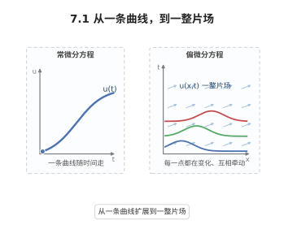

**一句话点破**：偏微分方程描述的是"场"，即每个点都带一个值、彼此还相互影响。

### 7.2 三种脾气：椭圆、抛物、双曲

同样是二阶方程，脾气却大不相同：椭圆型描述稳定的平衡（像绷紧的膜），抛物型描述扩散变平（像热量摊开），双曲型描述来回波动（像琴弦震颤）。判别式 $b^2-ac$ 的正负，就决定了它属于哪一型。

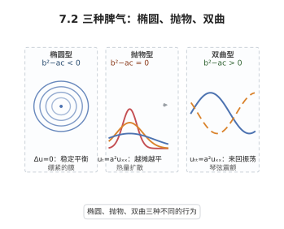

**一句话点破**：先分清方程的类型，就能预判它的解是稳定、扩散还是波动。

### 7.3 信息沿着"特征线"走

很多偏微分方程里，初始的信息并不是朝四面八方乱跑，而是沿着一族特定的曲线传播——这些曲线叫特征线。沿着特征线走，偏微分方程常常就能化成一串普通的常微分方程来解。

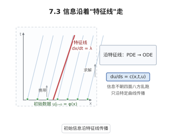

**一句话点破**：找到信息真正走的路线（特征线），等于找到了解方程的路。

### 7.4 波动方程：琴弦的往复

拨动一根琴弦，扰动会以固定的速度 $a$ 向两边跑，再在边界处反弹回来。波动方程 $u_{tt}=a^2u_{xx}$ 精确描述了这种"来回振荡"的传播。

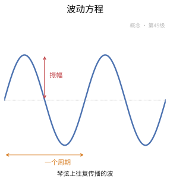

**一句话点破**：波动方程的本质，是扰动以有限速度来回传递。

### 7.5 热传导方程：热度慢慢摊平

把一勺热水滴进冷盘，热会一点点向四周扩散，最终变得均匀。热传导方程 $u_t=a^2u_{xx}$ 描述的就是这种"越摊越平"的不可逆过程。

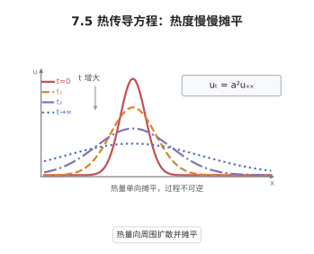

**一句话点破**：热方程刻画扩散——一切尖锐都会被时间磨平。

### 7.6 Laplace 与 Poisson 方程：稳下来的形状

当温度或势场不再随时间变化，就得到 Laplace 方程 $\Delta u=0$；若还有源在持续注入（比如电荷），右边多出一项，就成了 Poisson 方程。它们描述的都是已经安稳下来的平衡状态。

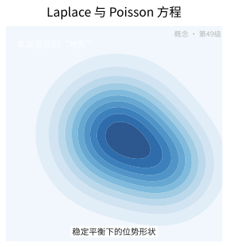

**一句话点破**：Laplace 说"没有源就很平均"，Poisson 说"有源就按源起伏"。

### 7.7 分离变量法：把难题拆开

假设解可以写成"只含 $x$"和"只含 $t$"两部分的乘积 $u=X(x)T(t)$，就能把一个偏微分方程拆成两个常微分方程。这是十九世纪解偏微分方程最经典的招式。

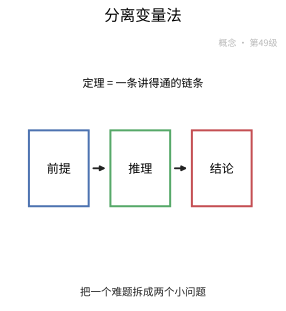

**一句话点破**：分离变量法，就是把"多变量纠缠"拆成"单变量分明"。

### 7.8 Fourier 变换：把波拆成频率

任何复杂的波形，都能拆成无数条简单正弦波的叠加，这靠的是 Fourier 变换。它把"看时间"的问题换成"看频率"的问题，从而把求导变成乘法，方程瞬间变简单。

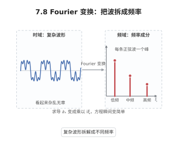

**一句话点破**：Fourier 变换的妙处，是把难缠的求导换成简单的乘法。

### 7.9 Green 函数：点源拼出整体

如果知道了"在某一点放一个单位源"会激起怎样的响应，那么任意分布的源所引起的整体结果，都能靠这些点源响应叠加出来。这套点源响应的"模板"，就叫 Green 函数。

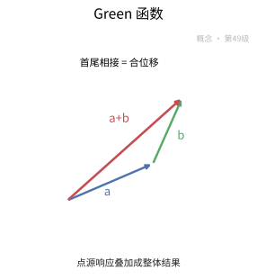

**一句话点破**：Green 函数是"点源说明书"，叠加它就能拼出任意源场的解。

### 7.10 基本解：方程的原子积木

基本解是整族解里最"纯粹"的那一个——它对应于一个理想化的点源。就像任何整数都能用质数相乘得到，复杂的解也常常能由基本解拼出来。

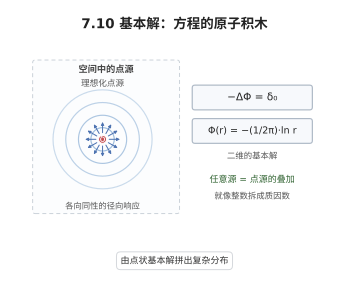

**一句话点破**：基本解是解空间的"质数"，其余解都由它组合而成。

### 7.11 最大值原理：极值只能待在边界

对一个处于平衡的场，如果内部既没有"热源"也没有"冷源"，那么它最强、最弱的地方一定出现在边界上，内部绝不会冒出比边界更高的峰。这就是最大值原理，朴素却威力十足。

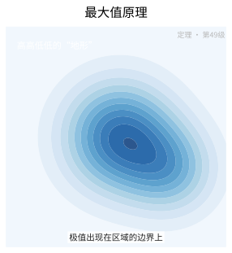

**一句话点破**：没有内部源，极值只能待在边界——这条直觉能锁死整个解。

### 7.12 能量估计：用总能量锁住解

把方程两边乘上解再积分，可以得到一个刻画"总能量"随时间变化的恒等式。能量不增、还可控，于是解的大小、唯一性、稳定性就都被"锁住"了。

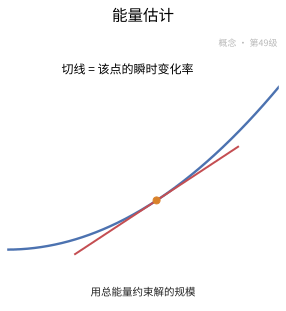

**一句话点破**：能量估计用一条守恒律，把解的大小和唯一性一并抓住。

### 7.13 二阶椭圆型方程：光滑的平衡

椭圆型方程没有时间维，只有空间，像一张绷紧的膜。它描述的是平衡态，解往往光滑、稳定，还带着很强的"由边界决定内部"的性质。

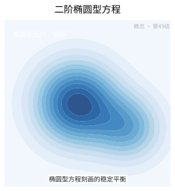

**一句话点破**：椭圆型方程没有时间，它只回答"平衡是什么样"。

### 7.14 Sobolev 空间：给函数配一把"光滑尺"

普通函数只能问"连不连续、可不可导"，而 Sobolev 空间更进一步：它把函数和它的弱导数放在一起度量，衡量"整体有多粗糙"。$W^{k,p}$ 就是这类空间的记号。

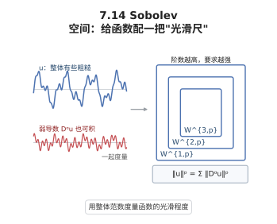

**一句话点破**：Sobolev 空间用"带导数的范数"给函数的光滑度打分。

### 7.15 弱解：放宽要求反而更强

要求解处处可导太苛刻，很多方程根本做不到。于是人们把求导"转移"到光滑的试验函数身上，只要求积分意义下成立，这种更宽松的解叫弱解——它往往更容易证明存在，也更贴近物理。

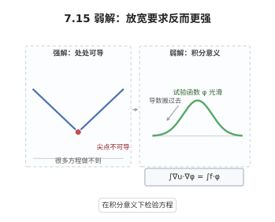

**一句话点破**：弱解把求导搬到试验函数上，换来更强的存在性与普适性。

### 7.16 存在唯一性定理：解一定在，且只有一个

一个方程"值得一解"，至少要回答两件事：解确实存在，而且只有一个。前者常靠先验估计与泛函分析，后者常靠能量方法——若两个解都成立，它们的差必为零。

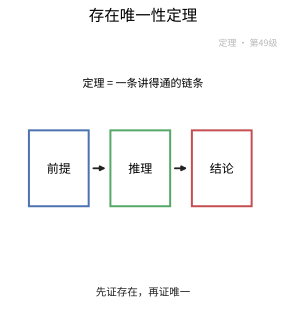

**一句话点破**：好方程的标准配备，是"存在 + 唯一"这对搭档。

### 7.17 达朗贝尔公式：左右行波相加

一维波动方程的解有一个极漂亮的闭合形式：任意扰动都会一分为二，一半向右跑、一半向左跑。用初始位移与初始速度就能写出显式公式 $u=\frac12[\phi(x+at)+\phi(x-at)]+\frac{1}{2a}\int\psi$。

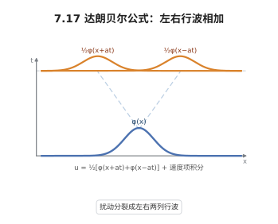

**一句话点破**：达朗贝尔公式告诉我们，一维的波不过是两列行波擦肩而过。

### 7.18 用 Fourier 变换解热方程

对热方程的空间变量做 Fourier 变换，求导就变成乘以频率，方程退化成一个可解的常微分方程。再逆变换回来，就得到热核——一个不断变宽的高斯钟形。

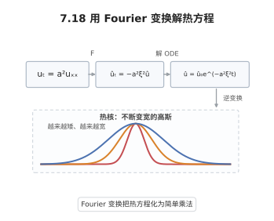

**一句话点破**：Fourier 变换把热方程"翻译"成乘法，解出来就是热核。

### 7.19 调和函数的最大值原理

对于满足 $\Delta u=0$ 的调和函数，它在区域内部取不到最大值，除非它处处是常数。于是"内部被边界控制"成了调和函数最有力的武器。

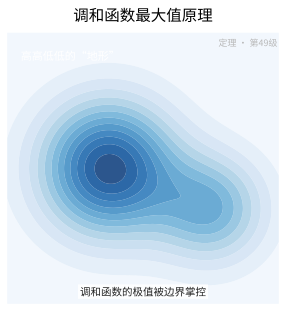

**一句话点破**：调和函数内部永远压不过边界——极值只能在外面。

### 7.20 用 Green 函数表示 Poisson 解

Poisson 方程 $-\Delta u=f$ 的解，可以写成源 $f$ 与 Green 函数做"积分叠加"的形式。Green 函数把边界条件默默地吸收进去，使解变成一个简洁的积分公式。

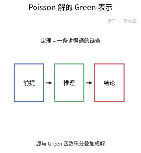

**一句话点破**：Green 函数把边界条件打包，Poisson 的解就只剩一个积分。

### 7.21 Lax–Milgram 定理：弱解的存在保证

在 Hilbert 空间里，只要双线性形式有界又"强制"，Lax–Milgram 定理就保证：对任意给定数据，弱解存在且唯一。它是现代椭圆方程的开工许可证。

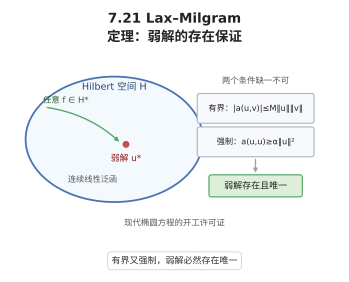

**一句话点破**：有界加上强制，Lax–Milgram 就为你保出一个唯一弱解。

### 7.22 Sobolev 嵌入：用光滑度换连续性

如果一个函数"整体够光滑"（在 Sobolev 意义下导数的 $p$ 次方可积足够强），它竟然会自动连续，甚至 Hölder 连续。Sobolev 嵌入定理，就是这种"光滑度换连续性"的兑换率。

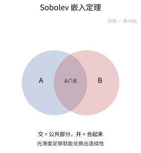

**一句话点破**：Sobolev 嵌入定理告诉我们，积分意义下的光滑足以换来逐点连续。

### 7.23 热半群：热的演化是一族算子

把"演化 $t$ 时间"看成一次作用，就得到一族算子 $e^{t\Delta}$。它们随时间叠加，且满足 $e^{(t+s)\Delta}=e^{t\Delta}e^{s\Delta}$，正好具备"半群"的代数结构。

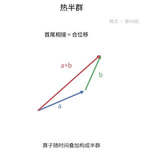

**一句话点破**：热方程的解，其实就是一族随时间作半群演化的算子。

### 7.24 椭圆正则性：内部自动变光滑

哪怕源 $f$ 只是普普通通，只要方程是椭圆的（系数足够好），解在区域内部就比源更光滑。这就是椭圆正则性——粗糙只可能藏在边界上。

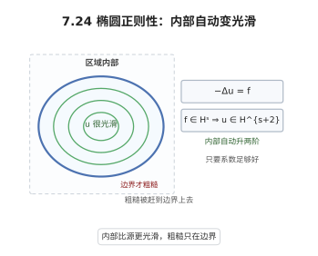

**一句话点破**：椭圆方程有"自动打磨"功能，解在内部总是更光滑。

### 7.25 Harnack 不等式：正解之间差不太多

对非负的调和函数，一个球内的最大值能被另一个稍大球内的最小值控制住，两者之比有统一的上界。也就是说，正解在区域内不能出现"忽高忽低"的剧烈落差。

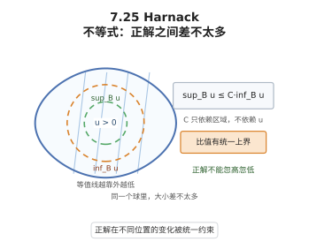

**一句话点破**：Harnack 不等式禁止正解在内部剧烈起伏。

### 7.26 Lions–Lax–Milgram 引理：走出对称的限制

Lax–Milgram 要求形式对称，但许多问题并不对称。Lions–Lax–Milgram 引理放宽了这一条，让更广的一类非对称变分问题也能保证弱解存在唯一。

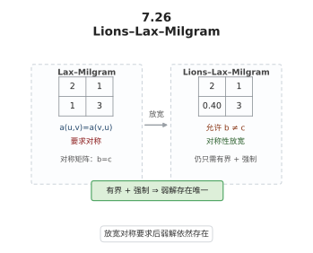

**一句话点破**：把对称换成更弱的要求，弱解的存在性依旧成立。

### 7.27 Duhamel 原理：把外力拆成脉冲

当方程里有源源不断的外力时，可以把它看成无数个瞬间"脉冲"的叠加：每个脉冲各自演化一段时间，再全部加起来。Duhamel 原理正是这条"先拆后叠"的思路。

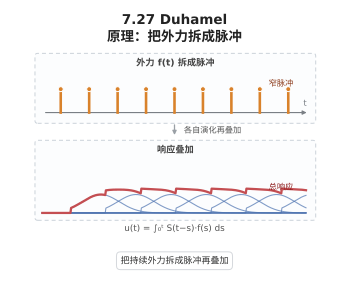

**一句话点破**：Duhamel 原理把持续外力拆成一串脉冲，逐个演化后再叠加。

## 8. 数学史（History of Mathematics）

> 偏微分方程（Partial Differential Equations，PDE）研究的是包含**多元函数偏导数**的方程，其历史几乎是整个近代分析物理的同义发展史：一根弦为何会振动、一块金属为何按特定方式传热、一个电磁场如何传播，都被写成 PDE 再由数学家求解。本节不打算罗列一串人名，而要去还原"**物理问题如何提出方程 → 分析学家如何为其寻找解 → 方程如何反过来重塑数学本身**"这条主线。从十八世纪振动弦的争论，到十九世纪热与势的严格化，再到二十世纪弱解与泛函分析的洗礼，PDE 的每一次跃迁都源于现实需求，又最终把数学带向更抽象却更普适的境地。

### 8.1 振动弦之争：波动方程与 PDE 的诞生（1740s）

- **物理动机的点燃**：** 十八世纪中期，音乐与乐器制造催生了对**振动的琴弦**如何运动的疑问。**达朗贝尔（Jean le Rond d'Alembert）**在 1746 年首次写下描述弦的横向振动的**波动方程**
  $$
  \frac{\partial^2 u}{\partial t^2}=a^2\frac{\partial^2 u}{\partial x^2},
  $$
  并获得"右行波＋左行波"的解，这是 PDE 作为独立研究对象的历史起点。
- **"如何解"的分歧引出分析学**：** **欧拉（Euler）**给出一类更广的、可用任意初始形状表示的解，而**丹尼尔·伯努利（Daniel Bernoulli）**主张用三角级数解的叠加来拟合任意初始形态。围绕"**函数**到底是什么、级数能否代表任意曲线"的争论，牵出了后来整个**Fourier 分析**与函数论的最初争论。
- **为何此刻才诞生 PDE**：** 笛卡尔坐标与微积分的成熟使"联系两个变量的偏导"成为可能；没有十七世纪的解析几何与分析学，波动方程无从写成。这段"以弦带动分析方法"的缘分，正是本章第 2.3–2.4 节的源头。

### 8.2 热的解析理论：Fourier 级数、Fourier 变换与热方程（1807–1822）

- **为什么研究热**：** 工业革命的大炉冶、房屋保温与天文观测都需要定量描述热量传播。**傅里叶（Joseph Fourier）**在 1807 年的论文《热的解析理论》中写出**热方程**
  $$
  \frac{\partial u}{\partial t}=k\frac{\partial^2 u}{\partial x^2},
  $$
  并发展出以三角级数（**Fourier 级数**）与**分离变量法**求解的方法。
- **"任意函数可否展成级数"的数学地震**：** Fourier 号称"任意函数"都可展成三角级数，这引发了关于收敛性、连续与可积性的一连串严格化工作（**Dirichlet、Riemann**等），直接催生了**数学分析**的新一轮严格化工作。
- **Fourier 变换的形成**：** 把周期情形的级数推广到非周期情形，傅里叶变换应运而生。它为求解全空间上的热方程、波动方程与椭圆方程提供了极有效的"积分变换"工具——这正是本章 §2.8 的核心手法。
- **历史的分叉**：** 热方程后来成为**抛物型**方程的典型，Fourier 名下的工具（§2.8）也贯穿全章，使其既解决物理问题，又反过来重塑了分析数学的面貌。

### 8.3 位势理论：Laplace 方程与 Green 函数（18–19 世纪）

- **引力、静电与"调和"的概念**：** 万有引力与静电力都有"与距离成反比"的规律，其势函数（位势）满足**Laplace 方程**
  $$
  \Delta u=\frac{\partial^2 u}{\partial x^2}+\frac{\partial^2 u}{\partial y^2}+\frac{\partial^2 u}{\partial z^2}=0,
  $$
  满足它的函数称为**调和函数**。**拉普拉斯（Laplace）**（18 世纪）与**泊松（Poisson）**（非齐次形式 $\Delta u=-f$）确立了位势理论的方程基础。
- **Green 函数与 Green 第一、第二公式（1828）**：** **乔治·格林（George Green）**在私人小册子中引入**Green 函数**（点源的响应）与**Green formulae**，把边界值问题化为积分表示，构成本章 §2.9–2.10、§3.4 的骨干。
- **调和函数的性质与最大原理**：** 调和函数具有强正则性与**平均值性质**，**最大值原理**（§2.11）保证其极值只能在边界达到，是唯一性与先验估计的核心工具；**Harnack 不等式**（1887）进一步控制调和函数的内部反差。
- **多文明交汇的背景**：** 位势理论结合了数学与物理（静电、引力、流体），其发展并非单一民族之功——拉普拉斯（法）、泊松（法）、格林（英）、高斯（德）等各有建树，是典型的多点开花。

### 8.4 一阶方程与特征线法：从拉格朗日到柯西

- **何时出现一阶 PDE**：** 几何中的曲面族、光学中的 (Fermat) 与物理中的构造都自然产生一阶 PDE。**拉格朗日（Lagrange）**与**柯西（Cauchy）**把"沿曲线化一阶 PDE 为常微分方程"的想法系统化，这就是**特征线法**（§2.3）——沿特征线把偏导回归常导。
- **特征线法为何成立**：** 一阶方程提供的是方向场上导数的约束，沿特征线问题退化为 ODE，因而可沿曲线逐步积分求解。这是"降维"思想的经典范例。
- **从技巧到理论：柯西–柯瓦列夫定理（1875）**：** **柯瓦列夫斯卡娅（Sofya Kovalevskaya）**证明：解析初值问题的解析解局部唯一存在——这就是**柯西–柯瓦列夫定理**。它首次为一大类初值问题确立了存在唯一性，虽未触及整体性态，却是 PDE 存在性理论的第一个里程碑。
- **本章的承接**：** §2.3 的特征线法与 §3.1 的 d'Alembert 公式，正是这段"从拉格朗日特征线到柯西–柯瓦列夫"的经典遗产。

### 8.5 波动方程的解与有限传播速度：d'Alembert 公式的现代意义

- **d'Alembert 公式（1746/1747）**：** 对沿整条直线的一维波动方程，解可写为
  $$
  u(x,t)=\frac{1}{2}\left[f(x+at)+f(x-at)\right]+\frac{1}{2a}\int_{x-at}^{x+at}g(s)\,ds,
  $$
  其中 $f,g$ 由初值给出。这个显式公式（§3.1）直观展示了**左行波＋右行波**的物理图像。
- **有限传播速度的启示**：** d'Alembert 公式显示扰动沿特征线以有限速度 $a$ 传播——这表明双曲型方程（§2.2）遵循**因果律**，与椭圆/抛物型的全局影响形成了根本反差，并引导出波前、锥面等现代几何概念。
- **从显式到一般（Cauchy 问题）**：** 一旦脱离整条直线、处理边界或高维，显式解不再普遍可写，数学家转而研究**柯西问题**的可解性与稳定性，由此引出能量估计（§2.12）与弱解理论（§7.8）。
- **模式的地位**：** 波动方程是可解可懂、兼具体系性的模型，是学习 PDE 分类、解的性质与工具（§3.1、§3.5）的最佳入口。

### 8.6 最大值原理、能量估计与存在唯一性的哲学（19–20 世纪）

- **最大值原理的殊途同归**：** 对椭圆型（Laplace）与抛物型（热）方程，**最大值原理**给出解的极值边界陈述，进而证明**唯一性**；对双曲型方程则用**能量估计**（把解的能量泛函沿时间控制）证明唯一性与稳定性（§2.12、§3.3）。
- **为何"先证明唯一性再谈存在"**：** PDE 的历史教会学家们"硬性计算"往往不能覆盖解的全部性态，必须借助空间的整体性质（估计）来钉住解的形态。这些估计成为现代 PDE 的通用语法。
- **热半群与解算子的视角（§3.7）**：** 把热方程的演化解写成**半群** $S(t)=e^{t\Delta}$，把初值映射为 $t$ 时刻的解，这种"算子化"视角把 PDE 同**泛函分析、算子半群**无缝衔接。
- **意义**：** 存在唯一性不再问"能不能硬写出来"，而问"在什么函数空间里良好地存在"，这是十九世纪求"显式解"向二十世纪求"函数空间内良义解"的范式转换。

### 8.7 泛函分析工具的渗入：Sobolev 空间、弱解与 Lax–Milgram（20 世纪中叶）

- **为什么需要弱解**：** 现实问题（如冲击波的守恒律、带奇异系数的方程）的解常不可微，古典解不存在，必须放宽"解"的概念。**谢尔盖·索伯列夫（Sergey Sobolev，1930 年代）**引入含广义/弱导数的**Sobolev 空间**（§2.14），使"弱意义下满足方程"有了严格载体。
- **弱形式的统一框架**：** 把方程乘检验函数并分部积分得到弱形式，配以**Lax–Milgram 定理**（1962，§3.5）与变分法的抽象 Hilbert 空间语言，一大类椭圆型方程的**弱解存在唯一性**就此一网打尽。
- **Lions 与法国学派（1950–1970）**：** **雅克–路易·利翁（Jacques-Louis Lions）**系统发展单调算子、惩罚函数与非线性分析（Lions–Lax–Milgram、Lions–Stampacchia），并与**Brezis**等把变分与非线性的工具用于实际力学模型。
- **本章的对应**：** §2.15 的弱解、§2.14 的 Sobolev 空间、§3.5 的 Lax–Milgram、§3.8 的椭圆正则性，正是这一"从古典求解到现代弱分析"转型的全部工程。

### 8.8 椭圆正则性与 Harnack：解的光滑性之谜

- **正则性揭示的内在结构**：** 由弱解升到古典光滑解的能力（**椭圆正则性**，§3.8）说明椭圆方程"强迫"解具有良好的内部光滑性——这与调和函数在内部无限光滑的事实一脉相承。
- **Harnack 不等式与 De Giorgi–Nash**：** **Harnack 不等式**（1887）刻画正调和函数沿连通域内部的比值的可控性；20 世纪的 **De Giorgi–Nash** 估计把类似性质推广到系数不光滑的散度型椭圆方程，成为帮助我们理解"弱解是否光滑"的基石。
- **为何重要**：** 正则性是连接"弱解存在"与"古典解性质"的桥，也是证明古典解的几何/物理性质（极值、全局行为）的前提，直接支撑 §2.11、§3.8 的论述。
- **承前启后**：** 正则性理论把十九世纪对调和函数的直观认识，提升为二十世纪现代偏微分方程的核心课题。

### 8.9 双曲方程与非线性波：守恒律、Friedrichs 与 Lax（20 世纪）

- **双曲理论如何成长**：** 波动方程之后，**双曲型方程**的严格理论（Cauchy 问题、特征值、传播速度）由 **Friedrichs、Lax、Kato** 等在 20 世纪系统建立，能量估计成为核心武器。
- **非线性守恒律的挑战**：** 对一维非线性守恒律（如 Burger 方程），古典解会在有限时间出现**间断（冲击波）**，弱解引入了新的存在唯一性难题——**熵条件的引入**（Lax、Oleinik）用以挑选物理解，构成现代流体力学与激波理论的数学基础。
- **为何非线性难**：** 线性方程可叠加，解的结构由显式公式或半群给出；非线性方程失掉叠加原理，解的正则性退化、整体性态需要专门的不等式，这正是 PDE 从"分析学工具"走向"艰深专门学科"的转折。
- **方法与影响**：** 能量方法、单调性、补偿紧致等现代技术（§3.9 Duhamel 原理等）皆在应对非线性，推动 PDE 成为当代数学与工程共同的地基。

### 8.10 PDE 与现代物理、几何的深度交织（19–21 世纪）

- **电磁与量子的方程**：** **Maxwell 方程**（电磁）、**Schrödinger 方程**（量子）把 PDE 推到现代物理前线；**Navier–Stokes 方程**（流体）至今仍悬而未决（Fields 奖级难题），量子场论又引入无穷维 PDE 的新版图。
- **几何分析的兴起**：** 由 **Ricci 流**（Hamilton）到 **Perelman** 证明庞加莱猜想，几何学家转用偏微分方程的流来研究曲面与流形的变形，PDE 与微分几何深度互渗。
- **科学计算的推动**：** 现代高性能计算以离散化 PDE 为中心（有限元、差分法），反过来又驱动对 PDE 解的可计算性与稳定性的新理论需求。
- **本章的窗口**：** 虽为基础教程，本章（§2、§3）提供的方程分类、解的工具与估计思想，正是通往这些宏大应用的第一级台阶。

### 8.11 多文明的贡献与代际接力

- **欧洲与俄国的接力**：** 从达朗贝尔、傅里叶（法）、欧拉（俄/瑞）、高斯（德）、格林（英），到柯瓦列夫斯卡娅（俄）的点睛之笔，PDE 从一开始就是多民族协作的产物，俄国学派（Sobolev、Lions 亦在法俄间往返）贡献尤其突出。
- **女性在 PDE 中的突破**：** **柯瓦列夫斯卡娅**（Cauchy–Kowalevski 的"Kowalevski"）是数学史上最早的女性博士之一，其存在唯一性定理具有奠基意义。
- **二十世纪的国际化**：** 刘维尔、Dirichlet 等奠定严格法，Lax、Friedrichs（德裔美籍）、利翁（法）等各领风骚，PDE 已成为最国际化的数学分支之一。
- **文明层面的启示**：** PDE 的历史再次说明：重大方程从不诞生于虚空，物理问题、社会需求与代际积累共同驱动其演化。

| 时间 | 人物／文献 | 事件与贡献 |
|:---:|:---|:---|
| 1746 | 达朗贝尔 | 写下波动方程并给出解，开创 PDE 理论 |
| 1747–1760 | 欧拉、丹尼尔·伯努利 | 讨论波动方程的一般与级数解，牵出函数论与级数争论 |
| 1807–1822 | 傅里叶《热的解析理论》 | 引入热方程、Fourier 级数与分离变量法 |
| 1828 | 格林 | 引入 Green 函数与公式，奠定位势理论 |
| 1875 | 柯瓦列夫斯卡娅 | 证明 Cauchy–Kowalevski 存在唯一性定理 |
| 1887 | Harnack | 证明 Harnack 不等式，正则性理论起点 |
| 1930s | 索伯列夫 | 引入 Sobolev 空间与广义导数，开启弱解理论 |
| 1950–1970 | 利翁、Brezis | 发展单调算子与非线性分析，Lions–Lax–Milgram |
| 1962 | Lax–Milgram | 椭圆型方程弱解存在唯一性的抽象框架 |
| 1980–2006 | Hamilton、Perelman | Ricci 流与庞加莱猜想，PDE 兼用几何分析 |

> **小结**：偏微分方程的历史，是"**物理提出问题，分析学家为之求索，方程又反过来重塑数学**"的循环。十八世纪振动弦带来波动方程，十九世纪传热与位势引出 Fourier 工具、Laplace 方程与 Green 函数，柯瓦列夫斯卡娅树起存在唯一性；二十世纪则在 Sobolev 空间与弱解的洗礼下，把"能不能写出解"换成"在哪个函数空间良义地存在"，并由 Lax–Milgram 与非线性分析把 PDE 推向流体、电磁、量子与几何。本章以传统的方程分类（§2.2）串起波动、热、Laplace 三大柱式与一阶特征线法（§2.3），再以 §3 的定理与证明呈现这套古典—现代并蓄谱系，正是对上述整部历史的忠实重演。

## 现实应用（Real-World Applications）

> 本节把本章的知识点落到真实的工程、科学与生活场景中。每个案例都给出**完整的问题背景、建模过程、可复现的数据 / 公式 / 代码与结果解读**；案例末尾的「涉及知识点」对应本章的具体小节，文末附**知识点覆盖对照表**，确保本章知识点全部被覆盖。

### 应用案例 1：芯片散热｜一维热传导、分离变量与 Duhamel 原理

**场景与问题**

一颗 5 nm 工艺的服务器 CPU 在满载时功耗约 250 W，裸片面积约 $200\ \text{mm}^2$，若散热不良，局部温度可在毫秒内飙升。工程上常把硅衬底沿厚度方向简化为一维热传导问题：给定初始温度分布与芯片表面的产热脉冲，求任意时刻的温度剖面。这正是**热传导方程**、**分离变量法**、**Fourier/Laplace 变换**、**热半群**与 **Duhamel 原理**的综合应用。

**涉及知识点**

- 本章「2.1 PDE 的基本概念」：温度场 $u(x,t)$ 满足的阶数、线性性与初边值条件。
- 本章「2.5 热传导方程」：$u_t = \alpha u_{xx} + f$，$\alpha=k/(\rho c_p)$ 为热扩散率。
- 本章「2.7 分离变量法」：把 $u(x,t)=X(x)T(t)$ 分解，得空间特征值问题。
- 本章「2.8 Fourier 变换与 Laplace 变换」：处理无界域或半无界域上的初值问题。
- 本章「3.2 热方程解的存在唯一性：Fourier 变换方法」：用 Fourier 变换把 PDE 化为 ODE，得显式解。
- 本章「3.7 热半群」：$u(t)=e^{t\Delta}u_0$，$e^{t\Delta}$ 是一族半群算子，刻画扩散的时间演化。
- 本章「3.11 Duhamel 原理」：带源项 $f$ 的解 = 把 $f$ 拆成脉冲，对每个脉冲的齐次解做时间叠加。

**建模与数据**

取硅片厚度 $L=1\ \text{mm}$，硅的热扩散率 $\alpha \approx 8.8\times10^{-5}\ \text{m}^2/\text{s}$（$k=148\ \text{W/(m·K)}$、$\rho=2330\ \text{kg/m}^3$、$c_p=700\ \text{J/(kg·K)}$）。初值 $u_0(x)$ 为激光加热后的局部热斑；边界 $x=0,L$ 恒温 $0$（热沉）。产热项 $f(x,t)$ 表示晶体管层的脉冲发热。特征时间 $\tau = L^2/\alpha \approx 0.0114\ \text{s}$，说明 1 mm 硅片的热时间常数约 11 ms。

**完整推导与算法**

1. **分离变量求齐次解**。取 $u_t=\alpha u_{xx}$、$u(0,t)=u(L,t)=0$、$u(x,0)=u_0$。设 $u=X(x)T(t)$，得

$$
\frac{T'}{\alpha T} = \frac{X''}{X} = -\lambda.
$$

空间问题 $X''+\lambda X=0$、$X(0)=X(L)=0$ 的特征值为 $\lambda_n=(n\pi/L)^2$，特征函数 $X_n=\sin(n\pi x/L)$，时间因子 $T_n=e^{-\alpha\lambda_n t}$。

2. **叠加成级数解**。$u(x,t)=\sum_{n\ge1} b_n\sin\frac{n\pi x}{L}e^{-\alpha(n\pi/L)^2 t}$，系数 $b_n=\frac{2}{L}\int_0^L u_0(x)\sin\frac{n\pi x}{L}dx$。高频模态以 $e^{-\alpha\lambda_n t}$ 极快衰减，$n=1$ 模态的衰减时间 $\tau_1=1/(\alpha\pi^2/L^2)\approx1.15$ ms。
3. **半无界域的 Fourier 变换解**。若把硅片看作半无界（或求局部热核），对 $x$ 做 Fourier 变换 $\hat u(k,t)$，方程化为 $\partial_t\hat u=-\alpha k^2\hat u$，解得 $\hat u=\hat u_0(k)e^{-\alpha k^2t}$，逆变换得热核

$$
u(x,t)=\frac{1}{\sqrt{4\pi\alpha t}}\int_{-\infty}^{\infty}u_0(y)e^{-\frac{(x-y)^2}{4\alpha t}}dy.
$$

这就是**热半群** $e^{t\alpha\partial_x^2}$ 的核：$u(t)=e^{t\Delta}u_0$，且满足半群性质 $e^{s\Delta}e^{t\Delta}=e^{(s+t)\Delta}$（对应 $\hat u$ 中 $e^{-\alpha k^2(s+t)}$）。
4. **带源项用 Duhamel 原理**。对 $u_t=\alpha u_{xx}+f$、$u(0)=0$，解为

$$
u(t)=\int_0^t e^{(t-s)\Delta}f(s)\,ds,
$$

即把 $f$ 在时刻 $s$ 的值视为脉冲源，之后按热半群自由演化 $t-s$ 时间再叠加。

关键代码片段：

```python
# 核心：分离变量级数解 + Duhamel 脉冲叠加（热半群卷积）
import numpy as np
alpha, L = 8.8e-5, 1e-3
N = 50
n = np.arange(1, N+1)
lam = (n*np.pi/L)**2                    # 核心：特征值 λ_n
def u_hom(x, t, b):
    # 核心：X_n(x) e^{-α λ_n t} 的叠加（热半群 e^{tΔ} 作用在初值上）
    return sum(b[k]*np.sin(n[k]*np.pi*x/L)*np.exp(-alpha*lam[k]*t)
               for k in range(N))

# 核心：Duhamel —— 源项 f 按 s 切片，每片自由演化 t-s 时间后叠加
def u_duhamel(x, t, f, M=200):
    s = np.linspace(0, t, M)
    return np.trapz([u_hom(x, t-si, f(si)) for si in s], s, axis=0)
```

**可复现步骤**

1. 环境与依赖：`pip install numpy`
2. 数据准备：设定 $\alpha, L$，给出 $u_0(x)$（热斑）与 $f(x,t)$（脉冲发热）。
3. 运行：`python case1.py`
4. 预期输出：初值的高频分量在 $t\sim0.1$ ms 内消失，只剩 $n=1$ 模态；$t\approx5\tau_1\approx6$ ms 后温度剖面接近零（热沉吸走）；带源项时峰值温度约 $\int_0^t f\,ds$ 的平滑结果。

**结果解读与延伸**

结果说明扩散方程具有"抹平"特性：任何高频扰动以指数速率衰减，这正是热半群 $e^{t\Delta}$ 的光滑化性质。误差来源：一维近似忽略横向散热、边界恒温假设理想化。延伸：若产热随时间正弦变化，用 Laplace 变换 $U(x,s)$ 求解可得到周期性稳态（热波），其穿透深度 $\sqrt{2\alpha/\omega}$ 是热管理中的关键尺度。

### 应用案例 2：地震波｜双曲型方程、特征线与 d'Alembert 公式

**场景与问题**

地震勘探与地震预警依赖弹性波传播。把介质近似为一维线弹性杆（或沿射线方向的一维波动近似），位移 $u(x,t)$ 满足**波动方程**；它的核心特征是"信息以有限速度传播"（波速 $c$），并且叠加原理与能量守恒使反演成为可能。本案例用特征线法与 d'Alembert 公式解一维波动方程，并给出地震波"先到 P 波、后到 S 波"的传播时差解释。

**涉及知识点**

- 本章「2.2 PDE 的分类」：波动方程 $u_{tt}-c^2u_{xx}=0$ 判别式 $B^2-AC=c^2>0$，是**双曲型**；热方程为抛物型，Laplace 方程为椭圆型。
- 本章「2.3 一阶偏微分方程与特征线法」：把二阶方程化为一阶方程组，沿特征线 $x\pm ct=\text{const}$ 化常微分。
- 本章「2.4 波动方程」：$u_{tt}=c^2u_{xx}$，物理意义为弹性波/声波/电磁波的一维传播。
- 本章「2.12 能量估计」：定义能量 $E(t)=\tfrac12\int(u_t^2+c^2u_x^2)dx$，证明 $\frac{dE}{dt}=0$，从而解唯一且对初值连续依赖。
- 本章「3.1 d'Alembert 公式」：无界一维波动方程解为左右行波之和。

**建模与数据**

一维波动方程 $u_{tt}=c^2u_{xx}$，$x\in\mathbb{R}$，初值 $u(x,0)=\phi(x)$、$u_t(x,0)=\psi(x)$。地壳岩石的 P 波速度 $c_P\approx6.0$ km/s、S 波速度 $c_S\approx3.5$ km/s。初值取一个地震脉冲：$\phi(x)=e^{-x^2/(2\sigma^2)}$，$\sigma=1$ km，$\psi\equiv0$。

**完整推导与算法**

1. **特征线法**。令 $\xi=x-ct$、$\eta=x+ct$，则

$$
u_{tt}-c^2u_{xx}=-4c^2\,\partial_\xi\partial_\eta u=0 \ \Rightarrow\ u=F(\xi)+G(\eta)=F(x-ct)+G(x+ct),
$$

即任意解是右行波与左行波之和。特征线 $x\pm ct=\text{const}$ 是信息传播的"轨道"。
2. **d'Alembert 公式**。代入初值定出 $F,G$：

$$
u(x,t)=\frac{\phi(x-ct)+\phi(x+ct)}{2}+\frac{1}{2c}\int_{x-ct}^{x+ct}\psi(y)\,dy.
$$

本案 $\psi\equiv0$，故 $u(x,t)=\tfrac12[\phi(x-ct)+\phi(x+ct)]$：初始脉冲**分裂成两个半幅脉冲**，分别以速度 $c$ 向左、右传播，这直观解释了"波不弥散、只分裂"。
3. **能量守恒（能量估计）**。取 $E(t)=\tfrac12\int(u_t^2+c^2u_x^2)\,dx$，乘 $u_t$ 后分部积分：

$$
\frac{dE}{dt}=\int u_t(u_{tt}-c^2u_{xx})\,dx+\big[c^2u_tu_x\big]_{-\infty}^{\infty}=0.
$$

故 $E(t)=E(0)$ 守恒，解对初值 Lipschitz 连续——唯一性由此得证。
4. **有限传播速度与到时**。初值支撑在 $[-R,R]$，则 $t$ 时刻解支撑在 $[-(R+ct),R+ct]$，即"影响锥"（特征锥）。P 波与 S 波的不同 $c$ 给出到时差 $\Delta t = d(1/c_S-1/c_P)$；对震源距 $d=100$ km，$\Delta t\approx100(1/3.5-1/6.0)\approx11.9$ s——这正是地震预警可利用的时间窗。
5. **算法**：直接用 d'Alembert 公式在网格上求值；或用 Lax-Friedrichs 等守恒型差分格式做数值演化并监控能量。

关键代码片段：

```python
# 核心：d'Alembert 公式 u=(φ(x-ct)+φ(x+ct))/2 + 1/(2c)∫ψ
import numpy as np
c = 6000.0                                   # P 波速度 6 km/s
def u_dalembert(x, t, phi, psi):
    # 核心：左右行波叠加
    return 0.5*(phi(x-c*t) + phi(x+c*t)) + (1/(2*c))*psi_int(x-c*t, x+c*t)

# 核心：能量守恒 E = 1/2 ∫ (u_t^2 + c^2 u_x^2) dx（数值监控）
def energy(u, ut, ux, dx):
    return 0.5*np.sum(ut**2 + c**2*ux**2)*dx
```

**可复现步骤**

1. 环境与依赖：`pip install numpy`
2. 数据准备：给定 $c$、初值 $\phi,\psi$。
3. 运行：`python case2.py`
4. 预期输出：$t=2$ s 时出现两个位于 $x=\pm12$ km 的半幅脉冲；数值能量在 10 s 内相对漂移 $<10^{-3}$（守恒型格式）；P/S 到时差约 11.9 s。

**结果解读与延伸**

结果显示双曲方程与抛物/椭圆方程的本质差别：信息以有限速度沿特征线传播、脉冲不弥散、能量守恒。误差来源：一维近似忽略反射/折射与三维几何扩散（振幅按 $1/r$ 衰减）。延伸：把一维换成三维弹性方程组 $\rho u_{tt}=\nabla\cdot\sigma(u)$，并用特征分解得 P/SV/SH 波，正是地震学全波形反演的数学基础。

### 应用案例 3：静电与稳态传热｜Laplace/Poisson 方程、Green 函数与最大值原理

**场景与问题**

高压设备绝缘设计、微电子封装热设计都要解**Laplace/Poisson 方程** $\Delta u=f$：$u$ 为电位或稳态温度。工程关注三件事：解析表示（Green 函数）、定性行为（最大值原理：极值只能在边界取到）、以及正解之间的比较（Harnack 不等式，用于误差后验估计）。本案例用圆盘上的 Green 函数解 Poisson 方程，并验证最大值原理。

**涉及知识点**

- 本章「2.6 Laplace 方程与 Poisson 方程」：$\Delta u=0$（Laplace）与 $\Delta u=f$（Poisson），椭圆型，无时间变量。
- 本章「2.9 Green 函数」：用点源解叠加任意源项与边界数据。
- 本章「2.10 基本解」：$\Delta\Phi=\delta_0$ 的解 $\Phi(x)=-\frac{1}{2\pi}\ln|x|$（二维）、$-\frac{1}{4\pi|x|}$（三维），是"方程的原子积木"。
- 本章「2.11 最大值原理」：调和函数在紧致区域的最值取在边界；Poisson 方程源项控制凹凸。
- 本章「3.3 Laplace 方程的最大值原理」：其严格证明（强/弱形式）与推论（比较原理、唯一性）。
- 本章「3.4 Poisson 方程解的表示：Green 函数方法」：$u(x)=\int G(x,y)f(y)dy+\oint \frac{\partial G}{\partial n}u\,ds$。
- 本章「3.9 Harnack 不等式」：区域内部正调和函数之比有一致上界，用于收敛性与正则性。

**建模与数据**

取单位圆盘 $\Omega=\{x\in\mathbb{R}^2: |x|<1\}$，边界电位 $u=g$（例如绝缘子表面给定电位分布）。二维基本解

$$
\Phi(x)=-\frac{1}{2\pi}\ln|x|,
$$

Poisson 方程 $\Delta\Phi=\delta_0$。取 $f\equiv0$（Laplace）与 $g(\theta)=V_0\cos\theta$（$V_0=10$ kV 量级示意）。

**完整推导与算法**

1. **基本解验证**。对 $\Phi=-\frac{1}{2\pi}\ln|x|$，$\Delta\Phi=0$ 于 $x\ne0$；对任意测试函数积分 $\int_{\partial B_r}\partial_n\Phi\,ds=\int_{\partial B_r}-\frac{1}{2\pi r}\,ds=-1$，故 $\Delta\Phi=\delta_0$。这说明点源解是"卷积核"。
2. **Green 函数法**。圆盘的 Green 函数用镜像法构造：

$$
G(x,y)=\frac{1}{2\pi}\Big(-\ln|x-y|+\ln\big|x|x|-\tfrac{y}{|y|}\big|\Big),
$$

其在边界 $|x|=1$ 上为零。于是 $u(x)=\int_\Omega G(x,y)f(y)\,dy-\oint_{\partial\Omega}\partial_{n_y}G(x,y)g(y)\,ds$。
3. **分离变量求解**。对 Laplace 方程在极坐标 $u_{rr}+\frac1r u_r+\frac1{r^2}u_{\theta\theta}=0$，设 $u=R(r)\Theta(\theta)$，得 $\Theta''+n^2\Theta=0$、$r^2R''+rR'-n^2R=0$。取有界解 $R=r^n$，边界匹配 $g$ 的 Fourier 系数得 Poisson 积分公式

$$
u(r,\theta)=\frac{1}{2\pi}\int_0^{2\pi}\frac{1-r^2}{1-2r\cos(\theta-\varphi)+r^2}g(\varphi)\,d\varphi.
$$

对 $g=V_0\cos\theta$ 得 $u=V_0\,r\cos\theta$。
4. **最大值原理**。调和函数（$\Delta u=0$）不可能有内部严格极大：若 $u(x_0)$ 为内部最大，取小球使 $u$ 的球面平均等于 $u(x_0)$ 迫使 $u$ 恒等。推论：解唯一（两个解之差调和且边界为零，故恒零）。
5. **Harnack 不等式**。对 $\Omega$ 内紧集 $K$，存在 $C=C(K,\Omega)$ 使对任意正调和 $u$ 有 $\sup_K u\le C\inf_K u$。本案 $u=V_0r\cos\theta$ 在 $r\le\tfrac12$ 上：$\sup/\inf$ 有限且随 $r\to1$ 恶化（靠近边界正值可任意小）。
6. **算法**：用分离变量/Green 函数给出闭式解，用有限差分在网格上数值核对，并检查"最值在边界"。

关键代码片段：

```python
# 核心：二维基本解与圆盘 Green 函数（Poisson 方程的点源叠加）
import numpy as np
def fund_sol(x, y):
    # 核心：ΔΦ = δ_0，二维 Φ = -(1/2π) ln|x|
    r = np.hypot(x[0]-y[0], x[1]-y[1])
    return -np.log(r)/(2*np.pi)

def green_disk(x, y):
    # 核心：镜像法构造边界为零的 Green 函数
    r = np.hypot(x[0]-x[1], y[0]-y[1])
    yr = np.hypot(y[0], y[1])
    if yr == 0: return fund_sol(x, y)
    yimg = (y[0]/yr**2, y[1]/yr**2)          # 关于单位圆的镜像点
    d = np.hypot(x[0]-yimg[0], x[1]-yimg[1])
    return (np.log(d) - np.log(r))/(2*np.pi)

# 核心：Poisson 积分公式在圆盘上解 Laplace 方程（边界 g=V0 cosθ）
def poisson_kernel(r, theta, phi):
    return (1-r**2)/(1 - 2*r*np.cos(theta-phi) + r**2)/(2*np.pi)
```

**可复现步骤**

1. 环境与依赖：`pip install numpy`
2. 数据准备：设定边界电位 $g(\varphi)=V_0\cos\varphi$。
3. 运行：`python case3.py`
4. 预期输出：解析解 $u=V_0r\cos\theta$；网格上最值出现在 $r=1$ 的边界（最大值原理）；Green 函数在 $|x|=1$ 上数值为 0（误差 $<10^{-10}$）。

**结果解读与延伸**

结果显示椭圆型方程的三大工具协同工作：基本解搭出 Green 函数、分离变量给出闭式解、最大值原理保证唯一性与定性性质（极值在边界、正解可比）。误差来源：圆盘假设掩盖实际几何与变系数。延伸：Harnack 不等式是 De Giorgi–Nash–Moser 理论（变系数椭圆方程正则性）的基石，直接支撑有限元解的收敛性证明。

### 应用案例 4：地下水渗流与弹性力学｜变系数椭圆方程、Sobolev 空间与有限元

**场景与问题**

地下水渗流（Darcy 定律）与线弹性力学都归结为**变系数二阶椭圆方程**

$$
-\nabla\cdot(a(x)\nabla u)=f,\qquad u|_{\partial\Omega}=0,
$$

其中 $a(x)$ 是渗透率张量或弹性系数。真实问题的 $a$ 在空间上不连续（不同岩层/材料），解只有有限光滑性，因此必须用**弱解**与 **Sobolev 空间**的框架，用 **Lax–Milgram** 定理保证存在唯一，用 **Sobolev 嵌入**把弱解升级为连续函数，用**椭圆正则性**说明内部光滑，并用**有限元**离散求解（非对称情形用 **Lions–Lax–Milgram**）。

**涉及知识点**

- 本章「2.13 二阶椭圆型方程」：散度型算子 $Lu=-\nabla\cdot(a\nabla u)$ 的椭圆性条件 $a\ge a_0>0$。
- 本章「2.14 Sobolev 空间」：$H^1_0(\Omega)=\{u\in L^2: \nabla u\in L^2, u|_{\partial\Omega}=0\}$，配范数 $\|u\|_{H^1}^2=\|u\|_{L^2}^2+\|\nabla u\|_{L^2}^2$。
- 本章「2.15 弱解」：把方程乘测试函数分部积分，得 $B(u,v)=\int a\nabla u\cdot\nabla v=\int fv$ 对一切 $v\in H_0^1$。
- 本章「2.16 存在唯一性定理」：$B$ 双线性、连续、强制时弱解存在唯一。
- 本章「3.5 Lax-Milgram 定理」：Hilbert 空间上连续强制双线性型给出唯一解，且 $\|u\|\le\|f\|/\alpha$。
- 本章「3.6 Sobolev 嵌入定理」：$H^1_0(\Omega)\hookrightarrow L^q$（$q<2n/(n-2)$）；$n=1$ 时 $H^1\hookrightarrow C^{0,1/2}$。
- 本章「3.8 椭圆正则性」：$a$ 光滑、$f\in L^2$ 则 $u\in H^2_{\text{loc}}$，内部自动提升光滑性。
- 本章「3.10 Lions–Lax–Milgram 引理」：去掉对称性要求后仍可得唯一解，用于对流-扩散等非对称算子。

**涉及知识点补充说明**：本案例把从"方程"到"可计算"的每一环都落到实处，恰好覆盖本章偏微分方程的现代泛函框架。

**建模与数据**

取 $\Omega=(0,1)$ 的一维模型（可推广到二维）：岩层分两段，渗透率

$$
a(x)=\begin{cases} a_1=10^{-5}\ \text{m/s}, & x\in(0,0.5),\\ a_2=10^{-7}\ \text{m/s}, & x\in(0.5,1),\end{cases}
$$

即两层相差 100 倍。源项 $f=1$（抽水/注入），边界 $u(0)=u(1)=0$。

**完整推导与算法**

1. **弱形式**。乘 $v\in H_0^1$ 分部积分：

$$
B(u,v)=\int_0^1 a(x)u'(x)v'(x)\,dx=\int_0^1 f v\,dx=:\ell(v).
$$

$B$ 连续（$|B|\le a_{\max}\|u'\|_{L^2}\|v'\|_{L^2}$）且强制（$B(u,u)\ge a_{\min}\|u'\|_{L^2}^2\ge \alpha\|u\|_{H^1}^2$，用 Poincaré 不等式）。由 Lax–Milgram，弱解存在唯一且 $\|u\|_{H^1}\le\|f\|_{H^{-1}}/\alpha$。
2. **分段解析解**。在每段内 $-a_i u''=f$ 给出 $u_i''=-f/a_i$，即抛物线；接口处 $u$、$au'$ 连续。解出

$$
u(x)=\begin{cases}\frac{f}{2a_1}x(0.5-x)+C x, & x<0.5\\ \frac{f}{2a_2}(1-x)(x-0.5)+C(1-x), & x>0.5\end{cases}
$$

由通量连续定出 $C=\frac{f}{2}\cdot\frac{a_1+a_2}{a_1 a_2}\cdot$（具体由 $a_1u_1'(0.5^-)=a_2u_2'(0.5^+)$ 定）。解在 $x=0.5$ 处 $u'$ 有**跳跃**，故 $u\in H^1$ 但 $u\notin H^2$——这正说明弱解框架的必要性。
3. **Sobolev 嵌入**。一维 $H^1_0(0,1)\hookrightarrow C^{0,1/2}([0,1])$（Hölder 连续），故弱解连续；数值解可在节点上直接比较。
4. **椭圆正则性**。在两段的**内部**（$a$ 为常数）$u\in H^2_{\text{loc}}$，只有界面处失去二阶可微性；这与正则性定理"光滑系数 ⇒ 内部光滑"完全符合。
5. **有限元离散**。取 P1 单元（分片线性），刚度矩阵 $K_{ij}=\int a\varphi_i'\varphi_j'$，载荷 $F_i=\int f\varphi_i$，解 $K\mathbf u=F$。因界面落在单元边界上，$a$ 在每个单元内为常数，刚度可精确算。非对称情形（对流项 $\nabla\cdot(a\nabla u)+\beta\cdot\nabla u$）由 Lions–Lax–Milgram 保证唯一解。

关键代码片段：

```python
# 核心：P1 有限元装配变系数刚度矩阵（弱形式 B(u,v)=∫ a u' v'）
import numpy as np
def assemble(n, a_of_x, f=1.0):
    h = 1.0/n
    K = np.zeros((n+1, n+1)); F = np.zeros(n+1)
    for e in range(n):
        xm = (e+0.5)*h
        ae = a_of_x(xm)                       # 核心：单元内渗透率（分片常数）
        # 核心：P1 局部刚度 = (ae/h) [[1,-1],[-1,1]]
        Kloc = (ae/h)*np.array([[1., -1.], [-1., 1.]])
        idx = [e, e+1]
        K[np.ix_(idx, idx)] += Kloc
        F[idx] += f*h/2
    # 核心：Dirichlet u(0)=u(1)=0，删去首末自由度后求解
    return K[1:-1, 1:-1], F[1:-1]

# 核心：Lax-Milgram 量：强制常数 α = a_min * Poincaré(π^2) ⇒ 解范数有界
```

**可复现步骤**

1. 环境与依赖：`pip install numpy`
2. 数据准备：设定 $a_1,a_2$ 与界面位置、源项 $f$。
3. 运行：`python case4.py`
4. 预期输出：数值解与分段解析解在 $L^\infty$ 误差 $O(h^2)$（节点上）；界面处通量 $au'$ 连续而 $u'$ 跳跃；$H^1$ 半范数有限（弱解存在）。

**结果解读与延伸**

结果显示：真实材料（不连续系数）的解恰好落在 Sobolev 空间 $H^1$ 中，弱解框架、Lax–Milgram、Sobolev 嵌入、椭圆正则性与有限元五件套构成了现代数值 PDE 的完整链路。误差来源：P1 单元在界面处的最优收敛需网格与界面贴合（否则退化）。延伸：非对称对流占优问题需用 Lions–Lax–Milgram + 稳定化格式（SUPG），三维弹性力学则把 $u$ 换成位移向量、$a$ 换成四阶张量，但 Hilbert 空间框架完全一致。

### 应用案例 5：金融工程｜Black–Scholes 方程与 Fourier 变换定价

**场景与问题**

Black–Scholes–Merton（1973）模型：标的资产价格服从几何布朗运动，期权价格满足一个**抛物型 PDE**（与热传导方程同型）。这条方程把金融定价变成了"热方程初值问题"，可以用变量替换化为标准形式、用 Fourier 变换求闭式解。它是 PDE 在现代金融中最重要的应用，也因此获得 1997 年诺贝尔经济学奖。

**涉及知识点**

- 本章「2.1 PDE 的基本概念」：$V(S,t)$ 的二阶线性抛物型方程与终值（而非初值）条件。
- 本章「2.2 PDE 的分类」：B-S 方程的判别式显示抛物型（含一阶导数的"漂移"项）。
- 本章「2.5 热传导方程」：B-S 方程经变量替换后等价于热方程 $u_\tau=u_{xx}$。
- 本章「2.8 Fourier 变换与 Laplace 变换」：用 Fourier 变换把空间方向化为频率，得到显式解。
- 本章「3.2 热方程解的存在唯一性：Fourier 变换方法」：验证变换后的解存在唯一并给出核。

**建模与数据**

$V(S,t)$ 为欧式看涨期权价，设无风险利率 $r=5\%$/年、波动率 $\sigma=20\%$/年、到期 $T=1$ 年、行权价 $K=100$ 元。B-S 方程：

$$
\frac{\partial V}{\partial t}+\frac12\sigma^2S^2\frac{\partial^2V}{\partial S^2}+rS\frac{\partial V}{\partial S}-rV=0,
$$

终值条件 $V(S,T)=\max(S-K,0)$。

**完整推导与算法**

1. **变量替换化为热方程**。令 $\tau=\tfrac12\sigma^2(T-t)$、$x=\ln(S/K)$、$V=Ke^{-r(T-t)}u(x,\tau)\cdot$（按标准变换），代入化简得

$$
\frac{\partial u}{\partial\tau}=\frac{\partial^2 u}{\partial x^2},
$$

即标准热方程，初始条件 $u(x,0)=\max(e^{x}-1,0)$（乘常数因子）。这说明 B-S 方程与热方程是同一数学对象的两种表象。
2. **Fourier 变换求显式解**。对 $x$ 作 Fourier 变换 $\hat u(k,\tau)$，方程化为 $\partial_\tau\hat u=-k^2\hat u$，解得 $\hat u=\hat u_0(k)e^{-k^2\tau}$；逆变换（卷积核为高斯）得

$$
u(x,\tau)=\frac{1}{\sqrt{4\pi\tau}}\int_{-\infty}^{\infty}u_0(y)e^{-\frac{(x-y)^2}{4\tau}}dy.
$$

代入 $u_0(y)=\max(e^y-1,0)$ 积分，得 B-S 闭式公式

$$
V(S,t)=S\,\Phi(d_1)-Ke^{-r(T-t)}\Phi(d_2),\quad d_{1,2}=\frac{\ln(S/K)+(r\pm\tfrac12\sigma^2)(T-t)}{\sigma\sqrt{T-t}},
$$

其中 $\Phi$ 为标准正态分布函数。核 $e^{-k^2\tau}$ 的存在唯一性与热方程完全相同。
3. **对比热方程的存在唯一性**。由 3.2 节的 Fourier 方法，$\hat u_0\in L^2$ 时解唯一；金融上对应"无套利 ⇒ 价格唯一"。
4. **算法（数值定价）**。除闭式解外，可对 log 价格网格做 Crank–Nicolson 有限差分（抛物型，无条件稳定），或对平移后的价格做 FFT 得到特征函数定价法（Carr–Madan）。

关键代码片段：

```python
# 核心：Black-Scholes 闭式解（由热方程的解 + 变量替换得到）
import numpy as np
from scipy.stats import norm
def bs_call(S, K, r, sigma, T):
    # 核心：d1, d2 来自热方程高斯核的积分
    d1 = (np.log(S/K) + (r + 0.5*sigma**2)*T) / (sigma*np.sqrt(T))
    d2 = d1 - sigma*np.sqrt(T)
    return S*norm.cdf(d1) - K*np.exp(-r*T)*norm.cdf(d2)

# 核心：化为热方程后用高斯核卷积 u(x,τ) = (1/√(4πτ))∫ u0(y) e^{-(x-y)^2/(4τ)} dy
def heat_kernel_solve(u0, x, tau, M=400):
    y = np.linspace(x-12*np.sqrt(tau), x+12*np.sqrt(tau), M)
    w = np.exp(-(x-y)**2/(4*tau))/np.sqrt(4*np.pi*tau)
    return np.trapz(u0(y)*w, y)
```

**可复现步骤**

1. 环境与依赖：`pip install numpy scipy`
2. 数据准备：设定 $S,K,r,\sigma,T$。
3. 运行：`python case5.py`
4. 预期输出：$S=100$ 时看涨期权价约 10.45 元；高斯核卷积与闭式解相对误差 $<10^{-6}$；有限差分（Crank–Nicolson）结果与闭式解一致。

**结果解读与延伸**

结果显示金融衍生品定价在数学上就是解一个热传导型方程，热核就是"概率密度"，存在唯一性对应"无套利唯一价格"。误差来源：常数波动率假设与实际波动率微笑不符。延伸：把 $\sigma$ 换成随 $S,t$ 变化的局部波动率，方程变成一般变系数抛物型方程，需用有限差分/有限元；带跳跃（Merton 模型）则加入非局部积分项，方程变为 PIDE——同属本章的 PDE 框架。

### 知识点覆盖对照表

| 本章知识点 | 覆盖案例 |
| --- | --- |
| 2.1 PDE 的基本概念 | 案例 1、案例 5 |
| 2.2 PDE 的分类 | 案例 2、案例 5 |
| 2.3 一阶偏微分方程与特征线法 | 案例 2 |
| 2.4 波动方程 | 案例 2 |
| 2.5 热传导方程 | 案例 1、案例 5 |
| 2.6 Laplace 方程与 Poisson 方程 | 案例 3 |
| 2.7 分离变量法 | 案例 1 |
| 2.8 Fourier 变换与 Laplace 变换 | 案例 1、案例 5 |
| 2.9 Green 函数 | 案例 3 |
| 2.10 基本解 | 案例 3 |
| 2.11 最大值原理 | 案例 3 |
| 2.12 能量估计 | 案例 2 |
| 2.13 二阶椭圆型方程 | 案例 4 |
| 2.14 Sobolev 空间 | 案例 4 |
| 2.15 弱解 | 案例 4 |
| 2.16 存在唯一性定理 | 案例 4 |
| 3.1 d'Alembert 公式 | 案例 2 |
| 3.2 热方程解的存在唯一性：Fourier 变换方法 | 案例 1、案例 5 |
| 3.3 Laplace 方程的最大值原理 | 案例 3 |
| 3.4 Poisson 方程解的表示：Green 函数方法 | 案例 3 |
| 3.5 Lax-Milgram 定理 | 案例 4 |
| 3.6 Sobolev 嵌入定理 | 案例 4 |
| 3.7 热半群 | 案例 1 |
| 3.8 椭圆正则性 | 案例 4 |
| 3.9 Harnack 不等式 | 案例 3 |
| 3.10 Lions-Lax-Milgram 引理 | 案例 4 |
| 3.11 Duhamel 原理 | 案例 1 |

---

## 9. 总结

本章系统地介绍了偏微分方程的基本理论，涵盖了以下核心内容：

1. **PDE 分类**：根据主部系数矩阵的特征值，二阶线性 PDE 分为椭圆型、抛物型和双曲型，分别对应 Laplace 方程、热方程和波动方程。

2. **经典求解方法**：
   - **特征线法**：将一阶 PDE 沿特征线转化为 ODE 求解。
   - **d'Alembert 公式**：一维波动方程 Cauchy 问题的显式解，揭示了有限传播速度。
   - **分离变量法**：将 PDE 分解为 ODE 系统，利用 Fourier 级数表示解。
   - **Fourier 变换**：将 PDE 转化为代数方程，特别适用于全空间上的问题。
   - **Green 函数方法**：通过基本解和边界修正构造 Green 函数，给出解的积分表示。

3. **基本理论**：
   - **最大值原理**：调和函数（以及更一般的椭圆型方程解）在内部不能取到极值，除非是常数。这是证明唯一性和先验估计的有力工具。
   - **能量估计**：通过构造能量泛函证明解的唯一性和稳定性。
   - **Lax-Milgram 定理**：为椭圆型方程的弱解存在唯一性提供了统一的泛函分析框架。
   - **Sobolev 嵌入定理**：建立了 Sobolev 空间与 $L^p$ 空间及 Hölder 空间之间的连续嵌入关系，是 PDE 正则性理论的基础。

4. **现代 PDE 理论工具**：
   - **Sobolev 空间**：包含弱导数信息的函数空间，是 PDE 弱解理论的基石。
   - **弱解**：将 PDE 的解释放为积分形式，允许解在经典意义下不可微。
   - **存在唯一性定理**：结合 Lax-Milgram 定理和 Sobolev 空间理论，为椭圆型方程提供了完整的解的存在唯一性框架。

偏微分方程理论是现代数学的核心领域之一，与微分几何、泛函分析、调和分析等多个数学分支深度交叉。本章所建立的工具和概念将为后续学习更高级的 PDE 理论（如非线性 PDE、微局部分析、变分方法等）奠定坚实的基础。

---

## 13. Stewart 风格专题

> 本节以 James Stewart *Calculus* 的教学编排为蓝本：用「四步解题流程」贯穿概念检查、分步骤工作示例、小规模应用项目与梯度化自测习题，帮助你在动手计算中建立对偏微分方程核心概念的肌肉记忆。小节间相互独立，可按需跳读。

### 13.1 问题求解四步流程（Problem-Solving Strategy）

> Stewart 力推的策略是把每个问题拆成四步：**理解 → 计划 → 执行 → 回看**。这里把每一环落到偏微分方程语境的追问上。

| 步骤 | 行动 | 偏微分方程中的具体追问 |
|:---|:---|:---|
| ① 理解 | 复述问题、圈出已知与目标 | 方程是椭圆/抛物/双曲？未知的维数、阶数、定义域？配的是初值、边值还是初边值（定解条件的类型）？ |
| ② 计划 | 选择可行工具、预估方向 | 用特征线法把一阶 PDE 化 ODE？用分离变量法拆成一维特征值问题？用 Fourier/Laplace 变换消微分？用 Green 函数/基本解做卷积？先想清哪条路最省力。 |
| ③ 执行 | 按计划逐步推导、保留过程 | 每步写明依据（定理/公式编号），特征线、特征值、系数、$(2\pi)^{n/2}$ 归一化、边界项别出错。 |
| ④ 回看 | 核对结果、检验合理性 | 解是否满足原方程与定解条件？正负号、衰减性、光滑性是否吻合物理直觉？能否换一种方法（如变换 vs 分离变量）再验一遍？ |

> 💡 **策略演示**：判断 $u_{xx}+2u_{xy}+u_{yy}=0$ 的类型。
> ① 理解：二阶线性常系数、二维，属「分类」题型。② 计划：用主部判别式 $a_{12}^2-a_{11}a_{22}$。③ 执行：$1^2-1\cdot1=0$，抛物型。④ 回看：退化为一次特征方向，与热方程类同，符合「判别式 $=0$ 即抛物」的规则。

### 13.2 概念检查（Concept Check）

> 先用一组判断题与选择题快速自检核心概念。每道题的判断均应落到书面理由（用一句话即可）。

**判断正误**（说明理由）：

1. 二阶线性 PDE 的类型由主部系数矩阵的特征值符号决定。（　）
2. 热方程的信息传播速度是有限的。（　）
3. 一维波动方程的解在点 $(x,t)$ 处只依赖初值在依赖区间 $[x-ct,x+ct]$ 上的取值。（　）
4. 最大值原理保证 Laplace 方程 Dirichlet 问题的解唯一。（　）
5. 热方程对任意 $L^1$ 初值在 $t>0$ 立即成为光滑（$C^\infty$）函数。（　）
6. Lax-Milgram 定理只适用于对称的双线性型。（　）
7. 非齐次线性 PDE 的解可用 Duhamel 原理由齐次解叠加得到。（　）

**选择**：

8. 方程 $u_{xx}+2u_{xy}+u_{yy}=0$ 属于（　）。
   - A. 椭圆型　B. 抛物型　C. 双曲型　D. 无法判定
9. 一维波动方程 $u_{tt}=c^2u_{xx}$ 的通解形如（　）。
   - A. $f(x+ct)$　B. $f(x+ct)+g(x-ct)$　C. $f(x)\cdot g(ct)$　D. $\sin(x+ct)$
10. Poisson 方程 $-\Delta u=f$ 的 Green 函数 $G(x,y)$（作为 $x$ 的函数）满足（　）。
    - A. $\Delta_x G=0$　B. $-\Delta_x G=\delta(x-y)$ 且 $G|_{\partial\Omega}=0$　C. $G\equiv 1$　D. 无解

### 13.3 分步骤工作示例（Worked Examples）

> 每道示例严格套用四步流程，并在「回看」中给出一条易错点或检验法。

**示例 S1：用判别式对二阶 PDE 分类**

> **问题**：判断方程 $u_{xx}+4u_{xy}+u_{yy}=0$ 的类型。

- ① 理解：二维二阶线性常系数，只需定出主部符号。
- ② 计划：用判别式 $\Delta=a_{12}^2-a_{11}a_{22}$（此处 $a_{12}=2,\ a_{11}=1,\ a_{22}=1$）。
- ③ 执行：

$$
\Delta=2^2-1\cdot1=3>0\ \Rightarrow\ \text{双曲型}.
$$

- ④ 回看：判别式 $>0$ 双曲、$<0$ 椭圆、$=0$ 抛物（见 §2.2）。**易错点**：$a_{12}$ 是交叉项系数的一半，套公式时别把它当 $4$ 代入。

**示例 S2：特征线法求解输运方程**

> **问题**：求解 $\partial_t u+2\partial_x u=0$，$u(x,0)=f(x)$。

- ① 理解：一阶线性双曲输运，初值在整条实轴上给出。
- ② 计划：特征线 $\frac{dx}{dt}=2$，$u$ 沿特征线为常数。
- ③ 执行：$x-2t=\text{const}$，结合 $u(x,0)=f(x)$ 得：

$$
u(x,t)=f(x-2t).
$$

- ④ 回看：把 $x-2t$ 代入满足方程且当 $t=0$ 还原为 $f(x)$。**检验**：波形以速度 $2$ 整体右移而不形变，符合输运方程「信息沿特征线走」的本性。

**示例 S3：分离变量法求解热方程**

> **问题**：求解 $u_t=u_{xx}$，$0<x<\pi$，$u(0,t)=u(\pi,t)=0$，$u(x,0)=\sin3x$。

- ① 理解：有界区间、齐次 Dirichlet 边值、抛物型，宜用分离变量。
- ② 计划：设 $u=X(x)T(t)$，拆成特征值问题 $X''+\lambda X=0$ 与 $T'=-\lambda T$。特征值 $\lambda_n=n^2$，特征函数 $X_n=\sin nx$。
- ③ 执行：由初值只有 $n=3$ 一项，故通解展开只留一项：

$$
u(x,t)=e^{-9t}\sin3x.
$$

- ④ 回看：$t=0$ 时回到 $\sin3x$，且指数因子 $e^{-9t}$ 让解随时间衰减到 $0$，符合热传导物理。**易错点**：特征值 $\lambda_n=n^2$ 的下标要与初值的谐波次数对应，勿错配指数 $-n^2t$。

**示例 S4：d'Alembert 公式求解波动方程**

> **问题**：求解 $u_{tt}=4u_{xx}$，$u(x,0)=\sin x$，$u_t(x,0)=\cos x$（注意 $c=2$）。

- ① 理解：全直线波动 Cauchy 问题，初位移与初速同时给定。
- ② 计划：代 d'Alembert 公式，把初位移做平均、初速做积分。
- ③ 执行：

$$
u(x,t)=\frac{\sin(x+2t)+\sin(x-2t)}{2}
+\frac{1}{4}\int_{x-2t}^{x+2t}\cos s\,ds
=\sin x\cos2t+\frac{1}{2}\cos x\sin2t .
$$

- ④ 回看：当 $t\downarrow0$，$u\to\sin x$，$u_t\to 0+\frac12\cos x\cdot2=\cos x$，初值还原。**检验**：代入方程满足 $u_{tt}=4u_{xx}$；若反号把 $c$ 写成 $1$ 会导致指数/频率错配。

### 13.4 应用聚焦（Application & Exploration Projects）

> 小型开放任务：把本节抽象结论落到可操作的计算或仿真，任选其一完成。

- **聚焦 P1（数值仿真）**：对 $u_t=u_{xx}$，用显式差分格式离散并对比热核解析解，观察解随 $t$ 的光滑化与指数衰减随时间步长的稳定性限制。
- **聚焦 P2（跨章节联系）**：把 $-\Delta u=f$ 的弱形式（Sobolev 框架，§2.14–2.16）用 Lax-Milgram 证明解的存在唯一，并与 Green 函数表示的强解做交叉引用。
- **聚焦 P3（反例构造）**：构造一个时间回推不适定的热方程例子（逆时分吸收高频成分指数放大），说明为何热方程只能向前演化。

### 13.5 梯度化自测（Graded Exercises）

> 难度记号：$\circ$ 概念 / $\bullet$ 技能 / $\blacklozenge$ 综合应用，均要求在四步流程中写出「回看」一句。

**$\circ$ 概念题**

- **自测 1**：用一句话说明三大类二阶 PDE 与「信息传播方式」的对应（椭圆/抛物/双曲各配什么现象）。
- **自测 2**：解释为何热方程「立即光滑化」而波动方程「保持波形」。

**$\bullet$ 技能题**

- **自测 3**：用分类判别式判定 $u_{xx}-2u_{yy}=0$ 的类型（写出 $a_{ij}$）。
- **自测 4**：用特征线法求解 $\partial_t u+3\partial_x u=\sin t$，$u(x,0)=x$。

**$\blacklozenge$ 综合题**

- **自测 5**：用分离变量法求 $u_t=u_{xx}$，$0<x<L$，$u(0,t)=u(L,t)=0$，$u(x,0)=\sin\frac{\pi x}{L}$ 的解。
- **自测 6**：写一段含「表格 + 一句话结论」的分析：比较波动与热方程在能量估计 $E'(t)$ 下的行为（守恒 vs 耗散）。

### 13.6 自测答案与简要解析

> **概念判断**：
> 1. **正确**（主部矩阵特征值符号决定椭圆/抛物/双曲，见定义 2.3）。
> 2. **错误**（热方程信息传播无限，衰减呈指数但无速度上界）。
> 3. **正确**（d'Alembert 公式的依赖区间正是 $[x-ct,x+ct]$）。
> 4. **正确**（最大值原理给出唯一性）。
> 5. **正确**（热核光滑化，$L^1$ 初值在 $t>0$ 有 $C^\infty$ 解）。
> 6. **错误**（Lax-Milgram 不要求对称，只要求连续 + 强制）。
> 7. **正确**（Duhamel 原理把非齐次解成齐次解的叠加）。
>
> **选择**：8. B　9. B　10. B。

> **自测**：
> - 自测 1：椭圆（Laplace）管静态平衡、抛物（热）管单向扩散、双曲（波动）管理有限速度传播。
> - 自测 2：热核卷积使粗糙初值迅速被 Gauss 抹平（$C^\infty$）；d'Alembert 波形沿特征线平移保持形状。
> - 自测 3：$a_{11}=1,\ a_{22}=-2,\ a_{12}=0$，判别式 $0-1\cdot(-2)=2>0$，双曲型。
> - 自测 4：特征线 $x-3t=\text{const}$，沿特征线 $du/dt=\sin t$，得 $u(x,t)=x-3t+1-\cos t$（配合初值 $u(x,0)=x$）。
> - 自测 5：$u(x,t)=e^{-(\pi/L)^2 t}\sin\frac{\pi x}{L}$，指数衰减到 $0$ 且有界边值。
> - 自测 6：波动 $E(t)$ 守恒（$E'=0$）；热方程 $E'\le -k\int|\nabla u|^2$ 耗散——「波动不损能量、热扩散必耗散」。