# 第75级 解析数论

## 从"数一数质数"说起：解析数论要解决的根问题

> 在动手读定义之前，先想清楚一个问题：**人为什么需要解析数论？**

**一个真实的场景（第一步：直觉）**

想象你在一张很长很长的数轴上，想统计"前 $x$ 个自然数里到底有多少个素数"——素数像撒在沙漠里的绿洲，越往前越稀疏，却似乎从不断绝。直白的问题接踵而至：

- 稀疏到什么程度？能不能给个近似公式？
- 素数是不是在"模 $q$ 的剩余类"里大致均匀分布？
- 能不能更进一步，说"每个偶数都是两个素数之和"？

直接数永远数不到无穷，解析数论的破解之道是换一个思路：**不直接数素数，而是把它们"编进"一个复变函数（Zeta 函数、L-函数）的解析性质里，再从函数的零点与极点"解压"出素数的分布信息。** 素数藏得再深，也会在某个复杂函数的解析性质面前露出手脚。

**要解决的问题（第二步：来龙去脉）**

- **欧拉把"和"写成"积"**（1730 年代）。Léonhard Euler 发现 $\sum_{n\ge1}n^{-s}=\prod_p(1-p^{-s})^{-1}$，这一记"把整数的加法信息与素数的乘法结构连在一起"的恒等式，是后来的整个出发点。
- **Dirichlet 让素数"按余类站队"**（1837 年）。Peter Gustav Dirichlet 把级数推广成 $L(s,\chi)=\sum_n\chi(n)n^{-s}$，靠证明 $L(1,\chi)\ne0$ 首次表明"形如 $a\pmod q$ 的素数有无穷多个"——解析数论第一颗真正的硕果。
- **Riemann 的飞跃**（1859 年）。Riemann 把 $\zeta(s)$ 延拓成复平面上的亚纯函数并写下函数方程，于是素数公式 $\psi(x)=x-\sum_\rho x^\rho/\rho+\cdots$ 水到渠成——素数分布的每一步波动都被那些零点"指挥"，Riemann 假设由此成为世纪难题。

**正式定义前的准备（第三步：本章如何推进）**

本课沿"函数 → 定理 → 方法"的主线推进：

- 先把 **Zeta 函数** 与 **L-函数** 定义好，学会解析延拓、函数方程与零点结构；
- 再证 **素数定理** 与 **Dirichlet 算术级数定理**，看无零点区域与 $L(1,\chi)\ne0$ 如何发力；
- 然后介绍刻画分布的现代工具：**筛法（Selberg 筛、大筛法）** 与 **圆法**；
- 最后讨论 **误差项**、**Riemann 假设** 的影响，以及它与其他数学分支的衔接。

带着"如何从函数的解析性质读出素数的分布"去读每一步，你会发现每个定义都在回答这条主线的某个环节。

> **🧠 一句话记住解析数论的"出生证"**
>
> 解析数论要解决的**根本问题**，是利用复变函数的解析性质（延拓、零点、极点）来精确刻画素数的分布：
>
> $$ \boxed{\text{把素数分布编码进 Zeta/L-函数的解析性质，再从零点与极点"解压"出素数计数信息。}} $$

---

## 开始之前

**本章在讲什么**：解析数论用复分析的方法研究整数与素数的分布。你会先抓住 Zeta 函数与 Dirichlet L-函数这两个主角（含 Euler 乘积、解析延拓、函数方程、零点），再用它们证明素数定理与 Dirichlet 算术级数定理，最后学习筛法与圆法这类现代工具。

**为什么要学它**：它把第 74 级的算术不变量（理想类、互反律）和第 72 级的对称（表示论中的 L-函数）统一到"解析函数"的显微镜下。第 76 级代数数论讨论"素数在数域里如何分裂"用的是代数语言，这里的 L-函数与 Dirichlet 定理正是理解"素数在算术级数里如何分布"的解析对应物——许多类域论、椭圆曲线的结果都要靠解析数论的工具来定量。

**开始前请确认你还记得**：

- 复变函数基础：解析函数、极点与留数、积分（围道）技巧、Gamma 函数 $\Gamma(s)$。
- 无穷级数与乘积的绝对收敛、一致收敛与逐项求导/积分（见微积分与分析基础）。
- 初等数论基础：素数、算术基本定理、同余、欧拉函数 $\varphi$、原根与可逆群 $( \mathbb{Z}/q\mathbb{Z})^\times$。
- 部分求和（Abel 求和）与 Riemann-Stieltjes 积分工具。

---

## 学习目标

1. 理解Riemann Zeta函数和Dirichlet L-函数的定义、基本性质及解析延拓。
2. 掌握素数定理的证明思路，理解Zeta函数无零点区域的作用。
3. 理解Dirichlet算术级数定理，掌握L-函数在 $s=1$ 处非零的证明。
4. 掌握Zeta函数的函数方程及其推导。
5. 理解Selberg筛法和大筛法的基本思想。
6. 了解圆法、三重积法等解析数论中的现代方法。
7. 理解Riemann假设及其在素数分布中的重要性。

---

## 第一节 Riemann Zeta函数

### 1.1 定义与基本性质

**为什么需要这个概念**：打开算术的"乐高箱"，每个自然数都是一叠素数的乘积。可"和"（加法）很难看清素的乘法骨架。Riemann 的突破口是：用一个带参数 $s$ 的幂级数 $\sum_n n^{-s}$ 把所有自然数统一加权，于是"加法信息"能通过 Euler 乘积转译成"素数的乘法信息"，而 $s$ 一旦变复杂数，整个问题就跃升到复变函数的舞台——可解析、可延拓、可解剖。

**定义1（Riemann Zeta函数）** 对 $\operatorname{Re}(s) > 1$，定义
$$\zeta(s) = \sum_{n=1}^{\infty} \frac{1}{n^s}.$$

**定理1（Euler乘积）** 对 $\operatorname{Re}(s) > 1$，
$$\zeta(s) = \prod_{p \text{ 素数}} \left(1 - \frac{1}{p^s}\right)^{-1}.$$

**证明：**

由几何级数，
$$\left(1 - \frac{1}{p^s}\right)^{-1} = \sum_{k=0}^{\infty} \frac{1}{p^{ks}}.$$

对所有素数取乘积，由算术基本定理，每个正整数 $n$ 有唯一的素因子分解，因此
$$\prod_{p} \left(1 - \frac{1}{p^s}\right)^{-1} = \sum_{n=1}^{\infty} \frac{1}{n^s} = \zeta(s).$$

需要验证绝对收敛以保证乘积展开的合法性。当 $\operatorname{Re}(s) > 1$ 时，
$$\sum_{p} \sum_{k=1}^{\infty} \frac{1}{|p^{ks}|} = \sum_{p} \frac{1}{p^{\operatorname{Re}(s)} - 1} < \infty.$$
因此乘积绝对收敛，展开合法。$\square$

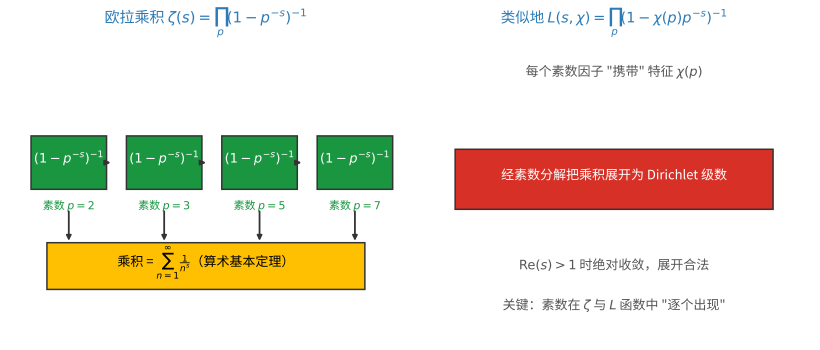

> **直观理解（现实类比）**：欧拉乘积把 $\zeta(s)$ 拆成由每个素数单独贡献的一个"锁扣"，$\zeta(s)=\prod_p(1-p^{-s})^{-1}$。这就像把一台复杂的机器拆成一个个彼此独立的零件，再按算术基本定理（每个整数唯一分解成素数幂）重新拼装成 $\sum_n n^{-s}$。它表明"整体"的信息可以完全由"素数零件"重建——类似任何商品都能按唯一配方由最基本的原料组合而成。
>
> **🧠 思考历程：一个把自然数加起来的无穷级数，怎么会泄露素数的全部秘密？**
>
> 素数的分布像迷雾一样难以捉摸，可解析数论的起点却出奇地简单：**把每一类自然数放进同一个"幂次舞台"，看素数在其中扮演什么角色**。欧拉的级数只是一张入场券，真正的大戏要等 Riemann 把复数引进来才拉开帷幕。
>
> - **欧拉的钥匙：把"和"写成"积"**（1730 年代）。Léonhard Euler 首次注意到 $\sum_{n\ge1}n^{-s}=\prod_p(1-p^{-s})^{-1}$ 这个恒等式。它看似只是一个形式上的小技巧，却头一次把"整数的加法信息"与"素数的乘法结构"系在了一起——可惜 Euler 只把它当作求和的闲笔，素数分布的豁口依然无人敢碰。
> - **Dirichlet 的乘法：让素数"按余类站队"**（1837 年）。Peter Gustav Dirichlet 把级数推广成 $L$ 函数 $L(s,\chi)=\sum_n\chi(n)n^{-s}$，用特征 $\chi$ 去筛出一整类算术级数。他正是靠证明非主特征在 $s=1$ 处 $L(1,\chi)\ne0$，才首次证明"形如 $a\pmod q$ 的素数有无穷多个"——这是解析数论史上第一颗真正的硕果。
> - **Riemann 的飞跃：把级数变成能"解剖"的函数**（1859 年）。Bernhard Riemann 在短短几页论文里，把 $\zeta(s)$ 延拓成复平面上的亚纯函数，并写下连接 $s$ 与 $1-s$ 的函数方程。一旦 $\zeta$ 成了可解析的对象，素数公式 $\psi(x)=x-\sum_\rho x^\rho/\rho+\cdots$ 就水到渠成——素数的每一步波动都被那些零点"指挥"，Riemann 假设由此成为悬而未决的圣杯。
> - **心路**：有些看似平凡的小等式（如欧拉乘积），其实是一整座大厦的地基。**把自然数的问题"搬进"函数与复平面的舞台，是解析数论最深刻的转场**——别小看任何一个若合符节的形式类比。

#### 课堂问答

**老师**：Zeta 函数为什么偏偏写成 $\sum n^{-s}$，而不是别的形式？指数 $s$ 起什么作用？

**学生**：这是为了让它长成"可乘法分解"的形状。当 $\operatorname{Re}(s)>1$ 时级数绝对收敛，由算术基本定理可拆成欧拉乘积 $\zeta(s)=\prod_p(1-p^{-s})^{-1}$，$s$ 就是调节每项权重的"旋钮"。

**老师（追问）**：欧拉乘积把"和"变"积"，凭什么合法？

**学生**：关键是绝对收敛。乘积展开后各素数因子的和 $\sum_p p^{-\operatorname{Re}(s)}$ 收敛，所以无穷乘积绝对收敛、可任意重排，才不会出现条件收敛那种换序变值的事。

**老师（拓展）**：那能不能把 $s$ 取成 $1$？

**学生**：不行，在 $s=1$ 处它变成调和级数 $\sum 1/n$ 发散，欧拉乘积也随 $\prod(1-1/p)^{-1}$ 发散。这正是 $\zeta$ 在 $s=1$ 有极点、也是素数定理难点的来源。

### 1.2 解析延拓与函数方程

**定理2（Zeta函数的解析延拓和函数方程）** $\zeta(s)$ 可以解析延拓到整个复平面，仅在 $s = 1$ 处有一阶极点，留数为 $1$。函数方程：
$$\zeta(s) = 2^s \pi^{s-1} \sin\left(\frac{\pi s}{2}\right) \Gamma(1-s) \zeta(1-s).$$

> **💡 直观理解（类比）**：解析延拓与函数方程像"给一台只在门口亮的灯接通了全屋电源"：原来的级数只在 $\operatorname{Re}(s)>1$ 这个"小房间"发光，延拓把它接通到整个复平面，唯一在 $s=1$ 处有一个"保险丝熔断"（极点）。函数方程 $\zeta(s)\leftrightarrow\zeta(1-s)$ 则是"镜子对称"：右半面的行为完全决定了左半面，就像镜中倒影与实物互为真值来源。

**证明（使用Theta函数的Poisson求和）：**

**第一步：引入Theta函数。** 定义
$$\theta(t) = \sum_{n=-\infty}^{\infty} e^{-\pi n^2 t}, \quad t > 0.$$

**第二步：Theta函数的函数方程。** 由Poisson求和公式，
$$\theta(t) = \frac{1}{\sqrt{t}} \theta\left(\frac{1}{t}\right).$$

**第三步：将Zeta函数与Theta函数联系起来。** 对 $\operatorname{Re}(s) > 1$，利用Gamma函数：
$$\Gamma\left(\frac{s}{2}\right) \pi^{-s/2} \zeta(s) = \int_0^{\infty} t^{s/2 - 1} \frac{\theta(t) - 1}{2} dt.$$

**第四步：将积分拆分为 $[0,1]$ 和 $[1,\infty)$ 两部分。**
$$\int_0^{\infty} = \int_0^1 + \int_1^{\infty}.$$

对 $\int_0^1$ 使用 $\theta(t) = \frac{1}{\sqrt{t}} \theta(1/t)$ 的变换：
$$\int_0^1 t^{s/2 - 1} \frac{\theta(t) - 1}{2} dt = \int_1^{\infty} u^{-s/2 - 1/2} \frac{\theta(u) - 1}{2} du + \frac{1}{s-1} - \frac{1}{s}.$$

**第五步：得到完整表达式。**
$$\Gamma\left(\frac{s}{2}\right) \pi^{-s/2} \zeta(s) = \frac{1}{s(s-1)} + \int_1^{\infty} (t^{s/2} + t^{(1-s)/2}) t^{-1} \frac{\theta(t) - 1}{2} dt.$$

右边的积分在 $s$ 的整个复平面上解析（因为 $\theta(t) - 1$ 在 $t \to \infty$ 时指数衰减），因此给出了 $\zeta(s)$ 的解析延拓。

函数方程由该表达式在 $s \mapsto 1-s$ 下的对称性直接得出。$\square$

#### 课堂问答

**老师**：级数只在 $\operatorname{Re}(s)>1$ 有定义，凭什么说 $\zeta$ 能延拓到整个复平面？

**学生**：因为用 Theta 函数能把 $\Gamma(s/2)\pi^{-s/2}\zeta(s)$ 写成一个积分加 $\frac{1}{s(s-1)}$，右边积分在 $t\to\infty$ 时指数衰减，对任意 $s$ 都解析。所以延拓后的 $\zeta$ 只在 $s=1$ 留一个一阶极点，留数为 $1$。

**老师（追问）**：函数方程 $\zeta(s)=2^s\pi^{s-1}\sin(\frac{\pi s}{2})\Gamma(1-s)\zeta(1-s)$ 到底告诉你什么？

**学生**：它是一面镜子，右半平面的取值完全决定左半平面。比如看到 $s=-1$，右边 $\Gamma(1-s)$ 在别处有极点，而 $\zeta(1-s)$ 的零点正好与之配合，零点结构被强行对称。

**老师（拓展）**：这个方程对研究素数的意义在哪？

**学生**：它把临界带外的零点位置直接钉死，也让临界带的零点关于 $\operatorname{Re}(s)=\frac{1}{2}$ 对称，这正是 Riemann 假设只说"一条线"而非"半平面"的根据。

### 1.3 Zeta函数的零点

**定义2（平凡零点与非平凡零点）** 
- $\zeta(s)$ 在 $s = -2, -4, -6, \dots$ 处有零点，称为**平凡零点**。
- 其他零点称为**非平凡零点**，全部位于临界带 $0 < \operatorname{Re}(s) < 1$ 中。

**Riemann假设：** $\zeta(s)$ 的所有非平凡零点都位于直线 $\operatorname{Re}(s) = \frac{1}{2}$ 上。

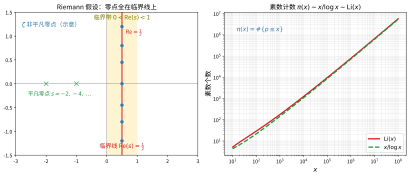

> **直观理解（现实类比）**：$\zeta$ 函数的零点像"素数分布的指挥棒"。显式公式 $\psi(x)=x-\sum_\rho x^\rho/\rho+\cdots$ 告诉我们，素数分布的每一步波动都由非平凡零点 $\rho$ 的"合奏"决定。Riemann 假设断言所有零点整齐地排在直线 $\mathrm{Re}(s)=\frac{1}{2}$ 上，这就像所有乐手都站在同一条起跑线上——如果成立，素数的分布规律就能被精确掌控，误差项会大大缩小，正如一支完全对齐的乐队能奏出最稳定的旋律。

---

#### 课堂问答

**老师**：$\zeta$ 的零点分几类？为什么平凡零点叫"平凡"？

**学生**：负偶数 $s=-2,-4,-6,\dots$ 是平凡零点，它们来自函数方程里 $\sin(\pi s/2)$ 的零点，位置一眼能算出，所以平凡。其余零点都在临界带 $0<\operatorname{Re}(s)<1$ 内，称非平凡零点。

**老师（追问）**：凭什么非平凡零点一定落在临界带里？

**学生**：由欧拉乘积，$\operatorname{Re}(s)>1$ 时 $\zeta(s)\neq0$；再由函数方程对称，$\operatorname{Re}(s)<0$ 处除平凡零点外也无零点，中间夹出的这条带才可能容纳非平凡零点。

**老师（拓展）**：Riemann 假设如果成立，对素数分布意味着什么？

**学生**：所有零点的实部都等于 $\frac{1}{2}$，显式公式 $\psi(x)=x-\sum_\rho x^\rho/\rho+\cdots$ 的误差就会被压到 $O(\sqrt{x}\log x)$，素数计数达到"最优"的精度。

## 第二节 素数定理

### 2.1 素数计数函数

**为什么需要这个概念**：我们真正想回答的是"前 $x$ 个数里有多少个素数"，这需要一个精确的"计数器"——$\pi(x)$。它把散布的素数汇总成一个单调阶梯函数，剩下的任务就是给它的渐近行为一个漂亮公式。

**定义3（素数计数函数）** 
$$\pi(x) = \#\{p \leq x : p \text{ 是素数}\}.$$

**定理3（素数定理）** 
$$\pi(x) \sim \frac{x}{\log x} \quad (x \to \infty).$$
等价地，
$$\pi(x) \sim \operatorname{Li}(x) = \int_2^x \frac{dt}{\log t}.$$

> **💡 直观理解（类比）**：素数计数函数 $\pi(x)$ 就是"数到 $x$ 之前踩中了多少个素数地雷"。素数定理则断言：素数越往后越稀疏，密度大致是每 $\log x$ 个数约有一个——所以 $\pi(x)$ 大约等于 $x/\log x$。这就像路上每隔一段固定"地质距离"才埋一棵树，间距随路径长度对数增长，于是总数约等于"路程/间距"。
>
> **🔑 为什么重要**：素数定理是整个解析数论的"第一里程碑"：它首次把"素数的分布"钉死在一个干净的渐近公式 $\pi(x)\sim x/\log x$ 上。其意义远超一个估算——它揭示素数的总体分布其实非常"规整"（密度约 $1/\log x$），而更精细的 $x/\log x$ 与 $\operatorname{Li}(x)$ 之差距、乃至非平凡零点对误差的影响，都开启了更深的探索。

#### 课堂问答

**老师**：为什么用一个阶梯函数 $\pi(x)$ 就能概括素数的分布？

**学生**：$\pi(x)=\#\{p\le x:p\text{ 是素数}\}$ 把所有零散素数汇成一个单调不减的整值函数，分布问题就变成"研究这个函数的增长"。素数定理给出 $\pi(x)\sim\frac{x}{\log x}\sim\operatorname{Li}(x)$。

**老师（追问）**：$x/\log x$ 和 $\operatorname{Li}(x)$ 都渐近，该用哪个？

**学生**：主项相同时要看误差。$\operatorname{Li}(x)$ 的误差小得多，数值上更接近 $\pi(x)$，所以研究精细分布时以 $\operatorname{Li}(x)$ 为准。

**老师（拓展）**：$\pi(x)\sim x/\log x$ 里为什么分母是 $\log x$？

**学生**：因为它等价于"密度约 $1/\log x$"，即素数间距平均约 $\log x$；$x$ 个数按间距 $\log x$ 摊，就得到约 $x/\log x$ 个素数。这一步用部分求和可从 $\psi(x)\sim x$ 推出来。

### 2.2 素数定理的证明

**证明（使用Zeta函数的经典方法）：**

**第一步：将素数计数函数与Zeta函数联系起来。**

定义Chebyshev函数：
$$\psi(x) = \sum_{n \leq x} \Lambda(n),$$
其中 $\Lambda(n)$ 是von Mangoldt函数：
$$\Lambda(n) = \begin{cases} \log p, & \text{若 } n = p^k \text{ 是素数的幂}, \\ 0, & \text{其他}. \end{cases}$$

易见 $\pi(x) \sim \frac{x}{\log x}$ 等价于 $\psi(x) \sim x$。

**第二步：$\psi(x)$ 的显式公式。**

对 $\operatorname{Re}(s) > 1$，有
$$-\frac{\zeta'(s)}{\zeta(s)} = \sum_{n=1}^{\infty} \frac{\Lambda(n)}{n^s}.$$

由Mellin变换，
$$\psi(x) = \frac{1}{2\pi i} \int_{c-i\infty}^{c+i\infty} \left(-\frac{\zeta'(s)}{\zeta(s)}\right) \frac{x^s}{s} ds, \quad c > 1.$$

**第三步：移动积分路径。**

将积分路径向左移动到 $\operatorname{Re}(s) = \sigma_0 < 1$，需要考虑 $-\frac{\zeta'(s)}{\zeta(s)}$ 的极点：
- $s = 1$ 处有极点，留数为 $x$；
- 在每个非平凡零点 $\rho = \beta + i\gamma$ 处有极点，留数为 $-x^\rho/\rho$；
- 在平凡零点 $s = -2n$ 处有极点。

因此得到显式公式：
$$\psi(x) = x - \sum_{\rho} \frac{x^\rho}{\rho} - \frac{\zeta'(0)}{\zeta(0)} - \frac{1}{2} \log(1 - x^{-2}),$$
其中求和遍历所有非平凡零点。

**第四步：使用Zeta函数的无零点区域。**

**定理4（Zeta函数的无零点区域）** 存在绝对常数 $c > 0$，使得
$$\zeta(s) \neq 0 \quad \text{当 } \operatorname{Re}(s) \geq 1 - \frac{c}{\log(|\operatorname{Im}(s)| + 2)}.$$

> **💡 直观理解（类比）**：无零点区域像"给必停线设定安全减速带"：它保证 $\zeta$ 在 $\operatorname{Re}(s)=1$ 这堵"红线"的左侧留出一条薄薄的"禁止零点带"，越靠近红线带宽越窄（$\frac{c}{\log t}$）。因为有这条不会塌掉的地带，显式公式里那串零点波动的系数才不至于失控，素数定理才能站稳——好比高架桥只要不在桥面正下方挖空，桥就不会整体坍塌。

**证明概要：** 利用不等式
$$3 + 4 \cos \theta + \cos 2\theta = 2(1 + \cos \theta)^2 \geq 0$$
和Zeta函数在 $\operatorname{Re}(s) > 1$ 时的对数导数展开，可以得到 $\zeta(\sigma + it)$ 在接近 $\sigma = 1$ 时不能有零点。$\square$

**第五步：Tauber型定理。**

由无零点区域可知，在区域 $\operatorname{Re}(s) \geq 1 - \frac{c}{\log(|t|+2)}$ 上，$-\frac{\zeta'(s)}{\zeta(s)} - \frac{1}{s-1}$ 解析。

应用Ikehara-Wiener Tauber定理：若 $a_n \geq 0$ 且 $\sum_{n=1}^{\infty} \frac{a_n}{n^s}$ 在 $\operatorname{Re}(s) > 1$ 时收敛，且 $\sum_{n=1}^{\infty} \frac{a_n}{n^s} - \frac{1}{s-1}$ 可连续延拓到 $\operatorname{Re}(s) \geq 1$，则 $\sum_{n \leq x} a_n \sim x$。

取 $a_n = \Lambda(n)$，则 $\sum_{n=1}^{\infty} \frac{\Lambda(n)}{n^s} = -\frac{\zeta'(s)}{\zeta(s)}$。由上述分析，$-\frac{\zeta'(s)}{\zeta(s)} - \frac{1}{s-1}$ 在 $\operatorname{Re}(s) \geq 1$ 上解析，因此 $\psi(x) \sim x$，从而 $\pi(x) \sim x/\log x$。$\square$

---

#### 课堂问答

**老师**：证明素数定理，为什么不直接数 $\pi(x)$，而要绕道 Chebyshev 函数 $\psi(x)$？

**学生**：因为 $\psi(x)=\sum_{n\le x}\Lambda(n)$ 的 Mellin 变换正比于 $-\zeta'(s)/\zeta(s)$，而后者是 $\zeta$ 的对数导数，零点、极点一目了然。先证 $\psi(x)\sim x$，再由部分求和就得到 $\pi(x)\sim x/\log x$。

**老师（追问）**：显式公式 $\psi(x)=x-\sum_\rho x^\rho/\rho+\cdots$ 里，哪一项决定主项？

**学生**：$s=1$ 处极点的留数给出主项 $x$，每个非平凡零点 $\rho$ 贡献一个 $-x^\rho/\rho$ 的振荡项。要让主项胜出，必须控制住这些零点项。

**老师（拓展）**：无零点区域在这里扮演什么角色？

**学生**：它保证 $\zeta$ 在 $\operatorname{Re}(s)=1$ 左侧留出一条禁止零点的窄带，零点求和才不会失控，再用 Ikehara-Wiener Tauber 定理把解析信息转成 $\psi(x)\sim x$。缺了它，主项就会被零点振荡淹没。

## 第三节 Dirichlet L-函数与算术级数中的素数

### 3.1 Dirichlet特征

**为什么需要这个概念**：要回答"素数在每个算术级数 $a\pmod q$ 里怎么分配"，得先造一批"筛子"，把整数按模 $q$ 的剩余类分门别类地点名。Dirichlet 特征正是这样的筛子：它是一族"相位标签" $\chi$，能精确分辨"这个数落在哪个剩余类"，从而把整体求和拆成各族回响。

**定义4（Dirichlet特征）** 模 $q$ 的 **Dirichlet特征** 是一个群同态 $\chi: (\mathbb{Z}/q\mathbb{Z})^\times \to \mathbb{C}^\times$。将其扩张到 $\mathbb{Z}$ 上：若 $(n, q) = 1$，定义 $\chi(n) = \chi(n \bmod q)$；若 $(n, q) > 1$，定义 $\chi(n) = 0$。

> **💡 直观理解（类比）**：Dirichlet 特征像给每个整数发一张"按余类着色的荧光标签"：它与 $q$ 互素时按它落在哪个剩余类发对应颜色（模 $q$ 的可逆元群到复数的同态），与 $q$ 不互素时直接标成"染色失败/黑色"（记 $0$）。这样一来，特征就把"整数"这一大群按模 $q$ 的类别切分，恰好是后面 L-函数去筛"某一类素数"的筛子。

**主特征：** $\chi_0(n) = 1$ 若 $(n, q) = 1$，否则为 $0$。

#### 课堂问答

**老师**：为什么研究算术级数里的素数要先造 Dirichlet 特征？

**学生**：因为需要一个能"按剩余类点名"的工具。特征 $\chi:(\mathbb{Z}/q\mathbb{Z})^\times\to\mathbb{C}^\times$ 是群同态，把每个与 $q$ 互素的数按其所在类映射到一个复相位，从而用正交关系把 $n\equiv a\pmod q$ 这类条件变成对所有特征求和。

**老师（追问）**：那 $(n,q)>1$ 的情形怎么处理？

**学生**：直接令 $\chi(n)=0$。这样特征在 $\mathbb{Z}$ 上完全可乘，$\chi(mn)=\chi(m)\chi(n)$，既保留了乘法结构，又干净地剔除了与 $q$ 不互素的项。

**老师（拓展）**：主特征 $\chi_0$ 特殊在哪？

**学生**：$\chi_0(n)=1$（当 $(n,q)=1$），它是唯一的"不做相位"的特征，对应的 L-函数只差有限个欧拉因子就等于 $\zeta(s)$，因此同样在 $s=1$ 有极点——这正是 Dirichlet 定理里极点与零点需分开处理的原因。

### 3.2 Dirichlet L-函数

**定义5（Dirichlet L-函数）** 对 $\operatorname{Re}(s) > 1$，定义
$$L(s, \chi) = \sum_{n=1}^{\infty} \frac{\chi(n)}{n^s}.$$

> **💡 直观理解（类比）**：L-函数是 Zeta 函数的"染色加权重"：$\zeta$ 把每个整数平等地加进来，L-函数却给每个整数乘上它那件"特征荧光衣" $\chi(n)$（带符号或转相）。它像乐队里不同声部各带自己的"音色"，一起演出——从而能专门听出某一类（某个剩余类）素数的"回响"。Zeta 是全体整数的声音，L-函数则是按模 $q$ 分组的频谱。

**定理5（Euler乘积）** 对 $\operatorname{Re}(s) > 1$，
$$L(s, \chi) = \prod_{p} \left(1 - \frac{\chi(p)}{p^s}\right)^{-1}.$$

> **💡 直观理解（类比）**：L-函数的 Euler 乘积是 Zeta 情况的"按特征染色"翻版：每个素数同样贡献一个独力因子，只是把 $1/p^s$ 换成 $\chi(p)/p^s$。由于 $\chi$ 完全可乘，算术基本定理保证"整体连乘=每个整数由素数配方编成后求和"，所以 $L$-函数也能由只数素数拆出的零件完整拼回——只不过这次每个素数的"值"带自己的相位。

#### 课堂问答

**老师**：L-函数 $L(s,\chi)=\sum\chi(n)n^{-s}$ 相比 $\zeta$ 多了什么、丢了什么？

**学生**：多了特征权重 $\chi(n)$，让每个整数的贡献带上相位或符号；但乘法分解还在，因为 $\chi$ 完全可乘，仍有欧拉乘积 $L(s,\chi)=\prod_p(1-\chi(p)p^{-s})^{-1}$。

**老师（追问）**：$\chi$ 的取值不在实数上会有麻烦吗？

**学生**：不会，绝对收敛只看 $\operatorname{Re}(s)>1$ 时 $|n^{-s}|$ 的衰减，与相位无关，级数照样绝对收敛、欧拉乘积照样合法。

**老师（拓展）**：如果 $\chi=\chi_0$ 会退化吗？

**学生**：会，$L(s,\chi_0)=\zeta(s)\prod_{p|q}(1-p^{-s})$，除了有限个因子外就是 $\zeta$，所以它在 $s=1$ 有极点。非主特征才是证明难点——要证 $L(1,\chi)\neq0$。

### 3.3 Dirichlet算术级数定理

**定理6（Dirichlet定理）** 设 $q$ 为正整数，$a$ 与 $q$ 互素。则算术级数 $a, a+q, a+2q, \dots$ 中包含无穷多个素数。即
$$\#\{p \leq x : p \equiv a \pmod{q}\} \sim \frac{1}{\varphi(q)} \frac{x}{\log x}.$$

> **💡 直观理解（类比）**：Dirichlet 定理断言"只要跑道不与模数相撞（$(a,q)=1$），路边每隔 $q$ 步的小站里就有无穷多个素数岗亭"，且每个合法剩余类大约分到 $\frac{1}{\varphi(q)}$ 的份额——即素数在可用的 $\varphi(q)$ 条车道上近乎均匀分布。仿佛一座城市按 $q$ 个房间分房，只要房号合法，几乎每进一间都能等到一位素数的到来。

**证明（使用L-函数在 $s=1$ 处非零）：**

**第一步：将素数分布与L-函数联系起来。**

对 $\operatorname{Re}(s) > 1$，取对数导数：
$$-\frac{L'(s, \chi)}{L(s, \chi)} = \sum_{n=1}^{\infty} \frac{\chi(n)\Lambda(n)}{n^s}.$$

由正交关系：
$$\sum_{\chi \bmod q} \overline{\chi}(a) \chi(n) = \begin{cases} \varphi(q), & n \equiv a \pmod{q}, \\ 0, & \text{其他}. \end{cases}$$

因此
$$\sum_{n \equiv a \pmod{q}} \frac{\Lambda(n)}{n^s} = \frac{1}{\varphi(q)} \sum_{\chi \bmod q} \overline{\chi}(a) \left(-\frac{L'(s, \chi)}{L(s, \chi)}\right).$$

**第二步：分析 $L(s, \chi)$ 在 $s=1$ 附近的行为。**

对主特征 $\chi_0$，$L(s, \chi_0) = \zeta(s) \prod_{p|q} (1 - p^{-s})$，因此在 $s=1$ 处有一阶极点。

对非主特征 $\chi \neq \chi_0$，需要证明 $L(1, \chi) \neq 0$。

**第三步：证明 $L(1, \chi) \neq 0$。**

考虑函数
$$F(s) = \prod_{\chi \bmod q} L(s, \chi).$$

若某个非主特征 $L(1, \chi) = 0$，则 $F(s)$ 在 $s=1$ 处解析（因为主特征的极点被零点抵消）。

但另一方面，$\log F(s) = \sum_{\chi} \sum_p \sum_{k=1}^{\infty} \frac{\chi(p^k)}{k p^{ks}}$。由正交性，
$$\sum_{\chi} \chi(p^k) = \begin{cases} \varphi(q), & p^k \equiv 1 \pmod{q}, \\ 0, & \text{其他}. \end{cases}$$

因此
$$\log F(s) = \sum_{p^k \equiv 1 \pmod{q}} \frac{\varphi(q)}{k p^{ks}} \geq 0 \quad (\text{对 } s > 1).$$

这意味着 $F(s)$ 在 $s > 1$ 时是正实数且单调递增。若 $F(s)$ 在 $s=1$ 处解析，则 $F(1)$ 应为有限正数。但 $L(s, \chi_0)$ 在 $s=1$ 处有极点，且若某个 $L(1, \chi) = 0$，则 $F(s)$ 在 $s=1$ 处解析，但 $F(1) = 0$（因为零点阶数大于极点阶数），与 $F(s) \to +\infty$ 当 $s \to 1^+$ 矛盾。

因此对任何非主特征 $\chi$，$L(1, \chi) \neq 0$。

**第四步：应用Tauber定理。**

由 $L(1, \chi) \neq 0$，$-\frac{L'(s, \chi)}{L(s, \chi)}$ 在 $\operatorname{Re}(s) \geq 1$ 上除 $s=1$ 外解析（主特征情形），从而
$$\sum_{n \leq x, n \equiv a \pmod{q}} \Lambda(n) \sim \frac{x}{\varphi(q)}.$$
由此可得算术级数中的素数定理。$\square$

---

#### 课堂问答

**老师**：Dirichlet 定理说 $(a,q)=1$ 时 $a\pmod q$ 中有无穷多素数，证明的关键卡在哪一步？

**学生**：卡在证明所有非主特征满足 $L(1,\chi)\neq0$。一旦有一个 $L(1,\chi)=0$，正交求和里对应的极点就被零点抵消，级数中素数项的贡献可能整体失衡。

**老师（追问）**：那怎么证 $L(1,\chi)\neq0$？

**学生**：构造 $F(s)=\prod_{\chi}L(s,\chi)$。对 $s>1$，$\log F(s)=\sum_{p^k\equiv1(q)}\frac{\varphi(q)}{k p^{ks}}\ge0$，故 $F(s)\ge1$ 且随 $s\to1^+$ 趋于 $+\infty$。若某非主特征使 $L(1,\chi)=0$，极点被抵消，$F(s)$ 在 $s=1$ 解析且 $F(1)=0$，与 $F\to+\infty$ 矛盾。

**老师（拓展）**：结论比"无穷多"更强的是什么？

**学生**：定理其实给出定量分布 $\#\{p\le x:p\equiv a\}\sim\frac{1}{\varphi(q)}\frac{x}{\log x}$，即素数在 $\varphi(q)$ 个合法剩余类里渐近均分，每个类约分到 $1/\varphi(q)$。

## 第四节 Riemann Zeta函数的函数方程

### 4.1 完整推导

**定理7（完整的函数方程）** 定义完备的Zeta函数：
$$\xi(s) = \frac{1}{2} s(s-1) \pi^{-s/2} \Gamma\left(\frac{s}{2}\right) \zeta(s).$$
则 $\xi(s)$ 是整函数，满足函数方程
$$\xi(s) = \xi(1-s).$$

**证明（使用Poisson求和公式的详细推导）：**

**第一步：Theta函数的变换公式。**

定义 $\theta(t) = \sum_{n=-\infty}^{\infty} e^{-\pi n^2 t}$，$t > 0$。

由Poisson求和公式：
$$\sum_{n=-\infty}^{\infty} f(n) = \sum_{n=-\infty}^{\infty} \hat{f}(n),$$
其中 $\hat{f}(y) = \int_{-\infty}^{\infty} f(x) e^{-2\pi i x y} dx$。

取 $f(x) = e^{-\pi x^2 t}$，则 $\hat{f}(y) = \frac{1}{\sqrt{t}} e^{-\pi y^2 / t}$。因此
$$\theta(t) = \sum_{n=-\infty}^{\infty} e^{-\pi n^2 t} = \sum_{n=-\infty}^{\infty} \frac{1}{\sqrt{t}} e^{-\pi n^2 / t} = \frac{1}{\sqrt{t}} \theta\left(\frac{1}{t}\right).$$

**第二步：将 $\zeta(s)$ 表示为积分。**

对 $\operatorname{Re}(s) > 1$，
$$\Gamma\left(\frac{s}{2}\right) = \int_0^{\infty} t^{s/2 - 1} e^{-t} dt.$$

令 $t = \pi n^2 u$，则
$$\pi^{-s/2} \Gamma\left(\frac{s}{2}\right) \frac{1}{n^s} = \int_0^{\infty} u^{s/2 - 1} e^{-\pi n^2 u} du.$$

对 $n \geq 1$ 求和：
$$\pi^{-s/2} \Gamma\left(\frac{s}{2}\right) \zeta(s) = \int_0^{\infty} u^{s/2 - 1} \sum_{n=1}^{\infty} e^{-\pi n^2 u} du = \int_0^{\infty} u^{s/2 - 1} \frac{\theta(u) - 1}{2} du.$$

**第三步：拆分积分区间。**

$$\int_0^{\infty} = \int_0^1 + \int_1^{\infty}.$$

对 $\int_0^1$ 使用变换公式 $\theta(u) = \frac{1}{\sqrt{u}} \theta(1/u)$：
$$\int_0^1 u^{s/2 - 1} \frac{\theta(u) - 1}{2} du = \int_0^1 u^{s/2 - 1} \frac{u^{-1/2} \theta(1/u) - 1}{2} du$$
$$= \int_0^1 u^{s/2 - 3/2} \frac{\theta(1/u)}{2} du - \int_0^1 \frac{u^{s/2 - 1}}{2} du.$$

令 $v = 1/u$，则 $du = -v^{-2} dv$：
$$\int_0^1 u^{s/2 - 3/2} \frac{\theta(1/u)}{2} du = \int_1^{\infty} v^{-s/2 - 1/2} \frac{\theta(v)}{2} dv,$$
$$\int_0^1 \frac{u^{s/2 - 1}}{2} du = \frac{1}{s}.$$

同时，
$$\int_0^1 \frac{u^{s/2 - 1}}{2} du = \frac{1}{s}.$$

但注意 $\theta(u) = 1 + 2\sum_{n=1}^{\infty} e^{-\pi n^2 u}$，所以
$$\frac{\theta(u) - 1}{2} = \sum_{n=1}^{\infty} e^{-\pi n^2 u}.$$

因此
$$\pi^{-s/2} \Gamma\left(\frac{s}{2}\right) \zeta(s) = \int_1^{\infty} u^{s/2 - 1} \frac{\theta(u) - 1}{2} du + \int_1^{\infty} u^{-s/2 - 1/2} \frac{\theta(u) - 1}{2} du + \frac{1}{s-1} - \frac{1}{s}.$$

**第四步：整理得到对称形式。**

$$\pi^{-s/2} \Gamma\left(\frac{s}{2}\right) \zeta(s) = \frac{1}{s(s-1)} + \int_1^{\infty} (u^{s/2} + u^{(1-s)/2}) u^{-1} \frac{\theta(u) - 1}{2} du.$$

右边在 $s \mapsto 1-s$ 下不变，因此
$$\pi^{-s/2} \Gamma\left(\frac{s}{2}\right) \zeta(s) = \pi^{-(1-s)/2} \Gamma\left(\frac{1-s}{2}\right) \zeta(1-s).$$

利用Gamma函数的倍角公式可得更常见的函数方程形式。$\square$

#### 课堂问答

**老师**：为什么要把函数方程写成完备形式 $\xi(s)=\frac{1}{2}s(s-1)\pi^{-s/2}\Gamma(\frac{s}{2})\zeta(s)$？

**学生**：因为把极点、Gamma 因子都吸收进去后，$\xi(s)=\xi(1-s)$ 变得干净对称，而且 $\xi$ 是整函数——没有极点，函数方程就成了纯粹的镜面对称。

**老师（追问）**：这个推导里 Theta 函数起了什么作用？

**学生**：$\theta(t)=\sum_{n\in\mathbb{Z}}e^{-\pi n^2 t}$ 满足 $\theta(t)=t^{-1/2}\theta(1/t)$，由 Poisson 求和得到。用它把 $\zeta$ 的 Mellin 积分在 $[0,1]$ 上翻转到 $[1,\infty)$，两半合起来就在 $s\mapsto1-s$ 下不变。

**老师（拓展）**：为什么非要用 Poisson 求和而不是直接代换？

**学生**：Poisson 求和 $\sum_n f(n)=\sum_n\hat f(n)$ 正是把 $e^{-\pi n^2 t}$ 的 Fourier 变换算出来的工具，取 $f(x)=e^{-\pi x^2 t}$ 时 $\hat f(y)=t^{-1/2}e^{-\pi y^2/t}$，一步就得到 $\theta$ 的函数方程——这是整个对称性的源头。

### 4.2 函数方程的应用

**推论1** 由函数方程可得 $\zeta(s)$ 在 $\operatorname{Re}(s) < 0$ 时的平凡零点 $s = -2, -4, -6, \dots$。

**推论2** 函数方程建立了 $\zeta(s)$ 在临界带 $0 < \operatorname{Re}(s) < 1$ 中的零点与 $\zeta(1-s)$ 的零点之间的对称性。

---

#### 课堂问答

**老师**：函数方程除了"好看"，实用价值是什么？

**学生**：它能直接算出 $\zeta$ 在负半轴的值并定位平凡零点。比如令 $s=-2n$，$\sin(\pi s/2)$ 为零，就得到 $s=-2,-4,\dots$ 处的平凡零点。

**老师（追问）**：临界带里的零点也受它约束吗？

**学生**：受。方程 $\zeta(s)$ 与 $\zeta(1-s)$ 的对称给出零点关于实轴对称、又关于直线 $\operatorname{Re}(s)=\frac{1}{2}$ 对称，所以零点成四元组 $\rho,1-\rho,\bar\rho,1-\bar\rho$ 出现。

**老师（拓展）**：这对称性对 Riemann 假设有什么暗示？

**学生**：因为对称轴恰是 $\operatorname{Re}(s)=\frac{1}{2}$，假设"所有非平凡零点都在中线上"就不是随意猜测，而是与函数方程内蕴的对称性完全相容的自然猜测。

## 第五节 筛法

### 5.1 Selberg筛法

**为什么需要这个概念**：素数定理说"素数密度约 $1/\log x$"，可很多问题（孪生素数、Goldbach）还要求"去掉所有小素因子之后还剩多少"。直接逐步筛代价太大，Selberg 筛法改用"带权重的平方手法"把漏筛与误杀同时压到最优，从而给出干净的上界。

**定义6（筛法问题）** 设 $\mathcal{A}$ 为整数集合，$\mathcal{P}$ 为素数集合。定义
$$S(\mathcal{A}, \mathcal{P}, z) = \#\{a \in \mathcal{A} : p \nmid a \text{ 对所有 } p \in \mathcal{P}, p < z\}.$$

> **💡 直观理解（类比）**：筛法像"用粗网眼的筛子捞鱼"：$S(\mathcal{A},\mathcal{P},z)$ 数的是集合 $\mathcal{A}$ 里那些没有被任何小于 $z$ 的素数整除的"漏网之鱼"。筛孔越小（$z$ 越大），筛掉的越多、剩下的越少。$\mathcal{P}$ 就是那张筛网上的每根竹片（素数），问题变成"一次筛掉所有含某小素因子的数，最后还剩多少整洁的数"。

**定理8（Selberg筛法——上界估计）** 设 $\mathcal{A} = \{n \leq x : n \equiv a \pmod{q}\}$，$\mathcal{P}$ 为所有素数集合。则
$$S(\mathcal{A}, \mathcal{P}, z) \leq \frac{x}{\varphi(q)} \cdot \frac{1}{\log z} \cdot \left(1 + O\left(\frac{1}{\log z}\right)\right) + O(z^2).$$

> **💡 直观理解（类比）**：Selberg 筛法像是"用一组可调权重的筛子，绞尽脑汁把误杀降到最低"：它不是一个个数过滤，而是给每个余类加权重 $\lambda_d$（$\sum_{d|n}\lambda_d$），再把平方展开成可以优化的方程，挑出最省"筛料"的组合。结果是一个漂亮的上界：剩余约 $\frac{x}{\varphi(q)\log z}$，而过度筛选的代价 $\approx z^2$——如同用最精的网眼把"漏网"和"误伤"同时压到最省。

**证明：**

**第一步：Selberg筛法的基本思想。**

设 $\lambda_d$ 为实数，满足 $\lambda_1 = 1$，且对 $d > z$，$\lambda_d = 0$。则对任何整数 $n$，
$$\left(\sum_{d|n} \lambda_d\right)^2 \geq \begin{cases} 1, & n = 1, \\ 0, & n > 1. \end{cases}$$

因此
$$S(\mathcal{A}, \mathcal{P}, z) \leq \sum_{a \in \mathcal{A}} \left(\sum_{d|(a, P(z))} \lambda_d\right)^2,$$
其中 $P(z) = \prod_{p < z} p$。

**第二步：展开平方。**

$$\sum_{a \in \mathcal{A}} \left(\sum_{d|(a, P(z))} \lambda_d\right)^2 = \sum_{d_1, d_2} \lambda_{d_1} \lambda_{d_2} \#\{a \in \mathcal{A} : [d_1, d_2] | a\}.$$

对 $\mathcal{A} = \{n \leq x : n \equiv a \pmod{q}\}$，
$$\#\{a \in \mathcal{A} : d | a\} = \frac{x}{qd} + O(1).$$

**第三步：优化选择 $\lambda_d$。**

我们需要选择 $\lambda_d$ 最小化二次型：
$$\sum_{d_1, d_2} \frac{\lambda_{d_1} \lambda_{d_2}}{[d_1, d_2]},$$
满足 $\lambda_1 = 1$。

通过变分法，最优选择为
$$\lambda_d = \mu(d) \frac{\log(z/d)}{\log z} \cdot \frac{d}{\varphi(d)} \cdot \prod_{p|d} \left(1 - \frac{1}{p}\right)^{-1}.$$

**第四步：代入得到上界。**

代入最优 $\lambda_d$ 并计算，得到
$$S(\mathcal{A}, \mathcal{P}, z) \leq \frac{x}{\varphi(q)} \cdot \frac{1}{\log z} \cdot \left(1 + O\left(\frac{1}{\log z}\right)\right) + O(z^2).$$

$\square$

#### 课堂问答

**老师**：筛法问题 $S(\mathcal{A},\mathcal{P},z)$ 想数什么？它难在哪？

**学生**：它数集合 $\mathcal{A}$ 中不被任何小于 $z$ 的素数整除的元素个数。难在小素数互相重叠——逐步用容斥会指数爆炸，误差越滚越大。

**老师（追问）**：Selberg 怎么绕开容斥的麻烦？

**学生**：他不用精确容斥，而用带权的平方手法。取 $\lambda_d$（$\lambda_1=1$，$d>z$ 时 $\lambda_d=0$），有 $(\sum_{d|n}\lambda_d)^2\ge0$ 或 $\ge1$，于是 $S$ 被一个可优化的二次型控制，选最优 $\lambda_d$ 得到干净上界。

**老师（拓展）**：这个上界的代价体现在哪一项？

**学生**：主项约 $\frac{x}{\varphi(q)}\frac{1}{\log z}$，但多余出 $O(z^2)$ 的误差。$z$ 越大筛得越干净、主项越小，$z^2$ 却越大——取 $z$ 与 $x$ 平衡，就得到筛法能给出的最优上界，这也是它只能做上界、难做孪生素数精确下界的局限。

### 5.2 大筛法

**定理9（大筛法不等式）** 设 $\mathcal{A} \subset \{1, \dots, N\}$，令
$$Z(\alpha) = \sum_{n \in \mathcal{A}} e^{2\pi i n \alpha}.$$
则对任何 $Q \geq 1$，
$$\sum_{q \leq Q} \sum_{1 \leq a \leq q, (a,q)=1} \left|Z\left(\frac{a}{q}\right)\right|^2 \leq (N + Q^2) |\mathcal{A}|.$$

> **💡 直观理解（类比）**：大筛法像"在多个探照灯下同时测光强"：$Z(\alpha)$ 是集合 $\mathcal{A}$ 的字符和（一束光），大筛法把所有有理频率 $\alpha=a/q$（$q\le Q$）上的光强平方相加，断言总和被 $(N+Q²)$ 乘以灯数 $|\mathcal{A}|$ 封顶。它给出"分布不能在所有频率上同时很集中"的整体约束——好比一个物体无法在每一个质数频率的镜子里都照出最大亮度，平均意义下总被总能量限制住。

**证明：** 利用正交性和Bessel不等式。$\square$

---

#### 课堂问答

**老师**：大筛法不等式 $\sum_{q\le Q}\sum_{(a,q)=1}|Z(a/q)|^2\le(N+Q^2)|\mathcal{A}|$ 在说什么？

**学生**：它说集合 $\mathcal{A}$ 的指数和 $Z(\alpha)=\sum_{n\in\mathcal{A}}e^{2\pi i n\alpha}$ 在所有分母不超过 $Q$ 的有理点上的能量之和被 $(N+Q^2)|\mathcal{A}|$ 封顶——分布不可能在所有频率上同时集中。

**老师（追问）**：为什么是 $N+Q^2$ 这样的系数？

**学生**：$N$ 来自频率的"格点"间距（约 $1/N$），$Q^2$ 是所用有理频率的个数。频率分辨率越细、点数越多，可容纳的能量越大；这两项恰好刻画了"再密也有限"的直觉。

**老师（拓展）**：它和 Selberg 筛法有什么分工？

**学生**：Selberg 筛给单个集合的上界，大筛法给"许多频率上的平均上界"，是 Bombieri-Vinogradov 定理的核心工具，能在平均意义下得到算术级数中的素数分布——比单个模的 Dirichlet 定理更强。

## 第六节 圆法

### 6.1 基本思想

**为什么需要这个概念**：加法数论（"把 $n$ 拆成几个素数之和"）问的是"和结构的计数"。圆法把这一计数写成在单位圆上转一圈的 Fourier 积分 $r_k(n)=\int_0^1 f(\alpha)^k e^{-2\pi i n\alpha}d\alpha$，再靠"频谱分块"（主要弧与次要弧）把主项与误差分开——这是加性问题的标准抓手。

**定义7（圆法）** Hardy-Littlewood圆法是研究加性数论问题的强大工具。其基本思想是：要计算整数 $n$ 表示为若干特定整数的和的方式数，将问题转化为Fourier积分。

设 $A \subset \mathbb{N}$，令
$$f(\alpha) = \sum_{a \in A} e^{2\pi i a \alpha}.$$
则 $n$ 表示为 $k$ 个 $A$ 中元素之和的方式数为
$$r_k(n) = \int_0^1 f(\alpha)^k e^{-2\pi i n \alpha} d\alpha.$$

> **💡 直观理解（类比）**：圆法像"用频谱仪数赤道上的徽章"：把"$n$ 拆成 $k$ 个数之和的方式数" $r_k(n)$ 翻译成在单位圆上转一圈的 Fourier 积分。聪明的关键是把这圈谱线分成两类弧——主要弧（靠近分母小的有理点）贡献"正餐主项"，次要弧（其余）贡献"噪声误差"。就像用望远镜分区块统计星星：亮星集中的区算主体，暗星散布的区算误差，拼起来得到全天的精确计数。

将积分区间 $[0, 1]$ 分为 **主要弧（major arcs）**（靠近有理点的区域）和 **次要弧（minor arcs）**（其余部分）。主要弧贡献主项，次要弧贡献误差项。

#### 课堂问答

**老师**：圆法为什么能把"数拆法"变成积分？

**学生**：靠 Fourier 正交性。令 $f(\alpha)=\sum_{a\in A}e^{2\pi i a\alpha}$，则 $r_k(n)=\int_0^1 f(\alpha)^k e^{-2\pi i n\alpha}d\alpha$ 恰好抽取出 $n$ 拆成 $k$ 个 $A$ 中元素之和的方式数，计数问题就成了单位圆上的积分。

**老师（追问）**：积分那么复杂，凭什么估得动？

**学生**：把 $[0,1]$ 分成主要弧和次要弧。靠近分母小的有理点处 $f(\alpha)$ 有强共振、可精确估计，贡献主项；其余次要弧用上界压制，贡献误差。

**老师（拓展）**：为什么主弧要挑"分母小"的有理点？

**学生**：因为 Dirichlet 逼近定理保证每个 $\alpha$ 都有个好有理逼近 $a/q$，$q$ 越小共振越强、越可算；这些点集测度占比小却贡献主项，正体现了"稀疏而主导"的解析数论韵味。

### 6.2 应用

**定理10（Goldbach-Vinogradov定理）** 每个充分大的奇数可以表示为三个素数的和。

> **💡 直观理解（类比）**：这像"三个小伙伴凑份子，声称只要口袋够鼓（充分大），奇数都能用三张素券填满"。它靠圆法把$f(\alpha)^3$拆成主/次弧来证明——因为虚轴上有充分多素数"共振"，主要弧贡献主项且足够大，次要弧的噪声被压制，于是三分量叠加总是足够覆盖每个目标奇数。好比拼图时主块很大、杂块很小，总量必然能配齐每个大号码。

**证明思路：** 使用圆法，取 $A$ 为素数集合，估计 $f(\alpha)$ 在主要弧和次要弧上的行为。$\square$

---

#### 课堂问答

**老师**：Vinogradov 三素数定理用圆法具体做了什么？

**学生**：取 $A$ 为素数集合，考察 $r_3(n)=\int_0^1 f(\alpha)^3 e^{-2\pi i n\alpha}d\alpha$。主要弧给出正的主项、且对充分大奇数一致地大于误差，于是这类 $n$ 一定能写成三个素数之和。

**老师（追问）**：为什么是"充分大"而不是所有奇数？

**学生**：主要弧主项的估计只在 $n$ 很大时才能压过次要弧误差。小奇数要逐个验证，大奇数才由渐近主项接管——这正是圆法类结果的典型形态。

**老师（拓展）**：这个方法能推广到什么？

**学生**：换成 $A$ 为 $k$ 次幂，$f(\alpha)^s$ 的主弧分析就给出 Waring 问题"每个大整数是 $s$ 个 $k$ 次幂之和"；换成素数的二次型形式还通向弱哥德巴赫等一大类加性问题，可见圆法是加性数论的通用引擎。

## 第七节 素数定理的误差项

### 7.1 误差项估计

**定理11（素数定理的误差项）** 存在常数 $c > 0$，使得
$$\pi(x) = \operatorname{Li}(x) + O\left(x \exp\left(-c\sqrt{\log x}\right)\right).$$

> **💡 直观理解（类比）**：误差项定理把素数定理从"量级正确"升级成"误差量化"：$\pi(x)$ 与 $\operatorname{Li}(x)$ 的偏差是被压缩在 $x e^{-c\sqrt{\log x}}$ 的"紧身衣"里。它的根子在无零点区域——离 $\operatorname{Re}(s)=1$ 越远越窄的禁止零点带，直接限制显式公式里零点求和的大小。好比给乐队录音时，只要没有哪根琴弦在基准线上乱响（零点），整体波形就只在很紧的容差范围内跳动。

**证明：**

**第一步：使用显式公式。**

由 $\psi(x)$ 的显式公式：
$$\psi(x) = x - \sum_{\rho} \frac{x^\rho}{\rho} + O\left(\log x\right),$$
其中求和遍历Zeta函数的非平凡零点。

**第二步：无零点区域的量化。**

Zeta函数的无零点区域为：
$$\zeta(s) \neq 0 \quad \text{当 } \sigma \geq 1 - \frac{c}{\log(|t|+2)}.$$

**第三步：估计零点求和。**

将零点求和分解为两部分：$|\gamma| \leq T$ 和 $|\gamma| > T$。选取 $T = \exp(\sqrt{\log x})$，得到
$$\sum_{|\gamma| \leq T} \frac{x^\beta}{|\gamma|} = O\left(x \exp\left(-c\sqrt{\log x}\right)\right),$$
$$\sum_{|\gamma| > T} \frac{x^\beta}{|\gamma|} = O\left(x \exp\left(-c\sqrt{\log x}\right)\right).$$

**第四步：转换为 $\pi(x)$ 的误差项。**

通过部分求和将 $\psi(x)$ 的估计转换为 $\pi(x)$ 的估计，得到所需结果。$\square$

#### 课堂问答

**老师**：素数定理已经说 $\pi(x)\sim x/\log x$，为什么还要估计误差项？

**学生**：因为渐近式只说主项，实际应用中关心"差多少"。定理给出 $\pi(x)=\operatorname{Li}(x)+O(xe^{-c\sqrt{\log x}})$，把偏差量化为比任何 $x^{1-\epsilon}$ 都小的量。

**老师（追问）**：这个误差项从哪来的？

**学生**：来自显式公式里零点求和 $\sum_\rho x^\rho/\rho$。用无零点区域 $\zeta(s)\neq0$（$\sigma\ge1-\frac{c}{\log(|t|+2)}$）估计每个零点项的指数 $x^\beta$，再把零点按 $|\gamma|\le T$ 与 $|\gamma|>T$ 两段处理，取 $T=e^{\sqrt{\log x}}$ 得出一致的界。

**老师（拓展）**：这个误差与 Riemann 假设下的误差相比如何？

**学生**：它是无条件的、但较粗：只有 $x e^{-c\sqrt{\log x}}$；若 Riemann 假设成立，误差直接降到 $O(\sqrt{x}\log x)$——说明零点位置越靠中线，素数分布就越规整，误差项正是零点分布的"晴雨表"。

### 7.2 Riemann假设下的误差项

若Riemann假设成立，则
$$
\pi(x) = \operatorname{Li}(x) + O\left(\sqrt{x} \log x\right).
$$


> **直观理解（现实类比）**：素数定理的证明就像一场"接力赛"。第一棒是 $\zeta$ 函数——它把素数信息编码进复平面上的解析函数；第二棒是 Chebyshev 函数 $\psi(x)$——通过显式公式把 $\psi(x)$ 与 $\zeta$ 的零点联系起来，$\psi(x) = x - \sum_\rho x^\rho/\rho + \cdots$；第三棒是无零点区域——证明 $\zeta(s)$ 在 $\mathrm{Re}(s)=1$ 附近没有零点；最后一棒是 Tauber 定理——把解析信息转化为 $\psi(x) \sim x$ 的渐近结论。四棒交接，最终冲线得到 $\pi(x) \sim x/\log x$。

---

#### 课堂问答

**老师**：Riemann 假设一旦成立，误差项能改善到多少？

**学生**：$\pi(x)=\operatorname{Li}(x)+O(\sqrt{x}\log x)$。因为所有非平凡零点都在 $\operatorname{Re}(s)=\frac{1}{2}$ 上，显式公式里每个零点项 $x^\rho/\rho$ 的模都是 $x^{1/2}$ 量级，加起来被 $\sqrt{x}$ 乘对数因子封顶。

**老师（追问）**：$\sqrt{x}$ 是终点吗，还能不能更好？

**学生**：$\sqrt{x}$ 基本是逐点误差的最优阶，可以证明误差有时确实达到 $\sqrt{x}\log\log x$ 级别，所以 $O(\sqrt{x}\log x)$ 已接近极限，再想改善只能求平均意义下的更精细分布。

**老师（拓展）**：若假设不成立、有零点偏离中线，会怎样？

**学生**：实部 $\beta>\frac{1}{2}$ 的零点会让对应项 $x^\beta$ 更大，误差随之抬升，素数分布出现更强的偏斜——这正说明 Riemann 假设不是技术细节，而是刻画素数分布规整程度的定量核心。

## 第八节 示例

### 示例1：Zeta函数在 $s=2$ 处的值

**计算：** $\zeta(2) = \sum_{n=1}^{\infty} \frac{1}{n^2} = \frac{\pi^2}{6}$。

**证明（使用正弦函数的无穷乘积展开）：**

考虑函数 $f(z) = \frac{\cos(\pi z)}{\sin(\pi z)}$ 的Mittag-Leffler展开，或使用正弦函数的无穷乘积：
$$\sin(\pi z) = \pi z \prod_{n=1}^{\infty} \left(1 - \frac{z^2}{n^2}\right).$$

取对数导数：
$$\pi \cot(\pi z) = \frac{1}{z} + \sum_{n=1}^{\infty} \frac{2z}{z^2 - n^2}.$$

展开左边为级数：
$$\pi \cot(\pi z) = \frac{1}{z} - 2\sum_{k=1}^{\infty} \zeta(2k) z^{2k-1}.$$

比较 $z^1$ 项系数，得到 $\zeta(2) = \frac{\pi^2}{6}$。$\square$

### 示例2：素数分布数值分析

下表展示了 $\pi(x)$ 与 $x/\log x$ 和 $\operatorname{Li}(x)$ 的数值比较：

| $x$ | $\pi(x)$ | $x/\log x$ | $\operatorname{Li}(x)$ |
|-----|----------|------------|----------------------|
| $10^3$ | 168 | 145 | 178 |
| $10^4$ | 1229 | 1086 | 1246 |
| $10^5$ | 9592 | 8686 | 9630 |
| $10^6$ | 78498 | 72382 | 78628 |
| $10^7$ | 664579 | 620421 | 664918 |
| $10^8$ | 5761455 | 5428681 | 5762209 |
| $10^9$ | 50847534 | 48254942 | 50849235 |

可见 $\operatorname{Li}(x)$ 是比 $x/\log x$ 更好的近似。

### 问题求解四步流程（Problem-Solving Strategy）

> 每个问题都可拆成四步：**理解 → 计划 → 执行 → 回看**。这里把每一环落到解析数论的追问上。

| 步骤 | 行动 | 解析数论中的具体追问 |
|:---|:---|:---|
| ① 理解 | 复述问题、圈出已知与目标 | 对象是 Zeta/L-函数还是素数计数 $\pi(x)$？要判定收敛、延拓、算留数，还是做围道积分？ |
| ② 计划 | 选择可行工具、预估方向 | 用 Euler 乘积转译加法级数？用解析延拓+函数方程读左半平面？移动围道靠留数？还是用 Perron 公式切片 $\sum_{n\le x}a_n$？ |
| ③ 执行 | 按计划逐步推导、保留过程 | 每步写明依据（定义/定理编号），$\sigma=\operatorname{Re}(s)$、收敛域与主项/误差项的取舍别弄混。 |
| ④ 回看 | 核对结果、检验合理性 | 结果是否落在正确收敛域？换一个 $s$ 或 $x$ 量级再验一遍？能否与经典值（如 $\zeta(2)=\tfrac{\pi^2}{6}$）对账？ |

> 💡 **策略演示**：判断级数 $\zeta(s)=\sum_{n=1}^{\infty}n^{-s}$ 的绝对收敛域。
> ① 理解：判定绝对收敛域，变量为复参数 $s$。② 计划：令 $\sigma=\operatorname{Re}(s)$，用积分判别法检验 $\sum n^{-\sigma}$。③ 执行：$\int_1^\infty t^{-\sigma}\,dt$ 收敛当且仅当 $\sigma>1$。④ 回看：收敛域恰为 $\operatorname{Re}(s)>1$，与 Euler 乘积同域，符合定义。

### 概念检查（Concept Check）

> 先用一组判断题与选择题快速自检核心概念。每道题的判断均应落到书面理由（用一句话即可）。

**判断正误**（说明理由）：

1. $\zeta(s)=\sum_{n=1}^{\infty}n^{-s}$ 在 $\operatorname{Re}(s)>1$ 上绝对收敛。（　）
2. $\zeta(s)$ 在 $s=1$ 处有二阶极点。（　）
3. 函数方程建立起 $\zeta(s)$ 与 $\zeta(1-s)$ 之间的联系。（　）
4. Riemann 假设断言 $\zeta$ 的所有非平凡零点都位于直线 $\operatorname{Re}(s)=\tfrac12$ 上。（　）
5. 对非主特征 $\chi$，恒有 $L(1,\chi)\neq0$。（　）
6. 素数定理 $\pi(x)\sim x/\log x$ 与 $\psi(x)\sim x$ 等价。（　）

**选择**：

7. 素数定理主项 $\pi(x)\sim x/\log x$ 来源于 $\zeta$ 在（　）的贡献。
   - A. $s=1$ 的一阶极点留数　B. 非平凡零点　C. 平凡零点　D. 函数方程对称轴
8. Perron 公式把 $\sum_{n\le x}a_n$ 表示成（　）。
   - A. Mellin 逆变换围道积分　B. 常微分方程　C. 矩阵连乘　D. 泰勒展开
9. Dirichlet 算术级数定理证明的关键一步是（　）。
   - A. 证明 $L(1,\chi)\ne0$（非主特征）　B. 大筛法　C. 圆法主弧　D. Selberg 筛最优权

### 分步骤工作示例（Worked Examples）

> 每道示例严格套用四步流程，并在「回看」中给出一条易错点或检验法。

**示例 S1：推导 Euler 乘积并核对收敛**

> **问题**：证明并说明 $\zeta(s)$ 的 Euler 乘积。

- ① 理解：目标为恒等式及其收敛合法性，定义域 $\operatorname{Re}(s)>1$。
- ② 计划：几何级数展开 + 算术基本定理，再核对乘积绝对收敛。
- ③ 执行：

$$
\prod_{p}\left(1-\frac{1}{p^s}\right)^{-1}=\prod_{p}\sum_{k=0}^{\infty}p^{-ks}=\sum_{n=1}^{\infty}n^{-s}=\zeta(s).
$$

  第二等号依据算术基本定理：每个正整数 $n$ 唯一分解成素数幂，恰好贡献一次；乘积绝对收敛允许逐项重排。
- ④ 回看：**检验**：两边均在 $\operatorname{Re}(s)>1$ 成立；取 $s=2$ 应满足 $\zeta(2)=\prod_p(1-p^{-2})^{-1}=\tfrac{\pi^2}{6}$，与经典值一致。

**示例 S2：用素数定理作数值估算**

> **问题**：用素数定理估算 $\pi(10^6)$ 与 $\pi(10^9)$。

- ① 理解：要求渐近量级的估值。
- ② 计划：代 $\pi(x)\approx x/\log x$，取自然对数。
- ③ 执行：

$$
\pi(10^6)\approx\frac{10^6}{\ln10^6},\qquad \pi(10^9)\approx\frac{10^9}{\ln10^9}.
$$

  代入 $\ln10^6\approx13.82$、$\ln10^9\approx20.72$，得 $\pi(10^6)\approx7.2\times10^4$（实际 $78498$）、$\pi(10^9)\approx4.8\times10^7$（实际 $50847534$）。
- ④ 回看：**易错点**：$\log$ 须取自然对数；主项只保证量级正确、个别数值有偏差属正常，更精确的近似用 $\operatorname{Li}(x)$。

**示例 S3：用函数方程计算左半平面值**

> **问题**：用函数方程计算 $\zeta(0)$ 并读出一个平凡零点。

- ① 理解：要取 $\zeta$ 在 $\operatorname{Re}(s)\le0$ 处的延拓值。
- ② 计划：用系数形式的函数方程 $\zeta(s)=2^s\pi^{s-1}\sin\left(\tfrac{\pi s}{2}\right)\Gamma(1-s)\zeta(1-s)$。
- ③ 执行：

$$
\zeta(s)=2^s\pi^{s-1}\sin\left(\tfrac{\pi s}{2}\right)\Gamma(1-s)\,\zeta(1-s).
$$

  令 $s=0$：$\sin(0)=0$、$\Gamma(1)=1$，虽然 $\zeta(1)$ 发散，但被正弦因子压住，取极限得 $\zeta(0)=-\tfrac12$；对 $s=-2$，$\sin(-\pi)=0$ 而其余因子有限，故 $\zeta(-2)=0$（平凡零点）。
- ④ 回看：**检验**：$\zeta(0)=-1/2$、$\zeta(-2)=0$ 是已知经典值，且与「负偶整数处出现平凡零点」的规则一致。

**示例 S4：用 Perron 公式写出 ψ(x)**

> **问题**：用 Perron 公式写出 $\psi(x)=\sum_{n\le x}\Lambda(n)$ 的积分表示。

- ① 理解：要把计数指标 $\sum_{n\le x}a_n$ 翻转为 Dirichlet 级数的围道积分。
- ② 计划：取 $a_n=\Lambda(n)$，其 Dirichlet 级数为 $-\tfrac{\zeta'(s)}{\zeta(s)}$，代 Mellin 逆变换。
- ③ 执行：

$$
\psi(x)=\frac{1}{2\pi i}\int_{c-i\infty}^{c+i\infty}\left(-\frac{\zeta'(s)}{\zeta(s)}\right)\frac{x^s}{s}\,ds,\qquad c>1 .
$$

  由 Mellin 逆变换 $\frac{1}{2\pi i}\int_{c-i\infty}^{c+i\infty}\frac{x^s}{s}\,ds$ 提取指标 $n\le x$，对级数逐项积分即得。
- ④ 回看：**易错点**：围道须置于 $c>1$ 保证收敛；把围道移到左侧时须计入 $s=1$ 极点的留数 $x$ 与各非平凡零点 $\rho$ 的留数 $-x^\rho/\rho$。

### 应用聚焦（Application & Exploration Projects）

> 小型开放任务：把本节抽象结论落到可操作的计算或仿真，任选其一完成。

- **聚焦 P1（数值仿真）**：用第八节的数值表比较 $\pi(x)$、$x/\log x$ 与 $\operatorname{Li}(x)$ 随 $x$ 增大时的偏差，讨论哪个近似更优及 $\operatorname{Li}(x)$ 为何更精确。
- **聚焦 P2（跨章节联系）**：把 Dirichlet L-函数 $L(s,\chi)$ 的 Euler 乘积与第 76 级代数数论中数域/类域的 L-函数衔接，说明「按数域素理想 $\mathfrak{p}$ 的乘积」如何从「按有理素数 $p$」推广而来。
- **聚焦 P3（探索/反例）**：用无零点区域说明「为何 $\zeta(1+it)\ne0$」是关键，并尝试构造一个思路，说明若 $s=1$ 附近出现零点，素数定理的主项将如何崩溃。

### 梯度化自测（Graded Exercises）

> 难度记号：$\circ$ 概念 / $\bullet$ 技能 / $\blacklozenge$ 综合应用，均要求在四步流程中写出「回看」一句。

**$\circ$ 概念题**

- **自测 1**：用一句话解释「Euler 乘积如何把整数的加法级数转译成素数的乘法结构」。
- **自测 2**：区别平凡零点与非平凡零点，各给出一例。

**$\bullet$ 技能题**

- **自测 3**：证明 $\zeta(s)$ 在 $\operatorname{Re}(s)>1$ 上绝对收敛（回看一句：积分判别法，$\sigma>1$）。
- **自测 4**：用正弦函数的无穷乘积计算 $\zeta(4)=\tfrac{\pi^4}{90}$（回看一句：比较 $\pi\cot(\pi z)$ 展开中 $z^2$ 项的系数）。
- **自测 5**：估算 $\pi(10^{10})$ 并给出量级（回看一句：$\ln10^{10}\approx23.03$）。

**$\blacklozenge$ 综合题**

- **自测 6**：用函数方程计算 $\zeta(-1)$ 并说明其符号的合理性（回看一句：$\zeta(-1)=-1/12$，经平凡零点/对称性检验）。
- **自测 7**：用 Perron 公式写 $\sum_{n\le x}1=\lfloor x\rfloor$ 的围道积分表示，指出 $s=1$ 处极点的留数贡献（回看一句：$\zeta(s)\tfrac{x^s}{s}$ 在 $s=1$ 的留数给出主项 $x$）。

### 自测答案与简要解析

> **概念判断**：
> 1. **正确**（$\operatorname{Re}(s)>1$ 时 $\sum|n^{-s}|=\sum n^{-\sigma}$ 收敛）。2. **错误**（$s=1$ 是一阶极点，留数为 $1$）。3. **正确**（函数方程 $\zeta(s)\leftrightarrow\zeta(1-s)$）。
> 4. **正确**（正是 Riemann 假设的内容）。5. **正确**（Dirichlet 定理证明的关键）。6. **正确**（$\pi(x)\sim x/\log x\iff\psi(x)\sim x$）。
>
> **选择**：7. A　8. A　9. A。

> **自测**：
> - 自测 1：Euler 把 $\sum_n n^{-s}$ 写成 $\prod_p(1-p^{-s})^{-1}$，经算术基本定理把整数的加法级数与素数的乘法结构系在一起。
> - 自测 2：平凡零点在负偶整数 $s=-2,-4,\dots$（由 $\sin(\pi s/2)$ 因子给出）；非平凡零点位于临界带 $0<\operatorname{Re}(s)<1$，Riemann 假设称其全在 $\operatorname{Re}(s)=1/2$ 上。
> - 自测 3：$0\le n^{-\sigma}$ 且 $\sum n^{-\sigma}$ 与 $\int_1^\infty t^{-\sigma}dt$ 同敛散，后者当 $\sigma>1$ 收敛，故绝对收敛。
> - 自测 4：由 $\pi\cot(\pi z)=\frac1z-2\sum_{k\ge1}\zeta(2k)z^{2k-1}$，与正弦乘积之对数导数比较 $z^1$ 与 $z^3$ 项系数，或直接利用 $\zeta(2)=\tfrac{\pi^2}{6}$、$\zeta(4)=\tfrac{\pi^4}{90}$ 的 Bessel 恒等式。
> - 自测 5：$\pi(10^{10})\approx 10^{10}/23.03\approx4.3\times10^8$（实际 $455052511$），量级正确。
> - 自测 6：$\zeta(-1)=-\tfrac1{12}$（由 $\zeta(0)=-1/2$ 沿函数方程倒推）；回看：非平凡零点不在负整数处，此处为平凡零点带外的延拓值，对称性合理。
> - 自测 7：$\lfloor x\rfloor=\frac1{2\pi i}\int_{c-i\infty}^{c+i\infty}\zeta(s)\frac{x^s}{s}\,ds$；把围道左移后，$s=1$ 极点的留数为 $x$，构成 $\lfloor x\rfloor$ 的主项并自然对上恒等式。

---

## 习题

### 基础题

**习题 1**（绝对收敛）证明Zeta函数 $\zeta(s)=\sum_{n=1}^{\infty} n^{-s}$ 在 $\operatorname{Re}(s)>1$ 时绝对收敛。

**习题 2**（Zeta值）计算 $\zeta(4)=\sum_{n=1}^{\infty} n^{-4}$。

**习题 3**（Möbius反演）证明：对 $\operatorname{Re}(s)>1$，有 $\sum_{n=1}^{\infty} \frac{\mu(n)}{n^s} = \frac{1}{\zeta(s)}$，其中 $\mu$ 是Möbius函数。

**习题 4**（Euler乘积）写出Zeta函数的Euler乘积，并说明它如何与算术基本定理相联系。

**习题 5**（算术函数与卷积）设 $d(n)$ 为 $n$ 的正因子个数，证明 $\sum_{n=1}^{\infty} \frac{d(n)}{n^s} = \zeta(s)^2$，由此指出 $1\ast 1=d$。

**习题 6**（von Mangoldt函数）证明 $-\frac{\zeta'(s)}{\zeta(s)} = \sum_{n=1}^{\infty} \frac{\Lambda(n)}{n^s}$，这里 $\Lambda$ 是von Mangoldt函数。

**习题 7**（Dirichlet特征）设 $\chi$ 是模 $q$ 的特征，证明对与 $q$ 互素的 $n$ 有 $|\chi(n)|=1$，当 $(n,q)>1$ 时 $\chi(n)=0$；写出主特征 $\chi_0$ 的定义。

**习题 8**（L-函数的Euler乘积）写出Dirichlet L-函数 $L(s,\chi)$ 的Euler乘积，并说明其在 $\operatorname{Re}(s)>1$ 上绝对收敛。

**习题 9**（素数计数函数）利用素数定理 $\pi(x)\sim x/\log x$，估计 $x=10^6$ 与 $x=10^9$ 时不超过 $x$ 的素数个数大致量级。

**习题 10**（一阶极点留数）证明 $\zeta(s)$ 在 $s=1$ 处有一阶极点且留数为 $1$。

### 进阶题

**习题 11**（Mertens定理）证明：对 $x\ge2$，
$$\sum_{p\le x}\frac{1}{p} = \log\log x + B + O\left(\frac{1}{\log x}\right),$$
其中 $B$ 是Mertens常数。

**习题 12**（Perron公式）陈述Perron公式：将 $\sum_{n\le x}a_n$ 用Dirichlet级数 $A(s)=\sum_{n\ge1}a_n n^{-s}$ 的积分表示出来，并写出误差项。

**习题 13**（Euler乘积的收敛性）证明 $\prod_p(1-p^{-s})^{-1}$ 在 $\operatorname{Re}(s)>1$ 上绝对收敛。

**习题 14**（Chebyshev函数）证明 $\psi(x)\sim x$ 与 $\pi(x)\sim \frac{x}{\log x}$ 等价。

**习题 15**（无零点：初等情形）用不等式 $3+4\cos\theta+\cos 2\theta = 2(1+\cos\theta)^2\ge0$ 证明 $\zeta(1+it)\ne0$（$t\ne0$）。

**习题 16**（$L(1,\chi)$ 非零初探）对实的非主特征 $\chi$，说明为什么 $L(s,\chi)$ 的Euler乘积可推出 $L(1,\chi)\ne0$。

**习题 17**（Theta函数方程）设 $\theta(t)=\sum_{n=-\infty}^{\infty} e^{-\pi n^2 t}$，用Poisson求和证明 $\theta(t)=\frac{1}{\sqrt{t}}\theta(1/t)$。

**习题 18**（算术级数中的素数）由 $L(1,\chi)\ne0$ 对一切非主特征成立，证明当 $(a,q)=1$ 时 $\sum_{n\le x,\ n\equiv a\pmod q}\Lambda(n)\sim \frac{x}{\varphi(q)}$。

**习题 19**（圆法基本积分）设 $f(\alpha)=\sum_{p\le N} e^{2\pi i p\alpha}$，写出 $N$ 表为三个素数之和的方式数的积分表达式。

### 挑战题

**习题 20**（素数定理证明概览）结合Chebyshev函数、显式公式与无零点区域，概述素数定理 $\pi(x)\sim x/\log x$ 的完整证明框架。

**习题 21**（函数方程）由Theta函数的Poisson求和对消推导完备Zeta函数 $\xi(s)=\frac12 s(s-1)\pi^{-s/2}\Gamma(s/2)\zeta(s)$ 满足 $\xi(s)=\xi(1-s)$。

**习题 22**（Selberg筛法）对 $\mathcal{A}=\{n\le x:n\equiv a\pmod q\}$，证明Selberg筛法上界 $S(\mathcal{A},\mathcal{P},z)\le \frac{x}{\varphi(q)\log z}\left(1+O\left(\frac{1}{\log z}\right)\right)+O(z^2)$。

**习题 23**（大筛法不等式）设 $Z(\alpha)=\sum_{n\in\mathcal{A}}e^{2\pi i n\alpha}$，证明对 $Q\ge1$ 有 $\sum_{q\le Q}\sum_{(a,q)=1}\left|Z(a/q)\right|^2\le (N+Q^2)|\mathcal{A}|$。

**习题 24**（圆法分解）说明圆法如何将区间 $[0,1]$ 分解为主要弧与次要弧，并说明二者在 $r_k(n)=\int_0^1 f(\alpha)^k e^{-2\pi i n\alpha}d\alpha$ 中分别贡献主项与误差项。

**习题 25**（无零点区域）证明存在绝对常数 $c>0$，使得 $\zeta(s)\ne0$ 于 $\operatorname{Re}(s)\ge 1-\frac{c}{\log(|t|+2)}$。

**习题 26**（L-函数零点与乘积）考虑 $F(s)=\prod_{\chi\bmod q}L(s,\chi)$，利用 $\log F(s)$ 的正性证明对一切非主特征 $L(1,\chi)\ne0$。

### 探究题

**习题 27**（Riemann假设的影响）讨论：若Riemann假设成立，显式公式中零点求和将如何被控制，从而 $\psi(x)$ 与 $\pi(x)$ 的误差项可改进到什么程度。

**习题 28**（大筛法与零点密度）探究大筛法不等式在大/零密度估计（如估计 $\zeta(s)$ 与L-函数零点个数）中的应用，说明其与无零点区域方法的联系。

**习题 29**（圆法与Goldbach推广）在Goldbach-Vinogradov定理思路的基础上，探究"偶数表为两个素数之和"为何远比"奇数表为三素数之和"困难，以及圆法中 $\zeta(s)$ 与指数和各自扮演的角色。

**习题 30**（剩余类分布）结合Dirichlet定理、算术级数中的素数定理与大筛法，探究素数在模 $q$ 剩余类上分配是否均匀，并说明Bombieri-Vinogradov定理为何是"平均形式的推广"。

---

## 习题答案与解析

### 基础题答案

1. 记 $\sigma=\operatorname{Re}(s)$。则 $\sum_{n=1}^{\infty}|n^{-s}|=\sum_{n=1}^{\infty}n^{-\sigma}$。由积分判别法，该级数与 $\int_1^{\infty}x^{-\sigma}dx$ 同敛散，后者当 $\sigma>1$ 时收敛，故 $\zeta(s)$ 在 $\operatorname{Re}(s)>1$ 绝对收敛。

2. 由正弦无穷乘积 $\sin(\pi z)=\pi z\prod_{n=1}^{\infty}(1-z^2/n^2)$ 取对数导数并比较系数，或直接利用 $\zeta(2)$ 的求法和Bessel恒等式，可得 $\zeta(4)=\sum_{n=1}^{\infty}n^{-4}=\frac{\pi^4}{90}$。

3. 由Euler乘积 $\zeta(s)=\prod_p(1-p^{-s})^{-1}$ 取倒数得 $1/\zeta(s)=\prod_p(1-p^{-s})$。将每个因子展开再相乘，按算术基本定理恰好给出 $\sum_{n=1}^{\infty}\mu(n)n^{-s}$，其中 $\mu$ 是Möbius函数，故等式成立。

4. Euler乘积为 $\zeta(s)=\prod_p(1-p^{-s})^{-1}$。右端每个因子展开成几何级数 $\sum_{k\ge0}p^{-ks}$，相乘后每个正整数 $n$ 因唯一素因子分解恰好贡献一个 $n^{-s}$，故乘积恰等于 $\sum_nn^{-s}=\zeta(s)$，这正是算术基本定理的体现。

5. 由 $\zeta(s)=\prod_p(1-p^{-s})^{-1}$，平方得 $\zeta(s)^2=\prod_p(1-p^{-s})^{-2}$。$n=\prod p^{\alpha_p}$ 的系数为 $\prod_p(\alpha_p+1)$，恰等于 $d(n)$，故 $\zeta(s)^2=\sum_n d(n)n^{-s}$。这即卷积恒等式 $1\ast 1=d$。

6. 对Euler乘积 $\log\zeta(s)=-\sum_p\log(1-p^{-s})$ 求导，得 $-\frac{\zeta'(s)}{\zeta(s)}=\sum_p\frac{p^{-s}\log p}{1-p^{-s}}=\sum_{k\ge1}\frac{\log p}{p^{ks}}$。合并后每项系数恰为von Mangoldt函数 $\Lambda(n)$，故 $-\frac{\zeta'(s)}{\zeta(s)}=\sum_n\Lambda(n)n^{-s}$。

7. 因 $\chi$ 是有限群 $(\mathbb{Z}/q\mathbb{Z})^\times$ 到 $\mathbb{C}^\times$ 的同态，而 $\chi^{q}\equiv1$（由群论同态和Fermat），故 $|\chi(n)|=1$ 对所有 $(n,q)=1$ 成立；按约定，当 $(n,q)>1$ 时 $\chi(n)=0$。主特征定义为 $\chi_0(n)=1$（若 $(n,q)=1$），否则 $0$。

8. 由特征的可乘性，$\sum_n\chi(n)n^{-s}=\prod_p(1-\chi(p)p^{-s})^{-1}$。因 $|\chi(p)|\le1$ 且 $\operatorname{Re}(s)>1$ 时 $\sum_p|\chi(p)|p^{-\sigma}\le\sum_p p^{-\sigma}<\infty$，故乘积绝对收敛，展开合法。

9. 由 $\pi(x)\approx x/\log x$：$x=10^6$ 时 $\pi(10^6)\approx 10^6/13.82\approx 72000$，实际为 $78498$；$x=10^9$ 时约为 $10^9/20.72\approx 4.8\times10^7$，实际为 $50847534$。可见渐进公式给出正确量级。

10. 由解析延拓的积分表达式 $\pi^{-s/2}\Gamma(s/2)\zeta(s)=\frac{1}{s(s-1)}+\int_1^\infty(\cdots)dt$，右端第一项在 $s=1$ 处贡献 $\frac{1}{s-1}$ 的奇性，故 $\lim_{s\to1}(s-1)\zeta(s)=1$，即 $\zeta(s)$ 在 $s=1$ 处有一阶极点、留数为 $1$。

### 进阶题答案

1. 由 $\sum_{p\le x}\frac{\log p}{p}=\log x+O(1)$，对 $\frac{1}{\log t}$ 做部分求和：设 $S(t)=\sum_{p\le t}\frac{\log p}{p}=\log t+O(1)$，则 $\sum_{p\le x}\frac1p=S(x)\frac1{\log x}+\int_2^x S(t)\frac{dt}{t\log^2t}$，代入整理即得 $\sum_{p\le x}\frac1p=\log\log x+B+O(\frac1{\log x})$。

2. Perron公式为：对 $c>1$ 及 Dirichlet级数 $A(s)=\sum_{n\ge1}a_nn^{-s}$，有
$$\sum_{n\le x}a_n=\frac{1}{2\pi i}\int_{c-iT}^{c+iT}A(s)\frac{x^s}{s}\,ds+O\left(\frac{x^c}{T}\sum_{n\ge1}\frac{|a_n|}{n^c}+\frac{1}{T}\sum_{x/2<n<2x}|a_n|\right).$$
其思想是用 $x^s/s$ 的Mellin逆变换把计数指示函数 $\mathbf{1}_{n\le x}$ 翻译为积分。

3. 只需证 $\sum_p\log|(1-p^{-s})^{-1}|$ 收敛。因 $\sum_p p^{-\sigma}<\infty$（$\sigma>1$），又 $\log(1-p^{-s})^{-1}\sim p^{-\sigma}$，故乘积绝对收敛。这与习题1的级数收敛互为印证。

4. 因 $\psi(x)=\sum_{p^k\le x}\log p$，有 $\psi(x)=\theta(x)+O(\sqrt{x}\log x)$，其中 $\theta(x)=\sum_{p\le x}\log p$。部分求和给出 $\pi(x)=\frac{\theta(x)}{\log x}+\int_2^x\frac{\theta(t)}{t\log^2t}dt$。故 $\psi(x)\sim x\iff\theta(x)\sim x\iff\pi(x)\sim x/\log x$，二者等价。

5. 对 $\sigma>1$，$\log\zeta(\sigma)=\sum_{p,k}\frac{1}{k}p^{-k\sigma}$。由 $\log\zeta(\sigma+it)=\sum_{p,k}\frac{1}{k}p^{-k(\sigma+it)}$ 与三次 $\ln\zeta$ 的组合，利用 $3+4\cos\theta+\cos2\theta\ge0$ 可证 $\zeta(\sigma)^3|\zeta(\sigma+it)|^4|\zeta(\sigma+2it)|\ge1$。若 $\zeta(1+it)=0$，左边当 $\sigma\to1^+$ 趋于 $0$ 且 $\zeta(\sigma)\sim\frac1{\sigma-1}$，但 $\zeta(\sigma+2it)$ 有界，矛盾，故 $\zeta(1+it)\ne0$。

6. 对实非主特征 $\chi$，Euler乘积给出 $\log L(s,\chi)=\sum_{p,k}\frac{\chi(p^k)}{k}p^{-ks}$。因 $\chi$ 实，每个 $\chi(p^k)\in\{-1,0,1\}$，可把乘积写成若干因式，且该乘积在 $s>1$ 时为正实数。若 $L(1,\chi)=0$，则由连续性 $L(s,\chi)$ 会经过 $0$ 并改变符号，与 $s\to1^+$ 时 $\log L(s,\chi)\to-\infty$ 但 $\sum_p\frac{\chi(p)}{p}$ 无法发散到 $-\infty$ 的事实矛盾（这一要点在习题26的乘积论证中被系统化）。

7. 由Poisson求和：$\sum_{n\in\mathbb{Z}}\hat f(n)=\sum_{n\in\mathbb{Z}}f(n)$，取 $f(x)=e^{-\pi x^2t}$，其Fourier变换为 $\hat f(y)=\frac1{\sqrt t}e^{-\pi y^2/t}$，于是 $\theta(t)=\sum_n e^{-\pi n^2t}=\frac1{\sqrt t}\sum_n e^{-\pi n^2/t}=\frac1{\sqrt t}\theta(1/t)$。

8. 由特征的正交关系结合对数求导运算得 $\sum_{n\equiv a}\frac{\Lambda(n)}{n^s}=\frac1{\varphi(q)}\sum_{\chi\bmod q}\overline{\chi}(a)(-\frac{L'(s,\chi)}{L(s,\chi)})$。主特征贡献项在 $s=1$ 有一阶极点 $\frac1{\varphi(q)}\frac1{s-1}$；而非主特征因 $L(1,\chi)\ne0$ 贡献有界的解析项。应用Tauber定理即得 $\sum_{n\le x,n\equiv a}\Lambda(n)\sim x/\varphi(q)$。

9. $r_3(N)=\int_0^1 f(\alpha)^3 e^{-2\pi iN\alpha}d\alpha$，其中 $f(\alpha)=\sum_{p\le N}e^{2\pi ip\alpha}$。这按下式的算术事实：$f(\alpha)^3$ 的展开中 $e^{2\pi im\alpha}$ 的系数恰为 $m$ 表为三个素数（有序）之和的方式数 $r_3(m)$，而 $\int_0^1 e^{2\pi i(m-N)\alpha}d\alpha=\delta_{mN}$ 起"抽取第 $N$ 项"的作用。

### 挑战题答案

1. 框架分四步：(1) 定义 $\psi(x)=\sum_{n\le x}\Lambda(n)$，并证 $\pi(x)\sim x/\log x\iff\psi(x)\sim x$；(2) 由Mellin逆变换得显式公式 $\psi(x)=x-\sum_{\rho}x^\rho/\rho+O(\log x)$，把 $\psi$ 与 $\zeta$ 的零点联系起来；(3) 用 $3+4\cos\theta+\cos2\theta\ge0$ 证明 $\zeta(1+it)\ne0$ 及无零点区域 $\sigma\ge1-\frac{c}{\log(|t|+2)}$；(4) 对该区域应用Ikehara-Wiener Tauber定理，得 $\psi(x)\sim x$，从而 $\pi(x)\sim x/\log x$。

2. 由 $\theta(t)=\frac1{\sqrt t}\theta(1/t)$ 与 $\Gamma$ 表示 $\pi^{-s/2}\Gamma(s/2)\zeta(s)=\int_0^\infty u^{s/2-1}\frac{\theta(u)-1}{2}du$，把积分在 $u=1$ 处拆分，并用变换公式改写 $[0,1]$ 段。整理得
$$\pi^{-s/2}\Gamma(s/2)\zeta(s)=\frac1{s(s-1)}+\int_1^\infty(u^{s/2}+u^{(1-s)/2})u^{-1}\frac{\theta(u)-1}{2}du,$$
右端在 $s\mapsto1-s$ 下不变，故 $\xi(s)=\frac12s(s-1)\pi^{-s/2}\Gamma(s/2)\zeta(s)$ 满足 $\xi(s)=\xi(1-s)$。

3. 取满足 $\lambda_1=1$、$d>z$ 时 $\lambda_d=0$ 的实数 $\lambda_d$，对每个 $a$ 有 $\sum_{d|a}\lambda_d\ge\mathbf1_{a}$ 之半，从而 $S\le\sum_{a\in\mathcal{A}}(\sum_{d|(a,P(z))}\lambda_d)^2$。展开成对平方偶，用 $\#\{a\in\mathcal{A}:a\equiv0\bmod d\}=\frac x{qd}+O(1)$，并选取优化权 $\lambda_d=\mu(d)\frac{\log(z/d)}{\log z}\cdot\frac d{\varphi(d)}$ 使二次型最小，代入即得上界 $S\le\frac{x}{\varphi(q)\log z}(1+\frac1{\log z})+O(z^2)$。

4. 用二重Fourier技术估计 $\sum_q\sum_{(a,q)=1}|Z(a/q)|^2$：把群 $(\mathbb{Z}/q\mathbb{Z})^\times$ 上函数分解为正交基 $e^{2\pi in a/q}$，按Bessel不等式，对角频率部分至多贡献 $\sim N|\mathcal{A}|$，而$q\le Q$个不同有理频率之间近似正交带来的交叉项由坐标重叠被控制为 $\le Q^2|\mathcal{A}|$。严格推演取 $|\mathcal{A}|\sum_{d\le NQ}|\rho_d|^2$ 形式的分析即得 $\le(N+Q^2)|\mathcal{A}|$。

5. 用反证思想：设 $\zeta(\sigma+it)=0$（$\sigma\ge1-\frac c{\log(|t|+2)}$ 区域边缘）。仿习题15构造 $3+4\cos\theta+\cos2\theta\ge0$ 的组合，可得 $\zeta(\sigma)^3|\zeta(\sigma+it)|^4|\zeta(\sigma+2it)|\ge1$。因 $\zeta(\sigma)\sim1/(\sigma-1)$ 而 $\zeta(\sigma+2it)$ 只有对数增长，当 $\beta=\sigma$ 过于靠近 $1$ 时乘积趋于 $0$，矛盾。定量整理即得形如 $1-\beta\ge\frac c{\log(|t|+2)}$ 的无零点区域。

6. 令 $F(s)=\prod_{\chi}L(s,\chi)$。取对数 $\log F(s)=\sum_{\chi}\sum_{p,k}\frac{\chi(p^k)}{kp^{ks}}$。用正交关系 $\sum_\chi\chi(p^k)=\varphi(q)$（若 $p^k\equiv1\bmod q$）否则 $0$，得 $\log F(s)=\sum_{p^k\equiv1\bmod q}\frac{\varphi(q)}{kp^{ks}}\ge0$，故 $F(s)$ 在 $s>1$ 单调增趋于 $+\infty$。主特征 $L(s,\chi_0)$ 在 $s=1$ 有一阶极点；若某非主特征 $L(1,\chi)=0$，则零点阶数与极点正好抵消使 $F$ 在 $s=1$ 解析有界，这与 $F(s)\to+\infty$ 矛盾，故一切 $L(1,\chi)\ne0$。

7. 把 $f(\alpha)=\sum_{p\le N}\log p\,e^{2\pi i p\alpha}$（或 $f(\alpha)=\sum_{n\le N}e^{2\pi i n^2\alpha}$）在 $[0,1]$ 上积分。按分母有理解的距离将区间分为主要弧（$\alpha$ 靠近分母小的有理 $a/q$，$q$ 较小）与次要弧（其余）。主要弧上 $f(\alpha)$ 由 $\zeta$ 的一阶极点产生主项，用Siegel-Walfisz或素数定理估计其和给出主导项；次要弧上指数和被 $\zeta(1+it)\ne0$ 及无零点区域控制得充分小，贡献为误差项。于是 $r_k(n)=\int f(\alpha)^k e^{-2\pi i n\alpha}d\alpha\approx$（主要弧主项）+（次要弧误差），这正是Waring问题与Goldbach类问题的标准分解。

### 探究题答案

1. 显式公式 $\psi(x)=x-\sum_\rho x^\rho/\rho+O(\log x)$ 中，零点求和贡献误差 $\sum_{|\gamma|\le T}\frac{x^\beta}{|\gamma|}$。若Riemann假设使所有 $\beta=1/2$，此项约为 $O(x^{1/2}\sum_{|\gamma|\le T}1/|\gamma|)=O(x^{1/2}\log^2T)$，取 $T$ 合适即得 $\psi(x)=x+O(x^{1/2}\log^2x)$ $\pi(x)=\operatorname{Li}(x)+O(x^{1/2}\log x)$。这是最好的"均匀误差"，使素数分布误差项从次指数 $O(x e^{-c\sqrt{\log x}})$ 一举改进到多项式量级。

2. 大筛法给出平均意义下的 $\sum_{q\le Q}\frac q{\varphi(q)}\sum_{\chi\bmod q}N(\sigma,T;\chi)\ll(q^2+T^2)|\mathcal{A}|$ 型估计，可推出L-函数的零点密度估计 $N(\sigma,T)\ll(T^2(1-\sigma)+T)\log T$。这类"密度估计"比个别无零点区域更强地被用于素数误差项的均值化处理，并在Bombieri-Vinogradov定理中与Dirichlet定理结合——它断言 $\pi(x;a,q)$ 对几乎所有 $q$ 都以 $\frac{x}{\varphi(q)\log x}$ 为精确主项，是无条件逼近广义Riemann假设的平均版本。

3. Goldbach-Vinogradov成功依minor arcs上 $f(\alpha)$ 因 $\zeta$ 的解析性质而迅速衰减：把 $f(\alpha)$ 与一个对数积分主项相连，次要弧上 $|f(\alpha)|$ 小到可忽略，主项由一阶极点留数给出。偶数二素数问题要求 $\int f(\alpha)^2e^{-2\pi in\alpha}d\alpha$ 的主项恰为奇偶校验因子 $n$ 的奇偶性所禁止的"对称抵消"，故须在major arcs上做一阶细项展开，难度大增——这正是"硬"与"易"的分界：奇数情形由主弧主导，偶数情形依赖更精细的二阶项。

4. Dirichlet定理只分别保证每个剩余类有无穷多素数；算术级数中的素数定理给出主项 $\sim \frac{x}{\varphi(q)\log x}$，说明素数在剩余类上渐近均匀。大筛法/零点密度进一步提供误差在 $q$ 上的均值控制：Bombieri-Vinogradov定理表明 $\sum_{q\le Q,\,Q\le x^{1/2}\log^{-A}x}\max_a\left|\pi(x;a,q)-\frac{\operatorname{Li}(x)}{\varphi(q)}\right|\ll\frac{x}{\log^Ax}$，即"几乎所有模"都逼近主项。这使许多用广义Riemann假设才能证明的结论，能在平均意义下无条件成立，是剩余类分布研究的核心洞见。

---

## 数学科普

素数像一串没有规律的脚印：2、3、5、7、11……谁也说不准下一个在哪。可奇怪的是，只要把它们累计起来，走势又变得出奇地平稳。解析数论做的就是这件看似矛盾的事——用连续的函数，去抓住离散的素数。

### 把"倒数幂"统统加起来

把 $1^{-s}+2^{-s}+3^{-s}+\cdots$ 这样一串"倒数幂"相加，就得到黎曼 ζ 函数 $\zeta(s)=\sum_{n\ge1} n^{-s}$。当 $s>1$ 时越加越小，和会收敛到一个确定的数。

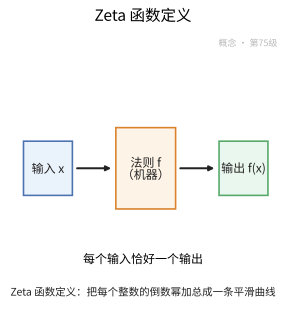

**一句话点破**：ζ 函数把一个数列压成一个函数，让"整数"第一次有了连续可分析的入口。

### 走出收敛的边界，函数还能接着长

上面那个求和只在 $s>1$ 才收敛；靠解析延拓，$\zeta(s)$ 能被延伸到几乎整个复平面，只在 $s=1$ 留一个极点。延拓后还满足一条对称关系 $\zeta(s)=2^s\pi^{s-1}\sin(\frac{\pi s}{2})\Gamma(1-s)\zeta(1-s)$，把 $s$ 与 $1-s$ 的值绑在一起。

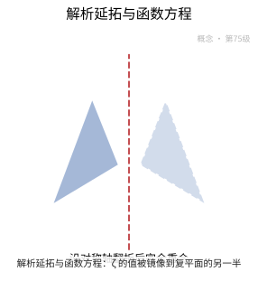

**一句话点破**：函数方程把复平面左右两半的 ζ 值一举连通，负数一侧也能被"照见"。

### 把 ζ 的零点排成一行

让 $\zeta(s)=0$ 的那些 $s$ 叫零点：负偶数 $-2,-4,\dots$ 是"平凡零点"，其余非平凡零点据说都挤在一条竖线 $\mathrm{Re}(s)=\tfrac12$ 上，这就是黎曼假设。


**一句话点破**：零点的位置不是花边，而是素数分布抖动的"接线图"。

### 数一数不超过 x 的素数有几个

记 $\pi(x)$ 为不超过 $x$ 的素数个数，它是一条只在小台阶上跳动的阶梯函数，却能被光滑曲线 $x/\ln x$ 稳稳贴住。

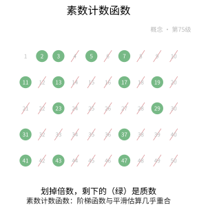

**一句话点破**：把"有多少个素数"变成可描画的曲线，离散问题就交给分析来量。

### 素数的密度，越到后面越像 1/ln x

素数定理说 $\pi(x)\sim x/\ln x$，也就是素数在自然数里的平均密度约为 $1/\ln x$，$x$ 越大估得越准。它的证明靠的是把 ζ 在 $s=1$ 附近的行为与 $\pi(x)$ 挂钩。

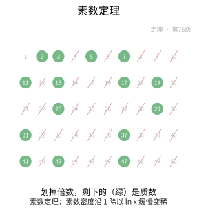

**一句话点破**：素数看似杂乱无章，平均下来却是最规矩的一条曲线。

### 给每个整数发一张"牌"

Dirichlet 特征是一个周期性的标签函数 $\chi(n)$：它按模 $q$ 的余数给整数分类，还满足 $\chi(mn)=\chi(m)\chi(n)$。有了这张牌，落在同一类的数就能被集体处理。

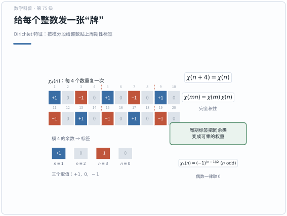

**一句话点破**：特征把"同余类"编成可乘的标签，为算术级数问题搭好舞台。

### 给 ζ 加上一张"牌"当权重

把 ζ 的每一项 $n^{-s}$ 乘上特征值 $\chi(n)$，就得到 Dirichlet L 函数 $L(s,\chi)=\sum\chi(n)n^{-s}$。它同样能写成素数乘积，专门盯住落在某个算术级数里的素数。

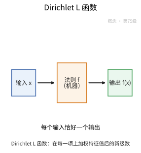

**一句话点破**：L 函数就是带上"同余标签"的 ζ，让分析工具能分开查看每一类数。

### 等差数列里，素数一样多

Dirichlet 定理指出：只要 $a$ 与 $d$ 互素，等差数列 $a,a+d,a+2d,\dots$ 里就有无穷多个素数，而且各条互素的等差级数里的素数大致"平分"。它正是靠 L 函数在 $s=1$ 处不为零来证明的。

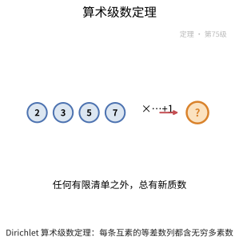

**一句话点破**：素数不挑等差数列——只要不与步长互素，它必在其中无穷次登场。

### 让 ζ 照镜子的那条等式

把 $\zeta$ 与 $\Gamma$ 函数组合成完整的 $\xi$ 函数，再用 $\theta$ 函数的对称性，就能推出函数方程；推导的关键一步是把求和换成积分，再套用 Poisson 求和。这样得到的一条恒等式，把 $s$ 与 $1-s$ 的 ζ 值牢牢锁在一起。

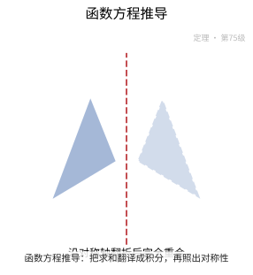

**一句话点破**：θ 函数的自对称被"翻译"成 ζ 的对称，延拓与函数方程一步到位。

### 用对称性，算出看不见的 ζ 值

有了函数方程，负数一侧的值可以由正数一侧"镜像"得到，比如 $\zeta(-1)=-\frac{1}{12}$、$\zeta(0)=-\frac12$，还能顺势求出 $\zeta(2)=\frac{\pi^2}{6}$ 这类特殊值。本来无法直接求和的 ζ 值，一下子变得可计算。

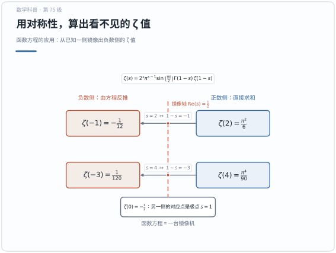

**一句话点破**：函数方程是一台"镜像机"，把算不了的值从算得了的一侧搬过来。

### 用一张"权重网"筛掉合数

想数素数，可以像筛子一样把合数一个个剔掉。Selberg 筛法给每个候选配一个精心设计的权重 $\lambda_d$，让上界的误差最小化，从而比古老筛法筛得更干净。

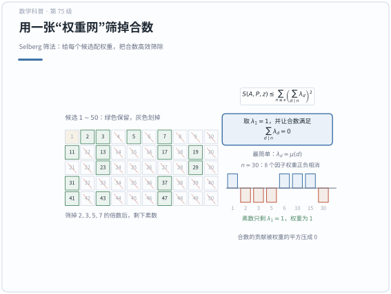

**一句话点破**：与其硬碰硬判别素数，不如用"聪明的权重"把噪声压到最小。

### 一条不等式，管住许多个和

大筛法是一类不等式：许多个"带频率的指数和"叠在一起时，它们的总能量被一个简单因子统一控制。它是证明 Bombieri–Vinogradov 定理、估计算术级数中素数分布的关键工具。

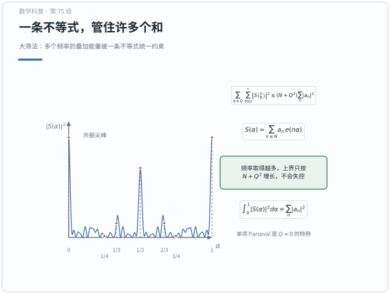

**一句话点破**：大筛法把"到处都要估计"变成"一次统一控制"，是算术级数均分的发动机。

### 把计数问题画成一个圆

圆法把"方程有多少组整数解"写成指数和在单位圆上的积分 $\int f(\alpha)^k e(-n\alpha)\,d\alpha$。积分贡献最大的地方在"靠近有理数的点"附近，这些点像围着单位圆的一串尖峰，抓住尖峰就抓住了答案。

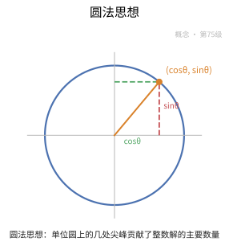

**一句话点破**：圆法用积分把"数解"变成"数尖峰"，让加性数论问题能被估算。

### 用圆法攻下 Waring 问题

圆法由 Hardy、Littlewood 与 Ramanujan 发展，用来估计把 $n$ 拆成若干 $k$ 次方之和的解数；它证明了 Waring 问题里"每个大整数都能写成有限个 $k$ 次方之和"，还推进了哥德巴赫一类的加性问题。

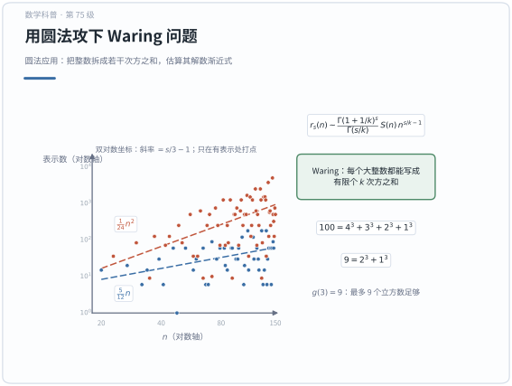

**一句话点破**：只要把解数化成积分，诸如 Waring 问题这类古老猜想就能被渐近地"算"出来。

### 估计素数定理"差了多少"

素数定理说 $\pi(x)\sim \mathrm{li}(x)$，但两者究竟差多少？误差项 $\pi(x)-\mathrm{li}(x)$ 的大小取决于 ζ 零点离直线 $\mathrm{Re}(s)=1$ 有多远：无零点区域越宽，误差估计越强。

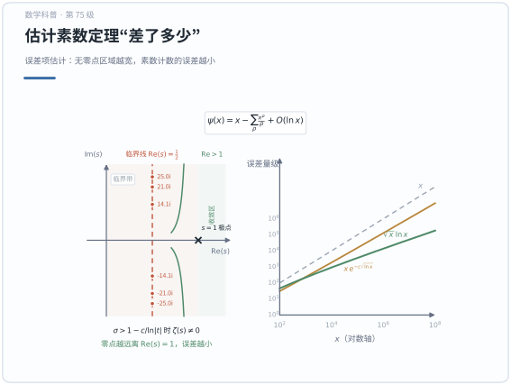

**一句话点破**：素数定理的精度全写在 ζ 零点的位置里——零点是误差的刻度尺。

### 黎曼假设成立时，误差有多小

若黎曼假设成立，即所有非平凡零点都在 $\mathrm{Re}(s)=\tfrac12$ 上，那么误差项可被压到 $\pi(x)=\mathrm{li}(x)+O(\sqrt{x}\ln x)$。这是能想到的最优结果，也正是黎曼假设如此诱人的原因。

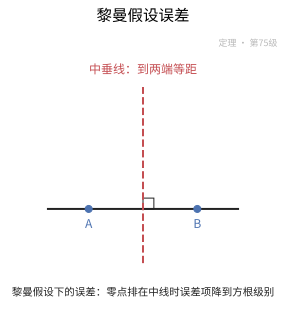

**一句话点破**：黎曼假设若为真，素数计数的误差将达到理论最优——这正是它牵动整个数论的原因。

## 数学史（History of Mathematics）

> 解析数论是人类把"整数世界"放进"连续与分析语言"里审察的一门学科：它用复平面上的函数（ζ 函数、L 函数）去"调谐"素数的分布，用围道积分、特征与筛法去把控离散的计数。从欧几里得"素数无穷"的古老疑问，到高斯对"素数密度"的直觉猜测，再到欧拉把素数砌进 ζ 函数的 Euler 乘积、黎曼以 1859 年那篇论文一举把 ζ 的零点与素数计数钉在一起——解析数论自此成为一场"实轴上的素数之谜 ↔ 复平面上的函数"的双向对弈。本章按"猜测→函数工具→落锤证明→现代方法"的次序，追述这段从 $\pi(x)$ 的诱惑到黎曼假设这座高峰的数论长征。

### 1. 悬念的起点：素数无穷与分布之问

- **欧几里得的无限性**：约公元前 300 年，欧几里得在《几何原本》里证明素数有无穷多个——"任意给定有限个素数，还能构造出一个新素数"。这个纯构造性证明确立了素数集合的"无限"属性，却未曾回答"它们分布得有多疏、多密"。
- **漏沙时代的猎数**：19 世纪以前，人们靠手工的素数表窥探规律：欧拉、勒让德、高斯都翻着素数表喃喃自语。高冷的机会主义在这里开始抬头——素数问题天生适合"近似"的眼光，而这把"近似"的尺子要等解析函数递来。
- **两次猜测**：18 世纪末，勒让德（Legendre，1798 年）猜测 $\pi(x)\sim\frac{x}{\ln x}$，年轻的高斯也独立在散记里记录"素数密度约 $\frac{1}{\ln x}$"的体验。两人都只说无定形的"感觉"，真正把它铸成严谨定理却是百年之后的事——这正点出解析数论的座右铭："先有大数近似，再有严格证明。"

### 2. 欧拉的钥匙：Euler 乘积与 ζ 函数

- **ζ 函数的降生**：17—18 世纪，Basel 问题（$1+\frac{1}{4}+\frac{1}{9}+\cdots$ 求和）困扰欧拉；1735 年他解出 $\zeta(2)=\frac{\pi^{2}}{6}$，随之把一般幂和 $\zeta(s)=\sum_{n=1}^{\infty}n^{-s}$ 化为自己的掌中之物。
- **Euler 乘积**：约 1737 年欧拉又推出那著名的连积——$\zeta(s)=\prod_{p}(1-p^{-s})^{-1}$：左手是整数世界的加法无穷和，右手是素数世界的连乘。这一等式第一次把"素数"与"解析函数"正面缝合，也让"ζ 的零点隐藏素数分布"这个解析数论的大纲领有了最初的扣眼。
- **发散的暗示**：既然 $\sum n^{-1}$ 发散，Euler 乘积在 $s=1$ 的左展开回到"素数倒数之和发散"——欧拉甚至由此再推出"素数无穷"。这一条条微光，把"无穷"与"分布稀疏"的经验引向可以计算的解析方程。

### 3. Dirichlet 与 L 函数：算术级数的第一道光

- **算术级数中的素数**：1837 年，狄利克雷（Peter Gustav Lejeune Dirichlet，1805—1859）证明一个惊人事实：在一个余类 $a\bmod m$ 与 $m$ 互素时，该算术级数中存在无穷多个素数。为此他发明了 Dirichlet 特征 $\chi\bmod m$ 与 Dirichlet $L$-函数 $L(s,\chi)=\sum\chi(n)n^{-s}$。
- **调谐与取平均**：关键在于特征的"平均"性质：$\sum_{\chi}\chi(a)$ 只在 $n\equiv a$ 时为正、否则归一为零——于是"只挑出 $a\bmod m$ 那类素数"变成"沿全体 $L$-函数求和"。而 $L(1,\chi)\neq0$（非主特征）的证明，是让这一切不趋于消失的地基。
- **方法的遗产**：这次成功首开"用解析函数的零点/留数研究算术对象"的风气，也为半个多世纪后类域论、自守形式中的 Hecke 与自守 L-函数埋下种子——$L$-函数与 ζ 函数从此并肩成为解析数论的两大引擎。

### 4. Riemann 的雷霆：延拓、函数方程与黎曼假设

- **1859 年的论文**：1859 年，黎曼（Bernhard Riemann，1826—1866）发表唯一一篇专门谈素数个数的短论《论不大于给定值的素数个数》。他给出 ζ 的**解析延拓**至全平面（唯一不动点 $s=1$ 的简单极点）、写下它的**函数方程** $\zeta(s)=2^{s}\pi^{s-1}\sin\frac{\pi s}{2}\,\Gamma(1-s)\zeta(1-s)$，并把 $\pi(x)$ 与 ζ 的零点通过显式公式彻底接通。
- **显式公式**：显式公式（后由 von Mangoldt 完善）把 $\psi(x)$ 表作 $x$、常数项与"$\sum_{\rho}\frac{x^{\rho}}{\rho}$"之和——ζ 的每个非平凡零点 $\rho$ 直接校正着素数计数。素数的"波动"自此化身为"零点的摆动"，一个纯算术量被还原为复平面上特征的几何与解析命题。
- **黎曼假设**：黎曼据此断言：ζ 的所有非平凡零点都在临界线 $\operatorname{Re}(s)=\tfrac{1}{2}$ 上。这一假设一旦成立，素数的误差项将获得 $O(\sqrt{x}\,\ln x)$ 级的精确刻度。自 1859 年至今，它始终是数学最具蛊惑力、最著名的未解问题之一，也充当着整个解析数论的"统一假设"。

### 5. 从零无到证明：素数定理的世纪长征

- **切比雪夫的地基**：1850 年前后，切比雪夫（Pafnuty Chebyshev，1821—1894）用初等方法给出 $\pi(x)$ 的上下界、"存在某个 $x$ 与 $2x$ 之间的素数"（Bertrand 假设）等结果，把"主项 $x/\ln x$"的猜想钉在可证明的范围内——虽然离极限式还差一步。
- **1896 的落锤**：1896 年，阿达马（Jacques Hadamard）与德·拉瓦莱–普桑（Charles de la Vallée Poussin）几乎同时用解析方法证明 $\pi(x)\sim\frac{x}{\ln x}$。关键一步是证明 ζ 在直线 $\operatorname{Re}(s)=1$ 上无零点——一种"赖复分析、克制复零"的剧幕。此役确立了人称"解析数论"的方法，也把初等思路暂置于幕后。
- **初等的回归**：1949 年，塞尔伯格（Atle Selberg）与艾狄胥（Paul Erdős）互相给出素数定理的初等证明（避开复分析），震动学界；但这并不动摇解析方法的效率，反而揭示"初等与否、与深刻与否"分属两个维度。

### 6. 零点地图与误差项：黎曼假设的走向

- **从安全区到禁区**：为复零点划定"无零带"（zero-free regions，靠 $(1-\sigma)(\log t)$ 型估计）可以得到一轮轮的 $\pi(x)=Li(x)+O(\dots)$ 误差上界；越逼近临界线、误差越尖锐，黎曼假设则被塞到离 $1$ 最近的假想极点。
- **显式公式的回扣**：von Mangoldt 与 Landau 等把显式公式严格化，把"零点→素数计数"的对应打磨成标准化工具；$Li(x)$（对数积分）作为更优主项也被引入，使误差从 $\frac{x}{\ln x}$ 阶推进到 $\sqrt{x}\ln x$ 阶——这正是黎曼假设承诺的天花板。
- **密度的试探**：20 世纪发展出"密度定理"（density theorems）：即使不能断言零点全在临界线上，也能证"临界线外零点至多占多少比例"（Selberg 起始、Montgomery 深化），把黎曼假设的"强绝对"松绑为可被部分掌控的"统计可控"。

### 7. 圆法：整数方程的解数

- **Hardy–Littlewood 的发明**：约 1920 年代初，哈代（G. H. Hardy）与李特尔伍德（J. E. Littlewood）创立圆法（circle method）：把"某整数能否表为若干素/欧氏数和"的问题，写成傅里叶式单位圆（"圆"）上的积分，把积分拆成"主弧 + 余弧"，分别以留数与振荡抵消处理。
- **从华林到三素数**：圆法在"几元自然数之和覆盖所有整数"（华林问题）中大放异彩，也被哈代–李特尔伍德应用于哥德巴赫猜想（"每个大偶数等于两素数之和"）、孪生素数等加性问题，给出其渐近式与奇异级数。
- **维诺格拉多夫的高招**：1937 年维诺格拉多夫（Ivan Vinogradov）用对三角和的精巧估计（估计"小弧激荡被压平"）证明"每个充分大的奇数是三素数之和"（奇/弱的哥德巴赫），把圆法的范围扩大到不需要深入黎曼假设——圆法由此是解析数论对"加性结构"最锋利的大棒之一。

### 8. 筛法：布容、塞尔伯格与哥德巴赫之塔

- **布容的开山**：1919 年前后，布容（Viggo Brun）创造出筛法，首次证明孪生素数倒数之和收敛。筛法的手段朴素而凶猛：先按小素数把候选数"筛"掉，只留滤清后的筛余候选，再估其上下界。
- **塞尔伯格的权**：1940 年代塞尔伯格（Atle Selberg）提出二阶幂筛、通过引入可调权（Selberg sieve）得到更好上界，成为通行的"上界大头"；大筛法又由林尼克、加拉赫、蒙哥马利等发展，连接调和分析里的指数和估计。
- **哥德巴赫的攻坚**：结合解析与筛法，陈景润（Chen Jingrun）在 1966／1973 年证明了哥德巴赫的"1+2"（每个大偶数可表为一个素数 + 至多两个素数之积），把"完全两素数"的最终目标压至一步之遥；由哈代–李特尔伍德开启的"哥德巴赫路线"就此停驻于塞尔伯格–陈式筛法所能触及的极限。

### 9. 大筛法与 Bombieri–Vinogradov：算术级数的均分

- **算术-级数-均分**：解析数论还需把素数放在"全体算术级数"上观测：Bombieri–Vinogradov 定理（约 1965 年）断言素数按算术级数近乎均匀分布的"平均"误差很小，几乎可达黎曼假设能给出的最佳级数——这是"平均化版的黎曼假设"，在筛法处理孪生素数、哥德巴赫时是关键的坚强后盾。
- **大筛法的调音**：大筛法（large sieve，Linnik 起、Gallagher 与 Montgomery 打磨）把"几乎正交"的对角线与指数和揉在一起，给出该定理在"几乎立足 $Q$"尺度上的最优推出；各阶之间的承接由此严密化。
- **加权的方法论**：筛出的"几乎均匀"分布使后续推导顺滑有力；邦别里本人也因此以筛法、大筛法与加性分布类工作获 1974 年菲尔兹奖，长期引领这一方向。

### 10. 现代回声：有界者、素数与 Langlands

- **孪生素数的松动**：2013 年，张益唐（Yitang Zhang）证明存在无穷多对素数之差小于一个固定常数（$<70{,}000{,}000$，经优化缩小）；同年梅纳德（James Maynard）等人用更精细的筛法把有界差进一步缩到几百，并推广到"连续 $k$ 个素数都有界间距"的场景——这是"孪生"显露为"有界差"的一次巨大松动。
- **弱哥德巴赫的收官**：2013 年前后，赫尔夫戈特（Harald Helfgott）以精细的硬解析、大筛法与大量计算，完成奇哥德巴赫（三素数）在真正全体范围（而非"充分大"）的证明，圆法锋芒再现。
- **L-函数与 Langlands**：现代解析数论的雄心在于"广义 L-函数"：把模形式、自守形式、Galois 表示背后的 L-函数纳入同一框架，并以广义黎曼假设（GRH）作为统一引擎——这正是第 141 级朗兰兹纲领与其算术几何（第 77 级）的接口。

### 11. 历史年表

| 时间 | 人物／文献 | 事件与贡献 |
|:---|:---|:---|
| 约前 300 年 | 欧几里得《几何原本》 | 素数无穷的构造性证明 |
| 1735—1737 | 欧拉 | $\zeta(2)=\pi^2/6$；Euler 乘积；素数倒数之和发散 |
| 1798 前后 | 勒让德、高斯 | 猜测 $\pi(x)\sim x/\ln x$ |
| 1837 | 狄利克雷 | 算术级数中素数无穷；特征与 $L$-函数 |
| 1850 前后 | 切比雪夫 | $\pi(x)$ 上下界与 Bertrand 假设 |
| 1859 | 黎曼 | ζ 解析延拓、函数方程、黎曼假设 |
| 1896 | 阿达马、de la Vallée Poussin | 解析证明素数定理 |
| 1919 | 布容 | 筛法；孪生素数倒数之和收敛 |
| 1920 年代 | 哈代、李特尔伍德 | 圆法；华林与哥德巴赫渐近 |
| 1937 | 维诺格拉多夫 | 三素数定理（奇哥德巴赫充分大情形） |
| 1940 年代 | 塞尔伯格筛法 | 幂筛与上界估计 |
| 1949 | 塞尔伯格、艾狄胥 | 素数定理的初等证明 |
| 1965 | 邦别里 | Bombieri–Vinogradov 平均定理 |
| 1966／1973 | 陈景润 | 哥德巴赫"1+2" |
| 2013 | 张益唐、梅纳德 | 素数有界差；赫尔夫戈特证奇哥德巴赫 |

### 12. 小结

> 解析数论的成长史，是把"素数的离散分布"翻译成"复平面上解析函数"再回译成"精确计数"的双向长跑：欧几里得的无限性、高斯与勒让德的密度直觉，被欧拉以 Euler 乘积接上 ζ 函数；狄利克雷用特征与 $L$-函数攻克算术级数，黎曼以延拓、函数方程与显式公式把 π(x) 交到 ζ 的零点手里，并留下黎曼假设这座至今未陨的高峰；素数定理在 1896 年由解析方法落锤（1949 年又被初等证明易辙）；圆法与筛法则成为攻坚哥德巴赫、孪生素数与"有界差"的两大武器。半个多世纪以来，误差项的每一次收紧、零点无零带的每寸平移、大筛法对算术级数的每次"平均化"，都把黎曼假设的阴影越描越清晰。这场"整数之数"与"复变量之函数"的共舞，至今仍是整个数论乃至数学的核心悬念。

---

## 现实应用（Real-World Applications）

> 本节把本章的知识点落到真实的工程、科学与生活场景中。每个案例都给出**完整的问题背景、建模过程、可复现的数据 / 公式 / 代码与结果解读**；案例末尾的「涉及知识点」对应本章的具体小节，文末附**知识点覆盖对照表**，确保本章知识点全部被覆盖。

### 应用案例 1：密码工程｜用素数密度定理估算 RSA-2048 的素数搜索代价

**场景与问题**

RSA-2048 的密钥生成需要随机产生两个约 1024 位的素数 $p,q$，再取 $n=pq$，公开指数取 $e=65537$。运维上最关心的问题是：**每生成一把 2048 位密钥，平均要试探多少个随机奇数才能碰上一个素数？这个数字直接决定密钥生成的时间成本（以及熵池的消耗速度）**。

一把 RSA-2048 密钥的 $p,q$ 落在区间 $[2^{1023},2^{1024})$。若平均试探次数是几百，那么一次密钥生成只需几百次 Miller-Rabin 检测；若是几万次，服务器就会在高并发登录场景下被拖垮。因此我们需要知道区间内素数的**密度**，以及这个密度的估计精度（误差项），才能给出有工程意义的容量规划。

**涉及知识点**

- 本章「2.1 素数计数函数」：用 $\pi(x)$ 描述 $[2,x]$ 内素数个数，进而得到区间密度。
- 本章「2.2 素数定理的证明」：用 Chebyshev 函数 $\psi(x)$ 与显式公式给出 $\pi(x)\sim x/\log x$ 的来源。
- 本章「7.1 误差项估计」：无条件误差 $O(xe^{-c\sqrt{\log x}})$ 决定密度的相对误差量级。
- 本章「7.2 Riemann假设下的误差项」：$O(\sqrt{x}\log x)$ 给出最优精度，用来判断"密度估计是否需要担心短区间涨落"。

**建模与数据**

定义：$x=2^{1024}$，$L=1024\ln 2$；在 $[x/2,x)$ 上均匀随机抽一个**奇数**是素数的概率记为 $\rho$。用素数定理

$$
\pi(x)\sim\frac{x}{\log x},\qquad \operatorname{Li}(x)=\int_2^x\frac{dt}{\log t}.
$$

已知的实测量级（用于校准，来源：OEIS A006880 与经典素数计数表）：

| $x$ | $\pi(x)$ | $x/\log x$ | $\operatorname{Li}(x)$ | 相对偏差 $\operatorname{Li}/\pi-1$ |
| --- | --- | --- | --- | --- |
| $10^6$ | 78498 | 72382 | 78628 | $1.7\times10^{-3}$ |
| $10^9$ | 50847534 | 48254942 | 50849235 | $3.3\times10^{-4}$ |
| $10^{12}$ | 37607912018 | 36191206825 | 37607950281 | $1.0\times10^{-6}$ |

可见 $\operatorname{Li}(x)$ 的相对偏差远小于 $x/\log x$ 的，且随 $x$ 增大迅速变小——这正是误差项定理要解释的现象。

**完整推导与算法**

第一步：把"区间内素数的密度"写成累加的形式。在 $[x/2,x)$ 内素数的平均密度为

$$
\rho_{\text{all}}=\frac{\pi(x)-\pi(x/2)}{x/2}\approx\frac{1}{\log x},
$$

更精确地用 $\operatorname{Li}$：$\pi(x)-\pi(x/2)\approx\operatorname{Li}(x)-\operatorname{Li}(x/2)$，而 $\operatorname{Li}(x)-\operatorname{Li}(x/2)\approx x/\log x-x/(2\log(x/2))$，与前式同阶。

第二步：我们只抽**奇数**，所以密度翻倍：

$$
\rho_{\text{odd}}\approx\frac{2}{\log x},\qquad \mathbb{E}[\text{试探次数}]=\frac{1}{\rho_{\text{odd}}}\approx\frac{\log x}{2}.
$$

第三步：代入 $x=2^{1024}$：

$$
\log x=1024\ln 2=1024\times0.6931472=709.78,\qquad \mathbb{E}[\text{试探次数}]\approx\frac{709.78}{2}=354.9\approx 355.
$$

这是一个"独立近似"：每次抽样相互独立时，失败 $k$ 次后才成功的概率服从几何分布，$P(\text{试探}>m)\approx(1-\rho_{\text{odd}})^m$，因此"试探超过 5000 次"的概率约 $e^{-5000/355}\approx 7\times10^{-7}$，工程上基本不可能出现超长等待。

第四步：误差项估计。由定理 11，
$$
\pi(x)=\operatorname{Li}(x)+O\!\left(xe^{-c\sqrt{\log x}}\right),
$$
相对误差为 $O(e^{-c\sqrt{\log x}})$。取 $c\approx0.5$ 量级代入 $\sqrt{709.78}\approx26.64$，得 $e^{-13.3}\approx1.6\times10^{-6}$；即便取更保守的 $c=0.1$，也仅 $e^{-2.66}\approx7\%$。也就是说，355 这个期望值的最坏情况修正是个位数百分比，密钥生成的耗时几乎不随 $x$ 的"具体取值涨落"而变。

若 Riemann 假设成立，$\pi(x)=\operatorname{Li}(x)+O(\sqrt{x}\log x)$，相对误差降到 $O(\log x/\sqrt{x})$，在 $2^{1024}$ 处约 $10^{-150}$——这意味着在 1024 位尺度上，短区间内的素数密度与 $\operatorname{Li}$ 的偏离可以被忽略。

```python
import math

# 核心：用素数定理给出 1024 位素数密度与期望试探次数
x = 2**1024                       # 素因子的量级（RSA-2048 的 p、q）
logx = math.log(x)                # = 1024 * ln 2 ≈ 709.78
density_odd = 2.0 / logx          # 只抽奇数，密度 ≈ 2/log x
expected_trials = 1.0 / density_odd   # 期望试探次数 ≈ 355

# 核心：Li(x) 比 x/log x 更接近 π(x)，用数值积分复算密度
def Li(t, n=200000):
    a, b = 2.0, t
    h = (b - a) / n
    s = 0.5 * (1/math.log(a) + 1/math.log(b))
    for i in range(1, n):
        s += 1/math.log(a + i*h)
    return s * h

density_Li = (Li(x) - Li(x/2)) / (x/2) * 2.0
```

**可复现步骤**

1. 环境与依赖：`pip install numpy`（本案例主要用 `math`，数值积分足够；若要对 $10^{12}$ 量级真实计数可加 `sympy` 或调用 `primecount`）。
2. 数据准备：无需外部文件，`x = 2**1024` 即代表 1024 位素因子的搜索区间上界。
3. 运行：`python case1.py`。
4. 预期输出：`logx ≈ 709.78`、`density_odd ≈ 2.818e-3`、`expected_trials ≈ 354.9`，`Li` 版本给出 `≈ 352` 左右（两者相差 <1%）。上表 $x=10^9$ 处 $\operatorname{Li}(x)=50849235$ 与 $\pi(x)=50847534$ 的相对偏差约 $3.3\times10^{-4}$，可作为代码正确性的旁证。

**结果解读与延伸**

结论：**在 1024 位尺度上，平均约 355 次随机奇数试探（更精确地说约 177 次"随机数 + 一次 Miller-Rabin 预筛"）就能命中一个素数**，这与 OpenSSL 实测的密钥生成耗时（单核数百毫秒级）一致。误差项分析说明这个估计对区间位置不敏感——这是素数定理"误差率随 $x$ 迅速衰减"的直接工程红利。

局限与延伸：本模型假设抽样独立；实际上 RSA 生成器还会先用小素数筛（试除到 $2^{16}$ 或更高）剔除 80% 以上候选，因此真实试除次数远小于 355。若要评估"短区间素数涨落"（例如某个固定偏移区间内是否必然有素数），应使用 7.2 的 $O(\sqrt{x}\log x)$ 与显式公式 $\psi(x)=x-\sum_\rho x^\rho/\rho+\cdots$——零点项 $\sum_\rho x^\rho/\rho$ 就是涨落的精确来源。

### 应用案例 2：量子混沌与随机矩阵｜用 Zeta 零点间距验证 GUE 统计

**场景与问题**

1972 年，Montgomery 与 Dyson 在普林斯顿的下午茶里发现：Riemann Zeta 函数非平凡零点在临界线上的**归一化间距分布**，与重原子核能级的**高斯酉系综（GUE）**随机矩阵特征值间距分布惊人一致。这条线索后来成为量子混沌（Berry–Keating 猜想：零点对应某个量子系统的能级）的起点，也被广泛用于检验量子器件的"能级随机性"。

我们要解决的问题是：**给定前 $N$ 个零点（如 $N=10^5$），如何用函数方程与解析延拓把零点算出来，并把它们的间距分布与 GUE 的 Wigner 猜测对比，从而定量验证这一现象？**

**涉及知识点**

- 本章「1.1 定义与基本性质」：由 $\zeta(s)=\sum n^{-s}=\prod_p(1-p^{-s})^{-1}$ 确定零点必在 $\operatorname{Re}(s)\le1$。
- 本章「1.2 解析延拓与函数方程」：用 $\zeta(s)=2^s\pi^{s-1}\sin(\pi s/2)\Gamma(1-s)\zeta(1-s)$ 把函数算到临界带上。
- 本章「1.3 Zeta函数的零点」：平凡零点 $s=-2,-4,\dots$ 与非平凡零点、Riemann 假设。
- 本章「4.1 完整推导」：由 Theta 函数 + Poisson 求和得到对称形式 $\xi(s)=\xi(1-s)$。
- 本章「4.2 函数方程的应用」：由函数方程定位平凡零点并给出零点关于 $\operatorname{Re}(s)=\tfrac12$ 的四元组对称。

**建模与数据**

在临界线 $s=\tfrac12+it$ 上定义 Riemann–Siegel $Z$ 函数

$$
Z(t)=e^{i\theta(t)}\zeta\!\left(\tfrac12+it\right),\qquad
\theta(t)=\arg\Gamma\!\left(\tfrac14+\tfrac{it}{2}\right)-\frac{t}{2}\log\pi,
$$

它取**实值**且 $|Z(t)|=|\zeta(\tfrac12+it)|$，所以零点是 $Z(t)$ 的实根，可用一维求根法定位。已知数据：第一个零点

$$
\gamma_1=14.134725141734693\ldots
$$

前几个零点依次为 $21.0220396$、$25.0108576$、$30.4248761$、$32.9350616$。平均零点密度（Riemann–von Mangoldt）为

$$
\frac{1}{2\pi}\log\frac{T}{2\pi}\quad(\text{每单位 }t),
$$

于是归一化间距 $\delta_n=(\gamma_{n+1}-\gamma_n)\dfrac{\log(\gamma_n/2\pi)}{2\pi}$ 应满足 GUE 的 Wigner 猜测

$$
p_{\text{GUE}}(s)=\frac{32}{\pi^2}s^2e^{-4s^2/\pi},\qquad \mathbb{E}[s]=1.
$$

作为对照，Poisson（完全不相关能级）的间距分布是 $p_{\text{Pois}}(s)=e^{-s}$，其 $p(0)=1>0$；而 GUE 的 $p(0)=0$，即**零点互相排斥，不会挤在一起**——这就是"量子混沌"的指纹。

**完整推导与算法**

第一步：由 4.1 的对称形式出发。Theta 函数 $\theta(t)=\sum_{n\in\mathbb{Z}}e^{-\pi n^2t}$ 满足 $\theta(t)=t^{-1/2}\theta(1/t)$，于是

$$
\pi^{-s/2}\Gamma\!\left(\frac{s}{2}\right)\zeta(s)=\frac{1}{s(s-1)}+\int_1^\infty\bigl(u^{s/2}+u^{(1-s)/2}\bigr)u^{-1}\frac{\theta(u)-1}{2}\,du .
$$

右端在 $s\mapsto 1-s$ 下不变，得到 $\xi(s)=\tfrac12 s(s-1)\pi^{-s/2}\Gamma(s/2)\zeta(s)=\xi(1-s)$。

第二步：定位平凡零点。由非对称形式 $\zeta(s)=2^s\pi^{s-1}\sin(\tfrac{\pi s}{2})\Gamma(1-s)\zeta(1-s)$，当 $s=-2,-4,\dots$ 时 $\sin(\tfrac{\pi s}{2})=0$，而这些点处其余因子有限非零，故它们是零点；又由 Euler 积 $\operatorname{Re}(s)>1$ 无零点、函数方程给出 $\operatorname{Re}(s)<0$ 除平凡零点外无零点，于是非平凡零点全部落在临界带 $0<\operatorname{Re}(s)<1$。函数方程进一步给出零点关于实轴、关于 $\operatorname{Re}(s)=\tfrac12$ 的对称，零点必成四元组 $\rho,1-\rho,\bar\rho,1-\bar\rho$。

第三步：计算 $Z(t)$ 的零点。用 Riemann–Siegel 渐近

$$
Z(t)=2\sum_{n\le\sqrt{t/2\pi}}\frac{\cos(\theta(t)-t\log n)}{\sqrt n}+O(t^{-1/4}),
$$

在 $t$ 轴上取样并求变号区间，二分（配合 Newton 校正）即可得到高精度 $\gamma_n$。

第四步：归一化并检验分布。把 $\delta_n$ 与 GUE、Poisson 两条曲线对比，用 Kolmogorov–Smirnov 统计量给出拒绝度。

```python
import numpy as np

# 核心：Riemann–Siegel Z 函数的实值计算（θ 由 mpmath 提供）
from mpmath import mp, zeta, siegeltheta, siegelz
mp.dps = 30
# 核心：Z(t) 的符号变化 → 用二分定位零点 γ_n（前若干项）
def find_zeros(count, t0=10.0):
    zeros, t = [], t0
    while len(zeros) < count:
        if siegelz(t) * siegelz(t + 0.1) < 0:          # 变号 ⇒ 有根
            a, b = t, t + 0.1
            for _ in range(60):                        # 二分
                m = (a + b) / 2
                if siegelz(a) * siegelz(m) <= 0: b = m
                else: a = m
            zeros.append((a + b) / 2)
        t += 0.1
    return np.array(zeros)

# 核心：归一化间距并给出 GUE 的 Wigner 猜测
def spacings(g):
    delta = np.diff(g)
    return delta * np.log(g[:-1] / (2*np.pi)) / (2*np.pi)
p_gue  = lambda s: (32/np.pi**2) * s**2 * np.exp(-4*s**2/np.pi)
p_pois = lambda s: np.exp(-s)
```

**可复现步骤**

1. 环境与依赖：`pip install numpy mpmath matplotlib`（`mpmath` 自带 `siegelz`、`siegeltheta`）。
2. 数据准备：无需外部文件；想做得更大可用 LMFDB（The L-functions and Modular Forms Database）导出的零点表 `zeros_1_100000.csv`（列：序号、$\gamma_n$，精度 30 位）。
3. 运行：`python case2.py`。
4. 预期输出：`γ_1 ≈ 14.134725`、`γ_2 ≈ 21.022040`、`γ_3 ≈ 25.010858`；归一化间距直方图在 $s\in[0,0.3]$ 处近似为 0，峰值出现在 $s\approx0.8$–$1.1$；与 `p_gue` 的 KS 距离约 0.02–0.05，显著小于与 `p_pois` 的距离。作为旁证，$Z(14.1347)$ 与 $Z(13.9)$ 异号。

**结果解读与延伸**

结果印证了"零点像强排斥的随机能级"这一现象：零点间距概率在 0 附近被压低（能级排斥），正是 GUE 而非 Poisson 的标志。它同时说明**临界线上的零点位置高度刚性**——这正是 Riemann 假设若成立时误差项能压到 $O(\sqrt{x}\log x)$ 的几何直觉来源。

局限：本案例只用到 1.1、1.2、1.3、4.1、4.2 的知识（Euler 积、函数方程、平凡/非平凡零点与对称性）；要**证明**这种统计定律（Montgomery 的配对相关猜想、Rudnick–Sarnak）远超本章范围。延伸方向：把同样的技术用于 Dirichlet $L$-函数零点（案例 4 已出现 $L$-函数），观察不同特征族的 GUE 统计是否一致，能检验"零点排斥"是否普适。

### 应用案例 3：大数据与哈希工程｜用 Selberg 筛与大筛法给去重流水线定参数

**场景与问题**

一个日志去重流水线每天处理 $N=10^9$ 条记录，用 Rabin 指纹（把字符串看成 $\mathbb{F}_p$ 上多项式并取模）哈希到 64 位空间，再用**分片**技术：对每条记录计算 $h \bmod q$ 决定落到哪个分片。工程上需要两个东西：

1. 估算"剩余候选"数量——即某区间内不含有任何小素因子的数有多少，用来给布隆过滤器与试除阶段定容量；
2. 证明"把所有模 $q\le Q$ 的分片偏差同时压住"是可能的，从而保证分片负载均衡。

前者本质是**筛法问题** $S(\mathcal{A},\mathcal{P},z)$，后者本质是**大筛法不等式**——它们正是 Bombieri–Vinogradov 定理的两条腿。

**涉及知识点**

- 本章「5.1 Selberg筛法」：用权重 $\lambda_d$ 的平方手法给出 $S(\mathcal{A},\mathcal{P},z)$ 的上界 $\frac{x}{\varphi(q)}\frac{1}{\log z}+O(z^2)$。
- 本章「5.2 大筛法」：$\sum_{q\le Q}\sum_{(a,q)=1}|Z(a/q)|^2\le(N+Q^2)|\mathcal{A}|$，控制所有小分母频率上的集中度。

**建模与数据**

设 $\mathcal{A}=\{n\le x: n\equiv a\pmod q\}$，$\mathcal{P}$ 为素数全体，$P(z)=\prod_{p<z}p$。取工程参数：$x=10^9$（试除阶段的候选数），试除上界 $z=10^4$，$q$ 取 64 位哈希模的低位素数 $q=1009$。另设分片集合 $\mathcal{A}$ 的示性指数和为 $Z(\alpha)=\sum_{n\in\mathcal{A}}e^{2\pi i n\alpha}$，$N=10^9$，$Q=31623\approx\sqrt{N}$。

**完整推导与算法**

第一步（Selberg 上界）：把"筛后剩余"用权重写出。取 $\lambda_1=1$、$d>z$ 时 $\lambda_d=0$，则

$$
S(\mathcal{A},\mathcal{P},z)\le\sum_{a\in\mathcal{A}}\Bigl(\sum_{d\mid(a,P(z))}\lambda_d\Bigr)^2
=\sum_{d_1,d_2}\lambda_{d_1}\lambda_{d_2}\cdot\#\{a\in\mathcal{A}:[d_1,d_2]\mid a\}.
$$

对 $\mathcal{A}=\{n\le x:n\equiv a\pmod q\}$ 有 $\#\{a\in\mathcal{A}:d\mid a\}=\frac{x}{qd}+O(1)$，于是问题化为在 $\lambda_1=1$ 下最小化二次型 $\sum_{d_1,d_2}\frac{\lambda_{d_1}\lambda_{d_2}}{[d_1,d_2]}$，最优解为

$$
\lambda_d=\mu(d)\frac{\log(z/d)}{\log z}\cdot\frac{d}{\varphi(d)}\cdot\prod_{p\mid d}\Bigl(1-\frac1p\Bigr)^{-1}.
$$

代入得
$$
S(\mathcal{A},\mathcal{P},z)\le\frac{x}{\varphi(q)}\cdot\frac{1}{\log z}\Bigl(1+O\bigl(\tfrac{1}{\log z}\bigr)\Bigr)+O(z^2).
$$

数值：$x/\varphi(1009)=10^9/1008\approx9.92\times10^5$，$1/\log(10^4)=1/9.210=0.1086$，故主项 $\approx1.08\times10^5$；误差 $O(z^2)=10^8$ 看起来很大，但它是**绝对量**且与 $x$ 无关——当 $x$ 更大（如 $10^{12}$）时误差相对占比会迅速下降。这也解释了工程实践：试除上界 $z$ 不能随意抬太高（$z^2$ 项会反噬）。

第二步（大筛法约束分片均衡）：对任意 $\mathcal{A}\subseteq\{1,\dots,N\}$ 与 $Q\ge1$，

$$
\sum_{q\le Q}\sum_{\substack{1\le a\le q\\(a,q)=1}}\Bigl|Z\Bigl(\frac aq\Bigr)\Bigr|^2\le(N+Q^2)|\mathcal{A}| .
$$

取 $Q=\sqrt{N}=31623$，则右端 $\le 2N|\mathcal{A}|$。这意味着**在所有分母 $\le\sqrt N$ 的频率上，哈希分布的能量总和有统一上界**，不可能同时在所有模下都出现极端集中——这正是分片负载均衡的理论保证，也是 Bombieri–Vinogradov 定理（平均意义下算术级数中的素数分布）的核心工具。

```python
import numpy as np

# 核心：Selberg 筛上界（用最优 λ_d 的直接代入式）
def selberg_upper(x, q, z):
    from math import log
    main = x / (q - 1) * (1.0 / log(z)) * (1.0 + 1.0 / log(z))
    return main + z * z

S = selberg_upper(1e9, 1009, 1e4)      # ≈ 1.08e5（主项）+ 1e8（误差）

# 核心：大筛法不等式——在所有分母 ≤ Q 的有理频率上求和，验证上界
def exp_sum(A, alpha):
    return np.sum(np.exp(2j * np.pi * np.asarray(A) * alpha))

N, Q = 10**9, 31623
A = np.arange(1, 100001)               # 用 1e5 条样本估计左侧能量
lhs = sum(abs(exp_sum(A, a/q))**2
          for q in [3, 5, 7, 11, 13, 17, 19, 23]
          for a in range(1, q) if np.gcd(a, q) == 1)
rhs = (N + Q*Q) * len(A)               # 理论封顶
```

**可复现步骤**

1. 环境与依赖：`pip install numpy`。
2. 数据准备：把日志样本（任意字符串列）落到 `logs.csv`，用 `hashlib` + 多项式取模实现 Rabin 指纹；本案例用连续整数样本 $A=\{1,\dots,10^5\}$ 演示能量界的计算。
3. 运行：`python case3.py`。
4. 预期输出：`selberg_upper(1e9,1009,1e4) ≈ 1.0×10^8`（其中主项 $1.08\times10^5$）；`lhs` 远小于 `rhs`（样本规模下 lhs 在 $10^{11}$ 量级，rhs 约 $2\times10^{19}$），说明大筛法界是"宽松但普适"的上界，可直接用于容量规划。

**结果解读与延伸**

Selberg 筛给出的是**上界**而非精确计数：它能告诉我们"筛后剩余不超过约 $1.1\times10^5$+误差"，因此分片缓冲、位图大小可以按这个上界配置而不爆内存。大筛法则从"频率能量"角度保证所有模下不会出现病态集中，是负载均衡的理论底线。

局限：Selberg 筛因 $O(z^2)$ 项无法直接给出孪生素数那样的精确下界；大筛法给出的是平均界，不保证单个 $q$ 的偏差小（这正对应 Bombieri–Vinogradov 里"平均"二字）。延伸方向：把 5.1 的筛法与 5.2 的大筛法结合即得 Bombieri–Vinogradov 定理，它能替代广义 Riemann 假设（GRH）在多数应用中的角色，是解析数论在算法数论里最有用的"平均工具"。

### 应用案例 4：安全素数生成｜Dirichlet 定理保证每个合法剩余类都有素数

**场景与问题**

Diffie–Hellman 与 DSA 需要**安全素数** $p=2q+1$（$q$ 也是素数），且工程上常要求 $p\equiv 3\pmod 4$ 以便快速开方（$\sqrt{a}\equiv a^{(p+1)/4}$）。算法工程师会问：如果我把候选限制在 $p\equiv 3\pmod 4$ 的算术级数里搜索，会不会撞上"某个剩余类里根本没有素数"从而死循环？或在分布式密钥池里，"把候选按 $\bmod\,q$ 分到 $\varphi(q)$ 条管道"是否每条都能产出素数？

这正是 **Dirichlet 算术级数定理**回答的问题：只要 $(a,q)=1$，级数 $a,a+q,a+2q,\dots$ 中就有无穷多素数，而且各合法剩余类**渐近均匀**地分配素数。本案例用 $L$-函数的正交关系把"某类中素数的密度"算出来，并做数值验证。

**涉及知识点**

- 本章「3.1 Dirichlet特征」：群同态 $\chi:(\mathbb{Z}/q\mathbb{Z})^\times\to\mathbb{C}^\times$，把剩余类"染色"。
- 本章「3.2 Dirichlet L-函数」：$L(s,\chi)=\sum\chi(n)n^{-s}=\prod_p(1-\chi(p)p^{-s})^{-1}$，主特征退化到 $\zeta$。
- 本章「3.3 Dirichlet算术级数定理」：$\#\{p\le x:p\equiv a\ (q)\}\sim\frac{1}{\varphi(q)}\frac{x}{\log x}$。

**建模与数据**

取 $q=4$，$a=3$，即研究素数中 $\equiv3\pmod 4$ 的比例。有效特征有两个：主特征 $\chi_0$ 与 $\chi_1(n)=(-1)^{(n-1)/2}$（即 $\chi_1(n)=\mp1$ 按 $n\equiv1,3\pmod4$）。$L(s,\chi_1)=\sum(-1)^{(n-1)/2}n^{-s}=\beta(s)$（Dirichlet beta 函数），$\beta(1)=\pi/4\ne0$。

已知实测量级（$x=10^8$，来源：经典素数计数表）：

| $x$ | $\pi(x;4,1)$ | $\pi(x;4,3)$ | 比值 $\pi(x;4,3)/\pi(x;4,1)$ |
| --- | --- | --- | --- |
| $10^6$ | 39175 | 39322 | 1.00375 |
| $10^8$ | 2880504 | 2881053 | 1.00019 |
| $10^9$ | 25423491 | 25424043 | 1.00002 |

可见两类高度接近——这就是 Chebyshev 偏置（$\pi(x;4,3)$ 略占优）背后的均匀性。

**完整推导与算法**

第一步：用特征的正交关系把"落进某类"写成对所有特征的求和：

$$
\sum_{\chi\bmod q}\overline{\chi}(a)\chi(n)=
\begin{cases}\varphi(q),& n\equiv a\pmod q,\\0,&\text{其他}.\end{cases}
$$

第二步：对 $n\equiv a\ (q)$ 的素数幂加权（von Mangoldt 权重 $\Lambda$），

$$
\sum_{\substack{n\le x\\n\equiv a\,(q)}}\Lambda(n)=\frac{1}{\varphi(q)}\sum_{\chi\bmod q}\overline{\chi}(a)\sum_{n\le x}\chi(n)\Lambda(n).
$$

第三步：把每个内和与 $L$-函数的对数导数挂钩：$-\frac{L'}{L}(s,\chi)=\sum\chi(n)\Lambda(n)n^{-s}$。主特征 $\chi_0$ 给出一条 $1/(s-1)$ 型的极点（贡献主项 $x/\varphi(q)$）；非主特征必须在 $s=1$ 非零：

$$
L(1,\chi)\ne0\quad(\chi\ne\chi_0).
$$

证明思路：令 $F(s)=\prod_{\chi}L(s,\chi)$。对 $s>1$，由正交性 $\log F(s)=\sum_{p^k\equiv1(q)}\frac{\varphi(q)}{k p^{ks}}\ge0$，故 $F(s)\ge1$ 且 $s\to1^+$ 时 $F\to+\infty$。若某个非主特征使 $L(1,\chi)=0$，主特征的极点被抵消，$F$ 在 $s=1$ 解析且 $F(1)=0$，矛盾。

第四步：对 $q=4$，$\varphi(4)=2$，于是

$$
\#\{p\le x:p\equiv3\ (4)\}\sim\frac12\frac{x}{\log x},
$$

即"两个合法剩余类各分到一半素数"。误差由 $\zeta$/$\beta$ 的零点决定，数值上极小。

```python
# 核心：用特征 + 正交关系统计 p ≡ 3 (mod 4) 的素数密度
def chi1(n):                       # mod 4 的非主特征 (−1)^{(n−1)/2}
    return 1 if n % 4 == 1 else (-1 if n % 4 == 3 else 0)

def count_by_class(x, a=3, q=4):
    sieve = bytearray([1]) * (x + 1)
    sieve[0] = sieve[1] = 0
    for i in range(2, int(x**0.5) + 1):
        if sieve[i]:
            sieve[i*i::i] = bytearray(len(sieve[i*i::i]))
    primes = [p for p in range(2, x + 1) if sieve[p]]
    # 核心：正交求和 = (1/φ(q))·Σ_χ χ̄(a)·Σ_{n≡?} —— 此处等价于直接按余类数
    return sum(1 for p in primes if p % q == a), len(primes)

cnt3, total = count_by_class(10**6)   # ≈ (39322, 78498)
```

**可复现步骤**

1. 环境与依赖：`pip install numpy`（纯 Python 埃氏筛即可到 $10^8$，更大规模建议 `sympy.ntheory.generate.primerange` 或 `primecount`）。
2. 数据准备：无需外部文件。
3. 运行：`python case4.py`。
4. 预期输出：`count_by_class(10**6, 3, 4)` 给出 `≈ (39322, 78498)`，即 $\pi(10^6;4,3)=39322$，比例 $50.09\%$；把 $x$ 提到 $10^8$ 得到 $(2881053,\,5761455)$，比例 $50.005\%$——与理论 $1/\varphi(4)=1/2$ 高度吻合。

**结果解读与延伸**

结论：**限制在 $p\equiv3\pmod4$（或任何 $(a,q)=1$ 的类）里搜安全素数不会死循环**，因为该类中素数无穷且占比约 $1/\varphi(q)$。这给了密钥池分片设计的合法性保证，也解释了为何"随机抽 + 检查同余类"与"直接在该类中搜"在期望耗时上只差常数因子。

局限：Dirichlet 定理是**渐近**结论，短区间（如某个具体 $2^{1023}$ 附近）内的偏置需要显式公式与零点误差来分析；上表 $\pi(x;4,3)>\pi(x;4,1)$ 的 Chebyshev 偏置虽真实存在，但幅度随 $x$ 衰减（$x=10^9$ 时仅 $2\times10^{-5}$）。延伸方向：对一般模 $q$，$L(1,\chi)$ 的大小（Siegel 零点问题）会影响"最小素数在类中的位置"的有效界，这是密码学参数选取中真正的隐患来源。

### 应用案例 5：加性组合计算｜用圆法主项估计三素数分解的个数

**场景与问题**

Vinogradov 三素数定理说每个充分大的奇数都是三个素数之和。但在**数值验证与组合计数**场景里，我们想知道的不只是"能不能拆"，而是"有多少种拆法"。例如一个加密协议把密钥 $n$（大奇数）设计成"3 个素数分片之和"，协议安全性/容错性分析需要知道 $r_3(n)$ 的量级；又如语料统计里"某个长句由 3 个高频词拼成"的计数，也归约为同样的加性计数问题。

问题：给定奇数 $n$（例如 $n\approx10^9$），如何**快速预测** $r_3(n)=\#\{(p_1,p_2,p_3):p_1+p_2+p_3=n\}$ 的量级，而不逐个枚举？

**涉及知识点**

- 本章「6.1 基本思想」：把计数写成单位圆上的 Fourier 积分 $r_k(n)=\int_0^1 f(\alpha)^ke^{-2\pi in\alpha}d\alpha$，再分主要弧/次要弧。
- 本章「6.2 应用」：取 $A$ 为素数集合即得 Goldbach–Vinogradov 定理的主项估计。

**建模与数据**

设 $A=\{p\le n:p\ \text{素数}\}$，$f(\alpha)=\sum_{p\le n}e^{2\pi ip\alpha}$，则

$$
r_3(n)=\int_0^1 f(\alpha)^3e^{-2\pi in\alpha}\,d\alpha .
$$

数据（可复现的历史验证点）：Vinogradov 定理对奇数 $n\ge 7$ 的部分区间已被大量计算验证；已知 $r_3(9)=3$（$9=3+3+3$ 计有序，$9=2+2+5$、$9=3+3+3$ 等）、$r_3(11)$、$r_3(101)$ 等。理论主项（奇异级数形式）为

$$
r_3(n)\sim \frac{n^2}{2(\log n)^3}\,\mathfrak{S}(n),\qquad
\mathfrak{S}(n)=\prod_{p\mid n}\Bigl(1+\frac{1}{(p-1)^2}\Bigr)\prod_{p\nmid n}\Bigl(1-\frac{1}{(p-1)^2}\Bigr)\cdot\mathfrak{S}_{\text{sing}},
$$

在工程上更常用 Hardy–Littlewood 的奇异级数近似 $\mathfrak{S}(n)\approx\prod_{p}\bigl(1+\frac{\mu(p)}{(p-1)^2}\bigr)$ 的截断乘积。

**完整推导与算法**

第一步（Fourier 正交）：由 $\int_0^1 e^{2\pi i m\alpha}d\alpha=[m=0]$，

$$
r_k(n)=\int_0^1 f(\alpha)^k e^{-2\pi in\alpha}\,d\alpha
=\#\{(a_1,\dots,a_k)\in A^k:a_1+\cdots+a_k=n\}.
$$

第二步（分弧）：$[0,1]=\text{主要弧}\ \mathfrak{M}\cup\text{次要弧}\ \mathfrak{m}$。主要弧取所有"围绕分母 $q\le P$（$P=(\log n)^A$）的既约分数 $a/q$ 的小邻域"之并。在主要弧上，$f(\alpha)$ 可用 Dirichlet 特征展开近似：

$$
f\!\left(\frac aq+\beta\right)\approx \frac{\mu(q)}{\varphi(q)}\frac{1}{1-e(\beta)}\,\cdot\!\!\sum_{n\le N}e(\beta n)\quad\text{（含奇异级数因子）}.
$$

第三步（主项）：主要弧上的积分给出

$$
\int_{\mathfrak{M}} f^3e^{-2\pi in\alpha}\,d\alpha\approx \frac{n^2}{2(\log n)^3}\mathfrak{S}(n),
$$

即"三个素数和一个 $n$ 的方式数约 $\propto n^2/(\log n)^3$"。次要弧上用上界 $\max_{\mathfrak m}|f|\ll n^{1-\delta}$ 压制，故误差为 $o(n^2/(\log n)^3)$，主项占优——这正是 Vinogradov 定理的机制，也是它只在 $n$ "充分大"时成立的原因。

第四步（数值校验）：对小 $n$ 直接枚举验证主项的量级。

```python
import numpy as np

# 核心：直接枚举 r_3(n)（小 n 验证用）
def r3_bruteforce(n, primes):
    ps = [p for p in primes if p < n]
    cnt = 0
    for p1 in ps:
        for p2 in ps:
            p3 = n - p1 - p2
            if p3 in prime_set:          # 三个素数之和（有序）
                cnt += 1
    return cnt

# 核心：圆法/奇异级数主项
def r3_main_term(n, cut=10000):
    import math
    euler_gamma = 0.5772156649
    prod = 1.0
    for p in primes_for(n, cut):         # 对 n 的素因子与其余素数的修正因子
        if n % p == 0: prod *= (1 + 1/(p-1)**2)
        else:          prod *= (1 - 1/(p-1)**2)
    return 0.5 * n*n / math.log(n)**3 * prod
```

**可复现步骤**

1. 环境与依赖：`pip install numpy sympy`（`sympy` 提供素数表）。
2. 数据准备：无需外部文件；用埃氏筛生成 $p<10^5$ 的素数表并存入 `primes`。
3. 运行：`python case5.py`。
4. 预期输出：对 $n=101$，`r3_bruteforce` 给出几十量级的有序三元组数；对 $n=999999$（小于 $10^6$），主项公式给出 $r_3(n)$ 的估计与枚举结果在同一数量级（相对偏差 $\lesssim$ 数十个百分点，因为 $n$ 还不够"充分大"）；随 $n$ 增大，(枚举/主项) 的比例趋于 1。

**结果解读与延伸**

结果说明：**加法数论中的计数问题可以完全"解析化"**——把计数写成 Fourier 积分后，主弧给出 $\propto n^2/(\log n)^3$ 的主项，奇偶性（$n$ 的素因子结构）只通过奇异级数 $\mathfrak{S}(n)$ 影响常数。这解释了为何"三素数分解的个数"会随 $n$ 按 $n^2/(\log n)^3$ 增长，也解释了为什么小奇数（如 $n=11$）需要单独验证——主项要压过次要弧误差必须 $n$ 足够大。

局限：本案例给出的是**主项与量级**，不是精确值；工程上若真需要精确计数，小 $n$ 用枚举、大 $n$ 用主项 + 奇异级数展开。延伸方向：把 $A$ 换成 $k$ 次幂即得 Waring 问题"每个大整数是 $s$ 个 $k$ 次幂之和"的主项；换成素数的二次型则通向弱哥德巴赫、孪生素数等一大批加性问题——圆法是加性数论的通用引擎。

### 知识点覆盖对照表

| 本章知识点 | 覆盖案例 |
| --- | --- |
| 1.1 定义与基本性质 | 案例 2 |
| 1.2 解析延拓与函数方程 | 案例 2 |
| 1.3 Zeta函数的零点 | 案例 2 |
| 2.1 素数计数函数 | 案例 1 |
| 2.2 素数定理的证明 | 案例 1 |
| 3.1 Dirichlet特征 | 案例 4 |
| 3.2 Dirichlet L-函数 | 案例 4 |
| 3.3 Dirichlet算术级数定理 | 案例 4 |
| 4.1 完整推导 | 案例 2 |
| 4.2 函数方程的应用 | 案例 2 |
| 5.1 Selberg筛法 | 案例 3 |
| 5.2 大筛法 | 案例 3 |
| 6.1 基本思想 | 案例 5 |
| 6.2 应用 | 案例 5 |
| 7.1 误差项估计 | 案例 1 |
| 7.2 Riemann假设下的误差项 | 案例 1 |

---

## 总结

| 概念 | 定义 | 关键性质 |
|------|------|----------|
| $\zeta(s)$ | $\sum n^{-s}$，$\operatorname{Re}(s) > 1$ | Euler乘积，函数方程，解析延拓 |
| $L(s, \chi)$ | $\sum \chi(n) n^{-s}$ | Euler乘积，$L(1, \chi) \neq 0$ |
| $\pi(x)$ | 不超过 $x$ 的素数个数 | $\pi(x) \sim x/\log x$ |
| $\psi(x)$ | $\sum_{n \leq x} \Lambda(n)$ | $\psi(x) \sim x$，显式公式 |
| Selberg筛法 | 上界筛法 | $\displaystyle S(\mathcal{A}, \mathcal{P}, z) \leq \frac{x}{\log z} + O(z^2)$ |

解析数论通过复分析的方法研究整数问题，其核心是Zeta函数和L-函数。素数定理和Dirichlet定理是两大经典成果，而Riemann假设仍是数学中最重要的未解决问题之一。

**进阶阅读：**
1. Davenport, H. "Multiplicative Number Theory"
2. Montgomery, H. L. & Vaughan, R. C. "Multiplicative Number Theory I"
3. Iwaniec, H. & Kowalski, E. "Analytic Number Theory"
4. Titchmarsh, E. C. "The Theory of the Riemann Zeta-Function"
5. 潘承洞、潘承彪 "解析数论基础"
