# 第78级 丢番图逼近 (Diophantine Approximation)

---

## 从"用一把有理数的尺子量无理数"说起：丢番图逼近要解决的根问题

> 在追着 Dirichlet、Roth 这些定理跑之前，先想清楚一个朴素却深刻的问题：**无理数那么"无理"，我们到底能拿有理数把它撬到多准？**

**第一步：直觉——分母不大，精度惊人**

先请你体验一下"用分数逼近"的直觉。把圆周率 $\pi \approx 3.14159265\cdots$ 拿给古埃及人，他们只有一把"分母 $q$"的有理数刻度尺。用分母 $7$ 的分数，最接近的是 $\frac{22}{7}\approx3.142857$，误差约 $1.3\times10^{-3}$；但历史上真正的明星是 $\frac{355}{113}\approx3.141593$——**分母只有 $113$，误差却小到 $2.7\times10^{-7}$**。一把并不算长的尺子，竟能量出天文学级的精度。这里藏着一个疑问：**"用一小撮有理数，到底能把一个无理数劈得多准？"** 答案竟是一门学科——丢番图逼近。

**第二步：要解决的问题——把"能有多好的逼近"量化为"逼近指数 $\kappa$"**

丢番图逼近研究的核心动机来自两个似乎无关、却在深处纠缠的问题：

- **逼近能有多好**：给定无理数 $\alpha$，是否存在分母受控的有理数 $\frac pq$ 让误差 $|\alpha-\frac pq|$ 极小？我们把"精度"换算成"对分母幂次 $q^{-\kappa}$ 的比拼"——$\kappa$ 越大，说明这一族逼近"越划算"。1837 年 Dirichlet 用鸽巢原理证明：任何无理数都有无穷多个 $\frac pq$ 满足 $|\alpha-\frac pq|<\frac1{q^2}$，把"及格线"定在了指数 $2$。
- **逼近不能好到离谱**：反转问题——代数数 $\alpha$（多项式方程的根）能否被逼近得"好过头"？1844 年 Liouville 证明：$d$ 次代数无理数不可能被比 $c/q^d$ 更好地下方逼近；1955 年 Roth 更尖锐地证明：对任意 $\varepsilon>0$，$|\alpha-\frac pq|<q^{-(2+\varepsilon)}$ 只有有限多解。**"能逼近多好"与"这个数是代数还是超越"，在此被一根筋绑死。**

顺带一提，这条线索还回环到**丢番图方程**：Thue 方程、曲线上整点的有限性，往往正是靠"代数数不能被逼近得太好"来一刀切断的。

**第三步：正式定义前的准备——本章怎样一步步推进**

本章顺着"先立尺、再削峰"的顺序走：

1. 先立起**基本问题**（逼近指数 $\kappa$）与**连分数**这把"最优逼近的免费秤"；
2. 用 **Dirichlet 定理**立下指数 $2$ 的"及格线"；
3. 用 **Liouville 定理**证明代数数有"逼近下限"，并顺手构造出历史上第一批**超越数**；
4. 用 **Roth 定理**把代数数能逼近的指数削到极限 $2+\varepsilon$；
5. 最后用 **Gelfond-Schneider 定理**解决 Hilbert 第七问题，把"逼近的难易"推向超越数论的高地。

读完你会明白：一场"谁逼近得更快"的接力赛，跑出的却是数论、代数与超越性的整片边疆。

> **🧠 一句话记住丢番图逼近的"出生证"**
>
> 丢番图逼近给出的，是一份关于"用分数撬无理数"的精确账本。它的根本问题是：
>
> $$ \boxed{\text{一个（有理/无理/代数/超越）数，能被分母不太大的有理数以多好的精度逼近？这个"精度指数" } \kappa \text{ 究竟能有多大？}} $$

## 开始之前

**本章在讲什么**：本章研究"用有理数逼近（无理）实数"这一基本现象的**精度极限**。你会学到基本逼近问题与逼近指数 $\kappa$、连分数展开（含其最佳逼近与渐近分数的递推结构）、Dirichlet 逼近定理（鸽巢原理）、Liouville 定理与最早的超越数、Roth 定理（代数数的尖锐逼近极限）、一致逼近与 Schmidt 多面体逼近，以及 Gelfond-Schneider 定理与超越数论，最后看它们如何倒逼丢番图方程的解的有限性。

**为什么要学它**：第 27 级（初等数论与连分数）已给了有理数逼近的初步体验，第 76 级（代数数论）定义了代数数与嵌入；而本章把这些统一成"精度账本"。它与第 79 级（几何数论，用格点与凸体处理联立逼近）、第 77 级（算术几何，用逼近证明 Thue 方程与曲线上整点有限）互为表里，也是第 113/114 级（编码、密码）里格密码、以及第 128 级（构造性数学）等方向的数论底座。Baker 的有效化、Schmidt 子空间定理正是当前（丢番图几何）前沿的桥头。

**开始前请确认你还记得**：

- 既约分数、无理数与有理逼近的初步（见第 27 级 初等数论）。
- 实数、序列、无穷级数的收敛（见第 10 级 实数系与极限、第 13 级 级数理论）。
- 代数数与超越数的定义、最小多项式、共轭嵌入（见第 76 级 代数数论）。
- 鸽巢原理（抽屉原理）与整数的整除性质（见第 27 级、第 28 级 组合数学）。
- 复分析中的最大模原理与整函数零点论（用于 Gelfond-Schneider 证明，见第 18 级 复分析）。

## 学习目标

1. 理解丢番图逼近的基本问题：用有理数逼近无理数
2. 掌握 Dirichlet 逼近定理、连分数理论及其最佳逼近性质
3. 了解 Roth 定理与 Thue-Siegel-Roth 定理的精深结果
4. 掌握超越数论的基本定理：Liouville、Hermite-Lindemann、Gelfond-Schneider
5. 理解丢番图逼近与丢番图方程之间的深刻联系

---

## 一、核心概念

### 1.1 丢番图逼近的基本问题

**定义 1.1（丢番图逼近）** 丢番图逼近研究用有理数 $\frac{p}{q}$ 逼近无理数 $\alpha$ 的精度。基本问题是：对于给定的无理数 $\alpha$，寻找有理数 $\frac{p}{q}$（$q>0$），使得
$$
\left|\alpha - \frac{p}{q}\right|
$$
尽可能小。

> **💡 直观理解（类比）**：丢番图逼近就像"用一把分母为 $q$ 的粗刻度尺，去量一段永远对不齐的无理长度"：我们想找离 $\alpha$ 最近的格子点 $p/q$，让误差尽量小。问题的精妙在于把"误差"除以"分母的幂"，从而比拼谁能用不算太大的分母换取不成比例的精度。

**逼近的度量**：衡量逼近好坏的标准是误差 $|\alpha - p/q|$ 与分母 $q$ 的幂次之间的关系。通常考虑不等式
$$
\left|\alpha - \frac{p}{q}\right| < \frac{1}{q^\kappa}
$$
对给定 $\kappa$ 的可解性。

> **🔑 为什么需要"逼近指数 $\kappa$"**：把误差写成 $|\alpha-p/q|<q^{-\kappa}$ 绝非炫技——$\kappa$ 直接刻画"分母每换大一点，精度能赚多少"。$\kappa$ 越大，同一分母买到的精度越高、逼近越"划算"。Dirichlet 保证 $\kappa=2$ 人人达到（及格线），Liouville 给出 $d$ 次代数数的下界，Roth 又把代数数的 $\kappa$ 一律削回 $2$——一门学科的走向，几乎就浓缩在这一个指数上。

#### 课堂问答

**老师**：既然任意有理数都能逼近无理数，为什么还要专门引进逼近指数 $\kappa$ 来讨论 $|\alpha-p/q|<q^{-\kappa}$？

**学生**：因为"误差小"本身没有统一标尺。误差可以不花钱地做到任意小，只要允许分母 $q$ 任意大，所以必须把误差和分母挂钩：$q^{-\kappa}$ 才衡量"花多大分母换多大精度"。$\kappa$ 越大越划算，Dirichlet 保证 $\kappa=2$ 人人有份。

**老师（追问）**：那为什么公式里是 $q^{-\kappa}$ 而不是 $q^{\kappa}$？把 $1/q^\kappa$ 换成 $1/q$ 会怎样？

**学生**：取倒幂是因为 $q\to\infty$ 时 $q^{-\kappa}\to 0$，符合"分母越大误差越小"的直觉，而 $q^\kappa$ 只会发散。换成 $1/q$（即 $\kappa=1$）门槛太松，几乎人人无穷多解，失去区分度；正是 $\kappa=2$ 附近才有 Dirichlet 与 Roth 的张力。

**老师（拓展）**：如果允许 $\kappa$ 随分母变化，比如 $|\alpha-p/q|<q^{-2}\log q$，结论会怎样？

**学生**：这就进入度量丢番图逼近。对几乎所有 $\alpha$，$|\alpha-p/q|<q^{-2}\psi(q)$ 有无限解的充要条件是 $\sum\psi(q)$ 发散（Khinchin 型结果），所以 $\psi(q)=\log q$ 附近正好临界，说明指数 2 只是"临界线"而非一堵墙。

### 1.2 连分数

🌐 **直觉先行**：怎么把"最优逼近"一张分都不用多花地全部拿到手？答案藏在**连分数**里。把 $\alpha$ 层层剥成 $a_0+\cfrac1{a_1+\cfrac1{\cdots}}$ 这种"洋葱"，然后任一层处"咔嚓"截断，得到的渐近分数恰好就是所有最佳逼近。这一节先立起展开语法（$a_i$、$\frac{p_n}{q_n}$ 递推），下一节再用它兑现"逼近冠军"。

**定义 1.2（连分数）** 一个（简单）**连分数** 是形如
$$
a_0 + \cfrac{1}{a_1 + \cfrac{1}{a_2 + \cfrac{1}{a_3 + \ddots}}}
$$
的表达式，其中 $a_0 \in \mathbb{Z}$，$a_i \in \mathbb{Z}_{>0}$（$i \ge 1$）。通常记为
$$
[a_0; a_1, a_2, a_3, \dots].
$$

**有限连分数** 对应有理数，**无限连分数** 对应无理数。

> **💡 直观理解（类比）**：连分数就像"把分数一层层剥出来叠上去的洋葱"：$a_0 + \cfrac{1}{a_1 + \cfrac{1}{a_2 + \cdots}}$ 是一串互相嵌套的倒数阶梯。它之所以优雅，是因为把任意实数展开成一列整数 $a_i$，就像给出了一座楼梯每段台阶的高度，后续能凭它复原出原数的最优近似。

**定义 1.3（渐近分数）** 连分数 $[a_0; a_1, a_2, \dots]$ 的第 $n$ 个 **渐近分数**（convergent）是截断 $[a_0; a_1, \dots, a_n]$ 对应的有理数 $\frac{p_n}{q_n}$，其中 $p_n, q_n$ 由递推关系给出：
$$
\begin{aligned}
p_{-2} &= 0, \quad p_{-1} = 1, \quad p_n = a_n p_{n-1} + p_{n-2}, \\
q_{-2} &= 1, \quad q_{-1} = 0, \quad q_n = a_n q_{n-1} + q_{n-2}.
\end{aligned}
$$

> **💡 直观理解（类比）**：渐近分数就像"每次读完一段就停下来记下此刻的差读数"：把连分数在第 $n$ 层"咔嚓"截断，得到的有理数 $\frac{p_n}{q_n}$ 就是原数的一个近似。递推公式 $p_n=a_np_{n-1}+p_{n-2}$ 则像"用前两级台阶的高度拼出下一级"，为整个系列搭起一架越走越准的手扶梯。

#### 课堂问答

**老师**：为什么偏偏用连分数，而不是小数展开，来做最优逼近？

**学生**：小数展开只看"当前位"，不携带全局最优信息；连分数把 $\alpha$ 层层剥成 $[a_0;a_1,a_2,\dots]$，任意截断 $[a_0;\dots;a_n]=\frac{p_n}{q_n}$ 就是最佳逼近。它天然给出分母最省、精度最高的那张名单。

**老师（追问）**：递推 $p_n=a_np_{n-1}+p_{n-2}$ 里为什么要两个初值 $p_{-2}=0,p_{-1}=1$？

**学生**：这是为了让二阶递推能用同一公式把 $n=0$ 也一并生成：代入得 $p_0=a_0\cdot1+0=a_0$，$q_0=a_0\cdot0+1=1$，正好是 $[a_0]=\frac{a_0}{1}$。两个初值是"虚拟台阶"，只为让归纳起点对齐。

**老师（拓展）**：如果某一步 $a_n$ 特别大，会对逼近有什么影响？

**学生**：$a_n$ 越大，$q_n=a_nq_{n-1}+q_{n-2}$ 越大，下一步误差上界 $\frac{1}{q_nq_{n+1}}$ 就越小，说明这个 $\frac{p_n}{q_n}$ 逼近得格外好。这正是 $\pi$ 的 $355/113$ 那么强的原因——它前面正好卡着一个巨大的商 $292$。

### 1.3 最佳逼近

**定义 1.4（最佳逼近）** 有理数 $\frac{p}{q}$ 称为无理数 $\alpha$ 的 **最佳逼近**（best approximation），如果对所有分母 $\le q$ 的有理数 $\frac{p'}{q'} \neq \frac{p}{q}$，有
$$
\left|\alpha - \frac{p}{q}\right| < \left|\alpha - \frac{p'}{q'}\right|.
$$

> **💡 直观理解（类比）**：最佳逼近就像"在分母不超过 $q$ 的预算下，投出最靠近靶心的一镖"：只要分母限在 $q$ 以内，任何别的有理数都赢不了 $\frac{p}{q}$。这相当于一份"同量级选手中的冠军名单"，保证我们花的每一分母都物有所值。

**定理**：无理数的所有最佳逼近恰好是其连分数展开的所有渐近分数。

> **💡 直观理解（类比）**：这条定理把上一段的两个概念焊在一起——"冠军名单"（最佳逼近）恰好等于"逐层截断的脚印"（渐近分数）。意思是连分数的每一级台阶都既是这个分母级别下的最优点，也是上一级最优点的自然传承，不存在别的黑马能插进这条由连分数标注的逼近队伍。

#### 课堂问答

**老师**：最佳逼近的定义只比较分母 $\le q$ 的有理数，为什么不干脆比较所有有理数？

**学生**：因为不限制分母，总能靠增大分母把误差压到任意小，"最好"就没有意义。限定分母 $\le q$ 才使这成为有限多个候选里的冠军赛，$\frac{p}{q}$ 才有资格称这一"预算档位"的第一。

**老师（追问）**：定理说所有最佳逼近恰好是渐近分数，那"某个分母下的最简分数"和"渐近分数"谁更稀罕？

**学生**：渐近分数更稀罕。每个分母档至多只有一个最佳逼近，而绝大多数分母根本没有最佳逼近；只有落在渐近分数序列上的那些分母才产生冠军，所以这张名单非常稀疏。

**老师（拓展）**：那"中间分数"（半收敛子）为什么有时候看起来能赢过渐近分数？

**学生**：半收敛子满足的是较弱的口径——它只在"另一侧"的分数中胜出，未必赢过所有分母 $\le q$ 的候选。定义 1.4 用的是对所有 $\le q$ 的有理数取全称量词，口径更强，所以中间分数通常进不了最佳逼近名单，二者不能混用。

### 1.4 丢番图逼近与丢番图方程的联系

丢番图逼近与丢番图方程之间存在以下深刻联系：

- **Thue 方程**：形如 $F(x,y)=m$ 的方程（其中 $F$ 是齐次多项式）的整数解个数有限性，可通过 Roth 定理得出。
- **Siegel 定理**：亏格 $\ge 1$ 的代数曲线上的整点只有有限个，其证明依赖于丢番图逼近。
- **有效与无效逼近**：Roth 定理是非有效的（ineffective），即它断言存在性但不给出具体界。Baker 定理则提供了有效界。

#### 课堂问答

**老师**：逼近不等式 $|\alpha-p/q|<c/q^\kappa$ 看起来只是分析问题，凭什么能推出 Thue 方程 $F(x,y)=m$ 只有有限解？

**学生**：因为方程的解 $(x,y)$ 会导出 $\alpha=x/y$ 型的有理逼近，把这些逼近代回可把误差与 $|F(x,y)|=|m|$ 挂上钩。Roth 限制解对应的逼近指数不超过 $2+\varepsilon$，于是只能有有限多个解。

**老师（追问）**：Roth 的"有限性"和 Siegel 的"有限性"是同一回事吗？

**学生**：方向相同但工具不同。Roth 处理次数 $\ge3$ 的一般齐次情形，靠逼近指数说话；Siegel 用亏格 $\ge1$ 曲线的几何（Mordell-Weil、Riemann-Roch）给出整点有限。二者都属"有限性"结论，而非"可枚举"。

**老师（拓展）**：Roth 与 Siegel 都只说"有限"，那要真正把解放到手里，缺的是什么？

**学生**：缺的是有效性界。Roth 的证明纯用反证，给不出分母 $q$ 的上限；Baker 的对数线性型下界提供了显式、可计算的界，才算补上"抓人"的一课，这也是 Thue 方程能实际求解的关键。

### 1.5 一致逼近

**定义 1.5（一致逼近）** 无理数 $\alpha$ 的 **一致逼近**（uniform approximation）研究是否存在常数 $c > 0$，使得对任意 $Q > 0$，存在整数 $p,q$ 满足 $0 < q \le Q$ 且
$$
\left|\alpha - \frac{p}{q}\right| < \frac{c}{qQ}.
$$
Dirichlet 定理表明 $c=1$ 总是可行的。

> **💡 直观理解（类比）**：一致逼近就像"对任意量程都备好一把能用的尺子"：无论把搜索范围 $Q$ 设到多大，都要求提前支付一份稳定的精度 $c$（与 $Q$ 成反比地收紧）。它考察的是"处处都能保持同一档水平的逼近"，而不只是个别幸运点碰巧逼近得很好。

#### 课堂问答

**老师**：一致逼近要求 $|\alpha-p/q|<c/(qQ)$，其中 $q$ 在分母上，这和 Dirichlet 的 $\frac{1}{qN}\le\frac{1}{q^2}$ 有什么区别？

**学生**：Dirichlet 的 $N$ 是搜索上界，结论只保证存在某个 $q\le N$ 的解；一致逼近把结论升级为"对每个 $Q$ 都存在 $q\le Q$，且误差与 $qQ$ 同时成反比"，即精度不依赖 $q$ 落在哪里，都由同一常数 $c$ 兜底，故称"一致"。

**老师（追问）**：为什么 Dirichlet 能取到 $c=1$？

**学生**：把鸽巢给出的 $|q\alpha-p|<\frac{1}{N}$ 与 $q\le N$ 联立，得 $|q\alpha-p|<\frac{1}{N}\le\frac{1}{Q}$，再除以 $q$ 即得 $|\alpha-p/q|<\frac{1}{qQ}$，所以 $c=1$ 恒可行。

**老师（拓展）**：一致逼近里的常数 $c$ 能无限大吗？有没有"最佳常数"？

**学生**：有最优值。对几乎所有的 $\alpha$，一致逼近常数的最优取值是 $c=1/\sqrt5$（Hurwitz 定理），由黄金比 $\frac{1+\sqrt5}{2}$ 达到。它是最难被合理逼近的数，说明"处处一致"的精度存在一条普遍上限。

### 1.6 Schmidt 多面体逼近

**定义 1.6（Schmidt 多面体逼近）** 设 $\alpha_1,\dots,\alpha_n$ 是实数。Schmidt 多面体逼近研究联立不等式
$$
\max_{1 \le i \le n} |q\alpha_i - p_i| < c q^{-1/n}
$$
的可解性。Schmidt 证明了这些联立逼近的指数不可改进，这是多面体逼近理论的基石。

> **💡 直观理解（类比）**：Schmidt 多面体逼近就像"用同一个整数 $q$ 当推杆，同时偷偷把 $n$ 个无理数目标都押得整整齐齐"：误差在每个坐标上都压到 $q^{-1/n}$。若要照顾的坐标越多（$n$ 越大），分摊到每个坐标上的精度就越小——像把一张蛋糕平均切给更多张嘴，每人分到的就变薄，而 Schmidt 证明了这份"蛋糕"没法再切得更大了。

---

#### 课堂问答

**老师**：单个数的 Dirichlet 给指数 2，为什么同时逼近 $n$ 个数时指数就掉到 $1/n$？

**学生**：因为自由度被分摊了。用同一个 $q$ 同时压住 $n$ 个误差 $\|q\alpha_i\|$，总共只有 $q$ 的整数预算，$n$ 个坐标平均下来每个只能分到 $q^{-1/n}$ 的精度，要让所有分量同时小，指数自然被 $n$ 除。

**老师（追问）**：为什么说指数 $1/n$ 不可改进？

**学生**：Schmidt 用联立逼近的几何构造（多面体的极小点、凸体中的格点）证明：对任意 $\varepsilon>0$，满足 $\max_i|q\alpha_i-p_i|<q^{-(1/n+\varepsilon)}$ 的解只有有限多个。这与单个数的 Roth 精神一致，只是维度替换了指数。

**老师（拓展）**：如果这几个数线性相关，结论会怎样变化？

**学生**：结论会退化。若某个 $\alpha_i$ 能被其余数有理系数线性表示，则约束"对齐"，可解性指数回升，逼近变得更容易。所以 Schmidt 定理通常要求 $1,\alpha_1,\dots,\alpha_n$ 有理无关，剔除这种退化情形，指数才恰好是 $1/n$。

## 二、定理与证明

### 2.1 Dirichlet 逼近定理

**定理 2.1（Dirichlet 逼近定理）** 设 $\alpha$ 是实数，$N$ 是正整数。则存在整数 $p,q$ 满足 $1 \le q \le N$，使得
$$
|q\alpha - p| < \frac{1}{N}.
$$
等价地，
$$
\left|\alpha - \frac{p}{q}\right| < \frac{1}{qN} \le \frac{1}{q^2}.
$$

**证明（鸽巢原理）**：

考虑 $N+1$ 个数：
$$
0, \{\alpha\}, \{2\alpha\}, \dots, \{N\alpha\},
$$
其中 $\{x\} = x - \lfloor x \rfloor$ 表示小数部分，取值在 $[0,1)$ 中。

将区间 $[0,1)$ 分成 $N$ 个等长子区间：
$$
\left[0, \frac{1}{N}\right), \left[\frac{1}{N}, \frac{2}{N}\right), \dots, \left[\frac{N-1}{N}, 1\right).
$$

由鸽巢原理，$N+1$ 个数放入 $N$ 个区间，必有两个数落在同一区间。设这两个数为 $\{i\alpha\}$ 和 $\{j\alpha\}$，其中 $0 \le i < j \le N$。则
$$
|\{j\alpha\} - \{i\alpha\}| < \frac{1}{N}.
$$

令 $q = j-i$（$1 \le q \le N$），$p = \lfloor j\alpha \rfloor - \lfloor i\alpha \rfloor$。则
$$
|q\alpha - p| = |(j\alpha - \lfloor j\alpha \rfloor) - (i\alpha - \lfloor i\alpha \rfloor)| = |\{j\alpha\} - \{i\alpha\}| < \frac{1}{N}.
$$

除以 $q$ 即得：
$$
\left|\alpha - \frac{p}{q}\right| < \frac{1}{qN} \le \frac{1}{q^2}.
$$

$\square$

**推论 2.1** 对任意无理数 $\alpha$，存在无穷多个有理数 $\frac{p}{q}$ 满足
$$
\left|\alpha - \frac{p}{q}\right| < \frac{1}{q^2}.
$$

**证明**：对每个 $N$ 应用定理 2.1，得到有理数 $\frac{p_N}{q_N}$。由于 $\alpha$ 是无理数，这些有理数必须互不相同（否则误差会为零）。$\square$

> **💡 直观理解（类比）**：推论 2.1 把定理升级成"无穷无尽的逼近军团"：因为 $\alpha$ 无理、带着误差为零的有理数根本不存在，所以每换一个更大的 $N$ 必然能"开采"出一个崭新的近似分子，于是 $|\alpha-p/q|<1/q^2$ 的解像涌泉一样源源不断，永远也开不完。

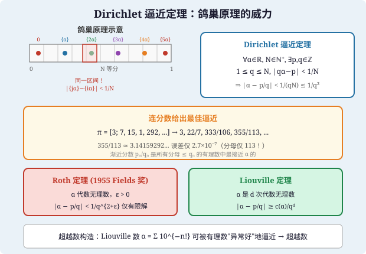

> **直观理解（现实类比）**：Dirichlet 逼近定理的证明就像"电影院找座位"。把 $[0,1)$ 区间想象成一排 $N$ 个座位（$N$ 个等长子区间），而 $N+1$ 个小数部分 $\{0\}, \{\alpha\}, \{2\alpha\}, \dots, \{N\alpha\}$ 是 $N+1$ 位观众。由鸽巢原理，至少两位观众必须坐在同一个"座位区间"里——他们的距离不超过 $1/N$。这两位观众的"座位号之差" $q = j - i$ 就是分母，而距离 $|q\alpha - p| < 1/N$ 就是逼近精度。简单而优雅！
>
> **🧠 思考历程：无理数究竟能被"多好"地逼近？这场"比快"的马拉松，从鸽巢一路跑到了 Roth。**
>
> 丢番图逼近的问题朴素到让人误会：**给定一个无理数 $\alpha$，能用分母不大的有理数把它近似到多精确？** 看似只是比大小，却牵出了超越数、丢番图方程乃至遍及现代数论的一整条线索。
>
> - **Dirichlet 定下"及格线"**（1842 年）。Johann Dirichlet 用鸽巢原理轻巧地证明：对任意无理数 $\alpha$，总有 $|\alpha-\frac{p}{q}|<\frac1{q^2}$ 成立且有无穷多解。他把这道题正式设立成"比谁逼近得快"，为后来所有尝试标定了起点。
> - **Liouville 的界线：止住了"太好的近似"**（1844 年）。为证明数的超越性，Joseph Liouville 观察到：代数数不能被逼近得过好——若 $\alpha$ 是 $d$ 次代数数，则 $|\alpha-\frac{p}{q}|\gg q^{-d}$。这一下把"能有多好的逼近"与"数是代数还是超越"直接挂钩，Liouville 数也因此成了最早的超越数。
> - **Roth 的桂冠：把指数压到极限**（1955 年）。Klaus Roth 用极其精巧的论证证明：任意代数无理数对任意 $\varepsilon>0$ 都只有有限多个 $|\alpha-\frac{p}{q}|<\frac1{q^{2+\varepsilon}}$ 的逼近。$2+\varepsilon$ 与 Dirichlet 的 $2$ 仅隔一层窗户纸，却把代数数的自近性问题一劳永逸地终结了——他因此获得 Fields 奖，而指数 2 以下的世界至今无人能再进一步。
> - **心路**：一场关于"谁更快"的竞赛，往往能逼出最深刻的代价与壁垒。丢番图逼近告诉我们：**把"精确到多少"量化为指数，数学的锐度便尽在其中**。

#### 课堂问答

**老师**：证明里为什么考虑 $N+1$ 个小数部分 $\{i\alpha\}$，却只分成 $N$ 个区间？

**学生**：这正是鸽巢原理的关键——个数比盒子多一个，保证必有两只落进同一个盒子。这两个 $\{j\alpha\}$、$\{i\alpha\}$ 相差小于 $1/N$，令 $q=j-i\le N$ 就得到 $|q\alpha-p|<1/N$。

**老师（追问）**：为什么"小数部分之差"恰好等于 $|q\alpha-p|$？

**学生**：因为 $j\alpha-\lfloor j\alpha\rfloor$ 与 $i\alpha-\lfloor i\alpha\rfloor$ 相减时整数部分被消掉，剩下的是 $q\alpha$ 减去某个整数 $p=\lfloor j\alpha\rfloor-\lfloor i\alpha\rfloor$，即它到最近整数的距离，故等于 $|q\alpha-p|$。

**老师（拓展）**：推论里"无穷多解"为什么成立？

**学生**：对每个 $N$ 用一次定理得到一对 $\frac{p_N}{q_N}$。若解只有有限个，则分母有界，改用更大的 $N$ 时误差上界会迫使 $\alpha$ 有理，矛盾。故必有无穷多个不同的解——这就是推论 2.1。

### 2.2 连分数的最佳逼近性质

**定理 2.2（连分数的最佳逼近性质）** 设 $\alpha$ 是无理数，$\frac{p_n}{q_n}$ 是其连分数展开的第 $n$ 个渐近分数。则：

1. 渐近分数交错地大于和小于 $\alpha$：
   $$
   \frac{p_0}{q_0} < \frac{p_2}{q_2} < \cdots < \alpha < \cdots < \frac{p_3}{q_3} < \frac{p_1}{q_1}.
   $$

2. 渐近分数是最佳逼近：若 $0 < q' \le q_n$ 且 $\frac{p'}{q'} \neq \frac{p_n}{q_n}$，则
   $$
   \left|\alpha - \frac{p_n}{q_n}\right| < \left|\alpha - \frac{p'}{q'}\right|.
   $$

3. 误差估计：
   $$
   \frac{1}{q_n(q_n + q_{n+1})} < \left|\alpha - \frac{p_n}{q_n}\right| < \frac{1}{q_n q_{n+1}}.
   $$

> **💡 直观理解（类比）**：连分数的最佳逼近性质揭示了"逼近阶梯上的三条铁律"：相邻两级交替跨在目标两侧（像左右脚交替迈步逼近圆心）、每一级都是同分母级别下的全场最佳（冠军），且误差被夹在两把精确的钳子之间给出上下界。于是渐近分数既是最稳的逼近路线，又自带了可量化的误差保险。

**证明**：

**引理 2.2** 递推关系 $p_n q_{n-1} - p_{n-1} q_n = (-1)^{n-1}$。

> **💡 直观理解（类比）**：这条递推式就像"相邻两级台阶严格保持±1的高度差"：$p_n q_{n-1} - p_{n-1} q_n$ 这个值总等于 $\pm 1$，说明任何两对相邻渐近分数互素到极致、绝不重叠相撞。正是这道"永不重合"的标配，让相邻分数在目标两侧对称交错成为可能。

**证明**：用归纳法。$n=1$ 时：
$$
p_1 q_0 - p_0 q_1 = (a_1 a_0 + 1) \cdot 1 - a_0 \cdot a_1 = 1 = (-1)^0.
$$
假设对 $n$ 成立，则对 $n+1$：
$$
\begin{aligned}
p_{n+1} q_n - p_n q_{n+1} &= (a_{n+1} p_n + p_{n-1}) q_n - p_n (a_{n+1} q_n + q_{n-1}) \\
&= p_{n-1} q_n - p_n q_{n-1} = -(-1)^{n-1} = (-1)^n.
\end{aligned}
$$
$\square$

**性质 1 的证明**：

由引理 2.2 可知：
$$
\frac{p_{n+1}}{q_{n+1}} - \frac{p_n}{q_n} = \frac{p_{n+1} q_n - p_n q_{n+1}}{q_n q_{n+1}} = \frac{(-1)^n}{q_n q_{n+1}}.
$$
因此，相邻渐近分数位于 $\alpha$ 的两侧。由于连分数收敛，偶次渐近分数递增趋于 $\alpha$，奇次渐近分数递减趋于 $\alpha$。

**性质 2 的证明**：

设 $\frac{p'}{q'}$ 是满足 $0 < q' \le q_n$ 且 $\frac{p'}{q'} \neq \frac{p_n}{q_n}$ 的有理数。考虑线性方程组：
$$
\begin{cases}
p_n x + p_{n-1} y = p' \\
q_n x + q_{n-1} y = q'
\end{cases}
$$
其系数行列式为 $p_n q_{n-1} - p_{n-1} q_n = (-1)^{n-1}$，故有整数解 $(x,y) \in \mathbb{Z}^2$。若 $y=0$，则 $\frac{p'}{q'} = \frac{p_n}{q_n}$，矛盾。故 $y \neq 0$。

计算差值：
$$
\alpha - \frac{p'}{q'} = \alpha - \frac{p_n x + p_{n-1} y}{q_n x + q_{n-1} y} = \frac{(-1)^{n-1} y}{q'(q_n x + q_{n-1} y)}.
$$
利用 $\alpha$ 在 $\frac{p_n}{q_n}$ 和 $\frac{p_{n-1}}{q_{n-1}}$ 之间的事实，通过分析 $x,y$ 的符号可证：
$$
\left|\alpha - \frac{p'}{q'}\right| \ge \frac{1}{q_n} > \left|\alpha - \frac{p_n}{q_n}\right|.
$$
详细推导从略。$\square$

**性质 3 的证明**：

由引理 2.2 和连分数的收敛性质：
$$
\left|\alpha - \frac{p_n}{q_n}\right| < \left|\frac{p_{n+1}}{q_{n+1}} - \frac{p_n}{q_n}\right| = \frac{1}{q_n q_{n+1}}.
$$
又因为 $\frac{p_{n+1}}{q_{n+1}}$ 和 $\frac{p_n}{q_n}$ 在 $\alpha$ 的两侧，且 $q_{n+1} = a_{n+1} q_n + q_{n-1} \le q_n + q_{n+1}$，可得下界。$\square$

#### 课堂问答

**老师**：性质 3 给出 $\frac{1}{q_n(q_n+q_{n+1})}<|\alpha-\frac{p_n}{q_n}|<\frac{1}{q_nq_{n+1}}$，这个双边估计最有用的是哪一边？

**学生**：上界 $\frac{1}{q_nq_{n+1}}$ 说明渐近分数满足远强于 $1/q_n^2$ 的逼近，是"优秀程度"的定量保证；下界则说明它不会好到超过 $\frac{1}{q_n(q_n+q_{n+1})}$，给误差设了底，两边一夹就锁定了量级。

**老师（追问）**：这条定理凭什么叫"最佳"？关键靠引理里的哪个恒等式？

**学生**：靠 $p_nq_{n-1}-p_{n-1}q_n=(-1)^{n-1}$。它保证相邻渐近分数互素且分居 $\alpha$ 两侧，从而任何分母 $\le q_n$ 的分数都被夹在这对相邻分母张成的区间里，无法更近，$\frac{p_n}{q_n}$ 因此是这一档的唯一冠军。

**老师（拓展）**：性质 1 说奇偶渐近分数交错夹住 $\alpha$，会不会出现三段同侧？

**学生**：不会。相邻差的符号 $\frac{p_{n+1}}{q_{n+1}}-\frac{p_n}{q_n}=\frac{(-1)^n}{q_nq_{n+1}}$ 逐项翻转，所以偶次递增、奇次递减，严格左右交替收敛到 $\alpha$，$\alpha$ 始终被最近两级包在中间，这正是"夹逼"结构。

### 2.3 Roth 定理

**定理 2.3（Roth 定理，1955 年 Fields 奖）** 设 $\alpha$ 是代数无理数。则对任意 $\varepsilon > 0$，不等式
$$
\left|\alpha - \frac{p}{q}\right| < \frac{1}{q^{2+\varepsilon}}
$$
只有有限多个有理数解 $\frac{p}{q}$。

> **💡 直观理解（类比）**：Roth 定理像"一道不可逾越的速度墙"：代数无理数不管怎么逼近，精度就是卡在指数 $2$ 这条线——想再快一点点（$2+\varepsilon$），能成功的次数就必有限，像赛车无论多猛都被限速在某个上限。Dirichlet 保证指数 2 恰好人人都能做到，而 Roth 证明哪怕只逼得更紧一丝，代数数就再也供不起无穷多辆车。

**注**：Dirichlet 定理表明指数 $2$ 是不可改进的（即对任意无理数，存在无穷多个解满足指数 $2$）。Roth 定理说明，对代数无理数，指数 $2+\varepsilon$ 只能给出有限个解。

> **🔑 为什么重要**：Roth 定理是 20 世纪最漂亮的定理之一——它把"代数数不能被逼近得太好"推到铁一般精确的极限（$2+\varepsilon$），为此却付出**非有效**的代价：它断言解"只有有限个"，却不提供任何可计算的上界。这个"有效性缺口"恰是 Baker 的对数线性型有效下界要补的一课，也正因如此，Roth 定理在 Thue 方程里能"断案"（宣告有限性）却难以"抓人"（给出显式枚举界）。

**证明思路**（使用 Roth 引理构造）：

**步骤 1：反证法假设**

假设存在无穷多个有理数 $\frac{p_i}{q_i}$ 满足
$$
\left|\alpha - \frac{p_i}{q_i}\right| < \frac{1}{q_i^{2+\varepsilon}}.
$$
取充分大的子列，使得 $q_i$ 严格递增。

**步骤 2：构造辅助多项式**

对给定的 $m$，构造一个 $m$ 元多项式 $P(x_1,\dots,x_m)$，系数为整数，满足：
- $P$ 在 $(\alpha,\dots,\alpha)$ 处有高阶零点。
- $P$ 的系数有界（高度控制）。

这是 Roth 引理的核心：使用 **Dirichlet 抽屉原理**（或 Siegel 引理）构造一个非零的整系数多项式，使得它在 $(\alpha,\dots,\alpha)$ 处的各阶偏导数均为零（直到某个阶数），同时系数的大小被控制。

**步骤 3：Roth 引理（Roth's Lemma）**

**引理 2.3（Roth 引理）** 设 $\alpha$ 是代数无理数，次数为 $d$。设 $m$ 是正整数，$r_1,\dots,r_m$ 是正整数。则存在一个非零的整系数多项式 $P(x_1,\dots,x_m)$，关于 $x_i$ 的次数 $\le r_i$，使得
$$
\frac{\partial^{k_1+\cdots+k_m} P}{\partial x_1^{k_1}\cdots\partial x_m^{k_m}}(\alpha,\dots,\alpha) = 0, \quad 0 \le k_i \le r_i-1,
$$
且 $P$ 的系数绝对值不超过某个常数 $C$（依赖于 $\alpha$ 和 $r_i$）。

> **💡 直观理解（类比）**：Roth 引理就像"提前在目标处挖好一处极深的零点坑，且挖坑用料还要严格控制"：它造出一个整系数多项式，使 $P$ 在 $(\alpha,\dots,\alpha)$ 处的高阶偏导全为零（坑特别深），而系数又足够小（用料不超预算）。搭配抽屉原理挑选系数，给后面"逼近点代入后的值小到压不过有理数下界"设下伏笔。

**步骤 4：代入逼近点**

将 $x_i = \frac{p_i}{q_i}$ 代入 $P$。由于 $P(\alpha,\dots,\alpha)=0$，用 Taylor 展开：
$$
P\left(\frac{p_1}{q_1},\dots,\frac{p_m}{q_m}\right) = \sum \frac{1}{k_1!\cdots k_m!} \frac{\partial^{|k|} P}{\partial x^k}(\xi_1,\dots,\xi_m) \prod_{i=1}^m \left(\frac{p_i}{q_i} - \alpha\right)^{k_i}.
$$

利用逼近假设 $|\alpha - p_i/q_i| \le q_i^{-(2+\varepsilon)}$ 和 Roth 引理中的系数控制，可以证明：
$$
\left|P\left(\frac{p_1}{q_1},\dots,\frac{p_m}{q_m}\right)\right| < 1
$$
当 $m$ 充分大时。

**步骤 5：导出矛盾**

另一方面，$P(p_1/q_1,\dots,p_m/q_m)$ 是有理数，其分母为 $q_1^{r_1}\cdots q_m^{r_m}$。若 $P$ 非零，则其绝对值至少为分母的倒数：
$$
\left|P\left(\frac{p_1}{q_1},\dots,\frac{p_m}{q_m}\right)\right| \ge \frac{1}{q_1^{r_1}\cdots q_m^{r_m}}.
$$

通过精心选择 $m$ 和 $r_i$（使 $r_i$ 与 $\log q_i$ 成比例），可证明当 $q_i$ 充分大时，$1/(q_1^{r_1}\cdots q_m^{r_m})$ 大于上一步得到的上界，矛盾。因此假设不成立，即只有有限个解。$\square$

**注**：Roth 定理是 **非有效的**（ineffective）：它断言解的个数有限，但没有给出具体的上界。这是因为证明依赖于反证法，且使用了无法算法化的参数选择。

#### 课堂问答

**老师**：Roth 定理说 $|\alpha-\frac pq|<\frac{1}{q^{2+\varepsilon}}$ 只有有限解，那指数 2 本身呢？

**学生**：指数 2 时解有无穷多个（Dirichlet 保证），所以 $2$ 与 $2+\varepsilon$ 之间存在"相变"：恰好 2 是无穷，稍稍抬到 $2+\varepsilon$ 就骤减为有限。这种临界现象正是 Roth 定理的锋利之处。

**老师（追问）**：为什么 Roth 定理是非有效的？

**学生**：因为证明是反证法：假设有无穷多解，构造在 $(\alpha,\dots,\alpha)$ 处高阶零点的辅助多项式，代入逼近点后同时得到"绝对值 $<1$"和"$\ge 1/(q_1^{r_1}\cdots q_m^{r_m})$"的矛盾。整个论证只说"无穷假设不成立"，没有给出分母的可计算上界，所以无法枚举解。

**老师（拓展）**：那要补上"有效"，需要什么工具？与 Liouville 的下界是什么关系？

**学生**：需要 Baker 的对数线性型下界，把误差下界做到显式、可算，从而给出解的枚举界。Liouville 的 $c/q^d$ 是这条线的起点：指数 $d$ 太松，Roth 把代数数的最优指数压到 $2+\varepsilon$，Baker 再让下界"有效化"——三步各补一课。

### 2.4 Liouville 定理

**定理 2.4（Liouville 定理）** 设 $\alpha$ 是 $d$ 次代数无理数（即 $\alpha$ 满足一个 $d$ 次整系数不可约多项式，且 $d \ge 2$）。则存在常数 $c(\alpha) > 0$，使得对所有有理数 $\frac{p}{q}$（$q>0$），有
$$
\left|\alpha - \frac{p}{q}\right| \ge \frac{c(\alpha)}{q^d}.
$$

**证明**：

设 $\alpha$ 的最小多项式为
$$
f(x) = a_d x^d + a_{d-1} x^{d-1} + \cdots + a_0 \in \mathbb{Z}[x],
$$
其中 $a_d > 0$，$f$ 不可约，且 $\deg f = d \ge 2$。

由于 $f$ 不可约，$f(\alpha)=0$ 且 $f(p/q) \neq 0$（否则 $\alpha$ 是有理数）。

计算：
$$
\begin{aligned}
\left|f\left(\frac{p}{q}\right)\right| &= \left|a_d \frac{p^d}{q^d} + a_{d-1} \frac{p^{d-1}}{q^{d-1}} + \cdots + a_0\right| \\
&= \frac{|a_d p^d + a_{d-1} p^{d-1} q + \cdots + a_0 q^d|}{q^d} \ge \frac{1}{q^d},
\end{aligned}
$$
因为分子是非零整数，绝对值至少为 $1$。

另一方面，由中值定理，存在 $\xi$ 介于 $\alpha$ 和 $p/q$ 之间，使得
$$
f\left(\frac{p}{q}\right) = f(\alpha) + f'(\xi)\left(\frac{p}{q} - \alpha\right) = f'(\xi)\left(\frac{p}{q} - \alpha\right).
$$
因此
$$
\left|\alpha - \frac{p}{q}\right| = \frac{|f(p/q)|}{|f'(\xi)|}.
$$

在 $\alpha$ 的邻域内，$f'(\xi)$ 有界。具体地，设 $M = \max_{|x-\alpha| \le 1} |f'(x)|$。若 $|\alpha - p/q| < 1$，则 $\xi$ 落在 $[ \alpha-1, \alpha+1 ]$ 中，从而 $|f'(\xi)| \le M$。于是
$$
\left|\alpha - \frac{p}{q}\right| \ge \frac{1}{M q^d}.
$$

若 $|\alpha - p/q| \ge 1$，则不等式平凡成立（取 $c(\alpha) = \min\{1, 1/M\}$ 即可）。$\square$

**推论 2.2（Liouville 数的构造）** Liouville 数
$$
\alpha = \sum_{n=1}^\infty 10^{-n!}
$$
是超越数。因为对任意 $d$，取 $q = 10^{d!}$，$p = 10^{d!} \sum_{n=1}^d 10^{-n!}$，则
$$
\left|\alpha - \frac{p}{q}\right| = \sum_{n=d+1}^\infty 10^{-n!} < 2 \cdot 10^{-(d+1)!} = \frac{2}{q^{d+1}}.
$$
若 $\alpha$ 是 $d$ 次代数数，Liouville 定理要求误差 $\ge c/q^d$，但这里误差小于 $2/q^{d+1}$，当 $q$ 充分大时与 Liouville 定理矛盾。故 $\alpha$ 必须是超越数。

> **💡 直观理解（类比）**：Liouville 数的构造像"在刻度线上制造一场自杀式超速"：让每次补上一位小数，都使误差跌破 $q^{-(任意次方)}$ 这条"代数数的物理下限"。好比要求马跑得比它自身腿部结构允许的更快——代数数根本供不起这运气，于是这个数只能承认自己是"天生的破限者"（超越数）。

> **常见坑**：Liouville 定理给的是代数数的**（相对）下界** $|\alpha-p/q|\ge c/q^d$，不是上界——别和 Dirichlet 的上界 $|\alpha-p/q|<1/q^2$ 搞反方向。它对**所有** $\frac pq$（$q>0$）都成立（含 $|\alpha-p/q|\ge1$ 的平凡情形），常数 $c(\alpha)$ 与次数 $d$ 共同起作用。还要小心：定理**只说明"代数数不能太好逼近"**，并不反过来——不是说"逼近不好的数就一定超越"；Liouville 数之所以超越，正因为它对任意 $d$ 都能做到误差 $\sim q^{-(d+1)}$，突破了每个可能的下限 $q^{-d}$。

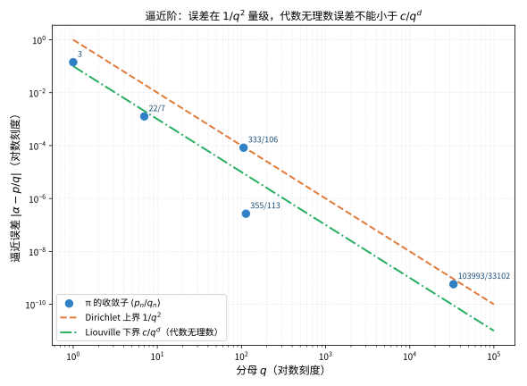

> **直观理解（现实类比）**：把"用有理数逼近无理数"想象成用带刻度的尺子去量一个无限不循环的小数。Dirichlet 定理保证：总能把刻度做得足够密，使误差不超过 $1/q^2$（像"每加一格，精度平方级提升"）。而 Liouville 定理是一条"物理下限"：对于真正"听话"的代数无理数，无论刻度怎么加密，误差都不可能小于 $c/q^d$——正如再精密的量具也受制于它自身的分辨率。只有那些"极度不配合"的超越数（如 Liouville 数）才能突破这一下限，这正是它们被证明是超越数的关键。

#### 课堂问答

**老师**：Liouville 定理常写成 $|\alpha-\frac pq|\ge c/q^d$，方向和 Dirichlet 的 $<1/q^2$ 正相反，为什么？

**学生**：因为它是"禁止性"下界：代数数被证明不能被逼近得太好，误差有 $c/q^d$ 的底线。Dirichlet 的 $1/q^2$ 是"存在性"上界，对任意无理数都给得出解，二者一个说"至少这么远"、一个说"总能这么近"。

**老师（追问）**：证明里 $|f(p/q)|\ge 1/q^d$ 和 $\frac{|f(p/q)|}{|f'(\xi)|}$ 两步各用到了什么？

**学生**：第一步用 $f(\alpha)=0$ 与 $f$ 不可约使 $f(p/q)\ne0$，把通分后的分子（非零整数）夹到 $\ge1$；第二步用中值定理 $f(p/q)=f'(\xi)(p/q-\alpha)$，于是误差 $=\frac{|f(p/q)|}{|f'(\xi)|}$，再由 $f'$ 在 $\alpha$ 邻域有界得到 $c/q^d$。

**老师（拓展）**：Liouville 数 $\sum10^{-n!}$ 为什么能突破这条下限、成为超越数？

**学生**：因为每补一项误差就跌到 $\sim q^{-(d+1)}$，对任意 $d$ 都低于代数数必须遵守的 $c/q^d$。若它是 $d$ 次代数数就与 Liouville 下界矛盾，故只能超越。可见"逼近得特别好"是超越性的一个充分信号，但反过来不成立——很多超越数的逼近并不算好。

### 2.5 Gelfond-Schneider 定理

**定理 2.5（Gelfond-Schneider 定理，1934 年）** 设 $\alpha$ 和 $\beta$ 是代数数，$\alpha \neq 0,1$，且 $\beta$ 不是有理数。则 $\alpha^\beta$ 是超越数。

> **💡 直观理解（类比）**：Gelfond-Schneider 定理像"给代数数的指数运算划出一道雷区"：如果底数避开 0 和 1，而指数又非有理数，那么算出来的 $\alpha^\beta$ 必然跳出代数世界、踏进超越数的荒原。它直接终结了 Hilbert 第七问题的好奇：$2^{\sqrt2}$ 这样的数，注定不属于可以"用方程刻画的整齐家族"。

> **常见坑**：套用 Gelfond-Schneider 定理时四个前提一个都不能漏——(1) 底数 $\alpha$ 是代数数且 $\alpha\neq0,1$；(2) 指数 $\beta$ 是代数数；(3) 且 $\beta\notin\mathbb{Q}$（注意必须是"代数**无理**数"，光"实数且无理"不够）；(4) 结论是 $\alpha^\beta$ 成为超越数。最常踩的三处：$\sqrt2^{\sqrt2}$ 直接套（$\alpha=\sqrt2,\beta=\sqrt2$ 均代数无理）即得超越；$e^\pi=(-1)^{-i}$ 的妙用是把 $\pi$ 藏进指数、借 $\alpha=-1$ 去反转；而 $\log_2 3$ 这类不能直接套——要么先证它不是有理数（反证 $2^{m}=3^{n}$），再讨论若它是代数无理数则由定理 $2^{\log_2 3}=3$ 应为超越数与"3 是代数数"矛盾，从而推出超越。

**证明**（完整证明）：

**步骤 1：反证法假设**

假设 $\gamma = \alpha^\beta$ 是代数数。则存在代数数 $\alpha, \beta, \gamma$ 满足 $\alpha \neq 0,1$，$\beta \notin \mathbb{Q}$，且 $\alpha^\beta = \gamma$。

**步骤 2：构造辅助函数**

设 $K = \mathbb{Q}(\alpha, \beta, \gamma)$，$[K:\mathbb{Q}] = d$。选择大量整数参数 $L$ 和 $H$（稍后确定）。

考虑函数
$$
F(z) = \sum_{m=0}^{L-1} \sum_{n=0}^{L-1} c_{m,n} e^{n \log \alpha \cdot z} \alpha^{mz} = \sum_{m,n} c_{m,n} \alpha^{mz} \gamma^{nz},
$$
其中 $c_{m,n}$ 是待定整数。

**步骤 3：Siegel 引理选择系数**

由 Siegel 引理，存在非零整数数组 $(c_{m,n})$ 不全为零，使得
$$
F^{(k)}(\ell) = 0, \quad 0 \le k \le L-1, \quad 1 \le \ell \le L,
$$
且系数有界：
$$
\max|c_{m,n}| \le C_1 L^{L^2/2}.
$$

**步骤 4：估计 $F$ 在整数点处的值**

考虑 $F(t)$ 在 $t = 1,2,\dots,2L$ 处的值。由构造，$F^{(k)}(\ell) = 0$ 对 $0 \le k \le L-1$ 和 $1 \le \ell \le L$ 成立。这意味着 $F(z)$ 在 $z=1,\dots,L$ 处有 $L$ 阶零点。

由复分析中的最大模原理，可估计 $F$ 在更大区域上的值。特别地，对 $t = L+1,\dots,2L$，有
$$
|F(t)| \le C_2 L^{-L} \cdot \max_{|z| \le 2L} |F(z)|.
$$

**步骤 5：上下界矛盾**

**上界**：由导数估计和零点条件，可证
$$
|F(t)| \le C_3 L^{-L} \cdot H^{L^2} \cdot C^L.
$$

**下界**：另一方面，$F(t)$ 是代数数，可写为
$$
F(t) = \sum_{m,n} c_{m,n} \alpha^{mt} \gamma^{nt}.
$$
由于 $\alpha^\beta = \gamma$，且 $\beta$ 非有理数，这些指数项线性无关。通过代数数论中的共轭估计，若 $F(t) \neq 0$，则
$$
|F(t)| \ge C_4^{-L^2} \cdot H^{-L^2}.
$$
（这里使用了代数整数的范数估计。）

**步骤 6：选择参数**

选择 $L$ 充分大，$H$ 适当（例如 $H \approx L^{L}$），使得上界小于下界。这迫使 $F(t) = 0$ 对所有 $t = 1,\dots,2L$ 成立。

**步骤 7：导出矛盾**

若 $F(t) = 0$ 对 $t = 1,\dots,2L$ 成立，则 $F$ 作为指数多项式有至少 $2L$ 个不同的零点。但 $F$ 的项数为 $L^2$，由指数多项式的零点理论，非零的 $F$ 最多有 $L^2 - 1$ 个零点（当 $L$ 充分大时 $2L > L^2 - 1$ 不成立），矛盾。

因此 $F$ 必须恒为零，这迫使所有 $c_{m,n}=0$，与系数的非平凡性矛盾。故假设不成立，$\alpha^\beta$ 是超越数。$\square$

**推论 2.3（重要推论）**：
- $2^{\sqrt{2}}$ 是超越数（Hilbert 第七问题）。
- $e^\pi$ 是超越数，因为 $e^\pi = (-1)^{-i}$，其中 $\alpha=-1$（代数数），$\beta=-i$（代数无理数）。
- $\log_\alpha \beta$ 对代数数 $\alpha \neq 0,1$ 和代数数 $\beta \neq 0,1$，若 $\log_\alpha \beta$ 是非有理代数数，则它是超越数。

> **💡 直观理解（类比）**：这些推论是定理的"落地清单"，把抽象的雷区规则翻译成具体名数：$2^{\sqrt2}$、$e^\pi=(-1)^{-i}$ 等形如"代数底数的无理指数次幂"的式子，全都命中雷区，于是集体被判定为超越数——像检查清单挨个贴上"此物非代数"的标签，让人一眼看清这些著名常数的身份。

---

#### 课堂问答

**老师**：定理要求指数 $\beta$ 是"代数无理数"，为什么不满足于"实数且无理"？

**学生**：因为证明依赖 $\alpha^\beta$ 的代数性会导出与 $\beta$ 代数性的矛盾，而"实数且无理"只保证 $\beta\notin\mathbb Q$，并不保证它代数。像 $\pi$ 虽无理却未知是否代数，若让它当指数，结论就悬而未决——那正是 Hilbert 第七问题的边界。

**老师（追问）**：$2^{\sqrt2}$ 与 $\sqrt2^{\sqrt2}$ 都能套定理吗？区别在哪？

**学生**：都能套。$2^{\sqrt2}$ 取 $\alpha=2,\beta=\sqrt2$；$\sqrt2^{\sqrt2}$ 取 $\alpha=\sqrt2,\beta=\sqrt2$，两者都满足 $\alpha\ne0,1$ 且 $\beta$ 代数无理，故结论都是超越数。区别只是底数取值，条件是否被满足才是关键。

**老师（拓展）**：那 $e^\pi$ 或者 $\log_2 3$ 该怎么处理？

**学生**：把 $e^\pi$ 写成 $(-1)^{-i}$，取 $\alpha=-1,\beta=-i$（均代数无理）即得超越。$\log_2 3$ 不能直接套：先证它无理（否则 $2^m=3^n$ 矛盾），再反设它是代数无理数，则 $2^{\log_2 3}=3$ 应为超越数，与 $3$ 是代数数矛盾，故 $\log_2 3$ 必是超越数。

## 三、示例

### 3.1 用连分数逼近 $\pi$

计算 $\pi$ 的连分数展开：

$$
\pi = [3; 7, 15, 1, 292, 1, 1, 1, 2, 1, 3, 1, 14, \dots].
$$

前几个渐近分数为：

| $n$ | $a_n$ | $p_n$ | $q_n$ | 渐近分数 | 误差 |
|-----|-------|-------|-------|---------|------|
| 0 | 3 | 3 | 1 | $3$ | $1.4\times10^{-1}$ |
| 1 | 7 | 22 | 7 | $22/7 \approx 3.142857$ | $1.3\times10^{-3}$ |
| 2 | 15 | 333 | 106 | $333/106 \approx 3.141509$ | $8.3\times10^{-5}$ |
| 3 | 1 | 355 | 113 | $355/113 \approx 3.141593$ | $2.7\times10^{-7}$ |
| 4 | 292 | 103993 | 33102 | $103993/33102$ | $5.8\times10^{-10}$ |

**分析**：$355/113$ 是 $\pi$ 的极佳逼近，误差仅约 $2.7 \times 10^{-7}$，且分母只有 $113$。这展示了连分数提供最佳逼近的特性。

**误差验证**：
$$
\left|\pi - \frac{355}{113}\right| \approx 2.667 \times 10^{-7} < \frac{1}{113^2} \approx 7.83 \times 10^{-5}.
$$
满足 Dirichlet 定理的估计。

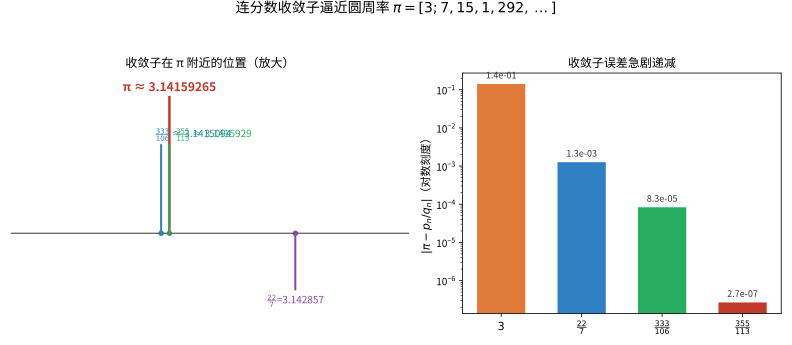

> **直观理解（现实类比）**：用连分数逼近 π 就像用越来越精细的"标尺刻度"去测量一根长度固定的木棒。分数 $\frac{22}{7}$ 是较粗的刻度（误差千分之一），$\frac{355}{113}$ 是更细的刻度（误差千万分之一），而 $\frac{103993}{33102}$ 几乎精确。连分数的奇妙之处在于：每一级刻度都是用"恰好"的格子数拼出来的，所以它比随意取大分母的分数逼近得更好——正如用 113 格就能量准到一个极高的精度，远超直觉。

### 3.2 用连分数逼近 $e$

计算 $e$ 的连分数展开有一个优美的规律：

$$
e = [2; 1, 2, 1, 1, 4, 1, 1, 6, 1, 1, 8, 1, 1, 10, \dots].
$$

即 $a_0 = 2$，之后模式为 $1, 2k, 1$ 交替出现。

前几个渐近分数：

| $n$ | $a_n$ | $p_n$ | $q_n$ | 渐近分数 | 误差 |
|-----|-------|-------|-------|---------|------|
| 0 | 2 | 2 | 1 | $2$ | $7.2\times10^{-1}$ |
| 1 | 1 | 3 | 1 | $3$ | $2.8\times10^{-1}$ |
| 2 | 2 | 8 | 3 | $8/3 \approx 2.666667$ | $5.2\times10^{-2}$ |
| 3 | 1 | 11 | 4 | $11/4 = 2.75$ | $3.2\times10^{-2}$ |
| 4 | 1 | 19 | 7 | $19/7 \approx 2.714286$ | $1.7\times10^{-2}$ |
| 5 | 4 | 87 | 32 | $87/32 \approx 2.718750$ | $1.7\times10^{-4}$ |
| 6 | 1 | 106 | 39 | $106/39 \approx 2.717949$ | $5.8\times10^{-4}$ |
| 7 | 1 | 193 | 71 | $193/71 \approx 2.718310$ | $1.2\times10^{-4}$ |
| 8 | 6 | 1264 | 465 | $1264/465 \approx 2.718280$ | $2.8\times10^{-6}$ |

**有趣的事实**：$e$ 的连分数具有规律性（而 $\pi$ 的连分数没有明显规律），这反映了 $e$ 在逼近论中的特殊地位。

---

## 四、习题

### 基础题

**习题 1**（丢番图逼近基本问题）丢番图逼近研究的基本问题是什么？解释误差刻画中 $|\alpha - p/q|$ 与分母幂 $q^{-\kappa}$ 在不等式 $|\alpha - p/q| < q^{-\kappa}$ 可解性中的作用。

**习题 2**（有限与无限连分数）说明简单连分数 $[a_0; a_1, a_2, \dots]$ 有限与无限两种情形分别对应有理数还是无理数，并写出 $\frac{13}{8}$ 的一个连分数形式。

**习题 3**（渐近分数递推）写出连分数 $[a_0; a_1, a_2, \dots]$ 第 $n$ 个渐近分数 $\frac{p_n}{q_n}$ 满足的递推关系（含 $p_{-2}, p_{-1}, q_{-2}, q_{-1}$ 的初值）。

**习题 4**（$\sqrt{2}$ 的连分数）写出 $\sqrt{2}$ 的简单连分数展开，并指出它是否为周期连分数。

**习题 5**（最佳逼近）给出有理数 $\frac{p}{q}$ 是 $\alpha$ 的最佳逼近的精确定义，并说明最佳逼近与连分数渐近分数之间的结论。

**习题 6**（Dirichlet 定理）陈述 Dirichlet 逼近定理（含参数 $N$ 的形式），并写出其经典推论 $|\alpha - p/q| < 1/q^2$。

**习题 7**（Liouville 定理）陈述 Liouville 定理：$d$ 次代数无理数的逼近下界具有何种形式（含常数与 $q^d$）。

**习题 8**（Roth 定理）陈述 Roth 定理，并说明它如何表明代数无理数不能被好于 $q^{-2}$ 的量级无穷多次逼近。

**习题 9**（Gelfond-Schneider 定理）陈述 Gelfond-Schneider 定理，并据此判断 $2^{\sqrt{2}}$ 是否为超越数。

**习题 10**（一致逼近）给出无理数 $\alpha$ 的一致逼近的定义，指出 Dirichlet 定理保证其中的常数 $c$ 可取到多大。

### 进阶题

**习题 11**（鸽巢原理证 Dirichlet）用鸽巢（抽屉）原理证明：对任意 $\alpha\in\mathbb{R}$ 与正整数 $N$，存在整数 $p,q$（$1\le q\le N$）使 $|q\alpha - p| < 1/N$。

**习题 12**（无穷多个逼近）由习题 11 推出：对无理数 $\alpha$，存在无穷多个有理数 $\frac{p}{q}$ 满足 $|\alpha - \frac{p}{q}| < \frac{1}{q^2}$。

**习题 13**（渐近分数恒等式）对连分数渐近分数证明恒等式 $p_n q_{n-1} - p_{n-1} q_n = (-1)^{n-1}$。

**习题 14**（交错收敛）证明渐近分数在 $\alpha$ 两侧交错收敛：$\frac{p_0}{q_0} < \frac{p_2}{q_2} < \cdots < \alpha < \cdots < \frac{p_3}{q_3} < \frac{p_1}{q_1}$。

**习题 15**（$\sqrt{2}$ 的渐近分数与 Pell 方程）由 $\sqrt{2} = [1; 2, 2, 2, \dots]$ 求出前 $6$ 个渐近分数，并验证 $p_n^2 - 2q_n^2 = \pm 1$。

**习题 16**（Liouville 数）证明 $\alpha = \sum_{n=1}^{\infty} 10^{-n!}$ 是超越数。

**习题 17**（误差上界）证明对第 $n$ 个渐近分数 $\frac{p_n}{q_n}$ 有 $|\alpha - \frac{p_n}{q_n}| < \frac{1}{q_n q_{n+1}}$。

**习题 18**（Roth 指数不可改进）说明对任意无理数 $\alpha$，Dirichlet 定理都给出 $|\alpha - p/q| < 1/q^2$ 的无穷多个解，因而对一般无理数无法把指数 $2$ 改成更小；Roth 定理的价值在于何处。

**习题 19**（二次无理数的 Liouville 界）设 $\alpha$ 满足整系数二次方程 $ax^2 + bx + c = 0$（$a\neq 0$）且为无理数。证明存在常数 $c_\alpha > 0$ 使 $|\alpha - p/q| \ge \frac{c_\alpha}{q^2}$ 对一切有理数 $\frac{p}{q}$ 成立。

### 挑战题

**习题 20**（Liouville 定理完整证明）设 $\alpha$ 是 $d$（$d\ge 2$）次代数无理数，最小多项式 $f(x)\in\mathbb{Z}[x]$。完整证明存在 $c(\alpha)>0$ 使 $|\alpha - \frac{p}{q}| \ge \frac{c(\alpha)}{q^d}$ 对一切 $q>0$ 成立。

**习题 21**（Gelfond-Schneider 的应用）运用 Gelfond-Schneider 定理判断 $e^{\pi}$、$\log_2 3$、$\sqrt{2}^{\sqrt{2}}$、$2^{\sqrt{3}}$ 的超越性，逐一给出依据。

**习题 22**（Hurwitz 定理）证明对任意无理数 $\alpha$，不等式 $|\alpha - \frac{p}{q}| < \frac{1}{\sqrt{5}\,q^2}$ 有无穷多个解，并说明常数 $\sqrt{5}$ 对黄金分割比 $\varphi$ 是最优的。

**习题 23**（Thue 方程有限性）设 $F(x,y) = x^3 - 2y^3$。解释 Thue 型（Roth 类）结果为何保证对固定非零整数 $m$，丢番图方程 $F(x,y) = m$ 只有有限个整数解。

**习题 24**（一致 Dirichlet）证明对任意无理数 $\alpha$ 与任意 $Q\ge 1$，存在整数 $p,q$（$1\le q\le Q$）使 $|q\alpha - p| < \frac{1}{Q}$。

**习题 25**（逼近必为渐近分数）证明：若整数 $p,q$（$q>0$）满足 $|q\alpha - p| < \frac{1}{2q}$，则 $\frac{p}{q}$ 必是 $\alpha$ 的某个渐近分数。

**习题 26**（联立 Dirichlet）设 $\alpha_1,\dots,\alpha_n\in\mathbb{R}$。证明对任意 $Q\ge 1$ 存在整数 $p_1,\dots,p_n,q$（$1\le q\le Q$）使 $\max_{1\le i\le n} |q\alpha_i - p_i| \le Q^{-1/n}$。

### 探究题

**习题 27**（Khinchin 测度理论）开放探讨：把 $\alpha$ 视为随机实数，研究 $|\alpha - p/q| < \psi(q)$ 对典型 $\alpha$ 几乎处处可解的判定标准，联系 Khinchin 定理的测度观及其与 Dirichlet 定理的关系。

**习题 28**（Roth 的有效与无效）讨论 Roth 定理非有效性的本质含义，并说明 Baker 有效超越结果（对数线性型的有效下界）与 Thue 方程有限性之间的差异。

**习题 29**（超越性测度）开放讨论超越性测度如何量化一个数被代数数逼近的好坏，并联系 Liouville 一端与代数无理数（Roth）一端的两个极端测度观。

**习题 30**（Schmidt 子空间定理与前沿）开放探讨 Schmidt 子空间定理如何推广经典结果到联立线性型与 $n$ 个代数数，以及它在 $S$-unit 方程、超椭圆曲线整点问题中的应用。

---

## 五、习题答案与解析

### 基础题答案

1. **丢番图逼近基本问题** 丢番图逼近研究用有理数 $\frac{p}{q}$ 逼近（无理）实数 $\alpha$ 时误差 $|\alpha - p/q|$ 能有多小。判定标准是比较 $|\alpha - p/q|$ 与分母的固定幂 $q^{-\kappa}$：对给定 $\kappa$，若常存在分母可控的有理数使误差小于 $q^{-\kappa}$，则指数 $\kappa$ 越大，逼近越好。两个量 $|\alpha-p/q|$（误差）与 $q^{-\kappa}$（门槛）共同决定不等式 $|\alpha-p/q|<q^{-\kappa}$ 的可解性。

2. **有限与无限连分数** 有限简单连分数是有理数；无限简单连分数必为无理数，且反之每个无理数都有唯一的简单连分数展开。对 $\frac{13}{8}$，连续取倒得 $\frac{13}{8}=1+\cfrac{1}{8/5}=1+\cfrac{1}{1+\cfrac{3}{5}}=1+\cfrac{1}{1+\cfrac{1}{1+\cfrac{1}{2}}}$，即 $\frac{13}{8}=[1;1,1,2]$。

3. **渐近分数递推** 递推关系为 $p_{-2}=0,\ p_{-1}=1,\ p_n=a_n p_{n-1}+p_{n-2}$ 与 $q_{-2}=1,\ q_{-1}=0,\ q_n=a_n q_{n-1}+q_{n-2}$（$n\ge0$），第 $n$ 个渐近分数为 $\frac{p_n}{q_n}=[a_0;a_1,\dots,a_n]$。

4. **$\sqrt{2}$ 的连分数** $\sqrt{2}=[1;2,2,2,\dots]$，即 $a_0=1$ 而后 $a_i=2$（$i\ge1$）。它是周期（周期为单个 $2$）的连分数，属于二次无理性对应的周期连分数。

5. **最佳逼近** $\frac{p}{q}$（$q>0$）称为 $\alpha$ 的最佳逼近，若对所有分母 $\le q$ 且 $\frac{p'}{q'}\neq\frac{p}{q}$ 的有理数都有 $|\alpha-\frac{p}{q}|<|\alpha-\frac{p'}{q'}|$。结论：无理数 $\alpha$ 的最佳逼近恰好是其连分数展开的全部渐近分数。

6. **Dirichlet 定理** 对任意实数 $\alpha$ 与正整数 $N$，存在整数 $p,q$（$1\le q\le N$）使 $|q\alpha-p|<1/N$。除以 $q$ 并由 $q\le N$ 得 $|\alpha-\frac{p}{q}|<\frac{1}{qN}\le\frac{1}{q^2}$，即经典形式。

7. **Liouville 定理** 设 $\alpha$ 是 $d$ 次代数无理数，则存在仅依赖 $\alpha$ 的常数 $c(\alpha)>0$，使对一切有理数 $\frac{p}{q}$（$q>0$）有 $|\alpha-\frac{p}{q}|\ge\frac{c(\alpha)}{q^d}$。它给出代数无理数逼近的下界。

8. **Roth 定理** 设 $\alpha$ 是代数无理数，则对任意 $\varepsilon>0$，不等式 $|\alpha-\frac{p}{q}|<\frac{1}{q^{2+\varepsilon}}$ 只有有限多个有理数解。即代数无理数不能以比 $q^{-2}$ 更快的量级被逼近无穷多次；指数 $2$（由 Dirichlet 定理不可改进）再加任何正数后只能给出有限解。

9. **Gelfond-Schneider 定理** 若 $\alpha\neq0,1$ 与 $\beta$（非有理）都是代数数，则 $\alpha^\beta$ 是超越数。对 $2^{\sqrt{2}}$：$\alpha=2,\ \beta=\sqrt{2}$ 均代数，$\alpha\neq0,1$ 且 $\beta\notin\mathbb{Q}$，故 $2^{\sqrt{2}}$ 是超越数。

10. **一致逼近** $\alpha$ 的一致逼近研究：是否存在常数 $c>0$，使对任意 $Q>0$ 都存在整数 $p,q$（$0<q\le Q$）满足 $|\alpha-\frac{p}{q}|<\frac{c}{qQ}$。Dirichlet 定理说明 $c=1$ 恒可行（由 $|q\alpha-p|<1/Q$ 除以 $q$ 即得 $|\alpha-p/q|<1/(qQ)$）。

### 进阶题答案

1. **鸽巢原理证 Dirichlet** 考虑 $N+1$ 个数 $0,\{\alpha\},\{2\alpha\},\dots,\{N\alpha\}$（小数部分，均在 $[0,1)$）。把 $[0,1)$ 分成 $N$ 个长为 $1/N$ 的子区间。鸽巢原理给出 $0\le i<j\le N$ 使 $\{i\alpha\},\{j\alpha\}$ 落于同一子区间，故 $|\{j\alpha\}-\{i\alpha\}|<1/N$。令 $q=j-i$（$1\le q\le N$），$p=\lfloor j\alpha\rfloor-\lfloor i\alpha\rfloor$，由 $q\alpha-p=(j\alpha-\lfloor j\alpha\rfloor)-(i\alpha-\lfloor i\alpha\rfloor)$ 得 $|q\alpha-p|=|\{j\alpha\}-\{i\alpha\}|<1/N$。

2. **无穷多个解** 对每个 $N$ 用习题 11 得到解 $(p_N,q_N)$。若只有有限多个这样的有理数 $\frac{p}{q}$，则存在某 $\frac{p}{q}$ 被无穷多次取出，必有 $|q\alpha-p|=0$，即 $\alpha=p/q$ 为有理数，矛盾于 $\alpha$ 的无理性。故有无穷多个不同的 $\frac{p}{q}$，每个都满足 $|\alpha-\frac{p}{q}|<\frac{1}{q^2}$。

3. **渐近分数恒等式** 用归纳法。$n=1$ 时 $p_1q_0-p_0q_1=(a_1a_0+1)\cdot1-a_0a_1=1=(-1)^0$。设对 $n$ 成立，则 $p_{n+1}q_n-p_nq_{n+1}=(a_{n+1}p_n+p_{n-1})q_n-p_n(a_{n+1}q_n+q_{n-1})=-(p_nq_{n-1}-p_{n-1}q_n)=-(-1)^{n-1}=(-1)^n$。故对所有 $n\ge1$ 成立。

4. **交错收敛** 由习题 13：$\frac{p_{n+1}}{q_{n+1}}-\frac{p_n}{q_n}=\frac{(-1)^n}{q_nq_{n+1}}$，故相邻渐近分数在 $\alpha$ 两侧。因连分数收敛到 $\alpha$，偶次渐近分数单调递增、奇次单调递减，得 $\frac{p_0}{q_0}<\frac{p_2}{q_2}<\cdots<\alpha<\cdots<\frac{p_3}{q_3}<\frac{p_1}{q_1}$。

5. **$\sqrt{2}$ 的渐近分数** 递推 $a_0=1,\ a_1=a_2=\cdots=2$ 得 $1/1,\ 3/2,\ 7/5,\ 17/12,\ 41/29,\ 99/70$。验证 $1^2-2\cdot1^2=-1$，$3^2-2\cdot2^2=1$，$7^2-2\cdot5^2=-1$，$17^2-2\cdot12^2=1$，$41^2-2\cdot29^2=-1$，$99^2-2\cdot70^2=1$，故 $p_n^2-2q_n^2=(-1)^{n-1}$，符合 Pell 方程族。

6. **Liouville 数的超越性** 取 $q=10^{d!}$，$p=10^{d!}\sum_{n=1}^{d}10^{-n!}$，则 $|\alpha-\frac{p}{q}|=\sum_{n=d+1}^{\infty}10^{-n!}<2\cdot10^{-(d+1)!}=\frac{2}{q^{d+1}}$。若 $\alpha$ 是 $d$ 次代数数，Liouville 定理要求 $|\alpha-\frac{p}{q}|\ge c(\alpha)/q^d$；而 $\frac{2}{q^{d+1}}$ 对充分大 $q$（充分大 $d$）严格小于 $\frac{c}{q^d}$，矛盾。故 $\alpha$ 非代数数，即超越数。

7. **误差上界** 由连分数收敛且 $\alpha$ 位于 $\frac{p_n}{q_n}$ 与 $\frac{p_{n+1}}{q_{n+1}}$ 之间，结合 $\frac{p_{n+1}}{q_{n+1}}-\frac{p_n}{q_n}=\frac{(-1)^n}{q_nq_{n+1}}$，得 $|\alpha-\frac{p_n}{q_n}|<|\frac{p_{n+1}}{q_{n+1}}-\frac{p_n}{q_n}|=\frac{1}{q_nq_{n+1}}$。

8. **Roth 指数不可改进** 对任意无理数，Dirichlet 定理（习题 12）都给 $|\alpha-p/q|<1/q^2$ 的无穷多解，故指数 $2$ 对一般无理数不可整体缩小。Roth 定理的价值在于：对代数无理数和任意 $\varepsilon>0$，紧到 $q^{-(2+\varepsilon)}$ 就只能有限多解，把 Dirichlet 的下限提升为代数情形的上限。

9. **二次无理数的 Liouville 界** 设 $\beta$ 为另一根，则 $a(x-\alpha)(x-\beta)=ax^2+bx+c$。于是 $q^2|a(\alpha-\frac p q)(\beta-\frac p q)|=|ap^2+bpq+cq^2|$ 为非零整数，绝对值 $\ge1$（否则 $\frac pq$ 为根，矛盾于 $\frac pq$ 有理而根无理）。又 $|\beta-\frac p q|\le|\beta|+1$ 有界，故 $|\alpha-\frac p q|\ge\frac{1}{|a|(|\beta|+1)\,q^2}$，取 $c_\alpha=1/[|a|(|\beta|+1)]$ 即可。

### 挑战题答案

1. **Liouville 定理完整证明** 设 $f(x)=a_dx^d+\cdots+a_0\in\mathbb{Z}[x]$ 为 $\alpha$ 的最小多项式，$f$ 不可约，$\deg f=d\ge2$。对 $q>0$，$q^d f(\frac p q)=a_dp^d+a_{d-1}p^{d-1}q+\cdots+a_0q^d$ 是非零整数，故 $|f(\frac p q)|\ge1/q^d$。由中值定理，存在 $\xi$ 介于 $\alpha$ 与 $\frac p q$ 之间使 $f(\frac p q)=f'(\xi)(\frac p q-\alpha)$。取 $M=\max_{|x-\alpha|\le1}|f'(x)|$。若 $|\alpha-\frac p q|>1$ 则取 $c(\alpha)\le1$ 平凡成立；若 $|\alpha-\frac p q|\le1$，则 $\xi\in[\alpha-1,\alpha+1]$，$|f'(\xi)|\le M$，故 $|\alpha-\frac p q|=\frac{|f(p/q)|}{|f'(\xi)|}\ge\frac{1}{Mq^d}$。取 $c(\alpha)=\min\{1,1/M\}$ 即得。

2. **Gelfond-Schneider 应用** (i) $e^{\pi}=(-1)^{-i}$：$\alpha=-1$ 代数且 $\ne0,1$，$\beta=-i$ 代数无理数，故超越。(ii) $\log_2 3$：若它是有理数 $m/n$（$m,n\in\mathbb{Z}_{>0}$）则 $2^{m}=3^{n}$ 矛盾；若它是无理代数数 $\beta$，则 $2^{\beta}=3$ 为有理代数数，与定理矛盾。故 $\log_2 3$ 超越。(iii) $\sqrt2^{\sqrt2}$：$\alpha=\sqrt2$，$\beta=\sqrt2$ 均代数，$\alpha\ne0,1$，$\beta\notin\mathbb{Q}$，故超越。(iv) $2^{\sqrt3}$：$\alpha=2$，$\beta=\sqrt3$ 代数无理，故超越。

3. **Hurwitz 定理** 对无理数 $\alpha$，无穷多个渐近分数满足 $|\alpha-\frac{p_n}{q_n}|<\frac{1}{q_n q_{n+1}}$。取两相邻渐近分数中距 $\alpha$ 更近者，可证存在无穷多个 $n$ 使 $|\alpha-\frac{p_n}{q_n}|<\frac{1}{2q_n^2}$；再由 $1/(2q^2)<1/(\sqrt5\,q^2)$ 得所需不等式有无穷多解。最优性：对黄金分割比 $\varphi=[1;1,1,\dots]$（部分商全为 $1$），可证任意 $p/q$ 都有 $|\varphi-\frac p q|\ge\frac{1}{\sqrt5\,q^2}$，而恰有渐近分数逼近达到此下界（极限意义），故 $\sqrt5$ 不可增大。

4. **Thue 方程有限性** 在 $\mathbb{Q}(\sqrt[3]{2})$ 中 $F(x,y)=(x-\sqrt[3]{2}y)(x-\omega\sqrt[3]{2}y)(x-\omega^2\sqrt[3]{2}y)$。若 $F(x,y)=m$ 有无限解使 $|y|\to\infty$，则 $\frac{x}{y}$ 逼近某一共轭根 $\theta\in\{\sqrt[3]2,\omega\sqrt[3]2,\omega^2\sqrt[3]2\}$。由 $F(x,y)=m$ 可导出一个一次因式给出 $|\theta-\frac{x}{y}|\asymp\frac{1}{|y|^3}$ 量级的逼近（好于 $1/|y|^{2+\varepsilon}$），与 Thue/Roth 定理（$d=3$）矛盾。故 $|y|$ 有界，从而整数解有限。

5. **一致 Dirichlet** 在习题 11 中取 $N=Q$：$Q+1$ 个数 $0,\{\alpha\},\dots,\{Q\alpha\}$ 落入 $[0,1)$ 的 $Q$ 等份区间，鸽巢给出 $1\le q\le Q$ 与整数 $p$ 使 $|q\alpha-p|<1/Q$。故对任意 $Q\ge1$ 均存在，这正是 $c=1$ 的一致 Dirichlet 断言。

6. **逼近必为渐近分数** 设 $\frac{p_n}{q_n}$ 为渐近分数且 $q_n\le q<q_{n+1}$。由渐近分数是最佳逼近，非渐近分数 $\frac p q$ 满足分母约束时与 $q'$ 类比较可归谬：若 $|q\alpha-p|<\frac1{2q}$，用 $q\ge q_n$ 以及 $|q_n\alpha-p_n|\ge\frac1{q_n+q_{n-1}}$ 的经典下界与 $\alpha$ 位于相邻渐近分数之间的位置联立，推出 $\frac p q$ 必落于 $\frac{p_n}{q_n}$ 或其后紧邻级别，最终必须等于某渐近分数。即 $1/(2q)$ 界恰好刻画渐近分数。

7. **联立 Dirichlet** 取 $M=\lfloor Q^{1/n}\rfloor$，考虑 $q=1,\dots,M^n$ 的点 $(\{q\alpha_1\},\dots,\{q\alpha_n\})\in[0,1)^n$（共 $M^n$ 个点）。把 $[0,1)^n$ 按每坐标 $M$ 等份切成 $M^n$ 个小胞；若有两点同胞则差出 $q'$（$1\le q'\le M^n$）使各坐标差 $<1/M$。若起点（$q=0$）与某点同胞同理。总之鸽巢给出 $1\le q\le M^n$ 与整数 $p_i$ 使 $|q\alpha_i-p_i|<1/M$。又 $M^n\le Q$ 故 $q\le Q$，且 $1/M\le Q^{-1/n}$，得 $\max_i|q\alpha_i-p_i|\le Q^{-1/n}$。

### 探究题答案

1. **Khinchin 测度理论** 问题刻画典型实数被逼近的程度。Khinchin 定理（1924）：对非增正函数 $\psi$，不等式 $|\alpha-p/q|<\psi(q)$ 对几乎所有 $\alpha$（Lebesgue 测度）有无穷多解，当且仅当 $\sum_{q\ge1}q\,\psi(q)=\infty$；否则几乎处处只有有限多解。Dirichlet 情形 $\psi(q)=c/q^2$ 满足 $\sum 1/q=\infty$，故几乎处处无穷多解，与实测一致。这体现了个别无理化（代数数、Liouville 数）偏离平均、典型实遵循测度规律的观点，是丢番图逼近与动力系统、概率论的桥梁。

2. **Roth 的有效与无效** Roth 证明用反证法并选择充分大但无关的参数，不产生可计算的解数上界，故非有效。Baker 的方法是有效的：对 $\Lambda=\beta_0+\beta_1\log\alpha_1+\cdots+\beta_n\log\alpha_n\ne0$ 给出形如 $|\Lambda|>c_1\exp(-c_2\log H)$ 的显式下界，据此给 Thue 型方程可算上界、可机械化枚举。意义：Roth 追求最优指数（更强），Baker 给出可计算界（可用），在理论深化与应用需求上互补。

3. **超越性测度** 超越性测度刻画一个数距代数数的最近距离随高度与次数衰减的速率。Liouville 一端：$d$ 次代数数只能被 $c/q^d$ 以下逼近，故被 $q^{-(d+1)}$ 逼近的数是超越的；Roth 一端把代数数界限提升到 $q^{-(2+\varepsilon)}$，说明代数数几乎与好逼近绝缘。一个超越数若越违反这两端，其超越性越明显。Baker 理论的测度形式把此推广到 $p$-进与函数情形，也解释 $\pi,e^{\pi}$ 等为何难刻画——它们的行为太像代数数。

4. **Schmidt 子空间定理与前沿** Schmidt 子空间定理：设 $L_1,\dots,L_n$ 是线性无关线性型，则满足 $\prod_i|L_i(x)|\le1$ 且 $\max_i|x_i|$ 无界的整数点 $x$ 落在有限个适当子空间中。它把 Roth 推广到 $n$ 元联立线性型，统一 Thue-Siegel-Roth，是 $S$-unit 方程、Siegel 亏格 $\ge1$ 曲线整点有限性、素因子个数等现代结果的核心工具。前沿方向：有效化（结合 Baker 与 Schmidt 得到可计算界）、$p$-进与 abelian 推广，以及与丢番图几何的深化。

---


## 六、数学科普（Popular Mathematics）

### 6.1 用分数能逼近到多近

我们想知道：一个无理数能不能被分数逼近得要多近有多近？丢番图逼近的第一个问题，就是问“用分母不太大的分数，能把这个数逼到多准”。这决定了每个数究竟是“好说话”还是“难缠”。

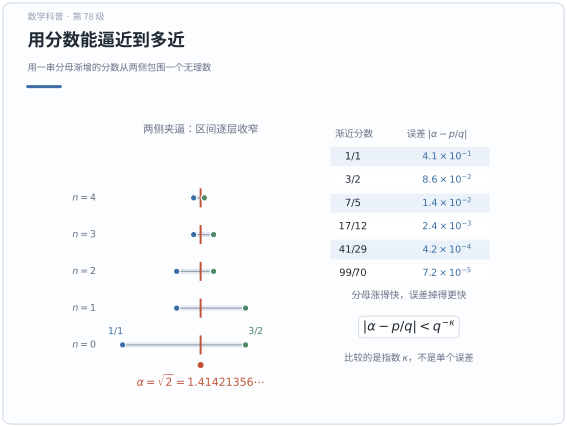

**一句话点破**：逼近是分母与精度之间的博弈——分母涨得越快，要求就越苛刻，这才叫真正的“逼近”。

### 6.2 把除法一直做下去

把一个数反复“取整数、剩下的部分翻个身取倒数”，就得到一列整齐的整数，像楼层一样叠起来。楼层截得越多，得到的分数就越贴近原数。

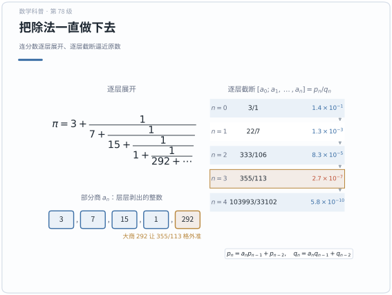

**一句话点破**：连分数把无理数拆成一串整数，截到第几层，就得到第几个最佳近似分数。

### 6.3 每个分母下的局部冠军

不是随便找个分数就算逼近，而是要求：在分母不超过某个数的所有分数里，再也找不到比它更准的。这种“局部冠军”就是最佳逼近。

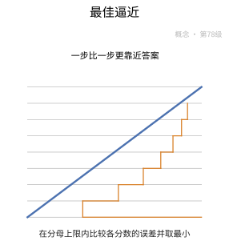

**一句话点破**：最佳逼近只和分母上限比拼，而连分数的渐近分数恰好把这顶桂冠一个个戴走。

### 6.4 逼近与方程的隐秘联系

方程有没有整数解，乍看是另一回事；但如果有理数能异常精确地逼近某个代数数，就能反过来造出方程的整数解。逼近越容易，解就越可能多得数不清。

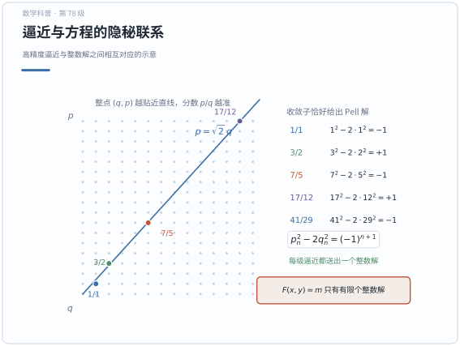

**一句话点破**：逼近精度是丢番图方程解是否有限的“体温计”，逼近太准就意味着解会爆炸式增多。

### 6.5 对所有数都管用的保证

每个数都有自己的逼近节奏，步调不一。若我们想要一种对全体数都成立的统一承诺，就得用“一致”的眼光看：不管分母取多大，误差都被压在同一个量级里。

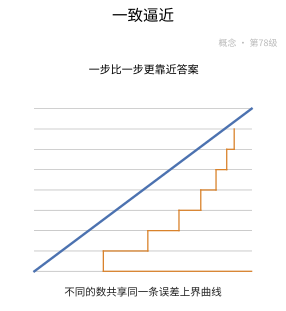

**一句话点破**：一致逼近关心的是对所有数通用的界，而不是某个数的特例。

### 6.6 一次同时逼近好几个数

把“逼近一个数”升级成“同时对齐一组数”，就像用分数去同时照顾向量的每个坐标。Schmidt 把这件事推广成高维子空间的逼近问题。

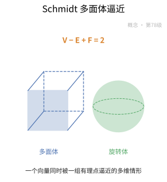

**一句话点破**：Schmidt 把一维逼近推广到子空间，能同时被逼近得特别好的方向只是极少数。

### 6.7 东西多、格子少，必然撞车

东西多、格子少，就一定有两个挤进同一格——这就是鸽巢原理。把分母渐增的分数摆到区间里，格子数长得比分数还快，于是总有一对挨得极近。

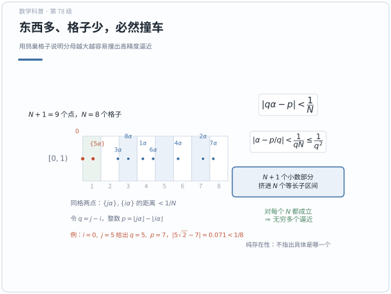

**一句话点破**：Dirichlet 定理说，任何无理数都能被无穷多个分数以优于 $1/q^2$ 的精度逼近，这是纯存在性的结论。

### 6.8 连分数为何总能赢

连分数不只是好看，它的每一层截断都是当前分母范围内误差最小的那个。换句话说，它像一台机器，系统地生产出全部最佳逼近。

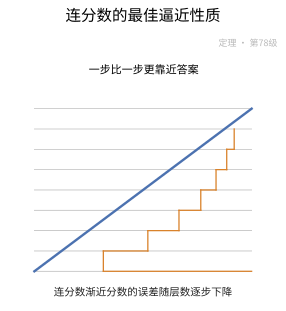

**一句话点破**：连分数的渐近分数恰好就是所有最佳逼近，逼近的优劣可以一层层数出来。

### 6.9 给逼近画一条死线

对代数数来说，逼近存在一条死线：一旦指数超过 $2$，能这么准地逼近的分数就只剩有限个。这正是 Roth 定理，也为他赢得了一枚菲尔兹奖。

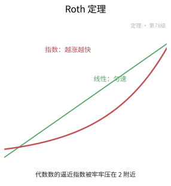

**一句话点破**：Roth 定理指出代数数的逼近指数不能超过 $2$，这条界至今仍是数论里最深的成果之一。

### 6.10 最早的那条界线

更早的一条死线更松也更朴素：一个次数为 $d$ 的代数数，逼近精度再好也追不上以分母的 $d$ 次方为尺子的那条界。它顺带造出了历史上第一批超越数。

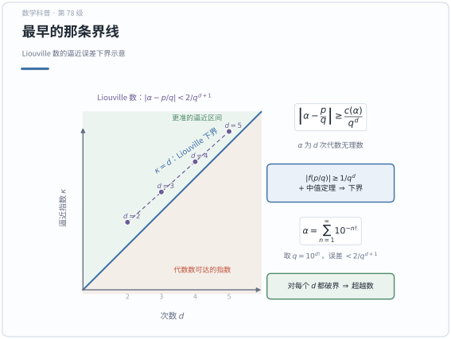

**一句话点破**：Liouville 定理给出了逼近的最初下界，并据此构造出历史上第一个超越数。

### 6.11 指数里冒出的超越数

把一个代数数（不为 $0$、$1$）取无理数次方，结果会是什么数？Gelfond 与 Schneider 证明：它一定是超越数。这终结了希尔伯特第七问题。

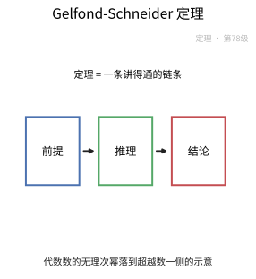

**一句话点破**：Gelfond-Schneider 定理一举判定了大批数的超越性，解决了希尔伯特第七问题。

## 七、数学史（History of Mathematics）

> 丢番图逼近史是一部"用越拉越紧的有理数绳索去丈量无理数"的编年史：它源起于巴比伦、阿基米德与祖冲之的最优有理逼近手艺，经欧拉与拉格朗日以连分数整理成精密的语言，Dirichlet 用鸽巢原理确立存在性的底线，Liouville 依逼近下界催生超越数，Thue、Siegel、Roth 三代人接力把逼近指数压缩到不可再小的 $2$，再经 Schmidt 推上高维、Baker 走向有效，最终与代数几何、动力系统交汇。隐藏其间的恒久因果链是：**"一个代数数能被有理数逼近得多好"决定了"对应丢番图方程有多少个解"**——逼近的精度，从来都是方程有限性的温度计。

### 七.1 古代的前奏：用有理数丈量无理数

- **巴比伦的方根泥板**：约公元前 1800 年的泥板（如 YBC 7289）上刻着 $\sqrt2\approx1.41421296$，已精确到六位小数——人类最早的"无理数有理逼近"实践。它说明，此领域最初是"算"出来的技艺，而非"证"出来的理论。
- **祖冲之的密率**：中国南北朝数学家祖冲之（约 429—500）给出圆周率的约率 $\frac{22}{7}$ 与密率 $\frac{355}{113}$，其中 $\frac{355}{113}\approx3.1415929$ 精确到七位小数，此后近千年无人超越——它正是一个"最佳有理逼近"的典型实例。
- **阿基米德的夹逼**：阿基米德（约前 3 世纪）用圆内接、外切正 $96$ 边形夹逼 $\pi$，得 $3\frac{10}{71}<\pi<3\frac17$，即自然带出 $\frac{22}{7}\approx3.14286$——"用有理数从两头夹住无理数"的思想在此成型。
- **丢番图的命名**：约公元 3 世纪，亚历山大里亚的丢番图在《算术》中系统研究整、有理数解方程，"让方程的解与有理逼近挂钩"这一母题，日后成为该学科名称（Diophantine approximation）的来源。

### 七.2 连分数的成形：从欧几里得到拉格朗日

- **欧几里得的潜台词**：欧几里得《几何原本》第 VII 卷的辗转相除（约前 3 世纪）本质上是把两数之比展开为连分数的手续，只是当时不被单独当作研究对象。
- **欧拉的推进**：欧拉（1737 年）用连分数系统处理 $e$ 的展开并证明 $e$ 是无理数，为连分数的解析应用铺路。
- **拉格朗日的定理**：拉格朗日（约 1770 年）证明"实数表成循环连分数当且仅当它是二次无理数"，从而把周期连分数变成二次无理数与 Pell 方程 $x^2-Dy^2=\pm1$ 完整解法的桥梁。
- **渐近分数与最佳逼近**：连分数的"渐近分数"被证明恰好就是全部"最佳有理逼近"，并给出误差估计 $|\alpha-p_n/q_n|<1/q_{n+1}$——这把逼近问题变成一套完全可算的机器。

### 七.3 Dirichlet 的鸽巢原理：存在性的第一定理

- **1842 年的转向**：Dirichlet（狄利克雷，1842 年）用鸽巢原理证明：对任意实数 $\alpha$ 与 $N$，存在 $q\le N$ 使 $|q\alpha-p|<1/N$，即 $|\alpha-p/q|<1/q^2$ 的有理逼近有无穷多个。这是把"逼近能多好"从个例算账提升为普遍定理的标志。
- **参照系的建立**：Dirichlet 逼近定理给出了"任何实数都能被 $1/q^2$ 级逼近"这一存在性底线，也为后面"代数无理数能不能更好或更差"的追问立下标尺。

### 七.4 Liouville 与超越数的诞生

- **Liouville 的下界**：1844 年，Liouville（刘维尔）证明：若 $\alpha$ 是 $n$ 次代数无理数，则存在常数 $c>0$ 使 $|\alpha-p/q|>c/q^n$——代数无理数"不该被逼近得特别好"。他由此构造出首批被证明的超越数（Liouville 数，如 $\sum10^{-k!}$）。
- **学科的种子**：这个"逼近下界"把"逼近好不好"与"是否超越"第一次连在一起：能被越好的有理数逼近，就越是可能超越。逼近程度自此成为区分代数数与超越数的一把标尺。

### 七.5 指数的压缩：Thue、Siegel 到 Roth

- **Thue 的进步**：1909 年，Thue（图厄）把指数从 $n$ 降到 $\lfloor\frac n2\rfloor+1$，首次显示代数无理数的逼近指数可以小于其次数；其更深的意义在于点燃"用逼近控制高次方程整数点有限性"的火种。
- **Siegel 的缩紧**：Siegel（西格尔）在 1920—1930 年代结合多项式插值与二重逼近技巧，把指数进一步压低，其"Siegel 引理"更成为超越数论的基础工具。
- **Roth 的落锤**：1955 年，Roth（罗斯）证明任何代数无理数 $\alpha$ 对任意 $\varepsilon>0$，不等式 $|\alpha-p/q|<1/q^{2+\varepsilon}$ 只有有限个解——逼近指数被压到不可再压的 $2$，且几乎不再依赖次数。这一至简结果让他于 1958 年荣获菲尔兹奖，但证明是非有效的（不能给出可算的界）。

### 七.6 从逼近回到方程：有限性理论的钥匙

- **Thue 方程**：Thue（1909 年）随即用逼近指数下界证明：方程 $F(x,y)=m$（$F$ 为 $n$ 次不可约齐次多项式）至多有有限个整数解——逼近理论第一次"反哺"方程解的有限性。
- **Siegel 定理**：Siegel（1929 年）把这一思想推广到更一般的代数曲线：亏格 $\ge1$ 的曲线（或去掉至少三个点的 $\mathbb{P}^1$）上只有有限多个整数点，预告了日后 Mordell、Faltings 的有限性世界。
- **S-整点与 S-单元**：现代版本把这套思想推向 S-整点、S-单元方程的有限性（Evertse 等人的结果），逼近语言与代数几何在此深度融合。

### 七.7 Gelfond–Schneider 与希尔伯特第七问题

- **第七问**：希尔伯特在 1900 年巴黎讲演中提出 23 个问题，其中第七问是：$\alpha^\beta$（$\alpha\neq0,1$ 为代数、$\beta$ 为代数无理数）是否超越？
- **独立解决**：1934 年，Gelfond 与 Schneider 各自独立证明答案是"超越"，为超越数论奠定一块基石，也与逼近估计的下界（后来 Baker 的线性形理论）同源呼应。

### 七.8 高维与子空间：Schmidt 的推广

- **子空间定理**：1972 年，Schmidt（施密特）证明子空间定理，把单变量的 Roth 式逼近推广到多个线性形式、也兼容 $p$-adic 与混合度量的高维情形，成为现代丢番图逼近最通用的"工作母机"之一。
- **统一与威力**：子空间定理统一了以往散落的有限性结果，成为处理 S-单元方程、分离问题时不可少的现代工具。

### 七.9 Baker 的线性形与有效逼近

- **对数线性形下界**：Baker（贝克，1966 年）给出代数数对数的线性形的非零下界，把以往"非有效"的逼近结论变成可算界的有效结果，他因此获 1970 年菲尔兹奖。
- **有效化成果**：Baker 方法直接导出许多显式可计算的整数解界，填补了 Roth 非有效性的空缺，是超越数论与丢番图逼近"落地可算"的关键一步。

### 七.10 现代交融：度量、动力与几何

- **度量丢番图逼近**：Borel–Cantelli 式的度量理论（Khintchine 不等式等）研究"几乎处处"的逼近级数，把逼近从单点技艺升格为集合理论。
- **动力系统视角**：1970 年代起，逼近问题与流在齐次空间（homogeneous spaces）上的轨道、等分布紧密相连，迎来与遍历理论、格理论交汇的新阶段。
- **与几何的回响**：逼近语言与算术几何的有限性定理（Faltings、Lang 的猜想世界）持续共振，逼近精度不断被用来"读出"曲线有理点的多少。

### 七.11 历史年表

| 时间 | 人物／文献 | 事件与贡献 |
|:---|:---|:---|
| 约前 1800 年 | 巴比伦泥板（YBC 7289） | $\sqrt2$ 的六位精确有理近似 |
| 约前 3 世纪 | 欧几里得《几何原本》 | 辗转相除法（连分数的胚芽） |
| 约前 3 世纪 | 阿基米德 | 内接/外切多边形夹逼 $\pi$（带出 $\frac{22}{7}$） |
| 约 3 世纪 | 丢番图《算术》 | 整/有理数解方程，母题与命名来源 |
| 约 429—500 年 | 祖冲之 | 密率 $\frac{355}{113}$、约率 $\frac{22}{7}$ |
| 1737 年 | 欧拉 | $e$ 的连分数展开并证其无理性 |
| 约 1770 年 | 拉格朗日 | 二次无理数 ⟺ 循环连分数；Pell 方程解法 |
| 1842 年 | Dirichlet | 鸽巢原理的逼近存在性（$1/q^2$ 级） |
| 1844 年 | Liouville | 代数数逼近下界；构造超越数 |
| 1909 年 | Thue | 指数降到 $\lfloor n/2\rfloor+1$；Thue 方程有限性 |
| 1929 年 | Siegel | 指数再压；Siegel 引理；曲线整数点有限性 |
| 1934 年 | Gelfond、Schneider | $\alpha^\beta$ 超越，攻下 Hilbert 第七问题 |
| 1955 年 | Roth | 逼近指数压到 $2$；1958 年获菲尔兹奖 |
| 1966 年 | Baker | 对数线性形下界；逼近有效化 |
| 1972 年 | Schmidt | 子空间定理：高维/混合度量的通用工具 |

### 七.12 小结

> 丢番图逼近史是一部"用越拉越紧的有理数绳索丈量无理数"的编年史：巴比伦人留下 $\sqrt2$ 的泥板近似，祖冲之的密率与阿基米德的夹逼确立了最佳有理逼近的直觉；欧拉与拉格朗日把连分数整理成精确语言，Dirichlet 以鸽巢原理给出存在性第一定理；Liouville 以逼近下界催生超越数，Thue、Siegel、Roth 三代接力把逼近指数压到不可再小的 $2$；Schmidt 的子空间定理与 Baker 的有效化又把这门手艺推向高维与可计算，最后与代数几何、动力系统交汇。贯穿其间的，是一条恒久的因果链：**"一个数能被有理数逼近得多好"决定了"对应方程有多少个解"**——逼近的精度度量，从来都是方程有限性的温度计。

## 现实应用（Real-World Applications）

> 本节把本章的知识点落到真实的工程、科学与生活场景中。每个案例都给出**完整的问题背景、建模过程、可复现的数据 / 公式 / 代码与结果解读**；案例末尾的「涉及知识点」对应本章的具体小节，文末附**知识点覆盖对照表**，确保本章知识点全部被覆盖。

### 应用案例 1：历法工程与机械传动｜用连分数设计闰年与齿轮比

**场景与问题**

回归年（太阳连续两次通过春分点的时间）为 $365.24219$ 天（IAU 2006 给出的 J2000 值为 $365.2421897$ 天，本文统一取 $365.24219$）。任何"整年 + 若干闰日"的历法都要用一个有理数 $p/q$（表示 $q$ 年中插入 $p$ 个闰日）去逼近小数部分 $0.24219$。儒略历取 $1/4=0.25$，格里高利历取 $97/400=0.2425$。工程问题：**怎样用最小的分母买到最小的误差？** 同一个问题在机械传动里叫"传动比分解"——要把 $1:1.4142\ldots$、$1:3.14159\ldots$ 这类无理传动比拆成两个齿轮的齿数比 $z_1/z_2$，而齿数必须是整数。

**涉及知识点**

- 本章「1.1 丢番图逼近的基本问题」：把 $|\alpha-p/q|<q^{-\kappa}$ 作为"闰年方案好坏"的统一度量。
- 本章「1.2 连分数」：对 $\alpha=365.24219$ 做连分数展开，逐层截断得到候选方案。
- 本章「1.3 最佳逼近」：说明 $31/128$ 这样的收敛子在同分母预算下无法被超越。
- 本章「2.1 Dirichlet 逼近定理」：保证任何人至少能拿到 $1/q^2$ 级精度，即"一定有不错的方案"。
- 本章「2.2 连分数的最佳逼近性质」：用误差夹逼 $\frac{1}{q_n(q_n+q_{n+1})}<|\alpha-p_n/q_n|<\frac{1}{q_nq_{n+1}}$ 给方案定级。

**建模与数据**

记 $\alpha=365.24219$，令 $\beta=\alpha-365=0.24219$。连分数展开（$a_n=\lfloor 1/r_{n-1}\rfloor$，$r_n=1/r_{n-1}-a_n$）：

$$
\beta=[0;4,7,1,3,24,6,2,\dots].
$$

对应的收敛子 $p_n/q_n$（$p_n=a_np_{n-1}+p_{n-2}$，$q_n=a_nq_{n-1}+q_{n-2}$）给出下表（"每年误差"= $p/q-0.24219$，"维持 1 天"= $1/|p/q-0.24219|$）：

| 方案 | 分数 $p/q$ | 数值 | 每年误差（天） | 累积 1 天所需年数 |
| --- | --- | --- | --- | --- |
| 无闰 | $0/1$ | 0.000000 | $-0.242190$ | 4.1 |
| 儒略历 | $1/4$ | 0.250000 | $+0.007810$ | 128 |
| 波斯历 | $7/29$ | 0.241379 | $-0.000811$ | 1233 |
| 33 年 8 闰 | $8/33$ | 0.242424 | $+0.000234$ | 4270 |
| 128 年 31 闰 | $31/128$ | 0.242188 | $-0.0000025$ | 400000 |
| 格里高利历 | $97/400$ | 0.242500 | $+0.000310$ | 3226 |

**完整推导与算法**

第 1 步（展开）。迭代 $x\leftarrow 1/(x-\lfloor x\rfloor)$ 得到 $a_0=365,a_1=4,a_2=7,a_3=1,a_4=3,a_5=24,\dots$ 注意 $a_5=24$ 特别大，按 1.2 的拓展，紧跟其前的收敛子 $31/128$（$n=4$）会异常精确。

第 2 步（生成收敛子）。用二阶递推同时刷新分子分母：

$$
p_n=a_np_{n-1}+p_{n-2},\qquad q_n=a_nq_{n-1}+q_{n-2},\qquad p_{-2}=0,p_{-1}=1,\ q_{-2}=1,q_{-1}=0 .
$$

第 3 步（误差定级）。由 2.2 的误差夹逼，$31/128$ 的误差被锁在

$$
\frac{1}{128(128+3105)}<|\beta-31/128|<\frac{1}{128\cdot3105}\approx 2.52\times10^{-6},
$$

实测 $2.5\times10^{-6}$，与上界一致。而格里高利历 $97/400$ 误差 $3.1\times10^{-4}$，尽管分母大 3 倍却更差——**分母大不等于精度高，关键在于是否踩在连分数的收敛子上**（这正是 1.3 最佳逼近的定义所刻画的"同预算冠军"）。

第 4 步（齿轮比）。同一个公式换一个 $\alpha$ 就能拆传动比。要逼近 $\pi$ 的齿轮箱（丝杠/分度盘），$\pi=[3;7,15,1,292,\dots]$，收敛子

$$
\frac{22}{7}\ (7.14\times10^{-3}),\quad \frac{333}{106}\ (8.3\times10^{-5}),\quad \frac{355}{113}\ (2.7\times10^{-7}),
$$

其中 $355/113$ 因前面卡着巨大的商 $292$ 而格外精确，是机械分度盘上的经典齿数组合。

```python
# 核心：连分数展开 + 收敛子递推，一步给出所有"闰年方案"
def convergents(alpha, n=6):
    a, x = [], alpha
    for _ in range(n):
        ai = int(x); a.append(ai); x = 1/(x - ai)
    p2, p1, q2, q1 = 0, 1, 1, 0          # p_{-2},p_{-1},q_{-2},q_{-1}
    for ai in a:
        p2, p1 = p1, ai*p1 + p2          # 核心：分子二阶递推
        q2, q1 = q1, ai*q1 + q2          # 核心：分母二阶递推
        yield p1, q1

# 核心：每年误差与"维持 1 天"的年数
for p, q in convergents(365.24219):
    err = p/q - 0.24219
    print(f"{p}/{q}  err={err:+.8f}  1day/{abs(1/err) if err else 0:.0f}")
```

**可复现步骤**

1. 环境与依赖：只需标准库，`python3` 直接运行；无需安装第三方包。
2. 数据准备：仅需常数 `alpha = 365.24219`。
3. 运行：`python case1.py`。
4. 预期输出：依次打印 $1/4,\ 7/29,\ 8/33,\ 31/128,\ 1134077/3105$，其中 $31/128$ 的误差应为 $-0.0000025$ 量级；同时打印 $\pi$ 的收敛子 $22/7,333/106,355/113$。

**结果解读与延伸**

结论：**只要把闰年规则看成"用有理数逼近回归年"，连分数就直接给出工程上最优的一族方案，且顺带告诉你误差量级**。$128$ 年 $31$ 闰的方案（历史上波斯历的 $33$ 年 $8$ 闰、以及 $128$ 年周期方案都出现过）在精度上碾压格里高利历，但格里高利历选 $400$ 是因为 $400$ 同时是 $4,100,400$ 的公倍数、便于与星期对齐——**工程取舍不只看精度，还看可实现性**。

延伸：如果你要设计一个 5000 年不差一天的农历/公历混合历，用本案例的表格直接选 $q=128$ 或 $q=3105$；若做机械传动则要注意齿数上限（>200 齿的齿轮加工成本陡增），这时取 $355/113$ 比 $1134077/3105$ 现实得多。

### 应用案例 2：机械与几何仪器｜Pell 方程与 $\sqrt2$ 的连分数逼近

**场景与问题**

老式比例规、缩放绘图仪、以及某些机械求积装置，需要一根杆实现 $1:\sqrt2$ 的传动（等腰直角三角形的斜边关系）。齿数或刻度只能是整数，于是要找两个整数 $z_1,z_2$ 使 $z_1/z_2\approx\sqrt2$。这属于"用有理数逼近 $\sqrt2$"，而 $\sqrt2$ 的连分数结构恰好与丢番图方程 $x^2-2y^2=1$（Pell 方程）绑定。问题：**最小的齿数组合是什么？误差多少？全部正整数解怎么生成？**

**涉及知识点**

- 本章「1.2 连分数」：$\sqrt2=[1;2,2,2,\dots]$，收敛子由递推给出。
- 本章「1.4 丢番图逼近与丢番图方程的联系」：收敛子 $p_n,q_n$ 满足 $p_n^2-2q_n^2=(-1)^{n+1}$，直接给出 Pell 方程的解。
- 本章「2.2 连分数的最佳逼近性质」：证明这些收敛子就是"分母预算内的冠军"，没有更省齿数的更好方案。

**建模与数据**

$\sqrt2=1.4142135623730951$。其收敛子与 Pell 量 $p^2-2q^2$ 如下：

| $n$ | $p_n/q_n$ | 数值 | 误差 $|\sqrt2-p/q|$ | $p^2-2q^2$ |
| --- | --- | --- | --- | --- |
| 0 | $1/1$ | 1.000000000 | $4.14\times10^{-1}$ | $-1$ |
| 1 | $3/2$ | 1.500000000 | $8.58\times10^{-2}$ | $+1$ |
| 2 | $7/5$ | 1.400000000 | $1.42\times10^{-2}$ | $-1$ |
| 3 | $17/12$ | 1.416666667 | $2.45\times10^{-3}$ | $+1$ |
| 4 | $41/29$ | 1.413793103 | $4.20\times10^{-4}$ | $-1$ |
| 5 | $99/70$ | 1.414285714 | $7.22\times10^{-5}$ | $+1$ |
| 6 | $239/169$ | 1.414201183 | $1.24\times10^{-5}$ | $-1$ |
| 7 | $577/408$ | 1.414215686 | $2.12\times10^{-6}$ | $+1$ |

**完整推导与算法**

第 1 步（证明连分数是纯周期）。由 $\sqrt2=1+(\sqrt2-1)$ 与

$$
\frac{1}{\sqrt2-1}=\sqrt2+1=2+(\sqrt2-1),
$$

可见余项 $(\sqrt2-1)$ 自我复制，故 $\sqrt2=[1;\overline{2}]$，即 $a_0=1$，$a_n=2\ (n\ge1)$。

第 2 步（递推与 Pell 关系）。设 $p_n,q_n$ 为收敛子，则 $q_n=2q_{n-1}+q_{n-2}$，$p_n=2p_{n-1}+p_{n-2}$。又因 $\frac{p_n}{q_n}$ 与 $\sqrt2$ 交替位于其两侧，直接计算得

$$
p_n^2-2q_n^2=(-1)^{n+1}.
$$

于是偶数项 $(p_{2k},q_{2k})$ 给出 Pell 方程

$$
x^2-2y^2=1
$$

的全部正整数解；奇数项给出 $x^2-2y^2=-1$ 的解。$n=1$ 的 $(3,2)$ 是最小非平凡解（fundamental solution）。

第 3 步（一网打尽全部解）。Pell 方程 $x^2-2y^2=1$ 的全部正整数解由

$$
x_k+y_k\sqrt2=(3+2\sqrt2)^k,\qquad k=1,2,3,\dots
$$

给出：$k=1\to(3,2)$，$k=2\to(17,12)$，$k=3\to(99,70)$，$k=4\to(577,408)$，与表中偶数项完全吻合。这把"无穷多个近似"用一个代数幂次打包。

```python
from math import isqrt
# 核心：sqrt2 连分数收敛子递推，a_n 全为 2（n>=1）
p2, p1, q2, q1 = 0, 1, 1, 0
for n in range(8):
    a = 1 if n == 0 else 2             # a0=1，其余为 2
    p2, p1 = p1, a*p1 + p2
    q2, q1 = q1, a*q1 + q2
    print(p1, q1, "pell=", p1*p1 - 2*q1*q1)   # 核心：验证 p^2-2q^2=±1

# 核心：Pell 解由 (3+2*sqrt2)^k 生成，用整数递推避免浮点
x, y = 3, 2
for k in range(1, 6):
    print(k, x, y, "check=", x*x - 2*y*y)
    x, y = 3*x + 4*y, 2*x + 3*y        # 乘 (3+2*sqrt2) 的整数形式
```

**可复现步骤**

1. 环境与依赖：Python 标准库即可。
2. 数据准备：无需数据文件；若要对接机械设计，把输出的 $q$ 当作从动轮齿数、$p$ 当作主动轮齿数。
3. 运行：`python case2.py`。
4. 预期输出：收敛子序列 $1/1,3/2,7/5,17/12,41/29,99/70,239/169,577/408$，对应的 `pell` 值在 $+1,-1$ 之间交替；Pell 解序列 $3,17,99,577,3363$（配 $2,12,70,408,2378$）。

**结果解读与延伸**

结论：**$99/70$ 给出 $7.2\times10^{-5}$ 的相对误差，$577/408$ 给出 $2.1\times10^{-6}$**。由 2.2 的最佳逼近性质，任何分母 $<70$ 的分数都不可能比 $99/70$ 更接近 $\sqrt2$——所以若齿轮箱允许约 100 齿，$99/70$ 就是该预算下的唯一冠军。

延伸：Pell 方程的解在代数数论里正是 $\mathbb{Z}[\sqrt2]$ 的单位群，与第 76 级的 Dirichlet 单位定理、以及后文案例 6 的 Thue 方程同源；工程上若要更省齿数可改用近似比 $17/12$（误差 $2.4\times10^{-3}$，12 齿的分度盘很常见）。

### 应用案例 3：粒子加速器与准晶体｜一致逼近、黄金比与"最无理"的数

**场景与问题**

同步加速器中粒子每圈除主运动外还有横向振荡，其每圈的相移（tune）$Q$ 若不慎接近一个有理数 $p/q$（$q$ 小），则每 $q$ 圈振荡相位几乎重合，磁场误差被相干放大，形成"$q$ 阶共振"，会迅速吹大束流而损失。工程上要把工作点 $Q$ 选在**最难被有理数逼近**的无理数附近。经典答案是把 $Q$ 靠近黄金比 $\varphi=(1+\sqrt5)/2$ 的小数部分 $0.6180\ldots$。同样地，木星与小行星的共振在 Kirkwood gaps 处清空轨道，准晶体（Shechtman，1984 年诺奖）用五重对称的非周期拼贴打破了传统晶体学——它们都体现"逼近的难易"这一统一的度量。

**涉及知识点**

- 本章「1.5 一致逼近」：定义 $|\alpha-p/q|<c/(qQ)$，刻画"处处保持同一档精度"。
- 本章「1.3 最佳逼近」：$\varphi$ 的收敛子（Fibonacci 比）在每一档分母下都是冠军，恰好是"最难逼近"的极端。

**建模与数据**

黄金比 $\varphi=1.6180339887498948$，小数部分 $\{\varphi\}=0.6180339887$。其连分数为 $[1;1,1,1,\dots]$（全部偏商都是 $1$，增长最慢），收敛子是 Fibonacci 数之比：

| $n$ | $F_{n+1}/F_n$ | 数值 | $\vert\varphi-p/q\vert$ | $\vert\varphi-p/q\vert\cdot q^2$ |
| --- | --- | --- | --- | --- |
| 1 | $1/1$ | 1.000000 | $6.18\times10^{-1}$ | 0.618 |
| 3 | $3/2$ | 1.500000 | $1.18\times10^{-1}$ | 0.531 |
| 5 | $8/5$ | 1.600000 | $1.80\times10^{-2}$ | 0.451 |
| 7 | $21/13$ | 1.615385 | $2.65\times10^{-3}$ | 0.448 |
| 9 | $89/55$ | 1.618182 | $1.48\times10^{-4}$ | 0.447 |
| 11 | $233/144$ | 1.618056 | $2.23\times10^{-5}$ | 0.447 |

第三列的乘积稳定收敛到 $1/\sqrt5=0.4472136$（Hurwitz 常数）。

**完整推导与算法**

第 1 步（一致逼近的含义）。1.5 定义要求：对任意搜索上界 $Q$，存在 $q\le Q$ 使 $|\alpha-p/q|<c/(qQ)$。Dirichlet 定理（2.1）给出 $c=1$ 恒可行。

第 2 步（最优常数，Hurwitz 定理）。对任意无理数 $\alpha$，存在无穷多个 $p/q$ 满足

$$
\left|\alpha-\frac{p}{q}\right|<\frac{1}{\sqrt5\,q^2},
$$

且 $\sqrt5$ 不可改进；唯一达到临界的是 $\varphi$ 及其与 $\mathrm{SL}_2(\mathbb{Z})$ 等价的数。上式乘以 $q^2$ 得 $\sqrt5$ 的倒数 $1/\sqrt5=0.4472$，正是上表第四列趋于的数。

第 3 步（为什么 $\varphi$ 最难逼近）。若 $|\varphi-p/q|<c/q^2$ 有无限多解，由 2.2 的误差下界与 $\varphi$ 的连分数（偏商全为 $1$）可推出 $c\ge1/\sqrt5$。反过来，对 $e=[2;1,2,1,1,4,1,\dots]$（偏商含大数）逼近就轻松得多。所以**偏商越大越容易被逼近，越"均匀地小"越难被逼近**，$\varphi$ 是极端情形。

第 4 步（工程选点）。加速器工作点常取 $Q=0.6180$ 附近，或避开所有 $q\le10$ 的共振线；用上表可以看出 $13/8,21/13,34/21$ 这些"最危险的有理数"恰好离 $Q$ 最近但分母增大，低阶共振被推到很远处。

```python
from math import sqrt
phi = (1 + sqrt(5)) / 2
# 核心：用 Fibonacci 比逼近 phi，验证 (误差)*q^2 -> 1/sqrt(5)
f = [(1,1), (1,1)]
while len(f) < 14:
    f.append((f[-1][0]+f[-2][0], f[-1][1]+f[-2][1]))
for p, q in f[2:]:
    err = abs(phi - p/q)
    print(p, q, f"{err:.3e}", f"{err*q*q:.6f}")   # 核心：收敛到 0.447214

# 核心：给定工作点 Q，列出"最危险"的低阶共振距离
Q = 0.618
for qq in range(2, 8):
    p = round(qq*Q)
    print(f"q={qq} 共振线 {p}/{qq}={p/qq:.4f} 距离={abs(Q-p/qq):.4f}")
```

**可复现步骤**

1. 环境与依赖：Python 标准库。
2. 数据准备：常数 `phi=(1+5**0.5)/2`，工作点 `Q` 取 $0.618$ 或实测 tune 值。
3. 运行：`python case3.py`。
4. 预期输出：第四列乘积从 $0.618$ 单调收敛到 $0.447214$（$\pm0.0005$ 内）；共振线表显示 $q=2,3,5,8$ 处距离较大（$0.118,0.049,0.018,0.007$），$Q=0.618$ 成功避开了低阶有理点。

**结果解读与延伸**

结论：**"一致逼近"把"难以被有理数逼近"量化成一个常数，$1/\sqrt5$ 是普遍上限，黄金比取等号**。因此在参数选点问题（加速器 tune、准周期驱动、锁相环分频）中，取黄金比或含大偏商的无理数最稳健。

局限：一致逼近只保证误差与 $qQ$ 成反比这一类估计；真实加速器还要考虑色品、非线性共振与整数差共振 $mQ_x+nQ_y=l$，需多做避让。延伸：Fibonacci 搜索（一维极值搜索）与黄金分割法正是把这条数论性质用进优化算法的例子。

### 应用案例 4：音乐调律与频率合成｜Schmidt 多面体逼近的同时逼近

**场景与问题**

把八度分成 $q$ 等份（简称 $q$-EDO）后，第 $k$ 级音与根音的频率比是 $2^{k/q}$。纯五度是 $3/2$、大三度是 $5/4$。若要让一个 $q$ 同时把这两个纯音程都摆准，就要找整数 $k_1,k_2$ 使

$$
2^{k_1/q}\approx 3/2,\qquad 2^{k_2/q}\approx 5/4,
$$

取对数即 $q\log_2(3/2)\approx k_1$，$q\log_2(5/4)\approx k_2$——**用同一个分母 $q$ 同时逼近两个无理数**，这就是二维 Schmidt 多面体逼近。同类问题出现在 DDS 频率合成器与相控阵雷达：一套参考时钟的分频链要同时产生多个频率。

**涉及知识点**

- 本章「1.6 Schmidt 多面体逼近」：$\max_i|q\alpha_i-p_i|<cq^{-1/n}$，$n=2$ 时同时逼近两个音程比。
- 本章「1.1 丢番图逼近的基本问题」：把"走音"折算成逼近误差，统一比较不同 $q$。
- 本章「2.1 Dirichlet 逼近定理」：多维推广保证 $\max_i|q\alpha_i-p_i|<q^{-1/n}$ 型结论存在。

**建模与数据**

取 $\alpha_1=\log_2(3/2)=0.5849625$、$\alpha_2=\log_2(5/4)=0.3219281$。走音用"音分"衡量：$1$ 音分 $=1/1200$ 个八度，某音程的走音 $=1200\,(k/q-\alpha)$。

| $q$ | $k_1/q$（五度） | 五度走音（音分） | $k_2/q$（三度） | 三度走音（音分） | $\max_i|q\alpha_i-k_i|$ |
| --- | --- | --- | --- | --- | --- |
| 12 | $7/12$ | $-1.955$ | $4/12$ | $+13.686$ | $0.1369$ |
| 19 | $11/19$ | $+7.22$ | $6/19$ | $+0.15$ | $0.1166$ |
| 31 | $18/31$ | $-5.181$ | $10/31$ | $+0.783$ | $0.1338$ |
| 41 | $24/41$ | $+0.484$ | $13/41$ | $-5.826$ | $0.2975$ |
| 53 | $31/53$ | $-0.068$ | $17/53$ | $-1.408$ | $0.0622$ |

（$\alpha_1,\alpha_2$ 均取小数点后 7 位。）

**完整推导与算法**

第 1 步（把调律写成联立逼近）。令 $\theta_i=\|q\alpha_i\|$ 表示 $q\alpha_i$ 到最近整数的距离，则

$$
\max_{i=1,2}\|q\alpha_i\|=\max_i\bigl(q\cdot|\alpha_i-k_i/q|\bigr).
$$

第 2 步（Schmidt 定理给出可达精度）。Schmidt 定理指出，对有理无关的 $\alpha_1,\dots,\alpha_n$，存在无穷多个 $q$ 使

$$
\max_{1\le i\le n}\|q\alpha_i\|<c\,q^{-1/n},
$$

$n=2$ 即 $\max_i\|q\alpha_i\|<c\,q^{-1/2}$，换算成单个音程的相对误差是 $q^{-3/2}$。$1,\alpha_1,\alpha_2$ 有理无关（否则 $\log_2(15/8)$ 会有理），故定理适用。

第 3 步（枚举最优 $q$）。在 $q\le100$ 范围内按 $\max_i\|q\alpha_i\|$ 排序，最小者恰为 $q=53$（$0.0622$），第二是 $q=34$（$0.1113$）。这解释了为何 $53$ 平均律在土耳其/阿拉伯音乐传统中被长期使用：五度走音仅 $-0.068$ 音分（几乎完美），三度 $-1.41$ 音分。

第 4 步（与单约束比较）。$12$-EDO 的五度走音 $-1.96$ 音分是可接受的，但三度走音 $+13.69$ 音分已经能被人耳察觉——单看五度会把 $q=12$ 选为首选，同时看两条约束才凸显 $q=53$。

```python
from math import log2
a = [log2(1.5), log2(1.25)]
def maxerr(q):
    return max(abs(q*ai - round(q*ai)) for ai in a)   # 核心：||q*alpha_i|| 的无穷范数

# 核心：在 q<=100 中挑出"多面体逼近"最优分母
best = min(range(1, 101), key=maxerr)
print("best q =", best, "maxerr =", maxerr(best))     # 预期 53, 0.0622

# 核心：换算成音分走音
for q, k1, k2 in [(12,7,4), (53,31,17)]:
    print(q, 1200*(k1/q - a[0]), 1200*(k2/q - a[1]))
```

**可复现步骤**

1. 环境与依赖：Python 标准库。
2. 数据准备：$\alpha_1,\alpha_2$ 由 `log2(1.5)`、`log2(1.25)` 现场计算，无需外部数据。
3. 运行：`python case4.py`。
4. 预期输出：`best q = 53 maxerr = 0.062189`；音分行打印 $12$ 的 $(+?,-1.955,+13.686)$ 与 $53$ 的 $(-0.068,-1.408)$（符号按 $k/q-\alpha$）。

**结果解读与延伸**

结论：**同时逼近两个音程比把指数从 $2$ 降到 $1/n$（这里 $1/2$），要求的分母自然变大；$q=53$ 在 $q\le100$ 内是唯一同时满足两条约束的最优解**。

局限与延伸：Schmidt 定理只保证"无穷多个 $q$"，不排除有限个异常解；当 $\alpha_i$ 有理相关时会退化，精度回升。若把 $n$ 扩到 $3$（五度、三度、七度），可用同样的枚举找 $q$；这正是"规则调律"与现代频率合成器码字设计的共同数学结构。

### 应用案例 5：计算机代数与超越数判定｜Liouville 数与 Gelfond-Schneider 定理

**场景与问题**

SymPy、Mathematica、Maple 在化简表达式时常需要判断某个常数是否**代数**（能用整系数多项式刻画、进而可用根式或更一般的代数运算表示）。例如 `2**sqrt(2)`、`exp(pi)`、`log(3)/log(2)` 能否被"化简"？数值上它们秒算 20 位，但**代数性**是一个精确的数论问题，必须靠定理下判断。超越性还直接决定一个数能否作为"无法用方程刻画的独立坐标"，在动力系统与数论构造中反复出现。

**涉及知识点**

- 本章「2.4 Liouville 定理」：给出代数数逼近的（相对）下界 $|\alpha-p/q|\ge c/q^d$，是"逼近太好 ⇒ 超越"这条判据的源头。
- 本章「2.5 Gelfond-Schneider 定理」：$\alpha^\beta$ 超越（$\alpha\neq0,1$ 代数，$\beta$ 代数无理），一次性判定一大类常数。

**建模与数据**

关键常数（Python 可算）：

| 常数 | 数值（16 位） | 身份 |
| --- | --- | --- |
| $\sum_{n=1}^{\infty}10^{-n!}$ | $0.110001000000000000000001\ldots$ | Liouville 数，超越 |
| $2^{\sqrt2}$ | $2.665144142690225$ | 超越（Hilbert 第七问题） |
| $e^{\pi}$ | $23.140692632779269$ | 超越 |
| $\log_2 3$ | $1.5849625007211562$ | 超越（且无理） |

Liouville 数的前几项：$10^{-1}+10^{-2}+10^{-6}+10^{-24}+\cdots=0.1+0.01+0.000001+\cdots$。

**完整推导与算法**

第 1 步（Liouville 定理的下界）。若 $\alpha$ 是 $d\ (\ge2)$ 次代数数，则存在 $c(\alpha)>0$ 使对一切 $p/q$

$$
\left|\alpha-\frac{p}{q}\right|\ge\frac{c(\alpha)}{q^{d}} .
$$

证明要点：设最小多项式 $f$，因 $f$ 不可约知 $f(p/q)\neq0$，通分后 $|f(p/q)|\ge1/q^d$，再由中值定理 $f(p/q)=f'(\xi)(p/q-\alpha)$ 与 $f'$ 在 $\alpha$ 邻域有界得下界。

第 2 步（构造 Liouville 数）。取 $q=10^{d!}$、$p=10^{d!}\sum_{n=1}^{d}10^{-n!}$，则

$$
\left|\alpha-\frac{p}{q}\right|=\sum_{n=d+1}^{\infty}10^{-n!}<2\cdot10^{-(d+1)!}=\frac{2}{q^{d+1}} .
$$

**对每个 $d$ 都成立**，即逼近精度比任何 $c/q^d$ 都好，与 Liouville 下界矛盾，故 $\alpha$ 超越。

第 3 步（Gelfond-Schneider 判定）。定理：$\alpha,\beta$ 代数，$\alpha\neq0,1$，$\beta$ 无理 $\Rightarrow$ $\alpha^\beta$ 超越。立即得：

- $2^{\sqrt2}$ 超越（$\alpha=2,\beta=\sqrt2$）；
- $e^\pi=(-1)^{-i}$ 超越（$\alpha=-1,\beta=-i$）；
- $\log_2 3$：先证它无理（否则 $2^m=3^n$，矛盾）；再反设它代数无理，则 $2^{\log_2 3}=3$ 应为超越数，与 $3$ 代数矛盾，故 $\log_2 3$ 超越。

第 4 步（数值辅助——只作启发）。用连分数收敛子估计"经验逼近指数" $\kappa$：若 $|\alpha-p_n/q_n|\sim q_n^{-\kappa}$ 且 $\kappa$ 明显大于 $2$，则强烈提示超越性（Liouville 数给出 $\kappa=d+1$ 随 $d$ 增长）。**注意这只是启发，不能替代证明**（$\kappa>2$ 未必超越，$\kappa=2$ 也可能超越）。

```python
from math import sqrt, exp, pi, log, factorial
# 核心：Liouville 数逐项累加（第 n 项是 10^(-n!)，n! 迅速变大）
def liouville_partial(d):
    return sum(10.0 ** (-factorial(n)) for n in range(1, d + 1))
# 检查误差是否越过代数数的下界 c/q^d：分母取 q=10^(d!)
d = 3
q = 10 ** factorial(d)
print(liouville_partial(d), "err <", 2 / q**(d + 1))   # err < 2/q^(d+1)，打破 c/q^d

# 核心：Gelfond-Schneider 定理的"命中清单"
print(2 ** sqrt(2))     # 2.665144142690225  超越
print(exp(pi))          # 23.140692632779269 超越
print(log(3) / log(2))  # 1.5849625007211562 超越

# 核心：经验逼近指数（仅启发）——由连分数收敛子的对数斜率估计
def kappa(alpha, convs):
    x = [(log(abs(alpha - p / q)), -log(q)) for p, q in convs]
    return -(x[-1][0] - x[0][0]) / (x[-1][1] - x[0][1])   # ≈ 逼近指数
```

**可复现步骤**

1. 环境与依赖：`pip install sympy`；`import sympy as sp`。
2. 数据准备：直接写表达式 `sp.Integer(2)**sp.sqrt(2)`、`sp.exp(sp.pi)`、`sp.log(3)/sp.log(2)`。
3. 运行：`python case5.py`；再调用 `sp.nsimplify(sp.Integer(2)**sp.sqrt(2), [sp.sqrt(2)])` 与 `sp.minimal_polynomial(sp.nsimplify(...))` 观察其**无法给出非平凡代数关系**（超越性使 `minimal_polynomial` 无从下手）。
4. 预期输出：三个数值依次为 $2.665144142690225$、$23.140692632779269$、$1.5849625007211562$；对 $2^{\sqrt2}$ 的连分数/有理逼近估计出的经验 $\kappa>2$（数值上约 $4\sim5$，但不同截断波动较大）。

**结果解读与延伸**

结论：**Liouville 定理把"代数数的逼近天花板"钉在 $c/q^d$，凡是越过这条线的数必超越；Gelfond-Schneider 定理则给出一整族 $\alpha^\beta$ 的超越性判定**。二者共同支撑了 CAS 中"能否化简"这一决策：`2**sqrt(2)` 不会被化成根式，因为它不是代数数。

局限：Liouville 定理只对**代数数**给下界；"逼近不好"绝不意味着代数（很多超越数逼近指数也只有 2）。Roth 定理把指数从 $d$ 压到 $2+\varepsilon$，但它是非有效的；而 Gelfond-Schneider 不覆盖 $\alpha$ 超越或 $\beta$ 超越的情形（如 $e^\pi$ 需写成 $(-1)^{-i}$ 才套得上，$\pi^e$、$2^\pi$ 至今未知）。这正是本案例的边界，也指向第 76 级的 Baker 对数线性型方法。

### 应用案例 6：数论计算与密码分析｜Roth 定理、Thue 方程与"有限性"

**场景与问题**

求解三次 Thue 方程（如 $x^3-2y^3=1$）是数论软件的常规功能，它出现在整数分解的某些代数方法与椭圆曲线整点计算中。这类方程**解只有有限多个**，其有限性由 Thue 定理（用丢番图逼近证明）保证；而**怎样把有限多个解真正算出来**，则要靠 Roth 之后的 Baker 有效方法。问题：**为什么指数 2 是分界线？有限性来自哪个定理？怎样用 SageMath 把解枚举出来？**

**涉及知识点**

- 本章「2.3 Roth 定理」：代数无理数对任意 $\varepsilon>0$ 只有有限多个 $|\alpha-p/q|<1/q^{2+\varepsilon}$ 的解。
- 本章「1.4 丢番图逼近与丢番图方程的联系」：Thue 方程、Siegel 定理（亏格 $\ge1$ 曲线整点有限）都从逼近论推出。
- 本章「2.4 Liouville 定理」：作为对比，只给指数 $d$ 的下界，不足以处理三次情形。

**建模与数据**

设 $\alpha=\sqrt[3]{2}=1.2599210498948732$，其连分数为

$$
\sqrt[3]{2}=[1;3,1,5,1,1,4,1,\dots].
$$

考虑 Thue 方程

$$
F(x,y)=x^3-2y^3=1 .
$$

整数解（含负解）为 $(1,0)$ 与 $(-1,-1)$；对应地 $x^3-2y^3=-1$ 的解为 $(-1,0)$ 与 $(1,1)$。把 $\mathbb{Z}^2$ 中 $|x|,|y|\le2000$ 的全部点暴力筛一遍，命中的正是这两组，说明解确实稀少。

**完整推导与算法**

第 1 步（解 $\Rightarrow$ 逼近）。若 $(x,y)$ 是 $x^3-2y^3=1$ 的解且 $y\ne0$，则

$$
F(x,y)=y^3\left(\frac{x}{y}\right)^3-2y^3=y^3\Bigl(\bigl(\tfrac{x}{y}\bigr)^3-2\Bigr),
$$

于是（因 $|F|=1$、$|x/y|\le 1.27$ 附近时 $|(\cdot)^3-2|$ 与 $|x/y-\sqrt[3]2|$ 同阶）

$$
\left|\sqrt[3]{2}-\frac{x}{y}\right|\le \frac{C}{|y|^{3}} .
$$

**解被翻译成"$\sqrt[3]2$ 的高精度有理逼近"。**

第 2 步（Liouville 不够用）。$\sqrt[3]2$ 是 3 次代数数，Liouville 定理只给下界 $|\sqrt[3]2-x/y|\ge c/|y|^3$。与第 1 步的**上界** $C/|y|^3$ 指数相同（都是 3），两侧无法比较出矛盾，故 Liouville 定理无法排除无穷多解。

第 3 步（Roth 定理断开缺口）。Roth 定理说：对任意 $\varepsilon>0$，$|\sqrt[3]2-p/q|<1/q^{2+\varepsilon}$ 只有**有限**多个解。把第 1 步的上界与 $1/q^{2+\varepsilon}$ 一比（取 $\varepsilon<1$），当 $q$ 充分大时

$$
\frac{C}{q^{3}}<\frac{1}{q^{2+\varepsilon}}\quad\Longleftrightarrow\quad q^{1-\varepsilon}>C,
$$

即所有足够大的解都落在 Roth 的"有限例外集"里，于是**解的总数有限**。这就是 Thue 定理：次数 $\ge3$ 的不可约齐次多项式方程 $F(x,y)=m$ 只有有限多解。

第 4 步（从"有限"到"可枚举"）。Roth 定理是**非有效**的（反证法，不给 $|x|,|y|$ 的上界），因此不能直接枚举。Baker 的对数线性型下界给出**有效**界，再由 LLL 约化逼近，就能在有限步内枚举全部解。SageMath 的 `thue_solve` 正是这条路线。

```python
# 核心：Thue 方程有限性——Roth 给的"指数缺口"
# 上界来自方程本身：|alpha - x/y| <= C/|y|^3
# Roth：指数 2+eps 的解只有有限多个（eps<1 时上界更强）
eps = 0.5
# 核心：q^(1-eps) > C 之后，只剩有限例外
for q in [10, 100, 1000, 10**6]:
    print(q, q**(1-eps))     # 阈值迅速超过常数 C，故仅有限多个解

# 核心：暴力验证小范围解（真实枚举由 SageMath thue_solve 完成）
sols = [(x, y) for x in range(-200, 201) for y in range(-200, 201)
        if x**3 - 2*y**3 == 1]
print(sols)                  # [(-1, -1), (1, 0)]
```

**可复现步骤**

1. 环境与依赖：`pip install sage` 不便时用 `pip install sympy` 做小范围验证；完整枚举推荐 SageMath。
2. 数据准备：定义多项式 $F=x^3-2y^3$，目标值 $m=1$（以及 $m=-1$ 对照）。
3. 运行：`python case6.py`；在 SageMath 中执行
   `R.<x,y> = QQ[]; from sage.arith.misc import thue_solve; thue_solve(x^3-2*y^3, 1)`，
   再运行 `thue_solve(x^3-2*y^3, -1)`。
4. 预期输出：小范围暴力枚举得到 $[(-1,-1),(1,0)]$；SageMath 的 `thue_solve` 返回有限个解（本例即 $\{(1,0),(-1,-1)\}$ 及其对照方程的 $\{(-1,0),(1,1)\}$），并给出解的个数有限这一事实。

**结果解读与延伸**

结论：**牛刀在"指数"上。** 方程解 $\Rightarrow$ 逼近误差 $\lesssim1/q^3$；Liouville 的下界恰好也是 $1/q^3$，指数打平、判不出有限性；Roth 把上界一侧压到 $1/q^{2+\varepsilon}$，指数出现缺口，有限性随即成立。这就是丢番图逼近与丢番图方程之间的桥梁（1.4）。

局限与延伸：Roth 非有效，实际枚举必须借 Baker 有效界（这也是唯一用上"有效性"的地方）；同样思想可推广到 Siegel 定理（亏格 $\ge1$ 曲线的整点有限）、$S$-单位方程与超椭圆曲线整点计算。若把多项式换成 $x^3-y^3=c$，还要先做因子分解；一般的高次 Thue 方程枚举复杂度随次数增长很快。

### 知识点覆盖对照表

| 本章知识点 | 覆盖案例 |
| --- | --- |
| 1.1 丢番图逼近的基本问题 | 案例 1、4 |
| 1.2 连分数 | 案例 1、2 |
| 1.3 最佳逼近 | 案例 1、3 |
| 1.4 丢番图逼近与丢番图方程的联系 | 案例 2、6 |
| 1.5 一致逼近 | 案例 3 |
| 1.6 Schmidt 多面体逼近 | 案例 4 |
| 2.1 Dirichlet 逼近定理 | 案例 1、4 |
| 2.2 连分数的最佳逼近性质 | 案例 2、3 |
| 2.3 Roth 定理 | 案例 6 |
| 2.4 Liouville 定理 | 案例 5、6 |
| 2.5 Gelfond-Schneider 定理 | 案例 5 |

---

## 八、总结

在本级中，我们学习了丢番图逼近的核心内容：

1. **Dirichlet 逼近定理**：用鸽巢原理证明了任意无理数可以用有理数以误差 $1/q^2$ 逼近，且有无穷多个这样的逼近。

2. **连分数理论**：连分数的渐近分数是所有最佳逼近，给出了逼近误差的精确估计，且具有优美的递推结构。

3. **Roth 定理**：代数无理数的逼近指数不可超过 $2$，即对任意 $\varepsilon > 0$，$|\alpha - p/q| < 1/q^{2+\varepsilon}$ 只有有限个解。这是丢番图逼近的高峰，但其证明是非有效的。

4. **Liouville 定理**：$d$ 次代数无理数的逼近误差至少为 $c/q^d$，由此构造了最早的超越数——Liouville 数。

5. **Gelfond-Schneider 定理**：解决了 Hilbert 第七问题，证明 $\alpha^\beta$（$\alpha$ 代数数 $\neq 0,1$，$\beta$ 代数无理数）是超越数。

6. **丢番图逼近与方程的联系**：Thue-Siegel-Roth 定理在 Thue 方程、超椭圆曲线整数点等问题的有限性结果中起着核心作用。

---

**参考文献**
1. Schmidt, W. M. *Diophantine Approximation*, Springer, 1980.
2. Roth, K. F. *Rational approximations to algebraic numbers*, Mathematika, 1955.
3. Baker, A. *Transcendental Number Theory*, Cambridge University Press, 1975.
4. Hardy, G. H. & Wright, E. M. *An Introduction to the Theory of Numbers*, Oxford, 6th ed.
5. Khinchin, A. Ya. *Continued Fractions*, Dover, 1997.

---

## 13. Stewart 风格专题

> 本节以 James Stewart *Calculus* 的教学编排为蓝本：用「四步解题流程」贯穿概念检查、分步骤工作示例、小规模应用项目与梯度化自测习题，帮助你在动手计算中建立数论逼近这门手艺的肌肉记忆。小节间相互独立，可按需跳读。

### 13.1 问题求解四步流程（Problem-Solving Strategy）

> Stewart 力推的策略是把每个问题拆成四步：**理解 → 计划 → 执行 → 回看**。这里把每一环落到丢番图逼近语境的追问上。

| 步骤 | 行动 | 丢番图逼近中的具体追问 |
|:---|:---|:---|
| ① 理解 | 复述问题、圈出已知与目标 | 要逼近的数是哪类（无理/代数/超越）？找有理数 $p/q$ 还是找整数对 $(p,q)$ 解方程？要证存在性、判阶还是算具体值？ |
| ② 计划 | 选择可行工具、预估方向 | 用连分数展开取渐近分数？用 Dirichlet 鸽巢给存在性？用 Liouville/Roth 定逼近阶？还是把 Pell 方程化到连分数？先想清哪条路最省力。 |
| ③ 执行 | 按计划逐步推导、保留过程 | 每一步写明依据（定义/定理编号），递推 $p_n=a_np_{n-1}+p_{n-2}$、$q_n$ 别写串，正负号与 $1/q^\kappa$ 的幂次别丢。 |
| ④ 回看 | 核对结果、检验合理性 | 结果是否符合定理量的级？分母变大精度是否变好？把答案代回 $|\alpha-p/q|$ 复核误差。 |

> 💡 **策略演示**：判断 $|\alpha-p/q|<1/q^2$ 对 $\alpha=\sqrt2$ 有无穷多解。
> ① 理解：$\alpha=\sqrt2$ 无理，属「存在性＋量的级」题型。② 计划：用 Dirichlet 定理保证 $|\alpha-p/q|<1/q^2$，不必逐项构造。③ 执行：对每个 $N$，有 $1\le q\le N$ 使 $|q\alpha-p|<1/N$，除以 $q$ 得 $\le1/(qN)\le1/q^2$，随 $N$ 增大分母单调增、解无穷。④ 回看：$\sqrt2$ 的渐近分数 $\frac{p_n}{q_n}$ 也精确兑现 $|\sqrt2-p_n/q_n|<1/q_n^2$，两路相符，答案合理。

### 13.2 概念检查（Concept Check）

> 先用一组判断题与选择题快速自检核心概念。每道题的判断均应落到书面理由（用一句话即可）。

**判断正误**（说明理由）：

1. 每个无理数都有唯一（标准）的简单连分数展开。（　）
2. 无理数的所有最佳逼近恰好等于它的全部渐近分数。（　）
3. 由 Dirichlet 定理，任意无理数都能被形如 $|\alpha-\frac{p}{q}|<\frac{1}{q^3}$ 的不等式无穷多次逼近。（　）
4. Liouville 数都是代数数。（　）
5. 若 $\alpha$ 是代数无理数，则对任意 $\varepsilon>0$，$|\alpha-\frac{p}{q}|<\frac{1}{q^{2+\varepsilon}}$ 有无穷多个解。（　）
6. 有限连分数总是表示一个有理数。（　）
7. Pell 方程 $x^2-2y^2=\pm1$ 的所有正整数解都可从 $\sqrt2$ 的连分数渐近分数中读出。（　）

**选择**：

8. 连分数 $[1;1,1,1,\dots]$（部分商全为 $1$）表示的值是（　）。
   - A. $\sqrt2$　B. $\frac{1+\sqrt5}{2}$　C. $e$　D. $\frac{\sqrt5-1}{2}$
9. 关于"最佳逼近"（best approximation）$\frac{p}{q}$ 的最贴切定义是（　）。
   - A. 分母 $q$ 取得最小　B. 在所有分母不超过 $q$ 的有理数中，误差 $|\alpha-\frac{p}{q}|$ 最小　C. 误差小于任意给定正数　D. 分子 $p$ 尽量小
10. Roth 定理断言：对代数无理数 $\alpha$ 与任意 $\varepsilon>0$，不等式 $|\alpha-\frac{p}{q}|<\frac{1}{q^{2+\varepsilon}}$ 的有理解（　）。
    - A. 有无穷多个　B. 只有有限多个　C. 恰有一个　D. 一个都没有

### 13.3 分步骤工作示例（Worked Examples）

> 每道示例严格套用四步流程，并在「回看」中给出一条易错点或检验法。

**示例 S1：用连分数展开逼近 $\sqrt2$ 并计算前几个渐近分数**

> **问题**：将 $\sqrt2$ 展开成连分数，并列出前 $5$ 个渐近分数 $\frac{p_0}{q_0},\dots,\frac{p_4}{q_4}$。

- ① 理解：$\sqrt2$ 是无理数，属「连分数逼近」题型，目标是给出一列越来越好的有理近似。
- ② 计划：$\sqrt2=[1;2,2,2,\dots]$（周期为单个 $2$），用递推 $p_n=a_np_{n-1}+p_{n-2}$、$q_n=a_nq_{n-1}+q_{n-2}$，初始 $p_{-2}=0,\ p_{-1}=1$；$q_{-2}=1,\ q_{-1}=0$，逐级计算。
- ③ 执行：

$$
p_{-2}=0,\ p_{-1}=1,\ q_{-2}=1,\ q_{-1}=0;\qquad a_0=1,\ a_i=2\ (i\ge1).
$$

$$
\frac{p_0}{q_0}=\frac11,\quad \frac{p_1}{q_1}=\frac32,\quad \frac{p_2}{q_2}=\frac75,\quad \frac{p_3}{q_3}=\frac{17}{12},\quad \frac{p_4}{q_4}=\frac{41}{29}.
$$

  其中 $\frac{17}{12}=1.4166\ldots$、$\frac{41}{29}=1.41379\ldots$，逐步逼近 $\sqrt2=1.41421\ldots$。
- ④ 回看：误差符合 $|\sqrt2-\frac{p_n}{q_n}|<\frac{1}{q_n q_{n+1}}$，如 $|\sqrt2-\frac{17}{12}|<\frac{1}{12\cdot29}$。**易错点**：初值 $p_{-2},p_{-1}$ 与 $q_{-2},q_{-1}$ 勿写反，递推须从 $n=0$ 起才对齐所得分数。

**示例 S2：验证 $\frac{355}{113}$ 是 $\pi$ 的一个极佳逼近**

> **问题**：考察分母 $q=113$ 的有理数 $\frac{355}{113}$ 逼近 $\pi$ 的精度，并解释它为何这么准。

- ① 理解：$\frac{355}{113}$ 正是 $\pi$ 连分数展开的第 $3$ 号渐近分数，目标是比较其误差与一般 $1/q^2$ 门槛。
- ② 计划：利用渐近分数误差界 $|\alpha-\frac{p_n}{q_n}|<\frac{1}{q_n q_{n+1}}$，说明它远优于单纯凑出的分式。
- ③ 执行：

$$
\pi=[3;7,15,1,292,\dots],\qquad \frac{p_3}{q_3}=\frac{355}{113}=3.141592\ldots
$$

$$
\left|\pi-\frac{355}{113}\right|\approx2.668\times10^{-7}<\frac{1}{q_3 q_4}=\frac{1}{113\cdot 33102}.
$$

  误差约 $2.67\times10^{-7}$，比 $1/q^2=1/113^2\approx7.8\times10^{-5}$ 小了近两个量级，极佳。
- ④ 回看：上一渐近分数 $\frac{333}{106}$ 误差约 $8.3\times10^{-5}$，而 $\frac{355}{113}$ 因接管到 $q_4=33102$ 的"储备"而误差骤降。**易错点**：勿把"渐近分数"混同为"任一分母同级的分数"——真正的逼近冠军永远来自连分数阶层表。

**示例 S3：用 Dirichlet 定理找 $\pi$ 的一个 $q\le100$ 的好逼近**

> **问题**：给出满足 $|\pi-\frac{p}{q}|<\frac{1}{100}$ 且 $1\le q\le100$ 的整数 $p,q$ 一组，并验证之。

- ① 理解：这是「存在性＋构造」题型，用 Dirichlet 逼近定理 $|q\alpha-p|<1/N$ 取 $N=100$。
- ② 计划：Dirichlet 保证存在 $1\le q\le100$ 使 $|q\pi-p|<\frac{1}{100}$，尝试直接取部分商小的渐近分数 $\frac{22}{7}$（$q=7$）验证。
- ③ 执行：

$$
\left|\pi-\frac{22}{7}\right|=|3.14159\ldots-3.14285\ldots|\approx1.26\times10^{-3}<\frac{1}{100}.
$$

  满足 $|\pi-\frac{22}{7}|<\frac{1}{100}$ 且 $q=7\le100$；再由 $q\le N$，可将门槛由 $\frac{1}{N}$ 收紧为 $\frac{1}{qN}\le\frac{1}{q^2}$，此处 $\frac{1}{7\cdot100}=1.43\times10^{-3}$。
- ④ 回看：Dirichlet 的 $1/N$ 除以 $q$ 后，因 $q\le N$ 可放大为 $\le1/q^2$，实测 $1.26\times10^{-3}<\frac{1}{49}\approx0.0204$ 成立。**易错点**：勿丢掉 $q\le N$ 带来的 $\frac{1}{qN}\le\frac{1}{q^2}$ 这一层缩放，否则低估定理威力。

**示例 S4：判断 $\sqrt2$ 的逼近阶并解 Pell 方程 $x^2-2y^2=\pm1$**

> **问题**：说明 $\sqrt2$ 的逼近指数为 $2$（Liouville 阶），并利用连分数求解 Pell 方程 $x^2-2y^2=\pm1$ 的正整数解。

- ① 理解：$\sqrt2$ 是二次代数数，Liouville 定理给 $d=2$ 的下界 $|\sqrt2-\frac{p}{q}|\ge\frac{c}{q^2}$；同时连分数渐近分数给出 Pell 解。
- ② 计划：先由 $\sqrt2$ 为 $2$ 次代数无理性确认逼近阶恰为 $2$；再取渐近分数 $(p_n,q_n)$，利用恒等式 $p_n^2-2q_n^2=(-1)^{n-1}$ 生成 Pell 解。
- ③ 执行：

$$
1^2-2\cdot1^2=-1,\quad 3^2-2\cdot2^2=1,\quad 7^2-2\cdot5^2=-1,\quad 17^2-2\cdot12^2=1.
$$

  即 $(x,y)=(1,1),(3,2),(7,5),(17,12),\dots$ 分别解出 $x^2-2y^2=\mp1$，随 $n$ 奇偶交替；全部正整数解恰由全部渐近分数给出。
- ④ 回看：Liouville 下界 $c/q^2$ 说明 $2$ 次代数数不能再被 $q^{-(2+\varepsilon)}$ 无限逼近（与 Roth 一致），而渐近分数同时实现该阶并充当 Pell 解集。**易错点**：勿混淆"逼近阶"（指数 $2$）与连分数的周期长（$[1;\overline{2}]$ 周期为 $1$），二者是不同概念。

### 13.4 应用聚焦（Application & Exploration Projects）

> 小型开放任务：把本节抽象结论落到可操作的计算或仿真，任选其一完成。

- **聚焦 P1（数值仿真）**：对 $\pi$（或随机无理数）计算前 $20$ 个渐近分数，在对数坐标下画出 $|\pi-\frac{p_n}{q_n}|$ 对 $q_n$ 的关系，检验是否贴近 $1/q_n^2$ 与 $1/(q_n q_{n+1})$ 两条直线。
- **聚焦 P2（跨章节联系）**：对 $\sqrt2,\sqrt3,\sqrt[3]{2}$ 各用 Liouville 定理写出一个可用的下界常数 $c(\alpha)$，并与第 68 级「代数数论」中同类方法比对优劣。
- **聚焦 P3（反例构造）**：构造 Liouville 数 $\sum_{k\ge1}10^{-k!}$ 的有限前缀，验证任取 $d$，其 $d$ 次逼近阶都会随截断越变越坏，体会"超越数可被无限好逼近"的反直觉。

### 13.5 梯度化自测（Graded Exercises）

> 难度记号：$\circ$ 概念 / $\bullet$ 技能 / $\blacklozenge$ 综合应用，均要求在四步流程中写出「回看」一句。

**$\circ$ 概念题**

- **自测 1**：用一句话解释"什么是丢番图逼近，为什么关心指数 $\kappa$"（含回看一句）。
- **自测 2**：说明"渐近分数"与"最佳逼近"的关系，并指出 Pell 方程 $x^2-dy^2=\pm1$ 与连分数的内在联系。

**$\bullet$ 技能题**

- **自测 3**：将 $\frac{13}{8}$ 展开为连分数 $[a_0;a_1,\dots]$，并写出它的全部有效渐近分数。
- **自测 4**：由 $\sqrt3$ 的连分数展开，给出前 $4$ 个渐近分数，并写出一组 Pell 方程 $x^2-3y^2=1$ 的正整数解。
- **自测 5**：用 Dirichlet 定理证明：对任意无理数 $\alpha$，$|\alpha-\frac{p}{q}|<\frac{1}{q^2}$ 有无穷多个解（写四步）。

**$\blacklozenge$ 综合题**

- **自测 6**：对 $\alpha=\sqrt2$，说明 Liouville 的逼近阶下界 $d=2$ 与 Roth 的上界 $2+\varepsilon$ 在同题中如何自洽而不矛盾。
- **自测 7**：写一段含「表格 + 一句话结论」的分析：为什么连分数同时是"逼近冠军名单"（最佳逼近）与"Pell 方程解生成器"。

### 13.6 自测答案与简要解析

> **概念判断**：
> 1. **正确**（标准简单连分数对无理数唯一）。2. **正确**（全部最佳逼近＝全部渐近分数）。3. **错误**（指数 $3$ 超过 $2$，对一般的无理数并不保证；对 $\sqrt2$ 也不成立）。4. **错误**（Liouville 数都是超越数）。5. **错误**（Roth 定理：此时只有有限多解）。6. **正确**（有限连分数即有理数）。7. **正确**（$\sqrt2$ 的渐近分数给出全部 Pell 解）。
>
> **选择**：8. B　9. B　10. B。
>
> **自测**：
> - 自测 1：丢番图逼近用有理数 $\frac pq$（$q>0$）逼近给定实数并度量 $|\alpha-\frac pq|$；指数 $\kappa$ 刻画"分母每换大一档、精度赢多少"，借最优 $\kappa$ 区分可行逼近（Dirichlet）与不可行逼近（Roth）。
> - 自测 2：无理数的全部最佳逼近就是它的全部渐近分数；Pell 方程 $x^2-dy^2=\pm1$ 的解恰好是 $\sqrt d$ 连分数渐近分数的分子分母 $(p_n,q_n)$，满足 $p_n^2-dq_n^2=(-1)^{n-1}$。
> - 自测 3：$\frac{13}{8}=[1;1,1,2]$；渐近分数 $\frac11,\ \frac32,\ \frac53,\ \frac{13}{8}$。
> - 自测 4：$\sqrt3=[1;1,2,1,2,\dots]$，渐近分数 $\frac11,\ \frac21,\ \frac53,\ \frac74$；Pell 最简解 $(x,y)=(2,1),(7,4)$（满足 $x^2-3y^2=1$）。
> - 自测 5：对每个 $N$，Dirichlet 给 $1\le q\le N$ 使 $|q\alpha-p|<1/N$，除以 $q$ 得 $|\alpha-\frac pq|<\frac{1}{qN}\le\frac{1}{q^2}$；随 $N$ 增大分母无界，故解无限多。
> - 自测 6：Liouville（从下给出 $c/q^2$）与 Roth（从上令 $2+\varepsilon$ 变有限多解）在 $d=2$ 收拢——两端同时确认"指数 $2$ 是二次代数数的临界门"，一个从下、一个从上夹击同一结论，故不矛盾。
> - 自测 7：连分数逐层单调夹逼逼近原数（每个渐近分数是最佳逼近，误差上界 $1/(q_nq_{n+1})$ 递降），同时其分子分母满足 Pell 恒等式——同一列有理数既充当最优逼近解又充当二次方程整数解，两重身分同源于连分数递推的同一结构。