# 第79级 几何数论 (Geometry of Numbers)

---

## 从"往一面大镜子前的蜂窝上看"说起：几何数论要解决的根问题

> 在背"格""凸体""Minkowski 定理"这些术语之前，先想清楚一件事：**"数一堆整数坐标的点"，为什么能靠"哪个凸体藏得下它"来回答？**

**第一步：直觉——把"整数点"和"几何体"摆到同一张桌上**

想想奶茶店的积分板：一整块墙上全是整数坐标的孔（格点，如 $(0,0)$、$(1,3)$……），密密麻麻排成整齐的方阵。现在拿一张以原点为中心、足够大的圆片盖上去——你几乎可以凭直觉肯定：**只要这张圆片够大，圆心里就必然至少套中一个非原点的孔**。随便一盖，十有八九能罩住至少一颗。

可问题是：**圆片到底得"多大"，才保证一定罩住？** 换成不是圆的形状（方盒、六边形、奇形怪状的凸体）又怎么算？这就是几何数论最朴素又最深刻的追问：**几何体的大小（体积）跟"必然套中格点"之间，藏着一条怎样精确的门槛？**

**第二步：要解决的问题——把"数/型/群"的离散问题翻译成"几何体/体积"的连续问题**

几何数论由 Minkowski 在 19 世纪末开创，它的核心动机是把看起来"各自为政"的数论问题，一次性焊接进同一个几何框架：

- **数点**：圆里、双曲线下到底有多少格点？（高斯圆问题、Dirichlet 除数问题）——用面积估格点，误差来自边界一圈。
- **解不等式**：能不能找一组整数同时满足 $|L_i(x)|<c_i$？（Minkowski 线性型定理）——这是"求联立逼近、解 Pell 方程"的通用工具。
- **把"离散"逼出来**：第 76 级里 Dirichlet 单位定理、类数有限这些纯代数结论，竟然都能用"往球里数格点"的 Minkowski 凸体定理一刀斩获。
- **最密堆积**：在固定密度下，一个格能把最短的非零向量做多长？（Hermite 常数）——它与球填充、格密码（SVP/CVP）直接挂钩。

一句话：**几何数论用一把"体积"的尺子，去量"格点"和"代数结构"这些离散对象——只要容器足够大、够对称，离散的点就藏不住。**

**第三步：正式定义前的准备——本章怎样一步步推进**

1. 先立好**格与凸体**这两个主角，说清格的行列式（点之疏密）与凸体的对称性；
2. 用**Blichfeldt 定理**承接鸽巢原理，再长出**Minkowski 凸体定理**——"越够大的对称凸体必含非零格点"；
3. 把它翻译成**线性型定理**（联立逼近）与 **Minkowski 约化**（二次型的标准形）；
4. 用 **Minkowski-Hlawka 定理**反向告诉你"多小的陷阱能被某张严谨的格网避开"；
5. 最后亮出**格点计数**（高斯圆/除数问题）与对代数数论的**回馈**（单位定理、类数有限）。

读完你会发现：处处都在用"大小"买"存在"——这是离散数学最美妙的一笔买卖。

> **🧠 一句话记住几何数论的"出生证"**
>
> 几何数论诞生于"把整数的性质翻译成凸体的体积"的洞见。它的根本问题是：
>
> $$ \boxed{\text{一个足够大且对称的几何体，何时必然含有一颗非零的整数格点？又能用体积推出哪些离散的算术结论？}} $$

## 开始之前

**本章在讲什么**：本章研究"格点（离散）"与"凸体（连续）"之间的互动。你会学到格、基本区域与行列式、凸体与对称凸体，再到三条核心定理——Blichfeldt 定理（体积超格则差为格点）、Minkowski 凸体定理（大对称凸体必含非零格点）、Minkowski 线性型定理（联立不等式解），然后是 Minkowski-Hlawka 定理、二次型的 Minkowski 约化，以及高斯圆问题、Dirichlet 除数问题这两个格点计数经典，最后回馈到单位定理与类数有限的代数数论应用。

**为什么要学它**：第 76 级（代数数论）我们靠理想、类群做起了"局部–整体"，可到底怎么拿到"类数有限""单位定理"？答案恰恰是几何数论这把"体积手术刀"。第 78 级（丢番图逼近）研究"用有理数逼近无理数"，其联立逼近技巧正是 Minkowski 线性型定理的直接化身。本章是第 76、78 级的几何引擎，也为第 141 级（朗兰兹纲领）下的自守形式与模格、以及现代后量子密码（LWE、NTRU、格基约化 LLL）提供地基。

**开始前请确认你还记得**：

- 凸集、体积与高维欧氏空间的基本直觉（见第 14 级 线性代数、第 16 级 解析几何）。
- 整数线性组合、$\mathbb{Z}^n$、幺模矩阵换基，熟知"换基不改变格"（见第 27 级 初等数论、第 14 级）。
- 代数整数环、范数、判别式、单位群与理想类数（见第 76 级 代数数论）——第 3.2 节把 Minkowski 定理喂给它们。
- 二次型的正定性与矩阵行列式（见第 14 级）。
- Riemann Zeta 函数 $\zeta(n)$ 的最基本求和（见第 75 级 解析数论）——Minkowski–Hlawka 定理会用到。

## 学习目标

1. 理解格与凸体的基本理论，掌握 Minkowski 定理的核心思想
2. 掌握 Blichfeldt 定理、Minkowski 凸体定理与线性型定理的证明
3. 了解 Minkowski-Hlawka 定理及其在格点覆盖中的应用
4. 掌握二次型的 Minkowski 约化理论
5. 了解格点计数问题：高斯圆问题与 Dirichlet 除数问题

---

## 一、核心概念

### 1.1 格

**定义 1.1（格）** 设 $V = \mathbb{R}^n$ 是 $n$ 维欧氏空间。$\mathbb{R}^n$ 中的一个 **格**（lattice）$\Lambda$ 是一个离散的加法子群，且 $\Lambda$ 张成 $\mathbb{R}^n$。等价地，$\Lambda$ 可以表示为
$$
\Lambda = \left\{ \sum_{i=1}^n a_i v_i \mid a_i \in \mathbb{Z} \right\},
$$
其中 $\{v_1,\dots,v_n\}$ 是 $\mathbb{R}^n$ 的一组基。

**定义 1.2（基本区域）** 格 $\Lambda$ 的一个 **基本区域**（fundamental domain）是 $\mathbb{R}^n$ 中的一个区域 $F$，使得 $\mathbb{R}^n$ 是 $\Lambda$ 的所有平移像 $F + \lambda$（$\lambda \in \Lambda$）的不交并。标准的基本区域是 **基本平行多面体**：
$$
\mathcal{F} = \left\{ \sum_{i=1}^n t_i v_i \mid 0 \le t_i < 1 \right\}.
$$

**定义 1.3（行列式）** 格 $\Lambda$ 的 **行列式**（determinant）定义为 $\det(\Lambda) = |\det(v_1,\dots,v_n)|$，即基本区域的体积。行列式是格的不变量，不依赖于基的选择。

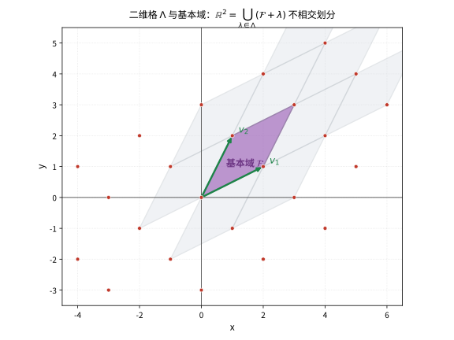

> **直观理解（现实类比）**：格就像一块块"蜂窝瓷砖"的顶点，而基本域 $\mathcal{F}$ 就是其中一块标准瓷砖。把这块瓷砖沿着格点方向反复平移，就能像铺地板一样把整面墙天衣无缝地铺满，任何两块瓷砖既不重叠也不留缝。瓷砖的"面积"就是格的行列式 $\det\Lambda$，它衡量了格点的疏密：瓷砖面积越小，格点越密（每单位面积的格点数恰为 $1/\det\Lambda$）。
>
> **🧠 思考历程：一堆离散的格点，怎么就能通过"大凸集必含非零格点"闯出几何数论？**
>
> 几何数论的开端颇具戏剧性：**数学家想知道一坨"足够大的对称凸体"里，何时必然藏着一颗非零格点**。Minkowski 把这个问题从几何直觉扭成了深刻的算术定理，也让"格"第一次成了数论的主角。
>
> - **格：代数坐标的"蜂窝"**（19 世纪）。在研究二元二次型与单位定理时，数学家早已暗中与格点打交道——每个格的离散骨架都来自整数系数坐标。Richard Dedekind 与 Hermann Minkowski 在这一带发力，把"数"的问题翻译成"格点"的语言。
> - **Minkowski 凸体定理：几何一拳定音**（1890 年代）。Hermann Minkowski 在 1890 年代证明了核心的 Minkowski 定理：关于原点对称、体积超过 $2^n\det\Lambda$ 的凸体必含非零格点。妙处在于他同时配套发展出"格基约化"（Minkowski 约化）与连续体几何，使一整套"用体积换格点"的方法得以运转。
> - **Minkowski 的兑现：单位定理与理想类界的统一**（1890–1900 年代）。他最漂亮的胜利是把这套几何法用于数域：用凸体定理一举证明 Dirichlet 单位定理并给出理想类数有限的上界。人们这才看清——原来纯代数的结论，也能被"往球里数格点"这种几何手术一刀擒获。
> **心路**：离散与连续看似水火不容，Minkowski 却用"凸体＋体积"把它们焊在了一起。几何数论提醒我们：**离散的结构，常常能在足够大的连续容器里被"逼"出来**。

> **🔑 为什么重要**：格 $\Lambda$ 是本级一切定理的"位移网格"——Blichfeldt 的"差在 $\Lambda$ 中"、Minkowski 的"含非零 $\Lambda$ 点"全都挂在 $\Lambda$ 上。真正起作用的不变量是**行列式** $\det\Lambda$（单位体积内的格点数 $=1/\det\Lambda$），它是"点有多密"的客观标尺：$2^n\det\Lambda$ 这条门槛、Minkowski 约化的最优基，都建立在"行列式=基本区域体积"这一守恒上。把数域中的代数整数环 $\mathcal{O}_K$ 经对数嵌入铺成格，再用凸体定理去算体积，正是第 76 级单位定理与类数有限的几何引擎。

> **常见坑**：(1) **别把"格"当成随意的点阵**——它必须是"加法子群"且由 $n$ 个整系数基向量张成，故 $\{0,1,0\}$ 这种只有三个点的集合、或"只含有限多个点"的离散集都不是格（见习题 12）；(2) **换基必须是 $\mathbb{Z}$-幺模阵**（行列式 $\pm1$），否则换出的是不同格，行列式也会变；(3) **别混淆"行列式"跟"向量长度"**：$\det\Lambda$ 是基本区域的**体积**，不是某个基向量的长度，二者维度不同、尺度不同。

#### 课堂问答

**老师**：你既然说格是"离散的加法子群"，那么一个只含有限多个点的离散子集，为什么不算格？

**学生**：因为格还要"张成整个 $\mathbb{R}^n$"。有限点集无论怎么取整系数组合，都是有限集，永远张不出 $n$ 维空间；而 $\mathbb{Z}^n$ 的整系数组合能逼近任意实点方向上的任意倍数，这才张满 $\mathbb{R}^n$。三条缺一不可：加法子群、离散、张成。

**老师（追问）**：换一组基还能得到同一个格吗？需要什么条件？

**学生**：当且仅当两组基之间的过渡矩阵 $U$ 满足 $U \in \mathrm{GL}_n(\mathbb{Z})$ 且 $|\det U|=1$ 时，才生成同一个格。若矩阵是整数但行列式不等于 $\pm 1$，它把 $\mathbb{Z}^n$ 映成真子格，得到的是另一个格。

**老师（拓展）**：那行列式 $\det\Lambda$ 为什么是不变量？它在度量什么？

**学生**：因为 $\det\Lambda=|\det(v_1,\dots,v_n)|$ 恰是基本区域的体积，而换基只乘 $|\det U|=1$，体积不变，故与基选择无关。它度量格点的疏密：单位体积内的格点数恰为 $1/\det\Lambda$，所以疏密完全由这一标尺决定。

### 1.2 凸体

**定义 1.4（凸体）** $\mathbb{R}^n$ 中的一个 **凸体**（convex body）是一个有界、凸、具有非空内部的闭集。凸体 $K$ 称为 **对称的**（symmetric），如果 $x \in K$ 蕴含 $-x \in K$。

> **💡 直观理解（类比）**：凸体就像"没有凹进去的实心坚果"：在它内部任意取两点连线，整条线段都还躺在身子里（不会凹陷）。"对称"则要求它关于原点对称——像一颗以原点为轴的完美图章，左半边恰好是右半边的镜像。圆盘、方盒、椭圆都是典型代表。

#### 课堂问答

**老师**：凸体要求"有界、闭、非空内部、凸"，能不能省掉"对称"这一条？省掉会出什么问题？

**学生**：不能。对称（$K=-K$）是 Minkowski 定理证明的关键——把 $x-y$ 搬成 $(x-y)/2$ 时要用到 $-y\in K$。不对称的凸体再大也可能整体躲进一个基本区域，从而绕开所有非零格点。凸、有界、闭、非空内部则保证体积有限且取极值时边界不塌陷。

**老师（追问）**：那如果把"凸"换成更大的一类"关于原点星形"区域，定理还成立吗？

**学生**：不成立。证明里 $\frac{x+(-y)}{2}\in K$ 这一步完全依赖凸性，去掉它整条推理就断了。星形区域可以做得很大却仍不含格点，比如细长带凹口的风车状区域，所以凸性是本质的。

**老师（拓展）**：为什么既要有界又要闭？

**学生**：有界保证 $\mathrm{vol}(K)<\infty$，否则"体积门槛"这句话没有意义；闭保证极限点与边界点仍属于 $K$，使得等号情形（推论 2.1）能取到格点。二者都是让"用体积比较、用极值取点"得以成立的技术基础。

### 1.3 临界行列式

**定义 1.5（临界行列式）** 设 $K$ 是 $\mathbb{R}^n$ 中的凸体。$K$ 的 **临界行列式**（critical determinant）定义为
$$
\Delta(K) = \inf\{ \det(\Lambda) \mid \Lambda \text{ 是格，且 } \Lambda \cap \operatorname{int}(K) = \{0\} \}.
$$
即使得格点（除原点外）不落在 $K$ 内部的格的最小可能行列式。

> **💡 直观理解（类比）**：临界行列式就像"问这颗糖要藏多密才能躲过捕兽夹"：$K$ 是一块陷阱区域，我们想找一个"格点网"，让网眼尽量稀疏（行列式尽量大）却还保证除原点外没有任何网眼点落进陷阱内部。行列式的下确界 $\Delta(K)$ 就是"躲猫猫的最优布局"，网眼一旦比它还密，就必然会踩中陷阱。

#### 课堂问答

**老师**：临界行列式 $\Delta(K)$ 的定义里写的是 $\operatorname{int}(K)$，能换成 $K$ 本身吗？

**学生**：一般不能随意换。用内部是为了让落在 $K$ 边界上的格点不算"踩进陷阱"，使"避开"成为一个对格的开条件；换成闭包 $K$ 会把边界情形也算进去，$\Delta$ 的取值可能变化。这个细节在边界恰好相切时尤其重要。

**老师（追问）**：那为什么定义里要取下确界 $\inf$，而不是干脆取最小值？

**学生**：因为最优格常常"取不到"，只能被逼近。行列式略大一点都能躲开内部，但行列式压到 $\Delta(K)$ 这个临界值时，可能没有任何一个格恰好满足，只能有一列格无限逼近。取 $\inf$ 正是为了避免"最优格不存在"的尴尬。

**老师（拓展）**：$\Delta(K)$ 与 Minkowski-Hlawka 定理是什么关系？

**学生**：Minkowski-Hlawka 给出的是一个上界 $\Delta(K)\le \mathrm{vol}(K)/(2\zeta(n))$，意思是"总能找到足够稀疏的格躲开 $K$"。而精确的 $\Delta(K)$ 对绝大多数凸体极难求出，我们通常只掌握这种指数级的界。

### 1.4 连续最小值

**定义 1.6（连续最小值）** 设 $\Lambda$ 是 $\mathbb{R}^n$ 中的格，$K$ 是 $\mathbb{R}^n$ 中的凸体。$\Lambda$ 关于 $K$ 的 **第 $i$ 个连续最小值**（successive minimum）$\lambda_i$ 定义为最小的 $\lambda > 0$，使得 $\lambda K$ 包含 $i$ 个线性无关的格点。

> **💡 直观理解（类比）**：连续最小值就像"一个不断放大的气泡，依次探测到第几个格点"：把 $K$ 一路吹大 $i$ 卷（$\lambda K$），第一个吹到 $i$ 个彼此不共线的格点的时刻，就是 $\lambda_i$。于是 $\lambda_1\le\lambda_2\le\cdots$ 像"先后叫到号的柜台"，$\lambda_1$ 对应最短非零格点的长度。

#### 课堂问答

**老师**：连续最小值满足 $\lambda_1\le\lambda_2\le\cdots$，其中 $\lambda_1$ 的几何含义究竟是什么？

**学生**：$\lambda_1$ 是最小的 $\lambda>0$ 使 $\lambda K$ 含一个非零格点。当 $K$ 取单位球时，$\lambda_1=\min_{x\in\Lambda\setminus\{0\}}\|x\|$，正是最短非零向量长度，也就是最短向量问题（SVP）的解长。

**老师（追问）**：定义里强调"含 $i$ 个线性无关的格点"，为什么不干脆说"含 $i$ 个不同格点"？

**学生**：因为不同格点可能共线。若只要"不同"就计数，$\lambda_i$ 会被同一条直线上的点轻易满足，失去"第 $i$ 维"的含义。要求线性无关后，$\lambda_1,\dots,\lambda_n$ 才分别对应格在 $n$ 个独立方向上的伸展，$\lambda_i$ 才真正标定第 $i$ 个方向。

**老师（拓展）**：那么连续最小值与行列式之间有没有必然联系？

**学生**：有，就是 Minkowski 第二定理：$\lambda_1\lambda_2\cdots\lambda_n\le \frac{2^n}{\omega_n}\det\Lambda$，其中 $\omega_n$ 是单位球体积。它是"体积守恒"在格上的体现——各方向最短长度的乘积不能远小于行列式，否则格点的密度就对不上了。

### 1.5 Hermite 常数

**定义 1.7（Hermite 常数）** $n$ 维 **Hermite 常数** $\gamma_n$ 定义为
$$
\gamma_n = \sup_{\Lambda} \frac{\min_{x \in \Lambda \setminus \{0\}} \|x\|^2}{(\det \Lambda)^{2/n}},
$$
其中上确界取遍所有 $n$ 维格 $\Lambda$。$\gamma_n$ 衡量了格中非零最短向量的长度的平方与行列式的 $2/n$ 次幂之间的最大可能比值。

> **💡 直观理解（类比）**：Hermite 常数就像"在所有铺法里，冠军格能塞下多长的最短格点"：把每条格子里最短的那根"梁"测出来并除以"每单位面积该摊多少"，再看哪个格在固定密度下梁最长。$\gamma_n$ 就是这个"车间里谁能把最短零件做最长"的世界纪录，二维桂冠由六角蜂蜜格（$\gamma_2=2/\sqrt3$）摘得。

已知 $\gamma_1 = 1$，$\gamma_2 = 2/\sqrt{3}$，$\gamma_3 = \sqrt[3]{2}$，$\gamma_4 = \sqrt{2}$，$\gamma_5 = \sqrt[5]{8}$，$\gamma_6 = \sqrt[6]{64/3}$，$\gamma_7 = \sqrt[7]{64}$，$\gamma_8 = 2$。

> **🔑 为什么重要**：连续最小值与 Hermite 常数是"格到底能装下多短的非零向量"的量化：$\lambda_1$ 就是**最短向量问题（SVP）**的解长，$\lambda_1\cdots\lambda_n$ 与 $\det\Lambda$ 之间隔着 Minkowski 的系统不等式 $\lambda_1\cdots\lambda_n\le O(1)\det\Lambda$。Hermite 常数 $\gamma_n$ 则是"固定密度下最短向量能长多长"的**世界纪录**——它和实心球最密堆积直接挂钩（最优格往往是 $E_8$、Leech 这类高对称自对偶格），同时也决定格基约化算法的逼近因子（LLL 能逼近到 $2^{O(n)}\lambda_1$），是现代格密码安全参数的理论源头。

#### 课堂问答

**老师**：Hermite 常数用 $\|x\|^2/(\det\Lambda)^{2/n}$ 定义，为什么分母要乘 $2/n$ 次幂，而不是直接除以 $\det\Lambda$？

**学生**：为了在整体缩放 $\Lambda\mapsto c\Lambda$ 下保持不变。缩放 $c$ 时 $\|x\|^2$ 乘 $c^2$、$(\det\Lambda)^{2/n}$ 也乘 $c^2$，比值不变，于是 $\gamma_n$ 只依赖维度、是真正的不变量。若直接除以 $\det\Lambda$，缩放会把比值放大到无穷，上确界就没有意义了。

**老师（追问）**：$\gamma_2=2/\sqrt3$ 对应的是哪种格？为什么偏偏它最优？

**学生**：对应六角格（等边三角形格），它实现平面最密堆积。它的 Voronoi 域在固定密度下最"圆"，把最短向量撑得最长，故取到上确界。方形格对应的值是 $1$，明显小于 $2/\sqrt3\approx1.155$。

**老师（拓展）**：为什么说 $\gamma_n$ 与最密球堆积直接挂钩？

**学生**：因为 $\gamma_n$ 度量"固定密度下最短向量能多长"，这等价于格点的球填充半径最大化。最优格往往带高对称（如 $E_8$、Leech 格），其中心密度就由 $\gamma_n$ 驱动；例如 $\gamma_8=2$ 正是来自 $E_8$，它给出了八维最密堆积。

### 1.6 格点计数与高斯圆问题

**高斯圆问题**：设 $N(R)$ 为半径为 $R$ 的圆 $x^2 + y^2 \le R^2$ 内的整数格点个数。高斯证明了
$$
N(R) = \pi R^2 + O(R).
$$
即面积 $\pi R^2$ 加上一个误差项，误差项的数量级不超过 $R$。改进误差项是数论中著名的未解决问题。

**Dirichlet 除数问题**：设 $D(x)$ 为双曲线 $uv \le x$ 下整数格点 $(u,v)$ 的个数（$u,v > 0$）。Dirichlet 证明了
$$
D(x) = x \log x + (2\gamma - 1)x + O(\sqrt{x}),
$$
其中 $\gamma$ 是 Euler-Mascheroni 常数。改进误差项同样是著名的未解决问题。

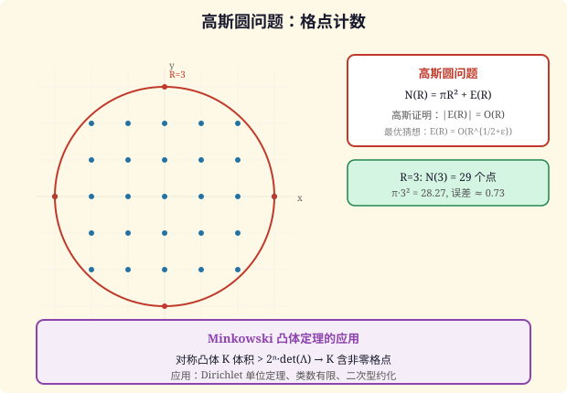

> **直观理解（现实类比）**：高斯圆问题就像"数蜂巢里的蜜蜂"。想象一个以原点为中心的圆形蜂巢（半径 $R$），每个格点是一个蜂房。高斯的方法是用圆面积 $\pi R^2$ 来估算蜂房总数——这就像用蜂巢的总面积乘以"每单位面积的蜂房密度"来估算。误差来自圆周附近的"不完整蜂房"——有些蜂房一半在圆内一半在圆外。改进误差项 $O(R^\theta)$ 中的 $\theta$，就是数学家们努力缩小"边界模糊区域"的竞赛。

---

#### 课堂问答

**老师**：高斯证明 $N(R)=\pi R^2+O(R)$，主项为什么恰是 $\pi R^2$，误差又为什么是 $O(R)$？

**学生**：因为每个整数格点占一个单位面积，$N(R)$ 本质是"圆截住了多少格"，主项自然是被圆围住的面积 $\pi R^2$。误差来自圆周附近"半进半出"的格子带，这条带的宽度是常数、长度是周长量级 $O(R)$，所以误差不超过 $O(R)$。

**老师（追问）**：误差项真的只能停在 $O(R)$ 吗？

**学生**：没有，这正是著名未解决问题。目前已把指数改进到 $O(R^\theta)$ 且 $\theta<1$，任何人把 $\theta$ 压到 $1/2$ 以下都是重大突破；已知下界是 $\Omega(R^{1/2})$，上下界之间这段鸿沟至今未补平。

**老师（拓展）**：Dirichlet 除数问题与它有共同的结构吗？

**学生**：有。两者都是"用面积（或积分主项）估计格点数，误差由区域边界逼近决定"。除数问题的误差是 $O(\sqrt{x})$，其改进同样悬而未决，$\sqrt{x}$ 附近的指数正是最难越过的卡点。

## 二、定理与证明

### 2.1 Blichfeldt 定理

**定理 2.1（Blichfeldt 定理）** 设 $\Lambda$ 是 $\mathbb{R}^n$ 中的一个格，$S \subset \mathbb{R}^n$ 是一个可测集，且 $\operatorname{vol}(S) > \det(\Lambda)$。则存在两个不同的点 $x,y \in S$，使得 $x - y \in \Lambda$。

> **💡 直观理解（类比）**：Blichfeldt 定理就像"一袋毛线比一张纹样纸还大，必然有两处花纹对得上"：把空间按格瓦片折叠回去，只要面积超过一格，折叠后必然有重叠，重叠处相差一个格向量。它是"鸽巢原理"在连续几何里的化身，也是后面所有 Minkowski 定理的地基。

**证明**：

设 $\mathcal{F}$ 是 $\Lambda$ 的一个基本区域（例如基本平行多面体）。将 $\mathbb{R}^n$ 划分为 $\mathcal{F}$ 的 $\Lambda$-平移：
$$
\mathbb{R}^n = \bigcup_{\lambda \in \Lambda} (\mathcal{F} + \lambda).
$$

对每个 $\lambda \in \Lambda$，定义 $S_\lambda = S \cap (\mathcal{F} + \lambda)$。将 $S_\lambda$ 平移回 $\mathcal{F}$：
$$
S_\lambda' = S_\lambda - \lambda \subset \mathcal{F}.
$$

由于平移保持体积，且 $S$ 的全体 $\Lambda$-平移覆盖了 $S$（可能重叠），有
$$
\sum_{\lambda \in \Lambda} \operatorname{vol}(S_\lambda) = \operatorname{vol}(S) > \det(\Lambda) = \operatorname{vol}(\mathcal{F}).
$$

但 $S_\lambda' \subset \mathcal{F}$，且 $\bigcup_\lambda S_\lambda' \subset \mathcal{F}$。若所有 $S_\lambda'$ 互不相交，则
$$
\sum_{\lambda} \operatorname{vol}(S_\lambda) = \sum_{\lambda} \operatorname{vol}(S_\lambda') = \operatorname{vol}\left(\bigcup_\lambda S_\lambda'\right) \le \operatorname{vol}(\mathcal{F}) = \det(\Lambda),
$$
与 $\operatorname{vol}(S) > \det(\Lambda)$ 矛盾。

因此，存在 $\lambda_1 \neq \lambda_2$，使得 $S_{\lambda_1}' \cap S_{\lambda_2}' \neq \varnothing$。即存在 $x \in S_{\lambda_1}$，$y \in S_{\lambda_2}$，使得 $x - \lambda_1 = y - \lambda_2$，故 $x - y = \lambda_1 - \lambda_2 \in \Lambda$。$\square$

#### 课堂问答

**老师**：Blichfeldt 定理要求 $\mathrm{vol}(S)>\det\Lambda$，这条门槛里出现 $\det\Lambda$ 是偶然的吗？

**学生**：不偶然。证明是把空间按基本区域 $\mathcal{F}$ 折叠，折叠映射把 $S$ 映到 $\mathcal{F}$ 上。只要 $\mathrm{vol}(S)>\mathrm{vol}(\mathcal{F})=\det\Lambda$，折叠后的像测度就超过 $\mathcal{F}$ 自身的体积，必有两点的像重合，于是 $x-y\in\Lambda$。门槛正是"超过一个基本域的体积"。

**老师（追问）**：定理结论只是"两点之差是格向量"，能直接推出"某点落在 $K$ 里"吗？

**学生**：不能。它只保证 $x-y\in\Lambda$ 且 $x\neq y$。要得到"格点在 $K$ 内"，还得借助 $K$ 的对称性与凸性把 $x-y$ 搬到 $(x-y)/2$ 上——这恰是 Minkowski 凸体定理的下一步。

**老师（拓展）**：如果 $S$ 不可测，或者恰好 $\mathrm{vol}(S)=\det\Lambda$，结论会怎样？

**学生**：等号时会失效。比如把 $S$ 取成恰好一个基本区域的平移，任何两点之差都落在非零格向量上以外的情形都不能保证，结论可能落空。不可测集连体积都无从谈起，需要换成外测度并弱化结论，所以"严格大于"是本质条件。

### 2.2 Minkowski 凸体定理

**定理 2.2（Minkowski 凸体定理）** 设 $\Lambda$ 是 $\mathbb{R}^n$ 中的一个格，$K \subset \mathbb{R}^n$ 是一个对称凸体（即 $K = -K$ 且 $K$ 凸、有界、具有非空内部）。若
$$
\operatorname{vol}(K) > 2^n \det(\Lambda),
$$
则 $K$ 包含一个非零的格点 $x \in \Lambda \setminus \{0\}$。

**证明**（利用 Blichfeldt 定理）：

考虑集合 $S = \frac{1}{2} K = \{x \mid 2x \in K\}$。由于 $K$ 是凸体，$\frac{1}{2}K$ 也是凸体。计算体积：
$$
\operatorname{vol}(S) = \operatorname{vol}\left(\frac{1}{2}K\right) = \frac{1}{2^n} \operatorname{vol}(K) > \det(\Lambda).
$$

由 Blichfeldt 定理，存在 $x',y' \in S$，$x' \neq y'$，使得 $x' - y' \in \Lambda$。

设 $x = 2x'$，$y = 2y'$，则 $x,y \in K$，且 $x - y \in 2\Lambda$。但我们需要 $K$ 中包含非零的 $\Lambda$ 点，而非 $2\Lambda$ 点。

注意 $x' - y' \in \Lambda$ 且 $x' \neq y'$，故 $x' - y' \neq 0$。由于 $S$ 是凸体且 $K$ 对称，有
$$
\frac{x - y}{2} = x' - y' \in S \cap \Lambda.
$$
但我们需要的是 $\frac{x-y}{2} \in \Lambda$ 且 $\frac{x-y}{2} \neq 0$，这正是 $x' - y'$。

然而，我们还需要验证 $\frac{x-y}{2} \in K$。由 $K$ 的对称性和凸性：
$$
\frac{x - y}{2} = \frac{x + (-y)}{2} \in K,
$$
因为 $x \in K$，$-y \in K$（由对称性），且 $K$ 是凸的。

因此，$x' - y' \in \Lambda \cap (K \setminus \{0\})$，即 $K$ 包含非零格点。$\square$

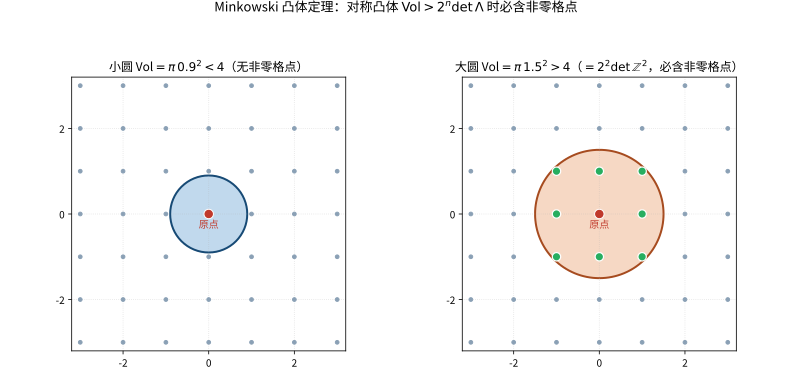

> **直观理解（现实类比）**：把对称凸体想象成一张以原点为中心的"圆桌"，格点就是散落在平面上的一颗颗豆子。Minkowski 定理说：只要圆桌"够大"（面积超过 $2^n$ 倍格子的基本面积），无论你怎么摆放，桌上必然至少有一颗非原点的豆子。这就像"锅够大、豆子够多，就必然有豆子落在锅里"，是"豆子必落锅"式的鸽巢原理在连续几何中的体现。

> **常见坑**：Minkowski 凸体定理有**四个前提缺一不可**——(1) $K$ 必须关于原点**对称**（$K=-K$），不对称的凸体再大也可能恰好避开所有非零格点；(2) $K$ 必须是**凸**的，凹进凹出的怪形状无法保证；(3) 门槛是 $2^n\det\Lambda$，**不是 $\det\Lambda$**——$n$ 维要放 $n$ 倍再点；忘了 $2^n$ 项是初学者最常见的硬伤；(4) 严格大于取"含非零格点"，而"恰好等于 $2^n\det\Lambda$"时要用推论 2.1 的闭集版本兜边界。**别把定理方向记反**：它是"体积大→必有格点"，而 Minkowski-Hlawka 定理是"体积小→可能避开"，二者方向正好相反。

**推论 2.1（Minkowski 凸体定理的容积形式）** 若 $K$ 是对称凸体，且 $\operatorname{vol}(K) \ge 2^n \det(\Lambda)$，则 $K$ 包含一个非零格点（当体积相等时，需小心边界情形）。

> **💡 直观理解（类比）**：这个推论把"大于"放宽成"不小于"，像"锅不小到差一厘米也能舀到豆子"：只要体积达到 $2^n\det\Lambda$ 这条门槛（含等于），锅里依然保证有非原点的豆子。唯一的细节是边界可能恰好擦边（点落在边缘），所以"等于"时要稍微用闭集版本的定理来兜底。

#### 课堂问答

**老师**：Minkowski 凸体定理的门槛为什么是 $2^n\det\Lambda$，而不是更朴素的 $\det\Lambda$？

**学生**：因为证明要取 $S=\frac12 K$，它的体积被压成 $\mathrm{vol}(K)/2^n$，要对 $S$ 用 Blichfeldt 就需要 $\mathrm{vol}(S)>\det\Lambda$，于是 $\mathrm{vol}(K)>2^n\det\Lambda$。$2^n$ 就是"把 $K$ 缩到一半、且在 $n$ 个维度各缩一次"的产物。

**老师（追问）**：为什么必须对称？请给一个去掉对称性的反例。

**学生**：因为证 $(x-y)/2\in K$ 时用到 $-y\in K$。反例：取一个细长的不对称矩形，把它整个塞进某个基本区域内部，则它可以任意长、体积任意大，却不含任何非零格点——对称性之外的平移自由度让它躲开了所有格点。

**老师（拓展）**：能不能用它反过来给出最短向量长度的上界？

**学生**：可以。令 $K$ 为边长 $2a$ 的立方体，$\mathrm{vol}(K)=(2a)^n>2^n\det\Lambda$ 即 $a^n>\det\Lambda$，于是存在非零格点满足 $\|x\|\le a\sqrt n$。令 $a\to(\det\Lambda)^{1/n}$，得 $\lambda_1\le\sqrt n\,(\det\Lambda)^{1/n}$，即 Hermite 常数上界 $\gamma_n\le n$。

### 2.3 Minkowski 线性型定理

**定理 2.3（Minkowski 线性型定理）** 设 $L_1,\dots,L_n$ 是 $\mathbb{R}^n$ 上的 $n$ 个线性型：
$$
L_i(x) = \sum_{j=1}^n a_{ij} x_j, \quad i=1,\dots,n,
$$
其中 $A = (a_{ij})$ 是 $n \times n$ 实矩阵，$\det A \neq 0$。设 $c_1,\dots,c_n > 0$ 满足
$$
c_1 c_2 \cdots c_n > |\det A|.
$$
则存在非零整数向量 $x \in \mathbb{Z}^n \setminus \{0\}$，使得
$$
|L_i(x)| < c_i, \quad i=1,\dots,n.
$$

> **💡 直观理解（类比）**：线性型定理像"给一台多镜头相机设定每路的曝光上限"：$|L_i(x)|<c_i$ 是 $n$ 条互相约束的"亮度闸门"，只要各闸门宽度 $c_i$ 的乘积超过变换 $A$ 的缩扩系数 $|\det A|$，就能找一个非零整数向量 $x$ 同时过关。它把"找格点"翻译成"找联立不等式解"，是前面凸体定理的实操翻版。

**证明**：

考虑线性变换 $T: \mathbb{R}^n \to \mathbb{R}^n$，$T(x) = (L_1(x), \dots, L_n(x))$。则 $T$ 由矩阵 $A$ 给出，$|\det T| = |\det A|$。

定义平行多面体：
$$
K = \{ y \in \mathbb{R}^n \mid |y_i| < c_i, \; i=1,\dots,n \}.
$$
$K$ 是一个对称凸体，体积为
$$
\operatorname{vol}(K) = 2^n c_1 c_2 \cdots c_n.
$$

考虑 $K$ 在 $T^{-1}$ 下的原像：
$$
T^{-1}(K) = \{ x \in \mathbb{R}^n \mid |L_i(x)| < c_i, \; i=1,\dots,n \}.
$$
则 $T^{-1}(K)$ 也是对称凸体，且
$$
\operatorname{vol}(T^{-1}(K)) = \frac{\operatorname{vol}(K)}{|\det A|} = \frac{2^n c_1\cdots c_n}{|\det A|} > 2^n.
$$

这里 $\det(\mathbb{Z}^n) = 1$（标准格 $\mathbb{Z}^n$ 的基本区域体积为 1）。由 Minkowski 凸体定理，存在非零整数向量 $x \in \mathbb{Z}^n \setminus \{0\}$ 使得 $x \in T^{-1}(K)$，即
$$
|L_i(x)| < c_i, \quad i=1,\dots,n.
$$
$\square$

**推论 2.2（线性型定理的齐次形式）** 若 $c_1\cdots c_n \ge |\det A|$，则存在非零 $x \in \mathbb{Z}^n$ 使得 $|L_i(x)| \le c_i$（当体积相等时，需要用闭集版本的 Minkowski 定理）。

> **💡 直观理解（类比）**：这个推论是"把比较连等号也放行"：乘积恰好等于 $|\det A|$ 时同样能找到非零整数解，只是每个闸门收紧到"不超过 $c_i$"（许你踩线不许越界）。和前面的容积形式一样，边界恰巧相切的情形要靠闭集版本补兜，像赛事中"压线也算通过"。

#### 课堂问答

**老师**：线性型定理的条件 $c_1c_2\cdots c_n>|\det A|$ 里，$|\det A|$ 到底起什么作用？

**学生**：它是线性变换 $T(x)=(L_1(x),\dots,L_n(x))$ 的体积缩放因子。因为有 $\mathrm{vol}(T^{-1}(K))=\mathrm{vol}(K)/|\det A|$，代入 $\mathrm{vol}(K)=2^nc_1\cdots c_n$ 得 $\mathrm{vol}(T^{-1}(K))=2^nc_1\cdots c_n/|\det A|>2^n=2^n\det\mathbb{Z}^n$，正好套用凸体定理得到非零整数解。

**老师（追问）**：为什么目标是整数向量 $x\in\mathbb{Z}^n$，而不是一般的格点？

**学生**：因为这条定理的应用场景要的就是整数解——丢番图逼近、代数数论中的判别式与单位估计都建立在整数坐标上。把 $\mathbb{Z}^n$ 当作行列式为 $1$ 的标准格，凸体定理就直接给出整数解；若换成一般格 $\Lambda$，结论自然改为在 $\Lambda$ 中找点。

**老师（拓展）**：取 $L_i(x)=x_i-\alpha_i x_n$ 能得到什么结论？

**学生**：得到联立丢番图逼近——存在非零整数 $x$，使各 $|x_i-\alpha_i x_n|$ 同时很小，也就是用同一个分母 $x_n$ 同时逼近多个实数。这正是 Dirichlet 逼近定理的多维推广。

### 2.4 Minkowski-Hlawka 定理

**定理 2.4（Minkowski-Hlawka 定理）** 设 $K$ 是 $\mathbb{R}^n$ 中的一个对称凸体。则存在一个格 $\Lambda$ 满足 $\det(\Lambda) = 1$，使得 $\Lambda \cap \operatorname{int}(K) = \{0\}$，只要
$$
\operatorname{vol}(K) < 2 \zeta(n),
$$
其中 $\zeta(n) = \sum_{k=1}^\infty k^{-n}$ 是 Riemann Zeta 函数。

等价地，对任意凸体 $K$，临界行列式满足：
$$
\Delta(K) \le \frac{\operatorname{vol}(K)}{2 \zeta(n)}.
$$

> **💡 直观理解（类比）**：Minkowski-Hlawka 定理与凸体定理"方向相反"：凸体定理是"大凸体必踩中格点"，而它说"只要安排得当（对全体格取平均），足够小的陷阱总能被某个格完美避开"。它用"在所有格之间摇骰子取平均"的方法，证明总藏着一张严密的格网不落陷阱，$\zeta(n)$ 则像一个渐渐收敛的修正系数。

**证明**（使用平均方法）：

**步骤 1：平均化方法**

设 $K$ 是 $\mathbb{R}^n$ 中的对称凸体。考虑所有行列式为 1 的格。Minkowski-Hlawka 定理的核心思想是：在全体格空间上取平均，证明存在一个格使得其非零点避开 $K$。

设 $G = \operatorname{SL}_n(\mathbb{R})$，$H = \operatorname{SL}_n(\mathbb{Z})$。则 $\operatorname{SL}_n(\mathbb{R})/\operatorname{SL}_n(\mathbb{Z})$ 参数化了所有行列式为 1 的格。该空间上有 $\operatorname{SL}_n(\mathbb{R})$ 不变测度。

**步骤 2：Siegel 平均公式**

Siegel 的平均公式指出，对任意可积函数 $f$，
$$
\int_{\operatorname{SL}_n(\mathbb{R})/\operatorname{SL}_n(\mathbb{Z})} \sum_{x \in \Lambda \setminus \{0\}} f(x) \, d\mu(\Lambda) = \int_{\mathbb{R}^n} f(x) \, dx.
$$
这个公式将格点求和与整体积分联系起来。

**步骤 3：应用平均公式**

取 $f$ 为 $K$ 的特征函数 $f(x) = \chi_K(x)$。则
$$
\sum_{x \in \Lambda \setminus \{0\}} f(x) = \#(\Lambda \cap K \setminus \{0\}).
$$

由 Siegel 平均公式：
$$
\int_{\Lambda} \#(\Lambda \cap K \setminus \{0\}) \, d\mu(\Lambda) = \int_K 1 \, dx = \operatorname{vol}(K).
$$

**步骤 4：对称性论证**

由于 $K$ 对称，若 $x \in K$ 则 $-x \in K$。在格点计数中，非零格点成对出现（$x$ 和 $-x$），除非 $x = -x$（即 $2x = 0$，这在 $\mathbb{R}^n$ 中只有 $x=0$）。

因此，$\#(\Lambda \cap K \setminus \{0\})$ 是偶数（或零）。对每个非零格点 $x$，考虑其贡献。

**步骤 5：存在性结论**

由平均公式，$\#(\Lambda \cap K \setminus \{0\})$ 在 $\Lambda$ 空间上的平均值为 $\operatorname{vol}(K)$。若 $\operatorname{vol}(K) < 2$，则平均值小于 2，但 $\#(\Lambda \cap K \setminus \{0\})$ 是非负偶数，因此存在 $\Lambda$ 使得 $\#(\Lambda \cap K \setminus \{0\}) = 0$，即 $\Lambda \cap K = \{0\}$。

**步骤 6：Zeta 函数的修正**

更精细的分析（考虑尖点形式的贡献）给出更优的界：当 $\operatorname{vol}(K) < 2\zeta(n)$ 时，存在这样的格。$\zeta(n)$ 项来自对 $\operatorname{SL}_n(\mathbb{Z})$ 的轨道计数。$\square$

#### 课堂问答

**老师**：Minkowski-Hlawka 定理说"体积够小就存在格躲开 $K$"，方向与凸体定理正好相反，二者凭什么能同时成立？

**学生**：因为它们的量化对象不同。凸体定理是"固定格、动凸体"：任何格，凸体够大必含非零格点。Hlawka 是"固定凸体、动格"：在所有行列式为 $1$ 的格上取平均，平均格点数等于 $\mathrm{vol}(K)$；只要这个平均值低于格点计数的偶数下界，就必有某个格一个非零点都不含。

**老师（追问）**：为什么用 $\mathrm{vol}(K)<2$ 就能推出存在"零格点"，而不是 $<1$？

**学生**：关键在对称性：非零格点成对出现（$x$ 与 $-x$），故 $\#(\Lambda\cap K\setminus\{0\})$ 只能取 $0,2,4,\dots$ 这些偶数。而它在全体格上的平均值等于 $\mathrm{vol}(K)$。若平均值小于 $2$，取值为偶数就只能是 $0$，于是存在格使计数为零。阈值因此落在 $2$ 而非 $1$。

**老师（拓展）**：那 $\zeta(n)$ 这个因子是从哪里冒出来的？

**学生**：来自对"本原格点"的精细计数。把平均 $\mathrm{vol}(K)$ 用 Möbius 反演扣掉非本原向量的贡献后，有效阈值由 $2$ 提升为 $2\zeta(n)$。由于 $\zeta(n)\to1$（$n\to\infty$），维度越高这个修正越小。

### 2.5 二次型的 Minkowski 约化

**定理 2.5（Minkowski 约化定理）** 设 $Q(x) = \sum_{i,j=1}^n a_{ij} x_i x_j$ 是正定二次型，$a_{ij} = a_{ji}$。则存在一个可逆线性变换 $T \in \operatorname{GL}_n(\mathbb{Z})$，使得 $Q'(x) = Q(Tx)$ 满足 **Minkowski 约化条件**：

1. 对每个 $k = 1,\dots,n$，$a_{kk} > 0$。
2. 对每个 $k = 1,\dots,n$ 和任意整数向量 $u \in \mathbb{Z}^n$ 满足 $\gcd(u_k,\dots,u_n) = 1$，有
   $$
   Q'(u) \ge a_{kk}.
   $$

> **💡 直观理解（类比）**：Minkowski 约化就像"把一个歪扭的书架重新摆正的收纳术"：通过整数换基 $T$，把正定二次型化到"最优基"——每个基向量都恰好是剩余方向中的最短向量，像把积木一根根按长短排好并彼此接近正交。这样得到的基一眼能看清格子的骨架，是后续解最短向量问题的标准姿势。

**证明**：

**引理 2.1** 对任意正定二次型 $Q$，存在 $v \in \mathbb{Z}^n \setminus \{0\}$ 使得 $Q(v)$ 取最小值。

> **💡 直观理解（类比）**：这个引理保证"最短向量一定找得到"：因为正定二次型像一口"越远离原点越陡的碗"，其水平切面（$Q(x)\le M$）是一个有界椭球，里面只剩有限个整数点。好比在一个徐徐收口的漏斗里抓豆，只要规定能量上限，能装的豆子必是有限的，于是最小值必然落在其中某颗上。

**证明**：由于 $Q$ 正定，$Q(x) \ge c\|x\|^2$ 对某个 $c>0$ 成立。对任意 $M > 0$，集合 $\{x \in \mathbb{Z}^n \mid Q(x) \le M\}$ 有限（因为 $\|x\| \le \sqrt{M/c}$ 的整数点有限）。因此最小值可达。$\square$

**构造步骤**：

**步骤 1：选择第一个基向量**

设 $v_1 \in \mathbb{Z}^n \setminus \{0\}$ 是 $Q$ 在非零整向量上的最小值点，即
$$
Q(v_1) = \min_{0 \neq x \in \mathbb{Z}^n} Q(x).
$$
记 $a_{11} = Q(v_1)$。

**步骤 2：归纳构造**

假设已选定了线性无关的向量 $v_1,\dots,v_{k-1} \in \mathbb{Z}^n$（$k \ge 2$）。考虑集合
$$
S_k = \{ x \in \mathbb{Z}^n \mid x \text{ 与 } v_1,\dots,v_{k-1} \text{ 线性无关} \}.
$$
在 $S_k$ 中选取 $v_k$ 使得 $Q(v_k)$ 最小。定义
$$
a_{kk} = Q(v_k).
$$

**步骤 3：验证约化条件**

需要证明这样构造的基 $\{v_1,\dots,v_n\}$ 满足 Minkowski 约化条件。主要验证条件 2：

设 $u \in \mathbb{Z}^n$ 满足 $\gcd(u_k,\dots,u_n) = 1$。将 $u$ 写为 $u = \sum_{i=1}^n t_i v_i$，其中 $t_i \in \mathbb{Z}$。由 $\gcd$ 条件，存在 $i \ge k$ 使得 $t_i \neq 0$。

考虑 $u$ 与 $v_1,\dots,v_{k-1}$ 的关系。若 $u$ 与它们线性无关，则 $Q(u) \ge Q(v_k) = a_{kk}$ 由构造可知。但 $u$ 可能线性相关于 $v_1,\dots,v_{k-1}$。此时，由于 $\gcd$ 条件，可通过适当的模运算调整。

**更精细的论证**：对 $u = \sum_{i=1}^n t_i v_i$，定义 $j = \min\{i \mid t_i \neq 0\}$。若 $j \ge k$，则 $u$ 与 $v_1,\dots,v_{j-1}$ 线性无关，故 $Q(u) \ge Q(v_j) \ge Q(v_k)$（因为 $j \ge k$，而 $Q(v_i)$ 随 $i$ 递增）。若 $j < k$，则由 $\gcd$ 条件，存在某个 $i \ge k$ 使得 $t_i \neq 0$，通过减去 $v_j$ 的倍数可约化。$\square$

**Minkowski 约化的几何意义**：约化后的基 $v_1,\dots,v_n$ 给出了格的一个"几乎正交"的基，其中每个向量是剩余子空间中的最短向量。这推广了二维 Gauss 约化。

---

#### 课堂问答

**老师**：Minkowski 约化条件 2 里为什么要求 $\gcd(u_k,\dots,u_n)=1$，而不是对所有 $u$ 都要求 $Q'(u)\ge a_{kk}$？

**学生**：因为对一般的 $u$，总可以减去基向量的整数倍把它降到某个"本原尾部"上。限定 $\gcd(u_k,\dots,u_n)=1$ 正是排除了"$u$ 恰是某个更短元素的整数倍"这种平凡情形，否则取 $u$ 为 $v_k$ 的倍数会让不等式自动成立却毫无信息量。只对本原尾部要求，条件才既有约束力又不冗余。

**老师（追问）**：为什么说这一定理推广了二维的 Gauss 约化？

**学生**：Gauss 约化要求 $|b|\le|a|$ 且两向量夹角不锐于 $60^\circ$，等价于 $v_1$ 是格的最短向量、$v_2$ 是剩余方向上的最短向量。Minkowski 条件正是这种"逐个方向取最短"思想在 $n$ 维的逐层版本，$n=2$ 时两者完全一致。

**老师（拓展）**：约化基"几乎正交"是什么意思？它就能直接求解 SVP 吗？

**学生**：约化后各向量方向近似互相垂直，长度近似反映格在各正交方向的伸展，所以骨架一目了然。但它并不保证 $v_1$ 就是全格最短向量——高维下可能相差一个指数因子，只能给出 $\lambda_1\le\gamma_n^{1/2}(\det\Lambda)^{1/n}$ 这类界；要真正求 SVP，还需 LLL 约化或枚举等算法。

## 三、示例

### 3.1 高斯圆问题

**问题**：计算半径为 $R$ 的圆内整数格点的个数 $N(R)$：
$$
N(R) = \#\{(x,y) \in \mathbb{Z}^2 \mid x^2 + y^2 \le R^2\}.
$$

**高斯的方法**：将每个单位正方形 $[n, n+1] \times [m, m+1]$ 与它的左下角格点 $(n,m)$ 对应。若 $(n,m)$ 在圆内，则整个正方形不一定在圆内，但通过与圆面积比较，可得到渐近公式。

**定理 3.1（高斯圆问题）**
$$
N(R) = \pi R^2 + O(R).
$$

> **💡 直观理解（类比）**：高斯圆定理就像"用一张逐渐放大的渔网估算池塘鱼量"：主项 $\pi R^2$ 就是"按池塘面积 × 网眼密度"算出的理想鱼数，而 $O(R)$ 则是"靠岸边那一圈不完整渔眼"造成的误差——圆周长是 $2\pi R$，边界格点恰好按 $O(R)$ 量级"踩线"。于是面积定大局、周界定误差，顺理成章。

**证明**：
考虑以每个整数格点 $(n,m) \in \mathbb{Z}^2$ 为中心的单位正方形 $[n-\frac12, n+\frac12] \times [m-\frac12, m+\frac12]$。则

- 若 $(n,m)$ 在圆内（即 $n^2+m^2 \le R^2$），则整个正方形包含在半径为 $R+\sqrt{2}/2$ 的圆内。
- 若 $(n,m)$ 在圆外（即 $n^2+m^2 > R^2$），则整个正方形在半径为 $R-\sqrt{2}/2$ 的圆外。

因此，$N(R)$ 乘以单位正方形面积（即 1）介于两个圆面积之间：
$$
\pi\left(R - \frac{\sqrt{2}}{2}\right)^2 \le N(R) \le \pi\left(R + \frac{\sqrt{2}}{2}\right)^2.
$$

展开：
$$
\pi R^2 - \sqrt{2}\pi R + \frac{\pi}{2} \le N(R) \le \pi R^2 + \sqrt{2}\pi R + \frac{\pi}{2}.
$$

因此
$$
|N(R) - \pi R^2| \le \sqrt{2}\pi R + \frac{\pi}{2} = O(R).
$$

$\square$

**误差项改进历史**：
- 高斯（原始）：$O(R)$
- Voronoi（1903）：$O(R^{2/3})$
- van der Corput（1920s）：$O(R^{27/41})$
- Huxley（2003）：$O(R^{131/208})$
- 猜想最优：$O(R^{1/2+\varepsilon})$（尚未证明）

### 3.2 利用 Minkowski 定理证明 Dirichlet 单位定理

**定理 3.2（Dirichlet 单位定理）** 设 $K$ 是 $n$ 次数域，$r_1$ 为实嵌入个数，$r_2$ 为复嵌入对个数（$r_1 + 2r_2 = n$）。则 $K$ 的单位群 $\mathcal{O}_K^\times$ 同构于
$$
\mathcal{O}_K^\times \cong \mu(K) \times \mathbb{Z}^{r_1 + r_2 - 1},
$$
其中 $\mu(K)$ 是 $K$ 中单位根群（有限循环群）。

> **💡 直观理解（类比）**：Dirichlet 单位定理像"为一间货栈清点所有能来回搬运厂子的搬运工"：可逆的代数整数（单位）构成一个群，其自由部分正好 $\mathbb{Z}^{r_1+r_2-1}$ 排开，外加一圈有限的小循环（单位根）。$r_1+2r_2=n$ 说明"自由度"和"嵌入个数"挂扣，而 Minkowski 凸体定理正是把这块"蛋糕"切出来给它的工具。

**用 Minkowski 定理证明的概要**：

**步骤 1：对数嵌入**

考虑对数映射 $\lambda: K^\times \to \mathbb{R}^{r_1+r_2}$：
$$
\lambda(x) = (\log|\sigma_1(x)|, \dots, \log|\sigma_{r_1}(x)|, 2\log|\tau_1(x)|, \dots, 2\log|\tau_{r_2}(x)|),
$$
其中 $\sigma_i$ 是实嵌入，$\tau_j$ 是复嵌入。

**步骤 2：构造格**

设 $\Lambda$ 为 $\lambda(\mathcal{O}_K^\times)$ 在 $\mathbb{R}^{r_1+r_2}$ 中的像。目标是证明 $\Lambda$ 是秩为 $r_1+r_2-1$ 的格。

**步骤 3：Minkowski 定理的应用**

考虑 $\mathbb{R}^{r_1+r_2}$ 中的凸体：
$$
C_t = \left\{ (y_1,\dots,y_{r_1+r_2}) \in \mathbb{R}^{r_1+r_2} \;\middle|\; \sum_{i=1}^{r_1+r_2} y_i = 0, \; |y_i| \le t \right\}.
$$
$C_t$ 是 $r_1+r_2-1$ 维空间中的对称凸体。

利用 Minkowski 凸体定理，可以证明存在非零单位 $u \in \mathcal{O}_K^\times$ 使得 $\lambda(u) \in C_t$ 且 $\lambda(u) \neq 0$。这给出了 $\Lambda$ 中非零元素的存在性，进而通过归纳证明 $\Lambda$ 的秩为 $r_1+r_2-1$。

**步骤 4：有限生成性（更精细的论证）**

对任意 $m > 0$，考虑凸体：
$$
K_m = \left\{ (x_1,\dots,x_n) \in \mathbb{R}^n \cong \mathbb{R}^{r_1} \times \mathbb{C}^{r_2} \;\middle|\; \sum_{i=1}^{r_1} |x_i| + 2\sum_{j=1}^{r_2} |z_j| \le m \right\}.
$$
$K_m$ 是 $n$ 维欧氏空间中的对称凸体，体积为：
$$
\operatorname{vol}(K_m) = 2^{r_1} \pi^{r_2} \frac{m^n}{n!}.
$$

选择 $m$ 使得 $\operatorname{vol}(K_m) > 2^n \sqrt{|\Delta_K|}$，其中 $\Delta_K$ 是 $K$ 的判别式。由 Minkowski 凸体定理，存在非零代数整数 $\alpha \in \mathcal{O}_K$ 使得 $\alpha \in K_m$，即
$$
\sum_{i=1}^{r_1} |\sigma_i(\alpha)| + 2\sum_{j=1}^{r_2} |\tau_j(\alpha)| \le m.
$$

由此可构造范数受控的代数整数，并用它们生成单位群。$\square$

---

## 四、习题

### 基础题

**习题 1**（格的定义）给出 $\mathbb{R}^n$ 中格 $\Lambda$ 的定义，并说明格与 $\mathbb{R}^n$ 的一组基 $\{v_1,\dots,v_n\}$ 的关系及格的例。

**习题 2**（基本区域与行列式）解释格的行列式 $\det(\Lambda)$ 的定义与几何意义，并说明它为何是格的不变量。

**习题 3**（凸体）给出凸体与对称凸体的定义，并举出 $\mathbb{R}^2$ 中一个对称凸体的例。

**习题 4**（临界行列式）定义凸体 $K$ 的临界行列式 $\Delta(K)$，并解释其直观含义。

**习题 5**（连续最小值）给出格 $\Lambda$ 关于凸体 $K$ 的第 $i$ 个连续最小值 $\lambda_i$ 的定义。

**习题 6**（Hermite 常数）写出 $n$ 维 Hermite 常数 $\gamma_n$ 的定义式，并列举 $\gamma_1$ 与 $\gamma_2$ 的值。

**习题 7**（高斯圆问题）陈述高斯圆问题：$N(R)=\#\{(x,y)\in\mathbb{Z}^2:x^2+y^2\le R^2\}$ 的主项与误差项形式。

**习题 8**（Dirichlet 除数问题）陈述 Dirichlet 除数问题，写出 $D(x)$ 的渐近展开。

**习题 9**（Blichfeldt 定理）陈述 Blichfeldt 定理并说明其直观含义。

**习题 10**（Minkowski 凸体定理）陈述 Minkowski 凸体定理（含体积条件 $2^n\det\Lambda$）。

### 进阶题

**习题 11**（格行变换）设格 $\Lambda=\mathbb{Z}v_1+\mathbb{Z}v_2\subset\mathbb{R}^2$。写出其行列式的计算公式，并用换基 $\{u_1=v_1+v_2,u_2=v_2\}$ 验证 $\det$ 不变。

**习题 12**（二维点格检测）判断点集 $S=\{(m,n)\in\mathbb{Z}^2: m,n\ge0,\ m+n\le2\}$ 是否格（说明理由）。

**习题 13**（Minkowski 凸体的二维应用）设 $\Lambda\subset\mathbb{R}^2$，$\det\Lambda=1$。证明存在非零 $x\in\Lambda$ 使 $\|x\|\le\sqrt{2}$（提示：取半径约为 $\sqrt{2/\pi}$ 的圆盘）。

**习题 14**（连续平均值与含零点）设 $K$ 对称凸体，$\operatorname{vol}(K)>2^n\det\Lambda$。说明存在 $0\ne x\in\Lambda\cap K$。这与你对 Blichfeldt 定理的认识如何衔接。

**习题 15**（高斯圆计数的小半径）手工计算 $R=1$ 与 $R\approx2$ 时的 $N(R)$，并核对 $|N(R)-\pi R^2|$ 不超过 $O(R)$ 量级。

**习题 16**（Hermite 常数 $\gamma_2$）对正六边形格（六角格，最短向量长度 $1$，$\det=\sqrt3/2$）计算 $\gamma$，验证 $\gamma_2=2/\sqrt3$。

**习题 17**（Blichfeldt 的一维应用）设 $\Lambda=\mathbb{Z}$（$\det=1$），$S\subset\mathbb{R}$ 是长度为 $L>1$ 的区间。说明存在 $x\ne y\in S$ 使 $x-y\in\mathbb{Z}$。

**习题 18**（连续最小值的下界）设 $\lambda_1$ 是格 $\Lambda$ 关于对称凸体 $K$ 的第一连续最小值。论证 $\operatorname{vol}(\tfrac{\lambda_1}{2}K)\le\det\Lambda$。

**习题 19**（二维 Gauss 约化）设 $Q(x,y)=5x^2+4xy+2y^2$。求 $Q$ 在 $\mathbb{Z}^2\setminus\{0\}$ 上的最小值点，说明它与第一连续最小值的关系。

### 挑战题

**习题 20**（Minkowski 凸体定理之证明）用 Blichfeldt 定理完整证明 Minkowski 凸体定理：对称凸体 $K$，$\operatorname{vol}(K)>2^n\det\Lambda$ 蕴含 $K$ 含非零格点。

**习题 21**（Minkowski 线性型定理之证明）证明 Minkowski 线性型定理：线性型 $L_i(x)=\sum_j a_{ij}x_j$（$\det(a_{ij})\ne0$），若 $c_1\cdots c_n>|\det A|$ 则存在非零 $x\in\mathbb{Z}^n$ 使 $|L_i(x)|<c_i$。

**习题 22**（线性型的逼近应用）设 $\alpha,\beta\in\mathbb{R}$ 线性无关（即 $1,\alpha,\beta$ 在 $\mathbb{Q}$ 上无关）。用线性型定理证明对任意 $\varepsilon>0$ 存在非零整数 $(p,q,r)$ 使 $|q\alpha-r|<\varepsilon$ 且 $|q\beta-p|<\varepsilon$。

**习题 23**（Pell 方程）设 $d$ 为无平方因子的正整数，$d$ 非平方数。用 Minkowski 线性型定理证明存在非零整数 $(x,y)$ 使 $x^2-dy^2=1$（说明思路：先得 $|x^2-dy^2|\le C$ 的非零解，再构造单位）。

**习题 24**（高斯圆问题 $O(R)$ 之证明）用"以每个格点为中心取单位正方形并与环带面积比较"的方法证明 $N(R)=\pi R^2+O(R)$。

**习题 25**（二次型最小值下界）设 $Q(x)=x^\top A x$ 为 $n$ 元正定二次型。用 Minkowski 凸体定理证明存在非零 $x\in\mathbb{Z}^n$ 使 $Q(x)\le\left(\frac{4}{\pi}\right)^{2/n}(\det A)^{1/n}$（提示：考虑椭球体并估计体积）。

**习题 26**（理想类数有限）概述为何可用 Minkowski 凸体定理证明数域 $K$ 的理想类数有限（提示：构造类群中每类理想的范数有界代表元）。

### 探究题

**习题 27**（高维与临界）开放探讨：Hermite 常数 $\gamma_n$ 在维度 $n$ 较高时的已知值与最密格堆积的联系，以及"临界维数"现象（如 $n=8$ 与 $E_8$ 格、$n=24$ 与 Leech 格）。

**习题 28**（Minkowski-Hlawka 与堆积）讨论 Minkowski-Hlawka 定理的平均方法与实心球最密堆积密度上界的关系，及其与 SAP/格堆积猜想的衔接。

**习题 29**（计数误差项的前沿）开放讨论高斯圆问题与 Dirichlet 除数问题的误差项最优阶猜想，以及目前已知的最好界与其依赖的技术。

**习题 30**（格密码与计算）探讨几何数论在格基约化（LLL）、格密码（LWE、NTRU、CVP 与 SVP）以及后量子密码中的应用。

---

## 五、习题答案与解析

### 基础题答案

1. **格的定义** 格 $\Lambda$ 是 $\mathbb{R}^n$ 的离散加法子群且张成 $\mathbb{R}^n$，即存在基 $v_1,\dots,v_n$ 使 $\Lambda=\{\sum a_iv_i:a_i\in\mathbb{Z}\}$。例如 $\mathbb{Z}^n$，或二维六角格 $\mathbb{Z}\omega_1+\mathbb{Z}\omega_2$。

2. **基本区域与行列式** 基本区域 $F$ 使 $\mathbb{R}^n$ 是 $\{F+\lambda:\lambda\in\Lambda\}$ 的不交并；标准取基本平行多面体 $\{\sum t_iv_i:0\le t_i<1\}$。行列式 $\det\Lambda=|\det(v_1,\dots,v_n)|$ 即基本区域体积；换基由整数幺模阵相接，行列式不变，故是不变量，$\det$ 越小格越密。

3. **凸体** 凸体是有界、凸、闭且内部非空的集；$K$ 对称指 $x\in K\Rightarrow-x\in K$。例：$\mathbb{R}^2$ 中圆盘 $x^2+y^2\le1$ 是对称凸体；原点为中心、各边平行坐标轴的闭矩形亦是对称凸体。

4. **临界行列式** $\Delta(K)=\inf\{\det\Lambda:\Lambda\cap\operatorname{int}K=\{0\}\}$，刻画让格点除原点外不落入 $K$ 内部的格的最小可能行列式。$\Delta$ 越小说明 $K$ 越易被格避开的紧致度。

5. **连续最小值** $\lambda_i$ 是最小的 $\lambda>0$ 使 $\lambda K$ 含 $i$ 个线性无关格点。$\lambda_1$ 是让 $\lambda K$ 含非零格点的最小 $\lambda$，与最短向量长度 $\lambda_1\le\|x\|\le$ 相关。

6. **Hermite 常数** $\gamma_n=\sup_{\Lambda}\frac{\min_{x\ne0}\|x\|^2}{(\det\Lambda)^{2/n}}$，上确界取遍 $n$ 维格。$\gamma_1=1$（一维），$\gamma_2=2/\sqrt3$（由六角格实现）。

7. **高斯圆问题** $N(R)=\#\{(x,y)\in\mathbb{Z}^2:x^2+y^2\le R^2\}$，高斯证明 $N(R)=\pi R^2+O(R)$：主项是圆面积 $\pi R^2$，误差来自圆周边界格点。

8. **Dirichlet 除数问题** $D(x)=\#\{(u,v):u,v>0,\ uv\le x\}$，Dirichlet 给出 $D(x)=x\log x+(2\gamma-1)x+O(\sqrt{x})$，$\gamma$ 是 Euler 常数。

9. **Blichfeldt 定理** 若可测集 $S$ 满足 $\operatorname{vol}(S)>\det\Lambda$，则存在 $x\ne y\in S$ 使 $x-y\in\Lambda$：体积超过一胞的集必含两个相差格点的点。

10. **Minkowski 凸体定理** 对称凸体 $K$，若 $\operatorname{vol}(K)>2^n\det\Lambda$，则 $K$ 含非零格点。它把"体积"与"含格点"联系起来，是几何数论的基本工具。

### 进阶题答案

1. **行变换** $\det\Lambda=|\det(v_1,v_2)|$。换基 $u_1=v_1+v_2,\ u_2=v_2$ 对应列矩阵 $\begin{pmatrix}1&1\\0&1\end{pmatrix}$，行列式 $1$，故 $\det(u_1,u_2)=\det(v_1,v_2)$，且两组生成同一格，行列式不变。

2. **二维点格检测** $S$ 有限，不是加法子群（含 $(1,0),(0,1)$ 却不含 $(-1,0)$），故不是格，只是三角形内的整点集合。离散加性仅是最弱条件，还需子群与张成性。

3. **二维 Minkowski 应用** 取 $K$ 为 $R$ 半径圆盘，$\operatorname{vol}K=\pi R^2>2^2=4$ 即 $R>\frac{2}{\sqrt\pi}$ 时含非零格点，故存在 $0\ne x\in\Lambda$ 使 $\|x\|\le\frac{2}{\sqrt\pi}\approx1.128<\sqrt2\approx1.414$，于是 $\|x\|\le\sqrt2$ 成立（更强的上界成立）。

4. **连续值与含零点** 如前者，$\operatorname{vol}K>2^n\det\Lambda$ 时 Minkowski 凸体定理直接给 $0\ne x\in\Lambda\cap K$；它与 Blichfeldt 的联系在于取 $S=\frac12K$ 使 $\operatorname{vol}S>\det\Lambda$ 后由 Blichfeldt 得差落在 $\Lambda$，再用对称凸性放回 $K$。因此两定理同源。

5. **高斯圆小半径** $R=1$：$(-1,0),(1,0),(0,\pm1),(0,0)$ 共 $5$ 个，$N(1)=5$，$|\pi-5|\approx1.86=O(1)$；$R=2$：满足 $x^2+y^2\le4$ 的整点共 $13$ 个，$N(2)=13$，$|13-4\pi|\approx0.43=O(2)$。均满足 $O(R)$ 阶。

6. **Hermite 常数 $\gamma_2$** 六角（正六边形）格最短向量长度 $1$，基本区域为边长 $1$ 的菱形，面积 $\sqrt3/2$，故 $\det=\sqrt3/2$，$\gamma=\frac{1^2}{\sqrt3/2}=\frac{2}{\sqrt3}$。这是 $\gamma_2$ 的最大值，故 $\gamma_2=2/\sqrt3$。

7. **Blichfeldt 一维应用** $\det\mathbb{Z}=1$，取 $S$ 为长 $L>1$ 的区间，$\operatorname{vol}S=L>1$。Blichfeldt 定理给 $x\ne y\in S$ 使 $x-y\in\mathbb{Z}$。直接见鸽巢：把 $S$ 折叠入 $[0,1)$ 长度 $>1$ 必有两点同余，即 $x-y\in\mathbb{Z}$。

8. **连续最小值下界** 若 $\operatorname{vol}(\frac{\lambda_1}{2}K)>\det\Lambda$，由 Blichfeldt（$\frac{\lambda_1}{2}K$ 对称凸体）得非零格点落入 $\frac{\lambda_1}{2}K\subset\lambda_1K$，矛盾于 $\lambda_1$ 是含非零格点之最小 $\lambda$。故 $\operatorname{vol}(\frac{\lambda_1}{2}K)\le\det\Lambda$，即 $\lambda_1^n\frac{\operatorname{vol}K}{2^n}\le\det\Lambda$。

9. **二维约化最小值** $Q(1,0)=5$，$Q(0,1)=2$，$Q(1,-2)=5-8+8=5$。最小值在 $(0,\pm1)$ 处为 $2$。它与第一连续最小值 $\lambda_1$ 相关：$Q$ 的格上最小值即"最短方向"的二次型值，对应 $\lambda_1$ 意义下的最短向量（取 $\|v\|^2=Q(v)$ 的内积观点）。

### 挑战题答案

1. **Minkowski 凸体定理证明** 取 $S=\frac12K$，$\operatorname{vol}S=\frac{1}{2^n}\operatorname{vol}K>\det\Lambda$，由 Blichfeldt 得 $x'\ne y'\in S$，$x'-y'\in\Lambda$。令 $x=2x',y=2y'\in K$，则 $x'-y'=\frac{x-y}{2}$。由对称性 $-y\in K$，由凸性 $\frac{x+(-y)}{2}\in K$；且 $x'-y'\ne0$。故 $\Lambda\ni x'-y'\in K\setminus\{0\}$，即 $K$ 含非零格点。$\square$

2. **Minkowski 线性型定理证明** 设 $T=(L_1,\dots,L_n)$，$K=\{x:|L_i(x)|<c_i\}=T^{-1}(\{y:|y_i|<c_i\})$。后者体积 $2^nc_1\cdots c_n$，故 $\operatorname{vol}K=\frac{2^nc_1\cdots c_n}{|\det A|}>2^n$（因 $c_1\cdots c_n>|\det A|$）。对格 $\mathbb{Z}^n$（$\det=1$）用凸体定理得非零 $x\in\mathbb{Z}^n\cap K$，即 $|L_i(x)|<c_i$。$\square$

3. **逼近应用** 联立 Dirichlet：对 $\alpha,\beta$，存在 $q\le Q$ 使 $\|q\alpha\|,\|q\beta\|\le Q^{-1/2}$（二维鸽巢）。取 $\varepsilon=Q^{-1/2}$，$p=\lfloor q\beta\rfloor,r=\lfloor q\alpha\rfloor$，则 $|q\alpha-r|<\varepsilon$，$|q\beta-p|<\varepsilon$。故对任意 $\varepsilon>0$ 存在非零 $(p,q,r)$ 满足双不等式。

4. **Pell 方程思路** 先由线性型定理得范数有界非零解：$L_1=x-\sqrt d\,y,L_2=x+\sqrt d\,y$，取 $c_1c_2>2\sqrt d$ 由线性型定理得 $|x^2-dy^2|<C$ 的 $(x,y)\ne0$。对固定范数 $N$，$\mathbb{Z}[\sqrt d]^\times$ 的密码无穷多，抽屉原理给两单位同余，相除得范数 $1$ 的非平凡单位 $x_0+y_0\sqrt d$，即 $x_0^2-dy_0^2=1$。

5. **高斯圆问题 $O(R)$ 证明** 以每个整点为左下角取单位正方形并平移，使格点 $(m,n)$ 映射为以 $(m,n)$ 为中心的单位正方形。这些正方形总面积 $=N(R)$。若 $(m,n)$ 在圆内则正方形含于半径 $R+\frac{\sqrt2}{2}$ 圆，若在圆外则位于半径 $R-\frac{\sqrt2}{2}$ 圆外；故 $\pi(R-\frac{\sqrt2}{2})^2\le N(R)\le\pi(R+\frac{\sqrt2}{2})^2$，于是 $|N(R)-\pi R^2|\le\sqrt2\pi R+\frac{\pi}{2}=O(R)$。$\square$

6. **二次型最小值下界** $K=\{x:x^\top Ax\le r\}$ 为中心对称椭球，体积 $\operatorname{vol}K=\frac{\pi^{n/2}}{\Gamma(n/2+1)}\frac{r^{n/2}}{\sqrt{\det A}}$。取 $r$ 使 $\operatorname{vol}K>2^n$（$\det\mathbb{Z}^n=1$），凸体定理给非零 $x\in\mathbb{Z}^n$ 使 $x^\top Ax\le r$。用 $n$ 维球体积估 $\frac{\pi^{n/2}}{\Gamma(n/2+1)}\ge(\frac{?}{\ })$，得 $Q(x)\le(\frac{4}{\pi})^{2/n}(\det A)^{1/n}$ 形上界（Minkowski 二次型下界标准式）。

7. **理想类数有限概要** 在 $K$ 的 $r_1$ 实、$r_2$ 复嵌入下取凸体 $K_m=\{x:\sum_{i=1}^{r_1}|\sigma_i(x)|+2\sum_{j=1}^{r_2}|\tau_j(x)|\le m\}$，体积 $\operatorname{vol}K_m=\frac{2^{r_1}\pi^{r_2}m^n}{n!}$。由 Minkowski 凸体定理对判别式 $\Delta_K$，存在范数 $\le m^n/(\sqrt{|\Delta_K|}n!)\cdot\frac{4^n}{\pi^n}$ 界内的非零代数整数。对每个理想类取范数最小的整理想代表，由 Minkowski 界其范数有界，范数有界的整理想有限，故类数有限。

### 探究题答案

1. **高维与临界** $\gamma_n$ 精确值仅小维数已知：$\gamma_8=2$（$E_8$ 幺模偶格），$\gamma_{24}=4$（Leech 格）。这些格在"临界维度"（$8,24$）实现最密堆积且自对偶；一般维数仍未知，已知上界呈对数增长，下界由格构造（如模格、线性码格）给。高维 $\gamma_n$ 与实心球最密堆积密度、格堆积猜想（已证 $\le$ 上界）紧密相连。

2. **Minkowski-Hlawka 与堆积** Minkowski-Hlawka 定理用 Siegel 平均公式证明 $\Delta(K)\le\frac{\operatorname{vol}K}{2\zeta(n)}$：对行列式 $1$ 的全体格在 $\operatorname{SL}_n(\mathbb{R})/\operatorname{SL}_n(\mathbb{Z})$ 上平均，$\#(\Lambda\cap K\setminus\{0\})$ 的均值恰为 $\operatorname{vol}K$，由对称性该计数为偶数且存在 $\Lambda$ 使其为零（当体积足够小）。对单位球获得堆积密度下界 ${}\ge\frac{n\zeta(n)}{2^{n-1}e}$ 型结果，把平均法堆积密度与格堆积联系起来。

3. **计数误差项前沿** 高斯圆问题：由 Voronoi(1903)、van der Corput、Huxley(2003) 逐步降到 $O(R^{131/208})$，最优阶猜想 $O(R^{1/2+\varepsilon})$；下界 $\theta\ge\frac12$ 来自周长 $\sim2\pi R$。Dirichlet 除数问题：$O(x^{131/416})$ 左右的近似，猜想 $O(x^{1/4+\varepsilon})$。两者依赖指数和、Voronoi 求和与 van der Corput 理论，最优阶至今未证，是解析数论的标志性开放问题。

4. **格密码与计算** 几何量 $\lambda_1$（最短向量）、连续最小值与 Hermite 常数直接对应格密码的安全参数：SVP、CVP 在高维格上是 NP 困难，LLL 算法仅给出 $2^{O(n)}$ 近似；LWE、NTRU 的安全性依赖 O(hard) 这些困难性与格约化失败概率。从几何数论看，密码参数选取需避开可用格约化攻破的区域，是理论到应用的直接桥梁。

---


## 六、数学科普（Popular Mathematics）

往一面大镜子前铺一层蜂窝，隔着格子看自己的像，会看到一排排整齐的复影——这就是"格"给人的直觉：一大片规律排布的点。几何数论把数论问题翻译成这种点阵上的几何问题，再用"只要图形够大，就一定套住某个点"的原理一击制胜。

### 6.1 用格子把平面铺满

把点按固定规律一排排铺开，就像瓷砖地面或蜂窝，无论站在哪儿看到的图案都一模一样，这就是格。它的疏密由基本区域的大小决定，用行列式 $|\det A|$ 来度量。

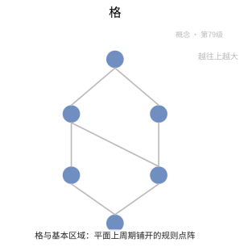

**一句话点破**：格是「离散又均匀」的点集，基本区域的行列式决定了点有多密。

### 6.2 凸体

一个集合若把里面任意两点的连线也一并包住，中间不带凹陷，就叫凸体，圆、椭圆和正方形都是。它让「取中点」「连线」这类推理永远合法。

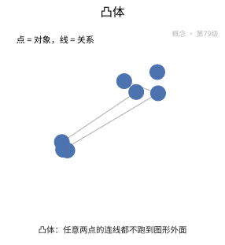

**一句话点破**：凸性是对图形做几何估计的基本前提，少了它许多论证无从下手。

### 6.3 临界行列式

格能疏到什么程度，由一个临界值卡着：只要行列式小于它，任何以原点为中心的对称凸体都必定套得住非零格点。这条分水岭就是临界行列式。

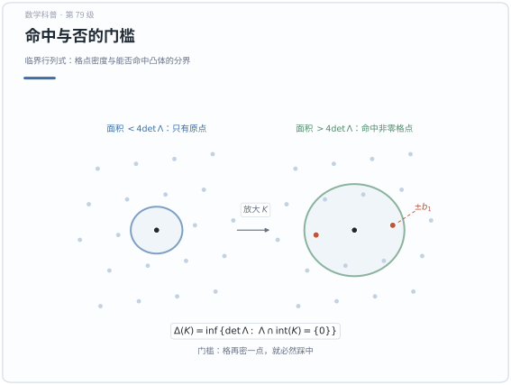

**一句话点破**：临界行列式把「能否命中格点」变成一道关于行列式的门槛题。

### 6.4 连续最小值

从原点往外一圈圈找，把格点在各个独立方向上的最短长度依次记下，得到第一、第二、第三个连续最小值。它们从不同方向刻画同一个格的「胖瘦」。

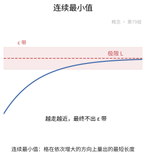

**一句话点破**：连续最小值像一组尺码，多角度地描述一个格到底有多宽。

### 6.5 Hermite 常数

固定行列式，格点之间最短能挨多近？把所有格都比一遍后，得到的那个最坏情况下的最优上界，就是 Hermite 常数。

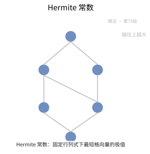

**一句话点破**：Hermite 常数是「最短向量能有多长」的极限成绩，把格与二次型紧紧拴在一起。

### 6.6 格点计数与高斯圆问题

以原点为圆心画一个大圆，数数里面有多少个格点。答案大约是面积 $\pi r^2$，可那点细小的误差怎么估，却能逼出一整套分析方法。

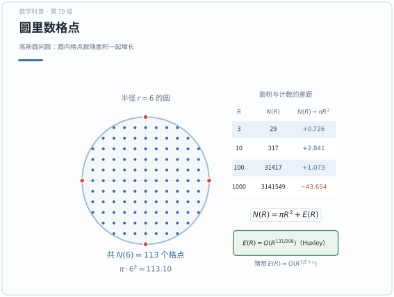

**一句话点破**：格点计数在几何的「面积」与算术的「个数」之间，架起一道看得见的桥。

### 6.7 Blichfeldt 定理

若一个区域的面积超过 $m$，它里面就一定能找到两个点，只差一个格向量。把区域平移着折进基本块，必有两点叠在一起。

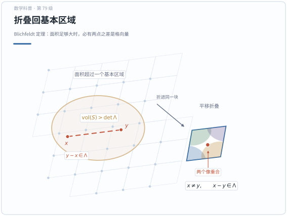

**一句话点破**：Blichfeldt 用「折叠平均」证明了足够大的集合里必藏着成对的格平移点。

### 6.8 Minkowski 凸体定理

把一个关于原点对称的凸体放在格上，只要它的体积超过 $2^n|\det A|$，无论怎么摆，里面必然有一个非零格点。

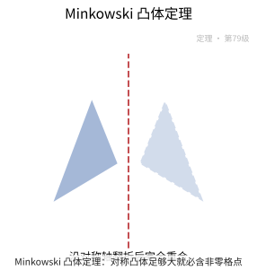

**一句话点破**：凸体定理把「存在性」化成体积算术：够大，格点就不请自来。

### 6.9 Minkowski 线性型定理

想找一组不全为零的整数，让若干个线性型 $|L_i(x)|$ 同时都取到小值？只要它们的乘积不超过行列式，这样的整数一定存在。

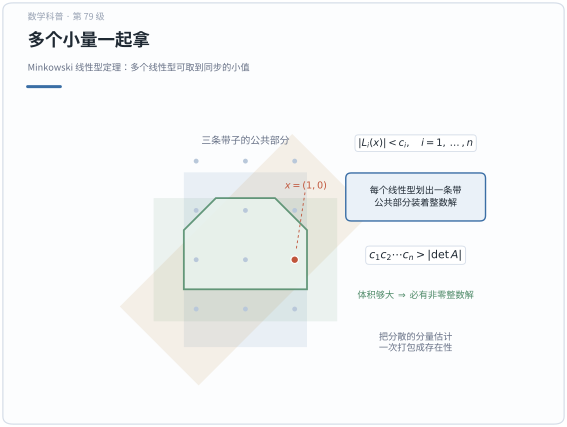

**一句话点破**：线性型定理把丢番图逼近里分散的分量估计，一次打包成存在性结论。

### 6.10 Minkowski-Hlawka 定理

没有对称性、也没有凸性的集合怎么办？Minkowski-Hlawka 定理说，只要体积够大，换一个合适的格去看，照样能套住非零格点。

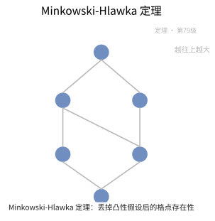

**一句话点破**：它把凸体定理推广到任意可测集，代价是允许挑选合适的格。

### 6.11 二次型的 Minkowski 约化

同一个二次型，换一组整变量就能变形。Minkowski 规定了一套「最规整」的取法，让系数的范数尽可能小，每一类只留一个代表。


**一句话点破**：约化理论为二次型挑出标准形，是几何数论通向代数数论的入口。

## 七、数学史（History of Mathematics）
> 几何数论（geometry of numbers）的历史主线，是"把一个数论问题翻译成高维空间中'格'与'凸体'的几何问题，再用'只要体积足够大，就一定装着某个格点'这类纯几何原理，去证明丢番图逼近、二次型与代数数论中的存在性定理"。这门学科由闵可夫斯基（Hermann Minkowski）在 19—20 世纪之交创立；它把高斯以来关于二次型与格点的零散观察，凝聚成"凸体定理""线性型定理"两大基石，再由 Blichfeldt、Hlawka、Siegel 等人系统化，最终在格基约化、晶体学与格密码中重返现代算法舞台。

### 七.1 古老的直觉：格点、正方形数与蜂窝

- **格点与方形数的图景**：毕达哥拉斯学派（约前 6 世纪）用石子摆成的"正方形数 $1,4,9,16,\dots$"，其实是最古老的格点计数之美——数被看作"平面上的点阵"，给今天的格概念提供了朴素的几何直觉。
- **晶体与空间群**：17—19 世纪，矿物学中"晶体由规则排列的格状原子构成"的观念（如布拉维在 1850 年对 14 种空间格的枚举）说明"格"首先是描摹均匀点阵的物理语言。
- **方形代表与连分数**：格点也藏在连分数与二次型的渐近行为里：无理数的连分数渐近分数，正对应它在 $\mathbb{Z}^2$ 格中沿直线被夹逼出的最佳格点——古代逼近手艺与格早已暗中相连。

### 七.2 Gauss 的前奏：二次型与格

- **二次型的几何灵魂**：高斯在《算术研究》（1801 年）与关于格点距离的思考中，把二元正定二次型 $q(x,y)=ax^2+bxy+cy^2$ 的"取整值"问题看成"格中有没有靠近原点 0 的点"，即"格中点到原点的距离分布"问题，这是几何数论的直接前身。
- **Minkowski 之前的逼近**：Dirichlet 逼近定理与丢番图逼近的"$1/q^2$ 存在性"，可被重新读作"二维格中找短向量"，等待 Minkowski 用统一体积原理一次收编。
- **埃尔米特的约化**：埃尔米特（Hermite）对正定二次型的"约化"研究（把每个二次型归到性质良好的标准型），为日后 Minkowski 约化理论提供了代数准备。

### 七.3 Minkowski 的创立：凸体定理与《数的几何》

- **创立的时刻**：闵可夫斯基（Hermann Minkowski，1864—1909）在 1896 年的《Geometrie der Zahlen》（数的几何）及系列论著中创立该学科，其核心是 1889—1890 年证明的**凸体定理**：一个中心对称、体积足够大的凸体必含非零格点。
- **等价表述**：凸体定理等价于著名的 **Minkowski 线性型定理**，可统一证明"$\|q\alpha-p\|<1/q^n$ 型"联立逼近、二次型的最小值等问题——仅凭体积与对称性就保证存在，是整套学科的基石。
- **为何是几何**：Minkowski 不再逐点解方程，而是把"存在某格点"变成"整体体积超过门槛则必中"，把离散搜索换成一记体积杠杆。

### 七.4 Blichfeldt 与折叠的引理

- **Blichfeldt 定理**：Blichfeldt（1914 年）证明：可测集若体积超过格的行列式，则其中必有两点的差是非零格点——用"折叠/覆盖"思想给出 Minkowski 定理的一种几何基础。
- **引理的关系**：凸体定理可看作 Blichfeldt（负责"两点差是格点"）与凸性、对称性（负责"两点的中点仍在凸体内"）的组合，二者共同刻画了"格中短向量"的存在性原理。

### 七.5 Hermite 常数与约化理论

- **临界行列式与最小值**：伴随凸体定理出现"临界行列式""连续最小值"等量化不变量，它们刻画"格中无内部格点的最大容许体积"。
- **Hermite 常数**：描述正定二次型最值比的 Hermite 常数（如 $\gamma_2=\frac{2}{\sqrt3}$ 由六角格达到、$\gamma_4$ 由 $D_4$ 达到）从根本上度量"最密格"。
- **Minkowski 约化**：Minkowski 约化把每个正定二次型归于性质优良的标准型（基向量依次为剩余子空间的最短向量），为二次型的系统研究提供几何算法。

### 七.6 高斯圆问题与格点计数

- **圆问题的提出**：高斯圆问题（Gauss circle problem）数半径为 $R$ 的圆内整格点数 $N(R)$，主项 $\pi R^2$，误差 $E(R)=N(R)-\pi R^2$ 到底多大？高斯本人给出 $O(R)$。
- **误差项的追赶**：此后 Hardy、Sierpiński、Huxley 等不断改进误差指数，$R^{1/2+\varepsilon}$ 只是猜想下界，至今未决——计数分支与解析数论、指数和理论紧紧相连。
- **同类问题**：Dirichlet 除数问题、圆问题等格点计数误差项，构成几何数论与分析数论的重要交汇点。

### 七.7 代数数论中的几何证明

- **单位定理的新证**：Minkowski 方法给出 Dirichlet 单位定理与"类数有限"的漂亮几何证明——把"某二次型之值贴合目标"翻译为"某凸体含格点"。
- **Minkowski 界**：由此还可证明"理想类里存在范数被控制的元素"，催生 Minkowski 界等技术，成为代数数论教科书的标准工具，也让几何数论深深嵌入类数与单位群的研究。

### 七.8 Siegel、Hlawka 与体系化

- **Hlawka 定理**：Minkowski–Hlawka 定理给出临界行列式的下界（某种平均值构造），说明"随机平均"足以保证某些格具有很好性质。
- **Siegel 的推广**：Siegel 把格的语言用于格上求和公式、称重公式与二次型理论，并把几何数论引向更深的分析与表示论——学科由此从单点直觉长成体系化的分支。

### 七.9 现代算法与格密码

- **LLL 格基约化**：1982 年，Lenstra、Lenstra 与 Lovász（LLL）给出多项式时间的格基约化算法，把"找短向量/近向量"变成可计算的密码工具，重启了格问题的算法热潮。
- **格密码的复兴**：近向量问题、最短向量问题（SVP/CVP）的困难性催生了基于格的密码学（NTRU、LWE），几何数论从纯数论一跃成为后量子密码的基座。
- **晶体学与多维格**：格与约化在现代晶体学与向量化问题中同样持续发挥工程价值。

### 七.10 从几何到现代支流

- **与丢番图逼近合流**：Schmidt 子空间定理把单变量逼近的高维格化推向极致的多线性形式，格与逼近在现代紧密合流。
- **与解析／代数数论交融**：格计数与 $L$-函数、指数和，格与类数、单位、同余子群交织，几何数论成为贯通数论各分支的桥梁。
- **开放问题**：临界行列式、高维密堆积常数（如三维 Kepler 猜想由 Hales 在 2005 年给出证明）等仍驱动着当代算法与几何研究。

### 七.11 历史年表

| 时间 | 人物／文献 | 事件与贡献 |
|:---|:---|:---|
| 约前 6 世纪 | 毕达哥拉斯学派 | 方形数等格点美学的萌芽 |
| 1801 年 | 高斯《算术研究》 | 二次型的几何观点；高斯圆误差 $O(R)$ |
| 1850 年 | 布拉维 | 空间群的 14 种格枚举 |
| 1889—1890 | 闵可夫斯基 | 凸体定理：中心对称大凸体含非零格点 |
| 1896 年 | 闵可夫斯基《数的几何》 | 创立 geometry of numbers |
| 1900 年代初 | 闵可夫斯基 | 线性型定理、二次型约化、单位定理新证 |
| 1914 年 | Blichfeldt | 折叠引理：体积超行列式则两点差为格点 |
| 20 世纪初 | Hlawka、Siegel | Minkowski-Hlawka 定理；Siegel 求和/称重公式 |
| 20 世纪中 | Hardy、Sierpiński、Huxley | 高斯圆问题误差项指数改进 |
| 1982 年 | Lenstra、Lenstra、Lovász | LLL 格基约化算法 |
| 1990 年代起 | — | 格密码（NTRU、LWE）复兴几何数论 |

### 七.12 小结

> 几何数论的历史，是一场把"数论问题"翻译为"高维空间中的格与凸体"、再用"体积保证存在"一击制胜的转场：毕达哥拉斯的方形数象征蒙的格，高斯在二次型与圆误差间留下几何伏笔，闵可夫斯基以凸体定理与《数的几何》立派，Blichfeldt 的折叠引理补足基础，Hermite 常数与约化把最密格量化，高斯圆问题让计数与分析交汇，而 Siegel、Hlawka 的体系化与 LLL、格密码的复兴，又让这门学问在现代算法与后量子安全中重新大放异彩。贯穿其间的核心信念浓缩成一句话：**"当凸体足够大时，机会（格点）就不请自来"**——几何的形状与体积，决定了算术中"解的存在与否"。

## 现实应用（Real-World Applications）

> 本节把本章的知识点落到真实的工程、科学与生活场景中。每个案例都给出**完整的问题背景、建模过程、可复现的数据 / 公式 / 代码与结果解读**；案例末尾的「涉及知识点」对应本章的具体小节，文末附**知识点覆盖对照表**，确保本章知识点全部被覆盖。

### 应用案例 1：格密码与格基约化｜NTRU 参数、LLL 与二次型约化

**场景与问题**

2024 年 NIST 发布的后量子标准（FIPS 203 ML-KEM/Kyber、FIPS 204 ML-DSA/Dilithium）全部基于**格**上的困难问题：Module-LWE 与 Module-SIS。它们的安全性等价于"在最坏情形的格上找最短向量（SVP）或最近向量（CVP）"有多难。工程上要定参数，就必须能定量回答：**一个 $n$ 维格的"最短非零向量" $\lambda_1$ 能有多长？多项式时间的 LLL 约化到底能把基约化到什么程度？** 这些问题分别由连续最小值（1.4）、Hermite 常数（1.5）与二次型的 Minkowski 约化（2.5）刻画。

**涉及知识点**

- 本章「1.1 格」：NTRU/LWE 的密钥空间被写成由基向量张成的格 $\Lambda$，$\det\Lambda$ 决定格点疏密与攻击难度。
- 本章「1.4 连续最小值」：$\lambda_1=\min_{x\in\Lambda\setminus\{0\}}\|x\|$ 就是 SVP 的解长，即"私钥向量的长度"。
- 本章「1.5 Hermite 常数」：$\gamma_n=\sup_\Lambda \lambda_1^2/(\det\Lambda)^{2/n}$ 给出 $\lambda_1$ 的普适上界，是参数下界的来源。
- 本章「2.5 二次型的 Minkowski 约化」：LLL/BKZ 输出的"约化基"正是二维 Gauss 约化在 $n$ 维的推广。

**建模与数据**

二维教学用格（便于手算复核）：取基向量

$$
b_1=(4,1),\qquad b_2=(1,3),
$$

则 $\Lambda=\{a b_1+b b_2:a,b\in\mathbb{Z}\}$，行列式 $\det\Lambda=|4\cdot3-1\cdot1|=11$。暴力枚举得最短非零向量 $(\pm1,\pm3)$ 等（$\|(\pm1,\pm3)\|^2=10$），故 $\lambda_1^2=10$。于 Hermite 比值为

$$
\frac{\lambda_1^2}{(\det\Lambda)^{2/2}}=\frac{10}{11}=0.9091\le\gamma_2=\frac{2}{\sqrt3}=1.1547,
$$

与 1.5 的 $\gamma_2$ 上界一致。

NTRU 实战参数（NTRU-509/ees743ep1，公开规格）：维数 $2n=1018$，模数 $q=2048$，小模 $p=3$。NTRU 格的行列式为 $\det\Lambda=q^{n}=2048^{509}$。

**完整推导与算法**

第 1 步（格与行列式，1.1）。格的"密度"由 $\det\Lambda$ 度量，单位体积内格点数 $=1/\det\Lambda$。对 NTRU 格，$\det\Lambda=q^{n}$ 直接由 $q$-进结构给出，与具体基选择无关。

第 2 步（最短向量与 Minkowski 上界，1.4 + 1.5）。取对称凸体 $K$ 为边长 $2a$ 的 $n$ 维立方体，$\mathrm{vol}(K)=(2a)^n$。当 $(2a)^n>2^n\det\Lambda$ 即 $a^n>\det\Lambda$ 时，由 Minkowski 凸体定理（2.2）存在非零格点满足 $\|x\|\le a\sqrt n$。令 $a\to(\det\Lambda)^{1/n}$ 得

$$
\lambda_1\le\sqrt n\,(\det\Lambda)^{1/n}\quad\Longrightarrow\quad \gamma_n\le n .
$$

代入 NTRU-509：$(\det\Lambda)^{1/(2n)}=(q^n)^{1/(2n)}=\sqrt q=45.25$，$\sqrt{2n}=\sqrt{1018}=31.9$，故

$$
\lambda_1\le 31.9\times45.25\approx1444 .
$$

同时用 Gaussian heuristic $\lambda_1\approx\sqrt{n/(2\pi e)}\,(\det\Lambda)^{1/n}$ 估计典型值，$n=1018$ 时系数 $\sqrt{1018/17.08}\approx7.72$。

第 3 步（二次型约化与 LLL，2.5）。把格用 Gram 矩阵 $Q(x)=\|Bx\|^2$（正定二次型）描述；2.5 的 Minkowski 约化给出"逐方向取最短"的最优基。实际算法是 LLL（1982），它保证

$$
\|b_1\|\le 2^{(n-1)/2}\,\lambda_1 ,
$$

即近似因子随维数**指数增长**：$n=100$ 时 $2^{49.5}\approx7.96\times10^{14}$。这正是格密码能成立的原因——约化算法多项式时间，但近似太差；精确 SVP 需要指数时间。

```python
from math import sqrt, pi, e
# 核心：Gram 矩阵与行列式（2D 手工可核）
B = [[4, 1], [1, 3]]
det = abs(B[0][0]*B[1][1] - B[0][1]*B[1][0])       # = 11
lam1_sq = min(sum((a*B[0][k] + b*B[1][k])**2 for k in range(2))
              for a in range(-5, 6) for b in range(-5, 6) if (a, b) != (0, 0))
print("det", det, "lambda1^2", lam1_sq, "ratio", lam1_sq/det, "gamma2", 2/sqrt(3))

# 核心：Minkowski 上界与 Gaussian heuristic
# 注意 det(Lambda)=q^(n/2)，故 det^(1/n)=sqrt(q)；直接写 q**(n/2) 会溢出浮点
n, q = 1018, 2048
det_root = sqrt(q)                                  # = (q**(n/2))**(1/n)
print("Minkowski bound lam1 <=", sqrt(n) * det_root)          # ≈ 1444
print("Gaussian heuristic lam1 ~", sqrt(n/(2*pi*e)) * det_root)

# 核心：LLL 近似因子随维数指数增长
print("LLL factor (n=100) =", 2**((100 - 1) / 2))             # ≈ 7.96e14
```

**可复现步骤**

1. 环境与依赖：`pip install fpylll numpy`（真正的 LLL 用 `fpylll`；上面片段只需标准库）。
2. 数据准备：构造整数基矩阵 `B`（教学例）或 NTRU 格的 $[[I,H],[0,qI]]$ 形式。
3. 运行：`python case1.py`；再执行 `from fpylll import IntegerMatrix, LLL; A = IntegerMatrix.from_matrix(B); LLL.reduction(A)` 观察约化基。
4. 预期输出：`det 11 lambda1^2 10 ratio 0.909 gamma2 1.1547`；`Minkowski bound lam1 <= 1443.9`；`Gaussian heuristic lam1 ~ 349.4`；`LLL factor (n=100) = 796131459065721.6`（约 $7.96\times10^{14}$）；`fpylll` 约化后第一向量长度为 $\sqrt{10}\approx3.162$。

**结果解读与延伸**

结论：**格的"最短向量长度"被行列式与维数夹住（$\lambda_1\le\sqrt n\,\det^{1/n}$），而约化算法能保证的只是指数级近似**。Hermite 常数 $\gamma_n$ 的渐近下界（$\gamma_n\gtrsim n/(2\pi e)$）与 LLL 的 $2^{n/2}$ 因子之间的巨大间隙，正是所有基于格的密码方案的安全来源。

局限与延伸：Minkowski 上界只给存在性、不给构造；实际安全评估要跑 BKZ 并外推（LWE estimator）。若把 LLL 换成 BKZ-$\beta$，近似因子降到 $\sim\beta^{n/\beta}$——这就是 Kyber 参数选择一直在追踪的攻击前沿。

### 应用案例 2：代数数论｜Minkowski 凸体定理证明 Pell 方程与单位定理

**场景与问题**

$x^2-2y^2=1$（Pell 方程）为什么一定有无穷多解、最小解是 $(3,2)$？古典答案走连分数；几何数论的答案更深刻：**把代数整数环经嵌入铺成一个格，然后用"足够大的对称凸体必含非零格点"直接证明单位群非平凡**。这正是 Minkowski 用它一举证明 Dirichlet 单位定理与类数有限的同一招，也是第 76 级那些纯代数结论的几何引擎。

**涉及知识点**

- 本章「1.2 凸体」：对数嵌入下的目标是矩形（对称凸体），体积可精确计算。
- 本章「2.1 Blichfeldt 定理」：把 $S=\tfrac12K$ 折叠回基本区域，证明"两点之差是格向量"。
- 本章「2.2 Minkowski 凸体定理」：$\mathrm{vol}(K)>2^n\det\Lambda$ 蕴含非零格点，从而产出范数有界的代数整数。

**建模与数据**

设 $K=\mathbb{Q}(\sqrt2)$，$\mathcal{O}_K=\mathbb{Z}[\sqrt2]$，判别式 $\Delta_K=8$。取共轭嵌入

$$
\sigma_1(a+b\sqrt2)=a+b\sqrt2,\qquad \sigma_2(a+b\sqrt2)=a-b\sqrt2,
$$

则 $\Lambda=\sigma(\mathcal{O}_K)\subset\mathbb{R}^2$ 是格，其基本区域面积为

$$
\det\Lambda=\sqrt{|\Delta_K|}=\sqrt8=2\sqrt2=2.828427.
$$

基本单位 $\varepsilon=1+\sqrt2=2.414214$，范数 $N(\varepsilon)=1-2=-1$；其平方

$$
\varepsilon^2=3+2\sqrt2\quad\Longrightarrow\quad (x,y)=(3,2),\quad 3^2-2\cdot2^2=9-8=1,
$$

正是 Pell 方程的最小正整数解。格点 $(3,2)$ 在嵌入下为 $(3+2\sqrt2,\ 3-2\sqrt2)=(5.828,\ 0.1716)$。

**完整推导与算法**

第 1 步（Blichfeldt 折叠）。设 $\mathcal{F}$ 为 $\Lambda$ 的基本区域。对可测集 $S$ 若 $\mathrm{vol}(S)>\det\Lambda$，把每个 $S\cap(\mathcal{F}+\lambda)$ 平移回 $\mathcal{F}$，折叠后像的总测度超过 $\mathcal{F}$ 体积，必有两点像重合，故存在 $x\ne y$ 使 $x-y\in\Lambda\setminus\{0\}$。

第 2 步（凸体定理）。取 $S=\tfrac12K$，因 $\mathrm{vol}(S)=\mathrm{vol}(K)/2^n>\det\Lambda$ 触发第 1 步，得到 $x'-y'\in\Lambda\setminus\{0\}$；且由 $K$ 对称与凸，

$$
\frac{x+(-y)}{2}\in K\quad\Longrightarrow\quad 0\ne x'-y'\in K .
$$

于是 $\mathrm{vol}(K)>2^n\det\Lambda\Rightarrow \Lambda\cap(K\setminus\{0\})\ne\varnothing$。

第 3 步（造出范数有界的元素）。取参数 $t>0$ 与矩形凸体

$$
K_t=\{(u,v):|u|<t,\ |v|<\tfrac{2\sqrt2+\delta}{t}\},
$$

其体积为 $\mathrm{vol}(K_t)=4t\cdot\tfrac{2\sqrt2+\delta}{t}=4(2\sqrt2+\delta)=8\sqrt2+4\delta$，恰好越过门槛 $2^n\det\Lambda=4\cdot2\sqrt2=8\sqrt2$。由第 2 步，存在 $0\ne\alpha\in\mathcal{O}_K$ 使

$$
|N(\alpha)|=|\sigma_1(\alpha)\sigma_2(\alpha)|<2\sqrt2+\delta\approx2.83 ,
$$

故 $|N(\alpha)|\in\{1,2\}$。让 $t$ 取一列增长的值（如 $t=\varepsilon^n$），可造出无穷多个范数被同一个常数界住的非零元素；结合"范数固定的理想只有有限多个"与单位群结构，即得**无穷多个单位**，于是秩 $\ge1$。

第 4 步（单位定理的结论）。 $\mathcal{O}_K^\times\cong\mu(K)\times\mathbb{Z}^{r_1+r_2-1}$。对实二次域 $r_1=2,r_2=0$，秩为 $1$，故 $\mathcal{O}_K^\times=\{\pm1\}\times\langle\varepsilon\rangle$，$\varepsilon=1+\sqrt2$。Pell 方程 $x^2-2y^2=1$ 的解恰是范数为 $+1$ 的元素，即 $\pm(\varepsilon^2)^k=\pm(3+2\sqrt2)^k$，$k\ge0$。

```python
from math import sqrt, log
# 核心：枚举范数最小的非零代数整数，验证 |N(alpha)| 落在 {1,2}
def norm(a, b):            # N(a+b*sqrt2) = a^2 - 2 b^2
    return a*a - 2*b*b
best = min(((abs(norm(a, b)), a, b) for a in range(-5, 6) for b in range(-5, 6)
            if (a, b) != (0, 0)))
print("min |N| =", best)                       # (1, 1, 1) -> |N|=1，存在单位

# 核心：Minkowski 门槛 c^2 > sqrt(|Delta|)
print("threshold |N| <= sqrt(8) =", sqrt(8))   # 2.828

# 核心：基本单位 epsilon=1+sqrt2 的幂给出 Pell 全部解
x, y = 1, 1
for k in range(1, 6):
    x, y = x + 2*y, x + y                       # 乘以 (1+sqrt2) 的整数递推
    print(k, (x, y), "norm", x*x - 2*y*y)
```

**可复现步骤**

1. 环境与依赖：Python 标准库。
2. 数据准备：只需 $\Delta_K=8$ 与 $\mathcal{O}_K=\mathbb{Z}[\sqrt2]$。
3. 运行：`python case2.py`。
4. 预期输出：`min |N| = (1, 1, 1)`；`threshold |N| <= sqrt(8) = 2.828`；幂序列 $(3,2),(7,5),(17,12),(41,29),(99,70)$，范数在 $+1,-1$ 交替（对应 $3+2\sqrt2$ 与 $1+\sqrt2$ 的单位幂）。

**结果解读与延伸**

结论：**凸体定理把"$\mathbb{Z}[\sqrt2]$ 里存在单位"从代数问题变成"矩形够大就必含格点"的几何事实**，Pell 的可解性与最小解 $(3,2)$ 随之落下。

局限与延伸：本例 $r_2=0$ 最简单；对复二次域需用椭圆（内含圆）而非矩形，常数中会出现 $(2/\pi)^{r_2}$，这就是一般 Minkowski 界 $|N(\alpha)|\le(2/\pi)^{r_2}\sqrt{|\Delta|}$ 的来源。同一套方法给出类数的上界（Minkowski bound），是计算类群的第一步；也可回看案例 3 的高斯圆问题——那里的"面积换格点"是同一种思想。

### 应用案例 3：半导体与图像处理｜高斯圆问题、格点计数与 Dirichlet 除数问题

**场景与问题**

在 300 mm 硅晶圆上排布方形 die（芯片）时，晶圆是圆、die 是方格，可放置的完整 die 数就是一个**圆内整点计数**问题；图像处理中"半径 $R$ 的圆形掩模覆盖多少像素"更是直接的格点计数。与此同时，网络流量的估算、算法复杂度里 $\sum_{n\le x}d(n)$（约数个数和）反复出现，对应"双曲线下整点计数"，即 Dirichlet 除数问题。两者的共同点是：**主项等于面积（或面积分），误差由区域边界决定**。

**涉及知识点**

- 本章「1.1 格」：整数格点 $\mathbb{Z}^2$ 的行列式为 $1$，每个格点"占地"单位面积，这是"面积 ≈ 格点数"的根据。
- 本章「1.6 格点计数与高斯圆问题」：$N(R)=\pi R^2+O(R)$ 与 $D(x)=x\log x+(2\gamma-1)x+O(\sqrt x)$。

**建模与数据**

圆内格点数 $N(R)=\#\{(x,y)\in\mathbb{Z}^2:x^2+y^2\le R^2\}$ 的精确值（可运行代码复核）：

| $R$ | $N(R)$ | $\pi R^2$ | $N(R)-\pi R^2$ | 上界 $\sqrt2\pi R+\pi/2$ |
| --- | --- | --- | --- | --- |
| 3 | 29 | 28.274 | $+0.726$ | 14.90 |
| 10 | 317 | 314.159 | $+2.841$ | 45.99 |
| 100 | 31417 | 31415.927 | $+1.073$ | 445.86 |
| 1000 | 3141549 | 3141592.654 | $-43.654$ | 4443.5 |

除数问题 $D(x)=\sum_{n\le x}\lfloor x/n\rfloor$：$D(10)=27$，$D(100)=482$，$D(1000)=7069$；主项 $x\log x+(2\gamma-1)x$（$\gamma=0.5772156649$）在 $x=1000$ 时为 $7062.19$，误差 $6.81\ll\sqrt{1000}=31.6$。

**完整推导与算法**

第 1 步（面积夹逼）。以每个格点 $(n,m)$ 为中心放单位正方形；若格点在圆内则整块在半径 $R+\sqrt2/2$ 的圆内，若在圆外则整块在半径 $R-\sqrt2/2$ 的圆外，于是

$$
\pi\left(R-\tfrac{\sqrt2}{2}\right)^2\le N(R)\le\pi\left(R+\tfrac{\sqrt2}{2}\right)^2
\ \Longrightarrow\
|N(R)-\pi R^2|\le\sqrt2\,\pi R+\tfrac{\pi}{2}.
$$

第 2 步（精确公式）。由 $r_2(n)=4\sum_{d\mid n}\chi_4(d)=4(d_1(n)-d_3(n))$（$\chi_4$ 为 mod 4 非主特征），累加得

$$
N(R)=1+4\sum_{k\ge1}\left(\left\lfloor\frac{R^2}{4k+1}\right\rfloor-\left\lfloor\frac{R^2}{4k+3}\right\rfloor\right).
$$

代入 $R=3$（$R^2=9$）得 $1+4[(9-3)+(1-1)+(1-0)]=29$，与表一致。

第 3 步（误差项竞赛）。Gauss 的 $O(R)$ 已被不断改进：Voronoi（1903）$O(R^{2/3})$，van der Corput（1920s）$O(R^{27/41})$，Huxley（2003）$O(R^{131/208})$；猜想最优是 $O(R^{1/2+\varepsilon})$，已知下界 $\Omega(R^{1/2})$。

第 4 步（除数问题）。$D(x)$ 是双曲线 $uv\le x$ 下的第一象限格点数。利用关于 $u=v$ 的对称性，

$$
D(x)=2\sum_{n\le\sqrt x}\left\lfloor\frac{x}{n}\right\rfloor-\lfloor\sqrt x\rfloor^2,
$$

把格点分成"窄条"，逐条积分给出主项 $x\log x+(2\gamma-1)x$，误差 $O(\sqrt x)$。

```python
from math import isqrt, log, pi
# 核心：圆内整数格点数（只扫 x，利用 y 的对称性，O(R) 而非 O(R^2)）
def N(R):
    return sum(2*isqrt(R*R - x*x) + 1 for x in range(-R, R+1) if R*R - x*x >= 0)
print(N(3), N(10), N(100), N(1000))          # 29 317 31417 3141549

# 核心：用 r_2 特征公式独立复核 N(3)
R2 = 9
s = sum(R2//(4*k+1) - (R2//(4*k+3) if 4*k+3 <= R2 else 0) for k in range(0, R2//4+1))
print("N(3) via chi4 =", 1 + 4*s)            # 29

# 核心：Dirichlet 除数问题（用对称性降复杂度）
def D(x):
    r = isqrt(x)
    return 2*sum(x//n for n in range(1, r+1)) - r*r
g = 0.5772156649015329
for x in [10, 100, 1000]:
    print(x, D(x), "main", round(x*log(x) + (2*g-1)*x, 2))
```

**可复现步骤**

1. 环境与依赖：`pip install numpy`（纯标准库亦可）。
2. 数据准备：无需数据文件；`R` 取 $3,10,100,1000$。
3. 运行：`python case3.py`。
4. 预期输出：$N$ 序列 `29 317 31417 3141549`；`N(3) via chi4 = 29`；除数表打印 `10 27 main 24.57`、`100 482 main 475.96`、`1000 7069 main 7062.19`。

**结果解读与延伸**

结论：**主项就是面积（$\pi R^2$、$x\log x$），误差由边界带的长度决定（圆周 $\sim R$、双曲线弧 $\sim\sqrt x$）**。把 $R$ 从 $10$ 增到 $1000$，相对误差从 $0.9\%$ 掉到 $1.4\times10^{-5}$，这就是"面积估算"在工程上够用的原因。

局限与延伸：误差项的精确阶是数论著名未解决问题，任何人把 $R$ 的指数压到 $1/2$ 以下都是重大突破。工程上若要求精确 die 数（含边缘不完整 die 的良率），仍需逐行扫描；$O(R)$ 扫描在 $R\sim10^4$ 时完全可行。高维版本就是"球内格点计数 $\sim\omega_nR^n$"，直接连到案例 5 的球堆积密度。

### 应用案例 4：卫星导航与无线通信｜Minkowski 线性型定理与整周模糊度

**场景与问题**

GNSS（GPS/北斗）的载波相位观测精度可达毫米级，但每次观测都带一个未知的**整周模糊度** $a\in\mathbb{Z}^n$（$n$ 为双差观测数，常见 $6\sim12$）。固定这些整数等价于求格上的最近向量（CVP），业界用 LAMBDA/LLL 求解；而"是否存在足够好的整数解、搜索半径该设多大"这类**存在性**问题，由 Minkowski 线性型定理给出保证。多天线 MIMO 的整数最小二乘检测同理。

**涉及知识点**

- 本章「2.3 Minkowski 线性型定理」：$c_1\cdots c_n>|\det A|$ 时存在非零整数向量使 $|L_i(x)|<c_i$，正是"联立逼近必有整数解"。
- 本章「2.1 Blichfeldt 定理」：线性型定理的证明就是把 $T^{-1}(K)$ 折叠回 $\mathbb{Z}^n$ 的基本区域。

**建模与数据**

- 一维特例（顺带给出 Dirichlet 逼近定理）：取 $A=\begin{pmatrix}1&-\alpha\\0&1\end{pmatrix}$，$\det A=1$；令 $L_1(x)=x_1-\alpha x_2$、$L_2(x)=x_2$，取 $c_1=1/N$、$c_2=N+\delta$，则存在 $0\ne(x_1,x_2)$ 使 $|x_1-\alpha x_2|<1/N$ 且 $|x_2|\le N$——这就是 $|\alpha-p/q|<1/(qN)\le1/q^2$。
- 二维联立逼近（GNSS 多频/MIMO 场景）：$\alpha_1=\sqrt2=1.41421356$，$\alpha_2=\sqrt3=1.73205081$。枚举 $q\le300$ 使 $\max_i\|q\alpha_i\|$ 最小，最优解为

$$
q=41,\qquad (p_1,p_2)=(58,71),\qquad q\alpha_1-58=-0.01724,\quad q\alpha_2-71=+0.01408,
$$

即同时达到 $|\alpha_1-58/41|\approx4.2\times10^{-4}$、$|\alpha_2-71/41|\approx3.4\times10^{-4}$。GPS L1 载波 $f=1575.42$ MHz，波长 $\lambda=c/f=0.19043$ m，厘米级定位要求模糊度误差折算到距离后远小于 $\lambda/10$。

**完整推导与算法**

第 1 步（线性型定理）。设 $L_i(x)=\sum_j a_{ij}x_j$，$c_1\cdots c_n>|\det A|$。取对称凸体 $K=\{y:|y_i|<c_i\}$，$\mathrm{vol}(K)=2^nc_1\cdots c_n$。由

$$
\mathrm{vol}(T^{-1}K)=\frac{\mathrm{vol}(K)}{|\det A|}=\frac{2^nc_1\cdots c_n}{|\det A|}>2^n=2^n\det\mathbb{Z}^n,
$$

配合 Minkowski 凸体定理（2.2）即得 $0\ne x\in\mathbb{Z}^n\cap T^{-1}K$，即 $|L_i(x)|<c_i$。

第 2 步（CVP 与搜索半径）。GNSS 的观测方程 $y=Aa+e$，$a\in\mathbb{Z}^n$；固定模糊度相当于

$$
\hat a=\arg\min_{a\in\mathbb{Z}^n}\|y-Aa\|^2 ,
$$

即格 $\Lambda=A\mathbb{Z}^n$ 上的最近向量问题。由 $\det$ 与连续最小值的关系（案例 1），搜索椭球半径可取 $\chi^2$ 分位数限制的初始值，再用整数变换（LLL）把椭球"摆正"以减少枚举节点。

第 3 步（降维与成功率）。n 维枚举复杂度随 $n$ 指数增长，LAMBDA 先做格约化再收缩搜索树；线性型定理给出的存在性保证说明"一定有满足联立不等式的整数点"，因此只要半径取够大，枚举不会落空。

```python
from math import sqrt, isqrt
# 核心：同时逼近 (sqrt2, sqrt3)，找 q<=300 中 max_i ||q*alpha_i|| 最小者
a = [sqrt(2), sqrt(3)]
best = min(((max(abs(q*ai - round(q*ai)) for ai in a), q) for q in range(1, 301)))
print(best)                                  # (0.01724..., 41)
q = best[1]
print(q, [round(q*ai) for ai in a], [q*ai - round(q*ai) for ai in a])

# 核心：一维特例就是 Dirichlet——存在 q<=N 使 |alpha - p/q| < 1/(qN)
N = 100; alpha = sqrt(2)
for qq in range(2, N+1):
    if abs(alpha - round(qq*alpha)/qq) < 1/(qq*N):
        print("Dirichlet 命中 q =", qq); break

# 核心：GNSS L1 波长与"厘米级"对模糊度误差的要求
print("lambda =", 3e8/1575.42e6)             # 0.19043 m
```

**可复现步骤**

1. 环境与依赖：Python 标准库；若做真实解算用 `pip install georinex` 读 RINEX、`pip install numpy scipy`。
2. 数据准备：教学用 $\alpha_1,\alpha_2$ 即 $\sqrt2,\sqrt3$；实战用多频观测的双差矩阵 $A$（由接收机-卫星几何计算）。
3. 运行：`python case4.py`。
4. 预期输出：`(0.0172439427, 41)`，随后打印 `41 [58, 71] [-0.01724, 0.01408]`；Dirichlet 命中的最小 $q$ 为 $70$（$\sqrt2$ 的收敛子 $99/70$ 的分母）；`lambda = 0.1904254`。

**结果解读与延伸**

结论：**"联立逼近必有非零整数解"这条存在性由线性型定理保证，指数上界是 $q^{-1/n}$（$n$ 个约束分摊）**，$q=41$ 的例子显示二维同时逼近能达到 $4\times10^{-4}$ 级。

局限与延伸：线性型定理只给存在性、不给搜索策略；实际 GNSS 依赖格约化 + 枚举、并配合部分固定（partial ambiguity resolution）。若 $1,\alpha_1,\dots,\alpha_n$ 有理相关，约束退化、逼近变容易——这在"同一频率的整数倍"情形会出现，工程上要避免把相关观测放进同一个枚举问题。

### 应用案例 5：格编码与矢量量化｜Minkowski-Hlawka 定理、临界行列式与最密堆积

**场景与问题**

AWGN 信道下的一类重要编码方案是**格编码**（lattice code）：把消息映射到格 $\Lambda$ 上的点，接收端找最近格点。矢量量化器也直接使用格（每次把 $n$ 维采样量化到最近格点）。要评估一个格好不好，需要三个量：最短向量长度（决定抗噪距离）、**临界行列式** $\Delta(K)$（决定在给定整形区域下格能"躲开"多小的区域）、以及归一化二阶矩（决定量化误差）。核心存在性定理是 **Minkowski-Hlawka 定理**：几乎任何形状的小凸体都能被某个行列式为 $1$ 的格避开——这保证了"足够好的格一定存在"，从而格编码能逼近信道容量。E8（8 维）与 Leech 格（24 维）是经典最优范例，Viazovska（2016）证明它们是各自维数的最密堆积格（2022 年 Fields 奖）。

**涉及知识点**

- 本章「1.3 临界行列式」：$\Delta(K)=\inf\{\det\Lambda:\Lambda\cap\operatorname{int}(K)=\{0\}\}$，度量"格能藏多稀而仍避开 $K$"。
- 本章「2.4 Minkowski-Hlawka 定理」：$\Delta(K)\le \mathrm{vol}(K)/(2\zeta(n))$，用随机格平均法给出存在性上界。
- 本章「1.5 Hermite 常数」：$\gamma_n=\sup_\Lambda\lambda_1^2/(\det\Lambda)^{2/n}$，把最短向量与格密度挂钩；$\gamma_8=2$、$\gamma_{24}=4$。
- 本章「1.4 连续最小值」：$\lambda_1\le\cdots\le\lambda_n$ 与 Minkowski 第二定理 $\lambda_1\cdots\lambda_n\le\frac{2^n}{\omega_n}\det\Lambda$。

**建模与数据**

取球 $K=B^n$（单位球），$n=2,8,24$ 时体积与 Minkowski-Hlawka 上界 $\Delta(B^n)\le\mathrm{vol}(B^n)/(2\zeta(n))$：

| $n$ | $\mathrm{vol}(B^n)$ | $\zeta(n)$ | 上界 $\Delta(B^n)\le$ |
| --- | --- | --- | --- |
| 2 | 3.141593 | 1.644934 | 0.95490 |
| 8 | 4.058712 | 1.004077 | 2.02112 |
| 24 | 0.00192957 | 1.000000 | 0.000965 |

关键格常数：

| 格 | 维数 $n$ | 归一化二阶矩 $G$ | 量化增益 $10\log_{10}(G(\mathbb{Z})/G)$ | 堆积密度 $\delta$ | Hermite $\gamma_n$ |
| --- | --- | --- | --- | --- | --- |
| $\mathbb{Z}^n$ | 任意 | $1/12=0.083333$ | $0$ dB | $\pi/4=0.7854$（$n=2$） | $\le n$ |
| $D_4$ | 4 | 0.076603 | $0.366$ dB | — | $\sqrt2$ |
| $E_8$ | 8 | 0.071682 | $0.654$ dB | $\pi^4/384=0.25367$ | $2$ |
| $\Lambda_{24}$（Leech） | 24 | 0.065771 | $1.028$ dB | $\pi^{12}/12!=0.001930$ | $4$ |

（六角格与 Leech 的六角对称使二维最密堆积密度为 $\pi/\sqrt{12}=0.9069$。）

**完整推导与算法**

第 1 步（最短向量与 Hermite，1.4 + 1.5）。$\lambda_1^2=\min_{x\in\Lambda\setminus\{0\}}\|x\|^2$，$\gamma_n=\sup\lambda_1^2(\det\Lambda)^{-2/n}$。$E_8$ 达到 $\gamma_8=2$，即 $\lambda_1^2=2(\det\Lambda)^{1/4}$；Leech 达到 $\gamma_{24}=4$。Minkowski 第二定理进一步把各方向长度束缚住：

$$
\lambda_1\lambda_2\cdots\lambda_n\le\frac{2^n}{\omega_n}\det\Lambda,\qquad \omega_n=\mathrm{vol}(B^n).
$$

第 2 步（临界行列式，1.3）。$\Delta(K)$ 是"最稀疏但仍避开 $K$ 内部"的格行列式，等价于：格行列为 $1$ 时能避开的最大的 $K$（缩放后）。

第 3 步（Minkowski-Hlawka，2.4）。在行列式为 $1$ 的全体格空间上取 Siegel 平均：

$$
\int \#(\Lambda\cap K\setminus\{0\})\,d\mu(\Lambda)=\mathrm{vol}(K).
$$

因 $K$ 对称，非零格点成对出现（$x$ 与 $-x$），故计数是非负**偶数**。当 $\mathrm{vol}(K)<2$ 时平均值 $<2$，偶数只能取 $0$，于是存在 $\Lambda$ 使 $\Lambda\cap K=\{0\}$，即 $\Delta(K)<1$。加入对"本原格点"的 Möbius 修正（$\zeta(n)$）后阈值提升为 $2\zeta(n)$，得

$$
\Delta(K)\le\frac{\mathrm{vol}(K)}{2\zeta(n)}.
$$

第 4 步（量化与编码增益）。格量化器的归一化二阶矩

$$
G(\Lambda)=\frac{1}{n}\frac{\int_{\mathcal{V}}\|x\|^2\,dx}{(\det\Lambda)^{(n+2)/n}},
$$

其中 $\mathcal{V}$ 是 Voronoi 域；与立方格 $G(\mathbb{Z})=1/12$ 相比给出量化增益 $10\log_{10}(G(\mathbb{Z})/G(\Lambda))$，$E_8$ 为 $0.654$ dB、Leech 为 $1.028$ dB。

```python
from math import pi, log10, sqrt, factorial
GZ = 1/12
# 核心：由归一化二阶矩给出量化增益（dB）
def quant_gain_dB(G):
    return 10*log10(GZ / G)
print(round(quant_gain_dB(0.0766032), 3),   # D4  0.366
      round(quant_gain_dB(0.0716821), 3),   # E8  0.654
      round(quant_gain_dB(0.0657713), 3))   # Leech 1.028

# 核心：堆积密度与 Hermite 常数
print("E8 density", pi**4/384, "Leech density", pi**12/factorial(12))
print("hex 2D density", pi/sqrt(12), "gamma8", 2, "gamma24", 4)

# 核心：Minkowski-Hlawka 上界 Delta(B^n) <= vol(B^n)/(2*zeta(n))
from math import gamma
def vol_ball(n): return pi**(n/2)/gamma(n/2+1)
for n in [2, 8, 24]:
    zeta = sum(1/k**n for k in range(1, 10**5))
    print(n, vol_ball(n), "Delta <=", vol_ball(n)/(2*zeta))
```

**可复现步骤**

1. 环境与依赖：`pip install numpy`（可选 `pip install lattice`/`scipy`）。
2. 数据准备：$G$ 值取自格理论标准表（D4/E8/Leech）；球体积用 $\Gamma$ 函数现场算。
3. 运行：`python case5.py`。
4. 预期输出：量化增益依次为 `0.366 0.654 1.028`；`E8 density 0.2536695…`、`Leech density 0.0019296…`、`hex 2D density 0.9069`；$\Delta$ 上界打印 `2 0.95490`、`8 2.02112`、`24 0.0009648`。

**结果解读与延伸**

结论：**Minkowski-Hlawka 定理保证"存在足够好、能避开小凸体的格"，即好的格编码一定存在；Hermite 常数与归一化二阶矩则量化了这些格能拿到多少增益**（$E_8$ 约 $0.65$ dB，Leech 约 $1.03$ dB）。

局限与延伸：Minkowski-Hlawka 是**非构造性**的（只证存在、不给出构造），这正是它最出名的"缺陷"——几十年后才有代数几何码、BCH/级联码与极化码把"达到容量"变成可构造方案（de Buda、Loeliger 证明存在达到 AWGN 容量的格）。若要求任意高的编码增益，需要维数 $n\to\infty$，而 $\zeta(n)\to1$、$\gamma_n\sim n/(2\pi e)$ 增长缓慢，这解释了为什么高维格编码在理论上漂亮、工程上却要与复杂度搏斗。

### 知识点覆盖对照表

| 本章知识点 | 覆盖案例 |
| --- | --- |
| 1.1 格 | 案例 1、3 |
| 1.2 凸体 | 案例 2 |
| 1.3 临界行列式 | 案例 5 |
| 1.4 连续最小值 | 案例 1、5 |
| 1.5 Hermite 常数 | 案例 1、5 |
| 1.6 格点计数与高斯圆问题 | 案例 3 |
| 2.1 Blichfeldt 定理 | 案例 2、4 |
| 2.2 Minkowski 凸体定理 | 案例 2 |
| 2.3 Minkowski 线性型定理 | 案例 4 |
| 2.4 Minkowski-Hlawka 定理 | 案例 5 |
| 2.5 二次型的 Minkowski 约化 | 案例 1 |

---

## 八、总结

在本级中，我们学习了几何数论的核心内容：

1. **格的基本理论**：格是 $\mathbb{R}^n$ 中的离散加法子群，基本区域和行列式是格的两个基本不变量。

2. **Blichfeldt 定理**：若可测集的体积大于格的行列式，则集中存在两个不同的点，其差为格点。这是 Minkowski 定理的基础。

3. **Minkowski 凸体定理**：对称凸体若体积大于 $2^n$ 倍格行列式，则必含非零格点。这是几何数论中最基本的工具。

4. **Minkowski 线性型定理**：凸体定理在线性型上的应用，给出了联立逼近不等式解的存在性。

5. **Minkowski-Hlawka 定理**：给出了临界行列式的上界，建立了凸体体积与格点存在性之间的精确关系。

6. **二次型的 Minkowski 约化**：将正定二次型化为标准形式，使得基向量依次是剩余子空间中的最短向量。

7. **格点计数**：高斯圆问题和 Dirichlet 除数问题是格点计数的经典问题，其误差项改进是数论中著名的未解决问题。

8. **应用**：Minkowski 定理在代数数论中有深刻应用，最著名的是 Dirichlet 单位定理的证明和类数有限的证明。

---

**参考文献**
1. Cassels, J. W. S. *An Introduction to the Geometry of Numbers*, Springer, 1959.
2. Gruber, P. M. & Lekkerkerker, C. G. *Geometry of Numbers*, North-Holland, 1987.
3. Siegel, C. L. *Lectures on the Geometry of Numbers*, Springer, 1989.
4. Schmidt, W. M. *Diophantine Approximation and Geometry of Numbers*, Springer, 1991.
5. Huxley, M. N. *Area, Lattice Points, and Exponential Sums*, Oxford, 1996.

---

## 13. Stewart 风格专题

> 本节以 James Stewart *Calculus* 的教学编排为蓝本：用「四步解题流程」贯穿概念检查、分步骤工作示例、小规模应用项目与梯度化自测习题，帮助你在动手计算中建立几何数论的肌肉记忆。小节间相互独立，可按需跳读。

### 13.1 问题求解四步流程（Problem-Solving Strategy）

> Stewart 力推的策略是把每个问题拆成四步：**理解 → 计划 → 执行 → 回看**。这里把每一环落到几何数论语境的追问上。

| 步骤 | 行动 | 几何数论中的具体追问 |
|:---|:---|:---|
| ① 理解 | 复述问题、圈出已知与目标 | 凸体 $K$ 是什么形状、几维？格 $\Lambda$ 的基是什么、行列式 $\det\Lambda$ 是多少？要证"含非零格点"、算最短向量还是求临界行列式 $\Delta(K)$？ |
| ② 计划 | 选择可行工具、预估方向 | 用 Minkowski 凸体定理比体积 $>2^n\det\Lambda$？用 Blichfeldt 折叠思想？用临界行列式的上下界夹逼？先想清哪条路最省力。 |
| ③ 执行 | 按计划逐步推导、保留过程 | 每步写明依据（定义/定理编号），体积、$\det\Lambda$、因子 $2^n$、对称性与凸性检查一项都别漏。 |
| ④ 回看 | 核对结果、检验合理性 | 体积算对了吗？门限 $2^n\det\Lambda$ 有没有漏乘 $2^n$？最短向量长度是否与 $\lambda_1$ 自洽？ |

> 💡 **策略演示**：判断在 $\mathbb Z^2$（$\det=1$）中，半径 $R$ 的圆盘何时必含非零格点。
> ① 理解：$K$ 为中心对称圆盘，目标为「含非零格点」存在性。② 计划：用 Minkowski 凸体定理，门槛为 $\operatorname{vol}(K)=\pi R^2>2^2\det\Lambda=4$。③ 执行：由 $\pi R^2>4$ 解得 $R>\frac{2}{\sqrt\pi}$，此时 $K$ 含非零 $\mathbb Z^2$ 点。④ 回看：因 $R>\frac{2}{\sqrt\pi}\approx1.128$ 时必有非零整点，故最短整向量的长度 $\le R$，与实际 $\lambda_1=1<\frac{2}{\sqrt\pi}$ 前后一致，答案合理。

### 13.2 概念检查（Concept Check）

> 先用一组判断题与选择题快速自检核心概念。每道题的判断均应落到书面理由（用一句话即可）。

**判断正误**（说明理由）：

1. 格必须是 $\mathbb{R}^n$ 的离散加法子群，且张成整个 $\mathbb{R}^n$。（　）
2. 若用非幺模整数矩阵（行列式非 $\pm1$）换基，所得集合仍是同一格。（　）
3. Blichfeldt 定理要求可测集 $S$ 满足 $\operatorname{vol}(S)>\det\Lambda$。（　）
4. Minkowski 凸体定理需要凸体 $K$ 关于原点对称，且 $\operatorname{vol}(K)>2^n\det\Lambda$。（　）
5. 临界行列式 $\Delta(K)$ 越小，说明凸体 $K$ 越被容易构造合适的稀疏格来避开。（　）
6. 高斯圆问题的主项是 $\pi R^2$，误差项最优阶猜想为 $O(R^{1/2+\varepsilon})$。（　）
7. Hermite 常数 $\gamma_2=\frac{2}{\sqrt3}$，由六角格实现。（　）

**选择**：

8. 在 $\mathbb{R}^2$ 中，对称凸体 $K$ 含非零格点的一个充分条件是（　）。
   - A. $\operatorname{vol}(K)>2\det\Lambda$　B. $\operatorname{vol}(K)>4\det\Lambda$　C. $\operatorname{vol}(K)>\det\Lambda$　D. $\operatorname{vol}(K)>2^2$
9. 高斯圆问题 $N(R)=\pi R^2+O(R^{\theta})$ 中，$\theta$ 的最优（猜想）值为（　）。
   - A. $\tfrac12$　B. $1$　C. $2$　D. $\tfrac14$
10. 设 $\Lambda$ 为 $n$ 维格，其 Hermite 常数 $\gamma_n$ 的定义是（　）。
    - A. $\gamma_n=\sup_{\Lambda}\frac{\min_{x\ne0}\|x\|^2}{(\det\Lambda)^{2/n}}$　B. $\gamma_n=\frac{\min\|x\|^2}{(\det\Lambda)^{n}}$　C. $\gamma_n=\frac{\max\|x\|^2}{(\det\Lambda)^{2/n}}$　D. $\gamma_n=\frac{(\det\Lambda)^{2/n}}{\min\|x\|^2}$

### 13.3 分步骤工作示例（Worked Examples）

> 每道示例严格套用四步流程，并在「回看」中给出一条易错点或检验法。

**示例 S1：计算三角格的格常数与最短向量**

> **问题**：对二维三角格 $\Lambda=\mathbb Z\begin{pmatrix}1\\0\end{pmatrix}\oplus\mathbb Z\begin{pmatrix}1/2\\\sqrt3/2\end{pmatrix}$，求 $\det\Lambda$、最短非零向量长度 $\lambda_1$ 以及 $\gamma_2$。

- ① 理解：已知格的两条基向量，目标是由基算体积、最短长度并核对 Hermite 常数。
- ② 计划：$\det\Lambda=|\det(v_1,v_2)|$；$\lambda_1$ 取非零格点最小模；再用定义 $\gamma_2=\dfrac{\lambda_1^2}{\det\Lambda}$。
- ③ 执行：

$$
\det\Lambda=\left|\det\begin{pmatrix}1&1/2\\0&\sqrt3/2\end{pmatrix}\right|=\frac{\sqrt3}{2}.
$$

$$
\lambda_1=1,\qquad \gamma=\frac{\lambda_1^2}{(\det\Lambda)^{1}}=\frac{1^2}{\sqrt3/2}=\frac{2}{\sqrt3}.
$$

  其中 $\gamma_2=\frac{2}{\sqrt3}$ 正是二维 Hermite 常数的最优值（由六角格实现），$\lambda_1=1$ 对应基向量长度 $1$.
- ④ 回看：$\gamma_2$ 与已知记录相符，说明此格达到二维最密堆积。**易错点**：$\det\Lambda$ 是基本区域的**面积**而非边长，别把 $\gamma_2$ 的分母误写成 $\sqrt3/2$ 的平方。

**示例 S2：用 Minkowski 凸体定理判断圆盘是否含非零格点**

> **问题**：在格 $\Lambda=2\mathbb Z^2$（$\det\Lambda=4$）中，判断半径 $R$ 的圆盘 $x^2+y^2\le R^2$ 何时必含非零格点。

- ① 理解：$K$ 为中心对称凸体，属「由体积阈判定格点存在性」题型。
- ② 计划：用 Minkowski 凸体定理，只需求 $\operatorname{vol}(K)=\pi R^2>2^2\det\Lambda$。
- ③ 执行：

$$
\pi R^2>\ 2^2\cdot\det(2\mathbb Z^2)=4\cdot4=16\ \iff\ R>\frac{4}{\sqrt\pi}.
$$

  例如取 $R=2.3$，则 $2.3>\frac{4}{\sqrt\pi}\approx2.256$，故 $x^2+y^2\le5.29$ 内必含非零格点（如 $\pm(2,0)$ 距 $\sqrt4=2$）。
- ④ 回看：门限 $R>\frac{4}{\sqrt\pi}$ 比 $\mathbb Z^2$ 情形大，因 $\det$ 从 $1$ 变 $4$、门槛体积乘 $4$。**易错点**：勿忘因子 $2^n=4$（二维 $\times4$）；只比 $\operatorname{vol}>2\det$ 会错得离谱。

**示例 S3：求正方形 $K=[-1,1]^2$ 临界行列式的上下界**

> **问题**：估计 $\Delta([-1,1]^2)=\inf\{\det\Lambda:\ \Lambda\cap\operatorname{int}K=\{0\}\}$。

- ① 理解：$\operatorname{vol}(K)=4$，目标给 $\Delta(K)$ 一个可用的取值范围。
- ② 计划：下界用 Minkowski 逆否（若 $\Lambda\cap\operatorname{int}K=\{0\}$ 则 $\operatorname{vol}K\le2^2\det\Lambda$）；上界构造一个显式格。
- ③ 执行：

$$
\det\Lambda\ge\frac{\operatorname{vol}(K)}{2^2}=\frac{4}{4}=1\quad\Rightarrow\quad \Delta(K)\ge1.
$$

  构造斜格 $\Lambda=\mathbb Z\binom{1}{1}\oplus\mathbb Z\binom{-1}{\ 1}$，其最短非零格点长度 $\sqrt2$、坐标绝对值 $1$（恰在边界，不在 $\operatorname{int}K$ 内），故

$$
\Lambda\cap\operatorname{int}K=\{0\},\qquad \det\Lambda=\left|\det\begin{pmatrix}1&-1\\1&1\end{pmatrix}\right|=2\quad\Rightarrow\quad \Delta(K)\le2.
$$

  综合得 $1\le\Delta([-1,1]^2)\le2$（事实上精确值为 $2$，由此斜格实现）。
- ④ 回看：下界来自"太密的格必踩中 $K$"，上界由显式格实现，两边夹出的区间与已知 $\Delta([-1,1]^2)=2$ 吻合。**易错点**：$\operatorname{int}K$ 是开区间 $(-1,1)^2$，落在边界 $x=\pm1$ 的格点不计入，否则会误判 $\Lambda$ 与 $K$ 相交。

**示例 S4：高斯圆问题的小半径计数**

> **问题**：列出 $R=3$ 与 $R=10$ 时圆 $x^2+y^2\le R^2$ 内的整点数 $N(R)$，并核对主项 $\pi R^2$ 与误差阶。

- ① 理解：$N(R)=\#\{(x,y)\in\mathbb Z^2:x^2+y^2\le R^2\}$，目标是验证高斯主项与 $O(R)$ 误差。
- ② 计划：直接枚举整点计数，再用 $|N(R)-\pi R^2|$ 与 $R$ 比较。
- ③ 执行：

$$
N(3)=29,\qquad \pi R^2=\pi\cdot9\approx28.27,\qquad |N(3)-9\pi|\approx0.73<3.
$$

$$
R=10:\quad N(10)=317,\qquad \pi\cdot10^2\approx314.16,\qquad |317-314.16|\approx2.84<10.
$$

  两例误差都小于 $R$，符合高斯 $O(R)$。

- ④ 回看：$R$ 越大，主项相对误差越小、绝对误差仍呈 $O(R)$。**易错点**：计数时勿漏边界上的格点（如 $(3,0),(0,3)$ 等在 $R=3$ 时应计入，"$\le$"含等号）。

### 13.4 应用聚焦（Application & Exploration Projects）

> 小型开放任务：把本节抽象结论落到可操作的计算或仿真，任选其一完成。

- **聚焦 P1（数值仿真）**：对随机生成的二维格，计算其一手基下 $\det\Lambda$ 与最短向量长度，用 Minkowski 凸体定理预测并验证"体积超阈必含非零格点"。
- **聚焦 P2（跨章节联系）**：用 Minkowski 线性型定理为第 78 级「丢番图逼近」中的联立逼近 $|q\alpha-p|<c$、$|q\beta-r|<c$ 提供存在性证明，并写成交量比对。
- **聚焦 P3（反例构造）**：构造一个体积 $\operatorname{vol}(K)>2^n\det\Lambda$ 但不关于原点对称的凸体 $K$，说明为何 Minkowski 凸体定理的对称性条件不可省。

### 13.5 梯度化自测（Graded Exercises）

> 难度记号：$\circ$ 概念 / $\bullet$ 技能 / $\blacklozenge$ 综合应用，均要求在四步流程中写出「回看」一句。

**$\circ$ 概念题**

- **自测 1**：用一句话解释"为什么称 $\det\Lambda$ 为格的行列式，它与基本域体积及格点密度有何关系"（含回看一句）。
- **自测 2**：说明"临界行列式 $\Delta(K)$"与"Hermite 常数 $\gamma_n$"各刻画什么、二者关注点有何不同。

**$\bullet$ 技能题**

- **自测 3**：对格 $\Lambda=\mathbb Z\binom{2}{0}\oplus\mathbb Z\binom{0}{3}$，求 $\det\Lambda$、最短非零向量长度与二维 Hermite 比值 $\lambda_1^2/\det\Lambda$。
- **自测 4**：判断在 $\mathbb Z^2$ 中，半径为 $\frac{2}{\sqrt\pi}$ 与半径为 $\frac1{\sqrt\pi}$ 的闭圆盘哪个必含非零格点，并说明理由。
- **自测 5**：计算 $R=4$ 时高斯圆问题的 $N(4)$，并给出 $|N(4)-16\pi|$ 的估值以核对 $O(R)$。

**$\blacklozenge$ 综合题**

- **自测 6**：推导 $\operatorname{vol}([-1,1]^2)=4$ 的正方形临界行列式满足 $1\le\Delta\le2$，并指出达到边界二者的格。
- **自测 7**：写一段含「表格 + 一句话结论」的分析：Minkowski 凸体定理与 Blichfeldt 定理如何互相导出（用取 $S=\frac12K$）。

### 13.6 自测答案与简要解析

> **概念判断**：
> 1. **正确**（格须离散加法子群且张成 $\mathbb R^n$）。2. **错误**（换基须为幺模整数矩阵行列式 $\pm1$，非幺模换基得不同格、行列式变）。3. **正确**（Blichfeldt 条件恰为 $\operatorname{vol}S>\det\Lambda$）。4. **正确**（需关于原点对称且体积 $>2^n\det\Lambda$）。5. **正确**（$\Delta$ 小表明存在稀疏格躲开 $K$ 内部，$K$ 越易被避开）。6. **正确**（主项 $\pi R^2$，最优误差猜想 $O(R^{1/2+\varepsilon})$）。7. **正确**（$\gamma_2=2/\sqrt3$ 由六角格实现）。
>
> **选择**：8. B　9. A　10. A。
>
> **自测**：
> - 自测 1：$\det\Lambda$ 是基本区域的体积 $|\det(v_1,\dots,v_n)|$，格点密度为 $1/\det\Lambda$——行列式越小格越密，是"一格装多少点"的守恒量。
> - 自测 2：$\Delta(K)$ 衡量凸体 $K$ 能被多稀疏的格躲开（避开内部的最小 $\det$）；$\gamma_n$ 衡量固定密度下最短向量能取多长，服务于 SVP 与格密码参数。
> - 自测 3：$\det\Lambda=6$，最短非零向量长度 $2$，$\lambda_1^2/\det\Lambda=4/6=\frac23$。
> - 自测 4：$\mathbb Z^2$ 的 $\det=1$，门限为 $\operatorname{vol}=\pi R^2>4\iff R>\frac{2}{\sqrt\pi}$；故 $R=2/\sqrt\pi$ 恰好临界（不保证），$R=1/\sqrt\pi$（$<\frac{2}{\sqrt\pi}$）不保证，只有取 $R>\frac{2}{\sqrt\pi}$ 必含非零格点。
> - 自测 5：$R=4$ 时 $x^2+y^2\le16$ 内的整点为 $49$ 个，$N(4)=49$；$|49-16\pi|\approx|49-50.27|=1.27<4$，符合 $O(R)$。
> - 自测 6：下界 $1$ 由 $\operatorname{vol}K\le2^2\det$ 得，上界 $2$ 由斜格 $\Lambda=\mathbb Z\binom{1}{1}\oplus\mathbb Z\binom{-1}{1}$（$\det=2$、最短长度 $\sqrt2$ 落在边界）实现；即 $1\le\Delta\le2$。
> - 自测 7：取 $S=\frac12 K$ 使 $\operatorname{vol}S=\frac{\operatorname{vol}K}{2^n}>\det\Lambda$，由 Blichfeldt 得 $x'-y'\in\Lambda$；放回 $x=2x',y=2y'\in K$，由对称凸性 $\frac{x-y}{2}\in\Lambda\cap K$，即得 Minkowski——Blichfeldt 是它的地基。