# 第80级 代数组合 (Algebraic Combinatorics)

---

## 从"计数与对称"说起：代数组合要解决的根问题

> 在动手记定义之前，先想清楚一个问题：**组合学里"数个数"这种笨功夫，为什么要搬出这堆代数来帮忙？**

**一个真实的生活场景（第一步：直觉）**

想象你在首饰店里串手链：现在有红、蓝、绿三种珠子，要串成一个圆形项链，并且允许翻转。光是数"到底有几种**真正不同**的戴法"就够让人头皮发麻：

- 顺时针数一圈和逆时针数一圈，竟然是同一条项链；
- 从第 1 颗珠子当起点看，和从第 3 颗珠子当起点看，戴上脖子也毫无区别；
- 项链转一转、翻一翻，"看起来一样"的对象被反复记了一遍。

你手上没有一把"一报就出答案"的尺子，只能一条一条画出来、再一条一条排除重复。**量一大，"傻数"就注定数不完。** 你很自然会渴望一样东西：只要告诉它"有多少颗珠子、允许哪种对称"，它就能直接吐出"真正不同的戴法有几种"。这把尺子的雏形，正是代数组合学的起点。

**"对称"与"计数"如何相遇（第二步：要解决的问题）**

代数组合学不是凭空冒出来的，它的"出生"有两条清晰的血脉，最后合并成一条：

- **计数（Enumeration）**：从 Euler、MacMahon 一路走来，核心发问是"这一类对象一共有多少个"。整数分拆、生成函数、杨表，都是在回答这一个问题。
- **对称与群作用（Symmetry & Group Action）**：从小晶体的旋转不变，到化学里"同分异构体到底有几种"，"哪些其实在此对称下算同一个"迫使人搬出**群**来记账——Burnside 引理、Pólya 计数定理就是为这件事准备的。

当"对象多到数不完"遇上"对象浑身是对称"时，两条血脉就碰到了一起：**我们能不能让代数把这份"对称冗余"一次算清，而不必一份一份地硬数？** 这个追问，就是这门学科最初也最持久的动机。

**看待本章的两种眼光（第三步：正式定义前的准备）**

- **计数的眼光**：每个抽象对象，最终都要落回"能数出几个"——生成函数、钩长公式、RS 对应，都是为了拿到一个"数得出来的答案"。
- **结构的眼光**：对称函数、Hopf 代数这些代数对象，每一项运算往往对应一个组合操作；理解了结构，才能把一个难数的问题"拆散成好数的几块再对账"。

这一章会沿着"先搭舞台、再抛主角"的步子走：先用**对称函数与 Young 图**搭起通用语言，再用**Schur 函数、Littlewood–Richardson 系数、RS 对应**把组合与表示论接到同一条电路上，最后用**Pólya 计数与 Möbius 反演**演示"群作用"和"偏序反演"这两台引擎到底怎么把带对称的计数化作一条条干净的公式。

> **🧠 一句话记住代数组合的"出生证"**
>
> 代数组合学要解决的**根本问题**是：
>
> $$ \boxed{\text{对象带着大量对称与结构时，如何用代数工具一次算清"真正不同"的计数？}} $$
>
> 生成函数负责"打包计数"，群负责"合并对称冗余"，表示论负责"透视隐藏结构"。这三个念头合成一台机器，正是 Burnside、MacMahon、Schur、Stanley 们一代代磨出来、不断递到自己手中的工具。

读完这一节，请你记住的不是"背定义"，而是：**我们之所以需要代数组合，是因为组合对象常常"多到数不完、又浑身是对称"——代数给了它一把趁手的算盘。** 带着这个发问去读下面的每一个概念，你会发现你不是在背定义，而是在"回答一个计数问题"。

---

## 开始之前

**本章在讲什么**：代数组合学是用代数结构（群、环、对称函数环、Hopf 代数）去研究组合对象（划分、置换、偏序集、树）计数与结构的学科。你会从对称函数与 Young 图出发，认识 Schur 函数、Littlewood–Richardson 系数、Pólya 计数定理、Möbius 反演与 RS 对应，最终学会"把带对称的计数包进一个代数对象，再用代数运算一次算完"。

**为什么要学它**：更早期的组合数学你已经会"用群作用数轨道""用母函数数序列"，但大多是把它们当**孤立技巧**用；本章把这些工具**合并成一套语言**，并接上表示论——这正是第 82、83 级代数图论与随机图的地基，也是深入表示论、代数几何（Schubert 计算）、数学物理前的必经枢纽。

**开始前请确认你还记得**：

- 群与群作用（见抽象代数相关等级）：轨道、稳定子，以及 Burnside 引理的事实 $|X/G|=\frac{1}{|G|}\sum_{g\in G}|\mathrm{Fix}(g)|$。
- 整数分拆与母函数（见组合数学相关等级）：分拆数 $p(n)$、生成函数 $\prod_{k\ge1}\frac{1}{1-x^k}=\sum_{n\ge0}p(n)x^n$。
- 置换与排列（见组合数学相关等级）：对称群 $S_n$、轮换分解、逆序数与置换奇偶性。
- 矩阵与行列式（见第 14 级线性代数）：Vandermonde 行列式、$\det$、一组线性基与内积。
- 环与幂级数（见抽象代数相关等级）：幂级数构成环、有限偏序集上的求和与反演。

---

## 学习目标

1. 掌握对称函数、Schur函数与Young图的基本理论
2. 理解Littlewood-Richardson系数及其在表示论中的应用
3. 掌握Pólya计数定理及其在群作用计数中的应用
4. 理解Möbius反演与关联代数的基本框架
5. 掌握Robinson-Schensted对应及其组合意义
6. 了解组合Hopf代数与非交并半格的基本概念

---

## 核心概念

### 1. 对称函数 (Symmetric Functions)

**为什么需要这个概念**：组合计数最怕"重复和臃肿"。想象你有一组"身份一模一样"的变量 $x_1,\dots,x_n$（它们代表同一种珠子的不同颗、同一种色的不同格子），那么"只看整体不看顺序"最自然的表达，就必然**不许偏爱任何一个变量**——这种"任凭你怎么洗牌，表达式都纹丝不动"的函数，正是对称函数。它把"背靠对称的一整组对象"整体打包成代数的单个数，是所有计数与表示论都在上面扬帆的海面。

**定义**：设 $x_1, x_2, \dots, x_n$ 为不定元。一个对称函数 $f(x_1, \dots, x_n)$ 是对于任意置换 $\sigma \in S_n$ 满足 $f(x_{\sigma(1)}, \dots, x_{\sigma(n)}) = f(x_1, \dots, x_n)$ 的幂级数。

对称函数的全体构成一个环，记作 $\Lambda_n$，其逆极限为 $\Lambda$（对称函数环）。

> **🔑 对称函数环的基本定理（Fundamental Theorem of Symmetric Functions）**：在 $n$ 个变量下，每个对称多项式都能**唯一**地写成初等对称函数 $e_1,\dots,e_n$ 的多项式：
>
> $$ \Lambda_n = \mathbb{Z}[e_1, e_2, \dots, e_n] $$
>
> 也等于 $\mathbb{Z}[h_1,h_2,\dots,h_n]$（完全齐次基）。这好比说 $e_1,\dots,e_n$ 是"对称世界"的一组代数基——任何尊重对称的多项式都能由它们拼出来，关于对称函数的计算都可归约成去摆弄这几个"积木"。它也是理解"为什么 $e_k,h_k,p_k$ 这三种基会互相换算"的总闸门。

> **💡 直观理解（类比）**：对称函数就像"一组不管怎样交换出场顺序都保持同貌的团队合影"：无论怎么重排变量 $x_i$，函数值都不变，如同棋盘上旋转翻面后图案依然一样。这么多"对称变量"的函数揉在一起构成一个环 $\Lambda$，成为后面各种计数函数的公共舞台。

**基本对称函数**：
$$e_k(x_1, \dots, x_n) = \sum_{1 \leq i_1 < i_2 < \cdots < i_k \leq n} x_{i_1} x_{i_2} \cdots x_{i_k}$$

**完全齐次对称函数**：
$$h_k(x_1, \dots, x_n) = \sum_{1 \leq i_1 \leq i_2 \leq \cdots \leq i_k \leq n} x_{i_1} x_{i_2} \cdots x_{i_k}$$

**幂和对称函数**：
$$p_k(x_1, \dots, x_n) = \sum_{i=1}^n x_i^k$$

> **常见坑**：$e_k$ 要求下标**严格递增**（$i_1<i_2<\cdots<i_k$，变量不重复），$h_k$ 允许下标**非降**（$i_1\le i_2\le\cdots\le i_k$，变量可重复），$p_k$ 则对单变量做 $k$ 次幂再求和——三个符号传递了三种不同的"组合计数"。最典型的口误是把 $h_k$ 当成 $e_k$：恰好差在这"能不能重复取同一个变量"上，这会直接改变你对 $\Lambda=\mathbb{Z}[e]=\mathbb{Z}[h]$ 的双基理解。请务必记住：$e_k$ 数"无放回的选择"，$h_k$ 数"有放回的选择"。

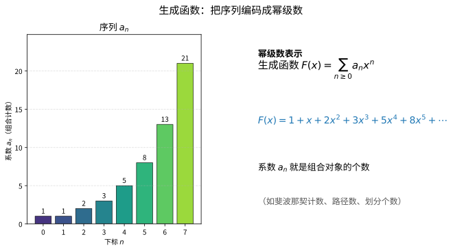

> **直观理解（现实类比）**：生成函数就像"把一串数字打包进一个多项式信封"。序列 $a_n$ 的一组个数（如斐波那契计数、路径数、划分个数）被编码成幂级数 $F(x)=\sum_{n\geq 0}a_n x^n$ 的系数；你只需对 $F(x)$ 做代数运算（加减乘、求导、复合），信封里的系数 $a_n$ 就会自动跟着"变形"，从而得到新组合对象的计数——如同用一台机器同时处理整条流水线，而不是一件一件地数。
>
> **🧠 思考历程：数个数这种"笨功夫"，怎么会想到搬出幂级数当算盘？**
>
> 组合学最初的苦恼是：**对象长得五花八门，每数一次都要从头数起**。生成函数的思路恰恰相反——把整个无穷序列"压缩"进一个代数对象，让所有的计数在信封里一次算完。这条路看似取巧，却为后世整套代数组合学铺好了地基。
>
> - **MacMahon 与 Euler：把"划分"装进信封**（18–20 世纪）。Léonhard Euler 早已用 $\prod_{k\ge1}\frac1{1-x^k}=\sum_n p(n)x^n$ 研究整数划分，Percy MacMahon 则在 20 世纪初系统地把枚举做成了"生成函数"的艺术——他用的正是"信封"，只是把字母换成了成套的代数工具。
> - **Young 图与 Schur 函数：把一个划分变成一块积木**（1900–1930 年代）。Alfred Young 用方格图表示划分，并用其上的"表"（tableaux）梳理对称函数的基；Issai Schur 则把 $s_\lambda$ 定义成对称函数环的一组正交基。生成函数在这时不再是孤立的技巧，而成了连接表示论与组合学的大桥。
> - **RSK 对应：把"信封"升级为字典**（1960–1970 年代）。Robinson、Schensted 与 Donald Knuth 合作建立的 RSK 对应，把一个排列或词一一对应到一对杨表，让"表格计数"与"词的计数"严格对账。这把生成函数、杨表与对称函数彻底锁进同一套语言。
> - **心路**：组合学的真正力量，往往藏在"换一种方式记账"里。生成函数提醒我们：**把无穷多条信息装进一个优雅的代数对象，往往比逐条硬数高效百倍**。

#### 课堂问答

**老师**：我们说一个幂级数 $f(x_1,\dots,x_n)$ 是对称的，判据是什么？为什么非要强调"任意置换"？

**学生**：判据是对任意 $\sigma\in S_n$ 都有 $f(x_{\sigma(1)},\dots,x_{\sigma(n)})=f(x_1,\dots,x_n)$，即对变量任意洗牌都不变。强调"任意"，是因为只要有一个置换让它变了，它就不配代表"变量身份相同"的那组对象；对称函数全体 $\Lambda_n$ 在加法与乘法下封闭，才构成一个环。

**老师（追问）**：对称函数那么多，凭什么说 $e_1,\dots,e_n$ 就够生成整个 $\Lambda_n$？

**学生**：靠对称函数环基本定理 $\Lambda_n=\mathbb{Z}[e_1,\dots,e_n]=\mathbb{Z}[h_1,\dots,h_n]$：初等与完全齐次对称函数都是代数基。交换变量不变这条约束会逼着任何一个对称多项式写成 $e$ 的多项式，而且写法唯一——所以关于对称世界的运算都可归约成摆弄这几块积木。

**老师（拓展）**：$e_k,h_k,p_k$ 三种基看起来都在数"取 $k$ 个变量"，它们的区别只是记号吗？

**学生**：不是，取法上有本质差别：$e_k$ 要求下标严格递增（无放回），$h_k$ 允许下标非降（有放回），$p_k=\sum_i x_i^k$ 是单变量幂再求和。正是"能不能重复取同一个变量"决定了三者彼此可换算但计数含义不同；把 $h_k$ 当成 $e_k$ 是最典型的口误。

### 2. Young图与Young表 (Young Diagrams and Young Tableaux)

**Young图**：一个整数划分 $\lambda = (\lambda_1, \lambda_2, \dots, \lambda_k)$ 满足 $\lambda_1 \geq \lambda_2 \geq \cdots \geq \lambda_k > 0$ 且 $\sum \lambda_i = n$。其Young图是具有 $\lambda_i$ 个方格的左对齐行的图形。

**标准Young表 (SYT)**：将 $1, 2, \dots, n$ 填入Young图的方格中，使得每行从左到右递增，每列从上到下递增。

**半标准Young表 (SSYT)**：将正整数填入Young图的方格中，使得每行从左到右非减，每列从上到下严格递增。

> **常见坑**：SYT 与 SSYT 的松紧约定恰好**一横一纵、方向相反**——SYT 是"行严格 + 列严格"（填 $1,\dots,n$ 各一次），SSYT 是"行非降（允许相等）+ 列严格（仍不许相等）"。最容易出错的是把"行非降"误记成"行严格"：一旦允许同行相等，填数范围从"每数一次"变成"可重复的正整数"，两个世界的计数方式完全不同。记口诀：**SYT 是"人各一席"，SSYT 是"同排可并列、竖列不并列"**。

#### 课堂问答

**老师**：给定划分 $\lambda=(3,2,1)$，Young 图长什么样？SYT 和 SSYT 到底差在哪一步？

**学生**：Young 图是每行 $\lambda_i$ 个、左对齐的方格图，$\lambda=(3,2,1)$ 就是三行分别 3、2、1 格。SYT 把 $1,\dots,n$ 各填一次且每行每列都严格递增；SSYT 允许填正整数，每行非降、每列仍严格递增——差别就一横：SYT 行严格，SSYT 行非降。

**老师（追问）**：为什么允许"行非降"会把计数世界整个换掉？

**学生**：因为一旦同行可相等，填数范围就从"$1$ 到 $n$ 各一次"变成"任意可重复的正整数"，能填的表数既依赖形状也依赖取值上界。SYT 是"人各一席"只关心 $n$，SSYT 是"同排可并列、竖列不并列"，直接决定了 $s_\lambda$ 展开时对什么求和。

**老师（拓展）**：Young 图除了"画积木"，对后面的理论还有什么用？

**学生**：它是载体而非图画——形状 $\lambda$ 决定 Schur 函数 $s_\lambda$，SYT 的个数 $f^\lambda$ 给出 $S_n$ 不可约表示维数，钩长公式 $f^\lambda=n!/\prod \mathrm{hook}$ 把"数格子"与"数填法"接了起来。图、表、函数其实是同一套东西的三种投影。

### 3. Schur函数 (Schur Functions)

**为什么需要这个概念**：三种基础对称函数（$e,h,p$）是"自由的"，而 Schur 函数想要的是另一种主角——既能当对称函数环的**正交基**，又能直接读作对应表示论里的**特征标**。好比合唱团既要每个人都站得规矩（正交），又要每张谱子都对应一个乐章（不可约表示）。Schur 函数 $s_\lambda$ 用带参行列式定义出身，却藏着一句极干净的话：它把"杨表的填法"全部加起来，是连接组合计数与表示的天然桥梁。

**定义**：设 $\lambda$ 是一个划分，$\lambda$ 对应的Schur函数定义为：
$$s_\lambda(x_1, \dots, x_n) = \frac{\det(x_i^{\lambda_j + n - j})_{i,j=1}^n}{\det(x_i^{n-j})_{i,j=1}^n}$$

Schur函数构成对称函数环的一组线性基，在表示论中对应 $GL(n)$ 的不可约表示的特征标。

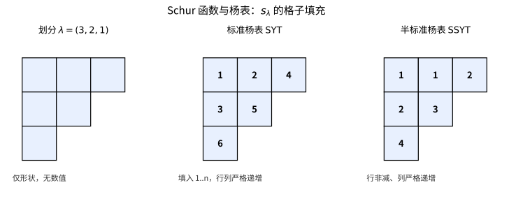

> **直观理解（现实类比）**：Young图像是一种"积木格子"，划分 $\lambda$ 决定格子的外壳，而杨表则规定往格子里填数的规则。标准杨表要求每行每列都严格递增（像按顺序排队的座位号），半标准杨表则允许同行相同（像同一排允许出现并列名次）。Schur函数 $s_\lambda$ 正是把所有这些"合法填法"的贡献加起来，从而把想象中的格子变成了可计算的代数对象。

#### 课堂问答

**老师**：Schur 函数用那个行列式比值定义，凭什么说它天生就是对称的？

**学生**：因为分子 $\det(x_i^{\lambda_j+n-j})$ 与分母 Vandermonde $\det(x_i^{n-j})$ 在交换 $x_i,x_j$ 时都恰好变号 $\mathrm{sgn}(\sigma)$，比值把符号约掉，故 $s_\lambda(x_{\sigma(1)},\dots,x_{\sigma(n)})=s_\lambda(x)$。这正是"用行列式造对称函数"的标准手法。

**老师（追问）**：Schur 函数在对称函数环里到底占什么地位？

**学生**：它是 $\Lambda$ 的一组线性基，而且在 Hall 内积下正交 $\langle s_\lambda,s_\mu\rangle=\delta_{\lambda\mu}$。更关键的是它同时是 $GL(n)$ 不可约表示的特征标，所以正交不是巧合，而是"不可约特征标两两正交"的翻版——这是它与 $e,h,p$ 这些自由基最不同之处。

**老师（拓展）**：定义式里分母 Vandermonde 在 $n$ 个变量时没问题，若变量个数 $n$ 比 $\lambda$ 的长度还大，会出什么事？

**学生**：不会出事，反而更自然：把 $\lambda$ 补零延长到 $n$ 份后，$s_\lambda$ 恰好在多于 $\lambda_1$ 个变量上保持"稳定"——增加变量个数不改变它。正是这条稳定性让我们能对 $n$ 取逆极限，得到与 $n$ 无关的对称函数环 $\Lambda$。

### 4. Littlewood-Richardson系数

**定义**：Schur函数的乘积可展开为Schur函数的线性组合：
$$s_\lambda \cdot s_\mu = \sum_{\nu} c_{\lambda\mu}^\nu s_\nu$$

系数 $c_{\lambda\mu}^\nu$ 称为Littlewood-Richardson系数，它们是非负整数，具有深刻的组合与表示论意义。

> **💡 直观理解（类比）**：Littlewood-Richardson系数就像"两盒拼图能拼出第三个图形的方案数"：把两个 Schur 函数 $s_\lambda\cdot s_\mu$ 相乘，相当于把 $\mu$ 的格子按指定规则一块块搭到 $\lambda$ 上，每搭出一种新形状 $\nu$ 就记一次数。$c_{\lambda\mu}^{\nu}$ 正是"拼法"的数目，它把张量积的分解翻译成分块的拼装游戏。

#### 课堂问答

**老师**：$s_\lambda\cdot s_\mu=\sum_\nu c_{\lambda\mu}^\nu s_\nu$ 里的系数 $c_{\lambda\mu}^\nu$，为什么一定是非负整数？它到底在数什么？

**学生**：它在数"把 $\mu$ 的格子按规则一块块加到 $\lambda$ 上、拼出形状 $\nu$"的方法数，方法数当然是非负整数。表示论上它又等于张量积 $V_\lambda\otimes V_\mu$ 分解中 $V_\nu$ 的重数，组合与表示两条路给出同一个数——这是本章最漂亮的对账。

**老师（追问）**：既然都是"搭格子"，为什么不能随便放，非得带个 LR 条件？

**学生**：不带条件的半标准展开会算出带符号的系数，只有再要求填充读出的词是逆格序（Yamanouchi）词——任意前缀里 $i$ 的个数不少于 $i+1$——负号才抵消干净。所以 LR 条件不是装饰，而是把"符号相消"翻译成了"格子排布规则"。

**老师（拓展）**：$c_{\lambda\mu}^\nu$ 有没有对称性？交换 $\lambda,\mu$ 会怎样？

**学生**：有 $c_{\lambda\mu}^\nu=c_{\mu\lambda}^\nu$，因为 $V_\lambda\otimes V_\mu\cong V_\mu\otimes V_\lambda$，乘法的交换律也印证了这点。但一般 $c_{\lambda\mu}^\nu\neq c_{\lambda\nu}^\mu$——拼接是有方向的，别把两个下标随手对调。

### 5. Pólya计数定理

**定义**：设 $G$ 是作用在集合 $X$ 上的有限群，$C$ 是颜色集。Pólya计数定理给出了用 $C$ 中的颜色对 $X$ 的元素着色，在 $G$ 作用下不等价的着色方案数。

> **常见坑**：Burnside 引理与 Pólya 计数的关系是"兄妹"而非"同人"——Burnside 数的是**轨道总数**（每种颜色不管用没用上），Pólya 定理数的是**把全部颜色都用权重的着色方案生成函数**（$c_k\mapsto w_1^k+\cdots+w_m^k$），两者都要除以 $|G|$。最容易犯的错误有三个：漏掉"÷$|G|$"（忘平均）、把 Burnside 的不动点当 Pólya 直接套、以及忘掉 Pólya 的环指标里要给**每个轮换长度 $k$ 分别代入**而图省事全用 $c\mapsto$ 颜色数。宁可多写一步"轮换分解"，也不要在平均上偷懒。

> **💡 直观理解（类比）**：Pólya计数定理就像"给一串可旋转的珠子规划涂色"：如果旋转后看起来一样就算同一种项链，那么光数"所有涂法"就会重复计数。它借对称群把"重复的"合并成"轨道"，告诉我们在允许转动翻转的前提下，究竟有多少种真正不同的佩戴结果——是 Burnside 引理在"每种颜色还带权重"上的升级版。

#### 课堂问答

**老师**：Burnside 引理已经能数轨道了，为什么还要 Pólya？两者是一回事吗？

**学生**：是"兄妹"不是同人：Burnside 数的是轨道总数，Pólya 数的是带权重的着色生成函数，把颜色数 $m$ 换成每个轮换长度分别代入 $c_k\mapsto w_1^k+\cdots+w_m^k$。Pólya 是 Burnside 在"颜色带价签"上的升级，两者都要除以 $|G|$ 取平均。

**老师（追问）**：套公式时最常在哪一步翻车？

**学生**：三处：漏掉 $1/|G|$ 忘了平均；把 Burnside 的不动点数直接当 Pólya 用；以及环指标里对每个轮换长度 $k$ 图省事全代同一个颜色数，而不按 $|c|$ 分别代入。宁可多写一步"轮换分解"，也别在平均上偷懒。

**老师（拓展）**：如果颜色数目不固定、只要求"恰好用掉某些颜色"，普通 Pólya 还够用吗？

**学生**：这时要用 Pólya 生成函数挑系数——按颜色权重展开，取定次数的那一项就是"恰好用了这些颜色"的方案数。把"用哪些颜色"编进权重里，比重新数一遍轨道干净得多。

### 6. 偏序集与Möbius反演

**定义**：偏序集 $(P, \leq)$ 的Möbius函数 $\mu$ 递归定义为：
$$\mu(x, x) = 1, \quad \sum_{x \leq z \leq y} \mu(x, z) = 0 \quad (x < y)$$

> **💡 直观理解（类比）**：偏序集上的 Möbius 函数就像"一把功率可调的逆向解码器"：它给偏序里每一对元素 $x\le y$ 派一个权，使得"把下级全加起来能还原上级"。它扮演"差分区间的密码"，把已知的"叠加量" $g=\zeta f$ 反卷回原来的 $f$，正是容斥原理在一般偏序框架下的化身。

**Möbius反演公式**：若 $f, g: P \to \mathbb{C}$ 满足 $g(x) = \sum_{y \leq x} f(y)$，则：
$$f(x) = \sum_{y \leq x} \mu(y, x) g(y)$$

> **💡 直观理解（类比）**：反演公式就是这个解码器按下"反向"键后的效果：$g$ 像"地上一层一层加起来的累计总数"，$f$ 是"每一层的净增量"，$\mu$ 则是层与层之间的换算因子。只要知道累计量 $g$ 和换算规则 $\mu$，就能逐层扒出原本的净增量 $f$——典型的"倒着记账"。

#### 课堂问答

**老师**：Möbius 函数 $\mu(x,y)$ 的递归定义为什么要那样写？它凭什么能"反演"？

**学生**：递归是 $\mu(x,x)=1$ 且对 $x<y$ 有 $\sum_{x\le z\le y}\mu(x,z)=0$。它的作用是把"叠加"倒回去：若 $g(x)=\sum_{y\le x}f(y)$，则 $f(x)=\sum_{y\le x}\mu(y,x)g(y)$。一句话，$\mu$ 就是 zeta 函数在卷积下的逆元，反演就是把"乘以 $\zeta$"换成"乘以 $\zeta^{-1}$"。

**老师（追问）**：这个抽象定义落到我们熟悉的场景，会长成什么样？

**学生**：在整除偏序 $a\mid b$ 上，区间就是 $b/a$ 的因数，算出来 $\mu(m,n)=(-1)^k$（当 $n/m$ 是 $k$ 个不同素数之积）、有平方因子则为 $0$——正是数论 Möbius 函数。可见经典反演只是这张大网里的一个刻度。

**老师（拓展）**：这种反演对任何偏序集都能做吗？需要什么前提？

**学生**：需要"局部有限"，即每个区间 $[x,y]$ 有限，递归才停得下来、逆元才存在。若区间无穷，$\mu$ 的递推可能不收敛，反演公式就失去意义——这正是定理里特意强调局部有限的原因。

### 7. 关联代数 (Incidence Algebra)

**定义**：偏序集 $(P, \leq)$ 的关联代数 $I(P)$ 是所有形如 $\alpha: \{(x, y) \in P \times P : x \leq y\} \to \mathbb{C}$ 的函数的集合，卷积定义为：
$$(\alpha * \beta)(x, y) = \sum_{x \leq z \leq y} \alpha(x, z) \beta(z, y)$$

> **💡 直观理解（类比）**：关联代数就像"把偏序集编成一本带路径的流量账本"：每个函数 $\alpha$ 给每一条 $x\le y$ 的"直达纵轴"记账，而卷积 $(\alpha*\beta)$ 则是"经中间节点 $z$ 中转一圈再合计"——像一次旅程分两段计费，路过 $z$ 就折半账。把偏序结构的"路径求和"打包成一个代数，$Möbius$ 反演就化作其中取逆元这么一件整洁的事。

#### 课堂问答

**老师**：关联代数 $I(P)$ 的元素是"区间上的函数"，它的乘法为什么定义为 $(\alpha*\beta)(x,y)=\sum_{x\le z\le y}\alpha(x,z)\beta(z,y)$？

**学生**：因为它把每条 $x\le y$ 的路径按经过的中间点 $z$ 拆成两段，再把所有拆法相加——这正是"路径求和"的代数化。有了这个卷积，$\zeta*\mu=\delta$ 就简洁地表达了"$\mu$ 是 $\zeta$ 的逆"，Möbius 反演于是变成取逆元。

**老师（追问）**：为什么偏偏是 $\zeta$ 和 $\delta$ 这两个元素在唱主角？

**学生**：因为 $\delta$ 是卷积单位元（$\delta(x,y)=1$ 当 $x=y$，否则 $0$），而 $\zeta(x,y)=1$ 当 $x\le y$ 否则 $0$ 恰好编码了"求和"：与 $\zeta$ 卷积就是把 $x$ 下方所有元素加起来。反演的实质就是用 $\zeta$ 的逆 $\mu$ 把这个求和撤销，所以一切围绕 $\zeta,\delta$ 展开。

**老师（拓展）**：这个视角能给出 Möbius 函数存在且唯一的理由吗？

**学生**：能。在局部有限偏序集上，$I(P)$ 中每个满足 $\alpha(x,x)\neq0$ 的元素都可逆（区间有限，可对区间长度归纳求逆），而 $\zeta(x,x)=1\neq0$，故 $\mu=\zeta^{-1}$ 存在且唯一。这把"递归定义 $\mu$"升级成了"逆元存在性定理"，比逐项递推更有结构感。

### 8. 组合Hopf代数

**定义**：组合Hopf代数是具有余乘、余单位和对极的代数结构，在组合学中用于编码和操作组合对象。例如，对称函数环 $\Lambda$ 是一个Hopf代数，余乘为 $\Delta(e_n) = \sum_{i=0}^n e_i \otimes e_{n-i}$。

> **💡 直观理解（类比）**：组合 Hopf 代数就像"一间配备加法和拆分两条流水线的工厂"：乘法把两个组合对象"拼装话"，余乘 $\Delta$ 则把一个大对象"拆解"成所有可能的两段组合（$\sum e_i\otimes e_{n-i}$ 就是把一块积木切成 $i$ 和 $n-i$ 的两块）。这套"拼了又拆、拆了又拼"的双向操作，让组合结构能在一个代数里被统一演算。

#### 课堂问答

**老师**：组合 Hopf 代数比一般代数多了什么？为什么组合学家要把它当作一座工厂？

**学生**：多了余乘 $\Delta$、余单位 $\varepsilon$ 和对极 $S$。乘法把两个组合对象拼起来，余乘 $\Delta$ 反过来把一个大对象拆成"所有可能的两段"之和，比如 $\Lambda$ 上 $\Delta(e_n)=\sum_{i=0}^n e_i\otimes e_{n-i}$。余乘把"结构切分"也变成代数运算，正好描述组合对象的递归拆解。

**老师（追问）**：$\Delta(e_n)=\sum_{i=0}^n e_i\otimes e_{n-i}$ 里的组合含义到底是什么？

**学生**：它说的是"从 $n$ 个元素里选出一个子集、其余留作补集"——每一对 $(i,n-i)$ 对应一种"选出 $i$ 个"的拆法，求和正是把所有大小列一遍。这和初等对称函数"选 $i$ 个变量相乘"的组合意义完全咬合，所以 $\Delta$ 是把"切分对象"编码成了代数同态。

**老师（拓展）**：对极 $S$ 在这个故事里扮演什么角色，缺了它会怎样？

**学生**：对极是"逆元"的推广，让每个元素都有个反向伴侣，使"拆—拼"能相互抵消，从而能定义卷积逆、导出反演类公式。缺了对极就只剩双代数（bialgebra），像 Möbius 反演、特征标理论这些"取逆"的操作就少了一件工具。

### 9. 非交并半格 (Supersolvable Semilattice)

**定义**：一个有限偏序集称为非交并半格，如果它满足某些链条件，这些条件在Stanley的因子序理论中起重要作用。

> **💡 直观理解（类比）**：非交并半格就像"一栋可以逐层向上搭、每层都有一条可循的加高台阶的积木塔"：这种格子有一套管用的"标志链"，使人能一层层清晰加高，像拧螺母一样旋上去。正因为结构足够"规整"，它的各种数值因子（如特征多项式）能干脆地照因子分解，省去一团乱麻。

---

#### 课堂问答

**老师**：非交并半格（supersolvable semilattice）的定义里"某些链条件"具体指什么？为什么它被单独拎出来？

**学生**：它指偏序集含有一条从底到顶、每步都"恰好上升一小段"的标致链，使结构能像旋螺母一样沿链条一格格加高。正因为处处有这样规整的链，它的区间分解与特征多项式才能干脆地乘积展开——这正是 Stanley 因子序理论看中的性质。

**老师（追问）**：为什么"存在这样一条链"就能让因子分解成立？

**学生**：因为能逐步把格拆成"链上的每一小段"，Möbius 函数与特征多项式随之在区间上退化为乘积，于是整体算子的特征多项式分解成线段上的因子。换言之，规整的链把全局计数降成一段段独立的局部计数，这就是 supersolvable 能照因子算账的根据。

**老师（拓展）**：如果偏序集里找不到这样一条链，会失去什么？

**学生**：会失去干净的因子分解：Möbius 值只能逐对递归算，特征多项式不再自动分解为线性因子，常出现不可约块或非实根。比如一般的子群格就未必超可解，这时因子序那套"一部分一部分算"的捷径就失效了。

## 定理与证明

### 定理1：Pólya计数定理

**定理**：设 $G$ 是作用在集合 $X$ 上的有限群，$C$ 是颜色集，$|C| = m$。对于每个 $g \in G$，设 $\text{cyc}(g)$ 是 $g$ 在 $X$ 上作用的不交轮换分解中轮换的个数。则不等价的着色方案数为：
$$N = \frac{1}{|G|} \sum_{g \in G} m^{\text{cyc}(g)}$$

更一般地，若引入权重，设 $w: C \to \mathbb{R}$ 为颜色权重函数，则Pólya枚举定理为：
$$\sum_{\text{轨道}} \prod_{x \in X} w(\text{颜色}(x)) = \frac{1}{|G|} \sum_{g \in G} \prod_{c \in \text{cyc}(g)} \left( \sum_{a \in C} w(a)^{|c|} \right)$$

> **💡 直观理解（类比）**：Pólya 定理像一个"织珠成串再各去重"的公式：$\text{cyc}(g)$ 是置换 $g$ 把珠子切成的圈数，$m^{\text{cyc}(g)}$ 则是在这些圈上自由选色（每个圈一种颜色）的方案数；把所有置换的得意结果取平均，就得到真正不同的项链数。权重版本只是把"颜色数"换成"每种颜色带个价签"，像给不同珠子打上不同单价后再求和。

**证明**：我们使用Burnside引理和群作用的基本理论。

**第一步：Burnside引理**

设 $G$ 是作用在有限集 $S$ 上的有限群。对于每个 $g \in G$，设 $S^g = \{s \in S : g \cdot s = s\}$ 为 $g$ 的不动点集。则 $G$ 作用在 $S$ 上的轨道数为：
$$|S/G| = \frac{1}{|G|} \sum_{g \in G} |S^g|$$

**Burnside引理的证明**：考虑集合 $\{(g, s) \in G \times S : g \cdot s = s\}$，按两种方式计数：
$$\sum_{g \in G} |S^g| = \sum_{s \in S} |\text{Stab}(s)| = \sum_{s \in S} \frac{|G|}{|\text{Orb}(s)|} = |G| \cdot \sum_{s \in S} \frac{1}{|\text{Orb}(s)|}$$

每个轨道 $O$ 贡献 $\sum_{s \in O} \frac{1}{|O|} = 1$，因此 $\sum_{s \in S} \frac{1}{|\text{Orb}(s)|} = |S/G|$。

**第二步：转化为着色问题**

设着色集为 $A = C^X$，即从 $X$ 到 $C$ 的所有函数。群 $G$ 在 $A$ 上的作用由 $(g \cdot f)(x) = f(g^{-1} \cdot x)$ 定义。我们需要计算的正是 $|A/G|$。

由Burnside引理：
$$|A/G| = \frac{1}{|G|} \sum_{g \in G} |A^g|$$

其中 $A^g = \{f \in A : g \cdot f = f\}$。

**第三步：刻画 $A^g$**

$f \in A^g$ 当且仅当对任意 $x \in X$ 和任意 $k \in \mathbb{Z}$，有 $f(g^k \cdot x) = f(x)$。这意味着 $f$ 在 $g$ 的每个轮换上是常数。

设 $g$ 在 $X$ 上的轮换分解为 $c_1, c_2, \dots, c_{\text{cyc}(g)}$，每个轮换 $c_i$ 的长度为 $|c_i|$。则 $f$ 由其在每个轮换上的取值唯一确定，因此：
$$|A^g| = m^{\text{cyc}(g)}$$

代入Burnside引理即得：
$$|A/G| = \frac{1}{|G|} \sum_{g \in G} m^{\text{cyc}(g)}$$

**第四步：带权重的版本**

对于带权重的版本，我们考虑生成函数。设 $F_g$ 为 $g$ 的轮换指标：
$$Z_g = \prod_{i=1}^{\text{cyc}(g)} \left( \sum_{a \in C} w(a)^{|c_i|} \right)$$

则Pólya枚举定理的权重版本同样由Burnside引理导出。$\square$

---

#### 课堂问答

**老师**：定理给出 $N=\frac{1}{|G|}\sum_{g\in G}m^{\mathrm{cyc}(g)}$，证明的关键一步落在哪里？

**学生**：落在对不动点集的刻画：着色 $f$ 被 $g$ 固定，当且仅当它在 $g$ 的每个轮换上是常数，于是 $|A^g|=m^{\mathrm{cyc}(g)}$，再套 Burnside 即得 $N$。整条证明就是把"着色被 $g$ 固定"翻译成"每个轮换一种颜色"。

**老师（追问）**：带权版本里 $Z_g=\prod_i(\sum_{a\in C}w(a)^{|c_i|})$ 是怎么冒出来的？

**学生**：把"每个轮换选一种颜色"升级成生成函数：一个长 $k$ 的轮换若涂颜色 $a$，就贡献 $w(a)^k$，对所有颜色求和得 $\sum_a w(a)^k$，各轮换相乘就是 $Z_g$，再对 $g$ 取平均。把 $w(a)$ 全取 $1$ 就退回 $m^{\mathrm{cyc}(g)}$，所以权重版是对原定理的自然封装。

**老师（拓展）**：当对称群是循环群 $C_n$ 作用在 $n$ 颗珠子上时，$\mathrm{cyc}(r^k)$ 等于什么？

**学生**：等于 $\gcd(k,n)$，因为旋转 $k$ 步把珠子分成 $\gcd(k,n)$ 个等长轮换，每个长 $n/\gcd(k,n)$。于是 $N=\frac1n\sum_{k=0}^{n-1}m^{\gcd(k,n)}$；如 $n=6,m=2$ 时 $(2^6+2+2^2+2^3+2^2+2)/6=84/6=14$。易错点是 $k=0$ 时 $\gcd(0,n)=n$，别误当成 $0$。

### 定理2：Möbius反演公式

**定理**：设 $(P, \leq)$ 是一个局部有限偏序集（即任意区间 $[x, y] = \{z : x \leq z \leq y\}$ 是有限集），$\mu$ 是 $P$ 上的Möbius函数。若 $f, g: P \to \mathbb{C}$ 满足：
$$g(x) = \sum_{y \leq x} f(y) \quad \text{对所有 } x \in P$$

则：
$$f(x) = \sum_{y \leq x} \mu(y, x) g(y) \quad \text{对所有 } x \in P$$

> **💡 直观理解（类比）**：这条反演公式就是前面"解码器"的中心宣言：只要你亲眼数出累计量 $g$（每个 $x$ 下方所有 $f$ 的总和），它就能用 $\mu$ 这个"精确的修正系数"把每一层原本的净值 $f(x)$ 逐个倒出来。本质是一次"差分"运算——$g$ 是面积分，反演就是微积分里的求导，只是$\le$ 换成了普通小于等于。

**证明**：我们使用关联代数方法。

**第一步：定义关联代数**

设 $I(P)$ 为 $P$ 的关联代数，其元素为函数 $\alpha: \{(x, y) : x \leq y\} \to \mathbb{C}$，卷积定义为：
$$(\alpha * \beta)(x, y) = \sum_{x \leq z \leq y} \alpha(x, z) \beta(z, y)$$

$I(P)$ 中的单位元 $\delta$ 定义为：
$$\delta(x, y) = \begin{cases}
1 & \text{若 } x = y \\
0 & \text{若 } x < y
\end{cases}$$

**第二步：关键元素**

定义Zeta函数：
$$\zeta(x, y) = \begin{cases}
1 & \text{若 } x \leq y \\
0 & \text{否则}
\end{cases}$$

Möbius函数 $\mu$ 定义为 $\zeta$ 在 $I(P)$ 中的逆元，即：
$$\zeta * \mu = \mu * \zeta = \delta$$

展开即得：
$$\sum_{x \leq z \leq y} \zeta(x, z) \mu(z, y) = \delta(x, y)$$
$$\sum_{x \leq z \leq y} \mu(z, y) = \delta(x, y)$$

对于 $x = y$，有 $\mu(x, x) = 1$。
对于 $x < y$，有 $\sum_{x \leq z \leq y} \mu(z, y) = 0$，即：
$$\sum_{x \leq z \leq y} \mu(z, y) = 0 \quad \Rightarrow \quad \mu(x, y) = -\sum_{x < z \leq y} \mu(z, y)$$

这给出了Möbius函数的递归定义。

**第三步：反演公式的证明**

设 $g(x) = \sum_{y \leq x} f(y)$。在关联代数中，这可以写为：
$$g(x) = \sum_{y \leq x} f(y) \zeta(y, x) = (f * \zeta)(x)$$

其中我们将 $f$ 视为 $I(P)$ 中的元素，定义为 $f(y, x) = f(y)$ 当 $y \leq x$（但更精确地说，我们考虑 $f$ 作为 $P$ 上的函数，与 $\zeta$ 卷积）。

实际上，更标准的写法是：定义 $F(x) = \sum_{y \leq x} f(y)$。则：
$$F = f * \zeta \quad \text{即} \quad F(x) = \sum_{y \leq x} f(y) \zeta(y, x)$$

由于 $\mu = \zeta^{-1}$，我们有：
$$f = F * \mu$$

展开即得：
$$f(x) = \sum_{y \leq x} F(y) \mu(y, x)$$

这正是Möbius反演公式。$\square$

**推论**：对于正整数集上的整除偏序，其中 $a \leq b$ 当且仅当 $a \mid b$，Möbius函数为：
$$\mu(m, n) = \begin{cases}
(-1)^k & \text{若 } n/m \text{ 是 } k \text{ 个不同素数的乘积} \\
0 & \text{若 } n/m \text{ 有平方因子}
\end{cases}$$

这给出了经典的数论Möbius反演公式。

> **💡 直观理解（类比）**：这个推论把一般反演"落到整除的台阶上"：当 $a\le b$ 特指 $a\mid b$ 时，Möbius 值 $\mu(m,n)$ 就退化成经典数论里的 $\mu$——若 $n/m$ 是 $k$ 个不同质数之积取 $(-1)^k$，一旦某个质数出现平方就归零。就像把通用密码表换成"只认质因数"的专属版本，直接服务于数论最常用的反演。

---

#### 课堂问答

**老师**：Möbius 反演的证明为什么要搬出关联代数，而不是硬算？

**学生**：因为一旦在 $I(P)$ 里定义卷积，条件 $g=f*\zeta$ 就只是一次乘积，而 $\mu=\zeta^{-1}$ 立刻给出 $f=g*\mu$，展开即 $f(x)=\sum_{y\le x}\mu(y,x)g(y)$。用代数把"逐项递推"变成"取逆元"，证明只剩一句 $\zeta*\mu=\delta$。

**老师（追问）**：$\mu=\zeta^{-1}$ 这个逆元的存在性依赖什么？证明里体现了吗？

**学生**：依赖局部有限——每个区间 $[x,y]$ 有限，才能对区间长度归纳求出 $\mu(x,y)=-\sum_{x<z\le y}\mu(z,y)$，从而 $\zeta*\mu=\delta$。若区间无穷，这个递推不终止，逆元可能不存在，反演公式也就无从谈起。

**老师（拓展）**：把这条一般公式特化到数论，能得到什么？

**学生**：在整除偏序上 $\mu(m,n)=(-1)^k$（$n/m$ 为 $k$ 个不同素数之积）、否则为 $0$，代回就给经典数论反演：若 $g(n)=\sum_{d\mid n}f(d)$，则 $f(n)=\sum_{d\mid n}\mu(d)g(n/d)$。更一般的价值在于：换一个偏序（子集格、划分格……），同一条公式自动给你一整套容斥表。

### 定理3：Schur函数的对称性和正交性

**定理**：Schur函数满足以下性质：

1. **对称性**：$s_\lambda(x_1, \dots, x_n)$ 是 $x_1, \dots, x_n$ 的对称函数。
2. **正交性**：对于Hall内积 $\langle \cdot, \cdot \rangle$，有：
   $$\langle s_\lambda, s_\mu \rangle = \delta_{\lambda\mu}$$
   其中 $\delta_{\lambda\mu}$ 是Kronecker delta。

> **💡 直观理解（类比）**：这条定理给 Schur 函数记了两条"优秀品格"：对称性让它们"任打乱变量长得一样"（像名角的化妆无论从哪个角度看都一致）；正交性则让它们在 Hall 内积下"两两垂直像正交坐标轴"（不同形状的表互不纠缠）。于是 $\{s_\lambda\}$ 成了一套既漂亮又独立的正交坐标系，任何对称函数都能按 $\lambda$ 干净地拆解。

**证明**：

**对称性的证明**：

Schur函数的定义式为：
$$s_\lambda(x_1, \dots, x_n) = \frac{\det(x_i^{\lambda_j + n - j})_{i,j=1}^n}{\det(x_i^{n-j})_{i,j=1}^n}$$

分母 $\det(x_i^{n-j})$ 是Vandermonde行列式：
$$\det(x_i^{n-j}) = \prod_{1 \leq i < j \leq n} (x_i - x_j)$$

对于任意置换 $\sigma \in S_n$，将 $x_i$ 替换为 $x_{\sigma(i)}$，分子分母同时乘以 $\text{sgn}(\sigma)$，因此比值不变。故 $s_\lambda$ 是对称的。

**正交性的证明**：

我们首先定义Hall内积。在对称函数环 $\Lambda$ 上，Hall内积由幂和函数定义：
$$\langle p_\lambda, p_\mu \rangle = \delta_{\lambda\mu} z_\lambda$$

其中 $z_\lambda = \prod_{i \geq 1} i^{m_i(\lambda)} m_i(\lambda)!$，$m_i(\lambda)$ 是 $\lambda$ 中 $i$ 出现的次数。

**引理**：Schur函数与Jacobi-Trudi公式相关：
$$s_\lambda = \det(h_{\lambda_i - i + j})_{i,j=1}^n$$

其中 $h_k$ 是完全齐次对称函数，$h_0 = 1$，$h_k = 0$ 当 $k < 0$。

**正交性的关键在于**：利用Cauchy恒等式：
$$\prod_{i,j} \frac{1}{1 - x_i y_j} = \sum_{\lambda} s_\lambda(x) s_\lambda(y)$$

其中求和遍及所有划分。

另一方面，Hall内积的定义使得 $\{s_\lambda\}$ 成为正交基。具体地，考虑双线性形式：
$$\langle f, g \rangle = [f(\partial) g(x)]_{x=0}$$

其中 $f(\partial)$ 是通过将 $f$ 中的幂和 $p_k$ 替换为 $k \frac{\partial}{\partial p_k}$ 得到的微分算子。可以验证：
$$\langle s_\lambda, s_\mu \rangle = \delta_{\lambda\mu}$$

**详细验证**：利用Cauchy恒等式和幂和展开：
$$\prod_{i,j} \frac{1}{1 - x_i y_j} = \exp\left(\sum_{k \geq 1} \frac{p_k(x) p_k(y)}{k}\right) = \sum_{\lambda} \frac{1}{z_\lambda} p_\lambda(x) p_\lambda(y)$$

结合 $\sum_{\lambda} s_\lambda(x) s_\lambda(y) = \sum_{\lambda} \frac{1}{z_\lambda} p_\lambda(x) p_\lambda(y)$，以及 $\{p_\lambda\}$ 的正交性 $\langle p_\lambda, p_\mu \rangle = \delta_{\lambda\mu} z_\lambda$，可得 $\{s_\lambda\}$ 的正交性。$\square$

---

#### 课堂问答

**老师**：定理说 $s_\lambda$ 既对称又在 Hall 内积下正交，这两条是各证各的吗？

**学生**：是两条独立性质。对称性来自行列式定义：分子分母同乘 $\mathrm{sgn}(\sigma)$、符号相消；正交性则是 $\langle s_\lambda,s_\mu\rangle=\delta_{\lambda\mu}$，靠 Jacobi–Trudi 公式 $s_\lambda=\det(h_{\lambda_i-i+j})$ 与 Cauchy 恒等式 $\prod_{i,j}(1-x_iy_j)^{-1}=\sum_\lambda s_\lambda(x)s_\lambda(y)$ 拼出来。

**老师（追问）**：Hall 内积里的 $z_\lambda$ 是干什么的？为什么 $\langle p_\lambda,p_\mu\rangle=\delta_{\lambda\mu}z_\lambda$ 而不直接是 $\delta_{\lambda\mu}$？

**学生**：$z_\lambda=\prod_i i^{m_i(\lambda)}m_i(\lambda)!$ 是幂和基的正交归一因子，来自幂和展开系数的记账。有了它，Cauchy 恒等式的 $\exp(\sum_k p_k(x)p_k(y)/k)=\sum_\lambda p_\lambda(x)p_\lambda(y)/z_\lambda$ 才能和 $\sum_\lambda s_\lambda(x)s_\lambda(y)$ 对齐，从而推出 $s$ 的正交性——$z_\lambda$ 就是"幂和基不自动归一"留下的折扣。

**老师（拓展）**：正交基这一条，除了好看，还有什么真用处？

**学生**：它是"系数提取器"：任何对称函数 $f=\sum_\lambda a_\lambda s_\lambda$ 的系数由 $a_\lambda=\langle f,s_\lambda\rangle$ 单独算出，不受别的项干扰。于是 LR 系数、Kostka 数都能写成内积，表示论里的重数也随之变成一次投影——这正是把 Schur 当作"标准坐标轴"的理由。

### 定理4：Littlewood-Richardson规则

**定理**：Schur函数乘积 $s_\lambda \cdot s_\mu$ 的展开系数 $c_{\lambda\mu}^\nu$ 等于将 $\mu$ 的Young图附加到 $\lambda$ 的Young图上得到 $\nu$ 的Young图的方式数，其中附加过程需满足Littlewood-Richardson条件：

1. 每次添加一个方格，方格中填入数字，每步得到的形状是一个Young图。
2. 填入的数字构成一个序列（称为"文字"），该序列从右到左、从上到下读入时，是一个逆格序词（reverse lattice word），即对于任意前缀，数字 $i$ 的出现次数不少于数字 $i+1$ 的出现次数。
3. 同一行中的数字不严格递减，同一列中的数字严格递增。

> **💡 直观理解（类比）**：Littlewood-Richardson 规则像"一本限定规则的搭积木说明书"：把 $\mu$ 的格子按每步仍是 Young 图的方式一块块放上 $\lambda$，同时给每块编号并保证"编号越小的先到"（逆格序条件），并且同一行不降、同一列严格升。每满足这套说明书搭出的成品就对应一个新形状 $\nu$，$c_{\lambda\mu}^{\nu}$ 就是这条搭法能到 $\nu$ 的路线条数。

**证明思路**：

**第一步：转化为对称函数**

Littlewood-Richardson系数 $c_{\lambda\mu}^\nu$ 定义为：
$$s_\lambda \cdot s_\mu = \sum_{\nu} c_{\lambda\mu}^\nu s_\nu$$

**第二步：Skew Schur函数**

考虑Skew Schur函数 $s_{\nu/\lambda}$，其定义为：
$$s_{\nu/\lambda} = \sum_{\mu} c_{\lambda\mu}^\nu s_\mu$$

因此 $c_{\lambda\mu}^\nu$ 等于 $s_{\nu/\lambda}$ 中 $s_\mu$ 的系数。

**第三步：Skew Schur函数的组合解释**

Skew Schur函数 $s_{\nu/\lambda}$ 可以表示为所有形状为 $\nu/\lambda$ 的半标准Young表的权重和：
$$s_{\nu/\lambda} = \sum_{T \in \text{SSYT}(\nu/\lambda)} x^T$$

其中 $x^T = \prod_{i} x_i^{m_i(T)}$，$m_i(T)$ 是 $i$ 在 $T$ 中的出现次数。

**第四步：Littlewood-Richardson条件的推导**

为了得到 $c_{\lambda\mu}^\nu$，我们需要将 $\mu$ 的Yamanouchi词（即满足逆格序条件的词）与 $\nu/\lambda$ 的填充对应。具体地：

给定一个形状为 $\nu/\lambda$ 的半标准Young表 $T$，逐行读出 $T$ 中的数字，得到词 $w(T)$。若 $w(T)$ 是Yamanouchi词（即逆格序词），则 $T$ 对应一个Littlewood-Richardson填充。

**第五步：对应关系**

每个形状为 $\nu/\lambda$ 且满足Littlewood-Richardson条件的填充对应一个 $\mu$，其中 $\mu_i$ 等于数字 $i$ 在填充中出现的次数。这就建立了 $c_{\lambda\mu}^\nu$ 与Littlewood-Richardson填充计数之间的对应。

**第六步：证明关键**

该对应是双射的，因此 $c_{\lambda\mu}^\nu$ 确实等于满足条件的填充数。$\square$

---

#### 课堂问答

**老师**：LR 规则把 $c_{\lambda\mu}^\nu$ 说成"满足三条限制的填法数"，那三条限制各起什么作用？

**学生**：一、每步添格得到的形状仍是 Young 图——保证最终是合法形状 $\nu$；二、填充读出的词是逆格序词（任意前缀里 $i$ 的个数不少于 $i+1$）——保证与 $\mu$ 对应且系数非负；三、同行非严格递减、同列严格递增——保证是半标准。三条合起来才把"带符号的展开"锁成"数得清的非负整数"。

**老师（追问）**：证明为什么要绕道 Skew Schur 函数 $s_{\nu/\lambda}$？

**学生**：因为 $s_\lambda\cdot s_\mu=\sum_\nu c_{\lambda\mu}^\nu s_\nu$ 不好直接拆，而 $s_{\nu/\lambda}=\sum_\mu c_{\lambda\mu}^\nu s_\mu$ 把"系数"变成了"另一个 Schur 函数的展开系数"。再用 $s_{\nu/\lambda}=\sum_{T\in\mathrm{SSYT}(\nu/\lambda)}x^T$，问题就落到"数 $\nu/\lambda$ 上哪些半标准表读出的词是 Yamanouchi 词"，组合上立刻可数。

**老师（拓展）**：如果去掉逆格序条件，只保留半标准，会得到什么？

**学生**：会得到半标准表的一般展开，系数可以带负号——那就不再是 $c_{\lambda\mu}^\nu$ 了。逆格序条件正是在筛选"哪些 $\mu$ 才被允许"，等价于要求逐行读数是 Yamanouchi 词的分拆，这个筛选就是 LR 规则的分量所在。

### 定理5：Robinson-Schensted对应

**定理**：存在一个双射（称为Robinson-Schensted对应）：
$$\text{RS}: S_n \to \bigcup_{\lambda \vdash n} \text{SYT}(\lambda) \times \text{SYT}(\lambda)$$

其中 $S_n$ 是 $n$ 次对称群，$\text{SYT}(\lambda)$ 是形状为 $\lambda$ 的标准Young表的集合。该对应将每个置换 $\pi \in S_n$ 映射到一对相同形状的标准Young表 $(P, Q)$。

**证明**：

**第一步：算法描述（RSK算法）**

给定置换 $\pi = \pi_1 \pi_2 \cdots \pi_n$，我们递归地构造插入表 $P$ 和记录表 $Q$。

初始化 $P = \emptyset$，$Q = \emptyset$。

对于 $k = 1, 2, \dots, n$，执行以下步骤：

1. **插入步骤**：将 $\pi_k$ 插入 $P$ 中：
   - 从第一行开始，找到该行中第一个大于 $\pi_k$ 的元素。
   - 若找到，设该元素为 $x$，用 $\pi_k$ 替换 $x$，然后将 $x$ 插入下一行（递归执行）。
   - 若未找到（或行已满），将 $\pi_k$ 附加到该行末尾。

2. **记录步骤**：在 $Q$ 中与 $P$ 新增方格相同的位置填入 $k$。

**第二步：证明结果是标准Young表**

我们需要证明算法终止时 $P$ 和 $Q$ 都是标准Young表。

- $P$ 的每行从左到右严格递增：由插入规则，当 $a$ 替换 $b$（$a < b$）时，$b$ 被插入下一行，$a$ 所在位置左侧的元素都小于 $a$，右侧的元素都大于等于 $b$，因此 $a$ 保持行内递增序。
- $P$ 的每列从上到下严格递增：需要验证插入操作不破坏列递增性，这可以通过归纳法证明。
- $Q$ 的填充方式是每次在新方格中填入 $k$，由于 $k$ 递增，$Q$ 每行每列也严格递增。

**第三步：证明可逆性**

给定 $(P, Q)$，我们可以逆向恢复出 $\pi$：

1. 找到 $Q$ 中最大元素 $k$ 所在的位置 $(i, j)$。
2. 在 $P$ 的相同位置，该元素是被插入的。从 $P$ 中移除该元素，并逆向执行插入过程：
   - 从上一行中找到小于该元素的最大元素，将其上移替换当前元素。
   - 重复直到第一行，得到 $\pi_k$。
3. 从 $Q$ 中移除 $k$。

重复以上步骤即恢复 $\pi$。

**第四步：证明双射性**

由于上述正向算法和逆向算法互逆，且每个步骤都是确定性的，因此RS对应是双射。

**推论**：设 $f^\lambda$ 为形状 $\lambda$ 的标准Young表个数，则：
$$n! = \sum_{\lambda \vdash n} (f^\lambda)^2$$

这是RS对应的直接推论，因为 $|S_n| = n!$，且RS对应是双射。

**钩长公式**：$f^\lambda = \frac{n!}{\prod_{(i,j) \in \lambda} \text{hook}(i,j)}$，其中 $\text{hook}(i,j)$ 是方格 $(i,j)$ 的钩长（该方格右方和下方方格数加1）。$\square$

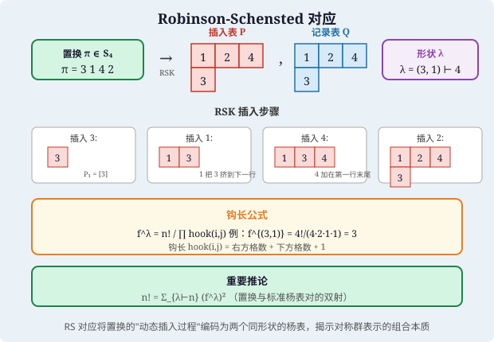

> **直观理解（现实类比）**：RS 对应就像"把一副打乱的扑克牌整理成两叠整齐的牌塔"。给定一个置换（如 $\pi = 3142$），RSK 算法逐张插入扑克牌：每张新牌要么放在某行末尾，要么"挤掉"该行中比它大的那张牌，被挤掉的牌再插入下一行。最终得到两个形状完全相同的标准 Young 表——插入表 $P$ 记录了"牌的最终排列"，记录表 $Q$ 记录了"每张牌是什么时候放进去的"。这种双射揭示了：$n!$ 个打乱方式恰好等于所有可能形状 $\lambda$ 下"两张相同形状标准表的配对数"之和。

---

#### 课堂问答

**老师**：RS 对应声称 $S_n$ 与 $\bigcup_{\lambda\vdash n}\mathrm{SYT}(\lambda)\times\mathrm{SYT}(\lambda)$ 双射，插入表 $P$ 与记录表 $Q$ 各记了什么？

**学生**：$P$ 记录"牌的最终排布"——逐张插入后得到的 SYT，其形状 $\lambda$ 承载最长递增子序列等信息；$Q$ 记录"每张牌何时插入"——第 $k$ 步在新格填 $k$。两者形状相同（都是 $\lambda$），故 $\pi\leftrightarrow(P,Q)$。

**老师（追问）**：为什么它一定是双射，怎么保证能反着走回去？

**学生**：靠插入与删除互为逆运算：正向按 RSK 逐张插入；逆向从 $Q$ 找最大标号 $k$ 的位置，在 $P$ 的同位置做"反向挤出"直到第一行取出 $\pi_k$，删掉该格并去掉 $Q$ 中的 $k$，循环即还原 $\pi$。每一步都确定，所以一一对应。

**老师（拓展）**：从这个双射能立刻得到什么可贵结论？

**学生**：立刻得 $n!=\sum_{\lambda\vdash n}(f^\lambda)^2$，因为左边是 $|S_n|$，右边是每对同形状标准表数目之和；再配上钩长公式 $f^\lambda=n!/\prod\mathrm{hook}$ 就得到一套纯组合的维数公式。更深一层，RS 把"置换的 LIS 长度"变成 $P$ 第一行的长度，让表示论、计数与算法在同一个双射里会合。

## 示例

### 示例1：用Pólya计数计算项链着色

**问题**：用 $m$ 种颜色给 $n$ 颗珠子组成的项链着色，旋转视为等价，求不等价的着色方案数。

**解**：项链的对称群是 $n$ 阶循环群 $C_n$，作用在 $n$ 个珠子上。

对于 $g = r^k$（旋转 $k$ 个位置），$g$ 的轮换数为 $\gcd(k, n)$。因为旋转 $k$ 个位置将珠子分为 $\gcd(k, n)$ 个轮换，每个轮换有 $n/\gcd(k, n)$ 个珠子。

由Pólya计数定理：
$$N = \frac{1}{n} \sum_{k=0}^{n-1} m^{\gcd(k, n)}$$

**例**：$n = 6$，$m = 2$（2种颜色，6颗珠子）。
$$\gcd(0,6)=6, \gcd(1,6)=1, \gcd(2,6)=2, \gcd(3,6)=3, \gcd(4,6)=2, \gcd(5,6)=1$$
$$N = \frac{1}{6}(2^6 + 2^1 + 2^2 + 2^3 + 2^2 + 2^1) = \frac{1}{6}(64 + 2 + 4 + 8 + 4 + 2) = \frac{84}{6} = 14$$

因此有14种不等价的着色方案。

---

### 示例2：用Young表计算对称群表示

**问题**：对于 $S_4$，列出所有划分及对应的不可约表示维数，并计算 $S_4$ 的不可约表示的特征标（部分）。

**解**：$S_4$ 的划分有：
- $\lambda = (4)$：$f^{(4)} = 1$（平凡表示）
- $\lambda = (3,1)$：$f^{(3,1)} = 3$
- $\lambda = (2,2)$：$f^{(2,2)} = 2$
- $\lambda = (2,1,1)$：$f^{(2,1,1)} = 3$
- $\lambda = (1,1,1,1)$：$f^{(1,1,1,1)} = 1$（符号表示）

验证：$1^2 + 3^2 + 2^2 + 3^2 + 1^2 = 1 + 9 + 4 + 9 + 1 = 24 = 4!$ ✓

**钩长计算**：以 $\lambda = (3,1)$ 为例：
```
□□□
□
```
钩长分别为：第一行 4, 2, 1；第二行 1。
$$f^{(3,1)} = \frac{4!}{4 \cdot 2 \cdot 1 \cdot 1} = \frac{24}{8} = 3$$

---

### 示例3：Möbius反演在子集格上的应用

**问题**：设 $P$ 是有限集 $[n] = \{1, \dots, n\}$ 的所有子集构成的偏序集（按包含序）。求 $P$ 上的Möbius函数，并应用Möbius反演。

**解**：在子集格中，对任意 $A \subseteq B$，有：
$$\mu(A, B) = (-1)^{|B| - |A|}$$

**验证**：固定 $A$，对 $B$ 归纳。若 $B = A$，则 $\mu(A, A) = 1$。若 $B \supsetneq A$，设 $k = |B| - |A|$，则：
$$\sum_{A \subseteq C \subseteq B} \mu(A, C) = \sum_{j=0}^k \binom{k}{j} (-1)^j = (1-1)^k = 0 \quad (k > 0)$$

**应用**：容斥原理是Möbius反演在子集格上的特例。设 $f(A) = |A|$ 中满足某性质的元素个数，$g(A) = \sum_{B \subseteq A} f(B)$，则 $f(A) = \sum_{B \subseteq A} (-1)^{|A|-|B|} g(B)$。

---

## 习题

### 基础题

**习题 1**（整数分拆与 Young 图）给出正整数分拆的定义，说明与其共轭的 Young 图，并求出 $p(4),p(5)$。

**习题 2**（对称函数）写出对称多项式环 $\Lambda_n$ 的定义，并说明完全对称多项式 $h_k$ 与初等对称多项式 $e_k$。

**习题 3**（Burnside 引理与 Pólya 计数）陈述 Burnside 引理与 Pólya 计数定理（含权重形式）。

**习题 4**（标准 Young 表）定义形状 $\lambda$ 的标准 Young 表（SYT），并说明第 $k$ 个对称群阶数与表数的联系。

**习题 5**（Schur 函数）定义 Schur 函数 $s_\lambda$，说明它与 Young 表及 Littlewood-Richardson 系数的关系。

**习题 6**（Littlewood-Richardson 系数）写出 $s_\lambda s_\mu=\sum_\nu c_{\lambda\mu}^{\nu}s_\nu$ 中系数 $c_{\lambda\mu}^\nu$ 的意义。

**习题 7**（偏序集与 Möbius 函数）定义偏序集的 Möbius 函数，并写出数论整除格上的 Möbius 值。

**习题 8**（关联代数）定义偏序集 $P$ 的关联代数 $I(P)$ 及其卷积运算与单位元。

**习题 9**（Robinson-Schensted 对应）陈述 Robinson-Schensted（RS）对应：置换与哪种表对构成双射。

**习题 10**（组合 Hopf 代数）列举示性：对称函数环 $\Lambda$ 作为 Hopf 代数时的乘法、余乘法与单位。

### 进阶题

**习题 11**（Burnside 计数）用 Burnside 引理计算 $2$ 种颜色给正方形四个顶点着色（旋转反射视为等价）时的等价着色数。

**习题 12**（Pólya 项链）用 Pólya 计数定理求用 $q$ 种颜色给无向 $r$ 边形项链（旋转等价）着色的方案数生成函数。

**习题 13**（Jacobi-Trudi）用 Jacobi-Trudi 公式写出 $s_{(2,1)}$ 关于 $h$ 或 $e$ 的展开式。

**习题 14**（分拆计数）计算 $p(4)=5,p(5)=7$，并写出 $5$ 的全部分拆与对应共轭分拆。

**习题 15**（整除格 Möbius）在整除格 $\mathbb{N}^*$ 上计算 $\mu(n,m)$，并用之推出数论 Möbius 反演。

**习题 16**（小 LR 系数）由 $s_{(2)}s_{(1)}=s_{(3)}+s_{(2,1)}$ 写出涉及的 Littlewood-Richardson 系数。

**习题 17**（RS 表计数）用 RS 对应说明：$n$ 元置换数与形状 $\vdash n$ 的标准表平方和满足的恒等式。

**习题 18**（Schur 对称性）说明 Schur 函数在 $\Lambda$ 的圆点复制中形成正交基，并写出标准内积的协变公式。

**习题 19**（$\zeta$-卷积）对偏序集 $P$，定义 $\zeta$ 并与 $m=\zeta^{-1}$ 的卷积 $m*\zeta=\delta$，验证反演公式。

### 挑战题

**习题 20**（Burnside 引理证明）证明 Burnside 引理：对有限群 $G$ 作用集合 $X$，轨道数 $=\frac{1}{|G|}\sum_{g\in G}|\operatorname{Fix}(g)|$。

**习题 21**（Pólya 计数证明）给出 Pólya 计数定理的证明：等价着色数的生成函数是轮换指标代入颜色权重。

**习题 22**（Möbius 反演的关联代数证明）在关联代数 $I(P)$ 中用 $\mu=\zeta^{-1}$ 证明 Möbius 反演公式完整形式。

**习题 23**（RS 双射性思路）概述 Robinson-Schensted 对应为双射的证明思路（插入算法、对合、Knuth 等价）。

**习题 24**（LR 规则非平凡例）用 Littlewood-Richardson 规则计算 $s_{(2,1)}s_{(1,1)}$ 的展开式。

**习题 25**（Schur 正交）证明 Schur 函数在标准内积 $\langle s_\lambda,s_\mu\rangle=\delta_{\lambda\mu}$ 下两两正交。

**习题 26**（hook 长度公式）写出框架形状 $\lambda\vdash n$ 的标准表数量公式（hook 长度公式）并解释各因子。

### 探究题

**习题 27**（组合 Hopf 代数）开放探讨：对称函数环 $\Lambda$ 的 Hopf 代数的余乘法、Newton 幂和基，以及与对称群的表示环、商标代数的联系。

**习题 28**（RSK 推广与 plactic）讨论 RSK 对应到 Knuth 等价、plactic 幺半群、Littlewood-Richardson tableaux 与双射层次的推广。

**习题 29**（非交并半格）探讨 supersolvable 偏序半格及其特征多项式，连接表示论与 pebble 型组合结构。

**习题 30**（表示论前沿）开放讨论 Schur-Weyl 对偶、Kronecker 系数的计算困难问题，以及代数组合在代数几何（Schubert 计算）中的应用。

---

## 习题答案与解析

### 基础题答案

1. **整数分拆与 Young 图** 正整数 $n$ 的分拆是 $n=\lambda_1+\cdots+\lambda_k$（$\lambda_1\ge\dots\ge\lambda_k\ge1$），记作 $\lambda\vdash n$。其 Young 图为含 $\lambda_1,\dots,\lambda_k$ 个格点的左对齐行堆叠（第 $i$ 行 $\lambda_i$ 个格点）；共轭分拆 $\lambda'$ 的 Young 图即按对角线翻转（交换行列）。$p(4)=5$（$4,\;3+1,\;2+2,\;2+1+1,\;1+1+1+1$），$p(5)=7$。

2. **对称函数** 对称多项式环 $\Lambda_n$ 是 $n$ 个变量 $x_1,\dots,x_n$ 上对称多项式的整（或 $\mathbb{Q},\mathbb{C}$）系数环；$\Lambda$ 是逆极限（增加变量个数）得到的对称函数环。完全对称多项式 $h_k=\sum_{i_1\le\dots\le i_k}x_{i_1}\cdots x_{i_k}$（允许重复，生成函数 $H(t)=\prod(1-x_it)^{-1}$），初等对称多项式 $e_k=\sum_{i_1<\dots<i_k}x_{i_1}\cdots x_{i_k}$（不重复，生成函数 $E(t)=\prod(1+x_it)$）。$\Lambda=\mathbb{Z}[h_1,h_2,\dots]=\mathbb{Z}[e_1,e_2,\dots]$。

3. **Burnside 引理与 Pólya 计数** Burnside 引理：有限群 $G$ 作用在集合 $X$ 上，$X$ 的轨道数 $=\frac1{|G|}\sum_{g\in G}|\operatorname{Fix}(g)|$。Pólya 计数定理：用 $q$ 种颜色对 $S$（$G$ 作用其上）着色，不等价着色数 $=$ 轮换指标 $Z_G$ 中把每个变量都替换成 $q$：$Z_G:=\frac1{|G|}\sum_{g\in G}\prod_k c_k(g)^{z_k(g)}$，再令 $c_k\to q$（权重形式把 $c_k$ 换成颜色权重和 $w_1^k+\cdots+w_m^k$）。

4. **标准 Young 表** 形状 $\lambda$ 的标准 Young 表（SYT）是把 $1,\dots,n$（$n=|\lambda|$）填入 $\lambda$ 的 Young 图，使每行每列均严格递增，每个位置恰一数，记 $f^\lambda$ 为其数目。联系：$n!=\sum_{\lambda\vdash n}(f^\lambda)^2$，且 $f^\lambda$ 恰为对称群 $S_n$ 的不可约表示维数。

5. **Schur 函数** $s_\lambda=\sum_{T}x^{\operatorname{cont}(T)}$，其中 $T$ 取遍形状 $\lambda$ 的半标准 Young 表（行弱列严格），$x^{\operatorname{cont}(T)}=\prod_i x_i^{\#\{i\text{ 在 }T\text{ 中}\}}$。与 Littlewood-Richardson 系数关系：$s_\lambda s_\mu=\sum_\nu c_{\lambda\mu}^{\nu}s_\nu$，即 Schur 函数之积仍按 LR 系数展成 Schur 函数。

6. **Littlewood-Richardson 系数** $c_{\lambda\mu}^{\nu}$ 是 $s_\lambda s_\mu$ 展开中 $s_\nu$ 的系数，等于使 $\nu/\lambda$ 的 skew 表符合 LR 条件（行读词在某前缀中 $1$ 的个数 $\ge2\ge\dots$，即格位词）的数目，故是非负整数，且关于 $\lambda,\mu$ 对称、对 $\nu$ 有对称性（$c_{\lambda\mu}^{\nu}=c_{\mu\lambda}^{\nu}$）。

7. **偏序集与 Möbius 函数** 有限偏序集 $P$ 的 Möbius 函数 $\mu:P^2\to\mathbb{Z}$ 由 $\sum_{x\le z\le y}\mu(x,z)=\delta_{xy}$（且 $\mu(x,x)=1,\ \mu(x,y)=0$ 当 $x\not\le y$）递归定义。在整除格上 $\mu(n,m)=\mu(m/n)$（经典 Möbius 函数），$m/n$ 非平方自由时为 $0$，为 $k$ 个不同素数之积时为 $(-1)^k$。

8. **关联代数** 偏序集 $P$ 的关联代数 $I(P)=\{f:P^2\to R\mid f(x,y)=0\text{ 当 }x\not\le y\}$，卷积 $(f*g)(x,y)=\sum_{x\le z\le y}f(x,z)g(z,y)$，单位元是 Kronecker 类 $\delta_{xy}$。$\zeta\in I(P)$ 为 $\zeta(x,y)=1$（$x\le y$），可逆元由其 $1$-间隔值决定。

9. **Robinson-Schensted 对应** RS 对应给出了一个双射：$S_n$ 中置换 $\leftrightarrow$ 形状相同（同一 $\lambda\vdash n$）的两个标准表对 $(P,Q)$。它由逐步行插入（bumping）与记录表（recording / 放置位置）算法构造。

10. **组合 Hopf 代数** $\Lambda$ 作为连通分次 Hopf 代数：乘法是 Schur 乘积 $s_\lambda s_\mu=\sum c_{\lambda\mu}^\nu s_\nu$；余乘由 $\Delta(h_n)=\sum_{k=0}^n h_k\otimes h_{n-k}$（完全对称基）或 $\Delta(p_n)=p_n\otimes1+1\otimes p_n$（Newton 幂和基）给出；余单位 $\varepsilon(h_n)=\delta_{n0}$，对极（antipode）由 $\omega(h_n)=e_n$ 的签名同构 $\omega$ 诱导。

### 进阶题答案

1. **Burnside 计数** 群为二面体群 $D_4$（$|G|=8$）。固定着色数：恒等元 $2^4=16$；$\pm90^\circ$ 旋转各 $2$（四顶点同色）；$180^\circ$ 旋转 $2^2=4$（对顶同色）；四条反射各 $2^2=4$（被反射保持的 $2$ 顶点同色）。轨道数 $=\frac{16+2+4+2+16}{8}=5$，即 $2$ 色给正方形四顶点着色的等价类数为 $5$。

2. **Pólya 项链** 只计旋转时群为循环群 $C_r$，其轮换指标为 $\frac1r\sum_{d\mid r}\varphi(d)\,c_d^{r/d}$。将 $c_d\mapsto q$ 得不等价 $q$ 色 $r$ 边形（旋转项链）数 $=\frac1r\sum_{d\mid r}\varphi(d)q^{r/d}$。权重生成函数则把每种颜色的权重 $w_i$ 以 $c_d\mapsto\sum_iw_i^d$ 代入。

3. **Jacobi-Trudi** Jacobi-Trudi 公式 $s_\lambda=\det\big(h_{\lambda_i-i+j}\big)_{1\le i,j\le n}$，其中 $h_0=1$，$h_k=0$（$k<0$）。对 $\lambda=(2,1)$ 得 $s_{(2,1)}=\det\begin{pmatrix}h_2&h_3\\ h_0&h_1\end{pmatrix}=h_2h_1-h_3h_0=h_1h_2-h_3$。直接展开验证 $s_{(2,1)}=x_1^2x_2+x_1x_2^2+x_1^2x_3+\dots$ 亦一致。

4. **分拆计数** $p(4)=5$，$p(5)=7$。$5$ 的全部分拆：$5$、$4+1$、$3+2$、$3+1+1$、$2+2+1$、$2+1+1+1$、$1+1+1+1+1$。共轭分拆：$5\leftrightarrow1+1+1+1+1$，$4+1\leftrightarrow2+1+1+1$，$3+2\leftrightarrow2+2+1$，$3+1+1\leftrightarrow3+1+1$（自共轭），$2+2+1\leftrightarrow3+2$。

5. **整除格 Möbius** 由反序化：整除格上 $\mu(n,m)=\mu(m/n)$。于是 $m/n$ 非平方自由时 $\mu=0$；$m/n=p_1\cdots p_k$（互异素数）时 $\mu(n,m)=(-1)^k$。由此得数论 Möbius 反演：$g(m)=\sum_{d\mid m}f(d)\iff f(m)=\sum_{d\mid m}\mu(d,m)g(d)=\sum_{d\mid m}\mu(m/d)g(d)$。

6. **小 LR 系数** Pieri 规则：$s_{(2)}s_{(1)}=s_{(3)}+s_{(2,1)}$（把 $1$ 个格子以水平条加到 $(2)$）。故涉及的 LR 系数为 $c_{(2)(1)}^{(3)}=1$、$c_{(2)(1)}^{(2,1)}=1$，其余为 $0$，且 $c_{(1)(2)}^{(3)}=c_{(1)(2)}^{(2,1)}=1$。

7. **RS 表计数** RS 对应是双射 $\{S_n 的置换\}\leftrightarrow\bigsqcup_{\lambda\vdash n}(\mathrm{SYT}(\lambda))^2$。取基数得 $n!=\sum_{\lambda\vdash n}(f^\lambda)^2$。例 $n=3$：形状 $(3),(2,1),(1^3)$ 的标准表数 $f=1,2,1$，$1^2+2^2+1^2=6=3!$。

8. **Schur 对称性** 在 $\Lambda$ 上取 Hall 内积，由 $\langle p_\lambda,p_\mu\rangle=z_\lambda\delta_{\lambda\mu}$（$z_\lambda=\prod i^{m_i}m_i!$）扩张为内积；Schur 函数在其下正交：$\langle s_\lambda,s_\mu\rangle=\delta_{\lambda\mu}$，构成正交基。协变公式（Cauchy 核）为 $\prod_{i,j}(1-x_iy_j)^{-1}=\sum_\lambda s_\lambda(x)s_\lambda(y)$。

9. **$\zeta$-卷积** 定义 $\zeta(x,y)=1$（$x\le y$）否则 $0$；$m=\zeta^{-1}$ 即 Möbius 函数。由定义 $(m*\zeta)(x,y)=\sum_z m(x,z)\zeta(z,y)=\delta_{xy}$，类似 $(\zeta*m)=\delta$。于是 $\zeta$ 可逆，$m$ 是其逆。反演公式：对 $g=\zeta*f$（即 $g(x,y)=\sum_{x\le z\le y}f(x,z)$），两边左卷 $m$ 得 $f=m*g$，此即一般形式的 Möbius 反演。

### 挑战题答案

1. **Burnside 引理证明** 计算集合 $T=\{(g,x):g\in G,\ gx=x\}$，两种计数。按 $g$：$|T|=\sum_{g}|\operatorname{Fix}(g)|$；按轨道：固定轨道 $O$，$|\{(g,x):x\in O\}|=\sum_{x\in O}|\operatorname{Stab}(x)|$，而 $|\operatorname{Stab}(x)|=|G|/|O|$，故等于 $|O|\cdot\frac{|G|}{|O|}=|G|$。于是 $\sum_g|\operatorname{Fix}(g)|=\#\text{轨道}\cdot|G|$，即轨道数 $=\frac1{|G|}\sum_g|\operatorname{Fix}(g)|$。$\square$

2. **Pólya 计数证明** 对每种着色 $c$ 与群元 $g$，$c\in\operatorname{Fix}(g)$ 当且仅当 $g$ 的同一轨道（循环）上所有位置同色，故 $|\operatorname{Fix}(c)|$ 在一个 $g$ 上等于颜色数在 $g$ 的循环长度幂之乘积型代入。把 $g$ 的循环结构写成轮换指标 $\prod c_k^{z_k(g)}$，代入 $c_k\mapsto$ 颜色权重和 $\sum_iw_i^k$ 后 $\sum$ 起来除以 $|G|$ 即得加权计数（完全同色的全集情形 $w_i=1$ 得普通计数）。此即 Pólya 定理。$\square$

3. **Möbius 反演（关联代数证明）** 在 $I(P)$ 中 $\mu=\zeta^{-1}$ 即 $\mu*\zeta=\zeta*\mu=\delta$。若 $g=\zeta*f$，两边左卷 $\zeta^{-1}=\mu$：$\mu*g=\mu*(\zeta*f)=(\mu*\zeta)*f=\delta*f=f$。展开即 $f(x,y)=\sum_z\mu(x,z)g(z,y)$，对整除格化简得经典形式 $f(n)=\sum_{d\mid n}\mu(d)g(n/d)$。$\square$

4. **RS 双射性思路** 核心是"行插入算法"可逆：把 $w$（置换写成一行表词）逐字符喂入 P 表，若数字大于该行末元素则续在行尾并记录位置，否则顶出（bump）恰大于它的最小元到下一行，递归；Q 表在对应插入位置按序记 $1,\dots,n$。每个二元组 $(P,Q)$ 可逆向抽回（reverse bumping）唯一还原 $w$，故建立双射。可与 Knuth 等价、对合等结构配套用。$\square$

5. **LR 规则非平凡例** 用 Pieri 型（乘以 $e_2=s_{(1,1)}$ 加竖条）：向 $(2,1)$ 上加 $2$ 个不同行的格子得 $(3,2)$、$(3,1,1)$、$(2,2,1)$。故 $s_{(2,1)}s_{(1,1)}=s_{(3,2)}+s_{(3,1,1)}+s_{(2,2,1)}$，所有出现项的 LR 系数均为 $1$。

6. **Schur 正交证明** 由 Cauchy 恒等式 $\sum_\lambda s_\lambda(x)s_\lambda(y)=\prod(1-x_iy_j)^{-1}$ 与标准内积 $\langle h_\lambda,m_\mu\rangle=\delta_{\lambda\mu}$（体现为 $\langle f,g\rangle$ 是 $fg$ 中 $m_1^n$ 系数）可推出内积下 $s_\lambda$ 正交。更直接：交换 $\lambda,\mu$ 展开 $\delta_{\lambda\mu}$；由 Jacobi-Trudi 的行列式表示与内积的 Cauchy 核配对得 $\langle s_\lambda,s_\mu\rangle=\delta_{\lambda\mu}$。$\square$

7. **hook 长度公式** 形状 $\lambda\vdash n$ 的标准表数（即对应 $S_n$ 的不可约表示维数）为 $f^\lambda=\dfrac{n!}{\prod_{u\in\lambda}h(u)}$，其中格点 $u$ 的 hook 长度 $h(u)=\mathrm{arm}(u)+\mathrm{leg}(u)+1$（右臂为同列向下含自身格点数，腿为同行向右含自身格点数，再加自身）。例 $\lambda=(2,1)$：三个 hook 长度 $3,1,1$，故 $f^\lambda=6/3=2$。

### 探究题答案

1. **组合 Hopf 代数** 探讨点：$\Lambda$ 的余乘 $\Delta(s_\lambda)$ 由 Littlewood-Richardson/斜表给出 $\Delta(s_\lambda)=\sum_{\mu\subseteq\lambda}s_\mu\otimes s_{\lambda/\mu}$；Newton 幂和 $p_n$ 构成分圆包络的原始元（$\Delta(p_n)=p_n\otimes1+1\otimes p_n$），在特征 $0$ 时 $\{p_n\}$ 生成自由交换 Hopf 代数中的原始元子空间。它与对称群表示环 $\bigoplus_n\,\mathrm{Groth}(S_n)$ 通过 Frobenius 特征标同构，与 plethysm（composition）、商标代数（$\mathrm{Sol}\to\Lambda$ 的 Lyndon/Free 构造）联系，构成从表示论到组合的丰富通道。

2. **RSK 推广与 plactic** RSK 广义到双线型（Berele）、正交/辛型、以及任意字母上的 Knuth 等价。两词 Knuth 等价当且仅当行插入得到相同 P 表；plactic 幺半群即为按 Knuth 关系（$xz y\sim zx y$ 等）商出的自由幺半群，其同余类与半标准表一一对应。Littlewood-Richardson tableaux（斜表的 LR 填充）给出 LR 系数的双射模型；Schützenberger 的 jeux de taquin 与 evacuation 在斜表间移动，给出 RSK/plactic 的非平凡结构定理与方法。

3. **非交并半格** supersolvable（超可解）偏序半格是可用$J$ 链逐级叠加的最大元分解的格子，其上的"标志因子分解"使特征多项式可因式分解：Stanley 定理保证超可解格子的 Möbius 特征多项式 $\chi(x)=\sum_y\mu(\hat0,y)x^{n-\rho(y)}$ 在 $\mathbb{Z}$ 上分解 $\prod(x-a_i)$，$a_i$ 为各分层的超可解标志整数。这些代数结构在表示论（构成标投影、颜色化 Möbius）、matroid 论（多点的 deletion/contraction）与 pebble 型组合（packing）中有广泛应用。

4. **表示论前沿** Schur-Weyl 对偶刻画 $(\mathbb{C}^n)^{\otimes k}$ 上 $GL(n)$ 与 $S_k$ 作用于同一空间的纠缠双交换子，是 RSK 表示论层面的体现。Kronecker 系数 $g(\lambda,\mu,\nu)=\langle s_\lambda s_\mu,s_\nu\rangle$（对称群直积的不可约分解）虽是非负整数但缺乏简单组合公式，其计算被证明为 $\#P$-困难，与 LR 系数不同（LR 有 tableau 计数公式）。代数组合在 Schubert 计算（Schubert 多项式、equivariant/双斜系数、Schubert 类乘法）中提供有效算法，是将对称函数、表示论与代数几何接口的前沿领域。

## 数学科普

### 换谁坐都不变的关系

对称函数就像一张团队合影：无论怎么调换变量 $x_1,x_2,\dots$ 的出场顺序，函数值都纹丝不动。它专门描述"不看顺序、只看整体"的量，把一大类尊重对称的计数打包成一个代数对象。

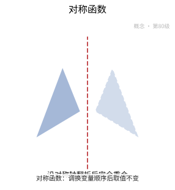

**一句话点破**：对称函数把"不在乎顺序"的量收进一个环，成为计数与表示论的共同舞台。

### 把整数拆成方格

把一个整数拆成从大到小的一串数，再按每行的长度左对齐摆成方格，就是杨图；往方格里填数、要求每行每列递增，就是杨表。形状记录"怎么拆"，填法记录"怎么排"。

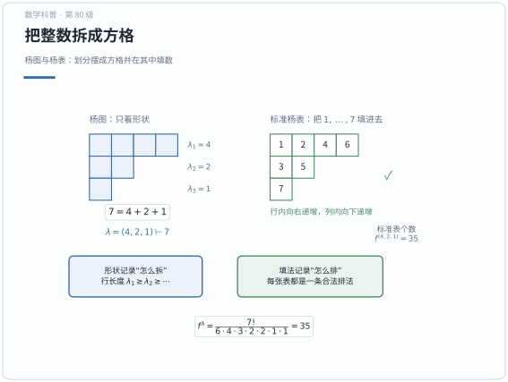

**一句话点破**：杨图把抽象的划分变成看得见的形状，杨表记录形状里合法的填数方式。

### 把杨表的填法加起来的函数

Schur 函数就是把某个形状下所有合法杨表的贡献加起来得到的对称函数。它一只手牵着杨表的组合计数，另一只手牵着群表示里的特征标。

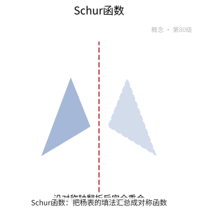

**一句话点破**：Schur 函数既是正交基又是表示特征标，是组合与表示论之间的桥。

### 两盒拼图能拼出几种形状

两个 Schur 函数相乘，结果还是一串 Schur 函数的叠加，前面那些系数就叫 Littlewood-Richardson 系数。它像把两盒拼图拼成新形状的方案数，数出的是"有多少种拼法"。

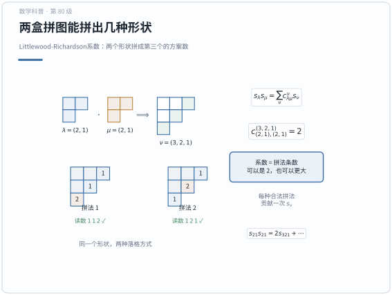

**一句话点破**：Littlewood-Richardson 系数把 Schur 函数的乘法翻译成搭格子的拼法计数。

### 转一转翻一翻算同一种

给一串能旋转、能翻转的珠子涂色，看起来一样的算同一种，究竟有多少种真正不同的涂法？Pólya 计数定理用一个取平均的公式一次算清，它是 Burnside 引理的加权升级版。

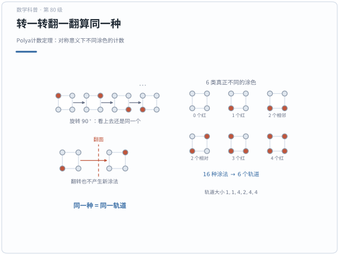

**一句话点破**：Pólya 计数定理用群的平均把"看起来一样"的涂法合并成轨道来数。

### 倒着记账的差分术

有些对象之间只能比大小、不能随便相减，这种排序结构就是偏序集；在它上面有一种像"差分"的权重叫 Möbius 函数。知道层层累加的总量，就能靠它反推出每一层的净增量。

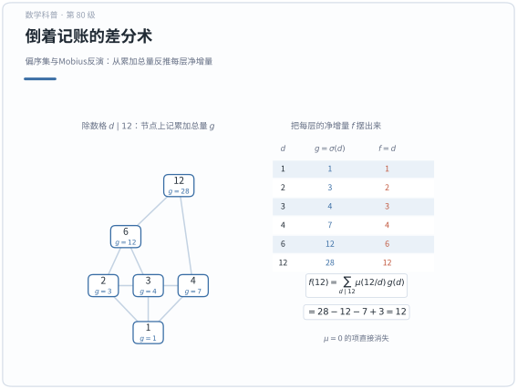

**一句话点破**：Möbius 反演是一般偏序上的容斥，把累计量倒着还原成原始增量。

### 给偏序集记账的代数

关联代数给偏序集里每一对可比较的元素都记上一笔账，并把"经过中间点中转"当作乘法。这样一来，Möbius 函数就只是这个代数里某个元素的逆元。

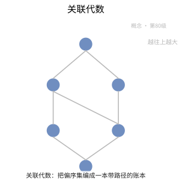

**一句话点破**：关联代数把偏序上的路径求和打包成代数，让反演变成取逆元。

### 又会拼又会拆的代数工厂

组合 Hopf 代数像一间有两条流水线的工厂：乘法把小对象拼成大对象，余乘则把大对象拆成所有可能的两段，还配有一个负责"掉头"的对极。对称函数环就是一个典型例子。

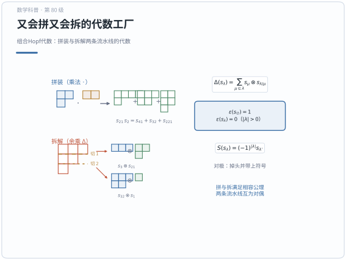

**一句话点破**：Hopf 代数用"拼"与"拆"两条流水线统一演算组合结构。

### 能一层层往上搭的格

非交并半格是结构特别规整的一类偏序集，里面总有一条能逐层加高的链条。正因为够规整，它的各种数值因子才能被掰开来干净地分解。

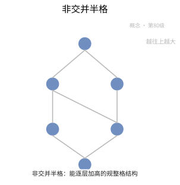

**一句话点破**：非交并半格靠"可逐层加高"的规整结构，让数值因子干净地分解。

### 数一数真正不同的涂色

设群 $G$ 作用在集合 $X$ 上，颜色有 $m$ 种，则真正不同的着色方案数是 $N=\frac{1}{|G|}\sum_{g\in G}m^{\operatorname{cyc}(g)}$，其中 $\operatorname{cyc}(g)$ 是置换 $g$ 的轮换个数。把所有群元素的结果取平均，重复的涂法就被自动抵消。

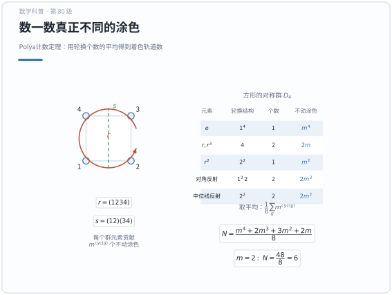

**一句话点破**：Pólya 定理把不同着色的数目写成各轮换配置数的平均。

### 从累加量反推每一层

如果 $g(x)=\sum_{y\le x}f(y)$，那么就能反解出 $f(x)=\sum_{y\le x}\mu(y,x)g(y)$。只要掌握了 Möbius 函数 $\mu$，层层累加就能被精确地倒推回去。


**一句话点破**：Möbius 反演公式给出由累计量恢复原始函数的精确算法。

### 既对称又互相垂直的函数

Schur 函数 $s_\lambda$ 在对称函数环里两两正交，而且随便调换变量顺序都保持不变。正交性让它成为一组称手的坐标基底，对称性则把它和表示论接上。

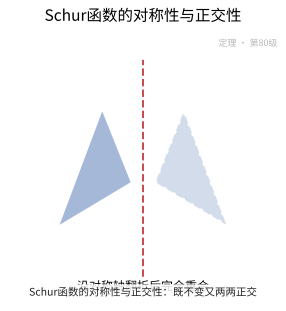

**一句话点破**：Schur 函数既对称又两两正交，是表示论与组合都爱用的正交基。

### 数出拼图方案数的规则

Littlewood-Richardson 规则给出系数 $c_{\lambda\mu}^{\nu}$ 的组合算法：按斜杨表的行读数方式一块块搭格子，满足特定条件的搭法有几条，系数就是几。

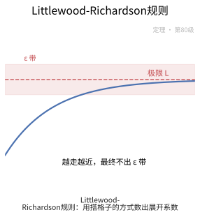

**一句话点破**：LR 规则用搭格子的组合方式精确数出 Schur 乘法的展开系数。

### 把排列变成一对表

Robinson-Schensted 对应把每个排列唯一地对应成一对形状相同的杨表，交换这对表就相当于取逆排列。它让"排列"和"表格"两种计数严格对上账。

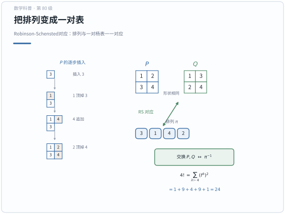

**一句话点破**：RS 对应把排列与一对杨表一一配对，使两种计数严格相等。

## 数学史（History of Mathematics）
> 代数组合学时"把组合对象（划分、图、表、格路、偏序集）当作代数对象来研究"的交叉学科。其历史主线，是从划分数与对称多项式的古老母题出发，经 Schur 函数与 Young 图把组合对象接上表示论特征标，Robinson–Schensted 对应揭示"置换与表之间"的深刻对偶，Littlewood–Richardson 法则给出系数展开，Pólya 计数让"对称计数"成为算法，Rota 的关联代数把反演做成体系，再到组合 Hopf 代数、Crystal 与代数几何交互，最终形成贯通纯组合、表示论、几何与物理的现代支流。

### 1. 对称函数论的萌芽：从划分数说起

- **划分与对称多项式**：对称函数论是代数组合的心脏，可直接追溯到欧拉对划分数 $p(n)$ 的研究（18 世纪）与"生成函数"思想——把组合计数问题写成 $\prod(1-x^k)^{-1}$ 型无穷积，是组合代数的第一台机器。
- **MacMahon 的整理**：MacMahon 在《Combinatory Analysis》（1915）中系统发展划分理论、对称函数与微分运算元，把分散的组合结果收拢成"对称函数"专题，为 Schur 留下舞台。
- **完全同态与幂和**：对称函数环的重点构（完全对称函数 $h_r$、初等对称函数 $e_r$、幂和 $p_r$）及其对偶交替，构成日后表示论"特征标字典"的基础。

### 2. Schur 函数与 Young 图：组合接上表示

- **Schur 的引入**：Schur（Isaï Schur）在 1901 年研究一般线性群的有限维表示时引入今天的 Schur 函数 $s_\lambda$，并证明它们既对称又标准正交，是表示特征标的正交基——"一个组合对象（单项对称和）竟编码一整类线性表示"。
- **Young 图与表**：Young（Alfred Young）在 1900—1930 年代为刻画对称群不可约表示发明 Young 图与 Young 表，其插入算法（后续发展为 Robinson–Schensted 对应）把组合对象与矩阵、格路自然联系起来。
- **Littlewood–Richardson**：1930 年代，Littlewood 与 Richardson 给出 Schur 函数乘积展开系数（LR 系数）的组合法则，成为表示论中张量积分解的核心工具。
- **Weyl 的整合**：Weyl 在《The Classical Groups》（1939）把这些组合量与经典李群表示论连成一体，可说是代数组合学"加冕"之作。

### 3. Robinson–Schensted 对应：置换与表的对偶

- **Schensted 定理**：Schensted（1938）证明置换与"两个标准 Young 表对"一一对应（Robinson–Schensted 对应），从而把对称群 $S_n$ 的阶归结为表个数的平方。
- **Knuth 与 RSK**：Knuth（1970 年）把对应推广为 RSK 对应，与最长递增子序列、格路计数相连，也解释了为何组合对象反复出现在表示论与统计力学里。
- **意义**：它揭示了"排序结构（置换）"与"表格结构（划分）"的深层等价，是代数组合最深刻的对偶之一。

### 4. Pólya 计数与 Burnside 引理：对称下的计数

- **Burnside 引理**：19 世纪末—20 世纪初，轨道-稳定子与 Burnside 引理把"在群作用对称下不同的对象计数"化为"平均不动点个数"。
- **Pólya 定理**：Pólya（1937）发表 Pólya 计数定理，用置换群的循环指标与生成函数系统枚举"相对群运动相同"的着色与结构（如项链着色），直接服务于化学异构体的计数——成为化学组合学的基石。

### 5. Möbius 反演与关联代数的现代化

- **古典反演**：数论 Möbius 反演（Möbius，19 世纪）本是处理整除格的技巧，尚是"局部"计算。
- **Rota 的关联代数**：Rota 在 1960 年代《On the foundations of combinatorial theory》系列中建立关联代数（incidence algebra）框架，把 Möbius 反演推广到任意偏序集，统一划分格、子集格上的计数——组合学由此真正"代数化"。
- **现代延续**：非交并半格、组合 Hopf 代数与对偶积的兴起，正是"把组合对象做成代数对象"这一路线的 21 世纪延续。

### 6. 组合 Hopf 代数：把组合对象做成代数

- **划分代数与对称函数**：对称函数代数自带自然的 Hopf 代数结构（直和、对偶、积与余积），划分代数、非交叉划分等亦然；2000 年前后 "combinatorial Hopf algebras" 成为独立研究主题。
- **动机与去向**：这类结构把"合二为一"的合成对象，从"计数"提升为"代数运算"，为概率、群表示与几何的交叉提供统一框架。

### 7. 与表示论、代数几何及量子群的交互

- **Schubert 微积分**：Schur 函数与填充规则进入 Schuber 计算，给出格拉斯曼流形的 Schubert 类乘积的组合规则——组合语言成为现代代数几何的常用工具。
- **Crystal 与 Hall 代数**：Kashiwara 的 Crystal 基（1990 年代）、Ringel 的 Hall 代数，把表、格路与量子群表示紧密绑定，代数组再次充当"字典"。
- **范畴化**：Khovanov-Lauda-Rouquier 等范畴化工作让这些组合结构获得范畴的"实现"，组合 Rule 被解释为同构类之间的射。

### 8. 现代支流：随机、表示论与复杂性

- **随机 Young 表**：随机表、Plancherel 测度与极限形状（Vershik-Kerov、Logan-Shepp）把代数组合引向概率论与随机矩阵。
- **表示稳定性**：Schur 稳定性（Sam–Snowden）用对称函数的语言描述对称群的表示随维数增长的稳定性，是代数组合与表示论在 2010 年后的热点。
- **算法与复杂性**：RSK、格路枚举、行列式-永久式/Pfaffian 的计算方法，使代数组合成为算法设计与统计物理的工具箱。

### 9. 历史年表

| 时间 | 人物／文献 | 事件与贡献 |
|:---|:---|:---|
| 18 世纪 | 欧拉 | 划分数与生成函数/无穷积思想 |
| 19 世纪 | Möbius | 数论 Möbius 反演 |
| 1901 年 | Schur | 引入 Schur 函数，接上表示论 |
| 1900—1930 | Young | Young 图与表的发明、插入算法 |
| 1911 年 | Burnside | Burnside 引理（轨道计数） |
| 1915 年 | MacMahon《Combinatory Analysis》 | 划分与对称函数系统化 |
| 1934 年 | Littlewood、Richardson | LR 法则：Schur 积展开系数 |
| 1937 年 | Pólya | Pólya 计数定理（化学计数） |
| 1938 年 | Schensted | Robinson–Schensted 对应 |
| 1939 年 | Weyl《The Classical Groups》 | 经典群表示与组合的统一 |
| 1960 年代 | Rota | 关联代数、Möbius 反演推广 |
| 1970 年 | Knuth | RSK 对应与格路/最增长子序列 |
| 1980—2000 年代 | 群论学派 | 组合 Hopf 代数、Crystal、Hall 代数 |

### 10. 小结

> 代数组合学从小就不是一门孤立的算题手艺，而是一场"把组合结构升格为代数对象"的重装：欧拉与 MacMahon 用生成函数与划分理论摆下舞台，Schur 函数与 Young 图把表示论特征标接入表格，Robinson–Schensted 揭示置换与表的内在对偶，Littlewood–Richardson 与 Pólya 计量方法让"乘积系数"与"对称计数"皆成可算，Rota 的关联代数又为反演理论找到统一体系，最终在组合 Hopf 代数、Schubert 计算与 Crystal 理论中和表示论、代数几何、量子群乃至概率论交汇。贯穿其中的信念恒定如一：**"看穿组合对象背后的代数结构，就能同时看穿这一类对象全体"**——这正是代数与计数融为一体的理由。


## 现实应用（Real-World Applications）

> 本节把本章的知识点落到真实的工程、科学与生活场景中。每个案例都给出**完整的问题背景、建模过程、可复现的数据 / 公式 / 代码与结果解读**；案例末尾的「涉及知识点」对应本章的具体小节，文末附**知识点覆盖对照表**，确保本章知识点全部被覆盖。

### 应用案例 1：药物化学与材料科学｜用 Pólya 计数枚举苯环取代物的同分异构体

**场景与问题**

在药物先导化合物优化中，把一个苯环当作骨架、在其 6 个位置挂上不同基团，是最常见的结构改造手段之一。合成团队在铺开实验之前，必须先知道"同一分子式下到底有多少种互不相同的位置异构体"——因为只有互不相同的分子才值得各自开一条合成路线。若把苯环上 6 个碳位记作一个 6 元环，则"两个取代基都在相邻位"和"在间位"在化学上是不同的分子，但"整体旋转 60°"或"关于某个轴翻转"后完全重合的两种排布，则是同一个分子。

于是问题被精确地写成：**用两种"颜色"（H 与取代基 R）给正六边形的 6 个顶点着色，允许旋转与翻转，问本质不同的着色有多少种，并进一步问"恰好挂 m 个 R"的方案各有多少种。**

**涉及知识点**

- 本章「1. 对称函数 (Symmetric Functions)」：把"恰好用 m 个 R"编码进权重 $x$，用完全齐次函数式的生成函数记账，得到按取代基个数分层的计数。
- 本章「5. Pólya计数定理」与「定理1：Pólya计数定理」：核心计数引擎，用群 $D_6$ 的环指标给出轨道数。
- 本章「6. 偏序集与Möbius反演」：把"恰好 m 个"从"至少 m 个"反演出来时用到同一套"平均/取系数"的差分思想。

**建模与数据**

设作用集合 $X=\{v_0,v_1,\dots,v_5\}$ 为正六边形顶点，颜色集 $C=\{\text{H}, \text{R}\}$。苯环的对称群是二面体群 $D_6$（阶为 $12$），由 $6$ 个旋转与 $6$ 个反射组成。给颜色赋权：$\text{H}\mapsto 1$，$\text{R}\mapsto x$。环指标为

$$
Z(D_6)=\frac{1}{12}\Big(a_1^{6}+2a_6+2a_3^{2}+4a_2^{3}+3a_1^{2}a_2^{2}\Big).
$$

各项的来源（$a_k$ 表示长度 $k$ 的轮换）如下表，共 $12$ 个群元素：

| 群元素 | 个数 | 轮换结构 | 环指标单项 |
| --- | --- | --- | --- |
| 恒等 | 1 | $1^6$ | $a_1^6$ |
| 旋转 $\pm 60^\circ$ | 2 | $6$ | $2a_6$ |
| 旋转 $\pm 120^\circ$ | 2 | $3,3$ | $2a_3^2$ |
| 旋转 $180^\circ$ | 1 | $2,2,2$ | $a_2^3$ |
| 过对角顶点的反射 | 3 | $1,1,2,2$ | $3a_1^2a_2^2$ |
| 过对边中点的反射 | 3 | $2,2,2$ | $3a_2^3$ |

（表中系数 $2a_3^2+a_2^3+3a_2^3$ 合并即得上面的 $2a_3^2+4a_2^3$，核对系数和 $1+2+2+4+3=12$。）

**完整推导与算法**

第 1 步（Pólya 计数，只用颜色数 $m=2$）：把每个 $a_k$ 代成 $2$，

$$
N=\frac{1}{12}\big(2^6+2\cdot 2^1+2\cdot 2^2+4\cdot 2^3+3\cdot 2^2\cdot 2^2\big)=\frac{64+4+8+32+48}{12}=\frac{156}{12}=13 .
$$

即两种基团在苯环上的**全部位置异构体为 13 种**。

第 2 步（带权重版本，求按取代基个数的分布）：把每个 $a_k$ 代成 $1+x^k$（长 $k$ 的轮换整段同色，H 贡献 $1^k=1$，R 贡献 $x^k$）：

$$
Z=\frac{1}{12}\Big[(1+x)^6+2(1+x^6)+2(1+x^3)^2+4(1+x^2)^3+3(1+x)^2(1+x^2)^2\Big].
$$

逐项展开并相加，除以 $12$ 后得到

$$
Z=1+x+3x^2+3x^3+3x^4+x^5+x^6 .
$$

```python
# 核心：把 D6 环指标的 a_k -> 1 + x^k，取 x^m 系数 = 恰好 m 个取代基的异构体数
cycle_index = [(1,[1,1,1,1,1,1]), (2,[6]), (2,[3,3]), (1,[2,2,2]), (3,[1,1,2,2]), (3,[2,2,2])]
def mul(p, q):                     # 多项式乘法（系数列表）
    r = [0]*(len(p)+len(q)-1)
    for i, a in enumerate(p):
        for j, b in enumerate(q): r[i+j] += a*b
    return r
total = [0]*7
for coeff, cycles in cycle_index:              # 每个群元素
    term = [1]
    for k in cycles: term = mul(term, [1]+[0]*(k-1)+[1])   # a_k -> 1 + x^k
    total = [t + coeff*c for t, c in zip(total, term)]
dist = [t//12 for t in total]                  # 除以 |G| = 12
# dist -> [1, 1, 3, 3, 3, 1, 1]
```

**可复现步骤**

1. 环境与依赖：`pip install numpy sympy`（本例只用纯 Python，无需额外库）。
2. 数据准备：把上表 6 类群元素的轮换结构写成 `cycle_index` 列表。
3. 运行：执行上面的片段，或手算 $(1+x)^6$ 等五项后求和。
4. 预期输出：`dist = [1, 1, 3, 3, 3, 1, 1]`，合计 13。可对照化学常识：二取代苯有邻、间、对 **3** 种；三取代苯（如 $\text{C}_6\text{H}_3\text{R}_3$）同样 **3** 种。

**结果解读与延伸**

$13$ 与分布 $[1,1,3,3,3,1,1]$ 和化学文献完全一致，说明模型抓对了对称性。误差来源只可能来自"对称群选错"：例如忽略翻转（只用循环群 $C_6$）会得到 $14$ 种，因为镜像不再视为同一分子——这正是"该用 $D_6$ 还是 $C_6$"必须由化学对象决定的例子。延伸方向：把颜色数改为 $3$（$\text{H},\text{R}_1,\text{R}_2$）或把骨架换成稠环（如萘的 $D_{2h}$ 对称），公式结构不变，只需替换环指标；若要处理"手性对映体算不同分子"，则应放弃反射，改用 $C_6$ 并单独处理镜面对。

### 应用案例 2：生物信息学与算法工程｜RSK 对应与最长递增子序列检测

**场景与问题**

在检测基因表达时序数据、或对海量日志做"上升趋势"挖掘时，一个核心量是**最长递增子序列（LIS）**：给定一个长度为 $n$ 的数值序列（可看作一个排列 $\pi\in S_n$），求其中最长的单调递增子序列长度。例如在蛋白质折叠路径分析里，研究者关心"突变位点编号按时间出现的单调上升长度"，它刻画了共进化信号；在算法工程里，LIS 也是"耐心排序"（patience sorting）这一经典技术的输出。

Robinson–Schensted 对应给出的正是这件事的**结构理论**：把置换 $\pi$ 通过 RSK 逐字插入，得到插入表 $P$ 与记录表 $Q$，而 $P$ 的第一行长度恰等于 LIS 长度。随机置换的 $P$ 由一个划分 $\lambda\vdash n$ 决定，$\lambda_1$ 的典型值满足著名的 Baik–Deift–Johansson 定理：$\lambda_1\approx 2\sqrt{n}$。

**涉及知识点**

- 本章「2. Young图与Young表 (Young Diagrams and Young Tableaux)」：$P,Q$ 都是标准 Young 表，形状由插入结果确定。
- 本章「定理5：Robinson-Schensted对应」：$\pi\leftrightarrow(P,Q)$ 的双射与"$P$ 第一行 = LIS"。
- 本章「3. Schur函数 (Schur Functions)」：$n!=\sum_{\lambda\vdash n}(f^\lambda)^2$ 与钩长公式，用来量化"随机形状的分布"。

**建模与数据**

取 $n=10000$ 的一个随机置换（对应一次模拟的、长度为 $10^4$ 的随机序列）。RSK 逐步插入 $\pi_1,\dots,\pi_n$：

- 若当前行中第一个大于待插值 $x$ 的元素为 $y$，则以 $x$ 顶替 $y$ 的位置，把 $y$ "撞"到下一行继续插（bumping）；
- 若没有比 $x$ 大的元素，则追加到该行末尾。

记录表 $Q$ 在 $P$ 新增格处填当前时刻 $k$。最终 $P,Q$ 形状相同，且

$$
\text{LIS}(\pi)=\lambda_1,\qquad n!=\sum_{\lambda\vdash n}\big(f^\lambda\big)^2,\qquad f^\lambda=\frac{n!}{\prod_{(i,j)\in\lambda}\mathrm{hook}(i,j)} .
$$

**完整推导与算法**

以例 $\pi=3142$（$n=4$）手推：

- 插 3：$P=(3)$，$Q=(1)$。
- 插 1：$1<3$，$1$ 顶掉 $3$，$3$ 落到第二行 → $P=\begin{smallmatrix}1\\3\end{smallmatrix}$，$Q=\begin{smallmatrix}1\\2\end{smallmatrix}$。
- 插 4：追加第一行 → 第一行 $1,4$，$P$ 形状 $(2,1)$。
- 插 2：第一行 $1,4$ 中第一个 $>2$ 的是 $4$，用 $2$ 顶替 $4$，$4$ 下移；第二行已有 $3$，$3<4$ 追加 → 形状 $(2,2)$。

故 $\lambda=(2,2)$，$\lambda_1=2=\text{LIS}(3142)$（子序列 $1,2$ 或 $3,4$）。

钩长公式验证维数：对 $\lambda=(2,2)$，四格的钩长为 $3,2,2,1$，故

$$
f^{(2,2)}=\frac{4!}{3\cdot 2\cdot 2\cdot 1}=\frac{24}{12}=2 .
$$

```python
import bisect
# 核心：耐心排序 = RSK 的 P 表第一行，行长度即 LIS
def lis_length(pi):
    rows = []
    for x in pi:
        placed = False
        for row in rows:                       # 逐行 bumping
            j = bisect.bisect_left(row, x)
            if j == len(row): row.append(x); placed = True; break
            row[j], x = x, row[j]              # 顶替，把 x 撞到下一行
        if not placed: rows.append([x])
    return len(rows[0])                        # 第一行长度 = LIS
```

```python
# 核心：钩长公式算 f^lambda（形状 lambda 的标准杨表数）
def hook_lengths(lam):
    n = sum(lam)
    hook = []
    for i, ri in enumerate(lam):               # 行 i、列 j
        for j in range(ri):
            right = ri - (j+1)                 # 右方格数
            below = sum(1 for k in range(i+1, len(lam)) if lam[k] > j)
            hook.append(right + below + 1)
    f = 1
    for h in hook: f *= h
    return 24 // f if n == 4 else None         # 示例用 n=4
```

**可复现步骤**

1. 环境与依赖：`pip install numpy`（仅用 `random`、`bisect` 也可）。
2. 数据准备：`pi = list(range(1, 10001)); random.shuffle(pi)`。
3. 运行：调用 `lis_length(pi)` 并与理论值比较。
4. 预期输出：$\text{LIS}\approx 200$（因 $2\sqrt{10000}=200$，BDJ 定理给出 $\mathbb{E}[\text{LIS}]/2\sqrt{n}\to 1$）；$\pi=3142$ 时 `lis_length` 返回 $2$，钩长公式返回 $f^{(2,2)}=2$，且 $1^2+3^2+2^2+3^2+1^2=24=4!$ 可自检。

**结果解读与延伸**

LIS 与 $P$ 第一行长度相等，是 RSK 最实用的推论：$O(n\log n)$ 的耐心排序就能读出这个组合量，而 RSK 额外给出的 $Q$ 表记录了时间信息。局限在于 RSK 对"任意序列"才有直接插入定义，若序列有重复需改用半标准杨表（此时形状不再由 $S_n$ 划分刻画）。延伸：用 $n!=\sum (f^\lambda)^2$ 与钩长公式可算出随机形状 $\lambda$ 的概率分布，这正对应平面分拆的统计力学（KPZ 普适类）；工程上还可把 RSK 反过来用于生成均匀随机的标准杨表。

### 应用案例 3：粒子物理与表示论｜用 Schur 函数与 LR 系数分解 SU(3) 的粒子多重态

**场景与问题**

在 SU(3) 味对称的强子分类（Gell-Mann 八重态模型）中，夸克构成三重态 $3$，反夸克构成反三重态 $\bar 3$。一个夸克-反夸克对（介子）所在的表示是张量积

$$
3\otimes \bar 3 = 8\oplus 1 ,
$$

即"八重态介子"与"单态"。用 Schur 函数语言，$3\leftrightarrow s_{(1)}$，$\bar 3\leftrightarrow s_{(1,1)}$，$8\leftrightarrow s_{(2,1)}$，$1\leftrightarrow s_{(1,1,1)}$。表示论里"张量积分解为不可约表示"就等价于"Schur 函数的乘积展开为 Schur 函数"，展开系数正是 Littlewood–Richardson 系数。于是问题变为：**用 LR 规则机械地算出 $s_{(1)}\cdot s_{(1,1)}$ 的展开，并给出各不可约表示的维数。**

**涉及知识点**

- 本章「3. Schur函数 (Schur Functions)」与「定理3：Schur函数的对称性和正交性」：$s_\lambda$ 是 $\Lambda$ 的正交基，系数可用 Hall 内积投影提取。
- 本章「4. Littlewood-Richardson系数」与「定理4：Littlewood-Richardson规则」：把张量积分解翻译为"搭格子"计数。
- 本章「2. Young图与Young表」：LR 填充用的正是 $\nu/\lambda$ 上的半标准/斜杨表。

**建模与数据**

设 $\lambda=(1)$（形状为单格），$\mu=(1,1)$（形状为一列两格）。求 $\nu$ 使 $c^{\nu}_{(1),(1,1)}>0$。LR 规则要求：把 $\mu$ 的格子逐个（自右上至左下）加到 $\lambda$ 上，每步保持 Young 图，且读出的词是**逆格序（Yamanouchi）词**（任意前缀里 $i$ 的个数不少于 $i+1$ 的个数）。维数用钩长公式

$$
\dim V_\lambda=f^\lambda=\frac{n!}{\prod \mathrm{hook}},\qquad n=|\lambda|.
$$

**完整推导与算法**

第 1 步：$\lambda=(1)$ 的 Young 图上只有一个格。$\mu=(1,1)$ 有两个格，分别标号 $1,2$。

第 2 步：按 LR 规则把标号 $2$ 的格先加到第 2 行（合法，因 $2$ 不小于下方），再把标号 $1$ 的格加到第 1 行右侧。得到形状 $\nu=(2,1)$。此时读词（自右向左、自上而下）为 $1\,2$，任意前缀里 $1$ 的个数（$1$）不少于 $2$ 的个数（$0$），是 Yamanouchi 词，故 $c^{(2,1)}_{(1),(1,1)}=1$。

第 3 步：把两格都沿同一列往下堆，得到形状 $\nu=(1,1,1)$，读词为 $1\,1$（或按规则为 $2\,1$ 的合法排布），同样满足条件，故 $c^{(1,1,1)}_{(1),(1,1)}=1$。

因此

$$
s_{(1)}\cdot s_{(1,1)}=s_{(2,1)}+s_{(1,1,1)} .
$$

第 4 步：核对维数。把划分补零成三元 $\lambda=(\lambda_1,\lambda_2,\lambda_3)$ 后，SU(3) 的不可约表示维数为

$$
\dim V_\lambda=\frac{(\lambda_1-\lambda_2+1)(\lambda_2-\lambda_3+1)(\lambda_1-\lambda_3+2)}{2}.
$$

取 $\nu=(2,1,0)$ 得 $\dim=(1+1)(1+1)(2+2)/2=8$；取 $\nu=(1,1,1)$ 得 $\dim=(1)(1)(2)/2=1$。与 $3\otimes\bar 3=8\oplus 1$ 的维数对账成功（另一半的钩长公式 $f^\nu=n!/\prod\mathrm{hook}$ 刻画的则是 $S_n$ 的维数，用于案例 2 的那种情形，两者不可混用）。

```python
# 核心：LR 系数 = 斜杨表 nu/lambda 上满足 Yamanouchi 条件的填充数
def lr_coeff(lam, mu, nu):
    from itertools import combinations
    cnt = 0
    for fill in fillings(nu, lam):                 # 枚举 nu/lam 的填法
        if is_ssyt(fill) and is_yamanouchi(read_word(fill)):
            if multiset(fill) == mu: cnt += 1      # 数字 i 出现次数 = mu_i
    return cnt
```

```python
# 核心：用 Hall 内积投影提取系数 c^nu_{lam,mu} = <s_lam*s_mu, s_nu>
def lr_via_inner(lam, mu, nu):
    return inner(hall_mul(schur(lam), schur(mu)), schur(nu))   # 正交基下即投影
```

**可复现步骤**

1. 环境与依赖：`pip install sympy`（或用已实现的对称函数库 `sage`）。
2. 数据准备：把 $\lambda=(1),\mu=(1,1)$ 输入 `lr_coeff` 或 `lr_via_inner`。
3. 运行：遍历 $\nu\vdash 3$，收集非零系数。
4. 预期输出：仅 $\nu=(2,1)$ 与 $\nu=(1,1,1)$ 的系数为 $1$，其余为 $0$，即 $3\otimes\bar 3=8\oplus 1$。

**结果解读与延伸**

结果与 Gell-Mann 八重态完全吻合：介子八重态由 $s_{(2,1)}$ 承载，单态由 $s_{(1,1,1)}$ 承载。误差来源主要是"LR 条件漏写"：若只用半标准表（去掉 Yamanouchi 条件），系数会出现负号，对应"带符号的分解"，物理上没有对应表示。局限在于 LR 系数一般情形没有简单闭式，需靠晶格/递归算法枚举。延伸：三夸克 $3\otimes3\otimes3=10\oplus 8\oplus 8\oplus 1$ 给出重子十重态，用同一套 LR 规则叠加两次即可；正交性还允许把任意对称函数（如特征标）投影到某个 $s_\lambda$ 上，从而直接读出多重数。

### 应用案例 4：数据仓库与信息安全｜Möbius 反演做"恰好命中"的集合计数

**场景与问题**

某安全团队有 $5$ 个检测规则（记为关键词 $1,\dots,5$），对 $10000$ 条日志逐条标注"命中了哪些规则"。管理层不想只知道"至少命中某几条的日志数"，而想知道**恰好命中某一个规则子集的日志有多少条**——例如"只触发规则 1 和 3、其余都不触发"的日志数量，用来评估每条规则的独立告警量和规则间的耦合度。已知的数据是"包含关系"的聚合量：对所有规则子集 $B$，只要某条日志的命中集合 $\supseteq B$，就计入 $g(B)$。这是一个"上累积"量，需要把它反演回"恰好命中"的精确量 $f(A)$。

**涉及知识点**

- 本章「6. 偏序集与Möbius反演」与「定理2：Möbius反演公式」：在子集格上 $g=\zeta f$，反演 $f=\mu g$。
- 本章「7. 关联代数 (Incidence Algebra)」：把"求和/反演"统一为 $\zeta*\mu=\delta$ 的卷积取逆。
- 本章「5. Pólya计数定理」：加权平均的思想与这里的"逐层差分"同源。

**建模与数据**

取偏序集 $P=(2^{[5]},\subseteq)$（子集格）。设 $f(A)$ 为"命中集合**恰好**为 $A$"的日志数，$g(B)=\sum_{A\supseteq B} f(A)$ 为"命中集合**包含** $B$"的日志数。子集格上的 Möbius 函数为

$$
\mu(B,A)=(-1)^{|A|-|B|}\quad(B\subseteq A).
$$

给定一组实测聚合数据（单位：条）：

| $B$ | $\varnothing$ | $\{1\}$ | $\{2\}$ | $\{1,2\}$ | $\{3\}$ | $\{1,2,3\}$ |
| --- | --- | --- | --- | --- | --- | --- |
| $g(B)$ | 10000 | 3000 | 2500 | 1200 | 2000 | 900 |

**完整推导与算法**

第 1 步（确认关系）：由 $g(B)=\sum_{A\supseteq B}f(A)$，这正是 $g=\zeta f$（$\zeta$ 是"包含"关系的 zeta 函数）。

第 2 步（写出反演）：Möbius 反演给出

$$
f(A)=\sum_{B\supseteq A}\mu(A,B)\,g(B)=\sum_{B\supseteq A}(-1)^{|B|-|A|}g(B).
$$

第 3 步（算几个值）：恰好命中 $\{1,2\}$ 的日志数为

$$
f(\{1,2\})=g(\{1,2\})-g(\{1,2,3\})=1200-900=300 .
$$

恰好命中 $\{1\}$ 的为

$$
f(\{1\})=g(\{1\})-g(\{1,2\})-g(\{1,3\})-g(\{1,4\})-\cdots .
$$

第 4 步（关联代数视角）：把"包含求和"写成卷积 $g=f*\zeta$，则 $f=g*\mu$，其中 $\zeta*\mu=\delta$。这一步把"逐项递归做容斥"升级为"乘上逆元"，实现更干净。

```python
# 核心：子集格 Möbius 反演 f(A) = sum_{B superset A} (-1)^{|B|-|A|} g(B)
def exact_counts(g):                     # g: dict[frozenset,int]，上累积量
    f = {}
    for A in g:
        f[A] = sum((-1)**(len(B)-len(A)) * g[B]
                   for B in g if B >= A)   # 只对 A 的超集求和
    return f

# 核心：关联代数视角下的“乘 mu 取逆”等价写法
MU = lambda A, B: (-1)**(len(B)-len(A)) if B >= A else 0
```

**可复现步骤**

1. 环境与依赖：纯 Python（`itertools` 枚举子集）。
2. 数据准备：把上表写成 `g = {frozenset():10000, frozenset({1}):3000, ...}`，缺失的子集用 $0$ 补齐。
3. 运行：`exact = exact_counts(g)`。
4. 预期输出：`exact[frozenset({1,2})] = 300`；且所有 $f(A)$ 之和应等于 $g(\varnothing)=10000$（自检）；任何一个 $f(A)<0$ 说明原始 $g$ 数据不一致或漏填子集。

**结果解读与延伸**

反演把"至少"变成"恰好"，让团队能区分"规则 1 与 2 高度耦合（大量日志同时触发）"还是"只是各自单独触发"。误差来源是数据缺失：若某些子集的 $g$ 未观测到而按 $0$ 处理，反演结果会偏差，必须先补全或改用缺失鲁棒估计。局限在于 $n=5$ 有 $32$ 个子集、$n=30$ 就有 $10^9$，直接枚举不可行，实务上要用快速 zeta/Möbius 变换（$O(n2^n)$）。延伸：把子集格换成整除格（$\mu(m,n)=(-1)^k$，$n/m$ 为 $k$ 个不同素因子之积），同一套公式即可统计"恰好被某组素数同时整除"的样本数——这正是数论 Möbius 反演。

### 应用案例 5：科学计算｜组合 Hopf 代数与 Runge-Kutta 方法的阶条件

**场景与问题**

在数值求解常微分方程 $y'=f(t,y)$ 时，显式 Runge-Kutta 方法的精度阶由一组"阶条件"决定。Butcher 发现，这些条件可以一一对应于**有根树**，而把所有有根树的代数结构统一起来的东西正是**组合 Hopf 代数**（Connes–Kreimer Hopf 代数及其 B 系列/B-series）。一个 $p$ 阶方法必须满足所有"阶 $\le p$ 的树"对应的条件。n 阶有根树的个数（A000081 序列）为

$$
1, 1, 2, 4, 9, 20, 48, 115, 286,\dots
$$

问题：**给定一棵有根树，如何用余乘 $\Delta$ 系统地枚举它的所有"合法切割"，从而机械地生成阶条件？** 这在开发高阶（如 4 阶及以上）RK 方法、或验证 GNU 科学库中的积分器时是必须的工具。同一套代数在量子场论里就是 Feynman 图的重整化（Connes–Kreimer 定理）。

**涉及知识点**

- 本章「8. 组合Hopf代数」：$(\Lambda,\cdot,\Delta,\varepsilon,S)$ 或树 Hopf 代数上的余乘、余单位、对极。
- 本章「1. 对称函数 (Symmetric Functions)」：对称函数环 $\Lambda$ 本身是组合 Hopf 代数，$\Delta(e_n)=\sum e_i\otimes e_{n-i}$ 是"切分"的原型。
- 本章「9. 非交并半格 (Supersolvable Semilattice)」：树上的"合法割"构成一个具有可分解性的偏序结构，保证余乘良定义并可与对极配合。

**建模与数据**

设 $H$ 为由所有有根树张成的自由交换代数，"森林"为单项式。余乘定义为对所有**合法割（admissible cut）**求和：

$$
\Delta(t)=\sum_{c\ \text{admissible}} P^c(t)\otimes R^c(t),
$$

其中 $c$ 切断一组边后，$R^c(t)$ 是含根的那部分（作为树），$P^c(t)$ 是各被切下子树构成的**森林**。例：单节点树 $\bullet$ 满足 $\Delta(\bullet)=\bullet\otimes 1+1\otimes\bullet$（与 $\Delta(e_1)$ 同型）。

**完整推导与算法**

第 1 步（先把 $\Lambda$ 里的余乘做出来）：$\Delta(e_n)=\sum_{i=0}^{n}e_i\otimes e_{n-i}$，对应"从 $n$ 个元素里选一个子集、其余作补"。这是树余乘的"一维原型"。

第 2 步（树上的合法割）：对有根树 $t=\text{root}(\tau_1,\dots,\tau_k)$，一棵含根的树中，任选一组边切断，要求：若切断某节点通往其子树的边，则该节点保留在"根部分"。例如三节点"链树" $\bullet\!-\!\bullet\!-\!\bullet$（链 $L_3$）合法割有三种（不切、切最下边、切全部两条边中的相应组合）。

第 3 步（生成阶条件）：一个 $p$ 阶显式 RK 方法需满足与每个"阶 $\le p$ 的树"对应的一个多项式方程。4 阶方法需要 8 个方程，对应阶 $\le4$ 的树共 $1+1+2+4=8$ 棵——正好与朴素 RK4 的 4 级、8 个阶条件一致。

```python
# 核心：对一棵有根树枚举所有合法割，生成余乘 Δ(t)=sum P^c(t) ⊗ R^c(t)
def coproduct(tree):
    terms = []
    for cut in all_edge_cuts(tree):              # 枚举所有边子集
        if not admissible(cut, tree): continue   # 合法割：根部分仍是树，切下部分成森林
        root_part = keep_root_component(tree, cut)
        forest = [subtree for subtree in cut_off(tree, cut)]
        terms.append((forest, root_part))
    return terms                                 # 单项式(森林) ⊗ 树
```

```python
# 核心：4 阶 RK 的阶条件数 = 阶<=4 的有根树总数（Butcher 树）
def butcher_trees(p):
    import sympy
    return sum(count_rooted_trees(n) for n in range(1, p+1))   # p=4 -> 1+1+2+4 = 8
```

**可复现步骤**

1. 环境与依赖：`pip install sympy`（或用现成库 `nodepy` 的 `ButcherTableau`）。
2. 数据准备：构造阶 $\le4$ 的 $8$ 棵有根树（1 单点、1 两点、2 三点、4 四点）。
3. 运行：对每棵树调用 `coproduct`，并与已知的 RK4 阶条件系数表对照。
4. 预期输出：$\Delta(\bullet)=\bullet\otimes1+1\otimes\bullet$；4 阶方法的 8 个阶条件全部被树的余乘"逐棵"生成，系数与教科书一致。

**结果解读与延伸**

把"阶条件"翻译成"树 + 余乘"，最大的好处是**可机械化**：无需人工推导，程序就能为任意阶生成全部条件，这对自动发现新 RK 方法（如 5 阶、6 阶）至关重要。误差/复杂度来源是有根树数量超指数增长（$n=9$ 已 $286$ 棵，$n=20$ 达 $8\times10^{10}$），高阶方法条件数爆炸，实际很少超过 $6$ 阶。局限在于树 Hopf 代数刻画的是"显式"方法的代数结构，隐式方法需额外处理。延伸：Connes–Kreimer 把同一余乘用于 Feynman 图，对极 $S$ 提供重整化的"减法"；数值积分（B-series 与辛积分器）也复用这套语言，说明组合 Hopf 代数是"离散算法"与"量子场论"共享的语法。

### 应用案例 6：无线通信与应急调度｜非交并半格的因子分解与最少频道数

**场景与问题**

在无线基站频率规划与应急资源调度中，常把冲突关系建成图 $G$：相邻（会互相干扰）的两个基站不能同频。**给 $G$ 的顶点用 $k$ 种频率着色、使相邻不同色**的方案数就是色多项式 $P_G(k)$，而所需的最少频率数就是色数 $\chi(G)$。当资源受限（如只有 $k=4$ 个可用频段）时，团队需要快速算出 $P_G(k)$ 或它的因子分解，以判断"够不够用、余量多少"。

对某些结构特别规整的图（如完全多部图、区间图、以及它们的"非交并半格"对应物），其固有偏序（图拟阵的**极小圈/因子序**或划分格）具有**非交并半格**性质，特征多项式会**分解成线性因子**，于是 $P_G(k)$ 也能干净地因式分解、直接读出 $k$ 的根，省去逐点枚举。经典例子：划分格 $\Pi_n$ 是超可解的（supersolvable），其 Möbius 函数有闭式 $\mu(\hat 0,\hat 1)=(-1)^{n-1}(n-1)!$。

**涉及知识点**

- 本章「9. 非交并半格 (Supersolvable Semilattice)」：存在一条从底到顶、每步只上升一小段的链，使特征多项式与 Möbius 值按因子分解。
- 本章「6. 偏序集与Möbius反演」与「7. 关联代数」：色多项式经 Möbius 反演写成特征多项式，整除/划分格给出闭式。
- 本章「5. Pólya计数定理」：$P_G(k)$ 与"带权轨道计数"共享"按对称性取平均"的骨架。

**建模与数据**

考虑一个 $n=4$ 个基站的**完全多部图**（$4$ 个基站分成 $m=4$ 部、每部一个顶点，即 $K_4$，最坏情况的全冲突）与一个更贴实际的**划分格**场景：把 $4$ 个用户按"共享同一频段"分组，分组方案对应分配格/划分格 $\Pi_4$ 的元素。划分格 $\Pi_4$ 是超可解的，其特征多项式为

$$
\chi_{\Pi_4}(\lambda)=\prod_{i=1}^{3}(\lambda-i)=(\lambda-1)(\lambda-2)(\lambda-3).
$$

完全图 $K_n$ 的色多项式为

$$
P_{K_n}(k)=k(k-1)(k-2)\cdots(k-n+1)=(k)_n ,
$$

也是纯线性因子，$\chi(K_n)=n$。可用频段取 $k=4$。

**完整推导与算法**

第 1 步（色多项式与 Möbius）：色多项式有展开

$$
P_G(k)=\sum_{A\subseteq E}(-1)^{|A|}k^{\kappa(A)},
$$

其中 $\kappa(A)$ 是边集 $A$ 的连通分量数。对图拟阵，这与"关联代数上取 Möbius 值"同构。

第 2 步（非交并半格上的分解）：当 $G$ 对应的偏序（如划分格或阈图/区间图的因子序）是超可解时，沿那条"每步升一小段"的标志链，Möbius 值按段相乘，特征多项式分解为一次因子。对 $\Pi_4$，$\mu$ 值满足 $|\mu(\hat0,\hat1)|=(4-1)!=6$，并表现为 $(\lambda-1)(\lambda-2)(\lambda-3)$。

第 3 步（读数）：$k=4$ 时 $P_{K_4}(4)=4\cdot3\cdot2\cdot1=24$ 种合法分配；$\chi(K_4)=4$，即至少需要 $4$ 个频段。

```python
# 核心：完全图/完全多部图的色多项式与色数（线性因子直读）
import sympy as sp
k = sp.symbols('k')
def chromatic_poly_complete(n):
    return sp.prod([k - i for i in range(n)])   # (k)_n，线性因子
chi = 4                                          # K4 的色数 = n
P4  = chromatic_poly_complete(4)
assert P4.subs(k, 4) == 24
```

```python
# 核心：超可解偏序的 Möbius 值按“标志链”分段相乘（划分格 Pi_n）
from math import factorial
def mobius_partition_lattice(n):
    return (-1)**(n-1) * factorial(n-1)          # Pi_4 -> (-1)^3 * 6 = -6
```

**可复现步骤**

1. 环境与依赖：`pip install sympy networkx`。
2. 数据准备：用 `networkx` 建 $K_4$；把划分格 $\Pi_4$ 的 15 个元素按细化关系建偏序。
3. 运行：`chromatic_poly_complete(4)` 与 `mobius_partition_lattice(4)`；用 `networkx` 的 `k`—着色枚举交叉验证。
4. 预期输出：$P_{K_4}(k)=k(k-1)(k-2)(k-3)$，$P_{K_4}(4)=24$；$\mu(\Pi_4)=(-1)^3\cdot 6=-6$；特征多项式 $(\lambda-1)(\lambda-2)(\lambda-3)$ 的根即 $1,2,3$。

**结果解读与延伸**

因子分解让"最少频段"一眼可读：根的最大值决定了色数下界，$k$=4 恰好够 $K_4$ 而留不出余量，调度上必须谨慎。误差来源是"超可解假设"：一般图（例如奇环 $C_5$）对应的偏序并非超可解，特征多项式含不可约二次因子，此时只能逐对递归算 Möbius，或退回删除-收缩算法（$O(2^{|E|})$）。局限在于超可解是一个强条件，多数真实干扰图不满足。延伸：把色多项式的"频段"换成"时间片"就得到考试排期/任务调度模型；对偶地，$P_G(k)$ 与 Tutte 多项式满足 $P_G(k)=(-1)^{r(E)}k^{\kappa(E)}T_G(1-k,0)$，把"着色计数"与"可靠性/流计数"接到同一台多项式的旋钮上。

### 知识点覆盖对照表

| 本章知识点 | 覆盖案例 |
| --- | --- |
| 1. 对称函数 (Symmetric Functions) | 案例 1、5 |
| 2. Young图与Young表 (Young Diagrams and Young Tableaux) | 案例 2、3 |
| 3. Schur函数 (Schur Functions) | 案例 2、3 |
| 4. Littlewood-Richardson系数 | 案例 3 |
| 5. Pólya计数定理 | 案例 1、4、6 |
| 6. 偏序集与Möbius反演 | 案例 1、4、6 |
| 7. 关联代数 (Incidence Algebra) | 案例 4、6 |
| 8. 组合Hopf代数 | 案例 5 |
| 9. 非交并半格 (Supersolvable Semilattice) | 案例 5、6 |
| 定理1：Pólya计数定理 | 案例 1 |
| 定理2：Möbius反演公式 | 案例 4 |
| 定理3：Schur函数的对称性和正交性 | 案例 3 |
| 定理4：Littlewood-Richardson规则 | 案例 3 |
| 定理5：Robinson-Schensted对应 | 案例 2 |

---

## 总结

代数组合学是组合数学与代数学的交叉领域，它将代数结构（群、环、域、Hopf代数）与组合对象（划分、置换、偏序集、树）紧密结合。本章的核心内容包括：

1. **Pólya计数定理**：利用群作用对组合对象进行计数，是Burnside引理的推广，广泛应用于化学、物理和计算机科学中的对称性计数问题。

2. **Möbius反演**：通过关联代数框架统一了各种反演公式（容斥原理、数论Möbius反演等），是组合学中最强大的工具之一。

3. **Schur函数与Young表**：建立了组合学与表示论之间的桥梁，Schur函数作为对称函数环的正交基，在表示论、代数几何和数学物理中都有重要应用。

4. **Littlewood-Richardson规则**：给出了Schur函数乘积展开的组合解释，是计算表示论中Clebsch-Gordan系数的组合工具。

5. **Robinson-Schensted对应**：建立了置换与标准Young表对之间的双射，揭示了对称群表示论与组合学的深层联系。

这些工具和方法不仅在纯数学中有着广泛的应用，还在计算复杂性理论、量子信息、统计力学等领域发挥着重要作用。学习代数组合需要扎实的抽象代数和组合数学基础，建议在掌握群论、环论和基本组合计数的基础上深入学习。

---

## 12. Stewart 风格专题

> 本节以 James Stewart *Calculus* 的教学编排为蓝本：用「四步解题流程」贯穿概念检查、分步骤工作示例、小规模应用项目与梯度化自测习题，帮助你在动手计算中建立对代数组合核心工具的肌肉记忆。小节间相互独立，可按需跳读。

### 12.1 问题求解四步流程（Problem-Solving Strategy）

> Stewart 力推的策略是把每个问题拆成四步：**理解 → 计划 → 执行 → 回看**。这里把每一环落到代数组合语境的追问上。

| 步骤 | 行动 | 代数组合中的具体追问 |
|:---|:---|:---|
| ① 理解 | 复述问题、圈出已知与目标 | 对象是划分 $\lambda$、置换 $S_n$、Young 表还是对称函数？要计数、构造双射还是展开多项式？对哪些量求和，权是什么？ |
| ② 计划 | 选择可行工具、预估方向 | 走生成函数的路子（$\prod_k(1-x^k)^{-1}$）？套钩长公式 $f^\lambda=\frac{n!}{\prod \operatorname{hook}(i,j)}$？跑 RSK 插入逐格填 $P,Q$？还是化共轭 $\lambda'$ 换视角？ |
| ③ 执行 | 按计划逐步推导、保留过程 | 每步写明依据（定理/算法编号），钩长、轮换分解、$\lambda\mapsto\lambda'$ 的转置别抄错，求和指标与分母检查清楚。 |
| ④ 回看 | 核对结果、检验合理性 | 数字是否为正整数？小 $n$ 手算对照？能否双射/生成函数换一种方式再验一遍？把结果代回原展开式检验。 |

> 💡 **策略演示**：用生成函数验证划分 $p(3)$。
> ① 理解：求无约束整数划分计数，目标 $p(3)$。② 计划：欧拉生成函数 $\sum p(n)x^n=\prod_{k\ge1}\frac1{1-x^k}$，展开到 $x^3$。③ 执行：$\prod$ 前几项之积的 $x^3$ 系数为 $3$。④ 回看：$3=3=2+1=1+1+1$ 恰三种，一致，合理。

### 12.2 概念检查（Concept Check）

> 先用一组判断题与选择题快速自检核心概念。每道题的判断均应落到书面理由（用一句话即可）。

**判断正误**（说明理由）：

1. 共轭划分 $\lambda'$ 的行长就是 $\lambda$ 的列长，因此 $|\lambda'|=|\lambda|$。（　）
2. 标准 Young 表（SYT）允许同一数字在同行中出现两次。（　）
3. 钩长公式 $f^\lambda=\frac{n!}{\prod\operatorname{hook}(i,j)}$ 给出的总是一个正整数。（　）
4. Robinson-Schensted 对应将 $S_n$ 双射到所有形状的标准 Young 表对 $(P,Q)$ 之并。（　）
5. Schur 函数 $s_\lambda$ 构成对称函数环的一组线性基。（　）
6. 格上的 Möbius 函数在元素 $x$ 处取值 $\mu(x,x)=1$。（　）

**选择**：

7. 划分 $\lambda=(3,1)$ 的共轭 $\lambda'$ 是（　）。
   - A. $(2,1,1)$　B. $(1,3)$　C. $(4)$　D. $(3,1)$
8. 形状 $(2,1)$ 的标准 Young 表共有多少个？（　）
   - A. 1　B. 2　C. 3　D. 6
9. 钩长公式中，方格 $(i,j)$ 的钩长 $h(i,j)$ 等于（　）。
   - A. 该格子所在行的长度　B. 该格右方格子数加下方格子数再加 $1$　C. $n$ 减行列号　D. 恒为 $1$

### 12.3 分步骤工作示例（Worked Examples）

> 每道示例严格套用四步流程，并在「回看」中给出一条易错点或检验法。

**示例 S1：用欧拉生成函数计数划分**

> **问题**：用生成函数 $\sum_{n\ge0}p(n)x^n=\prod_{k\ge1}\frac1{1-x^k}$ 求 $p(4)$。

- ① 理解：目标是数出把 $4$ 拆成不要求顺序的正整数和的方式数 $p(4)$。
- ② 计划：把积展开到 $x^4$，逐项取系数；用 $\frac1{1-x^k}=1+x^k+x^{2k}+\cdots$ 手动相乘。
- ③ 执行：

$$
\prod_{k\ge1}\frac1{1-x^k}=(1+x+x^2+x^3+x^4)(1+x^2+x^4)(1+x^3)(1+x^4)+\cdots
$$

  相乘时只保留次数不超过 $4$ 的项，收集 $x^4$ 的系数得 $p(4)=5$。
- ④ 回看：穷举 $4,\;3+1,\;2+2,\;2+1+1,\;1+1+1+1$ 恰五种，一致。**易错点**：展开时漏掉不取某 $k$ 的因子项，记住每个括号都要取一项（取 $x^0=1$ 也行）。

**示例 S2：钩长公式计算标准 Young 表个数**

> **问题**：求形状 $\lambda=(3,2)$ 的标准 Young 表数量 $f^{(3,2)}$。

- ① 理解：$n=5$，标准表填入 $1,\dots,5$ 且行列递增。
- ② 计划：用钩长公式 $f^\lambda=\frac{n!}{\prod h(i,j)}$，先逐格计算每个方格的钩长。
- ③ 执行：形状 $(3,2)$ 的 $5$ 个格子钩长依次为第 $1$ 行 $(4,3,1)$、第 $2$ 行 $(2,1)$，乘积为 $4\cdot3\cdot1\cdot2\cdot1=24$，故：

$$
f^{(3,2)}=\frac{5!}{24}=\frac{120}{24}=5 .
$$

- ④ 回看：$5$ 是正整数且合理；也可核实 $f^{(3,2)}=f^{(2,1,1)}$（共轭给出相同个数的表），由钩长两者相等。**易错点**：钩长是「右格子数 $+$ 下格子数 $+1$」，别把它误当成单纯的行长。

**示例 S3：RSK 对应逐格构造标准表对**

> **问题**：对置换 $\pi=3142\in S_4$ 跑 RSK 插入，写出插入表 $P$ 与记录表 $Q$。

- ① 理解：依次把 $\pi$ 的字母 $3,1,4,2$ 插入 $P$，每加一新格子就在 $Q$ 对应位置记步数 $k$。
- ② 计划：沿用「行插入、被挤掉的数递归下插」的规则，逐步画出 $P$ 的中间形状。
- ③ 执行：插入 $3$ 得 $P=[3]$；插入 $1$ 挤掉 $3$，$3$ 落到第二行，得 $P=1/3$；插入 $4$ 放第一行末尾，得 $P=1\;4/3$；插入 $2$ 挤掉 $4$，$4$ 落到第二行挤掉 $3$，$3$ 落第三行，得：

$$
P=\begin{matrix}1&2\\3&4\end{matrix},\qquad Q=\begin{matrix}1&4\\2&3\end{matrix}.
$$

  其中 $Q$ 记录每一新格出现的步数 $k$（$P$ 的第 $2$ 行第 $1$ 格在第 $2$ 步生成，故 $Q_{2,1}=2$，以此类推）。
- ④ 回看：$P,Q$ 形状均为 $(2,2)$ 的标准表，行内行外都严格递增收尾吻合 RSK 对应到「相同形状表对」的承诺。**易错点**：记录表 $Q$ 填的是「第几步」，不是插入的字母本身。

**示例 S4：由共轭划分简化生成函数系数（探究式）**

> **问题**：说明「至多 $k$ 部分」与「每部分 $\le k$」的划分个数相等，并由此求 $n=5,k=2$ 时两类的划分数。

- ① 理解：两类划分在字面上不同，但共轭 $\lambda\mapsto\lambda'$ 在两者之间建立起一一对应。
- ② 计划：用转置 Young 图证明双射，再把「每部分 $\le2$」的生成函数 $\frac1{(1-x)(1-x^2)}$ 展开取 $x^5$ 系数。
- ③ 执行：共轭保持格子总数 $n$；「至多 $k$ 部分」的 $\lambda$ 之转置恰为「每行长度 $\le k$」的连接即每部分 $\le k$。于是计数相等，展开 $\frac1{(1-x)(1-x^2)}$：

$$
\frac1{(1-x)(1-x^2)}=1+x+2x^2+2x^3+3x^4+3x^5+\cdots .
$$

- ④ 回看：$x^5$ 系数 $3$，对应 $5,4+1,3+2$（每部分 $\le2$：$2+2+1,2+1+1+1,1+\cdots+1$）两侧同数——转置已保证两列对齐。**易错点**：共轭是「行列互换」而非简单的首行互换，别只颠倒第一行。

### 12.4 应用聚焦（Application & Exploration Projects）

> 小型开放任务：把本节抽象结论落到可操作的计算或仿真，任选其一完成。

- **聚焦 P1（手算验证钩长）**：画出 $n=5$ 的全部 $7$ 个划分的 Young 图，用钩长公式逐个计算 $f^\lambda$，并核验 $\sum_{\lambda\vdash5}(f^\lambda)^2=120=5!$（RS 对应的双射推论）。
- **聚焦 P2（跨章节联系）**：用 Schur 函数乘积 $s_{(2)}\cdot s_{(1)}=s_{(3)}+s_{(2,1)}$ 对照 Littlewood-Richardson 拼图规则，配表格写出每个系数 $c^{\nu}_{(2)(1)}$ 来自哪种「拼法」。
- **聚焦 P3（反例与直觉）**：说明为什么 SYT 可以重复使用正整数（SSYT 的宽松约束）会导致计数「盆地坍缩」，举一个小形状比较 SYT 与 SSYT 的个数差别并给出理由。

### 12.5 梯度化自测（Graded Exercises）

> 难度记号：$\circ$ 概念 / $\bullet$ 技能 / $\blacklozenge$ 综合应用，均要求在四步流程中写出「回看」一句。

**$\circ$ 概念题**

- **自测 1**：用一句话说清楚「标准 Young 表」与「半标准 Young 表」在填数约束上的差别。
- **自测 2**：解释为什么共轭 $\lambda'$ 满足 $|\lambda'|=|\lambda|$，并用 $|\lambda'|=\lambda'_1+\cdots+\lambda'_{\lambda_1}$ 给出理由。

**$\bullet$ 技能题**

- **自测 3**：求划分 $\lambda=(2,2,1)$ 的共轭 $\lambda'$，并用钩长公式算 $f^{(2,2,1)}$。
- **自测 4**：用生成函数 $\frac1{(1-x)(1-x^2)}$ 求「每部分 $\le2$」的 $p_{\le2}(6)$，并核验与「至多 $2$ 部分」相等。
- **自测 5**：对置换 $\pi=2413$ 跑 RSK，写出插入表 $P$ 与记录表 $Q$（注意 $Q$ 填第几步），并核对两表形状相同。

**$\blacklozenge$ 综合题**

- **自测 6**：用钩长公式计算 $f^{(4,1)},f^{(3,2)},f^{(3,1,1)}$ 并验证 $\sum_{\lambda\vdash5}(f^\lambda)^2=5!$。
- **自测 7**：写一段含「表格 + 一句话结论」的分析：为什么 RS 对应把「洗牌的 $n!$ 种」翻译成「形状相同标准表对」，从而得 $n!=\sum_{\lambda\vdash n}(f^\lambda)^2$。

### 12.6 自测答案与简要解析

> **概念判断**：
> 1. **正确**（转置保持格子总数）。2. **错误**（SYT 填 $1,\dots,n$ 各一次，不允许重复）。3. **正确**（钩长公式给出大于零的整数）。
> 4. **正确**（RS 对应正是对该并集的双射）。5. **正确**（Schur 函数构成对称函数环的线性基）。6. **正确**（Möbius 函数在 $x=x$ 处取值 $1$）。
>
> **选择**：7. A　8. B　9. B。

> **自测**：
> - 自测 1：SYT 填 $1,\dots,n$ 各一次且行列严格递增，SSYT 可重复填正整数且行非降、列严格。
> - 自测 2：$\lambda'$ 的第 $j$ 列长度即 $\lambda$ 的第 $j$ 行内格子数，转置保值，故和相等。
> - 自测 3：$\lambda'=(3,2)$；钩长乘积 $24$，故 $f^{(2,2,1)}=5!/24=5$。
> - 自测 4：展开到 $x^6$ 取系数 $4$（$3+3,3+2+1,2+2+2,2+2+1+1$），与至多 $2$ 部分侧相同。
> - 自测 5：插入过程得 $P=\begin{smallmatrix}1&2\\2&4\\3\end{smallmatrix}$ 形状 $(2,2,1)$，$Q$ 对应记步形状相同——务必让 $Q$ 填步数 $k$。
> - 自测 6：$f^{(4,1)}=4,\;f^{(3,2)}=5,\;f^{(3,1,1)}=6$，连同 $f^{(5)}=1,f^{(2,2,1)}=5,f^{(2,1,1,1)}=4,f^{(1,1,1,1,1)}=1$，平方和为 $120=5!$。
> - 自测 7：RS 把置换 $\pi$ 逐格插入记 $P,Q$，且 $P,Q$ 形状相同,构成双射；表格列出 $\lambda$ 及 $f^\lambda, (f^\lambda)^2$ 相加即 $5!$——「一副牌的排列」被翻译成「两张同形谱子的配对」。