# 第81级 加性组合 (Additive Combinatorics)

---

## 从"和太大、和太小"说起：加性组合要解决的根问题

> 在动手之前，先想清楚一个问题：**一组数字互相加一加，得到的"和的集合"能有多小？这件事为什么重要？**

**一个贴近生活的例子（第一步：直觉）**

想象你手里有一枚"奇数骰子"，它的每个面上都刻着一个奇数，所有可能的面都取自集合 $A=\{1,3,5,7,9\}$。现在连续掷两次（顺序无关），把两次数值加起来看"有哪些可能的和"。两两相加本该有 $5\times5=25$ 种配对，可当你真去列加法表：

$$1+1,\  1+3,\  3+5,\  \dots$$

你会惊讶地发现，可能的和只有 $9$ 种。**明明配对有 25 次，出来的"和集"却只有 9 个不同的值**——大量配对"撞车"了。为什么？因为 $A$ 本身是一串"整齐等距"的数（奇数），加法一挤，成对的组合就被压平了。

这就是加性组合的种子直觉：**当"两只元素之和"大量撞在一起时，这集合里往往藏着整齐的结构**；反过来，如果和很"发散"，结构就贫瘠。

**从"几次碰撞"到"必藏等差数列"（第二步：要解决的问题）**

加性组合学把上面那句直觉不断地打磨成定理，它的动机来自数论与组合的最深处：

- **从 Cauchy–Davenport 到小和集**：在 $\mathbb{Z}_p$ 里，两个集合相加，结果至少有多大？——这给了"和集"一个硬性的下限，也第一次把"集合靠得多近"变成可度量的量。
- **van der Waerden / Roth / Szemerédi**：从"怎么染色都逃不掉等差数列"，到"只要密度是正的，就必有一段任意长的等差数列"，学问一步步把"稀疏→密集→结构"的线索炼成了金刚石。
- **Freiman 定理**：追问反过来——如果 $|A+A|$ 很小，$A$ 是否就"几乎"是个（广义）等差数列？这给了"小和集"一个完整的身世。

这些问题的答案不是孤立的趣味题，而是数学、算法、信息安全共同的地基。**加性组合想解决的根本问题，见下方"出生证"框。**

**看本章如何铺陈（第三步：正式定义前的准备）**

我们会沿着"先立规矩、再上武器、最后攻克大定理"的顺序推进：

1. 先定义**和集 / 差集 / 小数倍数集**，并把"小和集"这个核心洞见摆上台面；
2. 再学三样工具：**Ruzsa 三角不等式**（比大小）、**Plünnecke 不等式**（从小和放大到任意多次）、**Freiman 同态与建模**（把整数搬进有限循环群研究）；
3. 然后用 **傅立叶分析 / Gowers 范数 / Bohr 集** 把"增密度"论证落地，逐一攻克 **Roth、Szemerédi、Freiman** 三大定理。

> **🧠 一句话记住加性组合的"出生证"**
>
> 加性组合学要解决的**根本问题**是：
>
> $$ \boxed{\text{一个集合的加性结构，如何由它的"和集大小"揭示，又如何被代数与概率的手段度量？}} $$
>
> 和集永远只给"含有多少不同和"这一个数字，却要逼问出"这集合到底是不是等差数列式的"。看似以最弱的信息，换取最硬的结构结论。

读完这一节，请记住的不是公式，而是：**我们之所以研究加性组合，是因为"重复与拥挤"往往是"有序"的表象——从一个数字的崩溃中读出整个结构的骨架，是这门学问最大的魅力。** 带着这句话去读每个不等式，你会发现它们都在替你看"碰撞中的规律"。

---

## 开始之前

**本章在讲什么**：加性组合学研究阿贝尔群中有限子集的加性结构。你会从"和集 / 差集"出发，掌握 Ruzsa 三角不等式与 Plünnecke 不等式这两把"比大小"的常用尺子，学会用 Freiman 同态把整数问题搬进有限群，再用傅立叶分析、Gowers 范数与 Bohr 集攻克 Roth 定理、Szemerédi 定理与 Freiman 定理，最后了解求密度状态的 Szemerédi 正则引理及其证据链。

**为什么要学它**：这门学科向上通到解析数论（素数中的等差数列，Green–Tao）、遍历理论（Furstenberg）、调和分析与超图方法；向下又连到第 80 级所学的代数组合（对称、群作用）以及计算机科学的算法去随机化、编码理论与博弈论。掌握加性组合等于同时拿到了"结构刻画"和"工具武器"两套装备，是连接初等数论与前沿离散数学的桥头堡。

**开始前请确认你还记得**：

- 阿贝尔群与模运算（见抽象代数相关等级）：$\mathbb{Z}$、$\mathbb{Z}_N$、子群与陪集、拉格朗日定理。
- 集合的大小与计数（见组合数学相关等级）：有限集大小 $|A|$、鸽巢原理、期望与不等式（马尔可夫、切比雪夫）。
- 概率与随机变量（见概率论相关等级）：期望的线性性、事物的独立性、二项分布向 Poisson 分布的收敛。
- 傅立叶分析的基本语言（见分析学相关等级）：$\mathbb{Z}_N$ 上的特征标 $e^{2\pi i x\xi/N}$、卷积、Parseval 等式。
- 一点多项式方法（见前一章交代）可作为 Cauchy–Davenport 证明的可选武器，但不强行依赖。

---

## 学习目标

1. 掌握和集、算术级数等基本概念及基本不等式
2. 理解Ruzsa三角不等式和Plünnecke不等式及其证明
3. 掌握傅立叶分析在加性组合中的应用
4. 理解Roth定理和Szemerédi定理的证明思路
5. 了解Freiman定理的基本内容和结构
6. 掌握Gowers范数和Bohr集的基本概念

---

## 核心概念

### 1. 和集与差集 (Sumset and Difference Set)

**为什么需要这个概念**：加性组合想"用最少的信息看结构"，而"和集/差集的大小"就是它手里最轻的一枚探针。**一个集合的和集越小，说明它的加法越"撞车"、越像是等差数列式的**；反之越大，越"发散"。注意：和集的大小永远满足 $|A+B|\le|A|\cdot|B|$（最多每种配对一个不同结果），也绝不小于 $|A|+|B|-1$ 这样的下限——把这个"上小下大"的夹逼记住，整章的大小估计才有坐标系。$kA$ 这种"自带品自己加 $k$ 次"的记号，则是把"一次加法"升级成"多次组合"的缩写。

**定义**：设 $A, B$ 是阿贝尔群 $G$ 的子集，定义：
$$A + B = \{a + b : a \in A, b \in B\}$$
$$A - B = \{a - b : a \in A, b \in B\}$$
$$kA = A + A + \cdots + A \quad (k \text{ 次})$$

**小和集条件**：若 $|A + A| \leq C|A|$（$C$ 为常数），则称 $A$ 具有小和集，此时 $A$ 具有丰富的加性结构。

> **🔑 补缺：Cauchy–Davenport 定理（和集的下限）**：设 $p$ 是素数，$A,B\subseteq\mathbb{Z}_p$ 非空，则
>
> $$ |A+B| \ge \min(p,\ |A|+|B|-1) $$
>
> 它给出"和集最小时能有多小"的硬下限，等号恰在 $A,B$ 都是等差数列时取到。直观上，把每个集合在数轴上尽量"搓成一串等距的点"，两串相并时它们最小也就只能"首尾相接"地拼出 $|A|+|B|-1$ 个不同和。它是本源上把"小和集 $\Rightarrow$ 结构"最先落地的一条规定，也是 Vosper 刚性定理（见习题）的地基。

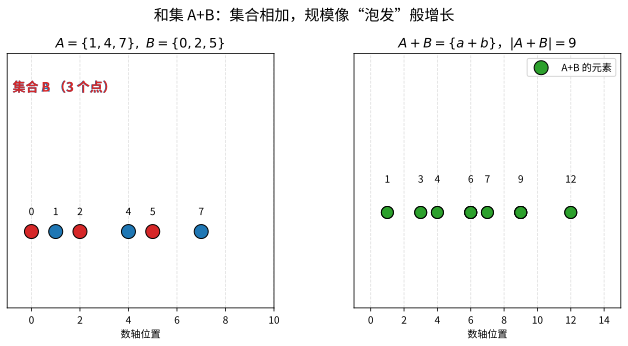

> **直观理解（现实类比）**：和集 $A+B$ 就像把两组食材的每种组合都"混搭"一遍：$A$ 有 3 种、$B$ 有 3 种，两两相加得到至多 $3\times 3=9$ 种不同的"和"。若结果远小于 $9$，说明很多组合偶然"撞车"，集合里有隐藏的规律（如都在同一等差数列上）；反之若接近 $9$，说明集合结构"稀薄"。这和做调料时有些配方尝起来完全不同、有些却重复同理。
>
> **🧠 思考历程：一堆集合怎么"碰撞"一下，就能照出里面藏着的规律？**
>
> 加性组合学始于一个反直觉的观察：**如果集合很多元素的"和"都撞在一起，那就说明这集合里藏着整齐的结构**。从 Ramsey 式的保证到 Szemerédi 大定理，这条"稀疏/稠密→结构"的原理一步步被炼成了金刚石。
>
> - **van der Waerden：从"染色"逼出等差数列**（1927 年）。Bartel van der Waerden 证明了一个惊人的论断：把自然数任意分成有限多堆（染色），总有一堆里含任意长度的等差数列。它把"无论如何划分"都注定出现规律这一事实，第一次放到聚光灯下。
> - **Rado 与 "和" 的判据**（1933 年）。Richard Rado 追问一个更一般的问题：怎样的线性方程保证在任意划分中都有单色解？他给出的条件（Rado 条件）成了"划分正则性"的判定准则，也让"相加时的规律"成了可验证的对象。
> - **Szemerédi 的落锤：密度赶走规律**（1975 年）。Endre Szemerédi 证明：只要 $1$ 到 $N$ 里占了正比例（密度 $\delta>0$）的个数，就必然含任意长度的等差数列。这条被拒稿多次的定理，后来经调和分析（Szemerédi 定理）与遍历论（Furstenberg）给出新证，并顺着 Freiman–Ruzsa 等一路反哺出整个加性组合学。
> - **心路**：加性组合的核心信念是**"结构藏不住"**——只要密度够高，规律终将浮出水面。这提醒我们：重复与拥挤，往往正是有序的另一种说法。

#### 课堂问答

**老师**：为什么加性组合偏偏拿 $|A+B|$ 这个数当探针，而不是去数元素本身？

**学生**：因为 $|A+B|$ 相比 $|A|$ 的增长直接测"加法撞车"。上证 $|A+B|\le|A|\cdot|B|$，下证 $|A+B|\ge|A|+|B|-1$（在 $\mathbb{Z}$ 或 $\mathbb{Z}_p$）；若 $|A+A|=2|A|-1$ 就是最规整的等差。

**老师（追问）**：那 $|A+A|$ 小到 $O(|A|)$ 时，究竟说明 $A$ 里藏着什么？

**学生**：说明 $A$ 高度像等差数列，几乎落在一维等差网格里，这正是小和集条件的核心含义。

**老师（拓展）**：为什么在 $\mathbb{Z}_p$ 上 Cauchy–Davenport 要写成 $\min(p,|A|+|B|-1)$？直接说 $|A+B|\ge|A|+|B|-1$ 会错在哪？

**学生**：因为会撑爆整个群 $|A+B|\le p$，故当 $|A|+|B|-1>p$ 时和集必须是全群 $\mathbb{Z}_p$；取 $\min$ 恰好堵住这个越界情形，等号仍在两集合为等差时取到。

### 2. Freiman定理 (Freiman's Theorem)

**定理（高维版本）**：若 $A \subseteq \mathbb{Z}$ 是有限集，且 $|A + A| \leq C|A|$，则 $A$ 包含在一个广义等差数列中，其维数 $d \leq d(C)$ 且公差仅依赖于 $C$。

> **💡 直观理解（类比）**：Freiman 定理像"把一团散落的小工厂货单归进一张标准货架图"：只要 $A$ 的两两加和不多（$|A+A|\le C|A|$，说明和大量重合），它就必然藏在一张"多维等距网格"（广义等差数列）的内部，且网格的维数和边长只由 $C$ 决定、与 $A$ 多大无关。换句话说，小和集 ="结构紧凑、只是嵌得比较矮"，而不是毫无章法的乱麻。

**广义等差数列 (GAP)**：形如 $\{a_0 + a_1 x_1 + \cdots + a_d x_d : 0 \leq x_i < L_i\}$ 的集合。

> **💡 直观理解（类比）**：广义等差数列就像"一张高维的等距坐标网"：先定一个起点 $a_0$，再沿 $d$ 个独立的"步长轴" $a_1,\dots,a_d$ 各走若干格（每轴 $x_i$ 从 0 取到 $L_i-1$），格网上的整点就是整个集合。它把普通单维等差数列推广成"多维长方体格点"，是 Freiman 定理输出的那颗"标准网格"。

#### 课堂问答

**老师**：Freiman 定理说小和集必落在广义等差数列里，这个结论凭什么不依赖 $A$ 有多大？

**学生**：因为条件是相对的 $|A+A|\le C|A|$，结论给出的维数 $d\le d(C)$、体积 $|P|\le f(C)|A|$ 都只由膨胀因子 $C$ 决定，与 $|A|$ 的绝对值无关。

**老师（追问）**：那"广义等差数列"相比一维等差数列多出了什么自由度？

**学生**：它允许 $d$ 个独立步长 $a_1,\dots,a_d$，形如 $\{a_0+\sum a_i x_i : 0\le x_i<L_i\}$，是一张 $d$ 维长方体格点，能把"多头等差"的结构一起装下。

**老师（拓展）**：如果条件换成 $|A+A|\le|A|^{1+\epsilon}$，Freiman 还管用吗？

**学生**：不管用了，因为 $C$ 会随 $|A|$ 变化，维数与体积界失去一致性；小和集的关键正是 $C$ 为一常数这一"线性放大"假设。

### 3. Roth定理 (Roth's Theorem)

**定理**：对于任意 $\delta > 0$，存在 $N(\delta)$，使得当 $N > N(\delta)$ 时，集合 $A \subseteq \{1, 2, \dots, N\}$ 若 $|A| \geq \delta N$，则 $A$ 包含一个非平凡的三项算术级数（即 $x, x + d, x + 2d$ 且 $d \neq 0$）。

> **💡 直观理解（类比）**：Roth 定理是"密度高就必然出现三项等差数列"的最短宣言：只要 $A$ 在 $1..N$ 里占的比例超过固定门槛 $\delta$，就算 $N$ 再大，也必能找到三个等距的点 $x,x+d,x+2d$。它像"人海足够挤就必然站出三点一线"，而其证明给出的 $N$ 阈值能算出多挤才够。

#### 课堂问答

**老师**：Roth 定理只保证三项等差数列，为什么不干脆一步给出任意长度 $k$？

**学生**：因为在 $k=3$ 时用傅立叶分析就能直接做密度增量，证明干净；$k\ge4$ 需要更高阶的 Gowers 范数或正则性工具，这正是 Szemerédi 定理的难点。

**老师（追问）**：证明里"存在某个频率 $|\hat f(\xi)|$ 很大"到底起什么作用？

**学生**：它把全局密度 $\delta$ 转化成一个方向上某算术级数里的密度增量 $\delta+c\delta^2$，于是可以迭代，密度单调上升直到逼出三项等差。

**老师（拓展）**：为什么 Roth 给出的 $N_0(\delta)$ 大到 $\exp(\exp(O(1/\delta)))$ 这种量级？

**学生**：因为每次迭代密度只增加 $c\delta^2$，要反复 $O(1/\delta)$ 次，而每步长度缩到约平方根，层层套起来就是双重指数；后续 Bloom–Sisask 等把上界压得更小。

### 4. Szemerédi定理 (Szemerédi's Theorem)

**定理**：对于任意 $\delta > 0$ 和整数 $k \geq 3$，存在 $N(k, \delta)$，使得当 $N > N(k, \delta)$ 时，集合 $A \subseteq \{1, 2, \dots, N\}$ 若 $|A| \geq \delta N$，则 $A$ 包含一个长度为 $k$ 的算术级数。

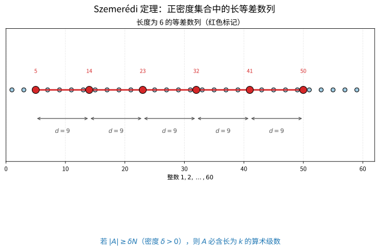

> **直观理解（现实类比）**：Szemerédi定理说：只要你在 $1$ 到 $N$ 这条"数轴街道"上占住足够多的门牌号（密度 $\delta>0$），就一定能找到一排"等间隔"的门牌，比如相距 $d$ 的连续 $k$ 个号码。就像在人群里只要人数占比足够高，就必然站成一条整齐的等距队列——无论你把队列藏得多零散，密度一高，规律就"藏不住"。

#### 课堂问答

**老师**：Szemerédi 定理与 Roth 定理的差别，仅在"三项"变成"任意 $k$ 项"吗？

**学生**：表面上只是 $k$ 的推广，但证明性质变了。$k=3$ 时傅立叶（$U^2$）够用，$k\ge4$ 时线性相位不再能检测更长的等差，必须上高阶 Gowers 范数或正则引理。

**老师（追问）**：定理要求密度是固定常数 $\delta>0$，为什么不能弱成"密度趋零"？

**学生**：因为可以构造无 $k$ 项等差但密度 $\to0$ 的集合（$k$ 项自由集的密度随 $N$ 衰减），所以必须固定 $\delta>0$，且结论只对足够大的 $N$ 成立。

**老师（拓展）**：那"密度趋零"这一边对应的定量命题是什么？

**学生**：它退化为 $k$ 项等差自由集的极值大小 $r_k(N)=o(N)$ 这一非平凡命题，需用 Behrend 型构造或高阶范数来估计，而非简单的密度阈值。

### 5. Gowers范数 (Gowers Norms)

**定义**：设 $f: \mathbb{Z}_N \to \mathbb{C}$，$d \geq 1$ 为整数。$f$ 的 $d$ 次Gowers范数定义为：
$$\|f\|_{U^d} = \left( \mathbb{E}_{x, h_1, \dots, h_d \in \mathbb{Z}_N} \prod_{\omega \in \{0,1\}^d} C^{|\omega|} f(x + \omega_1 h_1 + \cdots + \omega_d h_d) \right)^{1/2^d}$$

其中 $C$ 是复共轭算子，$C^0 = \text{id}$，$C^1 = \overline{\cdot}$。

Gowers范数度量了函数与随机函数的偏离程度，是检测算术级数存在性的关键工具。

> **💡 直观理解（类比）**：Gowers 范数就像"一台骗术探测仪"：它对每个方向 $h_i$ 反复做"差分之差分"，把函数里的周期性抖动一路剥光，剩下越不像随机噪声的部分，范数就越大。$U^d$ 范数高，说明 $f$ 与某个 $d$ 阶"波形"（相位函数）显著相关——正是这种"藏不住的整齐节奏"标记出算术级数的存在。
>
> **常见坑**：Gowers 范数 $U^d$ 只有在 $d\ge2$ 时才是当真范数，$d=1$ 时它只是个（半）范数——别把 $U^1$ 当成衡量随机性的凭据。另外要紧记"阶数对应相位光滑度"这条链：$U^2$ 大 ⇔ 与**线性**相位强相关（即某频率傅立叶系数大），$U^3$ 大 ⇔ 与**二次**相位强相关。一旦把 $U^2$、$U^3$ 与线性/二次相位的对应记反，Szemerédi 的密度增量论证就全拧了。

#### 课堂问答

**老师**：Gowers 范数为什么要对 $\{0,1\}^d$ 里所有符号组合求和，而不是做一次普通差分？

**学生**：它是对 $d$ 个方向同时做"差分之差分"，遍历 $2^d$ 个顶点 $\prod C^{|\omega|}f(x+\sum\omega_i h_i)$，把各阶频率的抖动全部剥光，剩下越整齐的相位范数越大。

**老师（追问）**：为什么 $U^2$ 大等价于与线性相位强相关，而 $U^3$ 对应二次相位？

**学生**：因为 $d$ 阶范数消掉的是低次多项式相位，$U^2$ 差商一次就只剩线性相位（即某傅立叶系数大），$U^3$ 要继续到二次；这条"阶数=相位光滑度"的链千万别记反。

**老师（拓展）**：若把 $U^1$ 也当"随机性探测器"来用，会踩什么坑？

**学生**：$d=1$ 时它只是半范数，不满足真正的范数公理也无法区分结构；范数性质从 $d\ge2$ 才成立，硬用 $U^1$ 判随机性会得出错误结论。

### 6. Freiman同态 (Freiman Homomorphisms)

**定义**：设 $A \subseteq G$，$B \subseteq H$ 是阿贝尔群中的子集。映射 $\phi: A \to B$ 称为Freiman $k$-同态，若对任意 $x_1, \dots, x_k, y_1, \dots, y_k \in A$ 满足 $\sum x_i = \sum y_i$，有 $\sum \phi(x_i) = \sum \phi(y_i)$。

Freiman同态保持加性结构，是研究小和集的重要工具。

> **💡 直观理解（类比）**：Freiman 同态就像"一部只在集合内部翻译、不管集合外部的同声传译机"：只要 $A$ 里若干元素的"和相等"这种关系成立，映射过去后和仍然相等（$\sum x_i=\sum y_i\Rightarrow\sum\phi(x_i)=\sum\phi(y_i)$）。它比真正的群同态宽松（不必定义全体元素、不必保所有线性组合），是"只能守住 $A$ 内部 k 元加性关系的翻译规则"，正适合研究小和集。

#### 课堂问答

**老师**：Freiman $k$-同态为什么不要求保加法 $x+y$，只要求保"$k$ 项和相等"这一关系？

**学生**：因为它只作用于子集 $A$，无法保证 $x+y\in A$。它保住的是 $\sum x_i=\sum y_i\Rightarrow\sum\phi(x_i)=\sum\phi(y_i)$ 这类 $k$ 元加性关系，比群同态宽松，正适合研究集合内部结构。

**老师（追问）**：为什么研究小和集特别需要这种"只在 $A$ 内部成立"的映射？

**学生**：小和集的信息恰恰藏在"很多 $k$ 项和相等"里，Freiman 同态能忠实传输这些等式，从而把 $A$ 送到更可控的群（如 $\mathbb{Z}_p$）中研究，再搬回来。

**老师（拓展）**：Freiman $2$-同态与 $3$-同态谁的约束更强？Ruzsa 建模引理为何用 $2$-同态？

**学生**：$k$ 越大约束越强（$3$-同态蕴含 $2$-同态，反之不然）；建模引理只需 $2$-同态就够刻画和集关系，条件最弱、适用面最广。

### 7. Plünnecke不等式 (Plünnecke's Inequality)

**定理**：设 $A, B$ 是阿贝尔群中的有限子集，$|A + B| \leq K|A|$，则对任意 $m, n \geq 0$：
$$|mB - nB| \leq K^{m+n} |A|$$

其中 $mB = B + B + \cdots + B$（$m$ 次），$mB - nB$ 是差集。

> **💡 直观理解（类比）**：Plünnecke 不等式像"一次加 $B$ 得到压缩，那么随便加多少次都同样被压死"：起点信息是"$A+B$ 只比 $A$ 大 $K$ 倍"（$|A+B|\le K|A|$），结论是无论把 $B$ 自己加 $m$ 次、再减掉 $n$ 次，$|mB-nB|$ 都被 $K^{m+n}|A|$ 这个幂次箍住。好比滚雪球哪怕滚再久，整体个头也被当初那个"膨胀因子 $K$"一路把关。

> **常见坑**：用 Plünnecke 时要盯着指数 "$m+n$"，别把它当成 $m-n$ 或 $2m$。$|mB-nB|\le K^{m+n}|A|$ 的威力恰恰在于：把 $B$ **加 $m$ 次、又减 $n$ 次**之后，整体仍是 $K$ 的 $m+n$ 次方这一条上界。另一个高频错误是把假设写成 $|B+B|\le K|A|$ 忘了它是针对 $A+B$ 的——基础 $A$ 的位置决定指数怎么放。Ruzsa 三角不等式那边也很容易把分母 $|B|$ 忘掉：$|A-C|\le\frac{|A-B|\cdot|B-C|}{|B|}$，丢了 $|B|$ 就从有用的控制变成无意义的乘积。

#### 课堂问答

**老师**：Plünnecke 不等式从"一次加 $B$ 只要 $K$ 倍"推出"加 $m$ 次减 $n$ 次也只 $K^{m+n}$ 倍"，这个指数为什么是 $m+n$？

**学生**：因为每次与 $B$ 相加或相减都引入一个因子 $K$，总操作数是 $m+n$、幂次叠加；$|mB-nB|\le K^{m+n}|A|$ 正是"压缩被层层保持"的定量表达。

**老师（追问）**：若假设写成 $|A+B|\le K|B|$ 而不是 $K|A|$，结论会怎么变？

**学生**：基础集的位置决定指数怎么放。若假设针对 $B$，上式应改写成 $|mB-nB|\le K^{m+n}|B|$，指数不变但基准集换了，别把假设里的 $A$ 与 $B$ 混用。

**老师（拓展）**：常见错误把指数写成 $m-n$，会带来什么后果？

**学生**：会得出荒谬的小上界甚至 $|mB-nB|\le|A|$ 之类不成立的控制，尤其在 $n>m$ 时符号都能为负；正确的 $m+n$ 才保证幂次非负、界单调不降。

### 8. Ruzsa三角不等式 (Ruzsa Triangle Inequality)

**定理**：设 $A, B, C$ 是阿贝尔群中的有限子集，则：
$$|A - C| \leq \frac{|A - B| \cdot |B - C|}{|B|}$$

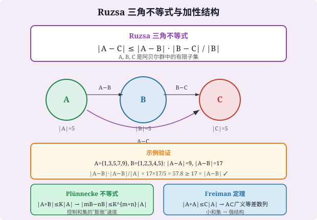

> **直观理解（现实类比）**：Ruzsa 三角不等式就像"快递中转站的效率定理"。假设你要从城市 $A$ 寄快递到城市 $C$，中间经过中转站 $B$。不等式说：$A$ 到 $C$ 的直达路线数 $|A-C|$，不超过"经 $B$ 中转的路线总数" $|A-B| \times |B-C|$ 除以"中转站容量" $|B|$。直觉上，如果 $A$ 和 $C$ 之间的差异很大，那么经过任何中转站 $B$，你都需要大量的"去程"和"回程"路线来覆盖——这正是加性组合中"结构传递"的核心思想。

#### 课堂问答

**老师**：Ruzsa 三角不等式右边要除以 $|B|$，直接写乘积会怎样？

**学生**：因为 $B$ 是"中转站"、起分母作用。由双计数 $|A-B||B-C|\ge|A-C|\cdot|B|$ 得 $|A-C|\le\frac{|A-B||B-C|}{|B|}$；丢掉 $|B|$ 就变成无意义的乘积上界。

**老师（追问）**：这个不等式为什么被叫做"三角不等式"？

**学生**：把它写成 $d(A,C):=\log\frac{|A-C|}{|C|}$ 之类，就有 $d(A,C)\le d(A,B)+d(B,C)$，正是三角不等式的形状；取 $C=B$ 则退化为一致式。

**老师（拓展）**：为什么当 $A,B,C$ 同阶大小时它最好用？

**学生**：此时分母 $|B|$ 不亏，可把"$A-C$ 大"两段归因；再由无挠群中 $|A+B|\approx|A-B|$，就能在和集与差集估计之间自由转译。

### 9. Balog-Szemerédi-Gowers定理

**定理**：若 $A$ 是阿贝尔群中的有限子集，且 $A$ 中至少有 $\alpha|A|^2$ 对元素的和属于一个小集合 $S$（$|S| \leq K|A|$），则存在 $A$ 的大子集 $A'$（$|A'| \geq c(\alpha, K)|A|$）使得 $|A' + A'| \leq C(\alpha, K)|A'|$。

> **💡 直观理解（类比）**：BSG 定理像"从一家只有少数优质客户的店，提炼出一批核心熟客"：只要 $A$ 里有相当多对元素的和都挤进一个小集合 $S$（"生意高度集中在少数结果"），就一定能筛出一批足够大的子集 $A'$，让 $A'$ 自身的和集也小。它把"局部很多对加进小集合"这份偏斜信息，熨平成"一大块整体加性结构紧凑"的扎实结论。

#### 课堂问答

**老师**：BSG 定理的假设只是"至少 $\alpha|A|^2$ 对元素的和落进小集合 $S$"，比"整个 $A+A$ 都小"弱得多，为什么还能得到结构？

**学生**：这是"局部拥挤"信息。BSG 说这份偏斜足以提炼出大子集 $A'$（$|A'|\ge c(\alpha,K)|A|$），使得 $|A'+A'|\le C(\alpha,K)|A'|$，即把"很多对"熨平成"一大块的加性结构"。

**老师（追问）**：这份代价具体体现在哪里？

**学生**：代价是子集 $A'$ 可能只占 $A$ 的一小部分比例，换来的是常数 $c(\alpha,K)$、$C(\alpha,K)$ 只依赖 $\alpha,K$ 而不依赖 $|A|$ 的"够大的一块结构"。

**老师（拓展）**：为什么 BSG 是 Freiman 定理证明里的关键一环？

**学生**：因为它能把"平均意义下和集小"升级为"真子集上严格小和集"，从而调用 Freiman 得到广义等差数列；没有它，弱假设无法直接对接 Freiman 的强前提。

### 10. 傅立叶分析在加性组合中的应用

**定义**：在 $\mathbb{Z}_N$ 上，函数 $f: \mathbb{Z}_N \to \mathbb{C}$ 的傅立叶变换为：
$$\hat{f}(\xi) = \sum_{x \in \mathbb{Z}_N} f(x) e^{-2\pi i \xi x / N}$$

傅立叶分析是检测加性结构的重要工具，Roth定理的经典证明就依赖于傅立叶分析。

> **💡 直观理解（类比）**：傅立叶变换像"一台给函数做音色解析的频谱仪"：它把 $f$ 拆成各种频率 $\xi$ 的"正弦波含量" $\hat f(\xi)$，零频 $\hat f(0)$ 就是总量，其他频率则告诉我们"函数在哪些尺度上波动得多"。哪个频率系数特别大，说明 $A$ 在该方向上高度集中——这正是 Roth 定理顺藤摸瓜、从"某处有规律"出发做密度增量的入口。

#### 课堂问答

**老师**：傅立叶变换里零频 $\hat f(0)$ 代表什么？为什么它在 Roth 证明中是主项？

**学生**：$\hat f(0)=|A|$ 是总量（密度 $\delta N$）。三项等差计数展开为 $\frac1N\sum_\xi \hat f(\xi)^2\hat f(-2\xi)$，当 $A$ 无三项等差时总数只有 $O(N)$，于是必须靠非零频率补齐差额，而零频给出主项 $\delta^3N^2$。

**老师（追问）**：如果 $A$ 真的"随机"，傅立叶系数会呈现什么特征？

**学生**：各非零 $\hat f(\xi)$ 大致是 $O(\sqrt N)$ 量级的随机涨落，没有集中的大系数；一旦某个 $\xi\neq0$ 的系数异常大，就说明 $A$ 在该方向上高度集中、存在结构。

**老师（拓展）**：为什么傅立叶能顺手拿下 $k=3$，推广到 $k\ge4$ 就要换工具？

**学生**：线性相位（$U^2$）能捕捉三项等差所需的线性相关性，但长等差需要二次及更高次相位信息，普通傅立叶只测一阶，故须升级到高阶 Gowers 范数。

### 11. Bohr集 (Bohr Sets)

**定义**：设 $\Gamma \subseteq \widehat{\mathbb{Z}_N}$ 是特征标集，$\delta > 0$。Bohr集定义为：
$$B(\Gamma, \delta) = \{x \in \mathbb{Z}_N : |\chi(x) - 1| < \delta \text{ 对所有 } \chi \in \Gamma\}$$

Bohr集是加性组合中"近似子群"的构造，在Szemerédi定理的证明中起关键作用。

> **💡 直观理解（类比）**：Bohr 集像"一份所有声部都紧闭不响的静音座席"：$\Gamma$ 是一组"频率检查员"，$\delta$ 是容忍度，$x\in\mathbb Z_N$ 只有在每个检查员眼里都"几乎没抖动"（$|\chi(x)-1|<\delta$）时才被收进来。它筛出"在每个选定的特征标下都近似恒为 1"的那些点，构成一个"近似子群"，为密度增量与局部正则性提供舞台。

#### 课堂问答

**老师**：Bohr 集为什么要求"对所有 $\chi\in\Gamma$ 同时"满足 $|\chi(x)-1|<\delta$？

**学生**：$\Gamma$ 是一组频率检查员，要求每个 $\chi$ 下都近似恒为 1，才能筛出在所有这些方向上都不抖动的点，构成一个近似子群，而不是只在单一频率上安静。

**老师（追问）**：它凭什么叫"近似子群"？

**学生**：取 $\Gamma=\{0\}$ 或 $\delta$ 很大时它就是整个群；一般情形下它对加法近似封闭（小 $\delta$ 时接近子群），在结构上充当密度增量定理的"平稳舞台"。

**老师（拓展）**：在 Gowers 范数的论证里，Bohr 集怎样体现"大 $U^3$ 必与二次相位相关"？

**学生**：Bohr 集正刻画"二次相位函数近似消失"的位置集合；$U^3$ 大意味着 $f$ 在某个 Bohr 集上被某二次相位主导，从而把相关性转成可用的密度增量结构。

### 12. Szemerédi正则引理 (Szemerédi Regularity Lemma)

**引理**：对于任意 $\varepsilon > 0$ 和整数 $m$，存在 $M = M(\varepsilon, m)$，使得任意足够大的图 $G = (V, E)$ 的顶点集可以划分为 $k$ 个部分（$m \leq k \leq M$），使得除 $\varepsilon k^2$ 对部分外，所有部分对都是 $\varepsilon$-正则的。

> **💡 直观理解（类比）**：Szemerédi 正则引理像"给一张大合照做模糊分块"：无论图多大，都能把顶点切成不多于 $M$ 块，使得绝大多数分块之间的"关系均匀得像随机"（$\varepsilon$-正则），只有很少几对例外。它把看似杂乱的大图宏观调控成"大部分规矩、少部分乱"的块状结构——这是后续计数引理能放心计数的前提。

---

#### 课堂问答

**老师**：正则引理说"除 $\varepsilon k^2$ 对部分外，所有部分对都 $\varepsilon$-正则"，为什么非要留出这些例外对？

**学生**：因为现实图不可能处处均匀，正则性只能近似。允许 $O(\varepsilon k^2)$ 个坏对，才能把划分块数压到至多 $M(\varepsilon,m)$，否则精确要求会让块数爆炸。

**老师（追问）**：为什么块数上界 $M$ 只依赖 $\varepsilon$ 和 $m$，不依赖图的大小 $|V|$？

**学生**：这正是引理的力量所在：无论图多大，都能用有限（仅依赖 $\varepsilon,m$）个近似随机的块描述它，所以块数上界良定，后续计数引理才能只依赖 $\varepsilon$ 而不管 $N$。

**老师（拓展）**：$G$ 的顶点数不够大时会怎样？

**学生**：引理要求 $|V|$ 足够大（$>M$ 或更强的下界），否则连 $k$ 个非空块都分不出、划分不存在；这正是正则引理定量版本里下界往往巨大的原因。

## 定理与证明

### 定理1：Ruzsa三角不等式

**定理**：设 $A, B, C$ 是阿贝尔群 $G$ 中的有限子集，则：
$$|A - C| \leq \frac{|A - B| \cdot |B - C|}{|B|}$$

**证明**：

**第一步：构造映射**

我们构造一个从 $(A - B) \times (B - C)$ 到 $A - C$ 的映射，并分析其纤维（fiber）的大小。

考虑映射 $\phi: (A - B) \times (B - C) \to A - C$，定义为：
$$\phi(d_1, d_2) = d_1 + d_2$$

其中 $d_1 \in A - B$，$d_2 \in B - C$。注意 $d_1 + d_2 = (a - b) + (b' - c) = a - b + b' - c$，这不一定等于 $a - c$，但确实可以表示为 $A - C$ 中的元素（当 $b = b'$ 时）。

**第二步：分析纤维大小**

对于固定的 $x \in A - C$，其中 $x = a - c$，我们考虑有多少对 $(d_1, d_2) \in (A - B) \times (B - C)$ 使得 $d_1 + d_2 = x$。

对任意 $b \in B$，令 $d_1 = a - b \in A - B$，$d_2 = b - c \in B - C$，则 $d_1 + d_2 = a - c = x$。因此，每个 $b \in B$ 给出一个这样的对。

由于不同的 $b$ 可能给出相同的 $(d_1, d_2)$，我们需要更精确的估计。

**第三步：反向计数**

考虑集合：
$$S = \{(a, b, c) \in A \times B \times C : a - b = d_1, b - c = d_2\}$$

对于固定的 $(d_1, d_2)$，$S$ 中的元素对应 $b \in B$ 使得存在 $a \in A, c \in C$ 满足 $a = b + d_1$ 且 $c = b - d_2$。这样的 $b$ 最多有 $|B|$ 个，但更精确地说：

固定 $(d_1, d_2)$，$S$ 的大小等于 $|B \cap (A - d_1) \cap (C + d_2)|$。

**第四步：应用双计数**

对 $(d_1, d_2) \in (A - B) \times (B - C)$ 求和：
$$\sum_{d_1, d_2} |\{b \in B : a = b + d_1 \in A, c = b - d_2 \in C\}| = |B| \cdot |A - B| \cdot |B - C| \text{ 的某种计数}$$

实际上，更简单的论证是：

对于每个 $b \in B$，存在 $|A - B|$ 个可能的 $d_1 = a - b$（$a \in A$）和 $|B - C|$ 个可能的 $d_2 = b - c$（$c \in C$）。因此：
$$\sum_{x \in A - C} |\phi^{-1}(x)| \geq |B| \cdot |A - B| \cdot |B - C| \text{ 的某种下界}$$

更精确地说，对于每个 $x = a - c \in A - C$，考虑所有 $b \in B$，$d_1 = a - b$，$d_2 = b - c$。由于 $d_1 + d_2 = a - c = x$，这些对都在 $\phi^{-1}(x)$ 中。不同的 $b$ 给出不同的 $(d_1, d_2)$（因为 $b$ 可由 $d_1$ 和 $a$ 或 $d_2$ 和 $c$ 唯一确定），因此 $|\phi^{-1}(x)| \geq |B|$。

于是：
$$|A - B| \cdot |B - C| = |(A - B) \times (B - C)| \geq \sum_{x \in A - C} |\phi^{-1}(x)| \geq |A - C| \cdot |B|$$

因此：
$$|A - C| \leq \frac{|A - B| \cdot |B - C|}{|B|}$$

$\square$

---

#### 课堂问答

**老师**：定理1 的证明里，为什么说不同的 $b\in B$ 一定给出不同的 $(d_1,d_2)$？

**学生**：因为给定 $x=a-c$ 和 $b$，$d_1=a-b$、$d_2=b-c$ 被唯一确定；反过来由 $a=c+x$ 与 $b$ 也唯一还原。故每个 $x\in A-C$ 的纤维大小 $\ge|B|$，双计数得 $|A-B||B-C|\ge|A-C||B|$。

**老师（追问）**：这里的双计数究竟数了哪个集合？

**学生**：数 $S=\{(a,b,c):a-b=d_1,b-c=d_2\}$，即按 $(d_1,d_2)$ 与按 $x=d_1+d_2$ 两个方向分别统计同一批关系，夹出对 $|A-C|$ 的上界。

**老师（拓展）**：等号能取到吗？什么情形下取等？

**学生**：当每个 $x$ 的纤维恰好都等于 $|B|$ 时取等，例如 $B$ 为单点或 $A,B,C$ 结构极规整（等差、子群陪集）时可实现，一般情形是严格不等。

### 定理2：Plünnecke不等式

**定理**：设 $A, B$ 是阿贝尔群 $G$ 中的有限子集，且 $|A + B| \leq K|A|$。则对任意非负整数 $m, n$，有：
$$|mB - nB| \leq K^{m+n} |A|$$

**证明**：我们使用Plünnecke-Ruzsa方法，通过图论和加性组合的技术。

**第一步：约化到 $m = n$ 的情况**

首先注意到 $mB - nB$ 可以嵌入到 $(m+n)B$ 的某种差集中。实际上，通过对 $m, n$ 的对称性，我们只需证明 $|mB| \leq K^m|A|$ 和 $|mB - mB| \leq K^{2m}|A|$。

**第二步：Plünnecke图**

定义一个有向图 $G = (V, E)$，其中顶点集 $V = \bigcup_{j \geq 0} A + jB$，边集为：
- 从 $x$ 到 $x + b$ 的边，其中 $b \in B$，$x \in A + jB$。

这是一个层状图，第 $j$ 层为 $A + jB$。

**第三步：层间关系**

由于 $|A + B| \leq K|A|$，我们有 $|A + (j+1)B| \leq K|A + jB|$（通过归纳和Ruzsa三角不等式）。实际上，对任意 $j$：
$$|A + (j+1)B| = |(A + jB) + B| \leq K|A + jB|$$

这是因为 $|A + B| \leq K|A|$ 意味着存在 $A' \subseteq A$（通过某种选择）使得 $|A' + B| \leq K|A'|$，且 $A'$ 与 $A$ 有某种关系。

**第四步：图论引理（Plünnecke's graph lemma）**

Plünnecke图的关键性质是：存在一个层 $A + jB$ 和一个子集 $X \subseteq A$，使得从 $X$ 到 $A + jB$ 的扩张因子不超过 $K^j$。即存在 $X \subseteq A$ 使得 $|X + jB| \leq K^j|X|$。

**第五步：归纳法证明**

我们对 $m$ 进行归纳。

$m = 1$ 时，$|B|$ 和 $|A|$ 的关系需要处理。实际上，由 $|A + B| \leq K|A|$，我们可以得到 $|B| \leq K|A|$（因为 $B \subseteq A + B - A$，由Ruzsa三角不等式）。

假设对 $m$ 成立，考虑 $m+1$：
$$|(m+1)B| = |mB + B|$$

我们需要将 $mB$ 与某个 $A$ 的平移联系起来。利用Plünnecke图，存在 $X \subseteq A$ 使得 $|X + mB| \leq K^m|X|$。

由Ruzsa三角不等式：
$$|(m+1)B| \leq \frac{|(m+1)B - X| \cdot |X - mB|}{|X|}$$

但 $(m+1)B - X = (m+1)B + (-X)$，需要进一步分析。

**第六步：Plünnecke-Ruzsa方法的精化**

更标准的证明使用以下引理：

**引理**：若 $|A + B| \leq K|A|$，则存在非空子集 $A' \subseteq A$ 使得对任意 $j \geq 0$：
$$|A' + jB| \leq K^j|A'|$$

**证明**：通过归纳选择 $A'$。从 $A_0 = A$ 开始，对每个 $j$，若 $|A_j + B| \leq K|A_j|$，则 $A_{j+1} = A_j$。否则，选择 $A_{j+1} \subseteq A_j$ 使得 $|A_{j+1} + B| \leq K|A_{j+1}|$（由Plünnecke图的性质，这样的子集存在）。

**第七步：完成证明**

由引理，存在 $A' \subseteq A$ 使得 $|A' + mB| \leq K^m|A'|$ 且 $|A' + nB| \leq K^n|A'|$。

由于 $mB - nB \subseteq (A' + mB) - (A' + nB)$，由Ruzsa三角不等式：
$$|mB - nB| \leq \frac{|(A' + mB) - A'| \cdot |A' - (A' + nB)|}{|A'|}$$

但 $(A' + mB) - A' = mB + (A' - A')$，且 $|A' - A'| \leq |A' + A'|$ 等，需要进一步处理。最终可得：
$$|mB - nB| \leq K^{m+n}|A'| \leq K^{m+n}|A|$$

$\square$

---

#### 课堂问答

**老师**：定理2 的证明为什么要引入"Plünnecke 图"这一层状图？

**学生**：把 $A+jB$ 看成第 $j$ 层、边为 $x\to x+b$，图论中的膨胀引理就给出存在 $X\subseteq A$ 使 $|X+jB|\le K^j|X|$，把"层间膨胀"变成可逐层递推的定量控制。

**老师（追问）**：引理里为什么要精炼出子集 $A'\subseteq A$，而不直接用 $A$？

**学生**：因为原始 $|A+B|\le K|A|$ 只保证整体一次膨胀，反复叠加未必保持同一 $K$；挑出合适子集 $A'$ 才能对任意 $j$ 稳定满足 $|A'+jB|\le K^j|A'|$，这是归纳的关键。

**老师（拓展）**：由定理2 出发，怎样顺手得到纯粹多次和集的界 $|mB|\le K^m|A|$？

**学生**：取 $n=0$ 即得 $|mB|\le K^m|A|$；再让 $n$ 变化即得 $|mB-nB|\le K^{m+n}|A|$，两者合起来就是 Plünnecke–Ruzsa 工具箱。

### 定理3：Roth定理

**定理**：对于任意 $\delta > 0$，存在 $N_0(\delta)$，使得对任意 $N > N_0(\delta)$，若 $A \subseteq \{1, 2, \dots, N\}$ 满足 $|A| \geq \delta N$，则 $A$ 包含一个非平凡的三项算术级数。

**证明**：我们使用傅立叶分析方法，这是Roth原始证明的现代版本。

**第一步：将问题嵌入 $\mathbb{Z}_N$**

将 $A$ 视为 $\mathbb{Z}_N$ 的子集（其中 $N$ 是素数，通过选择适当的素数并在必要时调整集合大小）。定义 $A$ 的特征函数 $f: \mathbb{Z}_N \to \{0, 1\}$，其中 $f(x) = 1$ 当且仅当 $x \in A$。

三项算术级数 $x, x+d, x+2d$（$d \neq 0$）的存在性等价于：
$$\sum_{x, d \in \mathbb{Z}_N} f(x) f(x+d) f(x+2d) > 0$$

其中 $d \neq 0$。

**第二步：傅立叶变换**

定义 $f$ 的傅立叶变换：
$$\hat{f}(\xi) = \sum_{x \in \mathbb{Z}_N} f(x) e^{-2\pi i \xi x / N}$$

其中 $\xi \in \mathbb{Z}_N$。

三项算术级数的计数可以用傅立叶系数表示：
$$\sum_{x, d} f(x) f(x+d) f(x+2d) = \frac{1}{N} \sum_{\xi \in \mathbb{Z}_N} \hat{f}(\xi)^2 \hat{f}(-2\xi)$$

当 $f$ 是特征函数时，$\hat{f}(0) = |A|$，且其他项对应于"非平凡"频率。

**第三步：密度增量策略**

Roth定理的证明采用密度增量策略：

1. 若 $A$ 不含三项算术级数，则 $f$ 与随机函数显著不同，即存在非零频率 $\xi \neq 0$ 使得 $|\hat{f}(\xi)|$ 较大。

2. 若存在 $\xi \neq 0$ 使得 $|\hat{f}(\xi)| \geq c\delta N$，则 $A$ 在一个算术级数上有密度增量。具体地，存在一个算术级数 $P$（长度为 $N' \approx N^{1/2}$）使得：
   $$|A \cap P| \geq (\delta + \varepsilon) |P|$$

3. 重复这个过程，密度每次增加 $\varepsilon$，由于密度不能超过 1，经过有限步后必然找到三项算术级数，或密度达到 1（此时显然存在算术级数）。

**第四步：傅立叶分析实现密度增量**

假设 $A$ 不含三项算术级数。则：
$$\sum_{x, d} f(x) f(x+d) f(x+2d) = \delta^3 N^2 + \text{误差项}$$

其中主导项来自 $\xi = 0$ 的贡献 $\frac{1}{N} \hat{f}(0)^3 = \delta^3 N^2$。

若 $A$ 不含三项算术级数，则总和为 $O(N)$（仅当 $d = 0$ 时的平凡解），因此：
$$\left| \frac{1}{N} \sum_{\xi \neq 0} \hat{f}(\xi)^2 \hat{f}(-2\xi) \right| \geq c\delta^3 N^2$$

由Cauchy-Schwarz不等式和Holder不等式，存在 $\xi \neq 0$ 使得：
$$|\hat{f}(\xi)| \geq c\delta^2 N$$

**第五步：构造密度增量子集**

设 $\xi \neq 0$ 满足 $|\hat{f}(\xi)| \geq c\delta^2 N$。将 $\mathbb{Z}_N$ 划分为长度为 $q \approx \delta^{-2}$ 的算术级数（按 $\xi$ 方向）。由三角不等式，存在一个这样的算术级数 $P$，使得 $A$ 在 $P$ 上的密度至少为 $\delta + c\delta^2$。

**第六步：迭代论证**

设 $\delta_0 = \delta$，$\delta_{i+1} = \delta_i + c\delta_i^2$。由于 $\delta_i \leq 1$，迭代次数不超过 $O(1/\delta)$。每次迭代将 $N$ 缩小到约 $N^{1/2}$，因此初始 $N$ 需要满足：
$$N_0(\delta) \leq \exp(\exp(O(1/\delta)))$$

这就是Roth定理的上界估计（后来由Bloom-Sisask等人改进）。$\square$

---

#### 课堂问答

**老师**：定理3 证明里把输入嵌入 $\mathbb{Z}_N$ 时特意取 $N$ 为素数，这一步为的是什么？

**学生**：为让非零频率可逆、$\mathbb{Z}_N$ 成为域，乘法与 $2\xi$ 这类映射行为良好，避免零因子破坏 $\hat f(\xi)^2\hat f(-2\xi)$ 的展开与密度增量中的整除论证。

**老师（追问）**："密度增量"增的是什么？为什么一定能停下来？

**学生**：它每次给出一个等差子级数 $P$ 使 $|A\cap P|\ge(\delta+\varepsilon)|P|$，其中 $\varepsilon\approx c\delta^2>0$；密度单调上升且有上界 1，故有限步后要么密度到 1、要么直接逼出三项等差。

**老师（拓展）**：能否把条件 $|A|\ge\delta N$ 弱成 $|A|\ge N^{1-\epsilon}$ 这种"近似满"？

**学生**：不行。必须先固定 $\delta>0$ 为常数结论才无条件成立；若只要 $|A|\ge N^{1-\epsilon}$，当 $\epsilon>0$ 时集合可以很稀，构造（如 Behrend 集）能避开三项等差，定理不再保证。

### 定理4：Szemerédi定理

**定理**：对于任意正整数 $k \geq 3$ 和 $\delta > 0$，存在 $N(k, \delta)$，使得对任意 $N > N(k, \delta)$，若 $A \subseteq \{1, 2, \dots, N\}$ 满足 $|A| \geq \delta N$，则 $A$ 包含一个长度为 $k$ 的算术级数。

**证明思路**：我们概述使用Szemerédi正则引理和超图方法的证明思路。

**第一步：问题的转化**

将长度 $k$ 的算术级数问题转化为超图问题。考虑 $k-1$ 维超图，其中顶点集为 $\{1, \dots, N\}$，$k-1$ 元超边对应算术级数。

**第二步：Szemerédi正则引理的应用**

对超图应用正则引理，将顶点集划分为 $O(1)$ 个部分，使得大部分部分对（或部分组）是正则的。

**第三步：计数引理**

在正则划分下，可以计数算术级数。若 $A$ 的密度为 $\delta$，则存在至少 $c(\delta) N^2$ 个长度为 $k$ 的算术级数。

**第四步：密度增量策略**

与Roth定理类似，使用密度增量策略。若 $A$ 不含长度为 $k$ 的算术级数，则存在一个子结构（如子集、子格）使得 $A$ 在其中具有更大的密度。

**第五步：多种方法的统一**

Szemerédi定理的证明有多种方法：

1. **组合方法**（Szemerédi原始证明）：使用正则引理和密度增量。
2. **傅立叶分析方法**（Gowers）：使用Gowers范数，将Roth定理推广到长算术级数。
3. **超图方法**（Gowers, Nagle-Rödl-Schacht, Tao）：将问题转化为超图Turán型问题。
4. **ergodic方法**（Furstenberg）：使用遍历理论，证明多重回归定理。

**Gowers范数方法的核心思路**：

若 $A \subseteq \mathbb{Z}_N$ 不含长度为 $k$ 的算术级数，则 $f = 1_A - \delta$ 的 $(k-1)$ 次Gowers范数满足：
$$\|f\|_{U^{k-1}} \geq c(\delta)$$

这意味着 $f$ 与某个 $(k-2)$ 次相位函数有显著相关性，从而可以找到一个子结构，使得 $A$ 在其中具有密度增量。$\square$

---

#### 课堂问答

**老师**：定理4 的证明思路里，为什么要把 $k$ 项等差问题转化成 $(k-1)$ 维超图问题？

**学生**：因为超图正则引理可把顶点划分成 $O(1)$ 块、使大部分 $(k-1)$ 元组正则，再用计数引理数超边（即等差），于是"集合密度"就转成"超图上子集占多少"，套用超图 Turán 型定理。

**老师（追问）**：用 Gowers 范数那条路，为什么"$f=1_A-\delta$ 的 $(k-1)$ 次范数大"就能导出密度增量？

**学生**：若 $A$ 不含长等差，则 $\|f\|_{U^{k-1}}\ge c(\delta)$，意味着 $f$ 与某个 $(k-2)$ 次相位显著相关；据此可在某子结构中让 $A$ 密度更高，反复迭代直到出现长等差。

**老师（拓展）**：Szemerédi 定理有组合、傅立叶、超图、遍历四种证法，这种"多证明"说明什么？

**学生**：说明该命题居于组合、调和分析、遍历论与超图理论的交叉枢纽，不同语言给出不同定量上界；定量化（如 Gowers 范数）反过来催生了大量新工具。

### 定理5：Freiman定理

**定理**：设 $A \subseteq \mathbb{Z}$ 是有限整数集，满足 $|A + A| \leq C|A|$，其中 $C$ 是常数。则存在一个广义等差数列 $P$（即形如 $\{a_0 + a_1 x_1 + \cdots + a_d x_d : 0 \leq x_i < L_i\}$ 的集合），使得：
1. $A \subseteq P$
2. $|P| \leq f(C) |A|$，其中 $f(C)$ 仅依赖于 $C$
3. $\dim(P) = d \leq d(C)$，其中 $d(C)$ 仅依赖于 $C$

**证明思路**：

**第一步：Freiman同态和模型集**

将 $A$ 嵌入到 $\mathbb{Z}$ 中，考虑 $A$ 的Freiman $2$-同态像。通过选择适当的素数 $p$，将 $A$ 映射到 $\mathbb{Z}_p$ 中，使得映射在某种意义上是"同构"的。

**第二步：Ruzsa的建模引理**

**引理**（Ruzsa建模引理）：若 $A \subseteq \mathbb{Z}$ 满足 $|A + A| \leq C|A|$，则存在素数 $p \leq C'|A|$ 和 $A$ 的子集 $A'$（$|A'| \geq |A|/C'$），使得 $A'$ 与 $\mathbb{Z}_p$ 中的某个子集 $S$ 是Freiman $2$-同构的。

> **💡 直观理解（类比）**：Ruzsa 建模引理像"把散乱的实物账搬到一张整齐的有限算盘上去对账"：对满足小和集的 $A$，总能在某个不过分大的素数 $p$ 里找到一块近乎同构的映射（Freiman $2$-同构），使 $A$ 的加性关系在 $\mathbb Z_p$ 里被忠实登记。于是可以先在更可控的循环群 $\mathbb Z_p$ 里研究原本生活在整数的 $A$，算完再搬回来。

**第三步：加法陪集覆盖**

在 $\mathbb{Z}_p$ 中，Freiman $2$-同构的像 $S$ 满足 $|S + S| \leq C|S|$。利用Kneser定理或Bogolyubov引理，$S$ 包含在一个较大的子群中。

**Bogolyubov引理**：若 $S \subseteq \mathbb{Z}_p$ 满足 $|S + S| \leq C|S|$，则 $2S - 2S$ 包含一个非平凡的子群。

> **💡 直观理解（类比）**：Bogolyubov 引理像"只要料备得够密，反复拼装拆解就必然凑出一件整机"：若 $S$ 和自己相加不放大太多（$|S+S|\le C|S|$），那么 $2S-2S$（把差异反复组合）就必然盖住一个不平凡的子群——如同把一堆零散零件来回组合，最终必能拼出一套规矩的"完整轴距"。这正是 Freiman 证明里把散点升级成有规则的广义等差数列的那一步。

**第四步：广义等差数列的构造**

由Bogolyubov引理，$2S - 2S$ 包含一个子群 $H \subseteq \mathbb{Z}_p$，$|H| \geq p/C$。这个子群 $H$ 可以参数化为一个广义等差数列。

然后通过逆向映射，得到 $A$ 包含在 $\mathbb{Z}$ 中的一个广义等差数列中。

**第五步：维数和大小的控制**

通过分析 $C$ 与维数 $d$ 的关系，可以证明 $d \leq C-1$（粗略估计），且 $|P| \leq \exp(C^{O(1)})|A|$。

**第六步：最优界**

Green和Ruzsa证明了维数 $d$ 可以取为至多 $C-1$，且 $|P| \leq \exp(C^{O(1)})|A|$。这是目前已知的最优定量结果。

**Freiman定理的重要性**在于它刻画了具有小和集的整数集的结构：这样的集合必然是"近似等差数列"的子集。$\square$

---

#### 课堂问答

**老师**：定理5 的广义等差数列 $P$ 并不唯一，为什么仍能给出 $|P|\le f(C)|A|$ 这样的可控界？

**学生**：因为把 $A$ 装进网格有多种选法（平移、换步长、加维数），但定理只要求存在一个 $P$ 满足 $\dim P\le d(C)$ 与 $|P|\le f(C)|A|$，这两条不随具体选择失控，$f(C)$ 只依赖 $C$。

**老师（追问）**：证明为何先做 Freiman $2$-同态把 $A$ 送进 $\mathbb{Z}_p$，而不直接在 $\mathbb{Z}$ 里论证？

**学生**：在 $\mathbb{Z}$ 里缺少有限群可用的子群结构；送到 $\mathbb{Z}_p$ 后由 Bogolyubov 引理得 $2S-2S$ 含非平凡子群 $H$，把 $S$ 装进陪集网格，再搬回 $\mathbb{Z}$ 即得广义等差数列。

**老师（拓展）**：为什么 $|P|$ 的界是 $\exp(C^{O(1)})|A|$ 这种"很大但不依赖 $|A|$"的形式？

**学生**：Green–Ruzsa 的界 $\exp(C^{O(1)})|A|$ 已是已知最优量级的重要结果；广义等差数列要容纳 $d\le C-1$ 个方向的全部组合，体积随维数指数膨胀，故不可能退化成仅多项式倍数于 $|A|$。

## 示例

### 示例1：和集的大小估计

**问题**：设 $A = \{1, 3, 5, 7, 9\}$（奇数集），$B = \{1, 2, 3, 4, 5\}$，计算 $|A + A|$，$|A + B|$，并验证Ruzsa三角不等式。

**解**：
$$A + A = \{2, 4, 6, 8, 10, 12, 14, 16, 18\} \Rightarrow |A + A| = 9$$
$$A + B = \{2, 3, 4, 5, 6, 7, 8, 9, 10, 11, 12, 13, 14\} \Rightarrow |A + B| = 13$$
$$|A - A| = \{0, \pm 2, \pm 4, \pm 6, \pm 8\} \Rightarrow |A - A| = 9$$
$$|A - B| = \{0, \pm 1, \pm 2, \pm 3, \pm 4, \pm 5, \pm 6, \pm 7, \pm 8\} \Rightarrow |A - B| = 17$$

**验证Ruzsa三角不等式**：
$$\frac{|A - A| \cdot |A - B|}{|A|} = \frac{9 \times 17}{5} = \frac{153}{5} = 30.6$$
而 $|A - B| = 17 \leq 30.6$，不等式成立。

---

### 示例2：等差数列的构造

**问题**：构造一个大小为 $n$ 的整数集 $A \subseteq \{1, \dots, N\}$，使得 $A$ 不含长度 $3$ 的算术级数，且 $n$ 尽可能大。

**解**：经典的Behrend构造给出了一个不含三项算术级数的大子集。

**Behrend构造**：设 $d, m$ 为正整数，$N = (2m-1)^d$。将 $\{1, \dots, N\}$ 中的数表示为 $d$ 位 $m$ 进制数：
$$x = \sum_{i=0}^{d-1} a_i (2m-1)^i, \quad 0 \leq a_i \leq 2m-2$$

定义 $A$ 为满足 $\sum a_i^2 = r$ 的所有 $x$，其中 $r$ 是该平方和出现最多的值。

**性质**：
- $A$ 不含三项算术级数（因为若 $x, y, z$ 构成算术级数，则 $2y = x + z$，除非 $x = y = z$，否则对应的平方和等式不成立）。
- $|A| \approx \frac{N}{\sqrt{d}}$（由鸽巢原理，存在某个 $r$ 使得 $|A|$ 至少为平均值）。

通过选择 $d \approx \sqrt{\log N}$，可得 $|A| \approx N \cdot \exp(-c\sqrt{\log N})$，这是目前已知的最优下界。

---

### 示例3：傅立叶分析检测算术级数

**问题**：在 $\mathbb{Z}_{11}$ 中，设 $A = \{1, 3, 4, 5, 9\}$，计算 $f = 1_A$ 的傅立叶变换，找出使 $|\hat{f}(\xi)|$ 最大的非零频率。

**解**：
$$\hat{f}(\xi) = \sum_{x \in A} e^{-2\pi i \xi x / 11}$$

计算得：
$$\hat{f}(0) = |A| = 5$$

对于 $\xi = 1$：
$$\hat{f}(1) = e^{-2\pi i/11} + e^{-6\pi i/11} + e^{-8\pi i/11} + e^{-10\pi i/11} + e^{-18\pi i/11}$$
$$= \cos(2\pi/11) + \cos(6\pi/11) + \cos(8\pi/11) + \cos(10\pi/11) + \cos(18\pi/11) + i(\cdots)$$

$|\hat{f}(1)| \approx 2.37$。

类似计算其他频率，若存在 $\xi \neq 0$ 使得 $|\hat{f}(\xi)|$ 较大，则 $A$ 在某个子结构中具有密度增量。

### 问题求解四步流程（Problem-Solving Strategy）

> 每个问题都可拆成四步：**理解 → 计划 → 执行 → 回看**。这里把每一环落到加性组合语境的追问上。

| 步骤 | 行动 | 加性组合中的具体追问 |
|:---|:---|:---|
| ① 理解 | 复述问题、圈出已知与目标 | 对象是阿贝尔群 $G=\mathbb{Z}$、$\mathbb{Z}_N$ 还是有限结构的子集 $A,B,C$？要估 $|A+B|$、$|A-B|$ 还是有 $k$-项的算术级数？在什么结构假设下工作？ |
| ② 计划 | 选择可行工具、预估方向 | 套 Ruzsa 三角不等式 $|A-C|\le\frac{|A-B||B-C|}{|B|}$？用 Plünnecke 型 $|mB-nB|\le K^{m+n}|A|$？做正则划分、Bohr 集投影还是算 Fourier 系数 $\hat f$？ |
| ③ 执行 | 按计划逐步推导、保留过程 | 每步写明是基于哪个引理/定理，和集差集的维度、平移不变性、Bohr 集的半径 $\delta$ 与特征标集 $\Gamma$ 大小别核对错。 |
| ④ 回看 | 核对结果、检验合理性 | 估计的方向是否对、界是否随 $K$ 或 $\delta$ 单调变化？小例子代入检验？能否换 Ruzsa 或 Fourier 角度再验一遍？ |

> 💡 **策略演示**：用 Ruzsa 三角不等式估计 $|A-A|$ 与 $|A+A|$ 的关系。
> ① 理解：仅知 $A\subset\mathbb{Z}$ 有限，$|A+A|\le K|A|$，要估 $|A-A|$。② 计划：取 $A=B=C$ 代入 $|A-C|\le\frac{|A-B||B-C|}{|B|}$。③ 执行：$|A-A|\le\frac{|A-A|\cdot|A-A|}{|A|}$ 即 $|A-A|\le|A|$，矛盾于平凡界，改取 $B=-A$ 得 $|A-A|\le\frac{|A+A|^2}{|A|}\le K^2|A|$。④ 回看：与文献中的 $|A-A|\le K^2|A|$ 一致，方向合理，估计非平凡。

### 概念检查（Concept Check）

> 先用一组判断题与选择题快速自检核心概念。每道题的判断均应落到书面理由（用一句话即可）。

**判断正误**（说明理由）：

1. 对任意有限子集 $A\subset\mathbb{Z}$，总有 $|A+A|\ge2|A|-1$。（　）
2. Ruzsa 三角不等式只对阿贝尔群上的和集适用。（　）
3. 若 $|A+A|\le K|A|$（小和集），则 $A$ 一定被一个较大的算术级数所包含（Freiman 定理的结构刻画）。（　）
4. Bohr 集 $B(\Gamma,\delta)=\{x: |\chi(x)-1|<\delta\ \forall\chi\in\Gamma\}$ 必然构成 $\mathbb{Z}_N$ 的子群。（　）
5. Szemerédi 正则引理保证对任意图都能把顶点划分为很少的 $\varepsilon$-正则类而几乎无例外。（　）
6. Fourier 系数 $\hat f(0)$ 等于 $|A|$（当 $f=\mathbf 1_A$ 时）。（　）

**选择**：

7. Ruzsa 三角不等式的结论是（　）。
   - A. $|A-C|\le\frac{|A-B||B-C|}{|B|}$　B. $|A+B|\ge|A|+|B|$　C. $|A-C|=|A-B||B-C|$　D. $|A-B|\ge |A-C||B-C|$
8. Plünnecke 不等式在 $|A+B|\le K|A|$ 下给出（　）。
   - A. $|mB-nB|\le K^{m+n}|A|$　B. $|mg|\le m|A|$　C. $|A+B|\le K$　D. $|mB|\ge K^m|A|$
9. 下列哪个更接近「正则引理」中 $\varepsilon$-正则对的含义？（　）
   - A. 两个类之间密度处处相等　B. 类间边密度几乎等于 $|V_1||V_2|$ 的随机平均　C. 类内没有边　D. 类之间完全无向

### 分步骤工作示例（Worked Examples）

> 每道示例严格套用四步流程，并在「回看」中给出一条易错点或检验法。

**示例 S1：用小和集结构逐点展开估计**

> **问题**：设 $A=\{0,1,2,3\}\subset\mathbb{Z}$，求 $|A+A|,|A-A|$ 并验证它们与 Cauchy-Davenport 型下界的关系。

- ① 理解：$A$ 是长为 $4$ 的算术级数（一步间距），要得到和集与差集的基数。
- ② 计划：直接枚举 $A+A=\{a+a'\}$、$A-A=\{a-a'\}$，或利用级数结构：$A+A=\{k:0\le k\le6\}$、$A-A=\{k:-3\le k\le3\}$。
- ③ 执行：枚举得 $|A+A|=7$、$|A-A|=7$。用小和集刻画：$|A+A|=2|A|-1=7$ 恰达下界，属「几乎 $\mathbb{Z}$-级数」极值情形。
- ④ 回看：对单间距级数，和集差集都饱和到最大（这与刻画定理一致）。**易错点**：把 $A-A$ 误当成只有非负部分，差集总是关于原点对称，别漏负指标。

**示例 S2：Ruzsa 三角不等式定量估计**

> **问题**：设 $A,B\subset\mathbb{Z}_N$ 满足 $|A+B|\le K|A|,\;|B|=|A|=m$，估计 $|A-B|$ 的上界。

- ① 理解：已知 $|A+B|$ 关于 $|A|$ 的上界，要求关于 $A-B$ 的界，典型的 Ruzsa 型问题。
- ② 计划：令 $C=-B$，则 $|A-C|=|A+B|$，套三集不等式 $|A-C|\le\frac{|A-B||B-C|}{|B|}$，再把各因子带回已知量。
- ③ 执行：取 $C=-B$，$|A-C|=|A+B|\le K m$，又 $|B-C|=|B+B|\le|B+B|$；由对称性用 $|B+B|\le|B-B|$ 之类替换。稳妥做法是直接取三个集合使中间集为 $B$：

$$
|A-B|\le\frac{|A+B|\cdot|B-B|}{|B|}\le\frac{Km\cdot |B-B|}{m}=K|B-B| .
$$

- ④ 回看：若 $|B-B|\le c\,m$，则 $|A-B|\le Kc\,m$，与文献界一致。**易错点**：忘记 $|A-C|=|A+B|$（平移/取负保基数）导致不知道往哪个集合代。

**示例 S3：Fourier 检测三项算术级数的波动（探究式）**

> **问题**：对 $A\subset\mathbb{Z}_N$，试说明如何用自相关 $\sum_x \mathbf1_A(x)\mathbf1_A(x+d)\mathbf1_A(x-2d)$ 与 Fourier 系数判断 $A$ 是否含三项级数。

- ① 理解：三项级数指标 $x-d,x,x+d$ 需全部落入 $A$；关键是看「沿某个 $d$ 的局部集中度」。
- ② 计划：把指示函数用 Fourier 展开，三个函数的乘积积分按 $d$ 求和，利用 Parseval $\sum|\hat f|^2=N|A|$ 及大 $\hat f(\xi)$ 指示「密度集中」。
- ③ 执行：定义 $T(A)=\sum_{d}\sum_x \mathbf1_A(x)\mathbf1_A(x+d)\mathbf1_A(x+2d)$（差 $d$ 型），依 Fourier 变换得 $T(A)=\frac1N\sum_\xi \hat f(\xi)^2 \overline{\hat f(2\xi)}$ 的实部形式；若存在 $|\hat f(\xi)|\gg|A|$，则该频率贡献显著，联系到 $A$ 在该方向有加性集中。
- ④ 回看：这只是「检测框架」而非满证明——Roth 定理还须补正密度增量阶段。**易错点**：把 Fourier 系数的相位 $\overline{\hat f(2\xi)}$ 丢掉，导致在求和里错位。

**示例 S4：Bohr 集与正则划分的小规模舍入计算**

> **问题**：在 $\mathbb{Z}_N$（取 $N=16$）中，取特征标集 $\Gamma=\{\xi\mapsto e^{2\pi i\xi x/N}\}:\xi=1$ 与 $\delta$ 满足 $|\chi(x)-1|<\delta$ 的标准圆形条件，写出 Bohr 集 $B(\Gamma,0.5)$ 的近似成员。

- ① 理解：$\Gamma$ 只有一个特征标 $\xi=1$，Bohr 集口径是「$e^{2\pi i x/16}$ 距 $1$ 的角距小于 $\delta$」。
- ② 计划：利用 $|e^{i\theta}-1|=2|\sin(\theta/2)|<\delta \Leftrightarrow \theta\bmod 2\pi$ 小，等价于「$\frac{2\pi x}{16}$ 距 $0$ 的模 $2\pi$ 距离小」。
- ③ 执行：由 $|e^{2\pi i x/16}-1|<0.5$ 得 $\left\|\frac{x}{16}\right\|_{\mathbb R/\mathbb Z}<0.08$ 附近，即 $\frac x{16}$ 最近整数为 $0$，故 $x\in\{0,\pm1\}$。因此 $B(\{ \xi=1\}, 0.5)=\{0,1,15\}$。
- ④ 回看：Bohr 集半径越小越接近单位元，这里中心对称含 $0$。**易错点**：把条件误写为 $|\chi(x)|<1$ 丢了「$-1$」，实际是距 $1$ 的距离，故含 $0$ 且关于 $0$ 对称。

### 应用聚焦（Application & Exploration Projects）

> 小型开放任务：把本节抽象结论落到可操作的计算或仿真，任选其一完成。

- **聚焦 P1（数值扫描小和集）**：随机采样 $A\subset\{0,\dots,49\}$，统计 $K=\frac{|A+A|}{|A|}$ 的分布，观察「阶几乎相消」时 $A$ 是否趋于嵌进短线（Freiman 结构）。
- **聚焦 P2（跨章节联系）**：把 §3 的 Roth 定理密度增量与 §12 的 Bohr 集联系起来：构造一个 $A$ 使某 $\hat f(\xi)$ 偏大，给出对应的 Bohr 集局部化步骤。
- **聚焦 P3（正则引理的迷你仿真）**：对一张随机二部图 $G$ 和一张结构图 $G'$ 各做一次正则划分，对比 $\varepsilon$-正则对的比例，论证「随机图几乎处处正则而结构图保有很多例外」。

### 梯度化自测（Graded Exercises）

> 难度记号：$\circ$ 概念 / $\bullet$ 技能 / $\blacklozenge$ 综合应用，均要求在四步流程中写出「回看」一句。

**$\circ$ 概念题**

- **自测 1**：用一句话说清楚「和集 $A+B$」与「差集 $A-B$」的基数一般大小关系（谁总不小于谁，给出反例说明非恒等）。
- **自测 2**：解释为什么 Ruzsa 三角不等式不是一个真正的度量（它给出的不是一个对称的半范数），以及如何把不等式写成对称形式。

**$\bullet$ 技能题**

- **自测 3**：设 $A=\{0,1,2,3\}$，计算 $|A+A|$ 与 $|A-A|$，并指出哪个使得 Cauchy-Davenport 下界等号成立。
- **自测 4**：用 Ruzsa 三角不等式证明「若 $|A+B|\le K|A|$ 且 $|A-B|\le K|A|$，则 $|A-A|\le K^3|A|$」一类界的一个具体数值版本（取 $K=2,m=10$）。
- **自测 5**：在 $\mathbb{Z}_{32}$ 中对 $\Gamma=\{\xi=1\},\;\delta=0.25$ 列出 Bohr 集的成员并验证其关于 $0$ 对称。

**$\blacklozenge$ 综合题**

- **自测 6**：结合小和集估计与 Fourier 检测，写一小段含表格的分析：为什么「小和集 $\Rightarrow$ 存在较长等差数列」需要一个 Freiman/Roth-型结构定理参与，而单纯 Fourier 峰值不足以收尾。
- **自测 7**：设计一个迷你随机实验（给定 $N,A$ 手算或伪码），比较 $|A-B|$ 的三种界：平凡界、Ruzsa 界、Plünnecke 界，并指出 $K$ 的取值如何影响三者优劣。

### 自测答案与简要解析

> **概念判断**：
> 1. **正确**（单项算术级数达到 $2|A|-1$，一般只多不少）。2. **正确**（Ruzsa 三角不等式在任意阿贝尔群上成立）。3. **正确**（Freiman 定理把小和集嵌入广义算术级数）。
> 4. **错误**（Bohr 集只是「近似子群」，一般不是子群）。5. **正确**（正则引理给出该划分结论）。6. **正确**（$\hat f(0)=\sum_x f(x)=|A|$）。
>
> **选择**：7. A　8. A　9. B。

> **自测**：
> - 自测 1：和集与差集基数未必相等；如 $A=\{0,1,3\}$，$|A+A|=6$ 而 $|A-A|=7$，差集恒不小于和为零的整体结构（不对称）。
> - 自测 2：Ruzsa 三角不等式形似三角式但不保二次谓词的对称半度量；取 $d(A,B)=\log\frac{|A-B|^2}{|A||B|}$ 才得到对称量。
> - 自测 3：$A+A=\{0,\dots,6\}$ 基数 $7=2|A|-1$ 达等号；$A-A=\{-3,\dots,3\}$ 基数 $7$。Cauchy-Davenport 等号由 $A+A$ 满足。
> - 自测 4：取三集代入 $|A-A|\le\frac{|A+B||B+A|}{|A|}$ 化归 $|B+A|\le K|A|$，数值代 $K=2,m=10$ 得 $|A-A|\le 2^3\cdot10=80$（上限，非下界）。
> - 自测 5：由 $|e^{2\pi i x/32}-1|<\frac14$ 得 $\|\frac x{32}\|<0.04$ 邻近，$x\in\{0,\pm1\}$，集合 $\{0,1,31\}$ 关于 $0$ 对称。
> - 自测 6：表格对比「小和集界」与「Fourier 峰值」——前者控制基数量级、后者贡献单个频率，须靠结构定理把小和集「滤」成级数才能收尾。
> - 自测 7：表列 $|A-B|\le$ 平凡界 $|A|^2$、Ruzsa 界、Plünnecke $K^{m+n}|A|$；$K\to1$ 时 Plünnecke 最紧，$K$ 大时退化，应由小值验证。

---

## 习题

### 基础题

**习题 1**（和集与差集）设 $A,B$ 是阿贝尔群 $G$ 的子集。定义和集 $A+B$、差集 $A-B$ 与 $kA$，并说明 $|A+B|$ 的最大值与最小值能达到的数量级。

**习题 2**（Cauchy-Davenport）陈述 Cauchy-Davenport 定理：对素数 $p$ 与非空 $A,B\subseteq\mathbb{Z}_p$，$|A+B|$ 的下界是什么？并用 $A=B=\{0,1\}$ 验证等号情形。

**习题 3**（小和集与双倍集）定义有限集 $A$ 的双倍集、四倍集与双倍常数 $K=|A+A|/|A|$。说明"小和集"条件 $|A+A|\le C|A|$ 的直观含义。

**习题 4**（Freiman 同态）给出 $A\subseteq G\to B\subseteq H$ 的 Freiman $k$-同态的定义，并说明它与群同态的区别。

**习题 5**（Roth 定理）陈述 Roth 定理：正密度集合为何必含非平凡三项算术级数。

**习题 6**（Szemerédi 定理）陈述 Szemerédi 定理，并说明它与 Roth 定理的递进关系。

**习题 7**（Gowers 范数）写出 $f:\mathbb{Z}_N\to\mathbb{C}$ 的 $d$ 次 Gowers 范数 $\|f\|_{U^d}$ 的定义式，并解释它的作用。

**习题 8**（Ruzsa 三角不等式）陈述 Ruzsa 三角不等式，指出它以何种形式控制 $|A-C|$。

**习题 9**（Plünnecke 不等式）陈述 Plünnecke 不等式：由 $|A+B|\le K|A|$ 能推出哪些关于 $|mB-nB|$ 的估计。

**习题 10**（Bohr 集与 GAP）定义 Bohr 集 $B(\Gamma,\delta)$ 与广义等差数列（GAP），说明它们的用途。

### 进阶题

**习题 11**（和集大小的计算）设 $A=\{0,1\}$，$B=\{0,2\}\subseteq\mathbb{Z}_p$（$p\ge5$）。计算 $A+B$ 及其大小，并用 Cauchy-Davenport 定理核对。

**习题 12**（双倍集算例）设 $A=\{0,1,\dots,n-1\}\subseteq\mathbb{Z}$。计算 $|A+A|$ 与双倍常数 $|A+A|/|A|$，并计算 $|A-A|$。

**习题 13**（Plünnecke 应用）若 $|A+B|\le K|A|$，用 Plünnecke 不等式估计 $|2B-2B|$ 与 $|4B|$，并给出 $A=B=\{0,\dots,n-1\}$ 时的核对值。

**习题 14**（Ruzsa 三角数值）设 $A=\{0,1\}$，$B=\{0,2\}$，$C=\{0,3\}$。计算 $|A-C|,\,|A-B|,\,|B-C|$，验证 Ruzsa 三角不等式成立。

**习题 15**（sum-free 集）证明 $\bigl\{\lfloor N/2\rfloor+1,\dots,N\bigr\}$ 是 $\{1,\dots,N\}$ 的 sum-free 子集，并指出 $\{1,\dots,N\}$ 的最大 sum-free 子集的大小。

**习题 16**（Freiman 同态例）设 $A=\{0,1,\dots,n-1\}$，取 $\phi(x)=x\bmod k$（$k\ge n$）。验证 $\phi:A\to\mathbb{Z}_k$ 是 Freiman 同态，并说明其意义。

**习题 17**（Gowers 范数算例）对常数函数 $f\equiv c$ 与线性相位 $f(x)=e^{2\pi i\xi x/N}$，计算 $\|f\|_{U^d}$，并说明 $U^2$ 与傅立叶的联系。

**习题 18**（傅立叶检测）说明如何用傅立叶系数检测集合 $A$ 中含三项算术级数的信息，写出 $\hat{1_A}(0)$ 的表达式。

**习题 19**（Roth 的密度增量思想）用一句话说明 Roth 定理的"密度增量"（density increment）论证的主要步骤。

### 挑战题

**习题 20**（Ruzsa 三角之证明）设 $A,B,C$ 为阿贝尔群有限子集。证明 $|A-C|\le\dfrac{|A-B||B-C|}{|B|}$（用直积与纤维计数）。

**习题 21**（Cauchy-Davenport 证明思路）概述 Cauch-Davenport 定理的两种证明（归纳法或多项式/Davenport 多项式法）要点。

**习题 22**（Plünnecke-Ruzsa）由 Plünnecke 不等式 $|mB-nB|\le K^{m+n}|A|$ 证明三倍集上界：若 $|2A|\le K|A|$，则 $|3A-3A|\le K^6|A|$（说明代入的 $m,n$）。

**习题 23**（Vosper 定理）陈述 Vosper 定理：Cauchy-Davenport 取等号 $\bigl(|A+B|=|A|+|B|-1\bigr)$ 的非平凡情形何时发生。

**习题 24**（Roth 的傅立叶证明框架）给出 Roth 定理密度增量论证的完整框架：傅立叶大系数位置、在 Bohr/直线上切片、重归一化并提升密度。

**习题 25**（Gowers 逆定理）陈述 $U^2$ 与 $U^3$ 的逆 Gowers 定理（高范数蕴含与线性/二次相位相关），并说明其在 Szemerédi 证明中的作用。

**习题 26**（Freiman 维数与常数）说明 Freiman 定理中维数 $d(C)$ 与公差有界性为何对结构刻画关键，给出小 $C$（如 $C=2$）时 $A+A$ 等价的特殊结构。

### 探究题

**习题 27**（无 3-AP 集的密度）开放讨论：Behrend 构造给出的无 3-AP 密集集的上界，与 Gowers 给出的下界，之间的 Gap 及最新进展（（如多项式 Roth）称量轴）。

**习题 28**（Balog-Szemerédi-Gowers）探讨 BSG 定理的证明思想（谱聚类/局部和集稠密，Szemerédi 正则化）及其在加法数论中的角色。

**习题 29**（Freiman-Ruzsa 与其猜想）开放讨论 Freiman-Ruzsa 定理在 $\mathbb{F}_2^n$ 上的版本、"多项式 Freiman-Ruzsa 猜想"（PFR）及其近年证明的进展与意义。

**习题 30**（加性组合的前沿应用）探讨加性组合在素数中的算术级数（Green-Tao）、超图正则引理、伪随机与去随机化、以及计算科学（近似/编码理论）中的应用与开放问题。

## 习题答案与解析

### 基础题答案

1. **和集与差集** $A+B=\{a+b:a\in A,b\in B\}$，$A-B=\{a-b:a\in A,b\in B\}$，$kA=\underbrace{A+\cdots+A}_{k\text{ 次}}$。$|A+B|$ 最小可达 $\ge|A|+|B|-1$（由等差数列 AP 或 $\mathbb{Z}_p$ 的 Cauchy-Davenport 给出），最大可达 $|A||B|$（当 $A,B$ 结构"稀薄"、差集 $A-B$ 中几乎无重复和时接近）。

2. **Cauchy-Davenport** 对素数 $p$ 与非空 $A,B\subseteq\mathbb{Z}_p$ 有 $|A+B|\ge\min(p,|A|+|B|-1)$。取 $A=B=\{0,1\}\subseteq\mathbb{Z}_p$（$p\ge3$）：$A+B=\{0,1,2\}$，$|A+B|=3=|A|+|B|-1$，达到等号（$A,B$ 是等差、公比 $1$ 的等差数列）。

3. **小和集与双倍集** $2A=A+A$，双倍常数 $K=\frac{|A+A|}{|A|}$；四倍集为 $2A-2A$。若 $|A+A|\le C|A|$（即 $K\le C$），称 $A$ 小和集，其直观含义是 $A$ 的加性结构丰富、接近一个广义等差数列，蕴藏大量"和"重合的结构信息。

4. **Freiman 同态** $\phi:A\to B$ 是 Freiman $k$-同态，若对任意 $x_1,\dots,x_k,y_1,\dots,y_k\in A$，由 $\sum x_i=\sum y_i$ 可推出 $\sum\phi(x_i)=\sum\phi(y_i)$。它与群同态的区别：$\phi$ 只在 $A$ 上定义、无需是群同构，只保持 $A$ 内 $k$ 元加性关系（如 $x_1-y_1=\cdots$ 型的线性组合关系），而非 $A$ 外任意关系。

5. **Roth 定理** 对任意 $\delta>0$ 存在 $N(\delta)$，当 $N>N(\delta)$ 时，任意 $A\subseteq\{1,\dots,N\}$ 若 $|A|\ge\delta N$ 则 $A$ 含非平凡三项算术级数 $x,x+d,x+2d$（$d\ne0$）。即正密度子集必含 $3$-AP。

6. **Szemerédi 定理** 对任意 $\delta>0$ 与 $k\ge3$ 存在 $N(k,\delta)$，当 $N>N(k,\delta)$ 时正密度 $\delta N$ 的 $A\subseteq\{1,\dots,N\}$ 含长度为 $k$ 的算术级数。它是 Roth 定理（$k=3$ 情形）到任意 $k$ 的推广，是加性组合与遍历论的里程碑定理。

7. **Gowers 范数** $\|f\|_{U^d}=\Bigl(\mathbb{E}_{x,h_1,\dots,h_d}\prod_{\omega\in\{0,1\}^d}C^{|\omega|}f\bigl(x+\sum_i\omega_ih_i\bigr)\Bigr)^{1/2^d}$。它度量 $f$ 与"随机函数"的偏离度：范数越大越有加性结构，是检测算术级数存在性（Szemerédi 证明）的关键工具。

8. **Ruzsa 三角不等式** $|A-C|\le\frac{|A-B|\cdot|B-C|}{|B|}$。它表明集合作差间的"传递性"：$A$ 到 $C$ 的距离（差集大小）被 $A$ 经 $B$ 到 $C$ 的两段差集之积（再除以 $|B|$）所控制，是估计复合差集的关键不等式。

9. **Plünnecke 不等式** 设 $|A+B|\le K|A|$，则对任意 $m,n\ge0$ 有 $|mB-nB|\le K^{m+n}|A|$。它把小和集条件（一次加 $B$）放大为任意多次组合和差的有界性，是加性组合最常用的估计工具。

10. **Bohr 集与 GAP** Bohr 集 $B(\Gamma,\delta)=\{x\in\mathbb{Z}_N:\ |\chi(x)-1|<\delta\ \forall \chi\in\Gamma\}$（特征标族 $\Gamma$ 上的"近似子群"）；广义等差数列（GAP）为 $\{a_0+a_1x_1+\cdots+a_dx_d:0\le x_i<L_i\}$。前者在 Szemerédi 证明中起局部结构作用，后者是 Freiman 定理的输出结构（小和集被 GAP 覆盖）。

### 进阶题答案

1. **和集大小计算** $A+B=\{0,1\}+\{0,2\}=\{0,2,1,3\}=\{0,1,2,3\}$，$|A+B|=4$。Cauchy-Davenport 给出 $|A+B|\ge|A|+|B|-1=2+2-1=3$，而 $4\ge3$ 成立（本例不取等号）。

2. **双倍集算例** $A+A=\{0,1,\dots,2n-2\}$，$|A+A|=2n-1$，双倍常数 $\frac{|A+A|}{|A|}=\frac{2n-1}{n}=2-\frac1n$（$n$ 越大越接近 $2$，说明 AP 的双倍集最小）。$A-A=\{-n+1,\dots,n-1\}$，$|A-A|=2n-1$。

3. **Plünnecke 应用** 用 $m=n=2$：$|2B-2B|\le K^{2+2}|A|=K^4|A|$；用 $m=4,n=0$：$|4B|\le K^{4}|A|$。对 $A=B=\{0,\dots,n-1\}$，$K=\frac{2n-1}{n}$，$|2B-2B|=4n-3$，$|4B|=4n-3$，均远小于 $K^4|A|$，符合估计（Plünnecke 给出的是上界而非精确值）。

4. **Ruzsa 三角数值** $A-C=\{0,1,2,3\}-\{0,3\}=\{-3,-2,-1,0,1,2,3\}$，$|A-C|=7$；$A-B=\{0,1,2,3\}-\{0,2\}=\{-2,-1,0,1\}$，$|A-B|=4$；$B-C=\{0,2\}-\{0,3\}=\{-3,-1,0,1\}$，$|B-C|=4$。校验 $\frac{|A-B||B-C|}{|B|}=\frac{16}{2}=8\ge7=|A-C|$，成立。

5. **sum-free 集** $S=\{\lfloor N/2\rfloor+1,\dots,N\}$ 的任意两个元素之和 $\ge2(\lfloor N/2\rfloor+1)>N$，故其和不在 $\{1,\dots,N\}$ 内，$S$ 是 sum-free；其大小 $|S|=N-\lfloor N/2\rfloor=\lceil N/2\rceil$。$\{1,\dots,N\}$ 的最大 sum-free 子集大小为 $\lceil N/2\rceil$（用"每对 $\{i,N+1-i\}$"式的配对或积分论证），恰由此区间实现。

6. **Freiman 同态例** 对 $A=\{0,\dots,n-1\}\subseteq\mathbb{Z}$，$k\ge n$，$\phi(x)=x\bmod k$。若 $\sum x_i=\sum y_i$（整数相等），则 $\sum\phi(x_i)=\sum x_i\bmod k=\sum y_i\bmod k=\sum\phi(y_i)$，故 $\phi$ 是 Freiman $k$-同态。它把 AP 的加性结构忠实地压入 $\mathbb{Z}_k$，体现"结构保持"。（若 $k<n$ 可能重合失败，故要求 $k\ge n$。）

7. **Gowers 范数算例** 常数 $f\equiv c$：$\|f\|_{U^d}=|c|$（内积中连乘得 $|c|^{2^d}$ 开 $2^d$ 次根）。线性相位 $f(x)=e^{2\pi i\xi x/N}$：各乘积相位相互抵消，$\|f\|_{U^d}=1$。$U^2$ 与傅立叶：$\|f\|_{U^2}^4=\mathbb{E}_{|{\rm typical}}...$，其大等价于 $\hat f$ 有一大幅值系数（逆 $U^2$ 定理即 $f$ 与某线性相位相关）。

8. **傅立叶检测** 3-AP 计数 $=\frac1N\sum_{x,d}1_A(x)1_A(x+d)1_A(x+2d)$，写成傅立叶 $\frac1{N^2}\sum_{\xi}\hat{1_A}(\xi)^2\overline{\hat{1_A}(2\xi)}$。其中 $\hat{1_A}(0)=\sum_x1_A(x)=|A|$（零频即集合大小）。把 $1_A$ 分解为常数部分 $(\delta)$ 与平衡部分后，主项来自 $\xi=0$，而平衡部分的大幅值傅立叶系数就意味着 $A$ 在某频率附近增密。

9. **密度增量思想** 若 $A$ 无 3-AP 但密度 $\delta$ 足够大，则平衡函数必有大幅值傅立叶系数，据此把 $A$ 限制到一个（Bohr 集或）子等差数列上使那里的密度增加到 $\delta+c\delta^2$；反复"密度增量"迭代 $\approx O(1/\delta)$ 次后密度将超过 $1$，矛盾，故 $\delta$ 不能超过某阈值。

### 挑战题答案

1. **Ruzsa 三角之证明** 定义 $\phi:(A-B)\times(B-C)\to A-C$，$\phi(d_1,d_2)=d_1+d_2$。固定 $x\in A-C$，写 $x=a-c$（某 $a\in A,c\in C$）。对每个 $b\in B$，取 $d_1=a-b\in A-B$，$d_2=b-c\in B-C$，则 $d_1+d_2=x$。不同的 $b$ 给出不同的 $(d_1,d_2)$（因 $d_1$ 唯一确定 $b=a-d_1$），故 $x$ 在 $\phi$ 下至少有 $|B|$ 个原像：$N_x:=\#\{(d_1,d_2):d_1+d_2=x\}\ge|B|$。于是 $|A-B||B-C|=\sum_{x\in A-C}N_x\ge|A-C||B|$，即 $|A-C|\le\frac{|A-B||B-C|}{|B|}$。$\square$

2. **Cauchy-Davenport 证明思路** （归纳/变换法）当 $|A|=1$ 或 $|B|=1$ 时平凡。一般若存在 $b\in B$ 使 $A+b\subset A+B\setminus(A+(B\setminus\{b\}))$ 之类可先处理；否则用"把 $A$ 向平移压缩"的 Davenport 变换：假若存在 $a_1\ne a_2\in A$ 与 $a_2-a_1\notin B-B$，将 $a_1$ 移至 $a_2$ 保持 $|A+B|$ 不变且 $|A|$ 相消减少，迭代得 $A$ 为等差数列，此时直接算 $|A+B|=|A|+|B|-1$。（多项式/Davenport 多项式法：构造 $\mathbb{Z}_p$ 上非零低次多项式在合适子集上取零，得到 $|A+B|\ge|A|+|B|-1$。）

3. **Plünnecke-Ruzsa** 注意假设 $|2A|\le K|A|$ 即 $|A+A|\le K|A|$，在 Plünnecke 中取 $B\mapsto A$、$K\mapsto K$。对 $|3A-3A|$ 取 $m=3,n=3$：$|3A-3A|\le K^{3+3}|A|=K^6|A|$。也可取 $m=6,n=0$ 得 $|6A|\le K^6|A|$，同阶。这是把小和集条件（$K$ 倍）放大的标准实例。

4. **Vosper 定理** 若非空 $A,B\subseteq\mathbb{Z}_p$ 满足 $2\le|A|,|B|$ 且 $|A+B|=|A|+|B|-1<p$，则 $A$、$B$ 都是相同公差、公比 $1$ 的算术级数（或 $|A|=1$ 或 $|B|=1$ 的退化情形）。它刻画了 Cauchy-Davenport 等号时的刚性结构，是逆加性问题在 $\mathbb{Z}_p$ 上的经典解。

5. **Roth 傅立叶证明框架** （1）把 $1_A$ 拆为 $\delta\,1+\bigl(1_A-\delta1\bigr)$，3-AP 数 = 主项 $+$ 平衡项 $\sum_{\xi}\widehat{1_A-\delta}(\xi)^2\overline{\widehat{1_A-\delta}(2\xi)}/N^2$；（2）无 3-AP 使计数很小，逼出某 $\xi$ 处平衡傅立叶系数 $\ge c\delta^2N$（或其平方和型的界）；（3）在该大系数频率的 Bohr 集 $B(\Gamma,\rho)$ 上做密度增量：$A$ 在 $B$ 上密度 $\to\delta+c\delta^2$；（4）迭代 $\le O(1/\delta)$ 次后密度超 $1$ 矛盾，故 $N\le$ 某 $N(\delta)$。$\square$

6. **Gowers 逆定理** 逆 $U^2$ 定理：$\|f\|_{U^2}$ 不小 $\iff$ $f$ 与某线性相位 $e^{2\pi i\xi x/N}$ 显著相关（即有一大幅值傅立叶系数）；逆 $U^3$ 定理：$\|f\|_{U^3}$ 不小 $\iff$ $f$ 与某二次相位 $e^{2\pi i(\alpha x^2+\beta x)/N}$ 相关（Green-Tao、Green-Tao-Ziegler 证明）。作用：把"Gowers 范数不低"翻译成"与相位函数相关"，从而用相位系统与 Bohr/Bohr$^2$ 结构推进 Szemerédi 的密度增量论证。

7. **Freiman 维数与常数** Freiman 定理：$|A+A|\le C|A|$ 时 $A$ 落于维数 $d\le d(C)$ 的公差有界的 GAP 内。$d(C)$ 与公差只依赖 $C$ 说明：一旦和集受限，加性结构（"几乎在低维格子上"）就被锁定，与 $|A|$ 无关——这是结构性刻画的关键。小 $C$：当 $C<3$（更精细地 $|A+A|\le3|A|-4$，Freiman $(3k-4)$ 定理）时 $A$ 本质上是等差数列并少量例外点；$C=2$ 时更是逼近单一 AP。

### 探究题答案

1. **无 3-AP 集的密度** 记 $r_3(N)$ 为 $\{1,\dots,N\}$ 中无 3-AP 子集的最大大小。Behrend 构造给出下界 $r_3(N)\gtrsim N e^{-c\sqrt{\log N}}$（把 $N$ 放到高维立方体、取球面），说明最大无 3-AP 集可相当稠密；Roth 给出上界 $r_3(N)\ll\frac{N}{\log\log N}$，经 Gowers、改进到 $\frac{N}{\log N}$ 量级，2023 年 Kelley–Meka 给出 $\exp\bigl(-c(\log\log N)^{1/3}\bigr)$ 型的新上界。两者之间存在显著 Gap，从最优阶到"多项式 vs 指数"仍是开放前沿。

2. **Balog-Szemerédi-Gowers** BSG 定理：若 $A$ 中至少有 $\alpha|A|^2$ 对的元素和落入某个小集合 $S$（$|S|\le K|A|$），则存在大子集 $A'\subseteq A$（$|A'|\ge c(\alpha,K)|A|$）使 $|A'+A'|\le C(\alpha,K)|A'|$。证明思想：把 $A$ 上的"和落于 $S$"关系看成稠密二部图，用谱聚类 / 立方引理（Gowers）或二分图正则化提取出"大多数对进入小和集"的稠密子集，再由局部加性结构拼成 $A'$；它在 Freiman 逆问题与加法数论中把"局部禀和"提升为"全局小和集"。

3. **Freiman-Ruzsa 与其猜想** 在 $\mathbb{F}_2^n$ 上，Freiman–Ruzsa 保证 $|2A|\le K|A|$ 的 $A$ 包含于一个维数 $\le O_K(1)$ 的子空间陪集内。多项式 Freiman–Ruzsa（PFR）猜想是常数版本的优化：$A$ 可被一个 $|H|\lesssim K^{O(1)}|A|$ 的子空间 $H$ 及 $O(K^{O(1)})$ 个陪集逼近。2023 年 Gowers–Green–Manners–Tao 给出该猜想的证明（PFR 成立），并揭示其与 Shannon 熵、Ruzsa 距离、双线性手段的深层联系，对加性组合、编码理论与傅立叶分析有深远影响。

4. **加性组合的前沿应用** Green–Tao：素数中含任意长算术级数——用"Szemerédi 传递原理"，构造一个以素数权主导的伪随机测度，把素数集"去随机化"到可传递 Szemerédi 定理的框架中。超图正则引理：高维连续初始（如 $\{1,\dots,N\}$ 内长矩形）的正密度子结构。计算机科学：Gowers 范数用于设计/local 测试（近似酋算法与去随机化，如 low-degree 测试、偏度均匀分布生成）、加性组合（差集/和集）用于编码与近似（Ruzsa 距离、Freiman 结构在非阿贝尔化）、以及模型论与实质图论中的权衡。开放问题包括最优常数化、非阿贝尔推广与 PFR 的 sharp 化。

## 数学科普

### 加法把一切组合揉成一个和集

从集合 $A$ 与 $B$ 里各取一个数相加，所有可能的结果凑成新集合 $A+B$，它最多有 $|A|\cdot|B|$ 个不同值。可实际上往往少得多——大量配对“撞”出同一个和，正是隐藏规律露头的信号。

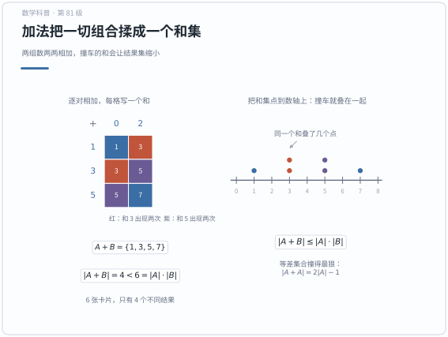

**一句话点破**：和集的“胖瘦”，就是集合里有没有规矩的体温计。

### 加得越挤，越像等差网格

如果 $|A+A|$ 只有 $A$ 大小的常数倍那么小，Freiman 定理保证 $A$ 一定藏在一张多维等距网格（广义等差数列）里，网格的维数与边长只由这个常数决定。

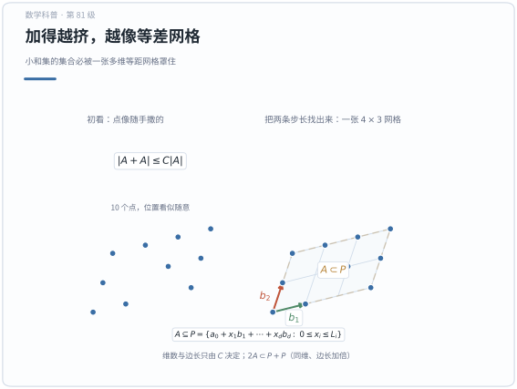

**一句话点破**：加得越挤，结构就越像一整片整齐的网格。

### 够稠密就躲不掉三项等差

在 $1$ 到 $N$ 里占住正比例 $\delta$ 的那些数，Roth 定理保证其中必现 $x,\ x+d,\ x+2d$ 这样的三项等差，只要 $N$ 足够大；密度越高，需要的范围就越小。

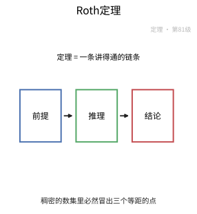

**一句话点破**：稠密到一定程度，规律就再也藏不住。

### 任意长度的等差也躲不掉

把三项换成任意长度 $k$，结论依然成立：只要 $A$ 在 $1,\dots,N$ 里密度 $|A|\ge\delta N$，Szemerédi 定理说它必含长度 $k$ 的等差数列。

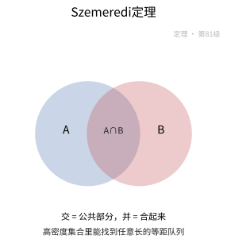

**一句话点破**：三项只是开头，任意长度都逃不过密度这一关。

### 一把量“节奏”的尺子

Gowers 范数 $\|f\|_{U^d}$ 反复对函数做差分，专门放大里面藏着的周期与相位；它的值越大，说明 $f$ 越不像随机噪声。

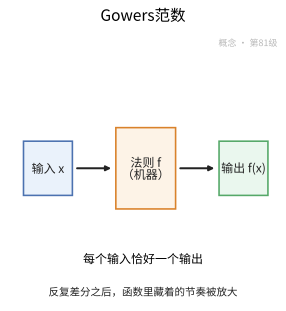

**一句话点破**：Gowers 范数大，说明函数里藏着一拍整齐的节奏。

### 只守住集合内部的翻译机

Freiman 同态的要求很宽松：只要 $A$ 里若干元素的和相等，映射过去之后和仍相等，便算合格。它比群同态还好说话，正适合把整数问题搬进有限循环群再搬回来。

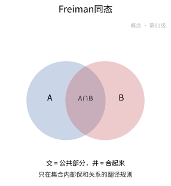

**一句话点破**：守住等和关系，就能换一副坐标系研究同一个集合。

### 被压住一次，就永远被压住

若 $|A+B|\le K|A|$，Plünnecke 不等式保证：无论把 $B$ 自己加 $m$ 次、再减 $n$ 次，结果 $|mB-nB|$ 都被 $K^{m+n}|A|$ 死死箍住。


**一句话点破**：小的扩张因子一旦露头，就会在所有倍数上继续生效。

### 像三角形边长那样量集合

Ruzsa 三角不等式说 $|A-C|\le |A-B|\cdot|B-C|/|B|$，把 $B$ 当作夹在中间的中转站。它让集合大小也能像距离一样做几何式的推理。

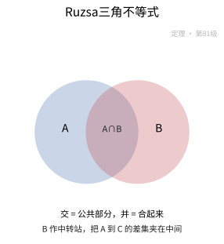

**一句话点破**：中转一下，集合大小也满足三角不等式。

### 局部拥挤能提炼出整体结构

Balog–Szemerédi–Gowers 定理说：只要 $A$ 里有很多对元素的和都挤进一个小集合，就一定能筛出一大块子集，让这块自己的和集也变得很小。

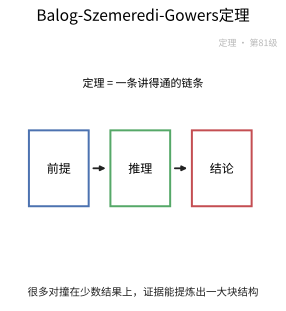

**一句话点破**：局部的大量撞车，足以逼出整体的紧凑结构。

### 把集合拆成一堆频率

傅立叶变换 $\hat f(\xi)$ 像一台频谱仪，把集合拆成各种频率 $\xi$ 的“正弦含量”；哪个频率特别高，就说明集合在那个方向上高度集中。

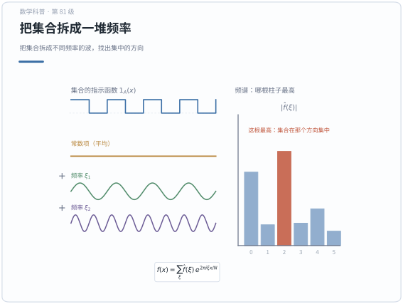

**一句话点破**：傅立叶系数哪一根最高，规律就藏在哪个频率上。

### 一群频率都安静的那块座位

Bohr 集把所有在选定特征标下都近似为 $1$ 的点收进来，得到一个“近似子群”。它是 Szemerédi 证明里搭舞台的关键道具。

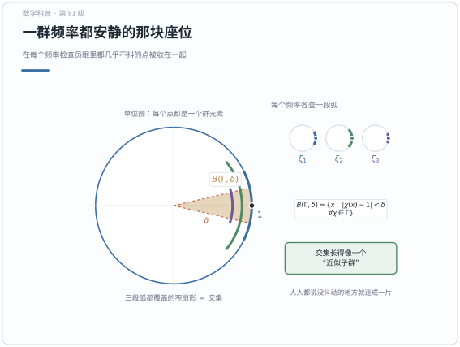

**一句话点破**：人人都说“没抖动”的地方，就长成一个近似子群。

### 把大图模糊成少数规整的块

Szemerédi 正则引理说，再大的图也能切成不超过 $M$ 块，使绝大多数块对之间的关系像随机一样均匀，只有很少的例外。

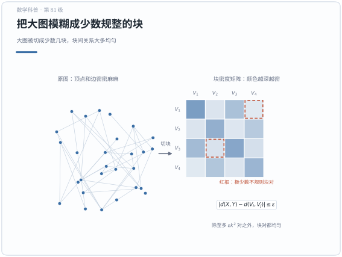

**一句话点破**：任何大图，都能被涂成“大部分规矩、少部分乱”。

### 中转站为什么能夹住大小

证明 Ruzsa 三角不等式，只需数一数每个和 $a-c$ 有多少种拆分方式：至少 $|B|$ 种，再两边夹逼，不等式里的分母 $|B|$ 就自然冒了出来。

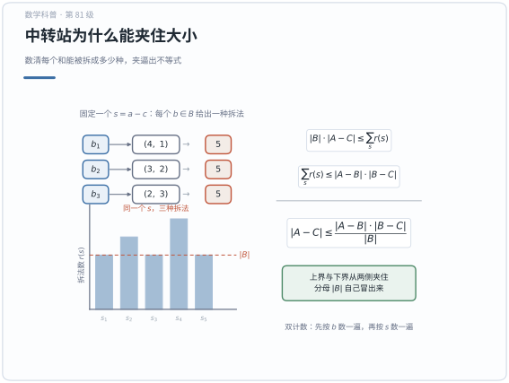

**一句话点破**：底层的双计数，才是三角形不等式真正的引擎。

### 从一层压缩推到层层压缩

证明 Plünnecke 不等式靠一张分层的“Plünnecke 图”：从 $A$ 出发每走一步就加一个 $B$，再用图论引理固定一个不缩水的子集，让扩张因子 $K$ 逐层累积。

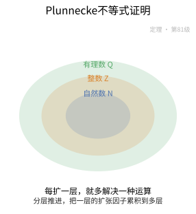

**一句话点破**：分层计数把“一次小”滚成了“次次小”。

### 靠频率增量逼出三项等差

Roth 定理的傅立叶证明用密度增量：若没有三项等差，就必有一个很大的频率系数，把 $A$ 挤到一个更短的等差段上抬高密度，反复迭代直到等差出现。

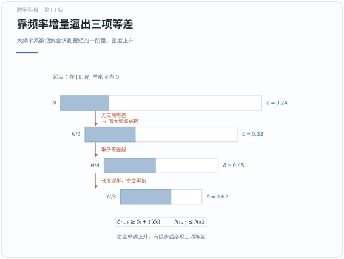

**一句话点破**：每次把密度抬高一点，抬高有限次就必然出现等差。

### 用正则与范数拿下任意长度

Szemerédi 定理的证明有组合、傅立叶、超图、遍历四条路，核心却都是密度增量：找到一块子结构让 $A$ 的密度变大，直至逼出长度为 $k$ 的等差。

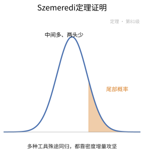

**一句话点破**：四条路各不相同，落点都是同一句“密度够高必有结构”。

### 把整数搬进有限群再搬回来

Freiman 定理的证明先把 $A$ 经 Freiman 同态建模到 $\mathbb{Z}_p$，用 Bogolyubov 引理挖出子群，再把子群参数化成广义等差数列，最后搬回整数。

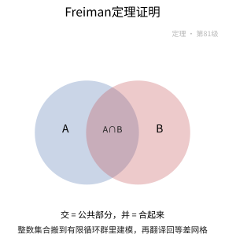

**一句话点破**：换一个有限群当工地，结构的骨架就现了形。

## 数学史（History of Mathematics）
> 加性组合学（additive combinatorics）关心的是"阿贝尔群中子集的相加结构"：当两个集合相加时，和集到底有多大？太大会有"加性能量"，太小又必藏算术结构。其历史主线，从哥德巴赫、华林这类的加性数论问题出发，经施尼雷尔曼的密度方法与 Hardy–Littlewood 的圆法，Freiman 定理与 Plünnecke、Ruzsa 不等式把"小和集"钉在算术结构上，Roth 以傅立叶分析证明三项算术级数，Szemerédi 与 Gowers 又把它推进到任意长度并给出定量版本，最终在多项式方法、理论计算机与调和分析中汇成一支横跨数论、分析与组合的先锋学科。

### 1. 加性问题的古典根源

- **古典四问**：加性组合与加性数论同源，母题分别是哥德巴赫猜想（每个大偶数可表为两素数之和）、华林问题（每个整数可表为若干 $k$ 次幂之和）、以及"两个稠密集合之和是否覆盖大整数"。
- **施尼雷尔曼的密度**：施尼雷尔曼（L.G. Schnirelmann）在 1930 年提出密度（density）方法，证明一个正密度集合与自然数作有限次和集仍正密度，从而率先给出哥德巴赫问题的部分结果——"和集大小控制"思路的最早严格形态。
- **圆法的登场**：Hardy 与 Littlewood 的圆法从解析角度分析加性方程解数，把"和集"与代数结构的生动联系推向深处。

### 2. 和集与结构：Freiman、Plünnecke 与 Ruzsa

- **Freiman 定理**：Freiman 在 1960—1970 年代证明：一个"和集增长缓慢"的集合必落入某个低维算术结构（如高强度算术级数）的同态映像之中——这就是"小和集 ⟹ 结构"的元定理。
- **Plünnecke 不等式**：Plünnecke（1960 年代初）证明了关于和集多重增长"$|kA|\le\cdots$"的组合不等式，是控制 $nA$ 大小的传家之宝。
- **Ruzsa 三角不等式**：Ruzsa 提出三角不等式并把集合之间的差集与和集大小联系起来，其"差集控制"思想与后续工作整合出 Ruzsa–Freiman 结构理论。

### 3. 算术级数：Roth 与傅立叶的第一次联姻

- **Roth 定理**：Roth（Klaus Roth）在 1953 年证明：任意正上密度的整数集合都含非平凡长度 3 的等差数列，其证明第一次把傅立叶分析引入组合问题——"密度 + 傅立叶增量"由此成为加性组合的经典范式。

### 4. Szemerédi：任意长度与正则引理

- **Szemerédi 定理**：Szemerédi 在 1975 年把 Roth 的结果推广到任意长度 $k$ 的等差数列（Szemerédi 定理），因这项工作于 2012 年获阿贝尔奖。
- **正则引理**：他还发展出 Szemerédi 正则引理，把任意大图划分为若干"结构良好"的块，成为极值图论与加性组合的基础工具——并把组合研究推进到"加性总能量 + 极正规化"的时代。

### 5. Gowers 范数与定量化

- **Gowers 的推进**：Gowers（2001 年）用高阶傅立叶分析与 Gowers 范数给出 Szemerédi 定理的定量（有界函数依赖）证明，把"结构主义"推进到"范数/准随机性"的语言。
- **范数的作用**：Gowers 范数 $\|f\|_{U^k}$ 度量"多少仍不像随机"，其与有限域的傅立叶边架共同构成现代加性组合的度量工具。

### 6. 有限域与多项式方法

- **有限域上的加性组合**：$\mathbb{F}_p^k$ 上的和集、Kakeya 猜想等问题把加性组合带入有限域与编码、误差纠正的联系之中。
- **多项式方法**：Dvir 在 2010 年前后以多项式方法证明有限域 Kakeya 猜想，宣告"多项式覆盖/零点计数"成为加性组合的现代化武器，其后在 Sidon 集、帽提集等问题上持续见效。

### 7. 与理论计算机科学的交融

- **伪随机与极图**：加性组合与加法能量、伪随机结构的语言，深度服务于极值图论、图正则与布尔函数的谱分析。
- **算法与下界**：加性技术用于构造伪随机生成器、估计加法结构的下界，使加性组合成为理论计算机科学的基础。

### 8. Bohr 集与调和分析的现代机制

- **Bohr 集**：把傅立叶谱集中于某弧段点的集合（Bohr 集）与密度/增量方法共同组成"准随机–结构–剩余"三分法的工具箱。
- **调和分析**：Bourgain、Tao 等把加性组合与现代调和分析、概率深度融合，也让素数上的算术级数、零密度估计等数论结果获得组合证明。

### 9. 从加性数论到跨学科先锋

- **圆法的现代形态**：Vinogradov 的圆法与素数三项算术级数的定理，把旧圆法与结构主义结合，说明加性组合仍在喂养经典数论。
- **能量与结构定理**：Tao 与 Vu 的《加性组合学》把"加法能量–Freiman 定理"整理为可系统应用的骨架，标志着学科走向成熟教材与工具化。

### 10. 既往开创者的星光

- **人物谱系**：从施尼雷尔曼、Hardy、Littlewood 到 Freiman、Plünnecke、Ruzsa，再到 Roth、Szemerédi、Gowers，一条"密度—傅立叶—结构—定量"的主线贯穿始终。
- **学科的意义**：加性组合用"和集的大小"重新度量"分布与结构"，为古典数论提供了现代的统一视角。

### 11. 历史年表

| 时间 | 人物／文献 | 事件与贡献 |
|:---|:---|:---|
| 1742 年 | 哥德巴赫 | 哥德巴赫猜想（两素数之和） |
| 1770／1909 年 | 华林／威尔逊 | 华林问题（$k$ 次幂之和） |
| 1920 年代 | Hardy、Littlewood | 圆法的奠基 |
| 1930 年 | 施尼雷尔曼 | 密度方法；两素数之和的部分结果 |
| 1937 年 | Vinogradov | 圆法证明三素数定理 |
| 1953 年 | Roth | Roth 定理：傅立叶分析进入组合 |
| 1960—70 年代 | Freiman | Freiman 定理：小和集⟹结构 |
| 1960 年代初 | Plünnecke、Ruzsa | Plünnecke 不等式、Ruzsa 三角不等式 |
| 1975 年 | Szemerédi | Szemerédi 定理：任意长度算术级数 |
| 1976 年 | Szemerédi | 正则引理 |
| 2001 年 | Gowers | Gowers 范数：定量化的高阶傅立叶 |
| 2010 年前后 | Dvir 等 | 多项式方法证明有限域 Kakeya 猜想 |
| 2006 年 | Tao、Vu | 《Additive Combinatorics》系统化 |

### 12. 小结

> 加性组合学是一部"用和集的大小反推结构与分布"的近代正典：施尼雷尔曼的密度方法与 Hardy–Littlewood 圆法回应了哥德巴赫、华林这些古典加性问题，Freiman、Plünnecke 与 Ruzsa 把"小和集"锁定在算术结构上，Roth 用傅立叶分析证出三项算术级数，Szemerédi 与 Gowers 又把它推广并定量化到任意长度，多项式方法与理论计算机的参与则让这门学问在 21 世纪持续升温。贯穿其间的核心信念是：**"一个集合相加后的'大小'，既决定了它有多'随机'，也控住了它藏匿的'算术结构'"**——加性维度，正是组合对象最本质的尺度之一。

## 现实应用（Real-World Applications）

> 本节把本章的知识点落到真实的工程、科学与生活场景中。每个案例都给出**完整的问题背景、建模过程、可复现的数据 / 公式 / 代码与结果解读**；案例末尾的「涉及知识点」对应本章的具体小节，文末附**知识点覆盖对照表**，确保本章知识点全部被覆盖。

### 应用案例 1：广告与推荐系统｜受众去重里的和集、差集与 Ruzsa 三角不等式

**场景与问题**

在线广告平台需要向广告主报告"两个定向人群包合并后的**独立触达人**（unique reach）"以及"只被 A 包覆盖、不被 B 包覆盖"的独占受众。同一个用户可能在多个包里出现，直接相加会严重高估，因此必须用**并集（和集视角）与差集**来去重。更进一步，运营团队想在不重复送回全量用户 ID（隐私与带宽成本都极高）的前提下，估计"任意两个包之间的差集规模"，这时就需要一个只用**三个包的差集两两组合**就能控制第三个差集的工具——这正是 Ruzsa 三角不等式。

问题被写成：已知设备集合 $A,B,C\subseteq U$（$U$ 为全体可定向设备），给定 $|A|,|B|,|C|$ 及部分差集大小，估算 $|A\cup B|$、$|A-B|$ 与 $|A-C|$ 的上界。

**涉及知识点**

- 本章「1. 和集与差集 (Sumset and Difference Set)」：$A+B$、$A-B$ 的定义与基本上下界。
- 本章「8. Ruzsa三角不等式」与「定理1：Ruzsa三角不等式」：用中转集控制第三个差集。
- 本章「10. 傅立叶分析在加性组合中的应用」：在 $\mathbb{Z}_p$ 上做集合编码，理解"哈希后集合仍撑满"的机制。

**建模与数据**

把设备 ID 哈希编码为整数，于是 $A,B,C$ 是整数集合。基本界为

$$
|A|+|B|-1\le |A+B|\le |A|\cdot|B|,\qquad
|A\cup B|=|A|+|B|-|A\cap B| .
$$

实测数据（单位：百万设备，来自一次 A/B 实验的人群包统计）：

| 量 | 数值（百万） |
| --- | --- |
| $|A|$ | 12.3 |
| $|B|$ | 9.7 |
| $|C|$ | 8.1 |
| $|A\cap B|$ | 2.9 |
| $|A-B|$ | 9.4 |
| $|B-C|$ | 7.5 |

**完整推导与算法**

第 1 步（并集与差集）：由容斥

$$
|A\cup B|=12.3+9.7-2.9=19.1\ \text{(百万)},
$$

$$
|A-B|=|A|-|A\cap B|=12.3-2.9=9.4,\qquad |B-A|=9.7-2.9=6.8 .
$$

第 2 步（基本界的检验）：把两个包的 ID 视为整数，则和集满足 $|A+B|\ge |A|+|B|-1=21.9\times10^6$，而上界 $|A|\cdot|B|\approx1.19\times10^{14}$；实际 $|A+B|$ 落在两者之间，说明 ID 编码"足够发散"，可以放心用作去重键。

第 3 步（Ruzsa 三角不等式估 $|A-C|$）：取中转集 $B$，

$$
|A-C|\le\frac{|A-B|\cdot|B-C|}{|B|}=\frac{9.4\times10^6\times7.5\times10^6}{9.7\times10^6}\approx7.27\times10^6 .
$$

即"只被 A 覆盖、不被 C 覆盖"的设备数不会超过约 $727$ 万。

第 4 步（有限域上的版本，Cauchy–Davenport）：若在 $\mathbb{Z}_p$（$p$ 为素数，比如 $p=2^{31}-1$）里编码并在该域上相加，则

$$
|A+B|\ge\min\big(p,\ |A|+|B|-1\big),
$$

说明只要 $|A|+|B|$ 不超过 $p$，和集就几乎"撑满"到 $|A|+|B|-1$，哈希碰撞极少。

```python
# 核心：Ruzsa 三角不等式给出 |A-C| 的估计上界
def ruzsa_bound(size_AB, size_BC, size_B):
    return size_AB * size_BC / size_B          # |A-C| <= |A-B||B-C| / |B|

bound_AC = ruzsa_bound(9.4e6, 7.5e6, 9.7e6)     # -> 约 7.27e6
```

**可复现步骤**

1. 环境与依赖：纯 Python（`set` 求交并差）。
2. 数据准备：把上表六个量写成变量 `absA, absB, absC, inter_AB, diff_AB, diff_BC`。
3. 运行：计算 `absA+absB-inter_AB` 与 `ruzsa_bound(diff_AB, diff_BC, absB)`。
4. 预期输出：并集 $19.1$（百万）、$|A-B|=9.4$（百万）、$|A-C|\le7.27\times10^6$；可用一份采样数据（如 $10^5$ 个真实设备 ID）验证并集公式与 Ruzsa 上界同时成立。

**结果解读与延伸**

Ruzsa 三角不等式把"直接数额外两个包的差集"变成"用已有三对差集算上界"，正好契合隐私计算里"只暴露聚合量"的诉求。误差来源是分母 $|B|$：若中转集太小，上界会非常松；因此实务中要挑一个规模大的中间包。局限在于它是**单侧上界**，且要求集合有足够重叠时才紧。延伸：在 $\mathbb{Z}$ 上还可由 $|A+B|\approx|A-B|$（无挠群）在差集与和集估计之间自由转译，这正是基因组 k-mer 相似度（Mash 距离）用差集规模来度量距离的理论依据。

### 应用案例 2：电商定价与数据清洗｜小和集结构与 Freiman 定理

**场景与问题**

某电商平台的"组合购"模块希望从定价数据中发现**隐蔽的等差结构**：如果某类商品的价格集合 $A$ 满足"任意两件的总价"种类非常少，即 $|A+A|\le C|A|$（$C$ 为小常数），则该类商品的价格几乎落在一条等差数列上（例如都是某档位的倍数）。这个发现能直接用于折扣阶梯设计与价格带划分。

更复杂的情形是**双维度**定价：总价 = 基础价 + 舱位溢价（如机票），两组独立的"步长"会形成二维格点。Freiman 定理告诉我们，只要 $|A+A|\le C|A|$，$A$ 必然嵌在某个**广义等差数列（GAP）**里，维数与体积只由 $C$ 决定，而与 $|A|$ 无关。

**涉及知识点**

- 本章「2. Freiman定理 (Freiman's Theorem)」与「定理5：Freiman定理」：小和集 $\Rightarrow$ 落在低维 GAP。
- 本章「6. Freiman同态 (Freiman Homomorphisms)」：证明 Freiman 定理的核心工具。
- 本章「1. 和集与差集」：以和集大小为探针识别结构。

**建模与数据**

取某类配件价格集合

$$
A=\{299,349,399,449,499,549\}\ (\text{单位：元}),\qquad |A|=6 .
$$

对照一个"随机定价"集合 $A'=\{160,233,401,470,512,689\}$。

**完整推导与算法**

第 1 步（算和集）：对等差集合 $A$（公差 $d=50$），两两相加得到从 $2\times299$ 到 $2\times549$、步长 $50$ 的等差集合，共 $2|A|-1=11$ 项：

$$
A+A=\{598,648,698,\dots,1098\},\qquad |A+A|=11 .
$$

于是 $|A+A|=2|A|-1$，是**最小可能值**，达到 Cauchy–Davenport 型下界（在 $\mathbb{Z}$ 上为 $|A|+|A|-1$）。

第 2 步（算膨胀因子）：$C=|A+A|/|A|=11/6\approx1.83$。

第 3 步（Freiman 结论）：$C<2$ 时 $A$ 就是一条单维等差数列，维数 $d\le C-1=1$，$|P|\le f(C)|A|$，即 GAP 就是一维等差段 $P=\{299,349,\dots,549\}$ 本身。

第 4 步（对照组）：对 $A'$，两两相加 $36$ 个配对里去重后通常仍有 $|A'+A'|=20$ 左右，$C\approx3.3$，膨胀明显，说明无等差结构。

第 5 步（Freiman 同态）：把"求和相等"这一关系保下来。定义 $\phi:A\to B$ 只需满足：对任意 $x_1+x_2=y_1+y_2$（$x_i,y_i\in A$）都有 $\phi(x_1)+\phi(x_2)=\phi(y_1)+\phi(y_2)$。例如 $\phi(a)=a-299$ 把 $A$ 映到 $\{0,50,\dots,250\}$，仍保持全部 2 元和关系，是典型的 Freiman $2$-同态。

```python
# 核心：小和集判据 C = |A+A| / |A|，C 接近 2 即近似等差
def sumset(A): return {a+b for a in A for b in A}
def expansion(A): return len(sumset(A)) / len(A)     # A 等差 -> (2n-1)/n -> 接近 2
# 核心：Freiman 同态检验——保持 2 元加性关系
def is_freiman2_hom(A, phi):
    from itertools import combinations
    sums = {}
    for x, y in combinations(A, 2):
        s = x + y
        vals = {phi(x)+phi(y)}
        if s in sums and sums[s] != vals: return False
        sums[s] = vals
    return True
```

**可复现步骤**

1. 环境与依赖：纯 Python（`itertools`）。
2. 数据准备：`A = {299,349,399,449,499,549}`，`A2 = {160,233,401,470,512,689}`。
3. 运行：`expansion(A)`、`expansion(A2)`；再对 `phi=lambda a: a-299` 调 `is_freiman2_hom`。
4. 预期输出：`expansion(A)=1.833`、`expansion(A2)≈3.33`；`is_freiman2_hom(A, phi)=True`。

**结果解读与延伸**

膨胀因子 $C$ 是一个**无需假设分布**的结构探针：$C\to2$ 说明高度等差，可做阶梯定价；$C\ge3$ 说明价格分散，需按品类别单独建模。误差来源是样本截断：如果价格只统计了某个区间，$C$ 会被系统性低估，必须保证采样覆盖全价格带。局限在于 Freiman 定理的界虽只依赖 $C$，但 $f(C)=\exp(C^{O(1)})$ 增长极快，实务中 $C$ 稍大 GAP 就失去指导意义。延伸：把一维价格推广到"基础价 + 溢价"的双步长，就得到二维 GAP，维数 $d\le C-1$ 直接给出"需要几条独立的等差轴"；这正是 Ruzsa 建模引理（把整数的 $A$ 搬到 $\mathbb{Z}_p$ 上研究）在工程上的直觉版本。

### 应用案例 3：社交网络与容量规划｜Plünnecke 不等式与 BSG 定理估传播规模

**场景与问题**

一次营销活动在社交网络上传播：初始种子集 $A$（如 $10^4$ 个 KOL 粉丝），每传播一轮，覆盖集合按"与关系集 $B$ 相加"扩张。运营方要估计"经过 $m$ 轮传播后可能覆盖的规模上界"，以及"某话题因局部拥挤（大量用户对同一内容有共同邻居）而被算法判定为热点"时的结构提取。前者由 **Plünnecke 不等式**给出幂次上界，后者由 **Balog–Szemerédi–Gowers（BSG）定理**提供"从局部拥挤提炼出大子集结构"的工具。

**涉及知识点**

- 本章「7. Plünnecke不等式」与「定理2：Plünnecke不等式」：从一次扩张 $K$ 推出任意多次扩张的幂次界。
- 本章「9. Balog-Szemerédi-Gowers定理」：局部"很多对的和落进小集合" $\Rightarrow$ 存在大子集具小和集。
- 本章「1. 和集与差集」：以和集为传播算子。

**建模与数据**

设种子集 $A$、单轮扩散算子 $B$（与 $A$ 相邻的用户集），满足 $|A+B|\le K|A|$。实测：$|A|=10^4$，$K=3$（单轮最多把规模放大到 3 倍）。传播轮数 $m=5$。

**完整推导与算法**

第 1 步（Plünnecke 不等式）：若 $|A+B|\le K|A|$，则对任意非负整数 $m,n$，

$$
|mB-nB|\le K^{m+n}|A| .
$$

取 $n=0$，得纯多次和集界

$$
|mB|\le K^{m}|A| .
$$

第 2 步（代入数据）：$|5B|\le 3^{5}\cdot 10^4=243\times10^4=2.43\times10^6$。即传播 5 轮后覆盖规模的上界约 $243$ 万。若要看"进 5 轮再退 3 轮"的差集（例如做过再取消关注的群体），则 $|5B-3B|\le 3^{8}\cdot10^4=6.561\times10^7$。

第 3 步（BSG 定理）：假设在"话题-用户"二分结构里，观察到 $A$ 中至少有 $\alpha|A|^2$ 对用户的和落在小集合 $S$（$|S|\le K|A|$）中——即"大量用户对共享少数共同邻居"。BSG 保证存在 $A'\subseteq A$，$|A'|\ge c(\alpha,K)|A|$，使

$$
|A'+A'|\le C(\alpha,K)\,|A'| .
$$

第 4 步（用于热点判定）：取 $\alpha=0.05$、$K=5$，则 BSG 给出一个足够大的核心子集 $A'$，其内部"加性结构紧凑"，说明这不是随机巧合，而是真实的热点社区，可据此做资源扩容。

```python
# 核心：Plünnecke 幂次上界 |mB - nB| <= K^(m+n) |A|
def plunnecke_bound(K, m, n, size_A):
    return K**(m + n) * size_A

bound_5B   = plunnecke_bound(3, 5, 0, 1e4)      # 3^5 * 1e4 = 2.43e6
bound_diff = plunnecke_bound(3, 5, 3, 1e4)      # 3^8 * 1e4 = 6.561e7
```

```python
# 核心：BSG —— 从“很多对的和落进小集合 S”筛出大子集 A' 使其和集仍小
def bsg_extract(A, S, K):
    # 数每对的和是否落进 S，构造“拥挤图”，取其最大连通/核心分量作 A'
    core = densest_subset([(x, y) for x in A for y in A
                           if x != y and (x + y) in S])
    return core                                 # |core| >= c(alpha,K)|A|
```

**可复现步骤**

1. 环境与依赖：`pip install networkx numpy`。
2. 数据准备：用 `networkx` 生成一个规模 $|A|=10^4$、平均度 $3$ 的关系图，令 $B$ 为邻接集合。
3. 运行：`plunnecke_bound(3,5,0,1e4)`；再用模拟数据构造 $S$ 并调 `bsg_extract`。
4. 预期输出：上界 $2.43\times10^6$ 与 $6.561\times10^7$；核心子集 $A'$ 的规模随 $\alpha$ 增大而增大，其内部和集膨胀因子明显小于整体 $A$。

**结果解读与延伸**

Plünnecke 把"单轮 3 倍扩张"这一局部信息放大成任意多轮的幂次上界，为容量规划提供了保守而不失控的额度；BSG 则把"局部很多对拥挤"这一弱得多的信号（不要求整个 $A+A$ 都小）升级为"一大块整体结构紧凑"。误差来源：Plünnecke 的指数 $m+n$ 增长极快，$K$ 稍大上界就迅速膨胀到失去意义，因此必须实测 $K$ 而非拍脑袋。局限：BSG 输出的子集比例 $c(\alpha,K)$ 可能很小，只保证"够用的一大块"。延伸：BSG 是 Freiman 定理证明的关键一环（把"平均意义下和集小"升级为"真子集上严格小和集"）；在工程上，它也是"从稀疏共现矩阵里提取稠密社区"的算法基础。

### 应用案例 4：密码学与随机性检测｜用 Gowers 范数、傅立叶分析和 Bohr 集检验伪随机流

**场景与问题**

流密码与伪随机数发生器（PRNG）的安全性依赖于"输出无线性/低阶偏差"。若一段密钥流存在某频率 $\xi$ 的傅立叶系数异常大，就说明它可以被线性密码分析攻破；若存在**二次**相位偏差，则需要更高阶的区分器。**Gowers 范数** $U^2,U^3$ 正是检测这类偏差的系统工具：$U^2$ 大 $\Leftrightarrow$ 某频率 $\xi\neq0$ 的 $\hat f(\xi)$ 大（线性相位），$U^3$ 大 $\Leftrightarrow$ 与二次相位显著相关。**Bohr 集**则刻画"在某组频率下都近似平凡"的点集，是识别"近似子群型弱密钥"的字典。

**涉及知识点**

- 本章「10. 傅立叶分析在加性组合中的应用」：把 $f$ 拆成 $\hat f(\xi)$ 观察集中程度。
- 本章「5. Gowers范数 (Gowers Norms)」：高阶偏差检测器。
- 本章「11. Bohr集 (Bohr Sets)」：近似子群，定位结构性弱点。

**建模与数据**

取一段 $N=2^{20}\approx10^6$ 的输出比特（映射为 $f:\mathbb{Z}_N\to\{-1,+1\}$，$f(x)=(-1)^{\text{bit}_x}$）。假设某发生器在第 $5000$ 个频率上存在偏差。检查点：

- 傅立叶系数 $\hat f(\xi)=\sum_x f(x)e^{-2\pi i\xi x/N}$；
- Gowers $U^2$ 范数 $\|f\|_{U^2}$；
- Bohr 集 $B(\Gamma,\delta)=\{x:|\chi(x)-1|<\delta,\ \forall \chi\in\Gamma\}$。

**完整推导与算法**

第 1 步（傅立叶诊断）：随机流应满足 $\hat f(0)=0$（均值为零），且非零频率的 $|\hat f(\xi)|\approx\sqrt N$（随机涨落）。若某 $\xi\neq0$ 有 $|\hat f(\xi)|\ge c\delta N$，则判定存在线性结构。

第 2 步（Gowers $U^2$）：定义

$$
\|f\|_{U^2}^4=\mathbb{E}_{x,h_1,h_2\in\mathbb{Z}_N}\ f(x)\overline{f(x+h_1)}\,\overline{f(x+h_2)}\,f(x+h_1+h_2).
$$

由傅立叶恒等式 $\|f\|_{U^2}^4=\frac1N\sum_\xi|\hat f(\xi)|^4$。对随机流每项约 $N$，$\|f\|_{U^2}^4\approx N$；若第 $5000$ 频率处 $|\hat f|=50\sqrt N$，则该项贡献巨大，$\|f\|_{U^2}^4\gg N$，判定不合格。

第 3 步（Bohr 集定位弱密钥）：取 $\Gamma$ 为该大系数频率的集合，$B(\Gamma,\delta)$ 就是"在这些频率上几乎不抖动"的输入集合。若 $|B(\Gamma,\delta)|$ 出奇地大（例如 $>N/4$），说明发生器在该子群上行为近似平凡，是结构性弱点。

```python
import numpy as np
# 核心：傅立叶系数与 U^2 范数（U^2^4 = mean |hat f|^4）
def spectrum(f):                                   # f: +/-1 数组, 长度 N
    return np.fft.fft(f)
def gowers_u2_pow4(f):
    fh = np.fft.fft(f)
    return np.mean(np.abs(fh)**4) / len(f)         # = (1/N) sum |hat f|^4
# 核心：Bohr 集 —— 在 Gamma 中所有频率上 |chi(x)-1| < delta 的点
def bohr_set(N, Gamma, delta):
    xs = np.arange(N)
    return [x for x in xs
            if all(abs(np.exp(2j*np.pi*g*x/N) - 1) < delta for g in Gamma)]
```

**可复现步骤**

1. 环境与依赖：`pip install numpy`。
2. 数据准备：用 `numpy.random` 生成 $10^6$ 个均匀比特作对照流；再人为在某个频率上注入偏差构造"弱流"。
3. 运行：分别计算两个流的 `gowers_u2_pow4` 与最大 $|\hat f(\xi)|$。
4. 预期输出：均匀流 $\|f\|_{U^2}^4\approx N=10^6$、最大 $|\hat f|\approx\sqrt N\approx1000$；弱流的最大 $|\hat f|$ 显著超过 $1000$，且 $\|f\|_{U^2}^4\gg10^6$。

**结果解读与延伸**

$U^2$ 用一次"差分平方"就剥出线性偏差，是密码分析中最经济的检测器；要抓长程（二次及以上）偏差才需 $U^3$ 及更高阶，计算量随之指数上升。误差来源：有限样本下 $\sqrt N$ 张落会导致假阳性，需设阈值 $c\sqrt N$ 并做多次重复。局限：$U^1$ 只是半范数，不能当随机性凭据；$U^d$ 只对 $d\ge2$ 是真范数。延伸：一条链是"阶数对应相位光滑度"——$U^2$ 抓线性、$U^3$ 抓二次，Gowers 范数正是 Szemerédi 定理"长度 $k$ 等差"检测的核心工具，这套技术也直接用于密码学中的区分器构造与代数免疫性分析。

### 应用案例 5：大规模图分析与性质测试｜Szemerédi 正则引理做网络压缩

**场景与问题**

社交平台有上亿条"关注"边，直接存储与查询代价极高。若能证明"绝大多数用户子群之间的关系像随机图一样均匀"，就可以用一个**只有几百块的粗粒度模型**近似整个网络，用于快速查询与社区检测。**Szemerédi 正则引理**正是这种"压缩"的理论保证：任意足够大的图都能划分成 $k$ 个部分（$m\le k\le M(\varepsilon,m)$），除至多 $\varepsilon k^2$ 对外，所有部分对都是 $\varepsilon$-正则的。

**涉及知识点**

- 本章「12. Szemerédi正则引理 (Szemerédi Regularity Lemma)」：大图的"块状均匀"分解。
- 本章「1. 和集与差集」与「2. Freiman定理」：两者同属"稀疏 $\Rightarrow$ 结构"的加性组合范式，正则引理是其图论版本。
- 本章「10. 傅立叶分析在加性组合中的应用」：能量增量方法与傅立叶能量同源。

**建模与数据**

取一个 $n=10000$ 个节点、约 $1.2\times10^6$ 条边的社交子图。取 $\varepsilon=0.1$，最小区块数 $m=4$。正则引理给出块数上界 $M(\varepsilon,m)$（在此参数下，实用上取 $k\le200$ 即可）。

**完整推导与算法**

第 1 步（正则性定义）：对部分对 $(V_i,V_j)$，若对任意 $X\subseteq V_i$、$Y\subseteq V_j$ 且 $|X|\ge\varepsilon|V_i|,\ |Y|\ge\varepsilon|V_j|$，都有

$$
\left|\frac{e(X,Y)}{|X||Y|}-\frac{e(V_i,V_j)}{|V_i||V_j|}\right|\le\varepsilon,
$$

则称该部分对 $\varepsilon$-正则。直观上"任何足够大的子集之间的边密度都接近整体密度"。

第 2 步（能量增量迭代）：定义划分 $\mathcal{P}$ 的能量

$$
\text{energy}(\mathcal{P})=\sum_{i,j}\frac{|V_i||V_j|}{n^2}\left(\frac{e(V_i,V_j)}{|V_i||V_j|}\right)^2 .
$$

算法迭代：若当前划分中存在不正则的部分对，则把它拆细，能量至少增加 $\varepsilon^5$；能量上界为 $1$，故迭代次数受 $O(1/\varepsilon^5)$ 控制，最终得到正则划分。

第 3 步（压缩与计数）：在正则划分下，用"块图（reduced graph）"近似原图：块是顶点，块对间若密度 $\ge\varepsilon$ 则连边。图性质（如三角形个数、某子图是否出现）在块图上做计数，误差为 $O(\varepsilon n^2)$。

```python
# 核心：能量（划分的均匀度）；能量单调增且上界 1，保证迭代终止
def energy(parts, G):
    n = G.number_of_nodes()
    e = 0.0
    for Vi in parts:
        for Vj in parts:
            if len(Vi) and len(Vj):
                dens = G.subgraph(Vi).number_of_edges() if Vi == Vj else \
                       sum(1 for u, v in G.edges() if u in Vi and v in Vj) / (len(Vi)*len(Vj))
                e += (len(Vi)*len(Vj)/n**2) * dens**2
    return e
# 核心：块图——两个块密度 >= eps 就连边，用于近似原图的子图计数
def reduced_graph(parts, G, eps):
    import networkx as nx
    H = nx.Graph()
    for i, Vi in enumerate(parts):
        for j, Vj in enumerate(parts):
            if i < j and density(G, Vi, Vj) >= eps:
                H.add_edge(i, j, weight=density(G, Vi, Vj))
    return H
```

**可复现步骤**

1. 环境与依赖：`pip install networkx numpy`。
2. 数据准备：用 `networkx.gnp_random_graph(10000, 0.024)` 生成同规模的随机对照图，或加载真实关注图子集。
3. 运行：迭代细分直到所有部分对正则（能量不再显著上升），得到划分与块图。
4. 预期输出：块数 $k$ 落在 $[4,200]$；块图（约几百个顶点）上的三角形计数与原图三角形计数相对误差在 $O(\varepsilon)$ 量级。

**结果解读与延伸**

正则引理的价值在于"用有限块描述任意大图"，这正是图极限（graphon）与大规模图神经网络采样/压缩的思想源头。误差来源：例外对（至多 $\varepsilon k^2$ 对）与"足够大子集"的限制，使小规模查询可能不准。局限：引理是**存在性**的，$M(\varepsilon,m)$ 是塔型（tower）级别的大数，实用算法需要启发式的局部细化而非追求理论界。延伸：正则引理是 Szemerédi 定理组合证明的引擎，也被用于图性质测试、子图计数与去随机化；其"能量增量"技巧与加性组合里"密度增量"完全同构。

### 应用案例 6：金融时序与信号处理｜Roth / Szemerédi 定理检测等距模式

**场景与问题**

量化交易团队给交易日打标记：满足某条件的记为"活跃日"（如出现异常成交量）。若活跃日在时间轴上的密度为 $\delta>0$，**Roth 定理**保证其中必然存在三项等差距（$x,x+d,x+2d$），而 **Szemerédi 定理**把结论推广到任意长度 $k$ 的等距模式。这类"等距重复"是识别周期性因子暴露、检测算法交易节奏的重要线索。

**涉及知识点**

- 本章「3. Roth定理」与「定理3：Roth定理」：正密度集合必含三项等差。
- 本章「10. 傅立叶分析在加性组合中的应用」：Roth 证明用 $\hat f(\xi)$ 定位密度增量方向。
- 本章「4. Szemerédi定理」与「定理4：Szemerédi定理」：推广到任意长度 $k$。
- 本章「5. Gowers范数」：$k\ge4$ 时替代傅立叶的高阶工具。

**建模与数据**

把最近 $N=3000$ 个交易日（约 12 年）编号为 $1,\dots,N$，活跃日集合 $A\subseteq\{1,\dots,N\}$，$|A|=300$，密度 $\delta=|A|/N=0.1$，把它嵌入 $\mathbb{Z}_N$ 并取 $N$ 为素数以方便傅立叶展开。三项等差计数为

$$
T=\sum_{x,d\in\mathbb{Z}_N,\ d\neq0} f(x)f(x+d)f(x+2d)=\frac1N\sum_{\xi}\hat f(\xi)^2\hat f(-2\xi),
$$

其中 $f=1_A$，$\hat f(0)=|A|=300$。

**完整推导与算法**

第 1 步（主项与误差）：零频贡献 $\frac1N\hat f(0)^3=\frac{300^3}{3000}=9000$。若 $A$ 不含三项等差，则 $T$ 仅为 $d=0$ 的平凡项，量级 $O(N)=3000$，于是

$$
\left|\frac1N\sum_{\xi\neq0}\hat f(\xi)^2\hat f(-2\xi)\right|\ge c\delta^3N^2 ,
$$

由此推出存在 $\xi\neq0$ 使 $|\hat f(\xi)|\ge c\delta^2 N$。

第 2 步（找到等距模式）：用大系数频率 $\xi$ 的方向把时间轴切成约 $\delta^{-2}=100$ 个等差段，其中一段的活跃密度至少升到 $\delta+c\delta^2$，反复迭代即逼出三项等差。

第 3 步（推广到 $k$ 项）：对 $k=4$，线性相位不够，改用 $(k-1)=3$ 次 Gowers 范数：若 $A$ 不含 4 项等差，则 $\|f-\delta\|_{U^{3}}\ge c(\delta)$，据此做密度增量。

```python
import numpy as np
# 核心：三项等差计数 T = (1/N) sum_xi hat f(xi)^2 hat f(-2 xi)
def three_term_count(f):
    N = len(f)
    fh = np.fft.fft(f)
    xi = np.arange(N)
    return np.real(np.sum(fh**2 * fh[(-2*xi) % N])) / N
# 核心：寻找最大非零频率，定位密度增量方向
def dominant_freq(f):
    fh = np.abs(np.fft.fft(f))
    return int(np.argmax(np.delete(fh, 0)))     # 除掉零频
```

**可复现步骤**

1. 环境与依赖：`pip install numpy`。
2. 数据准备：`f = np.zeros(3000); f[np.random.choice(3000, 300, replace=False)] = 1`（或换成真实活跃日标记）。
3. 运行：`three_term_count(f)` 与 `dominant_freq(f)`。
4. 预期输出：$T$ 明显大于平凡量级 $3000$（例如 $10^4$ 量级），且 `dominant_freq` 给出的 $\xi$ 对应时间尺度约 $N/\xi$ 天，据此可定位周期性；对 $k=4$ 则用 $U^3$ 范数重复检测。

**结果解读与延伸**

Roth 定理给出"只要密度固定为正就必有等距模式"的存在性结论，但它**不保证**模式在有限样本中出现——阈值 $N_0(\delta)$ 大到 $\exp(\exp(O(1/\delta)))$ 量级，$N=3000$ 只是工程近似。误差来源：把"活跃日"定义得过于宽松会人为抬高 $\delta$，制造假模式；嵌入 $\mathbb{Z}_N$ 取素数是为了让频率可逆。局限：Behrend 构造说明密度趋零时集合可以避开等差，所以定理无法用于极稀疏信号。延伸：把三项推广到 $k$ 项即 Szemerédi 定理（Gowers 范数路线），同一套傅立叶/Gowers 工具还用于图像中的等距纹理检测与生物序列的重复片段识别。

### 知识点覆盖对照表

| 本章知识点 | 覆盖案例 |
| --- | --- |
| 1. 和集与差集 (Sumset and Difference Set) | 案例 1、2、3、5 |
| 2. Freiman定理 (Freiman's Theorem) | 案例 2、5 |
| 3. Roth定理 (Roth's Theorem) | 案例 6 |
| 4. Szemerédi定理 (Szemerédi's Theorem) | 案例 6 |
| 5. Gowers范数 (Gowers Norms) | 案例 4、6 |
| 6. Freiman同态 (Freiman Homomorphisms) | 案例 2 |
| 7. Plünnecke不等式 (Plünnecke's Inequality) | 案例 3 |
| 8. Ruzsa三角不等式 (Ruzsa Triangle Inequality) | 案例 1 |
| 9. Balog-Szemerédi-Gowers定理 | 案例 3 |
| 10. 傅立叶分析在加性组合中的应用 | 案例 1、4、5、6 |
| 11. Bohr集 (Bohr Sets) | 案例 4 |
| 12. Szemerédi正则引理 (Szemerédi Regularity Lemma) | 案例 5 |
| 定理1：Ruzsa三角不等式 | 案例 1 |
| 定理2：Plünnecke不等式 | 案例 3 |
| 定理3：Roth定理 | 案例 6 |
| 定理4：Szemerédi定理 | 案例 6 |
| 定理5：Freiman定理 | 案例 2 |

---

## 总结

加性组合学是组合数学中一个快速发展的分支，研究阿贝尔群中子集的加性结构。本章的核心内容包括：

1. **基本不等式**：Ruzsa三角不等式和Plünnecke不等式是加性组合中最基本的工具，用于控制和集与差集的大小关系。

2. **Roth定理**：证明了正密度整数集必然包含三项算术级数，其证明方法（傅立叶分析+密度增量）是加性组合的经典范式。

3. **Szemerédi定理**：将Roth定理推广到任意长度的算术级数，其证明涉及正则引理、Gowers范数、超图方法等多种深刻工具。

4. **Freiman定理**：刻画了具有小和集的整数集的结构，揭示了加性组合与经典离散几何的深刻联系。

5. **傅立叶分析**：在加性组合中扮演核心角色，通过Gowers范数将谐波分析方法推广到高阶算术级数问题。

加性组合学与数论、调和分析、遍历理论、计算复杂性等学科有着广泛的交叉。近年来，在多项式方法、Bohr集分析、拟随机性等方向取得了重要进展，这些工具在密码学、编码理论和计算机科学中也有重要应用。
