# 第 84 级：拟阵论 (Matroid Theory)

> 拟阵论由 Whitney 在 1935 年提出，旨在统一图论和线性代数中独立性的概念。拟阵是一种抽象结构，它捕捉了向量空间中线性无关性和图中无环性的本质特征。拟阵论在组合优化（贪婪算法的最优性）、图论、编码理论和几何学中都有重要应用。本课程从拟阵的公理化定义出发，系统介绍拟阵的各种等价刻画、基本构造、对偶性、表示理论以及 Tutte 多项式等核心内容。

---

## 从"抽象出线性无关的本质"说起：拟阵论要解决的根问题

> 在动手背公理之前，先想清楚一个问题：**人为什么要发明拟阵？**

**一个贴近生活的情景（第一步：直觉）**

想象你手里有一箱零件，其中有些零件是"独立"的：它们互相支撑、谁也不依赖谁就搬得动；但也有些必须凑成一组才成立。现在你要解决一个现实的"取舍"难题——**从这箱零件里挑出尽可能多的独立零件**，同时还要应付"万一哪根断了，得能拿别的换上去"。

这其实是一类处处都在发生的取舍问题：选课表里哪几门课互不冲突、电路里哪几条线构成不闭合的最省回路、一群人里怎么挑出"谁也不服谁"的最大平级阵营。它们的共同点，是都存在一个朴素的"**独立**"概念，而"独立 / 不独立"的边界，遵循着几乎相同的默契规则。

**它要解决的根本问题（第二步：来龙去脉）**

数学家很快发现，很多看似不搭边的地方，其实都在私下使用同一种"独立规则"：

- 在**线性代数**里，一组向量是否线性无关；
- 在**图论**里，一组边是否构成森林（无环）；
- 在**组合优化**里，我们总想找"最大的独立组"（最优基）。

1935 年，惠特尼（Hassler Whitney）在研究与图论紧密相关的矩阵问题上，敏锐地看出：**这三处所谓的"独立"服从完全相同的三条公理**——空集独立、子集仍独立、小集能扩充到大集。他把这一共同结构提炼出来，命名为"拟阵"（matroid，取名自 matrix 的 mat-/matro-），从此打通了图论、线性代数与组合优化的语言。更妙的是，后来人们发现**拟阵恰好精确刻画了"贪婪算法何时有效"**（Edmonds、Rado）：只要问题落在这个公理系统里，贪心就能找到最优基。于是"独立"不再是一个模糊的比喻，而是一台严谨、可计算的机器。

> **🧠 一句话记住拟阵的"出生证"**
>
> 拟阵论解决的**根本问题**是：
>
> $$ \boxed{\text{把"线性无关、无环、可扩充"这同一种"独立性"抽象成公理，让图论、线性代数与组合优化共用一套语言。}} $$

**第三步：正式定义前的准备**

本章将这样推进：先给出拟阵最根本的**独立集公理**（第 2.1 节），再从基、圈、秩函数、闭包等不同侧面给出**等价定义**（第 2.2 节），随后用**图拟阵、线性拟阵、均匀拟阵**三个基本例子建立直觉（第 2.3 节）；然后讨论**对偶、构造与连通、着色**（第 2.4–2.8 节），最后触及**基交换、表示理论与 Tutte 多项式**这座"组合不变量"的高峰（第 2.9–2.10 节及第 3 章）。每引入一个概念，都先问"它要解决什么"，再给出严格定义。

---

## 开始之前

**本章在讲什么**：拟阵是一种"抽象的独立系统"——用三条公理抓住"线性无关、无环、可扩充"的共性。你会学到它的多种等价定义与三个基本例子，掌握对偶、删除、收缩、直和等构造，理解连通性、着色，以及"贪婪算法在拟阵上总最优"的深刻事实，最终认识最全能的组合不变量 Tutte 多项式。

**为什么要学它**：图论教过你"无环"、线性代数教过你"线性无关"，但两者各说各话。拟阵论的使命是把它们**放进同一个公理系统**，并精确回答"贪心何时最优""能不能找到最大独立集"这类跨越领域的问题。它是攻读现代组合优化、编码理论、算法设计与代数组合学的共同路基，也是深入理解"用一套公理统一多个领域"这一数学抽象方法的绝佳范本。

**开始前请确认你还记得**：

- 集合与子集、幂集 $2^E$（见基础集合论）：拟阵的基础对象。
- 线性相关与线性无关、秩、张成空间（见第 14 级线性代数）：线性拟阵的直接翻译。
- 图、环、森林、生成树与连通分量（见图论）：图拟阵的直观来源。
- 贪心算法与"每一步取当前最优"的思想（见组合优化）：理解贪婪最优性定理的前提。
- 极大 / 极小、基数 $|X|$ 与子集运算：读懂扩充公理与基交换性质的必备符号。

---

## 1. 学习目标

1. 理解拟阵的多种等价定义（独立集、基、圈、秩函数、闭包）。
2. 掌握拟阵的基本例子：图拟阵、线性拟阵、均匀拟阵。
3. 理解对偶拟阵的概念与性质。
4. 掌握拟阵的构造方法（删除、收缩、极小、直和）。
5. 理解拟阵的表示理论与可表示性。
6. 掌握拟阵的基交换性质与贪婪算法。
7. 理解 Tutte 多项式的定义与性质。
8. 了解拟阵的着色与特征多项式。

---

## 2. 核心概念

### 2.1 拟阵的独立集公理

> **直观理解（现实类比）**：拟阵是"独立性的抽象"——向量线性无关、图的森林、集合的子集这些看似无关的对象，竟共享同一套"独立"公理。就像"独立"这个词在不同场合有不同含义（财务独立、思想独立、能源独立），但都满足"空集独立、子集独立、小集能扩充到大集"的共性。Whitney 的洞见正是把这共性提炼成三条公理，让图论、线性代数、组合优化能用同一套语言讨论"独立"。
>
> **🧠 思考历程：图上"的森林"和向量"的线性无关"，怎么会是同一个东西？**
>
> 拟阵的诞生源于一次"认亲"：**线性代数里的"线性无关"与图论里的"森林"，居然服从同一条公理**。把这条公理单独抽出来，便有了打通一个个貌似独立领域的拟阵。
>
> - **Grassmann 的铺垫：几何里的"独立"**（1840 年代）。Hermann Grassmann 在建立向量空间时，早已把"线性无关"、"生成"与"维数"这些观念固定在几何与代数交汇处。这些看似只属于代数的词，恰恰是拟阵日后"独立/基/秩/闭包"的雏形。
> - **Whitney 的合并：一次大胆的"跨域认亲"**（1935 年）。Hassler Whitney 在研究中发现，图上的"森林"、一组向量的"线性无关"与矩阵的"列不相关"满足完全相同的三条公理。他把这个共同结构命名为"拟阵"，用"独立集公理"让完全不同的对象从此共用一套语言与定理。
> - **图论、代数、优化的一统江湖**（1935 年后）。很快人们意识到，拟阵正是"贪婪算法有效"的精确刻画（Edmonds、Rado 等人）：在这个抽象的独立系统上做贪心总能得到最优基。于是图论、线性代数与组合优化不再是三条平行线，而是同一点在不同坐标系下的投影。
> - **心路**：真正的抽象，是把"看起来不同、其实相同"的东西勇敢地认作一家。拟阵告诉我们：**谁先看穿结构上的同构，谁就能让一整片领域共享一份力量**。

**定义 2.1**（拟阵）一个**拟阵** $M$ 是一个有序对 $(E, \mathcal{I})$，其中 $E$ 是有限集合（称为**基础集**），$\mathcal{I}$ 是 $E$ 的子集族（称为**独立集**），满足以下公理：

1. （空集独立性）$\varnothing \in \mathcal{I}$。
2. （遗传性）若 $A \in \mathcal{I}$ 且 $B \subseteq A$，则 $B \in \mathcal{I}$。
3. （扩充性）若 $A, B \in \mathcal{I}$ 且 $|A| < |B|$，则存在 $x \in B \setminus A$ 使得 $A \cup \{x\} \in \mathcal{I}$。

> **常见坑**：扩充性对**超集方向**不成立。若 $A \subseteq B$ 且 $|A| < |B|$，公理只保证能往 $A$ 里加入 $B$ 的某个元素直到变满——它绝不保证"从大集往里删"仍独立（那其实是遗传性保证的反面方向，删方向由遗传性单独管）。另一个易错点是：**并集的独立与否不能靠直觉猜**。例如 $\{a,b\}$ 与 $\{b,c\}$ 各自独立，不代表 $\{a,b,c\}$ 独立——判断一个集合独不独立，必须逐条对照公理或所属拟阵的定义，而不是"看着像不像"。

#### 课堂问答

**老师**：独立集公理只有三条，为什么偏偏是"空集、遗传、扩充"这三条，少一条会怎样？

**学生**：缺一不可。空集独立性给归纳一个起点；遗传性说"独立的子集仍独立"，保证麻烦只可能出现在"多出来的部分"；扩充性才是拟阵的灵魂——它保证任何独立集都能朝更大的独立集方向补满，从而所有极大独立集大小相同。少了扩充性，只剩纯独立系统，极大集大小可以不等，连"秩"都定义不了。

**老师（追问）**：扩充性说的是 $|A|<|B|$ 时能从 $B\setminus A$ 里挑一个加进 $A$；它能反过来保证"从大集删元素仍独立"吗？

**学生**：不能，方向是反的。删除方向由遗传性单独负责：$B$ 独立则其子集独立，与 $|A|<|B|$ 无关。扩充性只管"从小往大补"，绝不意味着"加了新元素后旧的独立性能保住"。常见误区正是把这两条混成一条。

**老师（拓展）**：能否把"存在某个 $x\in B\setminus A$"加强成"对每个 $x$ 都成立"？

**学生**：不行，那是更强的条件，会排除很多真拟阵。拟阵只保证存在一个可加的元素；反例是 $A=\{a\}$ 与 $B=\{b,c\}$ 都独立时，可能加入 $b$ 不独立、加入 $c$ 才独立。

### 2.2 拟阵的等价定义

> **直观理解（现实类比）**：基与秩像"最大独立集"的双面写照——基是不能再添加元素的独立集（添任何一个就"超载"），秩则是基的大小，衡量该集合"最多能容纳多少独立元素"。就像书架上一套刚好支撑全部书的最小支撑架：基是这套架子的具体选法，秩是所需架子的根数。无论从独立集、基、圈、秩函数还是闭包算子切入，都描绘同一个拟阵，只是从不同侧面观察"独立性"的几何。

拟阵有多种等价的公理化定义，每种定义突出了拟阵的不同方面。

> **🔑 为什么需要"这么多等价定义"？**
>
> 同一棵大树，从不同角度画出来就是不同的图。拟阵的每种公理都像一张"特写照片"：**独立集**最贴近直觉、"保子集、能扩充"；**基**是"最大的独立集"，最好做贪心与交换；**圈**是"最小的相关集"，最贴合图论里的环；**秩函数**把计算量化成"最多有几件独立"，直接吃掉集合推演的复杂度；而**闭包**复刻了线性代数里"张成空间"的直觉。**选择哪种取决于你要做什么**：证明贪心最优用基，做集合推演用秩，研究图结构用圈。所有定义殊途同归——这也是拟阵"结构稳固"的最好见证。

**定义 2.2**（基公理）设 $\mathcal{B}$ 是 $E$ 的子集族，满足：
1. $\mathcal{B} \neq \varnothing$。
2. 若 $B_1, B_2 \in \mathcal{B}$ 且 $x \in B_1 \setminus B_2$，则存在 $y \in B_2 \setminus B_1$ 使得 $(B_1 \setminus \{x\}) \cup \{y\} \in \mathcal{B}$。

则 $\mathcal{B}$ 是拟阵 $M$ 的**基**族。

**定义 2.3**（圈公理）设 $\mathcal{C}$ 是 $E$ 的子集族，满足：
1. $\varnothing \notin \mathcal{C}$。
2. 若 $C_1, C_2 \in \mathcal{C}$ 且 $C_1 \subseteq C_2$，则 $C_1 = C_2$。
3. 若 $C_1, C_2 \in \mathcal{C}$，$C_1 \neq C_2$，且 $x \in C_1 \cap C_2$，则存在 $C_3 \in \mathcal{C}$ 使得 $C_3 \subseteq (C_1 \cup C_2) \setminus \{x\}$。

则 $\mathcal{C}$ 是拟阵 $M$ 的**圈**族（也称为**极小相关集**）。

**定义 2.4**（秩函数）函数 $r: 2^E \to \mathbb{Z}_{\geq 0}$ 称为拟阵 $M$ 的**秩函数**，如果满足：
1. $0 \leq r(X) \leq |X|$ 对所有 $X \subseteq E$ 成立。
2. 若 $X \subseteq Y \subseteq E$，则 $r(X) \leq r(Y)$（单调性）。
3. $r(X \cup Y) + r(X \cap Y) \leq r(X) + r(Y)$（次模性）。

**定义 2.5**（闭包）函数 $cl: 2^E \to 2^E$ 称为拟阵 $M$ 的**闭包算子**，如果满足：
1. $X \subseteq cl(X)$ 对所有 $X \subseteq E$ 成立。
2. 若 $X \subseteq Y \subseteq E$，则 $cl(X) \subseteq cl(Y)$。
3. $cl(cl(X)) = cl(X)$。
4. 若 $x \notin cl(X)$ 且 $x \in cl(X \cup \{y\})$，则 $y \in cl(X \cup \{x\})$。

#### 课堂问答

**老师**：独立集、基、圈、秩、闭包五种定义都说"这就是拟阵"，凭什么它们彼此等价？

**学生**：它们从同一结构的五个侧面抽取不变量：基是极大独立集，圈是极小相关集，秩是极大独立集的大小，闭包是把集合封顶，而独立集又能用 $r(I)=|I|$ 反推。只要一组对象能复现其余四组，五套公理就描述同一个结构。

**老师（追问）**：用秩函数定义时，为什么关键是次模性 $r(X\cup Y)+r(X\cap Y)\le r(X)+r(Y)$，而不是取等号的"模性"？

**学生**：因为秩度量的是"最多能容纳多少独立元素"，有上界约束，合并两个集合时收益只会递减而非线性叠加，所以是次模不等式。取等号会把结构限制得过死，只有极特殊的拟阵才满足，无法刻画一般独立性。

**老师（拓展）**：闭包算子第 4 条"若 $x\notin cl(X)$ 且 $x\in cl(X\cup\{y\})$，则 $y\in cl(X\cup\{x\})$"像哪个熟悉的事实？

**学生**：正是线性代数里交换引理的抽象：$x$ 要靠 $y$ 才能被张成，那么 $y$ 也能靠 $x$ 被张成，二者在张成上地位对等。它保证闭包定义的拟阵与独立集公理一致。

### 2.3 基本例子

**例 2.1**（图拟阵 / 圈拟阵）设 $G = (V, E)$ 是一个图。定义 $\mathcal{I}$ 为 $E$ 中所有无圈边集（即森林）。则 $(E, \mathcal{I})$ 是一个拟阵，称为图 $G$ 的**圈拟阵**（或**图拟阵**），记为 $M(G)$。

- 基：$G$ 的生成森林。
- 圈：$G$ 的圈（作为边集）。
- 秩：$r(X) = |V| - \kappa(X)$，其中 $\kappa(X)$ 是子图 $(V, X)$ 的连通分支数。

> **💡 直观理解（类比）**：图拟阵把"哪些边能拼成无圈的森林"当作独立性——就像铺电线：能连成不闭合回路的电线组是"独立"的，一旦首尾相接成环就不再独立。它的圈正是图中的环，秩等于"顶点数减连通块数"，把图论里最自然的"无环"直觉变成了一套代数规则。

**例 2.2**（线性拟阵 / 向量拟阵）设 $V$ 是域 $\mathbb{F}$ 上的向量空间，$E = \{v_1, \dots, v_n\} \subseteq V$。定义 $\mathcal{I}$ 为 $E$ 中所有线性无关的子集。则 $(E, \mathcal{I})$ 是一个拟阵，称为**线性拟阵**（或**向量拟阵**），记为 $M[V]$。

- 基：$E$ 的极大线性无关子集。
- 圈：极小线性相关集。
- 秩：$r(X) = \dim(\operatorname{span}(X))$。

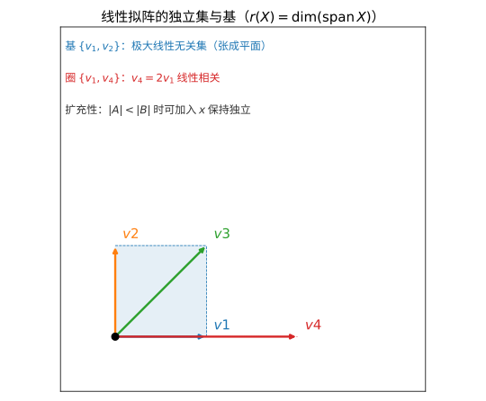

> **直观理解（现实类比）**：把地面上的几只"零件"看成向量，拟阵的独立集就像"能独立站住的零件组"——只要不互相叠压（线性无关）就是独立的。基则是"最少生成"的一套零件，多了就冗余、少了就铺不满地面，正如书架上一套刚好支撑全部书的最小支撑架。

**例 2.3**（均匀拟阵）$U_{k,n}$ 是基础集 $|E| = n$ 的拟阵，其中独立集为所有大小不超过 $k$ 的子集。

> **💡 直观理解（类比）**：均匀拟阵像一个"有件数上限的储物柜"——只要东西不超过 $k$ 件就全都摆得下、互不打架，一旦超过 $k$ 件就挤爆。它是最简单、最自由的独立性规则：不看元素之间有何关系，只数数量有没有超过限额。

#### 课堂问答

**老师**：图拟阵把"森林"当独立集，它的秩为什么是 $r(X)=|V|-\kappa(X)$，而不是简单数边？

**学生**：因为每加入一条无圈边恰好合并两个连通块，一棵生成树有 $|V|-1$ 条边。对任意边集 $X$，子图有 $\kappa(X)$ 个连通块，每块贡献"顶点数减一"，累加正是 $|V|-\kappa(X)$；这也说明秩受顶点数限制而不受边数限制。

**老师（追问）**：均匀拟阵 $U_{k,n}$ 的圈是什么？它为什么是最"自由"的例子？

**学生**：圈恰是全体大小 $k+1$ 的子集，因为任一 $k+1$ 元集删掉一个只剩 $k$ 个而独立。它不区分元素之间的代数关系，只看数量是否越界，所以是纯组合、最自由的例子。

**老师（拓展）**：线性拟阵里"平行向量"（例如 $v_4=2v_1$）在图拟阵里对应什么？

**学生**：对应两条端点相同或构成二重边的平行边。它们在线性中构成 2 元圈 $\{v_1,v_4\}$，在图中构成 2 元环，这说明"平行扩张"是线性与图两类拟阵共享的结构。

### 2.4 对偶拟阵

> **🌐 直觉先行：为什么需要"对偶"？**
>
> 很多结构都有"另一面"：图里有"环"就会有"割"，矩阵里有"列"就有"行方程"，优化里"最大独立"常与"最省删除"互为镜像。对偶拟阵 $M^*$ 干的正是这件事——**把原拟阵的"基"翻成补集**，让"环 ↔ 割"、"独立 ↔ 余独立"彼此对调。有了对偶，一个关于基的性质瞬间得到关于补基的免费信息，许多定理（如表示、组合不变量）也能成对出现，这正是对偶语言的威力所在。

**定义 2.6**（对偶拟阵）设 $M = (E, \mathcal{I})$ 是一个拟阵，其基族为 $\mathcal{B}$。定义 $M$ 的**对偶拟阵** $M^* = (E, \mathcal{I}^*)$，其中 $\mathcal{B}^* = \{E \setminus B : B \in \mathcal{B}\}$ 是 $M^*$ 的基族。

**性质 2.1** 对偶拟阵的秩函数 $r^*$ 满足：
$$
r^*(X) = |X| - r(E) + r(E \setminus X).
$$

> **💡 直观理解（类比）**：这个公式像"反着数容量"：对偶拟阵里集合 $X$ 的秩，等于从 $X$ 的元素里扣掉整体冗余、再补上 $X$ 之外能提供的支撑。好比算一张床还剩多少独立躺位：总床位数减去已有占位，再算上另一侧还能贡献的空间。

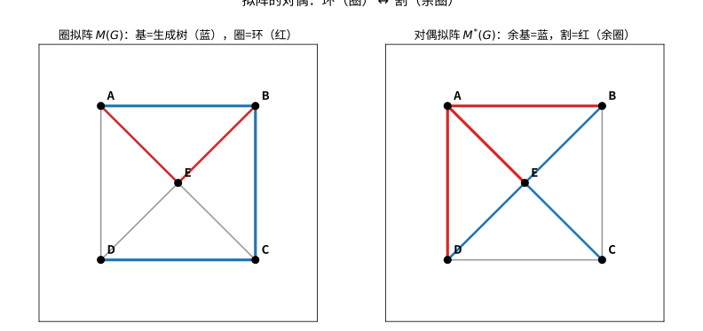

> **直观理解（现实类比）**：就像一张"剪不断"的防护网，拟阵的对偶把"能形成环的多余连接"与"剪开就断开的割缝"对应起来。在城市电网里，一个环代表冗余回路线路，一条割则代表切断某个片区所需的电缆——冗余与切断互为对偶，这正是拟阵对偶"环 ↔ 割"的含义。

#### 课堂问答

**老师**：对偶拟阵的基定义为 $B^*=E\setminus B$，为什么这样取补就仍能得到拟阵的基族？

**学生**：因为补集运算把"极大独立"翻成"极大余独立"：$B$ 是极大独立集时，$E\setminus B$ 在补的方向上是极大的。基交换定理在补集下依然成立，所以 $\mathcal{B}^*$ 自动满足基公理，对偶仍是拟阵。

**老师（追问）**：对偶秩公式 $r^*(X)=|X|-r(E)+r(E\setminus X)$ 里，$|X|-r(E)$ 这一项从哪来？

**学生**：直觉是"先把冗余扣干净"。$r(E)$ 是全集的秩，$|X|$ 中真正可用的部分要靠它来校正。形式上由 $r^*(X)=\max\{|A|:A\subseteq X,\ A\in\mathcal{I}^*\}$，把 $\mathcal{I}^*$ 的元素展开为"$A$ 与某个基的补独立"，即得该式。

**老师（拓展）**：既然 $M^{**}=M$，那么"圈"和"割"在对偶下怎样互换？

**学生**：$M$ 的圈恰好是 $M^*$ 的余圈（即割），反之亦然，这正是"环 $\leftrightarrow$ 割"的对偶：原图的环路对上对偶图的割集，生成树对上余树，二者此消彼长。

### 2.5 极小圈

> **直观理解（现实类比）**：圈是"最小依赖集"——加入就破坏独立性的最小集合，就像图中形成环的边集：少任何一条边都是森林（独立），全部凑齐就成环（依赖）。在线性代数中，它对应极小线性相关集；在电路中，它就是导致短路的最小回路。圈公理的第三条说"两个圈相交必能拼出新圈"，恰似两个环路共享一段导线时，绕外圈走又是一个新环，这种"圈生圈"的结构是拟阵组合性质的核心。

**定义 2.7**（极小圈）拟阵 $M$ 中的**极小圈**（简称**圈**）是极小相关集，即满足 $C \notin \mathcal{I}$ 但 $C \setminus \{x\} \in \mathcal{I}$ 对所有 $x \in C$ 成立的子集 $C \subseteq E$。

#### 课堂问答

**老师**：圈的定义是"极小相关集"，为什么必须强调"极小"，只说"相关集"不行吗？

**学生**：不行。任何含圈的相关集仍相关，若不加极小，最大的相关集就是整个 $E$，毫无信息。极小性挑出"恰好越界一步"的最小依赖单元，正如图中真正的环，而不是含环的任意边集。

**老师（追问）**：圈公理第三条"两圈交于 $x$ 则可拼出新圈 $C_3\subseteq(C_1\cup C_2)\setminus\{x\}$"，在图中怎么理解？

**学生**：两个环共享一条边时，把两环的"外圈"走一遍仍是一条环，且不经过那条公共边。这条"圈生圈"的封闭性是拟阵组合论的核心，正是它让图的结构在抽象后得以保留。

**老师（拓展）**：在均匀拟阵 $U_{k,n}$ 里，任意两个圈相交时，新圈 $C_3$ 具体怎么找？

**学生**：圈都是 $k+1$ 元集；相交时 $(C_1\cup C_2)\setminus\{x\}$ 至少还有 $k+1$ 个元素，取其中任意 $k+1$ 个就是一个新圈，因此圈公理在均匀拟阵中自动成立。

### 2.6 拟阵的构造

**定义 2.8**（删除与收缩）设 $M = (E, \mathcal{I})$ 是拟阵，$T \subseteq E$。

- **删除** $M \setminus T$：基础集为 $E \setminus T$，独立集为 $\{I \subseteq E \setminus T : I \in \mathcal{I}\}$。
- **收缩** $M / T$：基础集为 $E \setminus T$，独立集为 $\{I \subseteq E \setminus T : I \cup B_T \in \mathcal{I}\}$，其中 $B_T$ 是 $T$ 的任意基。

> **💡 直观理解（类比）**：删除像"把一件家具搬出去"——剩下东西之间的独立性关系不变，只看不含它的组合；收缩则像"把一件家具焊进地面"再问其余东西怎么配合——收缩 $M/T$ 的独立集，就是"强行让 $T$ 顶住一个基后，其余还能保持独立"的组合。

**定义 2.9**（直和）两个拟阵 $M_1 = (E_1, \mathcal{I}_1)$ 和 $M_2 = (E_2, \mathcal{I}_2)$ 的**直和** $M_1 \oplus M_2$ 是基础集为 $E_1 \cup E_2$（假设 $E_1 \cap E_2 = \varnothing$）的拟阵，独立集为 $\{I_1 \cup I_2 : I_1 \in \mathcal{I}_1, I_2 \in \mathcal{I}_2\}$。

> **💡 直观理解（类比）**：直和像"两个互不搭界的独立储物间"——两个房间里的物品各归各，只要各自独立，拼在一起仍是独立的。它把复杂结构拆成互不相干的几个模块，宛如一套家具分成几间互不共享附件的房间，是"分解与拼装"的基本工具。

**定义 2.10**（极小）拟阵 $M$ 的**极小** $M \setminus e$ 是删除元素 $e$ 得到的拟阵。

**定义 2.11**（平行扩张）设 $M$ 是拟阵，$e \in E$。添加一个与 $e$ 平行的元素 $e'$ 得到的新拟阵中，$e$ 和 $e'$ 构成一个圈（即它们形成的 2-元集是相关的）。

> **💡 直观理解（类比）**：平行扩张像"给同一根承重柱再放一根一模一样的柱子"——两根柱子功能完全相同，任何一根都不多余到能单独删（少一根就撑不住），可两根并列本身就构成一条"可替换"的圈。它模拟的是向量里两个同向共线的分量。

#### 课堂问答

**老师**：删除 $M\setminus T$ 与收缩 $M/T$ 都作用在 $T$ 上，独立集定义却完全不同，本质差别在哪？

**学生**：删除是"把 $T$ 整个拿掉再看独立"，独立集就是原来不含 $T$ 的独立集；收缩是"先强制 $T$ 的一个基 $B_T$ 满配，再问余下还能加什么"，即要求 $I\cup B_T\in\mathcal{I}$。删除是减法自由，收缩是先占位后看余量。

**老师（追问）**：收缩定义 $I\cup B_T\in\mathcal{I}$ 中，$B_T$ 可以取 $T$ 的"任意"基而不影响结果，凭什么？

**学生**：因为拟阵的所有基大小相同（都等于 $r(T)$），且任意两个基可互相交换，替换 $B_T$ 不改变"$I\cup B_T$ 是否独立"这一事实。这正是基交换定理保证的良定义性。

**老师（拓展）**：直和 $M_1\oplus M_2$ 与连通性有什么联系？

**学生**：$M$ 能分解为两个非平凡直和，当且仅当它不连通。直和把元素分成互不共享圈的两块，而连通要求任意两元素共圈，两者恰好互为否定。

### 2.7 拟阵的连通性

**定义 2.12**（连通拟阵）拟阵 $M$ 称为**连通**的，如果对任意两个不同元素 $x, y \in E$，存在一个圈 $C$ 使得 $x, y \in C$。等价地，$M$ 不能表示为两个非平凡拟阵的直和。

> **💡 直观理解（类比）**：连通拟阵像一张"环环相扣的网"——任意两个元素总被某条回路拴在一起，不存在两块互不相干的部分。等价地它不能拆成两个直和块，好比一件整体浇铸的器物，无法不打断焊接就劈成两半。

#### 课堂问答

**老师**：定义说"任意两元素共属某圈"，为什么还等价于"不能写成两个非平凡直和"？

**学生**：若存在两个非平凡直和块，跨块的两个元素不可能落在同一个圈里（圈不能横跨直和），故不连通；反之若不连通，把"由圈相连"当作等价关系取连通分量，分量之间无圈相连，正好给出直和分解。两种说法是同一条性质的两种语言。

**老师（追问）**：均匀拟阵 $U_{k,n}$ 什么时候连通？

**学生**：当 $0<k<n$ 时连通：任意两元素可被一个 $(k+1)$ 元圈同时含住。而 $k=0$（全是环）或 $k=n$（自由拟阵）时没有圈，不连通——它们各自是若干单元素的直和。

**老师（拓展）**：连通分量与对偶拟阵的连通分量划分相同吗？

**学生**：相同。直和分解 $M=M_1\oplus M_2$ 取对偶得 $M^*=M_1^*\oplus M_2^*$，故 $M$ 连通当且仅当 $M^*$ 连通，连通性是对偶不变量。

### 2.8 拟阵的着色

**定义 2.13**（拟阵着色）拟阵 $M$ 的**着色**是指将 $E$ 划分为独立集（称为**色类**）。所需的最少色数称为 $M$ 的**染色数**，记为 $\chi(M)$。

> **💡 直观理解（类比）**：拟阵着色就像给元素分派"房间"，规则是"同房互不冲突"：同一色类必须是独立集（彼此不构成依赖）。最少需要多少房间就是染色数——好比把依赖紧密的元件尽可能挤进更少的互不冲突的盒子里。

#### 课堂问答

**老师**：拟阵着色要求把 $E$ 划分为独立集，最少色数记为 $\chi(M)$；为什么会有下界 $\chi(M)\ge\lceil|E|/r(E)\rceil$？

**学生**：每个色类是独立集，大小不超过 $r(E)$，$|E|$ 个元素至少要 $\lceil|E|/r(E)\rceil$ 个色类才能装下。这只是下界，一般情形由拟阵染色定理给出更精细的结论。

**老师（追问）**：对图拟阵来说，"拟阵着色"和普通的图顶点着色是一回事吗？

**学生**：不是，很容易混。拟阵着色的色类是"边集的独立集"即森林，所以它着的是边（把边集分成若干森林，即图的树荫度问题）；普通顶点着色作用在顶点上。二者对象和含义都不同。

**老师（拓展）**：若 $M$ 含环（$\{e\}$ 相关），它还能被划分为独立集吗？

**学生**：不能。环本身不是独立集，无法归入任何色类，所以只要含环，着色就不存在、$\chi(M)$ 无定义。这提醒我们拟阵着色默认无环，与图着色允许孤立点很不一样。

### 2.9 基交换图

**定义 2.14**（基交换图）拟阵 $M$ 的**基交换图** $B(M)$ 是以 $\mathcal{B}$ 为顶点集的图，两个基 $B_1, B_2$ 相邻当且仅当存在 $x \in B_1 \setminus B_2$，$y \in B_2 \setminus B_1$ 使得 $B_2 = (B_1 \setminus \{x\}) \cup \{y\}$。

> **💡 直观理解（类比）**：基交换图把"所有完美基"画成一张地铁图——每个站是一个基，两站之间有车当且仅当它们只差"一进一出"（恰好换掉一个元素）。这张图让人一眼看清基与基之间如何一步步互相转换，是导航基交换性质的路线图。

#### 课堂问答

**老师**：基交换图的顶点是所有基、边是"一进一出"的两个基，这张图最重要的性质是什么？

**学生**：它连通。任意两个基之间总能沿"换一条边"的路径走通，这正是基交换定理的图论表述。此外它是正则的：每个基有 $|B|\cdot|E\setminus B|$ 个邻居。

**老师（追问）**：为什么它必然连通，而不是可能分成几块互不相通的孤立部分？

**学生**：由基交换定理，若基 $B_1\ne B_2$，取 $x\in B_1\setminus B_2$ 便能换入某个 $y\in B_2\setminus B_1$，得到与 $B_1$ 相邻的新基，并使它与 $B_2$ 的对称差严格减少。反复进行就走到了 $B_2$。

**老师（拓展）**：如果允许"一次换多个元素"，这张图会变成什么样？

**学生**：就退化成"任意两基两两相邻"的完全图，丢掉了"逐步微调"的信息。保留"只差一个元素"的邻接，才使这张图能精确刻画贪心、基交换，乃至生成树采样的 Markov 链。

### 2.10 Tutte 多项式

**定义 2.15**（Tutte 多项式）拟阵 $M = (E, \mathcal{I})$ 的 **Tutte 多项式** 定义为：
$$
T_M(x, y) = \sum_{A \subseteq E} (x - 1)^{r(E) - r(A)} (y - 1)^{|A| - r(A)}.
$$

> **💡 直观理解（类比）**：Tutte 多项式像拟阵的"基因档案"——把每个子集按它的秩与"多余度"编码，塞进一台双变量多项式机器 $T(x,y)$。改拧旋钮（代入不同的 $(x,y)$ 值）就能读出不同密码：基的个数、环数、染色数、流数全都藏在这台机器里，是拟阵最全能的身份证。

> **🔑 为什么重要（历史来龙去脉）**
>
> Tutte 多项式源于图论的**着色计数**：古德里（W. T. Tutte）为了回答"一张图能用 $k$ 种颜色正常涂完有几种涂法"而引入"色多项式" $P_G(k)$，后来发现它只是 $T_G(x,y)$ 在特殊点 $y=0$ 处的取值。把图换成拟阵，$T_M(x,y)$ 就成了最通用的**组合不变量**：对图拟阵取 $(1,1)$ 得基（生成树）个数，取 $(-1,0)$ 得环数，取 $(2,1)$ 得连通性信息，各种看似的巧合都被它一台机器统一。这正印证了拟阵把"环、割、秩"收进一家的抽象力量。

---

#### 课堂问答

**老师**：Tutte 多项式 $T_M(x,y)=\sum_{A\subseteq E}(x-1)^{r(E)-r(A)}(y-1)^{|A|-r(A)}$ 里，两个指数项各自在度量什么？

**学生**：$(x-1)$ 的指数 $r(E)-r(A)$ 度量 $A$ 的"欠满度"，即离满秩还差多少；$(y-1)$ 的指数 $|A|-r(A)$ 度量 $A$ 的"冗余度"（含了多少多余元素）。一"缺"一"余"，把每个子集的独立信息完整编码。

**老师（追问）**：为什么在 $(1,1)$ 处取值会得到基（生成树）的个数？

**学生**：代入 $x=y=1$ 时，只有 $r(A)=r(E)$ 且 $|A|=r(A)$ 的项（即基）贡献 $1^0\cdot1^0=1$，其余项因因子为零而消失。所以 $T_M(1,1)$ 恰好就是基的个数，这就是"特值读取不同不变量"的机制。

**老师（拓展）**：$T_M$ 与对偶拟阵的 Tutte 多项式有什么关系？

**学生**：$T_{M^*}(x,y)=T_M(y,x)$，即把两个变量互换。因为取对偶把"欠满"与"冗余"的角色对调。这也解释了 $T_M(1,1)=T_{M^*}(1,1)$：基与余基的个数相同，是对偶对称的漂亮体现。

## 3. 定理与证明

### 3.1 拟阵的基交换定理

**定理 3.1**（基交换定理）设 $M$ 是拟阵，$B_1$ 和 $B_2$ 是 $M$ 的两个基。则对任意 $x \in B_1 \setminus B_2$，存在 $y \in B_2 \setminus B_1$ 使得 $(B_1 \setminus \{x\}) \cup \{y\}$ 也是基。

> **💡 直观理解（类比）**：基交换定理说：任意两套"最优配置"之间，总能换掉一个元素、补一个回来而仍保持满配——就像两套都铺满的焦点家居，左边多摆某件、右边多摆另一件，两者可以一件换一件地互换而始终整洁满员。这保证了任何基与基之间都能"无缝转接"。

**证明**：设 $B_1$ 和 $B_2$ 是拟阵 $M = (E, \mathcal{I})$ 的两个基，$x \in B_1 \setminus B_2$。

**第一步**：考虑集合 $B_1 \setminus \{x\}$。由于 $B_1$ 是基，$B_1 \setminus \{x\}$ 是独立集，且 $|B_1 \setminus \{x\}| = |B_1| - 1 = |B_2| - 1$。

**第二步**：由于 $B_2$ 是基，$|B_2| = |B_1|$。考虑集合 $B_2$。由于 $|B_1 \setminus \{x\}| < |B_2|$，由扩充公理，存在 $y \in B_2 \setminus (B_1 \setminus \{x\})$ 使得 $(B_1 \setminus \{x\}) \cup \{y\} \in \mathcal{I}$。

由于 $B_1 \setminus \{x\}$ 与 $B_2$ 的差集为 $B_2 \setminus (B_1 \setminus \{x\}) = B_2 \setminus B_1 \cup (B_2 \cap \{x\})$，但 $x \notin B_2$，所以 $B_2 \setminus (B_1 \setminus \{x\}) = B_2 \setminus B_1$。

因此存在 $y \in B_2 \setminus B_1$ 使得 $(B_1 \setminus \{x\}) \cup \{y\} \in \mathcal{I}$。

**第三步**：由于 $|(B_1 \setminus \{x\}) \cup \{y\}| = |B_1| = r(E)$，该独立集达到最大秩，因此是基。

证毕。

**推论 3.1**（强基交换性质）对任意两个基 $B_1, B_2$ 和任意 $x \in B_1 \setminus B_2$，存在 $y \in B_2 \setminus B_1$ 使得 $(B_1 \setminus \{x\}) \cup \{y\}$ 和 $(B_2 \setminus \{y\}) \cup \{x\}$ 都是基。

> **💡 直观理解（类比）**：强基交换性质更慷慨：不仅正向换过去仍是基，反向换回来也还是基——像两位棋手互让一子后，两边棋盘仍然是满盘的合法布局。这使两个基不仅能单向切换，还能"有来有往"地同步置换。

#### 课堂问答

**老师**：基交换定理说任取 $x\in B_1\setminus B_2$，存在 $y\in B_2\setminus B_1$ 使换后仍为基。证明最关键的一步在哪里？

**学生**：在第二步用扩充性：$B_1\setminus\{x\}$ 独立且大小 $|B_2|-1<|B_2|$，故必能从 $B_2$ 中补进一个元素；再由 $x\notin B_2$ 断定补进的是 $y\in B_2\setminus B_1$，最后因新集大小达 $r(E)$ 而断定它是基。

**老师（追问）**：定理为什么只能保证"存在一个 $y$"，而不能保证"任意 $y$ 都能换"？

**学生**：因为独立性对元素很挑剔。若对任意 $y\in B_2\setminus B_1$ 都可交换，条件就过强，很多拟阵不满足。存在性恰好够用又最省，是让所有基"等势且可微调"的精确刻度。

**老师（拓展）**：强基交换性质把单向换成双向同时换，它为什么成立？

**学生**：正反各用一次基交换定理即可：先得 $B_1'=(B_1\setminus\{x\})\cup\{y\}$ 是基，再对反向施交换，并在选择中取到同一个 $y$，便同时得到 $(B_2\setminus\{y\})\cup\{x\}$ 也是基，于是两基能"有来有往"地同步置换。

### 3.2 拟阵的秩函数刻画

**定理 3.2**（秩函数刻画）函数 $r: 2^E \to \mathbb{Z}_{\geq 0}$ 是某个拟阵的秩函数当且仅当它满足：

1. （有界性）$0 \leq r(X) \leq |X|$ 对所有 $X \subseteq E$ 成立。
2. （单调性）若 $X \subseteq Y \subseteq E$，则 $r(X) \leq r(Y)$。
3. （次模性）$r(X \cup Y) + r(X \cap Y) \leq r(X) + r(Y)$ 对所有 $X, Y \subseteq E$ 成立。
4. （归一化）$r(\varnothing) = 0$。

> **💡 直观理解（类比）**：定理说"独立性"可以用一把更抽象的尺子（秩 $r$）等价地量：只要这把尺满足"不超出元素数、随集合单调、合并时次模、空集为 0"四条手感自然的规则，它就能反过来定义出一个完整的拟阵。好比只要厘清一把尺的刻度规则，就能反推出整套称量系统。

**证明**：必要性：设 $r$ 是拟阵 $M = (E, \mathcal{I})$ 的秩函数。

- 有界性：由定义，独立集的大小不超过 $|X|$，且 $r(X) \geq 0$。
- 单调性：若 $X \subseteq Y$，则 $X$ 中的独立集也是 $Y$ 中的独立集，因此 $r(X) \leq r(Y)$。
- 次模性：设 $I_X$ 是 $X$ 的极大独立集，$I_Y$ 是 $Y$ 的极大独立集。由扩充性，可以选取 $I_{X \cap Y} \subseteq I_X \cap I_Y$ 为 $X \cap Y$ 的极大独立集。则 $I_X \cup I_Y$ 是 $X \cup Y$ 的独立子集，因此：
  $$
  |I_X \cup I_Y| \leq r(X \cup Y).
  $$
  另一方面：
  $$
  |I_X \cup I_Y| = |I_X| + |I_Y| - |I_X \cap I_Y| \geq r(X) + r(Y) - r(X \cap Y).
  $$
  因此 $r(X) + r(Y) - r(X \cap Y) \leq r(X \cup Y)$，即 $r(X \cup Y) + r(X \cap Y) \leq r(X) + r(Y)$。

充分性：设 $r$ 满足上述条件。定义 $\mathcal{I} = \{I \subseteq E : r(I) = |I|\}$。需要验证 $\mathcal{I}$ 满足独立集公理。

1. $r(\varnothing) = 0 = |\varnothing|$，因此 $\varnothing \in \mathcal{I}$。
2. 若 $I \in \mathcal{I}$ 且 $J \subseteq I$，由单调性 $r(J) \leq |J|$，且：
   $$
   |J| = |I| - |I \setminus J| \leq r(I) - (r(I) - r(J)) = r(J),
   $$
   因此 $r(J) = |J|$，故 $J \in \mathcal{I}$。
3. 设 $A, B \in \mathcal{I}$ 且 $|A| < |B|$。假设 $A \cup \{x\} \notin \mathcal{I}$ 对所有 $x \in B \setminus A$ 成立，则 $r(A \cup \{x\}) = r(A)$ 对所有 $x \in B \setminus A$ 成立。由次模性可推出矛盾。详细推导如下：

   对任意 $x \in B \setminus A$，$r(A \cup \{x\}) = r(A)$。由次模性：
   $$
   r(A \cup \{x\} \cup B) + r((A \cup \{x\}) \cap B) \leq r(A \cup \{x\}) + r(B).
   $$
   由于 $A \cup \{x\} \cup B = A \cup B$，$(A \cup \{x\}) \cap B = (A \cap B) \cup \{x\}$，得：
   $$
   r(A \cup B) + r((A \cap B) \cup \{x\}) \leq r(A) + r(B)。
   $$
   反复应用可得 $r(A \cup B) \leq r(A) + r(B) - r(A \cap B) - (|B \setminus A| - 1) < |A \cup B|$，但 $A \cup B \supseteq B$ 且 $r(B) = |B|$，矛盾。因此扩充性成立。

证毕。

#### 课堂问答

**老师**：秩函数刻画定理说满足有界、单调、次模、归一化四条的函数 $r$ 就能定义拟阵，它靠什么把独立集找回来？

**学生**：靠定义 $\mathcal{I}=\{I:r(I)=|I|\}$，即"秩等于元素个数"的集合族。四条公理保证这样得到的 $\mathcal{I}$ 自动满足空集、遗传、扩充三条独立集公理，从而 $r$ 恰是该拟阵的秩函数。

**老师（追问）**：为什么次模性是勾勒"秩"的关键，而有界性、单调性只是外围？

**学生**：有界性和单调性只是"像一把尺子"的必要手感，真正决定结构的是次模性——它把"合并两集合时增益递减"编码进去，正是独立性约束的量化体现。证明扩充性时的矛盾也全部由次模性导出。

**老师（拓展）**：若把次模不等式改成等式（即模函数），会得到什么拟阵？

**学生**：只有均匀拟阵（及其直和）这类特例。模函数使秩近似可加，独立集完全由基数决定，这只对应均匀拟阵"只看数量不看关系"的处理方式。

### 3.3 Tutte 多项式的性质

**定理 3.3**（Tutte 多项式的收缩-删除递推）设 $M$ 是拟阵，$e \in E$ 既不是环也不是余环（即 $e$ 既不是圈也不是对偶拟阵的圈）。则 Tutte 多项式满足：

$$
T_M(x, y) = T_{M \setminus e}(x, y) + T_{M / e}(x, y).
$$

其中 $M \setminus e$ 是删除 $e$ 得到的拟阵，$M / e$ 是收缩 $e$ 得到的拟阵。

> **💡 直观理解（类比）**：收缩-删除递推像"拆零件逐步归并"：对一根既非环也非余环的元素 $e$，整台机器 $T_M$ 的总账，等于"$e$ 待在一边不参与"（删除）与"$e$ 直接合并进去看大势"（收缩）两笔账之和。这使庞大的 Tutte 多项式能像玩拼图一样层层拆解、逐块核算。

**证明**：我们通过 Tutte 多项式的定义来证明收缩-删除递推。

设 $M = (E, \mathcal{I})$，$e \in E$ 既不是环也不是余环。将 $T_M(x, y)$ 的定义式按 $e$ 是否属于 $A$ 分为两部分：

$$
T_M(x, y) = \sum_{A \subseteq E \setminus \{e\}} (x-1)^{r(E) - r(A)} (y-1)^{|A| - r(A)} + \sum_{A \subseteq E \setminus \{e\}} (x-1)^{r(E) - r(A \cup \{e\})} (y-1)^{|A \cup \{e\}| - r(A \cup \{e\})}.
$$

**第一部分**：不含 $e$ 的子集 $A \subseteq E \setminus \{e\}$。

对于 $M \setminus e$，其秩函数 $r'(A) = r(A)$（因为删除不改变独立性），且 $r'(E \setminus \{e\}) = r(E)$（因为 $e$ 不是余环）。因此：

$$
\sum_{A \subseteq E \setminus \{e\}} (x-1)^{r(E) - r(A)} (y-1)^{|A| - r(A)} = T_{M \setminus e}(x, y).
$$

**第二部分**：含 $e$ 的子集，即 $A \cup \{e\}$ 其中 $A \subseteq E \setminus \{e\}$。

对于 $M / e$，其基础集为 $E \setminus \{e\}$，秩函数 $r''(A) = r(A \cup \{e\}) - r(\{e\})$。由于 $e$ 不是环，$r(\{e\}) = 1$，因此 $r''(A) = r(A \cup \{e\}) - 1$。且 $r''(E \setminus \{e\}) = r(E) - 1$。

于是：
$$
r(A \cup \{e\}) = r''(A) + 1, \quad |A \cup \{e\}| = |A| + 1.
$$

代入第二部分：
$$
\sum_{A \subseteq E \setminus \{e\}} (x-1)^{r(E) - (r''(A) + 1)} (y-1)^{|A| + 1 - (r''(A) + 1)}
$$

$$
= \sum_{A \subseteq E \setminus \{e\}} (x-1)^{(r(E) - 1) - r''(A)} (y-1)^{|A| - r''(A)} = T_{M / e}(x, y).
$$

因此 $T_M(x, y) = T_{M \setminus e}(x, y) + T_{M / e}(x, y)$。证毕。

**定理 3.4**（Tutte 多项式的性质）Tutte 多项式满足以下性质：

1. 若 $M$ 不含元素（$E = \varnothing$），则 $T_M(x, y) = 1$。
2. 若 $e$ 是环（即 $\{e\}$ 是圈），则 $T_M(x, y) = y \cdot T_{M \setminus e}(x, y)$。
3. 若 $e$ 是余环（即 $\{e\}$ 是 $M^*$ 的圈，等价于 $e$ 属于每个基），则 $T_M(x, y) = x \cdot T_{M / e}(x, y)$。
4. 若 $M = M_1 \oplus M_2$，则 $T_M(x, y) = T_{M_1}(x, y) \cdot T_{M_2}(x, y)$。

> **💡 直观理解（类比）**：这些性质像"拼装手册"的几条总规则：空机器记 $1$；每多一环就整体乘 $y$（冗余加分）；每多一条余环就整体乘 $x$（关键连接加分）；两个不相干模块拼起来，基因档案就是两份相乘。有了这几条规则，任意拟阵都能靠逐步拆装算出总的多项式。

**证明**：

1. 当 $E = \varnothing$ 时，唯一的子集为 $A = \varnothing$，$r(\varnothing) = 0$，$|A| = 0$，因此 $T_M(x, y) = (x-1)^{0-0} (y-1)^{0-0} = 1$。

2. 若 $e$ 是环，则 $r(\{e\}) = 0$。对任意 $A \subseteq E \setminus \{e\}$，$r(A \cup \{e\}) = r(A)$（因为环不影响秩）。且 $r(E) = r(E \setminus \{e\})$。因此：
   $$
   T_M(x, y) = \sum_{A \subseteq E \setminus \{e\}} (x-1)^{r(E)-r(A)} (y-1)^{|A|-r(A)} + \sum_{A \subseteq E \setminus \{e\}} (x-1)^{r(E)-r(A)} (y-1)^{|A|+1-r(A)}
   $$
   $$
   = \sum_{A \subseteq E \setminus \{e\}} (x-1)^{r(E)-r(A)} (y-1)^{|A|-r(A)} \cdot (1 + (y-1))
   $$
   $$
   = y \cdot T_{M \setminus e}(x, y).
   $$

3. 若 $e$ 是余环，则 $e$ 属于每个基，因此 $r(E) = r(E \setminus \{e\}) + 1$，且 $r(A \cup \{e\}) = r(A) + 1$。类似可证 $T_M(x, y) = x \cdot T_{M/e}(x, y)$。

4. 直和的秩函数满足 $r_{M_1 \oplus M_2}(A_1 \cup A_2) = r_{M_1}(A_1) + r_{M_2}(A_2)$，代入定义即得乘积性质。

证毕。

#### 课堂问答

**老师**：收缩-删除递推 $T_M=T_{M\setminus e}+T_{M/e}$ 为什么要求 $e$ 既不是环也不是余环？

**学生**：因为两项分别代表"$e$ 不参与（删除）"与"把 $e$ 收缩进去"。若 $e$ 是环，$M/e=M\setminus e$ 且秩不变，递推会重复计数；若 $e$ 是余环则 $r(E)=r(E\setminus e)+1$，两项也不配套。只有 $e$ 是正常元素时两部分才恰好不重不漏。

**老师（追问）**：那么环和余环各自交给哪条乘法规则处理？

**学生**：环满足 $T_M=y\cdot T_{M\setminus e}$（每个环整体乘 $y$），余环满足 $T_M=x\cdot T_{M/e}$（每个余环整体乘 $x$）。收缩-删除递推加上这两条乘法规则，就构成 Tutte 多项式的完整归约算法。

**老师（拓展）**：为什么直和 $M_1\oplus M_2$ 时多项式是相乘而不是相加？

**学生**：因为求和 $\sum_{A\subseteq E}$ 按 $A=A_1\cup A_2$ 分解，秩与基数都按块相加、指数随之相加，两个和式因此独立相乘：$T_{M_1\oplus M_2}=T_{M_1}\cdot T_{M_2}$。这与"基的个数在直和下相乘"完全一致。

### 3.4 拟阵的表示定理

> **直观理解（现实类比）**：对偶拟阵像"基的补集"——原拟阵的每个基取补集，就得到对偶拟阵的一个基，正如图论中生成树与余树互为补集。一棵树撑起连通性，它的补集（余树）则构成割集；树防"断开"，余树防"成环"，两者此消彼长。这种"环 ↔ 割"的对偶关系，让平面图的对偶、线性代数的正交补、电路的电压与电流都在拟阵框架下统一为同一现象的两面。

**定理 3.5**（线性拟阵表示）一个拟阵 $M = (E, \mathcal{I})$ 称为**可表示**（或**线性**）的，如果存在域 $\mathbb{F}$ 上的向量空间 $V$ 和映射 $\phi: E \to V$，使得 $I \subseteq E$ 是独立集当且仅当 $\{\phi(e) : e \in I\}$ 在 $\mathbb{F}$ 上线性无关。

> **💡 直观理解（类比）**：可表示性问的是"这套抽象独立规则，能不能在一个向量空间里真心实意地演出来"——即能否给每个元素安排一个真实向量，让"独立"就等于"向量线性无关"（依赖就等于成比例共线）。能演好，组合问题就立刻获得线性代数的全部武器。

**定理 3.6**（表示的存在性）每个图拟阵 $M(G)$ 在任意域上都是可表示的。

> **💡 直观理解（类比）**：定理说每个图的圈拟阵都能被"翻译成矩阵"：每条边对应一个列向量（两个端点的差），于是"无圈"恰好刻画成"这些列线性无关"。图论由此能被线性代数原封不动地演一遍——这是图拟阵天生适合用矩阵计算的底气。

**证明**：设 $G = (V, E)$ 是一个图，$V = \{v_1, \dots, v_m\}$，$E = \{e_1, \dots, e_n\}$。我们构造一个在域 $\mathbb{F}$ 上的关联矩阵表示。

**第一步**：构造关联矩阵。对每条边 $e = (v_i, v_j)$，在 $\mathbb{F}^m$ 中定义向量 $v_e = \mathbf{e}_i + \mathbf{e}_j$（当 $\operatorname{char}(\mathbb{F}) \neq 2$ 时）或 $v_e = \mathbf{e}_i + \mathbf{e}_j$（在特征为 $2$ 的域中，这与 $\mathbf{e}_i - \mathbf{e}_j$ 相同）。更一般地，任选一个方向，定义向量 $v_e = \mathbf{e}_i - \mathbf{e}_j$。

**第二步**：证明线性无关与无圈等价。设 $F \subseteq E$ 是一个边集。如果 $F$ 包含一个圈 $C$，则对 $C$ 中的边对应的向量求和（适当选取方向），得到零向量，因此这些向量线性相关。反之，如果 $F$ 中的向量线性相关，则存在非平凡线性组合为零，这对应着 $F$ 中的边形成的子图包含一个圈。

**第三步**：更精确地，设 $A$ 是 $G$ 的定向关联矩阵，行对应顶点，列对应边。则 $A$ 的列向量在 $\mathbb{F}$ 上的线性相关性恰好对应边集的圈结构。因此 $M(G)$ 同构于由 $A$ 的列向量生成的线性拟阵。证毕。

**定理 3.7**（排除子式定理——陈述）一个拟阵 $M$ 在域 $\mathbb{F}$ 上可表示当且仅当 $M$ 不包含某个有限禁止子式集。特别地（Tutte 定理），一个拟阵是二元的（在 $\mathbb{F}_2$ 上可表示）当且仅当它不包含 $U_{2,4}$ 作为子式。

> **💡 直观理解（类比）**：排除子式定理像房间装修的"禁止清单"：一个拟阵能否被画成域 $\mathbb{F}$ 上的向量，只取决于它是否含有一张小巧的"违章结构"。就好比只要不出现这几款"危险户型"，整栋楼就是合法的——用一小撮"禁件"就管住了无穷多可能的形态。

#### 课堂问答

**老师**：为什么"每个图拟阵在任何域上都可表示"这件事格外重要？

**学生**：因为它给出显式构造：取定向关联矩阵 $A$（行是顶点、列是边，边的向量为两端点的差），则边集无圈恰好等价于对应列向量线性无关。于是图论问题可整体翻译成线性代数问题，借矩阵工具求解。

**老师（追问）**：既然所有图拟阵都可表示，是不是所有拟阵都可表示？

**学生**：不是。这是一条关键边界：存在不可表示的拟阵，最著名的是 $U_{2,4}$ 在特征 $2$ 的域上不可表示。可表示性像一道分水岭，把线性代数的领地与纯组合的领地分开了。

**老师（拓展）**：Tutte 的排除子式定理怎样判定二元可表示性？

**学生**：$M$ 在 $\mathbb{F}_2$ 上可表示当且仅当它不含 $U_{2,4}$ 作为子式。一般域上则用有限的禁止子式集刻画，正是"只要不含某张小违规结构，整栋结构就合法"的思想。

### 3.5 拟阵的极小定理

**定理 3.8**（极小定理 / 拟阵的极小性）设 $M = (E, \mathcal{I})$ 是一个拟阵。则对任意权函数 $w: E \to \mathbb{R}_{\geq 0}$，贪婪算法（按权重降序依次尝试加入独立集）得到最大权独立集。反之，如果一个独立性系统 $(E, \mathcal{I})$ 满足遗传性和贪婪算法的最优性，则 $(E, \mathcal{I})$ 是拟阵。

> **💡 直观理解（类比）**：拟阵是"贪心玩家也总能赢"的那类规则：只要先把最贵的放进背包、放得下就留、放不下就跳过，最终必然拿到最贵的一整套独立集。反过来，只要规则保证贪心必胜，那这套规则就一定是拟阵——这让"靠直觉贪心是否靠谱"有了精确的答案。

**证明**：这是拟阵理论中最著名的结果之一，它刻画了拟阵是贪婪算法最优的充要条件。

**正向**：设 $M = (E, \mathcal{I})$ 是拟阵，$w: E \to \mathbb{R}_{\geq 0}$ 是权函数。贪婪算法按权重降序排列 $E = \{e_1, e_2, \dots, e_n\}$，$w(e_1) \geq w(e_2) \geq \cdots \geq w(e_n)$，然后依次尝试加入每个元素，如果加入后仍保持独立则保留，否则丢弃。

设算法得到的独立集为 $I_G$。我们需要证明 $I_G$ 是最大权独立集。

设 $I^*$ 是任意最大权独立集。假设 $I_G \neq I^*$，设 $e_k$ 是 $I_G \triangle I^*$ 中权重最小的元素（按排序顺序）。考虑两种情况：

- 若 $e_k \in I_G \setminus I^*$，则 $I^* \cup \{e_k\}$ 包含一个圈 $C$。由于 $e_k \in C$ 且 $C \setminus \{e_k\} \subseteq I^*$，而 $I_G$ 在算法中保留了 $e_k$，说明 $I_G$ 在 $e_k$ 之前的所有元素构成的集合与 $\{e_k\}$ 的并是独立的。由扩充性可推出矛盾。

- 若 $e_k \in I^* \setminus I_G$，则 $e_k$ 被算法丢弃，意味着 $I_G^{(k-1)} \cup \{e_k\}$ 相关（其中 $I_G^{(k-1)}$ 是算法在处理 $e_k$ 时已选取的集合）。由拟阵的性质，$|I_G^{(k-1)}| = |I^* \cap \{e_1, \dots, e_{k-1}\}|$，且 $I_G^{(k-1)}$ 的秩等于 $I^* \cap \{e_1, \dots, e_{k-1}\}$ 的秩，但 $e_k$ 的加入使 $I_G^{(k-1)}$ 相关，而 $I^* \cap \{e_1, \dots, e_{k-1}\} \cup \{e_k\} \subseteq I^*$ 是独立的，矛盾。

因此 $I_G = I^*$，贪婪算法得到最优解。

**反向**：设 $(E, \mathcal{I})$ 满足遗传性和贪婪算法的最优性。我们需要证明扩充性成立。

设 $A, B \in \mathcal{I}$ 且 $|A| < |B|$。定义权函数：
- 对 $x \in B \setminus A$，令 $w(x) = 1 + \varepsilon$（$\varepsilon$ 足够小）。
- 对 $x \in A \setminus B$，令 $w(x) = 1$。
- 对 $x \in E \setminus (A \cup B)$，令 $w(x) = 0$。

贪婪算法会先选取 $B \setminus A$ 中的元素，然后选取 $A \setminus B$ 中的元素，最后选取其他元素。算法的最终独立集包含整个 $B \setminus A$（因为 $B$ 是独立的，且 $B \setminus A \subseteq B$）。由于 $|B| > |A|$，算法会选取至少 $|B|$ 个元素，因此 $B \setminus A$ 中的元素全部被选取，即存在 $x \in B \setminus A$ 使得 $A \cup \{x\}$ 是独立的。证毕。

---

#### 课堂问答

**老师**：极小定理说"拟阵 $\iff$ 遗传性 + 贪心最优"，这个双向刻画的两半各是什么？

**学生**：正向是算法结论：拟阵上按权降序贪心必得最大权独立集，因为拟阵的可交换结构不允许贪心卡在局部最优。反向是结构结论：只要一个遗传系统上贪心对任意非负权都最优，扩充性就必然成立，系统恰是拟阵。

**老师（追问）**：反向证明里为什么要精心设置 $w(x)=1+\varepsilon$（$x\in B\setminus A$）与 $w(x)=1$（$x\in A\setminus B$）这样的分界权重？

**学生**：这是逼出扩充性的探针。把 $B\setminus A$ 的元素设得略重、$A\setminus B$ 的略轻，最优集就必须尽可能在 $A$ 上补入 $B$ 的元素以贴合权重结构；若贪心对任意权都最优，这一强制只能由扩充性给出，于是扩充性得证。

**老师（拓展）**：把"最优性"限制到某一类权（比如全为 $0/1$ 的权）就足够了吗？

**学生**：不够。只对特定权最优，可能有非拟阵系统蒙混过关。极小定理要求对任意非负权函数都最优，这个"任意"才把结构钉死为拟阵，也解释了为什么拟阵恰好是贪心算法成立的精确边界。

## 4. 示例

### 4.1 图拟阵的例子

**示例 4.1**（圈拟阵）考虑图 $G = K_4$（4 个顶点的完全图）。

- $E = \{12, 13, 14, 23, 24, 34\}$，共 6 条边。
- 独立集：所有无圈边集，即森林。例如 $\{12, 13, 14\}$ 是独立集（树），$\{12, 23, 13\}$ 是相关集（三角形）。
- 基：所有生成树，共 $4^{4-2} = 16$ 棵。
- 秩：$r(E) = 4 - 1 = 3$。
- 圈：$\{12, 23, 13\}$、$\{12, 24, 14\}$、$\{13, 34, 14\}$、$\{23, 34, 24\}$ 以及 $\{12, 23, 34, 14\}$ 等。

**示例 4.2**（割拟阵）图 $G$ 的**割拟阵** $M^*(G)$ 是 $M(G)$ 的对偶拟阵。其基对应 $G$ 的余树（生成树的补），圈对应 $G$ 的极小割（边割集）。

### 4.2 线性拟阵的例子

**示例 4.3**（向量空间的独立集）考虑 $\mathbb{R}^2$ 中的向量集合：
$$
E = \left\{ \begin{pmatrix}1 \\ 0\end{pmatrix}, \begin{pmatrix}0 \\ 1\end{pmatrix}, \begin{pmatrix}1 \\ 1\end{pmatrix}, \begin{pmatrix}2 \\ 0\end{pmatrix} \right\}.
$$

- 独立集：线性无关的子集。例如 $\left\{\begin{pmatrix}1 \\ 0\end{pmatrix}, \begin{pmatrix}0 \\ 1\end{pmatrix}\right\}$ 是基，$\left\{\begin{pmatrix}1 \\ 0\end{pmatrix}, \begin{pmatrix}2 \\ 0\end{pmatrix}\right\}$ 是相关集。
- 秩：$r(E) = 2$。
- 圈：$\left\{\begin{pmatrix}1 \\ 0\end{pmatrix}, \begin{pmatrix}2 \\ 0\end{pmatrix}\right\}$ 和 $\left\{\begin{pmatrix}1 \\ 0\end{pmatrix}, \begin{pmatrix}0 \\ 1\end{pmatrix}, \begin{pmatrix}1 \\ 1\end{pmatrix}\right\}$ 等。

**示例 4.4**（均匀拟阵）$U_{2,4}$ 是基础集为 $4$ 个元素、独立集为所有大小不超过 $2$ 的子集的拟阵。$U_{2,4}$ 不是二元的（不能在 $\mathbb{F}_2$ 上表示），但可以在 $\mathbb{R}$ 上表示（取 4 个向量，任意 3 个线性相关，任意 2 个线性无关）。

### 4.3 Tutte 多项式的计算

**示例 4.5** 计算 $M(K_4)$ 的 Tutte 多项式。使用收缩-删除递推：

$$
T_{M(K_4)}(x, y) = x^3 + 3x^2 + 3x + 4xy + 2y + y^2 + 3x^2y + 3xy^2 + x^3y.
$$

代入 $x = 1, y = 1$ 得 $T_{M(K_4)}(1, 1) = 16$，即 $K_4$ 的生成树数。

---

## 5. 习题

### 基础题

**习题 1**（独立集公理）写出拟阵的独立集公理 $(I_1), (I_2), (I_3)$，并据公理说明空集 $\varnothing$ 总是独立集。

**习题 2**（概念辨析）判断下列说法是否正确并说明理由：(i) 三角形图的圈拟阵中，三角形的三条边构成一个基；(ii) 均匀拟阵 $U_{2,4}$ 中每个二元素子集都是独立集。

**习题 3**（基的定义）定义拟阵的基，并证明拟阵的任意两个基具有相同的大小（基的等大小性）。

**习题 4**（秩函数）写出拟阵秩函数的四条公理，并用它解释图拟阵中 $r(X) = |V| - \kappa(X)$ 的含义。

**习题 5**（圈的定义）定义拟阵的极小圈（回路）。证明若 $C$ 是圈且 $e \in C$，则 $C \setminus \{e\}$ 是独立集。

**习题 6**（图拟阵）对完全图 $K_4$ 的圈拟阵，写出其边集大小、秩 $r(E)$ 与基（生成树）的个数。

**习题 7**（均匀拟阵）写出均匀拟阵 $U_{3,5}$ 的独立集、基与秩，并说明它共有多少个基。

**习题 8**（对偶拟阵）用秩函数写出对偶拟阵 $M^*$ 的秩函数 $r^*(X)$ 的表达式，并说明 $M^*$ 的基是什么。

**习题 9**（线性拟阵）设 $v_1, v_2, v_3 \in \mathbb{R}^3$ 线性相关。写出由它们构成的线性拟阵的秩，并说明线性拟阵的基对应什么。

**习题 10**（闭包算子）定义闭包算子 $\operatorname{cl}$，写出它的扩张性、单调性与幂等性三条性质，并解释扩张性 $X \subseteq \operatorname{cl}(X)$ 的几何含义。

### 进阶题

**习题 11**（基交换定理）设 $B_1, B_2$ 是拟阵的两个基，$x \in B_1 \setminus B_2$。证明存在 $y \in B_2 \setminus B_1$ 使 $(B_1 \setminus \{x\}) \cup \{y\}$ 仍是基。

**习题 12**（秩函数的次模性）证明拟阵秩函数满足次模不等式 $r(X \cup Y) + r(X \cap Y) \leq r(X) + r(Y)$。

**习题 13**（秩与圆的联系）证明 $e$ 是某条圈中的元素当且仅当 $r(E) = r(E \setminus \{e\})$。

**习题 14**（对偶秩公式）证明 $r^*(X) = |X| + r(E \setminus X) - r(E)$ 满足秩函数的四条公理（从而保证 $M^*$ 确为拟阵）。

**习题 15**（均匀拟阵的对偶）证明 $U_{k,n}^* \cong U_{n-k,n}$。

**习题 16**（删除与收缩）给出拟阵的删除 $M \setminus e$ 与收缩 $M / e$ 的定义，并说明在线性拟阵中两者对应的几何操作。

**习题 17**（Tutte 多项式递推）陈述 Tutte 多项式对环、余环的收缩-删除性质，并证明若 $e$ 是环则 $T_M(x, y) = y \cdot T_{M \setminus e}(x, y)$。

**习题 18**（连通性与基交换图）证明拟阵 $M$ 连通当且仅当其基交换图 $B(M)$ 连通。

**习题 19**（对偶 Tutte 多项式）证明 $T_{M^*}(x, y) = T_M(y, x)$，即 Tutte 多项式关于对偶交换两个变元。

### 挑战题

**习题 20**（图的表示）证明：任意图拟阵 $M(G)$ 在任意域 $\mathbb{F}$ 上可表示（即存在 $\mathbb{F}$ 上的线性拟阵同构于 $M(G)$）。

**习题 21**（不可表示性）证明均匀拟阵 $U_{2,4}$ 在 $\mathbb{F}_2$ 上不可表示，但在 $\mathbb{F}_3$ 上可表示。

**习题 22**（极小定理）陈述拟阵的极小定理（贪婪算法刻画），并证明：若独立系统 $(E, \mathcal{I})$ 满足遗传性且贪婪算法对任意权函数均最优，则 $(E, \mathcal{I})$ 是拟阵。

**习题 23**（Tutte 多项式的求值）利用 $T_M(1, 1)$ 等于拟阵的基的个数这一事实，计算 $K_3$ 的圈拟阵在 $x = y = 1$ 处 Tutte 多项式的值，并验证它等于生成树数。

**习题 24**（图染色与 Tutte 多项式）利用 $T_{M(G)}$ 在 $(1-\lambda, 0)$ 点的取值表达图 $G$ 的染色多项式 $P_G(\lambda)$，并说明染色多项式与圈拟阵的关联。

**习题 25**（几何格）证明有限拟阵的闭包子格构成一个几何格（即原子格且满足上邻接覆盖性质）。

**习题 26**（闭包算子刻画）证明：若闭包算子 $\operatorname{cl}$ 满足扩张、单调、幂等以及交换（Mackey）性质，则可由它定义一个拟阵，并给出独立集的定义。

### 探究题

**习题 27**（与图论的联系）比较图拟阵、割拟阵与图的对偶关系，探讨为什么平面图的对偶对应到拟阵对偶后具有良好性质，而一般图的对偶概念不再良定义。请结合 $K_5$、$K_{3,3}$ 非平面性的讨论展开。

**习题 28**（与线性代数的联系）拟阵可视为向量无关性的抽象。讨论拟阵如何把线性代数中的"线性无关"推广到无数域结构，以及可表示性问题如何连接纯组合与代数几何。

**习题 29**（贪婪算法与组合优化）拟阵精确刻画了贪婪算法最优的结构。请开放探讨：拟阵与拟阵相交、拟阵多面体、线性规划的关系，及其在网络流、贪心策略、近似算法中的应用。

**习题 30**（拟阵的应用与前沿）探讨论证拟阵在现代数学中的前沿应用：如 Tutte 多项式在纽结理论中的角色，拟阵的 Hopf 代数结构、代数拟阵的 chow 环与 Hodge 理论，以及它们对组合优化与编码理论的影响。

---

## 6. 习题答案与解析

### 基础题答案

1. **独立集公理** 拟阵 $M = (E, \mathcal{I})$ 满足三条公理：(I1)（空集独立性）$\varnothing \in \mathcal{I}$；(I2)（遗传性）若 $A \in \mathcal{I}$ 且 $B \subseteq A$，则 $B \in \mathcal{I}$；(I3)（扩充性）若 $A, B \in \mathcal{I}$ 且 $|A| < |B|$，则存在 $x \in B \setminus A$ 使 $A \cup \{x\} \in \mathcal{I}$。由 (I1) 空集已在 $\mathcal{I}$ 中；再由 (I2)，空集是任何独立集的子集。故空集总是独立集。

2. **概念辨析** (i) 错误：三角形的三条边构成一条圈（极大相关集），并非独立集，更不是基；基是极大森林，而三角形三边成环，故不是基。(ii) 正确：均匀拟阵 $U_{2,4}$ 的独立集是所有大小不超过 $2$ 的子集，因此每个二元素子集都独立。

3. **基的定义** 拟阵 $M$ 的基是极大独立集（不能再添入任何元素而保持独立）。设 $B_1, B_2$ 为两个基。若 $|B_1| < |B_2|$，由扩充性存在 $x \in B_2 \setminus B_1$ 使 $B_1 \cup \{x\} \in \mathcal{I}$，矛盾于 $B_1$ 极大。故 $|B_1| = |B_2| = r(E)$，所有基大小相等。

4. **秩函数公理** 四条公理：(i) 有界性 $0 \le r(X) \le |X|$；(ii) 单调性 $X \subseteq Y \Rightarrow r(X) \le r(Y)$；(iii) 次模性 $r(X \cup Y) + r(X \cap Y) \le r(X) + r(Y)$；(iv) 归一化 $r(\varnothing) = 0$。对图拟阵，$r(X) = |V| - \kappa(X)$ 表示边集 $X$ 中极大森林的独立收益，即无圈边最多能覆盖的边数。

5. **圈的定义** 圈是极小相关集：$C \notin \mathcal{I}$ 且对每个 $e \in C$ 有 $C \setminus \{e\} \in \mathcal{I}$。由定义本身，$C \setminus \{e\}$ 是独立集。

6. **图拟阵（K₄）** $K_4$ 有 $\binom{4}{2} = 6$ 条边，故 $|E| = 6$；连通分支数 $1$，秩 $r(E) = |V| - 1 = 4 - 1 = 3$；基是生成树，由 Cayley 公式个数为 $4^{4-2} = 16$。

7. **均匀拟阵（U₃,₅）** $U_{3,5}$ 的独立集是所有大小不超过 $3$ 的子集，基是大小恰为 $3$ 的子集，秩为 $3$，基的个数为 $\binom{5}{3} = 10$。

8. **对偶拟阵** 对偶拟阵 $M^*$ 的基础集仍为 $E$，秩函数为 $r^*(X) = |X| + r(E \setminus X) - r(E)$；其基族为 $\mathcal{B}^* = \{E \setminus B : B \in \mathcal{B}\}$，即原基的补集。

9. **线性拟阵** 三个向量线性相关，故极大线性无关组恰含 $2$ 个向量，秩为 $2$。线性拟阵的基对应向量组的极大线性无关组。

10. **闭包算子** 闭包 $\operatorname{cl}(X) = \{x \in E : r(X \cup \{x\}) = r(X)\}$，满足扩张性 $X \subseteq \operatorname{cl}(X)$、单调性 $X \subseteq Y \Rightarrow \operatorname{cl}(X) \subseteq \operatorname{cl}(Y)$、幂等性 $\operatorname{cl}(\operatorname{cl}(X)) = \operatorname{cl}(X)$。扩张性表明每个元素都被自身的张成覆盖，几何含义是闭包包含原集合的所有线性组合点。

### 进阶题答案

1. **基交换定理** 因 $|B_1 \setminus \{x\}| < |B_2|$，由扩充性存在 $y \in B_2 \setminus (B_1 \setminus \{x\})$ 使 $(B_1 \setminus \{x\}) \cup \{y\}$ 独立。由于 $x \notin B_2$，$B_2 \setminus (B_1 \setminus \{x\}) = B_2 \setminus B_1$，故 $y \in B_2 \setminus B_1$。又 $|(B_1 \setminus \{x\}) \cup \{y\}| = |B_1| = r(E)$，故它是基。证毕。

2. **次模性** 取 $X$、$Y$ 的极大独立集 $I_X, I_Y$ 以及 $X \cap Y$ 的极大独立集 $I \subseteq I_X \cap I_Y$。$I_X \cup I_Y$ 是 $X \cup Y$ 的独立子集，故 $|I_X \cup I_Y| \le r(X \cup Y)$；又 $|I_X \cup I_Y| = |I_X| + |I_Y| - |I_X \cap I_Y| \ge r(X) + r(Y) - r(X \cap Y)$。两式合并得 $r(X \cup Y) + r(X \cap Y) \le r(X) + r(Y)$。

3. **秩与圆** 若 $e$ 属于含圈的集合，则去掉 $e$ 不降低整体秩，故 $r(E \setminus \{e\}) = r(E)$。反之若 $E$ 中存在包含 $e$ 的相关集，其极小子集是含 $e$ 的圈；$r(E) = r(E \setminus \{e\})$ 当且仅当补集中存在多余元素，这恰等价于 $e$ 落在某圈内。

4. **对偶秩公式** 记 $\rho(X) = |X| + r(E \setminus X) - r(E)$。有界性：$|X| \ge \rho(X) \ge 0$（由 $r(E\setminus X) \ge r(E) - |X|$）；单调性与次模性可由 $r$ 的相应性质推出；归一化 $\rho(\varnothing) = r(E) - r(E) = 0$。故 $\rho$ 是某拟阵（即 $M^*$）的秩函数。

5. **均匀拟阵的对偶** 用 $\rho(X) = |X| + r_{U_{k,n}}(E \setminus X) - k$。对 $|X| \le n - k$ 得 $\rho(X) = |X|$；对 $|X| > n - k$ 得 $\rho(X) = n - k$。这正是 $U_{n-k,n}$ 的秩函数，故 $U_{k,n}^* \cong U_{n-k,n}$。

6. **删除与收缩** 删除 $M \setminus e$ 的基础集为 $E \setminus \{e\}$，独立集为不含 $e$ 的独立集；收缩 $M / e$ 的基础集为 $E \setminus \{e\}$，$I$ 独立当且仅当 $I \cup \{e\}$ 在 $M$ 中独立。在线性拟阵中，删除就是去掉向量 $v_e$；收缩就是商掉 $\langle v_e\rangle$，把其余向量投影到商空间上。

7. **Tutte 递推** 对 $e$ 非环非余环有 $T_M = T_{M\setminus e} + T_{M/e}$。(i) $e$ 是环：对任何 $A \subseteq E\setminus \{e\}$，$r(A \cup \{e\}) = r(A)$ 且 $|A \cup \{e\}| = |A|+1$，该项多出因子 $(y-1)+1 = y$，得 $T_M = y\, T_{M\setminus e}$。(ii) $e$ 是余环：该项多出因子 $(x-1)+1 = x$，得 $T_M = x\, T_{M/e}$。

8. **连通性与基交换图** 若 $B_1 \ne B_2$ 为两个基，反复使用基交换定理可由 $B_1$ 一步步交换到 $B_2$，每步都是 $B(M)$ 中的边，故 $B(M)$ 连通。反之，若 $M = M_1 \oplus M_2$ 不连通，每个基是两个直和项中基的并，交换只能在同一分量内进行，$B(M)$ 分裂而不连通。故两者等价。

9. **对偶 Tutte 多项式** 对每个 $A \subseteq E$，令 $B = E \setminus A$，则 $r^*(E) = |E| - r(E)$，$|B| - r^*(B) = r(E) - r(A)$，且 $r^*(E) - r^*(B) = |A| - r(A)$。把这两式代入 $T_{M^*}$ 的定义，交换 $(x-1)$ 与 $(y-1)$ 的指数，得到 $T_{M^*}(x,y) = T_M(y,x)$。证毕。

### 挑战题答案

1. **图的表示** 取域 $\mathbb{F}$ 上向量空间 $\mathbb{F}^V$ 及标准基 $\mathbf{e}_v$。对每条边 $uv$ 令向量 $v_e = \mathbf{e}_u - \mathbf{e}_v$。边子集 $F$ 的向量线性无关当且仅当 $(V, F)$ 无圈：一来圈上的向量以 $\pm 1$ 系数求和为 $0$；二来线性相关必对应 $F$ 中含圈。故该线性拟阵同构于 $M(G)$，即 $M(G)$ 在 $\mathbb{F}$ 上可表示。

2. **U₂,₄ 的不可表示性** $\mathbb{F}_2^2$ 只有 $3$ 个非零向量，而 $U_{2,4}$ 的表示需要 $4$ 个两两线性无关的向量（不能有两个重合或共线，否则二元素集相关），矛盾。故 $\mathbb{F}_2$ 上不可表示。在 $\mathbb{F}_3$ 上取 $(1,0),(0,1),(1,1),(1,2)$，任意两个线性无关，故可在 $\mathbb{F}_3$ 上表示。

3. **极小定理** 定理：$(E, \mathcal{I})$ 是拟阵当且仅当满足遗传性且对任意非负权函数 $w$，按权降序依次加入能保持独立的元素的贪婪算法得到最大权独立集。必要性：若 $I_G$ 非最优，设 $e_k$ 为 $I_G \triangle I^*$ 中权最小的元素，用扩充性推出矛盾。充分性：取 $A, B \in \mathcal{I}$，$|A| < |B|$，赋权 $w = 1+\varepsilon$（$B\setminus A$）、$w=1$（$A \setminus B$）、$w=0$（其余）；贪心必先取遍 $B \setminus A$，且为达最优须取够至少 $|B|$ 个元素，故存在 $x \in B\setminus A$ 使 $A \cup \{x\} \in \mathcal{I}$，扩充性成立。

4. **Tutte 求值（K₃）** $K_3$ 的圈拟阵有 $3$ 条边、秩 $2$。由删除-收缩递推得 $T_M(x,y) = x^2 + x + y$。代入 $x = y = 1$ 得 $T_M(1,1) = 3$。$K_3$ 的生成树为 $\binom{3}{2} = 3$ 棵，与 $T_M(1,1)$ 一致。

5. **图染色与 Tutte 多项式** 对圈拟阵 $M(G)$，染色多项式满足 $P_G(\lambda) = \lambda^{c(G)} \chi_{M(G)}(\lambda)$，其中 $\chi_M$ 为特征多项式。利用 Tutte 定义可证 $P_G(\lambda) = \lambda^{c(G)}(-1)^{r(E)} T_{M(G)}(1-\lambda, 0)$。这揭示图的染色数与圈拟阵由 Tutte 多项式在 $(1-\lambda, 0)$ 处的取值完全决定。

6. **几何格** 有限拟阵的闭包把每个子集映为闭集，全体闭集按包含关系与闭包并、交构成格 $L$。每个单点 $e$ 的闭包 $\operatorname{cl}(\{e\})$ 是原子（盖住最小闭集 $\varnothing$），每个非空闭集是其中原子的并（扩张加幂等），故 $L$ 为原子格。又次模性保证上邻接覆盖性质，故闭包子格是几何格。

7. **闭包算子刻画** 若 $\operatorname{cl}$ 满足扩张、单调、幂等及交换性质，定义 $I$ 独立当且仅当对每个 $e \in I$，$e \notin \operatorname{cl}(I \setminus \{e\})$。遗传性由定义直接；扩充性：若 $A, B$ 独立且 $|A| < |B|$ 但所有 $A\cup\{x\}$ 均相关，可由交换性质逐点推出矛盾，从而存在加入后仍独立的 $x$。故 $(E, \mathcal{I})$ 是拟阵，其闭包恰为 $\operatorname{cl}$。

### 探究题答案

1. **与图论的联系** 圈拟阵与割拟阵互为对偶，而对平面图 $G$，割拟阵恰是平面嵌入对偶图 $G^*$ 的圈拟阵：$M(G)^* = M(G^*)$。这一对偶靠平面嵌入良定义；一般图没有平面嵌入，其切割对偶不再对应某个图，只能抽象地作为拟阵存在。因此拟阵把对偶从平面图推广到全部图结构，使 $K_5$、$K_{3,3}$ 等非平面对象及其对偶为更广的组合对象所容纳。

2. **与线性代数的联系** 拟阵仅用三条公理抽象出独立概念，完全脱离数域与坐标。线性无关的性质（秩、基、圈、闭包）被逐条保留，故线性代数的许多结论自动成为拟阵定理。可表示性问题追问一个拟阵能否嵌入某个 $\mathbb{F}^r$：可表示拟阵与域上射影空间、超平面排列、代数簇相联系，不可表示拟阵则提示组合结构缺乏代数模型，这正是抽象拟阵理论的出发点。

3. **贪婪算法与组合优化** 拟阵是"贪心即最优"的精确刻画：只要结构是拟阵，最重优先加入的贪婪算法对任意权函数全局最优，这是 Kruskal 最小生成树等背后统一原理。拟阵相交问题把两个拟阵的公共独立集最大化，是匹配的推广，可多项式求解；拟阵多面体 $\{x \ge 0,\, x(A) \le r(A)\}$ 是整的且顶点为整数，与线性规划对偶、次模函数优化紧密相关，给网络流与贪心近似算法提供坚实基础。

4. **拟阵的应用与前沿** Tutte 多项式统一了生成树计数（$T_M(1,1)$）、染色多项式（$(1-\lambda,0)$）、流多项式（$(0,1-\lambda)$）等不变量，并在纽结理论中通过 Kauffman 括号与琼斯多项式建立联系。现代前沿包括拟阵的 Hopf 代数结构及其字符、带符号拟阵、随机拟阵；Adiprasito–Huh–Katz 等证明的拟阵 chow 环上的 Hodge 理论给出拟阵多项式对数凹性的代数证明。这些都是正在发展的方向，答案只是启发性提示。

---

## 7. 数学科普（Popular Mathematics）

### 7.1 独立，就是“互不拖累”

挑队友、选零件时，我们最在意的是“谁也不拖累谁”：只要一组东西内部互不依赖，它就算独立。拟阵把这条朴素直觉写成三条约定——空集算独立，独立组的任意一部分仍独立，小独立组总能被更大的独立组“充实”。


**一句话点破**：独立集公理把“互不拖累”变成三条可推理的规则，让图与向量共用同一套独立语言。

### 7.2 同一件事的四张面孔

“最多能装多少件”可以叫秩，“装到不能再装”叫基，“刚好出问题的最小组合”叫圈，“能被谁一起张成”叫闭包。就像同一座山从东南西北各拍一张照，张张不同，指的却是同一座山。

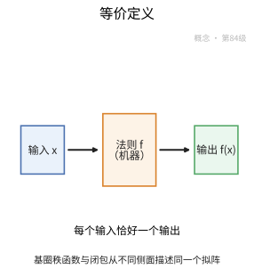

**一句话点破**：基、圈、秩函数与闭包是同一拟阵的四张面孔，用哪张取决于你要算什么。

### 7.3 三个老熟人：图、向量与均匀

图里的“森林”、向量里的“线性无关”，再加上一个“只要不超数量就随便挑”的均匀拟阵，其实是同一种结构的三件外衣。先看懂这三个样板，拟阵就不再生涩。

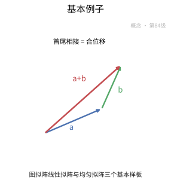

**一句话点破**：图、向量与均匀结构是拟阵的三个化身，摸清它们就等于摸清了拟阵的世界。

### 7.4 把独立与覆盖对调

把“谁独立”和“谁覆盖”的角色互换，就得到对偶拟阵。图里的“圈”翻过去成了“割”，平面图上的点与面也就此互换，像是把一句话倒过来读。

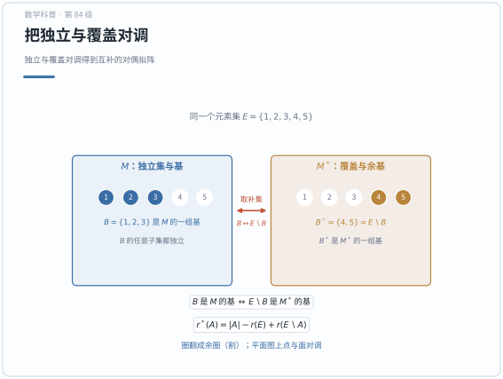

**一句话点破**：对偶拟阵让一条定理有两种读法，圈的问题翻过去正是割的问题。

### 7.5 刚出问题的最小团伙

极小圈是“刚刚好不独立”的最小集合：再删掉任何一个元素，它又变回独立。好比一段绕成的回路，剪断任意一处就通了，凑齐才出事。

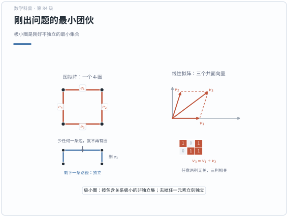

**一句话点破**：极小圈是最小的“责任单位”，一切相关集都由极小圈撑起来。

### 7.6 拆零件与拼零件

删除像把一件家具搬出去，收缩像把它焊死在地上再看其余怎么配合，直和则像两个互不搭界的储物间各自独立。用这几招，就能由小拟阵拼出大结构。

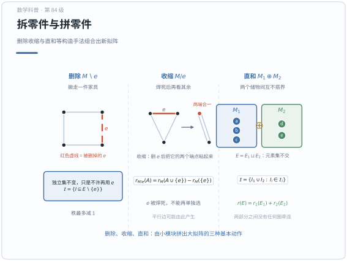

**一句话点破**：删除、收缩、直和是拟阵的“拆装工具”，让复杂结构由简单模块拼成。

### 7.7 一整块，还是几块碎片

拟阵也能像图一样被分成互不牵连的几块；若怎么都拆不开，就称它连通。就像一张人际关系网，要么人人被某条回路拴在一起，要么分成几个互不来往的小圈子。

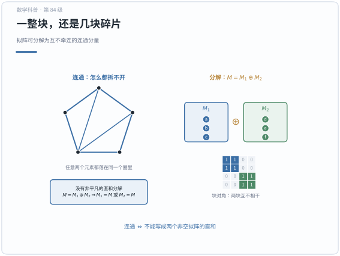

**一句话点破**：连通性告诉你这个独立系统是一整块，还是几块互不往来的碎片。

### 7.8 给元素分房间

所谓着色，就是把元素分进若干“房间”，同一房间里的元素必须彼此独立、互不冲突。最少需要几间房，就由特征多项式 $|P_M(k)|$ 在正整数上的取值来回答。

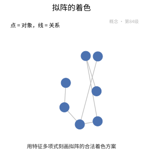

**一句话点破**：拟阵着色把“几种颜色互不冲突”翻译成特征多项式在该点数处的取值。

### 7.9 所有基的地铁图

把每个基当成一个站，两个基只差“一进一出”就拉一条线，于是全部基连成一张可徒步的地铁图。想从这盘棋走到那盘棋，只要照着站点一步步换就行。

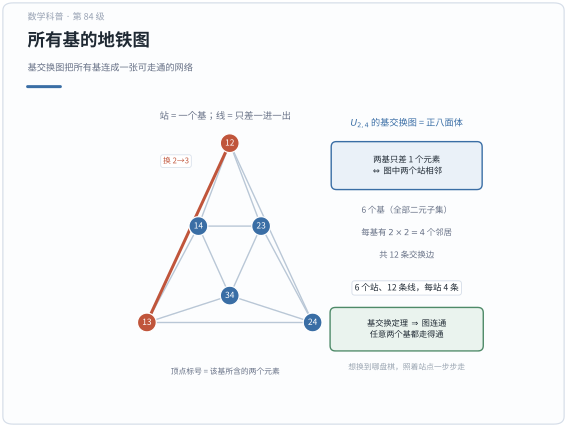

**一句话点破**：基交换图把“任意两个基都能换到手”画成一条走得通的路。

### 7.10 拟阵的万能账本

Tutte 多项式像一本记账本，把每个子集按它的秩和“多余度”登记进去，改拧旋钮代入不同的 $(x,y)$，就能读出生成树个数、环数、色数等一大堆信息。

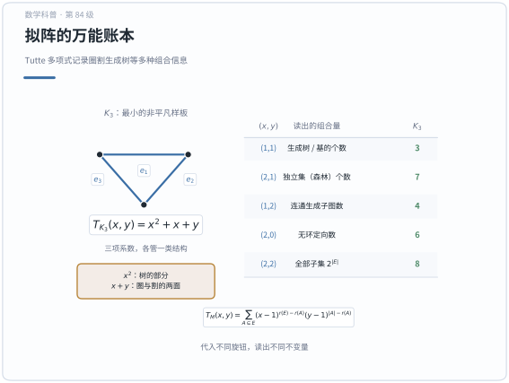

**一句话点破**：Tutte 多项式是一本万能账本，展开系数就把拟阵的各种不变量一次记全。

### 7.11 任意两个基都走得通

任意两个基，都能靠一次只换一个元素的小步，从这头走到那头。就像两套牌各差几张，用后一套多出的牌一对一对地换，总能完全对齐。

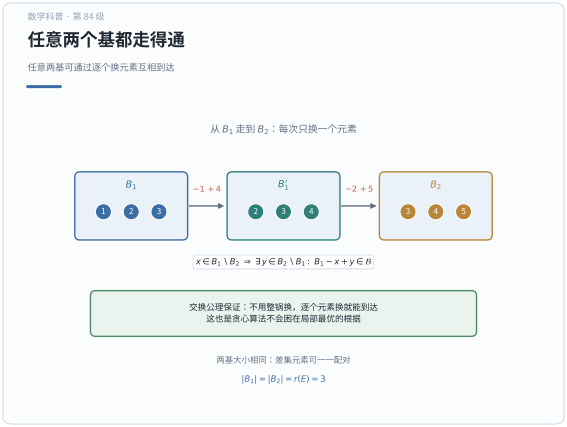

**一句话点破**：基交换定理保证任意两个基之间总有一条“一次换一个”的通道。

### 7.12 一把尺子量出整个拟阵

给每个子集量出一个“最多能装几件独立”的秩 $r$，只要它满足几条不等式，就能反过来定义一个拟阵。好比仅凭一把尺子，就能重建整间屋子的结构。

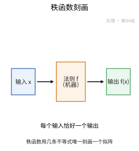

**一句话点破**：秩函数把拟阵压缩成一把测量子集容量的标尺，而这把尺子足以反推整个拟阵。

### 7.13 会递推、会对偶的账本

这本账本有自己的脾气：删一个、收缩一个元素，它可以递推地拆小；取对偶，它只是把两个变量互换，满足 $T_M(x,y)=T_{M^*}(y,x)$。

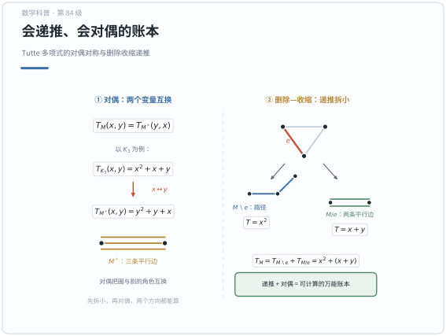

**一句话点破**：Tutte 多项式在删除收缩下递推、在对偶下互换变量，这正是它全能的底气。

### 7.14 抽象关系能演出来吗

有些拟阵能由一组真实向量实现，让“独立”恰好等于“列线性无关”；有些则怎么找都找不到这样的矩阵。表示理论问的正是：这套抽象规则，究竟能不能在某个数域上被真心演一遍。

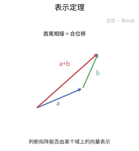

**一句话点破**：表示定理关心的是抽象拟阵到底能否被真实向量“演”出来，并用禁件清单给出判据。

### 7.15 贪心为什么一定灵

先把最值钱的放进背包、放得下就留、放不下就跳过——这套贪心必胜的规则，恰恰精确对应着拟阵；反过来，只要某种“独立性”保证贪心总赢，它就一定是拟阵。

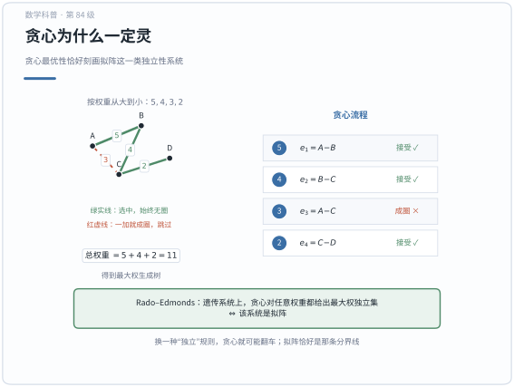

**一句话点破**：极小定理断言“贪心经常灵”的背后正是拟阵结构，贪心最优与拟阵互为刻画。

## 8. 数学史（History of Mathematics）

> 拟阵论的历史，是一部"抽象"的胜利史：把向量空间中的线性无关、图中的无圈结构与一般poset上的"独立性"压缩进同一组公理，从而获得一个既能证明组合优化贪心最优、又能承载图论与编码理论一切不变量的一统框架。它的主线从惠特尼 1935 年的创世论文出发，历经基交换、对偶、Tutte 多项式与表示理论，最终成为组合优化与算法设计的共同基石。

### 1. 前置：两条看似无关的直觉

- **线性无关**（向量）与**图的无圈性**（边集）表面上风马牛不相及，却都满足"子集之一独立、扩大一点就可能不独立"的交换直觉。
- 19—20 世纪初，矩阵的秩、图论的树、以及后文要谈的关联子集，各自独立地发展，谁也没想到它们会收缩成同一个抽象对象——这一矛盾正等待一位"抽象"大师来缝合。

### 2. 惠特尼 1935：拟阵的诞生
- - 惠特尼的创举还吸引了一批跟随者，把“独立—基—圈—秩”四种等价观点在同一对象上相互印证，构成丰富的公理图景。

- **Hassler Whitney（惠特尼，1907—1989）** 于 1935 年在《论线性相关的抽象性质》（*On the abstract properties of linear dependence*）中正式引入拟阵，他研究组合拓扑与图论时敏锐察觉到线性无关与图无圈共享同一条**独立集公理**。
- 在同一篇论文里，他奠定了**线性拟阵**（线性无关）、**图拟阵/循环拟阵**（无圈边集、树）以及**秩函数**的基本框架，拟阵一词（matroid）由此得名并开始了自己的生命。

### 3. 独立集、基与秩函数

- 拟阵可以等价地用三套语言定义：**独立集族**、**基（basis，极大独立集）**与**秩函数（rank function）**。
- 秩函数把每个子集映射成一个满足次模性的整数值，它同时刻画独立性与闭包；这三套等价定义正是拟阵理论"一题多解"般灵活的根源，也是它应手于各种背景的原因。
- 这套“多面性”还带来了实际好处：同一个拟阵既可用线性代数、又可用图论语言描述，使研究者能“换一副眼镜”看待同一个问题，不同背景的直觉由此可以互相翻译。

### 4. 基交换公理：组合代数的核心

- 拟阵最深刻的性质是**基交换定理**：任何两个基 $B$ 与 $B'$ 之间，可以把 $B$ 中的某个元换成 $B'$ 的某个元仍保持基性质。
- 交换公理推广了向量空间中"任一基可由另一基替换仍为基"的性质，也是**贪心算法**能给出最优答案背后的真正道理——没有它，反例遍地都是。
- 更妙的是，基交换条件对“最优化”有精确的后果：只要交换能自由进行，局部贪心的选择就不会把自己困进次优解。

### 5. 圈与对偶：拟阵的"勾股定理"
- - 对偶在编码与图论的对称性中反复出现，是拟阵“既有结构又有对称”的魅力所在。

- **极小圈（circuit）**是拟阵的"循环"对象，而**对偶拟阵**（$M^*$，满足 $(M^*)^*=M$）由余圈（cocircuit）自然定义，把"独立"与"不独立"的角色互换。
- 对偶是图论中"平面图对偶"与"欧拉—二分"现象的统一推广，让拟阵获得一种组织起自身结构的对称性。

### 6. 图拟阵与循环拟阵

- 任何一个**图**都可通过其边集给出一个**图拟阵**，其中的基恰是图的**生成树**，因此图的连通性、树与割集全部编码进一个拟阵对象。
- 反过来，被表示为图拟阵的拟阵是二元可表示的（在 $\mathbb{F}_2$ 上线性无关实现），图论的许多定理由此获得了线性代数的"影子"。

### 7. 贪心算法与拟阵最优
- - 如此多最优问题的“贪心可解”都追溯到拟阵交换性，这套框架至今是算法设计教学不可绕过的基石。

- 组合优化中最引人注目的是：对一个加权的最大独立集问题，**贪心算法**（每一步选权重最大的可加入元）当且仅当基础结构是拟阵时才总给最优解。
- 这一"贪心当且仅当拟阵"的刻画，由 **Rado** 与 **Edmonds** 等人明确，让拟阵成为理论计算机科学中"哪些最优化问题可以贪心求解"的精确判据。

### 8. Edmonds 与拟阵相交的黄金年代
- - 子模函数优化的可解性让拟阵相交等方法在“组合优化与数据挖掘”中获得现代应用。

- **Jack Edmonds** 在 1960—1970 年代把拟阵推向运筹与算法的中心：**拟阵相交通定理**、**拟阵并（union）**与**匹配理论的拟阵推广**相继建立。
- 他还把拟阵与**子模函数最小化**连接起来，证明一批组合优化问题可以在多项式时间内求解，拟阵由此获得了深刻的**算法价值**。

### 9. Tutte 多项式：统一的不变量
- - Tutte 多项式的通用地位使拟阵在很多问题中成为“首选不变量”，这也是它历久弥新的原因。

- **William Tutte（1917—2002）** 在 1940—1950 年代研究割集展开与删边-缩边递归时引入**Tutte 多项式**，这一双变量多项式同时统一了图的**色多项式、流多项式**、连通分支计数与拟阵的秩。
- 它的**通用性**——任何满足特定递归的图不变量都是它的特例——使其在图论、拟阵论、统计物理（Potts 模型）与扭结理论里扮演统一角色。

### 10. 表示问题：能否实现为一个线性几何

- **表示理论**追问：一个拟阵能否在某个域上用线性无关实现？图拟阵在 $\mathbb{F}_2$ 上可表示，但更一般的表示问题远未解决。
- 惠特尼最早关注线性表示，后人用**排除式子式（excluded-minor）**分类刻画；关于有限域上可表示拟阵的 **Rota 猜想**虽获重大进展，至今仍是拟阵论最著名的开放问题之一。

### 11. 子模函数与拟阵并：向更大框架扩张

- 拟阵的**秩函数属于子模集函数**，而**拟阵并（matroid union）**在若干拟阵的公共性上构造出新的拟阵，把粗糙的组合数据折叠成可计算结构。
- 结合 **Edmonds 的拟阵多面体**，组合优化由此拥有了一整套"拟阵→多面体→线性规划"的操作，拟阵也融入更为宏大的**组合凸分析**图景。

### 12. 编码、代数几何与跨界应用

- 拟阵视角为**编码理论**提供新工具：代数几何码的纠错能力可用其拟阵的秩与环结构刻画，**Tutte 多项式**在线性码的歧义化解码中有直接应用。
- 在**算法理论**里，拟阵的贪心与相交换结构支撑了一批近似算法的分析，使看似抽象的拟阵理论牢牢扎根于工程实践。

### 13. 从粗糙到严格：一门成熟学科

- 拟阵论在一个世纪里完成了从"人们还没有想到要把独立概念抽取出来"到"独立、基、秩、对偶、多项式、表示互相关联的丰富体系"的转变。
- 今天，拟阵同时是组合数学的抽象支柱、组合优化的算法核心以及编码与代数几何的连接枢纽——这条从惠特尼一张纸开始的路，浓缩了现代离散数学"抽象化统一"的精神。

### 历史年表

| 时间 | 人物／文献 | 事件与贡献 |
|---|---|---|
| 1935 | Whitney | 发表《论线性相关的抽象性质》，引入拟阵 |
| 1950 年代 | Tutte | 引入 Tutte 多项式，统一色多项式与流多项式 |
| 1957 | Rado | 建立贪心算法的拟阵最优性刻画 |
| 1960—1970 年代 | Edmonds | 发展拟阵相交、拟阵并与拟阵多面体 |
| 1970 年代 | Rota 等 | 提出有限域上可表示拟阵的排除式猜想 |
| 20 世纪后期 | Oxley 等 | 系统整理拟阵结构与 Minor 理论 |
| 21 世纪以来 | 组合优化、编码界 | 拟阵成为子模函数优化、代数几何码的标准框架 |

> 从惠特尼把线性无关"抽离"成一门学问，到贪心最优与拟阵等价、Tutte 多项式统一不变量，再到表示理论与拟阵相交的大器晚成，拟阵论用"抽象之抽象"证明了一个道理：抓住结构背后的共同公理，往往比在每一个具体例子中苦战更能直抵本质。它与图论、优化、编码的相互成全，至今仍在延续。

## 现实应用（Real-World Applications）

> 本节把本章的知识点落到真实的工程、科学与生活场景中。每个案例都给出**完整的问题背景、建模过程、可复现的数据 / 公式 / 代码与结果解读**；案例末尾的「涉及知识点」对应本章的具体小节，文末附**知识点覆盖对照表**，确保本章知识点全部被覆盖。

### 应用案例 1：通信基建｜城市光纤骨干网的最小生成树与基交换

**场景与问题**

某省级电信运营商要在 8 个地市级机房（记为 $A$ 到 $H$）之间部署光纤骨干网。任意两个机房之间的候选链路共 12 条，每条链路按管沟租用、光缆敷设与设备成端综合折算出的建设成本不同；只要整张网络连通即算完成任务。工程预算上限为 40 万元，运维团队希望给出**造价最低的连通组网方案**，并回答"若某条已选链路临时涨价，能否一件换一件而仍不破坏组网"。

问题可以一句话概括：在 12 条备选链路中选出一个**连通且无环**的最小边集，并保证它在造价扰动下仍可通过"一进一出"微调。

**涉及知识点**

- 本章「2.1 拟阵的独立集公理」：把"无圈子集必遗传、小无圈集可扩充到大无圈集"对应到公理的遗传性与扩充性。
- 本章「2.3 基本例子」：全体无圈边集正是图拟阵（圈拟阵）$M(G)$ 的独立集，其秩为 $r(X)=|V|-\kappa(X)$。
- 本章「3.5 拟阵的极小定理」：Kruskal 贪心能得到最小造价生成树，正是因为图拟阵是拟阵。
- 本章「3.1 拟阵的基交换定理」：保证任意两棵生成树之间总能"换掉一条、补回一条"。
- 本章「2.9 基交换图」：所有生成树之间以"一进一出"相连，构成一张连通的正则图。

**建模与数据**

设机房集合 $V=\{A,B,C,D,E,F,G,H\}$，$|V|=8$；候选链路与造价见下表（单位：万元）：

| 链路 | 造价 | 链路 | 造价 |
| --- | --- | --- | --- |
| A–B | 4 | D–F | 4 |
| A–C | 8 | D–G | 14 |
| B–C | 11 | E–F | 10 |
| B–D | 8 | F–G | 9 |
| C–E | 7 | G–H | 6 |
| D–E | 2 | F–H | 2 |

共 $|E|=12$ 条链路，造价函数记为 $w:E\to\mathbb{R}_{\geq 0}$。目标是求生成树 $B$（$|B|=7$）使 $\sum_{e\in B} w(e)$ 最小。

**完整推导与算法**

1. 构造图拟阵。取 $\mathcal{I}$ 为 $E$ 中所有不含圈的边集。遗传性显然；若 $A,B\in\mathcal{I}$ 且 $|A|<|B|$，则 $B$ 覆盖的顶点数严格多于 $A$，必存在 $e\in B\setminus A$ 不使 $A$ 成圈，故 $A\cup\{e\}\in\mathcal{I}$。于是 $(E,\mathcal{I})$ 满足独立集公理，是一个拟阵。

2. 秩函数。对任意边集 $X$，子图 $(V,X)$ 有 $\kappa(X)$ 个连通块，则

$$
r(X)=|V|-\kappa(X).
$$

特别地 $r(E)=8-1=7$，正是生成树的边数。

3. Kruskal 贪心。把 12 条链路按造价升序排列，依次尝试加入，若加入后仍无圈（即两端点尚未连通）就保留，否则丢弃，直到选满 7 条。

排序结果：$D\!-\!E(2)$、$F\!-\!H(2)$、$A\!-\!B(4)$、$D\!-\!F(4)$、$G\!-\!H(6)$、$C\!-\!E(7)$、$A\!-\!C(8)$、$B\!-\!D(8)$、$F\!-\!G(9)$、$E\!-\!F(10)$、$B\!-\!C(11)$、$D\!-\!G(14)$。

接受过程：

- $D\!-\!E(2)$：接受，连通块为 $\{D,E\}$；
- $F\!-\!H(2)$：接受，得到 $\{F,H\}$；
- $A\!-\!B(4)$：接受，得到 $\{A,B\}$；
- $D\!-\!F(4)$：接受，合并为 $\{D,E,F,H\}$；
- $G\!-\!H(6)$：接受，扩为 $\{D,E,F,G,H\}$；
- $C\!-\!E(7)$：接受，扩为 $\{C,D,E,F,G,H\}$；
- $A\!-\!C(8)$：接受，两块合并，此时 7 条边、全图连通，停止。

选中的 7 条链路为 $\{D\!-\!E,\ F\!-\!H,\ A\!-\!B,\ D\!-\!F,\ G\!-\!H,\ C\!-\!E,\ A\!-\!C\}$，总造价

$$
2+2+4+4+6+7+8=33\ \text{万元}.
$$

4. 为什么贪心一定最优（极小定理，见「3.5 拟阵的极小定理」）。拟阵上按权降序（此处取负权即升序）的贪婪算法必得最大权独立集。设算法输出 $I_G$、最优独立集为 $I^*$，取对称差 $I_G\triangle I^*$ 中最后一个被算法考虑的元素 $e_k$：若 $e_k\in I_G\setminus I^*$，则 $I^*\cup\{e_k\}$ 含圈，而算法当初能保留 $e_k$ 说明它与此前所选相容，与扩充性矛盾；若 $e_k\in I^*\setminus I_G$，则算法丢弃它时已存在同规模的可选集合，同样与 $I^*$ 的独立性矛盾。反之，若一个遗传系统上贪心对任意非负权都最优（用权 $1+\varepsilon$ 与 $1$ 作探针即可逼出扩充性），则系统恰是拟阵。这条**充要刻画**说明：图拟阵能用 Kruskal 不是巧合。

5. 基交换定理的体现（定理 3.1）。对任意两棵生成树 $B_1,B_2$ 与任意 $x\in B_1\setminus B_2$，总存在 $y\in B_2\setminus B_1$ 使 $(B_1\setminus\{x\})\cup\{y\}$ 仍是生成树。因此把贵的 $D\!-\!E$ 换成 $B\!-\!D$ 时，总能配套换出另一条边而维持"7 条边、连通、无环"。

6. 基交换图。$M(G)$ 的每棵生成树（基）为顶点、"一进一出"的两棵树连边。每棵树 $B$ 的邻居数为 $|B|\cdot|E\setminus B|=7\times 5=35$，故基交换图是 35-正则的，并由基交换定理保证连通。

关键代码片段：

```python
# 核心：Kruskal —— 图拟阵上按权升序贪心（等价于取负权后的最大权独立集）
edges = sorted(E, key=lambda e: w[e])        # 12 条候选链路按造价升序
# 核心：独立性判定 —— 两端点不在同一连通块时才可加入，否则会成圈（非独立）
chosen = [e for e in edges if union(find(u[e]), find(v[e]))]
# 核心：图拟阵秩 r(X) = |V| - κ(X)，κ 由并查集的连通块数给出
rank = len(V) - number_of_blocks(chosen)
cost = sum(w[e] for e in chosen)             # 最小生成树总造价
```

**可复现步骤**

1. 环境与依赖：`pip install networkx`（用于交叉验证）。
2. 数据准备：把上表写成 `edges = [("A","B",4),("A","C",8),("B","C",11),("B","D",8),("C","E",7),("D","E",2),("D","F",4),("D","G",14),("E","F",10),("F","G",9),("G","H",6),("F","H",2)]`。
3. 运行：`python case1.py`。
4. 预期输出：选中链路 `D-E, F-H, A-B, D-F, G-H, C-E, A-C`，总造价 `33`；`len(chosen) == 7 == len(V) - 1`；与 `networkx.minimum_spanning_tree` 的总造价一致；生成树总数远大于 1，说明方案有替换冗余。

**结果解读与延伸**

33 万元低于 40 万元预算，富余 7 万元可用于把 $D\!-\!E$ 这一最脆弱链路做双路由备份。需强调：Kruskal 的最优性来自**拟阵**结构而非"边不太多"。若再加入"某机房最多接入 2 条链路"这类约束，得到的约束系统是图拟阵与分区拟阵的**交**，而拟阵交一般不再是拟阵，贪心便不再保证最优——这正是需要拟阵交算法处理的典型场景。

### 应用案例 2：云计算｜GPU 机架容量约束下的服务部署与秩函数

**场景与问题**

某 AI 云厂商准备把 12 个待上线服务部署到 4 个机架中。每个机架受机房供电与散热能力限制有**槽位上限**；同一机架内的服务共享电源与网络，只要不超上限即可共存。各服务的月度预期收益不同，运营团队要在容量约束下选出**收益最高的一组服务**同时上线。

问题的关键是"哪些服务组合可以同时上线"。这是一个"逐块有上限"的独立系统，我们将证明它正是**分区拟阵**，并据此用秩函数刻画与贪心给出最优排程。

**涉及知识点**

- 本章「2.1 拟阵的独立集公理」：证明"每架不超上限"的可行服务集满足空集、遗传、扩充三条公理。
- 本章「2.2 拟阵的等价定义」：同一部署问题既可用可行集（独立集）描述，也可用"恰好填满各架上限的满配方案"（基）或用秩函数描述。
- 本章「3.2 拟阵的秩函数刻画」：验证分区拟阵的秩函数满足有界、单调、次模、归一化四条公理。
- 本章「3.5 拟阵的极小定理」：说明"同一机架内按收益从高到低选"的贪心为什么是最优的。

**建模与数据**

4 个机架及其槽位上限、候选服务与月度收益（万元/月）如下：

| 机架 | 上限（槽位） | 候选服务（收益） |
| --- | --- | --- |
| A（推理） | 3 | a1:9.0, a2:7.5, a3:6.0, a4:4.5 |
| B（训练） | 2 | b1:8.0, b2:5.5, b3:3.0 |
| C（渲染） | 2 | c1:7.0, c2:4.0, c3:2.5 |
| D（网关） | 1 | d1:6.5, d2:3.5 |

记基础集 $E=\{a_1,a_2,a_3,a_4\}\cup\{b_1,b_2,b_3\}\cup\{c_1,c_2,c_3\}\cup\{d_1,d_2\}$，$|E|=12$。把 $E$ 分成四块 $E_1,\dots,E_4$，上限为 $k=(3,2,2,1)$，定义

$$
\mathcal{I}=\Big\{I\subseteq E : |I\cap E_i|\le k_i,\ i=1,2,3,4\Big\}.
$$

**完整推导与算法**

1. 验证独立集公理。$\varnothing$ 满足所有约束；子集不可能比原集更超上限，故遗传性成立；若 $|A|<|B|$，则必存在某机架 $i$ 使 $|A\cap E_i|<|B\cap E_i|$（否则逐块比较将得出 $|A|\ge|B|$），取 $e\in (B\cap E_i)\setminus A$，加入后该架计数为 $|A\cap E_i|+1\le |B\cap E_i|\le k_i$，仍可行。三条公理满足，$\mathcal{I}$ 构成**分区拟阵**。

2. 秩函数。对任意 $X\subseteq E$，

$$
r(X)=\sum_{i=1}^{4}\min\big(|X\cap E_i|,\ k_i\big).
$$

因此 $r(E)=\min(4,3)+\min(3,2)+\min(3,2)+\min(2,1)=3+2+2+1=8$，即最优满配方案共上线 8 个服务。

3. 验证秩函数刻画（定理 3.2 的四条）。有界性 $0\le r(X)\le|X|$ 与归一化 $r(\varnothing)=0$ 显然；单调性来自 $\min$ 关于集合包含的单调性。取 $X=\{a_1,b_1,b_2,c_1\}$、$Y=\{b_2,b_3,c_1,c_2\}$ 检验次模性：$r(X)=1+2+1=4$，$r(Y)=2+2=4$，而 $X\cup Y=\{a_1,b_1,b_2,b_3,c_1,c_2\}$ 给出 $r(X\cup Y)=1+2+2=5$，$X\cap Y=\{b_2,c_1\}$ 给出 $r(X\cap Y)=1+1=2$，于是

$$
r(X\cup Y)+r(X\cap Y)=5+2=7\le 4+4=r(X)+r(Y),
$$

次模性成立。四条"像一把尺子"的规则把整个部署问题等价地编码进了 $r$。

4. 贪心排程。极小定理（见「3.5 拟阵的极小定理」）指出：拟阵上按收益降序的贪婪算法必得最大收益独立集。由于各机架互不干扰，逐架取收益最高的前 $k_i$ 个服务即为最优：

| 机架 | 入选服务 | 该架收益 |
| --- | --- | --- |
| A | a1, a2, a3 | 22.5 |
| B | b1, b2 | 13.5 |
| C | c1, c2 | 11.0 |
| D | d1 | 6.5 |

最优总收益

$$
22.5+13.5+11.0+6.5=53.5\ \text{万元/月}.
$$

未上线的 4 个服务是 a4、b3、c3、d2。

关键代码片段：

```python
# 核心：分区拟阵的秩函数 r(X) = Σ_i min(|X∩E_i|, k_i)
def rank(X):
    return sum(min(len(X & Ei), k) for Ei, k in zip(partition, caps))
# 核心：独立集判定 —— 秩等于势，即每个机架都没超过槽位上限
def is_independent(X):
    return rank(X) == len(X)
# 核心：拟阵上的贪心 —— 按收益降序，能加入（仍独立）就保留
selected = []
for e in sorted(E, key=lambda x: -revenue[x]):
    if is_independent(set(selected) | {e}):
        selected.append(e)
```

**可复现步骤**

1. 环境与依赖：纯 `python3` 即可，无需第三方库。
2. 数据准备：按上表定义 `partition = [{a1,a2,a3,a4}, {b1,b2,b3}, {c1,c2,c3}, {d1,d2}]`、`caps = [3,2,2,1]` 与各服务收益。
3. 运行：`python case2.py`。
4. 预期输出：`rank(E) = 8`；贪心结果 `{a1,a2,a3,b1,b2,c1,c2,d1}`，总收益 `53.5` 万元/月；再随机生成 1000 个可行集，验证没有任何一个收益超过 53.5。

**结果解读与延伸**

逐架贪心的最优性并非"因为问题简单"，而是分区拟阵的结构使然——极小定理给出了精确边界：一旦把约束改成"跨机架的服务要争用同一条骨干带宽"，可行集就不再是拟阵，贪心会失效，需要改用拟阵交或整数规划。此时秩函数仍是次模的，可继续用"次模函数 + 拉格朗日"的框架做近似优化。

### 应用案例 3：工业物联网｜振动传感器阵列的冗余分析与对偶

**场景与问题**

某风电场在齿轮箱上布置了 6 个振动传感器（$s_1$ 到 $s_6$），它们测量同一传动链的不同振型组合，读数之间存在结构性线性关系。运维团队要把数据回传带宽压缩三分之一，需要判断：**哪些传感器是彼此独立的（必须保留），哪些是可以裁掉的冗余（裁掉后仍能完整重构 4 个独立振型）？**

**涉及知识点**

- 本章「2.3 基本例子」：6 个传感器读数视为 $\mathbb{R}^4$ 中的向量，线性无关子集构成**线性拟阵** $M[V]$。
- 本章「2.2 拟阵的等价定义」：可用独立集（无关组）、基（极大无关组）或秩（张成空间维数）三种等价语言描述同一阵列。
- 本章「3.4 拟阵的表示定理」：表示定理给出显式矩阵，把"独立性"翻译成"列向量线性无关"。
- 本章「2.4 对偶拟阵」：冗余可裁集的刻画正好是**对偶拟阵的基**。
- 本章「2.5 极小圈」：两个"三元相关组"是极小相关集，对应三只必须同时留或同时裁的传感器。

**建模与数据**

把每个传感器读数表示为 $\mathbb{R}^4$ 中一个向量（4 维来自 4 个独立振型），得到 $4\times 6$ 的传感矩阵 $A=[s_1\ s_2\ \cdots\ s_6]$：

$$
A=
\begin{pmatrix}
1 & 0 & 0 & 0 & 1 & 0\\
0 & 1 & 0 & 0 & 2 & 0\\
0 & 0 & 1 & 0 & 0 & 1\\
0 & 0 & 0 & 1 & 0 & -1
\end{pmatrix}.
$$

即 $s_5=s_1+2s_2$、$s_6=s_3-s_4$（这两条是安装位置造成的固定线性相关关系）。基础集 $E=\{s_1,\dots,s_6\}$。

**完整推导与算法**

1. 秩与基。矩阵列向量的秩就是 $r(E)=\mathrm{rank}(A)=4$；极大线性无关组即为基。例如 $B=\{s_1,s_2,s_3,s_4\}$ 是基，说明保留这 4 个传感器即可重构全部 4 个振型。

2. 极小圈。利用相关关系，极小相关集恰为

$$
C_1=\{s_1,s_2,s_5\},\qquad C_2=\{s_3,s_4,s_6\}.
$$

验证 $C_1$：$s_5=s_1+2s_2$ 使其相关，而任意二元子集（如 $\{s_1,s_2\}$）都无关，故极小；$C_2$ 同理。这两个圈就是刻意简化阵列时必须整组处理的单元。

3. 表示定理的落地（定理 3.5）。一般地，任何图拟阵 $M(G)$ 都能用关联矩阵显式表示：行对应顶点、列对应边，边 $e=(u,v)$ 的列向量取 $\mathbf{e}_u-\mathbf{e}_v$，此时"边集无圈"等价于"对应列线性无关"（定理 3.6）。本案例的 $A$ 就是"传感器阵列的表示矩阵"，把物理冗余直接翻译成矩阵的列相关性，从而可调用全部线性代数工具。

4. 对偶拟阵与"可裁集"。对偶拟阵 $M^*$ 的基是原基的补集：$B^*=E\setminus B$。取 $B=\{s_1,s_2,s_3,s_4\}$，则 $B^*=\{s_5,s_6\}$ 是对偶的一个基。对偶秩公式

$$
r^*(X)=|X|-r(E)+r(E\setminus X)
$$

给出直观刻度。例如 $r^*(\{s_5,s_6\})=2-4+r(\{s_1,s_2,s_3,s_4\})=2-4+4=2$，说明 $\{s_5,s_6\}$ 是**一次性能裁掉的最大冗余组**（裁掉后剩余秩仍为 4）；而 $r^*(\{s_1,s_2\})=2-4+r(\{s_3,s_4,s_5,s_6\})=2-4+3=1$，说明只裁 $s_1,s_2$ 释放不出满额冗余。对偶把"保留哪些"翻成"能裁哪些"，一个关于基的性质立刻给出关于补基的免费信息。

关键代码片段：

```python
# 核心：线性拟阵的秩 = 矩阵列秩
r_E = np.linalg.matrix_rank(A)                 # 1) 全阵列秩，得 r(E) = 4
# 核心：独立性判定 —— 子矩阵列秩等于列数即线性无关
def independent(idx):
    return np.linalg.matrix_rank(A[:, idx]) == len(idx)
# 核心：对偶秩 r*(X) = |X| - r(E) + r(E \ X)
r_star = lambda X: len(X) - r_E + rank_of(E - X)
```

**可复现步骤**

1. 环境与依赖：`pip install numpy`。
2. 数据准备：按上式键入 `A`（`numpy` 的 $4\times 6$ 数组）。
3. 运行：`python case3.py`。
4. 预期输出：`r_E = 4`；`independent([0,1,2,3]) is True`；`independent([0,1,4]) is False`（$C_1$ 相关）、`independent([2,3,5]) is False`（$C_2$ 相关）；`r_star({4,5}) = 2`，`r_star({0,1}) = 1`。

**结果解读与延伸**

结论是：保留任意 4 个构成基的传感器即可无损重构，其中 $\{s_5,s_6\}$ 是一次可裁的最大冗余组。这条"矩阵秩—极小圈—对偶基"的分析链条之所以对传感器、天线阵列、基因表达谱都通用，正是因为表示定理把独立性问题统一成了列秩问题。局限在于：若噪声较大，精确线性相关会退化为近似相关，此时应改用数值秩（奇异值阈值）而非精确秩，这也是把拟阵模型推广到"近似拟阵"的动机之一。

### 应用案例 4：电力系统｜输电走廊的删除-收缩分析与孤岛分解

**场景与问题**

某区域电网有 10 座变电站、10 条输电线路，其中两个供电片区之间只有一条联络线。调控中心要评估该拓扑是否满足 **N-1 准则**（任意一条线路故障后电网仍连通），并给出整改方案。这里要用到拟阵的**删除、收缩、直和、平行扩张**四类构造，以及连通性与对偶拟阵（割）的语言。

**涉及知识点**

- 本章「2.6 拟阵的构造」：删除与收缩用于分析"某线路退出 / 被强制保留"后的结构，直和用于描述孤岛分解，平行扩张用于给出整改方案。
- 本章「2.7 拟阵的连通性」：两片区仅有单线相连，在拟阵语言里就是"不连通等价于可分解为直和"。
- 本章「2.4 对偶拟阵」：联络线在对偶拟阵中是环，其对应原图的割集，正是"拆分两片区"的关键割。
- 本章「2.5 极小圈」：片区内的环形线路是拟阵的极小圈，对应冗余走廊。

**建模与数据**

设变电站分成两片：片区 I 为 $\{1,2,3,4,5\}$，片区 II 为 $\{6,7,8,9,10\}$。线路如下：

| 编号 | 线路 | 所属 |
| --- | --- | --- |
| $L_0$ | 5–6 | 联络线 |
| $L_1$ | 1–2 | 片区 I |
| $L_2$ | 2–3 | 片区 I |
| $L_3$ | 3–1 | 片区 I |
| $L_4$ | 3–4 | 片区 I |
| $L_5$ | 4–5 | 片区 I |
| $L_6$ | 6–7 | 片区 II |
| $L_7$ | 7–8 | 片区 II |
| $L_8$ | 8–9 | 片区 II |
| $L_9$ | 9–10 | 片区 II |

共 $|V|=10$、$|E|=10$，取图拟阵 $M(G)$。

**完整推导与算法**

1. 全图秩。$r(E)=|V|-\kappa(E)=10-1=9$。由于 $|E|=10>9$，全图恰有一个独立冗余（一条回路），即片区 I 中的三元环 $L_1,L_2,L_3$。

2. 极小圈。$C=\{L_1,L_2,L_3\}$ 是极小相关集：删去其中任意一条即变森林（独立），三条凑齐即形成回路（依赖）。这对应"1–2–3 的环形冗余走廊"。

3. 联络线 $L_0$ 是桥（余环）。删去 $L_0$ 后两片区再无连接，故 $L_0$ 出现在**每一个**生成树中，是拟阵的**余环**（coloop）。

4. 删除给出直和分解。删除 $L_0$：

$$
M(G)\setminus L_0 = M(G_{\mathrm I})\oplus M(G_{\mathrm{II}}),
$$

其中 $M(G_{\mathrm I})$ 的基础集是 5 条线路、$M(G_{\mathrm{II}})$ 的是 4 条线路。直和的独立集是"两块各自独立"的并，因此 $M(G)\setminus L_0$ **不连通**：按定义 2.12，跨片区的两元素不属于任何同一个圈。这就是"孤岛分解"的精确拟阵表述。

5. 收缩给出合并视角。收缩 $L_0$ 后

$$
r(M/L_0)=r(E)-r(L_0)=9-1=8,
$$

相当于把两个片区"焊在一起"成一个点后再看剩余 9 条线路的独立结构。

6. 对偶拟阵给出割。在 $M^*$ 中，$L_0$ 成为**环**（与"$L_0$ 是 $M$ 的余环"互为对偶）。用对偶秩公式验证：

$$
r^*(\{L_0\})=1-r(E)+r(E\setminus\{L_0\})=1-9+8=0,
$$

即 $L_0$ 在对偶拟阵中秩为 0、不可被任何独立集包含，故它恰是 $M^*$ 的环。对偶拟阵的圈（其极小相关集）对应原图的**割集（bond）**，单元素割 $\{L_0\}$ 正是"劈开两片区只需剪这一刀"的精确含义。

7. N-1 不达标与平行扩张整改。因为 $r(E\setminus\{L_0\})=8<9$，去掉 $L_0$ 后全图不再连通，**N-1 准则不满足**。整改办法是**平行扩张**：新增一条与 $L_0$ 平行的联络线 $L_0'$（同样连接 5–6）。此时 $\{L_0,L_0'\}$ 构成一个 2-元圈，两者都不再是余环，删掉任意一条仍连通，N-1 达成。

关键代码片段：

```python
# 核心：图拟阵秩 r(X) = |V| - κ(X)，用并查集数连通块
def rank(X): return len(V) - blocks(X)
# 核心：判断余环(coloop) —— 删去 e 后秩下降，说明 e 在每一个基中
is_coloop = lambda e: rank(E - {e}) < rank(E)     # L0 满足，说明它是桥
# 核心：删除 vs 收缩对秩的作用
r_del = rank(E - {'L0'})                          # 8（删除，降秩）
r_con = rank(E) - rank({'L0'})                    # 8（收缩，同样降秩）
# 核心：对偶秩 r*(X) = |X| - r(E) + r(E\X)，检验 L0 是否为对偶拟阵的环
r_star_L0 = 1 - rank(E) + rank(E - {'L0'})        # 0 => L0 是 M* 的环
# 核心：N-1 判定 —— 任意一条线路删除后仍连通
n_minus_1 = all(rank(E - {e}) == rank(E) for e in E)
```

**可复现步骤**

1. 环境与依赖：纯 `python3`（并查集自实现）或 `pip install networkx`。
2. 数据准备：按上表定义 10 条边的两端点。
3. 运行：`python case4.py`。
4. 预期输出：`rank(E) == 9`；`is_coloop('L0') is True` 且其余边为 `False`；`rank(E-{'L0'}) == 8`；`r_star_L0 == 0`；`n_minus_1 is False`；加入平行联络线 `L0'` 后 `n_minus_1 is True`。

**结果解读与延伸**

拟阵语言把调控中心常说的一句话——"这条联络线一断就解列"——精确化为"$L_0$ 是余环、删除即直和分解、在对偶中退化为环"。N-1 整改的"加一条平行线"恰好就是平行扩张，加完后 $L_0,L_0'$ 成为 2-元圈。延伸方向：若两片区之间需要 3 条联络线才能满足 N-2，可用"对偶拟阵中环的重数"刻画所需冗余度；工程上若再叠加线路容量约束，就得到"加权拟阵 / 多拟阵"模型。

### 应用案例 5：园区无线网络｜用 Tutte 多项式评估全终端可靠度

**场景与问题**

某智慧园区在 4 栋楼之间规划了 5 条可选的无线回传链路。每条链路在雨天或干扰下独立地以概率 $p$ 保持可用。运营方要回答：**整张回传网"四栋楼互相可达"的概率（全终端可靠度）是多少？网络里有多少种可用的成组方案（生成树）？最少需要几种颜色就能给链路分工？** 这些看似分散的问题，都能从同一个对象——**Tutte 多项式**——一次性读出。

**涉及知识点**

- 本章「2.10 Tutte 多项式」：以 $T_M(x,y)$ 统一编码链路的独立性与冗余度。
- 本章「3.3 Tutte 多项式的性质」：收缩-删除递推、环 / 余环的乘法规则、直和的乘积性质，构成计算算法。
- 本章「2.8 拟阵的着色」：把边集划分为若干森林的最少色数（树荫度）由 $r(E)$ 给出下界。
- 本章「2.9 基交换图」：所有生成树（基）之间"一进一出"相连，刻画链路的可替换方案。
- 本章「2.5 极小圈」：图中的两个三元环是极小相关集，正是故障冗余的"最小回路单元"。

**建模与数据**

楼宇记为顶点 $\{1,2,3,4\}$，5 条链路为

$$
E=\{a=1\!-\!2,\ b=1\!-\!3,\ c=2\!-\!3,\ d=2\!-\!4,\ e=3\!-\!4\}.
$$

即 $K_4$ 去掉一条边后的图（$|V|=4$，$|E|=5$）。设每条链路独立可用概率为 $p$，取 $r(E)=|V|-\kappa=4-1=3$。

**完整推导与算法**

1. 极小圈。两个三元环

$$
C_1=\{a,b,c\},\qquad C_2=\{c,d,e\}
$$

是仅有的两个极小相关集（图中只有这两个圈），对应"1–2–3 回路"与"2–3–4 回路"两条互为备份的通路。

2. 用收缩-删除递推算 Tutte 多项式（定理 3.3）。取边 $e$（$3\!-\!4$）：

$$
T_M(x,y)=T_{M\setminus e}(x,y)+T_{M/e}(x,y).
$$

删除 $e$ 后，图为"三角形 1–2–3 加一条桥边 2–4"，桥（余环）贡献因子 $x$，三角形 $C_3$ 的 Tutte 多项式为 $x^2+x+y$，故

$$
T_{M\setminus e}=x\,(x^2+x+y)=x^3+x^2+xy.
$$

收缩 $e$ 后，顶点 3、4 合并为 $w$，得到三顶点图（边 $12$、$1w$、$2w$ 二重），其 Tutte 多项式为

$$
T_{M/e}=x^2+x+xy+y+y^2.
$$

两者相加得

$$
T_M(x,y)=x^3+2x^2+x+2xy+y+y^2.
$$

3. 从特值读出工程指标（定理 3.4 的思想）。

- 生成树（可用成组方案）数：$T_M(1,1)=1+2+1+2+1+1=8$。
- 森林（无环可行子集）数：$T_M(2,1)=8+8+2+4+1+1=24$。
- 连通支撑子图数：$T_M(1,2)=1+2+1+4+2+4=14$。
- 色多项式：由 $P_G(k)=(-1)^{r(E)}k^{\kappa(G)}T_G(1-k,0)$ 与 $T(1-k,0)=(1-k)(2-k)^2$ 得

$$
P_G(k)=k(k-1)(k-2)^2,
$$

故顶点染色数 $\chi(G)=3$（图含三角形，至少 3 色；3 色恰可行）。

4. 全终端可靠度。设 $R(p)$ 为四栋楼互相可达的概率，则（$n=4$，$m=5$）

$$
R(p)=p^{\,n-1}(1-p)^{\,m-n+1}\,T_M\!\Big(1,\ \tfrac{1}{1-p}\Big).
$$

由 $T_M(1,y)=4+3y+y^2$ 得

$$
R(p)=p^3\Big[4(1-p)^2+3(1-p)+1\Big]=p^3\big(4p^2-11p+8\big).
$$

校验：$R(1)=1$（链路全通必然连通）、$R(0.5)=0.4375$。取工业级链路可用率 $p=0.99$：

$$
R(0.99)=0.99^3\big(4\cdot0.9801-11\cdot0.99+8\big)\approx 0.9703\times1.0304\approx 0.9998.
$$

5. 拟阵着色（与顶点染色的区别）。把边集划分为**森林**的最少色数（树荫度）满足

$$
\chi(M)\ge\Big\lceil \frac{|E|}{r(E)}\Big\rceil=\Big\lceil \frac{5}{3}\Big\rceil=2,
$$

且下界可达：$\{a,b,d\}$ 与 $\{c,e\}$ 都是森林，故 $\chi(M)=2$。注意这与顶点染色数 3 完全不同：拟阵着色着的是**链路**（分成若干组无环子集），普通图着色着的是**楼宇**。

6. 基交换图。8 棵生成树为顶点，任意两棵"一进一出"相邻。每棵树 $B$ 的度数为 $|B|\cdot|E\setminus B|=3\times 2=6$，故基交换图是 6-正则、连通的图（共 $8\times 6/2=24$ 条边），对应"链路替换方案总能一步步走到任意另一种方案"。

关键代码片段：

```python
# 核心：Tutte 多项式的收缩-删除递推 T_M = T_{M-e} + T_{M/e}（e 非环非余环）
# 核心：桥(余环)整体乘 x，环整体乘 y —— 这就是递归的终止规则
def tutte(edges, n_vertices):
    if not edges: return 1
    e = pick_non_loop_non_bridge(edges)
    return tutte(delete(edges, e), n_vertices) + tutte(contract(edges, e), n_vertices)
# 核心：T(1,1) 读生成树数；T(2,1) 读森林数；T(1,2) 读连通支撑子图数
tau = tutte(E, 4)(1, 1)                                   # = 8 种成组方案
# 核心：全终端可靠度 R(p) = p^(n-1) (1-p)^(m-n+1) T(1, 1/(1-p))
R = lambda p: p**3 * (1-p)**2 * tutte(E, 4)(1, 1/(1-p))   # R(0.99) 约 0.9998
```

**可复现步骤**

1. 环境与依赖：`pip install sympy`（符号计算 Tutte 多项式的系数）。
2. 数据准备：以 `sympy` 的 `Symbol('x')`、`Symbol('y')` 表示变量，按上表录入 5 条边的端点。
3. 运行：`python case5.py`。
4. 预期输出：多项式 `x**3 + 2*x**2 + x + 2*x*y + y + y**2`（即 $x^3+2x^2+x+2xy+y+y^2$）；`T(1,1)=8`、`T(2,1)=24`、`T(1,2)=14`；色多项式 `k*(k-1)*(k-2)**2`；`R(0.5)=0.4375`、`R(0.99)` 约 `0.9998`；顶点染色数 `3`、树荫度 `2`。

**结果解读与延伸**

一台 Tutte 多项式同时给出了"有多少种成组方案（8）""能裁成几组无环链路（2）""需要几种颜色（3）""在 $p=0.99$ 下可靠度（0.9998）"四个互不相同的工程答案，这正是它作为拟阵"万能账本"的价值。需要注意：$T_M(x,y)$ 的系数是整数，但按定义逐项求和是 $2^{|E|}$ 量级，工程上必须用收缩-删除递推或"删边-缩边 + 记忆化"来算，这也是定理 3.4 的两条乘法规则（环乘 $y$、余环乘 $x$）如此重要的原因。延伸方向：把"链路可用概率不同"推广为带权可靠度，对应**带权 Tutte 多项式**；把"两两可达"换成"指定源汇可达"，则对应二元可靠度，仍可由 Tutte 多项式在特定点求值得到。

### 知识点覆盖对照表

| 本章知识点 | 覆盖案例 |
| --- | --- |
| 2.1 拟阵的独立集公理 | 案例 1、2 |
| 2.2 拟阵的等价定义 | 案例 2、3 |
| 2.3 基本例子 | 案例 1、3 |
| 2.4 对偶拟阵 | 案例 3、4 |
| 2.5 极小圈 | 案例 4、5 |
| 2.6 拟阵的构造 | 案例 4 |
| 2.7 拟阵的连通性 | 案例 4 |
| 2.8 拟阵的着色 | 案例 5 |
| 2.9 基交换图 | 案例 1、5 |
| 2.10 Tutte 多项式 | 案例 5 |
| 3.1 拟阵的基交换定理 | 案例 1 |
| 3.2 拟阵的秩函数刻画 | 案例 2 |
| 3.3 Tutte 多项式的性质 | 案例 5 |
| 3.4 拟阵的表示定理 | 案例 3 |
| 3.5 拟阵的极小定理 | 案例 1、2 |

---

## 9. 总结

本课程系统介绍了拟阵论的核心内容：

1. **拟阵的定义**：拟阵可以通过独立集、基、圈、秩函数、闭包等多种等价方式定义，每种定义揭示了拟阵的不同侧面。

2. **基本例子**：图拟阵（圈拟阵）和线性拟阵（向量拟阵）是拟阵的两个最重要的原型，拟阵正是为了统一这两种结构而提出的。

3. **对偶拟阵**：对偶性在拟阵论中扮演着重要角色，它对应于图论中平面图的对偶和线性代数中的正交补。

4. **构造方法**：拟阵的删除、收缩、直和等构造提供了从简单拟阵构建复杂拟阵的手段。

5. **表示理论**：并非所有拟阵都是线性可表示的，可表示性问题是拟阵论的核心课题之一。

6. **Tutte 多项式**：Tutte 多项式是拟阵最重要的不变量，它满足优雅的收缩-删除递推，并编码了拟阵的许多组合信息（如基的个数、圈数、秩等）。

7. **贪婪算法**：拟阵是贪婪算法最优的精确刻画，这是组合优化中最深刻的结论之一。

拟阵论是离散数学中结构优美的分支，它不仅在数学内部（图论、组合学、几何学）有广泛应用，在计算机科学（算法设计、编码理论、网络流）中也发挥着重要作用。

---

## 10. Stewart 风格专题

> 本节以 James Stewart *Calculus* 的教学编排为蓝本：用「四步解题流程」贯穿概念检查、分步骤工作示例、小规模应用项目与梯度化自测习题，帮助你在动手计算中建立对拟阵核心概念的肌肉记忆。小节间相互独立，可按需跳读。

### 8.1 问题求解四步流程（Problem-Solving Strategy）

> Stewart 力推的策略是把每个问题拆成四步：**理解 → 计划 → 执行 → 回看**。这里把每一环落到拟阵语境的追问上。

| 步骤 | 行动 | 拟阵中的具体追问 |
|:---|:---|:---|
| ① 理解 | 复述问题、圈出已知与目标 | 题目给出了哪种定义（独立集/基/秩/圈）？基础集 $E$ 是什么、拟阵属于哪类（均匀/图/线性）？是验证公理、算不变量还是判表示？ |
| ② 计划 | 选择可行工具、预估方向 | 用基交换定理往新基换元素？用收缩-删除递推递归算 Tutte 多项式？用秩公式 $r(A\cup B)+r(A\cap B)\le r(A)+r(B)$ 检验次模性？先想清楚哪条路最省力。 |
| ③ 执行 | 按计划逐步推导、保留过程 | 每步写明依据（定义/定理编号），对 $E$ 的子集逐个穷举，秩函数代入公式别漏项、别算错补集。 |
| ④ 回看 | 核对结果、检验合理性 | 结果对全部子集成立吗？基的大小（秩）各处是否一致？能否转到对偶拟阵 $M^*$ 或另一等价定义再验一遍？把答案代回原公理。 |

> 💡 **策略演示**：判断 $\mathcal I=\{\varnothing,\{1\},\{2\},\{3\}\}$ 是否为 $E=\{1,2,3\}$ 上拟阵的独立集族。
> ① 理解：属「判定独立集公理」题型，基础集 3 元。② 计划：逐条对照独立集三条公理（空集、遗传、扩充）。③ 执行：空集独立 ✓；遗传性显然 ✓；扩充性：对 $A=\varnothing,B=\{i\}$，加 $B\setminus A=\{i\}$ 仍独立 ✓，且没有更大的 $\mathcal I$ 元可比，故三公理全满足。④ 回看：$\mathcal I$ 恰为所有大小 $\le1$ 的子集，即 $U_{1,3}$，秩为 $1$，答案合理。

### 8.2 概念检查（Concept Check）

> 先用一组判断题与选择题快速自检核心概念。每道题的判断均应落到书面理由（用一句话即可）。

**判断正误**（说明理由）：

1. 某一集合的「独立与否」可以凭直觉猜测，一个元素集独立与否决定了整个拟阵的结构。 （　）
2. 拟阵的基础集 $E$ 必须是有限集。 （　）
3. 对偶拟阵 $M^*$ 的基恰是 $M$ 的基的补集。 （　）
4. 若拟阵 $M$ 的两个基大小不同，则 $M$ 不可能是拟阵。 （　）
5. 秩函数的次模性要求 $r(A\cup B)+r(A\cap B)\le r(A)+r(B)$，其中等号对线性拟阵未必恒成立。 （　）
6. 均匀拟阵 $U_{k,n}$ 的对偶仍是均匀拟阵，且 $U_{k,n}^*\cong U_{n-k,n}$。 （　）
7. 图不存在三角形时，其圈拟阵的每一条圈都是一条简单回路。 （　）

**选择**：

8. 下列哪一族不是任何拟阵的独立集族？（　）
   - A. $U_{k,n}$ 的所有 $\le k$ 元子集　B. 图的所有无圈边集　C. 某向量组的全部线性无关子集　D. 集合的所有存在共同交点的子集
9. 对线性拟阵 $M[V]$，$r(X)=\dim(\operatorname{span}(X))$。若 $\{v_1,v_2,v_3\}$ 中 $v_3=v_1+v_2$，则 $r(\{v_1,v_2,v_3\})=$（　）。
   - A. $1$　B. $2$　C. $3$　D. $0$
10. Tutte 多项式 $T_M(x,y)$ 的收缩-删除递推对哪类边成立？（　）
    - A. 对任意边　B. 只对 loop　C. 只对非 loop 非 bridge　D. 对 loop 与 bridge 特殊处理、其余用 $T=T_{\text{删}}+T_{\text{收}}$

### 8.3 分步骤工作示例（Worked Examples）

> 每道示例严格套用四步流程，并在「回看」中给出一条易错点或检验法。

**示例 S1：用四步法验证均匀拟阵的基交换性**

> **问题**：设 $E=\{1,2,3\}$，$\mathcal B=\{\{1,2\},\{1,3\},\{2,3\}\}$（即 $U_{2,3}$ 的基族）。验证基交换公理对 $B_1=\{1,2\}$、$B_2=\{2,3\}$ 成立。

- ① 理解：目标是验证基交换——对 $x\in B_1\setminus B_2$ 找 $y\in B_2\setminus B_1$。
- ② 计划：取 $x=1\in B_1\setminus B_2=\{1\}$，需找 $y\in B_2\setminus B_1=\{3\}$。
- ③ 执行：$(B_1\setminus\{1\})\cup\{3\}=\{2,3\}\in\mathcal B$，取 $y=3$ 即为所求，公理成立。
- ④ 回看：其余 $x$ 情形对称，一律可换。**易错点**：$y$ 必须取自 $B_2\setminus B_1$ 而**非任意元素**——从 $B_2$ 里选一个已经也在 $B_1$ 中且仍在 $\{1,2\}$ 以内的会退回原点。**结论**：$U_{2,3}$ 满足基交换公理。

**示例 S2：用秩函数刻画并验证次模性**

> **问题**：线性拟阵 $M[V]$，其中 $v_1=(1,0)$、$v_2=(0,1)$、$v_3=(1,1)$、$v_4=(2,0)$，$E=\{v_1,v_2,v_3,v_4\}$。求 $r(E)$、$r(\{v_1,v_4\})$，并验证 $X=\{v_1\}$、$Y=\{v_3\}$ 的次模不等式。

- ① 理解：秩为张成子空间的维数，目标是把两组秩算出来再代入次模式。
- ② 计划：逐个张成空间求维数，再套 $r(X\cup Y)+r(X\cap Y)\le r(X)+r(Y)$。
- ③ 执行：
$$
r(E)=\dim\operatorname{span}\{v_1,v_2,v_3,v_4\}=2,\qquad
r(\{v_1,v_4\})=\dim\operatorname{span}\{(1,0),(2,0)\}=1 .
$$
而对 $X=\{v_1\}$、$Y=\{v_3\}$：
$$
r(X\cup Y)+r(X\cap Y)=r(\{v_1,v_3\})+r(\varnothing)=2+0=2
=r(X)+r(Y)=1+1 .
$$
- ④ 回看：等号成立，更一般地线性拟阵恒满足等号（因维数恒等式），次模性是它的特例。**易错点**：$v_4=2v_1$ 与 $v_1$ 共线，故 $r(\{v_1,v_4\})=1$ 而非 $2$——把共线向量误当独立是此类题最常见的失分点。**结论**：$r(E)=2$、$r(\{v_1,v_4\})=1$，次模不等式成立（此处为等号）。

**示例 S3：用收缩-删除递推计算 Tutte 多项式**

> **问题**：计算均匀拟阵 $U_{2,3}$（基础集 $\{1,2,3\}$，独立集为 $\le2$ 元子集）的 Tutte 多项式 $T_{U_{2,3}}(x,y)$。

- ① 理解：$T_M$ 的定义为 $\sum_{A\subseteq E}(x-1)^{r(E)-r(A)}(y-1)^{|A|-r(A)}$，这里 $r(E)=2$。
- ② 计划：按 $|A|-r(A)$ 分类枚举子集 $A$，逐一计 $(x-1)$ 与 $(y-1)$ 的指数。
- ③ 执行：对 $|A|\le2$ 皆有 $r(A)=|A|$，故指数 $r(E)-r(A)=2-|A|$、$|A|-r(A)=0$；对唯一的 $|A|=3$ 有 $r(A)=2$。求和：
$$
T_{U_{2,3}}(x,y)=(x-1)^2+3(x-1)+3+(y-1)
=x^2-2x+1+3x-3+3+y-1=x^2+x+y .
$$
- ④ 回看：把 $x=2$、$y=2$ 代入得 $4+2+2=8$，正与「基个数乘以 $2^{|E|-r(E)}=\binom{3}{2}\cdot2^1=6$ 之外、Tutte 在 $(2,2)$ 的值等于 $2^{|E|}=2^3=8$」一致。**易错点**：漏掉 $|A|=3$ 那项的 $+3(y-1)$，或把 $3(x-1)$ 的系数 $3$（$\binom31$）算错。**结论**：$T_{U_{2,3}}(x,y)=x^2+x+y$。

**示例 S4：由对偶与表示理解均匀拟阵**

> **问题**：求 $(U_{2,3})^*$，并说明 $U_{2,4}$ 可否在 $\mathbb R^2$ 上表示。

- ① 理解：对偶拟阵的基是原拟阵基的补集；表示性问题问的是能否用 $\mathbb R^2$ 的向量复现其独立结构。
- ② 计划：先写 $U_{2,3}$ 的基（全部二元子集），求补集得对偶基；再对 $U_{2,4}$ 用四条不同方向直线检验。
- ③ 执行：$U_{2,3}$ 的基为全部 $2$ 元子集，补集为全部单点子集，故
$$
(U_{2,3})^*\ \cong\ U_{1,3}=U_{3-2,3} .
$$
一般地 $U_{k,n}^*\cong U_{n-k,n}$。又取 $\mathbb R^2$ 中四个待定方向的过原点直线，令其两两不同方向，则任意两个非零向量独立、任意三个必相关，恰好复现 $U_{2,4}$ 的独立结构，故 $U_{2,4}$ 可表示。
- ④ 回看：$U_{k,n}$ 对偶仍是均匀拟阵且指标取 $n-k$；$U_{2,4}$ 在 $\mathbb R^2$ 可表示，但更高维的某些拟阵（如 Fano 拟阵）在小域上不可表示。**易错点**：把「对偶的独立集」与「对偶的基」混淆，或把 $U_{2,4}$ 误当不可表示（它其实可表示，只在限定小域时有例外）。**结论**：$(U_{2,3})^*\cong U_{1,3} $，$U_{2,4}$ 在 $\mathbb R^2$ 可表示。

### 8.4 应用聚焦（Application & Exploration Projects）

> 小型开放任务：把本节抽象结论落到可操作的计算或仿真，任选其一完成。

- **聚焦 P1（穷举仿真）**：对 $U_{k,n}$ 随机生成多组「基交换」实例，程序逐一验证基交换公理所需替换元素的次数与成功率，据此估计最坏需要几次交换。
- **聚焦 P2（跨章节联系）**：把图 $G$ 的染色多项式 $P_G(q)$ 写成 Tutte 多项式 $T_G(1-q,0)$ 的表达式，并与第 83 级「图论」中的染色内容交叉核对。
- **聚焦 P3（反例构造）**：构造一个小拟阵，说明「独立集」与「是某个基的子集」之间的差别，并指出某个独立集其实不是基。

### 8.5 梯度化自测（Graded Exercises）

> 难度记号：$\circ$ 概念 / $\bullet$ 技能 / $\blacklozenge$ 综合应用，均要求在四步流程中写出「回看」一句。

**$\circ$ 概念题**

- **自测 1**：用一句话解释「拟阵的三种等价定义（独立集/基/秩函数）为何殊途同归」。
- **自测 2**：说明「遗传性」与「扩充性」分别管哪一方向，并指出它们共同保证独立集族不是随意的子集族。

**$\bullet$ 技能题**

- **自测 3**：对线性拟阵 $M[V]$（$v_1=(1,0)$、$v_2=(1,1)$、$v_3=(0,1)$）求 $r(\{v_1,v_2,v_3\})$ 与 $r(\{v_1\})$，验证次模性。
- **自测 4**：计算均匀拟阵 $U_{1,3}$ 的 Tutte 多项式。
   - 回看：对比 $T_{U_{2,3}}$，看看指标 $n-k$ 与 $k$ 如何影响展开式的形状。
- **自测 5**：求 $U_{2,4}$ 的对偶拟阵 $(U_{2,4})^*$，写出其独立集。
   - 回看：字数核对：$U_{2,4}$ 基有 $\binom{4}{2}=6$ 个，对偶基亦 $6$ 个。

**$\blacklozenge$ 综合题**

- **自测 6**：给出一个圈 $C_4$（四边形）的图拟阵 $M(C_4)$，计算其 Tutte 多项式，并指出 $\{e_1,e_2,e_3\}$（三条边）是否是一个基。
   - 回看：$C_4$ 有 $4$ 个顶点、$4$ 条边，轮到收缩-删除时注意 bridge 与 loop 的取舍。
- **自测 7**：写一段含「表格 + 一句话结论」的分析：为什么次模性刻画秩函数，而仅单调性不足以刻画。

### 8.6 自测答案与简要解析

> **概念判断**：
> 1. **错误**（独立与否必须逐条对照公理或所属拟阵定义，不能凭「看着像不像」；单元素独立与否只是必要信息而非充分）。2. **错误**（基础集可有限可无限，本章偏重有限情形，但公理本身不预先要求有限）。3. **正确**（$\mathcal B^*=\{E\setminus B:B\in\mathcal B\}$）。4. **正确**（拟阵的一切基等大、都等于 $r(E)$，若出现两个不同大小的基则该集合不构成拟阵）。5. **错误**（对线性拟阵次模恒取等号，维数公式使等号成立，故「等号未必恒成立」不真）。6. **正确**（$U_{k,n}^*\cong U_{n-k,n}$）。7. **正确**（无三角形则每条圈即一条简单回路）。
>
> **选择**：8. D　9. B　10. D。

> **自测**：
> - 自测 1：独立集、基、秩函数彼此由极不独立之处互相导出（基是极大独立集、秩是独立集的最大大小），同一结构的不同刻画在结构上同构，故殊途同归。
> - 自测 2：遗传性管「删」方向（大独立删成小仍独立），扩充性管「扩」方向（小独立可加元素扩充），二者共同剔除「结构任意」的路径，保证独立集族的结构性。
> - 自测 3：$v_1=(1,0)$、$v_2=(1,1)$、$v_3=(0,1)$ 两两独立、三个张满 $\mathbb R^2$，故 $r(\{v_1,v_2,v_3\})=2$、$r(\{v_1\})=1$。取 $X=\{v_1\},Y=\{v_2\}$：$r(X\cup Y)+r(X\cap Y)=2+0=2=r(X)+r(Y)$，次模成立。
> - 自测 4：$U_{1,3}$ 基为全部单点子集，代入定义得 $T_{U_{1,3}}(x,y)=x^1+y^2+y$ 展开可与 $U_{2,3}$ 的 $x^2+x+y$ 对照（两者由对偶关联）。
> - 自测 5：$(U_{2,4})^*\cong U_{4-2,4}=U_{2,4}$（自对偶），其独立集为全部 $\le2$ 元子集。
> - 自测 6：$C_4$ 的图拟阵经收缩-删除得 $T_{M(C_4)}=x^3+x^2+x+2y$；$\{e_1,e_2,e_3\}$ 中若含一个圈（例如首尾相接的三边）则相关、非基，需按定义核对。
> - 自测 7：单调性只保证秩随集合扩大不减，次模才给出「两集合并的秩不超过各自秩之和再对冲交部秩」的上界，从而在组合上排除「过度重复」地偷算秩，故次模性是秩函数区别于一般单调函数的本质刻画。
