# 第86级：计算几何 (Computational Geometry)

> 计算几何（Computational Geometry）是计算机科学与数学的交叉领域，研究几何问题的算法设计与分析。它不只问"这个几何事实成立吗"，更问"**怎么把答案一步步算出来、算得多快**"。它广泛应用于计算机图形学、机器人学、地理信息系统（GIS）、计算机辅助设计与地图导航等领域。
>
> 学科名里的 "computational"（计算的）点出了它与其他几何分支的分野：经典几何关心形状与定理，计算几何则关心**把凸包、最近点、Voronoi 图等几何答案高效地算出来**——算法设计本身成了被研究的对象。

---

## 从"把几何答案算出来"说起：计算几何要解决的根问题

> 在动手背 Graham 扫描之前，先想清楚一个问题：**为什么"会几何"还不够，还要"会算几何"？**

**一个贴近生活的情景（第一步：直觉）**

想象你在一个城市配送点工作，仓库里有几千个客户坐标。客户问："离我最近的仓库在哪？""把我这一片圈起来的最小凸多边形是谁？""两台货车的送货路线会不会交叉？"这些问题当然"有答案"，可如果你每次都老老实实把几千个点两两量一遍距离、画出所有可能的连线再检查，一个小时也报不出一个结果。

真正的麻烦不是"几何对不对"，而是"**来得及算完吗**"。当数据从几十个变成成千上万，暴力的两两检查（$O(n^2)$）立刻卡成噩梦。**这正是计算几何的用武之地**：设计巧妙的算法，让几何答案在可以接受的时间里算得出来。

**它要解决的根本问题（第二步：来龙去脉）**

- 几何问题本身古老得和数学一样老，但"几何也要讲算法效率"是 20 世纪 70 年代才爆发的事。早期计算机图形学、地图绘制一上来就撞上"算不完"的墙。
- **1972 年，Ronald Graham** 给出凸包问题的 $O(n\log n)$ 算法（Graham 扫描），第一次把这类看似无解的搜索压到了近乎最优的时间；
- 随后 **Michael Shamos 与 Franco Preparata** 系统梳理了分治、平面扫描、区域查询等方法，并在研究论文里为这一整套领域命名"**计算几何**"，让它从零散技巧升格为一门学科。

它的**根问题**是：**给定几何输入（点、线段、多边形），如何设计并证明能高效求出正确答案的算法？** 效率和正确性缺一不可。

> **🧠 一句话记住计算几何的"出生证"**
>
> 计算几何解决的**根本问题**是：
>
> $$ \boxed{\text{把几何问题的答案用高效算法算出来，并证明它跑得快、算得对。}} $$

**第三步：正式定义前的准备**

本章将这样推进：先从**凸包算法**（Graham 扫描、Jarvis 步进）建立"复杂度与正确性"的坐标系（第 2.1 节），再依次进入 **Voronoi 图**与 **Delaunay 三角剖分**（第 2.2–2.3 节）、**平面扫描 / 点定位 / 线段相交**等基本算法范式（第 2.4–2.6 节），随后是**多边形三角剖分、最近点对**（第 2.7–2.8 节）、**几何数据结构**与**几何对偶 / 半平面交**（第 2.9–2.10 节）。每个经典问题都配了定理证明（第 3 章）与完整示例（第 4 章）。

---

## 开始之前

**本章在讲什么**：计算几何研究"如何高效地算出几何问题的答案"。你会掌握凸包（Graham 扫描、Jarvis 步进）、Voronoi 图与 Delaunay 三角剖分、平面扫描、点定位、线段相交、多边形三角剖分、最近点对等经典算法，并认识 KD 树、R 树、四叉树等几何数据结构与几何对偶。

**为什么要学它**：它把前面学的**离散数学、组合学（区间图、凸性）与算法**接上了几何。计算机图形学渲染、机器人避障与路径规划、GIS 地图叠加、CAD 建模，它们的"引擎"几乎都是计算几何算法。学完这一级，你会拥有"把一个几何问题转化成可实现的算法"的完整能力，也为第 87 级离散几何（更偏纯数学的组合结构）提供算法直觉。

**开始前请确认你还记得**：

- 点、直线、多边形、向量与叉积（见平面几何与解析几何）：判断左转 / 右转、点在凸包内外都靠它们。
- 排序与复杂度记号 $O(\cdot)$（见算法与数据结构）：Graham 扫描、最近点对分析的直接工具。
- 三角剖分、外接圆与距离度量（见几何与图论）：读懂 Delaunay、Voronoi 的性质。
- 栈与递归（数据结构）：Graham 扫描用栈维护、最近点对用分治。
- 随机增量的思想（概率与算法）：最小圆覆盖等算法的证明依赖它。

---

## 学习目标

1. 掌握计算几何的核心问题与基本算法
2. 理解凸包算法（Graham扫描、Jarvis步进）的原理与正确性证明
3. 掌握Voronoi图与Delaunay三角剖分的性质与构造方法
4. 理解平面扫描、点定位、线段相交等基本几何算法
5. 掌握最近点对、最小圆覆盖等经典问题的算法与证明
6. 了解几何数据结构（KD树、R树、四叉树）及其应用

---

## 1. 引言

计算几何（Computational Geometry）是计算机科学与数学的交叉领域，研究几何问题的算法设计与分析。它广泛应用于计算机图形学、机器人学、地理信息系统、计算机辅助设计等领域。本节将系统介绍计算几何的核心概念、算法与理论基础。

---

## 2. 核心概念

### 2.1 凸包算法

**凸包**（Convex Hull）是包含给定点集的最小凸集。对于平面上的点集 $S$，其凸包是包含 $S$ 的最小凸多边形。

**Graham扫描算法**：
1. 选取 $y$ 坐标最小的点（若多个则取 $x$ 最小）作为基准点 $p_0$
2. 将剩余点按相对于 $p_0$ 的极角排序
3. 维护一个栈，依次处理每个点，检查是否形成左转
4. 算法时间复杂度 $O(n \log n)$

**Jarvis步进算法**（礼品包装算法）：
1. 从最左下的点开始
2. 每次选择与当前边夹角最小的点作为下一个顶点
3. 算法时间复杂度 $O(nh)$，其中 $h$ 为凸包顶点数

> **💡 直观理解（类比）**：Jarvis 步进像"礼品包装"——从最左下的点出发，每次挑"转得最少的那个点"作下一个顶点，就像贴绕着一堆礼物贴一圈胶带，一路向外绕过最凸的角。它思路直白，但速度取决于凸包顶点数 $h$：顶点越多，缠得越久。

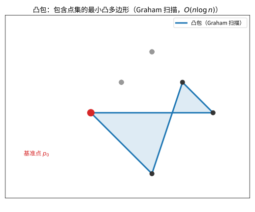

> **直观理解（现实类比）**：凸包就像用一根橡皮筋把所有钉子紧紧箍住后形成的形状——橡皮筋绷到最外圈钉子就被撑成一个凸多边形，内圈的钉子全被包在里面。Graham 扫描则像从最下的一颗钉子开始，按逆时针一步步"转"出最外面的轮廓。
>
> **🧠 思考历程：给一堆点找"最外圈"，怎么会催生出一门学科和无数算法？**
>
> 计算几何的起点非常"工程化"：**当"找凸包""找最近点"这类几何问题搬上计算机，才发现不设计算法就寸步难行**。于是 1970 年代起，一群人要做的不是证明存在性，而是把几何答案一步步"算"出来。
>
> - **凸包：从分治到 Graham 扫描**（1970 年代初）。Ronald Graham 在 1972 年给出"Graham 扫描"，一举把凸包时间压到 $O(n\log n)$；Preparata 与 Hong、Shamos 与 Hoey 随后引入分治策略，凸包、最近点对、Voronoi 图都获得了近乎最优的算法。几何问题的"可算性"第一次有了明确标尺。
> - **Shamos 与 Preparata：一门学科起名字**（1970 年代中期）。Michael Shamos 在博士论文里系统梳理了平面扫描、区域查询与几何算法，并与 Franco Preparata 一道把这一整套方法命名为"计算几何"，让散落的技巧凝聚成独立而系统的学科。
> - **从理论到工业：几何算法落地生根**（1980 年代至今）。计算几何的成果随即渗入图形学、机器人路径规划、地理信息系统（GIS）与制造加工——Voronoi 图与 Delaunay 三角剖分的"最大最小角"性质至今仍是网格生成和空间检索的幕后英雄。
> - **心路**：当一个问题没有算法，再多几何定理也派不上用场。计算几何提醒我们：**把"算出答案"本身当作一门学问，几何就能从书斋走进每一个工程产品**。

> **🔑 为什么凸包是"第一个首席算法"？**
>
> 凸包几乎是所有计算几何教程的第一课——因为它同时演示了计算几何的两大支点：**复杂度**（Graham 扫描 $O(n\log n)$ 是"排序下界"给出的最优结果）与**正确性证明**（每次左转检查保证栈内始终是凸链）。学会了凸包，你就学会了"排序 + 增量维护"这套几乎所有后续算法的骨架；它还是很多其他问题的子程序（最大空隙、旋转卡壳等都建立在凸包之上）。

#### 课堂问答

**老师**：给出一个点集 $S$，凸包到底是什么几何对象？为什么它一定是凸多边形？

**学生**：结论——凸包 $\operatorname{conv}(S)$ 是包含 $S$ 的最小凸集，平面上就是包含全部点的最小凸多边形。理由是：任意多个凸集的交仍是凸集，把包含 $S$ 的所有凸集取交，得到的自然是最小的那个凸集，而有限点集的这种交必是有界凸多边形。

**老师（追问）**：Graham 扫描第一步要选 $y$ 坐标最小的点作基准 $p_0$，这一步真的只是习惯吗？

**学生**：不是习惯，$p_0$ 一定在凸包上，这是关键。$y$ 最小意味着所有其余点都在过 $p_0$ 的水平线上方，因此从 $p_0$ 出发的极角都落在 $[0,\pi]$ 内，可以无歧义地按极角排序。若随便选一个点，排序区间会跨越 $\pi$，就无法保证扫描方向的正确性。

**老师（拓展）**：那为什么 Graham 是 $O(n\log n)$，而 Jarvis 是 $O(nh)$，二者谁更优？

**学生**：$O(n\log n)$ 中的 $\log n$ 来自极角排序，扫描本身只需 $O(n)$（每点至多入栈出栈一次）。Jarvis 每确定一个凸包顶点都要扫描全部点，所以是 $O(nh)$。当 $h=o(\log n)$ 甚至 $h=O(1)$ 时 Jarvis 反而更快，但当 $h=\Theta(n)$（如点都在一个圆周上）它就退化成 $O(n^2)$。常见误区是把 Graham 当成绝对最优——它只是最坏情况最优。

### 2.2 Voronoi图

> **🌐 直觉先行：为什么需要 Voronoi 图？**
>
> "每个点归自己最近的那个中心管"是最自然的空间划分直觉——地图上划分学区、划分势力范围、基站覆盖规划都是这种"就近原则"。Voronoi 图正是把这一直觉形式化：把平面按"离哪个站点最近"切成若干区域 $V(p_i)$。它看起来只是给 $n$ 个站点随手画格子，却藏着巨大的信息量——它恰好是 **Delaunay 三角剖分的对偶**，与近年来无处不在的**最近邻查询**直接相连。

**Voronoi图**将平面划分为若干区域，每个区域包含距离一个给定站点最近的所有点。对于站点集 $S = \{p_1, p_2, \ldots, p_n\}$，Voronoi区域定义为：

$$V(p_i) = \{x \in \mathbb{R}^2 \mid d(x, p_i) \leq d(x, p_j), \forall j \neq i\}$$

#### 课堂问答

**老师**：Voronoi 区域 $V(p_i)$ 的定义里用的是 $\leq$，那我问你，两个站点之间那条边界到底归谁？

**学生**：结论——边界点同时满足 $d(x,p_i)=d(x,p_j)$，对 $V(p_i)$ 和 $V(p_j)$ 都算数，用 $\leq$ 会共享；若改成严格不等号则边界不属于任何区域。定义写成

$$ V(p_i)=\{x:d(x,p_i)\le d(x,p_j),\ \forall j\neq i\} $$

它等价于把所有半平面 $H(p_i,p_j)$ 求交。这也直接说明每个 $V(p_i)$ 是凸的，因为半平面是凸集、凸集之交集仍为凸。

**老师（追问）**：如果两个站点 $p_i,p_j$ 距离很远，它们的区域还会相邻吗？

**学生**：不会。当且仅当 $p_i p_j$ 的垂直平分线上存在一点，使得到这两点的距离不超过到任何第三点的距离时，二者才共享一条边。所以相邻是最近邻竞争的局部现象，不是看物理距离远近。这也正是 Voronoi 图只有 $O(n)$ 条边却能描述全部 $n$ 个站点的原因。

**老师（拓展）**：它和 Delaunay 三角剖分是什么关系？

**学生**：它们互为对偶——Voronoi 图的一个顶点（三条边交点）对应 Delaunay 一个三角形的外接圆圆心，Voronoi 的一条边对应 Delaunay 的一条边。所以两个图顶点数与边数同阶，都可在线性规模内表示。这也是工程上先建 Delaunay 再取对偶得到 Voronoi 的常见做法。

### 2.3 Delaunay三角剖分

**Delaunay三角剖分**是Voronoi图的对偶图，其重要性质是空圆性质：任何三角形的外接圆内不包含其他点。

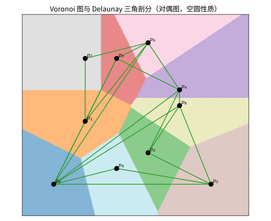

> **直观理解（现实类比）**：Voronoi 图就像按"就近原则"划分的快递网点服务区——每个点归最近的网点管，边界恰好在两网点中间。Delaunay 三角剖分则是把相邻网点连起来拼成的网格，它保证三角形尽量"圆润"（最大最小角性质），如同用不产生细长三角形的方式给地形铺三角网格。

#### 课堂问答

**老师**：空圆性质说的是每个三角形的外接圆内不含其他点，那如果四个点正好共圆呢？

**学生**：结论——这时 Delaunay 三角剖分不唯一，出现退化情形。四个共圆点可被剖分成两种不同的三角剖分，两种都满足闭圆意义上的空圆性质。工程上通过符号扰动或选择不同对角线来消除二义性。

**老师（追问）**：凭什么说 Delaunay 剖分三角形质量最好？

**学生**：因为它等价于最大化最小角。对一条不合法的边做翻转，翻转过后的新三角形的最小角不小于原来，反复翻转直到所有边都满足局部 Delaunay 条件，就得到全局最大最小角。这正是有限元网格生成偏爱它的原因——避免狭长三角形导致数值病态。

**老师（拓展）**：那任意一个三角剖分如何变成 Delaunay？

**学生**：反复做边翻转：只要某条边不满足空圆（等价于两对角之和大于 $\pi$），就翻转它。可以证明这个过程一定终止，且最终结果在一般位置下唯一。所以 Delaunay 是局部条件推出全局最优的典范：局部看每条边合法，整体就得到最大最小角。

### 2.4 平面扫描

**平面扫描**（Plane Sweep）是一种算法设计范式，通过一条扫描线从左到右（或从上到下）移动，维护与扫描线相交的几何结构，在扫描过程中处理事件。

> **💡 直观理解（类比）**：平面扫描像"用一把移动的尺子从左往右划立面"——一次只处理与扫描线相交的局部信息，把二维找交点的难题简化成一维"当前碰到的先后顺序"。只有扫到关键位置（事件）才更新，像手术台上只处理眼前这条横切线附近的情况。

#### 课堂问答

**老师**：平面扫描为什么能把很多二维几何问题降到 $O(n\log n)$？

**学生**：结论——它把一个二维问题换成一维动态结构加事件调度。扫描线沿 $x$ 移动，任一时刻只有与扫描线相交的对象需要维护，而对象之间的相对顺序只在事件处改变，排序后总共 $O(n)$ 个事件。

**老师（追问）**：扫描线上要维护相交对象的上下顺序，这顺序凭什么保持稳定直到下一个事件？

**学生**：因为在两个相邻事件之间，没有对象进出，也没有对象相交，各对象的 $y$ 序不会交换——这正是交换只会发生在事件点的原因。这也是为什么必须用平衡二叉搜索树维护这个序列，才能在 $O(\log n)$ 内完成插入、删除、查询前驱后继；用普通数组每次插入都 $O(n)$，总代价会退化成 $O(n^2)$。

**老师（拓展）**：事件处理里有哪几种典型事件？

**学生**：以线段相交为例有三类：左端点事件（插入该线段，检查与上下邻居是否相交）、右端点事件（删除该线段，检查其上下邻居之间是否相交）、交点事件（交换两条线段顺序并记录交点）。平面扫描的精髓就是把是否会相交的检查限制到当前相邻的对象上。

### 2.5 点定位

**点定位**（Point Location）问题：给定一个平面 subdivision 和一个查询点，确定该点位于哪个区域中。

#### 课堂问答

**老师**：点定位问题的输入输出到底是什么？为什么值得单独研究？

**学生**：结论——输入是一个平面剖分（如三角剖分或梯形图）和一个查询点 $q$，输出 $q$ 落在哪个区域。它值得研究是因为单次朴素查找要遍历所有区域，是 $O(n)$；而实际系统里查询次数远多于预处理次数，所以要把预处理做成 $O(n\log n)$、查询做成 $O(\log n)$。

**老师（追问）**：三角剖分里能不能直接用沿直线走的办法定位？

**学生**：可以。从剖分的某个三角形出发，看 $q$ 是否在内部，否则穿过与 $q$ 所在方向同侧的那条边进入相邻三角形，这叫 walk。单次最坏是 $O(n)$，但随机起点下期望是 $O(\sqrt{n})$。若要保证 $O(\log n)$，得预先建更结构化的数据结构。

**老师（拓展）**：那个保证 $O(\log n)$ 的结构是什么？

**学生**：梯形图。给每条线段的端点作垂线，把平面切成梯形，再用有向无环图记录决策过程（先按 $x$ 判左右、再判在线上方还是下方）。构造是 $O(n\log n)$（随机增量期望），每次查询沿 DAG 走 $O(\log n)$ 步。常见误区是以为点定位要用平衡树——梯形图用的是 DAG，靠的是路径长度对数。

### 2.6 线段相交

**线段相交**问题：判断两条线段是否相交，或找出所有相交线段对。

> **💡 直观理解（类比）**：线段相交判断像"拉着几条绳子看会不会绞在一起"——判断两条是否交叉很直白，难的是在 $n$ 条中快速找出所有交叉对。平面扫描让绳子从左到右依次"上下"错位互查，只有相邻的才可能碰上，从而避免把每一对都逐一检查。

> **常见坑**：两条线段是否相交，不能只看"叉积符号"就下结论——必须结合**端点恰在对方直线上（共线 / 共端点）**的退化情形。常见的错误做法是把"叉积一正一负"当作充要条件，却漏掉两条线段在同一直线上重叠、或端点恰落在另一条线段中间的情形。稳妥的方案是：先用**矩形包围盒（bounding box）粗略排除**，再用叉积两侧符号判断，并把叉积为 $0$ 的"共线"情况单独处理。

#### 课堂问答

**老师**：判断两条线段 $AB$ 与 $CD$ 相交，最稳妥的判据是什么？

**学生**：结论——用四组叉积的符号判断跨立，再单独处理共线退化。记 $\operatorname{orient}(A,B,C)$ 表示 $C$ 相对有向直线 $AB$ 的转向。若 $\operatorname{orient}(A,B,C)$ 与 $\operatorname{orient}(A,B,D)$ 异号，且 $\operatorname{orient}(C,D,A)$ 与 $\operatorname{orient}(C,D,B)$ 异号，则相交；若某个为零，则进入共线或端点情形。

**老师（追问）**：为什么叉积一正一负不能作为充要条件？

**学生**：因为它只保证两条直线相交，没保证线段相交。真正要求两条线段各自把对方的两端点分到直线两侧，即两个方向都要严格跨立。更常见的坑是漏掉叉积为零：端点恰在另一条线段所在直线上，甚至端点重合、线段共线重叠，这些都必须用包围盒与共线投影单独判断，否则会出现判出相交却没有交点的假象。

**老师（拓展）**：$n$ 条线段怎么找出所有交点？

**学生**：用平面扫描。按 $x$ 排序得事件队列，维护扫描线上对象顺序的平衡树，只在相邻线段之间做跨立判断。由于每对相邻线段只被检查常数次，若总交点数为 $k$，时间复杂度是 $O((n+k)\log n)$。注意复杂度里含 $k$——最坏情况所有线段两两相交，$k$ 本身就是 $O(n^2)$，这时没有比输出规模更优的算法，因为输出都要写 $k$ 个交点。

### 2.7 多边形三角剖分

**多边形三角剖分**：将多边形分割成不相交的三角形，其对角线不相交且完全位于多边形内部。

#### 课堂问答

**老师**：任意简单多边形都能三角剖分吗？剖分出来的三角形个数是固定的吗？

**学生**：结论——任意有 $n$ 个顶点的简单多边形都存在三角剖分，且恰好分成 $n-2$ 个三角形、用掉 $n-3$ 条对角线。个数与剖分方式无关，这是组合不变量。

**老师（追问）**：那凭什么保证一定存在？怎么算出来？

**学生**：用耳定理：每个简单多边形至少有两个耳，一个耳是顶点 $v_{i-1},v_i,v_{i+1}$ 构成的三角形，其对角线完全落在多边形内部。每次切掉一个耳，顶点数减一，归纳下去到三角形就是 $n-2$ 个。判定耳可用叉积看凸性，再检查有没有其他顶点落进三角形内。

**老师（拓展）**：朴素的找耳算法复杂度是多少？能更快吗？

**学生**：朴素做法每轮找耳要 $O(n)$，共 $n$ 轮，是 $O(n^2)$。用更聪明的策略——先把多边形剖分成单调碎块再合并——可以做到 $O(n\log n)$；精心设计还有线性时间的算法。常见误区是以为耳切法总是线性的，其实每轮重新找耳才是 $O(n^2)$ 的根源。

### 2.8 最近点对

**最近点对**问题：给定平面上的 $n$ 个点，找出距离最近的两个点。

> **💡 直观理解（类比）**：最近点对问题像"在操场找挨得最近的两颗钉子"——暴力要两两量（$n^2$），而分治先左右各找最紧的一对，再只看中间一条窄带里可能更近的跨界点。真正还要再查的只剩极少几个点，因此快得惊人。

#### 课堂问答

**老师**：暴力是 $O(n^2)$，分治怎么把最近点对压到 $O(n\log n)$？

**学生**：结论——左右各递归求最近距离取 $\delta=\min(\delta_L,\delta_R)$，然后只考虑跨越中线的点。构造宽 $2\delta$ 的竖直带 $B$，把 $B$ 内点按 $y$ 排序，每个点只需检查其后 $y$ 差小于 $\delta$ 的常数个点。

**老师（追问）**：为什么带内每个点只需要查常数个邻居？这是关键。

**学生**：因为把 $2\delta\times\delta$ 的矩形切成若干个边长 $\delta/2$ 的小方格后，每个小方格里至多一个点——否则同侧两点距离小于 $\delta$，与 $\delta$ 是左右内部最近距离矛盾。所以矩形内总点数被 $\delta$ 卡成常数（可证不超过 7）。于是合并只需线性时间，递推 $T(n)=2T(n/2)+O(n)$ 由主定理得 $O(n\log n)$。

**老师（拓展）**：为什么排序预处理不算额外开销？

**学生**：若在每层都重新排序 $B$，合并就变成 $O(n\log n)$，总复杂度恶化到 $O(n\log^2 n)$。正确做法是预处理一次按 $y$ 排序的数组，递归时像归并排序那样沿用，使每层合并只是 $O(n)$ 的归并。常见误区是忽略这一步，给出 $O(n\log^2 n)$ 却以为是最优。

### 2.9 几何数据结构

- **KD树**：$k$ 维空间中的二叉树，每个节点按某一维划分空间
- **R树**：B树在高维空间的推广，用于空间索引
- **四叉树**：递归地将平面划分为四个象限

> **💡 直观理解（类比）**：KD 树、R 树、四叉树就像给空间"装索引"的抽屉系统——像查词典一样按维度或象限不断二分、四分，把漫无目的的全空间搜索变成沿着树干快速下潜。它们是地图软件、游戏引擎做"找最近邻、框定范围"的幕后功臣。

#### 课堂问答

**老师**：KD 树、R 树、四叉树，它们解决的共同问题是什么？

**学生**：结论——都是空间索引，把范围查询和最近邻查询从线性扫描降到亚线性。KD 树按维度轮流用超平面切分空间，是一棵二叉搜索树；四叉树每次把平面均匀切成四块；R 树用最小包围矩形给数据分组，是 B 树的空间版。

**老师（追问）**：KD 树做最近邻查询，为什么平均好但最坏会退化？

**学生**：因为 KD 树的分割平面依赖数据分布。若数据在某一维高度聚集，节点会变得很偏，树高可能退化到 $O(n)$，查询也随之最坏 $O(n)$。而且维数一高，$k$-d 树的剪枝几乎失效——高维空间里点到超平面的距离信息区分度下降，这就是维度灾难。

**老师（拓展）**：那高维或动态数据该用什么？

**学生**：高维近似最近邻常用基于图或哈希的方法（如 HNSW、LSH），放弃精确性换速度。要是数据频繁增删，R 树（或它的变体 R* 树）比 KD 树更合适，因为它按矩形批量组织、节点扇出大、树高低。常见误区是拿 KD 树去索引动态高维数据，那既不是最优也不稳定。

### 2.10 几何对偶与半平面交

**几何对偶**：将点与直线建立对偶关系，例如点 $(a, b)$ 对偶为直线 $y = ax - b$。

> **💡 直观理解（类比）**：几何对偶像"把点和线互换角色"的翻译器：点 $(a,b)$ 翻成直线 $y=ax-b$。原本"点是否在线上方"的问题，被翻译成"两条对偶直线哪条在上"——把几何直观难题换成代数上好算的问题，如用镜子把难题照成容易的倒影。

**半平面交**：求多个半平面的交集，通常是一个凸多边形（可能无界）。

> **💡 直观理解（类比）**：半平面交像"把无数束射灯的光照重叠起来"——每个半平面是一束单侧有光的手电，手电多了，共同照亮的区域就是一个（可能无界）的凸多边形。只要把几条直线约束都取交集，就能用一个凸形框出可行区，是判定点是否在凸多边形内的基础。

---

#### 课堂问答

**老师**：几何对偶有什么用？点 $(a,b)$ 为什么对偶成直线 $y=ax-b$ 而不是别的？

**学生**：结论——对偶是为了把点与线的位置关系翻译成线与线的上下关系，从而把凸包问题变成半平面交问题。取这个特定形式是为了保持点在直线上方与对偶点在上方的对应：点 $(a,b)$ 在直线 $y=mx+c$ 上方的条件，与对偶直线之间的上下关系通过 $y=ax-b$ 双向保持。

**老师（追问）**：那凸包在对偶下到底变成什么？

**学生**：点集的上凸包对偶为对偶直线的下包络，即若干半平面的交。所以求凸包和求半平面交是同一件事的两种语言，这也是很多算法（如旋转卡壳、半平面交）能互译的原因。

**老师（拓展）**：半平面交怎么求，复杂度多少？

**学生**：可以用增量法：维护当前凸多边形，加入一条新半平面就对多边形做切割，总复杂度 $O(n^2)$；也可以先把半平面按角度排序再用双端队列维护，配合排序得到 $O(n\log n)$。要强调半平面交的结果可能是空的，也可能无界——判空与判无界必须显式处理，不能想当然认为总有界。

## 3. 定理与证明

### 3.1 凸包算法正确性证明 — Graham扫描

**定理1（Graham扫描正确性）**：Graham扫描算法正确计算点集的凸包。

**证明**：

设输入点集 $S = \{p_0, p_1, \ldots, p_{n-1}\}$，其中 $p_0$ 为 $y$ 坐标最小的点（若有多个则取 $x$ 最小）。其余点按与 $p_0$ 的极角从小到大排序为 $p_1, p_2, \ldots, p_{n-1}$。

算法维护一个栈 $H$，初始压入 $p_0, p_1, p_2$。对于每个 $i = 3, 4, \ldots, n-1$，执行：
- 当栈中至少有两个点且 $p_i$ 在栈顶两个点构成的向量的右侧（即非左转）时，弹出栈顶
- 将 $p_i$ 压入栈

**不变式**：在处理完 $p_i$ 后，栈 $H$ 中的点按顺序构成点集 $\{p_0, p_1, \ldots, p_i\}$ 的凸包。

我们用数学归纳法证明。

**基情况**：$i = 2$ 时，三个点 $p_0, p_1, p_2$ 的凸包就是它们本身（按极角排序后，这三点构成三角形），不变式成立。

**归纳步骤**：假设处理完 $p_{i-1}$ 后，栈 $H$ 包含 $\{p_0, p_1, \ldots, p_{i-1}\}$ 的凸包顶点。现在考虑加入 $p_i$。

由于点按极角排序，$p_i$ 位于所有已处理点的"右侧"。对于栈顶的两个点 $p_{k-1}$ 和 $p_k$（$p_k$ 为栈顶），考虑向量 $\overrightarrow{p_{k-1}p_k}$ 和 $\overrightarrow{p_kp_i}$：

- 如果 $\overrightarrow{p_{k-1}p_k} \times \overrightarrow{p_kp_i} \leq 0$（即叉积非正，表示非左转），则 $p_k$ 不可能是凸包顶点。这是因为 $p_k$ 位于三角形 $p_{k-1}p_ip_0$ 内部（或边上），可以从凸包中删除。

- 重复此过程直到栈顶满足左转条件，此时 $p_i$ 位于当前凸包的"外部"，将其加入栈中。

**正确性**：经过上述过程，栈中保存的正是所有凸包顶点，且按逆时针顺序排列。算法结束时，栈 $H$ 即为 $S$ 的凸包。

**复杂度**：排序 $O(n \log n)$，每个点至多入栈和出栈一次，故线性扫描 $O(n)$，总复杂度 $O(n \log n)$。

#### 课堂问答

**老师**：证明 Graham 扫描正确性时，归纳法的不变式应该怎么陈述才严谨？

**学生**：结论——处理完 $p_i$ 后，栈内点按顺序构成 $\{p_0,\dots,p_i\}$ 的凸包。基情况 $i=2$ 时三点即自身凸包；归纳步假设 $i-1$ 成立，加入 $p_i$ 时不断弹栈直到出现左转。

**老师（追问）**：为什么弹出非左转的点不会误删真正的凸包顶点？

**学生**：设栈顶为 $p_{k-1},p_k$，若 $\overrightarrow{p_{k-1}p_k}\times\overrightarrow{p_kp_i}\le 0$，则 $p_k$ 位于直线 $p_{k-1}p_i$ 的右侧，又因为点已按极角排序、$p_i$ 在所有已处理点的外侧方向，$p_k$ 必然落在三角形 $p_{k-1}p_i$ 与 $p_0$ 构成的区域内部或边上，故不可能是凸包顶点，删除安全。反复弹出后，栈顶三点的叉积为正，说明是凸转角。

**老师（拓展）**：这套证明里按极角排序这一前提如果被破坏会怎样？

**学生**：整个归纳就崩了。极角排序保证 $p_i$ 永远在已有凸包的外侧，弹出的点可以被永久丢弃；一旦顺序乱了，被弹出的点可能在后续重新变成凸包顶点，算法就不正确了。这也是为什么必须先用 $O(n\log n)$ 排序——排序不只为了效率，更是正确性的前提。常见误区是把排序当成纯粹的加速步骤。

### 3.2 Voronoi图的性质与构造

**定理2（Voronoi图的基本性质）**：设 $S = \{p_1, p_2, \ldots, p_n\}$ 为平面上 $n$ 个点（无三点共线，无四点共圆），则：
1. 每个Voronoi区域 $V(p_i)$ 是凸多边形（可能无界）
2. Voronoi图有 $O(n)$ 个顶点和边
3. 若 $p_i$ 和 $p_j$ 的Voronoi区域相邻，则它们的公共边是线段 $p_ip_j$ 的垂直平分线的一部分

**证明**：

**性质1**：$V(p_i) = \bigcap_{j \neq i} H(p_i, p_j)$，其中 $H(p_i, p_j) = \{x \in \mathbb{R}^2 \mid d(x, p_i) \leq d(x, p_j)\}$ 是半平面（由线段 $p_ip_j$ 的垂直平分线划分）。半平面是凸集，凸集的交集仍是凸集，故 $V(p_i)$ 是凸的。

**性质2**：Voronoi图是平面图。由Euler公式 $V - E + F = 1 + C$（考虑无界面），其中 $C$ 为连通分量数。由于每个Voronoi顶点至少是三条边的交点，且每个Voronoi区域至少有三条边，可以推导出 $V \leq 2n - 5$，$E \leq 3n - 6$。

**性质3**：若 $x$ 在 $V(p_i)$ 和 $V(p_j)$ 的公共边上，则 $d(x, p_i) = d(x, p_j)$，且对任意 $k \neq i, j$，有 $d(x, p_i) \leq d(x, p_k)$。距离相等点的轨迹正是垂直平分线。

**平面扫描构造Voronoi图**（Fortune算法）：

Fortune算法使用平面扫描线从上到下移动，维护一个"海滩线"（beach line）——由若干抛物线弧组成，每个抛物线弧对应一个站点，其参数为站点到扫描线的距离。

**定理3（Fortune算法正确性）**：Fortune算法在 $O(n \log n)$ 时间内正确构造Voronoi图。

**证明概要**：

1. **事件**：算法处理两类事件——站点事件（遇到新的站点）和圆事件（三个抛物线弧交于一点，对应Voronoi顶点）。

2. **海滩线**：在海滩线上，点 $x$ 到最近站点 $p_i$ 的距离等于 $x$ 到扫描线的距离。海滩线由抛物线弧组成，相邻弧的交点称为"断点"。

3. **不变式**：扫描线以上部分，Voronoi图已完全确定。扫描线以下部分，Voronoi图由海滩线近似表示。

4. **正确性**：当扫描线到达某个站点时，该站点产生一个新的抛物线弧，初始时退化为垂直线。当三个抛物线弧相交时，产生一个Voronoi顶点。算法通过维护事件队列，按 $y$ 坐标递减处理所有事件，最终得到完整的Voronoi图。

5. **复杂度**：每个站点产生一个站点事件，每个Voronoi顶点对应一个圆事件，事件总数为 $O(n)$。每个事件处理时间为 $O(\log n)$，总复杂度 $O(n \log n)$。

#### 课堂问答

**老师**：证明 Voronoi 区域是凸多边形最干净的方法是什么？

**学生**：结论——把它写成半平面之交。$V(p_i)=\bigcap_{j\neq i}H(p_i,p_j)$，其中 $H(p_i,p_j)$ 是 $d(x,p_i)\le d(x,p_j)$ 的半平面。半平面是凸集，凸集之交集仍是凸集，所以 $V(p_i)$ 凸（可能无界）。一句话，每个区域都是若干半平面的交。

**老师（追问）**：Voronoi 图的复杂度为什么是 $O(n)$？这不是很多区域的交吗？

**学生**：因为它是平面图，用 Euler 公式 $V-E+F=1+C$。每个 Voronoi 顶点至少由三条边相交，每个区域至少三条边，配合计数可得 $V\le 2n-5$ 与 $E\le 3n-6$，都是线性的。它之所以不炸，关键是每条边都是某对站点垂直平分线上的一段，边只能来自成对关系，不会指数增长。

**老师（拓展）**：Fortune 算法里海滩线到底是什么？为什么用抛物线？

**学生**：海滩线是到扫描线距离等于到最近站点距离的点的轨迹。给定一个站点 $p$ 和水平扫描线，满足 $d(x,p)=d(x,\text{扫描线})$ 的点集正是一条抛物线（准线是扫描线、焦点是 $p$）。于是海滩线由若干抛物线弧拼成，弧与弧的交点就是当前已确定的 Voronoi 边。扫描到三弧共点时生成一个 Voronoi 顶点，这个事件对应圆事件。

### 3.3 Delaunay三角剖分的空圆性质

**定理4（Delaunay三角剖分的空圆性质）**：对于平面上的点集 $S$，三角剖分 $T$ 是Delaunay三角剖分当且仅当 $T$ 中每个三角形的外接圆内部不包含 $S$ 中的任何其他点。

**证明**：

**必要性**：假设 $T$ 是Delaunay三角剖分。由定义，Delaunay三角剖分是Voronoi图的对偶图。对于三角形 $\triangle p_i p_j p_k$，其外心是三个Voronoi区域 $V(p_i), V(p_j), V(p_k)$ 的交点（即Voronoi顶点）。由Voronoi图的定义，外心到 $p_i, p_j, p_k$ 的距离相等，且小于到其他任何站点的距离。因此，外接圆内不包含任何其他点。

**充分性**：假设 $T$ 中每个三角形的外接圆都是空的。考虑任意一条边 $p_i p_j$，它是两个三角形 $\triangle p_i p_j p_k$ 和 $\triangle p_i p_j p_l$ 的公共边（若为凸包边则只有一个三角形）。由空圆性质，$p_k$ 不在 $\triangle p_i p_j p_l$ 的外接圆内，$p_l$ 不在 $\triangle p_i p_j p_k$ 的外接圆内。这意味着 $p_i$ 和 $p_j$ 的Voronoi区域相邻，因此边 $p_i p_j$ 属于Delaunay三角剖分。

**推论**：Delaunay三角剖分最大化所有三角形的最小角（最大化最小角性质）。

**证明**：由空圆性质，若对Delaunay三角剖分中的一条边进行翻转（flip），得到的三角形的最小角不会更大。因此Delaunay三角剖分在所有可能的三角剖分中最大化最小角。

#### 课堂问答

**老师**：空圆性质为什么等价于是 Delaunay 剖分？

**学生**：结论——这是充要条件。必要性：Delaunay 是 Voronoi 的对偶，三角形 $\triangle p_ip_jp_k$ 的外心是三个 Voronoi 区域的交点，到三点距离相等且小于到其他站点距离，故外接圆内无点。充分性：若每个三角形外接圆皆空，则相邻两三角形共享边 $p_ip_j$ 的对顶点分别在对方外接圆外，说明 $p_i,p_j$ 的 Voronoi 区域相邻，边属于 Delaunay。

**老师（追问）**：为什么空圆能推出最大最小角？逻辑链条是什么？

**学生**：对一条不满足空圆的边做翻转，四边形另两个顶点的对角设为 $\alpha,\beta$。关键在于空圆条件等价于 $\alpha+\beta<\pi$ 时该边合法；当 $\alpha+\beta>\pi$ 时翻转能使最小角不减反增。反复翻转收敛到 Delaunay，最终在全体三角剖分中最小角最大。

**老师（拓展）**：退化情形（四点共圆）时 Delaunay 唯一吗？

**学生**：不唯一，但这不影响最大化最小角这个最优性——所有合法的 Delaunay 剖分最小角都相同。常见误区是把空圆写成严格不含，那样四点共圆时就找不到剖分了；正确写法是允许边界点，即外接圆内部不含点，圆周上的点按共圆判定处理。

### 3.4 最近点对的分治算法

**定理5（最近点对的分治算法正确性）**：给定平面上 $n$ 个点，可以在 $O(n \log n)$ 时间内找到距离最近的一对点。

**证明**：

**算法描述**：
1. **排序预处理**：将点按 $x$ 坐标排序，得到序列 $P_x$；按 $y$ 坐标排序，得到序列 $P_y$
2. **分治**：将 $P_x$ 从中点 $m$ 分为左右两半 $L$ 和 $R$
3. **递归**：分别计算 $L$ 和 $R$ 中的最近点对距离 $\delta_L$ 和 $\delta_R$，令 $\delta = \min(\delta_L, \delta_R)$
4. **合并**：考虑跨越中线的点对

**合并步骤的正确性**：

设中线为 $x = x_m$。构造带状区域 $B = \{(x, y) \mid |x - x_m| < \delta\}$。

选取 $B$ 中所有点，按 $y$ 坐标排序。对于每个点 $p \in B$，只需检查 $B$ 中 $y$ 坐标在 $[y_p, y_p + \delta]$ 范围内的点。关键观察是：在此 $\delta \times 2\delta$ 的矩形内，最多存在 $O(1)$ 个点。

**证明这个关键观察**：将 $\delta \times 2\delta$ 矩形划分为 $2 \times 4$ 个边长为 $\delta/2$ 的小正方形。每个小正方形内最多包含 $L$ 中的一个点或 $R$ 中的一个点（否则同侧的两点距离会小于 $\delta$，矛盾）。因此，矩形内最多有 $8 \times 2 = 16$ 个点（实际上可以证明最多 $7$ 个点）。

因此，对于每个点 $p \in B$，只需检查常数个后续点，合并步骤的时间复杂度为 $O(n)$。

**复杂度分析**：

$$
T(n) = 2T\left(\frac{n}{2}\right) + O(n)
$$

由主定理，$T(n) = O(n \log n)$。加上排序预处理 $O(n \log n)$，总复杂度 $O(n \log n)$。

#### 课堂问答

**老师**：证明分治合并是线性的，最关键的一步是什么？

**学生**：结论——证明带内每个点只需检查常数个后续点。把跨中线、宽 $2\delta$、高 $\delta$ 的矩形切成若干边长 $\delta/2$ 的小方格；每个小方格最多一个点，否则同侧两点距离小于 $\delta$，与 $\delta$ 的定义矛盾；故矩形内点数被常数界住。

**老师（追问）**：为什么每格至多一个点这个论证站得住？

**学生**：因为小方格的对角线长是 $\frac{\sqrt2}{2}\delta<\delta$。若某格内有两个同属 $L$ 或同属 $R$ 的点，它们距离就小于 $\delta$，而 $\delta$ 已是左、右各自内部的最近距离，矛盾。所以每格至多一个。注意只需用闭或开方格的约定处理落在边界上的点即可。

**老师（拓展）**：为什么直接检查所有 $y$ 差小于 $\delta$ 的点会让分析失效？

**学生**：那样可能检查到 $O(n)$ 个同 $y$ 附近的点而不自知。正确做法是先排序、再对每个点只回溯固定个数，把每次比较数压成常数。另一个常见误区是只在合并里排序——这会把复杂度抬到 $O(n\log^2 n)$；正确姿势是全程沿用预排序的 $y$ 数组做归并，递推 $T(n)=2T(n/2)+O(n)$ 才是 $O(n\log n)$。

### 3.5 最小圆覆盖的随机增量算法

**定理6（最小圆覆盖的随机增量算法）**：给定平面上 $n$ 个点，可以在期望 $O(n)$ 时间内找到覆盖所有点的最小圆。

**证明**：

**算法描述**：
1. 将点集随机打乱为 $p_1, p_2, \ldots, p_n$
2. 初始化圆 $C_2$ 为覆盖 $p_1, p_2$ 的最小圆
3. 对于 $i = 3$ 到 $n$：
   - 若 $p_i \in C_{i-1}$，则 $C_i = C_{i-1}$
   - 否则，$C_i$ 为覆盖 $\{p_1, p_2, \ldots, p_i\}$ 且 $p_i$ 在边界上的最小圆

**正确性**：我们证明每次迭代后 $C_i$ 是覆盖前 $i$ 个点的最小圆。

**归纳**：假设 $C_{i-1}$ 是覆盖 $\{p_1, \ldots, p_{i-1}\}$ 的最小圆。若 $p_i \in C_{i-1}$，则 $C_{i-1}$ 也覆盖 $p_i$，故 $C_i = C_{i-1}$ 是最小圆。若 $p_i \notin C_{i-1}$，则最小覆盖圆必须将 $p_i$ 放在边界上。算法递归地构造以 $p_i$ 为边界点的最小圆，保证正确性。

**时间复杂度分析**：

当加入第 $i$ 个点时，$p_i$ 不在当前圆内的概率是关键。由于点集是随机排列的，$p_i$ 在最终最小圆边界上的概率不超过 $3/i$（因为最小圆由至多三个点确定）。

因此，第 $i$ 步触发重构的期望次数为 $O(3/i)$，每次重构需要 $O(i)$ 时间。总期望时间：

$$
E[T(n)] = O\left(\sum_{i=1}^n \left(1 + \frac{3}{i} \cdot i\right)\right) = O(n)
$$

---

#### 课堂问答

**老师**：最小覆盖圆由几个点决定？为什么随机增量能达到期望 $O(n)$？

**学生**：结论——平面上最小覆盖圆由 2 个或 3 个边界点确定（两点确定直径，或三点确定外接圆）。随机打乱后，第 $i$ 个点落在前 $i$ 个点的最小覆盖圆边界上的概率是 $O(1/i)$，因为边界最多 3 个点、每个点等可能成为其中之一。

**老师（追问）**：那期望时间怎么算出来？

**学生**：第 $i$ 步触发重构的概率是 $3/i$，每次重构（以 $p_i$ 为边界点重新求解）是 $O(i)$，于是期望代价 $O(i\cdot 3/i)=O(1)$，求和得 $O(n)$。关键的若 $p\notin C_{i-1}$ 则 $p$ 必在 $C_i$ 边界上这一事实是正确性核心：最小覆盖圆若不含 $p$ 就盖不住它，$p$ 必须在边界上，否则可把圆向内侧微调缩小，矛盾。

**老师（拓展）**：为什么先随机打乱是必须的？

**学生**：因为概率分析依赖输入顺序随机、每个点成为边界点的机会均等。若按最坏顺序（比如点沿一条直线依次排开），每一步都可能触发 $O(i)$ 重构，退化成 $O(n^2)$。随机化把最坏情况发生概率压到极低，换来了期望线性的保证。常见误区是把期望 $O(n)$ 说成一定 $O(n)$——它只是期望时间，不是每次运行的最坏保证。

## 4. 示例

### 4.1 用Graham扫描计算凸包

**问题**：给定点集 $S = \{(0, 0), (1, 1), (2, 0), (1, -1), (0.5, 0.5), (1.5, 0.5)\}$，计算其凸包。

**解**：

**步骤1**：选择基准点 $p_0 = (0, 0)$（$y$ 坐标最小）。

**步骤2**：按极角排序：
- $p_1 = (1, 1)$，极角 $45^\circ$
- $p_2 = (2, 0)$，极角 $0^\circ$
- $p_3 = (1, -1)$，极角 $-45^\circ$
- $p_4 = (0.5, 0.5)$，极角 $45^\circ$
- $p_5 = (1.5, 0.5)$，极角 $\arctan(1/3) \approx 18.4^\circ$

排序后：$(0,0), (2,0), (1.5, 0.5), (1,1), (0.5, 0.5), (1,-1)$

**步骤3**：扫描过程：
- 初始栈：$[(0,0), (2,0), (1.5, 0.5)]$
- 处理 $(1,1)$：左转，入栈 → $[(0,0), (2,0), (1.5,0.5), (1,1)]$
- 处理 $(0.5, 0.5)$：$(1.5,0.5) \to (1,1) \to (0.5,0.5)$ 非左转，弹出 $(1,1)$；再检查 $(2,0) \to (1.5,0.5) \to (0.5,0.5)$ 左转，入栈 → $[(0,0), (2,0), (1.5,0.5), (0.5,0.5)]$
- 处理 $(1,-1)$：$(1.5,0.5) \to (0.5,0.5) \to (1,-1)$ 非左转，弹出 $(0.5,0.5)$；$(2,0) \to (1.5,0.5) \to (1,-1)$ 左转，入栈 → $[(0,0), (2,0), (1.5,0.5), (1,-1)]$

**结果**：凸包为 $(0,0) \to (2,0) \to (1.5,0.5) \to (1,-1) \to (0,0)$，即四边形。

### 4.2 Delaunay三角剖分在网格生成中的应用

**问题**：在有限元分析中，需要将区域分割为高质量的三角形网格。Delaunay三角剖分如何保证网格质量？

**解**：

Delaunay三角剖分具有以下有利于网格生成的性质：

1. **最大化最小角**：避免出现狭长三角形，提高数值稳定性
2. **空圆性质**：保证三角形形状的"均匀性"
3. **局部优化**：通过边翻转操作，可以将任意三角剖分转化为Delaunay三角剖分

**实际应用步骤**：
1. 在区域边界和内部布置节点
2. 计算节点的Delaunay三角剖分
3. 检查是否有三角形落在区域外部，删除之
4. 对质量不满足要求的三角形进行局部细化（插入新节点到外心处）

**示例**：考虑一个带有圆孔的正方形区域，使用Delaunay三角剖分生成的网格在圆孔附近自动加密，且三角形角度分布均匀，避免了"瘦长"三角形。

---

## 5. 习题

### 基础题

**习题 1**（凸包定义）给出平面上点集 $S$ 的凸包 $\operatorname{conv}(S)$ 的定义，并说明为什么凸包恒为凸多边形。

**习题 2**（叉积方向判断）写出二维叉积 $\operatorname{cross}(O, A, B) = (A-O)\times(B-O)$ 的定义，说明如何用它判断三点 $O, A, B$ 的转向（左转/右转/共线）。

**习题 3**（Graham 扫描）简述 Graham 扫描求凸包的算法步骤，并说明其时间复杂度。

**习题 4**（凸包顶点数）说明 $n$ 个点的凸包至多有多少个顶点，以及 $nh$ 算法（Jarvis 步进）的时间复杂度含义。

**习题 5**（Voronoi 图）给出平面上点集 $P$ 的 Voronoi 图定义，说明每个顶点 $p_i$ 的 cell $V(p_i)$ 是什么区域。

**习题 6**（Delaunay 三角剖分）解释 Delaunay 三角剖分的定义（空圆性质）以及它与 Voronoi 图的对偶关系。

**习题 7**（最近点对）描述分治求最近点对的大致框架。

**习题 8**（点定位）说明点定位问题的目标，以及在三角形剖分中基点定位的查询时间。

**习题 9**（半平面交）用几何解释半平面交的含义,以及它如何表达一个凸多边形。

**习题 10**（几何数据结构）解释为什么把平衡搜索树用于平面扫描中的水平序维护。

### 进阶题

**习题 11**（Graham 扫描正确性）证明 Graham 扫描得到的点列构成凸包，说明为什么按极角排序后单调栈能得到凸多边形。

**习题 12**（Voronoi 顶点）证明 Voronoi 图的每个顶点（cell 交点）到最近的两个位点距离相等，解释其对偶 Delaunay 三角剖分中该顶点对应一个外接圆。

**习题 13**（Delaunay 空圆）证明 Delaunay 三角剖分的空圆性质：每个三角形外接圆不含其他位点。

**习题 14**（最近点对分治）写出最近点对分治的递推 $T(n) = 2T(n/2) + O(n)$，并解释合并时为什么只需检查带内的 $O(1)$ 个点。

**习题 15**（最小圆覆盖）证明随机增量最小圆覆盖算法的期望复杂度为 $O(n)$，阐明"不在当前圆内才更新"的期望步数。

**习题 16**（线段相交扫描）用平面扫描判断线段相交，说明事件包括线段起点、终点、交点三类。

**习题 17**（凸包对偶）解释点对偶到直线（对偶变换 $p \leftrightarrow p^*$），说明凸包在对偶变换下对应半平面交。

**习题 18**（Voronoi 与 Delaunay 边数）证明平面点集 Delaunay 三角剖分的边数至多为 $3n-3-h$（$h$ 为凸包顶点数）。

**习题 19**（三角剖分点数）证明平面上 $n$ 个点（含凸包 $h$ 顶点）的任意三角剖分恰好具有 $2n - 2 - h$ 个三角形与 $3n - 3 - h$ 条边。

### 挑战题

**习题 20**（凸包与 Graham 复杂度下界）说明凸包在比较模型下为什么需要 $\Omega(n\log n)$ 的时间（规约到排序）。

**习题 21**（Delaunay 三角剖分最优性）证明 Delaunay 三角剖分在所有三角剖分中使最小角最大（LPP 性质）。

**习题 22**（Voronoi 图构建）描述 Fortune 平面扫描构建 Voronoi 图的算法，说明抛物线与 beach line 的作用。

**习题 23**（最小圆覆盖的正确性）证明随机增量最小圆覆盖中，"若 $p$ 不在圆 $C_{i-1}$ 内则 $p$ 必在 $C_i$ 边界上"这一关键事实。

**习题 24**（点定位的梯形图）描述梯形图（trapezoidal map）构造点定位数据结构的过程，说明其查询与构造复杂度。

**习题 25**（最近点对的概率支撑）用"每点被检查 7 次"证明分治最近点对合并的线性能做到——说明 $\delta \times 2\delta$ 矩形中每小格至多一个点。

**习题 26**（半平面交与对偶的二分查找）说明半平面交如何用于判断点是否位于凸多边形内，结合平衡树实现 $O(\log n)$ 支持。

### 探究题

**习题 27**（几何算法的鲁棒性与退化情形）探讨浮点计算对叉积、共线、退化输入（竖直、共圆）的处理，以及这些困难如何影响 Graham 扫描与 Delaunay 三角剖分的实现。

**习题 28**（与凸优化和线性规划的联系）讨论计算几何的凸包、半平面交与线性规划求交集的关系，以及几何算法思想（旋转卡壳、Chan 算法）如何解决低维优化问题。

**习题 29**（几何数据结构与近似）开放探讨 KD 树、四叉树、R 树等空间索引数据结构在点定位、最近邻、范围搜索中的角色，及其与近似最近邻算法的关系。

**习题 30**（计算几何的应用前沿）探讨论证计算几何在机器人运动规划、网格生成、分子建模、计算机图形学渲染与地理信息处理中的应用，并讨论其与深度学习、大规模几何数据的结合。

---

## 6. 习题答案与解析

### 基础题答案

1. **凸包定义** 点集 $S$ 的凸包 $\operatorname{conv}(S)$ 是包含 $S$ 的最小凸集，等价地，$\operatorname{conv}(S) = \{\sum_i \lambda_i p_i : \lambda_i \ge 0,\, \sum_i \lambda_i = 1,\, p_i \in S\}$（所有凸组合）。因它是有限个点凸组合的集合，边界由最多 $n$ 条线段围成，故为凸多边形（或退化线段、点）。

2. **叉积方向判断** $\operatorname{cross}(O,A,B)$ 是 $(A_x - O_x)(B_y - O_y) - (A_y - O_y)(B_x - O_x)$。若为正，从 $OA$ 转向 $OB$ 是逆时针（左转）；若为负是顺时针（右转）；若为零则三点共线。该符号是凸包排序与相交判定的基本工具。

3. **Graham 扫描** 选取最低点 $p_0$，其余点按 $p_0$ 的极角排序，用单调栈依次处理：栈顶与次顶点的叉积小于零（右转）则弹出，最后栈内点按序构成凸包。排序 $O(n\log n)$，扫描 $O(n)$，总体 $O(n\log n)$。

4. **凸包顶点数** 凸包顶点数至多为 $n$（在一般位置时）。Jarvis 步进每次沿最外层"礼物包围"取下一个顶点，每步 $O(n)$ 找最小偏转角点，$h$ 个顶点共 $O(nh)$。

5. **Voronoi 图** $V(p_i) = \{q \in \mathbb{R}^2 : d(q,p_i) \le d(q,p_j),\ \forall j \ne i\}$。它是所有距离 $p_i$ 不比任何其他位点更远的点的集合，是半平面的交，故为一（可能无界或空）凸多边形区域。

6. **Delaunay 三角剖分** 满足空圆性质的三角剖分：任意三角形外接圆内部不含其他位点。它与 Voronoi 图互为对偶：Delaunay 三角形对应于 Voronoi 顶点（外接圆圆心），Delaunay 边对应共用 cell 边的 Voronoi 边。

7. **最近点对（分治框架）** 把点按 $x$ 排序，中线分成左右两半分别递归求最近对，然后合并：考虑距中线 $\delta$（$=\min$ 左右最近距）带内的点，按 $y$ 排序并只检查每个点后固定数量的点，从而 $O(n)$ 合并，递推 $T(n) = 2T(n/2)+O(n)$ 得 $O(n\log n)$。

8. **点定位** 给定平面的三角剖分与一个查询点，确定它落在哪个三角形。用梯形图分层或 Kirkpatrick 结构可将查询时间做到 $O(\log n)$，构造 $O(n)$（期望）。

9. **半平面交** 半平面是 $\{x : a\cdot x \le b\}$（闭半平面）或其补；有限个半平面的交集是一个（可能为空或无界）凸区域。凸多边形恰是它的边的半平面的交，因此半平面交是凸多边形的"线性刻面"表示。

10. **几何数据结构（平衡树）** 平面扫描需动态维护与扫描线相交的线段集合，并按当前 $y$ 坐标排序。平衡搜索树支持 $O(\log n)$ 插入、删除与相邻查询，正好维持该垂直序，从而支撑线段相交与 Voronoi 扫描。

### 进阶题答案

1. **Graham 正确性** 按极角排序后，每次压入最外侧点。若当前三点的转向为右（叉积 $<0$），则中间点位于已连通凸区域内，直接弹出；若左转则可能是凸顶点而保留。栈底到栈顶恰好是按极角递增、无右转的三折线，闭合后形成最大凸多边形，即凸包。

2. **Voronoi 顶点与 Delaunay** 三个 cell 的共同顶点 $q$ 距 $p_1, p_2, p_3$ 等距（因 $q$ 在各 cell 边界上），故 $p_1p_2p_3$ 的外接圆之圆即 $q$，半径为该等距。所以 Delaunay 三角形外接圆圆心恰是 Voronoi 顶点，半径是无更近位点的边界的等距值。

3. **Delaunay 空圆** 若三角形 $p_ap_bp_c$ 外接圆内含某 $p_e$，则 $p_e$ 比三角形的三个顶点更近于圆心；交换一条对角线（把 $p_a p_b p_c$ 与相邻三角形重翻转）产生的新的剖分更优（最小角增大），矛盾于 Delaunay 的极大性。因此 Delaunay 三角形必为空圆。

4. **最近点对分治** $T(n)=2T(n/2)+O(n)$，解为 $O(n\log n)$。合并时把距中线 $\delta$ 内的各点按 $y$ 排序后，对每个点只需检查 $\le 7$ 个后续点：因为在 $\delta\times 2\delta$ 矩形中可划成 $4\times 2 = 8$ 个小 $\delta/2\times\delta/2$ 格，每格至多一个点（否则格内两点距离 $< \delta$）。故合并线性。

5. **最小圆覆盖随机增量** 算法按随机顺序插入，若点已在当前最小圆内直接跳过（概率高），否则以它为边界点增大圆并递归。第 $i$ 步在圆内的期望跳过次数使期望更新次数是 $\sum 3/i = O(\log n)$ 型，通过轮次外层即期望 $O(n)$。

6. **线段相交扫描** 事件是线段左端点、右端点与已求出交点。扫描线从左向右：到端点插入线段（将其加入有序结构），到右端点删除，当两条线段在扫描线上下相邻且交换位置时，记录交点并重新排序。这样在 $O((n+k)\log n)$ 内枚举全部交 $k$ 个。

7. **凸包对偶** 点 $p=(a,b)$ 对偶到直线 $p^* : y = ax - b$，直线对偶回点。点集 $S$ 恰好位于某直线上方，等价于其对偶直线（点）位于对偶系越过直线的一侧。于是 $S$ 的凸包对应半平面族 $\{y \le p_i^*(x)\}$ 的交（即其上包络），从而把凸包问题转化为半平面之交问题。

8. **Delaunay 边数** 设凸包顶点 $h$，Delaunay 三角剖分是非退化三角形的平面子图，由 Euler 公式 $V-E+F=2$（含外部凸包面）得三角剖分的三角形数 $= 2n-2-h$，边数 $= 3n-3-h$。故 Delaunay 边数至多为 $3n-3-h$。

9. **三角剖分点数** 由 Euler 公式 $V - E + F = 2$（含外界凸包面）。设内三角形 $T$ 个、外界 $1$ 个面，共 $n$ 顶点，外围 $h$ 顶点在外边。顶点度数与面关系给出 $3T + h = 2E_i$ 与 $E = E_i + h$。解方程得 $T = 2n - 2 - h$，$E = 3n - 3 - h$。

### 挑战题答案

1. **凸包比较下界** 给定 $n$ 个待排序实数 $x_1,\dots,x_n$，把它们映到抛物线 $y = x^2$ 上的点 $(x_i, x_i^2)$。这些点全在凸包上且按 $x$ 单调，凸包的给出顺序恰是对应排序。故若存在亚 $O(n\log n)$ 凸包算法，就有亚 $O(n\log n)$ 比较排序，矛盾。所以凸包比较模型需要 $\Omega(n\log n)$。

2. **Delaunay 三角剖分与最小角** LPP（MaxMin angle）性质说 Delaunay 三角剖分使所有三角形最小角最大。这由最小角不增于原三角剖分在任意边翻转下的最小角保序推出：翻转前后最小角只可能减小（等价于外接圆性质），反复翻转必停在局部最大，而 Delaunay（空圆）恰是全局最优三角剖分，从而得到最大最小角。

3. **最小圆覆盖正确性** 关键引理：最小圆 $C_i$ 若包含 $p_i$ 才是正确的。若 $p_i\notin C_{i-1}$，但声称 $p_i$ 不在 $C_i$ 边界上，即 $p_i \in \operatorname{int}(C_i)$。由 $C_i$ 是包含前 $i$ 点的最小圆，若 $p_i$ 在内部可把圆朝远离 $p_i$ 的方向略缩到仍含其余前 $i-1$ 点且更小，矛盾于最小性。故 $p_i$ 必在 $C_i$ 边界上，据此递归计算。

4. **梯形图点定位** 梯形图把平面按线段安排切分为梯形面单元：从上到下维护垂直序，每次加入一条线段定义一组新梯形；对每个梯形保存其左右线段。点定位时在这样的一棵决策树（垂直剖分）中下降，每层按 $x, y$ 比较，期望 $O(\log n)$ 查询，构造期望 $O(n\log n)$。

5. **最近点对合并** 把 $\delta\times 2\delta$ 窗口划分为 $4$ 列 $\times 2$ 行的 $\delta/2\times\delta/2$ 小格。任一小格内不能同时含两个带内点（否则它们距离 $\le \sqrt{2}\delta/2 < \delta$，矛盾于左右各自最近距 $\ge \delta$）。带内每点至多与其他 $7$ 个点（周围 $7$ 格）竞争最近，故检查每点后 $7$ 个即可。

6. **半平面交二分** 把凸多边形存储为有序边直线，判断点 $q$ 是否在内部等价于检查 $q$ 对 $n$ 个半平面约束。按对偶全部转成"上方/下方"约束后，用二分在平衡树上求约束中是否全部满足；配合预计算的下凸包/上凸包，可 $O(\log n)$ 判定点在凸多边形内外。

7. **Fortune 平面扫描** 一条中点保持在扫描线与其一位点 $p_i$ 等距的抛物线代表 $p_i$；所有抛物线之并（beach line 的下包络）即当前 Voronoi 前缘。事件分两类：位点事件使新抛物线点入 beach line，圆事件（三相邻 sitepoint 共同定义的外接圆与扫描线相切）产生 Voronoi 顶点。用平衡树维护 beach line、优先队列调度圆事件，总复杂度 $O(n\log n)$，得到完整的 Voronoi 图。

### 探究题答案

1. **鲁棒性与退化** 浮点叉积在共线或三点近共线时符号不可靠，退化输入（竖直边、共圆、三点共线、重复点）破坏一般位置假设。Graham 需处理极角相等取远点、竖直排序；Delaunay 需处理共圆（四点点共圆时剖分非唯一）。精确几何（exact predicates，如自适应精度叉积）与此类表结构是工程化计算几何的难点核心。

2. **与凸优化/线性规划** 凸包、半平面交本质是低维线性不等式求交集，两维半平面交可在 $O(n\log n)$ 完成，是二维线性规划的几何形式；旋转卡壳用于求凸多边形直径、对跖点，Chan 算法实现 $O(n\log h)$ 凸包。这些思想在多边形求交、最小外接矩形、支撑线性建模等低维优化中直接套用。

3. **几何数据结构与近似** KD 树、四叉树、R 树把空间按超平面切分以支持近邻、范围与点定位；点定位的梯形图与 Kirkpatrick 分层达成 $O(\log n)$。近似最近邻（ANN）则引入哈希、球树、LSH 等，牺牲精确性换取高维高数据量下的速度，与精确几何查询互为补充。

4. **应用与前沿** 计算几何在机器人路径规划（配置空间、可见图）、网格生成（Delaunay/Voronoi 网格）、分子几何与 CAD/CAM、图形学渲染（层次包围盒、BVH）、GIS 与卫星数据（多边形叠加、Voronoi 服务区）中基础而关键;近年与机器学习结合用于点云深度学习、几何重建与大规模近似。这些应用反过来催生对退化、鲁棒性与高维几何算法的持续需求。

---

## 7. 数学科普（Popular Mathematics）

### 7.1 凸包算法

把一堆钉子钉在木板上，用一根橡皮筋全部圈住再松手，皮筋绷紧后勾出的最外圈就是凸包。要找最小的凸多边形把所有点包进去，只需盯住那些最靠外的点。

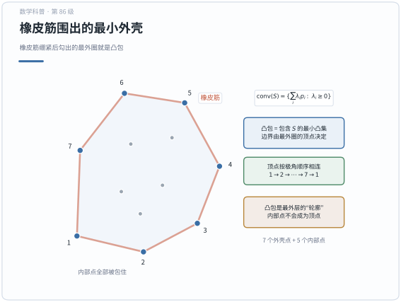

**一句话点破**：凸包是包住所有点的最小凸多边形，求凸包是计算几何的第一课。

### 7.2 Voronoi图

在城市里找最近的便利店，其实是在按离谁最近把地图分成一片片势力范围，每片地盘的边界恰好是到两家等距的直线。

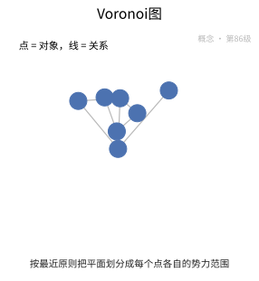

**一句话点破**：Voronoi 图把离谁最近这种查询，变成看一眼地图就能回答。

### 7.3 Delaunay三角剖分

给散落的点连三角形，尽量别让三角形又瘦又长。Delaunay 剖分要求每个三角形的外接圆里都不套住别的点，形状因此格外匀称。

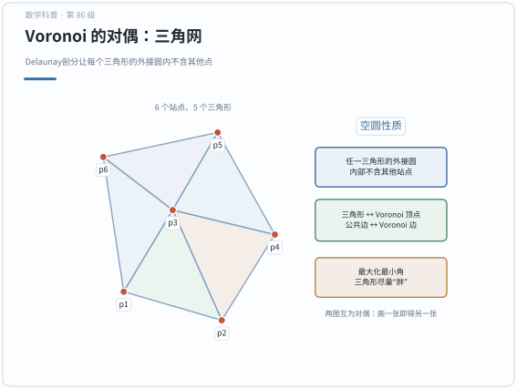

**一句话点破**：Delaunay 三角剖分是 Voronoi 图的对偶，以空圆性质换来漂亮均匀的网格。

### 7.4 平面扫描

像用一把竖直的尺子从左往右扫过整张图，只要记住和这把尺子相交的那几条线，扫过之处问题就被顺势解决。

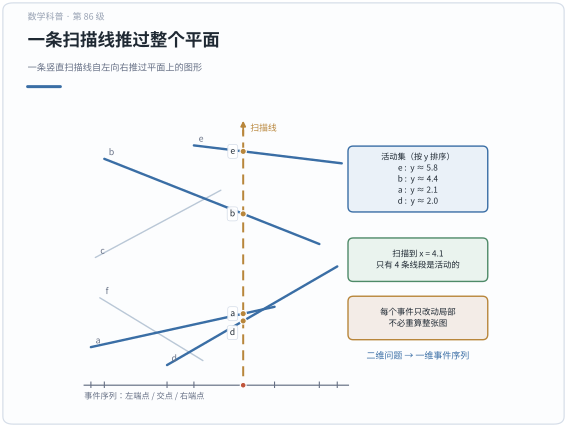

**一句话点破**：平面扫描把二维的几何问题化成一维的时间线，一路扫过即可求解。

### 7.5 点定位

在一个被划成很多块的平面里，想知道某个位置落在哪一块，好比在分区地图上按坐标查到自己的城区。

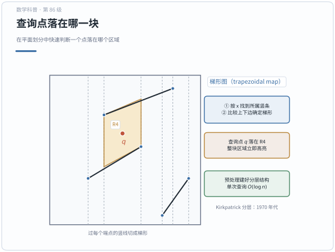

**一句话点破**：点定位回答「我在哪个区域」，靠预处理换取快速查询。

### 7.6 线段相交

一堆线段撒在平面上，哪些互相交叉？逐对比较太慢，沿扫描线前进并维护相邻次序，就能只盯住可能相交的少数几对。

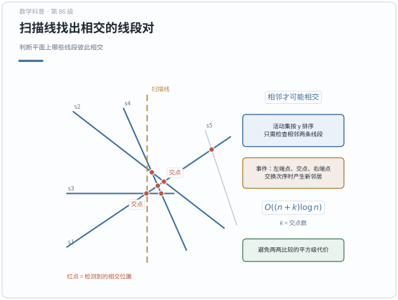

**一句话点破**：线段相交检测借助扫描线，避免两两比较的平方级代价。

### 7.7 多边形三角剖分

任意一个多边形都能被切成若干三角形而不留缝、不重叠，这样图形渲染、测量与计算的步骤都变得简单。

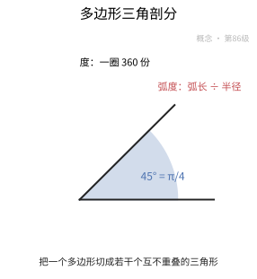

**一句话点破**：三角剖分把复杂多边形拆成一堆最简的三角形单元。

### 7.8 最近点对

在一大堆点里找挨得最近的两个，两两比较要花很多时间；分而治之把点群分半处理，再只看中线附近的窄带，工作量骤减。

**一句话点破**：最近点对问题展示了用几何结构把平方级任务降到近似线性的思路。

### 7.9 几何数据结构

要把空间里的点和区域组织起来以便快速查询，就像给图书馆的书编上索引，kd 树、范围树能把搜索范围越切越小。

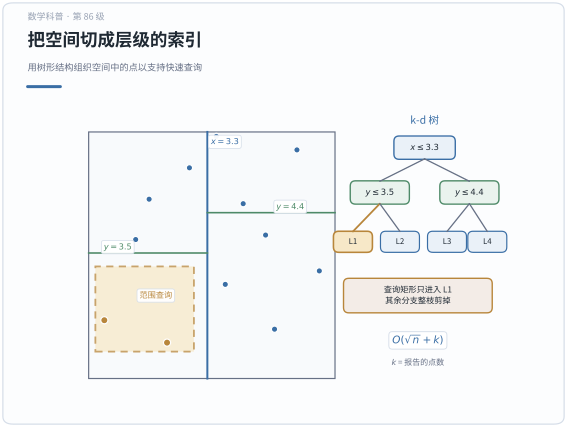

**一句话点破**：几何数据结构用索引换速度，让范围查询与近邻查询变得高效。

### 7.10 几何对偶与半平面交

点和直线可以互换身份：一个点对应一条线，三点共线则对偶的线交于一点。把难题换个视角看，往往就迎刃而解。

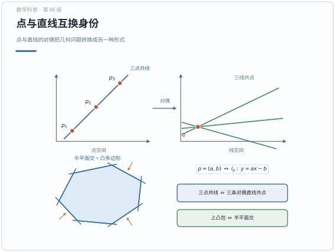

**一句话点破**：几何对偶换一个视角看问题，常能把上凸包与半平面交互相转化。

### 7.11 凸包算法正确性证明 — Graham扫描

Graham 扫描先选出最下面的点，再按极角把其余点排队，边走边判断「往左拐还是往右拐」来决定谁去谁留。

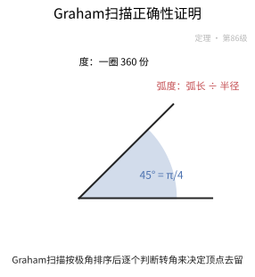

**一句话点破**：Graham 扫描用极角排序加栈的转角判定，保证每个非凸顶点都被正确剔除。

### 7.12 Voronoi图的性质与构造

每个点的领地都是一块凸多边形，而且只受邻近点约束。构造时常借分治或扫描线，把整张领地图一层层拼出来。

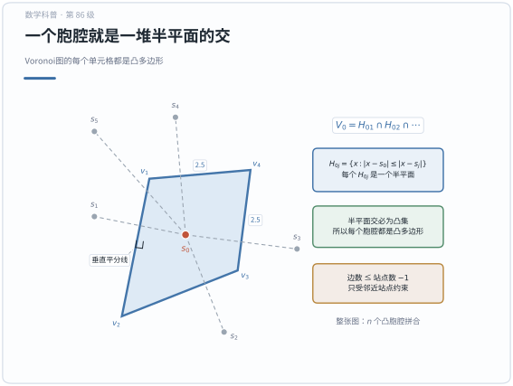

**一句话点破**：Voronoi 单元必为凸多边形，其构造可由分治或扫描线在近似线性时间内完成。

### 7.13 Delaunay三角剖分的空圆性质

空圆性质说的是：每个三角形的外接圆内部不能有别的点。只要有一条边违反它，把相邻两个三角形翻个对角线，矛盾就消除。

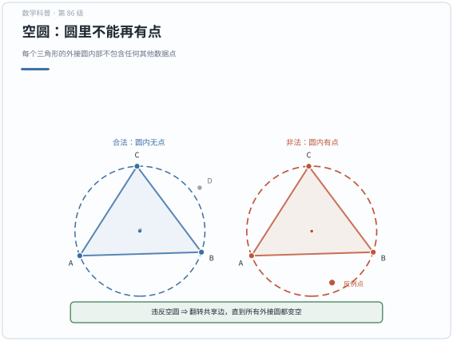

**一句话点破**：空圆性质刻画出 Delaunay 三角剖分，也保证它在所有剖分中最均匀。

### 7.14 最近点对的分治算法

把点按横坐标分成左右两半，各自求最近点对，再检查跨越中线的窄带。带内每个点只需和常数个相邻点比较，正是这一点让算法跑得快。

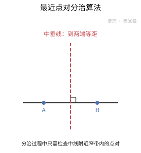

**一句话点破**：最近点对分治的关键，是把窄带内每点仅需常数次比较说清楚，从而得到 $O(n\log n)$ 的复杂度。

### 7.15 最小圆覆盖的随机增量算法

想用最小的圆把所有点盖住，可以先把点随机打乱，再一个个加进来：新点若落在圆外，就重新定一个经过它的最小圆。

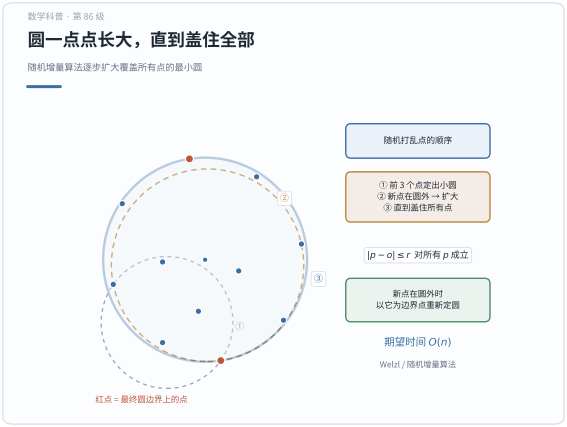

**一句话点破**：随机增量算法以期望线性的时间求出覆盖全部点的最小圆。
## 8. 数学史（History of Mathematics）

> 计算几何的历史，是一部"把几何答案算出来"的学科诞生史：从古希腊规尺作图的直觉、坐标几何的数值恐惧，到 20 世纪 70 年代计算机让"几何问题如何高效求解"成为独立课题，最后由凸包、扫描、剖分与随机增量法铸成一套算法与结构语汇。它的主线是"算法学"与"几何学"的联姻——从纯存在论证走向可计算复杂性，并渗入图形学、机器人、GIS 与现代工程信息处理。

### 1. 前置：几何很慢、算法很晚

- 从这个意义上说，计算几何是“可计算性”在几何上的投影——它追问的,不是点与线能否存在，而是关于它们的答案能否在可承受的时间内被求得。
- 传统几何学（欧几里得、笛卡尔坐标、解析几何）关心**存在与构造**，却几乎不问"构造需多少步"，因为一支笔一张纸的算力只需一次。
- 当数据量爆炸（几千个点、几万条边），几何问题的**时间开销**才浮出水面：朴素的 $O(n^2)$ 或 $O(n^3)$ 做法立刻不可行，这为"高效几何算法"埋下深刻伏笔。

### 2. 凸包：计算几何的第一课

- 凸包还天然承载了“几何形状的最简描述”：去掉多余内部点、只留外壳点，是无数可视与碰撞检测算法共享的预处理。
- **凸包（convex hull）**——包围点集的最小凸多边形——是最能体现"几何+算法"结合的入门对象，被反复当作算法教科书的第一道几何题。
- 从 **Jarvis march（1973）**、**Graham 扫描（1972）** 到 1978 年的**分治算法**，凸包问题在 70 年代被彻底厘清，$O(n\log n)$ 也成为此后几何算法复杂度的"黄金标尺"。

### 3. Jarvis 步进与 Graham 扫描

- 两种算法正好一个“慢而直观”、一个“快而有章法”，成为算法教材里讲解几何复杂度取舍的经典对照。
- **Jarvis 步进**逐点"包皮"地向外围扩张，虽简单但最坏是 $O(n^2)$；而 **Graham 扫描**用极角排序 + 一次栈扫描把复杂度压到 $O(n\log n)$。
- Graham 扫描的出现在当时是巨大鼓舞——它表明几何问题的瓶颈不在"几何上的难",而在**排序与线性扫过**，这条思路贯穿了此后几乎所有扫描类算法。

### 4. Voronoi 图：点集最近域的划分

- 每个 Voronoi 区域是一条又一条单位和垂直平分线围成的凸多边形，这种“最近支配区”的概念在无线网络、分子结构与人际影响圈中反复出现。
- 给一组站点，把平面按"最近站点"切成**区域**，就是 **Voronoi 图**；它把"距离"这个几何量转化为一张组合平面图，天然适配算法处理。
- **Voronoi（1908）** 在晶体学与气象学的古老应用被 Shamos 等人重新作为算法对象提出，其**分治构造**与**结构性质**（邻接关系、对偶性）在 1975—1978 年间被透彻研究。

### 5. Delaunay 三角剖分：Voronoi 的对偶

- Delaunay 与 Voronoi 互为对偶的关系还带来了深层的经济性：构建其一即可对称地推得其另一，算法由此可以复用。
- **Delaunay 三角剖分**是 Voronoi 图的**对偶**，满足"空圆"性质——每一个三角形外接圆内不包含其他点，因而自动避开"胖三角形"。
- 空圆性质让 Delaunay 剖分在**网格生成、有限元、地形建模**中大放异彩，也让"好三角剖分"第一次有了算法化的严格定义。

### 6. 平面扫描：从线段到轮廓的统一武器

- 扫描线的巧妙之处，在于把“谁比谁先接触扫描线”这个几何问题改写为“处理事件序列”，从而套用平衡树等成熟工具。
- **线扫描（sweep line）**把"二维相交"问题化为"一维排序 + 事件处理"，是计算几何最优雅的通用技巧之一。
- **Bentley–Ottmann（1979）** 用平面扫描求线段交点，达到 $O((n+k)\log n)$；**扫描线的"维护当前活动集合"**思想随后被复用进点定位与 Voronoi 构造，成为贯穿多类问题的骨架。

### 7. 点定位：问"我在哪个区域"

- 点定位也被用在几何结构的“增量维护”里：插入新点时先定位落点，再局部重连，避免整幅重构。
- 给定一张平面分区，任意查询点问"它落在哪个区域"，就是**点定位（point location）**；它把静态几何结构变成可快速查询的数据结构。
- 从 1970 年代的梯形图分解到 **Kirkpatrick 的分层结构**，点定位的时间被优化到对数级，为几何结构的"查询—构建"平衡树立典范。

### 8. 线段相交与最近点对

- 这两问题是“剪枝—分治”思想的最佳练兵场：用几何滤掉无关对，只对近似区域内的少数组合做精细比较。
- **线段相交检测**在 VLSI 设计与图形裁剪中举足轻重，其"是否相交、何处相交、是否整体成对"版各有经典算法。
- **最近点对**用分治达到 $O(n\log n)$，把"距离比较"从看似必然的 $O(n^2)$ 中解放，再次印证分治在几何中的威力。

### 9. 几何数据结构：kd-tree 与范围搜索

- 这类索引结构把“维数灾难”摆到台面上——维数升高时，朴素的 kd-tree 检索会退化，这催生了 R-tree、ball tree 等更稳健的变体。
- 要让几何结构可"被检索"，需要**空间索引**：**kd-tree、四分树（quadtree）、R-tree** 等把点、矩形、多边形组织成可快速回答范围查询的层级结构。
- 这类结构与**多维范围搜索、最近邻**问题深度绑定，是计算几何从"一次性算法"走向"可支撑应用的数据结构"的标志。

### 10. 学科的独立：Shamos 与计算几何的命名

- 学科正式化之后，几何问题的复杂度下界、输入模型与退化处理获得了严谨讨论，“计算几何=几何+算法+复杂性”的共识逐步形成。
- **Michael Shamos**（1975）以博士论文《计算几何》正式为一个新学科命名，提出"用算法与复杂性眼光研究几何问题"的纲领。
- 与 **Preparata、de Berg、Edelsbrunner** 等人的专著相继问世，计算几何在大学课程与工程应用中获得独立身份，模型（RAM、实数 RAM 与复杂度）随之确立。

### 11. 随机增量与近似算法

- 随机增量把“难构造”换为“期望高效”，是几何算法中最具概率精神的一支，也是后来蒙特卡洛几何方法的先行。
- 许多几何结构（Delaunay、凸包的最坏情况）可用**随机增量**以期望线性/近线性的时间构建，如**最小圆覆盖的 Welzl 算法**。
- 当问题本身对输入敏感或 NP-难时，**近似算法与 ε-近似**成为主流，让计算几何学会与"不够精确"共处，也能给出实用快速解。

### 12. 现代应用与开放方向

- 高维数据与最坏情形复杂性仍是未竟之业：如何在巨大的维数与复杂输入下既保证界、又保持实用，是计算几何面向未来的关键课题。
- 计算几何已深度嵌入**计算机图形学、机器人路径规划、地理信息系统（GIS）、电路设计、分子建模与机器学习（如支持向量机几何）**。
- 从**运动规划、α-形状**到**高维计算几何与最坏情形复杂性**，这个学科仍在为自己的"几何答案"寻找更快、更稳的算法——它的故事远未结束。

### 历史年表

| 时间 | 人物／文献 | 事件与贡献 |
|---|---|---|
| 1908 | Voronoi | 研究平面最近区域划分（Voronoi 图前身） |
| 1972 | Graham | 提出 $O(n\log n)$ 凸包扫描算法 |
| 1973 | Jarvis | 提出凸包的包络式步进算法 |
| 1975 | Shamos | 博士论文命名"计算几何"，提出学科纲领 |
| 1975—1978 | Shamos 等 | 分治构造 Voronoi 图与 Delaunay 剖分 |
| 1979 | Bentley、Ottmann | 平面扫描求线段交点，$O((n+k)\log n)$ |
| 1979—1980 年代 | Preparata、Edelsbrunner 等 | 建立几何数据结构与计算几何专著体系 |
| 1980 年代 | Kirkpatrick 等 | 点定位分层结构，对数查询时间 |
| 1980—1990 年代 | 各界 | α-形状、随机增量、近似算法相继成熟 |

> 从规尺作图的优雅到递归扫描的效率，从 Voronoi、Delaunay 的对偶到 kd-tree、点定位的数据结构，计算几何把"几何直觉"翻译成"算法复杂度"，让数学的美丽形态可以被计算机即时处理。它既是组合几何的算法面，也是工程世界与纯几何之间的万能翻译。

## 9. 总结

本节介绍了计算几何的核心概念与算法：

| 概念 | 关键算法 | 时间复杂度 |
|------|---------|-----------|
| 凸包 | Graham扫描 / Jarvis步进 | $O(n \log n)$ / $O(nh)$ |
| Voronoi图 | Fortune算法（平面扫描） | $O(n \log n)$ |
| Delaunay三角剖分 | 增量构造 / 边翻转 | $O(n \log n)$ |
| 最近点对 | 分治算法 | $O(n \log n)$ |
| 最小圆覆盖 | 随机增量算法 | 期望 $O(n)$ |
| 线段相交 | 平面扫描 | $O((n+k)\log n)$ |
| 点定位 | 梯形图 / 分层结构 | $O(\log n)$ 查询 |

计算几何的核心思想包括：
- **平面扫描**：将二维问题转化为一维事件序列
- **分治策略**：将问题分解为子问题，合并时利用几何性质
- **随机增量**：随机化顺序降低期望复杂度
- **对偶变换**：将几何问题转化为代数问题

这些算法和数据结构构成了计算机图形学、机器人路径规划、地理信息系统等领域的理论基础。

---

## 10. Stewart 风格专题

> 本节以 James Stewart *Calculus* 的教学编排为蓝本：用「四步解题流程」贯穿概念检查、分步骤工作示例、小规模应用项目与梯度化自测习题，帮助你在动手计算中建立对计算几何核心算法的肌肉记忆。小节间相互独立，可按需跳读。

### 8.1 问题求解四步流程（Problem-Solving Strategy）

> Stewart 力推的策略是把每个问题拆成四步：**理解 → 计划 → 执行 → 回看**。这里把每一环落到计算几何语境的追问上。

| 步骤 | 行动 | 计算几何中的具体追问 |
|:---|:---|:---|
| ① 理解 | 复述问题、圈出已知与目标 | 输入是点、线段还是多边形？要凸包顶点还是全体点？要最近距离还是最近点对？坐标取整还是浮点？ |
| ② 计划 | 选择可行算法、预估方向与复杂度 | 用平面扫描排事件、分治拆解最近点、随机增量构造凸包？先判 $O(n\log n)$ 能否接受，还是退化到 $O(nh)$ 亦可。 |
| ③ 执行 | 按计划逐步推导、保留几何判据 | 每步写明依据（叉积转向、空圆、跨立），排序关键字、正负号、邻接关系别写反。 |
| ④ 回看 | 核对结果、检验退化情形 | 结果对共线、重合、浮点判等是否仍稳健？能否换一条算法复核？把交点、距离代回原式验证。 |

> 💡 **策略演示**：判定线段 $l_1:(0,0)\to(1,1)$ 与 $l_2:(0,1)\to(1,0)$ 是否相交。
> ① 理解：一般位置的两线段求交，属「交点检测」题型。② 计划：用跨立试验（两线段互相跨越对方所在直线）。③ 执行：由参数 $t=s=\tfrac12$ 可同时满足两线段，跨立成立。④ 回看：代回 $l_1(\tfrac12)=(\tfrac12,\tfrac12)$ 确在两条线段上，答案合理。

### 8.2 概念检查（Concept Check）

> 先用一组判断题与选择题快速自检核心概念。每道题的判断均应落到书面理由（用一句话即可）。

**判断正误**（说明理由）：

1. 若凸包计算的输入含共线点，任何线性排序的扫描算法都不能得到正确凸壳。（　）
2. 平面扫描（sweep line）不只用于线段求交，也能用来构造 Voronoi 图。（　）
3. 凸包边界上相邻三条边转向始终同号（同方向），这提供了一种凸性校验。（　）
4. 最近点对的分治算法，在合并阶段只需检查中位线两侧 $2\delta$ 条带内、按 $y$ 排序后相邻的常数个点。（　）
5. Delaunay 三角剖分中，每个三角形外接圆的内部都不含其他输入点（空圆性质）。（　）
6. Voronoi 图与 Delaunay 三角剖分互为对偶图。（　）
7. 线段相交的跨立试验总是能自然处理退化情况（端点接触、共线），无需任何特判。（　）
8. 三点叉积的符号能可靠判断三点按逆时针还是顺时针排列。（　）

**选择**：

9. 用 Graham 扫描计算 $n$ 个点凸包的最坏情况渐进复杂度是（　）。
   - A. $O(n)$　B. $O(n\log n)$　C. $O(n^2)$　D. $O(nh)$
10. 当 Delaunay 三角剖分的空圆性质被破坏时，用来修复的局部操作通常是（　）。
   - A. 删除顶点　B. 边翻转　C. 三角分裂　D. 顶点插入
11. 最近点对分治算法在合并步骤中，条带内每个点只需与后续至多（　）个点比较即可。
   - A. $1$　B. $2$　C. $7$　D. $n$

### 8.3 分步骤工作示例（Worked Examples）

> 每道示例严格套用四步流程，并在「回看」中给出一条易错点或检验法。

**示例 S1：用单调链（Monotone Chain）计算凸包**

> **问题**：对点集 $P=\{(0,0),(1,0),(1,1),(0,1),(0.4,0.4)\}$，求凸包顶点并剔除内部点。

- ① 理解：输入 5 个点，需求凸包的边界顶点，须识别哪个点在内部。
- ② 计划：把点按横坐标排序，构造下链与上链，用叉积转向剔除凹进去的中间点。
- ③ 执行：

$$
\begin{aligned}
&\text{排序按 }x:(0,0),(0.4,0.4),(1,0),(1,1),\\
&c=(p_b-p_a)\times(p_c-p_b),\quad p_a=(0,0),\ p_b=(0.4,0.4),\ p_c=(1,0).
\end{aligned}
$$

  代入 $c=(0.4,0.4)\times(0.6,-0.4)=-0.16-0.24=-0.40<0$，为顺时针，故中间点 $(0.4,0.4)$ 被剔除。
- ④ 回看：凸包顶点恰为 $(0,0),(1,0),(1,1),(0,1)$ 四个。**易错点**：下链/上链的叉积符号约定不一致会把内点误判为边界；排序应先按 $x$ 再按 $y$。

**示例 S2：用分治计算最近点对**

> **问题**：对 $S=\{(0,0),(1,1),(2,0.5),(1.9,0.6),(3,2),(4,4)\}$ 求最近的一对点及其距离。

- ① 理解：输入 6 点，需求最近点对的距离与所在点。
- ② 计划：按 $x$ 排序取中位线分成左右，递归求 $\delta_l,\delta_r$，再检查 $2\delta$ 条带。
- ③ 执行：

$$
d^2(S)=\min\big\{\delta_l,\delta_r, d((p,q))\,:\,p,q\text{ 跨中位线}\big\}
$$

  观察 $(2,0.5)$ 与 $(1.9,0.6)$ 横跨中位线两侧，距离 $d^2=(0.1)^2+(0.1)^2=0.02$：
$$
d=\sqrt{0.02}\approx0.141.
$$

- ④ 回看：该距离显著小于其他相邻对的投影差距，故为最近点对。**易错点**：合并步若没把中点两侧 $2\delta$ 条带内的点按 $y$ 排序并逐个比对，就会漏掉跨中位线的更优对。

**示例 S3：用空圆性质检验 Delaunay 三角剖分**

> **问题**：三角形顶点取 $(0,0),(2,0),(1,2)$，检验第 4 点 $(1,1)$ 是否落入其外接圆内，并判断该三角形是否 Delaunay。

- ① 理解：判定任务依赖空圆性质，需先求出外接圆心 $O$ 与半径。
- ② 计划：用中垂线求外接圆心，比较圆心到第 4 点距离与半径。
- ③ 执行：$AB$ 中垂线 $x=1$；由 $AC$ 中垂线得 $O=(1,\tfrac34)$，于是
$$
r^2=|O-(0,0)|^2=1+\left(\tfrac34\right)^2=\tfrac{25}{16},
$$
$$
|O-(1,1)|^2=\left(\tfrac14\right)^2=\tfrac1{16}<r^2.
$$

- ④ 回看：第 4 点落在圆内，空圆性质被破坏，故该三角形**不是** Delaunay，需做边翻转。**易错点**：空圆圆心到三顶点距离必须都用圆心的同一中点计算，避免只量到某一顶点的距离就下结论。

**示例 S4：用跨立试验做线段交点检测**

> **问题**：判定线段 $l_1:(0,0)\to(1,1)$ 与 $l_2:(0,1)\to(1,0)$ 是否相交，若相交给出交点。

- ① 理解：两条一般位置线段，需求是否存在公共点及其位置。
- ② 计划：参数化两线段，令坐标相等解参数 $t,s$，再验证范围。
- ③ 执行：设 $l_1=(0,0)+t(1,1)$、$l_2=(0,1)+s(1,-1)$，令
$$
t=s,\qquad t=1-s\qquad\Rightarrow\qquad t=s=\tfrac12,
$$
$$
(x,y)=\left(\tfrac12,\tfrac12\right).
$$

- ④ 回看：交点参数 $t=s=\tfrac12\in[0,1]$，确在线段内部。**易错点**：退化情形（共线或端点接触）会令求参方程退化，需用跨立叉积符号单独判相交。

### 8.4 应用聚焦（Application & Exploration Projects）

> 小型开放任务：把本节抽象算法落到可操作的计算或仿真，任选其一完成。

- **聚焦 P1（数值仿真）**：随机生成 $n=10,100,1000$ 个均匀点，统计凸包顶点数随 $n$ 的变化，并与「随机点凸包期望顶点数约 $O(\log n)$ 量级」的结论做对照。
- **聚焦 P2（跨章节联系）**：把一条线段交点检测写成「半平面＋跨立」两步，并和第 87 级「离散几何学」中的凸集分离思想对比，指出两者的判据同源。
- **聚焦 P3（反例构造）**：构造含大量共线点的退化输入，观察 Graham/单调链与平面扫描在该输入下的行为，指出哪一步最可能需要容差处理。

### 8.5 梯度化自测（Graded Exercises）

> 难度记号：$\circ$ 概念 / $\bullet$ 技能 / $\blacklozenge$ 综合应用，均要求在四步流程中写出「回看」一句。

**$\circ$ 概念题**

- **自测 1**：用一句话说明为何 Delaunay 三角剖分与 Voronoi 图互为对偶。
- **自测 2**：解释空圆性质为何能保证 Delaunay 三角剖分在某种意义下「最圆」。

**$\bullet$ 技能题**

- **自测 3**：求 $P=\{(0,0),(2,0),(2,2),(0,2),(1,1)\}$ 的凸包顶点，并指出被剔除的内部点。
- **自测 4**：判定线段 $(0,0)\to(2,2)$ 与 $(0,2)\to(2,0)$ 是否相交并给出交点。
- **自测 5**：三角形 $(0,0),(2,0),(0,2)$ 的外接圆检验第 4 点 $(1.1,1)$，判断其是否为 Delaunay。

**$\blacklozenge$ 综合题**

- **自测 6**：对 $S=\{(0,0),(1,3),(2,1),(3,2),(4,0)\}$ 用四步流程求最近点对，并说明合并步是否发生跨中位线比较。
- **自测 7**：写一段含「表格 + 一句话结论」的分析：对四点 $(0,0),(2,0),(3,1),(1,2)$ 的两种对角剖分，用空圆性质判断哪个是 Delaunay。

### 8.6 自测答案与简要解析

> **概念判断**：
> 1. **错误**（共线点经合理实现仍能移除，不会破坏凸包正确性）。2. **正确**（Fortune 算法即是用平面扫描构造 Voronoi 图）。3. **正确**（凸性对应转向恒同号）。4. **正确**（合并只查 $2\delta$ 条带内按 $y$ 排后的常数个相邻点）。5. **正确**（正是空圆性质）。6. **正确**（对偶图）。7. **错误**（退化情况需单独处理）。8. **正确**（叉积符号判定转向）。
>
> **选择**：9. B　10. B　11. C。

> **自测**：
> - 自测 1：Voronoi 的每个细胞顶点对应一个 Delaunay 三角形，反之亦然，两者是对偶。
> - 自测 2：剖分中无点落入任一空圆，可避免狭长三角形，使最小角尽量大。
> - 自测 3：凸包顶点 $(0,0),(2,0),(2,2),(0,2)$；内点 $(1,1)$ 被叉积剔除。
> - 自测 4：相交，交点 $(1,1)$。
> - 自测 5：$(0,0),(2,0),(0,2)$ 的外接圆心为 $(1,1)$、半径 $\sqrt2$，$\left|(1.1,1)-(1,1)\right|=0.1<\sqrt2$，点在圆内，非 Delaunay。
> - 自测 6：最近对 $(2,1)$ 与 $(3,2)$，$d=\sqrt2$；二者在中位线同侧，合并步无需处理跨线点对。
> - 自测 7：用空圆性质逐个检验两侧三角形，含另一顶点在外接圆内的一侧必翻转；填表后得到唯一的 Delaunay 剖分。
