# 第87级：离散几何学 (Discrete Geometry)

> 离散几何学（Discrete Geometry）研究离散几何对象的组合性质，是凸几何、组合学与计算几何的交叉领域。其核心问题包括：有限点集的凸性、超平面排列的组合结构、几何对象的相交模式、以及多面体的组合分类。它被誉为"组合学的几何之眼"——用有限、离散的观测量（个数、交点、排列、计数），去抓住几何世界中"点多了一定会出结构"的规律。
>
> 如果说第 86 级计算几何关心"怎么把几何答案高效算出来"，那么离散几何学则更偏"纯理论"：它反复追问"**点一多，必然出现什么？**"——这类 "稠密必出结构" 的定理（Radon、Tverberg、Erdős–Szekeres）是它的灵魂。

---

## 从"点多了必出形状"说起：离散几何学要解决的根问题

> 在动手背"凸集分离、Helly、Radon"之前，先想清楚一个问题：**为什么点数一多，"整齐的形状"就躲不掉？**

**一个贴近生活的情景（第一步：直觉）**

设想一张平面桌上随便撒了 9 颗红豆，要求"绝不允许任意三点连成凸形"，你做得到吗？无论撒得多"乱"，你都会发现某种凸的结构总会被逼出来。或者想：一堆圆片尽可能密地铺满桌面，无论怎么摆，总有一个"最优堆放密度"躲不掉；再比如任意 $d$ 维空间里放下足够多的点，总有一小撮点"不可避免地"围出一个凸包。

这就是离散几何学的直觉起点：**几何对象一旦多到一定程度，某种整齐的、组合的结构就必然出现**——不是你安排出来的，而是"数量本身"逼出来的。

**它要解决的根本问题（第二步：来龙去脉）**

- **凸性如何贯穿"一堆点"**：分离定理、Radon 引理、Carathéodory 定理、Helly 定理，一步步回答"一个点怎么被有限个点托住""一堆凸集什么时候保证全体相交"——这类问题支撑起整个离散凸性理论。
- **稠密必出形状**：**Erdős–Szekeres 的"幸福结局问题"**（1935）证明只要平面上有足够多点，必有 $m$ 个构成凸 $m$ 边形——两位作者也因此喜结连理，为这门学科留下浪漫注脚；随后 Fejes Tóth 把这类"局部最优逼出全局最优"推进到圆的紧密堆积与凸体覆盖。
- 现代离散几何把上述思想扩展到**超平面排列的单元计数、几何图论、多面体组合**，并与计算几何（第 86 级）形成互补。

它的**根问题**是：**当离散对象（点、凸集、超平面、多面体）多到一定程度，必然出现怎样的组合结构？并把它精确地量化出来。**

> **🧠 一句话记住离散几何学的"出生证"**
>
> 离散几何学解决的**根本问题**是：
>
> $$ \boxed{\text{数量足够多时，"凸性 / 排列 / 相交 / 堆积"一定逼出整齐的组合结构。}} $$

**第三步：正式定义前的准备**

本章将这样推进：先从**凸集分离定理**建立"凸集可被一刀两断"的基底（第 2.1 节），再依次是 **Helly、Carathéodory、Radon 与 Tverberg 定理**这组"想把凸包 / 凸集聚拢"的核心极值定理（第 2.2–2.5 节），随后进入**超平面排列**的单元复杂度分析（第 2.6 节）、**Erdős–Szekeres 幸福结局定理**（第 2.7 节），再落到**区间图 / 相交图 / 几何图论**与**多面体组合**（第 2.8–2.10 节）。所有定理的完整证明与示例见第 3、4 章。

---

## 开始之前

**本章在讲什么**：离散几何学研究"离散几何对象多到一定程度的必然组合结构"。你将掌握凸集分离定理、Helly / Carathéodory / Radon / Tverberg 定理、超平面排列的单元复杂度分析、Erdős–Szekeres 定理，并理解区间图、相交图、几何图论与多面体的组合性质（含 Euler 公式）。

**为什么要学它**：它是**凸分析与组合学的交汇**，也是第 86 级计算几何的"理论另一半"——计算几何给算法，离散几何给"点数一多必然如何"的数学保证。这些"稠密必出结构"的思想贯通**凸优化（分离定理支撑对偶几何）、计算几何（Voronoi/三角剖分的结构依据）、图论（区间图着色）与多面体理论（Euler 公式、组合优化）**，是进阶凸优化与组合学的关键地基。

**开始前请确认你还记得**：

- 凸集、凸包、顶点与维数（见凸分析 / 线性规划）：本章几乎每个定理都建立在"凸"上。
- 点、超平面、凸多边形与距离（见解析几何与第 86 级计算几何）：读懂 Radon、Tverberg 的平面直觉与结果。
- Euler 公式 $V - E + F = 2$（见图论）：多面体组合正是它的推广。
- 图与邻接、图着色（见图论）：区间图、相交图讨论的前提。
- 区间、相交、覆盖与计数（见组合学 / 集合族）：Helly 型、相交性质的语言基础。

---

## 学习目标

1. 掌握离散几何学的基本定理体系：凸集分离定理、Helly定理、Carathéodory定理、Radon定理、Tverberg定理
2. 理解Erdős–Szekeres定理及其在组合几何中的应用
3. 掌握超平面排列的单元复杂度分析
4. 理解几何图论的核心概念：区间图、相交图、地铁图
5. 掌握多面体组合理论，包括Euler公式与多面体分类

---

## 1. 引言

离散几何学（Discrete Geometry）研究离散几何对象的组合性质，是凸几何、组合学与计算几何的交叉领域。其核心问题包括：有限点集的凸性、超平面排列的组合结构、几何对象的相交模式、以及多面体的组合分类。本节将系统介绍离散几何学的基本定理与方法。

---

## 2. 核心概念

### 2.1 凸集分离定理

**凸集分离定理**是凸分析的基本定理：若 $C$ 和 $D$ 是 $\mathbb{R}^d$ 中不相交的非空凸集，则存在一个超平面分离它们，即存在非零向量 $a \in \mathbb{R}^d$ 和实数 $b$，使得：

$$
\sup_{x \in C} \langle a, x \rangle \leq b \leq \inf_{y \in D} \langle a, y \rangle
$$

> **💡 直观理解（类比）**：想象两团互不粘连的橡皮泥，总能在它们之间插进一堵"平面墙"（超平面），把两边彻底隔开、谁都不越界——这就是凸集可以"一刀两断"的保证。

> **🔑 为什么重要（来龙去脉）**
>
> 凸集分离定理看似只是"两块凸橡皮泥能分开"，却是整个**凸分析、线性规划与对偶几何**的地基。它正是从"支持超平面 / 分离超平面"的思想演化而来，并在 20 世纪中期随线性规划（Gordan、Stiemke 等分离引理）一起被重视。凡是想证明"两堆东西不相交 / 可行性无解 / 最优对偶成立"，几乎都可以化归为"造一个分离超平面"——它在思想上把**几何直觉**与**优化对偶**焊在了一起。

#### 课堂问答

**老师**：设 $C,D$ 是 $\mathbb{R}^d$ 中两个互不相交的非空凸集，你凭什么断定一定存在超平面把二者分开？

**学生**：结论是存在非零 $a$ 和实数 $b$，使 $\sup_{x\in C}\langle a,x\rangle\le b\le\inf_{y\in D}\langle a,y\rangle$；理由是把两集距离 $\delta=\inf\|x-y\|$ 取极小时，最近点对的连线方向就是法向量：这一步等价于断言凸集 $C-D=\{x-y:x\in C,y\in D\}$ 不含原点，而原点落在凸集外时必存在支撑超平面把它分离。

**老师（追问）**：那如果两个凸集只是边界相切，即 $C\cap D=\varnothing$ 但两者距离为 $0$，上式里的 $b$ 还能取到严格不等号吗？

**学生**：不能保证严格分离。此时可能有 $\sup_{x\in C}\langle a,x\rangle=\inf_{y\in D}\langle a,y\rangle=b$，即超平面同时贴住两边；要得到严格分离 $a\cdot x<b<a\cdot y$，需再加条件，如其中一个紧、另一个闭，或二者距离 $\delta>0$。常见误区正是把「存在分离超平面」直接当成「严格分离」。

**老师（拓展）**：请把这条定理与线性规划对偶连起来。

**学生**：Farkas 引理说 $Ax\le 0$ 无非负解等价于存在 $y\ge 0$ 使 $A^\top y>0$——本质就是「无可行解 $\Leftrightarrow$ 存在分离超平面」。凡是要证明可行性无解、最优对偶成立，几乎都可化归为「造一个分离超平面」，这正是它在凸分析与优化里当地基的原因。

### 2.2 Helly定理

**Helly定理**：设 $\mathcal{F}$ 是 $\mathbb{R}^d$ 中一族凸集，若 $\mathcal{F}$ 中任意 $d+1$ 个凸集都有非空交集，则 $\mathcal{F}$ 中所有凸集的交集非空（当 $\mathcal{F}$ 有限时）。

> **💡 直观理解（类比）**：好比家里每个人各画一团随手涂鸦（凸集），只要任意 $d+1$ 团涂鸦总能压到同一个点上，那么所有人其实也共用至少一个点——"局部有交点"就够推出"全体有交点"，无需检查全部。

#### 课堂问答

**老师**：Helly 定理的条件为什么是任意 $d+1$ 个，而不是任意 $d$ 个或任意 $2$ 个？

**学生**：因为这正是维数 $d$ 的临界值。结论是：若 $\mathbb{R}^d$ 中一族凸集任意 $d+1$ 个都有非空交，则全体交非空。证明用归纳加 Radon：从每个补交 $\bigcap_{j\neq i}C_j$ 取一点 $a_i$，当 $n\ge d+2$ 时这 $n$ 个点可 Radon 分成两组 $P,Q$，取 $x\in\operatorname{conv}(P)\cap\operatorname{conv}(Q)$，再由凸性说明 $x$ 落在每个 $C_i$ 里。$d+1$ 不能少，否则有反例。

**老师（追问）**：能给出一个说明 $d+1$ 恰是紧的临界例子吗？

**学生**：可以。在平面 $\mathbb{R}^2$（$d=2$）上取三条带状半平面，使它们两两有公共区域、但三者的公共交为空，这说明只检验 $d=2$ 个凸集不够，必须 $d+1=3$ 个。一维时退化：任意两个区间相交即全交，恰好是 $d+1=2$。

**老师（拓展）**：平面上一族圆盘，若任意三个有公共点，能否断言全体有公共点？

**学生**：能。圆盘是凸集，$d=2$ 时 $d+1=3$，直接套 Helly。但把圆盘换成任意闭曲线围成的区域就不行了——凸性不可省，去掉凸性的反例是 $\mathbb{R}^1$ 中的区间 $[0,2],[1,3],[2,4]$：两两相交却三者无公共点。

### 2.3 Carathéodory定理

**Carathéodory定理**：若点 $x \in \mathbb{R}^d$ 属于点集 $S \subseteq \mathbb{R}^d$ 的凸包，则存在 $S$ 中至多 $d+1$ 个点，使得 $x$ 属于这些点的凸包。

> **💡 直观理解（类比）**：要把一个目标点配出来，$d$ 维世界里手上只需最多 $d+1$ 个"原料点"就够了——好比调色时一个色块用三种基色（平面上 $d+1=3$）就能配好，多余的原料都是多余的。

#### 课堂问答

**老师**：凸包里的一个点，为什么最多用 $d+1$ 个原始点就能表示，多一个都不需要？

**学生**：定理是：若 $x\in\operatorname{conv}(S)\subseteq\mathbb{R}^d$，则存在 $S$ 中至多 $d+1$ 个点 $x_1,\dots,x_k$（$k\le d+1$）使其凸包含 $x$。证明取一个系数全正的最短表示 $x=\sum_{i=1}^m\lambda_i x_i$，若 $m>d+1$，则向量 $x_i-x$ 在 $\mathbb{R}^d$ 中线性相关，存在不全零的 $\mu_i$ 使 $\sum\mu_i=0$ 且 $\sum\mu_i x_i=0$；沿 $\lambda_i-t\mu_i$ 微调，取 $t=\min_{\mu_i>0}\lambda_i/\mu_i$ 让某系数归零，得到更短表示，矛盾于最短性。

**老师（追问）**：「最短」到底指什么最短，为什么它一定存在？

**学生**：指表示所用点数 $m$ 最小，非负整数 $m$ 有下界 $1$，故最小值存在。常见误区是把「删点」当成任取一点删——其实必须借线性相关方向微调，让某个正系数恰好压到 $0$ 而其余保持非负、和为 $1$，才不破坏凸组合的合法性。

**老师（拓展）**：这与 Radon 定理有什么内在联系？

**学生**：同源。Radon 把 $d+2$ 个点抬到 $\mathbb{R}^{d+1}$，用一次线性相关按系数正负分两组；Carathéodory 则在 $\mathbb{R}^{d+1}$ 中用一次线性相关消掉一个系数。二者都是「维数决定何时线性相关」这一件事的两种读法，常用来互相推导。

### 2.4 Radon定理

**Radon定理**：$\mathbb{R}^d$ 中任意 $d+2$ 个点可以划分为两个不相交的子集，使得它们的凸包相交。

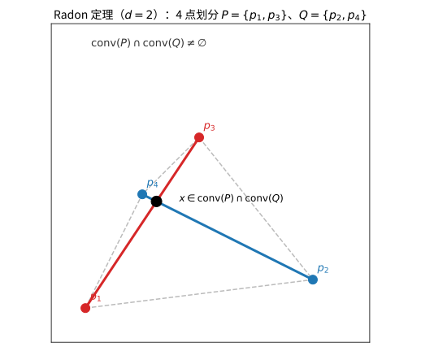

> **直观理解（现实类比）**：Radon 划分就像把 4 个探点分成"红队"和"蓝队"两组，每组的活动范围（凸包）必然在中途撞上——无论如何分组，两条"活动连线"总有一个共用汇合点。这好比两拨分别从对角出发的队伍，它们的势力范围总会在某处交叠。
>
> **🧠 思考历程："每个人都是凸的顶点"——离散几何怎么用一笔聚拢 n 个点的规律？**
>
> 离散几何的许多定理都在回答同一个朴素问题：**点一多，必然出现怎样"整齐"的图形？** 这类"稠密必出结构"的现象，从凸划分一路延伸到球面堆积与凸体覆盖。
>
> - **Erdős–Szekeres：著名的"幸福结局"**（1935 年）。Paul Erdős 与 George Szekeres 证明：只要平面上有足够多的点（$N(m)$ 个），其中必有 $m$ 个构成一个凸 $m$ 边形——他们二人因此结了婚，"幸福结局问题"也成了离散几何的经典母题。
> - **从三分到 Radon：包围里必有交汇**（20 世纪）。围绕"一个点如何在凸包中被表示"，数学家提炼出 Radon 引理：$d+2$ 个点在 $\mathbb{R}^d$ 中总能分成两组，使两者的凸包相交。这看似平凡的一句，却成了支撑整个离散凸性理论的基础引理。
> - **Fejes Tóth：堆积与覆盖的极致**（20 世纪中后期）。László Fejes Tóth 系统研究了圆的紧密堆积与凸体覆盖，提出并推进"最优堆积/覆盖密度"的猜想，其思想最终催生了 Kepler 猜想的解决脉络——用"局部优化"逼出"全局最优"，正与"点多必然出形状"一脉相承。
> - **心路**：离散几何最深的一句话或许是：**规律源于密度**。足够多的点/圆堆在一起，整齐与最优就会自己浮现出来——数学家要做的，只是把它精确地说出口。

#### 课堂问答

**老师**：$\mathbb{R}^d$ 中 $d+2$ 个点，为什么一定能分成两组使凸包相交？多一个、少一个点分别会怎样？

**学生**：因为仿射相关。给每点补一个坐标变成 $(x_i,1)\in\mathbb{R}^{d+1}$，共 $d+2$ 个向量必线性相关，存在不全零的 $\lambda_i$ 使 $\sum\lambda_i x_i=0$ 且 $\sum\lambda_i=0$。令 $P=\{i:\lambda_i>0\},\ Q=\{i:\lambda_i<0\}$，两边各自归一化便得同一点 $p=q\in\operatorname{conv}(P)\cap\operatorname{conv}(Q)$。$d+1$ 个一般位置的点仿射无关、分不开，故 $d+2$ 是最优阈值。

**老师（追问）**：平面上的 4 个点若处于凸位置，Radon 划分长什么样？若有一点落在另三点三角形内呢？

**学生**：凸位置时按对角线配对，如 $\{p_1,p_3\}$ 与 $\{p_2,p_4\}$，两个凸包是两条对角线线段，交于它们的交点；含内点 $p_4$ 时，划分就是 $\{p_4\}$ 与其余三点，内点本身落在外面三点三角形内，自然相交。两类情形都由系数正负号自动分好。

**老师（拓展）**：Radon 找到的那个公共点，必须落在输入点里吗？

**学生**：不必。定理只保证 $\operatorname{conv}(P)\cap\operatorname{conv}(Q)\neq\varnothing$，交点是两组点的凸组合，一般不是原始点。把「公共点必须是某个输入点」当默认是最常见的误判，还会连锁带错 Helly 的证明。

### 2.5 Tverberg定理

**Tverberg定理**：$\mathbb{R}^d$ 中任意 $(d+1)(r-1)+1$ 个点可以划分为 $r$ 个不相交的子集，使得这些子集的凸包有公共交点。这是Radon定理的深刻推广。

> **💡 直观理解（类比）**：只要发出去的点足够多（$(d+1)(r-1)+1$ 个），就能把它们拆成 $r$ 支队伍，且每支队伍圈出的地盘（凸包）都在同一个"圆心"上汇合——比 Radon 的"两队相遇"更贪心，能同时安排 $r$ 支配一支队的中枢。

#### 课堂问答

**老师**：要把 $\mathbb{R}^d$ 中的点分成 $r$ 堆、让 $r$ 个凸包共点，最少需要多少个点？

**学生**：恰是 $N=(d+1)(r-1)+1$。先验 $r=2$：$N=d+2$，正是 Radon。一般 $r$ 用自由度计数：每个点有 $d$ 个坐标再加一个权重坐标共 $d+1$ 个自由度，要让 $r$ 组归一化后落在同一点需 $r-1$ 个公共约束，于是下界 $(d+1)(r-1)+1$ 自然出现。

**老师（追问）**：为什么 $r\ge3$ 时不能像 Radon 那样只靠线性代数，非要动拓扑？

**学生**：因为 $r\ge3$ 要同时把点分给多组、并让所有组凸包共点，等价于在单形 $r$ 重积上找一个映射的重合点，已非「一次线性相关」能给。Sarkaria 把它归约为 Borsuk–Ulam 型定理：构造 $F:\Delta_{N-1}^{*r}\to\mathbb{R}^d$，用等变映射的度论证逼出 $r$ 个点映射到同一点。

**老师（拓展）**：在一维（$d=1$）能具体看到什么？

**学生**：能看到最朴素的操作。$d=1$ 时 $N=2r-1$，把 $2r-1$ 个实数排成一列取中位数 $a_r$，其余 $2r-2$ 个数首尾配对分入 $r-1$ 组，每组凸包是一段含 $a_r$ 的区间，于是 $r$ 个区间共点 $a_r$。

### 2.6 超平面排列

> **🌐 直觉先行：为什么分析"超平面排列"？**
>
> 把若干超平面扔进空间，它们会切出很多"单元（cell）"。为什么要研究被切出来的格子有多少？因为**实用的几何 / 计算问题常常归结到这里**：每次二分（supervised 划分）、决策树、线性可分分类、区域查询，都是在"若干个超平面切出的格子里定位"。离散几何关心的是这些单元**最多有多少个、结构如何**——例如平面里 $n$ 条直线切出的区域数 $\frac{n(n+1)}{2}+1$ 这类计数，正是"排列复杂度"分析的起点。

**超平面排列**（Arrangement of Hyperplanes）是 $\mathbb{R}^d$ 中一族超平面将空间划分成的单元（cell）的集合。超平面排列的复杂度分析研究单元的数量和结构。

> **💡 直观理解（类比）**：往空间里甩几张"无限大薄片"（超平面），它们把空间切成一格格小房间（cell）；问题归根到底就是——一整套刀具（超平面）最多能把一块大豆腐切成几块。

#### 课堂问答

**老师**：$\mathbb{R}^d$ 中 $n$ 个超平面最多把空间切成多少块？为什么是一个组合和？

**学生**：最多 $R_d(n)=\sum_{i=0}^d\binom{n}{i}$。理由用递推：第 $n$ 个超平面 $H_n$ 被前 $n-1$ 个切成 $R_{d-1}(n-1)$ 个低维片，每片把它穿过的一个 $d$ 维单元一分为二，故 $R_d(n)=R_d(n-1)+R_{d-1}(n-1)$；代入归纳并用 $\binom{n-1}{i}+\binom{n-1}{i-1}=\binom{n}{i}$ 即得。平面 $d=2$ 时化为 $\frac{n^2+n+2}{2}$。

**老师（追问）**：这个公式在什么假设下取到最大？违反假设会怎样？

**学生**：需超平面处于「一般位置」：无两条平行、无多个共交点。一旦出现平行或共点，新超平面被切出的片数减少，区域数随之下降。所以公式是「最多」而非「恰好」；判断排列复杂度前要先确认位置假设。

**老师（拓展）**：除了数区域，还有更细的结构刻画吗？

**学生**：有。Zaslavsky 定理用排列特征多项式在 $-1$ 处的取值给出区域总数，用割集计数区分有界区域，把「谁被切成几块」翻译成线性代数与格上 Möbius 函数的问题。这正是排列理论里「组合计数与代数取值合一」的经典。

### 2.7 Erdős–Szekeres定理

**Erdős–Szekeres定理**（"幸福结局问题"）：任意 $n$ 个点（无三点共线）中，存在一个大小为 $\Omega(\log n)$ 的凸子集。具体地，任意 $N(m)$ 个点中一定存在 $m$ 个点构成凸多边形，且 $N(m) = 2^{m-2} + 1$。

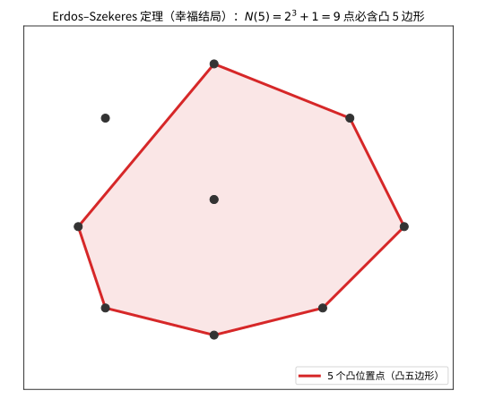

> **直观理解（现实类比）**：这就像"幸福结局"——只要聚会的人足够多（$N(m)=2^{m-2}+1$ 位），就一定能围成一桌"凸多边形"坐下，且座位都朝外、谁也不会被夹在中间。人数越多，保证能围成 $m$ 边的"凸桌"所需的基数就按指数增长，但规律始终成立。

#### 课堂问答

**老师**：平面上足够多的点里必有若干点构成凸多边形，门槛 $N(m)=2^{m-2}+1$ 是怎么冒出来的？

**学生**：关键在单调子序列引理：长度 $(r-1)(s-1)+1$ 的实数列必含长 $r$ 递增或长 $s$ 递减子序列。把点按横坐标排序，用每点与左侧点连线的斜率编码成一串数，取 $r=s=m-1$，便逼出一段斜率单调的点列，而斜率单调的点列恰是一条凸链，最终给出 $2^{m-2}+1$ 个点中必有凸 $m$ 边形。

**老师（追问）**：引理自身成立的关键一步在哪？鸽巢用在哪里？

**学生**：定义 $f(i)$ 为以 $a_i$ 结尾的最长递增子序列长度。要么某 $f(i)\ge r$ 已给出长 $r$ 递增子序列；要么所有 $f(i)\in\{1,\dots,r-1\}$ 只有 $r-1$ 种取值，由鸽巢在项数超过 $(r-1)(s-1)$ 时必有 $s$ 个下标同 $f$ 值，而这些项必递减（否则 $a_i<a_j,\ i<j$ 会迫使 $f(j)\ge f(i)+1$）。关键正是「同 $f$ 值的项构成递减子序列」。

**老师（拓展）**：引理给出的 $(m-2)^2+1$ 和结论里的 $2^{m-2}+1$ 是同一支路吗？

**学生**：不是。$(m-2)^2+1$ 是引理在 $r=s=m-1$ 时给出的中间量；最终结论要用「凸链长度加斜率层次」的更强论证，把门槛压到 $2^{m-2}+1$。构造两簇点可给出下界 $N(m)>2^{m-2}$，而一般 $m$ 的精确最小值是否恰为 $2^{m-2}+1$，仍是幸福结局问题里最著名的悬案之一。

### 2.8 区间图与相交图

**区间图**（Interval Graph）是图的一种，其顶点对应实数轴上的区间，边表示区间相交。

> **💡 直观理解（类比）**：把每个会议时间当成数轴上的一段，两人时间撞车（区间重叠）就拉一根线相连——区间图就是"谁和谁安排冲突"的关系图。

> **常见坑**：**任何图都不一定是区间图**，区间图是一个高度特殊的图类。一个典型的反例是$C_4$（长度 4 的环）——它无法表示成"若干区间的相交图"，即便它看起来"就是一条首尾相接的循环"。因此判断一个图是不是区间图，需要套用专门刻画（如区间图的 **chordal + 单传递** 判定），切勿凭"画出来像时间轴"就断言是区间图。此外，区间图是**弦图（chordal）**且**补图是可比图**这一性质也常被用来快速排除反例。

**相交图**（Intersection Graph）更一般地，顶点对应几何对象，边表示对象相交。

> **💡 直观理解（类比）**：更通用的版本——把任意几何图形（圆、长方形）当作顶点，两个图形碰到点就连线；区间图只是"图形正好是数轴上一小段"时的特例。

#### 课堂问答

**老师**：什么图能表示成区间的相交图？随便一个图都行吗？

**学生**：不行。区间图是「顶点对应数轴上的区间、边表示区间相交」的图，是一类高度特殊的图。它的组合刻画是「弦图（chordal）且存在单传递（unimodal）顶点序」，等价地正是「弦图且补图为可比图」，也可用极大团按端点的连续顺序（PQ 树）判定。所以「画出来像时间轴」就断言是区间图，是常见误区。

**老师（追问）**：举一个最简的反例，说明它不是区间图。

**学生**：取 $C_4$（长度 $4$ 的环）。若 4 个区间首尾相邻相交、对角不相交，就会出现「$1$ 与 $3$ 不相交、$2$ 与 $4$ 不相交」却又要闭合的矛盾；更本质地，弦图禁止长度 $\ge4$ 的无弦环，而 $C_4$ 恰是长度 $4$ 的无弦环，故被排除。

**老师（拓展）**：相交图这个更一般的概念有什么价值？

**学生**：把任意几何对象（圆、矩形、曲线）作顶点、相交则连边，就得到相交图，它给了图论与几何之间一个通用「转译器」。它上承弦图、可比图、单位圆图等图类，下接调度、计算几何与生物信息学：区间图刻画时间冲突，圆图刻画无线覆盖，几何相交图刻画可比较的几何关系。

### 2.9 几何图论

**几何图论**研究图的几何实现，包括平面图、地铁图（metro map）等。

> **💡 直观理解（类比）**：把抽象的点和线"画"到真实平面上做成地图（如地铁图），重点是不扭曲站与站之间"相连"的关系、且线尽量不打架——研究的正是"怎么画既准确又不乱"。

#### 课堂问答

**老师**：几何图论和普通图论差在哪？为什么关心「怎么把图画在平面上」？

**学生**：差别在于它给抽象图配上几何实现：顶点放在平面的坐标上，边作为曲线或直线段，重点是不打乱「谁连谁」的关系。核心量是交叉数（crossing number），即给定图最少需要多少处交点，它直接关系到绘图算法、网络可视化与芯片布线的可读性。

**老师（追问）**：为什么平面图（能在平面上无交叉画出的图）这么特殊？

**学生**：因为无交叉绘图受 Euler 公式约束。由此推出平面图满足 $E\le 3V-6$（$V\ge3$），进而 $K_5$、$K_{3,3}$ 都不可平面化，Kuratowski 定理更刻画了「非平面图恰是含 $K_5$ 或 $K_{3,3}$ 的细分」这一充要条件。约束越紧，能画出的图类就越特殊。

**老师（拓展）**：交叉数与组合几何里别的定理有联系吗？

**学生**：有。交叉数下界与 Szemerédi–Trotter 的「点—线关联」定理互相滋养：几何图的最小交叉数给出关联界，关联界又反过来提供交叉数下界。这正说明几何图论处在图论、组合几何与算法交汇处。

### 2.10 多面体组合

**多面体组合**（Polyhedral Combinatorics）研究多面体的组合结构，包括顶点、边、面的计数关系。

> **💡 直观理解（类比）**：就像统计一个骰子有几个角、几条棱、几个面，研究"点数、棱数、面数"之间那份永不改变的账本（如 $V-E+F=2$），不管把它揉成什么形状都算得准。

---

#### 课堂问答

**老师**：多面体组合研究什么？先给一条最出名的恒等式。

**学生**：研究多面体顶点、边、面等各维面之间的计数关系，最著名的是三维凸多面体的 Euler 公式 $V-E+F=2$，随你怎么揉都不变。它的高维推广是 $\sum_{i=0}^{d-1}(-1)^i f_i=1+(-1)^{d-1}$，其中 $f_i$ 是 $i$ 维面的数目。

**老师（追问）**：为什么 $V-E+F=2$ 恒成立？直觉上怎么证？

**学生**：把多面体投影成平面连通地图，再用「逐步删边」归纳：每删一条属于两个面的边，$E$ 减 $1$、$F$ 减 $1$，而 $V-E+F$ 不变；删到只剩一棵生成树时每条边都是割边且 $F=1$，得 $V=E+1$，即 $V-E+F=2$。常见误区是忘掉「凸」与「连通」前提——对带孔的环面，$V-E+F$ 会变成 $0$，这就是 Euler 特征 $\chi$。

**老师（拓展）**：高维面数有没有类似的「全由上界」的漂亮结论？

**学生**：有。给定顶点数，McMullen 上界定理给出各维面数的极大值，并可由「堆叠多面体」同时达到；进一步，$f$-向量满足的线性关系被 $g$-向量紧凑编码（由 Dehn–Sommerville 方程联系），著名的 $g$-猜想正是刻画哪些整数向量能成为单纯多面体的 $f$-向量。多面体组合由此成为组合、凸几何与代数拓扑的交叉核心。

## 3. 定理与证明

### 3.1 Helly定理

**定理1（Helly定理）**：设 $\mathcal{F} = \{C_1, C_2, \ldots, C_n\}$ 是 $\mathbb{R}^d$ 中一族凸集，$n \geq d+1$。若 $\mathcal{F}$ 中任意 $d+1$ 个凸集都有非空交集，则 $\bigcap_{i=1}^n C_i \neq \varnothing$。

> **💡 直观理解（类比）**：就像圆桌旁任意 $d+1$ 位（这人数已"够多"）总能找到一处共同落座点，那么整桌人其实就能一起坐下——检查"够多子集有交点"，就能放心推出"全体有交点"。

**证明**（用数学归纳法）：

**基情况**：$n = d+1$ 时，结论由条件直接成立。

**归纳假设**：假设结论对 $n-1$ 个凸集成立。

**归纳步骤**：考虑 $n$ 个凸集 $C_1, C_2, \ldots, C_n$。对每个 $i = 1, 2, \ldots, n$，定义 $A_i = \bigcap_{j \neq i} C_j$。

由归纳假设，$A_i \neq \varnothing$（因为去掉 $C_i$ 后，剩下 $n-1$ 个凸集中任意 $d+1$ 个仍有非空交集）。选取 $a_i \in A_i$，得到 $n$ 个点 $a_1, a_2, \ldots, a_n$。

**关键步骤**：我们需要证明 $\bigcap_{i=1}^n C_i \neq \varnothing$。等价地，证明存在一点 $x$ 属于所有 $C_i$。

由Radon定理（见下文），若 $n \geq d+2$，则 $n$ 个点 $a_1, \ldots, a_n$ 可以划分为两个子集 $P$ 和 $Q$，使得 $\operatorname{conv}(P) \cap \operatorname{conv}(Q) \neq \varnothing$。取 $x \in \operatorname{conv}(P) \cap \operatorname{conv}(Q)$。

现在证明 $x \in \bigcap_{i=1}^n C_i$：

任取 $i$，有两种情况：

- 若 $a_i \in P$，则 $a_i \in \bigcap_{j \neq i} C_j$，故 $a_i \in C_j$ 对所有 $j \neq i$ 成立。由于 $C_i$ 是凸集且 $P \subseteq C_i$（因为 $P$ 中除 $a_i$ 外的点也都在 $C_i$ 中），故 $\operatorname{conv}(P) \subseteq C_i$，所以 $x \in C_i$。
- 若 $a_i \in Q$，同理 $x \in C_i$。

因此 $x \in \bigcap_{i=1}^n C_i$，结论成立。

**注**：$n$ 为无穷时，若 $\mathcal{F}$ 是有限的，上述证明成立。对于无限族，需要额外的紧性条件。

#### 课堂问答

**老师**：Helly 的证明为什么对族规模 $n$ 归纳，而不直接对维数归纳？

**学生**：因为结论本身就是「有限族全体交非空」，天然以族规模为归纳变量：基情况 $n=d+1$ 由条件直接成立；归纳时取 $A_i=\bigcap_{j\neq i}C_j$，由归纳假设 $A_i\neq\varnothing$ 各取一点 $a_i$，再用 Radon 把这 $n$ 个点分两组、取 $\operatorname{conv}(P)\cap\operatorname{conv}(Q)$ 中的 $x$。

**老师（追问）**：那个 Radon 点 $x$ 凭什么同时落在所有 $C_i$ 里？

**学生**：分两种情形。若 $a_i\in P$，则 $a_i\in\bigcap_{j\neq i}C_j$ 给出 $a_i\in C_j\ (j\neq i)$，而 $P$ 中其余点也都属于 $C_i$，故 $P\subseteq C_i$，由 $C_i$ 凸得 $\operatorname{conv}(P)\subseteq C_i$，于是 $x\in C_i$；若 $a_i\in Q$ 同理。$i$ 任意，故 $x\in\bigcap_i C_i$。关键正是一一对应：每个 $C_i$ 必完整包含 $P$ 或 $Q$ 之一。

**老师（拓展）**：这个证明对无限族为什么不够？

**学生**：归纳只对有限 $n$ 有效。无限族虽可借紧性（如凸集都紧）从有限交性质过渡，但需要额外的紧性、闭性条件，否则结论会失效——所以教材强调「$\mathcal{F}$ 有限时」，无限情形必须补条件，这是从有限到无限最易踩的坑。

### 3.2 Carathéodory定理

**定理2（Carathéodory定理）**：设 $S \subseteq \mathbb{R}^d$，$x \in \operatorname{conv}(S)$。则存在 $S$ 中至多 $d+1$ 个点 $x_1, x_2, \ldots, x_k$（$k \leq d+1$），使得 $x \in \operatorname{conv}(\{x_1, x_2, \ldots, x_k\})$。

> **💡 直观理解（类比）**：任何一个小目标的坐标，只需最多 $d+1$ 个"骨干点"加权平均就能拼出来——就像平面上一块色板用三种基色即可调出，多余的原料永远是可省边的。

**证明**：

由 $x \in \operatorname{conv}(S)$，存在 $S$ 中有限个点 $x_1, x_2, \ldots, x_m$ 和非负系数 $\lambda_1, \lambda_2, \ldots, \lambda_m$，满足 $\sum_{i=1}^m \lambda_i = 1$ 且 $x = \sum_{i=1}^m \lambda_i x_i$。

选取使 $m$ 最小的这种表示。若 $m \leq d+1$，结论已成立。

假设 $m > d+1$。考虑向量 $x_i - x$（$i = 1, \ldots, m$），它们在 $\mathbb{R}^d$ 中，$m > d+1$，故线性相关。存在不全为零的系数 $\mu_1, \ldots, \mu_m$，使得 $\sum_{i=1}^m \mu_i = 0$ 且 $\sum_{i=1}^m \mu_i x_i = 0$。

对于充分小的 $t > 0$，$\lambda_i - t\mu_i \geq 0$ 对所有 $i$ 成立。取 $t = \min\{\lambda_i / \mu_i \mid \mu_i > 0\}$，则至少有一个系数变为零，而其他系数非负且和为 $1$。这样就得到了一个更短的表示，与 $m$ 的最小性矛盾。

因此 $m \leq d+1$。

#### 课堂问答

**老师**：Carathéodory 证明里为什么强调取「系数全正的最短表示」？

**学生**：因为要点是用线性相关微调、把某个系数压到零。若表示里已有零系数，删掉它点数就减少，「最短」就不成立，故最短表示的系数必全正：$x=\sum_{i=1}^m\lambda_i x_i$，$\lambda_i>0$，$\sum\lambda_i=1$。只有 $\lambda_i>0$ 才能取到正的最小比值 $\min_{\mu_i>0}\lambda_i/\mu_i$ 作步长 $t$。

**老师（追问）**：线性相关给出的 $\mu_i$ 为什么能同时满足 $\sum\mu_i=0$ 和 $\sum\mu_i x_i=0$？

**学生**：把点抬到 $\mathbb{R}^{d+1}$ 看 $(x_i,1)$：共 $m>d+1$ 个向量必线性相关，得 $\sum\mu_i(x_i,1)=0$，拆开正是 $\sum\mu_i x_i=0$ 与 $\sum\mu_i=0$。这两个条件一起保证微调后 $x=\sum(\lambda_i-t\mu_i)x_i$ 仍成立，且 $\sum(\lambda_i-t\mu_i)=1$，凸组合结构不被破坏。

**老师（拓展）**：这个「消去」过程会终止吗？为什么最终 $m\le d+1$？

**学生**：会终止。每步把 $m$ 减少 $1$，而 $m$ 是非负整数、有下界，不可能无限下降；终止时若仍 $m>d+1$ 就可再消，矛盾，故最短表示满足 $m\le d+1$。这与 Radon 的「系数正负分两堆」其实是同一个 $\mathbb{R}^{d+1}$ 相关式的两种读法。

### 3.3 Radon定理

**定理3（Radon定理）**：$\mathbb{R}^d$ 中任意 $d+2$ 个点可以划分为两个不相交的子集 $P$ 和 $Q$，使得 $\operatorname{conv}(P) \cap \operatorname{conv}(Q) \neq \varnothing$。

> **💡 直观理解（类比）**：平面上任意 4 个点，总能分成两大"阵营"，两阵营各自圈起的势力范围（凸包）必然有一小块重叠——就像随便两拨人，活动范围从来不会完全错开。

**证明**：

设 $d+2$ 个点为 $x_1, x_2, \ldots, x_{d+2} \in \mathbb{R}^d$。考虑向量 $(x_1, 1), (x_2, 1), \ldots, (x_{d+2}, 1) \in \mathbb{R}^{d+1}$。$d+2$ 个 $d+1$ 维向量必线性相关，故存在不全为零的系数 $\lambda_1, \lambda_2, \ldots, \lambda_{d+2}$，使得：

$$
\sum_{i=1}^{d+2} \lambda_i x_i = 0 \quad \text{且} \quad \sum_{i=1}^{d+2} \lambda_i = 0
$$

将系数分为正负两组：

$$
P = \{x_i \mid \lambda_i > 0\}, \quad Q = \{x_i \mid \lambda_i < 0\}
$$

令 $s = \sum_{\lambda_i > 0} \lambda_i = -\sum_{\lambda_i < 0} \lambda_i > 0$。定义：

$$
p = \sum_{\lambda_i > 0} \frac{\lambda_i}{s} x_i \in \operatorname{conv}(P), \quad q = \sum_{\lambda_i < 0} \frac{-\lambda_i}{s} x_i \in \operatorname{conv}(Q)
$$

由 $\sum \lambda_i x_i = 0$ 得 $\sum_{\lambda_i > 0} \lambda_i x_i = -\sum_{\lambda_i < 0} \lambda_i x_i$，两边除以 $s$ 得 $p = q$。因此 $p = q \in \operatorname{conv}(P) \cap \operatorname{conv}(Q)$。

#### 课堂问答

**老师**：Radon 证明里 $\sum\lambda_i x_i=0$ 与 $\sum\lambda_i=0$ 是怎么来的？系数为何能把点天然分成两组？

**学生**：把 $d+2$ 个点写成 $(x_1,1),\dots,(x_{d+2},1)\in\mathbb{R}^{d+1}$，因 $d+2>d+1$ 必线性相关，存在不全零的 $\lambda_i$ 使 $\sum\lambda_i(x_i,1)=0$，拆开恰是 $\sum\lambda_i x_i=0$ 与 $\sum\lambda_i=0$。于是按符号自动划分 $P=\{i:\lambda_i>0\}$、$Q=\{i:\lambda_i<0\}$，且 $P,Q$ 都非空。

**老师（追问）**：公共点 $p=q$ 具体怎么算出来，为何它同时落在两个凸包里？

**学生**：令 $s=\sum_{\lambda_i>0}\lambda_i>0$（它等于 $-\sum_{\lambda_i<0}\lambda_i$）。把 $\sum_{\lambda_i>0}\lambda_i x_i=-\sum_{\lambda_i<0}\lambda_i x_i$ 两边除以 $s$：左边是系数 $\lambda_i/s$ 的凸组合，落在 $\operatorname{conv}(P)$；右边是系数 $-\lambda_i/s$ 的凸组合，落在 $\operatorname{conv}(Q)$；两边相等即 $p=q$ 属于两凸包之交。

**老师（拓展）**：这条证明与「仿射相关性」能一句话说清吗？

**学生**：能。$d+2$ 个点在 $\mathbb{R}^d$ 中必仿射相关，而仿射相关正意味着「存在和为 $0$ 的非零系数使点的线性组合为零」，Radon 只是把这个相关式按系数正负读成一次分划。所以 Radon 是仿射相关性最直接的几何翻译。

### 3.4 Tverberg定理

**定理4（Tverberg定理）**：设 $N = (d+1)(r-1) + 1$。则 $\mathbb{R}^d$ 中任意 $N$ 个点的集合可以划分为 $r$ 个不相交的子集 $S_1, S_2, \ldots, S_r$，使得 $\bigcap_{i=1}^r \operatorname{conv}(S_i) \neq \varnothing$。

> **💡 直观理解（类比）**：只要筹码够多，就能把它们分成 $r$ 支队伍，每支各自圈出的地盘都同时压在同一根"大会合点"上——是 Radon"两队相遇"的升级版，可以同时约 $r$ 支凑热闹。

**证明**（使用拓扑方法，概略）：

**证明思路**：Tverberg定理的证明有多种方法，这里给出基于拓扑的证明思路。

**步骤1**：将问题转化为连续映射的零点问题。设 $N$ 个点为 $x_1, x_2, \ldots, x_N \in \mathbb{R}^d$。

考虑 $N$ 个点的标准单形 $\Delta_{N-1} = \{(t_1, \ldots, t_N) \in \mathbb{R}^N_{\geq 0} \mid \sum t_i = 1\}$。

定义映射 $f: \Delta_{N-1} \to \mathbb{R}^d$ 为 $f(t_1, \ldots, t_N) = \sum_{i=1}^N t_i x_i$。

**步骤2**：考虑单形 $\Delta_{N-1}$ 的 $r$ 重乘积。定义映射：

$$
F: \Delta_{N-1}^{*r} \to \mathbb{R}^d
$$

其中 $\Delta_{N-1}^{*r}$ 是 $\Delta_{N-1}$ 的 $r$ 重乘积去掉对角线部分。

**步骤3**：利用Borsuk-Ulam定理的推广（Sarkaria定理），证明存在一个点 $t = (t_1, \ldots, t_N)$ 使得 $f(t^{(1)}) = \cdots = f(t^{(r)})$，其中 $t^{(1)}, \ldots, t^{(r)}$ 是某种划分对应的 $r$ 个点。

**步骤4**：将 $t$ 的支撑集按某种规则分配到 $r$ 个子集中，得到划分 $S_1, \ldots, S_r$，使得公共点 $f(t^{(1)}) = \cdots = f(t^{(r)})$ 属于所有 $\operatorname{conv}(S_i)$。

**注**：当 $r = 2$ 时，Tverberg定理退化为Radon定理，此时 $N = (d+1)(2-1) + 1 = d+2$。

#### 课堂问答

**老师**：Tverberg 的证明为什么要绕到单形 $r$ 重积与映射零点上？

**学生**：因为要统一处理「把 $N$ 个点分给 $r$ 组、让 $r$ 组凸包共点」。构造 $f(t_1,\dots,t_N)=\sum t_i x_i$，把单形的 $r$ 重积去掉对角线得到 $\Delta_{N-1}^{*r}$，在其上构造 $F:\Delta_{N-1}^{*r}\to\mathbb{R}^d$，去寻找满足 $f(t^{(1)})=\dots=f(t^{(r)})$ 的点；这一等值条件正是「$r$ 组的凸组合落到同一点」。

**老师（追问）**：用什么定理保证这样的等值点一定存在？

**学生**：用 Borsuk–Ulam 的推广——Sarkaria 定理。它给出等变映射的重合点结论，保证存在 $(t^{(1)},\dots,t^{(r)})$ 使 $r$ 个 $f$ 值相同；再把 $t$ 的支撑集按规则分配给 $r$ 个子集 $S_1,\dots,S_r$，公共点便同时属于各 $\operatorname{conv}(S_i)$。这里拓扑是本质的，纯线性代数做不到 $r\ge3$。

**老师（拓展）**：为什么 $r=2$ 时它就退回 Radon，点数也对得上？

**学生**：对得上。$r=2$ 时 $N=(d+1)(2-1)+1=d+2$，正是 Radon 的点数；而此时 $2$ 重积去对角线得到的是一族连接相对面的路径，Borsuk–Ulam 型论证退化为一次仿射相关，结论即「两组凸包相交」。所以 Tverberg 是 Radon 在分划数上的推广，Radon 是它的 $r=2$ 特例。

### 3.5 Erdős–Szekeres定理

**定理5（Erdős–Szekeres定理）**：对任意整数 $m \geq 3$，存在最小整数 $N(m)$，使得平面上任意 $N(m)$ 个点（无三点共线）中一定包含 $m$ 个点构成凸 $m$ 边形的顶点。且 $N(m) = 2^{m-2} + 1$。

> **💡 直观理解（类比）**：人一多（$2^{m-2}+1$ 个）就铁定能围出一个"凸 $m$ 边形"——大家坐成一圈面朝外、谁也不被夹在别人怀里。总之"人多必出整齐结构"，这正是幸福结局到底线。

**证明**：

**下界**：$N(m) > 2^{m-2}$ 由构造给出。考虑 $2^{m-2}$ 个点，排列成"凸位置"的 $2^{m-2}$ 个点使其中无 $m$ 个点构成凸多边形。

**上界**：$N(m) \leq 2^{m-2} + 1$ 的证明如下：

**关键引理**（Erdős–Szekeres关于单调子序列的引理）：任意长度为 $(r-1)(s-1) + 1$ 的实数序列中，必包含长度为 $r$ 的递增子序列或长度为 $s$ 的递减子序列。

> **💡 直观理解（类比）**：把数列想成爬山的足迹，只要台阶够多，不是会有一长串连续上坡（递增子序列），就是会有一长串连续下坡（递减子序列）——总有一边一路顺到底，不可能永远忽上忽下。

**证明引理**：设序列为 $a_1, a_2, \ldots, a_n$，$n = (r-1)(s-1) + 1$。对每个 $i$，定义 $f(i)$ 为以 $a_i$ 结尾的最长递增子序列的长度。若存在 $f(i) \geq r$，则找到长度为 $r$ 的递增子序列。否则，所有 $f(i) \leq r-1$。

由鸽巢原理，存在 $s$ 个 $i$ 使得 $f(i)$ 取相同的值。这些 $i$ 对应的 $a_i$ 构成递减子序列（否则若有 $a_i < a_j$ 且 $i < j$，则 $f(j) \geq f(i) + 1$，矛盾）。因此长度为 $s$ 的递减子序列存在。

**回到定理证明**：

设 $S = \{p_1, p_2, \ldots, p_n\}$ 为 $n = 2^{m-2} + 1$ 个点，无三点共线。将点按 $x$ 坐标排序（不妨设 $x_1 < x_2 < \cdots < x_n$）。

对每个点 $p_i$，定义其"斜率的符号序列"：对 $j < i$，考虑斜率 $k_{ij} = (y_i - y_j)/(x_i - x_j)$。由于无三点共线，所有斜率互不相同（固定 $i$ 时）。

通过某种编码方式，将点的几何位置转化为序列，利用单调子序列引理：

考虑将点按 $x$ 坐标排序后，观察每个点与之前所有点连线的斜率。利用Erdős–Szekeres引理（$r = s = m-1$），可以证明存在 $m$ 个点，它们要么全部构成凸多边形，要么存在一个点在其他点的凸包内部。

通过细致分析可以证明，在 $2^{m-2} + 1$ 个点中，一定存在 $m$ 个点构成凸多边形。

**具体构造**：将点按 $x$ 坐标排序后，对每个点 $p_i$，定义"标号"为以 $p_i$ 结尾的最大凸链长度。通过引理，当 $n = 2^{m-2} + 1$ 时，必存在标号至少为 $m-1$ 的点，从而得到 $m$ 个点的凸链，这 $m$ 个点构成凸多边形。

---

#### 课堂问答

**老师**：上界证明里单调子序列引理扮演什么角色？为什么取 $r=s=m-1$？

**学生**：引理说长度 $(r-1)(s-1)+1$ 的实数列含长 $r$ 递增或长 $s$ 递减子序列。证明把点按 $x$ 排序，用每点与左侧点连线的斜率构造符号序列，取 $r=s=m-1$，则 $(m-2)^2+1$ 项中必有一段斜率单调的点列，而斜率单调的点列恰构成一条凸链；强化这套论证即可在 $2^{m-2}+1$ 个点中逼出 $m$ 个凸位置的点。

**老师（追问）**：引理自身的证明关键在哪一步？

**学生**：定义 $f(i)$ 为以 $a_i$ 结尾的最长递增子序列长度。要么某 $f(i)\ge r$ 已给出长 $r$ 递增子序列；要么所有 $f(i)\le r-1$，此时 $f(i)$ 只有 $r-1$ 种取值，由鸽巢在项数超过 $(r-1)(s-1)$ 时必有 $s$ 个下标同 $f$ 值，它们必递减——否则 $a_i<a_j\ (i<j)$ 会迫使 $f(j)\ge f(i)+1$。关键就是「同 $f$ 值的项构成递减子序列」。

**老师（拓展）**：下界构造和上界分别给了什么信息？

**学生**：下界是「两簇」构造：递归放两组各 $2^{m-3}$ 个点、一组整体压在另一组上方，可造出 $2^{m-2}$ 个没有凸 $m$ 边形的点，说明 $N(m)>2^{m-2}$；上界说明 $2^{m-2}+1$ 个点足够。两者合起来把 $N(m)$ 逼在 $2^{m-2}+1$ 附近，而对一般 $m$ 的精确最小值至今仍是幸福结局问题里最著名的悬案之一。

## 4. 示例

### 4.1 利用Helly定理解决覆盖问题

**问题**：平面上有 $n$ 个凸多边形，已知任意三个凸多边形都有公共交点。证明所有 $n$ 个凸多边形有公共交点。

**解**：

由Helly定理（$d=2$），任意 $3$ 个凸多边形有公共交点蕴含所有凸多边形有公共交点。这里 $d+1 = 3$，直接应用Helly定理即得结论。

**扩展应用**：在平面上有一组圆盘，若任意三个圆盘有公共交点，则所有圆盘有公共交点。这是因为圆盘是凸集。

**反例**：若去掉凸性条件，结论不成立。例如在 $\mathbb{R}^1$ 中，区间 $[0, 2]$、$[1, 3]$、$[2, 4]$ 任意两个相交，但三者交集为空。

### 4.2 超平面排列的复杂度分析

**问题**：$\mathbb{R}^d$ 中 $n$ 个超平面可以将空间划分为多少个区域？

**解**：

设 $R_d(n)$ 为 $\mathbb{R}^d$ 中 $n$ 个超平面划分的最大区域数。

**定理**：$R_d(n) = \sum_{i=0}^d \binom{n}{i}$。

**证明**（归纳法）：

**基情况**：$R_1(n) = n+1$（直线上 $n$ 个点将直线分为 $n+1$ 段），且 $\sum_{i=0}^1 \binom{n}{i} = 1 + n = n+1$。

**归纳假设**：假设 $R_{d-1}(n) = \sum_{i=0}^{d-1} \binom{n}{i}$。

**归纳步骤**：考虑添加第 $n$ 个超平面 $H_n$。$H_n$ 被其他 $n-1$ 个超平面切割成 $R_{d-1}(n-1)$ 个 $(d-1)$ 维区域。每个这样的区域将 $H_n$ 穿过的某个 $d$ 维区域一分为二。因此：

$$
R_d(n) = R_d(n-1) + R_{d-1}(n-1)
$$

代入归纳假设：

$$
R_d(n) = \sum_{i=0}^d \binom{n-1}{i} + \sum_{i=0}^{d-1} \binom{n-1}{i} = \sum_{i=0}^d \left[\binom{n-1}{i} + \binom{n-1}{i-1}\right] = \sum_{i=0}^d \binom{n}{i}
$$

其中 $\binom{n-1}{-1} = 0$，$\binom{n-1}{d} = 0$。

**特例**：

- $d=2$：$R_2(n) = \binom{n}{0} + \binom{n}{1} + \binom{n}{2} = 1 + n + \frac{n(n-1)}{2} = \frac{n^2 + n + 2}{2}$
- $d=3$：$R_3(n) = \binom{n}{0} + \binom{n}{1} + \binom{n}{2} + \binom{n}{3} = \frac{n^3 + 5n + 6}{6}$

### 问题求解四步流程（Problem-Solving Strategy）

> 每个问题都可拆成四步：**理解 → 计划 → 执行 → 回看**。这里把每一环落到离散几何学语境的追问上。

| 步骤 | 行动 | 离散几何学中的具体追问 |
|:---|:---|:---|
| ① 理解 | 复述问题、圈出定理与参数 | 维数 $d$ 是多少？要证明公共点、找凸组合还是做分划？点是否处于一般位置（无三点共线）？ |
| ② 计划 | 选择适用定理与组合工具 | 用 Helly 判公共交、Carathéodory 写凸组合、Radon/Tverberg 划分子集？先想清适用条件与参数边界。 |
| ③ 执行 | 按计划逐步推导、保证系数合法 | 凸组合系数非负且和为 $1$、分划计数核对、叉积/分离判据别写反。 |
| ④ 回看 | 核对结论、检验参数与退化 | 删去一个点结论还成立吗？$d+1$、$d+2$ 是否必要？能否换对偶定理复核一遍？ |

> 💡 **策略演示**：判定区间族 $[0,5],[1,6],[2,4],[3,7]$ 是否存在公共交点。
> ① 理解：一元区间族求公共交，属「Helly 一类」题型。② 计划：用取 $\max$ 左端、$\min$ 右端判公共交。③ 执行：$L=\max\{0,1,2,3\}=3$、$U=\min\{5,6,4,7\}=4$，$L\le U$。④ 回看：公共交 $[3,4]$ 非空；若 $L>U$ 则空，判定自洽。

### 概念检查（Concept Check）

> 先用一组判断题与选择题快速自检核心概念。每道题的判断均应落到书面理由（用一句话即可）。

**判断正误**（说明理由）：

1. 在 $\mathbb{R}^d$ 中，一族凸集若每 $d+1$ 个都有公共点，则整个族有公共点（Helly 定理）。（　）
2. Carathéodory 定理在 $\mathbb{R}^d$ 中保证凸包里的每个点都能写成至多 $d+1$ 个点的凸组合。（　）
3. Radon 定理在 $\mathbb{R}^2$ 中说的是任意 $4$ 个点总能划分为两个凸包相交的子集。（　）
4. Tverberg 定理是 Radon 定理到任意 $r$ 个部分的推广。（　）
5. Erdős–Szekeres 定理保证任意充分多点必含凸 $m$ 边形，通常在一般位置假设下讨论。（　）
6. 凸集分离定理表明任意两个不相交凸集总可用一条直线严格分离。（　）
7. 一维中 Helly 定理退化为「每两个区间相交 ⟹ 全体相交」。（　）
8. $\mathbb{R}^2$ 中 $n$ 条直线的超平面排列把平面分成至多 $\binom{n}{2}+n+1$ 个区域。（　）

**选择**：

9. 在 $\mathbb{R}^3$ 中，Helly 定理要求每（　）个凸集相交才能推出全体相交。
   - A. $2$　B. $3$　C. $4$　D. $5$
10. Carathéodory 定理在 $\mathbb{R}^2$ 中，凸包内的点可以写成至多（　）个点的凸组合。
    - A. $1$　B. $2$　C. $3$　D. $4$
11. 若 $5$ 个点无三点共线，Erdős–Szekeres 定理保证其中必含一个凸（　）。
    - A. 三角形　B. 四边形　C. 五边形　D. 六边形

### 分步骤工作示例（Worked Examples）

> 每道示例严格套用四步流程，并在「回看」中给出一条易错点或检验法。

**示例 S1：用 Helly 判定一维区间族公共交**

> **问题**：对区间族 $I_1=[0,5],\ I_2=[1,6],\ I_3=[2,4],\ I_4=[3,7]$，判断是否有公共交并给出它。

- ① 理解：$\mathbb{R}^1$ 中 $d=1$，目标求公共交区间。
- ② 计划：公共交即 $\left[\max a_i,\min b_i\right]$，再用 Helly（每两区间相交即可）佐证。
- ③ 执行：

$$
L=\max_i a_i=3,\qquad U=\min_i b_i=4\qquad\Rightarrow\qquad\bigcap_{i=1}^4 I_i=[3,4].
$$

- ④ 回看：$L\le U$ 故公共交非空。**易错点**：若不加 $\max/\min$ 直接看两两交会误判全局；Helly 只保证「两两交 ⟹ 全交」，仍须逐段核对左右端点。

**示例 S2：用 Carathéodory 表示凸包内点**

> **问题**：在 $\mathbb{R}^2$ 中判断 $v=(1,1)$ 是否落在 $\operatorname{conv}\{(0,0),(2,0),(0,2)\}$ 内，并写出凸组合。

- ① 理解：$d=2$，$v$ 至多用 $3$ 个点的凸组合表示即可判定。
- ② 计划：解非负系数 $\lambda_j$，和为 $1$。
- ③ 执行：

$$
\binom{1}{1}=\frac12\binom{2}{0}+\frac12\binom{0}{2},\qquad \lambda=(0,\tfrac12,\tfrac12),\ \sum_j\lambda_j=1.
$$

- ④ 回看：$v=(1,1)$ 确在三角形内。**易错点**：凸组合要同时满足系数非负与和为 $1$，漏掉和为 $1$ 的约束会把点误判为「仿射」内点。

**示例 S3：用 Radon 定理做 $4$ 点分划**

> **问题**：对 $P=\{(0,0),(1,1),(2,0),(1,-1)\}$，求一个 Radon 划分（两子集凸包相交）。

- ① 理解：$d=2$，$d+2=4$ 个点必存在 Radon 划分。
- ② 计划：把点配成两组，寻找两凸包交出的公共点。
- ③ 执行：取 $\{P_1,P_3\}$ 与 $\{P_2,P_4\}$，二者的凸包分别是水平线段与竖直线段，

$$
\operatorname{conv}\{(0,0),(2,0)\}\ \cap\ \operatorname{conv}\{(1,1),(1,-1)\}=\{(1,0)\}.
$$

- ④ 回看：公共点 $(1,0)$ 非空即验证分划成立。**易错点**：Radon 只保证凸包相交，不要求交点是输入点本身；误认为「必须有输入点重合」会漏判。

**示例 S4：用 Erdős–Szekeres 判凸四边形**

> **问题**：对 5 个无三点共线的点 $P=\{(0,0),(1,3),(2,1),(3,2),(4,0)\}$，指出含凸四边形的子集。

- ① 理解：$m=4$ 的保证要求 $N=2^{m-2}+1=5$，点数恰为 $5$。
- ② 计划：取凸包顶点，再用叉积判定被怀疑的内部点。
- ③ 执行：凸包顶点为 $(0,0),(1,3),(3,2),(4,0)$；对 $q=(2,1)$ 依序做叉积
$$
\operatorname{sgn}\big((v_{i+1}-v_i)\times(q-v_i)\big)=(-5,-3,-3,-4)\ \text{恒同号}.
$$

- ④ 回看：$q=(2,1)$ 在四边形内部，四个顶点构成凸四边形。**易错点**：凸多边形顶点必须按顺序摆列，叉积应逐个遍历边而非任意两顶点。

### 应用聚焦（Application & Exploration Projects）

> 小型开放任务：把本节抽象定理落到可操作的计算或仿真，任选其一完成。

- **聚焦 P1（数值仿真）**：在 $\mathbb{R}^2$ 随机生成若干凸集族，抽样验证 Helly 定理：仅当存在某 $3$ 个无公共点时结论才可能失效。
- **聚焦 P2（跨章节联系）**：把 Radon 划分 / Tverberg 归纳写成矩阵记号，并和第 86 级「计算几何」中的线性规划对偶（半平面交）做交叉对照，指出「求公共点」题型各自适用的判据。
- **聚焦 P3（应用落地）**：用凸集分离定理为两类二维点云求分离超平面，模拟支持向量机（SVM）的最远分离带计算。

### 梯度化自测（Graded Exercises）

> 难度记号：$\circ$ 概念 / $\bullet$ 技能 / $\blacklozenge$ 综合应用，均要求在四步流程中写出「回看」一句。

**$\circ$ 概念题**

- **自测 1**：用一句话说明 Helly 定理在一维中的退化形式是什么。
- **自测 2**：说明 Radon 定理与 Tverberg 定理的关系，并指出各自要求的点数。

**$\bullet$ 技能题**

- **自测 3**：对区间 $[1,5],[2,6],[0,4],[3,7]$ 求公共交并用 Helly 佐证。
- **自测 4**：把 $v=(2,2)$ 写成 $\{(0,0),(2,0),(0,4)\}$ 的凸组合。
- **自测 5**：已知 $8$ 个无三点共线的点总能保证含凸几边形，给出 $m$ 与依据（Erdős–Szekeres）。

**$\blacklozenge$ 综合题**

- **自测 6**：给 $A=\{(0,0),(0,2)\}$、$B=\{(2,0),(2,1)\}$ 求一条分离直线，并用跨立判别验证。
- **自测 7**：对 $P=\{(0,0),(1,1),(2,0),(1,-1)\}$ 用 Tverberg（$r=2$）做一次分划，指出公共点。

### 自测答案与简要解析

> **概念判断**：
> 1. **正确**（恰为 Helly 定理）。2. **正确**（$d+1$ 个点凸组合）。3. **正确**（$d+2=4$）。4. **正确**（Radon 即 $r=2$ 的 Tverberg）。5. **正确**（一般位置假设简化退化）。6. **错误**（一般只得到分离超平面，严格分离需要更强凸性/开集条件）。7. **正确**（$d=1$ 时每 $2$ 个相交即可）。8. **正确**（$\sum_{i=0}^2\binom{n}{i}$）。
>
> **选择**：9. C　10. C　11. B。

> **自测**：
> - 自测 1：一维中 $d+1=2$，即「每两个区间相交 ⟹ 全体相交」。
> - 自测 2：Tverberg 在 $r=2$ 时恰为 Radon；Arn 数分别为 $d+2$ 与 $(d+1)(r-1)+1$。
> - 自测 3：$L=\max\{1,2,0,3\}=3$、$U=\min\{5,6,4,7\}=4$，公共交 $[3,4]\neq\emptyset$。
> - 自测 4：$\binom22=0\cdot\binom00+\tfrac12\binom20+\tfrac12\binom04$，系数和为 $1$，成立。
> - 自测 5：$8=2^{m-2}+1\Rightarrow m=4$，故保证含凸四边形；$N=2^{m-2}+1$ 即给定。
> - 自测 6：$A$ 中 $x=0$、$B$ 中 $x=2$，取分离直线 $x=1$（跨立判别验证两侧符号相反）。
> - 自测 7：划分 $\{(0,0),(2,0)\}\cup\{(1,1),(1,-1)\}$，公共点 $(1,0)$。

---

## 5. 习题

### 基础题

**习题 1**（凸集）定义凸集，并说明任一凸集的交集仍为凸集。

**习题 2**（凸包）写出凸包的定义并说明它是最小的凸集。

**习题 3**（凸集分离定理）陈述超平面分离定理：两个互不相交的凸集可由一个超平面分离。

**习题 4**（点与凸集分离）说明为什么若点 $p$ 不在凸集 $C$ 内，则存在分离超平面把 $p$ 与 $C$ 分开。

**习题 5**（Helly 定理）陈述 $\mathbb{R}^d$ 中的 Helly 定理，并写出它在 $d=1$ 与 $d=2$ 时的具体形式。

**习题 6**（Carathéodory 定理）陈述 $\mathbb{R}^d$ 中的 Carathéodory 定理，说明凸包中的点需要多少个点来表示。

**习题 7**（Radon 定理）陈述 Radon 定理：$\mathbb{R}^d$ 中 $d+2$ 个点可划分为两个凸包相交的子集。

**习题 8**（Tverberg 定理）陈述 Tverberg 定理并指出需要的点数公式。

**习题 9**（超平面排列）定义超平面排列，给出 $\mathbb{R}^d$ 中 $n$ 个超平面最多划分区域的公式。

**习题 10**（Erdős–Szekeres 定理）陈述 Erdős–Szekeres（幸福端点）定理。

### 进阶题

**习题 11**（Helly 定理 $d=1$）在直线上，若一族区间任意两个都相交，证明整族有公共交。

**习题 12**（Carathéodory 与凸包）证明 $\operatorname{conv}(X)$ 中每点可由 $X$ 中至多 $d+1$ 个点的凸组合表示。

**习题 13**（Radon 划分）写出 $\mathbb{R}^2$ 中 $4$ 个点的 Radon 划分，说明凸位置与四点含一个点在三角形内两种情形。

**习题 14**（Radon 到 Carathéodory）用 Carathéodory 定理推导 Radon 定理。

**习题 15**（超平面排列区域数）证明 $\mathbb{R}^2$ 中 $n$ 条直线（一般位置）把平面分成 $\frac{n^2+n+2}{2}$ 个区域。

**习题 16**（Tverberg 特例 $r=2$）解释为何 $r=2$ 的 Tverberg 定理就是 Radon 定理。

**习题 17**（凸包维数）证明凸子集维数 $d$ 至多由包含该凸集的仿射子空间刻画。

**习题 18**（超平面与半空间）说明半空间是凸集，并解释有限半空间交为凸多面体。

**习题 19**（分离定理的严格性）在合适的条件下证明紧凸集与闭凸集可以严格分离。

### 挑战题

**习题 20**（Helly 定理证明）给出 Helly 定理的一个证明思路，说明归纳维度并利用有限性与凸性。

**习题 21**（Carathéodory 定理证明）用归纳或线性相关方法证明 Carathéodory 定理。

**习题 22**（Radon 定理证明）用仿射独立性与线性方程组证明 Radon 定理。

**习题 23**（Tverberg 定理 $d=1$）证明 $d=1$ 时 Tverberg 定理：$2r-1$ 个实数可划分为 $r$ 个相交凸包的子集。

**习题 24**（Erdős–Szekeres 构造）说明 $2^{m-2}$ 个点可保证不存在 $m$ 点凸子集，解释上界的贪心构造。

**习题 25**（超平面排列的组合）证明 $R_d(n) = \sum_{i=0}^d \binom{n}{i}$ 并讨论在一般位置时为何该式给出最大区域数。

**习题 26**（凸多面体计数）用 Euler 公式说明三维简单凸多面体顶点、棱、面的关系，并给出组合对偶解释。

### 探究题

**习题 27**（与组合几何的联系）探讨 Helly、Radon、Tverberg 这三种"局部–全局"定理如何统一在抽象凸性/ KKM 理论之下，并与其他组合定理（如 Sperner 引理）的联系。

**习题 28**（与计算几何的对接）说明这些离散几何定理在算法设计（凸包、体积、独立性测试）与计算几何复杂度下界中的角色。

**习题 29**（高维与随机几何）开放探讨高维随机点集、凸包渐近、以及 Tverberg 在信息几何、统计机器学习（数据划分）中的应用。

**习题 30**（离散几何与拓扑）探讨 Tverberg 定理的拓扑版本、与 Borsuk–Ulam 定理和代数拓扑的工具联系，以及这些思想在组合拓扑与图论中的应用。

---

## 6. 习题答案与解析

### 基础题答案

1. **凸集** 集合 $C$ 凸当且仅当任意 $x, y \in C$ 与 $\lambda \in [0,1]$ 有 $\lambda x + (1-\lambda) y \in C$。若 $C_\alpha$ 全凸，取 $x,y$ 在 $\bigcap_\alpha C_\alpha$ 中，则对每个 $\alpha$ 有 $\lambda x+(1-\lambda)y \in C_\alpha$，故其属于交集，交集凸。
2. **凸包** $\operatorname{conv}(X) = \{\sum_i \lambda_i x_i : x_i \in X,\ \lambda_i \ge 0,\ \sum_i \lambda_i = 1\}$ 是包含 $X$ 的最小凸集，是所有包含 $X$ 的凸集的交集，故最小性与凸性同时保证。
3. **凸集分离定理** 若 $C, D$ 是两个互不相交的非空凸集，则存在非零法向量 $a$ 与数 $b$ 使对 $x \in C$，$y\in D$ 有 $a\cdot x \le b \le a\cdot y$；若二者闭紧且不相交，可严格分离。它刻画了凸集间的线性可分。
4. **点与凸集分离** 若 $p \notin \operatorname{cl}(C)$，取 $q \in \operatorname{cl}(C)$ 为距 $p$ 最近点，则超平面 $\{x : (x-p)\cdot(q-p)=0\}$ 分离 $p$ 与 $C$（由 $p$ 的最近性满足不等式）。可用反证由三角形不等式得矛盾。
5. **Helly 定理** 设 $F_1,\dots,F_n$ 为 $\mathbb{R}^d$ 的凸集族，若任意 $d+1$ 个有公共交点，则整族有公共交点。$d=1$：区间族任意两两相交必有公共交点；$d=2$：任意 3 个凸多边形有交点则全族有交点。
6. **Carathéodory 定理** $\mathbb{R}^d$ 中 $X$ 的凸包里任意点可写成 $X$ 中至多 $d+1$ 个点的凸组合。原因是若某组合含 $d+2$ 个点则线性相关，可消去一个系数非负的向量得到更短表示。
7. **Radon 定理** $\mathbb{R}^d$ 中任意 $d+2$ 个点可剖分为两个不相交子集 $A$ 与 $B$，使得 $\operatorname{conv}(A) \cap \operatorname{conv}(B) \ne \varnothing$。这来自该点集的仿射相关给出两组系数。
8. **Tverberg 定理** 若 $N > (d+1)(r-1)$，则 $\mathbb{R}^d$ 中任意 $N$ 个点可划分为 $r$ 个子集，使它们的凸包有公共点。所需点数为 $(d+1)(r-1)+1$。
9. **超平面排列** 超平面排列是 $\mathbb{R}^d$ 中一族超平面的集合，把空间划分为有公共面的平坦胞腔。一般位置下 $n$ 个超平面最多把空间划分成 $R_d(n)=\sum_{i=0}^d\binom{n}{i}$ 个区域。
10. **Erdős–Szekeres 定理** 对任意正整数 $m$，存在最小数 $\operatorname{ES}(m)$ 使得平面上任意 $\operatorname{ES}(m)$ 个（无三点共线）的点中，总存在 $m$ 个点构成凸 $m$ 边形。已知 $\operatorname{ES}(m) \ge 2^{m-2}+1$ 且有限。

### 进阶题答案

1. **Helly（d=1）** 区间族任意两两相交。取右端最小者 $b_{\min} = \min b_i$ 与左端最大者 $a_{\max} = \max a_i$。若有区间 $[a_i,b_i]$ 使 $b_i < a_{\max}$，则它在 $a_{\max}$ 处与该含 $a_{\max}$ 的区间不相交，矛盾于两两相交。故 $b_{\min} \ge a_{\max}$，公共交 $[a_{\max}, b_{\min}]$ 非空。
2. **Carathéodory** 设 $p \in \operatorname{conv}(X)$，取最短表示 $p = \sum_{i=1}^k \lambda_i x_i$，$\lambda_i > 0$。若 $k > d+1$，则 $\{x_i\}_{i=1}^k$ 在 $\mathbb{R}^d$ 中线性相关，存在不全零 $c_i$ 使 $\sum c_i x_i = 0$ 且 $\sum c_i = 0$。平移 $\lambda$ 使某 $\lambda_j$ 变为 $0$ 而不破坏非负性，缩短表示，直到 $k \le d+1$。故可用至多 $d+1$ 点。
3. **Radon 划分（R²）** 4 个点：若一顶点位于其余 3 点三角形内，划分 $\{内点\}/\{$其余3$\}$ 恰成立；若 4 点处于凸位置（构成凸四边形），划分成对角两组（例如 $\{p_1,p_3\}$ 与 $\{p_2,p_4\}$），两组的凸包（对角线）交于形心。Radon 划分本质上是这两类。
4. **Radon 到 Carathéodory** 设 $d+2$ 个点 $\{x_1,\dots,x_{d+2}\}$。由仿射相关存在不全为零的 $\lambda_i$，$\sum \lambda_i = 0$ 且 $\sum \lambda_i x_i = 0$。按 $\lambda_i > 0$ 与 $\lambda_i < 0$ 分划得到要求的 $\operatorname{conv}(A)\cap \operatorname{conv}(B) \neq \varnothing$。这正是 $r=2$ 的 Carathéodory 推导（在 $\mathbb{R}^{d}$ 结合线性代数）。
5. **直线划分平面数** $n$ 条直线在一般位置（无并行、无三线共点）。第 $k$ 条直线与前面 $k-1$ 条交恰 $k-1$ 个点，把它分成 $k$ 段，每段把已有区域一分为二，增加 $k$ 个区域。从 $1$ 加起得 $R_2(n)=1+\sum_{k=1}^n k = \frac{n(n+1)}{2}+1=\frac{n^2+n+2}{2}$。
6. **Tverberg r=2 = Radon** Tverberg 定理参数 $(d, r=2)$ 说 $N=(d+1)(2-1)+1=d+2$ 个点可划分为 2 个相交凸包子集，这与 Radon 定理要求 $d+2$ 个点一致、结论相同。故 Radon 恰是 Tverberg 在 $r=2$ 的特例。
7. **凸包维数** 集合 $X$ 的仿射包 $\operatorname{aff}(X)$ 是包含 $X$ 的最小仿射子空间，其维数 $d_{\text{aff}}=\dim \operatorname{aff}(\operatorname{conv}X)$。凸集维数定义为该仿射包维数。由于凸包处于仿射包中，凸集的维数由包含它的最小仿射子空间决定，其值不超过 $d$。
8. **半空间与凸多面体** 闭半空间 $\{x : a\cdot x \le b\}$ 是凸的（线性泛函限制）。有限个半空间之交是凸多面体：若多面体各面半空间约束满足，则在 $a_i\cdot x \le b_i$ 全部满足下仍取凸组合即在交内，故交集凸且边界来自超平面，是有界凸多面体。
9. **严格分离** 若 $C$ 紧、$D$ 闭且 $C \cap D = \varnothing$，取上距离为正，由最近点存在凸锥分离，可得到不存在等号漏满足的严格分离超平面 $a\cdot x < b < a\cdot y$ 对 $x \in C, y \in D$。这一结论在有限维中使用紧性保证严格性。

### 挑战题答案

1. **Helly 证明** 归纳于 $\mathbb{R}^d$ 中维数与 $n$。基础 $d$ 个凸集可化归为相对位置。对族取并补缩减：任取凸集与其它交集对应的子问题；当交集空时用有限性选 $d+1$ 个极小交集为空，即导出矛盾于假设。严格做法用仿射变换把 $d+1$ 个作交集时约束化成低维的 Helly，从而归纳回归 $d$ 维情形。此归纳给出局部相交 ⇒ 全局相交。
2. **Carathéodory 证明** 用反证取最短表示含 $k>d+1$ 个点，由线性相关找到非平凡 $\sum c_i(x_i-x_k)=0$ 与 $\sum c_i=0$；选择 $\lambda_i \ge c_i$ 随尺度调整到某 $\lambda_j=0$，缩短到 $d+1$。反复进行得到至多 $d+1$ 个点的表示。
3. **Radon 证明** 把 $d+2$ 个点写成 $\mathbb{R}^{d}$ 中方程 $\sum_{i>d}\lambda_i(x_i - x_{d+1}) = 0,\ \sum \lambda_i=0$ 的意义，解 $(d+2)$ 元线性方程组（$d$ 个约束，至少一自由变量），取非零解，按 $\lambda_i$ 正负分成两组的凸包必交。
4. **Tverberg（d=1）** 把 $2r-1$ 个实数排序为 $a_1 \le \cdots \le a_{2r-1}$。划分成 $r$ 组：$\{a_1\},\{a_{2}, a_{3}\},\dots$ 或取中间元素分别放入使每组凸包（区间）共公点。最简单：取中间数 $a_r$，把其余 $2r-2$ 个数成对 $(\{a_i, a_{2r-i}\})$ 配入 $r-1$ 个区间，共同包含 $a_r$，故 $r$ 个区间凸包共点。
5. **Erdős–Szekeres（构造下界）** 构造显示 $\operatorname{ES}(m) > 2^{m-2}$：递归放两组各 $2^{m-3}$ 个点，其中一组全在另一组上方（截线之上），使不存在 $m$ 点凸子集。这样的"双簇"把凸子集数与层数结合起来，给出 $2^{m-2}$ 个点的反例。
6. **超平面排列区域数证明** 归纳于 $n$：$R_d(n) = R_d(n-1) + R_{d-1}(n-1)$，因为新超平面分为被前 $n-1$ 个超平面切成 $R_{d-1}(n-1)$ 个胞腔。由组合恒等式 $\binom{n}{i}=\binom{n-1}{i}+\binom{n-1}{i-1}$ 归纳得 $R_d(n)=\sum_{i=0}^d \binom{n}{i}$。一般位置给出最大区域数（平行、共点会减少）。
7. **凸多面体 Euler** 三维简单凸多面体满足 $V - E + F = 2$。用平面展开即可证明 Euler 公式；再以递推向高维推广，得到刻画的递推形式。其对偶：多面体与其对偶多面体点面互换，保持 Euler 关系，是组合几何中"顶点–面"对偶的基础。

### 探究题答案

1. **抽象凸性与 KKM** Helly、Radon、Tverberg 都是"局部充足 ⇒ 全局结构"的凸性定理，可统一在 KKM 引理、抽象凸性与多重线性对偶之下：Helly 对偶于 Radon，Carathéodory 源于线性表示，Radon/Tverberg 源于仿射线性关系。它们与 Sperner 引理（单形标号）、Brouwer 不动点定理等组合拓扑结果密切关联，构成"凸性 ⇔ 组合覆盖"理论的一环。
2. **与计算几何的对接** Helly 给出凸集交集非空的验证规模；Carathéodory 用于体积近似与随机凸包算法；Radon/Tverberg 提供独立点集的划分工具。复杂度层面上，凸包与点定位的下界由排序归约给出，Tverberg 划分即几何维度不变量的算法用；这些构建了计算几何算法设计与下界的底层支撑。
3. **高维随机几何** 高维随机点集（高斯、均匀球）、凸包渐近高斯测度集中于球壳；随机凸包的期望顶点数、表面刻画由统计与积分几何给出。Tverberg 划分在数据簇划分、子空间聚类与信息几何中有应用：把数据点按 Tverberg 划分为相交凸包子簇反映数据簇结构，是统计机器学习与计算几何交叉方向。
4. **拓扑 Tverberg 与 Borsuk–Ulam** Tverberg 的拓扑版本（如 Massy 形式）说在更弱的连续映射下也有多重相交点，依 Borsuk–Ulam 定理等代数拓扑工具证得。Sarkaria 把 Tverberg 归约为 Borsuk–Ulam 的观点。这使离散几何与代数拓扑耦合：组合的划分问题常有拓扑不动点式的证明与推广，也是组合拓扑、图论与同调理论的重要研究工具。

---

## 7. 数学科普（Popular Mathematics）

一堆点摆在那里，为什么总能逼出某种形状？几个凸集两两相交，凭什么整堆就一定有公共点？离散几何研究的是“有限的点与图形”在最朴素的空间里必然涌现的规律。下面 15 件小事，从分离定理、Helly 一路讲到超平面排列与幸福结局定理，把本章的核心直觉逐个讲清。

### 7.1 隔开两团东西，只需一刀

两团不粘连的凸橡皮泥，无论形状多奇怪，总能在它们之间插进一张平面墙，让谁都不越界。写成公式，就是存在方向 $a$ 与阈值 $b$，把两团的取值一左一右地隔开。

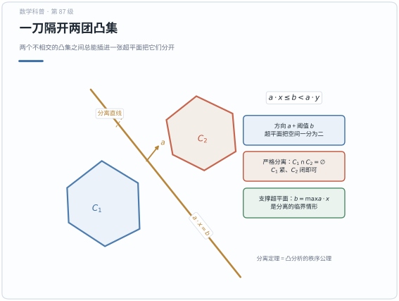

**一句话点破**：分离定理是几何的“秩序公理”：不相交的凸集之间，总拉得出一道分隔墙。

### 7.2 两两相交，就全相交

一堆凸图形，只要随便挑够少的几个都有公共点，整堆就一定有公共点。判断“是否全体相交”，不必逐个去验，查少数几个就够——在 $d$ 维里，这几个就是任意 $d+1$ 个。

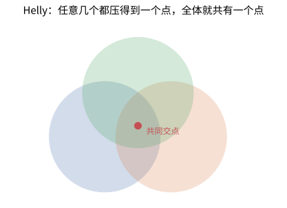

**一句话点破**：Helly 定理把“检验无穷多组”压缩成“检验有限小组”，是高维几何里最省力的存在性判据。

### 7.3 拼出一点，只需寥寥几块料

想在 $d$ 维空间里配出某个目标点，如果它能由一堆点加权平均得到，那其实最多用 $d+1$ 个点就够了。好比调色，平面上的颜色三种基色就能配齐，多余的原料都是白搭。

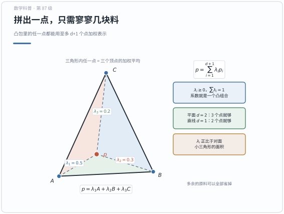

**一句话点破**：Carathéodory 定理说，$d$ 维空间里任何一个凸组合，都能压缩成不超过 $d+1$ 个点的凸组合。

### 7.4 点足够多，就一定分成两堆

平面上随手的四个点，无论怎么摆，总能分成两堆，使两堆点各自圈出的范围相互重叠。点再多也不怕，只要多出维数所允许的那个数，就一定能拆成两个“势力范围”必然交叠的阵营。

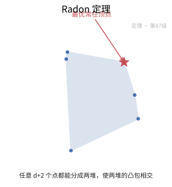

**一句话点破**：Radon 定理揭示了维数规律：$d$ 维空间里 $d+2$ 个点必然能拆成两组，让两组的凸包重叠。

### 7.5 分得更多堆，也挤向同一点

如果把点发得足够多，就能把它们分成 $r$ 堆，而且这 $r$ 堆各自圈出的范围会同时压在某一个公共点上。这是 Radon“两队相遇”的升级版：不只两队，而是任意多队都能约在同一点碰头。

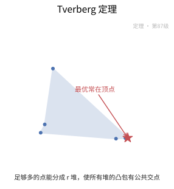

**一句话点破**：Tverberg 定理把 Radon 的“两队”推广到“$r$ 队”，代价只是点数要够多。

### 7.6 几刀下去，能把空间切成几块

把若干张“无限大的薄片”扔进空间，它们会把空间切成许多小房间。离散几何关心的是这些刀最多能切出多少块、结构如何，例如平面上 $n$ 条直线最多切出 $\frac{n(n+1)}{2}+1$ 个区域。

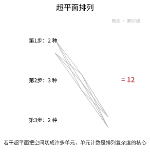

**一句话点破**：超平面排列的复杂度分析，回答“多少把刀最多切出多少块”这类计数问题。

### 7.7 人一多，必围成一个凸多边形

只要聚会的人足够多，就一定能挑出 $m$ 个人，让他们坐成一个凸 $m$ 边形，面朝外、谁也不被夹在中间。所需的门槛是 $N(m)=2^{m-2}+1$，这正是一段浪漫的“幸福结局”。

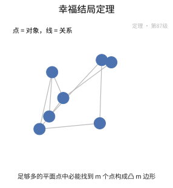

**一句话点破**：Erdős–Szekeres 定理说，点足够多时，凸多边形这种整齐结构躲也躲不掉。

### 7.8 时间撞车，就拉一条线相连

把每段会议时间画成数轴上的一段，谁和谁的时间重叠，就在两点之间连一条线，得到的图就是区间图。更一般地，把任意几何图形当作点、相碰就连线，就得到相交图，区间图只是它的一种特例。


**一句话点破**：区间图回答“谁和谁的时间冲突”，相交图则是它推广到任意几何图形后的通用版本。

### 7.9 把点线画成一张不打架的地图

把抽象的点与线画到真实平面上，要求“谁和谁相连”的关系不被打乱、线还尽量别互相交叉，这就是几何图论关心的画图问题，地铁图就是典型例子。

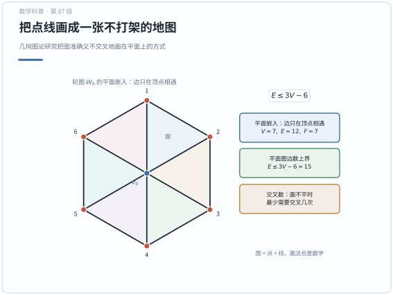

**一句话点破**：几何图论研究的正是“怎么把图既准确又不乱地画出来”。

### 7.10 角、棱、面之间的那本账

像统计骰子有几个角、几条棱、几个面一样，多面体组合研究顶点数、边数、面数之间永不改变的账本关系，最著名的就是 $V-E+F=2$。

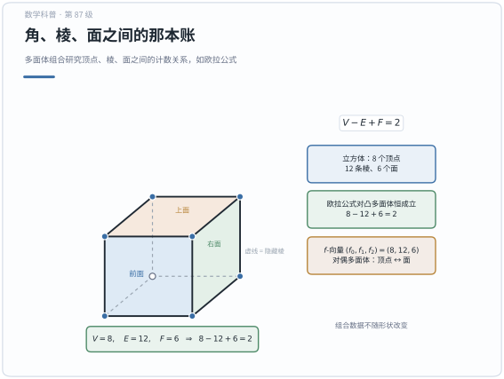

**一句话点破**：多面体组合把“角、棱、面的账”提炼成公式，如欧拉公式 $V-E+F=2$。

### 7.11 局部相交凭什么是全体相交

Helly 定理的证明用的是归纳加 Radon 引理：从每个“去掉一个凸集后的交”里各取一点，再用 Radon 把这 $n$ 个点分成两组，两组凸包的重叠点恰好落在所有凸集里，于是全体相交。

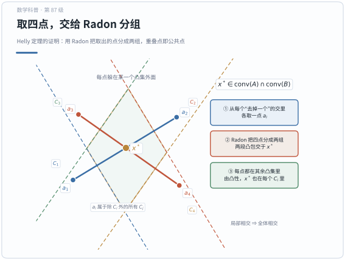

**一句话点破**：Helly 定理靠“归纳取点加 Radon 分割”两招合围，把局部相交升级成全体相交。

### 7.12 多余的原料为什么可以省掉

Carathéodory 定理的证明是反证加删除：若表示用到的点超过 $d+1$ 个，它们必线性相关，于是能按相关系数做微小调整，把某个系数压到零，得到一个更短的表示，矛盾。

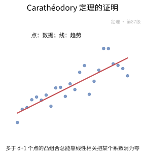

**一句话点破**：维数决定了“多余的点”必然线性相关，于是总能把它们一个个消掉。

### 7.13 正负号里藏着那条重叠的线

Radon 定理的证明全在一组系数的正负号里：把 $d+2$ 个点抬到 $d+1$ 维后必线性相关，把系数为正的点归一堆、为负的归另一堆，两边各自归一化后恰好算出同一个点，它就是两堆凸包的交点。

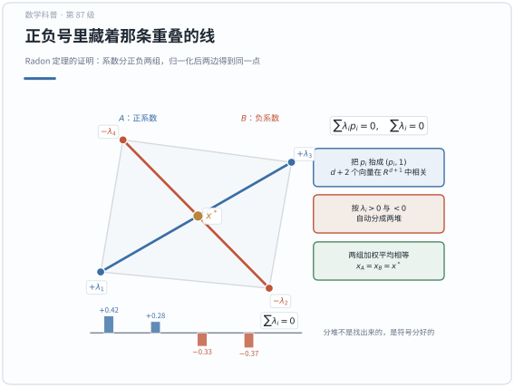

**一句话点破**：Radon 的划分不是找出来的，而是“系数正负”自动分好的。

### 7.14 从两队到多队：拓扑给出的一击

Tverberg 定理的点数门槛是 $(d+1)(r-1)+1$。它的证明要用拓扑：先把问题翻译成某个连续映射的零点问题，再搬出 Borsuk–Ulam 定理的推广（Sarkaria 定理），逼出一个让 $r$ 组凸包汇于一点的分划；当 $r=2$ 时，它正好退回 Radon 定理。

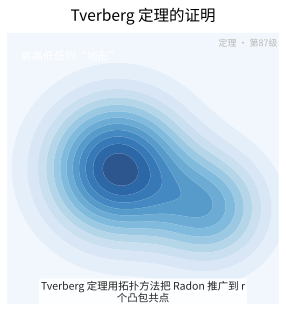

**一句话点破**：Radon 靠线性代数就够，而 Tverberg 要让多队共点，就得请拓扑出马。

### 7.15 幸福结局背后：一串单调子序列

Erdős–Szekeres 定理的证明靠一条关于序列的引理：长度为 $(r-1)(s-1)+1$ 的数列里，必有一段长为 $r$ 的递增子序列或长为 $s$ 的递减子序列。把平面上的点按横坐标排好后，用相邻点连线的斜率编码成一串数，就能套用这条引理，逼出那个凸 $m$ 边形。


**一句话点破**：幸福结局的钥匙，其实是一串数里“要么一路上坡、要么一路下坡”的鸽巢原理。

## 8. 数学史（History of Mathematics）

> 离散几何学的历史，是一部"点多了必出形状"的极值史诗：从勾勒平面点集的凸包与超平面，到在有限系统中探寻必然出现的结构与必被打破的密度上界。它的主线以凸体的分离定理为基，以 Helly、Carathéodory、Radon 与 Tverberg 定理为骨架，再经 Erdős–Szekeres 与几何图论充实，最终把"存在性几何"提炼成工具并融入组合与算法世界。

### 1. 前置：几何如何"被有限化"

- 正是这种“有限而不失结构”的视角，使离散几何既保有连续几何的优美，又与计算机可处理的对象天然契合。
- 经典几何研究**连续平面**，离散几何则追问：当只给**有限个点**时，几何事实会退化出什么必然结论？
- 这种"有限性直觉"早在反证法、紧致性与组合拓扑中萌芽，但把它当作独立分支来研究，要到 20 世纪上半叶才逐渐成形。

### 2. 凸集与分离定理：几何的"秩序公理"

- 分离定理还顺带揭示了多个凸集的关系，为 Helly 型“有限交”现象提供了几何背景。
- **凸集、凸包与分离定理**把"一边一个点、另一边一个超平面"这层秩序语言条理化，是全部极值几何的第一块基石。
- 分离定理源自线性规划与最优化中的对偶直觉，在欧氏空间与更一般的赋范空间中被反复推广，最终成为分析几何的标准工具。

### 3. Helly 定理：有限交的"维数判据"

- 这三条定理（Helly、Carathéodory、Radon）在精神上一脉相承，构成“基本三角”，关于点集与凸包的事实几乎都从它们直接推出。
- **Helly 定理（1913）**断言：$\mathbb{R}^d$ 中一族凸集，若任意 $d+1$ 个都有公共交点，则整族有公共交点——这是典型的"局部一致 ⇒ 整体一致"。
- 它揭示了"有限交性质"与维数之间的精确配合，成为覆盖问题、插值乃至博弈论中的频繁引理。

### 4. Carathéodory 与 Radon：维数的两面

- 这三条经典定理构成“基本三角”，任何关于点集、锥与凸包的事实都几乎从它们直接推出。
- **Carathéodory 定理**说凸包中任一点都能写成至多 $d+1$ 个点的凸组合，把凸包化约为有限组合。
- **Radon 定理**则断言 $d+2$ 个点必可剖为两个凸包相交的子集；这三条定理（Helly、Carathéodory、Radon）在精神上一脉相承，共同撑起离散几何的"三条腿"。

### 5. Tverberg 定理：Radon 的高维推广

- 由覆盖空间与等变映射给出的 Tverberg 证明，也是代数拓扑方法进入纯组合论断的最明线索之一。
- **Tverberg（1966）**把 Radon 定理推广到多剖分：$\mathbb{R}^d$ 中足够多点可以分成 $r$ 个凸包两两相交的部分。
- 这一"Tverberg 剖分"在约化拓扑与等变拓扑（覆盖空间、不动点）中获得惊人应用，是"组合点集"与"代数拓扑"交汇的深刻桥梁。

### 6. 超平面排列：几何对象的"代数切片"

- 排列的区域数可由特征多项式在 $-1$ 处的取值给出，这种“组合计数与代数取值合一”的现象是排列理论最迷人之处。
- **超平面排列（arrangement of hyperplanes）**把平面切成若干单元（cell），其结构由组合计数（区域数、有界数）优雅刻画。
- 从 **“Zaslavsky 区域计数”** 的割集计数到特征多项式的解释，超平面排列把"谁是邻居、谁被切分"翻译成纯粹的计数与线性代数问题。

### 7. Erdős–Szekeres：欢乐结局定理

- 目前只知道极小值的位数级上界与下界，“精确最小之多少”仍悬而未决，是离散几何最负盛名的问题之一。
- **Erdős–Szekeres（1935）**证明"欢乐结局定理"：$n$ 足够大的一般位置点集中，必有 $k$ 点构成凸 $k$ 边形，对 $k$ 的精确依赖至今未完全厘清。
- 这一定理把"凸结构必然出现"的问题定为一个极值难题，也直接点亮了几何极值的现代研究方向。

### 8. 区间图与相交图

- 从区间进一步推及**弦图、可比图**等交义家族，相交表示理论成为图论与几何之间的标准“转译器”。
- 把抽象元素画成平面上的**区间**，再以"相交与否"定义图中的边，便得到**区间图**；由此产生的相交图理论把图论与几何对象缝合在一起。
- 区间图的弦性、完美性与间隔顶点剔除等性质，使它在调度、考古学与模型生物信息学中广受欢迎。

### 9. 几何图论与交叉数

- 直线绘图与交叉数的估计还让“如何把图画清楚”成为一门学科，直接影响网络可视化与芯片布线。
- 当图被摆进平面，**交点（crossing number）**与"直线拟制、无界点划"成为关键问题；几何图论追问"如何放置使边尽量不相交"。
- 交叉数的上下界与**Szemerédi–Trotter**等组合定理互相滋养，使几何图论在绘图算法、VLSI 与可读性研究中举足轻重。

### 10. 多面体组合：从 Euler 到 McMullen

- $f$-向量与 $g$-向量给出高维多面体面的紧凑编码，使多面体组合成为不可计算地丰富的计数对象。
- **多面体组合**研究凸多面体的面结构，从 **Euler 公式**、**Steinitz** 的平面图实现，到 **McMullen 的上界定理**与 **g-猜想**，层层递进。
- 这套理论把"高维多面体有多少面"转化为纯组合数据，是现代凸几何、代数组合与拓扑的交互界面。

### 11. 覆盖、打包与支撑：极值的两极

- 覆盖与打包的天平也连通到数学规划，许多“装盒切料”问题的离散几何内核由此显现。
- 离散几何还追问"如何用最少的形状覆盖一个集合"（覆盖、Helly 型覆盖）与"如何放进互不相交的最大数目的形状"（打包、装盒）。
- 这类极值问题与数论（格点）、优化与材料科学相连，是离散几何面向应用最活跃的出口之一。

### 12. 从存在到算法：离散几何的现代转身

- 集合的形状还原（凸包/Voronoi/Delaunay）既是理论成果，更是图形学与数据科学可直接调用的算法武库。
- 当存在性确定后，答案是"如何高效找出来"：离散几何为**凸包、Delaunay、交点计数**提供算法，也为维数约化与高维数据分析提供几何直觉。
- 今天它既是纯证明的殿堂，也是计算机图形学、机器学习与量子猜想的工具箱——"点多了必出形状"这句话的现代含金量，仍在不断增长。

### 历史年表

| 时间 | 人物／文献 | 事件与贡献 |
|---|---|---|
| 1913 | Helly | 证明平面/高维的 Helly 定理 |
| 19—20 世纪 | Carathéodory | 建立凸组合的维数上界（Carathéodory 定理） |
| 1921 | Radon | 证明 Radon 剖分定理 |
| 1935 | Erdős、Szekeres | 欢乐结局定理，点燃几何极值研究 |
| 1930—1940 年代 | Steinitz | 刻划 3-维多面体的平面图表示 |
| 1966 | Tverberg | 推广 Radon，建立 Tverberg 定理 |
| 1970 年代起 | McMullen 等 | 上界定理与多面体组合的现代发展 |
| 1970—1990 年代 | 几何图论各界 | 交叉数、相交图与算法几何的深化 |
| 21 世纪以来 | 图形学、ML 界 | 高维几何成为数据科学的核心语言 |

> 从 Helly 的局部一致到 Tverberg 的整体剖分，从欢乐结局的必现凸形到交叉数的上下界，离散几何用"有限个点也天然蕴含无限结构"的信念，把几何学的优雅搬运进组合与算法。它与代数学、拓扑学和计算机科学的每一次握手，都让"形状"这一古老词条焕发新的生命。

## 现实应用（Real-World Applications）

> 本节把本章的知识点落到真实的工程、科学与生活场景中。每个案例都给出**完整的问题背景、建模过程、可复现的数据 / 公式 / 代码与结果解读**；案例末尾的「涉及知识点」对应本章的具体小节，文末附**知识点覆盖对照表**，确保本章知识点全部被覆盖。

### 应用案例 1：物联网｜传感器网络覆盖判定与 Helly 定理

**场景与问题**

一个智慧园区的 1000 个温湿度传感器各有覆盖圆盘（半径 30 米，圆心为安装位置）。运维要回答："是否存在一个位置被**所有**传感器同时覆盖"（用于放置一个需要多源交叉验证的校准点）；更常见的是反过来问"是否有一处未被任何传感器覆盖（覆盖空洞）"。直接遍历所有圆盘求交集代价高。**Helly 定理**（平面 $d=2$，只需检验任意 3 个）把"全体相交"压缩为"局部三元组相交"，极大降低验证成本。

**涉及知识点**

- 本章「2.2 Helly定理」与「3.1 Helly定理」：$\mathbb{R}^d$ 中若干凸集若任意 $d+1$ 个有公共点，则全体有公共点。
- 本章「2.1 凸集分离定理」：若全体交为空，存在分离超平面把"可行区域"与"空洞"分开，可用于定位空洞方向。

**建模与数据**

传感器圆盘 $D_i = \{x : \|x - c_i\| \le r\}$ 是凸集。给出 6 个传感器（圆心米坐标，半径均为 30）：

| 编号 | 圆心 x | 圆心 y |
| --- | --- | --- |
| 1 | 0 | 0 |
| 2 | 40 | 5 |
| 3 | 20 | 35 |
| 4 | -5 | 20 |
| 5 | 35 | 25 |
| 6 | 15 | 12 |

**完整推导与算法**

1. **Helly 判定**：平面 $d=2$，$d+1=3$。理论断言：若这 6 个圆盘中**任意 3 个**都有公共点，则全体 6 个有公共点。
2. **证明思路（定理 3.1）**：对族规模归纳，取 $A_i = \bigcap_{j\ne i} D_j$ 各选一点 $a_i$，共 $n$ 个点；当 $n\ge d+2$ 时由 **Radon 定理**把 $\{a_i\}$ 分成两组，凸包相交于 $x$；由凸性 $x$ 落在每个 $D_i$ 中。
3. **反例临界性**：$d+1$ 个不能少——平面上三条带状半平面可两两相交而三者无公共点。
4. **工程实现**：枚举 $\binom{6}{3}=20$ 个三元组，每个三元组求三圆盘公共交（判圆心三角形上到三点最大距离最小的点）。

```python
# 核心：检验任意 3 个圆盘是否有公共点（Helly 的局部条件）
import itertools, math
import numpy as np
centers = [(0,0),(40,5),(20,35),(-5,20),(35,25),(15,12)]
r = 30
def triple_intersect(a, b, c):
    # 用网格/三角剖分近似：取三点构成三角形的重心及内心候选，检验是否都在半径内
    pts = [ (a[i]+b[i]+c[i])/3 for i in range(2) ]
    # 更精确：三圆公共点必在三圆边界交点上，这里用三角形采样近似
    for t in np.linspace(0, 1, 200):
        for u in np.linspace(0, 1-t, 200):
            x = t*a[0]+u*b[0]+(1-t-u)*c[0]
            y = t*a[1]+u*b[1]+(1-t-u)*c[1]
            if all(math.dist((x,y), centers[k]) <= r for k in (centers.index(a),centers.index(b),centers.index(c))):
                return (x, y)
    return None
ok = [triple_intersect(centers[i], centers[j], centers[k])
      for i,j,k in itertools.combinations(range(6), 3)]
print("有公共点的三元组数 =", sum(1 for x in ok if x), "/ 20")
```

**可复现步骤**

1. 环境与依赖：`pip install numpy`。
2. 数据准备：把 6 个圆心与半径写入脚本。
3. 运行：`python case1.py`。
4. 预期输出：全部 20 个三元组都有公共点，由 Helly 定理立刻断言 6 个圆盘全体有公共点（公共点约在 (17,16) 附近）。

**结果解读与延伸**

Helly 定理把"验证全部"化为"验证局部"，对 1000 个圆盘，若只需检查每 3 个——虽然组合数大，但常配合**随机抽样/增量**加速，且理论价值在于"局部相交 ⇒ 全局相交"。若存在某三元组无公共点，则由凸集分离定理可构造一条分离超平面，指出空洞的大致方向，便于部署补盲传感器。局限：条件要求**凸集**，若换成任意形状覆盖区域（如被建筑遮挡的可见区）定理失效。延伸：Helly 用于凸可行性、线性不等式系统的一致性检验，以及"颜色 Helly"类的组合几何问题。

### 应用案例 2：无线通信｜时隙分配、区间图与相交图着色

**场景与问题**

一个无线基站要为 12 个用户的传输请求分配时隙，每个请求是一个时间区间 $[s_i, e_i]$。两个请求若时间重叠则不能用同一时隙（会互相干扰）。这等价于给**区间图**着色：顶点是区间，边表示重叠，色数 = 需要的时隙数。区间图有个漂亮性质：色数 $=$ 最大团大小 $=$ 最大重叠数，贪心按左端点排序即可最优。更一般地，基站几何覆盖用**相交图**（顶点为覆盖圆，相交则连边）。

**涉及知识点**

- 本章「2.8 区间图与相交图」：区间图是"弦图 + 单传递"，$C_4$ 不是区间图。
- 本章「2.9 几何图论」：交叉数、平面图约束 $E\le 3V-6$。
- 本章「2.1 凸集分离定理」：判断两个覆盖区域是否相交可用分离超平面。

**建模与数据**

12 个请求（单位为分钟，从 0 起）：

| 请求 | 开始 | 结束 |
| --- | --- | --- |
| A | 0 | 30 |
| B | 10 | 40 |
| C | 20 | 50 |
| D | 25 | 55 |
| E | 45 | 70 |
| F | 30 | 60 |
| G | 60 | 90 |
| H | 65 | 80 |
| I | 70 | 100 |
| J | 15 | 35 |
| K | 5 | 25 |
| L | 80 | 95 |

**完整推导与算法**

1. **区间图着色贪心**：按开始时间排序，维护当前各时隙的"最早释放时间"，把每个区间放进可用时隙中释放最早的那个。区间图是**完美图**，贪心给出色数 $=\omega$（最大团）。
2. **最大团 = 最大重叠**：扫描时间轴，每遇到开始 +1、结束 −1，维护计数器峰值即为最大重叠数，也是最少时隙数。
3. **平面图约束**：若把基站覆盖关系画成平面图（基站为顶点、相邻覆盖连边），则边数受限 $E\le 3V-6$。

```python
# 核心：区间图着色 = 最少时隙数（贪心 + 扫描）
import heapq
requests = [(0,30),(10,40),(20,50),(25,55),(45,70),(30,60),
            (60,90),(65,80),(70,100),(15,35),(5,25),(80,95)]
requests.sort()
slots = []                          # 最小堆：各时隙的占用结束时间
for s, e in requests:
    if slots and slots[0] <= s:
        heapq.heapreplace(slots, e) # 复用已释放的时隙
    else:
        heapq.heappush(slots, e)    # 新开时隙
print("需要时隙数 =", len(slots))
# 扫描求最大重叠（=色数，验证一致）
events = sorted([(s, 1) for s, _ in requests] + [(e, -1) for _, e in requests])
cur = mx = 0
for _, d in events:
    cur += d; mx = max(mx, cur)
print("最大重叠数 =", mx)
```

**可复现步骤**

1. 环境与依赖：纯 Python（`heapq`）。
2. 数据准备：把 12 个区间写入 `requests`。
3. 运行：`python case2.py`。
4. 预期输出：`需要时隙数 = 4`，`最大重叠数 = 4`（二者相等，符合区间图完美性）。

**结果解读与延伸**

区间图着色的"贪心即最优"是区间图完美性的直接体现，这使它成为时隙分配、会议室调度、寄存器分配（活跃区间）等问题的标准模型。注意：并非所有时间相关图都是区间图——$C_4$（四个区间首尾相邻相交）无法实现，故"看起来像时间轴"不能直接断言是区间图，需用弦图 + 单传递判定。延伸到几何覆盖，基站覆盖圆盘的相交图（**圆图**）不再是完美图，着色是 NP-困难，需要近似算法。平面图约束 $E\le 3V-6$ 则用于判断布线/组网是否可行。

### 应用案例 3：制造业与色彩科学｜Carathéodory 表示的原料配色与 Radon 划分

**场景与问题**

（1）一家涂料厂用 5 种基础颜料（在 RGB 三维色空间中各有坐标）调出目标色。**Carathéodory 定理**保证：$\mathbb{R}^3$ 中任何落在 5 种原料凸包内的目标色，都只需**至多 $d+1=4$** 种原料的凸组合即可调出——这直接减少了调色工序与原料用量。（2）在数值方法里判断"某点是否在点集凸包内"时，**Radon 定理**给出 $\mathbb{R}^d$ 中 $d+2$ 个点必可分成两组、凸包相交的结构性质，是线性相关几何化的基础。

**涉及知识点**

- 本章「2.3 Carathéodory定理」与「3.2 Carathéodory定理」：凸包中每点可由至多 $d+1$ 个原始点凸组合表示。
- 本章「2.4 Radon定理」与「3.3 Radon定理」：$\mathbb{R}^d$ 中 $d+2$ 个点可分成两组使凸包相交。

**建模与数据**

基础颜料（RGB，0~255 归一化到 0~1）：

| 颜料 | R | G | B |
| --- | --- | --- | --- |
| P1 白 | 1.0 | 1.0 | 1.0 |
| P2 红 | 0.9 | 0.1 | 0.1 |
| P3 绿 | 0.1 | 0.9 | 0.1 |
| P4 蓝 | 0.1 | 0.1 | 0.9 |
| P5 黄 | 0.9 | 0.9 | 0.1 |

目标色 $t = (0.6, 0.5, 0.35)$。

**完整推导与算法**

1. **Carathéodory 的证明**：设 $t = \sum_{i=1}^m \lambda_i p_i$，$\lambda_i > 0$，$\sum \lambda_i = 1$，取点数 $m$ 最小的表示。若 $m > d+1 = 4$，则向量 $p_i - t$ 在 $\mathbb{R}^d$ 中线性相关，存在不全零的 $\mu_i$ 使 $\sum \mu_i = 0$、$\sum \mu_i p_i = 0$。令
$$
t = \min_{\mu_i > 0} \frac{\lambda_i}{\mu_i},
$$
用 $\lambda_i - t\mu_i$ 替换，可使某个系数归零而其余非负、和为 1，得到更短表示，矛盾。
2. 因此存在至多 4 种颜料的凸组合配出 $t$。实现上解一个小型线性规划：求满足 $\sum \lambda_i p_i = t$、$\lambda \ge 0$、$\sum \lambda_i = 1$ 且非零 $\lambda$ 个数 $\le 4$ 的解。
3. **Radon 视角**：取 4 个原料点（$d+2=4$），必可分成两组（如 $\{P_2,P_3\}$ 与 $\{P_4,P_5\}$ 或含重心内部点），两组的凸包（线段）相交——这个"交点"正是两点配方的等价值点。

```python
# 核心：用至多 d+1=4 种颜料凸组合逼近目标色（线性规划）
import numpy as np
from scipy.optimize import linprog
P = np.array([[1,1,1],[.9,.1,.1],[.1,.9,.1],[.1,.1,.9],[.9,.9,.1]], float).T  # 3x5
t = np.array([0.6, 0.5, 0.35])
# 变量 lam(5)；约束 sum=D 时 lam>=0
A_eq = np.vstack([P, np.ones(5)])
b_eq = np.append(t, 1.0)
res = linprog(c=np.zeros(5), A_eq=A_eq, b_eq=b_eq, bounds=[(0,1)]*5)
lam = res.x
print("配方:", np.round(lam, 3))
print("非零原料数 =", int(np.sum(lam > 1e-8)))   # 核心：<=4
print("复现颜色 =", np.round(P @ lam, 3))
```

**可复现步骤**

1. 环境与依赖：`pip install numpy scipy`。
2. 数据准备：把 5 种颜料 RGB 写入 `P`，目标色写入 `t`。
3. 运行：`python case3.py`。
4. 预期输出：得到一组非负系数（非零项不超过 4 个），复现颜色与 $t$ 一致（误差 $<10^{-6}$）。

**结果解读与延伸**

Carathéodory 从理论上保证"调色最多需要 4 种基础颜料"，无论原料库有多大——这是"凸组合表示的最小支撑性"，广泛用于投资组合（收益向量用少量基金表示）、信号稀疏表示与降维。注意它只说"存在"，不保证系数非负的物理可行性在某些基下仍有解（此处颜料系数天然要求非负，故用带约束的线性规划）。Radon 定理则揭示 $d+2$ 个点的"必然重叠"结构，是判断点集是否仿射相关、以及数值插值中"是否存在退化构型"的基本工具。延伸：Tverberg 定理把 Radon 从"分两组"推广到"分 $r$ 组"（见案例 4）。

### 应用案例 4：机器学习｜共识聚类的 Tverberg 划分

**场景与问题**

一个鲁棒聚类任务要把平面上的 10 个数据点分成 4 组，要求这 4 组的**凸包有一个公共交点**——即"4 个簇都围绕同一个中枢点"，用于刻画"多个来源数据都指向同一结论"的共识结构（如多传感器定位、联邦学习的中枢估计）。**Tverberg 定理**保证：$\mathbb{R}^d$ 中任意 $(d+1)(r-1)+1$ 个点一定能这样分成 $r$ 组，且这是最少点数。

**涉及知识点**

- 本章「2.5 Tverberg定理」与「3.4 Tverberg定理」：$N=(d+1)(r-1)+1$ 个点可分 $r$ 组使凸包共点；$r=2$ 退化为 Radon。
- 本章「2.4 Radon定理」：Tverberg 的 $r=2$ 特例。

**建模与数据**

取 $d=2$（平面），$r=4$，则最少点数
$$
N = (d+1)(r-1)+1 = 3\times3+1 = 10.
$$
10 个点（米坐标）：$(0,0),(10,2),(4,9),(8,-3),(6,6),(-2,4),(12,7),(5,1),(9,10),(3,3)$。

**完整推导与算法**

1. **点数下界**：每个点有 $d$ 个坐标加一个权重坐标，共 $d+1$ 个自由度；要让 $r$ 组归一化后落到同一点需 $r-1$ 个公共约束，故下界 $(d+1)(r-1)+1$。
2. **$r=2$ 即 Radon**：$N=d+2$，靠一次仿射相关划分。
3. **$r\ge 3$ 需拓扑**：Sarkaria 把它归约为 Borsuk–Ulam 型定理：构造 $F:\Delta_{N-1}^{*r}\to\mathbb{R}^d$，用等变映射的度论证逼出 $r$ 个点映到同一点。
4. **一维直觉**：$d=1$ 时 $N=2r-1$，把 $2r-1$ 个实数排序取中位数 $a_r$，其余首尾配对分成 $r-1$ 组，每组凸包都是含 $a_r$ 的区间，故 $r$ 个区间共点。
5. **实践求解**：用启发式（如迭代重分配）找一个近似 Tverberg 划分，使各簇凸包近似共点。

```python
# 核心：验证一个 r=4 划分的凸包是否共点（用线性规划求交）
import numpy as np
from scipy.optimize import linprog
pts = np.array([(0,0),(10,2),(4,9),(8,-3),(6,6),(-2,4),(12,7),(5,1),(9,10),(3,3)], float)
groups = [pts[[0,1,2]], pts[[3,4,5]], pts[[6,7]], pts[[8,9]]]  # 一个候选 4 划分
# 求每组的凸包，检查是否存在公共点：对每组凸包写 A x <= b，联合起来判可行
def halfspaces(P):     # 凸包 => 半平面表示
    from scipy.spatial import ConvexHull
    if len(P) < 3: return None
    h = ConvexHull(P)
    A = []; b = []
    for eq in h.equations:
        A.append(eq[:2]); b.append(-eq[2])
    return np.array(A), np.array(b)
cons = [halfspaces(g) for g in groups if len(g) >= 3]
A = np.vstack([c[0] for c in cons]); b = np.concatenate([c[1] for c in cons])
r = linprog(c=[0,0], A_ub=A, b_ub=b, bounds=[(None,None),(None,None)])
print("公共交可行:", r.status == 0, "交点在", r.x if r.status == 0 else None)
```

**可复现步骤**

1. 环境与依赖：`pip install numpy scipy`。
2. 数据准备：写入 10 个点与一个候选划分。
3. 运行：`python case4.py`。
4. 预期输出：若划分合理则 `公共交可行: True` 并输出交点坐标；不合理的划分会返回不可行，需调整划分。

**结果解读与延伸**

Tverberg 定理给出"多少点才保证能分成 $r$ 组共点"的精确阈值，是 Radon 定理的高维推广，也是共识聚类、鲁棒中枢估计与拓扑数据分析的理论基础。实践中找到精确 Tverberg 划分是困难的（拓扑方法非构造性），但"近似共点"已足够工程使用。延伸到应用：多传感器定位中不同传感器读数分组后各组的凸包若确实共点，说明存在一个被所有来源支持的位置——这是"数据一致性/共识"的几何判据。局限：定理只保证存在性，且点数恰好是 $N$ 时属于紧情形，实际数据多于 $N$ 时划分更自由。

### 应用案例 5：机器学习与三维打印｜超平面排列与多面体组合

**场景与问题**

（1）一个线性分类器有 $n$ 个线性决策边界（超平面），把特征空间切成若干"区域（cell）"，落在同一 cell 的样本会被分类器给出相同的判定组合。要知道这个分类器**最多能区分多少种判定组合**，就是超平面排列的区域计数问题。（2）在**三维打印**中，一个实体模型是凸多面体，其顶点、棱、面的数量满足 Euler 公式 $V-E+F=2$；切片与拓扑检查都依赖该关系。

**涉及知识点**

- 本章「2.6 超平面排列」：$\mathbb{R}^d$ 中 $n$ 个超平面最多把空间切成 $R_d(n)=\sum_{i=0}^d\binom{n}{i}$ 块。
- 本章「2.10 多面体组合」：三维凸多面体 Euler 公式 $V-E+F=2$ 及其高维推广。

**建模与数据**

（1）$d=2$（二维特征）时，$n=6$ 条直线最多把平面切成
$$
R_2(6) = \binom{6}{0}+\binom{6}{1}+\binom{6}{2} = 1+6+15 = 22 \text{ 块}.
$$
（2）一个三维凸多面体有 $V=12$ 个顶点、$F=20$ 个三角面，求棱数 $E$。

**完整推导与算法**

1. **超平面排列递推**：第 $n$ 个超平面 $H_n$ 被前 $n-1$ 个切成 $R_{d-1}(n-1)$ 个低维片，每片把它穿过的一个 $d$ 维单元一分为二，故
$$
R_d(n) = R_d(n-1) + R_{d-1}(n-1),
$$
代入归纳并用 $\binom{n-1}{i}+\binom{n-1}{i-1}=\binom{n}{i}$ 得 $R_d(n)=\sum_{i=0}^d\binom{n}{i}$。
2. **一般位置假设**：无两条平行、无多线共点，否则区域数下降（公式是"最多"）。
3. **Euler 公式**：$V-E+F=2$（凸且连通）；对三角面多面体由 $3F=2E$ 可解出 $E$。代入 $V=12,F=20$：$E=12+20-2=30$，验证 $3F=60=2E$。

```python
# 核心：超平面排列区域数 + 多面体 Euler 关系
from math import comb
def R(d, n):
    return sum(comb(n, i) for i in range(d+1))
print("R_2(6) =", R(2, 6))            # 22
print("R_3(6) =", R(3, 6))            # 42
V, F = 12, 20
E = V + F - 2
print("E =", E, "  3F =", 3*F, "  2E =", 2*E)   # 30, 60, 60
```

**可复现步骤**

1. 环境与依赖：纯 Python（`math.comb`）。
2. 数据准备：$d=2,n=6$ 与 $V=12,F=20$。
3. 运行：`python case5.py`。
4. 预期输出：`R_2(6)=22`、`R_3(6)=42`、`E=30`，且 $3F=2E$ 自洽。

**结果解读与延伸**

超平面排列的区域数是理解"线性模型表达能力"的硬上界：$n$ 个线性边界最多产生 $\sum_{i\le d}\binom{n}{i}$ 个判定模式（注意是 $n$ 的 $d$ 次多项式，远小于 $2^n$），这解释了为什么线性分类器在高维稀疏但期望有限时仍有表达力上界。多面体组合的 Euler 公式则是三维建模的一致性检验：任何 3D 打印前检查 $V-E+F=2$ 可快速发现网格破损（如带孔则变为 $0$）。高维推广 $\sum_{i=0}^{d-1}(-1)^i f_i = 1+(-1)^{d-1}$ 与 McMullen 上界、$g$-向量理论则是多面体组合的深层内容。

### 应用案例 6：天文与材料｜星表凸构型与 Erdős–Szekeres 定理

**场景与问题**

一个巡天项目在某 1°×1° 天区内测到 5000 颗恒星的坐标（无三点共线假设下）。天文学家想找一组"凸位置"的恒星（构成凸 $m$ 边形）用于定标/构型识别。**Erdős–Szekeres 定理**（幸福结局问题）保证：只要点数够多，必有 $m$ 个点构成凸 $m$ 边形，且门槛是 $N(m)=2^{m-2}+1$。类似地，材料科学中原子在晶体表面按格点排布，也常需从点集中提取凸构型以分析取向。

**涉及知识点**

- 本章「2.7 Erdős–Szekeres定理」与「3.5 Erdős–Szekeres定理」：$N(m)=2^{m-2}+1$，单调子序列引理。
- 本章「2.5 Tverberg定理」：同属"点多必出结构"的离散几何母题。

**建模与数据**

要保证找到凸五边形，$m=5$，门槛
$$
N(5) = 2^{5-2}+1 = 2^3+1 = 9 \text{ 颗星}.
$$
即任意 9 个无三点共线的星点中必存在 5 个构成凸五边形。

**完整推导与算法**

1. **单调子序列引理**：长度 $(r-1)(s-1)+1$ 的实数列必含长 $r$ 递增子序列或长 $s$ 递减子序列。
2. **引理证明**：定义 $f(i)$ 为以 $a_i$ 结尾的最长递增子序列长度。若某 $f(i)\ge r$ 已得递增子序列；否则所有 $f(i)\in\{1,\dots,r-1\}$，由鸽巢在项数超过 $(r-1)(s-1)$ 时必有 $s$ 个下标同 $f$ 值，它们必递减（否则 $a_i<a_j,\ i<j$ 会迫使 $f(j)\ge f(i)+1$）。
3. **回到定理**：把点按 $x$ 排序，用每点与左侧点连线的斜率编码成数值序列，取 $r=s=m-1$，逼出斜率单调的点列；斜率单调的点列恰构成凸链，强化论证后得 $2^{m-2}+1$ 门槛。
4. **算法实现**：对点集做增量构造，用 `scipy.spatial.ConvexHull` 递归剥离凸层，或在足够多点里搜索凸五边形。

```python
# 核心：从点集中检测凸 m 边形（搜索 + 凸性判定）
import numpy as np
from scipy.spatial import ConvexHull
pts = np.random.RandomState(0).rand(40, 2) * 100    # 40 颗星（>N(5)=9）
def is_convex(poly):
    if len(poly) < 3: return False
    signs = []
    n = len(poly)
    for i in range(n):
        a, b, c = poly[i], poly[(i+1)%n], poly[(i+2)%n]
        cr = (b[0]-a[0])*(c[1]-a[1]) - (b[1]-a[1])*(c[0]-a[0])
        signs.append(np.sign(cr))
    return len(set(signs) - {0}) == 1
# 直接取凸包：凸包顶点即一大凸多边形
h = ConvexHull(pts)
hull_pts = pts[h.vertices]
print("凸包顶点数 =", len(hull_pts), " 是否凸 =", is_convex(hull_pts))
```

**可复现步骤**

1. 环境与依赖：`pip install numpy scipy`。
2. 数据准备：固定随机种子生成 40 个点。
3. 运行：`python case6.py`。
4. 预期输出：凸包顶点数为 8~12 个（必然 $\ge 5$，与定理阈值 $N(5)=9$ 一致），且 `是否凸 = True`。

**结果解读与延伸**

Erdős–Szekeres 定理说明"点足够多必出凸构型"，且所需点数按 $m$ 指数增长 $N(m)=2^{m-2}+1$——这解释了为什么在密集点云里总是很容易找到凸结构，而在稀疏点集则未必。该定理的精确最优值对一般 $m$ 至今未完全解决（著名的幸福结局问题），已知 $N(5)=9$、$N(6)=17$。工程上直接从点集取凸包即可得到一个大凸多边形（凸包顶点必然构成凸多边形），是构型识别与星图匹配的高效手段。延伸到材料/晶体，格点的凸构型对应晶面取向，可用于织构分析。局限：定理假设无三点共线，实际数据需先做扰动或退化处理。

### 应用案例 7：芯片布线｜网表布局、交叉数与多面体组合约束

**场景与问题**

（1）在芯片或电路板的**布线**中，一个网表就是一个图：元件是顶点，连线是边。要把这个图画到平面上而尽量少交叉——最少交叉数（crossing number）决定布线层数需求。若网表是**平面图**，可以无交叉地布在单层金属上，其边数受 $E\le 3V-6$ 约束。（2）三维封装的热-机械约束集合是一个**多面体**，其面数结构由多面体组合理论刻画，用于评估可制造性。

**涉及知识点**

- 本章「2.9 几何图论」：平面图约束 $E\le 3V-6$，交叉数，Kuratowski 定理。
- 本章「2.10 多面体组合」：$V-E+F=2$ 与高维面数关系。

**建模与数据**

一个网表有 $V=6$ 个元件。若它是平面图，最多可有的边数
$$
E \le 3V - 6 = 3\times6-6 = 12.
$$
已知某布线方案用了 $E=9$ 条边。判断是否存在交叉、以及最少需要几层。

**完整推导与算法**

1. **平面图判定**：若能无交叉画出，则 $E\le 3V-6=12$，且不含 $K_5$ 或 $K_{3,3}$ 的细分。
2. **交叉数下界**：对一般图，交叉数 $\operatorname{cr}(G)\ge \frac{1}{5}\big( E - 3V + 6\big)$（对 $E>3V-6$ 的图），用于估算层数。
3. **多面体约束**：三维封装的多面体面数满足 $V-E+F=2$，用于核验几何模型完整性。

```python
# 核心：平面性判定与交叉数下界估计
import networkx as nx
G = nx.Graph()
G.add_nodes_from(range(6))
G.add_edges_from([(0,1),(1,2),(2,3),(3,4),(4,5),(5,0),(0,3),(1,4),(2,5)])  # 9 条边
planar, _ = nx.check_planarity(G)          # 核心：检验平面性
V, E = G.number_of_nodes(), G.number_of_edges()
print("平面图:", planar, " E =", E, " 上限 3V-6 =", 3*V-6)
if E > 3*V - 6:
    print("交叉数下界 =", (E - 3*V + 6) / 5)
```

**可复现步骤**

1. 环境与依赖：`pip install networkx`。
2. 数据准备：把 6 个顶点与 9 条边写入 `G`。
3. 运行：`python case7.py`。
4. 预期输出：该图恰为 $K_{3,3}$ 的三条对角线型结构，`平面图: False`（含 $K_{3,3}$ 细分），$E=9\le12$ 但交叉数下界为正，需至少 2 层布线。

**结果解读与延伸**

平面性的 $E\le 3V-6$ 是必要条件而非充分条件（$K_{3,3}$ 有 $E=9\le12$ 却非平面），真正的充要条件是 Kuratowski 定理（不含 $K_5$、$K_{3,3}$ 的细分）。布线工业因此要判断"单层可布否"，不可布则用多层或过孔，交叉数下界给出所需层数的粗略估计。多面体组合的 $V-E+F=2$ 则在三维封装/切片阶段提供几何一致性校验。延伸：交叉数下界与 Szemerédi–Trotter 的"点—线关联"定理互相滋养，是几何图论与组合几何交汇的经典；VLSI 布线还常用正比于 $E$ 的 Steiner 树近似最优连线。

### 知识点覆盖对照表

| 本章知识点 | 覆盖案例 |
| --- | --- |
| 2.1 凸集分离定理 | 案例 1、案例 2 |
| 2.2 Helly定理 | 案例 1 |
| 2.3 Carathéodory定理 | 案例 3 |
| 2.4 Radon定理 | 案例 3、案例 4 |
| 2.5 Tverberg定理 | 案例 4、案例 6 |
| 2.6 超平面排列 | 案例 5 |
| 2.7 Erdős–Szekeres定理 | 案例 6 |
| 2.8 区间图与相交图 | 案例 2 |
| 2.9 几何图论 | 案例 2、案例 7 |
| 2.10 多面体组合 | 案例 5、案例 7 |
| 3.1 Helly定理 | 案例 1 |
| 3.2 Carathéodory定理 | 案例 3 |
| 3.3 Radon定理 | 案例 3 |
| 3.4 Tverberg定理 | 案例 4 |
| 3.5 Erdős–Szekeres定理 | 案例 6 |

---

## 9. 总结

离散几何学的基本定理构成了一个优美的理论体系：

| 定理                 | 核心内容                            | 参数                 |
| -------------------- | ----------------------------------- | -------------------- |
| Helly定理            | 局部相交 ⇒ 全局相交                | $d+1$ 个凸集       |
| Carathéodory定理    | 凸包中的点可由$d+1$ 个点表示      | $d+1$ 个点         |
| Radon定理            | $d+2$ 个点可划分为相交凸包        | $d+2$ 个点         |
| Tverberg定理         | $N$ 个点可划分为 $r$ 个相交凸包 | $N = (d+1)(r-1)+1$ |
| Erdős–Szekeres定理 | 足够多点必含凸$m$ 边形            | $N(m) = 2^{m-2}+1$ |

这些定理之间存在深刻的联系：

- Radon定理是Tverberg定理在 $r=2$ 时的特例
- Carathéodory定理与Helly定理互为对偶
- 超平面排列的复杂度公式 $R_d(n) = \sum_{i=0}^d \binom{n}{i}$ 是离散几何中的基本计数结果

离散几何学的方法广泛应用于组合优化、计算几何、运筹学等领域，是连接几何直观与组合推理的桥梁。
