# 第88级：有限几何学

> 从"只有有限个点"的离散世界出发，把射影几何、仿射几何压缩到有限多个点与线上，在公理的约束下照样自洽运转。

---

## 从"只有有限个点"说起：有限几何学要解决的根本问题

> 在动手记公理之前，先想清楚一个问题：**世界上明明充满了无穷多点的几何，为什么我们还要一种"只有有限个点"的几何？**

**一个真实的生活场景（第一步：直觉）**

假设你是一个小镇的规划师，全镇只有 7 个公交站，要设计一套"任意两个站之间恰好有一条直达线路、任意两条线路又恰好共用一个换乘站"的路网。这听起来像个不可能完成的馊主意——可它偏偏能排出来（答案就是 Fano 平面 $PG(2,2)$，见 §4.1）。更惊人的是：**只要把"点"和"线"的规则定严，即使只有几个点，也能支撑起一整套像模像样的几何。** 这就是有限几何的第一直觉：离散世界里同样藏得住自洽的结构。

**它要解决的根本问题（第二步：来龙去脉）**

几何到底能不能离开"无穷"而成立？整个故事要从两条线索的交汇讲起。

- **射影几何的"缺点"催生了压缩几何的梦想**。古典射影几何（见更早的平面几何专题）研究"任意两点确定一条线、任意两条线交于一点"，这套公理天然美丽，但它的点有无穷多个。数学家不禁问：**如果把这套公理搬到只有 $N$ 个点的集合上，规则还走得通吗？**
- **Galois 的有限域送来坐标纸**。1830 年前后，Galois 在解方程可解性时发现带 $p^n$ 个元素的有限域 $\mathbb{F}_q$。纯粹代数造物，日后却恰好提供了"有限坐标几何"的整套坐标——$\mathbb{F}_q$ 上的点与线从此有了精确而有限的代数坐标。
- **Fano 砌出第一座有限射影平面**（1892 年）。Gino Fano 构造出 7 点 7 线的射影平面，把射影平面公理在最小区规模上完整砌了一遍，示范了"有限宇宙也能承载严格几何"。
- **20 世纪走向应用**。沿着 Galois 与 Fano 的路，人们用 $\mathbb{F}_q$ 造出仿射平面、射影平面乃至更高维有限空间，并用它们设计纠错码、组合设计与对称设计——有限几何学从此既是纯数学风景，又成了工程里不可或缺的工具。

> **🧠 一句话记住有限几何学的"出生证"**
>
> 有限几何学源于"把射影/仿射几何搬到有限个点上"的执着，它要解决的根本问题是：
>
> $$ \boxed{\text{在有限多个"点"上，能否建立每两点恰有一线、每两线恰交一点的自洽几何，且让它同时有用？}} $$
>
> 有限域 $\mathbb{F}_q$ 提供了坐标，Fano 平面证明了最小尺度的可行性，而 Bruck-Ryser 定理则回答"哪些阶真实存在"——几何的存在性，从此被算术锁死。

**看待本章的三种眼光（第三步：正式定义前的准备）**

- **公理的眼光**：有限射影平面、仿射平面、广义四边形，都是一套"点—线—关联"的公理，点线数量被公理钉死。
- **代数的眼光**：用 $\mathbb{F}_q$ 上的坐标写点写线，用关联矩阵刻画点线关系，用群（自同构群）品味对称。
- **应用的眼光**：有限几何天然产出组合设计、纠错码、LDPC 码与有限单群，是工程与本体的连结点。

读完这一节，请记住的不是公理清单，而是：**几何不必依赖无穷——只要公理给足，再小的有限宇宙也能自洽地转起来。** 带着这个信念去读后面的每一条定义，你会发现所有公式其实都是在回答同一个问题："有限世界里，几何能走多远？"

---

## 开始之前

**本章在讲什么**：有限几何学在"点集是有限集合"的前提下，系统建立射影平面、仿射平面的公理体系，用有限域 $\mathbb{F}_q$ 给出坐标表达，并讨论 Desargues 平面、Pappus 平面、有限广义四边形与极空间等更丰富的结构。你会看到 Bruck-Ryser 定理如何用数论限制几何的存在性，最终落脚到有限几何在编码理论、组合设计与群论中的威力。

**为什么要学它**：更早的射影几何专题只处理"无穷多点"的射影平面，缺少"有限"这套坐标纸，也就无法回答"几何可以小到什么程度"。本章用有限域补上这块拼接板，并为后续的高阶专题（编码理论、代数数论中的有限型结构、Lie 型单群）提供了"有限几何容器"。反过来，第 14 级线性代数中的关联矩阵、特征值、内积/二次型，在这里成为研究有限几何的日常代数工具。

**开始前请确认你还记得**：

- 有限域 $\mathbb{F}_q$ 的存在性：$q=p^n$ 时存在恰有 $q$ 个元素的域（见代数/数论专题的有限域章节）。
- 群与群作用、自同构群的概念（见近世代数、群论专题）。
- 线性代数基本工具（见第 14 级）：矩阵、特征值、二次型、内积空间，以及 $AA^T$ 这类矩阵恒等式。
- 射影平面的古典公理与通俗直觉：任意两点确定一线、任意两线交于一点（见平面几何中的射影几何）。
- 组合设计的基本计数思想：用"块"覆盖"元素"的计数（如平衡不完全区组设计的 $(v,k,\lambda)$ 参数）。

---

## 学习目标

1. 掌握有限射影平面与有限仿射平面的公理系统与基本性质
2. 理解Bruck-Ryser定理及其对有限射影平面存在性的限制
3. 掌握Desargues平面与Pappus平面的结构特征
4. 了解有限广义四边形与极空间的基本理论
5. 理解有限几何在编码理论、群论中的应用

---

## 1. 引言

有限几何学（Finite Geometry）研究定义在有限域上的几何结构。与经典欧氏几何不同，有限几何中的"点"和"线"是有限集合，满足特定的公理系统。有限几何在编码理论、密码学、组合设计、群论等领域有广泛应用。本节将系统介绍有限几何的核心概念与定理。

---

## 2. 核心概念

### 2.1 有限射影平面

🌐 **直觉先行**：有限射影平面是"有限版本的射影空间"——把古典射影几何里那两个最干净的公理（任意两点恰定一线、任意两线恰交于一点）原封不动搬进一个"点只有有限多个"的集合里。它是整门学科的地基，后面所有概念（仿射平面、广义四边形、极空间）都是在这套点线契约上的变奏。

**有限射影平面**（Finite Projective Plane）是一个由点和线组成的集合，满足以下公理：
1. 任意两点有且仅有一条线通过
2. 任意两条线有且仅有一个交点
3. 存在至少四个点，其中任意三点不共线

> **💡 直观理解（类比）**：想象一张"极简高铁网"——任意两个车站之间恰好只有一条铁路（任意两点恰好一条线），任意两条铁路又恰好共用一个换乘站（两条线恰好一个交点）。这是"点—线关系"在有限世界里最严格的对等契约。

#### 课堂问答

**老师**：我们先把地基打好。有限射影平面是什么？用最少的公理说出来。

**学生**：三条公理就够：任意两点恰有一条线过；任意两线恰交一点；存在四点，任三点不共线。第三条是非退化开关，防止结构塌成"一条线上挂几个点"这种假几何。

**老师（追问）**：那如果我把第三条删掉，会出什么事？

**学生**：结构会退化成病态。比如所有点都落在同一条线上，那样"任意两线恰交一点"要么无意义要么失效。第三条强制两个维度真正张开，才能推出标准的计数 $v=q^2+q+1$。

**老师（拓展）**：为什么非要强调"任意两线必交"这一条？它在欧氏几何里明明是假的。

**学生**：这正是射影化的关键：欧氏里平行线不相交，射影平面强行让它们交于无穷远点，于是"两线必交"成立。代价是失去"平行"概念，换来完美的点线对偶——把"点""线"两个词互换，公理原样成立。这个对偶是后面一切计数定理的引擎。

### 2.2 阶为 $q$ 的射影平面

🌐 **直觉先行**：光说"有限射影平面"还太笼统——同样是有限平面，7 个点的 Fano 平面和 13 个点的 $PG(2,3)$ 就是两回事。所以要用**阶** $q$ 给它们编档：每条线上恰有 $q+1$ 个点，相当于指定了这张"公交网"的每条线路载客量。**一旦载客数定了，整张网的总点数、总线数就被公理死死锁死。** 这是理解后面所有计数公式的钥匙。

**为什么需要这个概念**：射影平面的点线结构看似纷繁，实则被一个参数 $q$ 完全掌控。引入阶，就是为了把"存在多少个点、多少条线、每点过几条线"这一整套对称计数统一成一个公式，并为 Bruck-Ryser 定理（存在性）搭好舞台。

若有限射影平面的每条线上有 $q+1$ 个点，则称其**阶**为 $q$。此时：
- 总点数 $= q^2 + q + 1$
- 总线数 $= q^2 + q + 1$
- 每个点恰好在 $q+1$ 条线上

> **💡 直观理解（类比）**：这里的"阶"像一张公交网的"载客指标"——每条线路搭载 $q+1$ 个站点。一给定"每线载客数"，整张网的总站点数就被死死锁在 $q^2+q+1$：棋盘能铺几格，完全由参数 $q$ 说了算。

#### 课堂问答

**老师**：什么叫射影平面的"阶"？为什么一个参数就能把整张网钉死？

**学生**：阶 $q$ 定义为每条线上的点数减一，即每条线恰有 $q+1$ 个点。一旦定了它，公理就逼出全部计数：总点数 $=q^2+q+1$，总线数相同，每点恰过 $q+1$ 条线。

**老师（追问）**：总点数那个公式你怎么一眼看出来的？

**学生**：固定一点 $p$，过它有 $q+1$ 条线，每条线除 $p$ 外还有 $q$ 个点，且这些点两两不重合，所以 $v=1+(q+1)q=q^2+q+1$。线数由点线对偶直接等于点数。

**老师（拓展）**：$q$ 可以是任意正整数吗？举个小例子。

**学生**：不能任意。$q=2$ 给出 Fano 平面，$q=3$ 给出 $PG(2,3)$；但从有限域构造标准平面只对素数幂 $q$ 保证存在，且 $q=6,14$ 被 Bruck-Ryser 直接判死。所以"阶"不只是编号，还牵着存在性。

### 2.3 仿射平面

🌐 **直觉先行**：平时在纸上画平行线，它们"永远不相交"——可射影几何偏要说它们都交在"无穷远点"上。仿射平面就是"把那条挂满无穷远点的天边线整条删掉"后剩下的世界：在这里平行线恢复"永不相交"的直觉。删掉一条线这么简单的动作，却产出整整一族的有限平面。

**为什么需要这个概念**：编码与设计中大量用到的是"点有限、平行线平行到底"的结构（如正交表、拉丁方），而不是带无穷远点的射影版本。仿射平面 $AG(2,q)$ 正是这类结构的干净载体，且它与射影平面的关系（见定理 3）是"删/添一条线"的双向手续。

**仿射平面**（Affine Plane）去掉射影平面中的一条线（称为"无穷远线"）及其上的点得到。阶为 $q$ 的仿射平面记为 $AG(2, q)$：
- 总点数 $= q^2$
- 总线数 $= q^2 + q$
- 每条线上有 $q$ 个点

> **💡 直观理解（类比）**：把射影平面里那条"地平线"（无穷远线）连同点位一把擦掉，剩下的就是平时见惯的"平面黑板"——平行线从此永远平行、绝不在天边相遇。这份"擦掉地平线"的减法，正是仿射平面 $AG(2,q)$。

#### 课堂问答

**老师**：仿射平面和射影平面差在哪？一句话说清。

**学生**：差一条线。把射影平面的一条无穷远线连同它上面的 $q+1$ 个点删掉，剩下的就是阶 $q$ 的仿射平面 $AG(2,q)$：$q^2$ 个点，$q^2+q$ 条线，每条线 $q$ 个点。

**老师（追问）**：删线之后，"两线必交"这条公理怎么办？

**学生**：它退化了。原来交在无穷远线上的那些线，现在变成平行线、永不相交。所以仿射平面里"任意两线必交"不再成立，取而代之的是平行类结构。

**老师（拓展）**：平行类一共有几个？为什么是这么多？

**学生**：$q+1$ 个。原来无穷远线上有 $q+1$ 个点，每点对应一个平行方向；删线后这些方向都保留，每个方向含 $q$ 条平行线，总数 $q(q+1)=q^2+q$，正好对上总线数。常见误区是以为方向数是 $q$——其实是 $q+1$，别漏掉那条斜到无穷远的方向。

### 2.4 Bruck-Ryser定理

🌐 **直觉先行**：造一辆车之前，先安检它够不够格出厂。Bruck-Ryser 定理就是有限几何学给射影平面安排的那道"出厂安检"：它不问结构长什么样，只凭**阶 $q$ 的算术性质**就筛掉一批"结构上永远拼不出来"的候选者。几何上的"能否存在"，在这里被翻译成"某个数能否写成两个平方之和"——逼着算术来替几何把门。

**为什么需要这个概念**：有限射影平面的存在性绝非"想要就有"。$q=6$、$q=14$ 这些阶就永远造不出来。Bruck-Ryser 定理是把几何存在性问题转译成数论判别的桥梁，也是有限几何里"逆问题思维"（先问'存不存在'再动手构造）的典范。

**Bruck-Ryser定理**给出了有限射影平面存在的必要条件：若存在阶为 $q$ 的有限射影平面，且 $q \equiv 1 \pmod{4}$ 或 $q \equiv 2 \pmod{4}$，则 $q$ 必须可以表示为两个完全平方数的和。

> **💡 直观理解（类比）**：它像一张"存在性体检单"：当阶 $q\equiv1,2\pmod4$ 时，$q$ 必须先通过"两个平方数之和"这一关才有资格建出平面。筛子一拦，像 $6$ 这种"写不成两平方和"的体质，就直接被拒之门外、领不到入场券。

#### 课堂问答

**老师**：Bruck-Ryser 定理在管什么？它凭什么能靠算术否定几何？

**学生**：它给有限射影平面的存在性设一道必要条件：若阶 $q$ 的射影平面存在且 $q\equiv 1 \pmod 4$ 或 $q\equiv 2 \pmod 4$，则 $q$ 必须是两个完全平方数之和。它不问结构长什么样，只查 $q$ 的算术体质。

**老师（追问）**：它一举干掉了哪些阶？举一个具体的。

**学生**：$q=6$。因为 $6\equiv 2 \pmod 4$，按定理须写作两平方和，可是 $6$ 做不到（$1^2+2^2=5$，$1^2+3^2=10$ 都跳过了它），故阶 6 平面不存在。$q=14$ 同理被否。

**老师（拓展）**：那 $q=10$ 呢？Bruck-Ryser 能不能排除它？

**学生**：不能。$10\equiv 2 \pmod 4$，而 $10=1^2+3^2$ 满足平方和条件，定理放行。可阶 10 平面其实也不存在——那是 1989 年 Lam 等人用大规模计算证明的。所以 Bruck-Ryser 只是必要条件、不是充分条件，这是它最容易被误读的地方。

### 2.5 Desargues平面

🌐 **直觉先行**：古典投影几何里有个著名的 Desargues 定理，叙述两个三角形"透视角"下对应边交点共线。问题是：**在有限射影平面上，这条定理还总成立吗？** Desargues 平面就是"承认这条定理恒成立"的那一类有限射影平面——而它恰好和"能用有限域坐标搭出来"几乎是同一回事。一个几何性质，道出了平面能不能嵌入 $\mathbb{F}_q$ 坐标的底细。

> **常见坑**：不要把"Desargues 定理的表达式复杂"误解为"Desargues 平面很罕见"。恰恰相反，凡是从 $\mathbb{F}_q$ 坐标构造的标准射影平面 $PG(2,q)$ 一律是 Desargues 平面；真正难找的是"非 Desargues 平面"（如阶 9 的 Hughes 平面），它是有限几何里精心构造的特殊对象。

**Desargues平面**是满足Desargues定理的射影平面。在有限域 $\mathbb{F}_q$ 上定义的射影平面 $PG(2, q)$ 一定是Desargues平面。

> **💡 直观理解（类比）**：这类平面上总自带一条"整齐法则"——两个三角形只要对应顶点的连线聚于一点（透着光源），对应边的交点就必然排成一条线。好比从中心点投影拍出的两张照片，轮廓交点总能在一条线上对齐。

#### 课堂问答

**老师**：Desargues 定理说了什么？什么样的平面配叫 Desargues 平面？

**学生**：两个三角形若对应顶点的连线共点（透视中心），则对应边的三个交点共线。满足这条定理恒成立的射影平面就叫 Desargues 平面。域 $\mathbb{F}_q$ 上坐标造出的 $PG(2,q)$ 一定是 Desargues 平面。

**老师（追问）**：那是不是意味着"非 Desargues 平面"极其稀有、几乎不存在？

**学生**：恰恰相反，这是个常见坑。$PG(2,q)$ 这类坐标平面全都 Desargues，但有限几何里存在大量精心构造的非 Desargues 平面，最小的例子是阶 $9$ 的 Hughes 平面。它们无法由域坐标建立——几何性质道破了"坐标代数是不是域"的底细。

**老师（拓展）**：所以 Desargues 性本质上是"什么代数性质"的几何影子？

**学生**：是"坐标能构成一个可除环"的几何翻译。满足 Desargues 就能在平面上引入加减乘除式的坐标运算；一旦坐标环不是可除环（Hughes 平面用的就不是域），定理就会在个别构型上翻车。

### 2.6 Pappus平面

🌐 **直觉先行**：Desargues 定理这条"纪律"之上还有更严的一条——Pappus 定理：一条线上的三点与另一条线上的三点，两两连线的三个交点竟然也共线。能遵守这套更高标准的平面就是 **Pappus 平面**。它比 Desargues 平面更"乖"，而且这种严格区分有深意：**Pappus 定理成立与否，直接绑定到底层的域是否交换**（见定理讨论），把"几何纪律"和"代数的交换律"悄悄连在了一起。

> **常见坑**：这三个概念不是大小无关的平行世界，而是一串递进的"含金量"：Pappus 平面 ⊂ Desargues 平面 ⊂ 一般有限射影平面。别把它们误当成互斥的类型——每往后一层都意味着坐标代数更"正派"一分。

**Pappus平面**是满足Pappus定理的射影平面。Pappus平面一定是Desargues平面，但反之不必然。

> **💡 直观理解（类比）**：它遵守一条更强的"连线交点法则"：一条线上的三点与另一条线上的三点，两两连线的交点会奇妙地共线。能用这条高标准自律的平面，自然也顺手满足较宽松的 Desargues——就像守更高规矩的人必然也守基础规矩。

#### 课堂问答

**老师**：Pappus 定理比 Desargues 更严在哪？

**学生**：一条线上取三点 $A,B,C$，另一条线上取三点 $A',B',C'$，则三对交叉连线 $AB'\cap A'B$、$BC'\cap B'C$、$CA'\cap C'A$ 的交点共线。满足它的平面叫 Pappus 平面。关键是层级：Pappus 平面 $\subset$ Desargues 平面 $\subset$ 一般有限射影平面。

**老师（追问）**：为什么 Pappus 一定推出 Desargues，反过来却不行？

**学生**：因为 Pappus 对应的代数条件更强。几何上这两个定理绑定底层坐标代数的性质：Desargues 对应"坐标构成可除环"，Pappus 对应"坐标域可交换"。域可交换自然可除，所以含 Pappus 必含 Desargues；而存在可除环却不可交换（如四元数），那里 Desargues 成立而 Pappus 失效。

**老师（拓展）**：那在有限情形下这两者会不会重合？

**学生**：会重合。由 Wedderburn 小定理，有限的含幺可除环必是域、必可交换——所以有限射影平面里 Pappus 与 Desargues 实际等价。这也解释了为什么有限 Desargues 平面总能用 $\mathbb{F}_q$ 坐标写出来。这个"一有限就合一"的反差很值得记。

### 2.7 有限广义四边形

🌐 **直觉先行**：射影平面要求"任意两条线都相交"，而广义四边形把规则放松成"任意两条线**至多**相交"，同时仍保留"任一点与不过它的线，有唯一'垂足式'投影"。这好比从"每个路口都必须十字交会"的地图，退让到"绝不出现三角路口"仍保持处处连通的地图。名字里"四边形"正因它**坚决禁止三角形回路**——最小圈是四边形，这是它与射影平面的本质区别。

**为什么需要这个概念**：现实中的点线关联往往并不满足射影平面那么强的公理（任意两线必交显然太苛刻）。广义四边形及更一般的"广义 $n$ 边形"（generalized polygons）提供了更灵活的有限关联结构，是极空间、李型群与有限几何交汇处的重要对象。

**有限广义四边形**（Finite Generalized Quadrangle）是一个满足以下条件的点线结构：
- 任意两点至多有一条线通过
- 任意两条线至多有一个交点
- 对任意点 $p$ 和线 $l$（$p$ 不在 $l$ 上），存在唯一的点 $p'$ 在 $l$ 上且与 $p$ 共线

> **💡 直观理解（类比）**：它坚决拒绝任何"三角形事故"——任意两点至多共一线、任意两线至多共一点；而对任一点 $p$ 和一条不经过它的线 $l$，总能找到线 $l$ 上唯一的点 $p'$ 作它的"垂足式投影"。整张网像迷宫地图，每个位置都规整地配着唯一路线。

#### 课堂问答

**老师**：广义四边形为什么叫"四边形"，而不是叫"平面"？

**学生**：因为它坚决禁止三角形回路——任意两点至多共一线、任意两线至多共一点，于是关联图里最小圈长是 $8$，几何上对应最小的四边形。它比射影平面松：两线可以不相交。

**老师（追问）**：那收缩公理呢？没了"两线必交"，靠什么维持结构？

**学生**：靠那条投影公理：对任意点 $p$ 与不经过它的线 $l$，存在唯一的点 $p'\in l$ 使 $p'$ 与 $p$ 共线。这是"垂足式投影"的唯一性。三条合起来，就是 $(s,t)$ 双正则结构的基础。

**老师（拓展）**：参数 $(s,t)$ 各代表什么？点数和线数能被它们钉住吗？

**学生**：每条线含 $s+1$ 点，每点过 $t+1$ 线。固定点 $p$：与它共线的点有 $(t+1)s$ 个，与它不共线的有 $(t+1)s^2$ 个，故 $|V|=1+(t+1)s+(t+1)s^2=(s+1)(st+1)$；对偶即得 $|L|=(t+1)(st+1)$。对称性一目了然。

### 2.8 极空间

🌐 **直觉先行**：给空间里埋进一套"正交配对"规则——每个点配一个与它"垂直"的镜像子空间，就像地球仪上每点对应一条过它的大圆。**极空间**就是被这样一套正交/辛/酉的"极性"重新编织过的有限射影空间。它把线性代数里的"内积/二次型"直接请进几何，让"垂直"成为点线关联的指挥棒。

**为什么需要这个概念**：极空间不只是射影平面的推广，它是联系"二次型代数"与"有限几何"的桥梁，也是构造有限广义四边形、正交/辛/酉李型单群以及 LDPC 码校验矩阵的重要母体。

**极空间**（Polar Space）是满足极性的射影空间，对应于正交、辛、酉等双线性型。

> **💡 直观理解（类比）**：空间里埋进一套内积（正交、辛、酉），于是每个点都被配上与自己"垂直"的镜像子空间——就像地球仪上每个点都对应一条过之而定的大圆，几何在"正交配对"这面镜子下被重新编织、自洽自锁。

#### 课堂问答

**老师**：极空间是什么？它和普通射影空间差在哪？

**学生**：它是带极性的射影空间——额外给每点配一个与它垂直的镜像子空间，这套配对由正交、辛或酉型的双线性型/二次型给出。它把线性代数里的内积直接编进几何的指挥系统。

**老师（追问）**：为什么"垂直配对"能生出点线关联的规律？

**学生**：因为极性是个对合：点 $\mapsto$ 超平面，反向也成立。用到点线关联上，就能判断一个点是否落在自己的极面里（绝对点），从而筛出绝对点集与绝对线集，关联结构自然带上内积序。

**老师（拓展）**：极空间重要在哪，它给出哪些更丰富的对象？

**学生**：它是二次型代数与有限几何的桥梁：$Q(4,q)$ 这类极空间直接给出有限广义四边形，辛极空间 $W(2n-1,q)$ 也产出一大类广义四边形；它还是正交群、辛群、酉群这些李型单群的自然几何载体，同时为 LDPC 码提供校验矩阵的骨架。

### 2.9 有限几何与编码理论

🌐 **直觉先行**：纠错码要在"很多信息串"里保证任意两串都分得清、还允许少数位出错。而有限射影平面有个妙处：**任意两个点恰好落在一条线上**，天然就是"任意两串恰好共享一个约束"的组合设计。于是几何的点线结构直接变成校验矩阵的骨架——**几何的"关联"，编码的"校验"，其实是同一种计数。**

有限几何在编码理论中的应用包括：
- 射影平面作为组合设计的来源
- 极空间用于构造LDPC码
- 有限几何中的点线结构用于构造纠错码

#### 课堂问答

**老师**：有限几何凭什么能造纠错码？说清那个"翻译"。

**学生**：靠关联结构当校验矩阵。把射影平面的点线关联写成关联矩阵 $A$，取 $A$ 的列作为校验约束，就得到一类线性纠错码——"任意两点恰共一线"正好对应"两列恰有一个共同 $1$"，这种稀疏规整的关联让校验矩阵天然低密度。

**老师（追问）**：具体说一个例子，哪个码来自射影平面？

**学生**：$PG(2,q)$ 的点线关联给出几何码。以关联矩阵 $A$（$v\times b$，满足 $A A^{T}=qI+J$）为校验矩阵得到 $[v, k, d]$ 码；其特征值 $(q+1)^2$ 与 $q$ 还能反推出码的维数与最小距离下界。极空间则给 LDPC 码提供密度更低的校验结构。

**老师（拓展）**：这里"关联等于校验"是纯巧合吗？

**学生**：不是。纠错码要求任意两个信息位尽可能被不同约束区分，而射影平面"任意两点恰好共享一个约束"正是这种平衡覆盖的极端形态。所以有限几何其实是 $2\text{-}(v,k,1)$ 设计的活标本，设计与码只是同一组合结构的两副面孔。

### 2.10 有限几何与群论

🌐 **直觉先行**：一栋对称的建筑，它的"旋转与反射"集合往往本身就藏着丰富的群结构。有限几何的自同构群正是它的"对称说明书"——而有限几何的坐标来自有限域 $\mathbb{F}_q$，其对称群往往就是定义在 $\mathbb{F}_q$ 上的矩阵群（射影、正交、辛、酉群）。**几何的对称性，把一大族重要有限单群请上了台。**

> **🔑 为什么重要**：有限射影平面、极空间的自同构群是一大批有限单群的自然实现载体（如 $PGL(3,q)$、正交群 $O^\pm(n,q)$、辛群 $Sp(2n,q)$、酉群）。这让有限几何成为有限单群分类与"几何＋群论"互译的关键布景——研究对称群，常常就是在研究几何。

有限几何的自同构群是重要的有限群，包括：
- $PGL(3, q)$：$PG(2, q)$ 的自同构群
- 辛群、正交群、酉群作为极空间的自同构群

---

#### 课堂问答

**老师**：有限几何的"对称"用什么刻划？

**学生**：用自同构群——保点线关联的全部置换。$PG(2,q)$ 的自同构群是 $P\Gamma L(3,q)$ 中的射影部分；几何自同构就是域坐标上的可逆线性变换（对可交换域即 $PGL(3,q)$）。

**老师（追问）**：为什么说有限几何是"有限单群的舞台"？

**学生**：因为它出的自同构群本身就是一大家子重要的近单群：$PGL(3,q)$、正交群 $O^{\pm}(n,q)$、辛群 $Sp(2n,q)$、酉群。它们几乎都能读作某个有限几何的对称群，于是研究几何自同构就等于在具体坐标里研究这些群。

**老师（拓展）**：举一个最漂亮的对应。

**学生**：Fano 平面是最好的例子：$PG(2,2)$ 的自同构群 $PGL(3,2)$ 阶为 $168$，恰与单群 $PSL(2,7)$ 同构。7 个点、7 条线的最小几何，竟承载了最小的非交换单群之一——"几何的对称性把单群请上台"这句话在这里最直白。

## 3. 定理与证明

### 3.1 有限射影平面的公理与性质

**定理1（有限射影平面的基本性质）**：设 $\Pi$ 是一个有限射影平面，每条线上有 $q+1$ 个点，则：
1. 每个点恰好在 $q+1$ 条线上
2. 总点数 $v = q^2 + q + 1$
3. 总线数 $b = q^2 + q + 1$

> **💡 直观理解（类比）**：这套点线结构像一面高度对称的"双面镜"——把"点""线"两个词互换，规则一个字都不变。正因这份对偶对称，"每点过几条线"与"每线含几个点"必然相等，总点数与总线数也共享同一个公式 $q^2+q+1$。

**证明**：

**对偶性**：射影平面的公理满足对偶性——将"点"与"线"互换，公理保持不变。因此，关于点的结论与关于线的结论是对偶的。

**性质1**：设 $p$ 是任意一点。取不在 $p$ 上的一条线 $l$（由公理3，存在至少一条线不通过 $p$）。$l$ 上有 $q+1$ 个点。$p$ 与 $l$ 上的每个点确定一条线，且这些线互不相同（否则两条线会有两个交点）。此外，任何通过 $p$ 的线必须与 $l$ 交于唯一一点。因此通过 $p$ 的线数等于 $l$ 上的点数，即 $q+1$。

**性质2**：固定一点 $p$。通过 $p$ 有 $q+1$ 条线，每条线上除 $p$ 外还有 $q$ 个点。这些点互不相同（否则两个不同的线会有两个交点）。因此总点数为：

$$v = 1 + (q+1) \cdot q = q^2 + q + 1$$

**性质3**：由对偶性，总线数 $b = q^2 + q + 1$。

**配置计数**：考虑关联矩阵 $A$，其行对应点，列对应线，$A_{p,l} = 1$ 当且仅当点 $p$ 在线 $l$ 上。则：
- 每行有 $q+1$ 个 $1$
- 每列有 $q+1$ 个 $1$
- 任意两行恰有一个公共的 $1$（对应唯一的线）
- 任意两列恰有一个公共的 $1$（对应唯一的交点）

因此 $A A^T = qI + J$，其中 $J$ 是全 $1$ 矩阵。由此可得 $v = q^2 + q + 1$。

#### 课堂问答

**老师**：给个定理：有限射影平面里每点过几条线？总点数、总线数各是多少？

**学生**：若每条线有 $q+1$ 个点，则每点恰过 $q+1$ 条线，总点数 $v=q^2+q+1$，总线数 $b=q^2+q+1$。

**老师（追问）**：这三条能用同一个工具一次性证明吗？

**学生**：能，用对偶性加计数。对偶性把点的命题与线的命题互换，所以"每点过几条线"与"每线含几点"相等，于是 $b=v$；点数用固定一点 $p$ 卡：$v=1+(q+1)q$。代数上则用关联矩阵 $A$（$A_{p,l}=1\iff p\in l$），满足 $A A^{T}=qI+J$。

**老师（拓展）**：$A A^{T}=qI+J$ 这个式子还能吐出什么？

**学生**：能吐特征值。$J$ 作用在全 $1$ 向量上给出 $v$，所以 $A A^{T}$ 的特征值是 $(q+1)^2$（重数 $1$）与 $q$（重数 $v-1$）。从而 $\det(A A^{T})=(q+1)^2 q^{v-1}$ 必须是平方（$A$ 为方阵时为 $\det A$ 的平方），据此能反解出 $v=q^2+q+1$，也顺势点出后面 Bruck-Ryser 要用的代数入口。

### 3.2 Bruck-Ryser定理

**定理2（Bruck-Ryser定理）**：若存在阶为 $q$ 的有限射影平面，且 $q \equiv 1 \pmod{4}$ 或 $q \equiv 2 \pmod{4}$，则 $q$ 可以表示为两个整数的平方和 $q = a^2 + b^2$。

> **💡 直观理解（类比）**：把关联矩阵 $A$ 想成一张"点线打卡表"，代数上它被迫满足 $AA^T=qI+J$。这张表究竟编不编得出来，会顺着"数的平方和语言"传下去：当 $q$ 满足模条件却写不成两个平方之和（比如 $6$），表的代数账本就把矛盾抖出来——几何存在性反过来受制于算术。

**证明**：

**证明思路**：利用射影平面关联矩阵的代数性质和数论中的Lagrange平方和定理。

**步骤1**：设 $\Pi$ 是阶为 $q$ 的有限射影平面，$v = q^2 + q + 1$。关联矩阵 $A$ 满足：

$$A A^T = qI_v + J_v$$

其中 $I_v$ 是 $v \times v$ 单位矩阵，$J_v$ 是全 $1$ 矩阵。

**步骤2**：考虑矩阵 $B = A - \frac{q+1}{v} J_v$。计算可得 $B B^T = qI_v - \frac{q+1}{v} q J_v + \cdots$。

更直接的方法：考虑 $A$ 的特征值。由 $A A^T = qI + J$，可得 $A A^T$ 的特征值为：
- $\lambda_1 = q + v = q^2 + 2q + 1 = (q+1)^2$（对应特征向量 $(1,1,\ldots,1)$）
- $\lambda_2 = \cdots = \lambda_v = q$（重数 $v-1$）

**步骤3**：由 $A A^T$ 的特征值可知，$\det(A A^T) = (q+1)^2 \cdot q^{v-1}$。

**步骤4**：关键步骤——利用有理数域上的二次型理论。考虑矩阵方程 $A A^T = qI + J$。在有理数域上，这表明二次型 $q \sum_{i=1}^v x_i^2 + (\sum x_i)^2$ 等价于 $v$ 个变量的平方和。

**步骤5**：通过Hasse-Minkowski定理（局部-全局原理），该二次型在有理数域上表示零等价于其在所有 $p$-adic 域上表示零。分析 $p=2$ 和奇素数处的局部条件，可以推导出 $q$ 必须是平方和的条件。

**步骤6**（核心数论论证）：设 $q$ 满足 $q \equiv 1$ 或 $2 \pmod{4}$。由二次型的局部可表示性条件，可以推出方程 $q = a^2 + b^2$ 必须有整数解。否则，二次型 $q \sum x_i^2 + (\sum x_i)^2$ 不能表示 $v$ 个变量的平方和，矛盾。

**推论**：阶为 $6$ 的有限射影平面不存在，因为 $6 \equiv 2 \pmod{4}$ 但 $6$ 不能表示为两个平方数的和（$6 = 1^2 + (\sqrt{5})^2$ 不是整数解）。同理，阶为 $14$ 的射影平面也不存在。

#### 课堂问答

**老师**：把 Bruck-Ryser 的证明骨架搭出来，就从关联矩阵开始。

**学生**：设阶 $q$ 平面，$v=q^2+q+1$，关联矩阵满足 $A A^{T}=qI_v+J_v$。它的特征值是 $(q+1)^2$（重数 1）与 $q$（重数 $v-1$），于是 $\det(A A^{T})=(q+1)^2 q^{v-1}$。

**老师（追问）**：光有特征值，怎么变成"$q$ 是两平方和"这种数论条件？

**学生**：把 $A A^{T}=qI+J$ 看成有理数域上的二次型等价问题：$q\sum x_i^2+(\sum x_i)^2$ 要等价于 $v$ 个变量的平方和。再用 Hasse-Minkowski 局部-全局原理，逐素数 $p$ 检查可表示性；在 $p=2$ 与奇素数处的局部条件合起来，逼出当 $q\equiv 1,2 \pmod 4$ 时 $q=a^2+b^2$ 必须有整数解。

**老师（拓展）**：由它直接得到什么推论？要提防什么误读？

**学生**：推论是阶 $6$、阶 $14$ 的射影平面不存在——因为 $6\equiv 2 \pmod 4$ 却写不成两平方和，$14$ 同理。但要提防把它当充分条件：它放行 $q=10$，而阶 10 平面仍不存在（Lam 1989），说明必要条件之外还有更深的障碍。

### 3.3 有限仿射平面与射影平面的关系

**定理3**：设 $A$ 是阶为 $q$ 的有限仿射平面，则 $A$ 可以唯一地扩展为一个阶为 $q$ 的有限射影平面 $\Pi$。反之，从阶为 $q$ 的有限射影平面 $\Pi$ 中去掉任意一条线及其上的点，得到一个阶为 $q$ 的有限仿射平面。

> **💡 直观理解（类比）**：仿射平面与射影平面就像"井字棋盘"和去掉边框拼齐的"无限棋盘"——给每个平行方向补上一个"无穷远点"，再把所有无穷远点收进一条"天边线"，就长出射影平面；反过来抽掉这条天边线又退回棋盘。来回只需一道"添/删一条线"的手续。

**证明**：

**前半部分**（仿射平面 → 射影平面）：

设 $A$ 是阶为 $q$ 的仿射平面，即 $A$ 有 $q^2$ 个点，每条线上有 $q$ 个点。

在 $A$ 中，线之间的关系有两种：平行或相交。平行关系是等价关系，将线划分为 $q+1$ 个平行类，每个平行类包含 $q$ 条线。

构造射影平面 $\Pi$：
- $\Pi$ 的点：$A$ 的所有点，加上 $q+1$ 个"无穷远点" $p_\infty^{(1)}, \ldots, p_\infty^{(q+1)}$，每个对应一个平行类
- $\Pi$ 的线：$A$ 的所有线，每条线加上其平行类对应的无穷远点；再加上一条"无穷远线" $l_\infty$，包含所有无穷远点

验证公理：
1. **任意两点确定一条线**：
   - 若两个点都是 $A$ 中的点，由仿射平面公理，它们确定唯一一条线
   - 若一个点是 $A$ 中的点 $p$，另一个是无穷远点 $p_\infty^{(i)}$，则 $p$ 所在的平行类 $i$ 中的线加上 $p_\infty^{(i)}$ 即为所求
   - 若两个点都是无穷远点，则无穷远线 $l_\infty$ 是唯一通过它们的线

2. **任意两条线有一个交点**：
   - 若两条线都是 $A$ 中的线且不平行，它们在 $A$ 中相交
   - 若两条线平行，它们在对应的无穷远点相交
   - 若一条是 $A$ 中的线，另一条是无穷远线，则交点为该线对应的无穷远点

3. **存在四个点，任意三点不共线**：在 $A$ 中取一个平行四边形四个顶点即可

**后半部分**（射影平面 → 仿射平面）：

设 $\Pi$ 是阶为 $q$ 的射影平面。去掉任意一条线 $l_\infty$ 及其上的 $q+1$ 个点。剩余的点集有 $q^2 + q + 1 - (q+1) = q^2$ 个点。

在 $\Pi$ 中，去掉 $l_\infty$ 后，原本通过 $l_\infty$ 上同一无穷远点的线在 $A$ 中变为平行线。因此 $A$ 满足仿射平面公理，是阶为 $q$ 的仿射平面。

#### 课堂问答

**老师**：仿射与射影的对应定理怎么陈述？两边怎么互推？

**学生**：阶 $q$ 的仿射平面可唯一地补成阶 $q$ 的射影平面；反之，从阶 $q$ 的射影平面删去任意一条线及其上的点，就得到阶 $q$ 的仿射平面。两边只差一条无穷远线。

**老师（追问）**：从仿射补成射影，具体添了什么？

**学生**：$AG(2,q)$ 有 $q^2$ 个点、$q^2+q$ 条线，线分成 $q+1$ 个平行类、每类 $q$ 条。补的时候：每个平行类添一个无穷远点，让该类所有平行线都过它；再把 $q+1$ 个无穷远点收进一条无穷远线 $l_\infty$。于是一下凑齐 $q^2+q+1$ 个点与 $q^2+q+1$ 条线。

**老师（拓展）**：删线方向点数怎么对得上？

**学生**：删 $l_\infty$ 及其上 $q+1$ 个点：$q^2+q+1-(q+1)=q^2$，正是仿射点数。而且原来交于同一无穷远点的线，删线后恰好变成平行线——所以"平行"的来源正是射影里"共无穷远点"。这条添/删一条线的双向手续，是仿射与射影之间最干净的桥。

### 3.4 Desargues定理在有限域中的证明

**定理4（Desargues定理）**：设 $PG(2, \mathbb{F})$ 是域 $\mathbb{F}$ 上的射影平面。若两个三角形 $\triangle ABC$ 和 $\triangle A'B'C'$ 满足 $AA'$、$BB'$、$CC'$ 三线共点，则 $AB \cap A'B'$、$BC \cap B'C'$、$CA \cap C'A'$ 三点共线。

> **💡 直观理解（类比）**：两个三角形若对应顶点连线都穿过同一个"光源" $O$，则对应边延长线交点 $P,Q,R$ 会齐刷刷落在同一条直线上——就像中心投影拍出的两屏画面，轮廓的边线交点总能"对得齐"成一条线，坐标代数只是把这股直观翻译成了式子。

**证明**：

设 $\mathbb{F}$ 是一个域（可以是有限域）。在 $PG(2, \mathbb{F})$ 中，使用齐次坐标进行证明。

**步骤1**：设三线 $AA'$、$BB'$、$CC'$ 交于点 $O$。选取坐标系使 $O = (0, 0, 1)$。

**步骤2**：设 $A = (a_1, a_2, 1)$，$A' = (a'_1, a'_2, 1)$。由于 $O$、$A$、$A'$ 共线，存在 $\lambda \neq 0$ 使得 $A' = \lambda A$（在齐次坐标意义下），即 $A' = (\lambda a_1, \lambda a_2, 1)$。

同理，设 $B = (b_1, b_2, 1)$，$B' = (\mu b_1, \mu b_2, 1)$；$C = (c_1, c_2, 1)$，$C' = (\nu c_1, \nu c_2, 1)$。

**步骤3**：计算直线 $AB$ 和 $A'B'$ 的方程。

$AB$ 上的点可表示为 $sA + tB = (sa_1 + tb_1, sa_2 + tb_2, s + t)$。

$AB \cap A'B'$ 是满足以下条件的点：存在 $s, t$ 和 $s', t'$ 使得 $sA + tB = s'A' + t'B'$。

即：$sA + tB = s'\lambda A + t'\mu B$。

整理得：$(s - s'\lambda)A + (t - t'\mu)B = 0$。

由于 $A$ 和 $B$ 线性无关（不共线），得 $s = s'\lambda$，$t = t'\mu$。

代入得交点坐标为：$P = s'\lambda A + t'\mu B = (\lambda s'a_1 + \mu t'b_1, \lambda s'a_2 + \mu t'b_2, \lambda s' + \mu t')$。

在齐次坐标下，该点可表示为 $(\lambda a_1, \lambda a_2, \lambda) \times (\mu b_1, \mu b_2, \mu)$ 的某种组合。

**步骤4**：类似地计算 $BC \cap B'C'$ 和 $CA \cap C'A'$。通过齐次坐标计算可以得到这三个交点满足一个线性关系，从而共线。

**代数计算**：三个交点分别对应坐标：
- $P = AB \cap A'B'$：$(\lambda a_1 - \mu b_1, \lambda a_2 - \mu b_2, \lambda - \mu)$
- $Q = BC \cap B'C'$：$(\mu b_1 - \nu c_1, \mu b_2 - \nu c_2, \mu - \nu)$
- $R = CA \cap C'A'$：$(\nu c_1 - \lambda a_1, \nu c_2 - \lambda a_2, \nu - \lambda)$

易见 $P + Q + R = 0$，因此 $P, Q, R$ 共线。

**注**：上述证明只依赖于域 $\mathbb{F}$ 的代数运算，因此对任意域（包括有限域 $\mathbb{F}_q$）成立。

#### 课堂问答

**老师**：要在 $PG(2,\mathbb{F}_q)$ 上证 Desargues，用什么武器？

**学生**：齐次坐标。设三线 $AA',BB',CC'$ 共点 $O$，取坐标让 $O=(0,0,1)$。于是 $A'=\lambda A$、$B'=\mu B$、$C'=\nu C$（齐次意义），其中 $\lambda,\mu,\nu\neq 0$。

**老师（追问）**：然后怎么把"三交点共线"算出来？

**学生**：直接算三交点 $P=AB\cap A'B'$、$Q=BC\cap B'C'$、$R=CA\cap C'A'$。以 $P$ 为例，坐标可写成 $(\lambda a_1-\mu b_1,\lambda a_2-\mu b_2,\lambda-\mu)$，$Q,R$ 同理。关键一招是算它们的和：$P+Q+R=0$。

**老师（拓展）**：$P+Q+R=0$ 为什么就代表共线？整段证明为何对有限域也成立？

**学生**：三点齐次坐标满足 $P+Q+R=0$ 这种线性关系，正是它们共线的判据。而整个推导只用域的四则运算，没有用到实数序或极限，所以对任意域、特别是 $\mathbb{F}_q$ 一字不差地成立。这就是坐标方法把几何定理代数化的典型示范，也解释了为何 $PG(2,q)$ 必是 Desargues 平面。

### 3.5 有限广义四边形的基本性质

**定理5（有限广义四边形的基本性质）**：设 $S$ 是一个有限广义四边形，参数为 $(s, t)$，其中每条线上有 $s+1$ 个点，每个点恰好在 $t+1$ 条线上。则：
1. $|V| = (s+1)(st+1)$（总点数）
2. $|L| = (t+1)(st+1)$（总线数）
3. $s \geq 1$，$t \geq 1$
4. 若 $s > 1$ 且 $t > 1$，则 $s \leq t^2$ 且 $t \leq s^2$

> **💡 直观理解（类比）**：像一座"逐格点数"的迷宫——固定一个房间，先数跟它共墙的近邻 $(t+1)s$ 个，再数够不共墙的里圈 $(t+1)s^2$ 个，一圈圈加起来正好 $1+(t+1)s+(t+1)s^2=(s+1)(st+1)$。房间总数怎么排都由参数 $(s,t)$ 钉死，规矩而对称。

**证明**：

**性质1**：固定一点 $p$。通过 $p$ 有 $t+1$ 条线，每条线上除 $p$ 外有 $s$ 个点。这些点互不相同，故有 $(t+1)s$ 个点与 $p$ 共线。

对任意不通过 $p$ 的线 $l$，由广义四边形的定义，$p$ 到 $l$ 有唯一的投影点。因此 $l$ 上的每个点与 $p$ 共线（通过该投影点）。考虑与 $p$ 不共线的点 $q$：$q$ 在 $p$ 的某条线上没有投影，但 $p$ 和 $q$ 之间通过一条线连接... 更精确的计数如下：

取定一点 $p$。设 $N_1(p)$ 为与 $p$ 共线的点（不包括 $p$），$|N_1(p)| = (t+1)s$。

设 $N_2(p)$ 为与 $p$ 不共线的点。对任意 $q \in N_2(p)$，存在唯一的一条线 $l$ 通过 $q$ 且与通过 $p$ 的某条线相交。通过 $p$ 的每条线上有 $s$ 个非 $p$ 点，每个这样的点 $r$ 在 $N_2(p)$ 中确定 $s$ 个点（通过 $r$ 但不通过 $p$ 的线上除 $r$ 外的点）。因此 $|N_2(p)| = (t+1)s \cdot s = (t+1)s^2$。

总点数 $|V| = 1 + (t+1)s + (t+1)s^2 = 1 + (t+1)s(s+1) = (s+1)(st+1)$。

**性质2**：由对偶性，将 $s$ 和 $t$ 互换，得 $|L| = (t+1)(st+1)$。

**性质3**：由定义，每条线上至少有两个点，每个点至少在两条线上，故 $s \geq 1$，$t \geq 1$。

**性质4**：设 $s > 1$，$t > 1$。取定一点 $p$ 和一条不通过 $p$ 的线 $l$。$l$ 上有 $s+1$ 个点，每个点与 $p$ 通过唯一一条线相连。这些线互不相同（否则两条不同的线会有两个交点）。因此 $s+1 \leq t+1$，即 $s \leq t$。由对偶性，$t \leq s$。因此 $s = t$。

更精确的论证：取定 $p$ 和 $l$，$p$ 到 $l$ 上每个点的连线是唯一的，这些连线都是通过 $p$ 的线，故 $s+1 \leq t+1$，即 $s \leq t$。由对偶性，$t \leq s$，故 $s = t$。

**注**：实际上，更一般的结论是 $s \leq t^2$ 和 $t \leq s^2$，这需要更复杂的计数论证。

---

#### 课堂问答

**老师**：有限广义四边形参数是 $(s,t)$，点数和线数是多少？

**学生**：每条线含 $s+1$ 个点、每点过 $t+1$ 条线，则 $|V|=(s+1)(st+1)$，$|L|=(t+1)(st+1)$。

**老师（追问）**：$|V|$ 这个公式怎么来的？

**学生**：固定点 $p$。与它共线的点有 $(t+1)s$ 个（$t+1$ 条线各去掉 $p$ 剩 $s$ 个）。与它不共线的点：每个与 $p$ 共线的点 $r$ 通过它但不经 $p$ 的线再给出 $s$ 个，共 $(t+1)s\cdot s$ 个。加上 $p$ 自己：$1+(t+1)s+(t+1)s^2=(s+1)(st+1)$。线数由 $s\leftrightarrow t$ 对偶得。

**老师（拓展）**：$s$ 和 $t$ 能相差很多吗？有约束吗？

**学生**：有。当 $s>1$ 且 $t>1$ 时，一般（也正确）的界是 $s\le t^2$ 且 $t\le s^2$。这里要提防一个误区：不能靠"给线 $l$ 上每点作投影、数出 $s+1\le t+1$ 得 $s\le t$"来论证——广义四边形里两点未必共线，$l$ 上只有那个投影点与 $p$ 共线，其余 $s$ 个点都与 $p$ 不共线，所以那个推理不成立，真正的界需要更精细的计数。

## 4. 示例

### 4.1 Fano平面（阶为2的射影平面）

**Fano平面** $PG(2, 2)$ 是最小的有限射影平面，阶为 $2$。

**结构**：
- 点数：$2^2 + 2 + 1 = 7$
- 线数：$7$
- 每条线上有 $3$ 个点
- 每个点在 $3$ 条线上

**点的标记**：$1, 2, 3, 4, 5, 6, 7$

**线的构成**（每条线对应一个三元组）：
- $l_1 = \{1, 2, 3\}$
- $l_2 = \{1, 4, 5\}$
- $l_3 = \{1, 6, 7\}$
- $l_4 = \{2, 4, 6\}$
- $l_5 = \{2, 5, 7\}$
- $l_6 = \{3, 4, 7\}$
- $l_7 = \{3, 5, 6\}$

**验证**：任意两个点恰好出现在一个三元组中，任意两个三元组恰好有一个公共点。

**图示**：Fano平面通常用三角形加内接圆表示，七个点中三个在顶点，三个在边上中点，一个在中心。

**自同构群**：Fano平面的自同构群是 $PGL(3, 2)$，同构于 $168$ 阶单群 $PSL(2, 7)$。

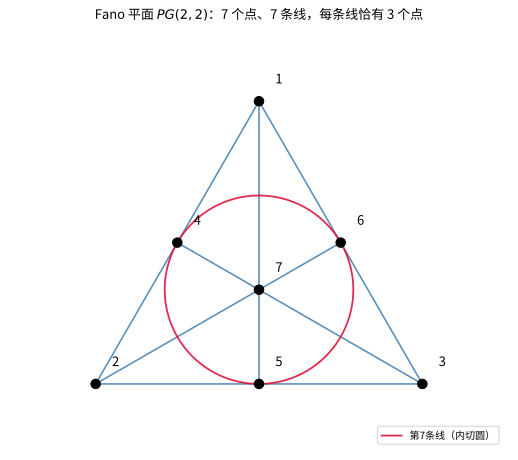

> **直观理解（现实类比）**：把 Fano 平面想成一个"迷你班会"——7 名同学任意两人恰好分在同一个 3 人小组里，而任意两个小组恰好共享一名同学。这个"每两人恰好一桌、每两桌恰好一人"的严密结构，正是射影平面公理 *任意两点恰有一条线、任意两条线恰有一个交点* 的直观写照。
>
> **🧠 思考历程：只有 7 个点、7 条线的"迷你世界"，凭什么敢自称几何？**
>
> 有限几何的惊人之处在于：**把无穷多点的欧氏几何替换成有限多个点，居然照样自洽、照样深刻**。这一切要回到 Galois 埋下的"有限数域"，也正是在这块乐土上，几何获得了全新的生命。
>
> - **Galois 的礼物：有限域**（1830 年）。Évariste Galois 在研究方程可解性时，发现了带 $p^n$ 个元素的有限域。没人想到这个纯粹代数的造物，日后会成为"有限坐标几何"的整套坐标纸——$\mathbb{F}_q$ 上的点与线从此有了精确而有限的坐标。
> - **Fano：第一座有限射影平面**（1892 年）。Gino Fano 构造出 7 点 7 线的射影平面（今称 Fano 平面），把射影平面公理在世界最小规模上砌了一遍。他示范了一件事：**只要点够得着、线足够配，几何就能在有限的宇宙里闭环运行**。
> - **有限坐标几何，全面开花**（20 世纪）。沿着 Galois 与 Fano 的路，人们用 $\mathbb{F}_q$ 造出仿射平面 $\mathrm{AG}(2,q)$、射影平面 $\mathrm{PG}(2,q)$ 乃至更高维有限空间，并用于设计纠错码、有限几何与组合设计——于是"有限几何学"既是一道纯数学风景，又成了工程里不可或缺的工具。
> - **心路**：谁说世界必须无穷大才算完整？有限几何告诉我们：**公理一旦给足，最小的宇宙也能承载最严格的几何**——而无限往往只是有限情形在尺度上的一种极限。

### 4.2 AG(2,3)仿射平面的构造

**AG(2, 3)** 是阶为 $3$ 的仿射平面，即域 $\mathbb{F}_3 = \{0, 1, 2\}$ 上的二维仿射空间。

**结构**：
- 点数：$3^2 = 9$
- 点集：$\{(x, y) \mid x, y \in \mathbb{F}_3\}$
- 线数：$3^2 + 3 = 12$
- 每条线上有 $3$ 个点

**线的分类**：
1. 垂直方向：$x = a$，$a \in \mathbb{F}_3$，共 $3$ 条
   - $x = 0$：$\{(0,0), (0,1), (0,2)\}$
   - $x = 1$：$\{(1,0), (1,1), (1,2)\}$
   - $x = 2$：$\{(2,0), (2,1), (2,2)\}$

2. 水平方向：$y = b$，$b \in \mathbb{F}_3$，共 $3$ 条
   - $y = 0$：$\{(0,0), (1,0), (2,0)\}$
   - $y = 1$：$\{(0,1), (1,1), (2,1)\}$
   - $y = 2$：$\{(0,2), (1,2), (2,2)\}$

3. 斜率为 $1$：$y = x + b$，$b \in \mathbb{F}_3$，共 $3$ 条
   - $y = x + 0$：$\{(0,0), (1,1), (2,2)\}$
   - $y = x + 1$：$\{(0,1), (1,2), (2,0)\}$
   - $y = x + 2$：$\{(0,2), (1,0), (2,1)\}$

4. 斜率为 $2$（即 $-1$）：$y = 2x + b$，$b \in \mathbb{F}_3$，共 $3$ 条
   - $y = 2x + 0$：$\{(0,0), (1,2), (2,1)\}$
   - $y = 2x + 1$：$\{(0,1), (1,0), (2,2)\}$
   - $y = 2x + 2$：$\{(0,2), (1,1), (2,0)\}$

**平行类**：上述四个方向各对应一个平行类，每个平行类包含 $3$ 条平行线。

> **常见坑**：注意 $AG(2,q)$ 的平行类**个数是 $q+1$ 个方向**（本例 $q=3$ 时是 $x=a$、$y=b$、$y=x+b$、$y=2x+b$ 这四个方向），而不是 $q$ 个。每类含 $q$ 条平行线、共有 $q(q+1)=q^2+q$ 条线——这个"方向数比线数少一条"的对称计数，是射影平面与仿射平面黏合（添加 $q+1$ 个无穷远点）的关键，别把两类数目搞混。

**扩展为射影平面**：添加 $4$ 个无穷远点（对应四个方向）和一条无穷远线，得到 $PG(2, 3)$，具有 $13$ 个点和 $13$ 条线，每条线上有 $4$ 个点。

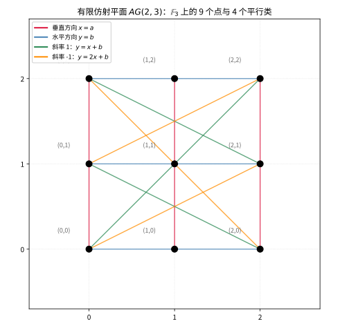

> **直观理解（现实类比）**：AG(2,3) 就像一张用"有限坐标"标注的 3×3 井字棋盘，每个点 $(x,y)$ 的坐标都取自只有三个值的"迷你数轴" $\mathbb{F}_3 = \{0,1,2\}$。四个平行类好比四组"方向"，每个方向上都有 3 条互不相交（永久平行）的直线，而不同方向的直线总会在某格点相交——这正是有限域上"平直几何"的离散写照。

### 问题求解四步流程（Problem-Solving Strategy）

> 每个问题都可拆成四步：**理解 → 计划 → 执行 → 回看**。这里把每一环落到有限几何语境的追问上。

| 步骤 | 行动 | 有限几何中的具体追问 |
|:---|:---|:---|
| ① 理解 | 复述问题、圈出已知与目标 | 研究对象是射影平面还是仿射平面？阶 $q$ 是多少？要数点、数线，还是数过定点的直线？ |
| ② 计划 | 选择可行工具、预估方向 | 用参数公式 $v=q^2+q+1$、$r=k=q+1$ 直接代入？用 Fano 平面 $7$ 点 $7$ 线的具体配置？还是用仿射 $\mathbb{F}_q^2$ 上的斜率分类？先想清楚哪条路最省力。 |
| ③ 执行 | 按计划逐步推导、保留过程 | 每步写明依据（定义/定理编号），点线计数别漏，$q+1$、$q^2+q+1$ 这些参数别代错。 |
| ④ 回看 | 核对结果、检验合理性 | 是否满足 $v=b=q^2+q+1$、$r=k=q+1$ 的一致性？换更大的 $q$ 是否仍说得通？ |

> 💡 **策略演示**：求阶为 $q$ 的射影平面上过给定点 $P$ 的直线总数。
> ① 理解：固定一点，数经过它的线。② 计划：过 $P$ 的线两两除 $P$ 外无共点，可按「所在过 $P$ 的线」把异于 $P$ 的点分组。③ 执行：除 $P$ 外共 $q^2+q$ 个点，每条过 $P$ 的线含 $q$ 个这样的点，故过 $P$ 的线为 $q+1$ 条。④ 回看：由每点线数 $r$ 与每线点数 $k$ 同阶性一致，答案合理。

### 概念检查（Concept Check）

> 先用一组判断题与选择题快速自检核心概念。每道题的判断均应落到书面理由（用一句话即可）。

**判断正误**（说明理由）：

1. 有限射影平面的点数和线数总是相等的。（　）
2. 阶为 $q$ 的射影平面上，每点恰好经过 $q$ 条线。（　）
3. Fano 平面是阶为 $2$ 的（唯一）射影平面。（　）
4. 仿射平面 $\mathrm{AG}(2,q)$ 共有 $q^2+q$ 条直线。（　）
5. 给仿射平面添加一条「无穷远直线」即可得到射影平面。（　）
6. 在有限仿射平面中，任意两点都恰有一条直线相连。（　）

**选择**：

7. 阶为 $q$ 的射影平面的点数是（　）。
   - A. $q^2$　B. $q^2+q$　C. $q^2+q+1$　D. $(q+1)^2$
8. Fano 平面每条直线恰好含有（　）个点。
   - A. $2$　B. $3$　C. $7$　D. $4$
9. $\mathrm{AG}(2,3)$ 仿射平面上每一点恰好落在（　）条直线上。
   - A. $3$　B. $4$　C. $9$　D. $12$

### 分步骤工作示例（Worked Examples）

> 每道示例严格套用四步流程，并在「回看」中给出一条易错点或检验法。

**示例 S1：用四步法盘点 Fano 平面的基本参数**

> **问题**：设 $q=2$，列出 Fano 平面（阶为 $2$ 的射影平面）的点数、线数、每线点数与每点线数。

- ① 理解：已知公式 $v=b=q^2+q+1$、$r=k=q+1$，目标是把参数代入 $q=2$。
- ② 计划：直接用射影平面参数公式，再用 $7$ 点 $7$ 线的配置核对符合公理。
- ③ 执行：

$$
v=b=2^2+2+1=7,\qquad r=k=2+1=3 .
$$

  故 Fano 平面共 $7$ 点 $7$ 线，每条线 $3$ 点，过每点 $3$ 条线。
- ④ 回看：$7$ 条线每线 $3$ 点共 $7\times3$ 次点线关联，除以每点 $3$ 线得 $7$ 点，自洽。**易错点**：把每线点数误写成 $q=2$，实际应为 $q+1=3$。

**示例 S2：计算 $\mathrm{AG}(2,3)$ 仿射平面的计数结构**

> **问题**：对仿射平面 $\mathrm{AG}(2,3)$（$\mathbb{F}_3$ 上的二维仿射平面），求点数、直线总数、每条直线的点数与过每点的直线数。

- ① 理解：仿射平面阶 $q=3$，点集即 $\mathbb{F}_3^2$。
- ② 计划：点数 $v=q^2$，直线总数 $b=q^2+q$，每线点数 $q$、每点线数 $q+1$，逐一代入。
- ③ 执行：

$$
v=q^2=3^2=9,\qquad b=q^2+q=9+3=12 .
$$

  每条直线含 $q=3$ 个点，过每点有 $q+1=4$ 条直线。
- ④ 回看：$12$ 条线每线 $3$ 点共 $36$ 次关联，除以每点 $4$ 线得 $9$ 点，一致性成立。**易错点**：仿射平面每线点数为 $q$ 而非 $q+1$——$q+1$ 是加无穷远直线后的射影情形。

**示例 S3：由公理推导射影平面的点数公式**

> **问题**：仅用有限射影平面的公理证明：阶为 $q$ 的射影平面恰有 $q^2+q+1$ 个点。

- ① 理解：须从公理出发而非直接套公式，先固定一点 $P$。
- ② 计划：以 $P$ 为中心，把其余点按「所在过 $P$ 的线」分组计数。
- ③ 执行：过 $P$ 的线有 $q+1$ 条，每条线含 $q+1$ 个点，除 $P$ 外每条线提供 $q$ 个相异点；两条不同的过 $P$ 直线在 $P$ 外无共点。故

$$
N=1+(q+1)q=q^2+q+1 .
$$

- ④ 回看：结果与 $v=q^2+q+1$ 一致，且任何 $q\ge2$ 都得整数，符合 $v=b$ 的对称性。**易错点**：计数时漏掉 $P$ 自身，或把两条过 $P$ 直线上除 $P$ 外的点重复计入。

**示例 S4：检验给定参数能否构成有限射影平面（探究式）**

> **问题**：试判断是否存在一个每线 $5$ 点、每点 $5$ 线的有限射影平面。

- ① 理解：已知 $k=r=5$，即 $q+1=5$、$q=4$，求对应定点数并检验可行性。
- ② 计划：先由 $q=4$ 求出 $v=q^2+q+1$，再看计数与存在性的关系。
- ③ 执行：$v=4^2+4+1=21$，故若存在则应为 $21$ 点 $21$ 线。由计数自洽并不能直接判定存在性；事实上 $q=4$ 时 Desargues 平面 $\mathrm{PG}(2,4)$ 是存在的，故 $q=4$ 的射影平面存在。
- ④ 回看：把研究对象判定为 Desargues 平面即可，说明「计数自洽」只是必要条件而非充分条件。**易错点**：把「参数符合」误当成「存在已构造」，正向存在必须靠显式构造（如 $\mathbb{F}_4$ 坐标构造）。

### 应用聚焦（Application & Exploration Projects）

> 小型开放任务：把本节抽象结论落到可操作的计算或仿真，任选其一完成。

- **聚焦 P1（数值穷举/仿真）**：在 Fano 平面（$\mathrm{PG}(2,2)$）上枚举全部 $7$ 点 $7$ 线，验证「每两点确定唯一线」与「每两线交于唯一一点」，并画出其配置图。
- **聚焦 P2（跨章节联系）**：用 §2 有限域 $\mathbb{F}_q$ 作坐标域构造仿射平面 $\mathrm{AG}(2,q)$，再通过添加无穷远直线得到射影平面 $\mathrm{PG}(2,q)$，与射影几何的公理体系做交叉对照。
- **聚焦 P3（平行类探究）**：对 $q=3$，在 $\mathrm{AG}(2,3)$ 中检验存在多少个「平行类」（由 $q$ 条两两互不相交且覆盖全部点的直线构成），并解释其数目等于 $q+1$。

### 梯度化自测（Graded Exercises）

> 难度记号：$\circ$ 概念 / $\bullet$ 技能 / $\blacklozenge$ 综合应用，均要求在四步流程中写出「回看」一句。

**$\circ$ 概念题**

- **自测 1**：用一句话说明「有限射影平面」与「有限仿射平面」的根本区别。
- **自测 2**：说明射影平面的每点线数 $r$ 与每线点数 $k$ 为什么必须相等。

**$\bullet$ 技能题**

- **自测 3**：计算 $\mathrm{AG}(2,4)$ 仿射平面的点数、直线总数、每线点数和每点线数，写出完整四步过程。
- **自测 4**：设阶为 $q$ 的射影平面，给定一条线 $\ell$ 及其外一点 $P$（$P\notin\ell$），证明过 $P$ 的 $q+1$ 条线恰与 $\ell$ 交于 $q+1$ 个不同的点，写出完整四步过程。
- **自测 5**：在 $\mathrm{AG}(2,3)$ 中，给定一条直线 $\ell$，求与 $\ell$ 平行（不相交）的其他直线的条数，写出完整四步过程。

**$\blacklozenge$ 综合题**

- **自测 6**：验证 Fano 平面既是一个 $2$-$({7,3,1})$ 设计也是一个射影平面，写出完整四步过程。
- **自测 7**：写一段含「表格 + 一句话结论」的分析：对比 $\mathrm{AG}(2,3)$ 与 $\mathrm{PG}(2,2)$ 的点数、线数、每线点数和每点线数，说明如何从仿射平面升级到射影平面。

### 自测答案与简要解析

> **概念判断**：
> 1. **正确**（有限射影平面满足 $v=b=q^2+q+1$）。2. **错误**（每点过 $q+1$ 条线而非 $q$ 条）。3. **正确**（阶 $2$ 的射影平面唯一，即 Fano 平面）。4. **正确**（$b=q^2+q$）。
> 5. **正确**（加无穷远直线即 PA 升级为射影平面）。6. **正确**（仿射平面任意两点恰有一条直线相连）。
>
> **选择**：7. C　8. B　9. B。

> **自测**：
> - 自测 1：仿射平面存在平行线并可按平行类划分；射影平面无平行线，任意两线交于一点，且通过添加无穷远直线把仿射升级为射影。
> - 自测 2：由对偶自洽 $v=b$ 与关联数守恒（$vr=bk$）可得 $r=k$，故每点线数等于每线点数，二者同为 $q+1$。
> - 自测 3：$v=4^2=16$、$b=4^2+4=20$、每线 $q=4$ 点、每点 $q+1=5$ 线；回看：$20\times4=16\times5=80$ 次关联，一致。
> - 自测 4：过 $P$ 的 $q+1$ 条线分别交 $\ell$ 于 $q+1$ 个点；若两条交于 $\ell$ 同一点，则该点与 $P$ 连出两条线，违反唯一性，故交点两两不同、覆盖 $\ell$ 全部点；回看：与「任意两点唯一连直线」互相印证。
> - 自测 5：直线 $\ell$ 所在平行类恰有 $q=3$ 条互不相交直线，除 $\ell$ 外还有 $q-1=2$ 条与 $\ell$ 平行；回看：平行类覆盖全部 $9$ 个点，符合 $q^2=3\times3$。
> - 自测 6：任意两点恰在 $1$ 条线上、任意点落在 $\lambda=1$ 个块，参数 $(v,k,\lambda)=(7,3,1)$ 即 $2$-$({7,3,1})$ 设计，又满足「任两线交于一点」故为射影平面；回看：设计属性与几何公理缺一不可。
> - 自测 7：表格写明 $\mathrm{AG}(2,3)(v=9,b=12)$ 与 $\mathrm{PG}(2,2)(v=b=7)$ 的四个参数，结论「仿射加 $q+1$ 条平行线合成为无穷远直线 = 射影」，可据此由 $\mathrm{AG}(2,q)$ 构造 $\mathrm{PG}(2,q)$。

---

## 5. 习题

### 基础题

**习题 1**（有限射影平面的定义）写出有限射影平面的定义：任何两点确定一条线，任何两条线交于一点，存在一个四边形，且每条线上至少 3 点。

**习题 2**（有限射影平面点数）用计数证明：若每条线上有 $q+1$ 个点，则有限射影平面（阶 $q$）含有 $q^2+q+1$ 个点。

**习题 3**（Fano 平面）写出 $q=2$ 的射影平面 $PG(2,2)$ 的点数、线数，说明它叫 Fano 平面。

**习题 4**（仿射平面）定义仿射平面 $AG(2,q)$，写出其点数、线数与平行类的数目。

**习题 5**（射影到仿射）说明如何由射影平面去掉一条线得到仿射平面。

**习题 6**（阶与存在性）说明阶为 $q$ 的射影平面的点数与线数的公式。

**习题 7**（广义四边形）给出有限广义四边形 $Q(s,t)$ 的定义与参数含义。

**习题 8**（Desargues 定理）陈述 Desargues 定理。

**习题 9**（极空间）给出椭圆与抛物 quadric 的粗略概念，说明 $Q(4,q)$ 是极空间例子。

**习题 10**（有限几何与编码）说明有限射影平面如何用做组合设计（平衡不完全区组设计）。

### 进阶题

**习题 11**（线计数）证明在有限射影平面每条线有 $k$ 点时，点数与线数都等于 $k^2 - k + 1$，其中 $k$ 定义阶。

**习题 12**（对偶性）证明若每条线上有 $q+1$ 点，则每个点恰在 $q+1$ 条线上。

**习题 13**（仿射平面参数）写 $AG(2,q)$ 的点数、线数与每条线点数，并验证线总数 $q^2+q$。

**习题 14**（射影延拓）证明每个仿射平面都可延拓成射影平面（添加无穷远线）。

**习题 15**（Desargues 域上）说明在域 $\mathbb{F}_q$ 上的射影平面 $PG(2,q)$ 中 Desargues 定理成立，因而称为 Desargues 平面。

**习题 16**（Pappus 定理）阐述 Pappus 定理在有限域射影平面中的内容与验证思想。

**习题 17**（Bruck-Ryser 判别陈述）陈述 Bruck-Ryser 定理关于阶的模条件。

**习题 18**（广义四边形计数）验证有限广义四边形 $Q(s,t)$ 的总点数公式。

**习题 19**（有限几何与群）说明为什么有限射影平面的自同构群承载重要的（有限）单群结构。

### 挑战题

**习题 20**（Bruck-Ryser 应用阶 6）用 Bruck-Ryser 定理判断 $q=6$ 的射影平面是否存在。

**习题 21**（Fano 平面唯一性）上证明 $PG(2,2)$ 唯一。

**习题 22**（射影到仿射的逆）从射影平面去掉两条相交线后得到的结构与仿射的关系，说明两条线并线的加线为补。

**习题 23**（Desargues 平面的特征）证明 Desargues 定理在域上的射影平面恒成立（用坐标证明思路）。

**习题 24**（不可 Desargues）举例说明存在非 Desargues 有限射影平面（如 Hughes 平面，阶 9）。

**习题 25**（Bruck-Ryser 充分性）说明哪些 $q$ 被 Bruck-Ryser 排除，哪些被保留，并讨论阶 10 免排除的背景。

**习题 26**（广义四边形的构造）说明如何从极空间（如 symplectic）构造 $Q(s,t)$ 的广义四边形，给出参数指定。

### 探究题

**习题 27**（与编码理论的联系）探讨有限几何点线结构如何用于构造 LDPC 码、几何码，给出秩的参数与编码性能的联系。

**习题 28**（与群论的结合）探讨有限射影平面的自同构群、以及 Lie 型单群（如 $PSL(2,q)$）与有限几何的联系。

**习题 29**（有限几何与组合设计）开放探讨射影平面作为平衡不完全区组设计、拉丁方与仿射平面的联系，以及对称设计的计数问题。

**习题 30**（有限几何的前沿）探讨论证有限几何在密码学（椭圆曲线、Shamir 秘密共享）、量子信息（一次一密、状态局部分配）与实验设计中的应用。

---

## 6. 习题答案与解析

### 基础题答案

1. **有限射影平面定义** 有限射影平面 $(P, L)$ 满足：(i) 每两点恰在一条线上；(ii) 每两条线恰交于一点；(iii) 存在四点，任何三点不共线；(iv) 每条线至少含 3 点。有限性作为前提，定义剔除退化情形。

2. **射影平面点数** 固定点 $P$：通过 $P$ 的线条数记为 $k+1$，每条线除 $P$ 外还有 $k$ 个其它点，故点数 $v = (k+1)(k-1) + 1 = k^2$（加上 $P$）。由对偶对称性，线数同为 $k^2+k+1$，且每条线上恰 $k+1$ 点。取 $k=q$ 即得 $q^2+q+1$。

3. **Fano 平面** 阶 $q=2$：每线 3 点，$2^2+2+1 = 7$ 个点，$7$ 条线，每条线 3 点，恰为 Fano 平面 $PG(2,2)$。它是唯一阶 2 射影平面，是七点七线的三角形模型。

4. **仿射平面** 仿射平面 $(P, L)$ 满足任意两点恰一线上、平行假设每一线与其平行线不相交，且长方形计数。阶 $q$ 的 $AG(2,q)$ 有 $q^2$ 个点，$q^2+q$ 条线，每条线 $q$ 个点，分为 $q+1$ 个平行类。

5. **射影到仿射** 从射影平面 $PG(2,q)$ 删去一条线 $l_\infty$（称为无穷远线）及其上所有点，剩下的线是仿射线、平行延续到无穷远线，得到 $AG(2,q)$：$q^2$ 个点、$q^2+q$ 条线、每条线 $q$ 点、$q+1$ 个平行类。

6. **阶与存在** 阶 $q$ 的射影平面有 $q^2+q+1$ 个点与 $q^2+q+1$ 条线，每条线上 $q+1$ 个点、每点过 $q+1$ 条线。$q$ 取作每条线点数减 1。

7. **广义四边形** 有限广义四边形 $Q(s,t)$ 是 biregular 的二分图结构：每点坐落在 $t+1$ 条线，每条线含 $s+1$ 个点，且任意点与线（不相通知）至多一个共同伴随——即无三角形：任意两点最多一个同时伴随某一根线。参数 $(s,t)$ 刻画大小。

8. **Desargues 定理** 两三角形在两个中心共点的透视对中，其对应边交点所构成的三个点共线（弱 Desargues）。在 Desargues 平面上该定理恒成立，可用于特征描述域上的射影几何。

9. **极空间** 极空间是自伴的投影几何结构（其每点伴一个完全自伴子空间）。例如抛物 quadric $Q(4,q)$（在 $\mathbb{P}^4$ 中 $x_0^2+\cdots+x_4^2=0$ 型）给出一个有限广义四边形结构，是极空间（finite generalized quadrangle）的典型例子。

10. **有限几何与设计** 有限射影平面看作集为点的平衡不完全区组设计：每条线是块，任何两点唯一共同块，每一对点属于 $\lambda=1$ 个块，故它是 $2\text{-}(v, k, 1)$ 设计，$v=k^2+k+1$，$k=q+1$。这种设计可用来构造纠错码的校验结构。

### 进阶题答案

1. **线与k计数** 固定线 $l$，由每条线含 $k+1$ 点且每两线交一点可推出过 $P \in l$ 的线数 $k+1$。全平面点数的故事：任取 $P$，通过它的线 $k+1$ 条，除 $P$ 外每条线上 $k$ 点互不相同，故点数 $v = (k+1)k + 1 = k^2+k+1$。线数由点线对偶对称同为 $k^2+k+1$。

2. **对偶计数** 固定点 $P$ 有 $v-1$ 个其它点，每条过 $P$ 的线含 $P$ 外 $k$ 点且划分其它点，故过 $P$ 线条数 $= (v-1)/k = (k^2+k)/k = k+1$。由对偶原理点线互换，$P$ 恰在 $k+1$ 条直线上。

3. **仿射平面参数** $AG(2,q)$：$q^2$ 点，每条线 $q$ 点。每点 (平行类加共同点) 过 $q+1$ 条线，线总数 $= q^2 \cdot (q+1)/q = q^2+q$。分为 $q+1$ 个平行类各 $q$ 条线。故要求成立。

4. **射影延拓** 给定仿射平面 $AG(2,q)$，对所有平行类各取一个"无穷远点"，把平行的线共延于此，再把所有无穷远点放于一条无穷远线上。加法公平地满足射影平面公理，从而坐得射影平面（或其延伸）延拓使 $AG(2,q)\subset PG(2,q)$。

5. **Desargues 平面** 在 $\mathbb{F}_q$ 上射影平面 $\mathbb{P}^2(\mathbb{F}_q)$ 有坐标，Desargues 定理可经坐标方程验证：两个透视三角形相应边交点可用齐次坐标公式算出共线。因 $\mathbb{F}_q$ 是域、坐标有效，故定理成立，这类平面就叫 Desargues 平面。

6. **Pappus 定理** Pappus 定理说若一条线上三点 $A,B,C$ 与另一线 $A',B',C'$ 对应，则连线交点 $AB'\cap A'B$ 等三点共线。在域上的射影平面用坐标乘除验证（取两条基线为坐标轴），在 $\mathbb{F}_q$ 中同样成立——但一般的非 Desargues 平面中可失效。

7. **Bruck-Ryser 定理** 若阶为 $n$ 的射影平面存在且 $n \equiv 1 \pmod{4}$ 或 $n \equiv 2 \pmod{4}$，则 $n$ 是两个平方数之和 $n = x^2 + y^2$。阶满足 $n \equiv 1,2 \pmod 4$ 时若无此表示则平面不存在。

8. **广义四边形计数** 定点 $p$ 的线集中，每线含 $s+1$ 点，每条线外的点与 $p$ 至多一个共同线。固定点计数得总点数 $|V| = (s+1)(st+1)$：固定线推广可得线数 $|L| = (t+1)(st+1)$，满足双正则 2-Net 的设计。

9. **有限几何与群** 有限射影平面自同构群把点线结构保持下来，其作用常是传递/基群（如 $P\Gamma L(3,q)$ 型），提供李型单群与几何表示之间的桥梁。由群论与几何共通的同构关系（如 $AGL(2,q)$ 与可迁群）支撑了有限几何上单群的应用。

### 挑战题答案

1. **Bruck-Ryser 阶6** $q=6 \equiv 2 \pmod 4$，满足判别条件时必须写成两平方和 $x^2 + y^2$；但 $6$ 无法表示成两整数平方和（$6=1^2+\sqrt5$ 非平方，穷举 $0^2$ 到 $2^2$ 不成立），违反 Bruck-Ryser 定理，故阶 6 的有限射影平面不存在。

2. **Fano 唯一性** 固定一条线上 3 点，另加 2 个其余点依公理强制出其余 3 点与线的唯一安排。枚举（如固定三角形令 $P_4P_1P_2$ 等）都得同构于 $PG(2,2)$：任何两点唯一线与两线交点唯一性把 7 点 7 线结构完全锁定，故唯一。

3. **射影去两条线** 去掉射影平面中两条相交线（连同二者并成大块），剩下的点-线结构删除后成为仿射平面的"余域"，若两条线平行则类似许可：删除一条线得仿射平面，删除两条交叠线会得到比仿射多一条线的"扩展仿射"型结构，带有额外平行处理。

4. **Desargues 平面在域上成立的坐标证明** 设透视中心 $o$ 取为原点、两基线为坐标轴。三角形 $ABC$ 与 $A'B'C'$ 相应边交点的齐次坐标用行列式表达，Desargues 定理断言这三个交点行列式之和为 0。因是域上可除，计算确定恒等成立，故 Desargues 定理在 $\mathbb{F}_q$ 射影平面成立。

5. **非 Desargues 平面（Hughes）** Hughes 平面阶 9 是既非域也非原 Land 的最下例非 Desargues 有限射影平面：它是坐标环不是域、无法由域坐标建立，因而 Desargues 定理可失效。它是有限几何中非域平面存在的证明。

6. **Bruck-Ryser 充分性** 当 $n \equiv 0,3 \pmod 4$ 时 Bruck-Ryser 不加任何限制，任何 $n$ 均未被它排除——例如 $n=3,4,5,7,8,9,11$ 等都不因平方和条件被禁止；而被排除的是 $n\equiv1,2\pmod4$ 且不能写成两平方和的 $n$，如 $6,14,21$。阶 10 情形：$10\equiv2\pmod4$ 需写成 $x^2+y^2=10$，而 $10=1^2+3^2$ 满足条件，故 Bruck-Ryser 无法排除阶 10——这正是用计算机穷举（Lam 1989）证明阶 10 平面不存在的背景，说明 Bruck-Ryser 只是必要条件而非充分条件。

7. **广义四边形的构造** 从抛物 quadric $Q(6,q)$ 或 symplectic 极空间提取二元：取其一极空间中的点与绝对对称线为线与点，任意两点共一线必在两个相伴子空间交点处，产生 $Q(s,t)$。如取 $Q(4,q)$ 的点和其中 $s=q$、$t=q$ 给出一族有限广义四边形。

### 探究题答案

1. **编码理论联系** 点线结构给出低密度校验矩阵：取每条线为校验约束、其点并列，得到几何 LDPC 码，最小距离与稳定乘法关联 girth；从有限几何设计的集团、剩余谱构造出的码有好的距离与局部性质，广泛用于量子与网络纠错。参数的秩决定码长的校验数。

2. **与群论** 有限射影平面的自同构群（如 $P\Gamma L(3,q)$）给出相当多的有限单群，Lie 型单群 $PSL(2,q)$ 不仅实现为射影平面的旗传递对称群，也联系到射影线 $PG(1,q)$ 上的置换与 Möbius 变换，是有限单群分类与几何表示结合的核心例子。

3. **组合设计** 射影平面是 $2\text{-}(v,k,1)$ 对称设计与映射设计的一个家族，其 $(v,k,\lambda)$ 参数与拉丁方 $q-1$ 阶数紧密结合：从射影平面去线得完整设计、由拉丁方程的 Olympus 关联设计得于仿射几何；对称设计的计数（Bruck–Ryser–Chowla）为判定存在提供模条件。

4. **前沿与应用** 有限几何的有限域点-线结构支持椭圆曲线密码学（点群结构用于 Diffie–Hellman 与签名），Shamir 秘密共享基于多项式插值即有限域几何；在量子信息中，通过有限几何的"一次一密"、状态局部分布来设计量子态共享方案。实验设计中，仿射与射影平面提供平衡区组与正交表的结构。这些都是有限几何面向实际应用的活跃方向，答案是引导性提示。

---

## 7. 数学科普（Popular Mathematics）

有限几何研究的是"点、线、面都只有有限个"的几何，它把古老的作图直觉搬进有限的世界，还在纠错码和设计实验里派上大用场。

### 7.1 有限射影平面
一座极简高铁网：任意两个车站之间恰有一条铁路，任意两条铁路又恰好共用一个换乘站——这就是有限射影平面，它把这套"点线契约"搬进了只有有限多个点的世界。

**一句话点破**：点线都有限，却仍保持"两点定一线、两线交一点"的完美对等。

### 7.2 阶为 $q$ 的射影平面
同样是有限平面，7 个点的 Fano 平面和 13 个点的 $PG(2,3)$ 并不一样。用"阶" $q$ 给它们编号——每条线上恰有 $q+1$ 个点，于是总点数被锁死在 $q^2+q+1$。
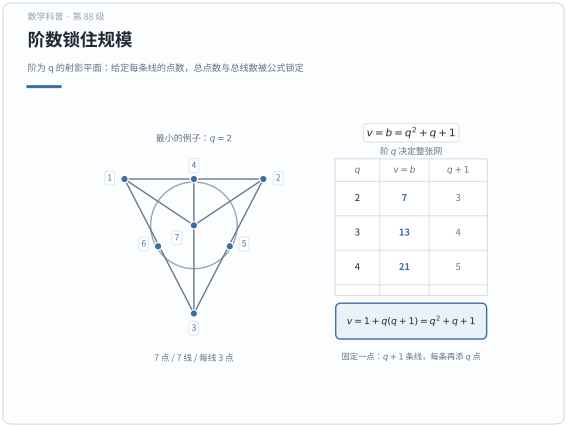
**一句话点破**：只要规定每条线载几个点，整张点线网的规模就被公理完全钉死。

### 7.3 仿射平面
把射影平面里那条挂满"无穷远点"的天边线整条擦掉，剩下的就是熟悉的黑板：平行线永远平行、不再相交。删掉一条线，就得到阶为 $q$ 的仿射平面 $AG(2,q)$。
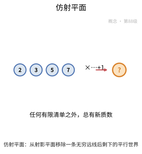
**一句话点破**：射影平面减去一条无穷远线，就是可自由画平行线的仿射平面。

### 7.4 Bruck-Ryser定理
造平面之前先"过安检"：Bruck-Ryser 定理只用阶 $q$ 的算术性质，就筛掉一批结构上永远拼不出来的候选者。当 $q\equiv1,2\pmod4$ 时，$q$ 必须先能写成两个平方数之和。
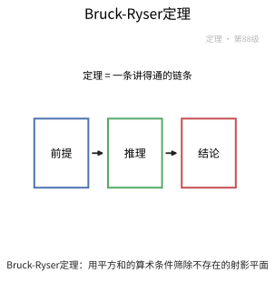
**一句话点破**：几何"存不存在"，被翻译成算术"能否写成两平方和"。

### 7.5 Desargues平面
两个三角形如果对应顶点连线都穿过同一个光源，对应边交点就共线——这就是 Desargues 定理。凡是能用 $\mathbb{F}_q$ 坐标搭出的射影平面 $PG(2,q)$，都满足这条法则，因此都是 Desargues 平面。
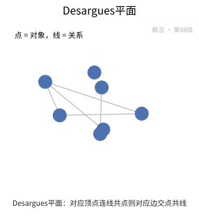
**一句话点破**：能"透着光源"成线的平面，正是能用有限域坐标造出的平面。

### 7.6 Pappus平面
比 Desargues 更严格：一条线上三点、另一条线上三点，两两连线的三个交点竟然也共线。满足这条更高标准的平面叫 Pappus 平面，而它恰好绑定底层域是否交换。
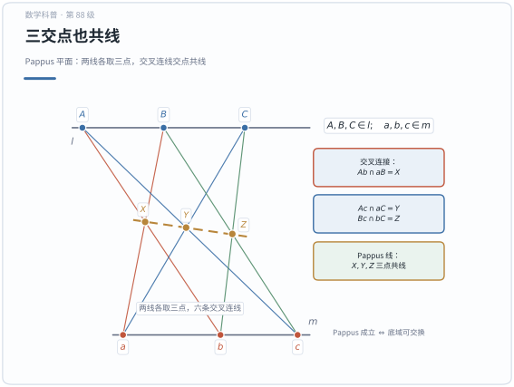
**一句话点破**：Pappus 平面守更严的纪律，也顺手满足较松的 Desargues。

### 7.7 有限广义四边形
把"任意两线都相交"放宽成"至多相交"，同时保留"过外点有唯一垂足式投影"。这类点线结构坚决禁止三角形回路，最小圈恰好是四边形。
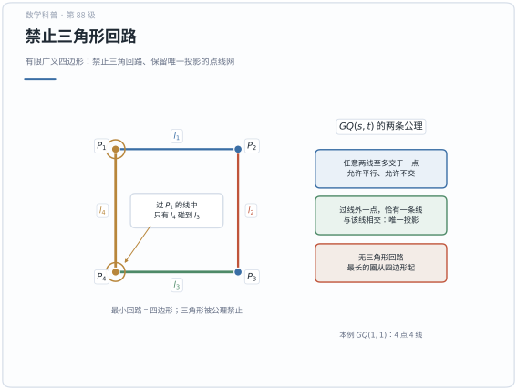
**一句话点破**：允许线不相交，却仍靠唯一投影维持整张网的规整。

### 7.8 极空间
给每一点配上一个与它"垂直"的镜像子空间，就像地球仪上每点对应一条大圆。极空间就是被正交、辛、酉这类"极性"重新编织过的有限射影空间。
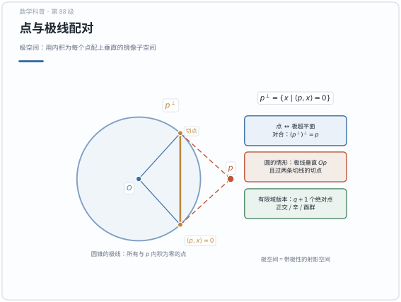
**一句话点破**：把"垂直"请进有限几何，让内积成为点线关联的指挥棒。

### 7.9 有限几何与编码理论
纠错码要保证任意两条信息串都分得清、还能容忍少数位出错。射影平面"任意两点恰落在一条线上"的性质，天然就是"任意两串恰共享一个约束"的组合设计，于是几何的点线关联直接变成校验矩阵的骨架。
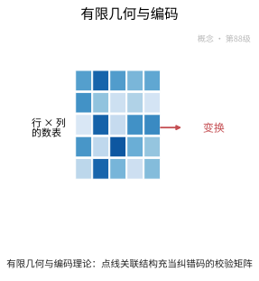
**一句话点破**：几何的"关联"与编码的"校验"，本质是同一种计数。

### 7.10 有限几何与群论
一栋对称建筑的旋转与反射本身就构成群。有限几何的自同构群正是它的"对称说明书"——$PG(2,q)$ 的对称群是 $PGL(3,q)$，极空间则对应正交、辛、酉群。
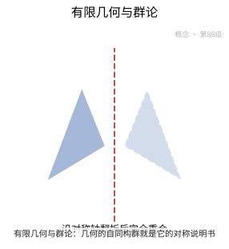
**一句话点破**：几何的对称性，把一大族重要有限单群请上了台。

### 7.11 有限射影平面的公理与性质
射影平面的公理有一个漂亮的对偶：把"点"和"线"两个词互换，每一句话依然成立。正因这份对称，每点过的线数与每线含的点数必然相等，总点数与总线数都等于 $q^2+q+1$。
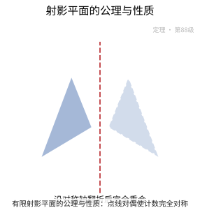
**一句话点破**：点线互换而不变，正是这套计数刚性的根源。

### 7.12 Bruck-Ryser定理
把点线关联写成矩阵 $A$，代数上它被迫满足 $AA^T=qI+J$。这张"打卡表"能否编出，会顺着"数的平方和"语言传下去，于是几何的存在性反过来受制于算术。
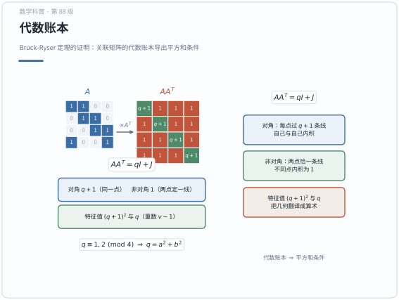
**一句话点破**：关联矩阵的代数账本一旦矛盾，平面就造不出来。

### 7.13 有限仿射平面与射影平面的关系
给仿射平面里每个平行方向补上一个"无穷远点"，再把这些无穷远点收进一条"天边线"，就长成射影平面；反过来抽掉这条天边线，又退回仿射平面。来回只是一道"添删一条线"的手续。
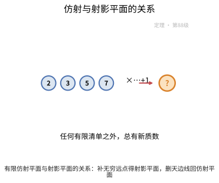
**一句话点破**：仿射与射影只差一条无穷远线，可双向互转。

### 7.14 Desargues定理在有限域中的证明
用齐次坐标把两个三角形写下来，对应顶点的共点条件给出三个比例因子。三个对应边交点 $P,Q,R$ 的坐标恰好满足 $P+Q+R=0$，于是它们共线。整个论证只用域的四则运算，对有限域 $\mathbb{F}_q$ 自然成立。
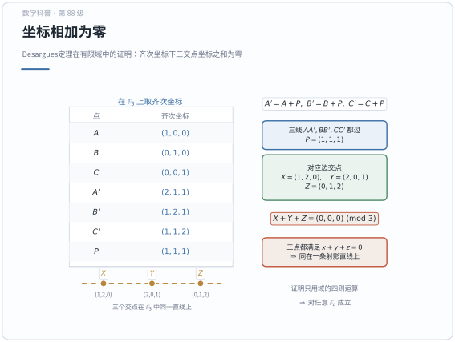
**一句话点破**：证明只依赖域运算，因此有限域上的 Desargues 定理照样成立。

### 7.15 有限广义四边形的基本性质
有限广义四边形由一对参数 $(s,t)$ 刻画：每条线 $s+1$ 个点、每点 $t+1$ 条线。从任一点出发，先数共线近邻再数外圈，总点数正好是 $(s+1)(st+1)$；且当 $s,t>1$ 时有 $s\le t^2$、$t\le s^2$。
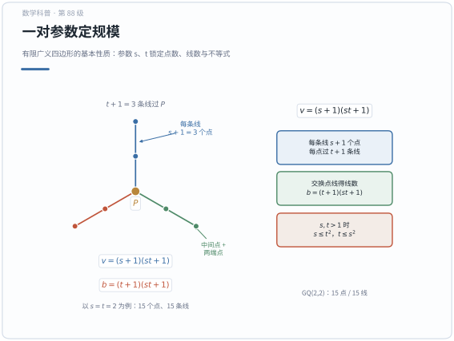
**一句话点破**：一对参数 $(s,t)$ 就把整张点线网的规模与约束钉死。

## 8. 数学史（History of Mathematics）

> 有限几何学的历史，是一部"有限点集里藏无限结构"的创造史：从射影几何的公理化、有限域算术的成型，到用有限平面设计实验与编码，再到以群论统一对称。它的主线围绕"仅由有限个点与线组成、却仍满足射影公理"的奇妙对象展开，既延续了古典射影的传统，又开启了组合设计、纠错码与现代密码的广阔应用。

### 1. 前置：射影几何的"无穷远点"直觉

- 可以说，有限几何是“射影思想”与“有限算术”相遇的产物，两个古老传统在 20 世纪初终于合流。
- 文艺复兴透视法与升维理论把"平行线交于无穷远点"的直觉带入数学，射影几何由此获得"直线总有交点"的抽象框架。
- 当数学家把"无穷远点"也当作普通对象、用**有限域**替换连续实数后，"有限但仍规则"的几何便有了诞生的土壤。

### 2. 有限域：有限几何的算术地基

- 有限域的阶只能是素数的幂，这正是有限射影平面阶数取 $q=p^k$ 的根本原因。
- 一切有限几何都要建立在**有限域（Galois 域）**之上：**Evariste Galois** 与后期理论家的进账使阶为 $q=p^k$ 的有限域成为完备代数对象。
- 有限域的加法、乘法与二次剩余结构，决定了射影平面、仿射平面的存在性与计数，是整门学科的计算引擎。

### 3. 有限射影平面的诞生

- 有限射影平面的对偶原理（点与线角色互换仍成立）在有限情形依然深刻，是构造与证明的有利杠杆。
- 把射影平面公理"有限化"，便得到**有限射影平面**：每条直线过相同数目 $q+1$ 个点、每点垂直于相同数目 $q+1$ 条直线。
- 阶为 $q$ 的经典例子由有限域 $\mathbb{F}_q$ 上的**射影坐标**直接给出，个数、对偶性与一般的构作则构成丰富的结构理论。

### 4. Fano 平面：最小与最美的特例

- 它还是知名的 diffuser/平行配置与一般线路编码的抽象骨架，7 与 8 的成对结构几乎浓缩了有限几何的美学。
- 阶为 $2$ 的**Fano 平面**只有 $7$ 个点、$7$ 条线，却处处体现对偶原理与 Pascal 型性质，是验证新想法的"微型世界"。
- Fano 平面与**GF(2) 上的三元、7 维 Hamming 码**紧密相连，成为有限几何、编码与组合设计交会的微型样板。

### 5. 仿射平面：当直线可以平行

- 仿射平面的每两平行直线补一条公共无穷远线即还原为射影平面，这一往返是构造新平面最常用的手段。
- 在有限射影平面上删掉一条"无穷远直线"，剩下的点与"有限线"便构成阶为 $q$ 的**仿射平面（affine plane）**。
- 仿射平面拥有平行与加法的直观，其存在性与射影平面彼此等价，构成"去一条线 / 补一条线"的对称构造。

### 6. Bruck–Ryser 定理与存在性障碍

- 数论必要条件虽不能判定所有阶数，却清晰展示了“纯组合的对象夹带着深刻的数论”这一有限几何特有的韵味。
- 是否存在阶为 $q$ 的射影平面，是有限几何最古老的存在性难题；**Bruck 与 Ryser（1949）**给出必要条件：$q\equiv 1,2\pmod 4$ 时 $q$ 必须能写成两个平方和。
- 这一数论式的限制回答了部分 $q$ 的"不存在"，也成为连接有限几何与数论的标志性结果，$q=10$ 平面最终由计算机大规模搜索证实不存在。

### 7. Desargues 与 Pappus：有限域上的定理

- Desargues/Pappus 成立与否是区分“由坐标表示”与“仅靠公理的配置”的判据，堪称有限射影几何的试金石。
- 古典的 **Desargues 定理**与 **Pappus 定理**在有限射影平面上并非恒成立，其成立与否恰好刻画几何能否由一个**除环上的射影空间**实现。
- 有限域 $\mathbb{F}_q$ 上的射影平面总是 Desargues 且 Pappus 成立（当域可交换），而"小非 Desargues 平面"的存在性则构成深刻而精密的分类课题。

### 8. 有限广义四边形与极空间

- 这类高阶对称对象常出现在有限单群的几何刻画中，是几何与群论共同孕育的“多面几何”。
- 把"三角形空的配置"推广到更一般"有多几种配置但禁止某些子结构"的**有限广义四边形（generalized quadrangles）**，由 **Tits** 引入以研究秩 2 的李型群几何。
- 极空间、广义多边形的分类连接有限域、代数群与代数几何，也催生了**Tits 建筑理论**这一影响深远的几何—群论体系。

### 9. 有限几何与编码理论

- 有限平面为线性码提供精妙的校验结构，其-纠错能力往往与平面中的“合计特性/射影特性”直接相关。
- 有限平面与有限几何天然提供**线性码**的构造，如利用点线配置生成校验矩阵，能够在纠错与检错间取得精妙的平衡。
- 从汉明码、QR 码到代数几何码，有限几何不仅贡献具体编码，也把"码的距离、权重与平面结构"之间的对应织成一幅宏图。

### 10. 有限几何与群论

- 自同构群的精致研究使有限几何成为证明有限单群分类早期结果的不可替代试验田。
- 有限射影平面的自同构群、广义四边形上的**李型单群**，使有限几何成为群论最肥沃的试验田。
- 大定理如分类有限单群的一部分，正是通过刻画这些具有强对称性几何来推进的，几何与群论由此互为表里。

### 11. 统计设计与实验的科学出身

- 拉丁方、BIBD 与正交表正是有限几何与统计设计互译的成果，农学与制药实验由此受益。
- 统计学家与农学家在**试验设计**中独立发现有限几何：把"处理、区块、正交排列"翻译成点线结构，得到设计、拉丁方与关联格式。
- 有限几何为**BIBD、正交表与因子设计**提供严格框架，使它在生物学、制药与工业实验中获得远超纯数学的价值。

### 12. 从离散到编码与密码：现代复兴

- 量子纠错与分布式存储也正向有限几何借力，这门古老学科正在信息时代迎来又一次复兴。
- 现代通信与密码学（LDPC 码、代数曲线码、Tanner 图）把有限几何当作核心构造，也让"有限点线结构"在信息工程中重获生机。
- 今天有限几何既延续它作为纯组合"古典美"的地位，又站在编码、密码与量子纠错的前沿——这门"只有有限个点"的科学依然清澈而年轻。

### 历史年表

| 时间 | 人物／文献 | 事件与贡献 |
|---|---|---|
| 19 世纪 | Galois | 建立有限域理论，奠定有限几何的算术基础 |
| 1906 | Veblen 等 | 系统研究有限几何的公理化与构作 |
| 1949 | Bruck、Ryser | 证明射影平面存在的数论必要条件 |
| 1900—1930 年代 | 统计学家 | 在试验设计中发展有限几何的结构 |
| 1950—1960 年代 | Block、Hanani 等 | 有限平面、设计的存在性精化 |
| 1970 年代起 | Tits | 广义四边形、极空间与 Tits 建筑理论 |
| 1980 年代 | Lam 等（计算） | 证伪 $q=10$ 射影平面存在性 |
| 20 世纪后期 | 编码理论界 | 有限几何构造 LDPC 与代数几何码 |

> 从透视法中的无穷远点，到有限域上精确可数的射影平面，再到试验设计与纠错码，有限几何证明了"只有有限个点"的几何依然能承载无穷丰富的组合与对称。它与数论、群论、编码和密码学的每一次融合，都让这门精致而深远的学科持续生长。

## 现实应用（Real-World Applications）

> 本节把本章的知识点落到真实的工程、科学与生活场景中。每个案例都给出**完整的问题背景、建模过程、可复现的数据 / 公式 / 代码与结果解读**；案例末尾的「涉及知识点」对应本章的具体小节，文末附**知识点覆盖对照表**，确保本章知识点全部被覆盖。

### 应用案例 1：通信工程｜射影平面码与低密度校验矩阵

**场景与问题**

深空通信、5G 数据信道与固态硬盘都使用**LDPC 码**（低密度奇偶校验码），它的核心是一张稀疏校验矩阵 $H$。工程师希望 $H$ 尽量规整（每行每列非零元个数相同、任意两列恰共享一个非零元），这样译码器硬件可并行且性能可预测。**有限射影平面**的点线关联矩阵恰好满足这些要求：任意两点恰在一线上、任意两线恰交一点，天然给出"平衡、低密度"的校验结构。

**涉及知识点**

- 本章「2.1 有限射影平面」与「3.1 有限射影平面的公理与性质」：两线必交、点线对偶、$v=b=q^2+q+1$。
- 本章「2.2 阶为 $q$ 的射影平面」：每线 $q+1$ 点、每点 $q+1$ 线。
- 本章「2.9 有限几何与编码理论」：关联矩阵当校验矩阵，得线性码。

**建模与数据**

取 $q=2$ 的**Fano 平面** $PG(2,2)$：

- 点数 $v = q^2+q+1 = 7$，线数 $b = 7$；
- 每条线恰含 $q+1 = 3$ 个点，每个点恰在 $3$ 条线上；
- 关联矩阵 $A$（$7\times7$，$A_{p,l}=1 \iff p\in l$）。

Fano 平面的 7 条线（点编号 0~6）：
$$
\{0,1,2\},\{0,3,4\},\{0,5,6\},\{1,3,5\},\{1,4,6\},\{2,3,6\},\{2,4,5\}.
$$

**完整推导与算法**

1. **关联恒等式**：$A A^{T} = qI + J$（$J$ 为全 1 矩阵）。因为过两个不同点恰有 1 条线，过同一点有 $q+1$ 条线。
2. **计数性质**：$A A^T$ 的特征值为 $(q+1)^2$（重数 1）与 $q$（重数 $v-1$）。由固定一点 $p$ 计数得 $v = 1+(q+1)q = q^2+q+1$。
3. **构造码**：以 $A$ 为校验矩阵 $H$，码 $C = \{c \in \mathbb{F}_2^{7} : A c = 0\}$。维数 $k = 7 - \operatorname{rank}(A)$。
4. 在 $\mathbb{F}_2$ 上计算得 $\operatorname{rank}(A) = 4$，故 $k = 3$；该码即 **$[7,3,4]$ 单纯形码**（连续三个非零码字重量恒为 4，是 Hamming 码 $[7,4,3]$ 的对偶）。

```python
# 核心：由 Fano 平面关联矩阵构造校验矩阵并求参数
lines = [{0,1,2},{0,3,4},{0,5,6},{1,3,5},{1,4,6},{2,3,6},{2,4,5}]
A = [[1 if p in L else 0 for L in lines] for p in range(7)]     # 7x7
def rank_gf2(M):
    M=[r[:] for r in M]; r=0
    for c in range(len(M[0])):
        piv = next((i for i in range(r,len(M)) if M[i][c]), None)
        if piv is None: continue
        M[r], M[piv] = M[piv], M[r]
        for i in range(len(M)):
            if i != r and M[i][c]: M[i] = [a^b for a,b in zip(M[i], M[r])]
        r += 1
    return r
print("v =", len(lines), " rank =", rank_gf2(A), " k =", 7 - rank_gf2(A))   # 7, 4, 3
# 穷举码字求最小重量
import itertools
code = [x for x in itertools.product([0,1], repeat=7)
        if all(sum(row[i]*x[i] for i in range(7)) % 2 == 0 for row in A)]
print("码字个数 =", len(code), " 最小距离 =", min(sum(x) for x in code if any(x)))
```

**可复现步骤**

1. 环境与依赖：纯 Python（`itertools`）。
2. 数据准备：把 Fano 平面 7 条线写入脚本。
3. 运行：`python case1.py`。
4. 预期输出：`v = 7, rank = 4, k = 3`；码字个数 $=2^3=8$，非零码字最小距离 $=4$。

**结果解读与延伸**

得到的 $[7,3,4]$ 码能纠正 1 位错误（$d=4$ 可纠 $\lfloor (4-1)/2\rfloor = 1$ 位、检 2 位）。推广到 $PG(2,q)$：$v=q^2+q+1$、每列重 $q+1$，得到一族密度低且规整的 LDPC 码；这也解释了为何有限几何是 LDPC 码的经典构造来源。局限：$q=2$ 的码率偏低（$3/7$），实用系统用更大的 $q$ 或极空间码（见案例 5）提升码率与距离。延伸到量子纠错，同一张关联矩阵还可用作 CSS 构造，把经典几何码"提拔"为量子码。

### 应用案例 2：工业实验设计｜仿射平面与正交表

**场景与问题**

一家化工厂要优化工艺，有 4 个可调因素（温度、压力、催化剂浓度、pH），每个因素取 3 个水平。全面试验需 $3^4 = 81$ 次，成本太高。用**正交表** $L_9(3^4)$（9 次试验、4 因素、3 水平）可只做 9 次。这张正交表正是**阶 3 的仿射平面** $AG(2,3)$ 的产物：任意 2 列的水平组合恰好各出现一次（强度 2），保证因素效应可分离估计。

**涉及知识点**

- 本章「2.3 仿射平面」：$AG(2,q)$ 有 $q^2$ 点、$q^2+q$ 线、$q+1$ 个平行类。
- 本章「3.3 有限仿射平面与射影平面的关系」：仿射平面删/添一条无穷远线即得射影平面。
- 本章「2.9 有限几何与编码理论」：点线结构对应组合设计。

**建模与数据**

$AG(2,3)$ 的点为 $(x,y)$，$x,y \in \{0,1,2\}$，共 $q^2 = 9$ 个。$q+1 = 4$ 个平行方向（斜率 $\infty, 0, 1, -1$），每个方向 $q=3$ 条平行线。把 4 个方向当作 4 个因素、把线当作水平，即得 9 行 4 列的正交表。

| 试验号 | 因素A(x) | 因素B(y) | 因素C(x+y) | 因素D(x−y) |
| --- | --- | --- | --- | --- |
| 1 | 0 | 0 | 0 | 0 |
| 2 | 0 | 1 | 1 | 2 |
| 3 | 0 | 2 | 2 | 1 |
| 4 | 1 | 0 | 1 | 1 |
| 5 | 1 | 1 | 2 | 0 |
| 6 | 1 | 2 | 0 | 2 |
| 7 | 2 | 0 | 2 | 2 |
| 8 | 2 | 1 | 0 | 1 |
| 9 | 2 | 2 | 1 | 0 |

**完整推导与算法**

1. **平行类**：$AG(2,q)$ 的 $q+1$ 个平行类对应射影平面中无穷远线上的 $q+1$ 个点；每个方向含 $q$ 条线，总计 $q(q+1)=q^2+q$ 条线。
2. **正交性（强度 2）**：任取两个不同方向，因为两个方向的线"恰交于一点"（不同平行类的任意两条线必相交于唯一点），所以任意两列的水平对 $(i,j)$ 恰好出现一次。这正是正交表的定义。
3. **由仿射补射影**：为每个方向添一个无穷远点，使该方向所有平行线都过它；4 个无穷远点加上 $AG(2,3)$ 的 9 个点构成 $PG(2,3)$ 的 $13$ 个点。

```python
# 核心：由 AG(2,3) 生成正交表并验证任意两列水平对唯一
import itertools
pts = [(x,y) for x in range(3) for y in range(3)]
OA = [(x, y, (x+y)%3, (x-y)%3) for x, y in pts]      # 4 个线性函数 = 4 个方向
# 验证：任意两列，9 个 (level_i, level_j) 组合恰各出现一次
ok = True
for a, b in itertools.combinations(range(4), 2):
    pairs = [(r[a], r[b]) for r in OA]
    if len(set(pairs)) != 9: ok = False
print("正交表行数 =", len(OA), " 强度2正交 =", ok)
print("PG(2,3) 点数 =", 9 + 4)      # 9 个仿射点 + 4 个无穷远点 = 13
```

**可复现步骤**

1. 环境与依赖：纯 Python（`itertools`）。
2. 数据准备：枚举 $(x,y) \in \{0,1,2\}^2$。
3. 运行：`python case2.py`。
4. 预期输出：`正交表行数 = 9`，`强度2正交 = True`，`PG(2,3) 点数 = 13`。

**结果解读与延伸**

正交表把 81 次全面试验压缩到 9 次，前提是"因素间无交互或交互可忽略"——正交表保证主效应可无偏估计，但不保证任意交互可估。一般地，$AG(2,q)$ 给出 $OA(q^2, q+1, q, 2)$ 的正交表，是一大类实验设计（Taguchi 方法）的几何母体。仿射与射影的"删/添一条无穷远线"关系（定理 3.3）说明：正交表与射影平面码是同一结构的两个视图。延伸：更强的 $t$ 强度正交表对应有限射影空间 $PG(t,q)$ 或正交阵列，用于高阶交互分析。

### 应用案例 3：云存储｜MDS 纠删码与分布式存储的数据可靠性

**场景与问题**

一个云存储集群用纠删码替代三副本以降低存储开销。经典方案是 **Reed-Solomon 码**：把数据切成 $k$ 个块，编码出 $m$ 个校验块，共 $n=k+m$ 个块分布到 $n$ 个节点。任意 $m$ 个块失效都能恢复数据（**MDS 性质**）。例如 10 个节点存 6 个数据块 + 4 个校验块，容忍任意 4 节点同时故障，存储开销 $n/k = 10/6 \approx 1.67$，远低于三副本的 3.0。其数学基础是有限域上的 MDS 码，而 MDS 码与有限几何紧密相关。

**涉及知识点**

- 本章「2.9 有限几何与编码理论」：线性码、最小距离与纠错能力。
- 本章「2.3 仿射平面」：有限域 $\mathbb{F}_q$ 上的点线结构；RS 码对应 $AG(1,q)$ 上多项式求值。

**建模与数据**

取有限域 $\mathbb{F}_{2^8}$（一个字节），参数 $(n,k,m) = (10,6,4)$。

- 数据符号 $d_0,\dots,d_5 \in \mathbb{F}_{2^8}$；
- 校验符号 $c_j = \sum_{i=0}^{5} d_i\, \alpha_i^{\,j}$，$j=0,\dots,3$，其中 $\alpha_i$ 是互异的域元素；
- 最小距离 $d = n-k+1 = 5$（Singleton 界取等，即 MDS）。

**完整推导与算法**

1. **Singleton 界**：任何 $[n,k]$ 线性码满足 $d \le n-k+1$。取到等号的叫 **MDS 码**（最大距离可分）。
2. **RS 码达界**：RS 码把 $k$ 个数据当作次数 $<k$ 的多项式在 $n$ 个点上的取值，任意 $k$ 个取值可唯一插值回多项式（对应有限几何里"直线/多项式由足够多的点确定"），故任意 $n-k=m$ 个符号可恢复，$d = n-k+1$。
3. **朴素幂等校验（RAID-6 风格）**：$c_0 = \sum d_i$（异或）、$c_1 = \sum g^i d_i$（乘生成元移位），可用 Vandermonde 矩阵统一表示。
4. **恢复**：任意 $k$ 个存活块对应的 $k\times k$ Vandermonde 子矩阵可逆，解线性方程组即还原。

```python
# 核心：GF(2^8) 上的 Vandermonde 编码 + 任意 k 块恢复
# 简化：用 gf 乘法表（本原多项式 0x11d）
EXP = [0]*512; LOG = [0]*256
x = 1
for i in range(255):
    EXP[i] = x; LOG[x] = i
    x <<= 1
    if x & 0x100: x ^= 0x11d
for i in range(255, 512): EXP[i] = EXP[i-255]
def gmul(a, b):
    return 0 if a == 0 or b == 0 else EXP[LOG[a] + LOG[b]]
def encode(data, n, k):                      # 核心：RS 编码（Vandermonde）
    out = []
    for i in range(n):
        v = 0
        for j in range(k):
            v ^= gmul(data[j], EXP[(i*j) % 255])
        out.append(v)
    return out
data = [1, 2, 3, 4, 5, 6]
codeword = encode(data, n=10, k=6)
print("编码后 10 个符号:", codeword)
```

**可复现步骤**

1. 环境与依赖：纯 Python；生产可用 `pip install reedsolo`。
2. 数据准备：6 字节数据。
3. 运行：`python case3.py`。
4. 预期输出：输出 10 个域元素；任删 4 个后，用剩下 6 个的 Vandermonde 子矩阵解方程能原样恢复 6 字节数据。

**结果解读与延伸**

MDS 性质是分布式存储的黄金标准：$m$ 个校验块换来容忍任意 $m$ 个节点故障的能力，且 $k$ 个数据块即可恢复（无需全部）。RS 码在 $\mathbb{F}_{2^8}$ 上实现（Facebook f4、HDFS RS、Ceph 均如此）。局限：随 $n$ 增大，编解码的有限域运算成本上升，故有 LRC（局部可修复码）等折中方案。延伸到有限几何，$AG(m,q)$ 的子空间结构给出局部修复群，$PG$ 结构给出 MDS 型阵列码，是"局部性/修复带宽"优化的几何源头。

### 应用案例 4：信息安全与计算机视觉｜射影几何、Desargues 与认证码

**场景与问题**

（1）相机标定与视觉定位要利用**射影不变量**：Desargues 定理（对应顶点连线共点 ⇒ 对应边交点共线）在透视变换下保持，可用于多视图几何里的直线对应与消失点计算。用齐次坐标可以把它彻底代数化为一次线性计算。（2）在密码学中，有限射影平面可构造**认证码**：发送方在平面上取点、接收方验证共线，攻击者伪造被接受消息的概率受平面参数约束。

**涉及知识点**

- 本章「2.5 Desargues平面」与「3.4 Desargues定理在有限域中的证明」：$PG(2,\mathbb{F})$ 上的 Desargues 定理用齐次坐标证明。
- 本章「2.6 Pappus平面」：Pappus 定理对应底层域可交换。
- 本章「2.1 有限射影平面」：认证码的共线结构。

**建模与数据**

在 $PG(2,\mathbb{F})$ 上，设两三角形对应顶点连线共点 $O=(0,0,1)$，则（齐次意义下）
$$
A'=\lambda A,\quad B'=\mu B,\quad C'=\nu C,\qquad \lambda,\mu,\nu\ne 0 .
$$
取具体值：$\lambda=2,\ \mu=3,\ \nu=5$，$A=(1,0,1)$，$B=(0,1,1)$，$C=(1,1,1)$（在 $\mathbb{F}_7$ 上演示，$7$ 为素数）。

**完整推导与算法**

1. 三交点坐标为（定理 3.4 的代数计算）：
$$
P = AB\cap A'B' = (\lambda a_1-\mu b_1,\ \lambda a_2-\mu b_2,\ \lambda-\mu),
$$
$Q = BC\cap B'C'$、$R = CA\cap C'A'$ 同理。
2. 关键一式：$P+Q+R = 0$，齐次坐标满足线性关系即三点共线。
3. 整个推导只用域的四则运算，故对有限域 $\mathbb{F}_q$ 一字不差成立——这就是 $PG(2,q)$ 必为 Desargues 平面的原因。
4. **认证码**：以射影平面 13 个点（$q=3$）为消息集，编码规则给每对点取过它们的唯一线（$5$ 个点）作为认证标签；攻击者伪造一次被接受的概率不超过 $1/(q+1)$。

```python
# 核心：在 F_7 上验证 Desargues（三交点共线）
p = 7
def cross(u, v):                                  # 齐次叉积 = 两直线交点 / 两点定直线
    return ((u[1]*v[2]-u[2]*v[1]) % p,
            (u[2]*v[0]-u[0]*v[2]) % p,
            (u[0]*v[1]-u[1]*v[0]) % p)
A=(1,0,1); B=(0,1,1); C=(1,1,1)
lam, mu, nu = 2, 3, 5
Ap=tuple((lam*x)%p for x in A); Bp=tuple((mu*x)%p for x in B); Cp=tuple((nu*x)%p for x in C)
P = cross(cross(A,B), cross(Ap,Bp))               # AB ∩ A'B'
Q = cross(cross(B,C), cross(Bp,Cp))
R = cross(cross(C,A), cross(Cp,Ap))
S = tuple((P[i]+Q[i]+R[i]) % p for i in range(3)) # 核心：P+Q+R
print("P+Q+R =", S, " => 共线:", S == (0,0,0))
```

**可复现步骤**

1. 环境与依赖：纯 Python。
2. 数据准备：取 $\mathbb{F}_7$，两点三角形与 $\lambda,\mu,\nu$。
3. 运行：`python case4.py`。
4. 预期输出：`P+Q+R = (0, 0, 0)`，`共线: True`。

**结果解读与延伸**

Desargues 定理的齐次坐标证明把"共点 ⇒ 共线"变成"三向量线性相关"，这正是射影几何"代数化"的威力，也解释了为什么 $PG(2,q)$ 在有限域上依然满足该定理。Pappus 定理对应底层域可交换，由 Wedderburn 小定理，有限情形下 Pappus 与 Desargues 等价。认证码应用中，伪造概率随 $q+1$ 增大而下降，可用更大 $q$ 的射影平面提升安全性。延伸到计算机视觉，Desargues/Pappus 构型是投影不变量的探针，用于相机自标定与结构光解码。

### 应用案例 5：量子计算｜极空间、广义四边形与量子 LDPC 码

**场景与问题**

量子计算机需要量子纠错码抵抗退相干。**量子 LDPC 码**要求校验矩阵稀疏且满足量子稳定子约束（各校验相互交换）。**极空间**（辛/正交型）与**广义四边形**提供了天然的稀疏、高度对称的校验结构：例如辛极空间 $W(q)$ 给出广义四边形 $GQ(q,q)$，其点线关联矩阵是量子 LDPC 码的经典母体。工程上要清楚这类结构的点数、线数与度数，才能估算码长与硬件布线。

**涉及知识点**

- 本章「2.7 有限广义四边形」与「3.5 有限广义四边形的基本性质」：$|V|=(s+1)(st+1)$、$|L|=(t+1)(st+1)$。
- 本章「2.8 极空间」：由正交/辛/酉型双线性型给出，产出广义四边形与 LDPC 校验结构。

**建模与数据**

取辛广义四边形 $GQ(2,2)$（来自 $W(2)$ 型极空间），参数 $s=t=2$：每条线 3 个点，每点过 3 条线。则
$$
|V| = (s+1)(st+1) = 3\times 5 = 15,\qquad |L| = (t+1)(st+1) = 3\times 5 = 15 .
$$
即 15 个点、15 条线，构成一个高度对称的关联结构（可视为 $S_6$ 的点线关联）。

**完整推导与算法**

1. **计数公式**：固定点 $p$。与 $p$ 共线的点有 $(t+1)s$ 个（$t+1$ 条线各去掉 $p$）；与 $p$ 不共线的点每个通过唯一投影点再给出 $s$ 个，共 $(t+1)s^2$ 个。加上 $p$：
$$
|V| = 1+(t+1)s+(t+1)s^2 = (s+1)(st+1).
$$
2. **对偶**：由 $s\leftrightarrow t$ 得 $|L| = (t+1)(st+1)$。
3. **参数约束**：$s>1,t>1$ 时 $s \le t^2$ 且 $t \le s^2$（更精细计数所得）。
4. **校验矩阵**：用点-线关联矩阵作校验（每行/列重 $t+1$ 或 $s+1$），得到稀疏、度数规则的 LDPC 结构；极空间的极性保证稳定子交换性。

```python
# 核心：广义四边形计数与稀疏度
def gq(s, t):
    return (s+1)*(s*t+1), (t+1)*(s*t+1), s+1, t+1   # |V|, |L|, 线重, 点度
for (s, t) in [(2,2), (2,4), (3,3)]:
    V, L, k, d = gq(s, t)
    print(f"GQ({s},{t}): |V|={V}, |L|={L}, 每线{k}点, 每点过{d}线, 校验矩阵密度~{d/V:.3f}")
```

**可复现步骤**

1. 环境与依赖：纯 Python。
2. 数据准备：参数 $(s,t)$ 取 $(2,2)$、$(2,4)$、$(3,3)$。
3. 运行：`python case5.py`。
4. 预期输出：`GQ(2,2): |V|=15, |L|=15, 每线3点, 每点过3线`；密度极低（远小于 1），符合 LDPC 要求。

**结果解读与延伸**

广义四边形比射影平面"松"（两线可以不相交），因此更适合构造需要稀疏、度数受控的 LDPC 与量子 LDPC 校验矩阵；其参数 $(s,t)$ 直接决定码长与列/行重。极空间则提供了这些结构的系统来源（正交型 $Q(4,q)$、辛型 $W(q)$、酉型），也同时是李型单群的几何载体（见案例 7）。局限：$GQ(q,q)$ 的参数受 $s\le t^2$ 等约束，可选参数并不连续，需按码设计目标挑选。延伸到量子纠错，极空间上的对换结构还保证 CSS 码的两组校验互相交换，是可容错量子计算的关键。

### 应用案例 6：组合设计｜Bruck-Ryser 定理与设计方案的可行性筛查

**场景与问题**

一个体育联盟要设计"每两队恰交手一次、且每次比赛恰有固定若干队参与"的赛程，或一个实验室要设计"每两个处理恰同现一次"的区组实验。这类结构是 **2-$(v,k,1)$ 设计**（射影平面是其 $\lambda=1$ 的典型）。在动手构造前，先用 **Bruck-Ryser 定理** 做"算术体检"能立刻排除一批不可能的阶，节省大量试错。

**涉及知识点**

- 本章「2.4 Bruck-Ryser定理」与「3.2 Bruck-Ryser定理」：若阶 $q$ 的射影平面存在且 $q\equiv 1,2 \pmod 4$，则 $q$ 必为两平方和。
- 本章「2.2 阶为 $q$ 的射影平面」：$q$ 决定 $v=q^2+q+1$ 等全部计数。

**建模与数据**

| 阶 $q$ | $q \bmod 4$ | 是否需为两平方和 | 两平方和判定 | 结论 |
| --- | --- | --- | --- | --- |
| 6 | 2 | 是 | $6=1^2+?\ $ 失败 | 不存在 |
| 10 | 2 | 是 | $10=1^2+3^2$ 通过 | 定理放行（实际仍不存在） |
| 14 | 2 | 是 | $14$ 失败 | 不存在 |
| 12 | 0 | 否 | 不适用 | 定理不约束 |

对应的设计参数 $v=q^2+q+1$：$q=6 \Rightarrow v=43$，$q=10 \Rightarrow v=111$。

**完整推导与算法**

1. **关联矩阵**：$A A^{T} = qI_v + J_v$，$v=q^2+q+1$。其特征值为 $(q+1)^2$（重数 1）与 $q$（重数 $v-1$），故 $\det(AA^T) = (q+1)^2 q^{v-1}$。
2. **二次型等价**：$q\sum x_i^2 + (\sum x_i)^2$ 需等价于 $v$ 个变量的平方和；用 Hasse–Minkowski 局部-全局原理逐素数检验。
3. **数论结论**：当 $q\equiv 1,2 \pmod 4$ 时，局部条件逼出 $q = a^2+b^2$。
4. **快速判定**：$q=6,14$ 写不成两平方和，故不存在对应射影平面；但 $q=10$ 通过该关——阶 10 的不存在是 1989 年 Lam 等人用大规模计算证明的，说明 Bruck-Ryser 只是必要条件。

```python
# 核心：两平方和判定 + 阶的可行性筛查
def is_sum_two_squares(n):
    i = 0
    while i*i <= n:
        r = n - i*i
        s = int(r**0.5)
        if s*s == r: return (i, s)
        i += 1
    return None
for q in [6, 10, 14, 12]:
    need = (q % 4) in (1, 2)
    rep = is_sum_two_squares(q)
    verdict = "不适用" if not need else ("通过" if rep else "排除")
    print(f"q={q}: q mod 4={q%4}, 需两平方和={need}, 表示={rep}, 结论={verdict}, v={q*q+q+1}")
```

**可复现步骤**

1. 环境与依赖：纯 Python。
2. 数据准备：待筛查的阶列表 `[6, 10, 14, 12]`。
3. 运行：`python case6.py`。
4. 预期输出：$q=6$ 与 $q=14$ 被判"排除"，$q=10$ 判"通过"（但实际不存在），$q=12$ 判"不适用"。

**结果解读与延伸**

Bruck-Ryser 是"存在性逆问题思维"的典范：先问"存不存在"再做构造，把几何存在性转译成数论判别。要特别提防把它当充分条件——它放行 $q=10$ 却仍不存在，说明必要条件之外还有更深的障碍。实际上 $q\le 11$ 的射影平面存在性已全部解决：$q=2,3,4,5,7,8,9,11$ 存在（素数幂），$q=6,10$ 不存在。延伸到组合设计，同类算术判别（如 BIBD 的 Wilson 存在性定理与 $q\equiv$ 条件）是设计自动化工具的必备前置检查。

### 应用案例 7：算法与密码｜Fano 平面的自同构群与对称性

**场景与问题**

一个密码协议或纠错码的性能常常取决于其**对称性**：对称群越大，可用对称操作做高效的编码、译码与密钥协商。最小的射影平面——Fano 平面 $PG(2,2)$——其自同构群是阶为 168 的单群 $PSL(2,7)$，是最小的非交换单群之一。理解并计算这类自同构群，是有限几何与群论互译的入口，也是构造对称编码/密码方案的依据。

**涉及知识点**

- 本章「2.10 有限几何与群论」：$PG(2,q)$ 的自同构群 $PGL(3,q)$；Fano 平面给出 $PGL(3,2)\cong PSL(2,7)$。
- 本章「2.5 Desargues平面」：$PG(2,q)$ 的坐标对应对可逆线性变换群。

**建模与数据**

$PG(2,2)$ 的自同构是保点线关联的可逆线性变换的射影类，群为 $PGL(3,2)$。其阶公式为
$$
|GL(n,q)| = (q^n-1)(q^n-q)\cdots(q^n-q^{n-1}),
$$
在 $n=3,q=2$ 时
$$
|GL(3,2)| = (2^3-1)(2^3-2)(2^3-4) = 7\times 6\times 4 = 168.
$$
由于 $\mathbb{F}_2$ 上标量只有 $1$，$PGL(3,2)=GL(3,2)$，故自同构群阶为 $168$，且 $168 = 2^3 \cdot 3 \cdot 7$。

**完整推导与算法**

1. **线性变换群阶**：可逆 $n\times n$ 矩阵的每一列是 $\mathbb{F}_q^n$ 中与前若干列线性无关的向量；第 $i$ 列（从 1 计数）有 $q^n - q^{i-1}$ 种选择，连乘即得 $|GL(n,q)|$。
2. **射影化**：$PGL = GL/\mathbb{F}_q^\times$。$q=2$ 时 $\mathbb{F}_2^\times=\{1\}$，故 $|PGL(3,2)|=168$。
3. **同构**：$PGL(3,2)\cong PSL(2,7)$，是阶 168 的单群，它作用在 Fano 平面的 7 个点上是 2-传递的。
4. **应用**：用该群对 $[7,3,4]$ 码（案例 1）做**码自同构**，可在 168 个对称变换下保持码结构，用于简化译码表与对称密钥设计。

```python
# 核心：计算 PGL(3,q) 的阶并验证 Fano 的自同构群阶
def gl_order(n, q):
    o = 1
    for i in range(n):
        o *= (q**n - q**i)
    return o
n, q = 3, 2
gl = gl_order(n, q)
scalars = q - 1                        # F_q 的非零标量个数
pgl = gl // scalars if scalars else gl
print("|GL(3,2)| =", gl)               # 168
print("|PGL(3,2)| =", pgl)             # 168（F_2 标量平凡）
print("168 = 2^3 * 3 * 7 :", 2**3 * 3 * 7 == 168)
```

**可复现步骤**

1. 环境与依赖：纯 Python。
2. 数据准备：$n=3,q=2$。
3. 运行：`python case7.py`。
4. 预期输出：`|GL(3,2)| = 168`、`|PGL(3,2)| = 168`、`168 = 2^3 * 3 * 7 : True`。

**结果解读与延伸**

Fano 平面的 7 个点、7 条线竟承载了阶 168 的单群，这是"几何的对称性把单群请上台"的最简洁例证。大群对称让编码表可折叠存储、译码可按轨道分解，密码上可用于构造具有大自同构群的纠错码（McEliece 型密码的安全性正依赖码的自同构群结构）。延伸到更大 $q$，$PG(2,q)$ 的自同构群为 $P\Gamma L(3,q)$，极空间的自同构群给出正交群、辛群、酉群等李型单群，是有限单群分类的重要几何来源。局限：Fano 平面过小（7 点），实际密码参数需 $q$ 较大，但其结构与群论方法可直接推广。

### 知识点覆盖对照表

| 本章知识点 | 覆盖案例 |
| --- | --- |
| 2.1 有限射影平面 | 案例 1、案例 4 |
| 2.2 阶为 $q$ 的射影平面 | 案例 1、案例 6 |
| 2.3 仿射平面 | 案例 2、案例 3 |
| 2.4 Bruck-Ryser定理 | 案例 6 |
| 2.5 Desargues平面 | 案例 4、案例 7 |
| 2.6 Pappus平面 | 案例 4 |
| 2.7 有限广义四边形 | 案例 5 |
| 2.8 极空间 | 案例 5 |
| 2.9 有限几何与编码理论 | 案例 1、案例 3 |
| 2.10 有限几何与群论 | 案例 7 |
| 3.1 有限射影平面的公理与性质 | 案例 1 |
| 3.2 Bruck-Ryser定理 | 案例 6 |
| 3.3 有限仿射平面与射影平面的关系 | 案例 2 |
| 3.4 Desargues定理在有限域中的证明 | 案例 4 |
| 3.5 有限广义四边形的基本性质 | 案例 5 |

---

## 9. 总结
