# 第89级：分形几何 (Fractal Geometry)

> 从不规则的雪花、海岸线、花椰菜出发，发展出一套"连维数都能是分数"的几何，精确刻画粗糙与自相似。

---

## 从"怎么量都量不准的图形"说起：分形几何要解决的根本问题

> 在动手记测度、算维数之前，先想清楚一个问题：**为什么有些图形的"长度"怎么量都不对劲？**

**一个真实的生活场景（第一步：直觉）**

周末你用一把 1 米长的尺子，沿一条海岸线量出它的长度；可下次换一把 0.1 米的尺子，量出的总长约莫是原来的好几倍；再换 1 毫米的尺子，数字又跳到上千。**同样的海岸线，量出来的"长度"却在不停变大。** 这难道不荒谬吗？当尺子细到无穷，答案甚至趋向无穷。问题出在哪？——出在"海岸线是一维曲线"这个想当然的假设上。真实的粗糙物体，恐怕根本不是"一整条线"，而是一种介于线（1 维）与面（2 维）之间、"占着空间却没填满"的怪物。分形几何，就是为这类怪物量身打造的几何。

**它要解决的根本问题（第二步：来龙去脉）**

经典几何里，所有图形都被"点、线、面、体"这几个整数维框得死死的。可自然界偏偏不买账。分形的故事，就是一场"整数维"信仰的坍塌与重建。

- **19 世纪：数学家造出"处处怪异的曲线"**。Cantor 的逐次删段集、von Koch 的雪花、Sierpiński 的三角形，都是"处处奇异却高度规则"的反例——它们粉碎了"连续曲线必可测长"之类的直觉，却还没有名字与统一理论。
- **1918 年：Hausdorff 把维数"续"成小数**。Felix Hausdorff 发明 Hausdorff 测度与维数，首次让"维数"成为任意实数。可惜这套漂亮的测度论维数，当时被视为象牙塔里的珍玩。
- **20 世纪中期：测度论长足发展**。随着测度论、度量空间理论的成熟，Hausdorff 维数有了严格的数学基础（覆盖、直径、外测度），分形不仅是"病态反例"，更成了一门可由定理支撑的学科。
- **1975 年：Mandelbrot 命名并引爆"分形"**。Benoît Mandelbrot 把散见的研究收拢，冠以拉丁词 *fractus*（破碎的）而来的"分形"（fractal）之名，并用计算机画出 Mandelbrot 集，让"整体与局部形似"一跃成为观察自然（海岸线、山脉、枝干）的日常语言。

> **🧠 一句话记住分形几何的"出生证"**
>
> 分形几何源于"经典整数维度量不了粗糙物体"的危机（如海岸线长度悖论），它要解决的根本问题是：
>
> $$ \boxed{\text{能否用（整数或分数的）维数与测度，精确刻画那些无穷细碎、自相似、''尺寸度量不自洽''的不规则几何对象？}} $$
>
> Hausdorff 测度给出严格标尺，IFS（迭代函数系统）提供统一构造方法，而 $\dim_H$ 把这些对象的"粗糙程度"钉成一个数。

**看待本章的四种眼光（第三步：正式定义前的准备）**

- **测度的眼光**：用 Hausdorff 测度、盒维数为"粗糙程度"定出可运算的数值标尺。
- **构造的眼光**：用迭代函数系统（IFS）这套"缩小镜＋拼图"的理论制药厂，统一造出无穷多个经典分形。
- **复动的眼光**：Julia 集、Mandelbrot 集展示"一个简单复数迭代 $z\mapsto z^2+c$ 就能涌现无限复杂"的分形之美。
- **应用的眼光**：L-系统、分形插值、多分形与随机分形，把分形送进计算机图形学、图像压缩与自然界建模。

读完这一节，请记住的不是一串公式，而是：**分形回答的是"大自然中那些既不光滑、又自相似的对象，到底该怎么量、怎么造"**。带着这个追问去读后面的每一条定义，你会发现每个维数都是一个"把粗糙程度量化"的答案。

---

## 开始之前

**本章在讲什么**：分形几何研究"不规则而自相似"的几何对象。你会先遇到分形的两种眼光（自相似与分数维数），掌握度量"粗糙程度"的两把尺子——Hausdorff 测度/维数与盒维数；然后学习迭代函数系统（IFS）这一统一构造法及吸引子定理；再逐一计算 Cantor 集、Sierpinski 三角形、Koch 曲线的维数；最后了解复数迭代（Julia/Mandelbrot 集）、L-系统、分形插值与多/随机分形。

**为什么要学它**：在微积分（见更早专题）里一切曲线都被假设"局部像直线"，可真实世界（海岸线、血管、湍流）并不光滑。本章用测度论与度量空间的工具，把这批"微积分管不着"的对象也纳入可量化研究的框架，并为复分析（Julia 集的动力系统）、动力系统与遍历论（分形测度）以及计算机图形学铺路。它对前面等级的测度思想与非欧式几何直觉做了实用化的深化。

**开始前请确认你还记得**：

- 数列与极限、$\liminf$ / $\limsup$（上下极限）的性质（见微积分专题）。
- 度量空间与其完备性、压缩映射与 Banach 不动点定理（见度量空间/点集拓扑专题）。
- 函数的直径（$\operatorname{diam}$）、集合覆盖、外测度的概念（见测度论专题）。
- 等距、Lipschitz 映射与开集的"尺寸"直觉。
- 复数的加减乘与模长 $|z|$，以及复迭代 $z\mapsto z^2+c$ 的基本运算（见复分析专题）。

---

## 学习目标

1. 理解分形的基本定义与自相似性概念
2. 掌握 Hausdorff 测度与 Hausdorff 维数的严格定义及计算方法
3. 熟悉盒维数的定义及其与 Hausdorff 维数的关系
4. 掌握迭代函数系统（IFS）理论及其吸引子的存在唯一性
5. 能够计算经典分形（Cantor 集、Sierpinski 三角形、Koch 曲线）的维数
6. 了解 Julia 集、Mandelbrot 集与 L-系统的概念
7. 理解多分形与随机分形的基本思想

---

## 第一节：分形的基本概念

### 1.1 分形的定义

🌐 **直觉先行**：你有没有注意过，西兰花的一小朵长得和整棵几乎一样，撕得更碎还是"同款小树"？这种"整体与局部循环相似"的现象，正是分形的标志性气味。分形几何要做的，就是给这种"处处精致、永不自相似到尽头"的对象下定义、定量刻画——而不是像经典几何那样对它们避而远之。

> **直观理解（现实类比）**：自相似性像俄罗斯"套娃结构"——打开大娃娃，里面是个形状相同的小娃娃，再打开又是更小的同款；分形的整体与局部形状相同，放大后看起来和原来一样。无论是 Cantor 集的逐次删段、Sierpinski 三角形的逐次挖空，还是 Koch 曲线的逐次折角，都遵循"把同一规则在每一尺度上重复"的递归放大逻辑，这正是分形区别于普通几何图形的标志。
>
> **🧠 思考历程：一种"怎么量都量不准维数"的图形，怎么颠覆了"点一线一面一体"的老规矩？**
>
> 分形几何的追问直戳古典几何的软肋：**雪花、海岸线、树冠这些真实物体，既不是线段也不是面积，那它们究竟"几维"？** 这个看似天真的问题，把可微点和测度论一并卷了进来。
>
> - **Hausdorff：维数可以被"续"成小数**（1918 年）。Felix Hausdorff 证明，维数不必是整数——他发明的 Hausdorff 维数把"尺度与度量的增长关系"定成任意实数。只可惜这套精致的测度论维数，当时被视作数学象牙塔里的珍玩。
> - **Cantor、Koch 与 Sierpinski：病态曲线的提前登台**（19–20 世纪初）。Georg Cantor 的三分去除集、Helge von Koch 的雪花、Wacław Sierpiński 的三角形，早已摆出"处处奇异却规则"的阶梯；它们是"自相似"最古老的样本，只是还没有统一的名字与理论外壳。
> - **Mandelbrot：给"碎形"一个名字与一场运动**（1975 年）。Benoît Mandelbrot 把这些散见的研究收拢，冠以"分形"（fractal）之名，并用计算机画出 Mandelbrot 集与各种分形图像，让"整体与局部形似"一跃成为观察自然界（海岸线、山脉、枝干）的日常语言。分形自此从病态例子升格为大众皆知的新几何。
> - **心路**：所谓"维数"，本质是"粗糙程度和尺度的关系"。分形几何提醒我们：**大自然不买"整数维"的账——承认连续、承认分数，反而能把混乱的世界描述得更准**。

"分形"（Fractal）一词由 Mandelbrot 于 1975 年提出，源自拉丁语 *fractus*（意为"破碎的"）。分形是几何学中一类具有**自相似性**（self-similarity）的集合，即其局部与整体在某种意义下相似。

**定义 1（分形——B. Mandelbrot 的原始定义）**：  
称集合 $F \subset \mathbb{R}^n$ 为分形，如果其 Hausdorff 维数 $\dim_H F$ 严格大于其拓扑维数 $\dim_T F$。

> **💡 直观理解（类比）**：一个"分形"是个尺寸对不上账的图形——用整数维的量尺（拓扑维数）去量嫌不够，得换上更高一档的"分数维码"（Hausdorff 维数）才量得准。说白了就是："看起来像几维，实际要再高一截"。

**注**：这一定义并非普遍适用，但提供了分形的核心特征：分形维数通常不是整数。

**定义 2（自相似性）**：  
集合 $F$ 称为**自相似**的，如果存在一组压缩映射 $\{f_1, f_2, \dots, f_m\}$，使得

$$
F = \bigcup_{i=1}^{m} f_i(F)
$$

且每个 $f_i$ 是压缩的（即存在 $0 < r_i < 1$，使得 $|f_i(x) - f_i(y)| \leq r_i |x - y|$）。

> **💡 直观理解（类比）**：整幅图形能用自己的几份"缩小版"精准拼出来——像把原图复制缩小后当拼图零件，一块块按序拼回去又严丝合缝还原出原图：每一份局部都是整体按比例缩小的孪生兄弟。

#### 课堂问答

**老师**：Mandelbrot 给分形的定义是 $\dim_H F > \dim_T F$。那你先回答我：一个集合"自相似"，它就一定是分形吗？

**学生**：不一定。分形与自相似是两个独立的条件。分形的判据是 Hausdorff 维数严格大于拓扑维数，例如 Cantor 集 $\dim_H C=\frac{\log 2}{\log 3}\approx0.63$、$\dim_T C=0$，故是分形；而自相似指存在压缩映射组 $\{f_i\}$ 使 $F=\bigcup_{i=1}^m f_i(F)$。一段直线 $[0,1]$ 也自相似（取 $x\mapsto x/2$ 与 $x\mapsto(x+1)/2$），但 $\dim_H=\dim_T=1$，按此定义不算分形。

**老师（追问）**：定义里每个 $f_i$ 为什么必须"压缩"？把压缩比放宽到 $r_i=1$ 会怎样？

**学生**：压缩（$0<r_i<1$）才是"整体被几份更小的自己拼出"的关键。若 $r_i=1$，方程 $F=f_1(F)\cup f_2(F)$ 会有过多的解，自相似失去"缩小复用"的含义。更本质地，只有压缩时，下一节 IFS 的算子 $F(K)=\bigcup_i f_i(K)$ 才是压缩映射，Banach 不动点定理才能保证吸引子存在且唯一——压缩比 $r=\max_i r_i<1$ 正是收敛的开关。

**老师（拓展）**：注意，Mandelbrot 这一定义并非普遍适用——存在 $\dim_H=\dim_T$ 却仍被视为分形的对象。而自相似方程 $F=\bigcup_i f_i(F)$ 对给定的一组压缩映射恰有唯一的非空紧解，这正是它是"定义式"而非"随手写法"的理由。

**学生**：最后点一个常见误区：把"自相似"直接当作分形的定义，会漏掉随机分形、多分形这类非严格自相似对象；把"维数是分数"当判据也不稳，因为 Mandelbrot 集边界维数恰是整数 2。稳妥的记法是——分形的核心是"自相似＋复杂局部结构（常体现为异常维数）"。

### 1.2 经典分形示例

#### 示例 1：Cantor 集

Cantor 集 $C$ 是 $[0,1]$ 的子集，通过反复移除中间三分区间构造：

- $C_0 = [0, 1]$
- $C_1 = [0, \frac{1}{3}] \cup [\frac{2}{3}, 1]$
- $C_2 = [0, \frac{1}{9}] \cup [\frac{2}{9}, \frac{1}{3}] \cup [\frac{2}{3}, \frac{7}{9}] \cup [\frac{8}{9}, 1]$
- $\displaystyle C = \bigcap_{k=0}^{\infty} C_k$

Cantor 集满足自相似方程：

$$
C = \frac{1}{3}C \cup \left(\frac{2}{3} + \frac{1}{3}C\right)
$$

其中 $\frac{1}{3}C = \{\frac{x}{3} : x \in C\}$。

#### 示例 2：Sierpinski 三角形

从一个等边三角形开始，反复移除中心倒立的小三角形。Sierpinski 三角形 $S$ 满足自相似方程：

$$
S = f_1(S) \cup f_2(S) \cup f_3(S)
$$

其中 $f_1, f_2, f_3$ 是以 $1/2$ 为压缩比、分别将大三角形映射到三个角上的小三角形的压缩映射。

#### 示例 3：Koch 曲线

Koch 曲线 $K$ 的构造：从单位线段 $[0,1]$ 开始，每次将每条线段三等分，将中间一段替换为等边三角形的另外两边（不含底边）。Koch 曲线满足自相似方程：

$$
K = f_1(K) \cup f_2(K) \cup f_3(K) \cup f_4(K)
$$

其中 $f_1, f_2, f_3, f_4$ 为四个压缩映射，压缩比为 $1/3$，分别对应四个子段。

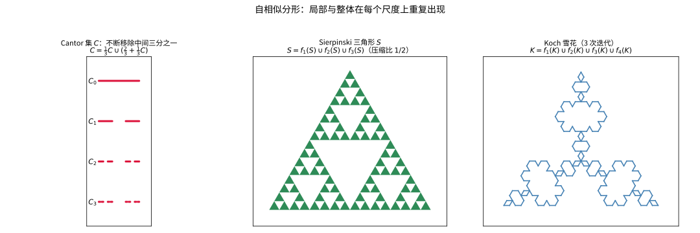

> **直观理解（现实类比）**：分形的自相似如同"西兰花"——撕下一小朵，它的形状几乎和整颗一样；再撕更小一朵，仍是同样的"小树"。Cantor 集、Sierpinski 三角形、Koch 雪花正是把这种"一叶知秋"的递归放大规则（每次迭代都按同一比例重复整体结构）画到了极致。

---

#### 课堂问答

**老师**：Cantor 集、Sierpinski 三角形、Koch 曲线都能写成 $F=\bigcup_i f_i(F)$。你先写出三者的自相似方程，并数清各用了几个压缩映射、压缩比是多少。

**学生**：结论先行——三者都是 IFS 吸引子。Cantor 集 $C=\frac13 C\cup\left(\frac23+\frac13 C\right)$，两个压缩映射，压缩比 $1/3$；Sierpinski 三角形 $S=f_1(S)\cup f_2(S)\cup f_3(S)$，三个压缩映射，压缩比 $1/2$；Koch 曲线 $K=\bigcup_{i=1}^4 f_i(K)$，四个压缩映射，压缩比 $1/3$。共同逻辑是"每一步把每条边按同一比例替换成 $m$ 个子边"。

**老师（追问）**：Cantor 集每次删掉区间中间的三分之一，那为什么方程写成 $\frac13 C$ 与 $\frac23+\frac13 C$，而不是别的？

**学生**：因为 $C=\frac13 C\cup\left(\frac23+\frac13 C\right)$ 恰好把 $[0,1]$ 分成左段 $[0,\frac13]$ 与右段 $[\frac23,1]$，再把每段按 $\frac13$ 缩放回 $C$ 自身。被删的 $(\frac13,\frac23)$ 不在解里——这正是"删中间"的代数表达。Koch 与 Sierpinski 同理，只是子段数与几何摆放不同。

**老师（拓展）**：既然有自相似方程，能不能直接读出维数？可以，由下一节 IFS 维数定理 $\sum_i r_i^s=1$，立刻得 $C$ 为 $\log2/\log3$、$S$ 为 $\log3/\log2$、$K$ 为 $\log4/\log3$。

**学生**：提醒一个坑：$C=\bigcap_{k\ge0}C_k$ 是极限集，不是任何有限步 $C_k$；另外 $\frac13 C$ 表示缩放集合 $\{\frac{x}{3}:x\in C\}$，别理解成"某个点乘 $\frac13$"。

## 第二节：Hausdorff 测度与 Hausdorff 维数

### 2.1 Hausdorff 测度

🌐 **直觉先行**：要量一块图形的"粗糙程度"，得先有一根能调粗细的量尺。Hausdorff 测度的思路是把"用来覆盖图形的所有小片"，按"直径的 $s$ 次方"来记账并求最小值——$s$ 就是量尺的"粗细刻度"。它是一把**能连续调节刻度**的尺子：$s=0$ 是数点数、$s=1$ 重出长度、$s=2$ 重出面积，夹在中间则量出"说不清是几维"的粗糙量。它是后面维数定义的地基。

> **🔑 为什么重要**：为什么不用现成的 Lebesgue 测度来量分形？因为分形恰好落在 Lebesgue 测度为"要么无穷大要么为零"的尴尬点上（如 Cantor 集的长度为零、却又不是有限个点）。Hausdorff 测度用可调的 $s$ 把这段"尺子盲区"补了回来——它是唯一能同时"测得非零有限"且像普通测度那样满足外测度性质（单调、次可加、平移不变）的工具，所以被选作维数的定义基础。

**定义 3（Hausdorff 测度）**：  
设 $F \subset \mathbb{R}^n$，$s \geq 0$，$\delta > 0$。定义

$$
\mathcal{H}^s_\delta(F) = \inf\left\{ \sum_{i=1}^{\infty} |U_i|^s : \{U_i\} \text{ 是 } F \text{ 的 } \delta\text{-覆盖} \right\}
$$

其中 $|U_i| = \sup\{|x - y| : x, y \in U_i\}$（即 $U_i$ 的直径），$\{U_i\}$ 是 $F$ 的覆盖，且每个 $U_i$ 满足 $|U_i| \leq \delta$。

$s$ 维 Hausdorff（外）测度定义为

$$
\mathcal{H}^s(F) = \lim_{\delta \to 0} \mathcal{H}^s_\delta(F) = \sup_{\delta > 0} \mathcal{H}^s_\delta(F)
$$

> **💡 直观理解（类比）**：用一把可调粗细的"格子尺"去量图形：凡能盖住它的所有小片，都按"直径的 $s$ 次方"记账求和，再把这份账目压到最小花费。$s$ 就是你选什么尺寸精度的"刻度"，测度就是这笔被扣到最省的开销。

**性质**：
1. $\mathcal{H}^s$ 是 $\mathbb{R}^n$ 上的 Borel 外测度。
2. $\mathcal{H}^0$ 是计数测度。
3. 当 $s = n$ 时，$\mathcal{H}^n$ 是 $n$ 维 Lebesgue 测度的常数倍（精确到因子 $\alpha(n)$，即 $n$ 维单位球的体积）。
4. 对于 $s < t$，若 $\mathcal{H}^s(F) < \infty$，则 $\mathcal{H}^t(F) = 0$；若 $\mathcal{H}^t(F) > 0$，则 $\mathcal{H}^s(F) = \infty$。

#### 课堂问答

**老师**：Hausdorff 测度定义里 $\mathcal{H}^s_\delta(F)=\inf\{\sum_i|U_i|^s\}$，然后还要取 $\delta\to0$。为什么要先加 $\delta$ 限制、再取极限，不能一步到位？

**学生**：因为直接对所有覆盖取下确界会退化，甚至得 0。加了 $\delta$ 后要求每个 $|U_i|\le\delta$，此时 $\mathcal{H}^s_\delta(F)$ 随 $\delta$ 减小而单调不减（覆盖限制更严），于是极限 $\mathcal{H}^s(F)=\lim_{\delta\to0}\mathcal{H}^s_\delta(F)=\sup_{\delta>0}\mathcal{H}^s_\delta(F)$ 存在。这里 $|U_i|$ 是集合直径 $\sup\{|x-y|:x,y\in U_i\}$，不是面积。

**老师（追问）**：那 $s=0$、$s=1$、$s=n$ 时它分别是什么？

**学生**：$s=0$ 时非空集合的 $|U_i|^0=1$，故 $\mathcal{H}^0$ 就是数点个数的计数测度；$s=1$ 时重出长度；一般 $s=n$ 时 $\mathcal{H}^n$ 是 $n$ 维 Lebesgue 测度的常数倍，倍数恰为单位球体积 $\alpha(n)$。这说明 Hausdorff 测度是把 Lebesgue 测度沿维数连续调节的推广。

**老师（拓展）**：还有一个单调性事实——$s<t$ 时若 $\mathcal{H}^s(F)<\infty$ 则 $\mathcal{H}^t(F)=0$。这正是"临界指数唯一"的源头，直接支撑下一节维数的定义。

**学生**：易错点：$\mathcal{H}^s_\delta$ 只是"外测度式的下确界"，它本身不是测度（不满足可加性）；求和项 $\sum_i|U_i|^s$ 是"直径 $s$ 次方"的记账，别误当成体积。

### 2.2 Hausdorff 维数

> **直观理解（现实类比）**：分形维数像"粗糙度的度量"——非整数维数刻画了图形填充空间的程度。一条光滑直线是 1 维，一块实心平面是 2 维，而一条曲折的海岸线介于两者之间：越曲折、越能"挤进"二维平面，维数就越接近 2。著名的"英国海岸线有多长"悖论正源于此——用越细的尺子量，长度越大，最终趋于无穷，而其 Hausdorff 维数约 1.25 才是真正描述其"粗糙程度"的不变量。

**定义 4（Hausdorff 维数）**：  
集合 $F \subset \mathbb{R}^n$ 的 Hausdorff 维数定义为

$$
\dim_H F = \inf\{ s \geq 0 : \mathcal{H}^s(F) = 0 \} = \sup\{ s \geq 0 : \mathcal{H}^s(F) = \infty \}
$$

即存在唯一的临界值 $s = \dim_H F$，使得

$$
\mathcal{H}^s(F) = \begin{cases}
\infty, & s < \dim_H F \\
0, & s > \dim_H F
\end{cases}
$$

> **💡 直观理解（类比）**：把"刻度" $s$ 从 0 一点往大拨，测度起初是无穷、过了某个拐点唰地塌成 0——这个骤然"跳账"的临界刻度，正是图形的 Hausdorff 维数。就像做工时换尺子：找到一把"刚够用、再细也没必要"的临界细度。

在 $s = \dim_H F$ 处，$\mathcal{H}^s(F)$ 可以是 $0$、$\infty$ 或 $0 < \mathcal{H}^s(F) < \infty$。

> **常见坑**：别把"维数 $\dim_H F$"当成"该处测度一定是某个数"。它在临界点处可能介于 $0$ 与 $\infty$ 之间任意一个有限值（正有限、可为零、可为 $\infty$ 三种情形都可能出现）。所以维数的定义只告诉你"**在临界刻度处发生了什么**"，并不保证测度恰为正有限——例如可数稠密集的 Hausdorff 测度在临界尺度往往很大或为零。

#### 课堂问答

**老师**：$\dim_H F=\inf\{s:\mathcal{H}^s(F)=0\}=\sup\{s:\mathcal{H}^s(F)=\infty\}$，两个定义凭什么相等？

**学生**：因为 $\mathcal{H}^s(F)$ 关于 $s$ 呈"阶跃"形态：存在临界值 $s_0$，使 $s<s_0$ 时 $\mathcal{H}^s(F)=\infty$、$s>s_0$ 时 $\mathcal{H}^s(F)=0$。这个跳变由上一节的单调性 $\mathcal{H}^s<\infty\Rightarrow\mathcal{H}^t=0\ (t>s)$ 保证，故两个上、下确界落在同一个 $s_0=\dim_H F$。

**老师（追问）**：那在 $s=\dim_H F$ 这一点，测度一定是正的有限数吗？

**学生**：先给结论：不一定。在临界点 $\mathcal{H}^s(F)$ 可以是 $0$、$+\infty$，或 $0<\mathcal{H}^s(F)<\infty$ 三种之一。维数定义只锁定"跳变位置"，不保证该处测度正有限。

**老师（拓展）**：所以算维数时几乎总用"上下界夹逼"：上界证 $s>\dim_H$ 时测度为 0，下界用质量分布原理证 $s=\dim_H$ 时测度为正——第五节的三个经典计算走的就是这条路。

**学生**：最常犯的错是把 $\dim_H$ 当成"测度恰为某个固定值的那个尺度"。更一般地，Hausdorff 维数只是尺度—测度关系的临界指数：光滑曲线给 1、Cantor 集给 $\log2/\log3\approx0.63$、海岸线约 1.25，都是这个临界位置。

### 2.3 Hausdorff 维数的基本性质

**定理 1（Hausdorff 维数的基本性质）**：

1. **单调性**：若 $E \subset F$，则 $\dim_H E \leq \dim_H F$。
2. **可数稳定性**：$\displaystyle \dim_H \left(\bigcup_{i=1}^{\infty} F_i\right) = \sup_{i} \dim_H F_i$。
3. **Lipschitz 不变性**：若 $f: F \to \mathbb{R}^m$ 是 Lipschitz 映射（即存在 $c > 0$ 使 $|f(x) - f(y)| \leq c|x - y|$），则 $\dim_H f(F) \leq \dim_H F$。
4. **等距不变性**：若 $F$ 与 $G$ 等距，则 $\dim_H F = \dim_H G$。
5. **开集性**：若 $F \subset \mathbb{R}^n$ 是开集，则 $\dim_H F = n$。

> **💡 直观理解（类比）**：这五条像"维数行为守则"——子集不会比父集更"占地方"（单调）、拼起来取最大档（可数稳定）、任拉伸都不放大占地方程度（Lipschitz）、平移旋转不改维数（等距）、实心开域就是整维（开集）。一条条把"占地方程度"这件直觉事梳理得井井有条。

**证明**：

**(1) 单调性**：  
若 $E \subset F$，则 $F$ 的任何 $\delta$-覆盖也是 $E$ 的 $\delta$-覆盖，因此 $\mathcal{H}^s_\delta(E) \leq \mathcal{H}^s_\delta(F)$，取极限得 $\mathcal{H}^s(E) \leq \mathcal{H}^s(F)$。若 $s > \dim_H F$，则 $\mathcal{H}^s(F) = 0$，从而 $\mathcal{H}^s(E) = 0$，故 $\dim_H E \leq \dim_H F$。$\square$

**(2) 可数稳定性**：  
首先，由单调性知 $\dim_H F_i \leq \dim_H (\bigcup_i F_i)$ 对所有 $i$ 成立，故 $\sup_i \dim_H F_i \leq \dim_H (\bigcup_i F_i)$。

反之，设 $s > \sup_i \dim_H F_i$，则对所有 $i$ 有 $s > \dim_H F_i$，故 $\mathcal{H}^s(F_i) = 0$。由 Hausdorff 测度的可数次可加性：

$$
\mathcal{H}^s\left(\bigcup_{i=1}^{\infty} F_i\right) \leq \sum_{i=1}^{\infty} \mathcal{H}^s(F_i) = 0
$$

因此 $\mathcal{H}^s(\bigcup_i F_i) = 0$，从而 $\dim_H (\bigcup_i F_i) \leq s$。令 $s \to \sup_i \dim_H F_i^+$，得 $\dim_H (\bigcup_i F_i) \leq \sup_i \dim_H F_i$。

综合两个方向即得等式。$\square$

**(3) Lipschitz 不变性**：  
设 $f$ 的 Lipschitz 常数为 $c$，即 $|f(x) - f(y)| \leq c|x - y|$。若 $\{U_i\}$ 是 $F$ 的 $\delta$-覆盖，则 $\{f(F \cap U_i)\}$ 的直径不超过 $c|U_i|$，因此 $\{f(F \cap U_i)\}$ 是 $f(F)$ 的 $c\delta$-覆盖。

于是

$$
\mathcal{H}^s_{c\delta}(f(F)) \leq \sum_i |f(F \cap U_i)|^s \leq c^s \sum_i |U_i|^s
$$

取下确界得 $\mathcal{H}^s_{c\delta}(f(F)) \leq c^s \mathcal{H}^s_\delta(F)$。令 $\delta \to 0$，得 $\mathcal{H}^s(f(F)) \leq c^s \mathcal{H}^s(F)$。

若 $s > \dim_H F$，则 $\mathcal{H}^s(F) = 0$，从而 $\mathcal{H}^s(f(F)) = 0$，故 $\dim_H f(F) \leq s$，进而 $\dim_H f(F) \leq \dim_H F$。$\square$

**(4) 等距不变性**：等距映射是 Lipschitz 常数为 $1$ 的 Lipschitz 映射，由 (3) 即得。

**(5) 开集性**：若 $F \subset \mathbb{R}^n$ 是非空开集，则 $F$ 包含一个 $n$ 维球体，其 $n$ 维 Hausdorff 测度为正（与 Lebesgue 测度等价），故 $\dim_H F \geq n$。又 $F \subset \mathbb{R}^n$，而 $\mathbb{R}^n$ 的 Hausdorff 维数为 $n$，由单调性知 $\dim_H F \leq n$。因此 $\dim_H F = n$。$\square$

---

#### 课堂问答

**老师**：定理说 $\dim_H\left(\bigcup_{i=1}^\infty F_i\right)=\sup_i\dim_H F_i$。左边是可数并，为什么可数并仍取上确界，而不是"越并越大"？

**学生**：关键在可数次可加性。若 $s>\sup_i\dim_H F_i$，则每个 $\mathcal{H}^s(F_i)=0$，于是 $\mathcal{H}^s(\bigcup_i F_i)\le\sum_i\mathcal{H}^s(F_i)=0$，故 $\dim_H(\bigcup_i F_i)\le s$；再由单调性有 $\sup_i\dim_H F_i\le\dim_H(\bigcup_i F_i)$。两边夹出等式。可数并之所以"不涨"，是因为可数多份零测集并起来仍是零测集。

**老师（追问）**：那为什么换成盒维数，这条性质就坏了？

**学生**：因为盒维数靠 $N_\delta(F)$ 直接计数、没有可数次可加性。可数稠密集的 Hausdorff 维数是 0，但它的盒维数可以做满整个 $n$。这就是盒维数"野蛮"之处——它丢了可数稳定性。

**老师（拓展）**：顺带记 Lipschitz 不变性 $\dim_H f(F)\le\dim_H F$：若 $f$ 的 Lipschitz 常数为 $c$，则像的覆盖直径放大不超过 $c$ 倍，得 $\mathcal{H}^s_{c\delta}(f(F))\le c^s\mathcal{H}^s_\delta(F)$；等距（$c=1$）时两个方向都取到，故等号成立。

**学生**：再补一条常用事实：$\mathbb{R}^n$ 中非空开集的 $\dim_H=n$，因为开集含一个 $n$ 维球，其 $\mathcal{H}^n$ 为正。五条合起来就是"单调、可数稳定、Lipschitz 不变、等距不变、开集取满维"。

## 第三节：盒维数

### 3.1 盒维数的定义

🌐 **直觉先行**：Hausdorff 维数概念漂亮，但计算困难（要跟所有可能的覆盖打交道）。盒维数换了个"糙但快"的办法：**干脆用统一大小的边长为 $\delta$ 的小立方格去"盖数格子"**，只数要用几个格子 $N_\delta(F)$，再看格子变细时 $N_\delta(F)$ 按 $\delta$ 的多少次方暴涨。它牺牲一点严谨、换来极易操作，是工程与实际计算里最常用的维数。

**为什么需要这个概念**：很多分形（以及用计算机数值模拟的集合）求 Hausdorff 维数几乎不可行，但盒维数可以靠数格子在计算机里直接逼近。它本质上给出一个"最容易实现"的维数手感，而它的种种局限（见定理 2 的注）恰好反衬出 Hausdorff 维数的严谨。

> **常见坑**：盒维数虽然好算，有时却"野蛮"得令人吃惊——**它无需单调性也无需可数稳定性**，甚至一个可数稠密点集可以拥有盒维数而不再是 Hausdorff 维数那样的结果。所以别拿盒维数当 Hausdorff 维数的"近似"：它俩在光滑情形常相等，但对异常集合可能差很多。

**定义 5（盒维数）**：  
设 $F \subset \mathbb{R}^n$ 是非空有界集。令 $N_\delta(F)$ 表示能覆盖 $F$ 的直径为 $\delta$ 的集合的最小个数，或边长为 $\delta$ 的 $n$ 维立方体网格与 $F$ 相交的个数。$F$ 的**下盒维数**和**上盒维数**分别定义为

$$
\underline{\dim}_B F = \liminf_{\delta \to 0} \frac{\log N_\delta(F)}{-\log \delta}, \quad
\overline{\dim}_B F = \limsup_{\delta \to 0} \frac{\log N_\delta(F)}{-\log \delta}
$$

若两者相等，则称该共同值为 **盒维数**（box dimension）或 **Minkowski 维数**，记为 $\dim_B F$。

> **💡 直观理解（类比）**：像用固定大小的小方格给图形"盖房子数格子"：格子越细，盖住它要的方块数 $N_\delta$ 就按 $\delta^{-\text{维数}}$ 的速度疯长，看增长速度 $(\log N)/(-\log\delta)$ 的极限就知道维数——"尺子变细要补多少方块"有多急，维数就有多高。

#### 课堂问答

**老师**：盒维数用 $N_\delta(F)$ 数格子。为什么定义里写成 $\frac{\log N_\delta(F)}{-\log\delta}$，而不是直接 $\frac{\log N_\delta(F)}{\log\delta}$？

**学生**：为了得到正数。$\delta<1$ 时 $\log\delta<0$，分母取 $-\log\delta>0$，分子 $\log N_\delta>0$，比值即维数。本质上由 $N_\delta(F)\sim\delta^{-D}$ 取对数解出 $D=\lim_{\delta\to0}\frac{\log N_\delta(F)}{-\log\delta}$，与 $\frac{\log N_\delta(F)}{\log(1/\delta)}$ 同义。

**老师（追问）**：那为什么还要分"下盒维数"与"上盒维数"？

**学生**：因为 $\lim_{\delta\to0}\frac{\log N_\delta(F)}{-\log\delta}$ 未必存在。用 $\liminf$ 得下盒维数 $\underline{\dim}_B F$、用 $\limsup$ 得上盒维数 $\overline{\dim}_B F$；二者相等时才定义唯一的盒维数 $\dim_B F$。对自相似这类"规整"对象两者通常相等。

**老师（拓展）**：它还有个名字叫 Minkowski 维数，因为可等价地用 $F$ 的 $\delta$-邻域的体积增长来算：$\overline{\dim}_B F=\limsup_{\delta\to0}\frac{\log|F_\delta|}{-\log\delta}$ 那一族定义。

**学生**：最常见的误用是拿盒维数当 Hausdorff 维数。对 Cantor 集两者相等，但可数稠密集上二者天差地别；而且盒维数只对**有界**集才有定义。

### 3.2 分形维数的等价性定理

**定理 2（Hausdorff 维数与盒维数的关系）**：  
对于有界集 $F \subset \mathbb{R}^n$，有

$$
\dim_H F \leq \underline{\dim}_B F \leq \overline{\dim}_B F
$$

> **💡 直观理解（类比）**：Hausdorff 维数是"精打细算派"（找最省钱的小片去盖），盒维数是"大手大脚派"（统一用整格小方块去数），越粗放法子算出的结果只会越"大"，所以 $\dim_H\le$ 盒维数——像精挑细选的账单总不会比按满价估算的花费更高。

**证明**：

设 $s > 0$，$\delta > 0$。令 $N_\delta(F)$ 是覆盖 $F$ 所需的最大直径为 $\delta$ 的集合的最小个数。则存在一个由 $N_\delta(F)$ 个直径为 $\delta$ 的集合构成的 $F$ 的覆盖，因此

$$
\mathcal{H}^s_\delta(F) \leq N_\delta(F) \cdot \delta^s
$$

若 $s < \dim_H F$，则 $\mathcal{H}^s(F) = \infty$，从而对充分小的 $\delta$，$\mathcal{H}^s_\delta(F) > 1$，故 $N_\delta(F) \cdot \delta^s > 1$，即

$$
\log N_\delta(F) + s \log \delta > 0 \quad \Longrightarrow \quad \frac{\log N_\delta(F)}{-\log \delta} > s
$$

取 $\delta \to 0$ 的下极限，得 $\underline{\dim}_B F \geq s$。令 $s \to \dim_H F^-$，得 $\underline{\dim}_B F \geq \dim_H F$。

上盒维数显然不小于下盒维数，因此 $\dim_H F \leq \underline{\dim}_B F \leq \overline{\dim}_B F$。$\square$

**注**：反向不等式一般不成立。例如，可数稠密集的 Hausdorff 维数为 $0$，但盒维数可能为 $n$。

---

#### 课堂问答

**老师**：定理 2 给出 $\dim_H F\le\underline{\dim}_B F\le\overline{\dim}_B F$，方向为什么是"$\le$"？能不能反过来？

**学生**：方向 $\le$ 的直觉是"Hausdorff 精打细算、盒维数大手大脚"：盒维数只用统一直径 $\delta$ 的覆盖，必有 $\mathcal{H}^s_\delta(F)\le N_\delta(F)\delta^s$。若 $s<\dim_H F$，则 $\mathcal{H}^s(F)=\infty$，逼出 $N_\delta(F)\delta^s>1$，取对数得 $\frac{\log N_\delta(F)}{-\log\delta}>s$，再取下极限即 $\underline{\dim}_B F\ge\dim_H F$。所以 $\dim_H$ 总是最小的那个。

**老师（追问）**：那反过来的不等号为什么不成立？

**学生**：因为盒维数对可数稠密的"针尖"不敏感。取 $F$ 为 $[0,1]$ 中的可数稠密集：$\dim_H F=0$，但它每段都"到处有点"，方格子几乎每个都相交，$N_\delta\approx\delta^{-1}$，故 $\dim_B F=1$。于是 $\dim_H F=0<1=\dim_B F$，严格不等式确实出现。

**老师（拓展）**：那什么时候取等？对满足开集条件的自相似集，Hausdorff 维数、盒维数（即相似维数）三者相等——这正是第五节能放心用 IFS 维数定理的原因。

**学生**：记一个口诀：$\dim_H\le\underline{\dim}_B\le\overline{\dim}_B$，等号需要"规整性"（如 OSC）；Hausdorff 维数更稳（可数稳定、Lipschitz 不变），盒维数更好算。

## 第四节：迭代函数系统（IFS）

### 4.1 压缩映射与 Hausdorff 距离

🌐 **直觉先行**：要"造"分形，先得有"会缩小的机器"。压缩映射就是一台四面合拢的收缩镜：任意两点的距离在它作用后被严格缩短到 $r<1$ 倍。而 Hausdorff 距离是衡量"两团紧集合贴得有多近"的一把尺子。把"压缩镜"多数台摆在一起反复作用，就是下一节 IFS 造吸引子的全部机关。

**为什么需要这个概念**：分形的自相似构造本质上靠"整幅图 = 自己的几个缩小版拼起来"。压缩映射提供"缩小"的动作，Hausdorff 距离提供"拼命贴近"的比较量，二者缺一则无法证明"反复缩小必然落到一个稳定的像"（即吸引子）。

**定义 6（压缩映射）**：  
映射 $f: \mathbb{R}^n \to \mathbb{R}^n$ 称为**压缩映射**，如果存在常数 $0 \leq r < 1$，使得

$$
|f(x) - f(y)| \leq r|x - y|, \quad \forall x, y \in \mathbb{R}^n
$$

常数 $r$ 称为压缩比。

> **💡 直观理解（类比）**：一块"收缩镜"——任意两点的距离都会被按 $r<1$ 的比例缩短映过去，像把整张地图按 $r$ 倍缩小贴到墙上：结构一点不变，只是个头缩了、所有间距都跟着缩成 $r$ 倍。

**定义 7（Hausdorff 距离）**：  
设 $X, Y \subset \mathbb{R}^n$ 是非空紧集。Hausdorff 距离定义为

$$
d_H(X, Y) = \max\left\{ \sup_{x \in X} \inf_{y \in Y} |x - y|,\; \sup_{y \in Y} \inf_{x \in X} |x - y| \right\}
$$

记 $\mathcal{K}(\mathbb{R}^n)$ 为 $\mathbb{R}^n$ 中所有非空紧集构成的集合，则 $(\mathcal{K}(\mathbb{R}^n), d_H)$ 是完备度量空间。

> **💡 直观理解（类比）**：衡量两团紧图形"贴得多近"的尺子：看甲团里离乙团最远的点、再比乙团里离甲团最远的点，取那个较大的"最大空隙"当距离。像判断两家地盘是否贴脸——谁离对方最近只算标配，谁被趁得最远才是关键。

#### 课堂问答

**老师**：压缩映射要求 $|f(x)-f(y)|\le r|x-y|$ 且 $0\le r<1$。那 $r=1$ 就不是压缩吗？

**学生**：$r=1$ 只是 Lipschitz（非扩张），不保证"越迭代越近"。Banach 不动点定理需要 $r<1$ 才能给出几何收敛。$r$ 称为压缩比。注意有个弱化版本：即使 $f$ 本身不全压缩，只要某次迭代 $f^{\circ k}$ 是压缩也已够用，但本章一律用 $r<1$。

**老师（追问）**：Hausdorff 距离 $d_H(X,Y)=\max\{\sup_{x\in X}\inf_{y\in Y}|x-y|,\ \sup_{y\in Y}\inf_{x\in X}|x-y|\}$，为什么要两个方向取最大？

**学生**：因为"谁离谁近"不对称。$\sup_{x\in X}\inf_{y\in Y}|x-y|$ 量的是 $X$ 到 $Y$ 的最大偏差，交换 $X,Y$ 又得另一个数；只取一个方向会漏掉"一边贴住、另一边鼓出一块"的情形。取两者最大才能让 $d_H(X,Y)=0\iff X=Y$，从而真正成为度量。

**老师（拓展）**：把所有非空紧集记为 $\mathcal{K}(\mathbb{R}^n)$，则 $(\mathcal{K}(\mathbb{R}^n),d_H)$ 是完备度量空间——这是下一步 Banach 定理能用的舞台。

**学生**：常见误区：$d_H$ 不是"两集合的最短距离"，而是"最远必须走的距离"。两个相交的集合 $d_H$ 未必为 0，因为一方可能还鼓出一大块没被对方覆盖。

### 4.2 IFS 吸引子的存在唯一性

🌐 **直觉先行**：把若干台"缩小镜"一起打包成一套模具，每轮把各缩小版并回同一块画布再反复叠，这就叫**迭代函数系统（IFS）**。直觉上无论从哪张草图起步，反复缩小＋拼合最后都会"收到"同一朵花——这正是 Hutchinson 定理保证的吸引子的存在唯一性。

**为什么需要这个概念**：Cantor 集、Sierpinski 三角形、Koch 曲线全都是"自己几个缩小版拼成自己"的对象。IFS 用一台"缩小镜清单"把这些散见的构造统一成一种语言，并借 Banach 不动点定理一举证明"这类对象总能造出来且唯一"——这是分形理论从"例子"升级为"理论"的关键一步。

**定义 8（迭代函数系统）**：  
一个**迭代函数系统**（Iterated Function System，简称 IFS）是一组有限的压缩映射 $\{f_1, f_2, \dots, f_m\}$，其中 $f_i: \mathbb{R}^n \to \mathbb{R}^n$ 的压缩比为 $r_i$。

> **💡 直观理解（类比）**：一套"缩小镜"被打包成模具——每轮把各缩小版摆回同一画布（求并），再往下反复叠放；无论从哪张草稿起笔，最终都会叠出一朵既唯一又稳定的"花"（吸引子）。就像用一小套印章周而复始地盖章，越盖越细、越盖越出规律。

**定理 3（IFS 吸引子的存在唯一性——Hutchinson 定理）**：  
设 $\{f_1, f_2, \dots, f_m\}$ 是 $\mathbb{R}^n$ 上的一个 IFS。定义变换 $F: \mathcal{K}(\mathbb{R}^n) \to \mathcal{K}(\mathbb{R}^n)$ 为

$$
F(K) = \bigcup_{i=1}^m f_i(K)
$$

则 $F$ 是 $(\mathcal{K}(\mathbb{R}^n), d_H)$ 上的压缩映射，压缩比为 $r = \max\{r_1, \dots, r_m\}$。因此，$F$ 存在唯一的不动点 $A \in \mathcal{K}(\mathbb{R}^n)$，称为该 IFS 的**吸引子**，满足

$$
A = \bigcup_{i=1}^m f_i(A)
$$

且对任意初始紧集 $K_0$，迭代 $K_{k+1} = F(K_k)$ 收敛到 $A$（在 Hausdorff 距离意义下）。

> **💡 直观理解（类比）**："用模具盖一遍"这件事本身，就是把两块图形的距离按 $r$ 倍缩短的"压缩操作"；于是像在一圈圈收紧的绳套里找绳头——反复迭代必然收到唯一的那个不动点，保证每次盖章都落回同一朵"花"。

**证明**：

**第一步：证明 $F$ 是压缩映射。**  
任取 $K, L \in \mathcal{K}(\mathbb{R}^n)$。设 $x \in F(K) = \bigcup_i f_i(K)$，则存在 $i$ 和 $y \in K$ 使得 $x = f_i(y)$。由于 $L$ 是紧集，存在 $z \in L$ 使得 $|y - z| = \inf_{w \in L} |y - w|$。于是

$$
d(x, f_i(L)) \leq |f_i(y) - f_i(z)| \leq r_i |y - z| \leq r_i \cdot d_H(K, L)
$$

因此 $\sup_{x \in F(K)} d(x, F(L)) \leq r \cdot d_H(K, L)$，其中 $r = \max_i r_i$。

类似地，$\sup_{x \in F(L)} d(x, F(K)) \leq r \cdot d_H(K, L)$。故

$$
d_H(F(K), F(L)) \leq r \cdot d_H(K, L)
$$

由于 $0 \leq r < 1$，$F$ 是压缩映射。

**第二步：应用 Banach 不动点定理。**  
$(\mathcal{K}(\mathbb{R}^n), d_H)$ 是完备度量空间，$F$ 是压缩映射，由 Banach 不动点定理，$F$ 存在唯一的不动点 $A \in \mathcal{K}(\mathbb{R}^n)$，满足 $F(A) = A$，即 $A = \bigcup_{i=1}^m f_i(A)$。

**第三步：收敛性。**  
Banach 不动点定理还保证，对任意初始 $K_0 \in \mathcal{K}(\mathbb{R}^n)$，迭代 $K_{k+1} = F(K_k)$ 收敛到 $A$，且收敛速率满足

$$
d_H(K_k, A) \leq \frac{r^k}{1 - r} d_H(K_0, K_1)
$$

$\square$

#### 课堂问答

**老师**：Hutchinson 定理说 $F(K)=\bigcup_{i=1}^m f_i(K)$ 是 $(\mathcal{K},d_H)$ 上的压缩映射，压缩比取 $r=\max_i r_i<1$。为什么取 max，而不是和或积？

**学生**：因为 $F(K)$ 的每个像点只由**一个** $f_i$ 产生。任取 $x=f_i(y)\in F(K)$，最近点 $z\in L$ 对应 $f_i(z)$，于是 $d(x,F(L))\le|f_i(y)-f_i(z)|\le r_i|y-z|\le r_i\,d_H(K,L)\le r\,d_H(K,L)$。对 $i$ 取最大即得 $\sup_x d(x,F(L))\le r\,d_H(K,L)$，两个方向合并得 $d_H(F(K),F(L))\le r\,d_H(K,L)$。若用"和"会高估收缩、用"积"只是更松的界，紧的压缩常数就是 max。

**老师（追问）**：那"吸引子唯一"这一步用的是哪个定理？

**学生**：Banach 不动点定理。$(\mathcal{K}(\mathbb{R}^n),d_H)$ 完备、$F$ 是压缩（$r<1$），故存在唯一不动点 $A$ 满足 $A=\bigcup_{i=1}^m f_i(A)$，即吸引子；且任取 $K_0$，$K_{k+1}=F(K_k)$ 收敛到 $A$，误差满足 $d_H(K_k,A)\le\frac{r^k}{1-r}d_H(K_0,K_1)$。

**老师（拓展）**：这一步的意义在于：它把"Cantor 集、Sierpinski、Koch 都是自己几份缩小版拼成"这一零散观察，统一成"任何 IFS 必有唯一吸引子"的一般定理。

**学生**：易错：$r<1$ 不可省；另外吸引子是**紧集空间**里的不动点，不是在点空间 $\mathbb{R}^n$ 里迭代单个点。

### 4.3 IFS 维数定理

🌐 **直觉先行**：IFS 造出了吸引子，那它到底几维？IFS 维数定理给出一个神奇的对账法则：**每个缩小镜按 $r_i^s$ 贡献一份"尺寸账"，把各份账加起来恰好算平（$\sum_i r_i^s = 1$）的那个 $s$，就是吸引子的维数。** 前提是把缩小镜摆得足够"隔开"（开集条件），成交不重叠。

**为什么需要这个概念**：没有它，算每个分形的维数都得重新造轮子（像第五节那样对每个对象单独用覆盖＋质量分布）。IFS 维数定理把所有"由相似压缩镜拼成"的自相似分形的维数统一成一个方程 $\sum_i r_i^s=1$ 的根——一劳永逸地批量解题。

**定理 4（IFS 吸引子的维数）**：  
设 $\{f_1, \dots, f_m\}$ 是 $\mathbb{R}^n$ 上的 IFS，每个 $f_i$ 是相似压缩映射，压缩比为 $r_i$，且满足**开集条件**（OSC）：存在非空有界开集 $V \subset \mathbb{R}^n$ 使得

$$
\bigcup_{i=1}^m f_i(V) \subset V, \quad f_i(V) \cap f_j(V) = \varnothing\;(i \neq j)
$$

则吸引子 $A$ 的 Hausdorff 维数 $\dim_H A$ 等于满足方程

$$
\sum_{i=1}^m r_i^s = 1
$$

的唯一解 $s$。

> **💡 直观理解（类比）**：每个缩小镜按 $r_i^s$ 贡献一份"尺寸账"，把所有副本的贡献加起来恰好算平（$\sum r_i^s=1$）时，这个 $s$ 就是图形的维数——像对账：拆出几个副本、每个缩多少，账一旦收支平衡，维数就敲定了。

---

#### 课堂问答

**老师**：定理说 $\sum_{i=1}^m r_i^s=1$ 的唯一解就是 $\dim_H A$。前提里的开集条件在做什么？

**学生**：OSC 是"防重叠"的：存在非空有界开集 $V$ 使 $\bigcup_i f_i(V)\subset V$ 且 $f_i(V)\cap f_j(V)=\varnothing\ (i\neq j)$，保证各 $f_i(A)$ 不过度交叠。没有它，像可能重叠，维数会小于方程的解——重叠把维数"压小"。

**老师（追问）**：方程 $\sum_i r_i^s=1$ 为什么有唯一解？

**学生**：令 $g(s)=\sum_i r_i^s$。因 $0<r_i<1$，$g$ 关于 $s$ 严格递减，且 $g(0)=m>1$、$g(s)\to0\ (s\to\infty)$，由连续性存在唯一 $s_0$ 使 $g(s_0)=1$，即维数。

**老师（拓展）**：验证经典例子：Cantor 集 $2\cdot(1/3)^s=1\Rightarrow s=\log2/\log3$；Sierpinski $3\cdot(1/2)^s=1\Rightarrow\log3/\log2$；Koch $4\cdot(1/3)^s=1\Rightarrow\log4/\log3$。

**学生**：注意"相似"是关键——每个 $r_i$ 在所有方向一致。若 $f_i$ 只是仿射（各方向压缩比不同），方程要换成用奇异值或直接按盒维数定义来算，$\sum r_i^s=1$ 这一简洁形式不再直接成立。

## 第五节：经典分形的维数计算

### 5.1 Cantor 集的 Hausdorff 维数

**定理 5（Cantor 集的 Hausdorff 维数）**：  
经典 Cantor 集 $C$ 的 Hausdorff 维数为

$$
\dim_H C = \frac{\log 2}{\log 3}
$$

> **💡 直观理解（类比）**：每次迭代把一段一分为二、每段缩到 1/3，账上 $2\cdot(1/3)^s=1$ 解得 $s=\log2/\log3\approx0.63$。就像把纸"剪成两截、再各缩到三分之一"——多是两小块、块只有原长度 1/3，折出来的"占空间指数"比点多（0维）又比线（1维）少。

**证明**：

**第一步：建立上界估计。**  
在 Cantor 集的第 $k$ 步构造 $C_k$ 中，我们有 $2^k$ 个区间，每个区间长度为 $3^{-k}$。这些区间构成 $C$ 的一个 $\delta_k$-覆盖，其中 $\delta_k = 3^{-k}$。

对任意 $s > 0$，

$$
\mathcal{H}^s_{\delta_k}(C) \leq 2^k \cdot (3^{-k})^s = 2^k \cdot 3^{-ks} = (2 \cdot 3^{-s})^k
$$

若 $s > \log 2 / \log 3$，则 $2 \cdot 3^{-s} < 1$，令 $k \to \infty$ 得 $\mathcal{H}^s(C) = 0$，故 $\dim_H C \leq \log 2 / \log 3$。

**第二步：建立下界估计。**  
需要证明当 $s = \log 2 / \log 3$ 时，$\mathcal{H}^s(C) > 0$。

设 $\mu$ 为 Cantor 集上的均匀概率测度，即对每个第 $k$ 级区间 $I_{k,j}$（$j = 1, \dots, 2^k$），定义 $\mu(I_{k,j}) = 2^{-k}$。由测度延拓定理，$\mu$ 可唯一延拓为 $C$ 上的 Borel 概率测度。

我们断言：存在常数 $c > 0$，使得对任意 $x \in C$ 和任意 $0 < r < 1$，有

$$
\mu(B(x, r)) \leq c \cdot r^s
$$

其中 $s = \log 2 / \log 3$。

事实上，对给定的 $r$，取 $k$ 使得 $3^{-(k+1)} \leq r < 3^{-k}$。球 $B(x, r)$ 至多与 $C$ 的两个第 $k$ 级区间相交（因为 Cantor 集的构造中，第 $k$ 级区间之间的间距至少为 $3^{-k}$）。每个第 $k$ 级区间的 $\mu$-测度为 $2^{-k}$，因此

$$
\mu(B(x, r)) \leq 2 \cdot 2^{-k} = 2 \cdot 2^{-k}
$$

又 $r \geq 3^{-(k+1)}$，故 $r^s \geq 3^{-(k+1)s} = 3^{-s} \cdot 3^{-ks}$。而 $2^{-k} = 3^{-ks}$（因为 $s = \log 2 / \log 3$ 意味着 $2 = 3^s$），因此

$$
\mu(B(x, r)) \leq 2 \cdot 2^{-k} = 2 \cdot 3^{-ks} = 2 \cdot 3^s \cdot 3^{-(k+1)s} \leq 2 \cdot 3^s \cdot r^s
$$

取 $c = 2 \cdot 3^s$ 即得 $\mu(B(x, r)) \leq c \cdot r^s$。

由质量分布原理（Mass Distribution Principle）：若存在概率测度 $\mu$ 支撑在 $C$ 上，且常数 $c > 0$ 使得 $\mu(B(x, r)) \leq c \cdot r^s$，则 $\mathcal{H}^s(C) \geq 1/c > 0$。

因此 $\mathcal{H}^s(C) > 0$，故 $\dim_H C \geq s$。

**第三步：综合上下界。**  
由 $\dim_H C \leq s$ 和 $\dim_H C \geq s$，得 $\dim_H C = s = \log 2 / \log 3$。$\square$

#### 课堂问答

**老师**：上界好办，$\mathcal{H}^s_{\delta_k}(C)\le2^k3^{-ks}=(2\cdot3^{-s})^k$，$s>\log2/\log3$ 时趋于 0。但下界凭什么？

**学生**：用质量分布原理。先给结论：取 Cantor 集上均匀测度 $\mu$，每个第 $k$ 级区间测度 $2^{-k}$。对任意 $x$ 与 $r$，取 $k$ 使 $3^{-(k+1)}\le r<3^{-k}$，球 $B(x,r)$ 至多与两个第 $k$ 级区间相交，故 $\mu(B(x,r))\le2\cdot2^{-k}=2\cdot3^{-ks}$；又 $r\ge3^{-(k+1)}$ 给出 $3^{-ks}\le3^s r^s$，于是 $\mu(B(x,r))\le2\cdot3^s r^s=cr^s$。由质量分布原理 $\mathcal{H}^s(C)\ge1/c>0$，得 $\dim_H C\ge\log2/\log3$。

**老师（追问）**：为什么球 $B(x,r)$ 只碰两个第 $k$ 级区间？

**学生**：因为第 $k$ 级区间长度是 $3^{-k}$，而相邻同级区间之间至少隔开同量级的空隙，又 $r<3^{-k}$，半径小于区间长度，故最多只覆盖到相邻的两个区间。这正是 $2=3^s$ 这个指数关系能对上的原因。

**老师（拓展）**：这是"自相似＋OSC"下维数的标准算法。它还顺带说明：在 $s=\log2/\log3$ 处，$\mathcal{H}^s(C)$ 是正的有限数（既非 0 也非 $\infty$）。

**学生**：常见错误：下界也想去"数区间"，但按覆盖计数只能给上界；下界必须用测度或质量分布原理。

### 5.2 Sierpinski 三角形的 Hausdorff 维数

**定理 6（Sierpinski 三角形的 Hausdorff 维数）**：  
Sierpinski 三角形 $S$ 的 Hausdorff 维数为

$$
\dim_H S = \frac{\log 3}{\log 2}
$$

> **💡 直观理解（类比）**：三个角各放一枚 $1/2$ 缩小的三角副本，$3\cdot(1/2)^s=1$ 解得 $s=\log3/\log2\approx1.585$。像往漏斗里筛沙子——三角形拆得越来越"铺得开"却始终留孔洞，维数就卡在 1（线）与 2（面）之间、偏向 2。

**证明思路**：

Sierpinski 三角形由三个压缩比为 $1/2$ 的相似压缩映射生成。由 IFS 维数定理（定理 4），维数 $s$ 满足方程

$$
3 \cdot \left(\frac{1}{2}\right)^s = 1
$$

解得 $s = \log 3 / \log 2$。开集条件成立（取 $V$ 为原始等边三角形的内部），因此 $\dim_H S = \log 3 / \log 2$。

**详细证明**（上界）：第 $k$ 步构造中，Sierpinski 三角形由 $3^k$ 个边长为 $2^{-k}$ 的小等边三角形组成。这些三角形构成 $S$ 的一个 $\delta_k$-覆盖，$\delta_k = 2^{-k}$。因此

$$
\mathcal{H}^s_{\delta_k}(S) \leq 3^k \cdot (2^{-k})^s = (3 \cdot 2^{-s})^k
$$

当 $s > \log 3 / \log 2$ 时，$3 \cdot 2^{-s} < 1$，故 $\mathcal{H}^s(S) = 0$，即 $\dim_H S \leq \log 3 / \log 2$。

下界估计同样可通过质量分布原理得到，构造均匀概率测度（每个第 $k$ 级小三角形的测度为 $3^{-k}$），类似 Cantor 集的方法可证 $\dim_H S \geq \log 3 / \log 2$。$\square$

#### 课堂问答

**老师**：Sierpinski 三角形的维数 $\log3/\log2\approx1.585$。它由三个压缩比 $1/2$ 的映射生成，你写出方程，并说明开集条件为何成立。

**学生**：三个角上各放一个缩小一半的副本，$3\cdot(1/2)^s=1\Rightarrow s=\log3/\log2$。开集条件取 $V$ 为原等边三角形的内部即可：三个子三角形的内部两两不交且都含于 $V$。上界用第 $k$ 步的 $3^k$ 个边长 $2^{-k}$ 的小三角形：$\mathcal{H}^s_{\delta_k}(S)\le3^k2^{-ks}=(3\cdot2^{-s})^k$，$s>\log3/\log2$ 时趋于 0。

**老师（追问）**：$\log3/\log2$ 落在哪两个整数之间？怎么从几何上理解它不是整数？

**学生**：$\log_23\approx1.585\in(1,2)$。几何上 $S$ 有"骨架"（连通、含无限长曲线，比 0 维可数点集"厚"），却留满孔洞、面积为 0，填不满平面，故维数卡在 1（线）与 2（面）之间。

**老师（拓展）**：推广一下——把正方形分成 $9$ 格保留 $8$ 个、压缩比 $1/3$，得 Sierpinski 地毯，维数 $\log8/\log3\approx1.89$；只保留四个角则得 $\log4/\log3$。

**学生**：易错：别把"子块个数"与"缩小的倒数"弄混。这里 $3$ 是子块个数、$2$ 是缩小的倒数，方程是 $3\cdot(1/2)^s=1$；写成 $2\cdot(1/3)^s=1$ 就错了。

### 5.3 Koch 曲线的 Hausdorff 维数

> **直观理解（现实类比）**：Koch 雪花是"无限边界的有限面积"的奇观——每一步在每条线段中间加入小三角形，使周长不断乘以 $4/3$，趋于无穷；但整个雪花始终被原始三角形的外接圆框住，面积收敛到 $\frac{8}{5}$ 倍原始三角形面积的有限值。这种"周长无穷而面积有限"的反直觉组合，正是分形维数 $\log 4/\log 3 \approx 1.26$ 所描述的"比线更厚、比面更薄"的填充特性。

**定理 7（Koch 曲线的 Hausdorff 维数）**：  
Koch 曲线 $K$ 的 Hausdorff 维数为

$$
\dim_H K = \frac{\log 4}{\log 3}
$$

> **💡 直观理解（类比）**：每段折成 4 小齿、每齿缩到 1/3，$4\cdot(1/3)^s=1$ 得 $s=\log4/\log3\approx1.26$。像拿折线去追一条海岸线——每折一次路线拉长，弯得越多越能"挤满"平面，因此维数夹在 1 与 2 之间。

**证明**：

**第一步：上界估计。**  
Koch 曲线由四个压缩比为 $1/3$ 的相似映射生成。在第 $k$ 步构造中，Koch 曲线近似由 $4^k$ 条长度为 $3^{-k}$ 的线段组成。这些线段构成 $K$ 的一个 $\delta_k$-覆盖，$\delta_k = 3^{-k}$。

对任意 $s > 0$，

$$
\mathcal{H}^s_{\delta_k}(K) \leq 4^k \cdot (3^{-k})^s = (4 \cdot 3^{-s})^k
$$

若 $s > \log 4 / \log 3$，则 $4 \cdot 3^{-s} < 1$，令 $k \to \infty$ 得 $\mathcal{H}^s(K) = 0$，故 $\dim_H K \leq \log 4 / \log 3$。

**第二步：下界估计。**  
需证明 $\mathcal{H}^s(K) > 0$ 对 $s = \log 4 / \log 3$ 成立。

将 Koch 曲线视为 IFS 吸引子：四个压缩映射 $f_1, f_2, f_3, f_4$ 的压缩比均为 $1/3$，分别对应：

- $f_1$：沿 $x$ 轴方向压缩 $1/3$ 平移
- $f_2$：压缩 $1/3$，旋转 $60^\circ$ 后平移
- $f_3$：压缩 $1/3$，旋转 $-60^\circ$ 后平移
- $f_4$：压缩 $1/3$，沿 $x$ 轴平移 $2/3$

这些映射满足开集条件（取 $V$ 为以 $(0,0)$ 和 $(1,0)$ 为端点的等边三角形的内部）。

由 IFS 维数定理，$s$ 满足 $4 \cdot (1/3)^s = 1$，解得 $s = \log 4 / \log 3$。

为给出直接证明，构造 Koch 曲线上的自然概率测度 $\mu$，使得每个第 $k$ 级子区间的测度为 $4^{-k}$。可以证明存在常数 $c > 0$ 使得 $\mu(B(x, r)) \leq c \cdot r^s$，由质量分布原理得 $\mathcal{H}^s(K) > 0$，故 $\dim_H K \geq s$。

**第三步：综合。**  
由上下界得 $\dim_H K = \log 4 / \log 3$。$\square$

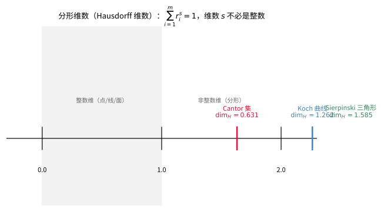

> **直观理解（现实类比）**：维数可以是"分数"，就像一条被揉得极皱的"海岸线"——它比一条直线（1 维）占据更多空间，却又填不满一整块平面（2 维），于是它的"粗糙程度"落在 $1$ 和 $2$ 之间。Koch 曲线就是这样的例子：每放大一次细节变多是原来的 4 倍，而尺度只缩小到 1/3，算出的维数 $1.26$ 恰好刻画了这种"介于线与面之间"的填充程度。

---

#### 课堂问答

**老师**：Koch 曲线维数 $\log4/\log3\approx1.262$。它由 4 个压缩比 $1/3$ 的映射生成，那 4 个映射具体做了什么？

**学生**：$f_1$ 沿底边压 $1/3$ 平移；$f_2$ 压 $1/3$、转 $+60^\circ$ 平移；$f_3$ 压 $1/3$、转 $-60^\circ$ 平移；$f_4$ 压 $1/3$、平移 $2/3$。它们把单位线段依次映到四个子段，取以端点 $(0,0)$、$(1,0)$ 为底的等边三角形内部作 $V$ 即满足 OSC。方程 $4\cdot(1/3)^s=1\Rightarrow s=\log4/\log3$。

**老师（追问）**：Koch 雪花"周长无穷、面积有限"，那为什么维数约是 1.26 而不是 2？

**学生**：周长每步乘以 $4/3$，无穷次后发散；但曲线始终被原三角形外接圆框住，面积收敛到有限值（约原三角形的 $\frac85$ 倍）。曲线"比线更厚"（维数 $>1$）、又"比面更薄"（维数 $<2$），$1.26$ 正刻画这种填充程度。

**老师（拓展）**：上界 $\mathcal{H}^s_{\delta_k}(K)\le4^k3^{-ks}=(4\cdot3^{-s})^k$，$s>\log4/\log3$ 时趋于 0；下界用第 $k$ 级每段长 $3^{-k}$、自然测度每段 $4^{-k}$，套质量分布原理即可。

**学生**：常见坑：Koch 曲线处处连续却处处不可微，不能想当然做弧长参数化；它也不是任何直线段的 Lipschitz 像，因此维数严格大于 1。

## 第六节：Julia 集与 Mandelbrot 集

### 6.1 Julia 集

🌐 **直觉先行**：IFS 是从固定规则"拼"出分形；Julia 集则是从**一次不动地反复迭代**一个复数函数冒出来的分形。对 $f_c(z)=z^2+c$ 反复迭代，把"怎么迭代都不跑远"的起点们挑出来，它们的边界就是 **Julia 集** $J(f_c)$。它是"动力系统"与"分形"交界处的产物：一条简单的规则，却划出极复杂的边界线。

> **🔑 为什么重要**：Julia 集是"复动力系统"的天然分形载体——它同时具备**自相似性、紧性**（$J=f_c(J)=f_c^{-1}(J)$）以及随参数 $c$ 突变（连通↔Cantor 集）的丰富行为。它从"几何"跨进"迭代动力学"，引出了下一节 Mandelbrot 集这面"参数的目录"。理解 Julia 集，就等于同时握住了分形几何与复动力学两扇门。

**定义 9（Julia 集）**：  
设 $f: \mathbb{C} \to \mathbb{C}$ 是复多项式，通常考虑 $f_c(z) = z^2 + c$，其中 $c \in \mathbb{C}$。**填充 Julia 集**定义为

$$
K(f_c) = \{ z \in \mathbb{C} : f_c^{\circ n}(z) \text{ 有界}, \forall n \geq 0 \}
$$

其中 $f_c^{\circ n}$ 表示 $n$ 次迭代。**Julia 集** $J(f_c)$ 是填充 Julia 集的边界：$J(f_c) = \partial K(f_c)$。

> **💡 直观理解（类比）**：对 $z\mapsto z^2+c$ 反复迭代，把"怎么迭代都不跑远"的起点们标出来，它们勾出的这条界线就是 Julia 集——就像一圈被"引力井"（有界轨道）拴住的岸线。常数 $c$ 一调，这条岸线也跟着变：有时连成一片、有时碎成满天尘埃。

**性质**：
1. $J(f_c)$ 是紧集，且 $f_c(J(f_c)) = J(f_c) = f_c^{-1}(J(f_c))$。
2. $J(f_c)$ 要么是连通的（当 $c$ 在 Mandelbrot 集中时），要么是 Cantor 集（当 $c$ 在 Mandelbrot 集外时）。
3. $J(f_c)$ 具有自相似性，是某个 IFS 的吸引子。

#### 课堂问答

**老师**：填充 Julia 集 $K(f_c)=\{z:f_c^{\circ n}(z)\text{ 有界},\ \forall n\ge0\}$，而 Julia 集是它的边界 $J=\partial K$。为什么强调"边界"而不是整个 $K$？

**学生**：因为 $K$ 的内部是"稳定区"（轨道被吸引到周期点），真正体现混沌的是内外轨道的分界线。$J$ 携带全部分形结构，且满足 $f_c(J)=J=f_c^{-1}(J)$——在 $f_c$ 下既不变又全不变。

**老师（追问）**：$J(f_c)$ 的拓扑会随参数 $c$ 怎么变？

**学生**：只有两种：$c$ 在 Mandelbrot 集内时 $J$ 连通（常为树状、局部连通）；$c$ 在集外时 $J$ 是完全不连通的 Cantor 集。这就是参数 $c$ 决定动力系统"稳定/混沌"的分水岭。

**老师（拓展）**：$J$ 是紧集、具自相似性，可看作某 IFS 的吸引子——它把分形几何与复动力系统这两扇门连接了起来。

**学生**：常见误区：把 $J(f_c)$ 与限制在实轴上的迭代混淆。$c=0$ 时 $J$ 是光滑的单位圆；只有如 $c=-2$ 或 $c=i$ 这类参数才给出典型的分形边界。

### 6.2 Mandelbrot 集

> **直观理解（现实类比）**：Mandelbrot 集是"数学的万花筒"——只需一个简单迭代 $z \mapsto z^2 + c$，却能生成永无止境的复杂图案。它的边界是分形，Hausdorff 维数为 2，意味着细节之丰富已填满整个平面；每放大一次，就涌现出新的螺旋、海马、迷你 Mandelbrot 副本，像万花筒里层层嵌套的对称花纹。这种"简单规则产生无限复杂"的现象，正是分形几何最迷人的魅力所在。

🌐 **直觉先行**：Mandelbrot 集不是"画出来"的分形，而是**给所有 Julia 集当"目录/索引"**的参数空间对象：它对每个参数 $c$ 问一句"把起点 $0$ 送进 $f_c$ 反复迭代，会不会被甩飞"？不会甩飞的 $c$ 全收进 $M$ 里。所以 Mandelbrot 集像一个"总图纸"，每个点 $c$ 对应一个 Julia 集，且点 $c$ 在不在 $M$ 里，恰好告诉我们那个 Julia 集连不连通。

> **🔑 为什么重要**：$M$ 把"参数 $c$"与"Julia 集拓扑"配对：$c\in M$ $\iff$ $J(f_c)$ 连通。这一条简单判定（Douady-Hubbard），让表达式极简单的 $z\mapsto z^2+c$ 在参数轴上涌现出边界维数为 $2$ 的无穷复杂分形——它是"简单规则产生无限复杂"的招牌，也直接把分形送进了大众视野与计算机图形学。

**定义 10（Mandelbrot 集）**：  
Mandelbrot 集定义为

$$
M = \{ c \in \mathbb{C} : f_c^{\circ n}(0) \text{ 有界}, \forall n \geq 0 \}
$$

其中 $f_c(z) = z^2 + c$。

> **💡 直观理解（类比）**：把所有"让起点 0 不被甩飞"的常数 $c$ 收集起来，就铺成一张参数空间里的"说明书地图"——地图上的每个点 $c$，都对应着某个 Julia 集；地图点是否在手，恰好告诉我们那个 Julia 集连不连成一片。它是一个"索引所有 Julia 集的目录"。

**性质**：
1. $M$ 是连通紧集。
2. $c \in M$ 当且仅当 Julia 集 $J(f_c)$ 是连通的。
3. $M$ 的边界 $\partial M$ 是分形，其 Hausdorff 维数为 $2$。

---

#### 课堂问答

**老师**：$M=\{c\in\mathbb{C}:f_c^{\circ n}(0)\text{ 有界},\ \forall n\ge0\}$，判据只看起点 $0$。为什么单看 $0$ 就能决定整个 Julia 集的连通性？

**学生**：因为 $0$ 是 $f_c(z)=z^2+c$ 的临界点。由 Douady-Hubbard 定理：$c\in M\iff$ 临界轨道有界 $\iff J(f_c)$ 连通。临界轨道是决定分支结构的"总开关"，所以只需盯住 $0$ 一个点。

**老师（追问）**：$\partial M$ 的维数是多少？它为什么这么特殊？

**学生**：$\partial M$ 是分形，其 Hausdorff 维数恰为 2——虽然 $M$ 本身面积完全被边界"挤满"，细节丰富到填满整个平面，达到所在空间的最大维数。不过要小心：维数为 2 的分形照样可能是零面积的（维数 2 不蕴含正面积）。

**老师（拓展）**：$M$ 是连通的紧集，模 $\le2$ 即有界。它是"所有 Julia 集的参数目录"：每个 $c$ 对应一个 Julia 集，$c$ 在不在 $M$ 里就告诉你那个 Julia 集连不连通。

**学生**：最易混的一点：Mandelbrot 集与某个 Julia 集不是一回事——$M$ 住在参数 $c$ 平面，Julia 集住在 $z$ 平面，$M$ 中每一点对应一张 Julia 集图案。

## 第七节：L-系统与分形插值

### 7.1 L-系统

🌐 **直觉先行**：IFS 用"缩小镜"造分形，而 L-系统换了一条"文字替换"的路：把每条规则当作"字母→更长的字符串"的改写咒语，所有符号同步替换、一轮轮展开，最后把这串密码翻译成画笔的前进/转弯，就画出植物的藤蔓、雪花的轮廓。它把"自相似"落实成"字符串的自我复制"。

**为什么需要这个概念**：生物学建模（植物分枝、树叶脉络）天然是"每根枝条按同一规则再长"的过程，L-系统正是把这种语法规整成计算机可直接渲染的形式语言。它与 IFS 互补：IFS 是几何的，L-系统是**语法/生成式**的，是分形进入计算机图形学最自然的一扇门。

L-系统（Lindenmayer 系统）是一种基于字符串重写的并行文法，用于生成分形结构。

**定义 11（L-系统）**：  
一个 L-系统是一个三元组 $(V, \omega, P)$，其中：
- $V$ 是字母表（符号集）
- $\omega \in V^+$ 是公理（初始字符串）
- $P \subset V \times V^*$ 是产生式规则集

每个符号 $a \in V$ 对应一个产生式 $a \to \chi(a)$，其中 $\chi(a) \in V^*$。L-系统通过并行替换所有符号来生成字符串。

> **💡 直观理解（类比）**：像一套"文字替换魔咒"——给每个字母规定好要改写成的长串，然后所有字符同步替换、一轮轮展开，最后把这串密码翻译成画笔走向（前进/转弯），就画出藤蔓、雪花这类分形。"让字符串自己生长"，正是它的引擎。

**示例**：Koch 曲线的 L-系统：
- 公理：$\omega = F$
- 规则：$F \to F + F - - F + F$
- 解释：$F$ = 向前画线，$+$ = 左转 $60^\circ$，$-$ = 右转 $60^\circ$

#### 课堂问答

**老师**：L-系统是一个三元组 $(V,\omega,P)$。它和 IFS 最本质的区别是什么？

**学生**：IFS 是几何的（直接给压缩映射），L-系统是**语法/生成式**的——先靠并行重写规则把字符串一轮轮替换，再把它翻译成画笔指令。所谓"并行"指每个符号同时被替换，这正是它区别于 Chomsky 文法（一次只替换一个符号）的关键。

**老师（追问）**：那 Koch 曲线的 L-系统 $\omega=F$、$F\to F+F--F+F$ 里，几个符号怎么读？

**学生**：$F$ 表示向前画一段，$+$ 左转 $60^\circ$，$-$ 右转 $60^\circ$。初始 $F$ 是一条线段；第一次展开成 $F+F--F+F$（4 段折线）；每次迭代每条 $F$ 又按同一规则展开，段数乘 4、每段长除 3，正好复现 Koch 构造。

**老师（拓展）**：分形维数也能从 L-系统直接读出：一次迭代把一段变成 $n$ 段、每段缩为 $\frac{1}{m}$，则由 IFS 维数定理相似维数满足 $n(1/m)^s=1$。Koch 是 $n=4,\ m=3$，得 $\log4/\log3$。

**学生**：常见误区：把转角写成弧度、或漏掉 $60^\circ$。另外规则里的分支符号（如 `[`、`]`）用于植物建模的栈式分枝，Koch 这类不自交曲线用不到。

### 7.2 分形插值

🌐 **直觉先行**：普通插值（用一条平滑曲线穿过给定点）过于"规矩"，画不出山的皱纹。分形插值是给数据点之间的缝隙"反复填细毛刺"——既保证曲线精确穿过给定点，又让两格之间无限曲折，得到一条起伏如真实地形的曲线。它把 IFS 从"画分形"用到了"拟合数据"。

**为什么需要这个概念**：图像与地形的真实感在于"多尺度的粗糙细节"。分形插值用一个参数 $d_i$（垂直压缩因子）掌控细节的剂量、进而控制分形维数，是分形图像编码与地形生成的现实工具。

**定义 12（分形插值函数）**：  
给定数据点 $\{(x_i, y_i)\}_{i=0}^n$，其中 $x_0 < x_1 < \cdots < x_n$。分形插值函数 $f: [x_0, x_n] \to \mathbb{R}$ 是通过 IFS 构造的满足 $f(x_i) = y_i$ 的连续函数。

构造方法：定义 IFS $\{f_1, \dots, f_n\}$，其中

$$
f_i\begin{pmatrix} x \\ y \end{pmatrix} = \begin{pmatrix} a_i & 0 \\ c_i & d_i \end{pmatrix} \begin{pmatrix} x \\ y \end{pmatrix} + \begin{pmatrix} e_i \\ h_i \end{pmatrix}
$$

参数 $a_i, c_i, e_i, h_i$ 由插值条件确定，$d_i$ 是自由参数（垂直压缩因子），控制分形维数。

> **💡 直观理解（类比）**：给定一些"必经打卡点"，再用整套缩小镜每轮在相邻点之间"填细毛刺"、层层加密，让曲线既穿过这些点、又在任意两格之间无限曲折——像用递归把一条平滑弧线一点点磨成布满棱脊的山脊线。

---

#### 课堂问答

**老师**：分形插值构造 IFS 时，矩阵 $\begin{pmatrix}a_i&0\\c_i&d_i\end{pmatrix}$ 里 $d_i$ 是自由参数、$a_i$ 却由插值条件定死。为什么？

**学生**：$a_i$ 只控制水平压缩，被"每个映射把 $[x_0,x_n]$ 映到 $[x_{i-1},x_i]$"这一几何要求唯一确定：$a_i=\frac{x_i-x_{i-1}}{x_n-x_0}$。而 $d_i$ 是竖直方向的压缩因子（$|d_i|<1$），它不影响曲线是否穿过数据点，只决定曲线的"粗糙度"与分形维数，故留作自由参数。

**老师（追问）**：$d_i$ 具体怎么控制分形维数？

**学生**：$|d_i|$ 越大，相邻尺度间的起伏越多，维数越高。当所有 $d_i=0$ 时退化为普通分段线性插值（维数 1）；$|d_i|$ 接近 1 时曲线越来越褶、维数趋向 2。对满足 OSC 的情形，维数由方程 $\sum_i|d_i|\,a_i^{s-1}=1$ 决定。

**老师（拓展）**：这正是把 IFS 从"画分形"用到"拟合数据"之处：给定数据点，构造 IFS 使其吸引子的图恰是过这些点的插值函数，故称"分形插值函数"。

**学生**：常见误区：以为分形插值曲线一定比多项式插值更光滑。事实上它处处不可微（除非 $d_i=0$），目的正是模拟山脊、云层这类多尺度粗糙。

## 第八节：多分形与随机分形

### 8.1 多分形

🌐 **直觉先行**：前面所有分形都用"一把尺子（一个维数）量到底"。可真实的湍流、股市波动、地质纹理常"各处粗细不一"——一会儿密、一会儿疏。**多分形**就是放弃单一维数，改用一个"谱" $f(\alpha)$，按"局部 Hölder 指数"把不同区域分别记账，把"处处有差异"的分形系统地写全。

> **🔑 为什么重要**：单一维数描述一个对象时信息有限；多分形谱 $f(\alpha)$ 刻画的是"局部分形维数的分布"，好比从"平均高度"升级到"整张高程分布图"。它把分形理论从小清新的自相似对象，推广到能量耗散、图像纹理等"非均匀标度"的真实世界——是分形走向应用最深的一步。

**定义 13（多分形）**：  
多分形（multifractal）是一类分形，其不同区域具有不同的局部标度指数，即分形维数不是一个单一值，而是由**奇异谱** $f(\alpha)$ 描述，其中 $\alpha$ 是局部 Hölder 指数。

**多分形谱**：设 $\mu$ 是支撑在分形上的测度，定义

$$
f(\alpha) = \dim_H \{ x : \text{局部 Hölder 指数为 } \alpha \}
$$

其中 $\alpha(x) = \lim_{r \to 0} \frac{\log \mu(B(x, r))}{\log r}$。

> **💡 直观理解（类比）**：普通分形像"一把尺子（一个维数）量到底"，多分形则似"各处粗细不同的织锦"——不同区域顶着不同的局部指数 $\alpha$，像地质图上一块块疏松度各异的土壤，用一整条谱 $f(\alpha)$ 逐档登记这些局部维数：处处有差异、合起来才完整。

#### 课堂问答

**老师**：多分形用谱 $f(\alpha)$ 取代单一维数。这里的 $\alpha$ 到底是什么？

**学生**：$\alpha$ 是局部 Hölder 指数，$\alpha(x)=\lim_{r\to0}\frac{\log\mu(B(x,r))}{\log r}$，刻画测度 $\mu$ 在点 $x$ 附近的局部标度；而 $f(\alpha)=\dim_H\{x:\text{局部 Hölder 指数为 }\alpha\}$，即"具有该局部指数的那层点集"的 Hausdorff 维数。

**老师（追问）**：那普通"单一维数"在多分形语言里是什么？

**学生**：是 $f(\alpha)$ 上的一个点——当所有点的局部指数都相同（均匀标度）时，$f(\alpha)$ 退化成单个尖峰，峰高就是那个维数。多分形正是把"一个数"升级为"一整条谱"，用来描述湍流、股市、图像纹理这类"处处粗细不一"的对象。

**老师（拓展）**：$f(\alpha)$ 通常是上凸函数；它的最大值 $\max_\alpha f(\alpha)$ 等于支撑集的 Hausdorff 维数，$\alpha$ 的取值范围则由测度最稀疏到最密集的区域给出。

**学生**：常见误区：把 $f(\alpha)$ 的值直接当成"整体维数"。$f(\alpha)$ 是"局部维数的分布"——横轴是局部奇异强度 $\alpha$，纵轴才是对应点集的维数，单看某个 $f(\alpha)$ 并不等于整体维数。

### 8.2 随机分形

🌐 **直觉先行**：自然界的分形（树冠、地形、布朗路径）从不完美自相似——大小、角度都带随机扰动。随机分形就是把"掷硬币"塞进构造规则：每一步抛硬币决定删哪块、往哪走，结果仍长出"整体自相似、细节却随机"的图案。它是自相似思想的"随机版"。

> **🔑 为什么重要**：真实分形几乎从不是确定性的，随机分形用概率语言（常在某概率 $1$ 下算维数，如布朗运动轨道）让分形模型贴近现实。它把 IFS 与概率论结合，是连接分形与随机过程（渗流、布朗运动）的桥梁。

**定义 14（随机分形）**：  
随机分形是通过随机过程生成的分形，其构造中包含随机性。典型例子包括：
- 随机 Cantor 集：每次移除区间的中间部分时，以概率 $p$ 保留左子区间，以概率 $q$ 保留右子区间
- 布朗运动：其轨道的 Hausdorff 维数以概率 $1$ 为 $2$
- 渗流（percolation）簇

> **💡 直观理解（类比）**：把"掷硬币"的随机性塞进构造规则——每一步抛硬币来决定删哪个子块、往哪个方向走，结果仍长出"整体自相似、细节却随机"的图案：像每片树叶脉络各不相同又神似同一株树。布朗运动的轨迹就是这样的随机分形，处处随机却几乎总占着 2 维。

---

#### 课堂问答

**老师**：随机 Cantor 集每次以概率 $p$ 保留子区间。什么时候它还是个"非简并"的分形？

**学生**：要让每节点的期望分支数不小于 1。每节点期望保留 $2p$ 个子区间：若 $2p<1$（即 $p<1/2$），层数增加后区间数期望趋于 0，几乎必然很快"灭种"，只剩空集或少数点，维数趋于 0；$p>1/2$ 才有正维数的非简并随机分形。临界 $p=1/2$ 是相变点。

**老师（追问）**：那布朗运动轨道为什么维数是 2，明明它是一条曲线？

**学生**：因为布朗运动处处不可微、无限剧烈振荡，轨道以概率 1 填满一个二维区域的正测度部分——它"太粗糙"，维数取满平面维数 2。这与 Koch（1.26）、海岸线（约 1.25）不同，是"所在空间里最粗糙"的一种。

**老师（拓展）**：一般规律：随机分形的维数可在概率 1 意义下计算，它是 IFS 与概率论结合的产物；渗流簇、随机 Cantor 集、布朗运动都是典型样本。

**学生**：常见误区：以为"随机"就破坏了自相似。其实随机分形是**统计自相似**——每个样本各不相同，但尺度—测度关系的期望（或几乎必然）行为仍呈幂律自相似。

## 5. 习题

### 基础题

**习题 1**（分形的定义与自相似）给出"分形"的定义，解释"自相似性"的含义，并说明经典 Cantor 集为何是分形。

**习题 2**（Hausdorff 外测度）写出 $s$ 维 Hausdorff 外测度 $\mathcal{H}^s(F)$ 的定义，说明 $\delta$-覆盖与集合直径 $|U_i|$ 的含义。

**习题 3**（Hausdorff 维数）给出 Hausdorff 维数 $\dim_H F$ 的定义，并说明 $\mathcal{H}^s(F)$ 在 $s = \dim_H F$ 处的三种可能取值。

**习题 4**（Cantor 集的自相似）写出经典 Cantor 集 $C$ 的自相似方程，指出它所对应的两个压缩映射。

**习题 5**（盒维数）给出下盒维数与上盒维数的定义，说明它们何时相等并给出共同的盒维数。

**习题 6**（IFS 与吸引子）定义迭代函数系统（IFS）与吸引子，叙述 Hutchinson 定理。

**习题 7**（IFS 维数定理）叙述 IFS 吸引子的维数定理及开集条件（OSC），说明该条件的作用。

**习题 8**（Sierpinski 三角形维数）利用 IFS 维数定理计算 Sierpinski 三角形的 Hausdorff 维数。

**习题 9**（Julia 集与 Mandelbrot 集）给出填充 Julia 集、Julia 集与 Mandelbrot 集的定义。

**习题 10**（L-系统）给出 L-系统的定义（字母表、公理、产生式规则），并写出 Koch 曲线对应的 L-系统。

### 进阶题

**习题 11**（Cantor 尘维数）计算 Cantor 尘 $C \times C \subset \mathbb{R}^2$ 的 Hausdorff 维数，其中 $C$ 是经典 Cantor 集。

**习题 12**（笛卡尔积维数）证明 $\dim_H(E \times F) = \dim_H E + \dim_H F$ 对一般 Borel 集 $E, F$ 成立。

**习题 13**（Sierpinski 地毯）证明 Sierpinski 地毯的 Hausdorff 维数为 $\log 8 / \log 3$。

**习题 14**（Koch 曲线与 IFS）构造以 Koch 曲线为吸引子的 IFS，写出四个相似压缩映射 $f_1, f_2, f_3, f_4$ 的具体表达式。

**习题 15**（Lipschitz 不变性）证明：若 $f: \mathbb{R}^n \to \mathbb{R}^m$ 是 Lipschitz 映射，则 $\dim_H f(F) \leq \dim_H F$，并给出一个严格不等式成立的例子。

**习题 16**（Hausdorff 与盒维数）证明对有界集 $F$ 有 $\dim_H F \leq \underline{\dim}_B F \leq \overline{\dim}_B F$。

**习题 17**（可数稳定性）证明 Hausdorff 维数的可数稳定性：$\dim_H(\bigcup_{i=1}^{\infty} F_i) = \sup_i \dim_H F_i$。

**习题 18**（质量分布原理）叙述并证明质量分布原理，并说明它在 Cantor 集维数下界估计中的作用。

**习题 19**（L-系统维数）计算下列 L-系统生成分形的 Hausdorff 维数：公理 $\omega = F$，规则 $F \to F - F + F + F F - F - F + F$，转角为 $90^\circ$。

### 挑战题

**习题 20**（Cantor 集维数的完整证明）利用质量分布原理与自相似覆盖，完整证明 $\dim_H C = \log 2 / \log 3$。

**习题 21**（Sierpinski 三角形维数证明）给出 Sierpinski 三角形维数的上界证明，并用质量分布原理建立相应的下界。

**习题 22**（IFS 维数定理证明）对由相似压缩映射构成且满足开集条件的 IFS，证明 $\sum_{i=1}^m r_i^s = 1$ 的唯一解 $s$ 就是吸引子的 Hausdorff 维数。

**习题 23**（Mandelbrot 集的连通性）基于 Douady-Hubbard 定理，论证 Mandelbrot 集 $M$ 是连通的。

**习题 24**（Julia 集的连通判别）解释"$c \in M$ 当且仅当 $J(f_c)$ 连通"这一事实，并据此说明 $J(f_c)$ 的自相似（或 Cantor 集）性质。

**习题 25**（随机 Cantor 的期望维数）构造随机 Cantor 集，以左右子区间保留概率 $p$ 计算其期望 Hausdorff 维数，并讨论 $p$ 的临界取值。

**习题 26**（盒维数的非 Lipschitz 不变性）举出例子说明盒维数并不像 Hausdorff 维数那样具备 Lipschitz 不变性，并解释两者差异的根源。

### 探究题

**习题 27**（分形维数与拓扑维数）探讨 $\dim_H F$ 与拓扑维数 $\dim_T F$ 的关系，以及 Mandelbrot 原始分形定义的适用边界。

**习题 28**（多分形与奇异谱）探讨多分形奇异谱 $f(\alpha)$ 的数学意义，以及在湍流、图像等多标度现象中的应用。

**习题 29**（随机分形与布朗运动）探讨布朗运动轨道以概率 1 具有 Hausdorff 维数 2 的直观与证明思路，并联系随机分形。

**习题 30**（分形几何的应用）开放讨论分形理论在图像压缩（如分形图像压缩）、分形天线、湍流与海岸线测量等领域的应用。

---

## 6. 习题答案与解析

### 基础题答案

1. **分形的定义与自相似** 分形（Fractal）是满足 $\dim_H F > \dim_T F$ 的集合（Mandelbrot 原始定义）。自相似性指集合 $F$ 可写成一组压缩映射的并：$F = \bigcup_{i=1}^m f_i(F)$，整体与放大的局部形状"同类"。Cantor 集 $C = \frac{1}{3}C \cup (\frac{2}{3}+\frac{1}{3}C)$ 自相似，且 $\dim_H C = \log 2/\log 3 \approx 0.63$，其拓扑维数为 $0$，故为分形。

2. **Hausdorff 外测度** $\mathcal{H}^s_\delta(F) = \inf\{ \sum_i |U_i|^s : \{U_i\} \text{ 是 } F \text{ 的 } \delta\text{-覆盖} \}$，其中 $|U_i|\leq \delta$。$s$ 维 Hausdorff 外测度 $\mathcal{H}^s(F) = \lim_{\delta \to 0} \mathcal{H}^s_\delta(F)$。$|U_i| = \sup\{|x-y| : x,y \in U_i\}$ 表示集合直径。

3. **Hausdorff 维数** $\dim_H F = \inf\{ s : \mathcal{H}^s(F)=0 \} = \sup\{ s : \mathcal{H}^s(F)=\infty \}$。存在唯一临界值 $s = \dim_H F$：$s$ 以下 $\mathcal{H}^s = \infty$、以上 $\mathcal{H}^s = 0$；在临界点可正可零可无穷。

4. **Cantor 集自相似** $C = \frac{1}{3}C \cup (\frac{2}{3}+\frac{1}{3}C)$，即 $C = f_1(C) \cup f_2(C)$，其中 $f_1(x) = x/3$，$f_2(x) = 2/3 + x/3$，两个压缩映射压缩比均为 $1/3$。

5. **盒维数** $N_\delta(F)$ 为覆盖 $F$ 所需直径为 $\delta$ 的集合最小个数。下盒维数 $\underline{\dim}_B F = \liminf_{\delta \to 0} \log N_\delta(F)/(-\log \delta)$，上盒维数 $\overline{\dim}_B F = \limsup_{\delta\to 0} \log N_\delta(F)/(-\log \delta)$。两者相等时共同的值为盒维数 $\dim_B F$。

6. **IFS 与吸引子** IFS 是有限压缩映射集 $\{f_1,\dots,f_m\}$，压缩比为 $r_i$。定义 $F(K) = \bigcup_i f_i(K)$。Hutchinson 定理：$F$ 是 $\mathcal{K}(\mathbb{R}^n)$（带 Hausdorff 距离）上的压缩映射（压缩比 $r = \max r_i$），故有唯一不动点 $A$ 满足 $A = \bigcup_i f_i(A)$，称为吸引子，且迭代 $K_{k+1}=F(K_k)$ 收敛到 $A$。

7. **IFS 维数定理** 若每个 $f_i$ 为相似压缩（比 $r_i$）且满足开集条件：存在非空有界开集 $V$ 使 $\bigcup_i f_i(V) \subset V$ 且 $f_i(V) \cap f_j(V) = \varnothing$（$i \neq j$）。则吸引子 $A$ 的 Hausdorff 维数为 $\sum_i r_i^s = 1$ 的唯一解 $s$。OSC 保证各 $f_i(A)$ 不"过度重叠"，使维数可由压缩比精确计算。

8. **Sierpinski 三角形维数** 由三个 $r=1/2$ 的相似映射生成。由 IFS 维数定理 $3(1/2)^s = 1$，解得 $s = \log 3 / \log 2 \approx 1.585$，即 $\dim_H S = \log 3 / \log 2$。

9. **Julia 集与 Mandelbrot 集** 填充 Julia 集 $K(f_c) = \{z : f_c^{\circ n}(z) \text{ 有界}, \forall n \geq 0\}$，Julia 集 $J(f_c) = \partial K(f_c)$。Mandelbrot 集 $M = \{c \in \mathbb{C} : f_c^{\circ n}(0) \text{ 有界}\}$，其中 $f_c(z) = z^2 + c$。

10. **L-系统** L-系统是三元组 $(V, \omega, P)$：$V$ 是字母表，$\omega \in V^+$ 是公理，$P$ 是并行替换的产生式规则。Koch 曲线：$\omega = F$，规则 $F \to F + F - - F + F$，解释为 $F$ 前进画线、$+$ 左转 $60^\circ$、$-$ 右转 $60^\circ$。

### 进阶题答案

1. **Cantor 尘维数** 因 $\dim_H(E \times F) = \dim_H E + \dim_H F$（对一般 Borel 集），故 $\dim_H(C \times C) = 2 \dim_H C = 2 \log 2 / \log 3 \approx 1.26$。

2. **笛卡尔积维数** 由乘积型估计：若 $e > \dim_H E$、$f > \dim_H F$，可构造 $E \times F$ 的覆盖使 $\mathcal{H}^{e+f}(E\times F)=0$，从而 $\dim_H(E\times F) \leq \dim_H E + \dim_H F$；再用质量分布原理（找到支撑在 $E\times F$ 上满足 $\mu(B)\leq c r^{e+f}$ 的测度）得反向不等式，故等式成立。

3. **Sierpinski 地毯** 单位正方形 $9$ 等分后保留 $8$ 个边长为 $1/3$ 的小正方形，对应 $8$ 个压缩比 $1/3$ 的相似映射。由 IFS 维数定理 $8(1/3)^s = 1$，解得 $s = \log 8 / \log 3 \approx 1.893$，即 $\dim_H = \log 8 / \log 3$。

4. **Koch 曲线与 IFS** 取 $f_1(z) = \frac{1}{3}z$；$f_2(z) = \frac{1}{3}e^{i\pi/3}z + \frac{1}{3}$；$f_3(z) = \frac{1}{3}e^{-i\pi/3}z + (\frac{1}{2}+\frac{i\sqrt{3}}{6})$；$f_4(z) = \frac{1}{3}z + \frac{2}{3}$。它们把单位线段依次映射到四个子段，满足单位等边三角形内部的开集条件，故吸引子即 Koch 曲线，其维数满足 $4(1/3)^s = 1$。

5. **Lipschitz 不变性** 若 $\{U_i\}$ 是 $F$ 的 $\delta$-覆盖，则 $\{f(F\cap U_i)\}$ 是 $f(F)$ 的 $c\delta$-覆盖，且 $|f(F\cap U_i)| \leq c|U_i|$，故 $\mathcal{H}^s_{c\delta}(f(F)) \leq c^s \mathcal{H}^s_\delta(F)$，令 $\delta \to 0$ 得 $\mathcal{H}^s(f(F)) \leq c^s \mathcal{H}^s(F)$。若 $s > \dim_H F$ 则 $\mathcal{H}^s(F)=0$，故 $\dim_H f(F)\leq s$，从而 $\dim_H f(F) \leq \dim_H F$。严格不等式例子：对 Cantor 集的某个一维投影，其维数可小于原集维数。

6. **Hausdorff 与盒维数** 若 $s>0$，则存在由 $N_\delta(F)$ 个直径为 $\delta$ 的集合构成的覆盖，故 $\mathcal{H}^s_\delta(F) \leq N_\delta(F)\delta^s$。设 $s < \dim_H F$ 则 $\mathcal{H}^s(F)=\infty$，故对充分小 $\delta$ 有 $N_\delta(F)\delta^s > 1$，取对数除以 $-\log \delta$ 并取上/下极限，得 $\underline{\dim}_B F \geq \dim_H F$；而显然 $\underline{\dim}_B F \leq \overline{\dim}_B F$。

7. **可数稳定性** 由单调性 $\dim_H F_i \leq \dim_H(\bigcup_i F_i)$，故 $\sup_i \dim_H F_i \leq \dim_H(\bigcup_i F_i)$。反之，设 $s > \sup_i \dim_H F_i$，则每个 $\mathcal{H}^s(F_i)=0$，由可数次可加性 $\mathcal{H}^s(\bigcup_i F_i) \leq \sum_i \mathcal{H}^s(F_i) = 0$，所以 $\dim_H(\bigcup_i F_i) \leq s$，令 $s$ 逼近上确界得反向不等式。合起来等式成立。

8. **质量分布原理** 若存在支撑在 $F$ 上的概率测度 $\mu$ 及常数 $c>0$，使 $\mu(B(x,r)) \leq c r^s$ 对所有 $x\in F$、$r>0$ 成立，则 $\mathcal{H}^s(F) \geq 1/c > 0$，从而 $\dim_H F \geq s$。证明：对 $F$ 的任意覆盖 $\{U_i\}$，选 $r_i = |U_i|$ 及 $x_i \in F\cap U_i$，则 $1 = \mu(F) \leq \sum_i \mu(U_i) \leq \sum_i c|U_i|^s$，故 $\sum_i |U_i|^s \geq 1/c$，取下确界即得。它给出了 Cantor 集维数的下界，因为其上存在该类测度。

9. **L-系统维数** 该规则对应 4 个压缩比为 $\frac{1}{\sqrt{2}}$ 的相似映射（一次迭代把单位线段换为折线，每段为原长的 $\sqrt{2}/2$）。由 IFS 维数定理 $4(1/\sqrt{2})^s = 1$，解得 $2s = 2$，即 $s=2$；此即"龙曲线"（dragon curve），其 Hausdorff 维数为 $2$。

### 挑战题答案

1. **Cantor 集维数证明** 上界：第 $k$ 步有 $2^k$ 个长度 $3^{-k}$ 的区间，构成 $\delta_k = 3^{-k}$ 覆盖，$\mathcal{H}^s_{\delta_k}(C) \leq 2^k(3^{-k})^s = (2\cdot 3^{-s})^k$；当 $s > \log 2/\log 3$ 时 $2\cdot 3^{-s}<1$，令 $k\to\infty$ 得 $\mathcal{H}^s(C)=0$，故 $\dim_H C \leq \log 2/\log 3$。下界：取均匀测度 $\mu$（每第 $k$ 级区间测度 $2^{-k}$），对 $r$ 选 $k$ 使 $3^{-(k+1)}\leq r < 3^{-k}$，球 $B(x,r)$ 至多交两个第 $k$ 级区间，故 $\mu(B(x,r))\leq 2\cdot 2^{-k}=2\cdot 3^{-ks}\leq 2\cdot 3^s r^s$（用 $2=3^s$）。由质量分布原理 $\dim_H C \geq s$。综合得 $\dim_H C = \log 2/\log 3$。

2. **Sierpinski 三角形维数** 上界：第 $k$ 步由 $3^k$ 个边长 $2^{-k}$ 的小三角形组成，$\mathcal{H}^s_{\delta_k}(S) \leq 3^k(2^{-k})^s = (3\cdot 2^{-s})^k$；当 $s>\log 3/\log 2$ 时趋于 $0$，故 $\dim_H S \leq \log 3/\log 2$。下界：定义均匀测度（每第 $k$ 级三角形测度 $3^{-k}$），仿 Cantor 集方法对任意 $r$ 选合适 $k$ 得 $\mu(B(x,r))\leq c r^s$ 且 $c\to\infty$ 有界，由质量分布原理 $\dim_H S \geq \log 3/\log 2$。

3. **IFS 维数定理证明** 上界：由开集条件与相似性，$\bigcup_i f_i(A)$ 的 $\mathcal{H}^s$ 满足次可加 $\mathcal{H}^s(A) \leq \sum_i r_i^s \mathcal{H}^s(A)$；若 $s$ 满足 $\sum_i r_i^s < 1$，则 $\mathcal{H}^s(A)=0$，故 $\dim_H A \leq s_0$（$s_0$ 为 $\sum_i r_i^s = 1$ 的解）。下界：利用 OSC 构造一致密度的测度，使质量分布原理成立而 $\mathcal{H}^{s_0}(A)>0$，从而 $\dim_H A \geq s_0$。合起来 $\dim_H A = s_0$。

4. **Mandelbrot 集连通性** 由 Douady-Hubbard 定理，$M$ 的补集在黎曼球 $\hat{\mathbb{C}}$ 上单连通，因而 $M$ 本身连通且补集无界单连通，存在一致的 Böttcher 坐标/扩展。模上界 $|c|\leq 2$ 说明 $M$ 有界紧致，且不能分裂成若干不相交非空分支，故 $M$ 为连通紧集。

5. **Julia 集连通判别** 对 $f_c(z)=z^2+c$，$c\in M$ 当且仅当拒不点 $0$ 的轨道有界，这等价于 Julia 集 $J(f_c)$ 连通：当 $c\in M$ 时临界轨道有界，$J(f_c)$ 连通（自相似、常为局部连通的树状结构）；当 $c\notin M$ 时临界点轨道逃逸，$J(f_c)$ 是完全不连通的 Cantor 集。这解释了 $c$ 变化时 $J(f_c)$ 拓扑与分形结构的突变。

  
6. **随机 Cantor 的期望维数** 每个节点以概率 $p$ 同时保留左右两个长 $1/3$ 的子区间，否则两者都放弃（等价于随机 IFS 的分支数为 $2p$）。期望意义下由 $E[\log N]/\log 3$ 得 $E[\dim_H] = \log(2p)/\log 3$，须 $p>1/2$ 否则保留分支期望不小于 $1$ 才能是非简并分形；$p=1/2$ 为临界（相变）点，此时维数趋于 $0$。

7. **盒维数的非 Lipschitz 不变性** 例如取 $F=[0,1]$，把其投影映到可数稠密集：虽为 Lipschitz，像集的盒维数可比原集大得多（可数稠密集的盒维数可为 $1$，而其 Hausdorff 维数为 $0$）。差异根源在于盒维数只按覆盖数目 $N_\delta(F)$ 计数、对"针尖式"稠密例外不敏感，而 Hausdorff 维数由加权的 $\mathcal{H}^s$ 极限定义、对可数稠密点鲁棒，故严格不等式可成立。

### 探究题答案

1. **分形维数与拓扑维数** $\dim_T F$ 是离散、与度量无关的局部亏格不变量（如点集 $\dim_T=0$、区域 $\dim_T=n$），而 $\dim_H F$ 是度量敏感的衡量。Mandelbrot 定义 $\dim_H > \dim_T$ 强调"分数维"，但存在 $\dim_H=\dim_T$ 的分形（无团点迭代集），故定义更实用地以自相似、复杂局部结构与非整数维为标志；边界情形提示单一维数并不能唯一识别分形，需结合度量、局部结构与可数稳定性等特征综合判断。

2. **多分形与奇异谱** 多分形把单一维数推广为奇异谱 $f(\alpha)$，其中 $\alpha(x)=\lim_{r\to 0}\log\mu(B(x,r))/\log r$ 是局部 Hölder 指数，$f(\alpha)$ 是这些点集的 Hausdorff 维数。$f(\alpha)$ 一般为上凸函数，刻画测度在不同尺度上的分布"谱"，用于湍流能量耗散、股票收益率波动、图像纹理等多标度现象，是单一分形维数的自然推广。

3. **随机分形与布朗运动** 布朗运动 $B_t$ 处处不光滑，其轨道（作为 $[0,1]$ 到 $\mathbb{R}^2$ 的像）以概率 1 具有 Hausdorff 维数 2。直观上轨道"布满平面"又保留无限细节。证明用 Lévy 模连续性得到上界，用分部布朗运动的不等式与质量分布原理得到下界，最终在几乎处处意义下等于 2。随机分形的维数可在概率 1 意义下计算，是随机几何与分形几何的交汇。

4. **分形几何的应用** 分形图像压缩利用 IFS 吸引子逼近自然图像，编码紧凑；分形天线以自相似结构在窄体积内获得宽带与高增益；Koch 型海岸线测量解释了"测量尺度依赖"的长度悖论；湍流耗散的多分形谱用于能量级联建模；L-系统模拟植物形态与分形插值用于地形、血管等。答案为引导性开放讨论。

---

## 7. 数学科普（Popular Mathematics）

### 7.1 分形的定义

拿一枝花椰菜掰下一小块，它的形状竟和整棵几乎一样；这种"局部放大后与整体相似"的性质就是分形。分形通常由简单规则不断重复生成，细节在任何尺度上都不消失。

**一句话点破**：分形的本质是尺度下的自相似——用简单规则的无限重复，造出处处都有细节的复杂图形。

### 7.2 经典分形示例

雪花边缘、蕨叶、闪电都是自然里的分形；数学里则有三个"标准样本"——Cantor 集、Sierpinski 三角形与 Koch 曲线，它们都由一条简单规则反复施加而成。

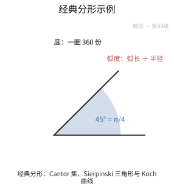

**一句话点破**：认识分形最快的方式，是抓住那三条"反复删掉中间、留下边角"的生成规则。

### 7.3 Hausdorff 测度

量一根线用长度、量一块布用面积，前提是尺子正好铺满物体。Hausdorff 测度把这套想法一般化：用直径不超过某个小值的球去覆盖集合，观察覆盖成本随球变小时如何变化。

**一句话点破**：Hausdorff 测度本质是"用任意小的球去覆盖并累加体积"，它让测量不再依赖预先设定的整数维数。

### 7.4 Hausdorff 维数

当维数 $s$ 由小变大时，$s$ 维 Hausdorff 测度会从无穷突然跌到零，那个跳变的分界点就是 Hausdorff 维数，它甚至可以是像 $1.26$ 这样的小数。

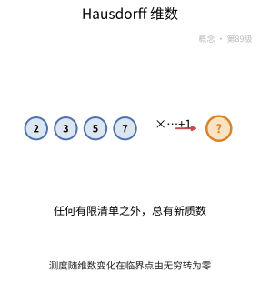

**一句话点破**：Hausdorff 维数就是让 $s$ 维测度既不爆炸也不消失的那个临界指数。

### 7.5 Hausdorff 维数的基本性质

平移、旋转、放大图形，维数都不变；把两段曲线拼起来，维数取较大的那一个。这些"不会变"的性质正是维数好用的原因。

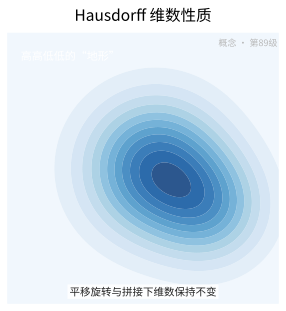

**一句话点破**：Hausdorff 维数是几何不变量——单调、可数稳定，且对刚性变换不变。

### 7.6 盒维数的定义

把图形放进方格纸，数一数需要多少个边长 $\varepsilon$ 的小方格才能盖住它；方格越小、所需格子越多，这个增长的速率就定义了盒维数，它比 Hausdorff 维数更好算。

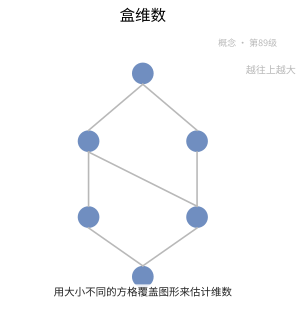

**一句话点破**：盒维数用覆盖所需格子数量随格子缩小而增长的速率来刻画粗糙程度。

### 7.7 分形维数的等价性定理

盒维数好算、Hausdorff 维数更严格，好在这两者在"足够规整"的分形上完全一致，于是可以用方便的盒维数去代替难算的 Hausdorff 维数。

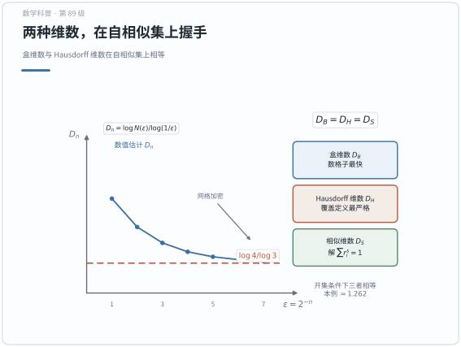

**一句话点破**：对满足开集条件的分形，盒维数、相似维数与 Hausdorff 维数三者相等。

### 7.8 压缩映射与 Hausdorff 距离

把一张照片缩小复印，任意两点的距离都会按同一比例被压短，这叫压缩映射；Hausdorff 距离则衡量两个图形互相离得有多远，是分形空间的度量。

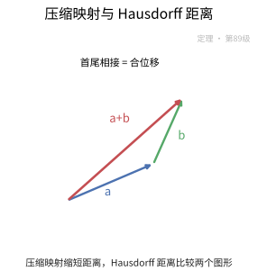

**一句话点破**：压缩映射把点拉近，Hausdorff 距离把图形之间的距离变成可计算的数，为分形迭代收敛铺路。

### 7.9 IFS 吸引子的存在唯一性

一族压缩映射反复作用，无论从哪个初始图形出发，迭代多次后都会收敛到同一个极限图形，叫吸引子——就像反复复印自己最终得到稳定图案。

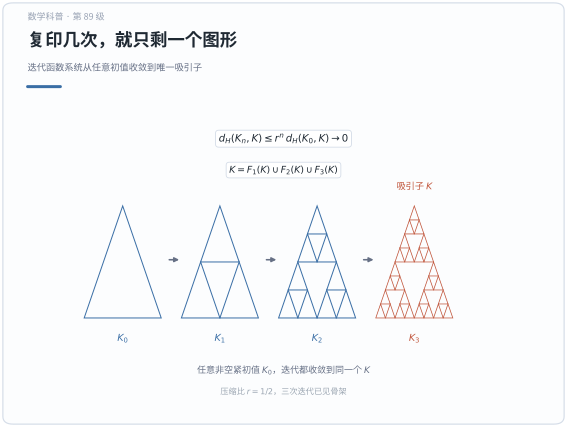

**一句话点破**：压缩映射族在 Hausdorff 距离下必存在唯一吸引子，这是分形能被拼贴出来的理论保证。

### 7.10 IFS 维数定理

如果一组压缩映射彼此"不重叠"（开集条件），那么吸引子的相似维数可以直接由各压缩比算出——它正是方程 $\sum_{i=1}^{m} r_i^s = 1$ 的唯一解。

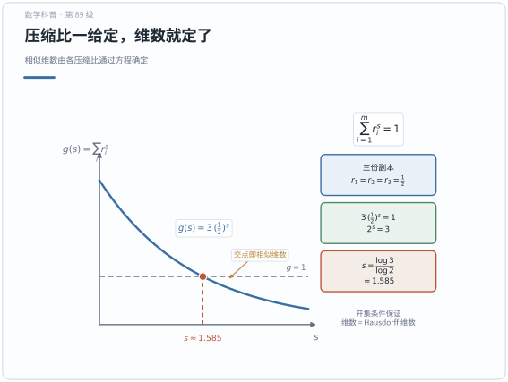

**一句话点破**：满足开集条件时，吸引子的维数就是方程 $\sum r_i^s=1$ 的唯一解。

### 7.11 Cantor 集的 Hausdorff 维数

每次去掉中间三分之一、留下两端，反复下去得到的 Cantor 集几乎不含长度，却处处与自己相似。把它放大 $3$ 倍恰好得到两段自己，于是维数约为 $0.63$。

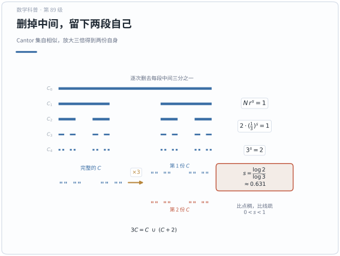

**一句话点破**：Cantor 集维数 $\log 2/\log 3$ 介于 $0$ 与 $1$ 之间，直观显示它比点稠、比线疏。

### 7.12 Sierpinski 三角形的 Hausdorff 维数

从实心三角形挖去中间倒置的小三角形，反复操作得到 Sierpinski 三角形。它由三份缩小一半的自己拼成，因此维数恰好是 $\log 3/\log 2$。

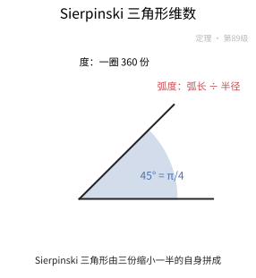

**一句话点破**：Sierpinski 三角形维数约为 $1.585$，介于线与面之间，说明它有骨架却填不满面。

### 7.13 Koch 曲线的 Hausdorff 维数

把每条线段中间折出一个等边三角形的尖角，反复进行，得到处处不可微的 Koch 曲线。它由四份缩小三分之一的自己拼成，维数约为 $1.262$。

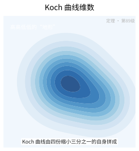

**一句话点破**：Koch 曲线维数 $\log 4/\log 3$ 略大于 $1$，正对应它无限长却围住有限面积的怪脾气。

### 7.14 Julia 集

在复平面上反复代入 $z\mapsto z^2+c$，有的点越跑越远，有的点始终被拴住；被拴住的那些点勾勒出的边界常是绚丽的 Julia 集，随参数 $c$ 变化而千姿百态。

**一句话点破**：Julia 集是复迭代轨道逃逸与不逃逸的分界，它把动力学的稳定性画成了几何图形。

### 7.15 Mandelbrot 集

让参数 $c$ 也动起来，把所有能让从 $0$ 出发的轨道不逃逸的 $c$ 收集起来，就得到 Mandelbrot 集——一张被称为数学中最复杂对象的蜗牛状图案。

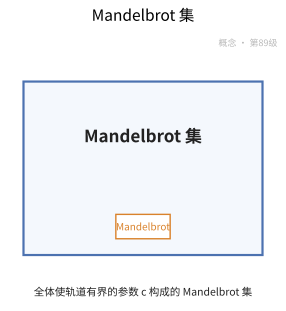

**一句话点破**：Mandelbrot 集是 Julia 集的参数地图，它把无数个 Julia 集的命运汇总在一张图里。

### 7.16 L-系统

用几条"前进、转向、分支"的字母规则不断替换字符串，再把它读成图形，就能长出蕨叶、树枝这样的植物形态——这就是 L-系统，计算机图形学里的分形画笔。

**一句话点破**：L-系统用字符串重写把简单的字母规则翻译成自然般复杂的分形结构。

### 7.17 分形插值

给几个散点，普通插值画出光滑曲线，而分形插值让曲线在每一段上都重复整体形状，得到一条自己包含自己的折线，特别适合拟合山脊、云层等粗糙数据。

**一句话点破**：分形插值用自相似规则替代光滑假设，让插值曲线具备细节无限的粗糙感。

### 7.18 多分形

同一个分形上，不同区域的稀密程度并不均匀，用一个维数说不清楚。多分形引入维数谱，用一个函数描述各个局部密度对应的维数。

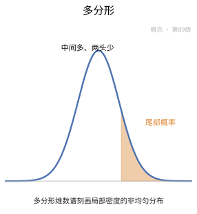

**一句话点破**：多分形用维数谱 $f(\alpha)$ 取代单一维数，刻画同一天形体上不同区域的尺度差异。

### 7.19 随机分形

真实的山脉、云朵、股价并不严格自相似，而是统计意义上的自相似。随机分形把随机扰动加入迭代规则，生成既有无穷细节又有自然随机感的图形。

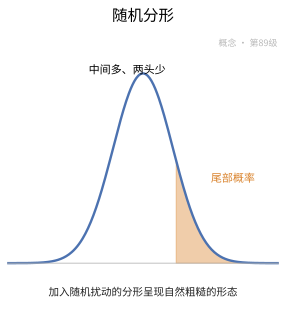

**一句话点破**：随机分形把决定性的自相似换成统计自相似，让模型更贴近真实世界的粗糙纹理。

## 8. 数学史（History of Mathematics）

> 分形几何的历史，是一部"把粗糙当作研究对象"的逆流革命：从魏尔斯特拉斯那被称为"病态"的连续不可微曲线，到康托尔、豪斯多夫对"分数维"的早期度量，再到曼德博赋予诸对象统一的名字与世界图景。这条主线始终在追问一个反直觉的问题：当几何处处粗糙、处处自相似时，什么样的数与结构仍能准确描述它？

### 1. 前置：被当作"怪物"的连续不可微曲线
- 随着数值近似与计算机绘图的出现，这些“无法手绘”的对象的可视形态才终于“被看见”，并惊艳了整个数学界。

- 19 世纪以前，数学家几乎相信"几何曲线总是平滑的"，直到**魏尔斯特拉斯**构造出一条**处处连续而处处不可微**的函数。
- 这类"图画出不来"的对象起初被贴上**病态（pathology）**标签，许多教科书甚至回避它们——而这恰恰是分形思想的启蒙温床。

### 2. 魏尔斯特拉斯函数与柯赫曲线
- 这类曲线的长度甚至可为无穷大，却只占据有限面积，这种“长度无限而面积有限”的反常正是它们后来被称作“分形”的原因。

- **魏尔斯特拉斯函数**用三角级数 $f(x)=\sum a^n\cos(b^n\pi x)$（在适当条件下）产生处处振荡、不可微的波形，展示"连续性不意味着平滑性"。
- 随后**von Koch** 的雪花曲线、**Sierpiński** 的三边形与地毯把"无穷折损自相似"变成可视化图案，撼动了"几何只能是光滑"的旧观念。

### 3. 康托尔：偶尔留下的"残余集合"
- 康托尔集的“挖空留痕”过程后来被推广为“康托尔式集合”的构造，为自相似分形提供了无穷多范例。

- **Cantor 三分集**通过反复"挖去中间三分之一"得到不可数却有零长度的超精细残余，其分数性质成为分形度量的原型之一。
- 康托尔集显示了"测度为零却不可数""处处连通却无内点"等古怪性质，也为后来的维数度量提供了第一个非整数样本。

### 4. Hausdorff 维数：给"分数"一个度量
- 有了 Hausdorff 维数，人们才能给“一条海岸线到底是多少维”这一追问以答案，把“越放大越精细”的直觉落到实处。

- **Felix Hausdorff（1918）**引入以他命名的**Hausdorff 维数**，用覆盖方式定义能描述"不是整数值"的对象维度，填平了"整数维"与"实际结构"之间的鸿沟。
- 这一度量虽复杂（要用到测度论），却成为分形理论最根本的工具，后被 **Besicovitch** 等系统发展，并与测度几何结成紧密同盟。

### 5. 曼德博：为分形命名并给出宣言
- 曼德博的宣言让“粗糙、自相似、分数维”成为横跨数学、物理、生物与工程的概念网络的核心词汇。

- **Benoit Mandelbrot** 在 20 世纪 60—80 年代把遍布数学与自然的"粗糙、自相似对象"统一命名为**分形（fractal）**，并系统提出分形几何的纲领。
- 他关于棉花价格、海岸线长度的分部计算与幂率直觉，使"分形维数"从抽象测度变成可观察、可估算的现实尺度。

### 6. 自相似与迭代函数系统（IFS）
- IFS 的不动点结构还提供了生成分形的严密数学保证，使随机与递推算法都有了依据。

- **迭代函数系统（IFS）**由一组合适的压缩仿射映射反复叠代而生成点集，其极限往往是一个自相似分形，常见的**Barnsley 蕨叶**便是最惊艳的例证。
- IFS 揭示了"有限序列的无限替换重复"如何收敛到无穷精细结构，是计算机分形图形学的核心技术之一。

### 7. L-系统：字符串重写的植物语法
- L-系统把“并行重写”推向前台，与字符串和并行语法天然亲和，是分形进入程序化生成的重要桥梁。

- **Lindenmayer 系统（L-系统）**用并行替换的规则串（如"叶→枝"）模拟植物生长，其迭代产物天然呈现自相似分支结构。
- L-系统在植物形态学、计算机图形学刻画分形树与分形叶方面成效卓著，也是"语言规则→几何结构"这一思路的直接实现。

### 8. 分形插值与替代曲线
- 分形插值让“粗糙也炼成模型”成为现实，是纯几何与工程拟合结合最紧密的分形分支之一。

- **分形插值**通过迭代赋值构造经过给定点且处处曲线状插值的函数，是工程中描述粗糙边界、质地与跳跃对象的有力工具。
- 它把"误差曲线 / 表面"当作分数维对象来拟合，在计算机图形学、地质与材料表面建模中获得广泛应用。

### 9. Julia 集与 Mandelbrot 集：复动力系统的分形
- 从模板与周期性看，Mandelbrot 集的边界处处自相似又处处浑浊，恰是复动力中“秩序与混沌共存”的直观写照。

- **Julia 集**（Gaston Julia、Pierre Fatou，1918 年前后）刻画复多项式迭代下行为的边界集合，其混沌、连通与分岔细节构成极其复杂的边界分形。
- **Mandelbrot 集**把多项式参数空间本身的"稳定/混沌"分类画成收缩缠绕的胶片状图形，是现代分形图像最有名的代表。

### 10. 复动力系统的现代发展
- 动力学的“临界点对应参数”把 Julia 集的变化规律组织成可解析的图谱，驱动了这套理论的深度推进。

- 复动力系统把"迭代映射的动力学"与"共形几何"结合，**Fatou–Julia 理论**在 1980—2000 年间经 Douady、Hubbard、McMullen 等取得深邃进展。
- Mandelbrot 集的拓扑与参数空间刻划、梯度与临界点的角色，成为解析几何与动力学长期互动的生动样本。

### 11. 多分形与统计物理
- 多分形的特征谱函数把湍流、金融波动等复杂信号的粗糙度“编码进一个函数”，极具描述力。

- 真实世界常以不止一个维数来衡量，**多分形（multifractal）**理论用连续分布的特征指数刻画局部维数的多变性，刻画湍流、信号与守恒系统中的尺度行为。
- 分形与相变、临界现象的"尺度不变性"语言相通，使统计物理与分形几何在近临界涌现现象上彼此增益。

### 12. 随机分形与现代应用
- 随机分形的自相似与重标度语言相通，使它在数据压缩、传播建模与图像处理中成为不可替代的模型库。

- 不规则的随机过程（布朗运动、随机过程图像）天然生成随机分形，其统计自相似性在金融数据、图像压缩与网络流量分析中大放异彩。
- 从海岸线到血管、从云计算到量子场论，分形既作为描述自然的"普遍语法"存在，也不断被生物学、工程与数据科学借为建模词汇。

### 历史年表

| 时间 | 人物／文献 | 事件与贡献 |
|---|---|---|
| 1872 前后 | Weierstrass | 构造连续不可微函数，挑战光滑观念 |
| 1883 | Cantor | 三分集开辟残缺集合与分数维度量 |
| 1904—1920s | von Koch、Sierpiński | 构造雪花与地毯等自相似范例 |
| 1918 | Hausdorff | 引入 Hausdorff 维数 |
| 1918 前后 | Julia、Fatou | 建立复动力系统的迭代分形 |
| 1960—1980 年代 | Mandelbrot | 命名"分形"，提出分形几何纲领 |
| 1980 年代 | Barnsley、Lindenmayer | IFS 与 L-系统把分形带入计算机图形学 |
| 1980—2000 年代 | Douady、Hubbard、McMullen | 深化复动力系统与 Mandelbrot 集研究 |
| 20 世纪后期 | 各界 | 多分形、随机分形与多领域建模 |

> 从"病态曲线"到"处处自相似的形态语言"，分形几何以 Hausdorff 维数度量、以 IFS 与 L-系统生成、以复与随机动力学生长，最终让"粗糙"走出被数学遗忘的角落。它证明几何美既在光滑的对称里，也藏在无尽的蜿蜒与褶皱之下。

## 9. 总结

分形几何是研究不规则几何结构的数学分支，其核心概念包括：

1. **分形维数**：Hausdorff 维数和盒维数是描述分形复杂度的两个基本工具。Hausdorff 维数具有可数稳定性和 Lipschitz 不变性等优良性质，而盒维数更容易计算。

2. **迭代函数系统（IFS）**：提供了一种统一的方法来构造和描述自相似分形。Hutchinson 定理保证了 IFS 吸引子的存在唯一性，IFS 维数定理给出了吸引子的 Hausdorff 维数计算方法。

3. **经典分形**：Cantor 集、Sierpinski 三角形、Koch 曲线等是分形几何的基本范例，其维数可通过 IFS 方法统一计算。

4. **复动力系统**：Julia 集和 Mandelbrot 集是复动力系统中的分形，展示了简单规则如何产生极其复杂的结构。

5. **L-系统与分形插值**：提供了生成和模拟分形结构的实用方法，在计算机图形学中有广泛应用。

6. **多分形与随机分形**：将分形理论推广到更一般的情形，适用于描述自然界中更为复杂的结构。

分形几何在物理学（湍流、相变）、生物学（血管系统、植物形态）、图像压缩、天线设计等众多领域都有重要应用。

---

## 10. Stewart 风格专题

> 本节以 James Stewart *Calculus* 的教学编排为蓝本：用「四步解题流程」贯穿概念检查、分步骤工作示例、小规模应用项目与梯度化自测习题，帮助你在动手计算中建立对分形几何核心概念的肌肉记忆。小节间相互独立，可按需跳读。

### 8.1 问题求解四步流程（Problem-Solving Strategy）
- 分形插值让“粗糙也炼成模型”成为现实，是纯几何与工程拟合结合最紧密的分形分支之一。

> Stewart 力推的策略是把每个问题拆成四步：**理解 → 计划 → 执行 → 回看**。这里把每一环落到分形几何语境的追问上。

| 步骤 | 行动 | 分形几何中的具体追问 |
|:---|:---|:---|
| ① 理解 | 复述问题、圈出已知与目标 | 目标集合是由 $IFS$ 生成的自相似集吗？要算 Hausdorff 维数、相似维数还是盒维数？给定的相似比 $c$ 与份数 $n$ 是多少？ |
| ② 计划 | 选择可行工具、预估方向 | 用相似维数方程 $\sum c_i^{s}=1$？用盒计数的 $N_\delta\sim\delta^{-D}$ 取对数？还是直接套经典公式 $D=\ln n/\ln m$？ |
| ③ 执行 | 按计划逐步推导、保留过程 | 每步写明依据，对数、等比、迭代次数别弄混，分子分母别颠倒。 |
| ④ 回看 | 核对结果、检验合理性 | 结果是否落在 $0$ 到该集合所含空间维数之间？换一种维数概念是否仍一致？ |

> 💡 **策略演示**：求 Cantor 集的相似维数。
> ① 理解：Cantor 集由两个相似比为 $c=\frac13$ 的映射生成。② 计划：验证开集条件后用相似维数方程 $\sum c^s=1$。③ 执行：$2\cdot\left(\frac13\right)^{s}=1\Rightarrow s=\frac{\ln 2}{\ln 3}$。④ 回看：$0<s<1$，与 Cantor 集是 $\mathbb{R}$ 中的零测不可数集一致。

### 8.2 概念检查（Concept Check）
- 分形插值让“粗糙也炼成模型”成为现实，是纯几何与工程拟合结合最紧密的分形分支之一。

> 先用一组判断题与选择题快速自检核心概念。每道题的判断均应落到书面理由（用一句话即可）。

**判断正误**（说明理由）：

1. 所有分形都是自相似的。（　）
2. 盒维数与 Hausdorff 维数对任何集合都相等。（　）
3. Cantor 集的 Hausdorff 维数为 $\log_3 2$。（　）
4. 一个满足开集条件的 $IFS$，其吸引子的相似维数等于 Hausdorff 维数。（　）
5. Koch 曲线是处处不可微的连续曲线。（　）
6. 有限个点集的 Hausdorff 维数为 $0$。（　）

**选择**：

7. Koch 曲线的相似维数是（　）。
   - A. $\log_4 3$　B. $\log_3 4$　C. $\log_2 3$　D. $\frac43$
8. Sierpinski 三角形的相似维数等于（　）。
   - A. $\log_2 3$　B. $\log_3 2$　C. $1$　D. $\frac23$
9. 满足 $\sum_{i=1}^{n} c_i^{s}=1$ 的实数 $s$ 称为（　）。
   - A. 盒维数　B. $IFS$ 的相似维数　C. 拓扑维数　D. Hausdorff 维数的一种特例

### 8.3 分步骤工作示例（Worked Examples）
- 分形插值让“粗糙也炼成模型”成为现实，是纯几何与工程拟合结合最紧密的分形分支之一。

> 每道示例严格套用四步流程，并在「回看」中给出一条易错点或检验法。

**示例 S1：用四步法求 Cantor 集的相似维数**

> **问题**：设 Cantor 集由两个相似比为 $c=\frac13$ 的映射生成，求其相似维数。

- ① 理解：Cantor 集是 $IFS$ 的吸引子，目标单一，只需求相似维数 $s$。
- ② 计划：验证开集条件后，用相似维数方程 $\sum c_i^{s}=1$。
- ③ 执行：

$$
2\cdot\left(\frac13\right)^{s}=1\;\Longrightarrow\;s=\frac{\ln 2}{\ln 3}.
$$

- ④ 回看：$s\approx0.631$，介于 $0$ 与 $1$ 之间，符合零测不可数集的直觉。**易错点**：把答案写成 $\ln3/\ln2$（分子分母颠倒），从而高估维数。

**示例 S2：用四步法求 Koch 曲线的相似维数**

> **问题**：Koch 曲线由四个相似比为 $\frac13$ 的映射生成，求其相似维数。

- ① 理解：$n=4$、$c=1/3$，目标是在相似维数方程中解出 $s$。
- ② 计划：代入 $\sum c_i^{s}=1$，此处四份等比值。
- ③ 执行：

$$
4\cdot\left(\frac13\right)^{s}=1\;\Longrightarrow\;s=\frac{\ln 4}{\ln 3}\approx1.262 .
$$

- ④ 回看：$1<s<2$，介于直线与平面之间，符合 Koch 曲线毛糙连续的个性。**易错点**：混淆份数 $n=4$ 与相似比分母 $3$，把公式写成 $\frac{\ln3}{\ln4}$。

**示例 S3：用四步法求 Sierpinski 三角形的相似维数**

> **问题**：Sierpinski 三角形由三个相似比为 $\frac12$ 的映射生成，求其相似维数。

- ① 理解：$n=3$、$c=1/2$，目标明确。
- ② 计划：验证开集条件后代入相似维数方程。
- ③ 执行：

$$
3\cdot\left(\frac12\right)^{s}=1\;\Longrightarrow\;s=\frac{\ln 3}{\ln 2}\approx1.585 .
$$

- ④ 回看：$1<s<2$，合理。**易错点**：与 Cantor 集（$n=2,c=1/3$）的结果混淆；分子分母应分别是 $n$ 与 $1/c$ 的对数。

**示例 S4：求不等比 $IFS$ 吸引子的相似维数（探究式）**

> **问题**：设 $IFS$ 含两个映射，相似比分别为 $c_1=\frac13$、$c_2=\frac16$，且满足开集条件，求其吸引子的相似维数。

- ① 理解：$n=2$、相似比不等，需解一般的 $\sum c_i^{s}=1$ 而非等比特例。
- ② 计划：把 $(\frac13)^s$ 视作变量 $t$，利用 $\frac16=\frac13\cdot\frac12$ 联系两比，估计解的存在范围并由单调性定位。
- ③ 执行：由

$$
\left(\frac13\right)^{s}+\left(\frac16\right)^{s}=1 ,
$$

  $s=0$ 时左端 $=2>1$，$s=1$ 时左端 $=\frac12<1$，因左端关于 $s$ 单调递减，故存在唯一 $s\in(0,1)$；数值解得 $s\approx0.49$。
- ④ 回看：$s\in(0,1)$，介于 $0$ 与 $1$ 之间，符合二维平面内一点集的维数界。**易错点**：不等比时不能写成 $2c^{s}=1$；须逐项代入并借助单调性说明唯一解。

### 8.4 应用聚焦（Application & Exploration Projects）
- 分形插值让“粗糙也炼成模型”成为现实，是纯几何与工程拟合结合最紧密的分形分支之一。

> 小型开放任务：把本节抽象结论落到可操作的计算或仿真，任选其一完成。

- **聚焦 P1（数值仿真）**：用随机迭代（chaos game）在 Sierpinski 三角形上生成大量随机点，再用不同边长 $\delta$ 的方格覆盖并估算盒维数，与理论值 $\log_2 3$ 对照。
- **聚焦 P2（跨章节联系）**：把 Cantor 集与三进制展开中不含数字 $1$ 的实数点集对应起来，说明其测度为 $0$ 而 Hausdorff 维数为 $\log_3 2$ 的一致性，与测度论交叉引用。
- **聚焦 P3（反例构造/探究）**：构造一个不满足开集条件却让「相似维数」高估 Hausdorff 维数的 $IFS$（例如存在重叠），并用定义指出高估发生在哪里、如何用开集条件修复。

### 8.5 梯度化自测（Graded Exercises）
- 分形插值让“粗糙也炼成模型”成为现实，是纯几何与工程拟合结合最紧密的分形分支之一。

> 难度记号：$\circ$ 概念 / $\bullet$ 技能 / $\blacklozenge$ 综合应用，均要求在四步流程中写出「回看」一句。

**$\circ$ 概念题**

- **自测 1**：用一句话区分 Hausdorff 维数与盒维数。
- **自测 2**：相似维数必须在验证什么条件之后才能当作 Hausdorff 维数使用？

**$\bullet$ 技能题**

- **自测 3**：求 Koch 曲线的相似维数，写出完整四步过程。
- **自测 4**：求 Cantor 集的相似维数，写出完整四步过程。
- **自测 5**：求由三个相似比为 $\frac13$ 的映射生成的自相似集的相似维数，写出完整四步过程。

**$\blacklozenge$ 综合题**

- **自测 6**：设 $IFS$ 含两个映射，相似比分别为 $c_1=\frac12$、$c_2=\frac14$，满足开集条件，求其吸引子的相似维数，写出完整四步过程。
- **自测 7**：写一段含「表格 + 一句话结论」的分析：对比 Cantor 集、Sierpinski 三角形与 Koch 曲线的相似维数，说明复杂度如何随份数 $n$ 与相似比 $c$ 变化。

### 8.6 自测答案与简要解析
- 分形插值让“粗糙也炼成模型”成为现实，是纯几何与工程拟合结合最紧密的分形分支之一。

> **概念判断**：
> 1. **错误**（如 Julia 集、Mandelbrot 集等一般分形并非严格自相似）。2. **错误**（盒维数依赖格子覆盖，且有界的对合群情形可与 Hausdorff 维数不同）。3. **正确**（$\log_3 2$）。4. **正确**（开集条件是相似维数等于 Hausdorff 维数的充分条件之一）。
> 5. **正确**（Koch 曲线处处连续但处处不可微）。6. **正确**（有限点集的 Hausdorff 维数为 $0$）。
>
> **选择**：7. B　8. A　9. B。

> **自测**：
> - 自测 1：Hausdorff 维数用测度定义、具 Lipschitz 不变性、可加性优但对计算不友好；盒维数用 $\delta$-覆盖计数定义、易算但对格子选取敏感，两者一般情况不必相等。
> - 自测 2：需验证开集条件——存在非空有界开集 $V$ 使 $S_i(V)$ 两两不交且 $\cup_i S_i(V)\subseteq V$，此时相似维数等于 Hausdorff 维数。
> - 自测 3：$4\cdot(\frac13)^{s}=1\Rightarrow s=\frac{\ln4}{\ln3}\approx1.262$；回看：$1<s<2$，处在线与面之间，合理。
> - 自测 4：$2\cdot(\frac13)^{s}=1\Rightarrow s=\frac{\ln2}{\ln3}\approx0.631$；回看：$0<s<1$，与 Cantor 集地处实轴一致。
> - 自测 5：$3\cdot(\frac13)^{s}=1\Rightarrow s=\frac{\ln3}{\ln3}=1$；回看：三个三等分相似映射可按线段顺排实现，维数恰为 $1$，合理。
> - 自测 6：解 $\left(\frac12\right)^{s}+\left(\frac14\right)^{s}=1$，令 $t=(\frac12)^s$，则 $t+t^2=1$，$t=\frac{\sqrt5-1}{2}$，$s=\frac{\ln t}{\ln(1/2)}\approx0.694$；回看：$s\in(0,1)$ 且开集条件成立，结论可信。
> - 自测 7：表格列出 $(n,c,s)$：Cantor$(2,\frac13,\log_3 2)$、Sierpinski$(3,\frac12,\log_2 3)$、Koch$(4,\frac13,\log_3 4)$；结论「相似比越小、份数越多，分形越细碎，维数越大」。

