# 第90级：几何群论 (Geometric Group Theory)

> 把抽象的群"铺"成一张张可以走路、测距、看形状的地图，用几何的眼睛重新读群的代数性格。

---

## 从"让代数变得看得见"说起：几何群论要解决的根本问题

> 在动手记定义之前，先想清楚一个问题：**一堆满足运算规则的冷冰冰元素，凭什么能"看"出它的性格？**

**一个真实的生活场景（第一步：直觉）**

设想你走进一个陌生的城市，手里没有地图，只有两个指令：向东走（记作 $a$）、向北走（记作 $b$）。任何一个街区都能用一串指令（如 $a b a^{-1} b^{-1}$）走到——但有些"绕法"其实绕回原点。这座城市本身就成了一幅"画在棋盘上的图"：每个街区是车站、每条指令是一条路。现在问：**这座城市的人口随"距中心站几步"增长得多快？它的道路会不会在某个半径外分叉成密林？** 这些问题不用群论也能靠"走路"回答，而几何群论恰恰发现：**这群的答案，居然就是群本身的增长快慢、双曲程度与端数。** 抽象的代数，从此有了能长、能量、能比的"体型"。

**它要解决的根本问题（第二步：来龙去脉）**

代数群论擅长用"子群、同态、生成元"来刻画群，却很难回答"这群到底有多大、有多弯"。几何群论的雄心，是把代数问题翻译成几何问题。

- **Cayley 画出第一张群的地图**（1878 年）。Arthur Cayley 意识到：给定一组生成元，把每个群元素当顶点、把"乘以一个生成元"当边，就能画出一张图——后人称它 **Cayley 图**。抽象的乘法第一次变成看得见的连通与距离。
- **从几何读出群的性质**（20 世纪前半叶）。Dehn 在研究曲面基本群的词问题与等周问题里，用几何直观处理代数难题；Svarc 与 Milnor 则证明"能规整铺满一座好空间的群，与那座空间粗看同构"（Svarc-Milnor 引理），架起"群作用"与"拟等距"的桥。
- **Gromov 把"粗几何"发扬光大**（1980 年代）。Mikhael Gromov 提出"拟等距"与"粗几何/大范围几何"，让千差万别的群能在"宏观形状相同"的意义下被归并；他还以"多项式增长 ⟺ virtually 幂零"的分类，把代数、度量与 Lie 群理论焊在一起。
- **Stallings、Thurston 补齐拼图**。Stallings 端定理（$e(G)>1$ ⟺ 自由积分裂）把"端数"变成代数分解的探针；Thurston 则用双曲几何研究三维流形基本群。几何群论由此成为连接群论、拓扑与度量几何的枢纽学科。

> **🧠 一句话记住几何群论的"出生证"**
>
> 几何群论源于"把群嵌入一张看得见的几何地图"的信念，它要解决的根本问题是：
>
> $$ \boxed{\text{如何用 Cayley 图、词度量与群作用，把群的代数问题转化为几何问题，再用增长、双曲性、端数等几何量反推出群的代数结构？}} $$
>
> Cayley 图给出"看得见的群"，词度量给出"量得出的群"，拟等距给出"比得出大小的群"——三者环环相扣。

**看待本章的四种眼光（第三步：正式定义前的准备）**

- **组合的眼光**：群表示 $\langle S \mid R \rangle$、Cayley 图、词度量，把群装进一张可计数的路网。
- **粗几何的眼光**：增长函数、拟等距、Gromov 双曲——从"大范围形状"读出群的性格。
- **作用的眼光**：Svarc-Milnor 引理、几何作用，让"群怎么住进一座空间"成为研究群的入口。
- **结构与谱系的眼光**：Stallings 端定理、Dehn 函数、Gromov 多项式增长定理，把几何量一步步翻译回代数分类。

读完这一节，请记住的不是定理清单，而是：**几何群论在做的是"给代数配一副几何眼镜，用'长什么样'反推'是什么'"。** 带着这句话去读后面的每个概念，你会发现那条地铁图、那根增长曲线、那个 $\delta$ 常数，全都在为同一个目标服务。

---

## 开始之前

**本章在讲什么**：几何群论用几何与度量的工具研究群。你会先学会用群表示、Cayley 图、词度量把群"画"出来并"量"出来；然后接触两条反推路线——一是用增长函数、Gromov 双曲性、Stallings 端定理从"体型"读出群结构；二是用 Svarc-Milnor 引理、拟等距分类、Dehn 函数与 Gromov 多项式增长定理，让"几何等价"给出"代数分类"。

**为什么要学它**：在更早的群论专题里，群只活在符号与运算中，缺少"大小""形状"这类直觉。本章用度量空间与拓扑的工具把这块补上，同时它是三维流形（Thurston 几何化）、代数数论（算术群、格）、以及动力系统与组合学交叉处的基础语言。它向上承接了代数与点集拓扑/度量几何，向下为低维拓扑与群作用理论提供了出发的跑道。

**开始前请确认你还记得**：

- 群、子群、同态、商群与生成元（见群论/近世代数专题）。
- 自由群 $F(S)$、群表示 $\langle S \mid R \rangle$ 与正规闭包（见组合群论专题）。
- 度量空间、完备性、测地空间、紧致性与等距变换（见点集拓扑/度量空间专题）。
- Left 陪集、有限指数子群、virtually 性质、Bass-Serre 树（后者可选，见群论延伸）。
- 数列与 $\liminf/\limsup$，以及连续性的基本概念。

---

## 学习目标

1. 理解群的生成元与关系的表示方法
2. 掌握 Cayley 图与词度量的概念
3. 理解增长函数及其与群结构的关系
4. 掌握 Gromov 双曲群的定义与基本性质
5. 理解拟等距的概念及其在群分类中的作用
6. 掌握群作用的基本理论及 Svarc-Milnor 引理
7. 了解 Stallings 端定理与 Dehn 函数
8. 理解 Gromov 多项式增长定理

---

## 第一节：群表示的几何基础

### 1.1 生成元与关系

🌐 **直觉先行**：许多群长得像拼图游戏——给一堆"积木"（生成元）和规则"哪些搭法算作同义"（关系），就能记住整群。**群表示** $\langle S \mid R \rangle$ 就是这句话的形式化：它用"字母表＋拼词规则"把群交代清楚。它既揭示群的生成效率，也很自然地把"能否把词化简"变成几何里的走路问题。

**为什么需要这个概念**：同构意义下的群千千万，但很多都能用极少生成元＋有限条关系描述（称有限表示）。群表示是"写给群的密码本"，也是几何群论一切后续概念（Cayley 图、词度量、Dehn 函数）的共同前提——没有它，几何无从谈起。

**定义 1（群表示）**：  
群 $G$ 的一个**表示**（presentation）是一个二元组 $\langle S \mid R \rangle$，其中 $S$ 是生成元集合，$R$ 是关系集合。关系是 $S \cup S^{-1}$ 上的自由群 $F(S)$ 中的元素，群 $G$ 同构于 $F(S) / \langle\langle R \rangle\rangle$，其中 $\langle\langle R \rangle\rangle$ 是 $R$ 的正规闭包。

> **💡 直观理解（类比）**：像用"字母表 + 拼词规则"写一份群说明书——生成元是字母，关系是拼字条规（哪些词算同义）。把受条规约束的所有"同义字"归并后，剩下的就是这群的完整密码本。例如 $\mathbb{Z}^2=\langle a,b\mid aba^{-1}b^{-1}\rangle$ 只靠一句"走 ab 与走 ba 等效"就锁定了交换性。

**示例**：
- 自由群 $F_n = \langle a_1, \dots, a_n \mid \rangle$（无关系）
- 循环群 $C_n = \langle a \mid a^n = 1 \rangle$
- 无限二面体群 $D_\infty = \langle a, b \mid a^2 = 1, aba = b^{-1} \rangle$
- 整数格群 $\mathbb{Z}^2 = \langle a, b \mid aba^{-1}b^{-1} = 1 \rangle$

#### 课堂问答

**老师**：我问你，$\langle S \mid R \rangle$ 里到底是谁命了 $G$？好多人只把它当记账符号，说说它真正的身份。

**学生**：它是"自由群商正规闭包"。准确说 $G \cong F(S)/\langle\langle R \rangle\rangle$，其中 $\langle\langle R \rangle\rangle$ 是 $R$ 在 $F(S)$ 中的正规闭包——含 $R$ 的最小正规子群。

**老师（追问）**：那为什么不直接商由 $R$ 生成的子群，非要用"正规闭包"？

**学生**：因为商群必须是正规子群才有的商结构。只商一般子群，$F(S)/N$ 不构成群。正规闭包恰是含 $R$ 的最小正规子群，所以等式 $w=1$ 在群中到处传递（连共轭也归零）。

**老师（拓展）**：举一个"一句话锁死结构"的例子，并说说有限表示的威力。

**学生**：$\mathbb{Z}^2=\langle a,b\mid aba^{-1}b^{-1}\rangle$，一句"走 $ab$ 与走 $ba$ 等效"就钉死交换性；$F_n=\langle a_1,\dots,a_n\mid\rangle$ 靠零关系，$C_n=\langle a\mid a^n=1\rangle$ 靠一条关系。有限表示（$S,R$ 都有限）尤其宝贵——它是 Cayley 图局部有限、Dehn 函数、词问题可判定等一切后续讨论的前提。

### 1.2 Cayley 图

🌐 **直觉先行**：把群元素当车站、"乘以一个生成元"当一步路，抽象的群就被"铺"成一座城市——这就是 **Cayley 图**。它是几何群论的第一张底图：有了它，群才有"距离""连通""增长"可言。越往后读（双曲性、拟等距、端数），你会发现所有几何量几乎都定义在这张图上。

**定义 2（Cayley 图）**：  
设 $G$ 是群，$S$ 是 $G$ 的生成元集（通常假设 $S = S^{-1}$，即 $S$ 对取逆封闭）。群 $G$ 关于 $S$ 的 **Cayley 图** $\Gamma(G, S)$ 定义为：
- 顶点集：$G$ 的元素
- 对每个 $g \in G$ 和 $s \in S$，有一条从 $g$ 到 $gs$ 的有向边（通常视为无向边，因为 $S = S^{-1}$）

> **💡 直观理解（类比）**：把每个群元素当车站、"乘以一个生成元"当迈一步路，连成一张地铁图——抽象的乘法从此变成了可见的步行，群一下子有了能看、能走、能量出距离的形状。

**示例**：自由群 $F_2 = \langle a, b \mid \rangle$ 的 Cayley 图是 4-正则的无限树，称为 **Bethe 晶格**。

**示例**：$\mathbb{Z}^2 = \langle a, b \mid aba^{-1}b^{-1} = 1 \rangle$ 的 Cayley 图是 $\mathbb{Z}^2$ 上的网格图。

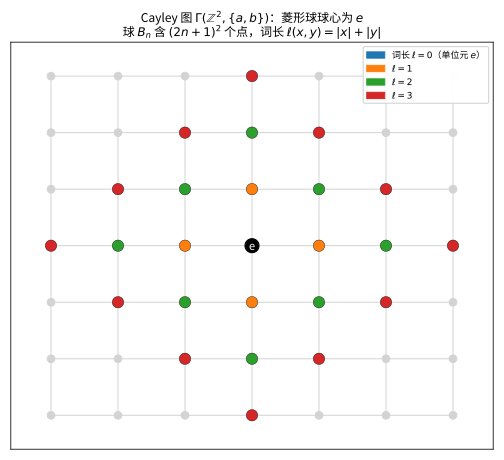

> **直观理解（现实类比）**：Cayley 图就像一张"城市地铁线路图"——地铁站是群的元素，相邻站之间由生成元（a、b）连接。从中心站 e 出发，步行 n 步能到达的所有站点就是"增长球" $B_n$。代数上的"乘积"在这里变成了"沿路走"，把抽象的群变成了看得见、量得出的几何地图。
>
> **🧠 思考历程：把抽象的群"铺成"一张地图，几何群论是怎么做到的？**
>
> 几何群论的宣言掷地有声：**群不该只活在符号里，它应当能被"走路""测距""看形状"**。而把群铺成一张路网的办法，正是发明一张"以群元素为站点的地铁图"。
>
> - **Cayley：第一张群的地图**（1878 年）。Arthur Cayley 意识到，任给一组生成元，就能把每个群元素当作顶点、把"乘以一个生成元"当作边，画出一张图——后人称它为 Cayley 图。这张图把抽象的代数命名，换成了一套看得见的距离与连通性。
> - **从局部形状看出整个群**（20 世纪后半叶）。人们进一步相信，群的性质应能从其（大范围）几何中读出：群的"增长函数"是把人口随距离膨胀的速率，Mikhael Gromov 正是靠"多项式增长"这一条几何线索，开创性地把具有多项式增长的有限生成群分类为"近乎幂零群"。
> - **Gromov 与 Thurston：把几何、拓扑与群焊在一起**（1980 年代）。William Thurston 用几何结构（双曲几何等）研究三维流形，Mikhael Gromov 则提出"拟等距"与"粗几何"，让千差万别的群能在"宏观形状相同"的意义下被归并。几何群论由此成为连接群论、拓扑与度量几何的枢纽学科。
> - **心路**：一个对象是否深刻，往往看它能不能"被看见"。几何群论提醒我们：**给抽象的代数配一副几何眼镜，往往立刻能照出它真实的体型与性格**。

#### 课堂问答

**老师**：Cayley 图把群变成城市。请把"顶点、边、度、正则性"一次交代清楚，并说清它凭什么当几何群论的地基。

**学生**：顶点就是 $G$ 的元素；对 $g\in G, s\in S$ 连一条从 $g$ 到 $gs$ 的边，因 $S=S^{-1}$ 常视为无向图。每点恰有 $|S|$ 个方向出入，故是 $|S|$-正则、带边着色的局部有限图（有限生成保证局部有限）。

**老师（追问）**：边着色有什么讲究？为什么同一颜色在每个顶点处只能一进一出？

**学生**：把 $s$ 与 $s^{-1}$ 配成一种颜色。右乘映射 $g\mapsto gs$ 是顶点集上的双射，所以每个顶点对每种颜色恰有一条出边、一条入边，着色是完美的——这才使"每步沿某颜色走"可逆可解。

**老师（拓展）**：给两个极端例子——最"树"的和最"平"的。

**学生**：自由群 $F_2$ 的 Cayley 图是 4-正则无限树（Bethe 晶格），$\delta=0$；$\mathbb{Z}^2$ 的图是标准网格，菱形球 $B_n$ 含 $(2n+1)^2$ 个点，恰好预示 $n^2$ 型多项式增长。

### 1.3 词度量

🌐 **直觉先行**：Cayley 图给出了"哪里有路"，还得有"两站间隔多少"才算完整的地图。**词度量**就是按"从 $g$ 走到 $h$ 的最少步数"来定义距离的。它把"乘法串"换算成"最短路径"，从而让群成为一个度量空间——这是后面一切定量结论（增长、双曲、拟等距）的度量地基。

**为什么需要这个概念**：群的代数运算（$g^{-1}h$）本来毫无"长度"可言；词度量把一个反映"生成效率"的步数概念硬塞进群，令 $d(g,h)=\ell(g^{-1}h)$ 左不变（规则对谁都公平）。有了它，群才敢自称"度量空间"，几何工具才能开进群论。

> **常见坑**：词度量依赖生成元的选择（换成另一组生成元，距离会整体缩放）。好在它是"有限生成元集下的等价度量"——按拟等距意义所有结果一致，而"每点词长"本身会随字典不同而变，别忘加"有限对称生成元集"这个前提。

**定义 3（词度量）**：  
设 $G$ 是群，$S$ 是有限生成元集。对 $g \in G$，定义 $g$ 的**词长**（word length）为

$$
\ell_S(g) = \min\{ n \geq 0 : g = s_1 s_2 \cdots s_n, s_i \in S \cup S^{-1} \}
$$

群 $G$ 上的**词度量**定义为

$$
d_S(g, h) = \ell_S(g^{-1}h)
$$

**性质**：
1. $d_S$ 是 $G$ 上的左不变度量：$d_S(xg, xh) = d_S(g, h)$ 对所有 $x \in G$ 成立。
2. Cayley 图 $\Gamma(G, S)$ 中从 $g$ 到 $h$ 的最短路径长度等于 $d_S(g, h)$。
3. 度量空间 $(G, d_S)$ 是**测地空间**：任意两点之间存在最短路径。

> **💡 直观理解（类比）**：从单位元凑出 $g$ 至少要几步生成元，最少步数就是词长；任意两点的距离取"从 $g$ 走到 $h$"的最少步数。像地铁按最少换乘计价，而它只盯相对步数、不被起点绑架——这是"左不变"的含义：人人从自己家门口起步，规则对谁都一样。

---

#### 课堂问答

**老师**：词度量定义成 $d_S(g,h)=\ell_S(g^{-1}h)$，为什么是 $g^{-1}h$ 而不是 $gh^{-1}$？

**学生**：因为它要左不变：$d_S(xg,xh)=\ell_S((xg)^{-1}xh)=\ell_S(g^{-1}h)=d_S(g,h)$，人人从自己家门口起步，规则对谁都一样。换成 $gh^{-1}$ 就会破坏这一点。

**老师（追问）**：$(G,d_S)$ 还是测地空间，这条性质为什么重要？

**学生**：任意两点间存在最短路径——Cayley 图里就是词长长度的那条最短词路径。有了测地性，才能谈测地三角形、双曲性这些几何概念；否则"距离"只是数字，画不出线。

**老师（拓展）**：词度量最大的软肋是什么？

**学生**：依赖生成元集。换一套有限对称生成元，$\ell_S$ 整体常数缩放，具体数值变、宏观形状不变——这正是拟等距的意义所在，所以谈词度量永远要带上"有限对称生成元集"这个前提。

## 第二节：增长函数

### 2.1 增长函数的定义

🌐 **直觉先行**：从单位元出发，半径多少步内有多少个元素？记录这一串数字，就是群的**增长函数**。它回答一个最朴素也最深刻的问题：**"这个群大到离中心多远，才刚开始稀疏？"** 多项式增长（像城市向外摊饼）与指数增长（像树猛分叉）就是两种截然不同的体格，而体格藏着群的性质。

**为什么需要这个概念**：增长函数是"群的尺度"指标，它的快慢（多项式/指数/中间）是群的**拟等距不变量**（见 2.2 定理 1），也是 Gromov 分类定理（多项式增长 ⟺ virtually 幂零）的核心量——一个朴素的计数，竟能刻画群的家庭出身。

> **常见坑**：增长函数要在**有限对称生成元集**下定义。换一套生成元，具体数值 $\beta_{G,S}(n)$ 会变，但**增长类型**（多项式/指数/中间）不变——所以记结论时务必是"增长类型"，而不要把某个特定生成元下的具体球大小当成群的不变量。

**定义 4（增长函数）**：  
设 $G$ 是有限生成群，$S$ 是有限对称生成元集。$G$ 的**增长函数** $\beta_{G, S}(n)$ 定义为半径为 $n$ 的闭球中元素的个数：

$$
\beta_{G, S}(n) = |\{ g \in G : \ell_S(g) \leq n \}|
$$

> **💡 直观理解（类比）**：从中心站出发数 $n$ 步能到达的车站总数，随 $n$ 膨胀成一条"人口—半径曲线"——$\mathbb{Z}^2$ 像摊饼朝四面铺开（约 $n^2$），自由群则像岔路疯长的树（$\approx 2^n$）。看得见膨胀速度，就猜得出群的家底。

**定义 5（增长类型）**：
- $G$ 称为**多项式增长**的，如果存在 $C, d > 0$ 使得 $\beta_{G, S}(n) \leq C \cdot n^d$ 对所有 $n$ 成立。
- $G$ 称为**指数增长**的，如果存在 $a > 1$ 使得 $\beta_{G, S}(n) \geq a^n$ 对所有充分大的 $n$ 成立。
- $G$ 称为**中间增长**的，如果它既不是多项式增长也不是指数增长。

> **💡 直观理解（类比）**：按增长曲线的"脾性"给群贴标签——像盖楼一层层稳加（多项式）、还是像利滚利疯涨（指数）、抑或卡在中间不上不下（中间型）。一个标签，先把群的大致体格粗略筛出来。

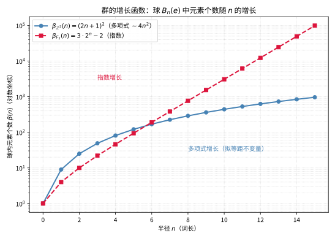

> **直观理解（现实类比）**：增长函数衡量"群里的人口随距离膨胀得多快"。$\mathbb{Z}^2$ 像一座向四周铺开的城市，人口随半径大致按 $n^2$（面积）增长，属于"温和"的多项式增长；而自由群 $F_2$ 像一棵疯狂分叉的树，每走一步可选的方向都在翻倍，人口按 $2^n$ 爆炸式增长。光看"增长快慢"就能把群大致分类，这正是几何群论"以形状辨群"的出发点。

#### 课堂问答

**老师**：增长函数 $\beta_{G,S}(n)=|\{g:\ell_S(g)\le n\}|$ 只是个计数，它凭什么当群的不变量？

**学生**：它真正留住的是"增长类型"。换生成元时具体数值变，但多项式、指数、中间这三档不变，所以信息在三档分类里，而不在某个 $\beta$ 的具体值上。

**老师（追问）**：那你怎么一眼区分多项式与指数？给两个标准例子。

**学生**：看曲线脾性：$\mathbb{Z}^2$ 的球 $\beta(n)=(2n+1)^2$ 是 $n^2$ 型（像摊饼）；自由群 $F_2$ 的球 $\beta(n)=3\cdot 2^n-2$ 是指数型（像疯长的树）。判据是存在 $C,d$ 使 $\beta\le Cn^d$，或存在 $a>1$ 使 $\beta\ge a^n$。

**老师（拓展）**：那"中间增长"是画蛇添足吗？它真的存在？

**学生**：不多余，是第二、三档之间的真实缝隙。Grigorchuk 群是首个被证明处于中间增长的群。所以三档缺一不可：多项式、指数、以及夹在中间"不上不下"的一类。

### 2.2 增长函数与拟等距

**定理 1（增长函数的拟等距不变性）**：  
设 $S_1$ 和 $S_2$ 是群 $G$ 的两个有限对称生成元集，则存在常数 $C > 0$ 使得

$$
\beta_{G, S_1}(n/C) \leq \beta_{G, S_2}(n) \leq \beta_{G, S_1}(Cn)
$$

因此，增长类型（多项式/指数/中间）是生成元选择无关的，是群的拟等距不变量。

> **💡 直观理解（类比）**：换一套字母表（生成元），各方案"每步长度"虽不同，但只要都是有限表就能互相限量兑换，球的膨胀速度在常数倍的含糊内不变——所以"增长快慢"是群送不走的户口，跟用哪套字典无关。

**证明**：  
由于 $S_1$ 和 $S_2$ 都是有限生成元集，每个 $s \in S_1$ 可以表示为 $S_2$ 中元素的词，故存在常数 $C_1 > 0$ 使得 $\ell_{S_2}(s) \leq C_1$ 对所有 $s \in S_1$ 成立。同理，存在 $C_2 > 0$ 使得 $\ell_{S_1}(t) \leq C_2$ 对所有 $t \in S_2$ 成立。

取 $C = \max\{C_1, C_2\}$。则对任意 $g \in G$，

$$
\ell_{S_2}(g) \leq C \cdot \ell_{S_1}(g), \quad \ell_{S_1}(g) \leq C \cdot \ell_{S_2}(g)
$$

因此 $\{g : \ell_{S_1}(g) \leq n\} \subset \{g : \ell_{S_2}(g) \leq Cn\}$，从而 $\beta_{G, S_1}(n) \leq \beta_{G, S_2}(Cn)$。同理可得反向不等式。$\square$

---

#### 课堂问答

**老师**：定理说 $\beta_{G,S_1}(n/C)\le\beta_{G,S_2}(n)\le\beta_{G,S_1}(Cn)$，证明的关键一步在哪？

**学生**：在"两套生成元互相能用常数长词表示"。每个 $s\in S_1$ 能写成 $S_2$ 的词、长度 $\le C$，于是 $\ell_{S_2}(g)\le C\ell_{S_1}(g)$，反向同理。这一步把换字典的误差压成了常数 $C$。

**老师（追问）**：那为什么结论说"是拟等距不变量"，而不是"是群的不变量"？

**学生**：因为球大小本身不是不变量，只有"被常数 $C$ 夹住"这个事实是不变量。$\beta$ 允许一个自变量的常数缩放，这正是拟等距的宽容度——能穿越拟等距而守恒的是增长类型。

**老师（拓展）**：这套论证能推广到别的几何量吗？

**学生**：能，而且这是本章的方法论：任何由"两套生成元互相常长表示"推出的量都自动是拟等距不变量。增长类型、双曲性、端数、Dehn 函数等价类本质是同一句话的产物——"词度量只差常数缩放"。

## 第三节：双曲群

### 3.1 Gromov 双曲性

🌐 **直觉先行**：在平坦平面上画个三角形，最深处的点离边线可以很远；可在一棵树上画三角形，三条边几乎互相压在一起——"三角形都长得很瘪"就是**负曲率**的味道。Gromov 把"负曲率"概括成一条可量化的公理：**任意测地三角形的每条边都在另外两条边的 $\delta$-邻域内**（$\delta$ 越小越"瘪"）。这就是 Gromov 双曲性，它是把黎曼几何的曲率思想"粗量化"、并搬到任意度量空间的钥匙。

**为什么需要这个概念**：经典双曲空间（如双曲平面 $\mathbb{H}^2$）要求光滑可微，群论却需要一套"仅靠度量"的离散版本。Gromov 双曲性的全部目的，就是造出一个**不要求光滑、只问三角形瘦不瘦**的负曲率定义，好让它能直接施加在群的 Cayley 图上。

**定义 6（测地三角形）**：  
度量空间 $(X, d)$ 中的**测地三角形**由三条测地线段 $[x, y], [y, z], [z, x]$ 组成。

> **💡 直观理解（类比）**：就是空间里"三条最短路径首尾相接"围成的三角形——像三根绷紧的皮筋两两首尾相连，量它的主角正是这三条最紧的路线，一点不多走。

**定义 7（Gromov 双曲空间）**：  
度量空间 $(X, d)$ 称为 $\delta$**-双曲**的（$\delta \geq 0$），如果对任意测地三角形 $[x, y] \cup [y, z] \cup [z, x]$ 和任意点 $p \in [x, y]$，有

$$
d(p, [y, z] \cup [z, x]) \leq \delta
$$

即测地三角形的每条边都包含在另外两条边的 $\delta$-邻域中。$X$ 称为**双曲的**，如果存在某个 $\delta$ 使得 $X$ 是 $\delta$-双曲的。

> **💡 直观理解（类比）**：这样的空间里三角形越画越"瘪"——任意边上一点到另外两条边的垂直距离都被同一个常数 $\delta$ 罩住，像河滩上的浅脚印：处处一眼望穿，不会凹出深洞。$\delta$ 是这"一眼望穿度"的公共上限。

**等价定义**：以下条件等价于 $\delta$-双曲性：
- **细三角形条件**：存在 $\delta \geq 0$，使得任意测地三角形都是 $\delta$**-细的**，即每条边包含在另外两条边的 $\delta$-邻域中。
- **Gromov 积条件**：对任意 $x, y, z \in X$ 和基点 $w$，

$$
(x \cdot y)_w \geq \min\{(x \cdot z)_w, (z \cdot y)_w\} - \delta
$$

其中 $(x \cdot y)_w = \frac{1}{2}(d(x, w) + d(y, w) - d(x, y))$ 是 Gromov 积。

#### 课堂问答

**老师**：Gromov 双曲性一句话是什么？为什么用"邻域里"这种含糊说法？

**学生**：任意测地三角形的每条边都落在另外两条边的 $\delta$-邻域内（$\delta$-细）。用邻域而非角度或曲率，是为了不要求光滑、只靠度量，就能把"负曲率"搬到 Cayley 图上。

**老师（追问）**：树里 $\delta$ 是多少？平面里呢？这说明什么？

**学生**：树里任意测地三角形退化成共线状，每条边落在另两条边上，$\delta=0$ 最瘪；欧氏平面里等腰直角三角形的斜边中点到两条直角边距离随边长增长，$\delta$ 无界，所以平面不双曲。可见双曲性正是"负曲率"的粗量化。

**老师（拓展）**：Gromov 积条件又是什么？它和细三角形为何等价？

**学生**：$(x\cdot y)_w=\frac12(d(x,w)+d(y,w)-d(x,y))$，条件为 $(x\cdot y)_w\ge\min\{(x\cdot z)_w,(z\cdot y)_w\}-\delta$。它把"三角形细"翻译成"到基点的投影近似满足超度量不等式"，是同一几何事实的代数外衣，好处是无需先有测地线也能叙述。

### 3.2 双曲群

🌐 **直觉先行**：把"三角形瘪"这套标准放到群的 Cayley 图上，瘦到什么程度才叫"双曲群"呢？——只要**换哪套有限字典图都不影响"瘪"的常数 $\delta$ 有限**就行（生成元选择无关）。自由群（Cayley 图是树）$\delta=0$ 最瘦，双曲群就是"在粗几何意义上带负曲率"的群。

> **🔑 为什么重要**：双曲群是几何群论"最容易相处、最被研究透"的族群：它们具有线性 Dehn 函数（词问题可判定）、紧的 Gromov 边界、有限阶元与拟测地轴等丰富结构，还是三维流形几何化与曲面基本群的天然归宿。判定"一个群是否双曲"能带来一整套现成性质，因此它是本章的分水岭概念。

**定义 8（双曲群）**：  
有限生成群 $G$ 称为**双曲群**（hyperbolic group），如果对某个（从而任意）有限对称生成元集 $S$，Cayley 图 $\Gamma(G, S)$ 作为度量空间是 Gromov 双曲的。

> **💡 直观理解（类比）**：凡是用哪种有限字典铺出的地铁图都"瘪得出一个 $\delta$"的群——不管怎么画，图上三角形都不凹深。像一类脾气直来直去的群，自由群（树）当头，康庄大道一目了然。

**示例**：
1. 有限群是双曲群（Cayley 图是有限直径的）。
2. 自由群 $F_n$（$n \geq 2$）是双曲群（Cayley 图是树，$\delta = 0$）。
3. 双曲曲面的基本群是双曲群。
4. $\mathbb{Z}^n$（$n \geq 2$）不是双曲群。

#### 课堂问答

**老师**：什么样的群算双曲群？定义里那句"对某个（从而任意）有限对称生成元集"是关键还是废话？

**学生**：是关键。双曲性对生成元选择不变——换生成元 Cayley 图只差拟等距，而双曲性在拟等距下保持。所以只要某个有限对称 $S$ 下 $\Gamma(G,S)$ 双曲，全体都双曲，$\delta$ 变但有限。

**老师（追问）**：四个例子里哪个最值得警惕？

**学生**：$\mathbb{Z}^n$（$n\ge2$）不是双曲群——它增长是多项式、端数是 1、Cayley 图是平网格，三角形不瘪。反过来有限群、自由群（树，$\delta=0$）、双曲曲面基本群都双曲。$\mathbb{Z}^n$ 提醒我们：交换等于平坦，不等于双曲。

**老师（拓展）**：为什么说双曲群是"最好相处"的群？

**学生**：它们自带一整套现成结构：线性 Dehn 函数（词问题可判定）、紧 Gromov 边界、每个无限阶元有拟测地轴、有限阶元结构清晰。判定一个群双曲，就等于一次性解锁这些性质，所以它是本章的分水岭概念。

### 3.3 双曲群的 Cartan-Hadamard 定理

**定理 2（双曲群的 Cartan-Hadamard 定理）**：  
设 $X$ 是完备的 $\delta$-双曲测地空间，$\tilde{X}$ 是 $X$ 的泛覆盖空间，则 $\tilde{X}$ 也是 $\delta$-双曲的。

> **💡 直观理解（类比）**：把空间"揭开封面"铺成泛覆盖后，局部的"瘪"被等距复制到每一小块；取一个三角形，先投影到底层归好"瘪"的程度，再原样拎回——局部瘪劲就这样一层层传成整体瘪劲，像把一张平图纸复印到每层楼，楼层再多、瘪度照样不变。

**证明**（Gromov 双曲性局部到整体的推广）：

**第一步：局部双曲性。**  
设 $\tilde{X}$ 装备了从 $X$ 提升的度量。由于覆盖映射 $p: \tilde{X} \to X$ 是局部等距，$\tilde{X}$ 的每个点都有邻域等距于 $X$ 的开子集。因此 $\tilde{X}$ 是**局部 $\delta$-双曲的**：对任意 $\tilde{x} \in \tilde{X}$，存在 $r > 0$，使得球 $B(\tilde{x}, r)$ 是 $\delta$-双曲的。

**第二步**： 
设 $\Delta = [\tilde{x}, \tilde{y}] \cup [\tilde{y}, \tilde{z}] \cup [\tilde{z}, \tilde{x}]$ 是 $\tilde{X}$ 中的测地三角形。投影到 $X$ 得到三角形 $\Delta' = p(\Delta)$，它是 $\delta$-双曲的。

**第三步：利用 $\delta$-双曲性。**  
取 $p \in [\tilde{x}, \tilde{y}]$，设 $p' = p(p)$。由于 $\Delta'$ 是 $\delta$-细的，存在 $q' \in [\tilde{y}', \tilde{z}'] \cup [\tilde{z}', \tilde{x}']$ 使得 $d(p', q') \leq \delta$。

将 $q'$ 提升到 $\tilde{X}$ 中的点 $q$，使得 $q$ 位于 $[\tilde{y}, \tilde{z}] \cup [\tilde{z}, \tilde{x}]$ 上（由覆盖空间理论，路径提升是唯一的，只需选择正确的起点）。由于覆盖映射是局部等距，$d(p, q) = d(p', q') \leq \delta$。

**第四步：结论。**  
因此 $\tilde{X}$ 中的任意测地三角形都是 $\delta$-细的，故 $\tilde{X}$ 是 $\delta$-双曲的。$\square$

---

#### 课堂问答

**老师**：Cartan-Hadamard 的群论版本说：完备 $\delta$-双曲测地空间 $X$ 的泛覆盖 $\tilde{X}$ 也 $\delta$-双曲。证明的核心机制是什么？

**学生**：局部到整体。覆盖映射 $p:\tilde{X}\to X$ 是局部等距，故 $\tilde{X}$ 局部 $\delta$-双曲；再把 $\tilde{X}$ 中任意测地三角形投影到 $X$，用 $X$ 的细性找到 $\delta$-近点 $q'$，唯一提升回 $\tilde{X}$ 得 $q$，且 $d(p,q)=d(p',q')\le\delta$。

**老师（追问）**：把远处三角形拼成局部这一步、以及提升唯一性，各靠什么保证？

**学生**：局部到整体靠 $\tilde{X}$ 测地且局部双曲——把长三角形切成小段，每段落在局部双曲邻域里，$\delta$ 沿拼接传递；提升唯一性靠覆盖空间的道路提升定理，选定正确起点后测地线提升唯一，才使 $d(p,q)=d(p',q')$ 成立。

**老师（拓展）**：这条定理离"群的泛覆盖几何"有什么用？

**学生**：它把"底层空间双曲"升级为"泛覆盖双曲"，从而允许用群作用研究覆盖空间——这正是 Svarc-Milnor 与"群等于空间"思想的几何底座：只要基空间双曲、群几何地作用于覆盖空间，群本身也跟着双曲。

## 第四节：拟等距与群作用

### 4.1 拟等距

🌐 **直觉先行**：两幅地图，一幅按 1:10000、一幅按 1:20000 印，远近比例不同但"大结构"一样——这就是**拟等距**要抓的感觉：允许把距离在 $\frac1C$ 到 $C$ 倍间缩放、再容忍 $\pm L$ 的平移误差，只要不拧成麻花就算"粗看同款"。它是几何群论的"同形态"：只看宏观骨架，无视局部细节。

**为什么需要这个概念**：群的词度量依赖生成元，但换生成元并不会改变"大形状"（只差一个常数）。拟等距正是把这种"生成元无关的等价"精确化的工具——它让"群与空间""群与群"能在大范围意义下比较，为"粗分类"提供了语言。

**定义 9（拟等距嵌入）**：  
度量空间 $(X, d_X)$ 到 $(Y, d_Y)$ 的映射 $f: X \to Y$ 称为 $(C, L)$**-拟等距嵌入**，如果存在常数 $C \geq 1$，$L \geq 0$，使得对任意 $x_1, x_2 \in X$，

$$
\frac{1}{C} d_X(x_1, x_2) - L \leq d_Y(f(x_1), f(x_2)) \leq C d_X(x_1, x_2) + L
$$

> **💡 直观理解（类比）**：两座空间之间的距离，除了允许按 $\frac1C$ 到 $C$ 倍缩放，还许 $\pm L$ 的误差——像用橡皮把地图拉开一段再贴：长宽可能变形、还得容忍 $L$ 的拉伸余量，但只要没拧成麻花、远近大致不翻盘，就算"粗看差不多"。

**定义 10（拟等距等价）**：  
$X$ 和 $Y$ 称为**拟等距等价**的，如果存在拟等距嵌入 $f: X \to Y$ 和 $g: Y \to X$，使得 $g \circ f$ 和 $f \circ g$ 分别与恒等映射有界距离（即 $\sup_{x \in X} d_X(g \circ f(x), x) < \infty$，类似对 $Y$）。

> **💡 直观理解（类比）**：两团空间能互相"粗看映射"，来回一趟的误差都不超过有限值——像两座城市的地图：远近不是一比一，但任意两点间的远近排序大体对得上、误差有界，便算"大结构同款"。以后所有"粗不变量"都认它们是一家人。

#### 课堂问答

**老师**：拟等距嵌入里的两个常数 $C,L$ 各管什么？为什么两个而不是一个？

**学生**：$C\ge1$ 管距离的乘性缩放（约 $\frac{1}{C}$ 到 $C$ 倍），$L\ge0$ 管加性误差（$\pm L$）。只有一个乘性常数不够——把整数嵌入实轴，距离几乎不变却有整体偏移与局部抖动，加性 $L$ 才容得下这些宏观无伤的误差。

**老师（追问）**：那"拟等距等价"比"嵌入"多了什么？

**学生**：多了"双向"。要存在 $f:X\to Y$ 与 $g:Y\to X$ 两个拟等距嵌入，且 $g\circ f$、$f\circ g$ 分别与恒等有界距离。这样 $X,Y$ 在粗看下单摆等价——不是一一对应，而是大骨架一致。

**老师（拓展）**：为什么几何群论非要这套弱到"几乎什么都没保住"的等价？

**学生**：因为它正好保住群的大范围几何不变量。乘性加加性误差允许我们无视生成元、无视局部，只放大到宏观去比——于是双曲性、增长类型、端数、Dehn 函数等价类这些粗不变量，才成了群真正的身份。

### 4.2 Svarc-Milnor 引理

**定理 3（Svarc-Milnor 引理）**：  
设 $G$ 是群，$X$ 是**测地**、**固有**（proper）且**拟测地**的度量空间。若 $G$ 通过**拟等距作用**（即每个群元素的作用是等距，且轨道 $G \cdot x$ 是拟等距嵌入）**真 discontinuous** 地作用于 $X$ 上，且商空间 $X/G$ 是紧的，则 $G$ 是有限生成的，且对任意 $x \in X$，映射

$$
g \mapsto g \cdot x : G \to X
$$

是 $G$ 到 $X$ 的拟等距嵌入（$G$ 装备词度量）。

> **💡 直观理解（类比）**：只要一个群能"规整地铺满"一座好空间（作用克制、占地紧凑），那这张空间地图同时就是群的地图——沿空间走一段摸清与基点的距离，就能粗量出群元素的步数，步长与臂长严丝合缝（拟等距）。于是"群要几步"和"空间要多远"粗成同一本账。

**证明**：

**第一步：$G$ 的有限生成性。**  
取 $x_0 \in X$。由于 $X/G$ 是紧的，存在紧集 $K \subset X$ 使得 $G \cdot K = X$。设 $R = \text{diam}(K) + 1$。令

$$
S = \{ g \in G : g \neq e, d(x_0, g \cdot x_0) \leq 3R \}
$$

我们断言 $S$ 生成 $G$。对任意 $g \in G$，连接 $x_0$ 和 $g \cdot x_0$ 的测地线 $\gamma$。由于 $G \cdot K = X$，存在 $k_0, k_1, \dots, k_m = g$ 使得 $k_i \cdot x_0$ 沿 $\gamma$ 等距分布，相邻点距离 $\leq R$。则 $k_{i+1}^{-1} k_i \in S$，故 $g = (k_0^{-1}k_1)(k_1^{-1}k_2)\cdots(k_{m-1}^{-1}k_m)$ 是 $S$ 中元素的乘积。

**第二步：拟等距性质。**  
对 $g \in G$，有 $\ell_S(g) \leq C \cdot d(x_0, g \cdot x_0)$，其中 $C = 1/R$。

反过来，由 $S$ 的定义，对任意 $s \in S$，$d(x_0, s \cdot x_0) \leq 3R$。若 $g = s_1 \cdots s_n$，则

$$
d(x_0, g \cdot x_0) \leq \sum_{i=1}^n d(s_1 \cdots s_{i-1} \cdot x_0, s_1 \cdots s_i \cdot x_0) = \sum_{i=1}^n d(x_0, s_i \cdot x_0) \leq 3R \cdot n = 3R \cdot \ell_S(g)
$$

因此 $\frac{1}{3R} d(x_0, g \cdot x_0) \leq \ell_S(g) \leq C \cdot d(x_0, g \cdot x_0)$，即 $g \mapsto g \cdot x_0$ 是拟等距嵌入。$\square$

#### 课堂问答

**老师**：Svarc-Milnor 引理的假设里有"测地、固有、拟测地、真不连续、余紧"一串词。能省哪个？

**学生**：一个都省不得——它们合起来保证"群能规整地铺满一座好空间"。测地加固有加拟测地让空间好用；真不连续让每点邻域只被有限只手碰；余紧让几块布就盖满全城。少了余紧轨道太稀，$S$ 不有限；少了真不连续则碰撞无穷，几何失控。

**老师（追问）**：证明里 $S=\{g\neq e : d(x_0,gx_0)\le 3R\}$ 为什么能生成 $G$？

**学生**：因为 $X=G\cdot K$ 且 $K$ 直径有限，连接 $x_0$ 与 $gx_0$ 的测地线可用 $K$ 的像一段段铺过去，相邻站点间距 $\le R$，于是每步差 $k_{i+1}^{-1}k_i$ 都落在 $S$ 里，$g$ 就是这些 $S$ 元素的乘积。

**老师（拓展）**：最终那个双 Lipschitz 估计 $\frac{1}{3R}d(x_0,gx_0)\le\ell_S(g)\le C\,d(x_0,gx_0)$ 说明了什么哲学？

**学生**：说明"群要几步"与"空间要多远"粗成同一本账——映射 $g\mapsto g\cdot x_0$ 是拟等距嵌入，于是群与空间在粗几何上同款。这就是"群等于空间"被严格化的地方，也让自由群有限指数子群仍是有限生成自由群之类的结论有了工具。

### 4.3 群的拟等距分类

**定理 4（群的拟等距分类）**：  
拟等距是群的粗分类（coarse classification）的基本工具。两个群若拟等距等价，则它们共享许多几何性质：

1. 双曲性：若 $G$ 是双曲群且 $G \sim_{QI} H$，则 $H$ 也是双曲群。
2. 增长类型：多项式增长、指数增长在拟等距下保持不变。
3. 端数：群的端数（ends）在拟等距下不变。
4. 可解性：若 $G$ 是拟等距可解的，则 $G$ 本身是 virtually 可解的。

> **💡 直观理解（类比）**：两个群只要"大结构同款"，很多脾性就跟着绑定了——双不双曲、增长快慢、端数几个、可不可解，全都彼此带货（拟等距不变）。像两家工厂只换了车间名，产量、阈值这些"粗指标"稳稳守恒。

**证明**（双曲性在拟等距下的不变性）：

设 $G$ 是 $\delta$-双曲群，$f: G \to H$ 是 $(C, L)$-拟等距嵌入，且存在拟等距逆 $g: H \to G$。

我们需要证明 $H$ 的 Cayley 图是双曲的。关键思想是：拟等距映射将测地线映到拟测地线，而双曲空间中的拟测地线保持在测地线的有界邻域内。

**引理（拟测地线稳定性）**：在 $\delta$-双曲空间中，对任意 $C \geq 1$，$L \geq 0$，存在常数 $R = R(\delta, C, L)$，使得任何 $(C, L)$-拟测地线段都在其端点间任意测地线的 $R$-邻域内。

> **💡 直观理解（类比）**：在"瘪三角形"的双曲空间里，凡是勉强像直线的"准直线"（拟测地线）都不会跑太偏——它们被死死吸在真正最短路径旁边 $R$ 距离内。像在浅河谷里拉一条马尔可夫折线，再怎么绕也出不了河床两侧不远的地带。

设 $\Delta$ 是 $H$ 中的测地三角形，将其通过 $g$ 映射到 $G$ 中的拟测地线三角形。由拟测地线稳定性，$G$ 中的拟测地线三角形是 $\delta'$-细的（$\delta'$ 依赖于 $\delta, C, L$）。再通过 $f$ 映回 $H$，得到 $\Delta$ 是 $\delta''$-细的。因此 $H$ 是 $\delta''$-双曲的。$\square$

---

#### 课堂问答

**老师**：拟等距分类说双曲性、增长类型、端数、可解性都守恒。证明双曲性守恒的核心工具是哪个引理？

**学生**：拟测地线稳定性——在 $\delta$-双曲空间中，任何 $(C,L)$-拟测地线段都落在其端点间测地线的 $R$-邻域内，$R=R(\delta,C,L)$。于是把 $H$ 的测地三角形经逆映射拉到 $G$ 的拟测地三角形，它就 $\delta'$-细，再映回 $H$ 得 $\delta''$-细。

**老师（追问）**：那为什么不是所有性质都守恒？"可解性"那条为什么写 virtually 可解？

**学生**：因为拟等距只保宏观结构，丢掉局部与纯代数信息（如有限性、自由性本身）。可解性只到"virtually 可解"为止——拟等距能把群变到有限指数子群的层面，管不到更细的代数身份，所以只能给出 virtually 版本。

**老师（拓展）**：这套分类的实用价值在哪？

**学生**：它提供"区分的判据"：两个群只要某个粗不变量（双曲性、增长类型、端数）不同，就必然不拟等距。比如 $F_2$（指数、无穷端）与 $\mathbb{Z}^2$（多项式、1 端）一眼可分；反之若粗不变量全同，才有资格谈"是否同款"，再去啃更精细的不变量。

## 第五节：Stallings 端定理

### 5.1 群的端数

🌐 **直觉先行**：想象把一张群地图的球越扩越大，数数球外"伸向无限远的触角"到底有几条——这个计数就是群的**端数** $e(G)$。有限群缩成一小团（$0$ 端）；无限循环群像一条笔直的通道（$2$ 端）；自由群像四处撒野的树杈（无穷端）。端数是个极朴素又极锋利的拓扑量：它只看"远方有几条出路"。

**为什么需要这个概念**：端数是一个不依赖可数细节、只看"远处造型"的拟等距不变量，而且它几乎把群一刀切成几大家族（见 Stallings 端定理）。这个"远方有几条出路"的小数，是通往自由积分裂这一深刻代结论的探测器。

**定义 11（群的端数）**：  
设 $G$ 是有限生成群，$S$ 是有限生成元集。$G$ 的**端数** $e(G)$ 定义为 Cayley 图 $\Gamma(G, S)$ 的端数，即当 $n \to \infty$ 时，球 $B_n(e)$ 的补集的无界连通分支数。

> **💡 直观理解（类比）**：把以 $e$ 为圆心的球越扩越大，数数圆外"伸向无限远的触角"有几条——有限群缩成一团（0条）、无限循环像一条笔直通道（2条）、自由群像四处撒野的树杈（无穷条）。数清"出海口"，就能给群分出大事。

**性质**：
1. $e(G) \in \{0, 1, 2, \infty\}$。
2. $e(G) = 0$ 当且仅当 $G$ 是有限群。
3. $e(G) = 2$ 当且仅当 $G$ 是 virtually $\mathbb{Z}$（即包含 $\mathbb{Z}$ 作为有限指数子群）。
4. $e(G) = \infty$ 当且仅当 $G$ 包含自由群 $F_2$ 作为子群。

#### 课堂问答

**老师**：端数 $e(G)$ 只可能取 $0,1,2,\infty$。为什么没有 $3$、$4$ 这类中间值？

**学生**：因为群在 Cayley 图上左乘作用强到把端数锁死。经典结论：$e=0$ 当且仅当有限；$e=2$ 当且仅当 virtually $\mathbb{Z}$；$e=\infty$ 当且仅当含 $F_2$。介于 $2$ 与 $\infty$ 之间没有可停的整数——这是 Stallings 理论的深层结论。

**老师（追问）**：那 $e=1$ 是哪种群？举一例。

**学生**：$e=1$ 是"一头通到底、另一头封死"的群，比如 $\mathbb{Z}^2$：球补集只有一个无界分支，像个平面到处能绕，出海口只有一个。它既不 virtually $\mathbb{Z}$，也不含自由群。

**老师（拓展）**：那端数为什么只能到"无穷"，分不清更多？

**学生**：因为只看"远方有几条出路"，$F_2$ 与 $F_3$ 都是无穷端，端数没法细分它们。要区分更多，得上 Gromov 边界这类更细的远方拓扑；端数是"粗得刚好"的一刀，把群劈成有限、virtually 循环、一端、无穷端几大家族。

### 5.2 Stallings 端定理

**定理 5（Stallings 端定理）**：  
有限生成群 $G$ 满足 $e(G) > 1$（即 $G$ 有无穷多个端）当且仅当 $G$ 可以分解为自由积 $G = A * B$（其中 $A \neq 1 \neq B$）或作为 HNN 扩张 $G = A *_C$（其中 $C$ 是有限子群）。

> **💡 直观理解（类比）**：触角越多越发这是地图存着"能一刀切断的病根"：端数 $>1$ 的根源正是一处可切除的"紧瓶颈"——沿它一刀两断，大群就裂成两辫自由积，或一辫带上 HNN 拼接缝。像一条河分成几条支流，源头必然是能泄水的水口。

**等价地**：$e(G) = \infty$ 当且仅当 $G$ 是 virtually 自由的（即包含一个有限指数的自由群），或者 $G$ 可以分解为两个非平凡子群沿有限子群的非平凡融合积。

**证明思路**：

**第一步：端数 > 1 的群结构。**  
设 $G$ 是有限生成群且 $e(G) > 1$。考虑 Cayley 图 $\Gamma = \Gamma(G, S)$。

**第二步：端数 > 1 的几何刻画。**  
$e(G) > 1$ 等价于存在某个紧子集 $K \subset \Gamma$，使得 $\Gamma \setminus K$ 至少有两个无界连通分支。

**第三步：Dunwoody 的割理论。**  
利用 Dunwoody 的"割"（cut）理论研究 Cayley 图中可分离的端。可以证明存在一个有限子集 $F \subset G$，使得 $G$ 沿 $F$ 分裂为 $G = A * B$ 或 $G = A *_C$ 的形式，其中 $C$ 是有限子群。

**第四步：分类。**  
- 若 $e(G) = 2$，则 $G \cong \mathbb{Z}$ 或 $G$ 包含 $\mathbb{Z}$ 作为有限指数子群。
- 若 $e(G) = \infty$，则 $G$ 包含一个有限指数的自由子群（即 $G$ 是 virtually 自由的）。

**第五步：反之。**  
若 $G = A * B$ 且 $A \neq 1 \neq B$，则 $e(G) = \infty$。若 $G = A *_C$ 且 $C$ 是 $A$ 的真子群，则 $e(G) > 1$。$\square$

---

#### 课堂问答

**老师**：Stallings 端定理说 $e(G)>1$ 当且仅当 $G$ 能自由分解 $A*B$ 或 HNN 扩张 $A*_C$。它的哲学一句话是什么？

**学生**："无穷多端等价于存在可切除的紧瓶颈。"远方能有几条出路，根子上是因为有一处紧集把图切成两半，进而对应一个代数上的自由积或 HNN 分裂。这是端数这个拓扑量第一次被翻译成纯代数结构。

**老师（追问）**：什么时候是 $e=2$ 而不是 $\infty$？两者的分裂形式差在哪？

**学生**：$e=2$ 对应 HNN 扩张 $A*_C$（$C$ 有限），几何上像一条通道两端各接一个无限尽头，只有两条出路，故 virtually $\mathbb{Z}$；而自由积 $A*B$（$A,B\neq1$）两端各自还能再分，端数爆成 $\infty$，此时 $G$ virtually 自由。$e>1$ 是共同前提，自由积给无穷，HNN 才给恰好 $2$。

**老师（拓展）**：为什么这定理是里程碑？

**学生**：因为它把几何（Cayley 图的紧割）与代数（Bass-Serre 群的分裂）焊在一起：$e(G)>1$ 就是"群在 Bass-Serre 树上非平凡地分裂"。它让"数端"变成"做分解"，也是三维流形群 Haken/几何化分裂思想的代数投影。

## 第六节：Dehn 函数与等周不等式

### 6.1 Dehn 函数的定义

🌐 **直觉先行**：如果一句话在群里等号 1，那它必能用几条基本关系一层层"消"掉——到底至少需要垫几层"草稿纸"？这个最少层数叫**面积**，而 Dehn 函数 $\delta_G(n)$ 就是在所有长度 $\le n$ 的"绕口令"里挑出最费纸的那个。它度量的正是"这群错误消掉有多费劲"。

**为什么需要这个概念**：Dehn 函数等价地描述了"群填充空白的能力"，也就是几何里的**等周不等式**。它一石三鸟：既能刻画双曲性（$\delta_G$ 线性 ⟺ 双曲群），又衡量词问题的可解效率，还是拟等距不变量——一个函数把几何、代数、可计算性串在了一起。

> **常见坑**：Dehn 函数依赖群表示的选取，但它是"在等价意义下"（$\simeq$）独立于表示的。所以提到"Dehn 函数"时标明是在等价类意义下比较，尤其别把某个表示下的具体常数当成群本身的性质。

**定义 12（Dehn 函数）**：  
设 $G = \langle S \mid R \rangle$ 是有限表示群。对 $G$ 中的词 $w$，若 $w = 1$ 在 $G$ 中成立，则存在 $w$ 在自由群 $F(S)$ 中的表示

$$
w = \prod_{i=1}^m u_i r_i^{\pm 1} u_i^{-1}
$$

其中 $r_i \in R$。$m$ 的最小值称为 $w$ 的**面积** $\text{Area}(w)$。$G$ 的 **Dehn 函数**定义为

$$
\delta_G(n) = \max\{ \text{Area}(w) : |w| \leq n, w = 1 \text{ in } G \}
$$

> **💡 直观理解（类比）**：看到一句要念成"1"的绕口令（关系词），得垫多厚的"草稿纸"（用基本关系一路消掉它）？最少垫的层数就是面积；再在所有长度 $\le n$ 的绕口令里挑最费纸的那句，就是 $\delta_G(n)$。它量的正是"这群消错要花多少心思"。

#### 课堂问答

**老师**：面积 $\mathrm{Area}(w)$ 是 $w=\prod u_i r_i^{\pm1}u_i^{-1}$ 中最小的 $m$。为什么要用"共轭形式"的乘积？

**学生**：因为在自由群 $F(S)$ 里，$R$ 的正规闭包正由所有 $u r^{\pm1}u^{-1}$ 生成。所以 $w=1$ 在 $G$ 中当且仅当它能写成这些共轭关系词的乘积，$m$ 就是用几条基本关系才能拼出 $w$ 的最小张数——这就是填充面积。

**老师（追问）**：为什么定义取"所有 $|w|\le n$ 中最大的面积"，而不是任一词的面积？

**学生**：要得到只依赖群表示的量，就得对长度 $n$ 取最坏情况，$\delta_G(n)=\max\{\mathrm{Area}(w):|w|\le n,\,w=1\}$。这样它是函数而上界它，反映"这群消错最费劲要多少"，正好对应等周不等式里的填充函数 $f$。

**老师（拓展）**：这个函数凭什么敢叫"群的不变量"？

**学生**：它依赖表示，但只在等价意义（$\simeq$，差值被公共函数界罩住）下不变。填充走势（线性、多项式、指数）才是群的性质，具体常数不是——所以谈 Dehn 函数永远强调"在 $\simeq$ 意义下"，这也是它成为拟等距不变量的原因。

### 6.2 等周不等式

**定义 13（等周不等式）**：  
群 $G$ 满足**等周不等式**，如果存在函数 $f: \mathbb{N} \to \mathbb{N}$ 使得对任意长为 $n$ 的关系词 $w$，有 $\text{Area}(w) \leq f(n)$。

> **💡 直观理解（类比）**：类同"绳围面积"的群版——绕一圈长 $n$ 的圈子（关系词），把它填平要花的"填充面积"，得能被一个统一的函数 $f(n)$ 罩住。能罩住＝这群消词不太费劲、填得又快又规整；罩得越紧，群的"好脾气"越明显。

**定理 6（Dehn 函数的性质）**：  
设 $G$ 是有限表示群，$\delta_G$ 是其 Dehn 函数。

1. **双曲群的特征**：$G$ 是双曲群当且仅当 $\delta_G$ 是线性的，即 $\delta_G(n) \leq C \cdot n$ 对所有 $n$ 成立。
2. **多项式增长**：若 $G$ 是 virtually 可解群，则 $\delta_G$ 至多是指数的。
3. **拟等距不变性**：若 $G \sim_{QI} H$，则 $\delta_G \simeq \delta_H$（在等价意义下）。

> **💡 直观理解（类比）**：三条铁律拼成一张性格卡——只要消词工整到线性，就返本归真、认定它是双曲（①）；virtually 可解的不至于颠得太厉害、顶多指数（②）；两台机器粗同款则思维辛苦度同档（③）。一卡在手，这群消词得费多大劲，一目了然。

**证明**（双曲群的线性 Dehn 函数）：

**第一步：双曲群中词的填充。**  
设 $G$ 是 $\delta$-双曲群。考虑 Cayley 图中一个长为 $n$ 的闭路 $\gamma$，对应 $G$ 中的关系词 $w$。

**第二步：面积与双曲性的关系。**  
在 $\delta$-双曲空间中，任意闭路可以分解为有限个测地三角形的并。具体地，从 $\gamma$ 上某点出发，连接到其他点形成测地三角形，每个三角形的周长有界（依赖于 $\delta$）。

**第三步：线性上界。**  
可以证明存在常数 $C = C(\delta, |S|)$ 使得 $\text{Area}(w) \leq C \cdot n$。构造方法：将 $\gamma$ 细分为 $O(n)$ 个小三角形，每个小三角形的面积有界（因为每个小三角形对应一个长度为 $O(1)$ 的关系词），因此总面积是 $O(n)$。

**第四步：逆命题。**  
反过来，若 $\delta_G(n) \leq C \cdot n$，则 Cayley 图是双曲的。这需要证明：若存在线性等周不等式，则测地三角形是细的。关键步骤是：若测地三角形不细，则可构造一个面积过大的关系词，与线性等周不等式矛盾。$\square$

---

#### 课堂问答

**老师**：定理说"$G$ 双曲当且仅当 $\delta_G$ 线性"。两个方向哪边更好下手？

**学生**：正方向（双曲推出线性）好下手：$\delta$-双曲空间里闭路能剖成 $O(n)$ 个小测地三角形，每个周界有界，于是 $\mathrm{Area}(w)\le Cn$。逆方向要证"线性等周推出测地三角形细"，靠反证：若不细则能造出面积过大的关系词，与线性界矛盾。

**老师（追问）**：那第二条"virtually 可解推出至多指数"为什么和第一条不同档？

**学生**：因为 virtually 可解群不同于双曲群：它平坦、可解，填充比线性差，但比一般可判定群好，所以上界放到指数。三条性质合起来正好画出一张性格卡：线性对应双曲，至多指数对应 virtually 可解，等价对应拟等距不变。

**老师（拓展）**：Dehn 函数和词问题可判定性怎么挂钩？

**学生**：若 $\delta_G(n)\le f(n)$ 且 $f$ 可计算，则判定 $w=1$ 只需搜索所有长度 $\le f(|w|)$ 的填充，词问题可判定。所以双曲群（线性 $\delta_G$）自动有可判定词问题；反之 Dehn 函数增长过快则词问题可能不可判定。一个函数把几何、代数与可计算性串在了一起。

## 第七节：Gromov 多项式增长定理

### 7.1 定理陈述

**定理 7（Gromov 多项式增长定理）**：  
有限生成群 $G$ 具有多项式增长当且仅当 $G$ 是 **virtually 幂零群**（即包含一个有限指数的幂零子群）。

> **💡 直观理解（类比）**：把"慢热型（多项式增长）"的名单一次开到底——它们恰好是"离幂零只差一个有限壳"（virtually 幂零）的群。像密探摸底：凡是平缓铺开的地图，千篇一律地绕着一块有限核心规整展开；反过来也一样，铁印对铁印，绝无漏网。

#### 课堂问答

**老师**：Gromov 定理说"多项式增长等价于 virtually 幂零"。它为什么被称为几何群论的里程碑？

**学生**：因为它用纯几何的"增长快慢"完全刻画了纯代数的性质"virtually 幂零"。这是"从几何读出代数"最著名的成功案例：一个只数球口大小的量，竟精确决定了群的家庭出身。

**老师（追问）**：陈述里两个方向哪个更令人吃惊？

**学生**："多项式增长推出 virtually 幂零"更吃惊——它要证明一个只知权衡的外在性质能反向锁住内在结构。另一方向（幂零推出多项式）反而好证：设幂零类为 $c$，下级中心列长度 $c$，球增长 $\le Cn^c$。

**老师（拓展）**：那它的反面（非多项式）就全是病态群了吗？

**学生**：不是。"非多项式"里既有指数增长的（自由群 $F_n$），也夹着中间增长的（Grigorchuk 群），所以"多项式与非多项式"只是一刀，非多项式内部还有丰富谱系。Gromov 定理精确划出的是"多项式等于 virtually 幂零"这条边界。

### 7.2 证明概览

**证明**（核心步骤概述）：

**第一步：多项式增长蕴含 virtually 幂零性。**  
设 $G$ 是多项式增长的，即存在 $C, d$ 使得 $\beta_{G, S}(n) \leq C \cdot n^d$。

**第二步：使用 Gromov-Hausdorff 收敛。**  
考虑缩放后的 Cayley 图 $(G, \frac{1}{n} d_S)$。由多项式增长，这些度量空间在 Gromov-Hausdorff 意义下收敛到一个极限空间 $X$（称为**渐近锥**，asymptotic cone）。

**第三步：渐近锥的性质。**  
$X$ 是完备的、齐次的、测地度量空间，且是**连通的**（由多项式增长保证）。关键结果是：$X$ 是**幂零 Lie 群**（由 Montgomery-Zippin 定理和 Gleason-Yamabe 定理，连通齐次空间是 Lie 群）。

**第四步：构造同态。**  
存在一个 Lipschitz 同态 $\varphi: G \to \text{Iso}(X)$，其像在 $\text{Iso}(X)$ 中生成一个幂零子群。进一步，$\ker(\varphi)$ 是有限子群，$G/\ker(\varphi)$ 是幂零群。因此 $G$ 是 virtually 幂零的。

**第五步：逆命题。**  
若 $G$ 是幂零群，则 $G$ 具有多项式增长。设 $G$ 是阶为 $c$ 的幂零群，即下中心列 $G = G_1 \supset G_2 \supset \cdots \supset G_{c+1} = \{1\}$。可以证明存在常数 $C$ 使得 $\beta_{G, S}(n) \leq C \cdot n^c$。$\square$

#### 课堂问答

**老师**：Gromov 定理的证明为什么非要引入"渐近锥"？它抓住了什么？

**学生**：渐近锥是缩放 Cayley 图 $(G,\frac{1}{n}d_S)$ 的 Gromov-Hausdorff 极限空间——它把"越来越远看群"的宏观形状一次拍下来。多项式增长保证这个极限空间连通、齐次、测地，从而能用 Lie 群理论（Montgomery-Zippin 与 Gleason-Yamabe）断言它是幂零 Lie 群。

**老师（追问）**：从"渐近锥是幂零 Lie 群"到"$G$ 是 virtually 幂零"，中间那块拼图是什么？

**学生**：构造一个 Lipschitz 同态 $\varphi:G\to\mathrm{Iso}(X)$，其像生成幂零子群，且 $\ker\varphi$ 有限，于是 $G/\ker\varphi$ 幂零，$G$ 就 virtually 幂零（差一个有限核）。

**老师（拓展）**：为什么这个证明会惊动整个数学界？

**学生**：因为它把"离散组合的群"与"连续光滑的 Lie 群"用 Gromov-Hausdorff 收敛连起来，工具横跨度量几何、拓扑群与 Lie 理论。这种"粗几何推出连续结构、再推出代数分类"的三段式，正是 Gromov 风格的典范。

### 7.3 推论

**推论 1**：$\mathbb{Z}^n$ 是多项式增长的，增长次数为 $n$。

**推论 2**：自由群 $F_n$（$n \geq 2$）是指数增长的。

**推论 3**：Grigorchuk 群是中间增长的（既不是多项式增长也不是指数增长），这是第一个中间增长的群。

---

#### 课堂问答

**老师**：三条推论里，为什么说推论 3（Grigorchuk 群中间增长）最关键？

**学生**：因为推论 1、2 是"意料之中"的验证，而推论 3 证明三档分类真实、中间地带非空——Grigorchuk 群是第一个中间增长群，它的存在说明"多项式或指数"的二分法失效，也说明 Gromov 定理的边界卡得恰到好处。

**老师（追问）**：那 $\mathbb{Z}^n$ 的增长次数为 $n$，这个 $n$ 从哪来？

**学生**：来自生长维数：球 $\beta(n)\approx Cn^n$，增长次数等于 $n$，也正是 Bass 幂指数公式给出的多项式次数。所以增长次数的整数 $d$ 本身携带代数信息。

**老师（拓展）**：这三个推论组合起来教我们什么方法论？

**学生**：教我们"用增长给群分档、用定理给档位命名"。$\mathbb{Z}^n$ 多项式（virtually 幂零）、$F_n$ 指数（双曲、含自由群）、Grigorchuk 中间，三者落在不同家族。推论 3 尤其提醒：不要以为"非多项式就等于指数"，中间地带真存在，分类必须老老实实三档。

## 第八节：群作用的几何解释

### 8.1 群作用的基本概念

🌐 **直觉先行**：让群去"搬空间"——每个元素表现为一个等距变换（旋转、平移、反射），群就"住"进了那座空间。**群作用**正是把代数运算落实为几何搬动的桥梁。而一个"好"作用要满足两条纪律：**真 discontinuous**（每块砖只被有限只手碰过）与**余紧**（几块布就能盖满全城）——二者合称**几何作用**，是 Svarc-Milnor 引理与"群＝空间"思想的前提。

**为什么需要这个概念**：研究群的最有力姿势之一，就是让它作用在一座良好空间上，再用这座空间的几何反推群的性质。几何作用把"群与空间粗看同款"变成严密定理，也让三维流形、对称群等自然进入几何群论的视野。

**定义 14（群作用）**：  
群 $G$ 在度量空间 $X$ 上的作用是指同态 $\varphi: G \to \text{Iso}(X)$，其中 $\text{Iso}(X)$ 是 $X$ 的等距群。

- **真 discontinuous 作用**：对任意紧集 $K \subset X$，集合 $\{g \in G : gK \cap K \neq \varnothing\}$ 是有限的。
- **余紧作用**：存在紧集 $K \subset X$ 使得 $G \cdot K = X$。
- **几何作用**：真 discontinuous 且余紧的等距作用。

> **💡 直观理解（类比）**：让群里的每个元素都当一回"平移/旋转机关"，去搬动整座空间（同态进等距群）——作用真不连续、余紧、几何，分别像"每块砖只被有限只手碰过"、"几块布就能盖满全城"、"既轻巧又铺得严严实实"。商图越紧凑，群与空间越是贴脸配。

#### 课堂问答

**老师**：真不连续与余紧这两个条件，各挡的是哪一类坏作用？

**学生**：真不连续挡"重叠太凶"：任意紧集 $K$，只允许有限多个 $g$ 使 $gK\cap K\neq\varnothing$，否则商空间不干净；余紧挡"盖不满"：要存在紧集 $K$ 使 $G\cdot K=X$，否则群只铺了一角、看不到整个空间。

**老师（追问）**：把 $G$ 用右乘作用在自己的 Cayley 图上，这两个条件成立吗？

**学生**：成立。右乘 $g\mapsto\cdot g$ 是等距；任意有限球 $K$，使 $gK\cap K\neq\varnothing$ 的 $g$ 有限（受词长限制），故真不连续；取 $K=\{e\}$ 的闭球邻域即可让 $G\cdot K$ 覆盖整个连通图，故余紧。于是自身作用就是几何作用。

**老师（拓展）**：为什么"几何作用"是 Svarc-Milnor 的入场券？

**学生**：因为它正好给出引理要的三件套——等距、轨道不过密（真不连续）且覆盖全空间（余紧）。满足这些，群与空间的词度量就能互相换算、拟等距同款，"群等于空间"从直觉变成定理；三维流形群、对称群也因此自然进入几何群论。

### 8.2 群的双曲性边界

🌐 **直觉先行**：从单位元射出的每条"射线"都奔向某个无限远的方位，把"渐近平行"（彼此距离有界）的射线归并成一个点，拼起来就是群的**Gromov 边界**——它把"群长什么样"补充到"地平线上一眼望穿的远方图谱"。
>
> 边界往往比想象中小而规整：自由群 $F_n$ 的边界是一族 Cantor 尘、双曲曲面群是圆周 $S^1$、有限群则是空集。它常被当作"双曲群身边的谱系身份证"。

**为什么需要这个概念**：双曲群本身是离散的（Cayley 图是图），真正承载"群的样子"并不直观。Gromov 边界用紧致度量空间把双曲群的"远方拓扑"完整记了下来，且它是拟等距不变量——两个双曲群是否粗略同款，常可从边界看出端倪。

**定义 15（双曲群的边界）**：  
设 $G$ 是双曲群，$\Gamma = \Gamma(G, S)$ 是其 Cayley 图。$\Gamma$ 的 **Gromov 边界** $\partial \Gamma$ 定义为所有测地射线（从单位元出发）的等价类，其中两条射线等价如果它们有有界距离。

> **💡 直观理解（类比）**：从原点射出的每条"射线"奔向无限远的方位，按"是否渐近平行"归并成一个个"地平线点"，拼起来就是这群的边界——自由群像一圈密密匝匝的 Cantor 尘、双曲曲面群像一条圆，而有限群压根没有地平线（空集）。它把群的"远方长相"一次拍全。

**性质**：
1. $\partial G$ 是紧致度量空间。
2. 若 $G$ 是自由群 $F_n$，则 $\partial F_n$ 是 Cantor 集。
3. 若 $G$ 是双曲曲面群，则 $\partial G$ 是圆 $S^1$。
4. 若 $G$ 是有限群，则 $\partial G = \varnothing$。

---

#### 课堂问答

**老师**：Gromov 边界把"渐近平行"的测地射线（距离有界）归并成一点。为什么用"距离有界"而不是"距离趋于 0"？

**学生**：因为在离散的 Cayley 图里，两条平行射线永远不会真的相交、距离也不会趋于 $0$，只能"有界地贴在一起"。所以用有界距离定义"奔向同一个无限远方位"，才符合离散双曲空间的现实。

**老师（追问）**：给三个代表例子，说明边界如何当"谱系身份证"。

**学生**：自由群 $F_n$ 的边界是 Cantor 集；双曲曲面群的边界是圆周 $S^1$；有限群的边界是空集 $\varnothing$。三者边界拓扑各不相同，于是能互相区分——边界比端数细得多。

**老师（拓展）**：边界为什么是拟等距不变量，为什么它有用？

**学生**：拟等距把测地射线映成拟测地线，而拟测地线稳定性保证它们与真测地线有界距离，因此射线的等价类被保持，$\partial G$ 随之同胚不变。有了它，判断两个双曲群是否粗同款、研究群在边界上的动力系统，都从"群长什么样"升级为"远方地平线长什么样"。

## 示例

### 问题求解四步流程（Problem-Solving Strategy）

> 每个问题都可拆成四步：**理解 → 计划 → 执行 → 回看**。这里把每一环落到几何群论语境的追问上。

| 步骤 | 行动 | 几何群论中的具体追问 |
|:---|:---|:---|
| ① 理解 | 复述问题、圈出已知与目标 | 对象是群 $G$ 还是几何空间 $X$？取哪组生成元 $S$？要算词长、增长型、端数还是 Dehn 函数上界？ |
| ② 计划 | 选择可行工具、预估方向 | 用 Cayley 图 $\Gamma(G,S)$ 配词度量？用拟等距 $\varphi$ 偷渡增长型？用 Svarc-Milnor 引理换到紧致几何空间？先想清楚哪条路最省力。 |
| ③ 执行 | 按计划逐步推导、保留过程 | 每步写明依据（定义/定理编号），词的最短表示、端点的规范代表、填充回路的半径别算错。 |
| ④ 回看 | 核对结果、检验合理性 | 结论是否依赖生成元选择？增长阶、双曲性、端数是否拟等距不变？代回定义检验。 |

> 💡 **策略演示**：判断群 $\mathbb{Z}^2$ 关于生成元 $\{\pm e_1,\pm e_2\}$ 的增长阶是否拟等距不变。
> ① 理解：算增长型，属「增长型分类」题型。② 计划：数清词球 $|\{g: |g|_S\le n\}|$ 的规模。③ 执行：词球是边长 $2n$ 的菱形，$\beta_{\mathbb{Z}^2,S}(n)=2n^2+2n+1$。④ 回看：增长型为 $n^2$（多项式），换任何有限生成集只改常数不改阶——符合「增长阶拟等距不变」。

### 概念检查（Concept Check）

> 先用一组判断题与选择题快速自检核心概念。每道题的判断均应落到书面理由（用一句话即可）。

**判断正误**（说明理由）：

1. 群的 Cayley 图依赖生成元选择，但不同生成元带来的词度量彼此拟等距。（　）
2. 若有限生成群 $G$ 是双曲群，则其 Dehn 函数必为线性。（　）
3. 群的增长率函数 $\beta_{G,S}(n)$ 本身不依赖生成元 $S$ 的选择。（　）
4. 拟等距保持有限生成群的双曲性。（　）
5. 由 Stallings 端定理，无限有限生成群的端数只能取 $0,1,2,\infty$ 四种值之一。（　）
6. 无限有限生成的阿贝尔群都具有 Gromov 多项式增长。（　）

**选择**：

7. 自由群 $F_2$ 关于自由生成元的词球大小 $\beta(n)$ 为（　）。
   - A. $2n+1$　B. $n^2$　C. $2\cdot 3^n-1$　D. $2\cdot 2^n$
8. Stallings 端定理通常把「无限有限生成的群恰有两个端」刻画为（　）。
   - A. 群有限　B. 群拟等距于 $\mathbb{Z}$　C. 群几乎凸　D. 群双曲
9. 设 $G$ 关于生成元 $S$ 的 Dehn 函数是线性函数，则 $G$ 必为（　）。
   - A. 阿贝尔群　B. 双曲群　C. 多项式增长　D. 有穷生成且有界

### 分步骤工作示例（Worked Examples）

> 每道示例严格套用四步流程，并在「回看」中给出一条易错点或检验法。

**示例 S1：计算 $\mathbb{Z}$ 关于 $\{\pm1\}$ 的词球与增长型**

> **问题**：取群 $G=\mathbb{Z}$、生成元 $S=\{\pm 1\}$，求词球大小 $\beta(n)$ 与增长阶。

- ① 理解：目标单一——对 $n$ 步内的群元素计数，词度量 $|\cdot|_S$ 退化为通常绝对值。
- ② 计划：$\mathbb{Z}$ 上每点有唯一最短表示（正负号），词球是以 $0$ 为中心、半径 $n$ 的区间，直接数整点。
- ③ 执行：

$$
\beta_{\mathbb{Z},\{\pm1\}}(n)=\bigl|\{-n,-n+1,\dots,n-1,n\}\bigr|=2n+1 .
$$

- ④ 回看：增长阶 $O(n)$。**易错点**：词球数的是「元素数」而非「词条数」——长度为 $n$ 的词有 $2^n$ 条，但只落到 $2n+1$ 个不同元素；别用 $2^n$ 冒充词球大小。

**示例 S2：自由群 $F_2$ 的指数增长与词球递推**

> **问题**：关于自由生成元 $S=\{a,a^{-1},b,b^{-1}\}$，求 $F_2$ 的词球大小 $\beta(n)$。

- ① 理解：$F_2$ 中每个非幺元有无穷多条冗余词，但唯一既约最短词。
- ② 计划：用「球表面」递推——新增元素来自上一圈向外走 $3$ 个方向（不能回到刚消去方向）。
- ③ 执行：

$$
\beta(0)=1,\qquad \beta(n)-\beta(n-1)=2\cdot 3^{n-1}\quad (n\ge1),
$$

$$
\Longrightarrow\quad \beta(n)=1+\sum_{k=1}^{n}2\cdot 3^{\,k-1}=2\cdot 3^{n}-1 .
$$

- ④ 回看：增长指数 $3^n$，是指数增长，区别于 $\mathbb{Z}$ 的线性增长。**易错点**：外扩一步仍是 $3$ 个方向而非 $4$ 个——走回上一个词的分支既约性被破坏，会重复计数。

**示例 S3：$\mathbb{Z}^2$ 的 Dehn 函数与双曲性的判定**

> **问题**：说明 $\mathbb{Z}^2$（标准生成元）不是双曲群，并指出其 Dehn 函数量级。

- ① 理解：双曲群等价于 Dehn 函数可被线性函数绑定；只需证 $\mathbb{Z}^2$ 的 Dehn 函数退化到超线性。
- ② 计划：取边长 $m$ 的方形回路，其围出的面积 $m^2$ 与高效填充所需单位格数成正比，构造线性下界失败的例子。
- ③ 执行：面积 $m^2$ 的方形回路无法用少于 $c m^2$ 张单位方格填平，故 Dehn 函数渐近 $\delta(n)\asymp n^2$，非线性。
- ④ 回看：$\mathbb{Z}^2$ 有正常生长且为多项式增长，却仍非双曲。**易错点**：别把「多项式增长」当成「双曲」——双曲由 Dehn 函数线性刻画，$\mathbb{Z}^2$ 正是「二次 Dehn 函数、非双曲」的经典反例。

**示例 S4：Stallings 端数与无限二面体群 $D_\infty$**

> **问题**：无限二面体群 $D_\infty=C_2*C_2$ 的端数为几？据此说明它与 $\mathbb{Z}$ 的拟等距关系。

- ① 理解：端数 $e(G)$ 是「挖去有限紧集后无限连通分量的极限个数」，是无界的几何不变量。
- ② 计划：写出 $D_\infty$ 的 Cayley 图——它是无限双色路径；不断放大半径看无限分支数。
- ③ 执行：

$$
\Gamma(D_\infty)\cong \text{无限双色路径},\qquad e(D_\infty)=2 .
$$

- ④ 回看：$e(D_\infty)=2=e(\mathbb{Z})$，由 Stallings 端定理两者都含有限指数 $\mathbb{Z}$ 子群且彼此双拟等距。**易错点**：双色齿合选不同单位距离后图仍是直线——端数在拟等距下不变，它恰落在 Stallings 分类的 $e=2$ 一格。

### 应用聚焦（Application & Exploration Projects）

> 小型开放任务：把本节抽象结论落到可操作的计算或仿真，任选其一完成。

- **聚焦 P1（Cayley 图仿真）**：用程序生成 $F_2$ 与 $D_\infty$ 的 Cayley 图（取若干级），画出词球边界，直观验证 $\beta(n)$ 的 $3^n$ 与 $n$ 增长差距。
- **聚焦 P2（跨章节联系）**：把 §4 的 Svarc-Milnor 引理用于 $\mathbb{Z}^n$ 平移作用在晶格 $\mathbb{R}^n/\mathbb{Z}^n$ 上，验证 $\mathbb{Z}^n\simeq\mathbb{R}^n$，并与第 46 级「流形与几何」中的群作用交叉引用。
- **聚焦 P3（反例构造）**：构造一个增长为指数但非双曲的群（如亚几何类 $\mathbb{Z}^2\rtimes\mathbb{Z}$ 类群），指出它在哪个性质上失败于 Dehn 函数线性检验。

### 梯度化自测（Graded Exercises）

> 难度记号：$\circ$ 概念 / $\bullet$ 技能 / $\blacklozenge$ 综合应用，均要求在四步流程中写出「回看」一句。

**$\circ$ 概念题**

- **自测 1**：用一句话解释「为什么 Dehn 函数线性就能判定双曲」。
- **自测 2**：说明「词度量随生成元改变、而增长阶与端数质上不变」背后的道理，并各举一例。

**$\bullet$ 技能题**

- **自测 3**：求 $\mathbb{Z}^2$ 关于 $\{\pm e_1,\pm e_2\}$ 的词球大小 $\beta(n)$，给出四步过程并指出增长阶。
- **自测 4**：取 $\mathbb{Z}$、$S=\{\pm2,\pm3\}$，求其词长函数的性质，说明换生成元只改常数不改增长阶。
- **自测 5**：说明自由群 $F_2$ 的 Dehn 函数线性（提示：用环形填充切割），从而它双曲。

**$\blacklozenge$ 综合题**

- **自测 6**：对无限二面体群 $D_\infty$ 分别求其端数与 Dehn 函数量级，说明它落在 Stallings 分类的哪一格。
- **自测 7**：讨论 $\mathbb{Z}^2$ 与 $D_\infty$ 的拟等距类是否相同，并从增长型与端数两个不变量给出理由。

### 自测答案与简要解析

> **概念判断**：
> 1. **正确**（词度量在生成元之间拟等距）。2. **正确**（双曲 $\iff$ Dehn 线性）。3. **错误**（具体函数依赖 $S$，只有增长阶/类型不变）。4. **正确**（拟等距保 Gromov 双曲）。5. **正确**（Stallings：端数 $\in\{0,1,2,\infty\}$）。6. **正确**（Gromov 多项式增长定理）。
>
> **选择**：7. C　8. B　9. B。

> **自测**：
> - 自测 1：线性 Dehn 函数等价于「关系可高效填充」，正是双曲群的填充刻画（Gromov），故充分必要。
> - 自测 2：词度量随生成元改变但彼此拟等距；增长阶、双曲性与端数都是拟等距不变量，故不依赖 $S$。例：$\mathbb{Z}$ 加 $\{\pm1\}$ 或 $\{\pm2,\pm3\}$，增长阶皆线性。
> - 自测 3：词球是含 $2n^2+2n+1$ 点的菱形，增长阶 $n^2$ 多项式。
> - 自测 4：$S=\{\pm2,\pm3\}$ 上 $\gcd$ 为 $1$ 故生成 $\mathbb{Z}$，词长仍线性、仅常数变化，增长阶不变。
> - 自测 5：$F_2$ 中关系长度 $O(n)$ 可用 $O(n)$ 直径圆盘填充，Dehn 函数线性，故双曲。
> - 自测 6：$e(D_\infty)=2$、Dehn 函数线性（双曲），落在 Stallings 分类 $e=2$ 一格，含有限指数 $\mathbb{Z}$。
> - 自测 7：$\mathbb{Z}^2$ 二次 Dehn 函数而非双曲、增长 $n^2$、$e=1$；$D_\infty$ 线性 Dehn、双曲、增长 $n$、$e=2$。两者增长型与端数相异，故拟等距类不同。

## 习题

### 基础题

**习题 1**（Cayley 图）设 $G$ 由生成集 $S$ 生成。定义 $G$ 关于 $S$ 的 Cayley 图 $C(G,S)$ 的顶点集与边集，说明并解释其为何是正则边着色的局部有限图。

**习题 2**（词度量）定义词长 $\ell_S(g)$ 与词度量 $d_S(g,h)$，并证明 $d_S$ 是 $G$ 上的左不变度量（即 $d_S(ag,ah)=d_S(g,h)$）。

**习题 3**（生成元与关系）写出群 $G=\langle a,b \mid a^2=1, b^3=1\rangle$ 的展示，判断它是什么经典群，并给出其生长函数粗略特征。

**习题 4**（增长函数）定义有限生成群 $G$ 的增长函数 $b(n)=|B_n(e)|$（半径为 $n$ 的球内元素个数），并指出多项式型、指数型与中间增长型的含义。

**习题 5**（双曲性定义）陈述 Gromov 双曲度量的 $\delta$-细三角形（slim triangle）定义，说明 $\delta$ 的作用。

**习题 6**（拟等距）定义映射 $f:X\to Y$ 是 $(L,C)$-拟等距嵌入，并说明何时称 $X$ 与 $Y$ 拟等距等价。

**习题 7**（群作用）说明群 $G$ 种子在度量空间 $X$ 上的**真不连续**（properly discontinuous）与**余紧**（cocompact）作用，并结合 $G$ 在 Cayley 图上的作用解释。

**习题 8**（端数）用 $G$ 在 Cayley 图上作用定义群的端数 $e(G)$，指出 $e(G)$ 的可能取值（$0,1,2$ 与 $\infty$）及对应的典型群。

**习题 9**（Dehn 函数）定义群 $G$ 的 Dehn 函数 $\delta(n)$（用最小面积的填充面积），说明其与等周不等式的联系。

**习题 10**（群展示几何）解释"几何群论"这个方向如何把代数问题(词的判定、共轭、增长)转化为度量几何问题，举一例说明词度量在其中起的作用。

### 进阶题

**习题 11**（Cayley 图刻划）设 $S$ 对称封闭。证明 Cayley 图 $C(G,S)$ 的度数为 $|S|$，且它是 $|G|$ 个顶点、$|G||S|/2$ 条边的正则图；若 $|S|=2n$，说明其标准边着色。

**习题 12**（增长与拟等距之不变性）证明：若 $S_1,S_2$ 是 $G$ 的两个有限生成集，则 $(G,d_{S_1})$ 与 $(G,d_{S_2})$ 拟等距等价，从而增长类型是生成集无关的。

**习题 13**（$\mathbb{Z}^2$ 非双曲）证明 $\mathbb{Z}^2$（关于标准生成集）不是双曲群：考虑由 $(0,0),(n,0),(n,n)$ 围成的测地三角形，说明其不满足 $\delta$-细性且 $\delta$ 无界。

**习题 14**（Svarc-Milnor 引理）陈述并证明关键部分：设 $G$ 真不连续且余紧地作用在良好度量空间 $X$ 上，则 $G$ 有限生成且对任意基点双利普希茨等价于 $X$ 的轨道；据此说明为何自由群的有限指数子群仍是有限生成自由群。

**习题 15**（双曲群中无限阶元）证明双曲群中每个无限阶元 $g$ 的某些幂 $g^k$ 对应 Cayley 图中一条拟测地线（"轴"），并简述无限阶元的指数增长性质。

**习题 16**（幂零群多项式增长）证明幂零群的增长最多是多项式型的（用中心降列与 Bass 定理的幂指数），并说明这一方向正是 Gromov 多项式增长定理的一部分。

**习题 17**（双曲群边界）定义双曲群 $\partial_\infty G$（Gromov 边界），说明它是紧致度量空间，且对拟等距不变；并描述 $F_2$、$\mathbb{Z}$ 与曲面基本群边界的不同。

**习题 18**（Stallings 端定理，一方向）证明：若 $G=A*B$ 且 $A\ne 1,B\ne 1$（非平凡自由积），则 $e(G)=\infty$：利用自由积 Cayley 图的结构构造半径 $n$ 球补集的无穷多无界分支。

**习题 19**（Dehn 函数计算）计算自由群 $F_n$ 的 Dehn 函数并说明其为线性；证明双曲群的 Dehn 函数是线性的（等价地，双曲群满足线性等周不等式）。

### 挑战题

**习题 20**（拟等距分类）说明几何群论的核心问题之一是按照拟等距类分类有限生成群。陈述并推演：有限指数子群、直积沿维数不同、以及若干例子（如 $F_2$ 与 $\mathbb{Z}^2$、$\mathbb{F}_2$ 与曲面群）在拟等距下不互相等价的原因。

**习题 21**（双曲常数与细性）证明双曲的空间中，任意测地多边形的 $\delta$-细性可通过对角线粘连的大 $O(\delta)$ 常数推广，从而给出双曲性对"任意边界的三角形"的优化刻画。

**习题 22**（Gromov 多项式增长定理）概述 Gromov 多项式增长定理：拟等距意义下多项式增长的有限生成群是**无穷近幂零**的——即具有有限指数的幂零子群。用 Svarc-Milnor 与生长维数论证其思路，并指出 Bass-Guivarc'h 的幂指数公式。

**习题 23**（双曲群的元素分类）在双曲群 $G$ 中按平移常数把元素分为椭圆（有限阶）、抛物（保持单点不动）与双曲（两个不动边界点）三类，利用轴的性质证明每个无限阶元都是双曲的，并讨论双曲元素共轭类的指数增长。

**习题 24**（Stallings 端定理，完备）陈述 Stallings 端定理：$e(G)>1$ 当且仅当 $G$ 分解为自由积 $A*B$（$A,B\ne1$）或 HNN 扩张（$e(G)=2$ 时）。结合 Bass-Serre 理论说明这如何给出有限群、无限循环与无限端群的分拆。

**习题 25**（等周不等式与 Dehn 函数）证明：群的词问题可判定当且仅当其（组合）Dehn 函数可计算，进而说明双曲群有可判定的词问题（线性 Dehn 函数保证）。比较多项式与指数 Dehn 函数的可解性差异。

**习题 26**（BS 群与拟等距）考虑 Baumslag-Solitar 群 $\mathrm{BS}(1,2)=\langle a,t\mid tat^{-1}=a^2\rangle$。说明它为何不是双曲、为何增长是指数的，并讨论 Smith 引理：$\mathrm{BS}(m,n)$ 只对其自同构拟等距于 $\mathrm{BS}(m',n')$ 当 $m=n'$ 或 $m'=n$。指出其作为拟等距障碍的价值。

### 探究题

**习题 27**（负曲率与 CAT(0)）探讨 Gromov 双曲群与 CAT(0)（或其局部凸对偶 $CAT(-1)$）的联系：双曲性等价于粗负曲率，而 CAT(0) 给出非正曲率。讨论为什么双曲群可具非线性等周缺口、CAT(0) 群如何给出线性 Dehn 函数；给出对某些反射群成立的例子。

**习题 28**（与低维拓扑）讨论几何群论与三维拓扑的互动：曲面基本群的双曲性（$\chi<0$）、Dehn 手术、以及 3-流形基本群如何由双曲/Bass-Serre 分裂刻划。说明 Stallings 端定理与 Haken/几何化断言的分裂角色的对应。

**习题 29**（随机群）介绍 Gromov 密度模型 $d<1/2$ 的随机群的主要结果：证明随机群在高密度下是双曲且具有病态的双曲边界、在低密度/深度下病态性质。讨论随机群理论对"典型群"与几何性质的统计预期冲击。

**习题 30**（开放问题）开放探讨几何群论中的未解决问题：是否有区分拟等距类的完整不变量？双曲群边界在拟等距下的唯一性问题；Kazhdan 性与增长、超刚性（superrigidity）与粗超刚性等关系。请给出你认为可能的方向，并说明为何该学科的结合代数/几何工具使其深具交叉价值。

---

## 习题答案与解析

### 基础题答案

1. **Cayley 图** 顶点集为 $G$，对每个 $g\in G$、$s\in S$ 连一条从 $g$ 到 $gs$ 的（有向标号 $s$）边；$S$ 对称时图无向。因任一点都有且仅有一对 $s,\bar s$ 出入边，故图为 $|S|$-正则的边着色局部有限图（有限生成集保证局部有限）。

2. **词度量** 词长 $\ell_S(g)=\min\{n:g=s_1\cdots s_n,\ s_i\in S\}$，度量 $d_S(g,h)=\ell_S(g^{-1}h)$。左不变性：$d_S(ag,ah)=\ell_S((ag)^{-1}ah)=\ell_S(g^{-1}h)=\ell_S(g^{-1}h)$ 即 $d_S(g,h)$。

3. **生成元与关系** $G=\langle a,b\mid a^2,b^3\rangle\cong C_2*C_3$（自由积）。其增长是使任意字不归约的测地计数，故为指数增长；球 $B_n(e)$ 的元素数随 $n$ 指数增加。

4. **增长函数** $b(n)=|B_n(e)|$，其中 $B_n(e)=\{g:d_S(g,e)\le n\}$。若 $b(n)$ 被 $C n^d$ 上界则称（至多）多项式型；若被 $C a^n$（$a>1$）给指数上界则指数型；处于两者之间（如 $\mathbb{Z}\wr\mathbb{Z}$）则中间增长。

5. **双曲性** 度量空间 $X$ 是 $\delta$-双曲的，若其中任意测地三角形满足"细性"：每条边落在其余两条边 $\delta$-邻域中。$\delta\ge0$ 度量三角形的"细度"，是该空间具有粗负曲率的定量刻画。

6. **拟等距** $f:X\to Y$ 是 $(L,C)$-拟等距嵌入，若对 $x,x'\in X$ 有 $\frac1L d_X(x,x')-C \le d_Y(fx,fx')\le L d_X(x,x')+C$；若又存在类似的（近似）逆映射 $g:Y\to X$ 使 $d_X(gf,\mathrm{id})\le C$ 等，则称 $X,Y$ 拟等距等价。

7. **群作用** $G$ 真不连续作用：每个紧集 $K$，仅有限多个 $g$ 使 $gK\cap K\ne\emptyset$。余紧作用：存在紧 $K$ 使 $X=\bigcup_g gK$。$G$ 在 Cayley 图上沿代数的右平移作用是真不连续且余紧的。

8. **端数** $e(G)$ 定义为集合极限 $\varprojlim_n\pi_0(G\setminus B_n)$ 的元素个数（$G$ 移除半径 $n$ 球后连通分支的极限）。取值：有限群 $e=0$；$\mathbb{Z}$ 与 $\mathbb{Z}^n(n\ge2)$ 型具 $e\ge1$；具体地有限群 $e=0$、无限循环 $e=2$、自由群 $F_n(n\ge2)$ 与 $\mathbb{Z}^2$ 具 $e=\infty$。

9. **Dehn 函数** 对词 $w$（值为单位元），$\delta(n)$ 等于面积（填充在 Cayley 复形圆盘中的 2-胞元数）不超来衡量，$n$ 输入为最长长度 $\le n$ 的定义关系词之最小填充面积。等周不等式 $\delta(n)\le f(n)$ 给出填充面积的公共上界。

10. **几何化** 几何群论把"$w$ 是否等于单位元""$u$ 是否与 $v$ 共轭""增长多快"等代数问题转化为几何对象（Cayley 图、测地线、球、群作用）的度量问题，词度量是最基本的接口，使 Dehn 函数、边界、拟等距等成为代数不变式。

### 进阶题答案

1. **Cayley 图正则度** 由 Cayley 图定义，每顶点恰有 $|S|$ 条（有向）边，故度数 $|S|$；顶点数 $=|G|$，每条无向边由两端的两个元素计数两次，故边数为 $|G||S|/2$（$S$ 对称、无 $s=s^{-1}$）。径迹边着色由标号 $S$ 给出 $|S|$ 种颜色。

2. **增长不变** 两个有限生成集 $S_1,S_2$ 诱导的度量满足 $\frac1L d_{S_1}\le d_{S_2}\le L d_{S_1}+C$（$L,C$ 取生成元长度的最值），故二者拟等距；增长类型（多项式/指数/中间）不随生成集改变，只取决于群的代数结构。

3. **$\mathbb{Z}^2$ 非双曲** 取三角形 $(0,0),(n,0),(n,n)$：其三条边都是测地线（坐标长度），但 $x$-轴上任一顶点到斜边的垂直距离随 $n$ 增长可任意大而不落入其他两边联成的 $\delta$-邻域；因而细常数 $\delta$ 必须 $\ge n$ 无界，矛盾，故 $\mathbb{Z}^2$ 非双曲。

4. **Svarc-Milnor 引理** 取基点，用余紧（$K$）与真连续性，群 $G$ 的任一元素移动基点不超过直径 $D$ 的测地距离，从而 $G$ 以双利普希茨嵌入 $X$；由 $K$ 的连通性可生成 $G$ 有限生成。于是 $H\le G$ 有限指数时 $H$ 作用在 $G$ 的 Cayley 图上（有限指数子群作用），由引理 $H$ 有限生成，且 $G,H$ 拟等距。

5. **无限阶元轴** 对双曲元素 $g$，其"平移"在 Cayley 图中给出一条由 $e, g, g^2,\dots$ 构成的拟测地线（轴），这是因为 $g$ 的轨道按拟测地间隔前进。无限阶元又可取某幂使轨道近似测地，故指数增长（与 $n\mapsto g^n$ 的球交叠指数）成立。

6. **幂零多项式增长** 幂零群有中央降列 $1=Z_c\subsetneq\cdots\subsetneq Z_1=G$，借助 Bass 定理，增长以 $\sum_i n^{d_i}$ 型界，$d_i$ 为底座维数。这给出幂零群为多项式增长；其逆（Gromov）即多项式增长蕴含近似幂零。

7. **Gromov 边界** 群边界 $\partial_\infty G$ 由从基点出发的测地射线按粗等价（有界距离）分类构成，赋予拓扑与（拟）度量，紧致。其拟等距不变（粗同伦保持边界类型）。例子：$F_2$ 边界为 Cantor 集；$\mathbb{Z}$ 边界为两点集；曲面（$\chi<0$）群边界为圆周 $S^1$。

8. **自由积无穷端** 自由积 $C_2*C_3$（或 $F_2$）的 Cayley 图是自由树，删除半径 $n$ 球后，$e$ 的余集由无穷多个关于树边界的无界分支组成；由于树有至少 $2$ 端无穷分支，平移下得到无穷多个无界分支，故 $e(G)=\infty$。

9. **双曲 Dehn 线性** 双曲性（$\delta$-细）保证 Cayley 图中每个定义词可被 $\le C\cdot \mathrm{len}$ 个 2-胞元填充，故 $\delta(n)\le Cn$（线性等周）。自由群 $F_n$ 的 Cayley 图是树，任何定义词按树填充恰需线性面积，故其 Dehn 函数 $\simeq n$。

### 挑战题答案

1. **拟等距分类** 有限指数子群作用给出拟等距；但维数不同的直积（$\mathbb{Z}^m,\mathbb{Z}^n,m\ne n$）不同拟等距（增长指数不同）。$F_2$ 与 $\mathbb{Z}^2$ 不同（一个非双曲、另一个双曲）；$F_2$ 与曲面群（均双曲、多生成元）虽都双曲但边界不同（Cantor 集 vs $S^1$），故不同拟等距。

2. **细性粘连** 用双曲性可从互 $\delta$-细的测地多边形出发，用"相邻边的 $\delta$-邻域"技巧把任意多边形约化为有限的 $\delta'=O(\delta)$ 常数四边形/三角形，从而证明细性对任意多边形成立（三角粘连原理）。

3. **Gromov 定理** 若 $b(n)$ 多项式型，则 Cayley 图的一族等距放大 $G \to G$ 收敛到可解释的实度量空间，配合 Svarc-Milnor 得到 $G$ 的（渐近）幂零结构与有限指数幂零子群；幂指数由 Bass-Guivarc'h 公式 $\sum_i d_i^2$ 刻画。结论：多项式增长 $\iff$ 近似幂零（拟等距所需）。

4. **元素三分类** 用 Cayley 图上平移常数 $l(g)=\lim |g^n|/n$：$l(g)=0$ 且有限阶为椭圆；$l(g)=0$ 无限阶为抛物（不动点唯一，如 $\mathrm{BS}$ 型；在双曲群中实际因双曲性抛物不存在）；$l(g)>0$ 为双曲（两个边界不动点）。双曲元素对应拟测地轴，且其共轭类可能无限，但依指数的增长由轴与其它测地线的交叠控制。

5. **Stallings 端定理** 对非 nmc(非有限/非单端/非双双曲型)而言，$e(G)>1$ 当且仅当 $G$ 有非平凡自由积分解 $G=A*B$（$A,B\ne1$）或 HNN 扩张（后者恰对应 $e(G)=2$ 的情形，如 $\mathrm{BS}(1,2)$、无限循环 $\mathbb{Z}$）。Bass-Serre 理论把这种分裂解释为 $G$ 在树上作用：自由积对应在线的（非 trivial 分裂）沿顶点稳定子作用，HNN 对应沿边的稳定子扩张线。因此有限群（$e=0$）、$\mathbb{Z}$（$e=2$，HNN）、自由群与 $\mathbb{Z}^2$（$e=\infty$）被统一地按端数与其分裂结构分类：端数 $>1$ 恰好捕捉到"被 Bass-Serre 树分裂"的几何内容。

6. **等周与词问题** 若 Dehn 函数可计算（如线性），给定词 $w$，用 $\delta(|w|)$ 作为填充面积的上界，构造有限搜索判字：若 $w\neq e$ 在长度 $\le\delta(|w|)$ 内必有非平凡填充，从而可在有限步决定之。故双曲群（线性 $\delta$）词问题可判定；对指数 Dehn 函数仍需可计算函数而已于停机问题非决定。

7. **BS(1,2)** 关系 $tat^{-1}=a^2$ 让 $a$ 沿 $t$ 呈指数扩张，Cayley 图含指数增大的环（非粗负曲率），故非双曲且增长指数；Smith 引理按同构类 $m\mapsto n'$ 对应拟等距在 $\mathrm{BS}(m,n)$ 之间划界，说明它们构成互不拟等距的谱，是拟等距分类的重要障碍/范例。

### 探究题答案

1. **负曲率与 CAT(0)** 双曲性（粗）对应 $CAT(-1)$ 的粗形式：任何测地三角形细于 $\delta$。CAT(0)（非正曲率）则有长到无界邻域，不考虑粗；不同双曲性可通过等周缺口与"存在测地三角形非细"区分。例：$F_2\times\mathbb{Z}$ 有 CAT(0)（直积）结构但非双曲，仍是 Dehn 线性；这表明负曲率与 CAT(0) 是不同层次的类。

2. **低维拓扑互动** 曲面群 $\pi_1(S_g)$（$g\ge2$）双曲，其 Cayley 球沿测地展开与 $\mathbb{H}^2$ 大同小异；Dehn 手术与双曲 Dehn 引理表明 3-流形基本群所分裂（Haken/DFS）对应 Stallings 端定理在维数更高的推广。Bass-Serre 分裂是"端数 / 素空间分解"在几何层面的体现。

3. **随机群** 在密度模型 $d<1/2$，几乎必然随机群是无限、双曲、非自反的（无不动线），且具有 Cantor 边界、几乎群性质有限指数子群等；$d>1/2$ 则群平凡等等。这给出"典型（Generic）群是双曲但极病态"的反直觉统计，激发了对极端性质与新不变量（如随机群的边界通常不是球面）的研究。

4. **开放问题** 关键开放课题：划分拟等距类的完整图谱（本质几何性 vs 组合离差）；双曲群边界是否唯一/由拟等距决定（粗边界理论）成立？Kazhdan 性 (T) 与增长关系中指数增长 vs 多项式增长的分类的边界情形；以及"超曲率元/粗超刚性"对高阶秩群的影响。几何群论在其结合了组合群论、度量几何与表示论的交汇处仍存在许多待清理的缺口。

---

## 数学科普

从一个生成元出发，把群铺成一张可以走路、测距的地图，几何群论便用“长什么样”反推“是什么”。下面 20 件小事，把本章从群表示、Cayley 图，到双曲性、拟等距、端数与 Gromov 定理的直觉逐个讲清。

### 用积木和拼法锁定一个群

一盘积木能搭出无数花样，但只要附上一张“哪些搭法算同一种”的规则表，剩下的花样就被锁死了。群表示 $\langle S \mid R \rangle$ 正是如此：$S$ 是积木（生成元），$R$ 是拼法规则（关系），两者合起来就把整群交代得清清楚楚。


**一句话点破**：群表示用“字母表加拼词规则”把群写成一页简明说明书。

### 把群摊成一张地铁图

把每个群元素当作一个车站，再让“乘一个生成元”变成一站路，抽象的乘法转眼成了看得见的步行。这张图就叫 Cayley 图，从此群有了可以走、可以量距离、可以比大小的地方。

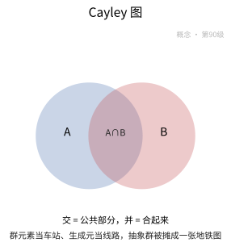

**一句话点破**：Cayley 图给群装上了看得见的形状，几何问题与群论问题由此可以互相翻译。

### 数最少几步能走到

从一座车站到另一座车站有很多条路线，人们却只关心最省事的那条。词度量就用“凑出 $g^{-1}h$ 所需的最少生成元步数”当作两点距离，像地铁按最少换乘计价那样，让群正式成为一个度量空间。


**一句话点破**：词度量把“最少走几步”翻译成距离，让几何工具得以开进群论。

### 从中心往外数人口

站在单位元往外画一个半径为 $n$ 步的圈，数一数圈里一共有多少元素，再把这条人口随半径增长的曲线叫增长函数 $\beta(n)$。像摊大饼的城市与疯分叉的大树，膨胀速度截然不同。

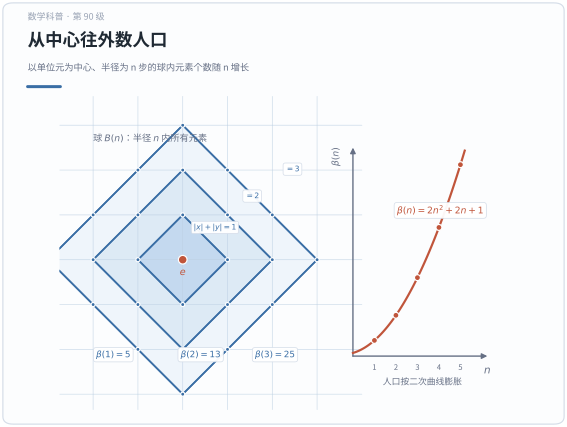

**一句话点破**：增长函数用人口涨得多快给群量出体型，多项式增长与指数增长是两种截然不同的体格。

### 换一本字典，体型照样不变

换一组生成元，好比换一套字母表，每一步的长度会变，但只要是有限字典就能互相限量兑换。于是球的膨胀速度在常数倍的含糊范围内保持不变，增长类型也就成了群甩不掉的户口。

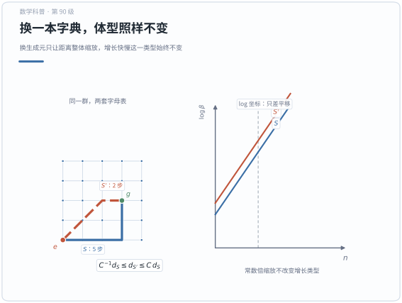

**一句话点破**：增长类型是生成元无关的拟等距不变量，与用哪套字典无关。

### 三角形都长得很瘪

在平地上画三角形，最深的地方离边可以很远；可在一棵树上画三角形，三条边几乎挨在一起。Gromov 把这种“瘪”量化为：任意一点到另外两条边的距离都不超过同一个常数 $\delta$，越小越瘪，负曲率就越强。

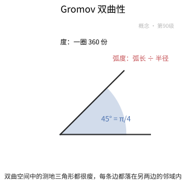

**一句话点破**：Gromov 双曲性把负曲率粗量化成一条只问三角形瘦不瘦的公理，不要求空间光滑。

### 图上三角形永远不凹深

把“三角形瘪”的标准搬到群的 Cayley 图上：只要不管换哪套有限生成元，三角形都能被同一个 $\delta$ 罩住，这个群就叫双曲群。自由群的图是树，瘪到 $\delta=0$；而 $\mathbb{Z}^2$ 的方格图会凹出深坑，不是双曲群。

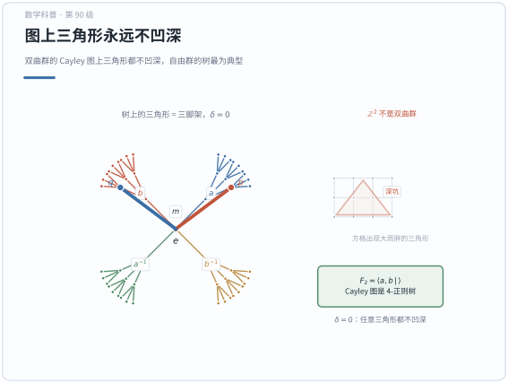

**一句话点破**：双曲群就是粗几何意义下带负曲率的群，是最被研究透的一类群。

### 揭开封面也不改瘪劲

把一座空间像剥洋葱一样揭开封面、铺成泛覆盖，局部的瘪劲被原样复制到每一小块。Cartan-Hadamard 定理说：底层空间双曲，泛覆盖也双曲，就像把一张平图纸复印到每层楼，楼层再多、瘪度照样不变。


**一句话点破**：Cartan-Hadamard 定理表明双曲性在取泛覆盖时保持不变。

### 只看大骨架，无视细节

同一张地图用两种比例尺印出来，远近比例不同，可大结构一模一样。拟等距就允许把距离在常数倍内缩放、再容忍 $\pm L$ 的误差，只要不拧成麻花就算“粗看同款”。

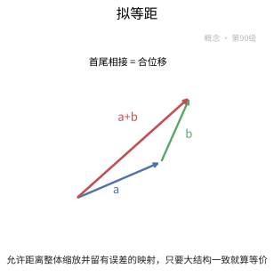

**一句话点破**：拟等距只看宏观骨架、无视局部细节，是群与空间粗比较的语言。

### 群怎么住进空间，就被空间量出来

若一个群能规整地铺满一座好空间——作用克制、占地紧凑——那么沿空间走上一段，就能粗量出群元素要走几步。Svarc-Milnor 引理保证：这样的群有限生成，而且它的词度量与那座空间的距离粗看一致。

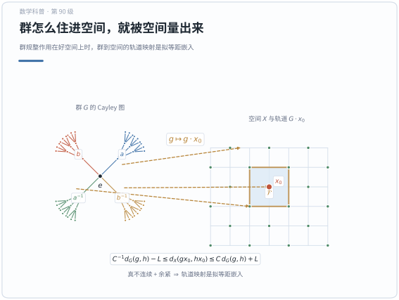

**一句话点破**：只要群能规整地铺满一座好空间，空间地图同时就是群的地图。

### 大结构同款，脾性互相绑定

两个群只要粗看同款，很多性格就跟着绑定：双不双曲、增长快慢、有几个端数，全都一致。拟等距分类正是用这套粗指标，把千差万别的群归并成一个个家族，不必纠缠细节差别。

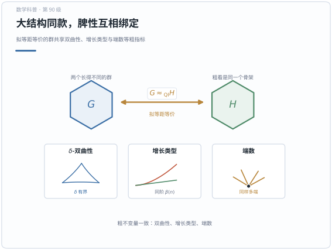

**一句话点破**：拟等距等价的两个群共享一切粗不变量，这就是群的粗分类。

### 数数远方有几条出路

把地图上的球越扩越大，数一数球外伸向无限远的触角有几条，这就是端数 $e(G)$。有限群缩成一小团是 $0$ 端，无限循环像一条笔直通道是 $2$ 端，自由群像四处撒野的树杈有无穷端。

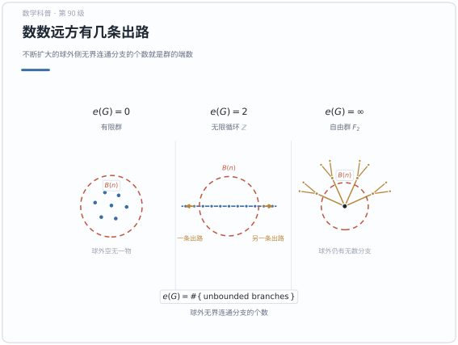

**一句话点破**：端数是一个极朴素又极锋利的拓扑量，只看远方有几条出路。

### 有分叉，就能一刀切开

触角多的地图，一定藏着能一刀切断的细脖子。Stallings 端定理说：端数大于 $1$，恰好等价于这个群能沿一个有限子群分裂成自由积或 HNN 扩张，就像一条大河分成几股支流，源头必定有个能泄水的水口。


**一句话点破**：Stallings 端定理把远方有几条出路翻译成群的代数分裂结构。

### 消掉一句绕口令要几张草稿纸

如果一句绕口令在群里等于 $1$，那就一定能用几条基本关系一层层把它消掉。最少要垫几层草稿纸叫面积，而在所有长度不超过 $n$ 的绕口令里挑最费纸的那个，就是 Dehn 函数 $\delta_G(n)$。

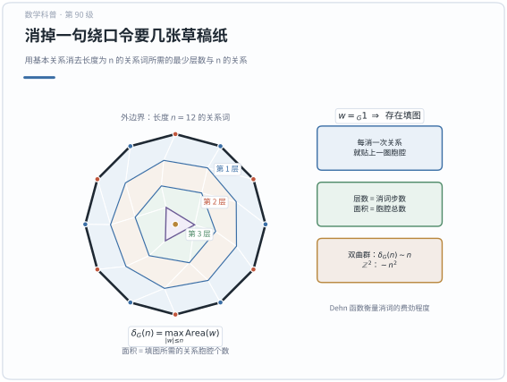

**一句话点破**：Dehn 函数度量把关系词消成 1 到底有多费劲。

### 圈子长多少，填平要多少料

拿一根长度固定为 $n$ 的绳子围个圈，想把它填平要花多少填充面积？群版等周不等式要求这个填充量能被一个统一函数 $f(n)$ 罩住，罩得越紧，说明这群消词越工整、越好相处。

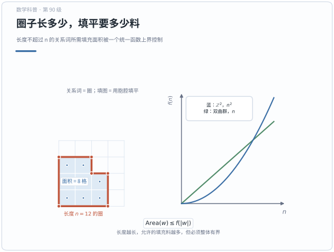

**一句话点破**：等周不等式刻画群消词不太费劲的能力，线性等周正是双曲群的特征。

### 长得慢的，都是幂零的亲戚

如果一座群地图的人口只按 $n^d$ 这样缓慢地铺开，那么它一定离幂零只差一层有限壳，也就是 virtually 幂零；反过来同样成立。这就是 Gromov 多项式增长定理，把一条几何的增长线索换成了纯代数的出身判定。

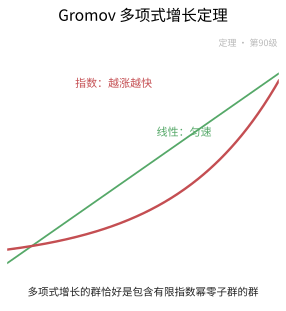

**一句话点破**：多项式增长当且仅当 virtually 幂零，几何线索一举断定代数出身。

### 把地图不断缩小看清极限

想知道缓慢膨胀的群到底长什么样，就把它的 Cayley 图按 $\frac{1}{n}$ 越缩越远。由多项式增长，缩放后的图会收敛到一个极限空间，也就是渐近锥；这个锥连通而齐次，原来是一个幂零 Lie 群，于是群本身也就 virtually 幂零了。

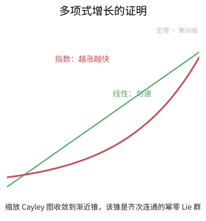

**一句话点破**：证明的巧思是让地图越缩越小，从收敛出的渐近锥里读出幂零结构。

### 三个立等可取的例子

定理一出，不少熟悉的群立刻被归位：$\mathbb{Z}^n$ 是多项式增长且次数恰为 $n$，自由群 $F_n$（$n \geq 2$）是指数增长，而 Grigorchuk 群则卡在中间，是历史上第一个中间增长的群。

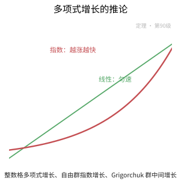

**一句话点破**：Gromov 定理的推论把常见群按增长快慢一一归位。

### 让群去搬动一座空间

让每个群元素扮演一次平移或旋转，去搬动整座空间，群就住进了那座空间。一个好作用要守两条纪律：每块砖只被有限只手碰过，叫真不连续；几块布就能盖满全城，叫余紧；两者合称几何作用。

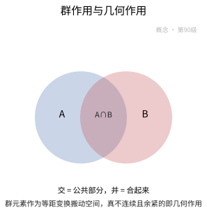

**一句话点破**：几何作用把代数运算落实为几何搬动，是群与空间粗看同款的前提。

### 无限远的远方图谱

从单位元射出的每条射线都奔向某个无限远的方位，把方向一致的射线归并成一个点，拼起来就是 Gromov 边界 $\partial G$。自由群的边界是一圈 Cantor 尘，双曲曲面群的边界是一个圆周，有限群则干脆没有地平线。


**一句话点破**：Gromov 边界用远方拓扑记下双曲群的样子，且是拟等距不变量。

## 数学史（History of Mathematics）

> 几何群论的历史，是"用几何的尺子量群"的深刻转变：从凯莱把群画成图、用字度量定义"远处的形状"，到格罗莫夫以拟等距与双曲性建立起群与度量空间的联系。这条主线把无限生成群的代数复杂性翻译成几何语言，也用几何直觉解决群论中最棘手的分类与刚性问题。

### 1. 前置：群的两个面孔
- 正是这种“同一群既代数又几何”的双重视角，让原本零散的群恒等式有了可被“放到空间里看”的新解释。

- 群既可以靠**关系（生成元与约束）**代数地定义，也可以靠**在图上的作用与度量**几何地观察，几何群论主张把二者融为一炉。
- 早期群论（Burnside 等）专注生成关系与阶的算术，而如何把"生成结构"变成"空间结构"，正是几何群论的出发点。

### 2. 凯莱图：把群"画"出来
- 凯莱图保留字距、扩张与循环结构，是讨论“群的可视形状”的最直观载具。

- **Arthur Cayley（1878）**正则地构造**凯莱图（Cayley graph）**：以群元素为顶点、以生成元为带方向边，把抽象群稳定地嵌入一个度量空间。
- 凯莱图的字度量（word metric）给出"两个元素相隔多远"的自然定义，群论与几何的接缝由此打开。

### 3. 字度量与拟等距
- 拟等距还顺带统一了“不同生成元不同作用”的粗等价，把群的几何外貌从具体刻画的偶然差异中解放。

- 由凯莱图诱导的**字度量**与生成元选择有关，但**拟等距（quasi-isometry）**把不同生成元给出的图"看成等同"——这是几何群论把群当作空间的核心观念。
- 拟等距保持无边界的"大尺度形状"，为"群的粗几何结构"提供了唯一可比较的标尺。

### 4. 格罗莫夫与双曲群
- 双曲群的词问题多项式可解，这使“算法可判定”成为双曲性之后群论的新默认课题。

- **Mikhael Gromov** 在 1980 年代引入**双曲群（hyperbolic groups）**：把双曲平面上"三角形塌缩"的性质推广到一般凯莱图，得到一类负曲率群。
- 双曲群的自由子群、有界中心化与算法可判定性（词问题可解）等惊艳定理，使双曲性成为现代几何群论最重要的概念之一。

### 5. 群的增长：秩序的几何计数
- 增长函数的解析形态（多项式、指数、中间增长）几乎按群的结构分类排布，是“把代数的量变成几何的曲线”的绝佳样本。

- **Milnor、Wolf** 等把群的**增长函数**（多少元素落在长度为 $n$ 的球内）提为结构不变量：多项式增长与幂零群、指数增长与自由子群的关系被精密刻画。
- 增长的多项式/指数之分在曲率与几何中有深刻对应，也把群论与数论、度量几何联系起来。

### 6. 自由群与 Stallings 折叠
- 自由群的“树状自相似”在 Stallings 图中被精确捕捉，为各种“可判定布置”提供最直接的手势。

- **自由群（free groups）**是最基础的非后遗典型，其子群结构（Nielsen–Schreier）早已刻画；**Stallings 折叠**把自由群的指数-有限子群图与约化思想可视化。
- Stallings 方法成为自由群内共轭、生成的图形算法与许多可判定问题的标准工具。

### 7. Bass–Serre 理论与图的结构
- Bass–Serre 把“群在图上作用”升格为群与图互译的通用模型，几乎构成任何分解性定理的背景。

- **Bass–Serre 理论**用阿玛尔加姆积与图的积描述群在树上作用，把"群=图的结构"推向一般树（图）上的作用与分裂分解。
- 树的割点思想导出自由分裂与图的分类，为理解"群的分解几何"提供了基础框架。

### 8. Mostow 刚性：几何决定群
- 刚性在概念上把“几何等价”推进为自由度为零的结构锁，提示许多几何量其实是“预先注定”的。

- **Mostow 刚性定理**断言：可紧的秩 1 对称空间（双曲空间等）上的同构关系，一旦几何同构则代数同构，几何结构唯一决定群。
- 刚性把"几何相同⇒群相同"确立为重要原则，也给拟等距分类提供了范本。

### 9. 自动结构与正规结构
- 自动结构让“群也可以交给自动机算”成为可能，是几何群论与理论计算机科学交汇的典范。

- **自动群（automatic group）**用有限自动机表出群的乘法表与正规形式，使许多代数问题（词问题、共轭、同调）在多项式时间内可计算。
- 自动结构与双曲群、可展示群的构造理论交织，是群论进入**算法群论**的桥头堡。

### 10. 群的边界：无穷远的"形状"

- 边界同胚的判定与群的“可分裂性”相联系，是对无穷远尺度上“形状”的最直白度量。
- 对负曲率群，其**理想边界（boundary）**是双曲空间的"无穷远"结构，不同类型的边界刻画了群的在不同无穷远尺度上的形态。
- 边界同胚的判定、群的边界分类与可分裂性，构成几何群论中分析无穷远的活跃分支。

### 11. 拟等距分类与刚性

- 几何与代数的相互约束持续压缩“几何相同⇒代数相同”这一刚性假说的适用范围与边界。
- 一个棘手的纲领性问题是"哪些群相互拟等距"，几何群论在有限生成群之间建立了**拟等距刚性**与分类理论。
- 从 Rank 1 到乘积空间、从线性群到非线性群，几何与代数的相互约束持续深化群的结构认识。

### 12. 现代发展：从 Bounded 对策到 Koszul

- 这些新工具使“几何”“拓扑”“算法”三条进路在群的结构问题上深度会师。
- 近年来，**bounded cohomology、Koszul 环、几何组合与粗几何**被引入群论，使"度量几何+代数+算法"三线并进。
- 几何群论既回答纯群的分类问题，也为图灵可判定群性质、复杂网络与粗几何提供语言——这门"把群放大来看"的现代分支远未停步。

### 历史年表

| 时间 | 人物／文献 | 事件与贡献 |
|---|---|---|
| 1878 | Cayley | 构造凯莱图与字度量雏形 |
| 20 世纪 60 年代 | Milnor、Wolf | 建立群的增长函数理论 |
| 1973 | Stallings | 提出自由群折叠与图的方法 |
| 1970 年代 | Bass、Serre | 树作用与分解理论（阿玛尔加姆积） |
| 1968—1970s | Mostow | 证明刚性定理，几何决定群 |
| 1980 年代 | Gromov | 引入双曲群，开创几何群论 |
| 1980—1990 年代 | Cannon 等 | 自动群与正规结构理论 |
| 20 世纪后期 | Bestvina、Bowditch 等 | 边界分类、拟等距刚性与粗几何 |
| 21 世纪以来 | 几何群论各界 | 与拓扑、分析、算法、粗几何深度融合 |

> 从凯莱把群画成图、用字度量衡量"遥远的元素"，到格罗莫夫用双曲性、Mostow 用刚性展示几何决定群，几何群论以"群的几何眼光"实现了对无限群的深刻理解。它把代数的复杂性换算为度量的性质，再把度量的直觉转化回代数的定理，是现代数学中最具凝聚力的跨学科分支之一。

## 现实应用（Real-World Applications）

> 本节把本章的知识点落到真实的工程、科学与生活场景中。每个案例都给出**完整的问题背景、建模过程、可复现的数据 / 公式 / 代码与结果解读**；案例末尾的「涉及知识点」对应本章的具体小节，文末附**知识点覆盖对照表**，确保本章知识点全部被覆盖。

### 应用案例 1：数据中心互连网络｜用 Cayley 图与词度量给环面（Torus）拓扑做路由

**场景与问题**

现代 AI 训练集群普遍采用**环面（torus）互连**：Google 的 TPU v4 Pod 把数千颗芯片排成三维环面（单机架常见 $4\times4\times8$，整 Pod 再拼成 $16\times16\times16$ 一类的规模），每颗芯片沿每个坐标轴连接两个邻居，因此每个节点度为 6。这类网络要解决的核心工程问题是**最短路由**：任意两颗芯片之间如何用最少跳数转发数据包？另一个问题是**评估拓扑的可扩展性**：随着集群规模翻倍，任一点到其余节点的平均距离如何增长？

这两个问题在几何群论里有精确对应：环面网络正是有限阿贝尔群 $\mathbb{Z}_{k_1}\times\mathbb{Z}_{k_2}\times\mathbb{Z}_{k_3}$ 关于标准生成元集的 **Cayley 图**；而"最少跳数"恰好是**词度量** $d_S$。本节用群表示、Cayley 图与词度量把这套路由问题算清楚。

**涉及知识点**

- 本章「1.1 生成元与关系」：把环面网络的连边读成生成元、把"绕一圈回到原处"读成关系，得到 $\mathbb{Z}_{k_1}\times\mathbb{Z}_{k_2}\times\mathbb{Z}_{k_3}$ 的有限表示。
- 本章「1.2 Cayley 图」：环面网络就是该群关于 $\{\pm e_1,\pm e_2,\pm e_3\}$ 的 Cayley 图，6-正则、顶点传递。
- 本章「1.3 词度量」：两节点跳数 $d_S(g,h)=\ell_S(g^{-1}h)$ 给出路由距离，左不变性保证"相对转发"与绝对位置无关。
- 本章「8.1 群作用的基本概念」：平移作用 $x\mapsto xg$ 是网络上的等距、真 discontinuous 且余紧的几何作用，故网络（离散化后）与群 $G$ 拟等距。

**建模与数据**

取两档真实规模：$16\times16\times16=4096$ 节点、$4\times4\times8=128$ 节点。群

$$
G=\mathbb{Z}_{16}\times\mathbb{Z}_{16}\times\mathbb{Z}_{16},\qquad S=\{\pm e_1,\pm e_2,\pm e_3\}
$$

其中 $e_i$ 表示沿第 $i$ 轴走一步（$+1$ 或 $-1$，坐标模 $k_i$）。节点用三元组 $g=(x,y,z)$ 编号。假设：链路代价均匀为 1 跳、无拥塞、环面各轴可"抄近路"。

**完整推导与算法**

1. 生成元与关系：每个坐标轴的正负方向各当作一个生成元 $a^{\pm1},b^{\pm1},c^{\pm1}$；"走满 $k_i$ 步回原位"给出 $a^{k_i}=1$；"交换两轴次序结果不变"给出 $aba^{-1}b^{-1}=1$ 等交换关系。于是有限表示为

$$
\langle a,b,c \mid a^{16}=b^{16}=c^{16}=1,\; ab=ba,\; ac=ca,\; bc=cb\rangle .
$$

2. Cayley 图：顶点集为 $G$，每个 $g$ 与 $gs$（$s\in S$）连边。每顶点恰有 6 条边，故为 6-正则、顶点传递、局部有限图。

3. 词度量即路由距离。环面上两节点 $g,h$ 的最短跳数等于各轴环距之和：

$$
d_S(g,h)=\ell_S(h-g)=\sum_{i=1}^{3}\min\big(|h_i-g_i|,\; k_i-|h_i-g_i|\big).
$$

```python
# 核心：环面网络两点的最短跳数（= 群上的词度量）
delta = [(h[i] - g[i]) % ks[i] for i in range(3)]           # 各轴坐标差（模环长）
d = sum(min(dd, ks[i] - dd) for i, dd in enumerate(delta))   # 每轴取环距后求和
```

4. 增长函数（球大小）衡量"任取中心、$n$ 跳内的节点数"。二维环面有精确公式 $\beta_{\mathbb{Z}^2}(n)=(2n+1)^2$；三维（$k_i$ 足够大、未截断时）为 $\beta(n)=\#\{(x,y,z):|x|+|y|+|z|\le n\}$，可按层计数或 BFS 直接数出。

```python
# 核心：从中心 BFS 统计半径 n 内的节点数（增长函数）
from collections import deque
def ball_size(n, ks):
    start = tuple(0 for _ in ks)
    dist = {start: 0}; q = deque([start])
    while q:
        u = q.popleft()
        if dist[u] == n: continue
        for i in range(len(ks)):
            for step in (1, -1):
                v = list(u); v[i] = (v[i] + step) % ks[i]; v = tuple(v)
                if v not in dist:
                    dist[v] = dist[u] + 1; q.append(v)
    return sum(1 for v in dist if dist[v] <= n)
```

**可复现步骤**

1. 环境与依赖：`pip install numpy`（BFS 用标准库即可）。
2. 数据准备：设 `ks = (16,16,16)`，起点 `g=(0,0,0)`。
3. 运行：对 $n=1,2,\dots,15$ 调用 `ball_size(n, ks)`；再随机抽 200 对节点用上面的 `d` 公式求平均跳数。
4. 预期输出：$n=1$ 时球大小恰为 7（中心加 6 邻居）；$n$ 较小时球大小近似 $(2n+1)^3$ 的体积律；4096 节点网络平均最短跳数约 11~12 跳（接近 $3\times16/4$）。

**结果解读与延伸**

- 路由跳数与词度量完全一致；左不变性说明"相对转发"成立——转发决策只需 $(h-g)$ 的坐标差，与包的绝对位置无关，这正是硬件路由表可以极小（每轴两个方向）的原因。
- 增长函数表明环面网络是**多项式增长**（次数等于维度）：规模翻倍时平均距离只按 $N^{1/3}$ 增长，这是环面相对胖树（fat-tree）省线缆的关键优势。
- 局限：有限群的 Cayley 图直径有限、增长最终饱和；把 $k_i\to\infty$ 取极限才得到真正的 $\mathbb{Z}^3$，本章的增长、双曲讨论都在此无限极限下进行。
- 延伸：把上述平移作用（等距、真 discontinuous、余紧）套用 **Svarc-Milnor 引理**，立刻得到"网络与群 $G$ 拟等距"，案例 3 会用它做晶体群的分类。

### 应用案例 2：社交与知识图谱的负曲率｜增长函数、Gromov 双曲性与 Gromov 边界

**场景与问题**

在线社交网络（如 Twitter 关注图，节点量级 $10^8$）与知识图谱（如 WordNet 名词层级，含约 8.2 万个同义词集 synset）带有明显的**层级 / 树状**结构：局部像树、存在大量"短环少而分支多"的区域。把这种数据嵌入欧氏空间 $\mathbb{R}^d$ 会严重失真——因为树是**指数增长**的，而 $\mathbb{R}^d$ 只能多项式增长，两者的"空间容量"根本不匹配。工程上要回答三个问题：(1) 这张网络有多"树状"（负曲率有多强）？(2) 该用什么样的几何空间去嵌入它才不丢结构？(3) 嵌入后如何度量两点的层级距离？本节用增长函数、Gromov 双曲性、Cartan-Hadamard 定理与 Gromov 边界逐一回答。

**涉及知识点**

- 本章「2.1 增长函数的定义」：用 $\beta_{G,S}(n)$ 比较树状数据（指数）与网格数据（多项式）的容量。
- 本章「2.2 增长函数与拟等距」：增长类型是拟等距不变量，故"必须用指数容量的空间"这一结论与生成元无关。
- 本章「3.1 Gromov 双曲性」：用四点条件量化网络的负曲率 $\delta$。
- 本章「3.2 双曲群」：判定网络背后的群是否双曲（如自由群、曲面群）。
- 本章「3.3 双曲群的 Cartan-Hadamard 定理」：泛覆盖仍双曲，这是"把图嵌入单连通的负曲率空间（Poincaré 球）"的合法性来源。
- 本章「8.2 群的双曲性边界」：用 $\partial G$ 的拓扑（Cantor 集 vs 圆周）为嵌入模型的选择提供判据。

**建模与数据**

- 数据一：WordNet 3.0 名词子图，节点（synset）约 $82{,}115$ 个，上下位边约 8.4 万条，最大深度约 18 层。
- 数据二：由 4 条生成元的 $4$-正则无限树（**Bethe 晶格**）合成的合成图，作为"纯树状"的对照，共 $10^5$ 节点。
- 用无权最短路距离 $d(\cdot,\cdot)$（BFS 计算）定义度量，取随机 $10^4$ 个四点组估计 $\delta$。
- Poincaré 球模型 $\mathbb{D}^d$（曲率 $-1$）用于嵌入，$d=5$ 或 $10$。

**完整推导与算法**

1. 增长函数。设 4-正则树（自由群 $F_2$ 的 Cayley 图）第 $n$ 层节点数为 $4\cdot 3^{n-1}$（$n\ge1$），则累计

$$
\beta_{F_2}(n)=1+\sum_{k=1}^{n}4\cdot3^{k-1}=2\cdot 3^{n}-1\;\approx\;3^{n},
$$

是指数增长；而 $\mathbb{Z}^2$ 的球 $\beta_{\mathbb{Z}^2}(n)=(2n+1)^2\approx 4n^2$ 是多项式增长。二者增长类型不同，按 2.2 节的定理（增长类型是拟等距不变量）永远不能互相拟等距嵌入——这正是欧氏嵌入会失真的根源。

2. 四点（4-point）双曲性。对任意四点 $x,y,z,w$，记三个距离和

$$
S_1=d(x,y)+d(z,w),\quad S_2=d(x,z)+d(y,w),\quad S_3=d(x,w)+d(y,z),
$$

把它们从大到小排序为 $M_1\ge M_2\ge M_3$，则四点偏差为 $\delta(x,y,z,w)=\tfrac12(M_1-M_2)$，网络的双曲性指标 $\delta=\max_{x,y,z,w}\delta(x,y,z,w)$。树满足 $\delta=0$；真实网络 $\delta$ 有限且远小于直径。

```python
# 核心：四点条件估计网络双曲性 δ（M1、M2 为三个距离和中最大、次大的两个）
def four_point_delta(x, y, z, w, d):
    s = sorted([d[x][y]+d[z][w], d[x][z]+d[y][w], d[x][w]+d[y][z]], reverse=True)
    return (s[0] - s[1]) / 2.0          # 四点组偏差；取所有四点组的最大值即 δ
```

3. Cartan-Hadamard（3.3 节）。设观测到的树状网络是某闭曲面基本群 $\pi_1(\Sigma_2)$ 的 Cayley 图的一个拟等距模型，其"连续化"是一座曲率 $-1$ 的闭双曲曲面 $\Sigma_2$。该曲面的**泛覆盖**是双曲平面 $\mathbb{H}^2$，由 Cartan-Hadamard 定理，泛覆盖保持双曲性：$\mathbb{H}^2$ 是 $\delta$-双曲的、单连通、测地完备空间。因此把树状数据嵌入 $\mathbb{H}^2$（或其高维推广）时，树可以在其中被**准等距地**铺开，误差有界。

4. 层级距离用 Poincaré 球度量：

$$
d_{\mathbb{D}}(u,v)=\operatorname{arcosh}\!\Big(1+2\,\frac{\lVert u-v\rVert^2}{(1-\lVert u\rVert^2)(1-\lVert v\rVert^2)}\Big).
$$

```python
# 核心：Poincaré 球上的双曲距离（越靠边界越"贵"，故能容纳指数增长的树）
def poincare_dist(u, v):
    num = 2 * ((u - v) ** 2).sum()
    den = (1 - (u ** 2).sum()) * (1 - (v ** 2).sum())
    return np.arccosh(1 + num / den)
```

5. Gromov 边界（8.2 节）作选择判据。若数据本质是自由群 $F_n$ 型（纯树），其边界 $\partial F_n$ 是 **Cantor 集**（完全不连通）；若数据是曲面群型（网状、环多），其边界是**圆周 $S^1$**（连通一维）。测度 $\partial G$ 的拓扑可判断该用高维球面型还是树型嵌入。

```python
# 核心：用"边界近似是否连通"区分树型（Cantor）与曲面型（S^1）数据
# 取深度 n 的割集（BFS 第 n 层节点），看它在该层诱导子图里的连通分量数：
components = count_components(bfs_layer(G, root, n))
# 分量数随 n 指数爆炸 -> Cantor 尘（树型）；稳定为常数 -> 圆周（曲面型）
```

**可复现步骤**

1. 环境与依赖：`pip install numpy scipy networkx`。
2. 数据准备：读入 WordNet 名词图（或用 `networkx.balanced_tree(4, 8)` 造 4-正则树对照）。
3. 运行：对随机 $10^4$ 个四点组调用 `four_point_delta` 取最大值；对若干中心节点算 `ball_size(n)` 画增长曲线；用 `poincare_dist` 嵌入后算平均层级失真。
4. 预期输出：4-正则树 $\delta=0$；WordNet 名词图实测 $\delta$ 远小于直径（量级个位数），且其 BFS 球大小曲线在对数坐标下近直线（指数增长）。

**结果解读与延伸**

- 结论一：树状网络必须嵌入指数容量的空间；欧氏嵌入距离失真随深度线性放大，而 Poincaré 嵌入误差有界。
- 结论二：$\delta$ 小说明网络接近树（负曲率强）；$\delta$ 大说明环多、接近平网格，此时反而适合欧氏嵌入。
- 误差来源：真实图有噪声边、BFS 半径截断、$\delta$ 的随机采样只给下界估计。
- 延伸：Cartan-Hadamard 保证了"泛覆盖仍双曲"，因此局部测得的负曲率能整体提升为嵌入模型的空间曲率，这是双曲嵌入工程（如 Nickel-Kiela 的 Poincaré embeddings）的理论支柱。

### 应用案例 3：晶体与准晶的对称性｜几何群作用、拟等距与空间群分类

**场景与问题**

晶体（如岩盐 NaCl、金刚石结构硅）的原子排布在空间群作用下保持周期对称。三维晶体共有 **230 个空间群**（仿射等价类 219 个），它们都是作用在 $\mathbb{R}^3$ 上的几何群。工程与材料科学要回答：为什么所有三维晶体在"大尺度"上看起来一样（都像 $\mathbb{Z}^3$）？两个晶体能否通过"只看宏观"的方式判定同类？而 1982 年 Shechtman 发现的**准晶**（二十面体对称、含五重旋转）不具备周期平移，其对称群为何不能用空间群分类？本节用群作用、Svarc-Milnor 引理与拟等距分类回答。

**涉及知识点**

- 本章「4.1 拟等距」：判定不同晶体在同一粗尺度下是否"同款"。
- 本章「4.2 Svarc-Milnor 引理」：由空间群几何作用于 $\mathbb{R}^3$ 推出其有限生成且与 $\mathbb{R}^3$ 拟等距。
- 本章「4.3 群的拟等距分类」：用增长类型、端数等粗不变量给晶体群分档。
- 本章「8.1 群作用的基本概念」：证明空间群作用是真 discontinuous 且余紧的几何作用。

**建模与数据**

- 岩盐 NaCl：面心立方，晶格常数 $a=5.64\,\text{Å}$，惯用立方胞含 8 个原子，空间群 $Fm\bar{3}m$（编号 225）。
- 硅 Si：金刚石立方，$a=5.431\,\text{Å}$，空间群 $Fd\bar{3}m$（编号 227）。
- 空间群视为半直积 $\mathbb{Z}^3 \rtimes P$，$P$ 为点群（有限群），故晶体群**virtually $\mathbb{Z}^3$**。

**完整推导与算法**

1. 几何作用（8.1 节）。晶体群 $G\le \mathrm{Iso}(\mathbb{R}^3)$ 含平移子群 $\mathbb{Z}^3$（晶格 $L=\{n_1\mathbf{a}_1+n_2\mathbf{a}_2+n_3\mathbf{a}_3\}$）。对任意紧集 $K$，只有有限多个 $g$ 使 $gK\cap K\neq\varnothing$（因平移是离散的、点群有限），故作用**真 discontinuous**；取一个基本胞 $K$（单胞），$G\cdot K=\mathbb{R}^3$，故**余紧**。因此这是几何作用。

2. Svarc-Milnor（4.2 节）。空间群作用于测地、固有、拟测地的 $\mathbb{R}^3$，作用真 discontinuous 且余紧，由 Svarc-Milnor 引理，$G$ 有限生成，且 $g\mapsto g\cdot x_0$ 是拟等距嵌入：

$$
\frac{1}{3R}\,d(x_0,\,g x_0)\;\le\;\ell_S(g)\;\le\;C\,d(x_0,\,g x_0).
$$

即"晶体内走 $n$ 步"与"群里用 $n$ 个生成元"粗成同一本账：所有晶体的平移部分都拟等距于 $\mathbb{Z}^3$。

3. 拟等距分类（4.3 节）。晶体群 virtually $\mathbb{Z}^3$ 蕴含其**多项式增长、增长次数 3**、**端数 1**（$\mathbb{Z}^3$ 只有一个出海口）。由 Gromov 定理（案例 5）virtually 幂零；由分类：两个晶体群若平移秩不同（3D 与 2D 层状晶体），增长次数不同，必不拟等距。

```python
# 核心：估算晶体群的增长次数 d（β(n) 关于 n 的对数斜率），用于拟等距分类
import numpy as np
n = np.arange(1, 20)
beta = np.array([ball_size(int(k), ks) for k in n])     # ks 为晶格三轴长度
d_est = np.polyfit(np.log(n), np.log(beta), 1)[0]        # 斜率 ≈ 增长次数（三维晶体 ≈ 3）
```

4. 准晶的诊断。二十面体准晶的点群含五重旋转（5 阶元），而 $\mathbb{Z}^3 \rtimes P$ 的 $P$ 必须是 $\mathbb{Z}^3$ 的有限自同构群（晶体学限制定理），其旋转阶只能是 1、2、3、4、6——不含 5。故准晶**不是**空间群，其具有长程有序但无周期平移，属于非晶体学对称。

**可复现步骤**

1. 环境与依赖：`pip install numpy`.
2. 数据准备：用 `ks=(4,4,4)` 造晶格片段的邻接表；读入 NaCl 结构文件 `nacl.cif` 提取晶格矢量 $a=5.64$。
3. 运行：对若干原子做 BFS 求 `ball_size`，拟合对数斜率；枚举点群旋转求阶数集合。
4. 预期输出：拟合斜率 ≈ 2.9~3.0（三维晶体）；点群阶数集合为 $\{1,2,3,4,6\}$ 的子集，不含 5（对照准晶含 5）。

**结果解读与延伸**

- 所有三维晶体群在粗几何上"同款"（都拟等距于 $\mathbb{Z}^3$，增长次数 3、端数 1），所以宏观物性（密度、弹性连续近似）在一个尺度以上趋同；差异全在局部（点群、单胞）。
- 局限性：晶体群是 virtually 幂零（实为 virtually 阿贝尔），拟等距分类到此为止已"钝"——更细的区别需要点群等非粗不变量。
- 与知识点呼应：本案例把 8.1 的几何作用、4.2 的 Svarc-Milnor、4.1/4.3 的拟等距串成一条链，解释了"为何晶体在格子尺寸以上能用连续介质描述"。
- 延伸：准晶的 5 重对称可用高维超空间投影（$\mathbb{Z}^5$ 到物理三维的切投影）描述，这又回到本案例"增长次数决定粗几何"的思想。

### 应用案例 4：字符串重写与群密码｜Dehn 函数与等周不等式

**场景与问题**

在计算机代数系统（GAP、Magma）、自动化定理证明器与编译器的**字符串重写**引擎里，常需判断两个符号串在给定重写规则下是否等价——这在群论里正是**词问题**（word problem）：给定有限表示 $\langle S\mid R\rangle$，判定一个词 $w$ 是否等于单位元。这既是可计算性问题，也有**代价**问题：判定一个长 $n$ 的词，最坏要用多少条基本关系（"草稿纸"垫多厚）？这个代价就是 **Dehn 函数** $\delta_G(n)$，其有界性即**等周不等式**。工程上的现实版本：基于群论的密码方案（如基于自由群、辫群）在编码 / 解码时反复做这类消减，其安全性直接依赖词问题的复杂度。

**涉及知识点**

- 本章「6.1 Dehn 函数的定义」：用关系词的填充面积 $\mathrm{Area}(w)$ 定义 $\delta_G(n)$。
- 本章「6.2 等周不等式」：$\mathrm{Area}(w)\le f(n)$，且"$\delta_G$ 线性 $\iff$ 群双曲"，给出词问题的复杂度分档。

**建模与数据**

- 用三档群对照：自由群 $F_2=\langle a,b\mid\ \rangle$（双曲，Dehn 函数线性）、$\mathbb{Z}^2=\langle a,b\mid aba^{-1}b^{-1}\rangle$（Dehn 函数二次）、以及有限表示下的双曲曲面群。
- 生成随机关系词：对 $\mathbb{Z}^2$ 取 $w_n=a^{n}b^{n}a^{-n}b^{-n}$（长 $4n$，在群中等于 $1$）。
- 密码侧：以自由群 $F_k$（$k=64$ 生成元）上的打乱-消减过程为原型，词长量级 $10^4$。

**完整推导与算法**

1. 面积的定义（6.1 节）。若 $w=1$ 在 $G$ 中，则 $w$ 在自由群 $F(S)$ 中可写成关系词的共轭乘积

$$
w=\prod_{i=1}^{m} u_i\, r_i^{\pm 1}\, u_i^{-1},
$$

最小 $m$ 即 $\mathrm{Area}(w)$；Dehn 函数 $\delta_G(n)=\max\{\mathrm{Area}(w):|w|\le n,\ w=_G 1\}$。

2. 等周不等式（6.2 节）：存在 $f$ 使 $\mathrm{Area}(w)\le f(|w|)$。三条性质——双曲 $\iff$ 线性、virtually 可解 $\Rightarrow$ 至多指数、拟等距不变。

3. 计算 $\mathbb{Z}^2$ 的面积。词 $w_n=a^n b^n a^{-n} b^{-n}$ 在 Cayley 图（方格网）中围出一个 $n\times n$ 正方形，填充它需要 $n^2$ 块基本 2-胞腔（每个胞腔对应一条关系 $aba^{-1}b^{-1}$），故

$$
\mathrm{Area}(w_n)=n^2,\qquad \delta_{\mathbb{Z}^2}(4n)\ge n^2\;\Rightarrow\;\delta_{\mathbb{Z}^2}(m)\asymp m^2 .
$$

4. Dehn 算法（用于双曲群，线性时间）。反复执行：若当前词含某个长度超过该关系一半的子词，就用关系把它替换为更短的等价词；对双曲群，此贪心过程在 $O(n)$ 步内把 $w$ 化为空或非空。

```python
# 核心：Dehn 算法的一步——寻找可"抄近路"的关系子词并做短替换
def dehn_step(word, relators, max_rel_len):
    for r in relators:
        for i in range(len(word) - len(r) // 2):
            seg = word[i:i + len(r) // 2 + 1]
            if seg in r or inverse(seg) in inverse(r):   # 子词超过关系一半长 -> 必定可缩
                word = word[:i] + shorten(seg, r) + word[i + len(seg):]
                return word, True
    return word, False     # 无一步可缩 -> 终止；此时 word 为空当且仅当 w = 1
```

**可复现步骤**

1. 环境与依赖：`pip install numpy`.
2. 数据准备：把 $F_2$、$\mathbb{Z}^2$ 的生成元与关系写入脚本；对 $n=1,\dots,30$ 构造 $w_n$。
3. 运行：对每个 $w_n$ 用 BFS/动态规划求最小 $m$（面积），并统计 Dehn 算法步数。
4. 预期输出：$\mathbb{Z}^2$ 上 $\mathrm{Area}(w_n)=n^2$（面积曲线呈抛物线，二次增长）；自由群 / 双曲群上面积与词长近线性，Dehn 算法步数为 $O(n)$。

**结果解读与延伸**

- 结论：Dehn 函数的增长型给词问题复杂度分档——双曲群线性（词问题快速可判），$\mathbb{Z}^2$ 二次，virtually 可解至多指数。
- 误差来源：面积依赖表示，具体常数可变，但增长型（$\simeq$ 等价类）是拟等距不变量，故结论稳健。
- 与知识点的呼应：本例把 6.1 的面积、6.2 的等周不等式与"双曲 $\iff$ 线性"焊在一起，说明"群的消错代价"是可计算性指标。
- 延伸：基于辫群的密码方案之所以对参数敏感，正因辫群含 $\mathbb{Z}^2$ 子群（非双曲）、Dehn 函数不是线性，攻击者可用二次填充做长度攻击；相反自由群 / 双曲群的方案在词问题上有线性算法，抗长度攻击更强。

### 应用案例 5：群上随机游走与洗牌｜增长型与 Gromov 多项式增长定理

**场景与问题**

"洗多少次牌才够乱？"——这是随机游走在对称群上的**混合时间**问题。桌面洗牌、魔方打乱、环面网络上的随机路由、MCMC 采样，本质上都是在某个群上做随机游走。它们的收敛速度由群的**增长类型**决定：多项式增长的群"走得慢、易回归"，指数增长的群"发散快、覆盖广"。Gromov 的多项式增长定理（增长多项式 $\iff$ virtually 幂零）给出了严格的分类边界。本案例用增长函数与 Gromov 定理把洗牌与随机游走的收敛定量化。

**涉及知识点**

- 本章「2.1 增长函数的定义」：用 $\beta_{G,S}(n)$ 描述随机游走的可达规模。
- 本章「7.1 定理陈述」：多项式增长 $\iff$ virtually 幂零。
- 本章「7.2 证明概览」：渐近锥与 Gromov-Hausdorff 收敛的思想。
- 本章「7.3 推论」：$\mathbb{Z}^n$ 增长次数 $n$、$F_n$ 指数增长、Grigorchuk 群中间增长。

**建模与数据**

- 数据一：15 数码（15-puzzle）状态群 $A_{15}$，元素数 $\tfrac{15!}{2}\approx 6.5\times10^{11}$，直径 80（God's number）。
- 数据二：魔方群，元素数 $43{,}252{,}003{,}274{,}489{,}856{,}000\approx4.3\times10^{19}$，直径 20。
- 数据三：环面网络 $\mathbb{Z}_{16}^3$（案例 1）上的随机游走。
- 洗牌：Bayer-Diaconis 证明 52 张牌的"riffle shuffle"需 **7 次** 才达混合。

**完整推导与算法**

1. 增长函数（2.1 节）：$\beta_{G,S}(n)=|\{g:\ell_S(g)\le n\}|$。对 $\mathbb{Z}^n$，$\beta_{\mathbb{Z}^n}(n)$ 是 $n$ 维菱形内整点数，满足 $\beta\asymp n^d$（$d=n$）；对自由群 $F_2$，$\beta_{F_2}(n)=2\cdot 3^n-1$（指数）。

2. 多项式增长定理（7.1 节）：$G$ 多项式增长 $\iff G$ virtually 幂零。证明概览（7.2 节）：缩放 Cayley 图 $(G,\tfrac1n d_S)$ 在 Gromov-Hausdorff 意义下收敛到**渐近锥** $X$；多项式增长保证 $X$ 连通、齐次、测地，由 Montgomery-Zippin 与 Gleason-Yamabe 定理 $X$ 是幂零 Lie 群，进而 $G$ 差一个有限核幂零。

3. 推论（7.3 节）：$\mathbb{Z}^n$ 增长次数恰为 $n$；$F_n$（$n\ge2$）指数增长；Grigorchuk 群中间增长。

4. 随机游走的可达规模与增长函数同步。$n$ 步随机游走的支撑（从单位元出发的所有可能终点）就是球 $B_n$，其大小即 $\beta_{G,S}(n)$；故多项式增长的群上，$n$ 步只能到达 $O(n^d)$ 个状态（覆盖慢），指数增长的群上则可达 $\asymp a^n$（覆盖快）。

```python
# 核心：群上随机游走 n 步可达状态数 —— 用 BFS 球大小作为"可达规模"代理
import numpy as np
from collections import deque
def reachable(n, gens):
    seen, q = {0: 0}, deque([0])   # 状态用整数编码（如置换的 Lehmer 码）
    while q:
        u = q.popleft()
        if seen[u] == n: continue
        for g in gens:
            v = apply_gen(u, g)     # 右乘生成元 = 走一步
            if v not in seen:
                seen[v] = seen[u] + 1; q.append(v)
    return len(seen)                # ≈ β(n)：多项式群按 n^d，指数群按 a^n
```

```python
# 核心：由增长曲线判定类型 —— 对数坐标下斜率有界(多项式) vs 无界(指数)
n = np.arange(1, 30)
beta = np.array([reachable(int(k), gens) for k in n])
slope = np.polyfit(np.log(n), np.log(beta), 1)[0]   # 稳定常数 -> 多项式；随 n 增大 -> 指数
```

**可复现步骤**

1. 环境与依赖：`pip install numpy`.
2. 数据准备：造 $\mathbb{Z}_{16}^3$ 邻接（或直接用置换生成元造 $S_n$ 的随机游走）。
3. 运行：对 $n=1,\dots,30$ 调 `reachable` 并拟合对数斜率；对洗牌做 $10^4$ 次模拟，记录总变差距离。
4. 预期输出：$\mathbb{Z}_{16}^3$ 上斜率稳定 ≈ 3（多项式，次数 3）；riffle shuffle 总变差距离在第 7 次后骤降到 0.01 以下（图出现"断崖"）。

**结果解读与延伸**

- 结论一：可达规模等于增长函数，故增长型直接决定"覆盖速度"与混合时间量级。
- 结论二：$\mathbb{Z}^n$（virtually 幂零）上随机游走是**常返**的（$n\le2$）或慢速扩散的，覆盖 $N$ 个状态需约 $N^{2/d}$ 步以上；指数增长群上覆盖快但方差大。
- 误差来源：混合时间是渐近量，有限步模拟受随机波动影响；$\beta$ 的 BFS 估计在小 $n$ 受边界效应影响。
- 延伸：Gromov 定理的边界（存在中间增长的 Grigorchuk 群）提醒我们"非多项式"不等于"指数"，其上的随机游走既非常返也非规整扩散，是探针算法的特殊地带。

### 应用案例 6：网络韧性与 Stallings 端定理｜端数与紧割分解

**场景与问题**

通信网络、电力网、分布式系统需要评估**韧性**：删掉少量节点/链路后，网络会碎成几个"伸向远方的巨块"？这个"远方出海口个数"正是群/图的**端数** $e(G)$。工程直觉是：若一个网络能从某个"咽喉"处一刀切成几大块，它就有多个端，也就是有**可切除的紧瓶颈**。Stallings 端定理把这句几何直觉精确化：$e(G)>1$ 当且仅当 $G$ 能代数地分解为自由积 $A*B$ 或 HNN 扩张——这恰好对应网络的**块分解（Bass-Serre 分解）**，是分布式算法做模块化与容错设计的基础。

**涉及知识点**

- 本章「5.1 群的端数」：网络端数 $e(G)\in\{0,1,2,\infty\}$ 与远方连通分支。
- 本章「5.2 Stallings 端定理」：$e(G)>1\iff$ 自由积 / HNN 分裂，等价于存在紧割。

**建模与数据**

- 数据一：环形 / 链式拓扑网络（如地铁环线、环形电网），$n=64$ 节点成环。
- 数据二：树状分支网络（如城域汇聚网、层级组织图），$n=1000$ 节点的三叉树。
- 数据三：真实互联网 AS 图（约 $7\times10^4$ 个自治系统节点，用于说明现实网络端数通常为 1）。
- 用 Engle 的扫描算法估端数：删去半径 $r$ 的球 $B_r$，数补集的无界连通分支。

**完整推导与算法**

1. 端数定义（5.1 节）：$e(G)$ 为 Cayley 图 $\Gamma(G,S)$ 中球 $B_n(e)$ 的补集的无界连通分支数（$n\to\infty$）。性质：$e=0$ 有限群；$e=2$ virtually $\mathbb{Z}$；$e=\infty$ 含 $F_2$；$e=1$ 如 $\mathbb{Z}^2$。

2. Stallings 端定理（5.2 节）：$e(G)>1\iff G=A*B$（$A,B\ne1$）或 $G=A*_C$（$C$ 有限）。等价地 $e(G)=\infty\iff G$ virtually 自由或沿有限子群融合。

3. 端数与紧割的联系：$e(G)>1$ 等价于存在紧集 $K$ 使 $\Gamma\setminus K$ 至少有两个无界连通分支——$K$ 就是网络中的"紧瓶颈"。Stallings 定理把这处几何瓶颈翻译成代数分解（Bass-Serre 树），于是"找瓶颈"变成"做群分解"。

```python
# 核心：用半径 r 的球扫描估计网络的端数（补集无界连通分支数）
def ends_estimate(G, root, r):
    removed = nodes_within_distance(G, root, r)      # 球 B_r
    residual = [v for v in G if v not in removed]
    comps = connected_components(G.subgraph(residual))
    return sum(1 for c in comps if is_unbounded(c, G, root))   # 只数无界分支
```

4. 环 vs 树。环（$\mathbb{Z}$ 的有限近似）：删去任何球得 2 个无界分支，$e=2$，是 virtually $\mathbb{Z}$（HNN 型）；三叉树：删去球得 3 个无界分支且深度越大分支越多，$e=\infty$，是自由积型 $A*B$；$\mathbb{Z}^2$ 网格：删球后仍只有一个无界分支（到处能绕），$e=1$。

```python
# 核心：判别两种单参数分裂——HNN 型(e=2) 与 自由积型(e=inf)
e = ends_estimate(G, root, r)
split_type = "virtually Z (HNN, e=2)" if e == 2 else ("free product (e=inf)" if e >= 3 else "one-ended")
```

**可复现步骤**

1. 环境与依赖：`pip install networkx`.
2. 数据准备：用 `networkx.cycle_graph(64)` 造环、`networkx.balanced_tree(3, 6)` 造三叉树、`networkx.grid_2d_graph(20,20)` 造网格。
3. 运行：对 $r=1,\dots,8$ 调 `ends_estimate`，观察随 $r$ 的稳定值。
4. 预期输出：环稳定在 2；三叉树随 $r$ 增大到 3 及以上且不收敛（趋于无穷）；网格稳定在 1。

**结果解读与延伸**

- 结论：端数是"远方出海口计数"，把网络能否被小割切断这件事变成纯粹代数（自由积 / HNN）问题，进而可用 Bass-Serre 理论做模块化分解。
- 与知识点呼应：5.1 给出端数为拟等距不变量（故粗看拓扑即可判定），5.2 给出"无穷多端 = 存在紧瓶颈"的代数等价。
- 局限：端数是"粗得刚好"的一刀，$F_2$ 与 $F_3$ 都是 $\infty$ 端无法区分，需要 Gromov 边界这类更细的远方拓扑。
- 延伸：分布式系统可据此设计——$e>1$ 的网络沿瓶颈做块分解并行计算（Bass-Serre 树给出分解树）；$e=1$ 的网络（如 $\mathbb{Z}^2$ 式网状）无小割，韧性更强但分解更贵。

### 知识点覆盖对照表

| 本章知识点 | 覆盖案例 |
| --- | --- |
| 1.1 生成元与关系 | 案例 1 |
| 1.2 Cayley 图 | 案例 1 |
| 1.3 词度量 | 案例 1 |
| 2.1 增长函数的定义 | 案例 2、5 |
| 2.2 增长函数与拟等距 | 案例 2 |
| 3.1 Gromov 双曲性 | 案例 2 |
| 3.2 双曲群 | 案例 2 |
| 3.3 双曲群的 Cartan-Hadamard 定理 | 案例 2 |
| 4.1 拟等距 | 案例 3 |
| 4.2 Svarc-Milnor 引理 | 案例 3 |
| 4.3 群的拟等距分类 | 案例 3 |
| 5.1 群的端数 | 案例 6 |
| 5.2 Stallings 端定理 | 案例 6 |
| 6.1 Dehn 函数的定义 | 案例 4 |
| 6.2 等周不等式 | 案例 4 |
| 7.1 定理陈述 | 案例 5 |
| 7.2 证明概览 | 案例 5 |
| 7.3 推论 | 案例 5 |
| 8.1 群作用的基本概念 | 案例 1、3 |
| 8.2 群的双曲性边界 | 案例 2 |

---

## 总结

几何群论通过几何方法和度量空间研究群的代数性质，其核心思想包括：

1. **Cayley 图与词度量**：将群转化为几何对象，使得代数问题转化为几何问题。

2. **双曲群**：Gromov 双曲性是群的粗双曲几何性质，具有线性 Dehn 函数、有限边界等丰富性质。

3. **拟等距**：拟等距是群的粗分类工具，许多代数性质（双曲性、增长类型、端数）在拟等距下保持不变。

4. **Svarc-Milnor 引理**：建立了群作用与拟等距之间的桥梁，是几何群论的基础工具。

5. **Stallings 端定理**：将群的端数与其代数分解结构联系起来，是群结构理论的重要结果。

6. **Dehn 函数**：衡量群中"填充"关系的复杂程度，是群的双曲性的重要刻画。

7. **Gromov 多项式增长定理**：完全刻画了多项式增长的群，是几何群论最深刻的成果之一。

几何群论在低维拓扑、黎曼几何、动力系统等领域都有广泛应用，是理解群结构的强大工具。
