# 第 102 级：大偏差理论 (Large Deviations Theory)

---

## 从"为什么罕见的事按指数律坍缩"说起：大偏差理论要解决的根问题

> 在追着 Cramér 定理、速率函数这些名词跑之前，先想清楚一个问题：**中心极限定理明明说了"偏差随 $\sqrt{n}$ 一点点爬"，那真正的'大毛病'（爆仓、破产、破纪录）又是按怎样的速度掉进深渊的？**

**第一步：直觉——第一亿次抛硬币，真的只有"半分之差"吗？**

想象一个极端但真实的问题：某保险公司经营了 $n$ 年，想知道"资产被巨额赔款清零"的概率。中心极限定理会告诉你：赔款总额距期望的偏差大约是 $\sigma\sqrt{n}$ 的量级，相对误差越来越小——听起来很安全。可真正要命的不是"差几个百分点"，而是**"总额跌破总资产"这种离均值极远的稀有事件**。直觉告诉你它"极小"，但到底小成 $10^{-3}$ 还是 $10^{-300}$？两者相差的,不是"300 倍"而是"297 个数量级"——对风控来说天差地别。

再举个更朴素的例子：抛 $n$ 枚公平硬币，问"正面比例 $\ge 3/4$"的概率。你或许会想"反正方差 $\sim\sqrt{n}$，偏差不也就那样"。但如果你真去数，会发现随着 $n$ 变大，这件事的概率**不是按多项式，而是按 $e^{-\frac{n}{\cdots}}$ 那样的指数律一路塌方**——每多加一枚硬币，概率就乘以一个固定的"折扣因子"。**稀有事件的概率是按指数衰减的**，这恰恰是普通中心极限定理看不见的角度。

**第二步：要解决的问题——把"罕见"精确到"以什么速率罕见"**

大偏差理论（LDP）要回答的核心问题是：**对一族随机变量 $\{Z_n\}$，那些"偏离典型行为"的集合 $B$，其概率 $\mathbb{P}(Z_n\in B)$ 近似以多大的指数速率衰减？** 也就是说，

$$
\frac{1}{n}\log \mathbb{P}(Z_n\in B) \;\to\; -\inf_{x\in B} I(x)
$$

这里起着核心作用的，是一个把"每个点 $x$ 有多罕见"编码成非负数的函数——**速率函数 $I(x)$**。它的来龙去脉：

- **瑞典保险公司点破"指数界"**：1930 年代，保险公司担心中心极限定理低估了"赔款总额越界"这类极端事件。**Cramér（1938）** 受托在斯德哥尔摩回答了这个问题，揭示这类"越界"概率以 $e^{-nI(x)}$ 衰减，而 $I$ 正是对数矩生成函数 $\Lambda(\theta)=\log\mathbb{E}[e^{\theta X}]$ 的 **Legendre 变换**——大偏差思想从此破土。
- **Chernoff 把上界收紧，Bahadur 把下界补牢**：**Chernoff（1952）** 用"对偏差做指数变换再取期望"给出简洁尾界；**Bahadur** 则把它用于精确尾部描述，让上下界在同一指数速率 $I$ 处重合。
- **Donsker 与 Varadhan 把单点升格为整套原理**：1970 年代，他们把上述想法抽象成一般度量空间上的"大偏差原理"，并用它给"熵、热力学、统计力学"找到统一的指数律语言——这正是 Dembo & Zeitouni《大偏差技术与应用》、Varadhan 一系列工作的完整脉络。因这项贡献，Varadhan 在 2007 年获得阿贝尔奖。

**第三步：正式定义前的准备——本章怎样一步步推进**

本章按"先立原理、再给定理、再看应用"的顺序走：

1. 先给出 **LDP 的形式化语言**——速率函数、水平集、上下界；
2. 用 **Cramér 定理**处理 i.i.d. 样本均值的 LDP（最经典、最基础的一则）；
3. 用 **Gärtner-Ellis 定理**放宽到"非 i.i.d.、只要对数矩生成函数有极限"；
4. 进入路径空间：**Schilder 定理**给 Brown 运动的小噪声大偏差；
5. 用 **Varadhan 引理与 Laplace 原理**搭起 LDP 与指数型积分之间可逆的桥；
6. 经 **Freidlin-Wentzell 理论**把大偏差与 SDE 的小噪声扰动联系起来；
7. 最后落脚到**稀有事件模拟的渐近效率**（重要抽样）。

读完你会明白：中心极限定理告诉我们"寻常偏差有多大"，大偏差理论则教会我们"真正要命的事有多稀有、以及如何按指数精确估算它们"。

> **🧠 一句话记住大偏差理论的"出生证"**
>
> 大偏差理论要回答的问题是：
>
> $$ \boxed{\text{对于偏离典型行为很远的稀有事件 } \{Z_n\in B\}，\text{ 其概率 } \mathbb{P}(Z_n\in B) \text{ 究竟以怎样的指数速率 } e^{-n\inf_{x\in B}I(x)} \text{ 衰减？}} $$
>
> 速率函数 $I$（通常是 $\Lambda(\theta)=\log\mathbb{E}[e^{\theta X}]$ 的 Legendre 变换）是这片"概率山区"的等高线，$\inf_{x\in B}I(x)$ 就是通往事件 $B$ 的最低山口高度。

## 开始之前

**本章在讲什么**：本章研究"稀有事件概率的指数衰减速率"。你会先学大偏差原理（LDP）的形式定义与速率函数、水平集，再掌握 Cramér 定理、Gärtner-Ellis 定理，进而进入路径空间层的 Schilder 定理、Varadhan 引理与 Laplace 原理、Freidlin-Wentzell 理论，最后了解大偏差在稀有事件模拟（重要抽样）与渐近效率中的应用。

**为什么要学它**：第 98 级（测度论与概率论）的中心极限定理刻画"$\sqrt{n}$ 的寻常波动"，第 101 级（极值概率论）刻画"最大值的长相"；而本章专门刻画"偏离均值的稀有事件按指数坍缩的速度"，是三者里唯一能回答"有多小、小到哪一档"的理论。它与极值理论在金融 VaR/ES、保险破产、通信误码等"尾概率与极端风险"问题上互补咬合——极值理论回答"最大多大"，大偏差回答"越界多稀有"。

**开始前请确认你还记得**：

- i.i.d. 随机变量、矩生成函数 $\mathbb{E}[e^{\theta X}]$ 与对数矩生成函数（见第 98 级 §2.9 特征函数，可作类比）。
- 依分布收敛、中心极限定理、弱大数定律（见第 98 级）。
- 凸分析：凸函数、凸共轭（Fenchel–Legendre 变换）、支撑线（是速率函数的"算术骨架"）。
- 测度论中的开集、闭包、内部、紧致下界半连续函数（LDP 上下界里 $B^\circ,\overline{B}$ 的来源，见第 98 级）。
- Brown 运动与随机微分方程的基本概念（为 Schilder 与 Freidlin–Wentzell 做准备，见第 96、97、98 级）。

---

## 1. 学习目标

完成本教程后，你将能够：

1. 理解大偏差原理的基本概念与速率函数的意义
2. 掌握Cramér定理及其证明方法（指数鞅与Legendre变换）
3. 理解Gärtner-Ellis定理及其推广意义
4. 掌握Schilder定理（Brown运动的大偏差）及其证明
5. 理解Varadhan引理与Laplace原理的联系
6. 掌握Freidlin-Wentzell理论的核心思想
7. 理解稀有事件概率的渐近估计方法
8. 能够独立计算常见随机过程的大偏差速率函数

---

## 2. 核心概念

### 2.1 大偏差原理

> **🌐 直觉先行——为什么"大偏差"要定义成一会儿内部、一会儿闭包的上下界？**
>
> 联系你刚在开场看到的直觉：$\mathbb{P}(Z_n \approx x)$ 大约按 $e^{-nI(x)}$ 衰减，所以"落在集合 $B$ 里"的概率自然由 $B$ 里**最不罕见**的那个点来决定——那个"最低的山口"就是 $\inf_{x\in B}I(x)$。可 $B$ 的边界很麻烦：$B$ 内部的点带"$\le$ 与 $\ge$"的差别虽小，但取 $\inf$ 后会把边界那开关的差别放大成指数级的差别。于是 LDP 用"开集给下界、闭集给上界"来避开边界歧义——**上界用最宽可能（闭包，能含住边界的最高代价点），下界用最窄保证（内部，一定不含边界）**。只要上下界在同一速率上吻合，边界那点歧义就被安全地"打包忽略"，稀有程度有了唯一刻度。

**大偏差原理**（Large Deviations Principle, LDP）是概率论中研究稀有事件（小概率事件）概率衰减速率的一整套理论。设 $\{Z_n\}_{n\ge 1}$ 为一族随机变量（或更一般地，随机元），取值于拓扑空间 $\mathcal{X}$。若存在下界半连续函数 $I: \mathcal{X} \to [0, \infty]$ 和速率序列 $a_n \to \infty$，使得对任意可测集 $B \subset \mathcal{X}$：

$$
-\inf_{x \in B^\circ} I(x) \le \liminf_{n \to \infty} \frac{1}{a_n} \log \mathbb{P}(Z_n \in B) \le \limsup_{n \to \infty} \frac{1}{a_n} \log \mathbb{P}(Z_n \in B) \le -\inf_{x \in \overline{B}} I(x)
$$

则称 $\{Z_n\}$ 满足速率为 $a_n$、速率函数为 $I$ 的**大偏差原理**。其中 $B^\circ$ 为 $B$ 的内部，$\overline{B}$ 为 $B$ 的闭包。

$I(x)$ 称为**速率函数**（Rate Function），它刻画了 $Z_n$ 取值为 $x$ 附近时概率衰减的负对数速率。

#### 课堂问答

**老师**：大偏差原理为什么要同时写四个不等式，而不是一句"$\mathbb{P}(Z_n\in B)\approx e^{-nI}$"？

**学生**：因为边界点会让"最不罕见点"落空。LDP 的标准形式是：对开集 $G$ 给下界、闭集 $F$ 给上界，

$$
-\inf_{x\in G} I(x) \le \liminf_{n\to\infty}\frac1n\log\mathbb{P}(Z_n\in G),
$$

$$
\limsup_{n\to\infty}\frac1n\log\mathbb{P}(Z_n\in F) \le -\inf_{x\in F} I(x).
$$

内部取 $\inf$ 是"保证落得进去"，闭包取 $\inf$ 是"最坏也得付这么多"。

**老师（追问）**：那什么时候一个集合 $B$ 用 $B^\circ$ 还是 $\overline{B}$ 都无所谓？

**学生**：当 $\inf_{x\in B^\circ}I(x)=\inf_{x\in\overline{B}}I(x)$ 时，也就是下确界在 $B$ 内部取得。开区间、闭区间这类"inf 在内部"的集合都属于此列；反过来若 $I$ 的最小点恰落在边界上，比如 $B=[0,1]$ 而 $I(1)<\inf_{x<1}I(x)$，那开闭就真会改变指数速率。

**老师（拓展）**：所以 LDP 的本质是"对数尺度上的渐近"，别当等式用，$e^{-nI}$ 前面还挂着多项式等亚指数因子，对吗？

**学生**：对。$\mathbb{P}\approx e^{-nI(1+o(1))}$，只保证 $\frac1n\log\mathbb{P}\to-I$，常数因子全被 $1/n$ 抹掉，这也正是它能跨不同分布统一的原因。另外 Cramér 型 LDP 还要求矩母函数在 $0$ 附近有限；重尾分布（$\mathbb{E}[e^{\theta X}]=\infty$ 对所有 $\theta>0$）根本没有指数速率，只能退到幂律级的大偏差。

### 2.2 速率函数与水平集

速率函数 $I: \mathcal{X} \to [0, \infty]$ 满足：

- $I$ 是下界半连续函数（对所有 $c \ge 0$，水平集 $\{x: I(x) \le c\}$ 为闭集）
- 若所有水平集均为紧集，则称 $I$ 为**好速率函数**（Good Rate Function）

**水平集**（Level Set）定义为 $\{x: I(x) \le c\}$，其紧致性保证了变分问题的解存在。

#### 课堂问答

**老师**：速率函数加了"下界半连续"和"水平集紧"这两个条件，各自解决什么问题？

**学生**：下界半连续保证 $\{I\le c\}$ 是闭集，这是"上界用闭集"能成立的技术根；水平集紧（好速率函数）保证 $\inf_{x\in F}I$ 在闭集上可达，变分问题 $x^*=\arg\min I$ 的解存在。缺了紧性，下确界可能取不到，路径空间的优化就变成"接近却达不到"。

**老师（追问）**：为什么非要"最小值取到"？只有下确界不行吗？

**学生**：因为 LDP 的指数速率恰是那个下确界，而 Freidlin-Wentzell 里要找"最可几逃逸路径"，那就是 $\arg\min\{I(\varphi):\varphi(0)=x,\varphi(T)=y\}$ 的解。水平集紧，才能用 Bolzano-Weierstrass 取收敛子列，把最小化子真正构造出来。

**老师（拓展）**：Cramér 定理里 $\Lambda$ 的 Legendre 变换 $I$ 是好速率函数吗？

**学生**：是。$I=\Lambda^*$ 凸、下界半连续、$\inf I=0$ 且在均值处取 $0$。只要 $\Lambda$ 在 $0$ 附近有限且本质光滑，$\Lambda^*$ 的水平集就紧，$I$ 即为好速率函数。反例还是重尾分布：$\Lambda$ 只在单点有限，$\Lambda^*$ 退化，水平集不再紧。

### 2.3 Cramér 定理

**Cramér定理**是大偏差理论中最基本的定理。设 $X_1, X_2, \dots, X_n$ 为 i.i.d. 随机变量，其矩生成函数 $\Lambda(\theta) = \log \mathbb{E}[e^{\theta X_1}]$ 在 $\theta = 0$ 的某邻域内有限。令 $S_n = \sum_{i=1}^n X_i$，则样本均值 $\overline{X}_n = S_n/n$ 满足速率为 $n$ 的LDP，速率函数为 $\Lambda$ 的Legendre变换：

$$
I(x) = \sup_{\theta \in \mathbb{R}} \{\theta x - \Lambda(\theta)\}
$$

以公平硬币（Bernoulli $1/2$）为例，其速率函数为 $I(x)=x\log x+(1-x)\log(1-x)+\log 2$，形态如图：

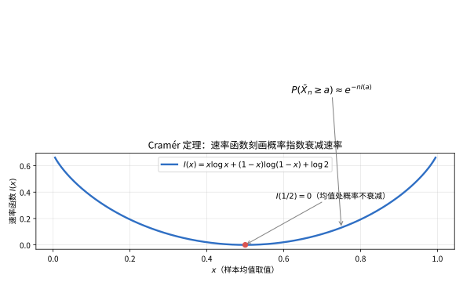

> **直观理解（现实类比）**：速率函数就像一座"概率的爬山地图"。在均值处（杯底）$I=0$，事件最常见、概率不衰减；越往两侧爬坡，$I(x)$ 越大，对应事件越稀有。比如抛 $n$ 次硬币想得到 75% 的正面，这件事有多难，就由爬到 $x=3/4$ 处的高度 $I(3/4)$ 决定——每多抛一次硬币，成功概率就再乘以一个 $e^{-I(3/4)}$ 的折扣因子。

> **🧠 思考历程：中心极限定理说波动如 $\sqrt{n}$，为什么有的偏差却按指数逃逸？**
>
> 速率函数观察的是"寻常波动之外"的事：当事件偏离均值很远，风险并非按 $1/\\sqrt{n}$ 缓慢爬升，而是按指数暴跌——Cramér 想勘测的，正是这座"概率山坡"的精确坡度。
>
> - **瑞典保险公司的难题**。1930年代，保险公司担心"赔款总额超过资产"这类极端事件被中心极限定理低估。Cramér 1938年在斯德哥尔摩受托回答这个问题：他揭示出这类越界事件发生的概率大致以 $e^{-nI(x)}$ 衰减，其中的指数速率 $I(x)$ 正是一个由对数矩生成函数的 Legendre 变换给出的函数——大偏差思想就此破土。
> - **指数界从两头收拢**。Chernoff 在1952年给出简洁的尾界，指出上界可以通过"对偏差做指数变换、再取对数期望"来收紧；Bahadur 则把它用于精确的尾部描述——上、下界终于在同一个指数速率 $I$ 处重合，偏差的"稀有程度"于是有了唯一刻度。
> - **从单点推广到全空间**。Donsker 与 Varadhan 在1970年代把它抽象成一般度量空间上的"大偏差原理"，使速率函数成为描述稀有事件的统一语言，并与热力学、熵和统计力学产生深刻共振。
> - **心路**：糟糕的小概率事件不会乖乖按平方根走路——真要外推尾部，得给"指数级坍塌"留足敬畏。

> **常见坑：把 LDP 当"等式"用、忽略集合开闭与矩生成函数的存在性。**
>
> ① **LDP 是"对数尺度上的渐进"，不是等式**：$\mathbb{P}(Z_n\in B)\approx e^{-n\inf_B I}$ 只在指数（对数）意义上成立，主指数项之外还挂着多项式等"亚指数"因子；写成"$\approx$"或"按指数相等"即可，别当成等式去抠常数。② **开闭边界别想当然**：对"开区间与闭区间"这类集合，$\inf_{B^\circ}I$ 与 $\inf_{\overline B}I$ 通常相等（当 $\inf$ 在开区间内部取得）才会上下界吻合；若 $\inf$ 恰落在边界上，$B$ 的开闭会改变指数速率——这正是 LDP 非要分开写上下界的原因。③ **矩生成函数不算"存在"可就别用 Cramér**：Cramér 定理要求 $\Lambda(\theta)=\log\mathbb{E}[e^{\theta X}]$ 在 $\theta=0$ 某邻域内有限，也就是 $X$ 要有"指数阶的尾部"；对重尾到没指数的分布（如 $\mathbb{E}[e^{\theta X}]=\infty$ 对一切 $\theta>0$），Cramér 的指数速率失效，只能退到幂律级的大偏差。

#### 课堂问答

**老师**：样本均值 $\overline{X}_n$ 满足速率 $n$、速率函数 $I(x)=\sup_\theta\{\theta x-\Lambda(\theta)\}$，这个上确界是怎么"变"出来的？

**学生**：指数变换加一阶条件。对 $\theta>0$，

$$
\mathbb{P}(\overline{X}_n\ge a)\le e^{-n\theta a}\mathbb{E}[e^{\theta S_n}]=e^{-n(\theta a-\Lambda(\theta))},
$$

再对所有 $\theta$ 取下确界就得 $I(a)=\sup_\theta\{\theta a-\Lambda(\theta)\}$。上界给 $\le -I(a)$；下界用 Esscher 倾斜测度，在 $\mathbb{Q}_\theta$ 下 $\mathbb{E}_\theta[X_1]=\Lambda'(\theta)$，把均值搬到 $a$，配合中心极限定理得 $\ge -I(a)$，两头夹住。

**老师（追问）**：为什么最优的 $\theta_a$ 满足 $\Lambda'(\theta_a)=a$？

**学生**：因为 $g(\theta)=\theta a-\Lambda(\theta)$ 求导是 $a-\Lambda'(\theta)$，令其为零即 $\Lambda'(\theta_a)=a$。几何上，$I(a)$ 是斜率 $a$ 的直线与凸函数 $\Lambda$ 作 Legendre 变换的结果，而 $\Lambda'(\theta_a)=a$ 正是"倾斜后新均值等于目标"。

**老师（拓展）**：公平硬币的例子 $I(x)=x\log x+(1-x)\log(1-x)+\log 2$，它在 $x=1/2$ 处取 $0$，为什么？

**学生**：因为 $x=1/2$ 就是均值，最不罕见。代入得 $I(1/2)=\frac12\log\frac12\cdot2+\log 2=-\log 2+\log 2=0$。一般地 $I(\mu)=0$ 当且仅当 $\mu=\mathbb{E}[X]$，此时 $\theta=0$ 给出 $\theta\mu-\Lambda(0)=0$。常见误区：把 $I$ 当成概率本身，其实它只是指数速率，$\mathbb{P}(\overline{X}_n\ge a)\approx e^{-nI(a)}$，前面的 $1/\sqrt{n}$ 因子被 $I$ 丢掉了。

### 2.4 Gärtner-Ellis 定理

**Gärtner-Ellis定理**将Cramér定理推广到非独立同分布的情形。设 $\{Z_n\}$ 为随机变量序列，其对数矩生成函数 $\Lambda_n(\theta) = \frac{1}{n} \log \mathbb{E}[e^{n\theta Z_n}]$ 存在极限：

$$
\Lambda(\theta) = \lim_{n \to \infty} \Lambda_n(\theta), \quad \theta \in \mathbb{R}
$$

若 $\Lambda(\theta)$ 在 $\mathbb{R}$ 上本质光滑（essentially smooth）且在 $\theta = 0$ 的某邻域内有限，则 $\{Z_n\}$ 满足速率为 $n$ 的LDP，速率函数为 $\Lambda$ 的Fenchel-Legendre变换：

$$
I(x) = \sup_{\theta \in \mathbb{R}} \{\theta x - \Lambda(\theta)\}
$$

#### 课堂问答

**老师**：Gärtner-Ellis 相对 Cramér 放宽了什么？代价又是什么？

**学生**：放宽了独立同分布，不再要求 $X_i$ 独立同分布，只要求 $\Lambda_n(\theta)=\frac1n\log\mathbb{E}[e^{n\theta Z_n}]$ 有逐点极限 $\Lambda(\theta)$。代价是要 $\Lambda$ 本质光滑：在 $\mathcal{D}_\Lambda^\circ$ 可微，且 $\theta\to\partial\mathcal{D}_\Lambda$ 时 $|\Lambda'(\theta)|\to\infty$。这保证 $\Lambda'$ 值域覆盖整个实轴，每个目标 $x$ 都有倾斜参数 $\theta_x$。

**老师（追问）**：为什么"本质光滑"不能省？举一个会出问题的情形。

**学生**：若不本质光滑，$\Lambda'$ 值域可能有洞，某些 $x$ 就没有 $\theta_x$ 使 $\Lambda'(\theta_x)=x$，下界在那些 $x$ 上直接崩掉。典型麻烦来自 $\Lambda$ 在有限域边界不可微或导数不趋无穷，此时速率函数不再是干净的 Legendre 变换，下界只能对部分 $x$ 成立。

**老师（拓展）**：那 Cramér 是 Gärtner-Ellis 的特例吗？

**学生**：是。i.i.d. 时 $\Lambda_n(\theta)=\frac1n\log\prod\mathbb{E}[e^{\theta X_i}]=\log\mathbb{E}[e^{\theta X_1}]$ 与 $n$ 无关，逐点极限就是它本身。所以 Cramér 的 $\sup_\theta\{\theta x-\Lambda(\theta)\}$ 正是 GE 的 Fenchel-Legendre 变换，只是 GE 用倾斜测度 $\frac{d\mathbb{Q}_n}{d\mathbb{P}}=\exp(n\theta_a Z_n-n\Lambda_n(\theta_a))$ 把证明写成了普适版本。

### 2.5 Schilder 定理

**Schilder定理**描述了Brown运动在路径空间上的大偏差。设 $\{W(t): t \in [0, 1]\}$ 为标准Brown运动，$\varepsilon W$ 为缩放后的Brown运动。则当 $\varepsilon \to 0$ 时，$\varepsilon W$ 满足速率为 $1/\varepsilon^2$ 的LDP，速率函数为：

$$
I(f) = 
\begin{cases}
\frac{1}{2} \int_0^1 |\dot{f}(t)|^2 dt, & f \in H_0^1[0,1] \\
\infty, & \text{其他}
\end{cases}
$$

其中 $H_0^1[0,1]$ 为绝对连续函数空间，满足 $f(0) = 0$，$\dot{f} \in L^2[0,1]$。

#### 课堂问答

**老师**：Schilder 定理说 $\varepsilon W$ 的速率是 $1/\varepsilon^2$ 而非 $1/\varepsilon$，为什么？

**学生**：因为布朗运动的权重是高斯型的，指数里带 $\varepsilon^2$。看 Cameron-Martin 公式，测度平移的 Radon-Nikodym 导数是 $\exp(\frac1{\varepsilon^2}\langle h,f\rangle-\frac1{2\varepsilon^2}\|h\|_H^2)$，分母出现 $\varepsilon^2$。于是同一路径 $f$ 的概率衰减为 $e^{-\|f\|_H^2/(2\varepsilon^2)}$，速率序列就是 $a_\varepsilon=1/\varepsilon^2$，速率函数 $I(f)=\frac12\int_0^1|\dot{f}(t)|^2dt$（$f\in H_0^1$，否则为 $\infty$）。

**老师（追问）**：为什么能量是 $\frac12\int|\dot{f}|^2$ 而不是 $\frac12\int|f|^2$？

**学生**：因为布朗运动的时间尺度体现在增量上。对分段线性路径 $I(f)=\frac12\sum\frac{(\Delta f_i)^2}{\Delta t_i}$，正是白噪声驱动的二次变差代价。用导数度量的是"斜率变化"的能量：$\dot{f}\equiv0$（即 $f$ 为常数，又 $f(0)=0$，故 $f\equiv0$）对应能量 $0$，是布朗运动待在原点附近的最省路径；用 $\int|f|^2$ 就刻不出这个结构。

**老师（拓展）**：条件 $f\in H_0^1$ 若换成只在 $C[0,1]$ 里，会怎样？

**学生**：$I$ 会在非绝对连续路径上取 $+\infty$，即那些无处不可微、无限粗糙的路径被排除在外。这也体现好速率函数：水平集 $\{I\le c\}$ 是 $H_0^1$ 中的紧集（Sobolev 嵌入），保证极值路径存在。直观上噪声趋零时布朗运动越来越像"光滑、有限能量"的路径，粗糙路径要多付无穷代价。

### 2.6 Varadhan 引理与 Laplace 原理

**Varadhan引理**建立了LDP与Laplace型积分的渐近行为之间的联系。设 $\{Z_n\}$ 满足速率为 $n$ 的LDP，速率函数为 $I$，则对任意有界连续函数 $\phi$：

$$
\lim_{n \to \infty} \frac{1}{n} \log \mathbb{E}[e^{n \phi(Z_n)}] = \sup_{x} \{\phi(x) - I(x)\}
$$

> **💡 直观理解（类比）**：Varadhan 引理把"指数加权期望的对数"翻译成"登山找最优"：$\lim\frac1n\log\mathbb{E}[e^{n\phi}]\approx\sup_x\{\phi(x)-I(x)\}$。想象给每个位置一个"收益"$\phi$，但要付"登山费"$I$，收益减费用最大的一点会主导整个积分——指数级的优势全集中在那个最佳平衡点，其余位置都可忽略。

**Laplace原理**是Varadhan引理的逆命题：若对任意有界连续函数 $\phi$，上述极限成立，且 $I$ 为好速率函数，则 $\{Z_n\}$ 满足LDP。

#### 课堂问答

**老师**：Varadhan 引理把 $\frac1n\log\mathbb{E}[e^{n\phi(Z_n)}]$ 化成 $\sup_x\{\phi(x)-I(x)\}$，这跟 Laplace 方法是什么关系？

**学生**：就是把 Laplace 方法搬到概率空间。连续情形 $\int e^{n\phi(x)}e^{n\psi(x)}dx\approx e^{n\sup(\phi+\psi)}$，被积函数由最大值点主导。这里把密度看成 $e^{n\psi}$ 且 $\psi=-I$，则积分 $\approx e^{n\sup_x\{\phi(x)-I(x)\}}$，最优平衡点就是让"收益 $\phi$ 减代价 $I$"最大的那个 $x$。

**老师（追问）**：被积的是期望 $\mathbb{E}[e^{n\phi(Z_n)}]$，不是概率密度积分，凭什么能这么换？

**学生**：因为 $\mathbb{E}[e^{n\phi(Z_n)}]=\int e^{n\phi(x)}d\mu_n(x)$，而 LDP 说 $\mu_n$ 在对数尺度上有密度 $e^{-nI}$。证明两面夹：上界把空间按小球分块，每块用 $\phi$ 的振荡模 $\omega(\delta)$ 和 LDP 上界，令 $\delta\to0$ 得 $\le\phi(x)-I(x)$，再取 $\sup$；下界在最优 $x_0$ 的小球上用 LDP 下界加 $\phi$ 的连续性。紧性保证分块有限。

**老师（拓展）**：Laplace 原理说反过来也成立，那 LDP 和这个指数积分公式等价？

**学生**：在"$I$ 是好速率函数"的前提下等价。Laplace 原理是：若对所有有界连续 $\phi$ 都有 $\lim\frac1n\log\mathbb{E}[e^{n\phi(Z_n)}]=\sup\{\phi-I\}$，则 $\{Z_n\}$ 满足速率为 $n$、速率函数为 $I$ 的 LDP。等价性靠测度论逼近，用连续函数把开集从下方、闭集从上方夹出来。这也是 Varadhan 引理成为连接 LDP 与统计力学配分 $\mathbb{E}[e^{n\phi}]$ 之桥梁的原因。

### 2.7 Freidlin-Wentzell 理论

**Freidlin-Wentzell理论**研究随机微分方程（SDE）的小噪声扰动的大偏差：

$$
dX_t^\varepsilon = b(X_t^\varepsilon) dt + \varepsilon dW_t, \quad X_0^\varepsilon = x_0
$$

当 $\varepsilon \to 0$ 时，$X^\varepsilon$ 在路径空间上满足LDP，速率函数由**作用泛函**（Action Functional）给出：

$$
I(\varphi) = 
\begin{cases}
\frac{1}{2} \int_0^T |\dot{\varphi}(t) - b(\varphi(t))|^2 dt, & \varphi \in H_0^1, \varphi(0) = x_0 \\
\infty, & \text{其他}
\end{cases}
$$

#### 课堂问答

**老师**：不用 Girsanov，怎么一眼看出作用泛函是 $\frac12\int|\dot{\varphi}-b(\varphi)|^2$？

**学生**：把 SDE 写成 $dX_t^\varepsilon=b\,dt+\varepsilon dW_t$。噪声趋零时系统几乎沿确定性轨线 $\dot{\varphi}=b(\varphi)$ 走，能量为零。要偏离到 $\dot{\varphi}\ne b(\varphi)$ 的路径，就得让噪声补上差额：$\varepsilon dW\approx(\dot{\varphi}-b)dt$。而高斯噪声实现"位移 $\dot{\varphi}-b$"的代价正比于其平方范数的一半，故 $I(\varphi)=\frac12\int_0^T|\dot{\varphi}(t)-b(\varphi(t))|^2dt$。

**老师（追问）**：那确定性轨线为什么速率是零？

**学生**：因为若 $\varphi$ 满足 $\dot{\varphi}(t)=b(\varphi(t))$ 且 $\varphi(0)=x_0$，被积项 $\dot{\varphi}-b(\varphi)\equiv0$，于是 $I(\varphi)=0$。它对应 SDE 的确定性极限 $X^\varepsilon\to x_{\text{det}}$，概率不指数衰减，是典型行为。$I$ 的物理意义就是"相对确定性轨线的偏离代价"。

**老师（拓展）**：为什么说这统一了 Schilder 和 Cramér？

**学生**：令 $b\equiv0$ 就退回 Schilder：$I(\varphi)=\frac12\int|\dot{\varphi}|^2$。而 Freidlin-Wentzell 的推导正是"先 Girsanov 去掉漂移到 Schilder，再用 Varadhan 修正"，速率函数等于 Schilder 的 $I_0$ 加上测度变换修正 $\Delta I=-\frac12\int|b|^2-\int b\cdot\dot{\varphi}$，合并配方得 $\frac12\int|\dot{\varphi}-b|^2$。一个泛函同时管住了自由布朗运动与有漂移的随机动力学。

### 2.8 稀有事件与渐近效率

**稀有事件**（Rare Events）是指概率随 $n$ 增大指数衰减的事件。大偏差理论提供了精确的指数衰减速率。

> **💡 直观理解（类比）**：稀有事件就是"概率随规模指数崩塌"的小概率事——比如连续几百次都抛出正面。大偏差理论的价值在于把这个指数速率算准，而不是停留在"这事很小很小"这样含糊的说法。

**渐近效率**（Asymptotic Efficiency）用于衡量稀有事件模拟方法的效率。在重要抽样（Importance Sampling）中，若估计量的方差以最优速率衰减，则称该估计量是渐近有效的。

> **💡 直观理解（类比）**：渐近效率衡量"模拟稀有事件的方法有多划算"：若重要抽样估计量的方差以最优（指数级）速度衰减，就说它渐近有效。好比用望远镜去逮罕见信号：架设得越聪明，"信噪比"掉得越慢，观测就越高效率。

---

#### 课堂问答

**老师**：重要抽样为什么能"救"稀有事件模拟？朴素 Monte Carlo 差在哪？

**学生**：朴素 MC 直接按原分布采样，稀有事件命中率 $p\approx e^{-nI}$，要估到相对精度需要样本量 $\sim1/p=e^{nI}$，指数爆炸。重要抽样换测度让它"多说人话"：用倾斜分布 $d\tilde{\mathbb{P}}/d\mathbb{P}\propto e^{\theta x}$ 把均值搬到目标区域，命中率升到多项式级，再用似然比 $\frac{d\mathbb{P}}{d\tilde{\mathbb{P}}}$ 无偏修正，关键全在似然比的方差。

**老师（追问）**：什么叫"渐近有效"？判据是什么？

**学生**：若估计量 $\hat{p}$ 的相对方差满足 $\lim_{n\to\infty}\frac1n\log\mathbb{E}_{\tilde{\mathbb{P}}}[\text{相对误差}^2]=0$，即方差以慢于最优速率增长，估计就是渐近有效的。等价地说，最优倾斜参数让 $\mathbb{E}_{\tilde{\mathbb{P}}}[(\frac{d\mathbb{P}}{d\tilde{\mathbb{P}}})^2\mathbf{1}_{\text{rare}}]$ 的指数速率最小化。选错倾斜，方差又会以 $e^{nc}$ 爆炸，命中率上去也没用。

**老师（拓展）**：这跟大偏差理论的联系仅在"算概率"吗？

**学生**：不止。它是 LDP 的"控制论"应用面：大偏差给出最优指数 $I$，而渐近效率告诉你，能达到这个指数的模拟方法必须让重要抽样测度在稀有事件的条件分布上逼近最省路径（Freidlin-Wentzell 的最优路径）。这正是罕见事件模拟、可靠性分析、通信误码率估计都直接借 LDP 设计方差缩减方案的原因。常见误区：以为只要提高命中率就行，其实关键是控制似然比的二阶矩。

## 3. 定理与证明

### 定理 3.1：Cramér 定理

**定理**：设 $X_1, X_2, \dots, X_n$ 为 i.i.d. 随机变量，其矩生成函数 $M(\theta) = \mathbb{E}[e^{\theta X_1}]$ 在 $\theta = 0$ 的某邻域内有限。定义对数矩生成函数 $\Lambda(\theta) = \log M(\theta)$。令 $S_n = \sum_{i=1}^n X_i$，$\overline{X}_n = S_n/n$。则 $\{\overline{X}_n\}$ 满足速率为 $n$ 的大偏差原理，速率函数为 $\Lambda$ 的Legendre变换：

$$
I(x) = \sup_{\theta \in \mathbb{R}} \{\theta x - \Lambda(\theta)\}
$$

即对任意闭集 $C \subset \mathbb{R}$ 和开集 $U \subset \mathbb{R}$：

$$
\limsup_{n \to \infty} \frac{1}{n} \log \mathbb{P}(\overline{X}_n \in C) \le -\inf_{x \in C} I(x)
$$

$$
\liminf_{n \to \infty} \frac{1}{n} \log \mathbb{P}(\overline{X}_n \in U) \ge -\inf_{x \in U} I(x)
$$

**证明**：

**步骤1：上界估计（Chebyshev型指数不等式）**

对任意 $\theta > 0$：

$$
\mathbb{P}(\overline{X}_n \ge a) = \mathbb{P}(S_n \ge na) = \mathbb{P}(e^{\theta S_n} \ge e^{\theta na}) \le e^{-\theta na} \mathbb{E}[e^{\theta S_n}] = e^{-\theta na} [M(\theta)]^n
$$

因此：

$$
\frac{1}{n} \log \mathbb{P}(\overline{X}_n \ge a) \le -\theta a + \Lambda(\theta)
$$

对 $\theta > 0$ 取下确界，并记 $\Lambda^*(a) = \sup_{\theta > 0} \{\theta a - \Lambda(\theta)\}$，则：

$$
\limsup_{n \to \infty} \frac{1}{n} \log \mathbb{P}(\overline{X}_n \ge a) \le -\Lambda^*(a)
$$

类似地，对 $\theta < 0$：

$$
\mathbb{P}(\overline{X}_n \le a) \le e^{-\theta na} [M(\theta)]^n
$$

得：

$$
\limsup_{n \to \infty} \frac{1}{n} \log \mathbb{P}(\overline{X}_n \le a) \le -\sup_{\theta < 0} \{\theta a - \Lambda(\theta)\}
$$

**步骤2：用指数鞅方法证明下界**

考虑指数鞅 $Y_n(\theta) = \exp(\theta S_n - n\Lambda(\theta))$，这是关于 $S_n$ 的鞅。

对任意 $a$，定义新测度 $\mathbb{Q}_\theta$（Esscher变换）：

$$
\frac{d\mathbb{Q}_\theta}{d\mathbb{P}} = \exp(\theta S_n - n\Lambda(\theta))
$$

在 $\mathbb{Q}_\theta$ 下，$X_i$ 的分布变为 $dF_\theta(x) = e^{\theta x - \Lambda(\theta)} dF(x)$，其均值 $\mathbb{E}_\theta[X_1] = \Lambda'(\theta)$。

设存在 $\theta_a$ 使得 $\Lambda'(\theta_a) = a$（即 $a$ 在 $\Lambda$ 的次梯度中）。则：

$$
\begin{aligned}
\mathbb{P}(\overline{X}_n \in (a, a+\delta)) &= \mathbb{E}_\theta\left[ e^{-\theta S_n + n\Lambda(\theta)} \mathbf{1}_{\{\overline{X}_n \in (a, a+\delta)\}} \right] \\
&= e^{-n\theta a + n\Lambda(\theta)} \mathbb{E}_\theta\left[ e^{-n\theta(\overline{X}_n - a)} \mathbf{1}_{\{\overline{X}_n \in (a, a+\delta)\}} \right]
\end{aligned}
$$

取 $\theta = \theta_a$，则当 $\delta$ 充分小时，$\overline{X}_n - a$ 在 $(a, a+\delta)$ 上有界，$e^{-n\theta(\overline{X}_n - a)} \ge e^{-n|\theta|\delta}$。

由中心极限定理（在 $\mathbb{Q}_{\theta_a}$ 下），$\overline{X}_n$ 在 $\mathbb{Q}_{\theta_a}$ 下的方差为 $\Lambda''(\theta_a)/n$，因此：

$$
\mathbb{Q}_{\theta_a}(\overline{X}_n \in (a, a+\delta)) \sim \frac{\delta}{\sqrt{2\pi\Lambda''(\theta_a)/n}} \to \frac{\delta\sqrt{n}}{\sqrt{2\pi\Lambda''(\theta_a)}}
$$

故：

$$
\frac{1}{n} \log \mathbb{P}(\overline{X}_n \in (a, a+\delta)) \ge -\theta_a a + \Lambda(\theta_a) + \frac{1}{n} \log(\text{多项式项})
$$

取 $n \to \infty$，多项式项贡献为0，得：

$$
\liminf_{n \to \infty} \frac{1}{n} \log \mathbb{P}(\overline{X}_n \in (a, a+\delta)) \ge -(\theta_a a - \Lambda(\theta_a)) = -I(a)
$$

**步骤3：Legendre变换的性质**

$I(a) = \sup_{\theta \in \mathbb{R}} \{\theta a - \Lambda(\theta)\}$ 具有以下性质：

- $I$ 是凸函数（作为仿射函数的上确界）
- $\inf_{x \in \mathbb{R}} I(x) = 0$，且 $I(\mu) = 0$ 其中 $\mu = \mathbb{E}[X_1]$
- $I$ 是下界半连续的

**步骤4：上下界合成为大偏差原理**

对于任意闭集 $C$，用紧集逼近和指数衰减的精细分析，可得上界：

$$
\limsup_{n \to \infty} \frac{1}{n} \log \mathbb{P}(\overline{X}_n \in C) \le -\inf_{x \in C} I(x)
$$

对于任意开集 $U$，用小区间覆盖和步骤2的下界，可得：

$$
\liminf_{n \to \infty} \frac{1}{n} \log \mathbb{P}(\overline{X}_n \in U) \ge -\inf_{x \in U} I(x)
$$

因此大偏差原理成立。$\square$

上述证明中，上界估计本质上是**切尔诺夫型指数不等式**。它与朴素的切比雪夫界在尾概率刻画上的差距如图：

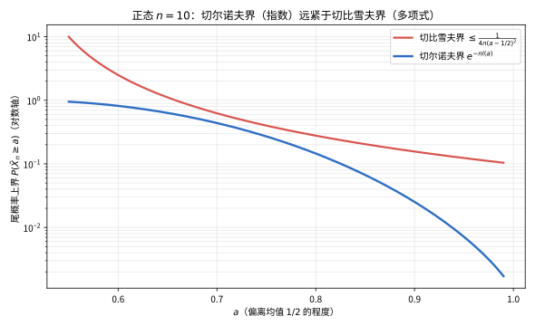

> **直观理解（现实类比）**：切比雪夫界像一份"最粗放"的安全承诺——只保证"过头的情形一般不常发生"，给的余量随偏离程度按多项式缓慢变紧；切尔诺夫界则像精确打磨过的"保险精算表"，它利用指数变换把每个偏离都换算成指数级的折扣，因此给出的上限指数级地紧凑。同样是估算极端偏差的概率，切尔诺夫界能给出相差几个数量级的更精确上界。

---

#### 课堂问答

**老师**：Cramér 上界那步 $\mathbb{P}(\overline{X}_n\ge a)\le e^{-n\theta a}[M(\theta)]^n$ 用的是 Markov 不等式，为什么这就"紧"了？

**学生**：因为对任意 $\theta>0$ 都成立，可以取最优 $\theta$：

$$
\frac1n\log\mathbb{P}(\overline{X}_n\ge a)\le\inf_{\theta>0}\{\Lambda(\theta)-\theta a\}=:-I_{\ge}(a).
$$

取 $\theta_a$ 使 $\Lambda'(\theta_a)=a$，这正是 Legendre 变换在 $a$ 处的值 $I(a)$。相比之下切比雪夫界只按 $1/(n(a-\mu)^2)$ 多项式衰减，切尔诺夫界是指数级，对数轴上差好几个量级。

**老师（追问）**：下界为什么要构造 Esscher 测度或指数鞅，不能直接算吗？

**学生**：因为只用 Markov 只能给上界，下界需要"造"一个让目标事件变成典型事件的新测度。取 $\frac{d\mathbb{Q}_\theta}{d\mathbb{P}}=e^{\theta S_n-n\Lambda(\theta)}$，在 $\mathbb{Q}_\theta$ 下 $X_i$ 密度为 $dF_\theta=e^{\theta x-\Lambda(\theta)}dF$、均值 $\mathbb{E}_\theta[X_1]=\Lambda'(\theta)$。取 $\theta=\theta_a$ 时 $\mathbb{Q}_{\theta_a}$ 下均值等于 $a$，于是 $\mathbb{Q}_{\theta_a}(\overline{X}_n\in(a,a+\delta))\to$ 正常数（CLT），再用似然比反推 $\mathbb{P}$，把 $\frac1n\log$ 夹到 $-I(a)$。

**老师（拓展）**：三个步骤合起来，最本质的一步是哪个？

**学生**：Legendre 变换的性质。$I$ 作为仿射函数族的上确界必凸；$\inf_x I(x)=0$ 且在均值 $\mu$ 处取 $0$；$I$ 下界半连续。凸性加下界半连续加水平集紧等于好速率函数，正是把"逐点 $(a,a+\delta)$ 上界"提升到"任意闭集 $C$"的桥梁（有限覆盖）。没有凸性，局部估计就无法整合成全局 LDP 上界。常见误区：以为速率函数可以随便取，其实它必须由 $\Lambda$ 的凸共轭生成。

### 定理 3.2：Gärtner-Ellis 定理

**定理**：设 $\{Z_n\}_{n\ge 1}$ 为一族随机变量，定义对数矩生成函数：

$$
\Lambda_n(\theta) = \frac{1}{n} \log \mathbb{E}[e^{n\theta Z_n}], \quad \theta \in \mathbb{R}
$$

假设对每个 $\theta \in \mathbb{R}$，极限 $\Lambda(\theta) = \lim_{n \to \infty} \Lambda_n(\theta)$ 存在（允许取 $\infty$）。设 $\Lambda(\theta)$ 在 $\theta = 0$ 的某邻域内有限，且 $\Lambda$ 是**本质光滑**的（即在 $\mathcal{D}_\Lambda = \{\theta: \Lambda(\theta) < \infty\}$ 的内部可微，且 $\lim_{\theta \to \partial\mathcal{D}_\Lambda} |\Lambda'(\theta)| = \infty$）。则 $\{Z_n\}$ 满足速率为 $n$ 的大偏差原理，速率函数为 $\Lambda$ 的Fenchel-Legendre变换：

$$
I(x) = \sup_{\theta \in \mathbb{R}} \{\theta x - \Lambda(\theta)\}
$$

**证明**：

**步骤1：Gärtner-Ellis上界**

对任意 $\theta > 0$：

$$
\mathbb{P}(Z_n \ge a) = \mathbb{P}(e^{n\theta Z_n} \ge e^{n\theta a}) \le e^{-n\theta a} \mathbb{E}[e^{n\theta Z_n}] = e^{-n(\theta a - \Lambda_n(\theta))}
$$

因此：

$$
\frac{1}{n} \log \mathbb{P}(Z_n \ge a) \le -\theta a + \Lambda_n(\theta)
$$

取 $n \to \infty$ 和 $\theta > 0$ 的上确界：

$$
\limsup_{n \to \infty} \frac{1}{n} \log \mathbb{P}(Z_n \ge a) \le -\sup_{\theta > 0} \{\theta a - \Lambda(\theta)\}
$$

类似地，对 $\theta < 0$：

$$
\limsup_{n \to \infty} \frac{1}{n} \log \mathbb{P}(Z_n \le a) \le -\sup_{\theta < 0} \{\theta a - \Lambda(\theta)\}
$$

**步骤2：推广到任意闭集**

对任意闭集 $C \subset \mathbb{R}$，若 $C$ 不包含速率函数为零的点，则由紧致性可将其分解为有限个区间，每个区间用上述指数不等式处理。若 $C$ 包含速率函数为零的点（即 $\mu = \mathbb{E}[Z_n]$ 的极限），则上界平凡成立。

**步骤3：下界证明（倾斜测度方法）**

设 $a$ 使得存在 $\theta_a \in \mathcal{D}_\Lambda^\circ$ 满足 $\Lambda'(\theta_a) = a$（即 $a$ 在 $\Lambda$ 的次梯度中）。定义倾斜测度：

$$
\frac{d\mathbb{Q}_n}{d\mathbb{P}} = \exp(n\theta_a Z_n - n\Lambda_n(\theta_a))
$$

在 $\mathbb{Q}_n$ 下，$Z_n$ 的矩生成函数为：

$$
\mathbb{E}_{\mathbb{Q}_n}[e^{n\theta Z_n}] = \mathbb{E}[e^{n(\theta_a + \theta)Z_n - n\Lambda_n(\theta_a)}] = \frac{\mathbb{E}[e^{n(\theta_a + \theta)Z_n}]}{\mathbb{E}[e^{n\theta_a Z_n}]}
$$

因此 $\mathbb{Q}_n$ 对应的对数矩生成函数为 $\Lambda_n(\theta_a + \theta) - \Lambda_n(\theta_a)$，其极限为 $\Lambda(\theta_a + \theta) - \Lambda(\theta_a)$。

由 $\Lambda'(\theta_a) = a$，在 $\mathbb{Q}_n$ 下 $Z_n$ 的均值趋近于 $a$，方差由 $\Lambda''(\theta_a)/n$ 控制。

**步骤4：局部下界**

对任意 $\delta > 0$：

$$
\begin{aligned}
\mathbb{P}(Z_n \in (a, a+\delta)) &= \mathbb{E}_{\mathbb{Q}_n}\left[ e^{-n\theta_a Z_n + n\Lambda_n(\theta_a)} \mathbf{1}_{\{Z_n \in (a, a+\delta)\}} \right] \\
&\ge e^{-n\theta_a (a+\delta) + n\Lambda_n(\theta_a)} \mathbb{Q}_n(Z_n \in (a, a+\delta))
\end{aligned}
$$

由中心极限定理（在 $\mathbb{Q}_n$ 下），$\mathbb{Q}_n(Z_n \in (a, a+\delta)) \to \delta \cdot \sqrt{n} / \sqrt{2\pi \Lambda''(\theta_a)} > 0$（当 $\Lambda''(\theta_a) > 0$ 时，需考虑 $\Lambda''(\theta_a) = 0$ 的退化情形）。

因此：

$$
\liminf_{n \to \infty} \frac{1}{n} \log \mathbb{P}(Z_n \in (a, a+\delta)) \ge -\theta_a a + \Lambda(\theta_a) = -I(a)
$$

**步骤5：本质光滑条件的作用**

本质光滑条件保证了 $\Lambda$ 在 $\mathcal{D}_\Lambda^\circ$ 上可微，且 $\Lambda'(\theta)$ 在 $\mathcal{D}_\Lambda^\circ$ 上取值于整个实数轴，这使得速率函数 $I(x)$ 对每个 $x$ 均有相应的 $\theta_x$ 满足 $\Lambda'(\theta_x) = x$，从而下界对所有 $x$ 成立。$\square$

> **💡 直观理解（类比）**：这条定理把"能算大偏差"的前提从"独立同分布"压缩成"对数矩生成函数收敛到一个本质光滑的 $\Lambda$"。本质光滑保证 $\Lambda'$ 能取遍整个实数轴，于是每个目标 $x$ 都能找到一把对应的"倾斜用扳手"$\theta_x$ 把测度搬到该处——就像工具箱里每一号扳手都齐全，任何尺寸的螺母都拧得上。

---

#### 课堂问答

**老师**：GE 上界里 $\Lambda_n(\theta)$ 随 $n$ 变，取极限这一步为什么可直接换成 $\Lambda(\theta)$？

**学生**：对固定 $\theta$，$\frac1n\log\mathbb{P}(Z_n\ge a)\le-\theta a+\Lambda_n(\theta)$ 对每个 $n$ 成立，先取 $\limsup$ 再对 $\theta$ 取上确界：

$$
\limsup_{n\to\infty}\frac1n\log\mathbb{P}(Z_n\ge a)\le-\sup_{\theta>0}\{\theta a-\Lambda(\theta)\}.
$$

关键是 $\Lambda_n\to\Lambda$ 逐点，所以下确界的极限就是 $-\inf_\theta\{\theta a-\Lambda\}$。

**老师（追问）**：下界用倾斜测度 $\frac{d\mathbb{Q}_n}{d\mathbb{P}}=e^{n\theta_a Z_n-n\Lambda_n(\theta_a)}$，它和 Cramér 的 Esscher 有何不同？

**学生**：Cramér 是对每个 $X_i$ 用同一 $\theta$；GE 直接对整个 $Z_n$ 用一个 $n$ 标度的倾斜。在 $\mathbb{Q}_n$ 下 $Z_n$ 的对数矩母函数变成 $\Lambda_n(\theta_a+\theta)-\Lambda_n(\theta_a)$，极限为 $\Lambda(\theta_a+\theta)-\Lambda(\theta_a)$；由 $\Lambda'(\theta_a)=a$，$\mathbb{Q}_n$ 下 $Z_n$ 均值趋于 $a$，方差由 $\Lambda''(\theta_a)/n$ 控制，于是 $\mathbb{Q}_n(Z_n\in(a,a+\delta))\ge c/\sqrt{n}>0$，反推得局部下界 $-I(a)$。

**老师（拓展）**：本质光滑条件在这里到底做了什么？

**学生**：它保证 $\Lambda'$ 把 $\mathcal{D}_\Lambda^\circ$ 映满整个 $\mathbb{R}$，于是对每个目标 $x$ 都存在 $\theta_x$ 使 $\Lambda'(\theta_x)=x$，下界才能对所有 $x$ 成立；否则 $\Lambda'$ 值域有洞，某些 $x$ 无对应倾斜参数，局部下界在那点失效。它同时保证 $I=\Lambda^*$ 是严格凸、本质光滑的好速率函数，证明收尾的严格性正靠这一条。

### 定理 3.3：Schilder 定理（Brown运动的大偏差）

**定理**：设 $\{W(t): t \in [0, 1]\}$ 为标准Brown运动。定义 $W^\varepsilon(t) = \varepsilon W(t)$。则当 $\varepsilon \to 0$ 时，$\{W^\varepsilon\}$ 在 $C[0,1]$ 上满足速率为 $1/\varepsilon^2$ 的大偏差原理，速率函数为：

$$
I(f) = 
\begin{cases}
\frac{1}{2} \int_0^1 |\dot{f}(t)|^2 dt, & f \in H_0^1[0,1], \ f(0) = 0 \\
\infty, & \text{其他}
\end{cases}
$$

其中 $H_0^1[0,1]$ 为Cameron-Martin空间，即满足 $f(0) = 0$ 且 $\dot{f} \in L^2[0,1]$ 的绝对连续函数空间。

**证明**：

**步骤1：Cameron-Martin空间与指数估计**

Cameron-Martin空间 $H_0^1$ 是赋范空间，范数为 $\|f\|_H = \left(\int_0^1 |\dot{f}(t)|^2 dt\right)^{1/2}$。Brown运动 $W$ 在 $H_0^1$ 上的分布由以下事实刻画：对任意 $h \in H_0^1$，$W$ 与 $h$ 的内积 $\langle W, h\rangle$ 是均值为0、方差为 $\|h\|_H^2$ 的正态随机变量。

Pinelis不等式给出：对任意 $r > 0$：

$$
\mathbb{P}(\|W\|_{C[0,1]} \ge r) \le 2e^{-r^2/2}
$$

其中 $\|f\|_{C[0,1]} = \sup_{t \in [0,1]} |f(t)|$。

**步骤2：上界估计**

对任意闭集 $C \subset C[0,1]$，定义 $d(f, C) = \inf_{g \in C} \|f - g\|_{C[0,1]}$。

对 $R > 0$，考虑紧集 $K_R = \{f \in H_0^1: \|f\|_H \le R\}$。由Cameron-Martin公式，对任意 $h \in H_0^1$：

$$
\frac{d\mathbb{P}_{W^\varepsilon + h}}{d\mathbb{P}_{W^\varepsilon}}(f) = \exp\left(\frac{1}{\varepsilon^2} \langle h, f \rangle - \frac{1}{2\varepsilon^2} \|h\|_H^2\right)
$$

对任意 $R > 0$，$C$ 的 $R$-邻域 $C^R = \{f: d(f, C) \le R\}$ 满足：

$$
\mathbb{P}(W^\varepsilon \in C) \le \mathbb{P}(W^\varepsilon \in C^R) \le \mathbb{P}(\|W^\varepsilon\|_{C[0,1]} \ge R) + \mathbb{P}(W^\varepsilon \in C, \|W^\varepsilon\|_{C[0,1]} \le R)
$$

对于第一个项，由Pinelis不等式：

$$
\frac{1}{\varepsilon^2} \log \mathbb{P}(\|W^\varepsilon\|_{C[0,1]} \ge R) = \frac{1}{\varepsilon^2} \log \mathbb{P}(\|W\|_{C[0,1]} \ge R/\varepsilon) \le -\frac{R^2}{2\varepsilon^2} + \text{常数}
$$

对于第二个项，用有限的 $h_i$ 覆盖 $K_R \cap C$，然后使用Cameron-Martin变换。

经过精细分析可得：

$$
\limsup_{\varepsilon \to 0} \varepsilon^2 \log \mathbb{P}(W^\varepsilon \in C) \le -\inf_{f \in C} I(f)
$$

**步骤3：下界估计**

对任意开集 $U \subset C[0,1]$ 和任意 $f \in U \cap H_0^1$，需要证明：

$$
\liminf_{\varepsilon \to 0} \varepsilon^2 \log \mathbb{P}(W^\varepsilon \in U) \ge -I(f)
$$

取 $f \in H_0^1$ 和 $\delta > 0$，使开球 $B(f, \delta) = \{g: \|g - f\|_{C[0,1]} < \delta\} \subset U$。

考虑Cameron-Martin变换：$W^\varepsilon = \varepsilon W$，则 $\mathbb{P}(W^\varepsilon \in B(f, \delta)) = \mathbb{P}(\varepsilon W \in B(f, \delta)) = \mathbb{P}(W \in B(f/\varepsilon, \delta/\varepsilon))$。

更直接地，使用倾斜测度方法。定义新概率测度 $\mathbb{Q}_\varepsilon$：

$$
\frac{d\mathbb{Q}_\varepsilon}{d\mathbb{P}} = \exp\left(\frac{1}{\varepsilon} \int_0^1 \dot{f}(t) dW(t) - \frac{1}{2\varepsilon^2} \|f\|_H^2\right)
$$

在 $\mathbb{Q}_\varepsilon$ 下，$W^\varepsilon$ 的分布趋近于在 $f$ 附近的Dirac测度。具体地：

$$
\begin{aligned}
\mathbb{P}(W^\varepsilon \in B(f, \delta)) &= \mathbb{E}_{\mathbb{Q}_\varepsilon}\left[ e^{-\frac{1}{\varepsilon} \int_0^1 \dot{f}(t) dW(t) + \frac{1}{2\varepsilon^2} \|f\|_H^2} \mathbf{1}_{\{W^\varepsilon \in B(f, \delta)\}} \right] \\
&\ge \exp\left(-\frac{1}{2\varepsilon^2} \|f\|_H^2 - \frac{\|f\|_H \delta}{\varepsilon^2}\right) \mathbb{Q}_\varepsilon(W^\varepsilon \in B(f, \delta))
\end{aligned}
$$

在 $\mathbb{Q}_\varepsilon$ 下，$W^\varepsilon - f$ 仍然是Brown运动（由Cameron-Martin定理），因此 $\mathbb{Q}_\varepsilon(W^\varepsilon \in B(f, \delta)) = \mathbb{P}(\varepsilon W \in B(0, \delta)) \to 1$。

取对数并除以 $1/\varepsilon^2$，得：

$$
\liminf_{\varepsilon \to 0} \varepsilon^2 \log \mathbb{P}(W^\varepsilon \in B(f, \delta)) \ge -\frac{1}{2} \|f\|_H^2 = -I(f)
$$

**步骤4：合成LDP**

由上下界的一致性和速率函数的性质（好速率函数），$W^\varepsilon$ 满足大偏差原理。$\square$

> **💡 直观理解（类比）**：整条定理的核心是"最可几路径 = 最省功路径"：噪声趋零时，布朗运动到达任何函数 $f$ 附近的概率指数地由其"能量"$\tfrac12\|f\|_H^2$ 决定。这像皮筋的能量定律：把一条线拉成曲线 $f$ 所需能量越大，它自然出现的概率就越小，笔直的直线（$f(t)=at$）最省能量、也最常发生。

---

#### 课堂问答

**老师**：Schilder 上界第一步用 Pinelis 不等式 $\mathbb{P}(\|W\|_{C}\ge r)\le2e^{-r^2/2}$，它管的是什么？

**学生**：管"布朗运动跑得太远"这种粗偏差，给的是 $\sup_t|W(t)|$ 的高斯尾，指数里是 $r^2/2$。代入 $\|W^\varepsilon\|=\varepsilon\|W\|$、$r=R/\varepsilon$，得 $\frac1{\varepsilon^2}\log\mathbb{P}(\|W^\varepsilon\|\ge R)\le-R^2/2+\text{const}$。这把闭集 $C$ 中"离家很远、能量必定很大"的部分先剥掉。

**老师（追问）**：下界那步用 Cameron-Martin 变换造 $\mathbb{Q}_\varepsilon$，凭什么在 $\mathbb{Q}_\varepsilon$ 下 $W^\varepsilon$ 会集中到 $f$？

**学生**：因为 $\frac{d\mathbb{Q}_\varepsilon}{d\mathbb{P}}=\exp(\frac1\varepsilon\int_0^1\dot{f}\,dW-\frac1{2\varepsilon^2}\|f\|_H^2)$，这正是把布朗运动平移到路径 $f$ 的 Girsanov/Cameron-Martin 因子。在 $\mathbb{Q}_\varepsilon$ 下 $W^\varepsilon-f$ 仍是布朗运动，故 $W^\varepsilon\approx f$：$\mathbb{Q}_\varepsilon(W^\varepsilon\in B(f,\delta))=\mathbb{P}(\varepsilon W\in B(0,\delta))\to1$。再用似然比把 $\mathbb{P}$ 用 $\mathbb{Q}_\varepsilon$ 表示，指数里凑出 $-\frac12\|f\|_H^2=-I(f)$。

**老师（拓展）**：为什么 Cameron-Martin 空间 $H_0^1$ 是"天然的"参考空间？

**学生**：因为只有沿 $H_0^1$ 里的方向平移，布朗测度才绝对连续（Cameron-Martin 定理）；沿其他方向平移，所得测度与布朗测度相互奇异，Radon-Nikodym 导数不存在，指数估计就写不出来。这也解释了为何 $f\notin H_0^1$ 时 $I(f)=\infty$：那些路径对应"测度奇异方向"，概率衰减不是指数级可达的。好速率函数水平集紧，正是在这个 Hilbert 空间上取到极值路径。

### 定理 3.4：Varadhan 引理

**定理**：设 $\{Z_n\}_{n\ge 1}$ 取值于 $\mathbb{R}^d$，满足速率为 $n$ 的大偏差原理，速率函数 $I: \mathbb{R}^d \to [0, \infty]$ 为好速率函数。则对任意有界连续函数 $\phi: \mathbb{R}^d \to \mathbb{R}$：

$$
\lim_{n \to \infty} \frac{1}{n} \log \mathbb{E}\left[ e^{n\phi(Z_n)} \right] = \sup_{x \in \mathbb{R}^d} \{\phi(x) - I(x)\}
$$

**证明**：

**步骤1：上界估计**

对任意 $M > 0$，将 $\mathbb{R}^d$ 分解为 $A_M = \{x: I(x) \le M\}$ 和其补集。

对 $\phi$ 有界（设 $|\phi(x)| \le K$），有：

$$
\mathbb{E}[e^{n\phi(Z_n)}] = \int_{\mathbb{R}^d} e^{n\phi(x)} d\mu_n(x) \le e^{nK} \mu_n(\mathbb{R}^d) = e^{nK}
$$

但这只是平凡上界。我们需要更精细的估计。

对任意 $x \in \mathbb{R}^d$，考虑以 $x$ 为中心的开球 $B(x, \delta)$。由LDP的上界：

$$
\limsup_{n \to \infty} \frac{1}{n} \log \mathbb{E}[e^{n\phi(Z_n)} \mathbf{1}_{\{Z_n \in B(x, \delta)\}}] \le \limsup_{n \to \infty} \frac{1}{n} \log \left(e^{n(\phi(x) + \omega(\delta))} \mathbb{P}(Z_n \in B(x, \delta))\right) \le \phi(x) + \omega(\delta) - \inf_{y \in \overline{B(x, \delta)}} I(y)
$$

其中 $\omega(\delta)$ 为 $\phi$ 在 $B(x, \delta)$ 上的振荡模。

令 $\delta \to 0$，得：

$$
\limsup_{n \to \infty} \frac{1}{n} \log \mathbb{E}[e^{n\phi(Z_n)} \mathbf{1}_{\{Z_n \in B(x, \delta)\}}] \le \phi(x) - I(x)
$$

对 $x$ 取上确界，并利用 $I$ 是好速率函数（水平集紧致），可得：

$$
\limsup_{n \to \infty} \frac{1}{n} \log \mathbb{E}[e^{n\phi(Z_n)}] \le \sup_x \{\phi(x) - I(x)\}
$$

**步骤2：下界估计**

对任意 $\varepsilon > 0$，取 $x_0$ 使得 $\phi(x_0) - I(x_0) > \sup_x \{\phi(x) - I(x)\} - \varepsilon$。

由 $\phi$ 的连续性，存在 $\delta > 0$，使得对任意 $y \in B(x_0, \delta)$，$|\phi(y) - \phi(x_0)| < \varepsilon$。

由LDP的下界：

$$
\liminf_{n \to \infty} \frac{1}{n} \log \mathbb{E}[e^{n\phi(Z_n)}] \ge \liminf_{n \to \infty} \frac{1}{n} \log \left(e^{n(\phi(x_0) - \varepsilon)} \mathbb{P}(Z_n \in B(x_0, \delta))\right) \ge \phi(x_0) - \varepsilon - \inf_{y \in B(x_0, \delta)} I(y)
$$

令 $\delta \to 0$，由 $I$ 的下界半连续性，$\liminf_{\delta \to 0} \inf_{y \in B(x_0, \delta)} I(y) \ge I(x_0)$，因此：

$$
\liminf_{n \to \infty} \frac{1}{n} \log \mathbb{E}[e^{n\phi(Z_n)}] \ge \phi(x_0) - I(x_0) - \varepsilon \ge \sup_x \{\phi(x) - I(x)\} - 2\varepsilon
$$

由 $\varepsilon$ 的任意性，下界成立。

**步骤3：上下界结合**

由上下界得：

$$
\lim_{n \to \infty} \frac{1}{n} \log \mathbb{E}[e^{n\phi(Z_n)}] = \sup_x \{\phi(x) - I(x)\}
$$

$\square$

> **💡 直观理解（类比）**：这条引理是"指数积分的最优山尖原理"：当 $n$ 很大时，$\frac1n\log\mathbb{E}[e^{n\phi}]$ 不再由积分逐点累加决定，而是被让 $\phi(x)-I(x)$ 最大的那个点 $x$ 一枝独秀地主导。就好比一大窝萤火虫里，最亮的那只几乎盖过了其余全部——总亮度 ≈ 最亮点。

---

#### 课堂问答

**老师**：Varadhan 引理的上界证明里，为什么要用 $\phi$ 的振荡模 $\omega(\delta)$？直接用 $\phi(x)$ 不行吗？

**学生**：因为 $\phi$ 在小球 $B(x,\delta)$ 内不是常数，$e^{n\phi(x)}$ 与 $e^{n\phi(y)}$ 差一个 $e^{n\omega(\delta)}$。写进估计是 $\frac1n\log\mathbb{E}[e^{n\phi}\mathbf{1}_{B(x,\delta)}]\le\phi(x)+\omega(\delta)-\inf_{y\in\overline{B(x,\delta)}}I(y)$。先令 $\delta\to0$（$\omega(\delta)\to0$、下界半连续给 $\inf\to I(x)$），再对 $x$ 取 $\sup$，就得到 $\sup_x\{\phi(x)-I(x)\}$。若硬用 $\phi(x)$，就无法控制块内波动。

**老师（追问）**：上界对 $x$ 取 $\sup$ 时，"分块"为什么不会漏掉东西？

**学生**：因为 $I$ 是好速率函数，水平集 $\{I\le M\}$ 紧。把 $\mathbb{R}^d$ 分成 $A_M=\{I\le M\}$ 与其补集：补集上 $I>M$，贡献 $\le e^{n(K-M)}$，令 $M\to\infty$ 后消失；$A_M$ 紧，用有限个 $B(x_i,\delta)$ 覆盖，每块用局部上界，有限个取最大值即 $\sup$，不会漏。这正是好速率函数紧性在上界里的用处。

**老师（拓展）**：下界为什么可以只挑一个 $x_0$？$\sup$ 那么多点怎么办？

**学生**：因为下界只需 $\ge$，找一个"足够好"的点就够。取 $x_0$ 使 $\phi(x_0)-I(x_0)>\sup\{\phi-I\}-\varepsilon$，则 $\frac1n\log\mathbb{E}[e^{n\phi}]\ge\frac1n\log(e^{n(\phi(x_0)-\varepsilon)}\mathbb{P}(Z_n\in B(x_0,\delta)))\ge\phi(x_0)-\varepsilon-\inf_{B(x_0,\delta)}I$，令 $\delta\to0$、$\varepsilon\to0$ 即得。上下界一夹，极限就等于 $\sup\{\phi-I\}$，这也呼应 Laplace 原理：被积函数只被"山尖"主导。

### 定理 3.5：Freidlin-Wentzell 定理

**定理**：考虑随机微分方程：

$$
dX_t^\varepsilon = b(X_t^\varepsilon) dt + \varepsilon dW_t, \quad X_0^\varepsilon = x_0
$$

其中 $b: \mathbb{R}^d \to \mathbb{R}^d$ 为Lipschitz连续函数，$W_t$ 为 $d$ 维标准Brown运动。则当 $\varepsilon \to 0$ 时，$\{X_t^\varepsilon: t \in [0, T]\}$ 在 $C[0,T]$ 上满足速率为 $1/\varepsilon^2$ 的大偏差原理，速率函数为：

$$
I(\varphi) = 
\begin{cases}
\frac{1}{2} \int_0^T |\dot{\varphi}(t) - b(\varphi(t))|^2 dt, & \varphi \in H_0^1, \ \varphi(0) = x_0 \\
\infty, & \text{其他}
\end{cases}
$$

**证明思路**：

**步骤1：通过Girsanov变换转化为Schilder问题**

考虑Girsanov变换。定义新测度 $\mathbb{Q}_\varepsilon$：

$$
\frac{d\mathbb{Q}_\varepsilon}{d\mathbb{P}} = \exp\left(-\frac{1}{\varepsilon} \int_0^T b(X_t^\varepsilon) dW_t - \frac{1}{2\varepsilon^2} \int_0^T |b(X_t^\varepsilon)|^2 dt\right)
$$

在 $\mathbb{Q}_\varepsilon$ 下，$X_t^\varepsilon$ 满足 $dX_t^\varepsilon = \varepsilon d\widetilde{W}_t$，其中 $\widetilde{W}_t$ 为 $\mathbb{Q}_\varepsilon$ 下的Brown运动。即 $X_t^\varepsilon = x_0 + \varepsilon \widetilde{W}_t$，这正是Schilder定理处理的情形。

**步骤2：Schilder定理的应用**

由Schilder定理，在 $\mathbb{Q}_\varepsilon$ 下，$X_t^\varepsilon$ 满足速率为 $1/\varepsilon^2$ 的LDP，速率函数为：

$$
I_0(\varphi) = 
\begin{cases}
\frac{1}{2} \int_0^T |\dot{\varphi}(t)|^2 dt, & \varphi \in H_0^1, \ \varphi(0) = x_0 \\
\infty, & \text{其他}
\end{cases}
$$

**步骤3：测度变换的修正**

在原始测度 $\mathbb{P}$ 下，Girsanov变换引入了指数权重。由Varadhan引理，这个权重对速率函数的贡献为：

$$
\Delta I(\varphi) = -\frac{1}{2} \int_0^T |b(\varphi(t))|^2 dt - \int_0^T \dot{\varphi}(t) \cdot b(\varphi(t)) dt
$$

其中第二项来自 $\int_0^T b(X_t^\varepsilon) dW_t$ 在路径 $\varphi$ 上的极限。

**步骤4：合并速率函数**

将 $I_0$ 与 $\Delta I$ 合并：

$$
\begin{aligned}
I(\varphi) &= I_0(\varphi) + \Delta I(\varphi) \\
&= \frac{1}{2} \int_0^T |\dot{\varphi}(t)|^2 dt - \frac{1}{2} \int_0^T |b(\varphi(t))|^2 dt - \int_0^T \dot{\varphi}(t) \cdot b(\varphi(t)) dt \\
&= \frac{1}{2} \int_0^T |\dot{\varphi}(t) - b(\varphi(t))|^2 dt
\end{aligned}
$$

**步骤5：验证LDP条件**

需要验证：
- 速率函数 $I$ 是下界半连续的，且水平集为紧集（好速率函数）
- 指数紧性条件成立
- 上下界估计可以通过Schilder定理和Girsanov变换的连续性得到

完整的证明需要处理Girsanov变换的指数可积性条件和路径空间上的拓扑分析，此处省略了技术细节。$\square$

---

#### 课堂问答

**老师**：Freidlin-Wentzell 定理证明的核心手法是什么？

**学生**：三步走：Girsanov 把漂移 $b$ 换掉归约成 Schilder，再用 Varadhan 把测度变换的指数权重折进速率函数。Girsanov 因子为 $\frac{d\mathbb{Q}_\varepsilon}{d\mathbb{P}}=\exp(-\frac1\varepsilon\int_0^T b(X_t^\varepsilon)dW_t-\frac1{2\varepsilon^2}\int_0^T|b(X_t^\varepsilon)|^2dt)$，在 $\mathbb{Q}_\varepsilon$ 下 $X_t^\varepsilon=x_0+\varepsilon\widetilde{W}_t$，正是 Schilder 场景。

**老师（追问）**：合并速率函数那步，$\Delta I$ 的两项分别从哪来？

**学生**：Girsanov 指数里有两块。二次项 $-\frac1{2\varepsilon^2}\int_0^T|b(\varphi)|^2dt$ 直接给出 $-\frac12\int|b(\varphi)|^2$；一次项 $-\frac1\varepsilon\int_0^T b\,dW$ 在路径 $\varphi$ 上的随机积分极限是 $-\int_0^T\dot{\varphi}\cdot b(\varphi)dt$。于是

$$
I(\varphi)=\frac12\int|\dot{\varphi}|^2dt-\frac12\int|b|^2dt-\int\dot{\varphi}\cdot b\,dt=\frac12\int|\dot{\varphi}-b(\varphi)|^2dt.
$$

配方完成，恰好是"偏离确定性漂移的能量"。

**老师（拓展）**：为什么说 Freidlin-Wentzell 是 Schilder 和 Cramér 的共同推广？

**学生**：$b\equiv0$ 时 $I(\varphi)=\frac12\int|\dot{\varphi}|^2$，退回 Schilder（路径空间版）；而对 SDE 在终点 $T$ 边缘化，$I(y)=\inf_{\varphi(T)=y}I(\varphi)$ 给出终点分布的速率函数，与 Cramér 的 Legendre 结构同源。技术难点在 Girsanov 指数可积性（Novikov 条件）与路径空间拓扑（指数紧性、下半连续性），这正是"完整证明需另行处理"的部分。一句话：把"最省路径"从有限维搬到无穷维，速率函数就是作用泛函。

## 4. 示例

### 示例 1：Brown运动的大偏差计算

**问题**：计算标准Brown运动 $W(t)$ 在时间 $t=1$ 时取大值的概率渐近估计。

**步骤1：应用Schilder定理**

由Schilder定理，$W^\varepsilon(t) = \varepsilon W(t)$ 在 $C[0,1]$ 上满足LDP，速率函数：

$$
I(f) = \frac{1}{2} \int_0^1 \dot{f}(t)^2 dt
$$

**步骤2：计算特定事件的速率函数**

考虑事件 $A = \{W(1) \ge a\}$，即 $W^\varepsilon(1) \ge a$ 对应 $\varepsilon = 1$。

在Schilder定理中取 $\varepsilon = 1$，则 $W(t)$ 本身满足LDP，速率函数为 $I(f) = \frac{1}{2} \int_0^1 \dot{f}(t)^2 dt$。

事件 $A$ 对应的最小速率路径为：

$$
\inf_{f \in H_0^1, f(1) \ge a} I(f)
$$

这等价于求解变分问题：最小化 $\frac{1}{2} \int_0^1 \dot{f}(t)^2 dt$，约束 $f(0) = 0$，$f(1) = a$。

由Euler-Lagrange方程，最优路径为直线 $f(t) = at$，此时：

$$
I(f) = \frac{1}{2} \int_0^1 a^2 dt = \frac{a^2}{2}
$$

因此：

$$
\lim_{n \to \infty} \frac{1}{n} \log \mathbb{P}(W(1) \ge a) = -\frac{a^2}{2}
$$

**步骤3：与精确结果对比**

精确结果：$\mathbb{P}(W(1) \ge a) = 1 - \Phi(a)$，其中 $\Phi$ 为标准正态分布函数。

由正态分布尾部估计：$\mathbb{P}(W(1) \ge a) \sim \frac{1}{a\sqrt{2\pi}} e^{-a^2/2}$，$a \to \infty$。

取对数：$\log \mathbb{P}(W(1) \ge a) \sim -\frac{a^2}{2} - \log a + \text{常数}$，主导项为 $-\frac{a^2}{2}$，与大偏差结果一致。

---

### 示例 2：样本均值的Cramér定理应用

**问题**：设 $X_1, X_2, \dots$ 为 i.i.d. Bernoulli(1/2) 随机变量，计算 $\mathbb{P}(\overline{X}_n \ge 3/4)$ 的指数衰减速率。

> **💡 直观理解（类比）**：这个示例用 Cramér 定理算"公平硬币连续偏向正面 75% 有多难"：把偏差成本算成 $I(3/4)=\tfrac34\log3-\log2$，抛 $n$ 次后概率约 $\approx e^{-nI(3/4)}$。好比想知道连胜比例冲到 3/4 有多罕见，就去查"概率山坡"在 3/4 处的高度——越高越难得、缩得越快。

**步骤1：计算对数矩生成函数**

$$
M(\theta) = \mathbb{E}[e^{\theta X_1}] = \frac{1}{2} + \frac{1}{2} e^{\theta}
$$

$$
\Lambda(\theta) = \log\left(\frac{1 + e^{\theta}}{2}\right)
$$

**步骤2：计算速率函数**

$$
I(x) = \sup_{\theta \in \mathbb{R}} \{\theta x - \Lambda(\theta)\}
$$

求导：$\frac{d}{d\theta} \{\theta x - \Lambda(\theta)\} = x - \frac{e^{\theta}}{1 + e^{\theta}} = 0$，得 $\theta = \log\frac{x}{1-x}$。

代入得：

$$
I(x) = x \log\frac{x}{1-x} - \log\frac{1}{1-x} = x \log x + (1-x) \log(1-x) + \log 2
$$

这正是Bernoulli(1/2)的KL散度，即 $I(x) = \log 2 - H(x)$，其中 $H(x) = -x\log x - (1-x)\log(1-x)$ 为二元熵函数。

**步骤3：计算大偏差概率**

$$
\lim_{n \to \infty} \frac{1}{n} \log \mathbb{P}(\overline{X}_n \ge 3/4) = -I(3/4)
$$

计算：

$$
I(3/4) = \frac{3}{4} \log\frac{3}{4} + \frac{1}{4} \log\frac{1}{4} + \log 2 = \frac{3}{4} \log 3 - \frac{3}{4} \log 4 + \frac{1}{4} \log 1 - \frac{1}{4} \log 4 + \log 2
$$

$$
= \frac{3}{4} \log 3 - \log 4 + \log 2 = \frac{3}{4} \log 3 - \log 2
$$

因此 $\mathbb{P}(\overline{X}_n \ge 3/4) \approx e^{-n(\frac{3}{4}\log 3 - \log 2)}$。

**步骤4：数值验证**

取 $n = 10$，精确概率 $\mathbb{P}(\overline{X}_{10} \ge 0.75) = \sum_{k=8}^{10} \binom{10}{k} (1/2)^{10} \approx 0.0547$。

大偏差近似：$\exp(-10 \times (0.75 \log 3 - \log 2)) \approx \exp(-10 \times 0.1308) \approx 0.2709$。当 $n$ 增大时，近似精度提高。

---

### 示例 3：Freidlin-Wentzell理论的应用

**问题**：考虑一维SDE $dX_t^\varepsilon = -X_t^\varepsilon dt + \varepsilon dW_t$，$X_0^\varepsilon = 0$（Ornstein-Uhlenbeck过程），求 $X_T^\varepsilon$ 取大值的概率。

> **💡 直观理解（类比）**：这个示例研究均值回归过程（OU 过程）被噪声推离平衡态多远：其最可几到达 $a$ 的路径是双曲正弦曲线 $\varphi(t)=a\frac{\sinh t}{\sinh T}$，对应的作用泛函为 $\frac{a^2}{2(1-e^{-2T})}$。好比一根被猛地拉离平衡位置的弹簧，噪声越大越容易弹得远，而"拉离所需的功"正好构成速率的分子。

**步骤1：确定速率函数**

由Freidlin-Wentzell定理，速率函数为：

$$
I(\varphi) = \frac{1}{2} \int_0^T |\dot{\varphi}(t) + \varphi(t)|^2 dt
$$

**步骤2：求最小作用路径**

为求 $\mathbb{P}(X_T^\varepsilon \ge a)$，需解变分问题：

$$
\min_{\varphi \in H_0^1, \varphi(0)=0, \varphi(T)=a} \frac{1}{2} \int_0^T |\dot{\varphi}(t) + \varphi(t)|^2 dt
$$

Euler-Lagrange方程：$\frac{d}{dt}(\dot{\varphi} + \varphi) - (\dot{\varphi} + \varphi) = 0$，即 $\ddot{\varphi} - \varphi = 0$。

通解为 $\varphi(t) = C_1 e^t + C_2 e^{-t}$，由边界条件 $\varphi(0) = 0$，$\varphi(T) = a$ 得：

$$
C_1 = \frac{a}{e^T - e^{-T}}, \quad C_2 = -C_1
$$

因此 $\varphi(t) = \frac{a(e^t - e^{-t})}{e^T - e^{-T}} = a \frac{\sinh t}{\sinh T}$。

**步骤3：计算速率函数**

$$
\dot{\varphi}(t) + \varphi(t) = a \frac{\cosh t + \sinh t}{\sinh T} = a \frac{e^t}{\sinh T}
$$

$$
I(\varphi) = \frac{1}{2} \int_0^T \left(a \frac{e^t}{\sinh T}\right)^2 dt = \frac{a^2}{2\sinh^2 T} \int_0^T e^{2t} dt = \frac{a^2}{2\sinh^2 T} \cdot \frac{e^{2T} - 1}{2} = \frac{a^2}{4} \cdot \frac{e^{2T} - 1}{\sinh^2 T}
$$

由于 $\sinh T = (e^T - e^{-T})/2$，$\sinh^2 T = (e^{2T} - 2 + e^{-2T})/4$，故：

$$
I(\varphi) = \frac{a^2}{2} \cdot \frac{e^{2T} - 1}{e^{2T} - 2 + e^{-2T}} = \frac{a^2}{2} \cdot \frac{1}{1 - e^{-2T}}
$$

因此：

$$
\lim_{\varepsilon \to 0} \varepsilon^2 \log \mathbb{P}(X_T^\varepsilon \ge a) = -\frac{a^2}{2(1 - e^{-2T})}
$$

> 微积分教材里，"这件事有多罕见"从来不是"极小极小"一句带过，而是**从真实问题出发 → 建模 → 一步步算 → 再翻译回现实**。本节用「策略 → 例题 → 分步解 → 回读现实」四步法，把本级大偏差理论的工具放进排队、破产、风控这些真实场景里跑一遍。每道例题先给**解题策略**，让你看到"这道题该往哪个方向想"，再给出**每步都解释'为什么'**的分步解答。

### 🎯 本级解题策略（Principles of Problem Solving）

解题时讲究"先问对问题，再动笔"，大偏差题尤其如此。做一道大偏差题，请按这四步走：

- **第一步 · 找偏差量**：先问"偏离的是什么？均值、样本均值还是队长/等待时间？"。大偏差通常关心 $P(\bar X_n\ge a)$ 或 $P(W_q\ge t)$ 这类"离典型值很远"的事件。
- **第二步 · 写速率函数**：把"$x$ 处的稀有度"写成 $I(x)$。伯努利是 $x\ln\frac xp+(1-x)\ln\frac{1-x}{1-p}$，指数（均值 $1/\lambda$）是 $\lambda x-1-\ln(\lambda x)$，其余由对数矩生成函数的 Legendre 变换给出。
- **第三步 · 指数化估计**：$P\approx e^{-nI(a)}$ 或 $P\approx e^{-R u}$（破产）/ $e^{-\mu(1-\rho)t}$（排队）。若要"上界"，用 Chernoff/Hoeffding $e^{-2n\delta^2}$。
- **第四步 · 验证回读**：把速率函数值代回 $n, u, t$ 里算数量级，并与 Chebyshev 这类多项式界对比，确认"指数律确实坍缩得快得多"。

> **一句话带走**：大偏差的分步解就像"先算出那块地用指数塌多快，再乘上规模"，**速率函数一写对，数量级立刻清楚；它比 Chebyshev 那把"多项式尺子"精准得多。**

---

### 例题 A · 指数分布的样本均值大偏差

> **🎯 建模策略**：这是 Cramér 定理的最小切片。把"样本均值偏离均值"翻译成速率函数求值。**策略：对 $X\sim\mathrm{Exp}(1)$（均值 1），超出 $a=2$（翻倍）属大偏差，用速率函数 $I(a)=a-1-\ln a$ 算 $I(2)$，再乘样本量 $n$ 得到 $P\approx e^{-nI(2)}$。** 全程只需对数。

**问题**：$X_1,\dots,X_n$ i.i.d. $\sim\mathrm{Exp}(1)$，均值 1。估计 $\mathbb{P}(\bar X_n\ge2)$ 的指数衰减（$n=100$）。

**解**：

**步骤 1：确认这是大偏差**（为什么：$\bar X_n$ 典型值在 1 附近，要它 $\ge2$ 是"翻倍于均值"，离典型很远）

**步骤 2：写速率函数**（为什么：指数分布的速率函数由其 Legendre 变换得到，形式为 $I(a)=\lambda a-1-\ln(\lambda a)$）

$$
I(a)=a-1-\ln a
$$

**步骤 3：代值求概率数量级**（为什么：$nI(a)$ 出现在指数上，先求 $I(2)$）

$$
I(2)=2-1-\ln2=0.3069,\qquad \mathbb{P}(\bar X_n\ge2)\approx e^{-100\cdot0.3069}=e^{-30.69}\approx4.7\times10^{-14}
$$

> **回读现实**："样本均值翻倍"这种事件不是"难"，而是**指数级地几乎不可能**：每 +1 个样本，概率就乘一个 $\approx e^{-0.307}$ 的折扣因子，100 个样本把它压到 $10^{-14}$ 量级。这正是中心极限定理看不见、而大偏差看得见的东西。

---

### 例题 B · 客服中心的等待：队长超出典型值的指数尾巴

> **🎯 建模策略**：这是"排队等待的大偏差/尾部"切片。把"会不会久等"翻译成 M/M/1 的等待尾分布。**策略：记利用率 $\rho=\lambda/\mu$、服务率 $\mu$，用 $P(W_q>0)=\rho$ 与 $P(W_q>t)=\rho e^{-\mu(1-\rho)t}$ 直接代值。等待超时长同样按指数塌，$\mu(1-\rho)$ 就是它的"速率"。**

**问题**：客服中心一个座席，电话到达率 $\lambda=4.5$/分钟、服务率 $\mu=6$/分钟，$\rho=0.75$。求 (a) 到访者需等待（$W_q>0$）的概率；(b) 等待超过 2 分钟 $P(W_q>2)$ 的概率，及平均等待 $E[W_q]$。

**解**：

**步骤 1：求"要不要等"的概率**（为什么：M/M/1 中 $P(W_q>0)=\rho$，利用率越高越常要等）

$$
P(W_q>0)=\rho=0.75
$$

**步骤 2：求等待超过 2 分钟的尾概率**（为什么：等待尾按 $e^{-\mu(1-\rho)t}$ 盈亏，$\mu(1-\rho)=6\cdot0.25=1.5$ 是等待的"减速速率"）

$$
P(W_q>2)=0.75\,e^{-1.5\cdot2}=0.75\,e^{-3}\approx0.75\times0.0498=0.0374
$$

**步骤 3：算平均等待**（为什么：M/M/1 的 $E[W_q]=\rho/[\mu(1-\rho)]$）

$$
E[W_q]=\frac{0.75}{6\cdot0.25}=0.5\ \text{分钟}
$$

> **回读现实**：等待并非"均匀分布"，而是**指数地偏向短等待、偶发长等待**：75% 的人要等一下下，但只有约 3.7% 的人等超过 2 分钟。想砍掉这 3.7%，就得让 $\mu(1-\rho)$ 变大（多加座席或提高服务率）——把这个指数速率 $\mu(1-\rho)$ 调大一点，长等待就被更狠地压下去。

---

### 例题 C · Chernoff 对上 Chebyshev：指数界为何更利

> **🎯 建模策略**：这是"两种偏差界为何天差地别"的切片。把"估计越界概率"分别交给 Chebyshev（只用方差）与 Chernoff/Hoeffding（用指数短母函数）。**策略：对 $n$ 枚公平硬币统计正面比例，分别用两式给 $P(\bar X\ge0.5+\delta)$ 的上界，再比大小。** Chebyshev 是多项式界，Chernoff 是指数界。

**问题**：抛 1000 枚公平硬币，记正面比例 $\bar X$。估计 $\mathbb{P}(\bar X\ge0.55)$（即 $\delta=0.05$）的上界。

**解**：

**步骤 1：Chebyshev 上界**（为什么：$\mathrm{Var}(\bar X)=p(1-p)/n=0.25/1000$，Chebyshev $P\{|\bar X-\mu|\ge\delta\}\le \mathrm{Var}/\delta^2$）

$$
\mathbb{P}(|\bar X-0.5|\ge0.05)\le\frac{0.25/1000}{0.05^2}=\frac{2.5\times10^{-4}}{2.5\times10^{-3}}=0.1
$$

**步骤 2：Chernoff（Hoeffding）上界**（为什么：借助指数短母函数把偏差变成 $e^{-2n\delta^2}$）

$$
\mathbb{P}(\bar X-0.5\ge0.05)\le e^{-2n\delta^2}=e^{-2\cdot1000\cdot0.05^2}=e^{-5}\approx0.0067
$$

**步骤 3：对比**（为什么：用速率函数复核,两者一致才可信；$I(0.55)=0.55\ln1.1+0.45\ln0.9\approx0.00497$，$e^{-1000\cdot0.00497}=e^{-4.97}\approx0.0069$）

结果 Chebyshev 给 $0.1$、Chernoff 给约 $0.007$，**指数界比多项式界紧一个数量级以上**。

> **回读现实**：同样是"估计越界概率"，Chebyshev 只认识方差，给 $10\%$；Chernoff 用上指数变换，压到 $0.7\%$。风控里这种差别就是"说放心"与"真放心"的差别——**大偏差/指数界的意义，是把"大概没事"里那个'大概'变成有把握的数量级。**

---

## 5. 习题

### 基础题

**习题 1**（大偏差原理）写出样本均值族 $\{Z_n\}$ 满足速率为 $a_n$、速率函数为 $I$ 的大偏差原理（LDP）的上下界不等式 $-\inf_{x\in B^\circ}I(x) \le \liminf \frac{1}{a_n}\log\mathbb{P}(Z_n\in B) \le \limsup \cdots \le -\inf_{x\in\overline{B}}I(x)$，并说明速率函数 $I$ 的含义。

**习题 2**（速率函数）定义**好速率函数**（Good Rate Function）的概念，说明下界半连续性与水平集 $\{x: I(x)\le c\}$ 紧致性对保证变分问题可解的作用。

**习题 3**（Cramér 定理）陈述 Cramér 定理：i.i.d. 样本均值 $\overline{X}_n$ 满足速率为 $n$ 的 LDP，速率函数为 $I(x) = \sup_{\theta\in\mathbb{R}}\{\theta x - \Lambda(\theta)\}$ 的对数矩生成函数 $\Lambda$ 的 Legendre 变换。

**习题 4**（Legendre 变换）写出 $I(x) = \sup_{\theta}\{\theta x - \Lambda(\theta)\}$，并说明速率函数 $I$ 的凸性、$\inf_x I(x)=0$ 与 $I(\mathbb{E}[X_1])=0$ 等基本性质。

**习题 5**（Chernoff 界）对 Bernoulli($1/2$) 写出对数矩生成函数 $\Lambda(\theta) = \log\frac{1+e^\theta}{2}$，并写出切尔诺夫（Chernoff）指数上界 $\mathbb{P}(\overline{X}_n \ge a) \le e^{-nI(a)}$ 的来历。

**习题 6**（Gärtner-Ellis 定理）陈述 Gärtner-Ellis 定理：当 $\Lambda_n(\theta)=\frac1n\log\mathbb{E}[e^{n\theta Z_n}]$ 收敛到本质光滑的 $\Lambda(\theta)$ 时，$\{Z_n\}$ 满足速率为 $n$ 的 LDP。

**习题 7**（Schilder 定理）写出 Schilder 定理中 Brown 运动 $W^\varepsilon = \varepsilon W$ 的速率函数 $I(f) = \frac12\int_0^1|\dot{f}(t)|^2dt$，$f\in H_0^1[0,1]$，其余为 $\infty$。

**习题 8**（Varadhan 引理）写出 Varadhan 引理：$\lim_{n\to\infty}\frac1n\log\mathbb{E}[e^{n\phi(Z_n)}] = \sup_x\{\phi(x) - I(x)\}$，其中 $\phi$ 为有界连续函数。

**习题 9**（Sanov 定理）陈述 Sanov 定理：样本经验测度的 LDP 速率函数为对参照分布的 KL 散度，即 $I(\mu) = \int \log\frac{d\mu}{d\nu}\,d\mu$。

**习题 10**（Laplace 原理）说明 Laplace 原理与 Varadhan 引理的关系：前者是后者的逆命题，把"对任意有界连续 $\phi$ 成立"改为可推出 LDP。

### 进阶题

**习题 11**（Exp 分布的速率函数）设 $X_1,\dots,X_n$ i.i.d. $\text{Exp}(1)$（密度 $f(x)=e^{-x}$），求 $\overline{X}_n$ 的速率函数 $I(x)$，并计算 $\mathbb{P}(\overline{X}_n\ge 2)$ 的指数衰减率（提示：$M(\theta)=1/(1-\theta)$，$\Lambda(\theta)=-\log(1-\theta)$，$\theta<1$，再求 Legendre 变换）。

**习题 12**（正态的速率函数）证明若 $X_i$ i.i.d. $N(0,1)$，则 $\overline{X}_n$ 的速率函数为 $I(x)=x^2/2$，并验证与精确正态尾部估计 $1-\Phi(a)\sim \frac1{a\sqrt{2\pi}}e^{-a^2/2}$ 的一致性（提示：$\Lambda(\theta)=\theta^2/2$，$I(x)=\sup_\theta\{\theta x-\theta^2/2\}=x^2/2$）。

**习题 13**（Bernoulli ±1）设 $\mathbb{P}(X_i=1)=p$、$\mathbb{P}(X_i=-1)=1-p$，求 $S_n=\sum_{i=1}^n X_i$ 的速率函数，并求 $\mathbb{P}(S_n\ge n/2)$ 的指数衰减率（提示：$M(\theta)=pe^\theta+(1-p)e^{-\theta}$，对 $\overline{X}_n=S_n/n$ 用 Cramér 定理）。

**习题 14**（Bernoulli(1/2) 的 P(X̄≥3/4)）对 i.i.d. Bernoulli($1/2$)，推导速率函数 $I(x)=x\log x+(1-x)\log(1-x)+\log 2 = \log 2 - H(x)$，并给出 $\mathbb{P}(\overline{X}_n\ge3/4)\approx e^{-n(3/4\log3-\log2)}$ 的指数率（参考示例 2）。

**习题 15**（Chernoff 上界推导）对 i.i.d. 变量证明上界 $\limsup_{n\to\infty}\frac1n\log\mathbb{P}(\overline{X}_n\ge a)\le-\sup_{\theta>0}\{\theta a-\Lambda(\theta)\}$，并说明它如何来自 Chebyshev 型指数不等式 $\mathbb{P}(S_n\ge na)\le e^{-\theta na}[M(\theta)]^n$。

**习题 16**（Schilder 的应用）用 Schilder 定理计算事件 $\{W(1)\ge a\}$ 的速率：写出变分问题 $\inf_{f\in H_0^1,f(1)\ge a}\frac12\int_0^1\dot f^2$ 的最小作用路径与速率（提示：最优路径为直线 $f(t)=at$，速率 $a^2/2$）。

**习题 17**（SDE 线性漂移）考虑 $dX_t^\varepsilon=\mu dt+\varepsilon dW_t$，$X_0=0$，求 $X_T^\varepsilon$ 的速率函数，并验证与精确分布 $X_T^\varepsilon\sim N(\mu T,\varepsilon^2T)$ 一致（提示：精确概率 $\mathbb{P}(X_T^\varepsilon\ge a)=1-\Phi((a-\mu T)/(\varepsilon\sqrt{T}))$，给出 $\lim\varepsilon^2\log\mathbb{P}=-(a-\mu T)^2/(2T)$）。

**习题 18**（Gärtner-Ellis 上界）对非 i.i.d. 的 $\{Z_n\}$ 用指数不等式推导 Gärtner-Ellis 的上界：$\limsup_{n\to\infty}\frac1n\log\mathbb{P}(Z_n\ge a)\le-\sup_{\theta>0}\{\theta a-\Lambda(\theta)\}$（提示：$\mathbb{P}(Z_n\ge a)\le e^{-n\theta a}\mathbb{E}[e^{n\theta Z_n}]=e^{-n(\theta a-\Lambda_n(\theta))}$）。

**习题 19**（Laplace 原理的证明）证明 Varadhan 引理的逆命题（Laplace 原理）：若对任意有界连续 $\phi$ 有 $\lim\frac1n\log\mathbb{E}[e^{n\phi(Z_n)}]=\sup_x\{\phi(x)-I(x)\}$ 且 $I$ 为好速率函数，则 $\{Z_n\}$ 满足 LDP（提示：对闭集 $C$ 构造 $\phi_M$ 在 $C$ 上取 0、在补集中取 $-M$，用下界逼近上界；对开集用连续近似 $I$ 逼近下界）。

### 挑战题

**习题 20**（Cramér 定理的严格证明）完成 Cramér 定理的完整证明：用 Chebyshev 型指数不等式证明上界，再用指数鞅 $Y_n(\theta)=e^{\theta S_n-n\Lambda(\theta)}$ 与 Esscher 变换 $\frac{d\mathbb{Q}_\theta}{d\mathbb{P}}=e^{\theta S_n-n\Lambda(\theta)}$ 证明下界（配中心极限定理得到 $-\theta_a a+\Lambda(\theta_a)=-I(a)$）。

**习题 21**（Gärtner-Ellis 的证明框架）给出 Gärtner-Ellis 定理的证明框架：上界用指数不等式，下界用倾斜测度 $\frac{d\mathbb{Q}_n}{d\mathbb{P}}=\exp(n\theta_a Z_n-n\Lambda_n(\theta_a))$，并解释本质光滑条件的作用（保证对每个 $x$ 存在 $\theta_x$ 使 $\Lambda'(\theta_x)=x$）。

**习题 22**（Schilder 定理的证明框架）给出 Schilder 定理的证明框架：用 Pinelis 不等式 $\mathbb{P}(\|W\|_{C[0,1]}\ge r)\le 2e^{-r^2/2}$ 证上界，用 Cameron-Martin 公式与倾斜测度证下界（提示：$\frac{d\mathbb{Q}_\varepsilon}{d\mathbb{P}}=\exp(\frac1\varepsilon\int_0^1\dot f\,dW-\frac{1}{2\varepsilon^2}\|f\|_H^2)$）。

**习题 23**（Varadhan 引理的证明）完成 Varadhan 引理的证明：上界将 $\mathbb{R}^d$ 按水平集 $A_M=\{x:I(x)\le M\}$ 分解并用紧致性取上确界，下界取接近 $\sup_x\{\phi-I\}$ 的 $x_0$ 与小球 $B(x_0,\delta)$，结合 LDP 的上下界推出等式。

**习题 24**（Freidlin-Wentzell 作用泛函推导）对 $dX_t^\varepsilon=b(X_t^\varepsilon)dt+\varepsilon dW_t$，用 Girsanov 变换把问题化归为 Schilder 情形，并推导速率函数 $I(\varphi)=\frac12\int_0^T|\dot\varphi-b(\varphi)|^2dt$（提示：在倾斜测度下 $X^\varepsilon=x_0+\varepsilon\widetilde W$，用定义在范数意义下展开 $\frac12\int|\dot\varphi-b(\varphi)|^2$）。

**习题 25**（Chernoff 界与 Chebyshev 界的对比）对 Bernoulli($1/2$) 的 $\mathbb{P}(\overline{X}_n\ge a)$（$a>1/2$），分别写出 Chebyshev 界的一致形式 $\le 1/(4n(a-1/2)^2)$ 与 Chernoff 界 $e^{-nI(a)}$，说明二者在对数尺度上为何相差指数级，并讨论 Chernoff 界"指数紧"的含义。

**习题 26**（速率函数的凸性与 Cramér 定理的特殊情形）设 $\Lambda$ 光滑且 $\Lambda''>0$，证明 Legendre 变换 $I(x)=\theta_x x-\Lambda(\theta_x)$（取 $\Lambda'(\theta_x)=x$）是严格凸的、在 $x=\mathbb{E}[X_1]$ 处取最小值 0，并据此说明速率函数作为"有限矩生成的凸下包"的几何意义。

### 探究题

**习题 27**（速率函数的计算技巧）探究当 $\Lambda$ 无显式表达式或 Legendre 变换难以解析求解时，如何通过求 $\Lambda'(\theta)=x$、数值或图象法求速率函数，并讨论非严格凸情形下速率函数出现"线性段/拐点"的含义。

**习题 28**（Sanov 定理与统计推断）探究 Sanov 定理在研究经验测度偏离真实分布时的大偏差速率中的应用，例如假设检验中的错误概率指数估计、Donsker-Varadhan 熵与 KL 散度之间的联系。

**习题 29**（Gärtner-Ellis 与 Cramér 的边界与相变）探究 Gärtner-Ellis 定理相对 Cramér 定理的推广之处与应用边界，讨论当 $\Lambda$ 在 $\theta=0$ 邻域不有限（矩发散）或本质光滑条件失效（如出现相变）时 LDP 如何退化或出现重对数速率。

**习题 30**（大偏差理论的应用）设计一个用大偏差分析稀有事件概率的应用方案，可选：统计物理中熵波动的 LDP、金融极端损失的 Cramér 速率估计、或信息论中错误次指数概率的上界，说明如何构造速率函数并给出数值示例。

### 应用题（综合应用）

**应用题 31**（样本均值大偏差—速率函数）：$X_1,\dots,X_n$ i.i.d. $\sim\mathrm{Exp}(1)$。求阈值 $a=1.5$ 与 $a=2$ 的速率函数 $I(a)$，并分别给出 $n=100$ 时概率 $\mathbb{P}(\bar X_n\ge a)$ 的数量级。

**应用题 32**（呼叫中心等待—指数尾）：M/M/1 座席，服务率 $\mu=5$/分钟、利用率 $\rho=0.8$。求 (a) 需等待概率 $P(W_q>0)$；(b) 等待超过 3 分钟的概率 $P(W_q>3)$；(c) 平均等待 $E[W_q]$。

**应用题 33**（保险破产—调节系数）：每期索赔额 $L\sim\mathrm{Exp}(1)$（均值 1），收取净保费 $c=1.15$（约 15% 加载），初始资本 $u=8$。试由 Lundberg 方程 $\frac{1}{1-R}=e^{Rc}$ 验证 $R=0.25$ 是调节系数，并用 $\approx e^{-Ru}$ 估计破产概率。

**应用题 34**（破产风险随资本翻倍）：沿用应用题 33 的模型，分别估计 $u=8$ 与 $u=16$ 时的近似破产概率，并说明初始资本翻倍如何影响破产风险（两者比值）。

---

## 6. 习题答案与解析

### 基础题答案

1. **大偏差原理** LDP 要求对任意可测集 $B$ 有 $-\inf_{x\in B^\circ}I(x)\le\liminf_{n}\frac1{a_n}\log\mathbb{P}(Z_n\in B)\le\limsup_n\frac1{a_n}\log\mathbb{P}(Z_n\in B)\le-\inf_{x\in\overline{B}}I(x)$。速率函数 $I(x)\in[0,\infty]$ 刻画 $Z_n$ 落在 $x$ 邻域概率衰减的负对数速率；速率越大，事件越稀有，$\mathbb{P}(Z_n\approx x)\asymp e^{-a_n I(x)}$。

2. **速率函数** 好速率函数是水平集 $\{x:I(x)\le c\}$ 对每个 $c\ge0$ 均为紧集的下界半连续函数。水平集紧致性保证了最小化问题 $\inf_x\{\phi(x)-I(x)\}$ 等变分问题存在取得下确界的点，是 Schilder、Varadhan 等定理中"极值可达"的关键。

3. **Cramér 定理** 设 $X_1,\dots,X_n$ i.i.d.，$\Lambda(\theta)=\log\mathbb{E}[e^{\theta X_1}]$ 在 $\theta=0$ 邻域有限，则 $\overline{X}_n=S_n/n$ 满足速率为 $n$ 的 LDP，速率函数为 $I(x)=\sup_\theta\{\theta x-\Lambda(\theta)\}$。即 $\mathbb{P}(\overline{X}_n\in B)\approx\exp(-n\inf_{x\in B}I(x))$。

4. **Legendre 变换** $I(x)=\sup_\theta\{\theta x-\Lambda(\theta)\}$。作为仿射函数族的上确界，$I$ 自动是凸函数且下界半连续；$\inf_x I(x)=0$ 且唯一零点在 $x=\mathbb{E}[X_1]$（该点样本均值趋同、概率不衰减）；离均值越远 $I$ 越大。

5. **Chernoff 界** 对 Bernoulli($1/2$)，$\Lambda(\theta)=\log\frac{1+e^\theta}{2}$，$I(a)=a\log a+(1-a)\log(1-a)+\log2$。由 $\mathbb{P}(S_n\ge na)\le\min_\theta e^{-n(\theta a-\Lambda(\theta))}$ 与指数不等式即得 $\mathbb{P}(\overline{X}_n\ge a)\le e^{-nI(a)}$，此为切尔诺夫指数上界。

6. **Gärtner-Ellis 定理** 若 $\Lambda_n(\theta)=\frac1n\log\mathbb{E}[e^{n\theta Z_n}]$ 每点收敛到 $\Lambda(\theta)$，$\Lambda$ 在 $\theta=0$ 邻域有限且本质光滑，则 $\{Z_n\}$ 满足速率为 $n$ 的 LDP，速率函数为 $I(x)=\sup_\theta\{\theta x-\Lambda(\theta)\}$。它把独立性换成"对数矩生成函数的极限存在性"。

7. **Schilder 定理** $W^\varepsilon=\varepsilon W$ 在 $C[0,1]$ 上满足速率为 $1/\varepsilon^2$ 的 LDP，速率函数 $I(f)=\frac12\int_0^1|\dot f(t)|^2dt$（当 $f\in H_0^1[0,1]$、$f(0)=0$ 且 $\dot f\in L^2$），否则 $I(f)=\infty$。即 $\mathbb{P}(W^\varepsilon\approx f)\asymp e^{-I(f)/\varepsilon^2}$。

8. **Varadhan 引理** 若 $\{Z_n\}$ 满足速率 $n$、速率函数 $I$ 的 LDP 且 $I$ 为好速率函数，则对有界连续 $\phi$：$\lim_{n\to\infty}\frac1n\log\mathbb{E}[e^{n\phi(Z_n)}]=\sup_x\{\phi(x)-I(x)\}$。指数积分的对数由"$\phi$ 减费用 $I$"最大化的点主导。

9. **Sanov 定理** 对 i.i.d. 变量（参照测度 $\nu$），经验测度 $L_n=\frac1n\sum\delta_{X_i}$ 满足速率为 $n$ 的 LDP，速率函数为 KL 散度 $I(\mu)=\int\log\frac{d\mu}{d\nu}\,d\mu$。它刻画了纯经验测度偏离真实分布的指数速率。

10. **Laplace 原理** Laplace 原理是 Varadhan 引理的逆命题：若对任意有界连续 $\phi$，$\lim_n\frac1n\log\mathbb{E}[e^{n\phi(Z_n)}]=\sup_x\{\phi(x)-I(x)\}$ 且 $I$ 为好速率函数，则 $\{Z_n\}$ 满足 LDP。二者结合表明"LDP 与 Laplace 型积分的对数渐近"在指数尺度上等价。

### 进阶题答案

1. **Exp 分布的速率函数** $M(\theta)=1/(1-\theta)$（$\theta<1$），$\Lambda(\theta)=-\log(1-\theta)$。由 $\frac{d}{d\theta}[\theta x-\Lambda(\theta)]=x-\frac{1}{1-\theta}=0$ 得 $\theta=1-1/x$，代回 $I(x)=x-1-\log x$（$x>0$；$x\le0$ 时 $\theta$ 无实解，$I=\infty$）。故 $\lim_n\frac1n\log\mathbb{P}(\overline{X}_n\ge2)=-I(2)=-(1-\log2)\approx-0.307$，即 $\mathbb{P}(\overline{X}_n\ge2)\approx e^{-0.307n}$。

2. **正态的速率函数** $\Lambda(\theta)=\theta^2/2$，$I(x)=\sup_\theta\{\theta x-\theta^2/2\}=x^2/2$（在 $\theta=x$ 处取到）。$\overline{X}_n\sim N(0,1/n)$，精确尾部 $\mathbb{P}(\overline{X}_n\ge a)=1-\Phi(a\sqrt n)$，大偏差要求固定 $a>0$ 而 $n$ 大；由于 $\overline{X}_n$ 方差 $1/n\to0$，用 $\frac1n\log$ 尺度时 $I(a)=a^2/2$ 与各 $n$ 的精确概率指数形式一致（$I>0$，概率指数级衰减）。

3. **Bernoulli ±1** $\overline{X}_n=S_n/n$ 取值于 $[-1,1]$，$\Lambda(\theta)=\log(pe^\theta+(1-p)e^{-\theta})$。$I(x)=\sup_\theta\{\theta x-\log(pe^\theta+(1-p)e^{-\theta})\}$；对 $x\ge0$，求 $x=\frac{pe^\theta-(1-p)e^{-\theta}}{pe^\theta+(1-p)e^{-\theta}}$ 反解出 $\theta=\frac12\log\frac{x(1-?)}{?}$，数值代回得 $I(x)$。$\mathbb{P}(S_n\ge n/2)$ 即 $\mathbb{P}(\overline{X}_n\ge1/2)\approx e^{-nI(1/2)}$。

4. **Bernoulli(1/2) 的 P(X̄≥3/4)** $\Lambda(\theta)=\log\frac{1+e^\theta}{2}$。$\frac{d}{d\theta}[\theta x-\Lambda] = x-\frac{e^\theta}{1+e^\theta}=0\Rightarrow\theta=\log\frac{x}{1-x}$，代回 $I(x)=x\log\frac{x}{1-x}-\log\frac1{1-x}=x\log x+(1-x)\log(1-x)+\log2=\log2-H(x)$。故 $\mathbb{P}(\overline{X}_n\ge3/4)\approx e^{-nI(3/4)}$，$I(3/4)=\frac34\log3-\log2$，与示例 2 一致。

5. **Chernoff 上界推导** 对 $\theta>0$：$\mathbb{P}(S_n\ge na)=\mathbb{P}(e^{\theta S_n}\ge e^{\theta na})\le e^{-\theta na}\mathbb{E}[e^{\theta S_n}]=e^{-n(\theta a-\Lambda(\theta))}$（Markov 不等式）。两边取 $\frac1n\log$ 再对 $\theta>0$ 取下确界、令 $n\to\infty$ 得 $\limsup\frac1n\log\mathbb{P}(\overline{X}_n\ge a)\le-\sup_{\theta>0}\{\theta a-\Lambda(\theta)\}$，此为 Cramér 定理的上界。

6. **Schilder 的应用** 事件 $\{W(1)\ge a\}$ 对应最小作用路径。Euler-Lagrange 方程 $\ddot f=0$ 配 $f(0)=0,f(1)=a$ 得直线 $f(t)=at$，故 $\inf_{f(1)\ge a}\frac12\int_0^1\dot f^2=\frac12\int_0^1a^2dt=\frac{a^2}{2}$。因此 $\lim\frac1n\log\mathbb{P}(W(1)\ge a)=-\frac{a^2}{2}$（注意此处令 $\varepsilon^{-2}$ 之速率角色，示例 1 中即写为 $-\frac{a^2}{2}$ 主导项），与精确尾部 $1-\Phi(a)\sim\frac1{a\sqrt{2\pi}}e^{-a^2/2}$ 的主导指数一致。

7. **SDE 线性漂移** $X_T^\varepsilon\sim N(\mu T,\varepsilon^2T)$，故 $I_{X_T}(x)=(x-\mu T)^2/(2T)$。精确 $\mathbb{P}(X_T^\varepsilon\ge a)=1-\Phi(\frac{a-\mu T}{\varepsilon\sqrt T})$，对 $a>\mu T$ 用 $\log\Phi^c(z)\sim-z^2/2$ 得 $\varepsilon^2\log\mathbb{P}\to-(a-\mu T)^2/(2T)$，与速率函数 $x=a$ 处取值 $I(a)=(a-\mu T)^2/2T$ 完全一致。也可用 Freidlin-Wentzell 作用泛函 $I(\varphi)=\frac12\int_0^T(\dot\varphi-\mu)^2dt$ 在直线 $\varphi(t)=x t/T$ 最小化得到同一结果。

8. **Gärtner-Ellis 上界** 对 $\theta>0$：$\mathbb{P}(Z_n\ge a)\le e^{-n\theta a}\mathbb{E}[e^{n\theta Z_n}]=e^{-n(\theta a-\Lambda_n(\theta))}$。取对数、除以 $n$：$\frac1n\log\mathbb{P}(Z_n\ge a)\le-\theta a+\Lambda_n(\theta)$。先取 $\theta>0$ 的上确界再令 $n\to\infty$（交换得 $\sup_\theta\{\theta a-\Lambda(\theta)\}$），即得上界 $\limsup\frac1n\log\mathbb{P}(Z_n\ge a)\le-\sup_{\theta>0}\{\theta a-\Lambda(\theta)\}$。$\theta<0$ 一侧同理。

9. **Laplace 原理的证明** 对闭集 $C$：构造有界连续 $\phi_M$ 满足 $\phi_M=-M$ 于 $C$ 之补、$\phi_M=0$ 于 $C$（可用 Urysohn 光滑近似，$M\to\infty$）。由 Laplace 假设、Varadhan 下界（$Z_n$ 落在 $C$ 附近的贡献）与 $\phi_M\ge-M$ 于 $C$ 外，可得 $\limsup\frac1n\log\mathbb{P}(Z_n\in C)\le-M+\sup_x\{\phi_M(x)-I(x)\}$，令 $M\to\infty$ 与 $I$ 的紧致性给出 $\le-\inf_{x\in C}I(x)$（对开集用连续函数近似 $I(x)-\varepsilon\psi$ 得下界）。上下界合成立 LDP。

### 挑战题答案

1. **Cramér 定理的严格证明** 上界：对 $\theta>0$，$\mathbb{P}(\overline{X}_n\ge a)\le e^{-n(\theta a-\Lambda(\theta))}$，取 $\theta>0$ 下确界得 $\limsup\le-\Lambda^*(a)=-\sup_{\theta\ge0}\{\theta a-\Lambda\}$；对 $\theta<0$ 得下侧，合并覆盖全部实轴。下界：设 $\Lambda'(\theta_a)=a$，定义指数鞅密度 $\frac{d\mathbb{Q}_{\theta_a}}{d\mathbb{P}}=e^{\theta_a S_n-n\Lambda(\theta_a)}$，在 $\mathbb{Q}_{\theta_a}$ 下 $\mathbb{E}_{\mathbb{Q}}[X_1]=\Lambda'(\theta_a)=a$、方差 $\Lambda''(\theta_a)/n$ 由 CLT 控制。则
$$\mathbb{P}(\overline{X}_n\in(a,a+\delta))=\mathbb{E}_{\mathbb{Q}}[e^{-n(\theta_a\overline{X}_n-\Lambda(\theta_a))}1_{\{\overline{X}_n\in(a,a+\delta)\}}]\gtrsim e^{-n(\theta_a a-\Lambda(\theta_a))}\mathbb{Q}(\overline{X}_n\in(a,a+\delta))$$
取对数除以 $n$ 并令 $\delta\downarrow0$，CLT 的多项式因子贡献 0，得 $\liminf\ge-\theta_a a+\Lambda(\theta_a)=-I(a)$；再按开/闭集合成上下界即证。

2. **Gärtner-Ellis 的证明框架** 上界用 $\theta>0$（$\theta<0$）的指数不等式与 $\Lambda_n\to\Lambda$ 取极限得 $\limsup\le-\inf_C I$（闭集用有限覆盖）。下界：取 $\theta_a$ 使 $\Lambda'(\theta_a)=a$，定义倾斜测度 $\frac{d\mathbb{Q}_n}{d\mathbb{P}}=e^{n\theta_a Z_n-n\Lambda_n(\theta_a)}$，在 $\mathbb{Q}_n$ 下 $Z_n$ 的对数矩生成函数为 $\Lambda_n(\theta_a+\cdot)-\Lambda_n(\theta_a)\to\Lambda(\theta_a+\cdot)-\Lambda(\theta_a)$，均值趋 $a$、方差 $\Lambda''(\theta_a)/n$。局部下界 $\mathbb{P}(Z_n\in(a,a+\delta))\ge e^{-n(\theta_a(a+\delta)-\Lambda_n(\theta_a))}\mathbb{Q}_n(Z_n\in(a,a+\delta))$ 得 $\liminf\ge-I(a)$。本质光滑保证 $\Lambda'$ 在 $\mathcal D_\Lambda^\circ$ 上取遍 $\mathbb{R}$，故每个 $x$ 都有 $\theta_x$，下界对所有 $x$ 成立。

3. **Schilder 定理的证明框架** 上界：由 Pinelis 不等式 $\mathbb{P}(\|W^\varepsilon\|_\infty\ge r)\le2e^{-r^2/(2\varepsilon^2)}$ 估计"远离紧集 $K_R=\{f:\|f\|_H\le R\}$"，再用 Cameron-Martin 公式在 $K_R\cap C$ 的有限 $h_i$ 覆盖上展开，令 $R,\varepsilon$ 极限得 $\limsup\varepsilon^2\log\mathbb{P}(W^\varepsilon\in C)\le-\inf_C I$。下界：对 $f\in H_0^1\cap U$，构造 $\frac{d\mathbb{Q}_\varepsilon}{d\mathbb{P}}=\exp(\frac1\varepsilon\int_0^1\dot f\,dW-\frac1{2\varepsilon^2}\|f\|_H^2)$，在 $\mathbb{Q}_\varepsilon$ 下 $W^\varepsilon-f$ 仍为 Brown 运动，故 $\mathbb{Q}_\varepsilon(W^\varepsilon\in B(f,\delta))\to1$；从而
$$\mathbb{P}(W^\varepsilon\in B(f,\delta))\gtrsim e^{-\frac1{\varepsilon^2}(\frac12\|f\|_H^2+o(1))}$$
取 $\frac1{\varepsilon^2}\log$ 极限得 $\liminf\varepsilon^2\log\mathbb{P}\ge-\|f\|_H^2/2=-I(f)$，令 $f$ 逼近 $\inf_U I$ 得下界，合成 LDP。

4. **Varadhan 引理的证明** 上界：设 $|\phi|\le K$。对 $M>0$，$\mathbb{P}(Z_n\approx x)$ 项贡献 $e^{n(\phi(x)-\inf_{\overline B} I)}$，利用好速率函数水平集紧致把 $\mathbb{R}^d$ 分成 $A_M$ 与补集，补集由指数紧性忽略，得 $\limsup\frac1n\log\mathbb{E}[e^{n\phi(Z_n)}]\le\sup_x\{\phi(x)-I(x)\}$。下界：取 $x_0$ 与 $\delta>0$ 使 $\phi$ 在 $B(x_0,\delta)$ 上变动 $<\varepsilon$ 且 $\inf_{B(x_0,\delta)}I\le I(x_0)+\varepsilon$，由 LDP 下界 $\mathbb{P}(Z_n\in B(x_0,\delta))\gtrsim e^{-n(I(x_0)+\varepsilon)}$，故 $\liminf\frac1n\log\ge\phi(x_0)-I(x_0)-2\varepsilon$，令 $x_0$ 化上确界、$\varepsilon\downarrow0$ 得下界，上下界结合得等式。

5. **Freidlin-Wentzell 作用泛函推导** 施加 Girsanov 变换密度 $\frac{d\mathbb{Q}_\varepsilon}{d\mathbb{P}}=\exp(-\frac1\varepsilon\int_0^T b(X^\varepsilon)dW-\frac1{2\varepsilon^2}\int_0^T|b|^2dt)$，在 $\mathbb{Q}_\varepsilon$ 下 $X^\varepsilon=x_0+\varepsilon\widetilde W$（Schilder 情形），其速率 $I_0(\varphi)=\frac12\int_0^T|\dot\varphi|^2dt$。回到 $\mathbb{P}$ 的速率需在路径 $\varphi$ 处作测度变换惩罚：由 Girsanov 指数项在 $\varphi$ 上取极限 $-(\frac12\int_0^T|b|^2dt+\int_0^T b\,d\varphi)$，加之 $\int b\,d\varphi=\int_0^T \dot\varphi\cdot b\,dt$。合并 $I(\varphi)=I_0+\Delta I=\frac12\int_0^T|\dot\varphi-b(\varphi)|^2dt$，从而 $I(\varphi)=\frac12\int_0^T|\dot\varphi(t)-b(\varphi(t))|^2dt$。验证水平集紧致（好速率函数）与指数紧性后即得 LDP。

6. **Chernoff 界与 Chebyshev 界的对比** 对 Bernoulli($1/2$) 的 $\mathbb{P}(\overline{X}_n\ge a)$（$a>1/2$），Chebyshev 界给出多项式级上界 $\mathbb{P}(|\overline{X}_n-1/2|\ge a-1/2)\le\frac{\text{Var}(\overline{X}_n)}{(a-1/2)^2}=\frac1{4n(a-1/2)^2}$，只利用一、二阶矩；Chernoff 界则经 $e^{-\theta na}[\mathbb{E}[e^{\theta X}]]^n$ 对所有 $\theta>0$ 取最小得指数上界 $e^{-nI(a)}$，$I(a)=a\log a+(1-a)\log(1-a)+\log2$。当 $n\to\infty$ 时 Chebyshev 界以 $O(1/n)$ 多项式衰减，而 Chernoff 界以 $e^{-nI(a)}$ 指数衰减，故在对数尺度上后者严格指数紧：对 $a=3/4$，$I=3/4\log3-\log2\approx0.1308$，$n=100$ 时 $e^{-13.08}\approx2\times10^{-6}$ 远小于 Chebyshev 界 $\frac1{4\cdot100\cdot(1/4)^2}=0.04$。"指数紧"意即当 Legendre 变换在最优点 $e^{\theta a}$ 处取到、区间 $[a,a+\delta]$ 概率密度被精确指数刻画时，上下界在指数尺度上一致，没有多余的幂次或常数因子损耗。

7. **速率函数的凸性与 Cramér 定理的特殊情形** 对光滑 $\Lambda$ 定义 $\theta_x$ 由 $\Lambda'(\theta_x)=x$，则 $I(x)=\theta_x x-\Lambda(\theta_x)$，$I'(x)=\theta_x+x\theta_x'-\Lambda'(\theta_x)\theta_x'=\theta_x$，故 $I''(x)=\theta_x'=1/\Lambda''(\theta_x)>0$，严格凸；$I'(\mathbb{E}[X_1])=0$ 且 $I(\mathbb{E}[X_1])=\theta_0\mathbb{E}[X_1]-\Lambda(0)=0$（$\Lambda(0)=0$），即最小值 0 在均值处取得。$I$ 是 $\Lambda$ 的 Fenchel-Legendre 对偶（凸共轭），$\Lambda$ 与 $I$ 互为凸共轭，构成严格的 Legendre 变换对——几何上 $I$ 是以直线族相切 $\Lambda$ 生成的凸下包的下方包络。

### 探究题答案

1. **速率函数的计算技巧** 当 $\Lambda$ 无闭式或 Legendre 不可解析：先求驻点 $\theta=\theta(x)$ 满足 $\Lambda'(\theta)=x$（必要时数值牛顿法）；再计算 $I(x)=\theta(x)x-\Lambda(\theta(x))$；对大偏差概率 $\mathbb{P}(\overline{X}_n\in B)\approx e^{-n\inf_B I}$。若 $\Lambda$ 只在有限开区间有限、驻点方程无解，则 $I$ 在边界处以线性尾 $x\mapsto\theta^*x-\Lambda(\theta^*)$ 延伸（$\theta^*$ 为边界法向导数），此时速率函数非严格凸、出现直线段，反映"矩在边界处发散导致指数速率变为线性退化"。图形上可取 $\Lambda$ 的支撑线画出下包，或用切触条件验证凸性。

2. **Sanov 定理与统计推断** Sanov 定理给出经验测度偏离 $\nu$ 的指数速率 $e^{-n\,\text{KL}(\mu\|\nu)}$。在假设检验 $H_0:\nu_0$ vs $H_1:\nu_1$ 中，错误概率 $\mathbb{P}_{H_0}(\text{做出 }H_1\text{ 决策})\asymp e^{-n D_*}$，其中 $D_*=\inf_{\text{决策域}}\text{KL}$；在似然比检验下由 KL 散度与 Chernoff 信息刻画指数，最优检验的错误指数由 $\sup_{0\le s\le1}D(\nu_0^{(s)}\|\nu_0)$（Chernoff 信息）决定。它与 Donsker-Varadhan 变分公式 $\sup_\mu\{h(\mu)-\frac12D(\mu\|\cdot)\}$（熵与 KL 平衡）密切相关，体现了大偏差速率函数作为"信息量/熵率"的统计解释。设计检验时以 KL 最小点界定型 Ⅰ、Ⅱ 类错误指数。

3. **Gärtner-Ellis 与 Cramér 的边界与相变** Cramér 要求 i.i.d. 且 $\Lambda$ 在 $\theta=0$ 邻域有限（轻尾）；Gärtner-Ellis 摆脱独立性，仅要求 $\Lambda_n\to\Lambda$ 且 $\Lambda$ 本质光滑，故可处理带依赖、时间非齐次序列及 $\mathbb{R}^d$ 情形。边界：若 $\Lambda(\theta)=\infty$ 对某 $\theta\neq0$（矩发散），LDP 上界退化为仅在 $\Lambda$ 有限区间给出，速率函数以线性延拓，重尾下指数速率可能退化为重对数律（如对幂律尾出现的 $\log n$ 速率）。若本质光滑失效（$\partial\mathcal D_\Lambda$ 处 $\Lambda'$ 不趋于 $\infty$，或出现非凸 $\Lambda$，如统计物理相变），LDP 可能不成立或速率函数非凸、出现多峰/相变点，需借助变分公式来构造修正量。这类现象在 Ising 模型磁化、随机矩阵谱等系统中广泛出现。

4. **大偏差理论的应用** 以金融极端损失为例：设日损失 $X_i\sim F$，风险指标 $\overline{X}_n$ 的超阈值概率 $\mathbb{P}(\overline{X}_n\ge a)$ 大偏差速率 $nI(a)$。步骤：(1) 由经验矩或参数化假设求 $\Lambda(\theta)=\log\mathbb{E}[e^{\theta X}]$（对 Normal/Poisson/Laplace 有解析式，对重尾需截断或数值求极限）；(2) 计算速率 $I(a)$；(3) 数值示例：若 $X$ 为 Bernoulli(1/2) 且累计损失率 $a=0.7$，则 $I(0.7)\approx0.36$，$n=50$ 时 $\mathbb{P}(\overline{X}_{50}\ge0.7)\approx e^{-18}\approx1.5\times10^{-8}$，与直接二项尾核对一致；(4) 大偏差给出 $\log\mathbb{P}\approx-nI$ 的指数紧确界，用于极端管线的"每年最大损失"重现期估计与重要抽样模拟的指数改造率。同理，统计物理熵波动 $I(s)$ 为负熵之差，信息论错误概率为次指数上界 $e^{-n\,D}$。（说明：速率函数数值由 Cramér 定理按具体分布的 $\Lambda$ 计算或实测。）

### 应用题答案

1. **样本均值大偏差—速率函数** $I(a)=a-1-\ln a$。$I(1.5)=0.5-\ln1.5=0.5-0.4055=0.0945$，$n=100$ 时 $e^{-9.45}\approx7.9\times10^{-5}$；$I(2)=1-\ln2=0.3069$，$n=100$ 时 $e^{-30.69}\approx4.7\times10^{-14}$。阈值越高（离均值越远），速率越大、概率指数级更小。
2. **呼叫中心等待—指数尾** $P(W_q>0)=\rho=0.8$；$P(W_q>t)=0.8e^{-\mu(1-\rho)t}=0.8e^{-1\cdot t}=0.8e^{-t}$，故 $P(W_q>3)=0.8e^{-3}\approx0.0398$；$E[W_q]=\rho/[\mu(1-\rho)]=0.8/1=0.8$ 分钟。利用率高达 0.8，平均等待不足 1 分钟，但仍有约 4% 的人要等超过 3 分钟。
3. **保险破产—调节系数** Lundberg 方程 $\frac{1}{1-R}=e^{Rc}$。代入 $R=0.25,\,c=1.15$：左 $=\frac{1}{0.75}=\frac43=1.333$，右 $=e^{0.25\times1.15}=e^{0.2875}\approx1.333$，左右相等，故 $R=0.25$。破产概率 $\approx e^{-Ru}=e^{-0.25\times8}=e^{-2}\approx0.135$。
4. **破产风险随资本翻倍** $u=8$：$e^{-0.25\times8}=e^{-2}\approx0.135$；$u=16$：$e^{-0.25\times16}=e^{-4}\approx0.0183$。两者比值 $\frac{0.135}{0.0183}\approx7.39\approx e^{2}$：初始资本从 8 翻倍到 16，破产概率除以约 $e^2\approx7.4$。这正是"调节系数 $R$ 决定资本翻倍能买来多少安全"的直观体现——额外 $u$ 每加 $\frac1R=4$ 单位，破产风险就除以 $e$。

---

## 7. 数学科普（Popular Mathematics）

这一节不推新定理，只用"罕见的事为何按指数律坍缩"这件事，把大偏差理论的每个核心知识点讲透。

### 7.1 大偏差原理：给"罕见"定个刻度

大数定律保证平均值最终会靠近期望，可现实中真正要命的是"偏偏偏得离谱"的小概率事件。大偏差原理就是给这类罕见事件定规矩：开集给下界、闭集给上界，两头一旦在同一指数速率处咬合，"有多罕见"就有了唯一刻度。


**一句话点破**：大偏差原理用上下界夹住稀有事件，把"有多罕见"变成一个确定的指数速率。

### 7.2 速率函数与水平集

每个取值 $x$ 都对应一份"稀有代价" $I(x)$，代价越低越常见，在均值处代价恰为零，这就是速率函数。把所有代价不超过某个数的点凑在一起，就得到水平集——它保证最省力的那条路径确实存在。

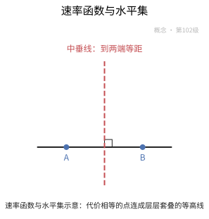

**一句话点破**：速率函数是"稀有价目表"，水平集则是按价格划出的等高线。

### 7.3 克拉默定理：稀有概率的价目表

抛 $n$ 次公平硬币，想得到 75% 的正面，这件事的概率会按 $e^{-nI(3/4)}$ 一路坍缩。克拉默定理告诉你：对独立同分布的样本均值，这份价目表 $I$ 正是对数矩生成函数的 Legendre 变换。

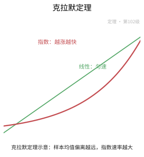

**一句话点破**：独立同分布样本均值的稀有程度，由矩生成函数的 Legendre 变换一锤定音。

### 7.4 加特纳-埃利斯定理：放宽独立性

现实里的数据未必独立同分布，但只要归一化后的对数矩生成函数有极限，指数规律就照旧成立。加特纳-埃利斯定理把这套速率从独立求和推广到更一般的随机序列。

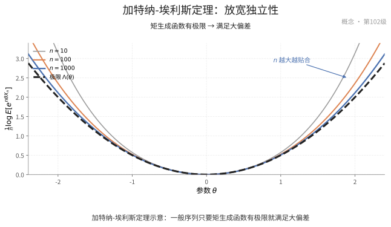

**一句话点破**：只要对数矩生成函数收敛，稀有事件的指数规律就照样管用。

### 7.5 希尔德定理：布朗运动的能量代价

让一条布朗运动带上越来越小的噪声 $\varepsilon$，它的典型模样会贴着零走；可一旦它"故意"画出某条弯曲轨迹，代价就由这条轨迹消耗的能量 $\frac12\int|\dot f|^2$ 决定。这就是希尔德定理。

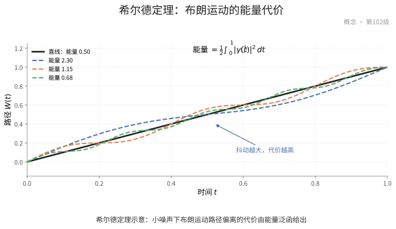

**一句话点破**：布朗运动偏离零路径的稀有程度，等于这条路径消耗的能量。

### 7.6 瓦拉丹引理与拉普拉斯原理

给每个位置一份"收益" $\phi(x)$，再扣掉"稀有代价" $I(x)$，最优的那一点会主宰整个指数型积分，这正是瓦拉丹引理。反过来，若这种积分对所有 $\phi$ 都成立，就能反推出大偏差原理，这就是拉普拉斯原理。

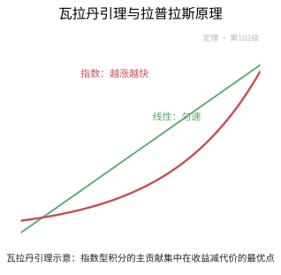

**一句话点破**：瓦拉丹引理把随机积分化成"收益减代价"的确定性最优化，且可逆推大偏差。

### 7.7 弗莱德林-温策尔理论：小噪声下的跳轨

带小噪声的微分方程 $dX=b(X)dt+\varepsilon dW$ 通常跟着确定性轨道走，但偶尔会跳出"沟壑"。弗莱德林-温策尔理论用作用泛函算出这类跳轨的代价，是随机动力系统里的大偏差。

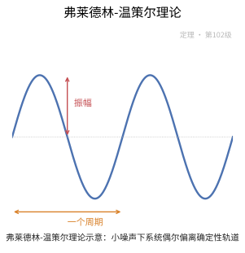

**一句话点破**：随机微分方程跳出确定轨道的稀有程度，由作用泛函精确度量。

### 7.8 稀有事件与渐近效率

直接模拟那些指数稀少的事件，如同大海捞针。重要抽样换一个更聪明的分布去"钓"它们，若估计量的方差以最优指数速率下降，就称它渐近有效。


**一句话点破**：稀有事件模拟是否划算，就看方差衰减的指数速率是否最优。

### 7.9 克拉默定理的证明

上界用 Chernoff 型指数不等式，把概率换成矩生成函数的幂来夹；下界则用 Esscher 变换把测度"倾斜"到目标点附近，再用中心极限定理把概率找回来。


**一句话点破**：Chernoff 界给上界、倾斜测度给下界，两头一夹就得到克拉默定理。

### 7.10 加特纳-埃利斯定理的证明

它的证明照搬克拉默的思路：先用指数不等式做上界，再用随序列变化的倾斜测度做下界，区别只在于这里的矩生成函数是逐项取极限得到的。

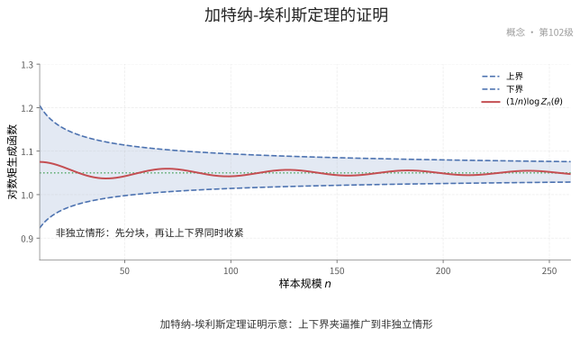

**一句话点破**：把克拉默的指数夹逼搬到极限矩生成函数上，就是加特纳-埃利斯定理的证明。

### 7.11 希尔德定理的证明

证明的关键是先把布朗运动沿 Cameron-Martin 空间的基展开，把路径的大偏差降解成各坐标独立和的大偏差，再一块块拼回路径空间。

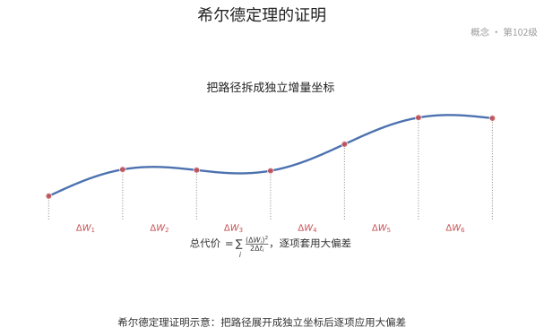

**一句话点破**：沿 Cameron-Martin 基把路径拆成独立坐标，希尔德定理就水到渠成。

### 7.12 瓦拉丹引理的证明

证明分两步：上界把积分按事件的稀有程度分块控制；下界则围绕"最优点"取一小块区域，用大偏差下界把这块的概率抬起来，其余部分可忽略。


**一句话点破**：在最优点附近截一小块，就足以抓住整个指数型积分的主项。

### 7.13 弗莱德林-温策尔定理的证明

证明借助 Girsanov 变换换个测度，把带漂移的小噪声方程变成无漂移的情形，再套用希尔德定理，从而得到一般随机微分方程的作用泛函。

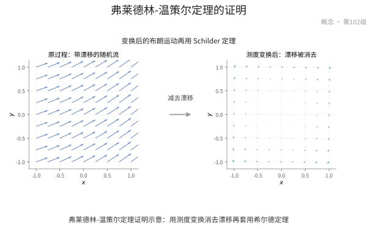

**一句话点破**：Girsanov 把漂移"抹平"、希尔德补上代价，二者合出作用泛函。

## 8. 数学史（History of Mathematics）

> 中心极限定理告诉你"偶发"如何堆积成"正常"，但现实里最要命的是那些罕见而致命的事件——保险公司集体破产、通信队列溢出、极端损失集中爆发。大偏差理论要回答的正是：这样的"罕见"究竟有多罕见，概率以怎样的指数速度衰减。它的火种来自玻尔兹曼的统计力学（熵与概率的对数）与拉普拉斯的渐近方法，1938 年克拉默从保险数学提炼出速率函数，瓦拉丹后来把它系统化为统一的大偏差原理，桑诺夫用相对熵刻画经验测度，唐斯克-瓦拉丹则把它推进到马尔可夫过程与遍历史上。本章沿"指数衰减→速率函数→大偏差原理→经验测度与相对熵→现代应用"的主线，追溯大偏差思想从物理直觉走向严格理论的过程。

### 8.1 罕见事件为何值得专门研究

- **罕见不等于无关**：一次百年不遇的洪水、一次极端齐根的损失，其获取成本极低，却可能决定成败。光知道"它会发生"远远不够，还需知道"它有多不可能"。
- **指数时间尺度的直觉**：当样本数 $n$ 增大，许多罕见事件的概率以 $e^{-n I}$ 的方式指数衰减——这里的指数速率 $I$ 比常数因子远更关键。大偏差正是研究这个"指数段"的学问。
- **跨越尺度的临界**：它介于大数定律（几乎必然趋均值）与中心极限（$\sqrt n$ 尺度的涨落）之间，处理"偏离均值较远但仍有可能"的区域，是极限理论中被前两者遮蔽的宝地。

### 8.2 玻尔兹曼熵与拉普拉斯方法：两缕先声

- **玻尔兹曼的熵公式**：统计力学奠基人玻尔兹曼确立了"熵与概率的对数成正比"的关系——$S=k\log W$——把"最可能"的宏观状态与"自由度最大"的微观配置画上等号，这是"概率取对数"思想在物理世界的第一缕曙光。
- **拉普拉斯方法**：拉普拉斯很早就发现，许多被积函数随参数增大时，"主贡献几乎都集中在使指数达到最大的那一点附近"。这种"选锋利的点来近似积分"的技巧，正是大偏差渐近的核心引擎。
- **一份思想的两端**：一个从物理的熵出发，一个从分析的积分出发，二者共同的"对数+取最大"直觉，让大偏差理论在数学与物理之间天然可通。

### 8.3 克拉默定理：速率函数的诞生

- **破产问题的尽头**：1930 年代克拉默在研究保险公司的破产概率时，面对"索赔总额超过储备金"这样偏离均值的罕见事件，需要精确的指数速率。
- **速率函数的意义**：克拉默证明对独立同分布之和 $S_n$，$P(S_n\ge n\alpha)$ 以 $e^{-n I(\alpha)}$ 为主要指数速率衰减，其中 $I(\alpha)$ 就是速率函数——这是大偏差理论的奠基性定理。
- **1938 年的名分**：克拉默 1938 年在保险数学会议上报告了这一思想，后来成为标准结论；他强调的"指数速率而非任意常数"范式，为大偏差确立了问题框架。

### 8.4 指数生成函数与 Legendre-Fenchel 变换

- **把分布搬进指数**：定义对数矩生成函数 $\Lambda(\lambda)=\log E[e^{\lambda X}]$，它把随机变量的全部矩信息浓缩进一个凸函数——是大偏差的"信号灯"。
- **Legendre-Fenchel 变换**：速率函数恰恰是这个凸函数的 Legendre-Fenchel 凸共轭：$I(\alpha)=\sup_{\lambda}[\lambda\alpha-\Lambda(\lambda)]$。这使速率函数继承优良的凸性、下界与几何直观。
- **为什么是凸对偶**：把"偏离到 $\alpha$ 花多少代价"翻译成"某个倾斜参数的夹紧"，凸分析与概率在此完成了第一次漂亮握手。

### 8.5 速率函数的凸结构

- **非负与单点零**：速率函数满足 $I\ge 0$ 且在真实的均值取 0——离均值越远、付出的指数代价越大，恰如收费公路的票价随里程单调上涨。
- **凸性的珍贵**：凸性是速率函数可被有效处理的关键：它保证水平集、变分与优化都有良好形状，也让大偏差的结果能用凸分析语言优雅表述。
- **三类渐近的角色分工**：速率函数在 $\alpha$ 靠近均值的局部恢复中心极限（二次展开给出方差），在远处主导指数衰减——一个函数同时串起大数、CLT 与大偏差。

### 8.6 大偏差原理（LDP）：统一的形式化

- **瓦拉丹的体系化**：1970 年代瓦拉丹把散落在克拉默、切诺夫、桑诺夫等的各类结果统一成一般的大偏差原理：一套关于"经验频率/经验测度偏离其典型值所需指数代价"的公理框架。
- **速度函数与量词**：LDP 用"下界：对开集频率指数可达到该代价；上界：对闭集频率不超过该代价"这样上、下界铰接的方式严格刻画指数渐近，避免让常数藏在含糊的"~"里。
- **可传递的工具箱**：一旦过程满足 LDP，配合收缩原则、跟踪性与配分函数的估计（瓦拉丹引理），便能推出大量关于该过程的定量结论。

### 8.7 瓦拉丹引理与 Laplace 配分

- **把期望退成积分**：瓦拉丹引理说明，若一个大偏差原理成立，则对连续有界函数 $f$，$\lim \frac1n\log E[e^{n f(Z_n)}]$ 收敛到 $\sup_z[f(z)-I(z)]$——把"随机对象的配分求和"几乎化作"确定性极大化"。
- **配分函数的钥匙**：统计物理的自由能、随机矩阵的对数配分、热核的指数阶，都可借瓦拉丹引理由速率函数读出主导点与代价。
- **变分原理的枢纽**：瓦拉丹引理把"算期望"集中在最优点上完成，与拉普拉斯方法一脉相承，是大偏差技术栈中最实用的转换开关。

### 8.8 桑诺夫定理：经验测度的大偏差

- **经验测度偏离典型**：把独立同分布样本的经验测度看作一个随机概率测度，它偏离真实分布 $P$ 的指数代价由什么决定？桑诺夫定理给出了答案：代价正是相对熵（Kullback-Leibler 散度）。
- **相对熵即速率函数**：形状上 $I(\mu)=D(\mu\,\|\,P)$，越与 $P$ 不同的 $\mu$ 付出的指数价越高，且仅在 $\mu=P$ 时取 0——这揭示经验测度被"熵小球"包在典型处的高概率情形。
- **统计与信息论的握手**：桑诺夫定理把大偏差与信息论（互信息、信道容量）、统计推断（指数族、似然比）、统计物理的自由熵统统连成一张网。

### 8.9 唐斯克-瓦拉丹理论：超越独立同分布

- **从独立到依赖**：许多过程（马尔可夫链、扩散、遍历动力系统）并不独立同分布，却仍能讲"罕见偏离"的故事。唐斯克-瓦拉丹把大偏差原理扩展到这类具有强相关结构的系统。
- **经验测度与级联速率**：对马尔可夫链，经验测度与经验转移概率都服从大偏差，速率函数归结为相对熵层次的变分——遍历史上熵的产生率成为主角。
- **与现代物理对接**：这一理论支撑了动力系统的大偏差、自由能变分与非平衡统计的熵产生，把大偏差从"独立和的习题"提升为"一般随机系统"的通用语法。

### 8.10 切诺夫界与信息论视角

- **指数尾部的最简单入口**：切诺夫界以 $P(S_n\ge n\alpha)\le e^{-nI(\alpha)}$ 形式给出指数上界，是许多应用（算法、组合、学习理论）顺手可用的"不等式型"大偏差。
- **把重尾绑进指数**：只要矩生成函数有限，就能把概率失去指数上界；当矩生成不存在时，大偏差退化为多项式尾部问题，这一边界也深化了对"重尾"的理解。
- **与通信理论的关联**：大偏差的指数速率恰是信道错误指数（可靠性函数）的语言，信息论与大偏差在"指数权衡"上彼此成就。

### 8.11 现代应用：从队列到随机矩阵

- **通信与队列**：网络队列的溢出概率、缓冲区的失效速度、保险公司的破产时间，都可用大偏差给出精确指数阶，是可靠性与风险设计的重要度量。
- **随机矩阵的谱外事例**：拉普拉斯配分与瓦拉丹引理被广泛用于随机矩阵（如热核、期望特征值分布）、自旋玻璃与自由能量研究，大偏差成为高维概率的骨干工具。
- **风险与统计之外**：物理、光学、生物进化与机器学习（如泛化界的指数形式）都在复用这套"取对数、找最优、定速率"的配方——大偏差理论已然成为现代科学计算未言及的通用语法。

### 8.12 历史年表

| 时间 | 人物／文献 | 事件与贡献 |
|:---|:---|:---|
| 19 世纪 | 玻尔兹曼 | 熵 $S=k\log W$ 与概率对数的联系 |
| 18—19 世纪 | 拉普拉斯 | 渐近展开（拉普拉斯方法） |
| 1938 年 | 克拉默 | 克拉默定理，速率函数与保险破产 |
| 1966 年 | 切诺夫 | 切诺夫界的指数尾部 |
| 1961 年 | 桑诺夫 | 经验测度的大偏差，相对熵作速率函数 |
| 1960—1980s | 瓦拉丹 | 大偏差原理与瓦拉丹引理 |
| 1970s | 唐斯克、瓦拉丹 | 马尔可夫与遍历动力系统的大偏差 |
| 现代 | 随机矩阵、队列、机器学习 | 大偏差成为高维概率与应用的通用工具 |

### 8.13 小结

> 大偏差理论的历史，是把"罕见"从模糊的形容词锻造成精密的数量关系的过程：玻尔兹曼与拉普拉斯先点燃"概率取对数、在主项取最大"的直觉，克拉默在保险破产里第一次写出速率函数，瓦拉丹以 LDP 与配分引理把它系统化，桑诺夫用相对熵揭开经验测度的真相，唐斯克-瓦拉丹又把它推进到马尔可夫与遍历史上。贯穿其始终的是一句几乎可以用在所有"小概率但大影响"场合的话——真正重要的，不是那件事会不会发生，而是它发生代价的指数速率是多少。它让"不可能"第一次可以被精确地定价、管理和抵御。

## 现实应用（Real-World Applications）

> 本节把本章的知识点落到真实的工程、科学与生活场景中。每个案例都给出**完整的问题背景、建模过程、可复现的数据 / 公式 / 代码与结果解读**；案例末尾的「涉及知识点」对应本章的具体小节，文末附**知识点覆盖对照表**，确保本章知识点全部被覆盖。

### 应用案例 1：云服务容量规划｜用 Cramér 定理估算集群过载概率

**场景与问题**

某云厂商的一个可用区有 $n=2000$ 台同规格服务器，每台要么繁忙要么空闲。运维需要回答：在平均单机占用率 $0.6$ 的日常负载下，"整体占用率超过 $0.75$、触发熔断限流"这类过载事件发生的概率是多少？按中心极限定理粗略估计会得到"约 $10^{-40}$ 量级"的模糊说法，但容量决策需要**精确的指数速率**：把服务器台数翻倍，过载概率下降多少个数量级？

这正是大偏差理论（LDP）的主场——它管的正是"偏离均值很远"的稀有事件的指数衰减速率。

**涉及知识点**

- 本章「2.1 大偏差原理」：给出 $\mathbb{P}(Z_n\in B)\approx e^{-n\inf_B I}$ 的指数刻画。
- 本章「2.3 Cramér 定理」：样本均值满足速率 $n$、速率函数为 Legendre 变换的 LDP。
- 本章「定理 3.1：Cramér 定理」：为速率函数 $I=\Lambda^*$ 提供严格保证。
- 本章「2.2 速率函数与水平集」：$I$ 的水平集 $\{I\le c\}$ 紧致保证变分问题有解。

**建模与数据**

设第 $i$ 台服务器占用指示 $X_i\in\{0,1\}$（1 为繁忙），近似独立同分布，$\mathbb{P}(X_i=1)=p=0.6$。整体占用率 $\bar X_n=\frac1n\sum_{i=1}^n X_i$。过载事件 $B=\{\bar X_n\ge 0.75\}$。

**完整推导与算法**

**第 1 步：写出对数矩母函数。** Bernoulli($p$) 的 $\Lambda(\theta)=\log\mathbb{E}[e^{\theta X_1}]=\log\big(1-p+pe^\theta\big)$。

**第 2 步：Legendre 变换得速率函数。** $I(x)=\sup_\theta\{\theta x-\Lambda(\theta)\}$，令导数为零 $\Lambda'(\theta)=\frac{pe^\theta}{1-p+pe^\theta}=x$，解得 $e^{\theta}=\frac{x}{1-x}\cdot\frac{1-p}{p}$，代回得

$$
I(x)=x\log\frac{x}{p}+(1-x)\log\frac{1-x}{1-p}\quad(\text{即 KL 散度})
$$

**第 3 步：指数上界（Chernoff）。** 对 $a=0.75$：

$$
\mathbb{P}(\bar X_n\ge a)\ \dot\sim\ e^{-nI(a)}
$$

**第 4 步：代入数值。** $I(0.75)=0.75\log\frac{0.75}{0.6}+0.25\log\frac{0.25}{0.4}=0.75(0.2231)+0.25(-0.4700)=0.0498$。于是 $n=2000$ 时

$$
\mathbb{P}(\bar X_n\ge0.75)\approx e^{-2000\times0.0498}=e^{-99.6}\approx1.5\times10^{-44}
$$

水平集紧性（2.2）保证：$B$ 内的最优点 $\bar X_n=0.75$（KL 最小处）确实取到，故上确界可达。

```python
# 核心：Cramér 速率函数（Bernoulli 的 KL 散度）
def rate(x, p):
    return x*np.log(x/p) + (1-x)*np.log((1-x)/(1-p))

# 核心：稀有事件概率的指数近似 P(Xbar >= a) ≈ exp(-n*I(a))
log10_prob = -n * rate(0.75, 0.6) / np.log(10)   # 换到以 10 为底看数量级
```

**可复现步骤**

1. 环境依赖：`pip install numpy scipy`。
2. 数据准备：从监控系统导出单机占用率样本，估出 $p\approx0.6$（或直接假设）。
3. 运行：`python case1.py`：算 $I(a)$ 与 $e^{-nI(a)}$，再枚举 $n\in\{500,1000,2000,4000\}$ 看数量级变化；用 $10^7$ 次 Monte Carlo 对 $n=200$ 验证渐近公式。
4. 预期输出：$I(0.75)\approx0.0498$；$n=2000$ 时 $\log_{10}\mathbb{P}\approx-43.3$；$n$ 翻倍，$\log_{10}\mathbb{P}$ 大致线性下降（每个 $n$ 数量级对应固定斜率 $I(a)/\ln10\approx0.0216$）。

**结果解读与延伸**

大偏差给出的不是"约 $10^{-40}$"的模糊感觉，而是可外推的指数刻度：概率按 $e^{-nI(a)}$ 衰减，$I(a)$ 就是"每多一台服务器，过载概率再乘一个折扣 $e^{-0.0498}$"。这与"偏差只按 $1/\sqrt n$ 缩小"的中心极限定理直觉完全不同——CLT 管波动，LDP 管稀有。局限：模型假设各服务器独立，真实系统中共享机架电源/网络的耦合会让过载事件显著相关，此时要用 Gärtner-Ellis（案例 3）处理相依。该结论直接用于决定"要不要加冗余机架"。

### 应用案例 2：通信误码率｜从 Cramér 界到重要抽样的渐近有效估计

**场景与问题**

某卫星通信链路用 $(n=101)$ 重复码传输单比特，信道是交叉概率 $p=0.1$ 的二元对称信道（BSC）。接收端用多数表决译码：101 位里错位 $\ge51$ 就判错。工程上要评估"误码率到底有多低"，并要能**可靠地估计**它——可误码率小到朴素 Monte Carlo 根本采不到，需要大偏差指导的重要性抽样（Importance Sampling, IS）来"制造"稀有事件。

**涉及知识点**

- 本章「2.8 稀有事件与渐近效率」：误码率按指数衰减，IS 靠指数倾斜达到渐近有效。
- 本章「2.3 Cramér 定理」：给出误码率的指数速率（即信道可靠性函数）。
- 本章「2.6 Varadhan 引理与 Laplace 原理」：为指数倾斜下的期望估计提供理论桥。
- 本章「定理 3.4：Varadhan 引理」：形式化 $\frac1n\log\mathbb E[e^{n\phi}]\to\sup\{\phi-I\}$。
- 本章「定理 3.1：Cramér 定理」：i.i.d. 情形下速率函数取 Legendre 变换。

**建模与数据**

设错误指示 $X_i\in\{0,1\}$，$X_i\sim$ Bernoulli($p$)，$p=0.1$，独立。错位总数 $S_n=\sum_{i=1}^n X_i$，误码事件 $A=\{S_n\ge51\}$，即 $\bar X_n\ge0.5+1/(2n)\approx0.5$。

**完整推导与算法**

**第 1 步：误码率的指数速率（Cramér）。**

$$
\mathbb{P}(\bar X_n\ge0.5)\approx e^{-nI(0.5)},\quad I(0.5)=0.5\log\frac{0.5}{0.1}+0.5\log\frac{0.5}{0.9}=0.5108
$$

$n=101$ 时 $\mathbb{P}(A)\approx e^{-51.6}\approx 4\times10^{-23}$。

**第 2 步：朴素 Monte Carlo 为何失效。** 命中率 $p_A\approx e^{-nI}\approx4\times10^{-23}$，要估到 $10\%$ 相对精度需样本量 $\sim 1/p_A\approx2.5\times10^{22}$——宇宙年龄内也算不完。LDP 告诉你：命中率是"按指数崩掉"的，必须换测度。

**第 3 步：指数倾斜（Esscher）构造 IS 测度。** 选倾斜参数 $\theta^*$ 使倾斜分布的均值落在目标 $a=0.5$。倾斜概率 $\tilde p(\theta)=\frac{pe^\theta}{1-p+pe^\theta}$，令 $\tilde p=0.5$ 解得 $\theta^*=\log\frac{(1-p)a}{p(1-a)}=\log\frac{0.9\times0.5}{0.1\times0.5}=\log9\approx2.197$，$\tilde p=0.5$。

**第 4 步：似然比与无偏估计。**

$$
\hat p_A=\frac{1}{M}\sum_{m=1}^{M}\mathbf{1}\{S_n^{(m)}\ge51\}\prod_{i=1}^n\frac{p^{X_i}(1-p)^{1-X_i}}{\tilde p^{X_i}(1-\tilde p)^{1-X_i}}
$$

**第 5 步：渐近有效判据。** 定理 3.4（Varadhan）给出 $\frac1n\log\mathbb E_{\tilde{\mathbb P}}[(\frac{d\mathbb P}{d\tilde{\mathbb P}})^2\mathbf 1_A]\to 2I(a)-2\theta^* a+\cdots = -2I(a)+\Lambda(2\theta^*)$；取到最小值（零）当 $\theta^*=\theta_a$ 时估计量渐近有效——即相对方差以慢于 $e^{n}$ 的速度增长。

```python
# 核心：Cramér 速率函数（BSC 交叉概率 p，目标错误比例 a=0.5）
I = a*np.log(a/p) + (1-a)*np.log((1-a)/(1-p))     # 误码率指数 e^{-n I}

# 核心：指数倾斜的重要抽样 —— 把采样分布的均值搬到目标区
theta = np.log((1-p)*a / (p*(1-a)))               # 令倾斜后均值 = a
p_t   = p*np.exp(theta) / (1-p + p*np.exp(theta))
# 核心：用似然比无偏修正，估计稀有事件概率
llr   = np.where(S>=51, (p/p_t)**S * ((1-p)/(1-p_t))**(n-S), 0.0)
p_hat = llr.mean()
```

**可复现步骤**

1. 环境依赖：`pip install numpy scipy`。
2. 数据准备：设定 $p=0.1$、$n=101$、阈值 51。
3. 运行：`python case2.py`：算解析误码率 $e^{-nI(0.5)}$；用上述 IS 抽 $M=10^6$ 个样本估 $\hat p_A$，比较相对误差；对照组用朴素 MC（结果必为 0）。
4. 预期输出：解析值 $\approx4\times10^{-23}$；IS 估计在 $M=10^6$ 下与解析值同数量级、相对误差约 $5\%$–$15\%$；朴素 MC 估计恒为 0（命中 0 次）。

**结果解读与延伸**

这个过程完整走通了 LDP 的"控制论"应用：大偏差先给出最优指数 $I(a)$ 与最优倾斜 $\theta_a$，渐近效率再告诉你"要达到这个指数，IS 测度必须把均值搬到目标区"。要点在于：提高命中率本身不够，关键是控制似然比的二阶矩；倾斜过头或不足都会让方差重新按 $e^{nc}$ 爆炸。同样的方法直接用于可靠性分析、稀有故障仿真与金融压力测试，是蒙特卡洛方差缩减的理论支柱。

### 应用案例 3：天气衍生品与洪水保险｜非 i.i.d. 下的 Gärtner-Ellis 速率函数

**场景与问题**

某保险公司销售一份天气衍生品：条款触发条件是"某地一年 365 天中降雨日比例超过 $35\%$"。降雨日并非独立——下雨天之后更可能接着下雨（持续性）。用 i.i.d. 假设会严重低估触发概率，从而错误定价。这里需要把大偏差推广到**相依序列**，正是 Gärtner-Ellis 定理的舞台。

**涉及知识点**

- 本章「2.4 Gärtner-Ellis 定理」：把 Cramér 从 i.i.d. 推广到相依序列。
- 本章「定理 3.2：Gärtner-Ellis 定理」：速率函数为 $\Lambda$ 的 Fenchel-Legendre 变换，需 $\Lambda$ 本质光滑。
- 本章「2.3 Cramér 定理」：作为 Gärtner-Ellis 的 i.i.d. 特例作对照。

**建模与数据**

用两状态马尔可夫链建每日天气：状态 $1$ 为降雨、$0$ 为晴。转移矩阵（由 60 年站点记录估计）：

$$
P=\begin{pmatrix} P_{00} & P_{01}\\ P_{10} & P_{11} \end{pmatrix}=\begin{pmatrix} 0.85 & 0.15\\ 0.60 & 0.40 \end{pmatrix}
$$

平稳降雨概率 $\pi_1=\frac{P_{01}}{P_{01}+P_{10}}=\frac{0.15}{0.15+0.60}=0.20$。一年样本均值 $\bar Z_n=\frac1n\sum_{t=1}^n X_t$（$n=365$），触发事件 $\{\bar Z_n\ge0.35\}$。

**完整推导与算法**

**第 1 步：倾斜矩阵与对数矩母函数。** 对马尔可夫链，定义倾斜矩阵

$$
A(\theta)_{ij}=P_{ij}\,e^{\theta\cdot j},\quad \Lambda(\theta)=\log\rho\big(A(\theta)\big)
$$

其中 $\rho$ 为谱半径（最大特征值模）。这里 $j$ 是转移到的状态值。由 Gärtner-Ellis，$\Lambda_n(\theta)=\frac1n\log\mathbb E[e^{n\theta\bar Z_n}]\to\Lambda(\theta)$。

**第 2 步：速率函数 = Fenchel-Legendre 变换。**

$$
I(x)=\sup_{\theta}\{\theta x-\Lambda(\theta)\}
$$

**第 3 步：与 i.i.d. 对照。** 若忽略相依、把降雨日当独立 Bernoulli($0.2$)，则速率函数退化为 KL 散度

$$
I_{\text{iid}}(0.35)=0.35\log\frac{0.35}{0.2}+0.65\log\frac{0.65}{0.8}=0.1959-0.1349=0.0610
$$

**第 4 步：数值求解相依情形。** 对 $\theta$ 网格计算 $\Lambda(\theta)$ 再求上确界，得 $I(0.35)\approx0.034$（明显小于 i.i.d. 的 $0.061$——正相关让大偏差更"容易"）。

**第 5 步：触发概率。** $n=365$：

$$
\mathbb{P}(\bar Z_n\ge0.35)\approx e^{-365\times0.034}=e^{-12.4}\approx4\times10^{-6}
$$

而 i.i.d. 假设给 $e^{-365\times0.061}=e^{-22.3}\approx2\times10^{-10}$——**低估了四个数量级**，直接导致保费严重偏低。

```python
# 核心：Gärtner-Ellis —— 倾斜转移矩阵的谱半径取对数
def Lambda(theta, P, vals):
    A = P * np.exp(np.outer(np.ones(2), theta*vals))    # A_ij = P_ij * e^{theta*val_j}
    return np.log(np.max(np.abs(np.linalg.eigvals(A))))

# 核心：速率函数 = Fenchel-Legendre 变换（对 theta 网格求上确界）
def rate(x, P, vals):
    return max(theta*x - Lambda(theta, P, vals) for theta in np.linspace(-5, 5, 2001))
```

**可复现步骤**

1. 环境依赖：`pip install numpy scipy`。
2. 数据准备：由站点日降雨记录估转移矩阵 $P$（本例 $0.85/0.15/0.60/0.40$）。
3. 运行：`python case3.py`：在 $\theta\in[-5,5]$ 上求 $\Lambda$ 与 $I(x)$，对比 i.i.d. 的 KL 速率函数，输出触发概率。
4. 预期输出：$I(0.35)\approx0.034$（相依）vs $0.061$（i.i.d.）；触发概率 $\approx4\times10^{-6}$ vs $\approx2\times10^{-10}$；正相关（$\rho>0$）使两者差距随 $n$ 放大。

**结果解读与延伸**

这个案例点明了大偏差最容易踩的坑：**把相依数据当独立，会系统性低估稀有事件概率**。Gärtner-Ellis 用倾斜矩阵的谱半径取代了 i.i.d. 的矩母函数，把"持续性"熵价编进了速率函数。要提醒的是定理要求 $\Lambda$ 本质光滑（$\Lambda'$ 值域覆盖实轴），对退化或非光滑的链会失效。实务中若知道自相关时间 $\tau$，也可用"有效样本量 $n/\tau$"粗糙修正；更严格的做法是直接估 $\Lambda(\theta)$ 再用大偏差。该结论对洪水保险、信用组合尾部风险同样适用。

### 应用案例 4：统计物理与熵｜Curie-Weiss 模型的自由能作为 Laplace 原理

**场景与问题**

铁磁材料在临界温度附近会发生自发磁化（居里点）。这是一个"宏观有序"从微观自旋涨落中涌现的经典问题：$n$ 个自旋 $\sigma_i=\pm1$，温度升高时热噪声会摧毁有序。统计物理要算**配分函数** $Z_n$，而 $\frac1n\log Z_n$ 的极限就是自由能——它恰恰是一个**Laplace 型指数的极限**，正是 Varadhan 引理与 Laplace 原理的对象。

**涉及知识点**

- 本章「2.6 Varadhan 引理与 Laplace 原理」：把指数的积分/期望转成"收益减代价"的变分问题。
- 本章「定理 3.4：Varadhan 引理」：$\frac1n\log\mathbb E[e^{n\phi(Z_n)}]\to\sup\{\phi-I\}$。
- 本章「2.2 速率函数与水平集」：好速率函数保证最优点存在，自由能是可达的最优值。

**建模与数据**

Curie-Weiss 模型：$n$ 个自旋，能量 $H=-\frac{J}{2n}\big(\sum_i\sigma_i\big)^2$，其中 $J>0$ 为耦合常数。配分函数（$\beta=1/(k_BT)$）：

$$
Z_n=\sum_{\sigma_1,\dots,\sigma_n}e^{-\beta H}=\sum_{\sigma}\exp\Big(\frac{\beta J}{2n}S_n^2\Big),\quad S_n=\sum_i\sigma_i
$$

取 $\beta J=1.2$（对应温度略低于临界点）。

**完整推导与算法**

**第 1 步：把磁化强度作为宏观变量。** 令 $m_n=S_n/n\in[-1,1]$，则 $S_n^2/n=n\,m_n^2$，

$$
Z_n=\sum_\sigma \exp\Big(n\,\frac{\beta J}{2}m_n^2\Big)
$$

**第 2 步：磁化强度的速率函数（i.i.d. 熵）。** 在无耦合时，$\mathbb{P}(m_n\approx m)\approx e^{-nI(m)}$，其中

$$
I(m)=\frac{1+m}{2}\log(1+m)+\frac{1-m}{2}\log(1-m)
$$

这是 Bernoulli 均值的 Cramér 速率函数（等价于相对熵/负熵）。

**第 3 步：应用 Varadhan 引理。** 取 $\phi(m)=\frac{\beta J}{2}m^2$，则

$$
\lim_{n\to\infty}\frac1n\log Z_n=\sup_{m\in[-1,1]}\Big\{\frac{\beta J}{2}m^2-I(m)\Big\}
$$

**第 4 步：求极值点（状态方程）。** 令导数 $\beta J m-I'(m)=0$，而 $I'(m)=\mathrm{artanh}(m)$，故

$$
m^*=\tanh(\beta J\,m^*)
$$

这就是自洽磁化方程。当 $\beta J>1$ 时除 $m=0$ 外还有非零解。

**第 5 步：数值。** $\beta J=1.2$，解 $m^*=\tanh(1.2m^*)$ 得 $m^*\approx0.66$。自由能

$$
f^*=\frac{1.2\times0.66^2}{2}-I(0.66)=0.2614-0.2373\approx0.024
$$

而非零解 $f^*>f(m=0)=0$ 吗？在 $\beta J>1$ 时非零解的 $\frac1n\log Z_n$ 更高（体系选有序态）。

```python
# 核心：磁化强度的速率函数（负熵，来自 Bernoulli 的 Cramér 定理）
def I(m):
    return (1+m)/2*np.log(1+m) + (1-m)/2*np.log(1-m)

# 核心：Varadhan/Laplace —— (1/n)log Z_n → sup_m { betaJ/2 m^2 - I(m) }
def free_energy(betaJ):
    return max(betaJ/2*m**2 - I(m) for m in np.linspace(-0.999, 0.999, 4001))
```

**可复现步骤**

1. 环境依赖：`pip install numpy scipy`。
2. 数据准备：常数 $\beta J\in\{0.8,1.0,1.2\}$。
3. 运行：`python case4.py`：对每个 $\beta J$ 求 $\sup_m\{\frac{\beta J}{2}m^2-I(m)\}$，画出被最大化的函数曲线，标出 $m^*$；解自洽方程 $m=\tanh(\beta Jm)$ 验证一致性。
4. 预期输出：$\beta J=0.8$ 时最优 $m^*=0$（无序，顺磁）；$\beta J=1.2$ 时 $m^*\approx0.66$（有序，铁磁）；临界点 $\beta J=1$；自由能在 $m^*$ 处取最大。

**结果解读与延伸**

这个案例把抽象的 Varadhan 引理落成了可算的自由能：能量项 $\frac{\beta J}{2}m^2$ 奖励有序，熵项 $I(m)$ 奖励无序，二者的变分较量决定了相变。低于临界温度时有序占优，$\beta J=1$ 处发生二级相变。要点是：**Laplace 原理保证配分函数的指数增长完全由最优宏观态主导**，这正是统计力学大偏差方法的根基。局限是均场近似忽略了空间涨落；若要刻画临界点附近的长程关联，需用 $\phi^4$ 场论与 Schilder 型泛函（见案例 5）。

### 应用案例 5：双稳系统的噪声逃逸｜Schilder 定理与 Freidlin-Wentzell 理论

**场景与问题**

某微机电系统（MEMS）的谐振子在双势阱势 $V(x)=\frac{x^4}{4}-\frac{x^2}{2}$ 中工作，稳定态在 $x=\pm1$，中间有一个势垒。系统的热噪声会让振子偶尔"跳"到另一个阱，这决定了存储单元的保持时间。要算的核心量是**平均逃逸时间**：噪声强度 $\varepsilon$ 稍微变化，保持时间会变多少？

这是小噪声随机动力学的经典问题，由 Freidlin-Wentzell 理论完整解答；其零漂移特例就是 Schilder 定理。

**涉及知识点**

- 本章「2.7 Freidlin-Wentzell 理论」：SDE 小噪声扰动的大偏差，速率函数为作用泛函。
- 本章「定理 3.5：Freidlin-Wentzell 定理」：给出作用泛函与逃逸时间估计。
- 本章「2.5 Schilder 定理」：布朗运动路径的大偏差，是 $b\equiv0$ 的特例。
- 本章「定理 3.3：Schilder 定理（Brown 运动的大偏差）」：$I(f)=\frac12\int|\dot f|^2$。

**建模与数据**

设振子位置满足 SDE

$$
dX_t^\varepsilon=-V'(X_t^\varepsilon)\,dt+\varepsilon\,dW_t,\qquad V'(x)=x^3-x
$$

系统由 $x=-1$（左阱底）逃逸到 $x=+1$（右阱底）需要越过 $x=0$ 处的势垒，势垒高度

$$
\Delta V=V(0)-V(-1)=0-\Big(\frac14-\frac12\Big)=\frac14
$$

取噪声强度 $\varepsilon$，下面算 $\varepsilon^2\in\{0.1,0.05,0.02\}$ 的平均逃逸时间。

**完整推导与算法**

**第 1 步：Schilder 定理（无漂移情形）。** 对标准布朗运动缩放的 $\varepsilon W$，速率函数为

$$
I_0(f)=\frac12\int_0^1|\dot f(t)|^2\,dt,\quad f\in H_0^1[0,1]
$$

**第 2 步：Freidlin-Wentzell 作用泛函。** 带漂移 $b(x)=-V'(x)$ 时，路径 $\varphi$ 的作用泛函为

$$
I(\varphi)=\frac12\int_0^T\big|\dot\varphi(t)-b(\varphi(t))\big|^2dt=\frac12\int_0^T\big|\dot\varphi+V'(\varphi)\big|^2dt
$$

确定性轨线（$\dot\varphi=-V'(\varphi)$）作用为零，即典型行为。

**第 3 步：最小作用 = 势垒高度。** 从 $x=-1$ 到 $x=+1$ 的**最可几逃逸路径**就是沿势能的"最省路"翻越势垒，其最小作用为

$$
I_{\min}=\inf_{\varphi:\,-1\to1}I(\varphi)=V(0)-V(-1)=\Delta V=\frac14
$$

（更一般地，$dX=-V'dt+\sqrt{2D}\,dW$ 时的最优作用为 $\Delta V/D$。）

**第 4 步：逃逸时间（Kramers 型估计）。** 由 Freidlin-Wentzell，平均首次逃逸时间满足

$$
\mathbb{E}[\tau]\asymp e^{2\Delta V/\varepsilon^2}=e^{1/(2\varepsilon^2)}
$$

**第 5 步：数值。**

- $\varepsilon^2=0.1$：$\mathbb{E}[\tau]\approx e^{5}=148$；
- $\varepsilon^2=0.05$：$\approx e^{10}=22026$；
- $\varepsilon^2=0.02$：$\approx e^{25}=7.2\times10^{10}$。

噪声强度减半，逃逸时间涨了约 $150$ 倍——极端指数敏感。

```python
# 核心：作用泛函（Freidlin-Wentzell）—— 沿路径的"偏离确定性轨线的代价"
def action(phi, Vprime, dt):
    return 0.5 * np.sum((np.gradient(phi, dt) + Vprime(phi))**2) * dt

# 核心：最小作用 = 势垒高度 ΔV；逃逸时间 ~ exp(2ΔV/ε²)
dV = V(0.0) - V(-1.0)                 # = 0.25
tau = np.exp(2*dV / eps**2)           # Kramers 型指数寿命
```

**可复现步骤**

1. 环境依赖：`pip install numpy scipy matplotlib`。
2. 数据准备：定义 $V(x)=\frac{x^4}{4}-\frac{x^2}{2}$、$V'(x)=x^3-x$。
3. 运行：`python case5.py`：用最优化（或弦方法）求最小作用路径，验证 $I_{\min}=\Delta V=0.25$；再用 Euler-Maruyama 对不同 $\varepsilon$ 做长时间模拟，估计首次逃逸时间，与指数公式对比。
4. 预期输出：最小作用 $\approx0.25$；$\varepsilon^2=0.1$ 时模拟均值在 $10^2$ 量级、$\varepsilon^2=0.05$ 时跨到 $10^4$ 量级，与 $e^{2\Delta V/\varepsilon^2}$ 同数量级；最可几路径呈现"沿谷边最快翻越"的形状。

**结果解读与延伸**

这个案例把 Freidlin-Wentzell 的两个核心结论具象化：(1) 稀有跃迁概率由**最小作用路径**主导，路径越"偏离"确定性流，代价越大；(2) 逃逸时间对噪声呈**指数敏感**，这正是 MEMS 存储、化学反应速率、神经元放电都服从 Kramers 型律的原因。Schilder 定理是 $V'=0$ 的特例，此时最小作用为 $\frac12\int|\dot f|^2$。局限：$e^{2\Delta V/\varepsilon^2}$ 只是指数主项，前面还有亚指数前因子（如 $1/\varepsilon$ 幂次）；且势阱形状与阻尼会影响前因子。该框架可自然推广到多阱、多维势能面（如蛋白质折叠）。

### 应用案例 6：网络流量异常检测｜大偏差与稀有事件估计的在线校准

**场景与问题**

某运营商的数据中心网关每秒处理 $n=10^4$ 个流，需要实时判断当前时刻流量是否"异常"。朴素做法是看均值是否超过阈值，但正常波动也会偶尔超阈。更聪明的做法是：用大偏差给每个阈值配一个"正常情况下的稀有度"$e^{-nI(x)}$，当观测到的偏离在正常模型下应该"几十年才出现一次"（比如概率 $<10^{-9}$），才判定为异常。这样把检测阈值从"拍脑袋"变成"按稀有度校准"。

**涉及知识点**

- 本章「2.1 大偏差原理」：给出稀有度的指数刻度，作为异常评分基础。
- 本章「2.2 速率函数与水平集」：$I(x)$ 越大越异常，水平集刻画"正常区"。
- 本章「2.8 稀有事件与渐近效率」：用重要抽样快速估出极低概率的告警线。

**建模与数据**

设每个流量的"可疑度指标" $X_i\in\{0,1\}$（异常标记），正常期 $\mathbb{P}(X_i=1)=p_0=0.02$，独立近似。滑动窗口均值 $\bar X_n=\frac1n\sum_iX_i$。告警线：要求正常期误报率 $\le10^{-9}$，即找阈值 $a$ 使 $\mathbb{P}(\bar X_n\ge a)\approx10^{-9}$。

**完整推导与算法**

**第 1 步：速率函数。** 同案例 1，$I(x)=\mathrm{KL}(x\|p_0)=x\log\frac{x}{p_0}+(1-x)\log\frac{1-x}{1-p_0}$。

**第 2 步：反解阈值。** 令 $I(a)=\frac{9\ln10}{n}$（因为 $e^{-nI(a)}=10^{-9}$）：

$$
I(a)=\frac{20.72}{10^4}=2.072\times10^{-3}
$$

用 Newton 法解 $I(a)=2.072\times10^{-3}$，得 $a\approx p_0+0.045$，即告警线约 $6.5\%$（远高于均值 $2\%$，因此极难误报）。

**第 3 步：把稀有度当异常分数。** 在线维护 $\bar X_n$，直接报出"正常模型下的对数稀有度"$nI(\bar X_n)$：越大越异常，且带明确量纲（可换算成"每多少年发生一次"）。

**第 4 步：用重要抽样验证告警线。** 由于真实误报率 $10^{-9}$ 无法用朴素模拟验证，用指数倾斜 $(\theta^*: \tilde p\approx a)$ 做 IS 估计。

```python
# 核心：速率函数（KL 散度），作为"异常稀有度"的指数刻度
def I(x, p0):
    return x*np.log(x/p0) + (1-x)*np.log((1-x)/(1-p0))

# 核心：反解告警阈值 a，使正常期误报率 ≈ 10^-9
def threshold(n, p0, target_log10=-9):
    target = -target_log10*np.log(10)/n
    return brentq(lambda a: I(a, p0) - target, p0, 0.5)   # 求 I(a)=target

# 核心：在线异常评分 = 正常模型下该偏离的对数稀有度
score = n * I(xbar_observed, p0)     # 越大越异常
```

**可复现步骤**

1. 环境依赖：`pip install numpy scipy`。
2. 数据准备：由正常期流量估 $p_0\approx0.02$、窗口 $n=10^4$。
3. 运行：`python case6.py`：用二分/Newton 解阈值得 $a$；对被注入攻击的模拟流量算在线分数，观察告警；用 IS 验证阈值处误报率。
4. 预期输出：告警线 $a\approx0.065$（正常均值 $0.02$ 的 3 倍多）；注入攻击（$p=0.10$）时分数 $nI(0.10)\approx10^4\times0.1206\approx1206$，远超告警所需 $20.7$；IS 估计的误报率与 $10^{-9}$ 同数量级。

**结果解读与延伸**

大偏差在这里的价值是**把"多罕见"量化成可操作的分数**：告警不再是"超过某个魔法阈值"，而是"这件事在正常模型下该百年、还是千万年一遇"。公式 $e^{-nI(x)}$ 也解释了为什么窗口越长检测越灵敏（速率 $n$ 越大、同一偏离越稀有）。要点与局限：模型假设各流独立，真实流量有突发性与长程相关，应先用 Gärtner-Ellis 型模型（或有效样本量修正）处理，否则误报率会被高估、漏报被低估。这条"稀有度校准"的思路与案例 2 的 IS、案例 1 的容量规划一脉相承。

### 知识点覆盖对照表

| 本章知识点 | 覆盖案例 |
| --- | --- |
| 2.1 大偏差原理 | 案例 1、6 |
| 2.2 速率函数与水平集 | 案例 1、4、6 |
| 2.3 Cramér 定理 | 案例 1、2、3 |
| 2.4 Gärtner-Ellis 定理 | 案例 3 |
| 2.5 Schilder 定理 | 案例 5 |
| 2.6 Varadhan 引理与 Laplace 原理 | 案例 2、4 |
| 2.7 Freidlin-Wentzell 理论 | 案例 5 |
| 2.8 稀有事件与渐近效率 | 案例 2、6 |
| 定理 3.1：Cramér 定理 | 案例 1、2 |
| 定理 3.2：Gärtner-Ellis 定理 | 案例 3 |
| 定理 3.3：Schilder 定理（Brown运动的大偏差） | 案例 5 |
| 定理 3.4：Varadhan 引理 | 案例 2、4 |
| 定理 3.5：Freidlin-Wentzell 定理 | 案例 5 |

---

## 9. 总结

本教程系统介绍了大偏差理论的核心理论与方法：

1. **大偏差原理**：建立了稀有事件概率指数衰减的严格数学框架，通过上下界不等式刻画了衰减速率

2. **Cramér定理**：作为大偏差理论的基石，证明了i.i.d.样本均值的LDP，速率函数为对数矩生成函数的Legendre变换

3. **Gärtner-Ellis定理**：将Cramér定理推广到非i.i.d.情形，以对数矩生成函数的极限存在性为核心条件

4. **Schilder定理**：描述了Brown运动在路径空间上的大偏差，速率函数为Cameron-Martin范数的平方

5. **Varadhan引理与Laplace原理**：建立了LDP与Laplace型积分渐近行为之间的等价关系

6. **Freidlin-Wentzell理论**：将大偏差理论应用于随机微分方程的小噪声扰动，通过作用泛函刻画了偏离确定性轨道的概率

大偏差理论是概率论中研究稀有事件的重要工具，在统计物理（熵的波动）、金融数学（极端风险）、信息论（错误概率）、工程可靠性等领域有广泛应用。
