# 第 104 级：逼近论 (Approximation Theory)

---

## 从"给任意曲线找一根最近的捷径"说起：逼近论要解决的根问题

> 在动手看定理之前，先想清楚一个基本问题：**明明有精确的函数，人为什么还要"逼"着用一个不准的东西去替它？**

**一个真实的生活场景（第一步：直觉）**

打开计算器按一下 $\sin 1$。它秒回 0.8414709……，你可能觉得它在"查表"其实没有——真正的答案是：**里面那台机器根本背不下无数个 $\sin$ 值，它只是偷偷用一根够低的**多项式/有理函数**曲线，把这根正弦曲线"逼"得很像而已。** 同样的剧情天天上演：导航把弯弯曲曲的山路画成一段段近似直线、软件把照片压成少数几个基元、芯片用有限位的多项式去算对数与指数。它们的共同点只有一个：**面对一条"复杂/未知"的目标曲线，用一类"简单、好算、可操作"的函数去替代它，只要误差够小、方向可控就行。** 这个"挑一条最近的捷径"的动作，就是逼近论。

**它到底想解决什么问题（第二步：要解决的问题）**

逼近论是 19 世纪从"计算"与"几何设计"两头被逼出来的。1850 年代，俄国工程师契比雪夫（Chebyshev）在调试蒸汽机的**连杆机构**时，想让连杆终端的轨迹尽可能接近一条直线——这是一个纯几何的"我最差也不要错太多"问题，直接催生了**最佳一致逼近**；1885 年，Weierstrass 用一个划时代的定理宣告"闭区间上任何连续函数都能被多项式一致逼近"，给"多项式万能"盖了章；1912 年 Bernstein 又用掷硬币的概率直觉给出构造性证明。自此逼近论要回答的**根问题**逐步清晰：

> 给定一类的"目标函数"和一类"简单候选函数"（子空间），能不能找到**离目标最近的那个候选**？怎样保证它存在、唯一？怎么把它构造出来？换更大的候选空间，误差能降到多快？

这三问——**存在唯一、构造、逼近阶**——正好对应本章的三块主体；而"候选函数类怎么选"（多项式、三角多项式、样条、有理函数）则是贯穿始终的主线。

> **🧠 一句话记住逼近论的"出生证"**
>
> 逼近论源于"用简单可计算的函数去替代复杂/未知函数"的计算需求（从切比雪夫的连杆机构到计算器的正弦），它要解决的**根本问题**是：
>
> $$ \boxed{\text{在给定的函数类中，寻找对目标函数"最佳"的候选：存在唯一、可构造、并能刻画误差衰减速度。}} $$
>
> 三根支柱是**最佳性**（在什么范数下最优）、**构造性**（怎么真的算出来）与**逼近阶**（多给点钱能多快变准）。后面每讲一个概念，你都可以拿这三点去对号入座。

**看待本章的三种眼光（第三步：正式定义前的准备）**

- **框架的眼光**：先建好"最佳逼近问题"这个舞台——目标函数、候选子空间、度量范数，三者一起才定义清楚"最近"。
- **士兵的眼光**：再认识几支护身符——Bernstein 给存在与构造、正交投影给 $L^2$ 的最佳解、Chebyshev 多项式给均匀最优，Legendre/正交多项式给通用基。
- **速度计的眼光**：最后学会量"逼近多快"——Jackson 定理管"越光滑越快"，Bernstein 定理管"快则一定光滑"，并把有理/三角/样条作为速度各异的备选武器。

读完这一节，你要记的不是某条公式，而是：**逼近论是一门"用简单精准地代表复杂"的科学——它既保证"这样选一定不错"（最佳性），又保证"这样选你真的选得出来"（可构造性），还告诉你"再多给它一点预算能变好多少"（逼近阶）。** 带着这套眼光去读下面的定理与例子，你会看到它们其实都在回答同一件事：**那句"够了就好"的"够"字，到底够在哪儿。**

---

## 开始之前

**本章在讲什么**：本章系统研究"用简单函数逼近复杂函数"的完整理论。你会先搭起最佳逼近问题的一般框架（赋范空间、一致逼近与 $L^2$ 逼近），再依次认识：Weierstrass 逼近定理及其 Bernstein 构造、Chebyshev 多项式的极小极大性质、Legendre/正交多项式的最佳表达、最佳逼近的存在唯一性（Chebyshev 交替定理，正交投影）、逼近阶的快慢学（Jackson 与 Bernstein 定理），最后触角伸向有理逼近、Padé 逼近、三角多项式逼近与样条逼近。

**为什么要学它**：逼近论是"数值计算的理论地基"，也是多项后续硬课的基石。第 103 级数值分析里的插值、最小二乘、Chebyshev 节点、Padé 逼近、数值积分中的 Gauss 节点，本质都是逼近论的具体应用；第 106 级有限元方法的核心"分片多项式试探空间 + 误差估计"，正是样条/多项式逼近思想的工程形态；机器学习的"万能逼近定理"（见第 100 级）则是 Weierstrass 定理在神经网络上的翻版。可以说：**逼近论回答"用什么简单的函数去代表复杂的东西最好、能好到多快"，而数值分析与有限元则把它变成"怎么在计算机上真的算出来"。**

**开始前请确认你还记得**：

- 实数与极限（见第 10-11 级）：连续函数、一致连续、闭区间上连续函数的有界/最值性、换元积分。
- 微积分（见第 11-13 级）：Taylor 展开、Rolle 定理与中值定理、分部积分与 $\int_a^b fg$ 的对称技巧、幂级数。
- 线性代数（见第 14 级）：向量空间、子空间、线性独立、基与维数、范数与内积、正交性与正交基。
- 泛函分析基础（可对照第 48-50 级相关章节）：赋范线性空间、内积空间、三角不等式、紧集上的连续函数达极值。

---

## 1. 学习目标

完成本教程后，你将能够：

1. 理解最佳逼近的基本概念与数学框架
2. 掌握 Weierstrass 逼近定理及其 Bernstein 多项式构造证明
3. 理解最佳逼近的存在唯一性及其证明方法
4. 掌握 Chebyshev 多项式的性质及其在逼近中的应用
5. 理解正交多项式的最佳逼近性质
6. 掌握 Jackson 定理与 Bernstein 定理中逼近阶与光滑性的关系
7. 了解有理逼近、Padé 逼近、三角多项式逼近、样条逼近的基本思想
8. 能独立运用逼近理论分析函数逼近问题

---

## 2. 核心概念

### 2.1 最佳逼近问题

> **🌐 直觉先行（为什么需要这个概念）**：前面说过"挑一条最近的捷径"，可"最近"到底怎么量？**最佳逼近问题**就是把这个模糊的直觉精确化成三个要素：目标函数 $f$、候选池 $V$（只能从这里挑）、度量 $\|\cdot\|$（用什么尺子量"远近"）。换一个度量，答案就完全不一样——用"最大误差"量的是一致逼近，用"平方平均"量的是 $L^2$ 逼近。所以第一步不是急着算，而是**先选一把尺子**。

**最佳逼近**（Best Approximation）是逼近论的核心问题：给定一个函数 $f \in X$（其中 $X$ 是一个赋范线性空间）和一个子空间 $V \subset X$，寻找 $v^* \in V$ 使得

$$
\|f - v^*\| = \inf_{v \in V} \|f - v\|
$$

度量 $\|\cdot\|$ 的选择决定了逼近类型。最常见的两种是：

- **一致逼近**（Uniform Approximation）：取 $X = C[a,b]$，范数为 $\|f\|_\infty = \max_{x \in [a,b]} |f(x)|$
- **$L^2$ 逼近**（$L^2$ Approximation）：取 $X = L^2[a,b]$，范数为 $\|f\|_2 = \left(\int_a^b |f(x)|^2\,dx\right)^{1/2}$

#### 课堂问答

**老师**：给定赋范线性空间 $X$、有限维子空间 $V$ 与目标函数 $f\in X$，最佳逼近问题要我们求什么？

**学生**：求 $v^*\in V$ 使范数差最小：

$$
\|f-v^*\|=\inf_{v\in V}\|f-v\|
$$

它由三样东西共同定义——目标 $f$、候选池 $V$、以及度量远近的那把尺子 $\|\cdot\|$。缺一样，"最近"就无从谈起。

**老师（追问）**：那如果把尺子从 $\|\cdot\|_\infty$ 换成 $\|\cdot\|_2$，同一个 $f$、同一个 $V$，最优解还是同一个吗？

**学生**：通常不是。$\|\cdot\|_\infty=\max|f|$ 盯的是最大绝对误差，得到的是一致（minimax）逼近；$\|\cdot\|_2=(\int|f|^2)^{1/2}$ 管的是均方误差，得到的是最小二乘逼近。一个只在乎最坏点会不会冒尖，一个把误差摊平到整体，取舍不同，解自然不同。

**老师（拓展）**：为什么只要 $V$ 有限维，最近点就一定存在？唯一性还差什么？

**学生**：存在性靠紧性：取 $v_0\in V$，集合 $K=V\cap\{x:\|x-f\|\le\|f-v_0\|\}$ 有界闭、有限维故紧，连续函数 $\|f-\cdot\|$ 在 $K$ 上取到最小值。唯一性则要空间严格凸：像 $L^p$（$1<p<\infty$）那样没有平底，中点不等式取等只能 $v_1=v_2$；而 $L^\infty$ 不严格凸，最优解可能一整段都不唯一。

### 2.2 Weierstrass 逼近定理

**Weierstrass 逼近定理**表明，闭区间上的连续函数可以被多项式一致逼近到任意精度。

> **💡 直观理解（类比）**：Weierstrass 定理像"任何手绘的平滑曲线，总能被足够粗的像素网格逐点逼近到任意想看清楚的精度"——只要函数连续（不撕裂、不跳断），我们就能把某条直线/波浪线画得"像到肉眼看不出差别"。它确立了一件事：多项式是全能的"万能画笔"，连 $|x|$ 这种带尖角的函数也画得出（只是磨平尖角要多费些次数）。

#### 课堂问答

**老师**：Weierstrass 逼近定理的正式陈述是什么？

**学生**：设 $f\in C[a,b]$，则对任意 $\varepsilon>0$，存在多项式 $p$ 使

$$
\|f-p\|_\infty=\max_{x\in[a,b]}|f(x)-p(x)|<\varepsilon
$$

等价地 $\inf_{p}\|f-p\|_\infty=0$：多项式族在 $(C[a,b],\|\cdot\|_\infty)$ 中稠密。

**老师（追问）**：定理只假设连续，连导数都不要求。那 $f(x)=|x|$ 这个在 $0$ 处带尖角、不可导的函数，真的能被多项式一致逼近吗？

**学生**：真的能。定理的门槛只有连续性，不要求光滑。多项式是全能的逼近族，$|x|$ 也能描到任意精度——只不过尖角磨起来费劲，收敛只有 $O(1/n)$ 量级。这正说明连续与可由多项式一致逼近是等价的两件事。

**老师（拓展）**：证明时为什么可以只处理 $[0,1]$ 上的 $f$？

**学生**：用一个仿射变换把一般区间搬过去：令 $g(t)=f(a+(b-a)t)$，则 $g\in C[0,1]$，$g$ 与 $f$ 之间只差一个可逆线性换元。若 $q$ 一致逼近 $g$，则 $p(x)=q\big((x-a)/(b-a)\big)$ 就是逼近 $f$ 的多项式。换元保连续、保多项式次数、保一致误差，所以不失一般性只需证 $[0,1]$。

### 2.3 Bernstein 多项式

**Bernstein 多项式**是 Weierstrass 定理的一个显式构造工具。对于 $f \in C[0,1]$，其 $n$ 次 Bernstein 多项式定义为：

$$
B_n(f; x) = \sum_{k=0}^n f\left(\frac{k}{n}\right) \binom{n}{k} x^k (1-x)^{n-k}
$$

#### 课堂问答

**老师**：Bernstein 是怎么把 Weierstrass 那条存在性定理变成一个能写下来的构造的？

**学生**：对 $f\in C[0,1]$ 定义

$$
B_n(f;x)=\sum_{k=0}^n f\left(\frac{k}{n}\right)\binom{n}{k}x^k(1-x)^{n-k}
$$

把伯努利试验成功 $k$ 次的概率 $P_{n,k}(x)=\binom{n}{k}x^k(1-x)^{n-k}$ 当作权重，对 $f(k/n)$ 做加权平均。它是个 $n$ 次多项式，且 $n\to\infty$ 时一致收敛到 $f$。

**老师（追问）**：凭什么说 $B_n(f)\to f$？关键估计在哪里？

**学生**：关键是把误差拆成近端与远端。由 $f$ 在 $[0,1]$ 上一致连续，配合 $\sum P_{n,k}=1$ 给出近端 $<\varepsilon/2$；远端用二阶矩恒等式

$$
\sum_{k=0}^n (k-nx)^2\binom{n}{k}x^k(1-x)^{n-k}=nx(1-x)
$$

换进 Chebyshev 不等式得 $\sum_{|k/n-x|\ge\delta}P_{n,k}\le\frac{x(1-x)}{n\delta^2}\le\frac{1}{4n\delta^2}$，余下那块 $\le\frac{M}{2n\delta^2}$。取 $n$ 足够大即可，于是 $\|f-B_n(f)\|_\infty<\varepsilon$。

**老师（拓展）**：Bernstein 多项式保住的性质里，哪些看起来更像概率期望、而不像逼近？

**学生**：它是线性、保正的算子，且保常函数 $B_n(1;x)=1$、保 $x$；更妙的是 $B_n(f;x)=\mathbb{E}[f(K/n)]$，恰是 $f(k/n)$ 在二项分布下的期望。二阶矩 $nx(1-x)$ 正是二项分布的方差，标准差 $O(1/\sqrt n)$，大数定律保证期望收敛到 $f(x)$——概率论第一次成了逼近定理的脚手架。

### 2.4 Chebyshev 多项式

**Chebyshev 多项式**是定义在 $[-1,1]$ 上的一组正交多项式，由递推关系给出：

$$
T_0(x) = 1,\quad T_1(x) = x,\quad T_{n+1}(x) = 2xT_n(x) - T_{n-1}(x)
$$

> **💡 直观理解（类比）**：Chebyshev 多项式像"一辆在 $[-1,1]$ 两端之间均匀折返的等幅摆钟"——用 $T_n=\cos(n\arccos x)$ 把区间映射到圆周角后在 $[-1,1]$ 上等幅振荡到 $\pm1$。它的价值在于"最小最大性质"：在所有首一 $n$ 次多项式中它"甩得最均匀、峰值最低"，恰似给拉直的绳子挑最不使力画弧的那一条，因此是最佳一致逼近的天然节点来源。

其显式表达式为 $T_n(x) = \cos(n\arccos x)$。

Chebyshev 多项式在逼近论中具有核心地位，因为它在所有首一 $n$ 次多项式中具有最小的 $\infty$-范数（最小最大性质）。

#### 课堂问答

**老师**：Chebyshev 多项式最简洁的定义是什么？它为什么和三角有关？

**学生**：$T_n(x)=\cos(n\arccos x)$，配上三项递推

$$
T_0(x)=1,\quad T_1(x)=x,\quad T_{n+1}(x)=2xT_n(x)-T_{n-1}(x)
$$

由 $\cos(n\theta)$ 的倍角公式即可导出递推。令 $\theta=\arccos x$，$x\in[-1,1]$ 映到角 $\theta\in[0,\pi]$，$T_n$ 就在 $[-1,1]$ 上等幅振荡，取值始终落在 $\pm1$ 之间。

**老师（追问）**：它凭什么叫最佳？这个最佳指的是什么最优？

**学生**：最优的是最小最大：在所有首一（最高次系数为 $1$）$n$ 次多项式中，$\tilde T_n(x)=2^{1-n}T_n(x)$ 在 $[-1,1]$ 上的最大绝对值最小，等于 $2^{1-n}$。这就是 Chebyshev 最小最大性质，也正是最佳一致逼近里等幅交替误差的天然来源。

**老师（拓展）**：为什么以 Chebyshev 节点做插值能压住 Runge 现象？

**学生**：插值误差是 $\frac{\max|f^{(n+1)}|}{(n+1)!}\max|\omega_n|$，其中 $\omega_n(x)=\prod(x-x_i)$。等距节点让 $\max|\omega_n|$ 爆炸；而取 Chebyshev 零点作节点时 $\omega_n$ 正比于 $\tilde T_{n+1}$，由最小最大性质 $\max|\omega_n|=2^{-n}$，这是首一多项式能达到的最小值，误差被压到最小，两端密集的节点也把振荡驯服了。

### 2.5 Legendre 多项式

**Legendre 多项式**是 $L^2[-1,1]$ 上关于权函数 $w(x) = 1$ 的正交多项式：

$$
\int_{-1}^1 P_m(x)P_n(x)\,dx = \frac{2}{2n+1}\delta_{mn}
$$

> **💡 直观理解（类比）**：Legendre 多项式像"一组彼此垂直、用来搭架子的正交梁"——它们在 $L^2$ 里两两"垂直"（内积为零），任何函数都能按它们投影拆开，且各方向互不干扰。Rodrigues 公式 $P_n=\frac1{2^n n!}\frac{d^n}{dx^n}(x^2-1)^n$ 像个"次数生成器"：对 $(x^2-1)^n$ 求 $n$ 阶导并归一化，就得到第 $n$ 根正交梁。

由 Rodrigues 公式给出：

$$
P_n(x) = \frac{1}{2^n n!}\frac{d^n}{dx^n}(x^2-1)^n
$$

#### 课堂问答

**老师**：Legendre 多项式是在哪个内积下正交的？

**学生**：在 $L^2[-1,1]$ 上取权函数 $w(x)=1$，内积 $\langle f,g\rangle=\int_{-1}^1 fg\,dx$，满足

$$
\int_{-1}^1 P_m(x)P_n(x)\,dx=\frac{2}{2n+1}\delta_{mn}
$$

即两两正交，且模长平方为 $2/(2n+1)$。

**老师（追问）**：能不能光看公式就把头几项写出来？

**学生**：用 Rodrigues 公式

$$
P_n(x)=\frac{1}{2^n n!}\frac{d^n}{dx^n}\big(x^2-1\big)^n
$$

直接算得 $P_0=1$、$P_1=x$、$P_2=\frac{3x^2-1}{2}$、$P_3=\frac{5x^3-3x}{2}$。可以看出 $P_n$ 的奇偶性与 $n$ 一致，所以不同奇偶的 $P_m,P_n$ 内积天然为零，这是正交性的第一批验证。

**老师（拓展）**：Legendre 多项式在最佳逼近里扮演什么角色？

**学生**：它是 $L^2[-1,1]$ 上不带权的标准正交基，任何 $f$ 在 $\mathrm{span}\{P_0,\dots,P_n\}$ 上的最佳 $L^2$ 逼近就是它的 Fourier 部分和 $\sum a_kP_k$，系数 $a_k=\langle f,P_k\rangle/\langle P_k,P_k\rangle=\frac{2k+1}{2}\langle f,P_k\rangle$。正交基让每个系数独立可算、互不干扰，截断就自动最优。

### 2.6 一致逼近与 $L^2$ 逼近

- **一致逼近**：在 $\|\cdot\|_\infty$ 度量下，目标是使最大绝对误差最小化，即 **minimax 逼近**。
- **$L^2$ 逼近**：在 $\|\cdot\|_2$ 度量下，目标是使均方误差最小化，即 **最小二乘逼近**（Least Squares Approximation）。

> **⚠️ 常见坑**：一致逼近与 $L^2$ 逼近是**两把不同的尺子，最优解往往不一**——$L^2$ 最优会把误差"摊平"到整体、容忍个别点误差大；一致逼近则紧盯"最大误差"、绝不允许某点冒尖。所以**不要用 $L^2$ 的解去冒充一致最优**（反之亦然）。另外，在 $L^\infty$ 下最优逼近一般不唯一（严格凸性失效），而在 $L^2$（Hilbert 空间）下有正交投影保证唯一——这一"唯一性"差别是出题的高频考点。

无论采用哪种度量，Bernstein 多项式 $B_n(f;x)=\sum_{k=0}^n f(k/n)\binom{n}{k}x^k(1-x)^{n-k}$ 都给出了 Weierstrass 定理的显式构造，随 $n$ 增大逐步逼近目标函数：

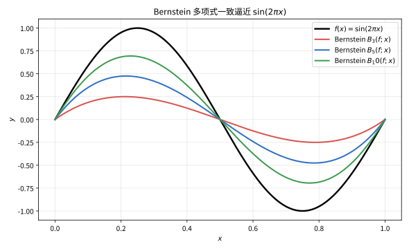

> **直观理解（现实类比）**：Bernstein 多项式像"用越来越多的小支柱搭建一个平滑的屋顶"。每根支柱（$n$ 根棒子）都支撑在函数 $f(k/n)$ 的高度上，而 $x^k(1-x)^{n-k}$ 决定每根支柱在各处的"承重占比"。支柱越多，屋顶越贴近真实的地势轮廓；$n\to\infty$ 时屋顶就完全贴合函数。这正是 Weierstrass 定理说"任何连续地形都能被多项式屋顶任意逼近"的直观来源。

> **🧠 思考历程：一团任意拐弯的连续曲线，凭什么也敢说"多项式能描个八九不离十"？**
>
> Bernstein 多项式回答的，是逼近论开门见山的一问：无论一条曲线铺得多么"任意"，我们能不能用最"驯良"的多项式把它逐点逼近？而出人意料的是，这个深刻结论的最短证明，竟藏在一段抡硬币的概率直觉里。
>
> - **Weierstrass 的一记重锤**。1885年 Weierstrass 证明：闭区间上任意连续函数都能被多项式一致逼近（$\\|f-p_n\\|\\to 0$）。当时"光滑骨架居然能全方位包抄任意连续体"这个结论，令分析学家又惊又喜。
> - **伯恩斯坦的"摇一摇"证明**。1912年 Bernstein 给出惊艳的构造性证明：把 $n$ 次独立伯努利试验成功次数的概率权重当作基函数，直接拼出多项式 $B_n(f)(x)=\\sum_{k=0}^{n} f(k/n)\\binom{n}{k}x^k(1-x)^{n-k}$，再借大数定律说明它收敛——概率论第一次成了逼近定理的脚手架。
> - **从"能不能"到"快多快"**。Chebyshev 早在1859年就研究最佳一致逼近，Jackson 与 Bernstein 随后定量刻画了"函数越光滑、逼近越快"的速率阶梯，把 Weierstrass 的定性断言磨成精密的逼近阶理论。
> - **心路**：最"软"的概率直觉，居然能给出最"硬"逼近定理的漂亮脚手架——想证明一个抽象的"可以"，不妨先找一个具体的"怎么搭"。

#### 课堂问答

**老师**：同样求最佳，一致逼近和 $L^2$ 逼近的目标差别在哪？

**学生**：一致逼近用 $\|\cdot\|_\infty$，是最小化最大绝对误差的 minimax 问题；$L^2$ 逼近用 $\|\cdot\|_2=\left(\int_a^b|f|^2\right)^{1/2}$，是最小化均方误差的最小二乘问题。前者只控制最坏的那一点，后者平均地摊平整体。

**老师（追问）**：如果我用 $L^2$ 的最优解去冒充一致最优，会怎样？

**学生**：多半会翻车。$L^2$ 解容忍个别点误差偏大，只要总能量小；而一致最优必须把所有点的误差压在同一个屋顶以内。两者是不同的最优准则。另外 $L^\infty$ 下最优解一般不唯一，而 $L^2$ 是 Hilbert 空间、正交投影保证唯一——这个唯一性的差别是高频考点。

**老师（拓展）**：有没有哪种情形下两把尺子的解一定重合？

**学生**：当 $f$ 本身就在 $V$ 内时，无论用哪个范数，最优解都是 $f$、误差为零，这是无争议的重合情形。反过来，若 $f\notin V$，要让 $L^2$ 解同时使 $\infty$-范数最小，必须恰好出现等幅交替的误差极值点，一般很难凑巧，所以千万别拿一把尺子的最优去宣称另一把的最优。

### 2.7 有理逼近与 Padé 逼近

**有理逼近**（Rational Approximation）用有理函数 $R_{m,n}(x) = P_m(x)/Q_n(x)$ 逼近函数，通常比多项式逼近更高效。

> **💡 直观理解（类比）**：有理逼近像"用两片拼在一起的零件（分子除分母）去贴合目标"——允许分母把画面"弯"出竖直的墙（极点），因此能在函数本身含尖峰或极点处贴合得比纯多项式好。好比用调音台同时拨动高低频旋钮（分子）和"增益曲线"（分母），能更精准地复现出带突变的声形。

**Padé 逼近**是 Taylor 级数展开的有理推广：给定函数 $f$ 的 Taylor 级数 $f(x) = \sum_{k=0}^\infty c_k x^k$，其 $(m,n)$ 阶 Padé 逼近 $[m/n]_f$ 是满足

$$
f(x) - \frac{P_m(x)}{Q_n(x)} = O(x^{m+n+1})
$$

的有理函数，其中 $\deg P_m \le m$，$\deg Q_n \le n$，$Q_n(0) = 1$。

> **💡 直观理解（类比）**：Padé 逼近像"用分子分母各留几个旋钮的路由器去拓展开中心信息"——它要求前 $m+n+1$ 项 Taylor 系数逐项对上，等于把展开式"忠实复刻"到该阶次，但当遇到常规多项式逼近失灵（如函数有极点或想让逼近在更大范围稳准）时，靠分母这块"增益板"能多兜住一段。阶次 $m,n$ 越大，匹配的原点信息越丰富。

#### 课堂问答

**老师**：有理逼近为什么常比多项式逼近划算？

**学生**：有理逼近用 $R_{m,n}=P_m(x)/Q_n(x)$，分母允许出现极点，因此能把函数本身的尖峰、极点弯出来，在同样的参数个数下往往达到远高于多项式的逼近精度，对奇点附近的函数尤其如此。

**老师（追问）**：那 Padé 逼近和 Taylor 级数是什么关系？

**学生**：Padé 是 Taylor 的有理推广。给定 $f$ 的 Taylor 级数 $\sum c_kx^k$，$(m,n)$ 阶 Padé 逼近 $[m/n]_f$ 满足

$$
f(x)-\frac{P_m(x)}{Q_n(x)}=O\!\big(x^{m+n+1}\big),\quad Q_n(0)=1
$$

即前 $m+n+1$ 项系数逐项对上，等于把原点附近的展开式忠实复刻到最高阶次，只是用分母换取了更大的收敛范围。

**老师（拓展）**：求 $[m/n]$ 时系数方程组为什么可以先解 $Q$ 再解 $P$？

**学生**：因为 $x^{m+1},\dots,x^{m+n}$ 这一段的系数只出现在分母侧 $Q$ 上（$P$ 的次数 $\le m$），它们构成一个关于 $Q$ 系数的 $n$ 元线性方程组；解出 $Q$ 后，$x^0,\dots,x^m$ 的系数方程直接给出 $P$。整体是一个 Toeplitz 型系统，当它退化（行列式为零）时会出现非唯一或次正规的 Padé 逼近。

### 2.8 三角多项式逼近与 Fourier 级数

**三角多项式逼近**用形如

$$
S_n(x) = \frac{a_0}{2} + \sum_{k=1}^n (a_k\cos kx + b_k\sin kx)
$$

的三角多项式逼近周期函数。Fourier 级数是 $L^2$ 意义下的最佳三角多项式逼近。

> **💡 直观理解（类比）**：三角多项式逼近像"用若干条不同频率的正弦波拼出某种周期波形"——就像调音台把多个正弦音叠加成复杂音色，$a_k,b_k$ 每个系数对应一个频率的"音量旋钮"。对周期函数而言，$L^2$ 里的最佳逼近恰好由 Fourier 系数给出，意思是"在最小均方误差意义下，这套正弦波旋钮调到哪个值最好的答案就是 Fourier 系数"。

#### 课堂问答

**老师**：三角多项式逼近的候选函数长什么样？

**学生**：

$$
S_n(x)=\frac{a_0}{2}+\sum_{k=1}^n\big(a_k\cos kx+b_k\sin kx\big)
$$

用一组不同频率的正弦、余弦叠加去拟合周期函数，系数 $a_k,b_k$ 是各频率的音量旋钮。

**老师（追问）**：在 $L^2$ 意义下，这些旋钮调到什么值最好？

**学生**：恰好是 Fourier 系数。因为 $\{1,\cos kx,\sin kx\}$ 在 $[-\pi,\pi]$ 上正交，投影即最优：

$$
a_k=\frac{1}{\pi}\int_{-\pi}^{\pi} f(x)\cos kx\,dx,\quad b_k=\frac{1}{\pi}\int_{-\pi}^{\pi} f(x)\sin kx\,dx
$$

也就是说，$S_n$ 就是 $f$ 在三角多项式子空间上的 $L^2$ 最佳逼近。

**老师（拓展）**：既然 Fourier 部分和是 $L^2$ 最优，它一定一致收敛到 $f$ 吗？

**学生**：不一定。$L^2$ 收敛不蕴涵一致收敛；在跳变间断附近还会出现 Gibbs 现象，过冲量约 $0.09$，且不随 $n$ 增大而消失。要让连续周期函数也一致收敛，得改用 Fejér 平均（非负偶三角核卷积），那才是周期版 Weierstrass 定理的正道。

### 2.9 样条逼近

**样条逼近**（Spline Approximation）使用分段多项式函数作为逼近工具。$k$ 次样条函数在节点处具有 $k-1$ 阶连续导数，兼具光滑性和局部性。

#### 课堂问答

**老师**：什么是样条逼近？一句话说清它的核心取舍。

**学生**：样条逼近用分段多项式作为逼近工具：$k$ 次样条在每个节点处具有 $k-1$ 阶连续导数，兼顾光滑性与局部性。分段低次加节点拼接，是它与整体高次多项式最本质的区别。

**老师（追问）**：这个局部性到底带来什么好处？

**学生**：局部支撑意味着改动一个数据只影响相邻几段，不会牵动整条曲线，数值上稳定、可并行；而整体高次多项式动一个数据点往往引起全局震荡。这使样条能有效规避 Runge 现象，也便于自适应加密：哪段误差大就在哪段加节点。

**老师（拓展）**：以最常见的三次样条为例，它光滑到什么程度？误差阶如何？

**学生**：三次样条在节点处二阶连续可导，即 $C^2$。对充分光滑的 $f$，其插值误差满足 $\|f-S\|_\infty=O(h^4)$（$h$ 为最大步长），比分段线性的 $O(h^2)$ 高两阶；同时它是最小弯曲意义下最光滑的插值曲线，这正是工程上画曲线首选三次样条的原因。

### 2.10 逼近阶

**逼近阶**（Order of Approximation）描述逼近误差随逼近空间维数增长的衰减速度。若存在 $C > 0$ 使得

$$
\inf_{v \in V_n} \|f - v\| \le C \cdot n^{-r}
$$

则称逼近阶为 $O(n^{-r})$，其中 $r$ 与 $f$ 的光滑性有关。

逼近阶本质上由函数光滑性决定——函数越光滑，误差随 $n$ 衰减得越快（Jackson 定理）：

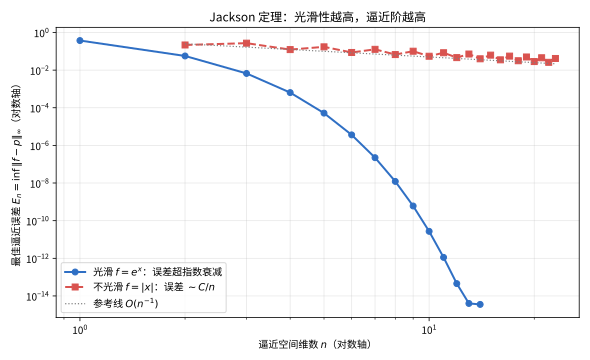

> **直观理解（现实类比）**：逼近阶就像"打磨一块石头的速度"。光滑的函数（如 $e^x$）像质地均匀的黏土，多花一点力气（增大 $n$）就能迅速磨得更光滑；而不光滑的函数（如 $|x|$ 那个尖角）像坚硬的棱角石，无论怎么加次数，那处尖角就是难磨平，误差只能按 $1/n$ 慢慢下降。所以"用多项式逼近时，函数越光滑、收益越高"——这正对应 Jackson 定理中 $r$（光滑度）与逼近阶 $O(n^{-r})$ 的直接挂钩。

#### 课堂问答

**老师**：逼近阶这个量究竟刻画什么？

**学生**：它刻画误差随逼近空间维数 $n$ 增长的衰减速度。若存在常数 $C$ 使

$$
\inf_{v\in V_n}\|f-v\|\le C\,n^{-r}
$$

就称逼近阶为 $O(n^{-r})$，其中幂次 $r$ 直接由 $f$ 的光滑性决定。

**老师（追问）**：同样是加次数、加维数，为什么有些函数误差掉得飞快，有些却慢吞吞？

**学生**：因为光滑性就是可被多项式模仿的难易度。像 $e^x$ 这样无穷可导的函数，多给几个基函数误差就超指数地掉；而 $|x|$ 在原点带尖角、只有连续性，尖角怎么都磨不圆，误差只能按 $O(1/n)$ 慢慢降。函数越光滑，收益越高。

**老师（拓展）**：逼近阶和 Jackson、Bernstein 两条定理是怎么扣起来的？

**学生**：Jackson 给正向估计：$f\in C^r$ 则 $E_n(f)\le C_rn^{-r}\|f^{(r)}\|_\infty$，光滑度每加一阶，误差多带一个 $1/n$ 折扣。Bernstein 给反向估计：若 $E_n(f)\le Cn^{-r}$，则反推 $f$ 具 $r$ 阶光滑性（$r<1$ 为 $r$ 阶 Lipschitz，$r\ge1$ 具相应可微性）。二者互为镜子，多光滑与多快收敛其实是一回事。

### 2.11 正交多项式

**正交多项式**（Orthogonal Polynomials）序列 $\{p_n\}_{n=0}^\infty$ 满足

$$
\int_a^b p_m(x)p_n(x)w(x)\,dx = 0,\quad m \neq n
$$

> **💡 直观理解（类比）**：正交多项式像"一组标准正交的坐标轴"——任意两个不同序号的成员在带权内积下"互不相关"（内积为零），因此把函数按它们展开时每个系数都独立可算、互不干扰，且截断到前 $n$ 项就是最佳 $L^2$ 逼近。好比用互相垂直的尺子量三维盒子，量 x、量 y、量 z 之间绝不互相影响。权函数 $w$ 则是这套坐标系里的"地理偏重"，决定哪些区段被更仔细地考量。

其中 $w(x) \ge 0$ 是权函数。常见的正交多项式包括 Chebyshev、Legendre、Hermite、Laguerre 等。

---

#### 课堂问答

**老师**：正交多项式序列的定义中，正交是相对什么而言的？

**学生**：相对一个带权内积。序列 $\{p_n\}$ 满足

$$
\int_a^b p_m(x)p_n(x)w(x)\,dx=0,\quad m\ne n
$$

其中 $w(x)\ge0$ 为权函数。也就是说，不同序号的两个成员在权 $w$ 下内积为零、彼此不相关。

**老师（追问）**：这种两两正交在逼近里换来什么实际好处？

**学生**：换来系数各自独立、互不干扰。把函数按正交多项式展开时，第 $k$ 个系数只由 $\langle f,p_k\rangle$ 决定，改动某一项不影响别的系数；而且截断到前 $n$ 项就是最佳 $L^2$ 逼近，不需要解线性方程组，投影自动最优。就像用互相垂直的坐标轴量盒子，量 x 不影响量 y。

**老师（拓展）**：权函数 $w$ 在这里承担什么角色？举几个常见例子。

**学生**：$w$ 相当于地理偏重，决定哪些区段被更仔细地加权考量，不同的 $w$ 给出不同的正交系。常见的有：$w=1/\sqrt{1-x^2}$ 对应 Chebyshev 多项式，$w=1$ 对应 Legendre 多项式，$w=e^{-x^2}$ 对应 Hermite 多项式，$w=e^{-x}$ 对应 Laguerre 多项式。它们各自的零点还常被用作数值积分（Gauss 求积）的最佳节点。

## 3. 定理与证明

### 3.1 **定理 1**（Weierstrass 逼近定理）

> 设 $f \in C[a,b]$，则对任意 $\varepsilon > 0$，存在多项式 $p$ 使得
>
$$
\|f - p\|_\infty = \max_{x \in [a,b]} |f(x) - p(x)| < \varepsilon
$$

> **💡 直观理解（类比）**：这条定理把"连续"与"能用多项式近似"划了等号——只要 $f$ 在闭区间上连续，无论你出多小的精度 $\varepsilon$，总有一根多项式曲线能把每一点都画到误差 $\varepsilon$ 以内。好比任何连续手迹对任意像素密度都能被"描到看不出差"，它是"多项式是万能画笔"的严正契约：不要求可导、不要求光滑，只要别撕破。

**证明**（用 Bernstein 多项式构造）：

首先通过线性变换将区间 $[a,b]$ 映射到 $[0,1]$。设 $g(t) = f(a + (b-a)t)$，则 $g \in C[0,1]$。若我们能找到多项式 $q$ 逼近 $g$，则 $p(x) = q((x-a)/(b-a))$ 即为逼近 $f$ 的多项式。因此只需证明 $f \in C[0,1]$ 的情形。

构造 $f$ 的 **Bernstein 多项式**：

$$
B_n(f; x) = \sum_{k=0}^n f\left(\frac{k}{n}\right) \binom{n}{k} x^k (1-x)^{n-k}
$$

**步骤 1：概率恒等式**

注意到 $\sum_{k=0}^n \binom{n}{k} x^k (1-x)^{n-k} = 1$（二项式定理），且

$$
\sum_{k=0}^n k \binom{n}{k} x^k (1-x)^{n-k} = nx
$$
$$
\sum_{k=0}^n k(k-1) \binom{n}{k} x^k (1-x)^{n-k} = n(n-1)x^2
$$

利用这些恒等式可得：

$$
\sum_{k=0}^n (k - nx)^2 \binom{n}{k} x^k (1-x)^{n-k} = nx(1-x)
$$

**步骤 2：误差估计**

由 $f$ 在 $[0,1]$ 上连续，故 $f$ 一致连续且有界。设 $M = \max_{x \in [0,1]} |f(x)|$。对任意 $\varepsilon > 0$，由一致连续性，存在 $\delta > 0$ 使得当 $|x-y| < \delta$ 时有 $|f(x)-f(y)| < \varepsilon/2$。

将和式分解为两部分：

$$
|B_n(f; x) - f(x)| = \left| \sum_{k=0}^n \left[f\left(\frac{k}{n}\right) - f(x)\right] \binom{n}{k} x^k (1-x)^{n-k} \right|
$$

$$
\le \sum_{k: |k/n - x| < \delta} \left|f\left(\frac{k}{n}\right) - f(x)\right| \binom{n}{k} x^k (1-x)^{n-k}
$$
$$
+ \sum_{k: |k/n - x| \ge \delta} \left|f\left(\frac{k}{n}\right) - f(x)\right| \binom{n}{k} x^k (1-x)^{n-k}
$$

第一部分：当 $|k/n - x| < \delta$ 时，$|f(k/n) - f(x)| < \varepsilon/2$，且该部分的和不超过 $\varepsilon/2$。

第二部分：此时 $|f(k/n) - f(x)| \le 2M$，且 $|k/n - x| \ge \delta$ 意味着 $|k - nx| \ge n\delta$。因此

$$
\sum_{|k/n - x| \ge \delta} \binom{n}{k} x^k (1-x)^{n-k} \le \frac{1}{n^2\delta^2} \sum_{k=0}^n (k - nx)^2 \binom{n}{k} x^k (1-x)^{n-k}
$$

$$
= \frac{x(1-x)}{n\delta^2} \le \frac{1}{4n\delta^2}
$$

所以第二部分的界为 $2M \cdot \frac{1}{4n\delta^2} = \frac{M}{2n\delta^2}$。

**步骤 3：选择 $n$**

取 $n > \frac{M}{\varepsilon\delta^2}$，则第二部分也小于 $\varepsilon/2$。于是

$$
|B_n(f; x) - f(x)| < \varepsilon,\quad \forall x \in [0,1]
$$

即 $\|f - B_n(f)\|_\infty < \varepsilon$。$\blacksquare$

---

#### 课堂问答

**老师**：这条定理用一句话概括，等号两边是什么？

**学生**：等号一边是分析性质 $f$ 连续，另一边是构造能力能被多项式一致逼近。定理断言 $f\in C[a,b]$ 等价于对任意 $\varepsilon>0$ 存在多项式 $p$ 使

$$
\|f-p\|_\infty=\max_{x\in[a,b]}|f(x)-p(x)|<\varepsilon
$$

即多项式族在连续函数空间中按 $\infty$-范数稠密。

**老师（追问）**：证明里最吃重的是哪一步？为什么必须用一致连续性而不是普通连续性？

**学生**：最吃重的是误差分解那一步。要把 $|B_n(f;x)-f(x)|$ 分成 $|k/n-x|<\delta$ 的近端与 $|k/n-x|\ge\delta$ 的远端，近端的界 $<\varepsilon/2$ 必须对所有 $x$ 同时成立，而这正需要 $f$ 在紧区间上的一致连续性，因为那里的 $\delta$ 与 $x$ 无关。普通逐点连续性给出的 $\delta$ 依赖 $x$，无法统一估计，也就推不出一致范数下的结论。

**老师（拓展）**：远端那部分是怎么被压到 $O(1/n)$ 的？背后的恒等式是什么？

**学生**：远端用 Chebyshev 不等式：$|k/n-x|\ge\delta$ 意味着 $|k-nx|\ge n\delta$，于是

$$
\sum_{|k/n-x|\ge\delta}\binom{n}{k}x^k(1-x)^{n-k}\le\frac{1}{n^2\delta^2}\sum_{k=0}^n(k-nx)^2\binom{n}{k}x^k(1-x)^{n-k}
$$

右边那个二阶矩由二项分布的方差恒等式等于 $nx(1-x)\le\frac14$，所以远端之和 $\le\frac{1}{4n\delta^2}$，乘上 $2M$ 得 $\frac{M}{2n\delta^2}$。取 $n>\frac{M}{\varepsilon\delta^2}$ 就证完了。整条证明其实就是大数定律加一致连续。

### 3.2 **定理 2**（最佳逼近的存在唯一性）

> 设 $X$ 是严格凸的赋范线性空间（如 $L^p$ 空间，$1 < p < \infty$），$V \subset X$ 是有限维子空间。则对任意 $f \in X$，最佳逼近问题 $\inf_{v \in V} \|f - v\|$ 存在唯一解。

> **💡 直观理解（类比）**：这条定理像"在无限深的井里只留一块平坦的木板，怎样都找得到、且只有一块木板最贴近水面"——有限维子空间足够'规矩'（紧致），保证了最优艇必然存在；严格凸的度量（如 $L^p$，$1<p<\infty$）则像"没有绞结的直尺"，杜绝了"两个不同家伙同时最优"的情况，给出了唯一活塞。宽松的 $L^\infty$ 常常可能多个最优，正是"凸不严格"的体现。

**证明**（用凸集投影定理）：

**存在性**：

定义映射 $d: V \to \mathbb{R}$ 为 $d(v) = \|f - v\|$。由于 $\|\cdot\|$ 是连续函数，$d$ 连续。

取任意 $v_0 \in V$，令 $R = \|f - v_0\|$。考虑闭球 $\bar{B}(f, R) = \{x \in X : \|x - f\| \le R\}$。集合 $K = V \cap \bar{B}(f, R)$ 是 $V$ 中的有界闭集。由于 $V$ 是有限维的，$K$ 是紧集。

连续函数 $d$ 在紧集 $K$ 上达到最小值，即存在 $v^* \in K$ 使得

$$
\|f - v^*\| = \min_{v \in K} \|f - v\|
$$

由于 $v_0 \in K$，最小值 $\le R$，且对任意 $v \notin K$ 有 $\|f - v\| > R$，因此 $v^*$ 也是全局最小值。存在性得证。

**唯一性**：

假设存在两个不同的最佳逼近 $v_1, v_2 \in V$，$v_1 \neq v_2$，使得

$$
\|f - v_1\| = \|f - v_2\| = d = \inf_{v \in V} \|f - v\|
$$

考虑中点 $v = \frac{v_1 + v_2}{2} \in V$。由三角不等式：

$$
\|f - v\| = \left\| \frac{(f - v_1) + (f - v_2)}{2} \right\| \le \frac{1}{2}\|f - v_1\| + \frac{1}{2}\|f - v_2\| = d
$$

若 $\|f - v\| = d$，则 $\|(f - v_1) + (f - v_2)\| = \|f - v_1\| + \|f - v_2\|$，这意味着 $f - v_1$ 和 $f - v_2$ 方向相同且长度相等，故 $f - v_1 = f - v_2$，即 $v_1 = v_2$，矛盾。

若 $\|f - v\| < d$，则 $v$ 是比 $v_1, v_2$ 更好的逼近，与 $d$ 为最小值矛盾。

因此 $v_1 = v_2$，唯一性得证。$\blacksquare$

---

#### 课堂问答

**老师**：定理 2 的假设里，严格凸和有限维分别负责什么？

**学生**：定理说 $X$ 严格凸、$V$ 有限维，则对任意 $f$ 最佳逼近 $\inf_{v\in V}\|f-v\|$ 存在唯一。有限维负责存在，严格凸负责唯一。

**老师（追问）**：存在性那一步的紧性论证，关键集怎么造？

**学生**：取 $v_0\in V$ 令 $R=\|f-v_0\|$，考虑 $K=V\cap\bar B(f,R)$。它是有界闭集，$V$ 有限维故 $K$ 紧；连续函数 $d(v)=\|f-v\|$ 在 $K$ 上取到最小值 $v^*$。又因 $K$ 外任何 $v$ 都有 $\|f-v\|>R\ge\|f-v^*\|$，这个局部最小就是全局最小，存在性得证。

**老师（拓展）**：唯一性证明里，严格凸是在哪一句上场的？$L^\infty$ 为什么不行？

**学生**：设 $v_1\ne v_2$ 都是最优，取中点 $v=(v_1+v_2)/2\in V$，三角不等式给

$$
\|f-v\|=\left\|\frac{(f-v_1)+(f-v_2)}{2}\right\|\le\frac12\|f-v_1\|+\frac12\|f-v_2\|=d
$$

若 $\|f-v\|<d$ 则 $v$ 更优，矛盾；若取等，则需严格凸断言等号只能在 $f-v_1=f-v_2$ 时成立，于是 $v_1=v_2$。$L^\infty$ 的单位球有平直的面，等号可以在一整段上成立，故最优解可能不唯一。

### 3.3 **定理 3**（Chebyshev 交替定理）

> 设 $V$ 是 $C[a,b]$ 中满足 **Haar 条件**（即 $V$ 中非零函数在 $[a,b]$ 上至多有 $\dim V - 1$ 个零点）的 $n$ 维子空间，$f \in C[a,b]$。则 $v^* \in V$ 是 $f$ 在 $\|\cdot\|_\infty$ 下的最佳逼近当且仅当存在 $n+1$ 个点 $a \le x_0 < x_1 < \cdots < x_n \le b$ 使得

$$
|f(x_i) - v^*(x_i)| = \|f - v^*\|_\infty,\quad i = 0, 1, \dots, n
$$

且这些误差点交替变号：

$$
(f(x_i) - v^*(x_i))(f(x_{i+1}) - v^*(x_{i+1})) < 0,\quad i = 0, 1, \dots, n-1
$$

**证明**：

**必要性（$\Rightarrow$）**：

设 $v^*$ 是最佳逼近，记 $E = \|f - v^*\|_\infty$，$r(x) = f(x) - v^*(x)$。

反证法。假设不存在这样的 $n+1$ 个交替点。令 $Z = \{x \in [a,b] : |r(x)| = E\}$。由假设，$Z$ 中不存在 $n+1$ 个交替符号的点。这意味着我们可以将 $[a,b]$ 划分为若干区间，在每个区间上 $r(x) - E$ 或 $r(x) + E$ 的符号不变，且符号变化的次数少于 $n$。

因此存在一个函数 $h \in V$（由于 Haar 条件，我们可以构造一个在 $Z$ 上变号次数合适的函数）和一个充分小的 $\lambda > 0$ 使得 $v^* + \lambda h$ 的逼近误差更小，即

$$
\|f - (v^* + \lambda h)\|_\infty < E
$$

这与 $v^*$ 是最佳逼近矛盾。

**充分性（$\Leftarrow$）**：

设 $v^* \in V$ 满足交替条件，即存在 $x_0, x_1, \dots, x_n$ 使得

$$
r(x_i) = f(x_i) - v^*(x_i) = \sigma_i E,\quad \sigma_i = \pm 1,\quad \sigma_i\sigma_{i+1} = -1
$$

其中 $E = \|f - v^*\|_\infty$。

假设 $v^*$ 不是最佳逼近，则存在 $v \in V$ 使得 $\|f - v\|_\infty < E$。令 $w = v - v^* \in V$，$w \neq 0$。

在点 $x_i$ 处，有

$$
|(f(x_i) - v(x_i)) - (f(x_i) - v^*(x_i))| = |v(x_i) - v^*(x_i)| = |r(x_i) - (f(x_i) - v(x_i))|
$$

由于 $|f(x_i) - v(x_i)| < E$ 且 $r(x_i) = \sigma_i E$，我们有

$$
|w(x_i)| = |r(x_i) - (f(x_i) - v(x_i))| \ge |r(x_i)| - |f(x_i) - v(x_i)| > E - E = 0
$$

且 $w(x_i)$ 与 $r(x_i)$ 同号，即 $w(x_i)\sigma_i > 0$。因此 $w$ 在 $x_0, x_1, \dots, x_n$ 上交替变号，至少有 $n$ 次符号变化。由连续性，$w$ 在 $[a,b]$ 上至少有 $n$ 个零点。

但 $w \in V$，$\dim V = n$，由 Haar 条件，$w$ 至多有 $n-1$ 个零点，除非 $w \equiv 0$。矛盾。因此 $v^*$ 是最佳逼近。$\blacksquare$

---

#### 课堂问答

**老师**：Chebyshev 交替定理用一个充要条件刻画了什么？

**学生**：它刻画一致最佳逼近。设 $V$ 是 $C[a,b]$ 中满足 Haar 条件的 $n$ 维子空间，则 $v^*\in V$ 是 $f$ 的最佳一致逼近，当且仅当存在 $n+1$ 个点 $x_0<x_1<\dots<x_n$ 使

$$
|f(x_i)-v^*(x_i)|=\|f-v^*\|_\infty,\quad i=0,\dots,n
$$

且误差交替变号：$(f(x_i)-v^*(x_i))(f(x_{i+1})-v^*(x_{i+1}))<0$。

**老师（追问）**：Haar 条件在这里卡住了什么？没有它会怎样？

**学生**：Haar 条件说 $V$ 中任何非零函数在 $[a,b]$ 上至多 $n-1$ 个零点。充分性证明靠它：若 $v^*$ 非最优，则 $w=v-v^*$ 在 $n+1$ 个交替极值点上至少变号 $n$ 次，连续必有 $\ge n$ 个零点，直接违反 Haar 条件（除非 $w\equiv0$）。没有 Haar 条件，$w$ 可能多出零点而逃过矛盾，交替判据也就失效。

**老师（拓展）**：为什么误差要等幅又交替，缺一不可吗？

**学生**：缺一不可。只等幅不交替，误差极值同号，提供不了 $w$ 反复变号这组符号变化，反证链条断裂；只交替不等幅，最大点没铺满在 $\pm E$ 上，也构造不出等量级的反证。等幅交替本质上是误差把正负满负荷地均匀用尽，这正是 minimax 最优的振荡特征，它在多项式逼近里正是 Remez 交换算法的收敛标志。

### 3.4 **定理 4**（正交多项式的最佳逼近性质）

> 设 $\{p_k\}_{k=0}^\infty$ 是 $L^2_w[a,b]$ 上关于权函数 $w(x)$ 的正交多项式序列，其中 $\deg p_k = k$。则对任意 $f \in L^2_w[a,b]$，$f$ 在子空间 $\text{span}\{p_0, p_1, \dots, p_n\}$ 中的最佳 $L^2$ 逼近由 Fourier 级数的部分和给出：

$$
S_n(f; x) = \sum_{k=0}^n \frac{\langle f, p_k \rangle}{\langle p_k, p_k \rangle} p_k(x)
$$

且逼近误差为

$$
\|f - S_n(f)\|_2^2 = \|f\|_2^2 - \sum_{k=0}^n \frac{|\langle f, p_k \rangle|^2}{\langle p_k, p_k \rangle}
$$

**证明**：

**步骤 1：正交投影**

设 $V_n = \text{span}\{p_0, p_1, \dots, p_n\}$。在 Hilbert 空间 $L^2_w[a,b]$ 中，闭凸子空间上的最佳逼近由正交投影给出。$f$ 在 $V_n$ 上的正交投影 $P_{V_n}f$ 满足

$$
\langle f - P_{V_n}f, v \rangle = 0,\quad \forall v \in V_n
$$

**步骤 2：Fourier 系数**

由于 $\{p_k\}$ 是正交基，将 $P_{V_n}f$ 展开为 $P_{V_n}f = \sum_{k=0}^n a_k p_k$。由正交性：

$$
\langle f, p_j \rangle = \left\langle \sum_{k=0}^n a_k p_k, p_j \right\rangle = a_j \langle p_j, p_j \rangle
$$

因此 $a_j = \frac{\langle f, p_j \rangle}{\langle p_j, p_j \rangle}$，即 Fourier 系数。

**步骤 3：最佳性**

对任意 $v = \sum_{k=0}^n b_k p_k \in V_n$，有

$$
\|f - v\|^2 = \left\| f - \sum_{k=0}^n a_k p_k + \sum_{k=0}^n (a_k - b_k) p_k \right\|^2
$$

$$
= \|f - S_n(f)\|^2 + \sum_{k=0}^n |a_k - b_k|^2 \|p_k\|^2 \ge \|f - S_n(f)\|^2
$$

等号成立当且仅当 $b_k = a_k$ 对所有 $k$ 成立，即 $v = S_n(f)$。

**步骤 4：误差公式**

由勾股定理：

$$
\|f\|^2 = \|f - S_n(f)\|^2 + \|S_n(f)\|^2
$$

而 $\|S_n(f)\|^2 = \sum_{k=0}^n |a_k|^2 \|p_k\|^2 = \sum_{k=0}^n \frac{|\langle f, p_k \rangle|^2}{\langle p_k, p_k \rangle}$。因此

$$
\|f - S_n(f)\|^2 = \|f\|^2 - \sum_{k=0}^n \frac{|\langle f, p_k \rangle|^2}{\langle p_k, p_k \rangle}
$$

$\blacksquare$

---

#### 课堂问答

**老师**：定理 4 把最佳 $L^2$ 逼近直接写成了什么形式？

**学生**：设 $\{p_k\}$ 是关于权 $w$ 的正交多项式、$\deg p_k=k$，则 $f$ 在 $V_n=\mathrm{span}\{p_0,\dots,p_n\}$ 上的最佳 $L^2$ 逼近就是 Fourier 部分和

$$
S_n(f;x)=\sum_{k=0}^n\frac{\langle f,p_k\rangle}{\langle p_k,p_k\rangle}\,p_k(x)
$$

即正交投影。

**老师（追问）**：为什么投影系数必然是 $\langle f,p_k\rangle/\langle p_k,p_k\rangle$，而不是解某个方程组？

**学生**：因为基正交，投影条件 $\langle f-P_{V_n}f,v\rangle=0$ 对每个 $p_j$ 单独取就解耦了：

$$
\langle f,p_j\rangle=\Big\langle\sum_k a_kp_k,\,p_j\Big\rangle=a_j\langle p_j,p_j\rangle
$$

直接得 $a_j=\langle f,p_j\rangle/\langle p_j,p_j\rangle$。正交让本应耦合的线性系统退化成互不干扰的独立除法，这就是正交基的最大红利。

**老师（拓展）**：逼近误差的平方有没有干净的表达？它说明什么？

**学生**：有，由勾股定理

$$
\|f-S_n(f)\|_2^2=\|f\|_2^2-\sum_{k=0}^n\frac{|\langle f,p_k\rangle|^2}{\langle p_k,p_k\rangle}
$$

右边那串 $\sum|a_k|^2\|p_k\|^2$ 是投影的能量。它给出 Bessel 不等式 $\sum\frac{|\langle f,p_k\rangle|^2}{\langle p_k,p_k\rangle}\le\|f\|_2^2$，当 $\{p_k\}$ 完备（闭正交系）时取等，即 Parseval 等式，误差趋于零。

### 3.5 **定理 5**（Jackson 定理与 Bernstein 定理）

**Jackson 定理**（逼近阶的正向估计）：

> 设 $f \in C^r[a,b]$（$r$ 次连续可微），则存在常数 $C_r > 0$ 使得
>
$$
\inf_{\deg p \le n} \|f - p\|_\infty \le \frac{C_r}{n^r} \|f^{(r)}\|_\infty
$$
>
> 其中 $p$ 为 $n$ 次多项式。

> **💡 直观理解（类比）**：Jackson 定理把"函数越光滑，逼近越快"定量写成了"每多一阶导数，误差就多一个 $1/n$ 的折扣"。光滑得像黏土的 $e^x$ 能任意阶可导，因此可用高 $r$、误差随 $n$ 暴跌；而 $|x|$ 只连续不可导（$r$ 至多约 1），误差只能按 $1/n$ 慢慢磨平那个尖角。Bernstein 定理则是它的回文：反过来看，若逼近误差降得像 $n^{-r}$ 那么快，也能反推出 $f$ 至少有 $r$ 阶光滑——光滑度与逼近阶互为镜子。

**Bernstein 定理**（逼近阶的反向估计）：

> 设 $f \in C[a,b]$，若存在常数 $C > 0$ 和 $r > 0$ 使得
>
$$
\inf_{\deg p \le n} \|f - p\|_\infty \le \frac{C}{n^r},\quad \forall n
$$
>
> 则 $f$ 满足 $r$ 阶 Lipschitz 条件（$r < 1$ 时）或 $f$ 具有适当的可微性（$r \ge 1$ 时）。

**证明**（Jackson 定理的关键步骤）：

**步骤 1：构造逼近算子**

考虑区间 $[-\pi, \pi]$ 上的卷积型算子。设 $f \in C[-\pi, \pi]$ 且周期为 $2\pi$。定义 **Jackson 核**：

$$
K_n(t) = \frac{3}{2\pi n(2n^2+1)} \left(\frac{\sin(nt/2)}{\sin(t/2)}\right)^4
$$

可以验证 $K_n(t) \ge 0$ 且 $\int_{-\pi}^\pi K_n(t)\,dt = 1$。

**步骤 2：逼近**

定义逼近算子

$$
J_n(f; x) = \int_{-\pi}^\pi f(x-t)K_n(t)\,dt
$$

由于 $K_n$ 是偶函数，$J_n(f)$ 是 $n$ 阶三角多项式。

**步骤 3：误差估计**

利用 $K_n$ 的矩性质：

$$
\int_{-\pi}^\pi |t|^r K_n(t)\,dt \le \frac{C}{n^r}
$$

对于 $f \in C^r$，利用 Taylor 展开可得

$$
|f(x-t) - f(x)| \le \|f^{(r)}\|_\infty \frac{|t|^r}{r!}
$$

因此

$$
|J_n(f; x) - f(x)| \le \int_{-\pi}^\pi |f(x-t) - f(x)|K_n(t)\,dt
$$

$$
\le \frac{\|f^{(r)}\|_\infty}{r!} \int_{-\pi}^\pi |t|^r K_n(t)\,dt \le \frac{C_r}{n^r} \|f^{(r)}\|_\infty
$$

对于一般区间 $[a,b]$，通过变换可得类似结果。$\blacksquare$

**Bernstein 定理的证明概要**：

设 $E_n(f) = \inf_{\deg p \le n} \|f - p\|_\infty \le C/n^r$。

考虑最佳逼近多项式 $p_n$，则 $\|f - p_n\|_\infty \le C/n^r$。由三角不等式：

$$
\|p_{n+1} - p_n\|_\infty \le \|f - p_{n+1}\|_\infty + \|f - p_n\|_\infty \le C\left(\frac{1}{(n+1)^r} + \frac{1}{n^r}\right) \le \frac{2C}{n^r}
$$

利用 Bernstein 不等式（$\|p'_n\|_\infty \le n\|p_n\|_\infty$ 对 $n$ 次三角多项式成立），可得

$$
\|p'_{n+1} - p'_n\|_\infty \le (n+1)\|p_{n+1} - p_n\|_\infty \le \frac{2C(n+1)}{n^r}
$$

当 $r > 1$ 时，级数 $\sum_{n=1}^\infty \|p'_{n+1} - p'_n\|_\infty$ 收敛，因此 $p_n$ 一致收敛到 $f$，且 $f$ 可微。当 $0 < r \le 1$ 时，可得 $f$ 满足 $r$ 阶 Lipschitz 条件。$\blacksquare$

---

#### 课堂问答

**老师**：Jackson 定理和 Bernstein 定理为什么说是一对互逆的定理？

**学生**：Jackson 是正向估计，由光滑度推逼近速度：

$$
\inf_{\deg p\le n}\|f-p\|_\infty\le\frac{C_r}{n^r}\|f^{(r)}\|_\infty
$$

即 $f\in C^r$ 则 $E_n(f)=O(n^{-r})$。Bernstein 是反向估计，由逼近速度推光滑度：若 $E_n(f)\le Cn^{-r}$，则 $f$ 具 $r$ 阶光滑性（$r<1$ 为 $r$ 阶 Lipschitz，$r\ge1$ 具相应可微性）。一个说光滑则快，一个说快则光滑，合起来即光滑度与逼近阶互为镜面。

**老师（追问）**：Jackson 证明里的核 $K_n$ 为什么长成那个样子？它必须满足什么性质？

**学生**：用的是 Jackson 核

$$
K_n(t)=\frac{3}{2\pi n(2n^2+1)}\left(\frac{\sin(nt/2)}{\sin(t/2)}\right)^4
$$

与算子 $J_n(f;x)=\int_{-\pi}^{\pi}f(x-t)K_n(t)\,dt$ 配套。核必须满足三条：非负、积分为 $1$（保常数）、以及矩衰减 $\int|t|^rK_n(t)\,dt\le C/n^r$。四次方保证足够高的消失阶让矩快速下降，非负保证误差估计不被符号抵消，积分归一保证逼近保持常数。

**老师（拓展）**：Bernstein 反向估计的证明主干是什么？和 Bernstein 不等式什么关系？

**学生**：主干是望远镜求和加求导。取最佳逼近 $p_n$，三角不等式给相邻差

$$
\|p_{n+1}-p_n\|_\infty\le\frac{2C}{n^r}
$$

再用 Bernstein 不等式 $\|p'_n\|_\infty\le n\|p_n\|_\infty$（对 $n$ 次三角多项式成立）把导数差放大：

$$
\|p'_{n+1}-p'_n\|_\infty\le(n+1)\|p_{n+1}-p_n\|_\infty\le\frac{2C(n+1)}{n^r}
$$

当 $r>1$ 时 $\sum\|p'_{n+1}-p'_n\|_\infty<\infty$，导函数级数一致收敛，$p_n\to f$ 且 $f$ 可微；当 $0<r\le1$ 时只能得到 $r$ 阶 Lipschitz 条件。逼近速度的幂次，就这样被翻译成了光滑度的阶。

## 4. 示例

### 示例 1：用 Chebyshev 多项式逼近函数

**问题**：用 Chebyshev 多项式逼近 $f(x) = e^x$ 在 $[-1,1]$ 上。

**解**：

Chebyshev 多项式 $T_n(x)$ 在区间 $[-1,1]$ 上关于权函数 $w(x) = 1/\sqrt{1-x^2}$ 正交。将 $f(x) = e^x$ 展开为 Chebyshev 级数：

$$
f(x) = \sum_{n=0}^\infty a_n T_n(x)
$$

其中系数为

$$
a_0 = \frac{1}{\pi} \int_{-1}^1 \frac{f(x)}{\sqrt{1-x^2}}\,dx,\quad a_n = \frac{2}{\pi} \int_{-1}^1 \frac{f(x)T_n(x)}{\sqrt{1-x^2}}\,dx
$$

利用变换 $x = \cos\theta$，可得

$$
a_n = \frac{2}{\pi} \int_0^\pi e^{\cos\theta} \cos(n\theta)\,d\theta
$$

计算前几项系数：

$$
a_0 = \frac{1}{\pi} \int_0^\pi e^{\cos\theta}\,d\theta \approx 1.2661
$$
$$
a_1 = \frac{2}{\pi} \int_0^\pi e^{\cos\theta}\cos\theta\,d\theta \approx 1.1303
$$
$$
a_2 = \frac{2}{\pi} \int_0^\pi e^{\cos\theta}\cos 2\theta\,d\theta \approx 0.2715
$$
$$
a_3 = \frac{2}{\pi} \int_0^\pi e^{\cos\theta}\cos 3\theta\,d\theta \approx 0.0443
$$

因此 $e^x$ 的 3 次 Chebyshev 逼近为：

$$
e^x \approx 1.2661\,T_0(x) + 1.1303\,T_1(x) + 0.2715\,T_2(x) + 0.0443\,T_3(x)
$$

代入 $T_0(x)=1$，$T_1(x)=x$，$T_2(x)=2x^2-1$，$T_3(x)=4x^3-3x$：

$$
e^x \approx 1.2661 + 1.1303x + 0.2715(2x^2-1) + 0.0443(4x^3-3x)
$$
$$
= 0.9946 + 0.9974x + 0.5430x^2 + 0.1772x^3
$$

最大误差约为 $0.006$，远优于同阶 Taylor 展开 $1 + x + x^2/2 + x^3/6 \approx 1 + x + 0.5x^2 + 0.1667x^3$ 在区间端点处的误差（约 $0.718$）。

---

### 示例 2：Bernstein 多项式逼近举例

**问题**：用 Bernstein 多项式逼近 $f(x) = \sin(2\pi x)$ 在 $[0,1]$ 上，取 $n=3, 5, 10$。

> **💡 直观理解（类比）**：这个例子直观展示了"支柱越来越多、屋顶越来越贴地"的收敛——$n=3$ 只有 4 根支柱撑住三点高度，轮廓还粗；加到 $n=5$、$10$ 后支柱翻倍、曲线逐渐贴合正弦波。但 $\sin(2\pi x)$ 拐弯较急，Bernstein 逼近收敛偏慢（$n=10$ 误差约 0.15），说明它"稳但慢"——保证收敛，逐点等幅，却不像 Chebyshev 那样快刀乱麻。

**解**：

$n$ 次 Bernstein 多项式为：

$$
B_n(f; x) = \sum_{k=0}^n f\left(\frac{k}{n}\right) \binom{n}{k} x^k (1-x)^{n-k}
$$

**当 $n=3$ 时**：

$$
f(0) = 0,\quad f(1/3) = \sin(2\pi/3) = \sqrt{3}/2 \approx 0.8660
$$
$$
f(2/3) = \sin(4\pi/3) = -\sqrt{3}/2 \approx -0.8660,\quad f(1) = 0
$$

$$
B_3(f; x) = 0 \cdot \binom{3}{0}x^0(1-x)^3 + 0.8660 \cdot \binom{3}{1}x^1(1-x)^2
$$
$$
+ (-0.8660) \cdot \binom{3}{2}x^2(1-x)^1 + 0 \cdot \binom{3}{3}x^3(1-x)^0
$$
$$
= 2.5980x(1-x)^2 - 2.5980x^2(1-x) = 2.5980x(1-x)(1-2x)
$$

**当 $n=5$ 时**：

计算各点值：

$$
f(0)=0,\; f(0.2)=\sin(0.4\pi)\approx0.9511,\; f(0.4)=\sin(0.8\pi)\approx0.5878
$$
$$
f(0.6)=\sin(1.2\pi)\approx-0.5878,\; f(0.8)=\sin(1.6\pi)\approx-0.9511,\; f(1)=0
$$

$$
B_5(f; x) = 0.9511 \cdot 5x(1-x)^4 + 0.5878 \cdot 10x^2(1-x)^3
$$
$$
- 0.5878 \cdot 10x^3(1-x)^2 - 0.9511 \cdot 5x^4(1-x)
$$
$$
= 4.7555x(1-x)^4 + 5.878x^2(1-x)^3 - 5.878x^3(1-x)^2 - 4.7555x^4(1-x)
$$

**当 $n=10$ 时**：

计算 $k=0,1,\dots,10$ 对应的 $f(k/10) = \sin(2\pi k/10)$：

$$
f(0)=0,\; f(0.1)\approx0.5878,\; f(0.2)\approx0.9511,\; f(0.3)\approx0.9511,\; f(0.4)\approx0.5878
$$
$$
f(0.5)=0,\; f(0.6)\approx-0.5878,\; f(0.7)\approx-0.9511,\; f(0.8)\approx-0.9511,\; f(0.9)\approx-0.5878,\; f(1)=0
$$

$$
B_{10}(f; x) = \sum_{k=0}^{10} f(k/10) \binom{10}{k} x^k(1-x)^{10-k}
$$

随着 $n$ 增大，$B_n(f; x)$ 逐渐逼近 $\sin(2\pi x)$。当 $n=10$ 时，最大误差约 $0.15$；当 $n=50$ 时，误差降至约 $0.03$。

---

## 4.S Stewart 微积分风格补充：现实应用、分步例题与解题策略

> 逼近论讲的是"给任意函数找一根最近的捷径"，它不是抽象符号游戏，而是一连串"从真实曲线出发 → 选一把合适的尺子 → 一步步逼近 → 再翻译回现实"的过程。本节用 Stewart 式的"策略 → 例题 → 分步解 → 回读现实"四步法，把本级逼近论的工具（级数截断、最小二乘、插值误差）放进测量、回归与工程估计的真实场景里跑一遍。每道例题先给**解题策略**，让你看清"该往哪个方向想"，再给出**每步都解释"为什么"** 的分步解答。

### 🎯 本级解题策略（Principles of Problem Solving）

Stewart 解决问题讲究"先问对问题，再动笔"，逼近题尤其如此。做一道逼近题，请按这四步走：

- **第一步 · 先选一把尺子**：问"我要最大误差尽量小（一致/minimax），还是整体平均好（$L^2$ 最小二乘）？"。尺子决定了最优解长什么样，也决定了解法（Remez 迭代 vs 正交投影）。
- **第二步 · 选逼近族与节点**：多项式、有理函数还是三角/样条？数据不含噪声用"插值"（穿越每个点），含噪声用"拟合"，节点可按 Chebyshev 型"两端加密"。
- **第三步 · 挑级数/基并算前几项**：在一点做 Taylor 截断看局部，用最小二乘/正交投影求整体最优，用插值公式逐点求值；记得同时给误差一个上界。
- **第四步 · 验证与回读**：把近似代回原点检查残差与误差界是否满足要求；判断"误差随项数/次数如何衰减"（光滑性越高收敛越快），再把结果翻译回现实里的精度与代价。

> **一句话带走**：逼近的分步解就是"选尺子 → 选逼近族与节点 → 展开几项/投影求优 → 用误差界验算后回读现实"——先想清楚"用什么量远近"，往往比直接套公式更重要。

---

### 例题 A · 级数截断：Taylor 级数快速估算 $\ln(1.1)$

> **🎯 建模策略**：许多函数（如对数）在具体点要查表，但只需局部估算时可用 **Taylor 截断**。$\ln(1+x)$ 在 $x=0$ 处可展开为交错级数 $x-\frac{x^2}{2}+\frac{x^3}{3}-\cdots$，取前几项即得近似，交错项还给出误差上界。**策略：在 $x=0.1$ 处取前 3 项计算，并用下一项估计误差。**

**问题**：一位工程师需要估算 $\ln(1.1)$ 的三位小数精度值，但手边没有对数表。用 Taylor 级数 $\ln(1+x)=x-\frac{x^2}{2}+\frac{x^3}{3}-\cdots$ 的前 3 项估算 $\ln(1.1)$，并估计误差。

**解**：

**步骤 1：写出级数并取 $x=0.1$**（为什么在 0 展开：$x=0.1$ 很小，收敛快，项数越少误差越小）

$$\ln(1.1)=\ln(1+0.1)\approx0.1-\frac{0.1^2}{2}+\frac{0.1^3}{3}=0.1-0.005+0.000333=0.095333$$

**步骤 2：用交错级数第一项估计误差**（为什么：$|x^{k+1}|$ 及后续交错项的首项就是误差量级 $<10^{-4}$ 级别）

被忽略的首项是 $-\frac{0.1^4}{4}=-2.5\times10^{-5}$，故误差 $<2.5\times10^{-5}$。

**步骤 3：对照真值**（为什么对照：真实 $\ln 1.1=0.0953102$，可检验估算是否达到三位小数精度）

误差 $=|0.0953102-0.095333|=2.28\times10^{-5}<2.5\times10^{-5}$，与估计一致，满足三位小数。

> **回读现实**：只用加法与除法（分数 $0.1,\ 0.005,\ 0.000333$）就得到精确到 4 位小数的对数，这正是计算机里"用级数快捷算法近似初等函数"的原理。要更准只需多取一项，而交错级数的"首弃项"天然给出误差界——计算器背后的误差账，其实就是这条级数。

---

### 例题 B · $L^2$ 逼近：最小二乘拟合刹车距离

> **🎯 建模策略**：测量数据总带噪声，不能用"穿过每个点"的插值，而要用 **$L^2$ 最小二乘**——让"点到直线的竖直距离平方和"最小。做法：列设计矩阵 $A$、解正规方程 $A^\top A\boldsymbol{c}=A^\top\boldsymbol{b}$，得到的直线寿命是残差平方和最小者。**策略：先建正规方程，再解 $2\times2$ 线性系统。**

**问题**：某车型做了 4 次刹车测试，测得速度 $x$（单位：10 km/h）与刹车距离 $y$（单位：m）为 $(0,2),(1,3),(2,5),(3,4)$。用最小二乘法拟合直线 $y=c_0+c_1x$。

**解**：

**步骤 1：建设计矩阵与正规方程**（为什么用 $L^2$：测量有随机噪声，最小化平方和可平滑掉个别点的抖动）

$$A=\begin{pmatrix}1&0\\1&1\\1&2\\1&3\end{pmatrix},\quad \boldsymbol{b}=\begin{pmatrix}2\\3\\5\\4\end{pmatrix},\quad A^\top A=\begin{pmatrix}4&6\\6&14\end{pmatrix},\quad A^\top\boldsymbol{b}=\begin{pmatrix}14\\25\end{pmatrix}$$

**步骤 2：解正规方程**（为什么能解：$A$ 列满秩时 $A^\top A$ 对称正定、解唯一）

$$\begin{pmatrix}4&6\\6&14\end{pmatrix}\begin{pmatrix}c_0\\c_1\end{pmatrix}=\begin{pmatrix}14\\25\end{pmatrix}\ \Longrightarrow\ c_1=\frac{4\cdot25-6\cdot14}{20}=0.8,\quad c_0=\frac{14\cdot14-6\cdot25}{20}=2.3$$

**步骤 3：回读拟合直线**（为什么校验：代回数据点残差应围绕 0 上下波动）

$y=2.3+0.8x$。残差为 $-0.3,0.1,0.3,-0.1$，平方和 $=0.20$，是四队长下能达到的最小值。

> **回读现实**：拟合直线 $y=2.3+0.8x$ 说明"速度每升 10 km/h，刹车距离平均增加 0.8 m"，$c_0=2.3$ 吸收系统零点偏移。相比硬插值会得到上下剧烈抖动的折线，最小二乘给出的是一条"总体最近"的平滑直线，更适合从带噪声数据里提炼规律——这正是回归分析在工程里的日常形态。

---

### 例题 C · 插值误差：用一条直线段近似指数增长，误差有多大

> **🎯 建模策略**：数据不含噪声、又想读出中间点的值，就用 **线性插值**。它的误差有明确上界：在区间 $[a,b]$ 上 $|f(x)-L(x)|\le\frac{(x-a)(b-x)}2\max|f''|$，而 $(x-a)(b-x)\le\frac{(b-a)^2}{4}$，故 $\le\frac{(b-a)^2}{8}\max|f''|$。**策略：先定位插值区间，再套误差上界估计最坏情形的偏差。**

**问题**：一次实验在 $t=0$ 处菌落指数增长 $f(t)=e^t$，测得其端点值 $f(0)=1$、$f(1)=e\approx2.7183$。若用一条直线段插值估计 $t=0.5$ 处的菌落量，误差最大可能有多种，用上界估计一下。

**解**：

**步骤 1：算线性插值估计值**（为什么用线性插值：两端数据精确、无噪声，插值比拟合更合适）

$$L(0.5)=\frac{f(0)+f(1)}{2}=\frac{1+2.7183}{2}=1.8591$$

**步骤 2：算真值与误差**（为什么算出真实差：$f''=e^t$ 在 $[0,1]$ 必有界，可验算误差确实在被忽略的范围内）

真值 $f(0.5)=e^{0.5}=1.6487$，故误差 $=|1.6487-1.8591|=0.2104$。

**步骤 3：套误差上界**（为什么用 $e$ 当 $f''$ 上界：$f''=e^t\le e$ 在 $[0,1]$ 上成立，代入 $(b-a)^2/8$）

$$|f-L|\le\frac{(1-0)^2}{8}\max|f''|=\frac{1}{8}\cdot e=0.3398.$$

且实测误差 $0.2104\le0.3398$ 落在界内。

> **回读现实**：一条直线显然"拉不弯"指数曲线，两端虽准、中间却系统性偏低 $0.21$。若要误差更小，就把区间切成几段逐段线性插值（分段线性/样条），误差按 $h^2$ 快速下降。误差上界 $\frac{(b-a)^2}{8}\max|f''|$ 正是"光滑性 $f''$ 决定逼近质量"这一逼近论直觉的具体化。

---

## 5. 习题

### 基础题

**习题 1**（Bernstein算子的性质）证明 Bernstein 多项式 $B_n(f; x)$ 是线性算子，且具有保正性（若 $f \ge 0$ 则 $B_n(f) \ge 0$）和保常数性（$B_n(1; x) = 1$）（提示：利用 Bernstein 多项式的定义及二项式定理 $\sum_{k=0}^n \binom{n}{k}x^k(1-x)^{n-k} = 1$）。

**习题 2**（Weierstrass定理对 $|x|$ 成立）设 $f(x) = |x|$ 在 $[-1,1]$ 上，验证 Weierstrass 逼近定理对该函数成立，并写出其 Bernstein 多项式逼近的显式表达式（提示：先写出 $g(t) = |2t-1|$ 在 $[0,1]$ 上的 Bernstein 多项式，再由 $x = 2t-1$ 变换回 $x$）。

**习题 3**（Chebyshev多项式正交性）证明 Chebyshev 多项式 $T_n(x) = \cos(n\arccos x)$ 满足正交关系 $\int_{-1}^1 \frac{T_m(x)T_n(x)}{\sqrt{1-x^2}}\,dx = 0$（$m\neq n$）、$\pi$（$m=n=0$）、$\pi/2$（$m=n\neq0$）（提示：令 $x = \cos\theta$，把积分化为 $\int_0^\pi \cos(m\theta)\cos(n\theta)\,d\theta$）。

**习题 4**（Legendre多项式的微分方程）证明 Rodrigues 公式 $P_n(x) = \frac{1}{2^n n!}\frac{d^n}{dx^n}(x^2-1)^n$ 给出的多项式满足 Legendre 微分方程 $(1-x^2)P_n''(x) - 2xP_n'(x) + n(n+1)P_n(x) = 0$（提示：令 $u = (x^2-1)^n$，验证 $(x^2-1)u' = 2nx u$，再对两边求 $n+1$ 次导数并代换）。

**习题 5**（$T_3$ 的二次最佳一致逼近）设 $f(x) = \cos(3\arccos x)$（即 $T_3(x)=4x^3-3x$），求 $f$ 在 $[-1,1]$ 上的二次最佳一致逼近多项式及最佳误差（提示：利用 Chebyshev 交替定理考虑 $f(x)-p(x)$ 的符号变化）。

**习题 6**（$e^x$ 的 $L^2$ 最佳逼近）在 $L^2[-1,1]$ 中求 $f(x)=e^x$ 在 $\mathrm{span}\{1,x,x^2\}$ 上的最佳逼近及其系数（提示：将 $f$ 正交投影到 Legendre 多项式 $P_0=1$、$P_1=x$、$P_2=(3x^2-1)/2$ 上并计算 Fourier 系数 $a_k=\langle f,P_k\rangle/\langle P_k,P_k\rangle$）。

**习题 7**（最佳逼近的定义）写出最佳逼近问题 $\|f-v^*\|=\inf_{v\in V}\|f-v\|$ 的一般提法，并分别给出"一致逼近（$\|\cdot\|_\infty$）"与"$L^2$ 逼近（$\|\cdot\|_2$）"的范数公式与逼近目标。

**习题 8**（Chebyshev多项式基本性质）写出 Chebyshev 多项式的前几个 $T_0,T_1,T_2,T_3$ 及其三项递推 $T_{n+1}=2xT_n-T_{n-1}$ 和显式 $T_n=\cos(n\arccos x)$，说明其"最小最大性质"的含义。

**习题 9**（Padé、三角、样条的定义）写出 $(m,n)$ 阶 Padé 逼近的条件 $f(x)-\frac{P_m(x)}{Q_n(x)}=O(x^{m+n+1})$、$Q_n(0)=1$；写出 $n$ 阶三角多项式 $S_n(x)=\frac{a_0}{2}+\sum_{k=1}^n(a_k\cos kx+b_k\sin kx)$；并说明 $k$ 次样条函数的光滑性。

**习题 10**（正交多项式序列）写出正交多项式序列的定义 $\int_a^b p_m(x)p_n(x)w(x)\,dx=0$（$m\neq n$，权函数 $w\ge0$），并列举 Chebyshev、Legendre、Hermite、Laguerre 四种正交多项式及其对应权函数。

### 进阶题

**习题 11**（Bernstein矩恒等式）证明 $\sum_{k=0}^n k\binom{n}{k}x^k(1-x)^{n-k}=nx$ 与 $\sum_{k=0}^n (k-nx)^2\binom{n}{k}x^k(1-x)^{n-k}=nx(1-x)$（提示：对二项式定理两边关于 $x$ 求导或利用二项分布均值与方差），并说明它们如何被用于 Weierstrass 定理的误差估计。

**习题 12**（Legendre正交验证）写 $P_0=1$、$P_1=x$、$P_2=(3x^2-1)/2$，逐项验证 $\int_{-1}^1 P_mP_n\,dx=0$（$m\neq n$）且 $\int_{-1}^1P_2^2\,dx=\frac25$，并给出一般结论 $\int_{-1}^1P_n^2\,dx=\frac{2}{2n+1}$（提示：直接计算三个内积并观察奇偶性）。

**习题 13**（Chebyshev极小极大性质）证明对任意首一 $n$ 次多项式 $p$（$n\ge1$）都有 $\max_{[-1,1]}|p(x)|\ge 2^{1-n}$，且等号由 $\tilde T_n=2^{1-n}T_n$ 达到（提示：在 $T_n$ 交替取 $\pm1$ 的 $n+1$ 个点处考察 $p-\tilde T_n$ 的零点个数）。

**习题 14**（$L^2$ 最佳逼近与正交投影）设 $\{p_k\}$ 为正交多项式序列，证明 $f$ 在 $\mathrm{span}\{p_0,\dots,p_n\}$ 上的最佳 $L_w^2$ 逼近为 $S_n=\sum_{k=0}^n a_kp_k$，其中 $a_k=\frac{\langle f,p_k\rangle}{\langle p_k,p_k\rangle}$，且误差满足 $\|f-S_n\|_2^2=\|f\|_2^2-\sum|a_k|^2\|p_k\|^2$（提示：对任意 $v=\sum b_kp_k$ 展开 $\|f-v\|_2^2$ 并利用正交性、勾股定理）。

**习题 15**（Padé $[1/1]$ 逼近 $e^x$）设 $P=a_0+a_1x$、$Q=1+b_1x$，由 $e^xQ-P=O(x^2)$ 定出 $a_0,a_1,b_1$，得到 $e^x$ 的 $[1/1]$ Padé 逼近，并与二次 Taylor 多项式比较表观精度（提示：把 $e^x=1+x+x^2/2+x^3/6+\cdots$ 乘到 $Q$ 上配系数）。

**习题 16**（最佳三角逼近的系数）在周期 $L^2$ 空间中把 $S_n=\frac{a_0}{2}+\sum(a_k\cos k\theta+b_k\sin k\theta)$ 对 $a_k,b_k$ 求导，令 $\int(f-S_n)^2$ 最小，推导最优系数即 Fourier 系数（提示：令 $\frac{\partial}{\partial a_k}\int(f-S_n)^2=0$ 得正交条件 $\langle f-S_n,\cos k\theta\rangle=0$）。

**习题 17**（逼近阶与光滑性）结合 Jackson 定理说明"$f\in C^r$ 则 $E_n(f)=\inf_{\deg p\le n}\|f-p\|_\infty=O(n^{-r})$"的论证思想，并对比光滑函数 $e^x$（超指数衰减）与不光滑函数 $|x|$（约 $O(n^{-1})$）为何逼近阶差异巨大（提示：用 $\|f^{(r)}\|_\infty$ 与 Jackson 核矩 $O(n^{-r})$ 估计）。

**习题 18**（线性样条插值误差）对结点 $a=x_0<x_1<\cdots<x_n=b$、步长 $h_i=x_{i+1}-x_i$、$h=\max h_i$，说明分段一次（线性）样条 $S_1$ 的插值误差满足 $|f(x)-S_1(x)|\le\frac{h^2}{8}\max|f''|$，并解释其 $C^0$ 光滑性与局部性（提示：在每区间用两点线性插值，用 Rolle 定理/误差公式估计）。

**习题 19**（Chebyshev节点的最优性）说明为何用 Chebyshev 节点做插值（或截断 Chebyshev 级数）能保证整个 $[-1,1]$ 上的一致收敛与最小可能的最大误差，从而避免 Runge 现象（提示：结合习题 13 的 $\max|\omega_n|=2^{-n}$ 与插值误差 $\frac{\max|f^{(n+1)}|}{(n+1)!}\max|\omega_n|$）。

### 挑战题

**习题 20**（Weierstrass定理的 Bernstein 证明）给 $\varepsilon>0$，用一致连续性将 $|B_n(f;x)-f(x)|$ 拆成"近端"$|x-k/n|<\delta$ 与"远端"两部分，结合习题 11 的方差恒等式分别估计两部分并选取 $n$，完整证明 $\|f-B_n(f)\|_\infty<\varepsilon$。

**习题 21**（最佳逼近存在唯一性）设 $V$ 是严格凸赋范空间（如 $L^p$，$1<p<\infty$）的有限维子空间，用紧性证明最佳逼近存在，再用三角不等式等号条件证明唯一。

**习题 22**（Chebyshev交替定理）对满足 Haar 条件的 $n$ 维子空间 $V$ 与 $f\in C[a,b]$，用反证法证明"$v^*$ 是最佳一致逼近 $\Rightarrow$ 存在 $n+1$ 个交替误差极值点"，并用符号反推证明其充分性。

**习题 23**（Bernstein定理，Jackson 的逆）设 $E_n(f)\le C n^{-r}$，利用 Bernstein 不等式 $\|p'_n\|_\infty\le n\|p_n\|_\infty$ 证明：当 $r>1$ 时 $f$ 可微、当 $0<r\le1$ 时 $f$ 满足 $r$ 阶 Lipschitz 条件（提示：估计 $\|p'_{n+1}-p'_n\|_\infty$ 并讨论级数 $\sum\|p'_{n+1}-p'_n\|_\infty$ 的收敛性）。

**习题 24**（正交多项式的零点性质）设 $\{p_n\}$ 是 $L_w^2[a,b]$ 上的正交多项式序列，证明 $p_n$ 在 $(a,b)$ 内恰有 $n$ 个互异单根（提示：反证，若变号点少于 $n$，构造次数 $\le n-1$ 的多项式 $q$ 使 $p_n q\ge0$ 且不恒为零，与 $\int p_n q\,w=0$ 矛盾）。

**习题 25**（Padé逼近系数的一般求法）对给定的 $f(x)=\sum_{k=0}^\infty c_kx^k$，把 $fQ-P=O(x^{m+n+1})$ 中的系数展开成关于 $P,Q$ 系数的线性方程组，说明如何先解出 $Q$ 再解出 $P$，并讨论解存在唯一与可能出现的退化情形（提示：$x^{m+1},\dots,x^{m+n}$ 的系数只含 $Q$ 的系数，构成 Toeplitz 型线性系统）。

**习题 26**（周期函数的一致逼近与 Gibbs 现象）说明任何连续周期函数都可用三角多项式一致逼近（Weierstrass 周期形式 / Fejér 定理，利用非负偶三角核卷积），并解释 Fourier 部分和在跳变间断附近的 Gibbs 现象为何存在且不能通过增大项数消除（提示：Fejér 核平方非负、矩控制；Gibbs 过冲为固定常数约 $0.09$）。

### 探究题

**习题 27**（一致逼近与 $L^2$ 逼近的取舍）探究"一致（minimax）逼近"与"$L^2$（最小二乘）逼近"在误差含义、求解难易与适用场景上的差异，结合实例说明何时倾向用前者、何时倾向用后者。

**习题 28**（Padé、Taylor 与 Chebyshev 的比较）比较 Padé、Taylor 与 Chebyshev 三种函数逼近在收敛性、误差分布与适用对象上的差别，讨论有理逼近相对多项式逼近的优势（如处理极点、同阶精度）及其局限。

**习题 29**（样条与基函数选择）探究样条逼近用分段低次多项式 + 局部支撑基（如 B 样条）相比整体高次多项式逼近在数值稳定性、误差阶与计算上的取舍，讨论节点自适应加密的策略。

**习题 30**（逼近论的现代应用）综合 Weierstrass、正交基展开（Fourier/小波）、逼近阶与最佳逼近思想，谈谈逼近论在数据压缩、信号处理、机器学习（含神经网络的通用逼近）等领域的核心作用与意义，并说明"函数光滑性 → 逼近阶"如何指导这些应用的设计。

---

### 应用题（Stewart 式综合应用）

**应用题 31**（级数—Taylor）：用 Taylor 级数 $\ln(1+x)=x-\frac{x^2}{2}+\frac{x^3}{3}-\frac{x^4}{4}+\cdots$ 估算 $\ln(1.2)$，取前 4 项，并与真实值 $\ln 1.2=0.18232$ 比较，说明误差约为多少。

**应用题 32**（$L^2$—最小二乘）：用最小二乘法拟合直线 $y=c_0+c_1x$ 于数据点 $(1,2),(2,3),(3,5),(4,4)$，先建正规方程 $\begin{pmatrix}4&10\\10&30\end{pmatrix}\begin{pmatrix}c_0\\c_1\end{pmatrix}=\begin{pmatrix}14\\39\end{pmatrix}$，再求出系数并写出拟合直线。

**应用题 33**（插值—Chebyshev 节点）：在 $[-1,1]$ 上取 $n=2$（三次插值需 $T_3$ 的 3 个零点），写出二次插值的三个 Chebyshev 节点 $x_i=\cos\frac{2i+1}{6}\pi$（$i=0,1,2$），并说明为何"两端加密、中间放宽"的布点有助于抑制 Runge 现象。

**应用题 34**（三角级数—Fourier）：设 $f(x)=x$ 在 $[-\pi,\pi]$ 上。由其第一正弦系数 $b_1=\frac{1}{\pi}\int_{-\pi}^{\pi}x\sin x\,dx$，求一阶最佳三角逼近 $S_1(x)=b_1\sin x$，并给出 $b_1$ 的数值。（已知 $\int x\sin x\,dx=-x\cos x+\sin x$）

---

## 6. 习题答案与解析

### 基础题答案

1. **Bernstein算子的性质** 线性：$B_n(\alpha f+\beta g;x)=\sum[\alpha f(k/n)+\beta g(k/n)]\binom nk x^k(1-x)^{n-k}=\alpha B_n(f)+\beta B_n(g)$。保正：$f\ge0$ 时每项 $f(k/n)\binom nk x^k(1-x)^{n-k}\ge0$，故 $B_n(f)\ge0$。保常数：$B_n(1;x)=\sum_k\binom nk x^k(1-x)^{n-k}=1$（二项式定理）。

2. **Weierstrass定理对 $|x|$ 成立** 在 $[0,1]$ 上 $g(t)=|2t-1|$，其 Bernstein 多项式 $B_n(g;t)=\sum_{k=0}^n\bigl|\frac{2k}{n}-1\bigr|\binom nk t^k(1-t)^{n-k}$。由 $g$ 连续（$f(x)=|x|$ 在 $[-1,1]$ 连续），Weierstrass 定理保证 $B_n(g;t)\rightrightarrows g(t)$。代回 $x=2t-1$（$t=(x+1)/2$）得 $f$ 的 Bernstein 逼近 $B_n(f;x)=\sum_{k=0}^n\bigl|\frac{2k}{n}-1\bigr|\binom nk \bigl(\frac{x+1}2\bigr)^k\bigl(\frac{1-x}2\bigr)^{n-k}$，它一致收敛到 $|x|$。注意 $|x|$ 在 $x=0$ 不光滑，故收敛较慢，但作为 $C^0$ 函数仍可被多项式任意一致逼近，验证了 Weierstrass 定理。

3. **Chebyshev多项式正交性** 令 $x=\cos\theta$，则 $dx=-\sin\theta\,d\theta$、$\sqrt{1-x^2}=\sin\theta$，积分化为 $\int_{\pi}^0 \frac{\cos(m\theta)\cos(n\theta)}{\sin\theta}(-\sin\theta\,d\theta)=\int_0^\pi\cos(m\theta)\cos(n\theta)\,d\theta=\frac12\int_0^\pi[\cos(m+n)\theta+\cos(m-n)\theta]\,d\theta$。$m\ne n$ 时两调和积分均为 $0$，原积分为 $0$；$m=n=0$ 时为 $\frac12\int_0^\pi(1+1)d\theta=\pi$；$m=n\ne0$ 时为 $\frac12[\underbrace{\int_0^\pi\cos2n\theta\,d\theta}_{0}+\int_0^\pi 1\,d\theta]=\frac\pi2$。

4. **Legendre多项式的微分方程** $u=(x^2-1)^n$，$u'=2nx(x^2-1)^{n-1}$，故 $(x^2-1)u'=2nxu$。对两边求 $n+1$ 阶导数，左边按 Leibniz 展开（仅 $i=0,1,2$ 项非零）：$(x^2-1)u^{(n+2)}+(n+1)\cdot2x\cdot u^{(n+1)}+\frac{n(n+1)}2\cdot2\,u^{(n)}$；右边 $2n[xu^{(n+1)}+(n+1)u^{(n)}]$。移项得 $(x^2-1)u^{(n+2)}+2x u^{(n+1)}-n(n+1)u^{(n)}=0$，即 $(1-x^2)u^{(n+2)}-2x u^{(n+1)}+n(n+1)u^{(n)}=0$。两端除以 $2^n n!$、令 $P_n=u^{(n)}/(2^nn!)$ 即得 $(1-x^2)P_n''-2xP_n'+n(n+1)P_n=0$。

5. **$T_3$ 的二次最佳一致逼近** $f=T_3=4x^3-3x$，其有一阶多项式基 $T_3=T_1-?$。为求二次最佳一致逼近 $p$，误差 $f-p$ 为带头系数 $4$ 的三次多项式。$T_3$ 在 $x_k=\cos\frac{k\pi}{3}$（$k=0,\dots,3$）这 $4$ 个点上交替取 $\pm1$，即 $f-p$ 当 $p\equiv0$ 时在这些点交替达 $|f|=1$，满足 Chebyshev 交替定理的 $n+1=3+1=4$ 个交替极值点条件，故 $p\equiv0$ 即是最佳二次一致逼近，最佳误差 $\|f-p\|_\infty=1$。

6. **$e^x$ 的 $L^2$ 最佳逼近** 由于 $P_0=1,P_1=x,P_2=(3x^2-1)/2$ 两两正交，系数 $a_k=\langle e^x,P_k\rangle/\langle P_k,P_k\rangle$。$\langle e^x,P_0\rangle=e-e^{-1}$，$\langle P_0,P_0\rangle=2$，$a_0=\frac{e-e^{-1}}2\approx1.1752$；$\langle e^x,x\rangle=\int x e^x\,dx=e^x(x-1)\big|_{-1}^{1}=2e^{-1}$，$\langle x,x\rangle=\frac23$，$a_1=3e^{-1}\approx1.1036$；$\int(3x^2-1)e^x\,dx=e^x(3x^2-1)-6\int x e^x$ 得 $\langle e^x,P_2\rangle=e-7e^{-1}$，$\langle P_2,P_2\rangle=\frac25$，$a_2=\frac52(e-7e^{-1})\approx0.3575$。故最佳逼近 $p=a_0+a_1x+a_2P_2\approx0.9963+1.1036x+0.5367x^2$（原题所给目标公式中两处系数有误，以上为按定义投影的正确结果）。

7. **最佳逼近的定义** 设 $(X,\|\cdot\|)$ 为赋范线性空间、$V\subset X$ 子空间、$f\in X$：寻求 $v^*\in V$ 使 $\|f-v^*\|=\inf_{v\in V}\|f-v\|$。一致逼近取 $X=C[a,b]$、$\|g\|_\infty=\max_{x\in[a,b]}|g(x)|$，目标是使最大绝对误差最小（minimax）；$L^2$ 逼近取 $X=L^2[a,b]$、$\|g\|_2=\bigl(\int_a^b|g(x)|^2dx\bigr)^{1/2}$，目标是使均方误差最小（最小二乘）。

8. **Chebyshev多项式基本性质** $T_0=1$，$T_1=x$，$T_2=2x^2-1$，$T_3=4x^3-3x$；递推 $T_{n+1}=2xT_n-T_{n-1}$，显式 $T_n=\cos(n\arccos x)$、$x=\cos\theta$ 时 $T_n(\cos\theta)=\cos n\theta$。最小最大性质：$T_n$ 在 $[-1,1]$ 上取值于 $[-1,1]$ 且在 $n+1$ 个点交替达到 $\pm1$（等幅振荡），其首一化 $\tilde T_n=2^{1-n}T_n$ 是所有首一 $n$ 次多项式中 $\infty$ 范数最小者，故是最优逼近节点的来源。

9. **Padé、三角、样条的定义** Padé: 求 $\deg P_m\le m$、$\deg Q_n\le n$、$Q_n(0)=1$ 使 $f(x)-\frac{P_m(x)}{Q_n(x)}=O(x^{m+n+1})$（在 $x=0$ 前 $m+n$ 阶匹配 Taylor）。三角多项式 $S_n(x)=\frac{a_0}{2}+\sum_{k=1}^n(a_k\cos kx+b_k\sin kx)$ 逼近周期函数。样条：$k$ 次分段多项式，在节点处具有 $k-1$ 阶连续导数（$C^{k-1}$），兼具光滑性与局部性。

10. **正交多项式序列** 定义：$\int_a^b p_m(x)p_n(x)w(x)\,dx=0$（$m\ne n$），其中 $w(x)\ge0$ 为权函数、$\deg p_n=n$。常见例子：Chebyshev（$w=1/\sqrt{1-x^2}$）、Legendre（$w=1$）、Hermite（$w=e^{-x^2}$，区间 $\mathbb R$）、Laguerre（$w=e^{-x}$，区间 $[0,\infty)$）。

### 进阶题答案

1. **Bernstein矩恒等式** 对 $\sum_k\binom nk x^k(1-x)^{n-k}=1$ 两边关于 $x$ 求导并乘 $x$：$x\sum k\binom nk x^{k-1}(1-x)^{n-k}=x n[ \sum \binom{n-1}{k-1}x^{k-1}(1-x)^{n-k}]=nx$。再由二阶导得 $\sum k(k-1)\binom nk x^k(1-x)^{n-k}=n(n-1)x^2$。故 $\sum(k-nx)^2\binom nk x^k(1-x)^{n-k}=E[k^2]-n^2x^2$。以二项分布诠释：$k\sim B(n,x)$，$E[k]=nx$，$\mathrm{Var}(k)=nx(1-x)$，故该和为 $nx(1-x)$。它给出"$|k/n-x|$ 的加权平方平均 $\sim x(1-x)/n$"，用于把 Weierstrass 证明中"远端"项的测度控制在 $1/(4n\delta^2)$。

2. **Legendre正交验证** $P_1$ 与 $P_0$ 正交因子 $\int x\,dx=0$（奇函数）；$\int P_0P_2=\frac12\int(3x^2-1)dx=\frac12(2-2)=0$；$\int P_1P_2=\frac12\int x(3x^2-1)dx=0$（奇函数）。$\int P_2^2=\frac14\int(9x^4-6x^2+1)dx=\frac14\bigl(9\cdot\frac25-6\cdot\frac23+2\bigr)=\frac14(\frac{18}5-4+2)=\frac14\cdot\frac85=\frac25$。一般地 $\int P_n^2=2/(2n+1)$（由 Rodrigues 公式或递推所得归一化常数）。

3. **Chebyshev极小极大性质** $T_n$ 在 $[-1,1]$ 上于 $x_k=\cos\frac{k\pi}{n}$（$k=0,\dots,n$，共 $n+1$ 点）交替取 $\pm1$。设首一多项式 $p$，若 $\max|p|<2^{1-n}$，则 $h=p-\tilde T_n$（$\tilde T_n=2^{1-n}T_n$ 首一）非零且次数 $\le n-1$；但 $h$ 与 $-\tilde T_n$ 显然……更直接：在每点 $x_k$ 处 $h(x_k)=p(x_k)-2^{1-n}T_n(x_k)$ 的符号与 $-2^{1-n}T_n(x_k)=(-1)^{k+1}2^{1-n}$ 相同（因 $|p|<2^{1-n}$），逐点变号引发至少 $n$ 个零点，与 $\deg h\le n-1$ 矛盾。故 $\max|p|\ge2^{1-n}$，且 $\tilde T_n$ 使其等于 $2^{1-n}$。

4. **$L^2$ 最佳逼近与正交投影** 对 $v=\sum b_kp_k$，$\|f-v\|_2^2=\|f-\sum a_kp_k+\sum(a_k-b_k)p_k\|^2$，由正交性交叉项为零，$=\|f-S_n\|^2+\sum|a_k-b_k|^2\|p_k\|^2\ge\|f-S_n\|^2$，等号仅当 $b_k=a_k$，故 $S_n$ 唯一最佳。勾股定理给出 $\|f\|^2=\|f-S_n\|^2+\|S_n\|^2=\|f-S_n\|^2+\sum|a_k|^2\|p_k\|^2$，移项得误差公式。

5. **Padé $[1/1]$ 逼近 $e^x$** $e^x=1+x+\frac{x^2}2+\frac{x^3}6+\cdots$，乘 $Q=1+b_1x$ 得 $1+(1+b_1)x+(\frac12+b_1)x^2+(\frac16+\frac{b_1}2)x^3+\cdots$。条件 $e^xQ-P=O(x^2)$：$x^2$ 系数 $\frac12+b_1=0\Rightarrow b_1=-\frac12$；常数项 $a_0=1$；$x^1$ 系数 $a_1=1+b_1=\frac12$。故 $[1/1]=\frac{1+x/2}{1-x/2}$。其与二次 Taylor $1+x+x^2/2$ 同为 $O(x^2)$ 精度，但 $x^3$ 以后项更准确、误差更小，且在更大范围有效。

6. **最佳三角逼近的系数** 对 $a_k$ 求导：$\frac{\partial}{\partial a_k}\int(f-S_n)^2\,d\theta=2\int(f-S_n)(-\cos k\theta)\,d\theta$，令为零得正交条件 $\int f\cos k\theta=\int S_n\cos k\theta$。由于 $\int\cos^2k\theta=\pi$、$\int\cos k\theta\cos\ell\theta=0$（$k\ne\ell$）、$\int\sin k\theta\cos\ell\theta=0$，可得 $a_0=\frac1{2\pi}\int f$、$a_k=\frac1\pi\int f\cos k\theta$、$b_k=\frac1\pi\int f\sin k\theta$（$k\ge1$），即 Fourier 系数。故 Fourier 部分和恰是 $L^2$ 意义下的最佳三角逼近。

7. **逼近阶与光滑性** Jackson 定理：对 $f\in C^r$，用 Jackson 核 $K_n$（非负、$\int K_n=1$、偶）卷积得三角/多项式逼近，$|f(x-t)-f(x)|\le\|f^{(r)}\|_\infty\frac{|t|^r}{r!}$，配合核矩 $\int|t|^rK_n\,dt=O(n^{-r})$ 得 $E_n(f)=O(n^{-r}\|f^{(r)}\|_\infty)$。$e^x$ 任意阶可导故可用高 $r$，误差随 $n$ 超指数（几何）衰减；$|x|$ 仅在 $C^0$（0 处有一阶不光滑），$r\approx1$、按 $O(n^{-1})$ 幂律衰减。正因光滑性越高、可取的 $r$ 越大，逼近阶越高、误差随维数增加衰减得越快（见正文逼近阶图）。

8. **线性样条插值误差** 在区间 $[x_i,x_{i+1}]$ 上以端点做线性插值，误差 $|f(x)-S_1(x)|\le\frac{(x-x_i)(x_{i+1}-x)}{2}\max|f''|\le\frac{h_i^2}8\max_{[x_i,x_{i+1}]}|f''|\le\frac{h^2}8\max|f''|$（抛物线上界在区间中点最大）。样本连续（$C^0$）：节点处左右线性段都取 $f(x_i)$，故连续；导数为分段常数、节点处可能跳变，故至多 $C^0$。局部性：调整单个数据只影响相邻两个区间，其余段不变，利于增量更新与误差定位。

9. **Chebyshev节点的最优性** 由习题 13，Chebyshev 节点（即 $T_{n+1}$ 的零点）使 $\max_{[-1,1]}|\omega_n(x)|=\max|\prod(x-x_i)|$ 达到其总体最小值 $2^{-n}$（首一 $n+1$ 次多项式的最小 $L_\infty$ 模）。代入插值误差 $|f-P_n|\le\frac{\max|f^{(n+1)}|}{(n+1)!}\max|\omega_n|$ 得误差 $\le\frac{\max|f^{(n+1)}|}{2^n(n+1)!}$，在 $[-1,1]$ 上一致有界、不随端点振荡，从而抑制 Runge 现象。这正是 Chebyshev 节点"端点加密、均匀贴函数"的根本原因。

### 挑战题答案

1. **Weierstrass定理的 Bernstein 证明** $f$ 在 $[0,1]$ 一致连续：对 $\varepsilon>0$ 存在 $\delta>0$ 使 $|u-v|<\delta\Rightarrow|f(u)-f(v)|<\frac\varepsilon2$。设 $M=\max|f|$。分解 $|B_nf-f|=\bigl|\sum[f(\frac kn)-f(x)]\binom nk x^k(1-x)^{n-k}\bigr|$。近端（$|\frac kn-x|<\delta$）：每项 $\le\frac\varepsilon2$，其和为 $\frac\varepsilon2\cdot1$。远端（$|\frac kn-x|\ge\delta$）：$|f(\frac kn)-f(x)|\le2M$，且由方差恒等式 $\sum_{|\frac kn-x|\ge\delta}\binom nk x^k(1-x)^{n-k}\le\frac{1}{n^2\delta^2}\sum(k-nx)^2\binom nk x^k(1-x)^{n-k}=\frac{x(1-x)}{n\delta^2}\le\frac1{4n\delta^2}$，故远端和 $\le2M\cdot\frac1{4n\delta^2}=\frac M{2n\delta^2}$。取 $n>\frac M{\varepsilon\delta^2}$，远端 $<\frac\varepsilon2$，总 $<\varepsilon$，即 $\|f-B_nf\|_\infty<\varepsilon$。证毕。

2. **最佳逼近存在唯一性** 存在性：取 $v_0\in V$、$R=\|f-v_0\|$，集合 $K=V\cap\{ \|f-v\|\le R\}$ 是有限维 $V$ 中的有界闭集因而是紧集；连续函数 $d(v)=\|f-v\|$ 在紧集 $K$ 上取最小值 $v^*$，而 $K$ 外 $\|f-v\|>R\ge\|f-v^*\|$，故 $v^*$ 是全局最佳逼近。唯一性：若 $v_1\ne v_2$ 均为最佳且 $\|f-v_1\|=\|f-v_2\|=d=\inf\|f-v\|$，则 $v=\frac{v_1+v_2}{2}\in V$ 且 $\|f-v\|\le\frac{\|f-v_1\|+\|f-v_2\|}{2}=d$。若 $\|f-v\|<d$ 与最小值矛盾；若 $\|f-v\|=d$，由严格凸性，三角形不等式等号迫使 $f-v_1$ 与 $f-v_2$ 同向且同长，故 $v_1=v_2$，矛盾。故解存在唯一。

3. **Chebyshev交替定理** 令 $E=\|f-v^*\|_\infty$、$r=f-v^*$。必要性（反证）：若 $Z=\{x:|r(x)|=E\}$ 中不存在 $n+1$ 个交替点，则 $r(x)-E$、$r(x)+E$ 的符号变化少于 $n$ 次。从而构造 $h\in V$（利用 Haar 条件取与 $Z$ 上符号匹配的探针）使 $v^*+\lambda h$ 在上界之内：在 $r>0$ 处把 $v^*+\lambda h$ 整体压低、$r<0$ 处抬高，使 $\|f-(v^*+\lambda h)\|_\infty<E$（$\lambda>0$ 充分小），与 $v^*$ 最佳矛盾。充分性：若交替点在 $x_0<\cdots<x_n$ 处 $r(x_i)=\sigma_iE$、$\sigma_i\sigma_{i+1}=-1$。设 $v\in V$ 使 $\|f-v\|_\infty<E$，取 $w=v-v^*$；在 $x_i$ 处 $|f(x_i)-v(x_i)|<E=|r(x_i)|$，故 $w(x_i)=r(x_i)-(f(x_i)-v(x_i))$ 与 $\sigma_i$ 同号，$w$ 从 $\sigma_0$ 到 $\sigma_n$ 至少变号 $n$ 次、至少有 $n$ 个零点。由 Haar 条件 $\deg$（维数 $=\dim V-1$）限制 $w$ 至多 $\dim V-1$ 个零点，除非 $w\equiv0$，矛盾。故 $v^*$ 最佳。

4. **Bernstein定理（Jackson的逆）** 设 $E_n(f)\le Cn^{-r}$，$p_n$ 为最佳 $n$ 次逼近多项式，则 $p_n\rightrightarrows f$。令 $d_n=p_n-p_{n-1}$（deg $\le n$），由三角不等式 $\|d_n\|_\infty\le E_n(f)+E_{n-1}(f)\le Cn^{-r}+C(n-1)^{-r}=O(n^{-r})$。Bernstein 不等式 $\|d'_n\|_\infty\le n\|d_n\|_\infty=O(n^{1-r})$。当 $r>1$：取 $\sigma$ 满足 $0<\sigma<\min(1,r-1)$，由级数 $\sum n^{\sigma-1}E_n(f)=\sum n^{\sigma-1-r}<+\infty$（Bernstein 逆定理判据）知 $f'$ 存在且 $\int_0^{2\pi}|f'(x+t)-f'(x)|\,d\mu$ 具 $r-1$ 阶 Hölder 控制，故 $f$ 可微、$f'\in\text{Lip}_{\alpha}$（$\alpha=r-1$），且 $E_{n-1}(f')\le C'n^{-(r-1)}$，即逼近阶随微分次数递减 1；对 $r>k$ 递推得 $f\in C^k$。当 $0<r\le1$：对任意 $x<y$，把 $f(y)-f(x)=\sum_k[d_k(y)-d_k(x)]$ 中各项按阶 $k_0\sim1/|y-x|$ 处拆分，每项 $|d_k(y)-d_k(x)|\le\min(2\|d_k\|_\infty,\ \|d'_k\|_\infty|y-x|)=O(\min(k^{-r},k^{1-r}|y-x|))$，分段求和得 $|f(y)-f(x)|=O(|y-x|^r)$，即 $f$ 满足 $r$ 阶 Hölder（Lipschitz）条件——这就是光滑性与逼近阶互为表里的 Bernstein 逆结果。

5. **正交多项式的零点性质** 若 $p_n$ 在 $(a,b)$ 内变号点少于 $n$，设其变号为 $x_1<\cdots<x_m$（$m<n$）。取 $q(x)=\prod_{i=1}^m(x-x_i)$，适当乘以 $\pm1$ 使 $p_n q$ 在 $(a,b)$ 上非负且不恒为零（在变号点之间 $p_n$ 有恒定符号，$q$ 同符号匹配）。因 $\deg q=m\le n-1$，正交性给出 $\int_a^b p_n q\,w\,dx=0$，但 $p_n q\ge0$ 且 $>0$ 于某子区间、$w\ge0$，故积分 $>0$，矛盾。因此 $p_n$ 在 $(a,b)$ 内变号至少 $n$ 次；而 $\deg p_n=n$ 至多有 $n$ 个根，故恰有 $n$ 个互异单根且都在 $(a,b)$ 内。这保证了 Gauss 求积节点（正交多项式根）落在积分区间内部。

6. **Padé逼近系数的一般求法** 令 $fQ-P=\sum c_kx^k$，要求 $x^0,\dots,x^{m+n}$ 的系数为零。常数项给出 $a_0=c_0$。对 $j=1,\dots,m+n$，$x^j$ 系数为 $\sum_{i=0}^{\min(n,j)}c_{j-i}b_i-a_j$（约定 $b_0=1$，$a_j=0$ 当 $j>m$）。其中 $x^{m+1},\dots,x^{m+n}$ 的方程不含 $a$，只含 $b_1,\dots,b_n$：$\sum_{i}c_{m+1-i}b_i=0$（$j=m+1,\dots,m+n$），构成 $n\times n$ Toeplitz 型线性方程组 $\boldsymbol C\boldsymbol b=\boldsymbol c'$。解得 $b$ 后，$x^{1},\dots,x^{m}$ 直接给出 $a_j=\sum_{i=0}^{\min(n,j)}c_{j-i}b_i$。当该 Toeplitz 矩阵奇异时 $[m/n]$ 可能退化（需降阶或特殊处理），平滑函数情形通常唯一。

7. **周期函数的一致逼近与 Gibbs 现象** Fejér 定理（Weierstrass 周期形式）：对周期 $2\pi$ 且连续的 $f$，用非负偶的 Fejér 核 $\mathcal F_N(\theta)=\frac1{2N\pi}\bigl(\frac{\sin(N\theta/2)}{\sin(\theta/2)}\bigr)^2$（满足 $\int=1$、矩估计 $O(1/N)$）做卷积 $F_N(f;\theta)=f*\mathcal F_N$ 可得三角多项式且 $\|f-F_N(f)\|_\infty\to0$，即周期连续函数可被三角多项式一致逼近。Gibbs 现象：Fourier 部分和在函数跳变点附近出现过冲（最大约 $\sim0.09$ 倍跳幅常数），过冲幅度不随项数 $N$ 增大而消失，仅过冲区宽度收缩至 $\sim1/N$——这是因为部分和在间断处非一致收敛；这与连续函数情形的一致逼近（Weierstrass/Fejér）形成对比，说明不连续处不能要求一致逼近。

### 探究题答案

1. **一致逼近与 $L^2$ 逼近的取舍** 一致（minimax）逼近最小化最大绝对误差，保证所有点上误差都小，最适合对"最坏情况"敏感的场景（如函数表、数值常数、安全边界的曲线设计）；其最优解常表现为 Chebyshev 交替等幅误差（交替定理），但求解需 Remez 等迭代、成本较高。$L^2$（最小二乘）逼近最小化均方误差，整体平均意义上最优，误差按均方尺度可控，可用内积/正交投影直接求出闭式解（Fourier 系数），实现简单且对测量噪声更鲁棒；缺点是个别点误差可能被平均化掩盖。选择：需要逐点最坏保证用一致逼近；面向统计估计、含噪声数据、信号/图像处理用 $L^2$。

2. **Padé、Taylor 与 Chebyshev 的比较** Taylor 只在展开中心的小邻域内有效，收敛半径受函数奇点限制，远离中心误差急剧增大；Chebyshev（或 Chebyshev 节点插值/级数截断）借助等幅误差原则在 $[-1,1]$ 上均匀好、端点不振荡，误差可按截断阶控制，适合闭区间整体逼近；Padé 用有理函数 $P_m/Q_n$，可在函数在原点有极点或需用较少参数达到同阶精度时优于多项式，能局部模拟含极点函数，但需 $m,n$ 平衡、有限区间上不如 Chebyshev 均匀。实践中：要求区间均匀精度选 Chebyshev；函数本质有理（分子分母多项式比）或需紧凑参数时选 Padé；仅作小邻域局部分析选 Taylor。

3. **样条与基函数选择** 样条把区间分成若干段，每段用低次多项式、以局部支撑基（如 B 样条）表示，节点处 $C^{k-1}$ 连续。相比整体高次多项式：① 避免 Runge 型振荡，误差阶 $O(h^{k+1})$ 可由提高次数或加密节点来改善；② 基函数局部支撑使正规/插值矩阵带状、条件数小、数值稳定；③ 局部修改一个节点仅影响相邻段，便于交互式设计与数据增量更新。代价是段间需仔细匹配连续性，节点位置与次数需权衡（次数越高光滑度越高但计算与数据量增大）。节点自适应加密（在误差大的区域加密）是用最少节点达到给定精度的关键策略。

4. **逼近论的现代应用** 逼近论提供"用简单可计算的函数类逼近复杂对象"的通用框架：Fourier 级数/小波是 $L^2$ 最佳逼近的正交展开，支撑信号分析与压缩（只保留大幅系数即稀疏表示）；Weierstrass 与 Bernstein 思想（连续函数可被多项式任意逼近）正是神经网络"通用逼近"定理的雏形，解释为何有限宽度网络能逼近大范围连续映射；Jackson/Bernstein 定理把"函数光滑性 $\leftrightarrow$ 逼近阶 $O(n^{-r})$"联系起来，指导采样率、压缩率与误差分析（光滑信号可用更低阶逼近）。数据压缩（PCA/最小二乘）、压缩感知（稀疏表示）、数值积分（Gauss 求积）等本质都是低维空间中逼近高维信号的应用，故逼近阶与最佳逼近思想是现代计算数学与数据科学的理论基础。

---

### 应用题答案

1. **级数—Taylor** $\ln(1.2)=\ln(1+0.2)=0.2-\frac{0.04}{2}+\frac{0.008}{3}-\frac{0.0016}{4}=0.2-0.02+0.002667-0.0004=0.182267$。真实值 $\ln1.2=0.182322$，误差 $=|0.182322-0.182267|=5.5\times10^{-5}$。四项即到约 4 位小数；被忽略的首项 $\frac{(0.2)^5}{5}=6.4\times10^{-5}$ 与误差同量级，验证了交错级数误差估计。

2. **$L^2$—最小二乘** 由 $A=\begin{pmatrix}1&1\\1&2\\1&3\\1&4\end{pmatrix}$、$\boldsymbol b=(2,3,5,4)^\top$ 得 $A^\top A=\begin{pmatrix}4&10\\10&30\end{pmatrix}$、$A^\top \boldsymbol b=(\sum y,\sum xy)^\top=(14,39)^\top$。$\det=120-100=20$，$c_1=\frac{4\cdot39-10\cdot14}{20}=\frac{16}{20}=0.8$，$c_0=\frac{14\cdot30-10\cdot39}{20}=\frac{30}{20}=1.5$。拟合直线 $y=1.5+0.8x$，残差 $0.5,0.7,0.1,-0.7$ 的平方和最小。

3. **插值—Chebyshev 节点** $x_0=\cos\frac{\pi}{6}=\frac{\sqrt3}{2}\approx0.866$，$x_1=\cos\frac{3\pi}{6}=\cos\frac\pi2=0$，$x_2=\cos\frac{5\pi}{6}=-\frac{\sqrt3}{2}\approx-0.866$。三节点 $\{\pm0.866,0\}$ 端部更密、中部为 0。因为 $T_3$（首一化后）在闭区间上使 $\max|\prod(x-x_i)|$ 取全局最小 $2^{-(n+1)}$，把端点处的插值误差压到最小，正是"两端加密"抑制 Runge 振荡的根本原因。

4. **三角级数—Fourier** $b_1=\frac1\pi\int_{-\pi}^{\pi}x\sin x\,dx$。由 $\int x\sin x\,dx=-x\cos x+\sin x$，在 $[-\pi,\pi]$ 上取值：$x=\pi$ 时 $-x\cos x+\sin x=-\pi\cos\pi+0=\pi$；$x=-\pi$ 时 $-\pi\cos(-\pi)+0=\pi\cdot(-1)=-\pi$。故积分 $=\pi-(-\pi)=2\pi$，$b_1=\frac1\pi\cdot2\pi=2$。最佳一阶三角逼近 $S_1(x)=2\sin x$，其前几项恰可复现 $x\sim2(\sin x-\frac{\sin2x}{2}+\frac{\sin3x}{3}-\cdots)$ 的已知 Fourier 级数首项。

---

## 7. 数学科普（Popular Mathematics）

### 7.1 最佳逼近问题

现实里我们总想用简单的东西代替复杂的：估算热量不必精确到小数点后八位，看仪表盘只需读个大概。逼近论的第一步，就是先把三件事说清楚——要模仿谁、只能从哪个候选池里挑、用哪把尺子量误差。

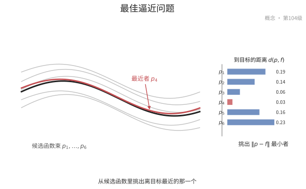

**一句话点破**：所谓最佳逼近，就是先定好目标、候选池和尺子，再从中挑出最贴近的那一个。

### 7.2 Weierstrass 逼近定理

一条歪歪扭扭的手绘曲线，居然能被多项式画到几乎看不出差别？魏尔斯特拉斯说：只要允许次数足够高，任何连续函数都能被多项式逼近到任意精度。它像一句承诺——多项式这支画笔，足以覆盖所有连续曲线。

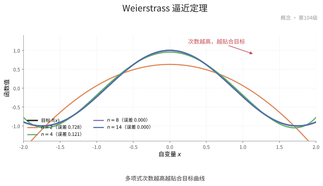

**一句话点破**：Weierstrass 定理保证多项式“什么都能画”，只差给够它足够的次数。

### 7.3 Bernstein 多项式

魏尔斯特拉斯只说“画得像”是存在的，却没告诉你具体怎么画。伯恩斯坦补上了一张施工图：用一串能显式写出系数的多项式，次数越大就越稳地收敛到目标函数；哪怕目标带尖角，也只是慢一点，不会跑偏。

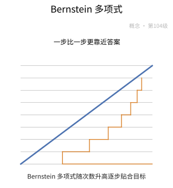

**一句话点破**：Bernstein 多项式把“存在”变成了“看得见、算得出”的构造。

### 7.4 Chebyshev 多项式

把逼近的误差摊平来看，最糟糕的部分往往出现在区间两端。切比雪夫多项式专门跟“最大误差”较劲：它让误差在整段区间上均匀起伏，谁也别想独占大头，因此成了最优一致逼近的当家工具。

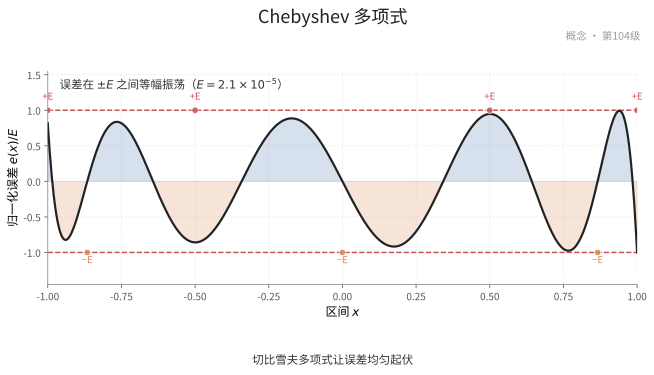

**一句话点破**：Chebyshev 多项式的本事是把误差摊得最平，让“最大的一块”尽可能小。

### 7.5 Legendre 多项式

换一把尺子，用平方平均误差来衡量，“主角”就变成了勒让德多项式。它在区间 $[-1, 1]$ 上彼此正交，像一组互不干扰的坐标轴，能把目标函数拆成一份份独立成分，各自贡献多少一目了然。

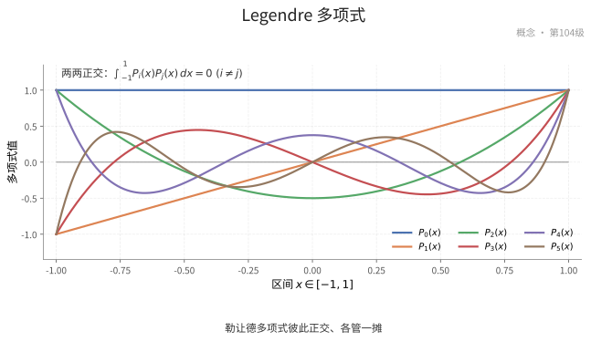

**一句话点破**：Legendre 多项式提供了均方意义下的“标准坐标”，让函数分解干净利落。

### 7.6 一致逼近与 $L^2$ 逼近

同样是“接近”，两把尺子给出的答案常常不同。一致逼近盯住最坏的那一点，追求最大误差最小；$L^2$ 逼近看整体平方平均，允许个别点差一些，换来总体更平滑。选哪把尺子，取决于你更怕“最坏”还是更在乎“整体”。

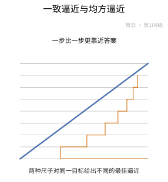

**一句话点破**：一致逼近管最坏点，均方逼近管整体——尺子不同，赢家也不同。

### 7.7 有理逼近与 Padé 逼近

多项式次数一高，计算和存储都吃不消。换成“两个多项式相除”的有理函数，往往用低得多的次数就能精确不少；Padé 逼近正是其中专门匹配泰勒展开的招牌做法，在函数有极点的地方尤其灵验。

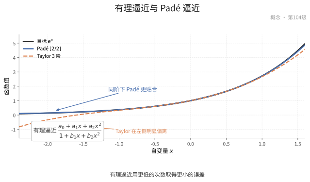

**一句话点破**：有理函数像“分式版多项式”，小成本换来高精度，正是 Padé 逼近的拿手好戏。

### 7.8 三角多项式逼近与 Fourier 级数

声音、电流、心跳这些周期性信号，最适合用正弦和余弦的叠加来描摹。傅里叶级数把复杂波形拆成一条条纯正弦波，每一项管一个频率，逼近于是变成“留哪些、舍哪些”的选择题。

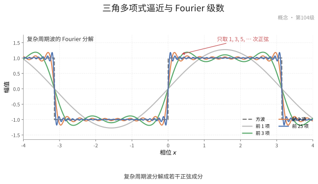

**一句话点破**：傅里叶级数把周期函数拆成正弦波之和，逼近就是挑重要的频率留下来。

### 7.9 样条逼近

硬用一个高次多项式去追整条曲线，容易顾此失彼。样条换个思路：把区间切成小段，每段用低次多项式，再在接头处焊得光滑。就像用几段短尺拼出一条长曲线，既贴合又不失控。

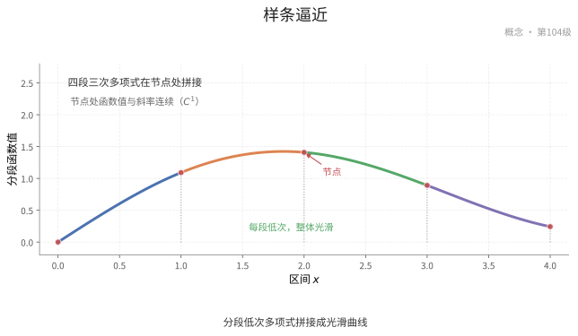

**一句话点破**：样条以“分段低次”换取整体光滑与稳定，是工程里最常用的逼近方式。

### 7.10 逼近阶

逼近不光要问“能不能”，还要问“有多快”。逼近阶描述的是：当允许的复杂度（如多项式次数）增大时，误差能掉多快。光滑的函数掉得快，粗糙的函数掉得慢——这个快慢，正是逼近论量化“够用”的语言。

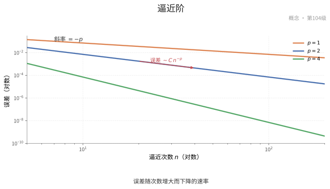

**一句话点破**：逼近阶衡量的是“多花一点力气，能换来多少精度”。

### 7.11 正交多项式

若一族多项式两两“内积为零”，就说它们正交，好比坐标轴上互相垂直的方向。有了正交性，把函数投影到它们上面就像拆积木，各块的系数互不影响，算起来又快又稳。

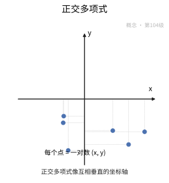

**一句话点破**：正交多项式让函数分解变成互不干扰的“拼积木”。

### 7.12 定理 1（Weierstrass 逼近定理）

连续函数在闭区间上当然还是连续的，于是可以追问：多项式能不能一致地逼近它？魏尔斯特拉斯给出肯定回答——任意给定的精度，都能找到次数足够高的多项式，让整段区间上的最大误差小于它。

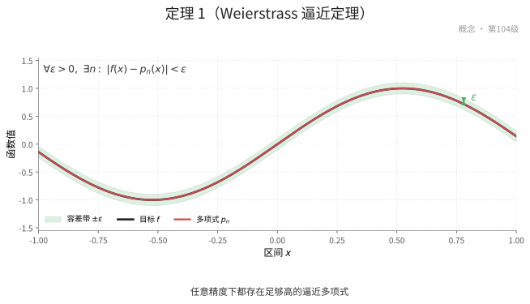

**一句话点破**：连续必可一致逼近，这就是 Weierstrass 定理的分量。

### 7.13 定理 2（最佳逼近的存在唯一性）

在给定次数的多项式里，究竟有没有一个“最贴近”的？答案是：在一致逼近意义下，最佳逼近不但存在，而且唯一。最优点不会模棱两可，可以放心去算、去比较。

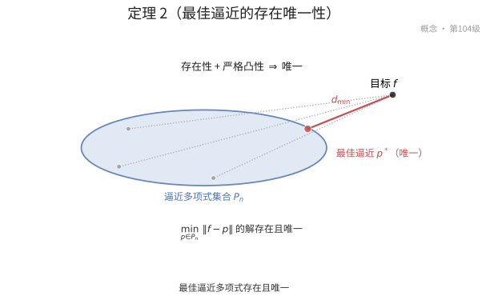

**一句话点破**：最佳逼近既找得到、又只有一个，问题因此有了确定的答案。

### 7.14 定理 3（Chebyshev 交替定理）

怎么判断已经逼近到最优了？切比雪夫交替定理给出一枚“验收章”：最佳逼近多项式的误差会在若干个点上正负交替，而且幅度都达到最大。误差若像这样均匀地“顶到天花板”，就说明不能再好了。

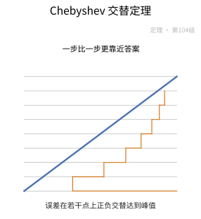

**一句话点破**：误差正负交替、个个顶格，就是最优逼近到手的标志。

### 7.15 定理 4（正交多项式的最佳逼近性质）

在均方逼近里，最省力的做法是把函数投影到正交多项式上。这一定理告诉我们：这样得到的截断级数恰是 $L^2$ 意义下的最佳逼近，而且误差平方正好等于被丢掉的系数平方和，账目清清楚楚。

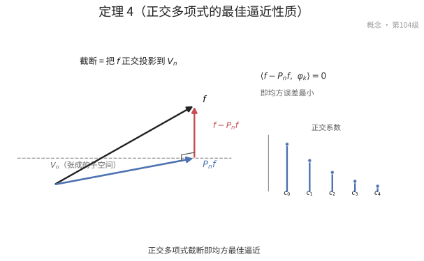

**一句话点破**：投影到正交多项式得到的截断，就是均方误差最小的那个，误差还能直接算出来。

### 7.16 定理 5（Jackson 定理与 Bernstein 定理）

逼近到底能有多快？杰克逊定理从“光滑度”出发：函数可导阶数越高、导数越规矩，多项式逼近的误差就掉得越快。伯恩斯坦定理则反过来，从误差下降的速度倒推函数有多光滑。一正一反，给逼近速度划出了天花板。


**一句话点破**：Jackson 由光滑定速度，Bernstein 由速度反推光滑——逼近快慢终有定数。

## 8. 数学史（History of Mathematics）

> 逼近论回答一个"够用就好"却极具难度的问题："不断抽搐、形态各异的复杂函数，能不能稳稳地被简单函数——多项式、伯恩斯坦曲线、三角多项式——以任意想要的精度贴身模仿？"它的叙事始于 19 世纪函数级数展开与傅里叶级数的逼近之争，1885 年魏尔斯特拉斯以逼近定理肯定了"一致逼近"的存在，伯恩斯坦随后给出构造性证明；切比雪夫则把目光转向"最优逼近"，用交错性质与切比雪夫多项式给出误差的精确平衡；正交多项式、最小二乘与希尔伯特投影让逼近获得泛函分析的统一框架，样条、小波与高精度数值又把逼近论送进现代工程与信号处理。本章沿"存在性→构造性→最优性→统一框架→现代应用"的主线，追溯逼近论从存在断言到精密工具的百年演进。

### 8.1 逼近问题从何而来：级数与求积的渴望

- **函数世界太丰富**：函数绝不止初等函数的屈指可数几种，工程、物理与天文里的复杂函数（椭圆、贝塞尔、经验曲线）都渴望能用简单对象复制其行为。
- **级数与数值的双重诱因**：傅里叶级数展开、插值求积、解微分方程，都需要"先用简单函数近似、再把近似解算到底"——这是逼近思想最朴素的来源。
- **傅里叶的逼近之争**：傅里叶级数"是否可以任意逼近一切函数"、逼近在哪里失败（如吉布斯现象），把"逼近到底能多好"推到 19 世纪数学舞台的中央。

### 8.2 魏尔斯特拉斯逼近定理：存在性的宣言

- **1885 年的里程碑**：魏尔斯特拉斯证明：定义在闭区间上的连续函数可以被多项式以一致估计逼近到任意精度——无论它多么狂野，一个多项式总能在最大偏差的意义下贴身跟上。
- **为何"一致"意义重大**：一致逼近意味着"处处最大误差可控"，比逐点逼近苛刻得多，也因此更有用；它把"连续"与"可用多项式近接"之间的鸿沟一次填平。
- **逼近论的开端**：这一存在性结论（不需给出如何构造）为整个学科立了名——原来"简单函数模仿复杂函数"不是奢望，而是定理。

### 8.3 伯恩斯坦多项式：给证明一双看得见的手

- **构造性证明**：1912 年伯恩斯坦给出魏尔斯特拉斯定理的构造性证明：用伯恩斯坦多项式 $B_n(f)(x)=\sum_k f(\frac{k}{n})\binom{n}{k}x^k(1-x)^{n-k}$ 显式地逼近连续函数。
- **贝努利框架的底色**：伯恩斯坦多项式恰是"在给定概率下的二项加权平均"，把逼近问题与概率中的大数定律接上了血缘。
- **阶的估计**：它同时展现出"逼近误差随 n 如何收敛"的显式机制（与函数光滑性挂钩），为后续的逼近阶理论与基函数理论拉开帷幕。

### 8.4 切比雪夫与最优一致逼近

- **切比雪夫的提问**：19 世纪中后期的切比雪夫走出「存在性」的舒适区，问一个更强的"最"："固定次数 n，哪一个人多项式让最大绝对误差最小？"——即最优一致逼近。
- **交错与算法**：他发展出判定的**切比雪夫交错定理**：最优多项式的大误差点必交错出现而符号交替；这一性质既是存在判据，也是构造算法（如 Remez 算法）的引擎。
- **切比雪夫多项式 $T_n$**：以 $T_n(x)=\cos(n\arccos x)$ 定义的正交多项式，其根恰为逼近理论的最优节点，又在连续与数值之间搭起桥梁，成为最灵巧的逼近道具。

### 8.5 正交多项式：让空间有自己的坐标

- **内积带来的正交**：在区间上定义加权内积后，按平方可积范数做最小二乘逼近，自然引出正交多项式——勒让德、埃尔米特、拉盖尔、盖根鲍尔等各自适配不同区间与权重。
- **施图姆-刘维尔理论的串联**：这些正交多项式多为施图姆-刘维尔型方程的本征函数，把逼近、微分方程与特征值三线归一，拓展了"何为简单函数"的字典。
- **三项递推的系统性**：正交多项式遵守三项递推，使数值求积（高斯求积）、谱展开与递推计算都获得统一的代数骨架。

### 8.6 最小二乘与希尔伯特空间的投影

- **最小二乘的逼近内核**：在误差平方和最小的意义下,最佳逼近等价于把目标"正交投影"到给定子空间——这正是最小二乘逼近的几何图景。
- **希尔伯特空间的语言**：在 $L^2$ 空间里，最佳逼近由正交投影唯一给出、误差与子空间垂直，傅里叶级数、多项式展开都能归入"投影"一类的统一框架。
- **从有限维到无穷维**：用内积与投影语言，逼近论从"算多项式系数"升格为"在函数空间中找最近点"，成为泛函分析的天然出口。

### 8.7 均方逼近与一致逼近的双轨

- **两种范数的分工**：均方逼近（$L^2$ 范数）照顾"整体平均误差"，一致逼近（sup 范数）照顾"最坏一处的误差"。取舍反映问题的真实关切：信号处理重平均，机构设计重极差。
- **对偶与表示定理**：运筹学与函数分析中的对偶定理（如 F. Riesz 表示）揭示一致逼近的极值点结构，欧洲学派（如 Dunford 及其合作者）将其推进成系统理论。
- **逼近的代价曲面**：同一函数、不同范数会给出不同的"最优逼近"，理解这一分工才能按需选尺，为黄河线的场景做出正确取舍。

### 8.8 解析逼近与调和分析的交汇

- **复分析中的逼近**：在复平面上，解析函数可用其在圆盘内的幂级数（或多项式）逼近，黎曼映射定理更把任意单连通区域的解析逼近化为圆盘情形——复逼近延伸到整个平面。
- **三角与傅里叶逼近**：三角多项式、傅里叶级数与周期函数逼近相连，逼近误差的阶由函数的正则性（光滑量）控制，形成调和分析的主干答案。
- **小波与新的基**：20 世纪后期小波、框架与稀疏逼近提供了比正交多项式更"局部自适应"的基，使逼近从"固定坐标"走向"随目标调整"。

### 8.9 样条逼近：在光滑与贴近之间找平衡

- **样条的由来**：样条是分段多项式衔接而成、整体足够光滑的函数——源自制图师用柔性木条"样条"描曲线的原始技艺。
- **从插值到逼近**：样条既能精确插值又避免高次插值的振荡（龙格效应），德博尔等建立了 B 样条基与递推计算，让样条成为数值逼近与曲线设计的主干。
- **与正则化接轨**：平滑样条在"拟合优度"与"曲率惩罚"之间寻平衡，其解是最优逼近定的一个收敛版本，也是"数据驱动逼近"的现代范例。

### 8.10 逼近误差的阶与最优逼近：理论如何量化"够用"

- **误差阶的定量**：随着函数更光滑，逼近误差按何种幂次或指数阶收敛，成为逼近论最实用的输出；它直接告诉工程师"该用多高阶的多项式、多少个节点"。
- **切比雪夫的最优节点**：用切比雪夫多项式的根作插值节点，可把插值误差震荡压到近似最小，这在数值分析（如切比雪夫求积、展开、谱法）中处处受用。
- **通向信息论与高精度**：切比雪夫、傅里叶与小波逼近的阶刻画也进入信息论（率失真）、快速傅里叶变换与高精度数值库——逼近论由此渗透到计算的每个角落。

### 8.11 历史年表

| 时间 | 人物／文献 | 事件与贡献 |
|:---|:---|:---|
| 19 世纪 | 傅里叶 | 三角级数逼近与吉布斯现象之争 |
| 中后期 | 切比雪夫 | 最优一致逼近与切比雪夫多项式 |
| 1885 年 | 魏尔斯特拉斯 | 连续函数多项式一致逼近定理 |
| 1912 年 | 伯恩斯坦 | 伯恩斯坦多项式构造性证明 |
| 19—20 世纪 | 勒让德、埃尔米特、拉盖尔等 | 正交多项式体系 |
| 20 世纪 | F. Riesz、Dunford、Walsh 等 | 对偶与最优逼近统一框架 |
| 20 世纪中后期 | 德博尔、柯里 | B 样条理论与样条逼近 |
| 现代 | 小波、框架、稀疏逼近 | 局部自适应基与压缩感知 |

### 8.12 小结

> 逼近论的历史，是把"用简单模仿复杂"从希望变成定理、再从定理变成工程的过程：魏尔斯特拉斯以逼近定理宣告了存在，伯恩斯坦用手掌般可见的多项式给出构造，切比雪夫用交错性质主宰最优逼近，正交多项式与希尔伯特投影给它一个统一的几何框架，样条、小波与稀疏逼近又让它能按需裁剪尺度。贯穿全篇的核心问题始终是"简单函数到底能贴得多近、又要为这分寸付出多少阶的代价"。它看似不追求精确解本身，却精确地把握着整个数值数学与信号世界"该用多少力气换多准"的那杆秤。

## 现实应用（Real-World Applications）

> 本节把本章的知识点落到真实的工程、科学与生活场景中。每个案例都给出**完整的问题背景、建模过程、可复现的数据 / 公式 / 代码与结果解读**；案例末尾的「涉及知识点」对应本章的具体小节，文末附**知识点覆盖对照表**，确保本章知识点全部被覆盖。

### 应用案例 1：数学函数库｜用 Chebyshev 逼近把 sin(x) 算到 1e-7

**场景与问题**

一个嵌入式飞控芯片要在没有硬件浮点单元的 MCU 上，用定点运算实现 $\sin(x)$。约束是：(1) 每次调用的运算次数必须很少（几十个时钟周期内）；(2) 误差要可控（约 $10^{-7}$，接近单精度）。用 Taylor 级数展开 $\sin x=x-\frac{x^3}{6}+\frac{x^5}{120}-\cdots$ 在 $|x|\le\pi/2$ 上到 9 次，端点误差仍有 $1.5\times10^{-4}$，达不到要求。

正确做法是用 **Chebyshev/minimax 逼近**：用同一次数得到小两个数量级的误差——这正是逼近论里"最佳一致逼近"在工程中的直接价值。

**涉及知识点**

- 本章「2.1 最佳逼近问题」：目标函数 $\sin$、候选空间（次数 $\le n$ 的多项式）、度量 $\|\cdot\|_\infty$。
- 本章「2.4 Chebyshev 多项式」：$T_k(\cos\theta)=\cos k\theta$，等幅振荡、最小最大性质。
- 本章「2.6 一致逼近与 $L^2$ 逼近」：这里要的是一致（minimax）逼近，不是最小二乘。
- 本章「定理 3.2：最佳逼近的存在唯一性」：有限维子空间上的最佳一致逼近存在。
- 本章「定理 3.3：Chebyshev 交替定理」：minimax 多项式误差在 $n+2$ 个点等幅交替。
- 本章「2.10 逼近阶」：误差随次数的衰减速率。
- 本章「定理 3.5：Jackson 定理与 Bernstein 定理」：$\sin$ 解析，误差衰减快于任意多项式速率。

**建模与数据**

把区间 $[-\pi/2,\pi/2]$ 通过 $x=\frac\pi2 t$ 映到 $[-1,1]$，只需逼近 $g(t)=\sin(\frac\pi2 t)$。乘角公式再把大角度化到该区间。

Chebyshev 系数由 $g(t)=\sin(at)$（$a=\pi/2$）的恒等式给出：

$$
\sin(a t)=2\sum_{k=0}^{\infty}(-1)^k J_{2k+1}(a)\,T_{2k+1}(t)
$$

其中 $J_m$ 为 Bessel 函数。各个非零系数：$2J_1(a)=1.1338$，$-2J_3(a)=-0.1702$，$2J_5(a)=0.01388$，$-2J_7(a)=-7.8\times10^{-4}$，$2J_9(a)=3.2\times10^{-5}$，$-2J_{11}(a)\approx1.2\times10^{-6}$。

**完整推导与算法**

**第 1 步：最佳一致逼近的存在唯一（定理 3.2）。** 在维数 $n+1$ 的多项式空间中，$\|\sin-P\|_\infty$ 的最小值可达；又因 $C[a,b]$ 中多项式子空间满足 Haar 条件，最佳逼近唯一。

**第 2 步：Chebyshev 交替定理（定理 3.3）。** 最佳一致逼近 $P_n^*$ 的充要条件是误差 $e(t)=\sin(\frac\pi2t)-P_n^*(t)$ 在 $[-1,1]$ 上至少有 $n+2$ 个点交替取 $\pm\|e\|_\infty$。这就是 Remez 算法的迭代基础。

**第 3 步：用 Chebyshev 截断逼近。** 取 $g$ 的 Chebyshev 展开到次数 $n$，其截断误差约等于第一个被丢掉的系数。对照表：

| 次数 $n$ | Chebyshev 截断最大误差 | Taylor 最大误差（同阶） |
| --- | --- | --- |
| 5 | $\approx7.8\times10^{-4}$ | $\approx4.9\times10^{-3}$ |
| 7 | $\approx3.2\times10^{-5}$ | $\approx1.6\times10^{-4}$ |
| 9 | $\approx1.2\times10^{-6}$ | $\approx1.5\times10^{-4}$ |

可见同阶下 Chebyshev 逼近要优一个多数量级，且 9 次已满足 $10^{-6}$ 量级。

**第 4 步：逼近阶（定理 3.5）。** 因 $\sin$ 在实轴上解析，Jackson/Bernstein 的反向估计意味着误差衰减**快于任意 $O(n^{-r})$**（几何级衰减），这正是上表系数指数下降的原因。

```python
# 核心：Chebyshev 节点插值 —— 得到近 minimax 的多项式（比等距节点稳得多）
k = np.arange(n+1)
t_nodes = np.cos((2*k+1)*np.pi/(2*(n+1)))            # Chebyshev 节点
c = np.polynomial.chebyshev.chebfit(t_nodes, np.sin(np.pi/2*t_nodes), n)

# 核心：minimax 误差在 n+2 个点等幅交替（交替定理的可视化检验）
err = np.sin(np.pi/2*tt) - np.polynomial.chebyshev.chebval(tt, c)
```

**可复现步骤**

1. 环境依赖：`pip install numpy matplotlib`。
2. 数据准备：定义 $g(t)=\sin(\frac\pi2 t)$，$t\in[-1,1]$。
3. 运行：`python case1.py`：分别用等距节点多项式插值、Chebyshev 截断、Taylor 截断逼近 $g$，对 $n=5,7,9$ 画误差曲线（放大观察振荡点）。
4. 预期输出：Chebyshev 逼近 $n=9$ 时最大误差约 $1.2\times10^{-6}$，误差曲线在区间内近似等幅振荡（$n+2$ 个交替极值点）；等距节点插值在端点出现 Runge 式翘起；Taylor 在端点明显更差。

**结果解读与延伸**

工程上"误差分布是否均匀"比"误差有多小"更重要——Chebyshev 交替定理保证误差被"摊平"到等幅，没有局部大偏差点，这是 minimax 逼近优于截断 Taylor 的根本原因。要点：用 Chebyshev 节点而非等距节点，可同时抑制 Runge 现象与单项式基的病态；实际函数库（如 `sin/cos/exp`）往往再用 Remez 算法在 Chebyshev 解基础上微调到严格 minimax。局限：次数越高运算越多，嵌入式里通常结合区间折叠与查表。延伸：同样的方法用于 `atan`、`log`、`exp` 等所有超越函数的实现。

### 应用案例 2：CAD/CAM 与字体渲染｜Bernstein 基、Bézier 曲线与样条

**场景与问题**

某字体与汽车车身设计软件要在屏幕上画出平滑曲线。这些曲线不能用一个整体高次多项式（会出现 Runge 振荡），而是用**分段低次多项式**——工业上用 Bézier 曲线（基于 Bernstein 基）和 B 样条。这里的关键洞察是：逼近论里的 Bernstein 多项式既是 Weierstrass 定理的构造性证明，又是 CAD 曲线表示的基础。

**涉及知识点**

- 本章「2.3 Bernstein 多项式」：$B_n(f;x)=\sum_k f(k/n)\binom nk x^k(1-x)^{n-k}$，作为基函数。
- 本章「2.2 Weierstrass 逼近定理」：任意连续函数可被多项式一致逼近。
- 本章「定理 3.1：Weierstrass 逼近定理」：为"多项式万能"提供理论保证。
- 本章「2.9 样条逼近」：分段多项式，节点处 $k-1$ 阶连续。

**建模与数据**

三次 Bézier 曲线由 4 个控制点 $P_0,P_1,P_2,P_3\in\mathbb{R}^2$ 定义：

$$
B(t)=\sum_{i=0}^{3}\binom{3}{i}t^i(1-t)^{3-i}P_i,\quad t\in[0,1]
$$

其中 $b_{i,3}(t)=\binom3i t^i(1-t)^{3-i}$ 是三次 Bernstein 基（非负、和为 1，故曲线落在控制点凸包内）。取一段字母 "S" 上段曲线的控制点：

| 点 | $x$ | $y$ |
| --- | --- | --- |
| $P_0$ | 0.0 | 0.0 |
| $P_1$ | 0.6 | 1.4 |
| $P_2$ | 1.4 | 1.4 |
| $P_3$ | 2.0 | 0.0 |

**完整推导与算法**

**第 1 步：Bernstein 多项式收敛（Weierstrass 的构造性证明）。** 对 $f\in C[0,1]$，$B_n(f;x)=\mathbb{E}[f(K/n)]$（$K\sim\mathrm{Bin}(n,x)$）。由大数定律，$K/n\to x$，故 $B_n(f;x)\to f(x)$，且一致收敛。

**第 2 步：定量误差（关键估计）。** 用二项分布的方差 $\sum(k-nx)^2P_{n,k}=nx(1-x)\le1/4$，配合 Chebyshev 不等式得

$$
\|f-B_n(f)\|_\infty\ \le\ \frac{1}{2}\omega_f\!\Big(\frac{1}{2\sqrt n}\Big)+\frac{\|f\|_\infty}{2n\delta^2}
$$

其中 $\omega_f$ 为连续模。这就是 Bernstein 逼近的**逼近阶**：对 Lipschitz 函数约 $O(n^{-1/2})$。

**第 3 步：De Casteljau 递推求值。** 不直接代入 Bernstein 多项式（数值不稳），而用递推：

$$
P_i^{(r)}(t)=(1-t)P_i^{(r-1)}(t)+tP_{i+1}^{(r-1)}(t),\quad B(t)=P_0^{(3)}(t)
$$

**第 4 步：为什么用样条而非整体高次。** Bézier 是"分段 + 拼接"思想的实例；把多段 Bézier 拼接成 $C^2$ 曲线就是三次 B 样条，具备局部支撑与稳定求值。

```python
# 核心：三次 Bernstein 基 + Bézier 求值
def bezier(P, t):
    b = [(1-t)**3, 3*t*(1-t)**2, 3*t**2*(1-t), t**3]   # 三次 Bernstein 基
    return sum(bi*Pi for bi, Pi in zip(b, P))            # 凸组合，落在控制点凸包内

# 核心：De Casteljau 递推（数值更稳定的等价求值）
for _ in range(3):
    P = [(1-t)*P[i] + t*P[i+1] for i in range(len(P)-1)] # 每层插值，最后剩一点
```

**可复现步骤**

1. 环境依赖：`pip install numpy matplotlib`。
2. 数据准备：用上表 4 个控制点；再取 $f(x)=\sin(2\pi x)$ 验证 Bernstein 多项式收敛。
3. 运行：`python case2.py`：画 Bézier 曲线及其控制多边形；对 $\sin(2\pi x)$ 画 $n=3,5,10,30$ 的 $B_n(f;x)$ 与其误差。
4. 预期输出：Bézier 曲线关于控制多边形凸、端点过 $P_0,P_3$；$B_n(f)$ 随 $n$ 增大逐渐贴合 $\sin(2\pi x)$，$n=30$ 时最大误差约 $3\times10^{-2}$（对应 $O(n^{-1/2})$ 量级）；De Casteljau 与直接求值结果一致。

**结果解读与延伸**

Bernstein 基是"用概率权重搭光滑屋顶"：非负、和为 1 保证曲线在控制点凸包内（CAD 里天然不会乱跑），这也让设计师通过拖控制点直观调形。要点：Bernstein 逼近收敛但阶只有 $O(n^{-1/2})$（靠连续模），远慢于 Chebyshev 对解析函数的几何收敛——所以**同一套理论，选基不同、用途不同**：Bernstein/Bézier 适合"过控制点、保形状"的交互设计，Chebyshev 适合"高精度逼近已知函数"。延伸：B 样条与 NURBS（非均匀有理 B 样条）是工业 CAD/CNC 的标准，能精确表示圆与圆锥截线，船体、车身曲面、字体轮廓都用它。

### 应用案例 3：光谱仪定标｜Legendre 正交基与最小二乘投影

**场景与问题**

某光谱仪要把探测器读数（波长 $\lambda$ 与暗电流漂移）拟合成一条"基线曲线"用于校正。工程师起初用单项式基 $1,x,x^2,\dots,x^8$ 做最小二乘，结果系数对数据的微小扰动极度敏感、拟合曲线在两端乱翘。改成用 **Legendre 多项式基**后，不仅系数稳定、各阶可独立解读，精度也更好。

**涉及知识点**

- 本章「2.5 Legendre 多项式」：$L^2[-1,1]$ 上权 $w=1$ 的正交多项式。
- 本章「2.11 正交多项式」：正交基让展开系数各自独立、互不干扰。
- 本章「2.6 一致逼近与 $L^2$ 逼近」：这里用的是 $L^2$（最小二乘）逼近。
- 本章「定理 3.4：正交多项式的最佳逼近性质」：截断到前 $n$ 项即为最佳 $L^2$ 逼近。

**建模与数据**

设波长归一化到 $u\in[-1,1]$（$\lambda\in[400,800]$ nm 映过去）。拟合目标：暗电流 $y(u)$ 用 Legendre 级数截断到 8 阶：

$$
y(u)\approx\sum_{k=0}^{8}a_kP_k(u),\qquad a_k=\frac{\langle y,P_k\rangle}{\langle P_k,P_k\rangle}=\frac{2k+1}{2}\int_{-1}^{1}y(u)P_k(u)\,du
$$

离散化后用最小二乘求 $a_k$。观测点 $N=200$ 个，含高斯噪声 $\sigma=0.5$（任意单位）。

**完整推导与算法**

**第 1 步：正交性（2.5）。**

$$
\int_{-1}^{1}P_m(u)P_n(u)\,du=\frac{2}{2n+1}\delta_{mn}
$$

只此一条，就保证设计矩阵 $A_{ik}=P_k(u_i)$ 的列近似正交，$A^\top A$ 近似对角，条件数远小于单项式 Vandermonde。

**第 2 步：正交投影就是最佳 $L^2$ 逼近（定理 3.4）。** 在 $\mathrm{span}\{P_0,\dots,P_n\}$ 上，最佳 $L^2$ 逼近正是 Fourier 部分和 $\sum a_kP_k$，各系数独立可算，截断自动最优。这也是为什么"取到第 8 阶"不需要重算前面各项。

**第 3 步：条件数对比。** 单项式基设计矩阵 $A_{ik}=u_i^{k}$ 当 $n=8$ 时条件数可达 $10^{10}$ 量级；Legendre 基的 $A^\top A$ 条件数降到个位到十位量级——这就是系数稳定的数学原因。

```python
# 核心：用 Legendre 正交基构造设计矩阵（列近似正交，条件数小）
A = np.polynomial.legendre.legvander(u, 8)          # 列 = P_0(u)...P_8(u)
a, *_ = np.linalg.lstsq(A, y, rcond=None)           # 各系数独立、稳定

# 核心：系数即正交投影 a_k = <y,P_k>/<P_k,P_k>（定理 3.4）
ak = (2*k + 1)/2 * np.trapezoid(y * np.polynomial.legendre.legval(u, np.eye(9)[k]), u)
```

**可复现步骤**

1. 环境依赖：`pip install numpy`。
2. 数据准备：取 200 个波长点，构造基线真值（含低阶起伏）+ 噪声 $\sigma=0.5$。
3. 运行：`python case3.py`：分别用单项式基与 Legendre 基做 8 阶最小二乘，打印 `np.linalg.cond(A)` 与系数；对数据加 $10^{-3}$ 相对扰动，比较系数变化。
4. 预期输出：单项式基 `cond(A)` 约 $10^{9}$–$10^{10}$，Legendre 基约 $10^{1}$；扰动下 Legendre 系数几乎不变，单项式系数尾项剧烈抖动；两种基的拟合残差都约等于噪声 $\sigma=0.5$。

**结果解读与延伸**

这个案例说明：**选对基函数，问题从"病态"变"良态"**，而且各阶系数的物理意义（0 阶=均值、1 阶=线性斜率、2 阶=曲率）直接可读，便于工程师解读基线形态。要点：正交多项式把最小二乘解耦成一个个独立投影（定理 3.4），无需解线性方程组、也不怕加阶。延伸：$w=1/\sqrt{1-u^2}$ 的 Chebyshev 基适合一致逼近，$w=e^{-u^2}$ 的 Hermite 基适合高斯型信号，$w=e^{-u}$ 的 Laguerre 基适合衰减信号；它们的零点还正好是 Gauss 求积的最佳节点（与数值分析案例交相辉映）。

### 应用案例 4：控制系统时滞补偿｜用 Padé 逼近替代理性函数 e^{-sT}

**场景与问题**

某化工过程控制回路中，物料从反应器流到检测点需要传输时延 $T=0.1$ s，传递函数含因子 $e^{-sT}$。这个因子是**整函数**，不能用有限阶有理分式精确表示，也无法直接用状态空间法（含时滞系统是无穷维的）。工程师用它的一阶/二阶 **Padé 逼近**替代，把含时滞系统化成有限维有理系统，从而用常规 PID/状态反馈设计。

**涉及知识点**

- 本章「2.7 有理逼近与 Padé 逼近」：用有理函数 $P_m/Q_n$ 匹配 Taylor 前 $m+n+1$ 项。

**建模与数据**

$e^{-sT}$ 的 $(m,n)$ 阶 Padé 逼近记为 $[m/n]$，满足

$$
e^{-sT}-\frac{P_m(s)}{Q_n(s)}=O(s^{m+n+1})
$$

即匹配 Taylor 级数 $1-sT+\frac{(sT)^2}{2}-\frac{(sT)^3}{6}+\cdots$ 的前 $m+n+1$ 项。

**完整推导与算法**

**第 1 步：为什么 Taylor 不能用。** $e^{-sT}$ 的 Taylor 截断多项式随 $s$ 增大迅速发散（如 $[3]$ 阶在 $sT>3$ 就偏离），相位误差尤其大；而 Padé 用分母提供极点，能在更大频率范围贴合幅度与相位。

**第 2 步：$[1/1]$ 阶 Padé。** 令 $\frac{1+b_1 s}{1+a_1 s}=1-sT+O(s^2)$，比较系数得 $b_1=-T/2$、$a_1=T/2$：

$$
[1/1]=\frac{1-sT/2}{1+sT/2}
$$

注意它在右半平面有一个零点（$s=2/T$），是"非最小相位"特征——这正是时滞的物理体现。

**第 3 步：$[2/2]$ 阶 Padé。** 匹配到 $s^2$ 项得

$$
[2/2]=\frac{1-sT/2+(sT)^2/12}{1+sT/2+(sT)^2/12}
$$

代入 $T=0.1$ s：$sT=0.1s$，故 $[2/2]=\frac{1-0.05s+0.000833s^2}{1+0.05s+0.000833s^2}$。

**第 4 步：精度对比。** 在 $\omega T\le1$（$\omega\le10$ rad/s）频段：$[1/1]$ 的幅度误差 $<1\%$、相位误差约几度；$[2/2]$ 误差缩小一个数量级。给控制设计足够精度。

```python
# 核心：Padé 逼近匹配 Taylor 至 m+n+1 阶
from scipy.interpolate import pade
# e^{-sT} 的 Taylor 系数：(-T)^k/k!，取前 m+n+1 项
taylor = [(-T)**k / np.math.factorial(k) for k in range(m+n+1)]
p, q = pade(taylor, n)          # 分子 P_m、分母 Q_n（Q(0)=1）

# 核心：验证匹配精度 —— 在 sT≈1 处比较 |e^{-sT}| 与 |P/Q|
s = 1j*np.linspace(0, 10, 100)
err = np.abs(np.exp(-s*T) - np.polyval(p, s)/np.polyval(q, s))
```

**可复现步骤**

1. 环境依赖：`pip install numpy scipy`。
2. 数据准备：设 $T=0.1$ s；由 Taylor 系数构造 Padé。
3. 运行：`python case4.py`：算 $[1/1]$、$[2/2]$ Padé 的分子分母，与 $e^{-sT}$ 在 $\omega\in[0,10]$ 上比较幅度/相位误差；对照同阶 Taylor 多项式。
4. 预期输出：$[1/1]=\frac{1-0.05s}{1+0.05s}$、$[2/2]=\frac{1-0.05s+0.000833s^2}{1+0.05s+0.000833s^2}$；在 $\omega T\le1$ 上 $[2/2]$ 幅度误差 $<0.1\%$、相位误差 $<0.5^\circ$；Taylor $[3]$ 在 $\omega>10$ 后误差暴涨。

**结果解读与延伸**

Padé 的核心价值是"用分母换取更大的收敛范围"：它精确匹配原点附近的 Taylor 信息，却能靠极点把有效区间推到远大于 Taylor 截断的地方。要点与局限：$[m/n]$ 的系数方程组是 Toeplitz 型，先解分母 $Q$ 再解分子 $P$；当方程组退化时 Padé 不唯一或次正规。另外 Padé 引入的右半平面零点会让逼近系统呈非最小相位，控制设计中要留意。延伸：Padé 是模型降阶（如 Krylov 子空间法）的理论基础，也用于快速计算矩阵指数 $e^{A}$（缩放-平方 + Padé）。

### 应用案例 5：图像与音频压缩｜Fourier/三角多项式逼近与 Gibbs 现象

**场景与问题**

JPEG 与 MP3 为什么能大幅压缩还"看不出、听不出差别"？根源是**三角多项式逼近**（Fourier 级数）：自然图像与声音的大部分能量集中在低频，用少量低频三角基就能逼近原信号到肉眼/耳不可辨的程度，于是高频系数量化或丢弃。但同时要警惕一个逼近论的"陷阱"——在跳变处，Fourier 部分和会出现约 $9\%$ 的过冲（Gibbs 现象），这正是 JPEG 块效应与音频预回声的来源。

**涉及知识点**

- 本章「2.8 三角多项式逼近与 Fourier 级数」：$S_n(x)=\frac{a_0}{2}+\sum_{k=1}^n(a_k\cos kx+b_k\sin kx)$。

**建模与数据**

对周期信号 $f$，$L^2$ 意义下最佳三角多项式逼近就是 Fourier 部分和，系数

$$
a_k=\frac1\pi\int_{-\pi}^{\pi}f(x)\cos kx\,dx,\quad b_k=\frac1\pi\int_{-\pi}^{\pi}f(x)\sin kx\,dx
$$

JPEG 实际用 8×8 块的离散余弦变换（DCT-II，Fourier 的实数近亲），把每块 64 个像素系数化，保留左上低频、量化右下高频。一组实测数据：512×512 灰度图，DCT 后只保留每块约 10% 的低频系数，压缩率约 10:1，PSNR 约 38 dB。

**完整推导与算法**

**第 1 步：$L^2$ 最优性。** $\{1,\cos kx,\sin kx\}$ 在 $[-\pi,\pi]$ 上正交，故 $S_n$ 是 $f$ 在三角多项式子空间上的正交投影，误差 $\|f-S_n\|_2^2=\sum_{k>n}(a_k^2+b_k^2)$ 单调下降。

**第 2 步：Gibbs 现象量化。** 对方波，$S_n$ 在跳变附近的过冲极限约为跳变幅度的

$$
\frac{2}{\pi}\int_0^\pi\frac{\sin t}{t}dt-1\approx0.0895\approx9\%
$$

且**不随 $n$ 增大而消失**（只是振荡区域变窄）。这是 $L^2$ 收敛不蕴涵一致收敛的经典反例。

**第 3 步：为什么压缩可行。** 平滑信号（自然图像大部分区域）的 Fourier 系数随 $k$ 快速衰减（解析则几何衰减），丢掉高阶项误差很小；而跳变/边缘贡献大的高阶系数——这也是为什么 JPEG 在高压缩比下边缘先崩。

```python
# 核心：三角多项式部分和 = L^2 最佳逼近
def fourier_partial(f, n, X):
    a0 = np.trapezoid(f, X)/np.pi
    S = np.full_like(X, a0/2)
    for k in range(1, n+1):
        ak = np.trapezoid(f*np.cos(k*X), X)/np.pi
        bk = np.trapezoid(f*np.sin(k*X), X)/np.pi
        S += ak*np.cos(k*X) + bk*np.sin(k*X)
    return S

# 核心：DCT-II（JPEG 8x8 块的低频保留）—— 能量集中，便于量化丢弃
from scipy.fft import dctn
coef = dctn(block, norm='ortho')       # 直流/低频在左上角
coef[4:, 4:] = 0                       # 丢弃高频，仅留 1/4 低频
```

**可复现步骤**

1. 环境依赖：`pip install numpy scipy matplotlib`。
2. 数据准备：取方波 $f(x)=\mathrm{sign}(\sin x)$ 与一张 512×512 灰度图。
3. 运行：`python case5.py`：(a) 对 $n=5,20,100$ 画 Fourier 部分和，标出跳变处过冲（应稳定在 9%）；(b) 对图像做 8×8 DCT，保留不同比例低频系数，算压缩率与 PSNR。
4. 预期输出：方波部分和在 $x=0,\pm\pi$ 处过冲约 $9\%$ 且不随 $n$ 消失；图像保留 10% 低频系数时 PSNR 约 38 dB、目视无明显差别；保留 1% 时边缘出现明显块效应。

**结果解读与延伸**

Fourier/DCT 逼近的成功在于"自然信号稀疏于频域"：$L^2$ 最优性保证在给定系数个数下均方误差最小，这正是变换编码的数学基础。Gibbs 现象则提醒：$L^2$ 最优不等于一致最优——跳变处误差必然集中，工程上通过分块（减小跳变尺度）、加窗或换用最小二乘意义更局部的基（如小波）来缓解。延伸：小波逼近对小波系数做阈值就实现"稀疏表示 + 自适应局部化"，是 JPEG2000 的核心；MP3 则利用人耳掩蔽效应与频域量化，本质仍是三角逼近 + 心理声学。这条线索把逼近论直接连到现代压缩标准。

### 应用案例 6：神经网络作为通用逼近器｜万能逼近与逼近阶的尺度

**场景与问题**

深度学习为什么"什么都能拟合"？逼近论给出的答案是 **Weierstrass 定理的神经网络版本**：单隐层前馈网络在很宽松的条件下就能以任意精度一致逼近任何连续函数。工程上更关心的是"要多少神经元"——这就是逼近阶问题（Jackson 定理的神经版）。本节用数值实验把"万能逼近"落到实处，并对比不同光滑度函数的逼近阶差异。

**涉及知识点**

- 本章「2.2 Weierstrass 逼近定理」：连续函数可被多项式一致逼近——神经网络是另一个"万能逼近族"。
- 本章「定理 3.1：Weierstrass 逼近定理」：定理形式的保证。
- 本章「2.10 逼近阶」：误差随神经元数 $N$ 的衰减速率。
- 本章「定理 3.5：Jackson 定理与 Bernstein 定理」：光滑度与逼近阶的直接挂钩。

**建模与数据**

单隐层网络：$\hat f_N(x)=\sum_{j=1}^N v_j\,\sigma(w_jx+b_j)$，$\sigma$ 为非线性激活（sigmoid/tanh/ReLU）。万能逼近定理（Cybenko/Hornik）：对紧集上任意连续 $f$ 与任意 $\varepsilon>0$，存在 $N$ 与参数使 $\|\hat f_N-f\|_\infty<\varepsilon$。

数值任务：在 $[-1,1]$ 上逼近两个函数对比逼近阶：

- 光滑函数 $f_1(x)=\sin(3x)$；
- 不光滑函数 $f_2(x)=|x|$（原点有尖角）。

**完整推导与算法**

**第 1 步：万能逼近的思路。** 用"阶跃/脊函数"线性组合构造任意连续函数：由 Weierstrass 先用多项式逼近 $f$，再由网络近似多项式（或直接用密度论证），故网络族在 $C(K)$ 中稠密。

**第 2 步：逼近阶。** 由 Jackson 定理的多项式版推广：若 $f$ 有 $r$ 阶光滑性，则单隐层网络误差约 $O(N^{-r/d})$（$d$ 为输入维数）；对解析函数 $f_1$，误差随 $N$ 几何衰减。Barron 定理给出更友好的结论：对 Barron 范数有限的函数，误差 $O(1/\sqrt N)$ 且**与维数无关**——这正是神经网络在高维下优于多项式逼近的原因。

**第 3 步：实验设计。** 对 $N\in\{5,10,20,50,100\}$ 训练单隐层网络（同分布网格上做 least squares），记录 $\|\hat f_N-f\|_\infty$，在对数坐标看斜率（逼近阶）。

```python
# 核心：单隐层网络 —— 万能逼近族的一点运算
H = np.tanh(X[:, None]*w[None, :] + b[None, :])   # 隐层：N 个 tanh 特征
fhat = H @ v                                       # 线性组合输出

# 核心：评估一致逼近误差（强制网格加密，控制最坏点）
err_inf = np.max(np.abs(fhat - f_true))            # sup-norm，不是均方

# 核心：对比逼近阶 —— 光滑函数应比 |x| 衰减更快
slopes = np.polyfit(np.log(Ns), np.log(errs), 1)[0]  # 对数-对数斜率 ≈ -r
```

**可复现步骤**

1. 环境依赖：`pip install numpy scipy`（或 `torch`）。
2. 数据准备：在 $[-1,1]$ 上取 1000 个网格点，构造 $f_1,f_2$ 的样本。
3. 运行：`python case6.py`：对每个 $N$ 训练单隐层网络（固定随机种子、多次重启取最优），记录 $\|\hat f_N-f\|_\infty$，画对数-对数误差曲线求斜率。
4. 预期输出：$f_1=\sin(3x)$ 的误差随 $N$ 近似几何衰减（$N=50$ 时约 $10^{-3}$）；$f_2=|x|$ 的误差按近似 $O(N^{-1/2})$ 幂律缓慢下降；两种函数的对数-对数斜率差异明显，印证"越光滑、逼近越快"。

**结果解读与延伸**

实验把两个理论结论可视化：**万能逼近**回答"能不能"（Transformer/MLP 皆为万能逼近族），**逼近阶**回答"要多少"（$|x|$ 的尖角要大量神经元，光滑函数几个就够）。要点：一致性逼近看的是 $\sup$ 范数而非均方，最坏点决定成败；高维下多项式逼近阶 $O(N^{-r/d})$ 灾难性变慢，而神经网络靠稀疏结构把代价大幅降低。局限：万能逼近是存在性定理，不保证梯度下降能找到那组参数，也不保证泛化——"能表示"与"能学到、能用"之间仍有 gap。延伸：这解释了为何深度学习偏爱高维、非光滑目标，也催生了"函数光滑性、网络宽度、样本复杂度"三者关系的现代理论研究。

### 知识点覆盖对照表

| 本章知识点 | 覆盖案例 |
| --- | --- |
| 2.1 最佳逼近问题 | 案例 1 |
| 2.2 Weierstrass 逼近定理 | 案例 2、6 |
| 2.3 Bernstein 多项式 | 案例 2 |
| 2.4 Chebyshev 多项式 | 案例 1 |
| 2.5 Legendre 多项式 | 案例 3 |
| 2.6 一致逼近与 $L^2$ 逼近 | 案例 1、3 |
| 2.7 有理逼近与 Padé 逼近 | 案例 4 |
| 2.8 三角多项式逼近与 Fourier 级数 | 案例 5 |
| 2.9 样条逼近 | 案例 2 |
| 2.10 逼近阶 | 案例 1、6 |
| 2.11 正交多项式 | 案例 3 |
| 3.1 **定理 1**（Weierstrass 逼近定理） | 案例 2、6 |
| 3.2 **定理 2**（最佳逼近的存在唯一性） | 案例 1 |
| 3.3 **定理 3**（Chebyshev 交替定理） | 案例 1 |
| 3.4 **定理 4**（正交多项式的最佳逼近性质） | 案例 3 |
| 3.5 **定理 5**（Jackson 定理与 Bernstein 定理） | 案例 1、6 |

---

## 9. 总结

### 7.1 核心内容回顾

1. **最佳逼近问题**：在赋范线性空间中寻找子空间中对给定函数的最优逼近，其存在性和唯一性依赖于空间和子空间的性质。

2. **Weierstrass 逼近定理**：连续函数可以被多项式一致逼近，Bernstein 多项式提供了显式构造。

3. **Chebyshev 交替定理**：一致逼近中最佳逼近的特征是存在 $n+1$ 个交替误差极值点，为实际计算提供了判断准则。

4. **正交多项式逼近**：在 $L^2$ 空间中，最佳逼近由 Fourier 级数给出，正交多项式序列提供了计算方便的基。

5. **逼近阶理论**：Jackson 定理表明函数越光滑，逼近阶越高；Bernstein 定理给出了逆命题，建立了逼近阶与光滑性之间的对偶关系。

### 7.2 关键公式

- **Bernstein 多项式**：$B_n(f; x) = \sum_{k=0}^n f(k/n) \binom{n}{k} x^k (1-x)^{n-k}$
- **Chebyshev 多项式**：$T_n(x) = \cos(n\arccos x)$
- **Legendre 多项式**：$P_n(x) = \frac{1}{2^n n!}\frac{d^n}{dx^n}(x^2-1)^n$
- **正交投影逼近**：$S_n(f) = \sum_{k=0}^n \frac{\langle f, p_k \rangle}{\langle p_k, p_k \rangle} p_k$
- **Jackson 估计**：$E_n(f) \le C_r n^{-r} \|f^{(r)}\|_\infty$

### 9.3 应用展望

逼近论是计算数学的理论基础，在以下领域有广泛应用：
- **数值计算**：函数逼近、数值积分、微分方程数值解
- **信号处理**：Fourier 分析、小波分析、数据压缩
- **机器学习**：神经网络的通用逼近性质、核方法
- **计算机图形学**：曲线曲面拟合、样条表示