# 第110级：运筹学 (Operations Research)

## 从"怎么把有限的资源用到最好"说起：运筹学要解决的根问题

> 在动手接触单纯形法、网络流之前，先想清楚一个问题：**人为什么需要运筹学？**

**一个真实的生活场景（第一步：直觉）**

想象你是一家快递公司的调度员，仓库里有 8 辆卡车，同时有 20 个订单要分别送到 20 个客户手上，客户分布在全市不同角落，每辆车一天最多跑一定里程。你眼前有两难：**车不够跑完所有单，但又要让总成本最低、尽量多送单。** 你该怎么给每辆车分配路线？该让哪些客户今天送、哪些明天送？

这种问题没有唯一"显然对"的答案——可能的分配方案多到天文数字，而你要的却是一个**能在现实约束下做到最好的全局方案**。把这个"怎么调度、怎么分配、怎么决策才能最优"的问题变成一门可重复使用、可交给机器计算的学问，正是**运筹学**要回答的。

**它到底想解决什么核心问题（第二步：要解决的问题）**

运筹学（Operations Research，简称 OR）直译是"作战研究"——它的身世确实在战场。第二次世界大战期间，盟军面临雷达布防、护航船队编组、轰炸机索敌、反潜巡逻航线等军事调度问题：这些问题的变量极多、牵一发动全身，靠将领经验已无法应对。于是军方把数学家、物理学家组成一个个"运筹小组"，用数学建模来改进作战效率——这便是 OR 的起点，也因此其英文名一直留着"作战"二字。战后，这些工具迅速转入民用：工厂生产计划、运输调度、库存管理、医院排班、航空公司航班与机队规划，几乎每个"资源有限、选择众多"的管理决策都有它的身影。Hillier & Lieberman 的经典教材把它概括为一句话：**运筹学是用科学方法研究如何作出最优决策**。

> **🧠 一句话记住运筹学的"出生证"**
>
> 运筹学要解决的**根本问题**是：
>
> $$ \boxed{\text{面对有限的资源与众多的可行方案，如何用数学方法找到使整体目标最优的决策、调度与分配方案。}} $$
>
> 线性规划、整数规划、网络流、动态规划、排队论……这些工具都是围绕"把现实决策建成模型、再求出全局最优"这一件事展开的。

**看待本章的三种眼光（第三步：正式定义前的准备）**

- **建模的眼光**：先把现实问题翻译成数学结构——决策变量、目标、约束；
- **算法的眼光**：再为各类结构选用配套解法——LP 用单纯形/对偶、整数用分支定界/割平面、网络用最大流与最短路，多阶段决策用动态规划；
- **权衡的眼光**：最后要知道每种方法能解多大、多快、多准，理解"最优"与现实建模假设之间的差距。

读到本章末尾，你应当记住的不是每个算法的步骤，而是：**运筹学的灵魂在于"先建模型、再算最优"**——任何现实的稀缺分配问题，都可以先问"变量是什么、目标是什么、约束是什么"，然后交给一整套成熟的方法去求最优。

---

## 开始之前

**本章在讲什么**：运筹学把"在资源约束下作最优决策"建模成可计算的问题。你会依次掌握线性规划（单纯形/对偶）、整数规划（分支定界/割平面）、网络流（最大流/最小费用流）、动态规划（最优性原理）、最短路径与最小生成树，并了解排队论、库存论、决策论等分支的概念。

**为什么要学它**：上一级第 109 级给出了优化理论的一般框架（凸性、对偶、KKT），但它偏重"数学模型本身"；本章把镜头转向"决策与调度"这一更具操作性的侧面，讨论整数性、组合爆炸、网络结构等实用难题，并为后续的排队论（第111级）、控制论等提供实时决策与资源配置的方法。它在经济学（资源分配）、管理学（排产调度）、计算机科学（算法设计）之间搭起桥梁。

**开始前请确认你还记得**：

- 线性代数（第 14 级）：矩阵、线性方程组，特别是 $Ax=b$ 的求解与消元。
- 概率论基础（第 98 级）：期望、方差、常见分布，用于排队论与决策论。
- 图论与算法基础：图、点、边、路径、最小生成树、Dijkstra 等概念。
- $\min$/$\max$、可行域、整数变量等优化术语（第 109 级）。

---

## 学习目标

1. 掌握线性规划的基本理论，包括单纯形法和对偶理论
2. 理解整数规划的分支定界法和割平面法
3. 掌握网络流问题的最大流、最小费用流算法
4. 理解动态规划的最优性原理及其应用
5. 掌握最短路径和最小生成树问题的经典算法
6. 了解排队论、库存论、决策论等运筹学分支的基本概念

---

## 1. 核心概念

### 1.1 线性规划 (Linear Programming)

线性规划是运筹学中最基本的优化方法，其标准形式为：

$$
\begin{aligned}
\min \quad & \mathbf{c}^\top \mathbf{x} \\
\text{s.t.} \quad & A\mathbf{x} = \mathbf{b} \\
& \mathbf{x} \geq \mathbf{0}
\end{aligned}
$$

其中 $\mathbf{x} \in \mathbb{R}^n$ 是决策变量，$\mathbf{c} \in \mathbb{R}^n$ 是目标系数，$A \in \mathbb{R}^{m \times n}$ 是约束矩阵，$\mathbf{b} \in \mathbb{R}^m$ 是资源向量。

> **直观理解（现实类比）**：线性规划像"在多边形顶点找最优"——约束把所有可行方案圈成一个多边形区域，而目标函数是一张平直的"利润斜坡"。因为斜坡是直的，它不会在区域的边或内部形成局部高点，最高（最优）处必然落在多边形的某个顶点上。这把"在无穷多个方案里选最优"的难题，简化成了"只检查有限个顶点"。

> **🧠 思考历程：无穷多个可行方案摆在面前，凭什么只盯顶点就能赢？**
>
> 线性规划要把"在无穷多选择里挑最优"这种近乎无望的任务，降维成"只在有限个顶点里遍历求胜"。这一关键洞察，是1940年代为战争后勤与战后经济而被凿通的一条高速通道。
>
> - **战争时期的长队问题**。1939年 Kantorovich 在列宁格勒已为生产计划写下线性规划的雏形，Koopmans 同期处理船运调度；二战期间的防空与运输运筹让"资源最大化"成为战时课题，方法在东西方几乎同步破土。
> - **单纯形，给"穷举"加杠杆**。1947年 Dantzig 发明单纯形法：既然线性目标在凸多面体上最优点必落在顶点，就让算法沿"利润坡"从一个顶点走到更优的相邻顶点，直到检验数暗示已登顶——把无穷备选压缩成有限跳跃，实际效率远优于经典最坏分析。
> - **对偶与影子价格**。von Neumann 与 Dantzig 同时挖掘出对偶问题，它从多面体的另一面给出每种资源的"影子价格"——用钱的视角回答"哪种资源最该多买"，强对偶定理由此成为运筹学的支柱之一。
> - **心路**：真正的效率往往不是"少算一点"，而是"认出哪种方案注定不是最优，然后毫不客气地跳过它"。

#### 单纯形法 (Simplex Method)

单纯形法由 George Dantzig 于1947年提出，是求解线性规划问题的经典算法。其基本思想是：从可行域的一个顶点（基本可行解）出发，沿着目标函数下降的方向，从一个顶点移动到另一个顶点，直到达到最优解。

**算法步骤**：

1. 将问题转化为标准形式
2. 找到初始基本可行解
3. 计算检验数 $\sigma_j = c_j - \mathbf{c}_B^\top B^{-1} A_j$
4. 如果所有 $\sigma_j \geq 0$，当前解为最优解
5. 否则，选择 $\sigma_j < 0$ 对应的变量 $x_j$ 入基
6. 通过最小比值规则确定出基变量
7. 进行旋转运算，更新基矩阵
8. 重复步骤3-7

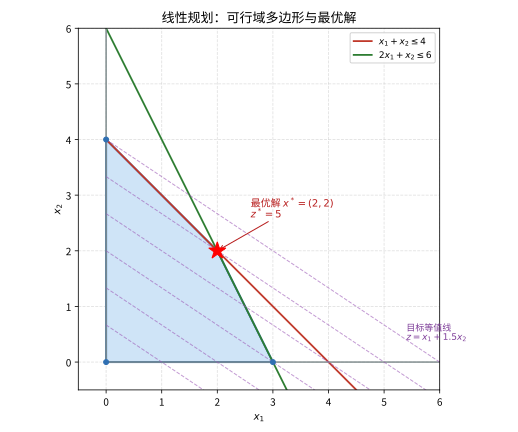

> **直观理解（现实类比）**：假如一家工厂的资源约束（原材料、工时等）把可行的生产方案圈出一块多边形区域，你只能在这个区域内选择生产量。目标函数就像在这块区域上铺一张平直的"利润坡"，越是向外越赚钱。由于斜坡是平面的，最高点必然落在多边形的某个顶点上——这正是单纯形法"在顶点间移动寻找最优解"的几何含义。

> **直观理解（现实类比）**：聚焦到单纯形法本身，它像"沿边走"——站在当前顶点，看看沿着哪条边走能让目标值变好（检验数 $\sigma_j<0$），就沿那条边走到相邻顶点；若所有边都不能再改善，就说明已到最优。它从不在区域内部乱穿，只在顶点间贴着边一步步挪，所以每步都把"无限方案"压缩成"有限邻居比较"，极其高效。

#### 对偶理论 (Duality Theory)

每个线性规划问题（原问题）都有一个对应的对偶问题。原问题与对偶问题之间的关系是对偶理论的核心。

**原问题**（P）：

$$
\begin{aligned}
\min \quad & \mathbf{c}^\top \mathbf{x} \\
\text{s.t.} \quad & A\mathbf{x} \geq \mathbf{b} \\
& \mathbf{x} \geq \mathbf{0}
\end{aligned}
$$

**对偶问题**（D）：

$$
\begin{aligned}
\max \quad & \mathbf{b}^\top \mathbf{y} \\
\text{s.t.} \quad & A^\top \mathbf{y} \leq \mathbf{c} \\
& \mathbf{y} \geq \mathbf{0}
\end{aligned}
$$

> **直观理解（现实类比）**：对偶理论像"从两面看同一座山"——原问题问"用给定资源最多能赚多少"，对偶问题问"把这些资源按市价卖掉最少要多少钱才肯出手"。看似两个角度，强对偶定理却保证它们给出的最优值相等：资源自用的最高收益恰好等于资源出售的最低要价。对偶变量 $\mathbf{y}$ 因此成为每种资源的"影子价格"，告诉你它到底值多少钱。

#### 课堂问答

**老师**：先问一个根本问题——线性规划的可行域是无穷多个点构成的凸多面体，最优解为什么一定能在顶点上取到，而不藏在内部或某条边的中间？

**学生**：因为目标函数 $f(\mathbf{x})=\mathbf{c}^\top\mathbf{x}$ 是线性的。任意可行点 $\mathbf{x}$ 可写成若干顶点的凸组合 $\mathbf{x}=\sum_i \lambda_i \mathbf{v}_i$，其中 $\lambda_i\geq 0$、$\sum_i\lambda_i=1$，于是 $\mathbf{c}^\top\mathbf{x}=\sum_i\lambda_i\,\mathbf{c}^\top\mathbf{v}_i$ 是各顶点目标值的加权平均，绝不会超过其中最大者。所以只要有有限最优解，它必在某个顶点达到。

**老师（追问）**：那如果最优解同时落在一整条边上，两个顶点并列最优，这说明什么？

**学生**：说明这条边上每个点都是最优解，出现了多重最优解（多个最优顶点）。此时单纯形法可能停在检验数含 $0$ 的基上，若处理不当甚至会在几个基之间循环；可用 Bland 规则或小扰动法避免循环。还要注意：无界时最优值为 $-\infty$，顶点论只保证"有有限最优解则可在顶点取到"，并不凭空造出最优解。

**老师（拓展）**：把"顶点"抽象出来就是基本可行解，那 $B^{-1}$ 和它对偶量有什么统一意义？

**学生**：在 $A\mathbf{x}=\mathbf{b}$、$\mathbf{x}\geq\mathbf{0}$ 中令非基变量为 $0$，解出 $x_B=B^{-1}\mathbf{b}$ 就是一个顶点，顶点总数至多 $\binom{n}{m}$。而对偶解 $\mathbf{y}=(B^{-1})^\top\mathbf{c}_B$ 正是影子价格，其分量等于该资源每增加一单位带来的最优目标增量——所以单纯形在顶点间移动的过程，同时也一直在读出每种资源的边际价值。

### 1.2 整数规划 (Integer Programming)

整数规划是线性规划的一种扩展，要求部分或全部决策变量取整数值。

**混合整数线性规划**（MILP）：

$$
\begin{aligned}
\min \quad & \mathbf{c}^\top \mathbf{x} + \mathbf{d}^\top \mathbf{y} \\
\text{s.t.} \quad & A\mathbf{x} + B\mathbf{y} \geq \mathbf{b} \\
& \mathbf{x} \in \mathbb{Z}^n_+, \mathbf{y} \in \mathbb{R}^p_+
\end{aligned}
$$

> **直观理解（现实类比）**：整数规划是"必须取整的优化"——安排多少辆车、派多少人、买多少台机器，这些决策只能取整数，不能说"派 2.7 个人"。可一旦加上"必须整数"这个要求，原本好解的线性规划就变难了：顶点不再是连续的，最优解常常掉在两个整数之间的"缝隙"里，得用分支定界把可行域像剥洋葱一样层层细分，才能逼出整数最优。

> **常见坑**：最普遍的误解是"把整数放松成实数算出来再四舍五入"。这是**错误**的：放松解 $x^*=2.7$ 四舍五入成 $3$ 往往根本不在可行域内，取整后的目标也可能离真正的最优很远。正确思路是"先算放松上界、再分支定界/割平面"——单纯取整只作为快速获得一个可行的初始整数解。此外要留意：同一个变量的"上取整 $\lceil\cdot\rceil$"和"下取整 $\lfloor\cdot\rfloor$"各对应一个分支，两个分支都要继续下去。

#### 分支定界法 (Branch and Bound)

分支定界法是求解整数规划最常用的方法之一。其基本思想是：

1. **松弛**：将整数约束松弛，求解线性规划松弛问题
2. **分支**：如果松弛解中某个整数变量 $x_i$ 取非整数值 $x_i^*$，则创建两个子问题：
   - 左分支：$x_i \leq \lfloor x_i^* \rfloor$
   - 右分支：$x_i \geq \lceil x_i^* \rceil$
3. **定界**：利用当前最优整数解作为上界，松弛问题的目标值作为下界
4. **剪枝**：如果子问题的下界大于当前上界，则剪枝

> **💡 直观理解（类比）**：分支定界像"警察排查案情"——先放宽到实数域求一个大概的下界，再从非整数分量按上下取整分叉成两个子案，边查边用"已知最好的整数答案"当破案上限，凡是连下界都比它差的线索整棵剪掉，只深挖最有戏的分支，保证既不遗漏又省掉大量无用搜索。

#### 割平面法 (Cutting Plane Method)

割平面法通过添加线性约束（割平面）来逐步逼近整数可行域的凸包。

**Gomory割平面**：设松弛问题的最优单纯形表中有约束：

$$
x_i + \sum_{j \in N} \bar{a}_{ij} x_j = \bar{b}_i
$$

其中 $\bar{b}_i$ 不是整数。令 $f_{ij} = \bar{a}_{ij} - \lfloor \bar{a}_{ij} \rfloor$，$f_i = \bar{b}_i - \lfloor \bar{b}_i \rfloor$，则Gomory割平面为：

$$
\sum_{j \in N} f_{ij} x_j \geq f_i
$$

#### 课堂问答

**老师**：为什么整数规划不能"先解 LP 松弛、再把小数四舍五入"了事？

**学生**：因为四舍五入可能直接跳出可行域。例如约束 $2x_1+2x_2\leq 3$、$x_1,x_2\in\mathbb{Z}_+$，LP 松弛最优可能是 $x=(1.5,0)$，四舍五入成 $(2,0)$，却违反 $2\cdot 2+0=4>3$。即便舍入后仍可行，目标值也可能离真最优很远——取整只是快速拿到一个可行的初始整数解，绝非最优解。

**老师（追问）**：那分支定界凭什么既不全枚举、又不漏掉最优？

**学生**：靠"松弛定界 + 剪枝"。设当前最好的整数解给出上界 $\bar{z}$，某子问题松弛下界为 $\underline{z}_k$。若 $\underline{z}_k\geq\bar{z}$，则该子区域内所有整数解都不优于 $\bar{z}$，整枝剪掉；否则继续按 $\lfloor x_i^*\rfloor$、$\lceil x_i^*\rceil$ 分支。由于松弛是整数问题的放宽，其最优值永远是下界，剪枝不会误砍真最优。

**老师（拓展）**：那割平面又是补哪块短板？ 分支时两个方向都要往下走吗，能不能只走一边？

**学生**：补"下界不够紧"的短板。Gomory 割 $\sum_{j\in N} f_{ij}x_j\geq f_i$ 从当前分数顶点切出一刀，切掉该分数解却不动任何整数可行点，等价于逐步逼近整数可行域的凸包。现代求解器把分支与割混用（branch-and-cut），这正是 MILP 能实用的原因。 必须两边都走。上取整与下取整各对应一个互不相交的子区域，只走一边就可能把落在另一边的真最优漏掉。分支的意义正是用"二选一"的划分保持完备性，再靠定界把没希望的那一支剪掉。

### 1.3 网络流 (Network Flow)

#### 最大流问题 (Maximum Flow Problem)

给定有向图 $G = (V, E)$，源点 $s$，汇点 $t$，容量函数 $c: E \to \mathbb{R}^+$，最大流问题求从 $s$ 到 $t$ 的最大可行流。

**增广路径算法**：在剩余网络中反复寻找增广路径，直到无法找到为止。

> **💡 直观理解（类比）**：最大流问题像"城市水管一天最多送多少水"——从水源到污水厂之间每段管道都有粗细上限（容量），问不爆管的前提下最多能输送多少。增广路径算法则像反复"找新路再灌水"：每次挑一段还能再挤进流量的路径加流，加到再也找不到可增的路线，水就到顶了。

#### 最小费用流问题 (Minimum Cost Flow Problem)

在满足流量需求的前提下，使总运输成本最小化。

$$
\begin{aligned}
\min \quad & \sum_{(i,j) \in E} w_{ij} f_{ij} \\
\text{s.t.} \quad & \sum_{j: (i,j) \in E} f_{ij} - \sum_{j: (j,i) \in E} f_{ji} = b_i, \quad \forall i \in V \\
& 0 \leq f_{ij} \leq c_{ij}, \quad \forall (i,j) \in E
\end{aligned}
$$

> **💡 直观理解（类比）**：最小费用流像"既要送够货又求运费最省"——每条路都标好吨公里的单价，在满足各点供需的前提下，优先走最便宜的路线，从而在总运量达标时把总运费压到最低。

#### 课堂问答

**老师**：最大流的增广路径算法反复"找路加流"，怎么保证最后一定最大？关键在哪一步？

**学生**：关键在剩余网络。只要存在 $s\to t$ 的增广路径，就能把它再提高 $\delta=\min_{(u,v)\in P}c_f(u,v)>0$，所以"无增广路径"就等价于当前流最大。再取 $S$ 为剩余网络中从 $s$ 可达的点集，则跨 $S\to T$ 的边全部满流、$T\to S$ 的边全部零流，于是 $|f|=c(S,T)$；配合 $|f|\leq c(S,T)$ 对任意割成立，就得到最大流等于最小割。

**老师（追问）**：反向边容量 $f(u,v)$ 到底有什么用，去掉行不行？

**学生**：不行，它是"撤流"能力——允许新的增广路径把先前错误分配的流量退回去改道。没有反向边，贪心可能卡在局部最优而非最大流，这正是 Ford-Fulkerson 与一般贪心的本质差别。顺带一提，容量若为整数则每次 $\delta\geq 1$，复杂度 $O(|E|\cdot|f|)$；容量为无理数时 FF 甚至可能不终止，改用每次取最短增广路的 Edmonds-Karp 可保证多项式 $O(|V||E|^2)$。

**老师（拓展）**：那最小费用流是怎么推广出来的？ 为什么"每次沿最短路增广"就能得到全局最小费用？

**学生**：它把目标换成 $\min\sum_{(i,j)\in E} w_{ij}f_{ij}$，在满足各点供需 $b_i$ 与 $0\leq f_{ij}\leq c_{ij}$ 的前提下求最省。做法是在剩余网络里每次沿"费用最短路"增广（用势能技巧保持边权非负），直到流量需求被满足——这本质上是把线性规划的对偶与凸费用结构搬到了网络上。 因为最小费用流是线性规划，其最优性可由对偶与互补松弛刻画；沿最短增广路等价于保持一组可行的势函数（对偶变量），使每条剩余弧的约化费用非负。这样每次增广都不破坏最优性条件，增广到满足需求时自然收敛到全局最小费用。

### 1.4 动态规划 (Dynamic Programming)

动态规划通过将复杂问题分解为子问题来求解，核心是**最优性原理**和**Bellman方程**。

**Bellman方程**（确定性）：

$$
V_k(s_k) = \min_{a_k \in A(s_k)} \left\{ c_k(s_k, a_k) + V_{k+1}(T(s_k, a_k)) \right\}
$$

其中 $V_k(s_k)$ 是状态 $s_k$ 在阶段 $k$ 的最优值函数，$c_k$ 是阶段成本，$T$ 是状态转移函数。

> **💡 直观理解（类比）**：动态规划像"记忆化递推"——把大问题切成一堆互相重叠的小问题，先解小的并记住答案，再层层往上拼，绝不重复算同一个子问题。Bellman 方程则像"眼前的每一步只盯着'当下成本 + 未来最佳'"：因为子问题彼此独立，就能自后往前倒推，一步步把最优方案织出来。

> **🔑 为什么重要**：动态规划处理的是"多阶段决策"这一类比线性规划更广泛的问题——只要决策可以拆成按阶段的先后次序、且未来收益只取决于"当前所到达的状态"（无后效性 / 马尔可夫性质），最优性原理就保证"逐阶段取最优即可拼出全局最优"。它把容易指数爆炸的穷举，压成了多项式级的递推，是最短路径（Bellman-Ford）、库存订货、资源分配、序列比对、强化学习里的价值迭代等算法共同的心脏。

#### 课堂问答

**老师**：Bellman 方程 $V_k(s_k)=\min_{a_k}\{c_k(s_k,a_k)+V_{k+1}(T(s_k,a_k))\}$ 里，为什么右边只出现 $V_{k+1}$，不计较更早的历史？

**学生**：因为有"无后效性"（马尔可夫性）：从状态 $s_{k+1}=T(s_k,a_k)$ 出发的最优值只依赖 $s_{k+1}$ 本身，与如何到达它无关。于是全局最优被拆成"当前阶段成本 + 后继子问题最优"，子问题彼此独立，就能自后往前倒推，而不必把整条策略一口气穷举。

**老师（追问）**：最优性原理的反证逻辑是什么？它若不成立会怎样？

**学生**：反证：若整体最优策略 $\pi^*$ 的后半段 $\pi_{k+1}^*$ 不是从 $s_{k+1}^*$ 出发的最优策略，则存在更省的后半段 $\tilde\pi$，把它接回前半段得到的新策略总成本更低，与 $\pi^*$ 最优矛盾。若最优性原理不成立，DP 递推就会"只顾眼前最优、拼不出全局最优"，指数爆炸无法避免。

**老师（拓展）**：状态怎么选才关键？DP 与 Bellman-Ford、强化学习价值迭代又是什么关系？ DP 的状态数会不会比穷举还多？

**学生**：状态必须"记住做决策所需的最小信息"——信息不够会违背后效性，信息冗余则状态数爆炸（背包按容量、最短路按节点设状态就是范例），复杂度约为"状态数 × 每状态决策数"。而 Bellman-Ford 的松弛 $d[v]\leftarrow\min(d[v],\,d[u]+w(u,v))$、强化学习的 $V(s)\leftarrow\max_a\{r+\gamma V(s')\}$，都是同一 Bellman 方程换上不同外衣。 不会，只要状态设计得当。穷举要遍历所有策略序列，规模随阶段数指数增长；DP 只需对每个"阶段 × 状态"求一次最优值，总代价是状态数与决策数的乘积，通常是多项式级。"记忆化"避免重复求解同一子问题，正是它压掉指数爆炸的关键。

### 1.5 最短路径 (Shortest Path)

#### Dijkstra算法

用于求解非负权重图中的单源最短路径问题。时间复杂度 $O(|V|^2)$ 或 $O(|E| + |V|\log|V|)$（使用优先队列）。

#### Bellman-Ford算法

用于求解含负权重边的单源最短路径问题，时间复杂度 $O(|V||E|)$。

> **💡 直观理解（类比）**：Bellman-Ford 算法像"多轮传话游戏"——允许负权边后，某点距离可能要绕远路才能被改善（负边让人"抄近道"），于是把刚更新的好消息一遍遍往外传，最多传 $|V|-1$ 轮即可尘埃落定；若传完还在继续变好，说明存在负环（越绕越省的死循环）。

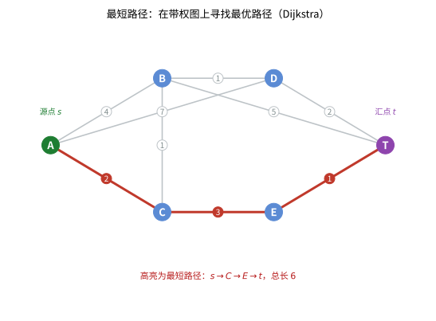

> **直观理解（现实类比）**：就像用导航软件规划出行，每个路口（节点）之间连着的每条路（边）都标着耗时（权重），你要找一条从起点到终点的总耗时最短的路线。Dijkstra 算法相当于"贪心地"每次确认当前已知最近的节点，逐步向外扩展，最终得到真正的最短路径（图中红色高亮路线）。

#### 课堂问答

**老师**：Dijkstra 每次都贪心地取出当前距离最小的点并永久定案，凭什么它一定正确、不会后悔？

**学生**：靠非负权。设取出 $u$ 时 $d(u)>\delta(u)$，沿真实最短路 $P$ 走向 $u$，取 $P$ 上第一个未定点的 $x$（其前驱 $y$ 已定）。$y$ 已定故松弛过 $(y,x)$，得 $d(x)\leq d(y)+w(y,x)=\delta(x)\leq\delta(u)<d(u)$，与 $u$ 距离最小矛盾。关键一步 $\delta(x)\leq\delta(u)$ 恰恰依赖路径各边非负。

**老师（追问）**：那有负权边时为什么改用 Bellman-Ford，它又为什么只跑 $|V|-1$ 轮？

**学生**：负边使"已定案"的点还能被后来绕路改小，Dijkstra 的永久标记失效。Bellman-Ford 不做永久标记，每轮对全部边松弛一遍，让"好消息"沿最短路逐跳传播；一条最短路至多含 $|V|-1$ 条边，故 $|V|-1$ 轮后必然收敛，复杂度 $O(|V||E|)$。

**老师（拓展）**：它怎么顺便检测负环，优先队列实现的复杂度又如何？ 零权边会不会破坏 Dijkstra 的正确性？

**学生**：若第 $|V|$ 轮还能松弛成功，就说明存在负权回路，此时最短路无下界——这正是"多跑一轮做检查"的用途。实现上，二叉堆为 $O(|E|\log|V|)$，斐波那契堆可优化到 $O(|E|+|V|\log|V|)$，而朴素数组扫描是 $O(|V|^2)$，在稠密图上反而占优。 不会。零权只让 $\delta(x)\leq\delta(u)$ 仍成立，证明不受影响；真正致命的是负权边，它可能使 $\delta(x)>\delta(u)$，让"已定点不再被改小"失效。这也是必须区分非负权（Dijkstra）与含负权（Bellman-Ford）的根本原因。

### 1.6 最小生成树 (Minimum Spanning Tree)

#### Kruskal算法

将所有边按权重排序，从小到大依次选择，如果加入后不形成环则保留，直到选出 $|V|-1$ 条边。时间复杂度 $O(|E|\log|E|)$。

#### Prim算法

从一个顶点开始，每次选择连接已选顶点集和未选顶点集的最小权重边，直到所有顶点都被选中。时间复杂度 $O(|V|^2)$ 或 $O(|E|\log|V|)$（使用优先队列）。

> **💡 直观理解（类比）**：Kruskal 和 Prim 都在回答"怎么用最省的总边长把一座城市的所有点连成网"。Kruskal 像把所有路段代金券从便宜到贵排好，只要接上不成圈就逐张兑现；Prim 则像"树慢慢长大"——从一个点开始，每步都挑"已连部分"与"尚未连上"之间最便宜的那条桥搭过去，树越长越大，直到罩住全部城市。

#### 课堂问答

**老师**：Kruskal 一个按边排序、Prim 一个从点生长，形式差别很大，凭什么都能得到最小生成树？

**学生**：两者都在用同一条"割性质"：对任一割把点集分成 $S$ 与 $V\setminus S$，横跨该割的最小权重边必属于某棵最小生成树。Kruskal 从小到大加边、不成环才留；Prim 每次就选"已选集与未选集之间的最小边"，两者是同一性质的不同执行方式。对偶地还有"环性质"：任一环中权重最大的边必不在任何最小生成树里。

**老师（追问）**：Kruskal 怎么高效判断"加这条边会不会成环"？

**学生**：用并查集。每加入一条边就把两端点所在集合合并；若两端点已在同一集合，说明加它必成环，直接跳过。排序耗 $O(|E|\log|E|)$，并查集近似线性，所以总复杂度为 $O(|E|\log|E|)$。

**老师（拓展）**：Prim 更适合哪种图？各算法的复杂度是多少？ 最小生成树和最短路径树是一回事吗？

**学生**：Prim 从单点生长，适合稠密图：朴素实现 $O(|V|^2)$，用优先队列可到 $O(|E|\log|V|)$；Kruskal 按全局边排序，更适合稀疏图。此外，当所有边权互不相同时最小生成树唯一，只有出现相等权重时才可能有多个最小生成树。 不是。MST 最小化"全体边权之和"，最短路径树最小化"每个点到源的最短路"，目标不同。经典反例是边权为 $\{1,1,3\}$ 的三角形：MST 取两条权为 $1$ 的边（总权 $2$），但若某点到另一点的最短路必须经那条 $3$ 的边，二者就会分歧。

### 1.7 其他重要概念

- **库存论**：研究最优库存策略，包括经济订货量（EOQ）模型
- **排队论**：研究排队系统的性能分析（详见第111级）
- **决策论**：在不确定条件下进行决策的理论，包括贝叶斯决策、博弈论
- **多目标决策**：处理多个相互冲突的目标，如Pareto最优、层次分析法（AHP）
- **指派问题**：将 $n$ 个任务分配给 $n$ 个执行者，使总成本最小（匈牙利算法）
- **运输问题**：从多个供应点运送到多个需求点，使总运输成本最小化

---

#### 课堂问答

**老师**：这一节罗列了一堆分支，先挑最能体现运筹学权衡思想的——经济订货量（EOQ）模型，它为什么是"平方根"公式？

**学生**：因为 EOQ 在"订货成本 $K$"与"持有成本 $h$"之间权衡。设年需求为 $D$、订货批量为 $Q$，年总成本 $C(Q)=\dfrac{KD}{Q}+\dfrac{hQ}{2}$。对 $Q$ 求导置零得 $Q^*=\sqrt{2KD/h}$。由于一项与 $1/Q$ 成正比、另一项与 $Q$ 成正比，最优点必落在两者相等处，取根号自然出现。

**老师（追问）**：指派问题为什么能用匈牙利算法在多项式时间求解，而一般整数规划却是 NP 难的？

**学生**：因为指派问题是一类全幺模（TU）问题：其约束矩阵的行列式取值为 $\pm 1$，LP 松弛的顶点自动是整数，所以直接解 LP 就得到整数最优，匈牙利算法正是这一结构的组合化实现。一般整数规划缺乏这种结构，才只能靠分支定界。

**老师（拓展）**：那排队论、决策论、多目标决策各自在解决什么？ "运输问题"和网络流模型到底什么关系？

**学生**：排队论研究到达与服务过程（泊松到达、指数服务、M/M/1 等）下的队长、等待时间等性能指标；决策论在不确定或风险下比较备选方案，含贝叶斯决策与博弈论；多目标决策处理相互冲突的目标，用 Pareto 最优、AHP 等方法求折中。它们与线性规划、网络流共享"先建模型、再求最优"的灵魂。 运输问题是最小费用流的一个特例：给供应点、需求点各挂源汇，弧上标单位运费，求满足产销平衡的最小费用。它的约束矩阵同样是全幺模的，故 LP 松弛即得整数解——这正解释了为何西北角法、位势法能高效求得整数最优方案。

## 2. 定理与证明

### 2.1 线性规划强对偶定理

> **定理 1（强对偶定理）**：如果原问题和对偶问题都有可行解，则它们都有最优解，且最优值相等。即 $\min \mathbf{c}^\top \mathbf{x} = \max \mathbf{b}^\top \mathbf{y}$。

**证明**：

考虑原问题（P）：
$$
\begin{aligned}
\min \quad & \mathbf{c}^\top \mathbf{x} \\
\text{s.t.} \quad & A\mathbf{x} \geq \mathbf{b} \\
& \mathbf{x} \geq \mathbf{0}
\end{aligned}
$$

和对偶问题（D）：
$$
\begin{aligned}
\max \quad & \mathbf{b}^\top \mathbf{y} \\
\text{s.t.} \quad & A^\top \mathbf{y} \leq \mathbf{c} \\
& \mathbf{y} \geq \mathbf{0}
\end{aligned}
$$

**步骤1：弱对偶性**

首先证明弱对偶性：对于任意可行的 $\mathbf{x}$ 和 $\mathbf{y}$，有 $\mathbf{b}^\top \mathbf{y} \leq \mathbf{c}^\top \mathbf{x}$。

由 $\mathbf{y} \geq \mathbf{0}$ 和 $A\mathbf{x} \geq \mathbf{b}$，得：
$$
\mathbf{y}^\top A\mathbf{x} \geq \mathbf{y}^\top \mathbf{b} = \mathbf{b}^\top \mathbf{y}
$$

由 $\mathbf{x} \geq \mathbf{0}$ 和 $A^\top \mathbf{y} \leq \mathbf{c}$，得：
$$
\mathbf{y}^\top A\mathbf{x} = (A^\top \mathbf{y})^\top \mathbf{x} \leq \mathbf{c}^\top \mathbf{x}
$$

因此 $\mathbf{b}^\top \mathbf{y} \leq \mathbf{c}^\top \mathbf{x}$。

**步骤2：Farkas引理**

为了证明强对偶性，我们需要Farkas引理：

> **Farkas引理**：对于矩阵 $A$ 和向量 $\mathbf{b}$，以下两个系统有且仅有一个有解：
> 1. $A\mathbf{x} = \mathbf{b}, \mathbf{x} \geq \mathbf{0}$
> 2. $A^\top \mathbf{y} \geq \mathbf{0}, \mathbf{b}^\top \mathbf{y} < 0$

**证明**：设系统1无解。考虑凸锥 $C = \{A\mathbf{x} : \mathbf{x} \geq \mathbf{0}\}$，则 $\mathbf{b} \notin C$。由于 $C$ 是闭凸锥，由凸集分离定理，存在超平面严格分离 $\mathbf{b}$ 和 $C$，即存在 $\mathbf{y}$ 使得 $\mathbf{y}^\top \mathbf{b} < 0$ 且 $\mathbf{y}^\top (A\mathbf{x}) \geq 0$ 对所有 $\mathbf{x} \geq \mathbf{0}$ 成立。后者意味着 $A^\top \mathbf{y} \geq \mathbf{0}$（否则取适当的 $\mathbf{x}$ 可使 $\mathbf{y}^\top A\mathbf{x} < 0$）。因此系统2有解。

反之，若系统2有解，则对任意 $\mathbf{x} \geq \mathbf{0}$，有 $\mathbf{y}^\top A\mathbf{x} = (A^\top \mathbf{y})^\top \mathbf{x} \geq 0$，但 $\mathbf{y}^\top \mathbf{b} < 0$，所以 $A\mathbf{x} \neq \mathbf{b}$，系统1无解。

**步骤3：证明强对偶性**

设原问题的最优值为 $p^*$。考虑扩展系统：
$$
\begin{pmatrix}
A & -\mathbf{b} \\
-\mathbf{c}^\top & p^*
\end{pmatrix}
\begin{pmatrix}
\mathbf{x} \\
t
\end{pmatrix} \geq \mathbf{0}, \quad \mathbf{x} \geq \mathbf{0}, t \geq 0
$$

其中 $t$ 是标量变量。如果 $( \mathbf{x}, t)$ 是该系统的一个解且 $t > 0$，则 $A(\mathbf{x}/t) \geq \mathbf{b}$ 且 $\mathbf{c}^\top (\mathbf{x}/t) \leq p^*$，即 $\mathbf{x}/t$ 是原问题的可行解且目标值不超过 $p^*$，所以 $\mathbf{x}/t$ 是最优解。

现在，考虑系统：
$$
\begin{pmatrix}
A \\
-\mathbf{c}^\top
\end{pmatrix} \mathbf{x} \geq \begin{pmatrix}
\mathbf{b} \\
-p^*
\end{pmatrix}, \quad \mathbf{x} \geq \mathbf{0}
$$

如果该系统无解，则由Farkas引理，存在 $(\mathbf{y}_0, y_1) \geq \mathbf{0}$ 使得：
$$
(\mathbf{y}_0^\top, y_1) \begin{pmatrix}
A \\
-\mathbf{c}^\top
\end{pmatrix} \geq \mathbf{0}^\top, \quad (\mathbf{y}_0^\top, y_1) \begin{pmatrix}
\mathbf{b} \\
-p^*
\end{pmatrix} < 0
$$

即 $\mathbf{y}_0^\top A - y_1 \mathbf{c}^\top \geq \mathbf{0}^\top$ 且 $\mathbf{y}_0^\top \mathbf{b} - y_1 p^* < 0$。

若 $y_1 > 0$，令 $\mathbf{y} = \mathbf{y}_0 / y_1$，则 $A^\top \mathbf{y} \geq \mathbf{c}$ 且 $\mathbf{b}^\top \mathbf{y} < p^*$。由弱对偶性，对任意原问题可行解 $\mathbf{x}$，有 $\mathbf{c}^\top \mathbf{x} \geq \mathbf{b}^\top \mathbf{y}$，所以 $\mathbf{b}^\top \mathbf{y} \leq p^*$，结合 $\mathbf{b}^\top \mathbf{y} < p^*$，得 $\mathbf{b}^\top \mathbf{y} < p^*$。

但由弱对偶性，$\mathbf{b}^\top \mathbf{y} \leq p^*$ 总是成立，所以 $\mathbf{b}^\top \mathbf{y} < p^*$ 意味着存在对偶可行解 $\mathbf{y}$ 使得对偶值严格小于原问题最优值。

若 $y_1 = 0$，则 $\mathbf{y}_0^\top A \geq \mathbf{0}^\top$ 且 $\mathbf{y}_0^\top \mathbf{b} < 0$，这与原问题有可行解矛盾（因为对任意原问题可行解 $\mathbf{x}$，有 $0 \leq \mathbf{y}_0^\top A\mathbf{x} \geq \mathbf{y}_0^\top \mathbf{b}$，但 $\mathbf{y}_0^\top \mathbf{b} < 0$）。

因此原系统必须有解，即存在 $\mathbf{x}^* \geq \mathbf{0}$ 使得 $A\mathbf{x}^* \geq \mathbf{b}$ 且 $\mathbf{c}^\top \mathbf{x}^* \leq p^*$。由于 $p^*$ 是最优值，必有 $\mathbf{c}^\top \mathbf{x}^* = p^*$，所以 $\mathbf{x}^*$ 是最优解。

**步骤4：对偶问题的最优值**

由弱对偶性，对偶问题的最优值 $d^* \leq p^*$。我们需要证明存在对偶可行解 $\mathbf{y}^*$ 使得 $\mathbf{b}^\top \mathbf{y}^* = p^*$。

由原问题的最优解 $\mathbf{x}^*$ 和最优基 $B$，定义 $\mathbf{y}^* = (B^{-1})^\top \mathbf{c}_B$，其中 $\mathbf{c}_B$ 是对应基变量的目标系数。可以验证 $\mathbf{y}^*$ 是对偶可行的，且 $\mathbf{b}^\top \mathbf{y}^* = \mathbf{c}_B^\top B^{-1} \mathbf{b} = \mathbf{c}^\top \mathbf{x}^* = p^*$。

因此 $d^* = p^*$，强对偶定理得证。$\square$

#### 课堂问答

**老师**：强对偶定理说 $\min \mathbf{c}^\top\mathbf{x}=\max \mathbf{b}^\top\mathbf{y}$，证明里第一步"弱对偶性"到底起什么作用？

**学生**：弱对偶性 $\mathbf{b}^\top\mathbf{y}\leq\mathbf{c}^\top\mathbf{x}$ 给对偶值钉上一个"永远不超过原问题最优值"的天花板，即 $d^*\leq p^*$。强对偶只需再补另一半 $d^*\geq p^*$，而这半步正是靠 Farkas 引理说明对偶最优值不可能严格低于 $p^*$。

**老师（追问）**：Farkas 引理在这个证明里扮演什么角色，它的几何意义是什么？

**学生**：Farkas 引理断言：$A\mathbf{x}=\mathbf{b},\ \mathbf{x}\geq\mathbf{0}$ 与 $A^\top\mathbf{y}\geq\mathbf{0},\ \mathbf{b}^\top\mathbf{y}<0$ 恰有一个有解。几何上就是把点 $\mathbf{b}$ 与凸锥 $C=\{A\mathbf{x}:\mathbf{x}\geq\mathbf{0}\}$ 用超平面严格分离——若 $\mathbf{b}$ 落在锥外，就存在法向量 $\mathbf{y}$ 使 $\mathbf{b}^\top\mathbf{y}<0$ 而在锥内处处非负。它是"有效不等式与分离"思想的源头。

**老师（拓展）**：那 $\mathbf{y}^*=(B^{-1})^\top\mathbf{c}_B$ 是什么，有什么用？ 互补松弛给的是什么直觉？

**学生**：它是对偶最优解，也就是影子价格。分量 $y_i^*$ 表示第 $i$ 种资源增加一个单位时最优目标值的边际变化，而 $\mathbf{b}^\top\mathbf{y}^*=\mathbf{c}_B^\top B^{-1}\mathbf{b}=\mathbf{c}^\top\mathbf{x}^*=p^*$ 保证对偶取值恰好触到 $p^*$，强对偶由此闭环。 互补松弛说：若某约束是松的（还有剩余），其影子价格 $y_i=0$；若某决策变量取正值，则对应的 $A^\top\mathbf{y}\leq\mathbf{c}$ 取等号。直觉就是"不稀缺的资源不值钱，值钱的资源一定被用满"，这正是对偶最优解的定价含义。

### 2.2 最大流最小割定理

> **定理 2（最大流最小割定理）**：在任何网络中，从源点 $s$ 到汇点 $t$ 的最大流的值等于所有 $s$-$t$ 割的最小容量。

**证明**：

设 $G = (V, E)$ 是一个有向图，源点为 $s$，汇点为 $t$，容量函数 $c: E \to \mathbb{R}^+$。令 $f$ 是一个 $s$-$t$ 流。

**步骤1：基本定义**

$s$-$t$ 割 $(S, T)$ 是顶点集 $V$ 的一个划分，满足 $s \in S$，$t \in T$。割的容量定义为：
$$
c(S, T) = \sum_{u \in S, v \in T, (u,v) \in E} c(u,v)
$$

流 $f$ 的值定义为：
$$
|f| = \sum_{v \in V} f(s,v) - \sum_{v \in V} f(v,s)
$$

**步骤2：流值不超过割容量的上界**

对于任意 $s$-$t$ 割 $(S, T)$ 和任意可行流 $f$，有：
$$
|f| \leq c(S, T)
$$

**证明**：由流量守恒和容量约束：
$$
\begin{aligned}
|f| &= \sum_{u \in S} \left( \sum_{v \in V} f(u,v) - \sum_{v \in V} f(v,u) \right) \\
&= \sum_{u \in S, v \in T} f(u,v) - \sum_{u \in S, v \in T} f(v,u) \\
&\leq \sum_{u \in S, v \in T} f(u,v) \leq \sum_{u \in S, v \in T} c(u,v) = c(S, T)
\end{aligned}
$$

**步骤3：剩余网络与增广路径**

给定流 $f$，定义剩余网络 $G_f = (V, E_f)$，其中每条边 $(u,v) \in E$ 对应两条边：
- 前向边 $(u,v)$，容量为 $c(u,v) - f(u,v)$（如果 $f(u,v) < c(u,v)$）
- 反向边 $(v,u)$，容量为 $f(u,v)$（如果 $f(u,v) > 0$）

**增广路径**是剩余网络 $G_f$ 中从 $s$ 到 $t$ 的一条路径。

**步骤4：Ford-Fulkerson算法的正确性**

Ford-Fulkerson算法：在剩余网络中反复寻找增广路径，并沿路径增加流量，直到不存在增广路径。

**断言**：如果 $f$ 是最大流，则剩余网络 $G_f$ 中不存在从 $s$ 到 $t$ 的路径。

**证明**：假设 $G_f$ 中存在从 $s$ 到 $t$ 的路径 $P$。令 $\delta = \min_{(u,v) \in P} c_f(u,v) > 0$，其中 $c_f(u,v)$ 是剩余网络中的容量。则沿 $P$ 增加 $\delta$ 流量可得到新的可行流 $f'$，且 $|f'| = |f| + \delta > |f|$，与 $f$ 是最大流矛盾。

**步骤5：最大流等于最小割**

设 $f$ 是最大流，定义 $S$ 为剩余网络 $G_f$ 中从 $s$ 可达的顶点集，$T = V \setminus S$。由于 $G_f$ 中不存在从 $s$ 到 $t$ 的路径，所以 $t \notin S$，即 $(S, T)$ 是一个 $s$-$t$ 割。

对于任意 $u \in S$，$v \in T$，$(u,v) \in E$，有 $f(u,v) = c(u,v)$（否则 $(u,v)$ 在 $G_f$ 中，则 $v$ 从 $s$ 可达，矛盾）。

对于任意 $u \in T$，$v \in S$，$(u,v) \in E$，有 $f(u,v) = 0$（否则 $f(u,v) > 0$ 意味着 $(v,u)$ 在 $G_f$ 中，则 $u$ 从 $s$ 可达，矛盾）。

因此：
$$
|f| = \sum_{u \in S, v \in T} f(u,v) - \sum_{u \in S, v \in T} f(v,u) = \sum_{u \in S, v \in T} c(u,v) = c(S, T)
$$

由步骤2，任意流的值不超过任意割的容量，所以 $c(S,T)$ 是最小割容量，$|f|$ 是最大流值。$\square$

#### 课堂问答

**老师**：最大流最小割定理说"送得最多等于最窄瓶颈"。先说说为什么任意流的值都不超过任意割的容量？

**学生**：沿割对流量守恒求和：$|f|=\sum_{u\in S}\big(\sum_{v}f(u,v)-\sum_{v}f(v,u)\big)=\sum_{u\in S,v\in T}f(u,v)-\sum_{u\in S,v\in T}f(v,u)\leq\sum_{u\in S,v\in T}c(u,v)=c(S,T)$。其中 $S$ 内部边相互抵消，反向项由流量非负被丢掉。于是每个割都是流值的一个上界，这也是"瓶颈"一词的来源。

**老师（追问）**：那怎么证明"存在一个割把上界取紧"，从而最大流恰等于最小割？

**学生**：取最大流 $f$，在剩余网络里令 $S$ 为从 $s$ 可达的点集。$f$ 最大则 $t\notin S$，$(S,T)$ 是合法割；且 $S\to T$ 的边必满流（否则 $T$ 侧端点也变可达），$T\to S$ 的边必零流（否则 $S$ 侧端点也变可达）。代入流量公式即得 $|f|=c(S,T)$，上界被取紧，故它既是最小割、又是最大流。

**老师（拓展）**："无增广路径"这个判据在证明里的地位是什么？ 这套对偶还能推广到哪些地方？

**学生**：它是连接"最大流"与"最小割"的桥。断言"$f$ 最大 $\Leftrightarrow$ 剩余网络中无 $s\to t$ 增广路径"：有路径就能再增 $\delta>0$ 流量、与最大矛盾；无路径则能构造出取紧的割。Ford-Fulkerson 反复找增广路径直到找不到为止，正是顺着这条判据工作。 它本质是 LP 强对偶在网络上的一大特例——最大流与最小割互为对偶。Menger 定理（点/边不相交路径数等于最小割）是它的组合版本，被广泛用于网络可靠性、连通度分析与二分图匹配。

### 2.3 Dijkstra算法的正确性

> **定理 3（Dijkstra算法正确性）**：对于非负权重图 $G = (V, E)$，Dijkstra算法能正确求出从源点 $s$ 到所有顶点的最短路径距离。

**证明**：

设 $d(v)$ 为算法运行时维护的从 $s$ 到 $v$ 的当前距离估计，$\delta(v)$ 为从 $s$ 到 $v$ 的真实最短距离。

**归纳假设**：当顶点 $u$ 被从优先队列中取出（标记为永久）时，$d(u) = \delta(u)$。

**基础**：源点 $s$ 是第一个被取出的顶点，$d(s) = 0 = \delta(s)$，归纳基础成立。

**归纳步骤**：假设在取出顶点 $u$ 之前，所有已永久标记的顶点都满足 $d = \delta$。设 $u$ 是当前从优先队列中取出的顶点（即 $d(u)$ 最小），我们要证明 $d(u) = \delta(u)$。

反证法。假设 $d(u) > \delta(u)$。考虑从 $s$ 到 $u$ 的真实最短路径 $P$。由于 $s$ 已永久标记，$u$ 尚未永久标记，路径 $P$ 上存在第一个未被永久标记的顶点，记为 $x$，其前驱 $y$ 已被永久标记（可能有 $y = s$）。

由于 $y$ 已被永久标记，$d(y) = \delta(y)$。当 $y$ 被永久标记时，算法会松弛从 $y$ 出发的所有边，包括 $(y, x)$，因此 $d(x) \leq d(y) + w(y,x) = \delta(y) + w(y,x) = \delta(x)$。

由于 $x$ 在最短路径 $P$ 上且位于 $u$ 之前，有 $\delta(x) \leq \delta(u)$。因此 $d(x) \leq \delta(x) \leq \delta(u) < d(u)$。

但 $u$ 是从优先队列中取出的距离最小的顶点，即 $d(u) \leq d(x)$，与 $d(x) < d(u)$ 矛盾。

因此假设不成立，$d(u) = \delta(u)$。$\square$

#### 课堂问答

**老师**：Dijkstra 正确性证明用的是数学归纳。"归纳假设"和"非负权"分别起什么作用？

**学生**：归纳假设是：每当顶点 $u$ 被从优先队列取出（永久标记）时 $d(u)=\delta(u)$。设其前驱 $y$ 已永久标记且 $d(y)=\delta(y)$，$y$ 松弛过 $(y,x)$ 使 $d(x)\leq\delta(y)+w(y,x)=\delta(x)$，又 $\delta(x)\leq\delta(u)<d(u)$，与 $d(u)\leq d(x)$ 矛盾。整条推理依赖非负权同时给出 $d(y)+w(y,x)=\delta(x)$ 和 $\delta(x)\leq\delta(u)$。

**老师（追问）**：为什么某点一旦被取出就可以"永久定案"，之后不必再更新？

**学生**：因为此时 $d(u)=\delta(u)$ 已是真实最短路。此后任何候选路径都必须经过某个尚未定点的点，而它们的 $d$ 值都不小于 $d(u)$，再加上非负边权只会把距离抬得更大，不可能再改善 $u$。这就是非负权赋予"贪心即最优"的根据。

**老师（拓展）**：图不连通、存在不可达点时，算法还算"正确"吗？ 那如果只用朴素数组不用优先队列，正确性会变吗？

**学生**：仍然正确。这些点的终值为 $d=\infty$，代表不可达，正确性定理保证的是"能到达则算对"，把 $\infty$ 理解为"无有限路径"语义一致。真正会破坏结论的是负权边，它可能让 $\delta(x)>\delta(u)$，使"已定点不再被改小"失效。 不会，正确性取决于非负权与贪心选择顺序，与数据结构无关。数据结构只影响效率：朴素数组扫描每次取最小耗 $O(|V|)$、总 $O(|V|^2)$；二叉堆降到 $O(|E|\log|V|)$。所以换实现改变的是快慢，而非对错。

### 2.4 动态规划的最优性原理

> **定理 4（最优性原理，Bellman方程）**：多阶段决策问题的最优策略具有如下性质：无论初始状态和初始决策如何，剩余的决策必须构成一个以初始决策形成的状态为起点的最优策略。

> **💡 直观理解（类比）**：最优性原理像"高瞻远瞩却只盯眼前一步"——整体最优的路线，从任何中间站拆开来看，剩下的"半程"也仍是那半程自己的最优走法。正是这个性质，让优化可以自后往前倒推重组成完整方案，而不用把整条路一口气穷举完。

**证明**：

考虑一个 $N$ 阶段决策过程。设状态空间为 $\mathcal{S}$，决策空间为 $\mathcal{A}$。在阶段 $k$，系统处于状态 $s_k \in \mathcal{S}$，决策者选择决策 $a_k \in \mathcal{A}(s_k)$，产生阶段成本 $c_k(s_k, a_k)$，系统转移到状态 $s_{k+1} = T_k(s_k, a_k)$。

定义最优值函数 $V_k(s_k)$ 为从阶段 $k$ 状态 $s_k$ 出发，到阶段 $N$ 结束的最小总成本：
$$
V_k(s_k) = \min_{a_k, a_{k+1}, \ldots, a_{N-1}} \sum_{i=k}^{N-1} c_i(s_i, a_i)
$$

其中 $s_{i+1} = T_i(s_i, a_i)$。

**Bellman最优性方程**：
$$
V_k(s_k) = \min_{a_k \in \mathcal{A}(s_k)} \left\{ c_k(s_k, a_k) + V_{k+1}(T_k(s_k, a_k)) \right\}, \quad k = 0, 1, \ldots, N-1
$$

边界条件：$V_N(s_N) = 0$（或某个终端成本函数）。

**证明Bellman方程**：

设 $\pi^* = (a_k^*, a_{k+1}^*, \ldots, a_{N-1}^*)$ 是从阶段 $k$ 状态 $s_k$ 出发的最优策略。则：
$$
V_k(s_k) = \sum_{i=k}^{N-1} c_i(s_i^*, a_i^*)
$$

其中 $s_i^*$ 是在最优策略下的状态序列，$s_{k+1}^* = T_k(s_k, a_k^*)$。

将上式分解：
$$
V_k(s_k) = c_k(s_k, a_k^*) + \sum_{i=k+1}^{N-1} c_i(s_i^*, a_i^*)
$$

现在证明 $\pi_{k+1}^* = (a_{k+1}^*, \ldots, a_{N-1}^*)$ 是从状态 $s_{k+1}^*$ 出发的最优策略。

反证法。假设存在另一个策略 $\tilde{\pi} = (\tilde{a}_{k+1}, \ldots, \tilde{a}_{N-1})$ 使得从 $s_{k+1}^*$ 出发的总成本更低：
$$
\sum_{i=k+1}^{N-1} c_i(\tilde{s}_i, \tilde{a}_i) < \sum_{i=k+1}^{N-1} c_i(s_i^*, a_i^*)
$$

其中 $\tilde{s}_{k+1} = s_{k+1}^*$，$\tilde{s}_{i+1} = T_i(\tilde{s}_i, \tilde{a}_i)$。

则构造新策略 $\pi' = (a_k^*, \tilde{a}_{k+1}, \ldots, \tilde{a}_{N-1})$，其总成本为：
$$
c_k(s_k, a_k^*) + \sum_{i=k+1}^{N-1} c_i(\tilde{s}_i, \tilde{a}_i) < c_k(s_k, a_k^*) + \sum_{i=k+1}^{N-1} c_i(s_i^*, a_i^*) = V_k(s_k)
$$

这与 $V_k(s_k)$ 是最优值矛盾。因此 $\pi_{k+1}^*$ 必须是最优的。

由此可得：
$$
\begin{aligned}
V_k(s_k) &= c_k(s_k, a_k^*) + V_{k+1}(s_{k+1}^*) \\
&= \min_{a_k \in \mathcal{A}(s_k)} \left\{ c_k(s_k, a_k) + V_{k+1}(T_k(s_k, a_k)) \right\}
\end{aligned}
$$

最后一个等号成立是因为 $a_k^*$ 是最优决策，而 $V_{k+1}(s_{k+1})$ 是定义在状态 $s_{k+1}$ 上的最优值函数，与之前的决策无关。$\square$

#### 课堂问答

**老师**：最优性原理说"无论初始状态与初始决策如何，其余决策须构成以该决策所得状态为起点的最优策略"。这里"以所得状态为起点"为什么要强调？

**学生**：因为无后效性：汇总到某状态之后，未来的最优只依赖这个状态本身，与怎样到达无关。所以只要把从阶段 $k$ 到终点的最优值写成状态函数 $V_k(s_k)$，就能在任意到达该状态的情形下复用同一个子问题的解，把大问题拆成互不重叠的递推。

**老师（追问）**：证明最优性原理时用了反证，矛盾的落点到底在哪？

**学生**：假设最优策略 $\pi^*$ 从 $s_{k+1}^*$ 起的后半段不是最优，则存在成本更低的 $\tilde\pi$；把它接在原前半段之后得到的新策略总成本小于 $V_k(s_k)$，与 $V_k(s_k)$ 的定义矛盾。落点就是"拼接后更优"违背了最优值函数的定义。

**老师（拓展）**：由此得到的 Bellman 方程为什么能"自后往前"计算？ 如果去掉无后效性会怎样，有没有现实例子？

**学生**：因为 $V_k$ 只依赖 $V_{k+1}$：$V_k(s_k)=\min_{a_k\in\mathcal{A}(s_k)}\{c_k(s_k,a_k)+V_{k+1}(T_k(s_k,a_k))\}$，边界取 $V_N(s_N)=0$。于是从末段 $k=N$ 倒推到 $k=0$，每一步只用已算好的更后阶段值，避开指数枚举，把问题压成多项式级递推。 若"未来收益还依赖走过的路径历史"，则状态必须把历史也编码进去，$V_k$ 不再是当前状态的函数，Bellman 方程不成立。例如旅行商问题必须把"已访问城市集合"写进状态，状态数达 $O(2^n)$，复杂度随状态维度指数增长——这正是无后效性为何是 DP 的命门。

### 2.5 分支定界算法的收敛性

> **定理 5（分支定界收敛性）**：对于有限离散整数规划问题，分支定界算法在有限步内终止，并返回全局最优解。

> **💡 直观理解（类比）**：这个定理像"在有限的决策树上理性地修剪"——每个整数变量取值范围有限，分支树注定不会无限长大；每次迭代要么开新枝（分支），要么整枝剪掉（定界），每个节点只被处理一遍便停下。收工时树上留下来的，就是全局最优的那颗苹果。

**证明**：

考虑整数规划问题：
$$
\begin{aligned}
\min \quad & f(\mathbf{x}) \\
\text{s.t.} \quad & \mathbf{x} \in S \subseteq \mathbb{Z}^n
\end{aligned}
$$

其中 $S$ 是有限集（或至少可行域有界）。

**步骤1：分支过程的有限性**

分支操作将一个可行域划分为互不相交的子区域。由于每个变量有有限个可能的整数值（由问题有界性保证），分支过程不可能无限进行下去。具体地，如果每个整数变量 $x_i$ 的取值范围为 $[L_i, U_i]$，则最多有 $\prod_{i=1}^n (U_i - L_i + 1)$ 个可能的整数解，因此分支树的节点数有限。

**步骤2：定界机制**

设当前最优整数解的目标值为 $\bar{f}$（初始化为 $\infty$ 或某个已知上界）。对于每个子问题 $P_k$，求解其线性规划松弛得到下界 $\underline{f}_k$。

**剪枝规则**：
- 如果 $\underline{f}_k \geq \bar{f}$，则剪枝（该子问题不可能包含更优解）
- 如果 $P_k$ 无可行解，则剪枝
- 如果 $P_k$ 的最优解是整数解且 $f(\mathbf{x}_k) < \bar{f}$，则更新 $\bar{f} = f(\mathbf{x}_k)$

**步骤3：收敛性证明**

由于分支树是有限的，且每次迭代至少处理一个节点（可分为子节点或剪枝），算法必然在有限步后终止。

设终止时当前最优解为 $\mathbf{x}^*$，最优值为 $\bar{f}^* = f(\mathbf{x}^*)$。

**断言**：$\mathbf{x}^*$ 是全局最优解。

**证明**：反证法。假设存在 $\mathbf{x}' \in S$ 使得 $f(\mathbf{x}') < f(\mathbf{x}^*)$。考虑 $\mathbf{x}'$ 在分支树中对应的叶节点（即 $\mathbf{x}'$ 所在的某个子区域）。

由于算法终止时所有未被剪枝的节点都已被处理，且 $\mathbf{x}'$ 是整数可行解，它必然出现在某个叶节点中。该叶节点对应的松弛问题的最优值 $\underline{f} \leq f(\mathbf{x}')$（因为 $\mathbf{x}'$ 是松弛问题的可行解）。

如果该叶节点已被剪枝，则必有 $\underline{f} \geq \bar{f}^*$，从而 $f(\mathbf{x}') \geq \underline{f} \geq \bar{f}^*$，与 $f(\mathbf{x}') < f(\mathbf{x}^*)$ 矛盾。

如果该叶节点未被剪枝，则算法会找到该节点中的整数解（或至少更新上界），从而 $\bar{f}^* \leq f(\mathbf{x}')$，同样矛盾。

因此 $\mathbf{x}^*$ 是全局最优解。$\square$

---

#### 课堂问答

**老师**：分支定界为什么一定在有限步内停，而不是无限地一分为二分下去？

**学生**：因为可行域有界且变量取整，每个 $x_i$ 只有 $[L_i,U_i]$ 内有限个整数值，分支树的总节点数不超过 $\prod_{i=1}^n (U_i-L_i+1)$，是有限的。每次迭代要么把一个节点分成两个子节点、要么剪掉它，节点数不会无限繁殖，故算法必然有限步终止。

**老师（追问）**：光有有限性还不够，怎么保证停下时给出的是全局最优，而不是某个局部最优？

**学生**：靠界与剪枝的配合。剪枝条件是"子问题松弛下界 $\underline{f}_k\geq$ 当前上界 $\bar{f}$"，而松弛是整数问题的放宽，故 $\underline{f}_k$ 永远不超过该子区域内任何整数可行解的目标值。于是被剪掉的枝里绝不含优于 $\bar{f}$ 的整数解；离开时所有未被剪的节点都已处理，全局最优一个也漏不掉。

**老师（拓展）**：为什么用松弛下界剪枝是"安全"的，会不会误剪真最优？ 实际中分支定界为什么会"慢"，瓶颈在哪？

**学生**：不会。若某子区域含真最优 $\mathbf{x}'$，其松弛最优值满足 $\underline{f}\leq f(\mathbf{x}')$；该节点既被处理，要么更新上界使 $\bar{f}\leq f(\mathbf{x}')$，要么因 $\underline{f}\geq\bar{f}$ 被剪——但后者会推出 $f(\mathbf{x}')\geq\underline{f}\geq\bar{f}$，与 $\mathbf{x}'$ 更优矛盾。故真最优要么被发现、要么本就胜过所有被剪枝，不可能被误剪。 瓶颈是搜索树规模。分支选择（选哪个分数变量分）与节点选择（深度优先 / 最佳界优先等）策略决定能剪多快，而 LP 松弛下界不够紧时剪枝乏力、树会膨胀。这正是割平面法与启发式（加有效不等式、先用贪心取初始整数可行解）被用来加速的原因。

## 3. 示例

### 3.1 用单纯形法求解线性规划

**问题**：
$$
\begin{aligned}
\max \quad & z = 3x_1 + 2x_2 \\
\text{s.t.} \quad & x_1 + x_2 \leq 4 \\
& 2x_1 + x_2 \leq 6 \\
& x_1, x_2 \geq 0
\end{aligned}
$$

**解**：

**步骤1：添加松弛变量，转化为标准形式**
$$
\begin{aligned}
\max \quad & z = 3x_1 + 2x_2 \\
\text{s.t.} \quad & x_1 + x_2 + x_3 = 4 \\
& 2x_1 + x_2 + x_4 = 6 \\
& x_1, x_2, x_3, x_4 \geq 0
\end{aligned}
$$

**步骤2：初始单纯形表**

| 基变量 | $x_1$ | $x_2$ | $x_3$ | $x_4$ | RHS |
|-------|-------|-------|-------|-------|-----|
| $x_3$ | 1 | 1 | 1 | 0 | 4 |
| $x_4$ | 2 | 1 | 0 | 1 | 6 |
| $-z$ | -3 | -2 | 0 | 0 | 0 |

**步骤3：迭代1**

检验数：$\sigma_1 = -3$，$\sigma_2 = -2$，选择 $x_1$ 入基。

最小比值：$\min\{4/1, 6/2\} = 3$，对应 $x_4$ 出基。

以 $x_1$ 列为主元列，$x_4$ 行为主元行，主元为2。

进行旋转运算：

| 基变量 | $x_1$ | $x_2$ | $x_3$ | $x_4$ | RHS |
|-------|-------|-------|-------|-------|-----|
| $x_3$ | 0 | 0.5 | 1 | -0.5 | 1 |
| $x_1$ | 1 | 0.5 | 0 | 0.5 | 3 |
| $-z$ | 0 | -0.5 | 0 | 1.5 | 9 |

**步骤4：迭代2**

检验数：$\sigma_2 = -0.5 < 0$，选择 $x_2$ 入基。

最小比值：$\min\{1/0.5, 3/0.5\} = 2$，对应 $x_3$ 出基。

以 $x_2$ 列为主元列，$x_3$ 行为主元行，主元为0.5。

进行旋转运算：

| 基变量 | $x_1$ | $x_2$ | $x_3$ | $x_4$ | RHS |
|-------|-------|-------|-------|-------|-----|
| $x_2$ | 0 | 1 | 2 | -1 | 2 |
| $x_1$ | 1 | 0 | -1 | 1 | 2 |
| $-z$ | 0 | 0 | 1 | 1 | 10 |

**步骤5：最优解**

所有检验数 $ \geq 0$，达到最优解：
$$
x_1^* = 2, \quad x_2^* = 2, \quad z^* = 10
$$

### 3.2 用网络流解决运输问题

**问题**：三个工厂 $A_1, A_2, A_3$ 的产量分别为 30, 50, 20 单位，四个市场 $B_1, B_2, B_3, B_4$ 的需求分别为 20, 30, 30, 20 单位。单位运输成本矩阵为：

$$
C = \begin{pmatrix}
4 & 2 & 5 & 3 \\
3 & 6 & 4 & 2 \\
5 & 3 & 2 & 4
\end{pmatrix}
$$

求最小总运输成本。

**解**：

**步骤1：构建网络流模型**

- 源点 $s$ 连接到各工厂 $A_i$，容量为产量，成本为0
- 各工厂 $A_i$ 连接到各市场 $B_j$，容量为 $\infty$，成本为 $c_{ij}$
- 各市场 $B_j$ 连接到汇点 $t$，容量为需求，成本为0

**步骤2：使用最小费用最大流算法**

初始流为零流。在剩余网络中寻找从 $s$ 到 $t$ 的最短路径（以成本为权重）。

**第一次增广**：
最短路径：$s \to A_2 \to B_4 \to t$，成本为 $0 + 2 + 0 = 2$
可增广流量：$\min(50, \infty, 20) = 20$
增广后流量：$f_{A_2B_4} = 20$，$f_{B_4t} = 20$

**第二次增广**：
最短路径：$s \to A_1 \to B_2 \to t$，成本为 $0 + 2 + 0 = 2$
可增广流量：$\min(30, \infty, 30) = 30$
增广后流量：$f_{A_1B_2} = 30$，$f_{B_2t} = 30$

**第三次增广**：
最短路径：$s \to A_2 \to B_1 \to t$，成本为 $0 + 3 + 0 = 3$
可增广流量：$\min(30, \infty, 20) = 20$（$A_2$ 剩余容量30，$B_1$ 需求20）
增广后流量：$f_{A_2B_1} = 20$，$f_{B_1t} = 20$

**第四次增广**：
最短路径：$s \to A_3 \to B_3 \to t$，成本为 $0 + 2 + 0 = 2$
可增广流量：$\min(20, \infty, 30) = 20$
增广后流量：$f_{A_3B_3} = 20$，$f_{B_3t} = 20$

**第五次增广**：
剩余需求：$B_1$ 已满足，$B_3$ 还需10单位
最短路径：$s \to A_2 \to B_3 \to t$，成本为 $0 + 4 + 0 = 4$
可增广流量：$\min(10, \infty, 10) = 10$
增广后流量：$f_{A_2B_3} = 10$，$f_{B_3t} = 10$

**步骤3：最优解**

运输方案：
- $A_1 \to B_2$：30单位
- $A_2 \to B_1$：20单位，$A_2 \to B_3$：10单位，$A_2 \to B_4$：20单位
- $A_3 \to B_3$：20单位

总成本：$30 \times 2 + 20 \times 3 + 10 \times 4 + 20 \times 2 + 20 \times 2 = 60 + 60 + 40 + 40 + 40 = 240$

---

## 4.S Stewart 微积分风格补充：现实应用、分步例题与解题策略

> 微积分教材里，"把资源用好"从来不是背几个算法名，而是**从真实问题出发 → 建模 → 一步步解出 → 再翻译回现实**。本节用 Stewart 式的"策略 → 例题 → 分步解 → 回读现实"四步法，把本级运筹学的工具放进生产排程、运输调度的真实场景里跑一遍。每道例题先给**解题策略**，让你看到"这道题该往哪个方向想"，再给出**每步都解释'为什么'**的分步解答。

### 🎯 本级解题策略（Principles of Problem Solving）

Stewart 解决问题讲究"先问对问题，再动笔"，运筹题尤其如此。做一道运筹题，请按这四步走：

- **第一步 · 认问题类型**：先问"这是运输、指派、还是排程/分配？决策是连续的还是整数的？有没有网络结构还是多阶段？"。类型决定模型——线性用 LP、整数用分支定界、网络用最大流/最短路、多阶段用动态规划。
- **第二步 · 写数学模型**：把"要用的资源/对象"设成决策变量，把"要达成的目标"写成目标函数，把"只能如此"的限制写成约束（等式/不等式、积分类约束）。写对模型，算法才能有米下锅。
- **第三步 · 选算法与手算**：小规模先手算验证——LP 查顶点、指派用匈牙利、最短路/生成树按贪心推理、DP 列表递推。手算的价值是"看懂每一步在优化什么"，而不是背步骤。
- **第四步 · 验证回读**：把解代回各项约束查可行性，核对目标值是否确实更低/更大，并把"最优方案"翻译回"该运多少货、排多少班、连哪条路"这句人话。

> **一句话带走**：运筹的分步解就像"先列清手里的牌和要赢的目标，再选对打法一步步出"——**建模（写清变量、目标、约束）永远比计算本身更值得多花时间。**

---

### 例题 A · 生产排程：两张资源约束下的最大利润

> **🎯 建模策略**：这是"两资源下排产"的最小切片。把"生产多少"翻译成决策变量，把利润翻译成目标，把机加工与组装的工时预算翻译成两条"$\le$"约束。**策略：写出 LP，再在可行域（两条约束在第一象限围出的多边形）的每个角点代值求最大利润。**

**问题**：车间生产两种产品 X、Y。每件 X 需 1 小时机加工、2 小时组装，利润 3 元；每件 Y 需 2 小时机加工、1 小时组装，利润 5 元。机加工最多 7 小时、组装最多 8 小时。问各生产多少件利润最大？

**解**：

**步骤 1：建立线性规划模型**（为什么：决策是"做多少件"，目标和服务预算都可写成线性表达式，故为 LP）

设生产 $x$ 件 X、$y$ 件 Y，则
$$
\max\; 3x+5y \quad \text{s.t.}\quad 2x+y\le 7\ (\text{机加工}),\quad x+2y\le 8\ (\text{组装}),\quad x,y\ge 0
$$

**步骤 2：找可行域顶点**（为什么：线性目标在凸多面体上最优必在顶点，只查角点即可）

顶点除原点 $(0,0)$ 外，还有两轴上的 $(\tfrac72,0)=\bigl(\tfrac72,0\bigr)$ 与两条约束的交点。联立 $\begin{cases}2x+y=7\\x+2y=8\end{cases}$：由第一式 $y=7-2x$ 代入第二式得 $x+2(7-2x)=8\Rightarrow -3x=-6\Rightarrow x=2$，$y=3$。

**步骤 3：代值求最大并回读**（为什么：角点中目标最大者即最优）

$z(0,0)=0$，$z(\tfrac72,0)=\tfrac{21}{2}=10.5$，$z(2,3)=3\cdot2+5\cdot3=21$。故最优为**做 2 件 X、3 件 Y，最大利润 21 元**（此时两条资源约束都恰好用满）。

> **回读现实**：明明"只有 $3.5$ 件 X 能赚 $10.5$"，放到两约束一起却要改成 $(2,3)$ 才最赚——因为多产的 Y 用便宜的组装工时换走昂贵的机加工。这正是指派/排产里"协同约束"的滋味：**最优不是"单品最赚钱"，而是"整批在资源内总赚最多"。**

---

### 例题 B · 运输调度：怎么运最省的"西北角起步"

> **🎯 建模策略**：这是"运输问题"的最小切片。把"从哪运到哪"翻译成运量 $f_{ij}$，把"运费最省"翻译成 $\min\sum c_{ij}f_{ij}$，把各点产量/需求守恒翻译成流量平衡约束。**策略：先填最便宜的路线尽量多运，再核对供求是否都满足，算总成本即可。**

**问题**：两个仓库 $S_1$（存量 10）、$S_2$（存量 20）给三家—两家门店 $D_1$（要 12）、$D_2$（要 18）供货，单位运费为 $S_1\!\to\!D_1:2$、$S_1\!\to\!D_2:5$、$S_2\!\to\!D_1:3$、$S_2\!\to\!D_2:1$。求最省运费及方案。

**解**：

**步骤 1：优先走最便宜路线**（为什么：$S_2\!\to\!D_2$ 单位成本 1 最低，应先尽量用它）

$S_2\!\to\!D_2$ 最多运 $\min(20,18)=18$，成本 $18\times1=18$；此时 $S_2$ 剩 2、$D_2$ 已满足。

**步骤 2：填次便宜路线满足剩余需求**（为什么：接下来 $S_1\!\to\!D_1$（2）比 $S_2\!\to\!D_1$（3）低，先填满 $D_1$ 用 $S_1$）

$S_1\!\to\!D_1$ 运 $\min(10,12)=10$，成本 $10\times2=20$；仍缺 $D_1=2$，由 $S_2$ 补上 $S_2\!\to\!D_1=2$、成本 $6$。

**步骤 3：核算并回读**（为什么：核对后若无更省调整，此即最优）

$S_1$ 已用完 10、$S_2$ 用完 $18+2=20$，需求 $D_1=12,\,D_2=18$ 均满足。总成本 $18+20+6=44$（另一方案 $S_1\to D_1=10,\ S_2\to D_1=2,\ S_2\to D_2=18$ 同为本 44 的最省）。

> **回读现实**："哪里便宜先往哪运"这一步，正是计算机里"最小费用流/西北角+回路调整"的朴素版——**先按低价堆满，再在路线间调剂直到无法更省**，就是把抽象的增广算法翻译成快递调度员的日常直觉：多走便宜路、少走冤枉路。

---

### 例题 C · 最短配送路径：Dijkstra 怎么一点点"圈定"

> **🎯 建模策略**：这是"单源最短路"的最小切片。把"从仓库出发到各点"翻译成距离标号 $d(v)$，**策略：每轮从"已确定最近"的点出发，用经过它的新路线松弛相邻点；贪心"每次都先锁定当前最近点"。**

**问题**：仓库 $A$ 需送货到 $D$，路线及里数为 $A\!\to\!B(3),\ A\!\to\!C(5),\ B\!\to\!C(1),\ B\!\to\!D(2),\ C\!\to\!D(6),\ A\!\to\!D(8)$。求 $A$ 到 $D$ 的最短路及里数。

**解**：

**步骤 1：初始化距离标号**（为什么：到最后目标前，先给全部点一个"当前上界"）

$d(A)=0,\ d(B)=3,\ d(C)=5,\ d(D)=8$。

**步骤 2：锁定点并松弛邻居**（为什么：$d(B)=3$ 是当前最小，B 先确定；松弛即"绕 B 走是否更短"）

锁定 $B$：$d(C)\leftarrow\min(5,\,3+1)=4$，$d(D)\leftarrow\min(8,\,3+2)=5$。现在 $d(C)=4$ 最小，锁定 C；经 C 到 D 为 $4+6=10>5$，无改善。

**步骤 3：读取最短路并回读**（为什么：目标点 $D$ 被锁定时的标号即最短路）

$d(D)=5$，路线 $A\!\to\!B\!\to\!D$（$3+2=5$），比直线 $A\!\to\!D(8)$ 或绕 $C$ 的路径都近。

> **回读现实**：绕行反而比"直线"带电近 3 公里——因为中间过 B 这个"中转站"能一石二鸟：$A\!\to\!B\!\to\!D$ 顺便把到 C 也压到 4。这正是导航里"多过一个路口常能抄近道"的数学依据，也是 Dijkstra "先认近的、再顺带改远的"的算法灵魂。

---

## 4. 习题

### 基础题

**习题 1**（线性规划的标准形式）写出线性规划问题的数学标准形式，并解释为什么当目标函数与可行域都是凸的时，最优点必落在可行域的某个顶点上，而无需考察区域内部的点。

**习题 2**（写出对偶问题）考虑线性规划问题 $\min z=2x_1+3x_2$，其约束为 $x_1+2x_2\ge 8,\ 3x_1+x_2\ge 9,\ x_1,x_2\ge 0$。写出该原问题的对偶问题。

**习题 3**（单纯形法求解）用单纯形法求解 $\max z=3x_1+2x_2$，约束为 $x_1+x_2\le 4,\ 2x_1+x_2\le 6,\ x_1,x_2\ge 0$，给出主要迭代步骤并写出最优解。

**习题 4**（对偶理论与影子价格）解释弱对偶定理与强对偶定理的含义，并说明对偶变量 $\mathbf{y}$ 作为各种资源"影子价格"的经济学意义。

**习题 5**（整数规划与松弛）说明分支定界法中"松弛、分支、定界、剪枝"四个步骤的基本思想，并解释为什么只沿非整数分量的分支就能穷尽所有整数可行点。

**习题 6**（最大流问题）求网络 $s\to A(10),\ s\to B(12),\ A\to B(4),\ A\to t(8),\ B\to t(6)$ 从 $s$ 到 $t$ 的最大流，并说明增广路径算法的执行思想。

**习题 7**（运输问题建模）说明如何把含多个供应点、多个需求点的运输问题建模成网络流（最小费用流）问题：源点、汇点以及各层边的容量和成本应如何设置。

**习题 8**（动态规划与背包）一个背包容量为10，有4个物品，其（重量、价值）分别为 $(3,4),(4,5),(5,6),(2,3)$。设 $dp[i][w]$ 表示前 $i$ 个物品在容量 $w$ 下的最大价值，写出递推关系并求出最大总价值。

**习题 9**（最短路径）用Dijkstra算法求图 $A\to B(4),\ A\to C(2),\ A\to D(7),\ B\to C(1),\ B\to D(2),\ C\to D(5)$ 从 $A$ 到其余各点的最短距离。

**习题 10**（最小生成树）用Kruskal算法与Prim算法求边集合为 $A{-}B(6),\ B{-}C(5),\ A{-}D(3),\ D{-}E(2),\ B{-}E(1),\ C{-}F(4),\ E{-}F(7)$ 的图的最小生成树及其总权重。

### 进阶题

**习题 11**（线性规划求解）求解线性规划 $\min z=2x_1+3x_2$，约束为 $x_1+2x_2\ge 8,\ 3x_1+x_2\ge 9,\ x_1,x_2\ge 0$：找出所有可行顶点并确定最优解与最优值。

**习题 12**（验证强对偶）对习题 11 中的问题，写出其对偶问题并求出对偶最优解，比较两边最优值以验证强对偶定理成立。

**习题 13**（分支定界法完整求解）用分支定界法求解整数规划 $\max z=5x_1+3x_2$，约束为 $2x_1+3x_2\le 12,\ 4x_1+x_2\le 10,\ x_1,x_2\ge 0$ 且为整数，画出分支树并给出最优解。

**习题 14**（割平面法）说明Gomory割平面的构造公式，并应用到 $\max z=5x_1+4x_2$ 在 $6x_1+4x_2\le 24,\ x_1+2x_2\le 6,\ x_i\ge 0$ 上：其松弛最优解为 $(3,\tfrac32)$，请构造一条能把该分数解切掉、又保留全部整数点的割平面。

**习题 15**（最大流最小割定理）验证定理：网络 $s\to A(5),\ s\to B(7),\ A\to t(3),\ B\to t(4),\ A\to B(2),\ B\to A(2)$ 的最大流值等于其最小割容量，并指出一个最小割。

**习题 16**（运输问题求解）给出供应量 $(30,50,20)$、需求量 $(20,30,30,20)$、单位成本矩阵 $C=\begin{pmatrix}4&2&5&3\\3&6&4&2\\5&3&2&4\end{pmatrix}$ 的运输问题，求总成本最小的运输方案并计算最小成本。

**习题 17**（指派问题）三名工人、三项任务，单位指派成本为 $W1:(5,7,6),\ W2:(6,8,5),\ W3:(7,6,7)$，用匈牙利算法求出总成本最小的指派方案。

**习题 18**（Bellman-Ford算法）对含负权边的图 $A\to B(4),\ A\to C(5),\ B\to C(-3),\ C\to D(2),\ B\to D(7)$，用Bellman-Ford算法求 $A$ 到各点的最短距离，并说明为何需要多轮的松弛。

**习题 19**（灵敏度分析）对 $\max z=3x_1+2x_2$ 在 $x_1+x_2\le 4,\ 2x_1+x_2\le 6$ 下，求影子价格，并说明当第一种资源约束的右端项从4增至5（保持最优基不变）时最优值如何变化。

### 挑战题

**习题 20**（弱对偶与互补最优）证明弱对偶定理：对任意可行的 $\mathbf{x},\mathbf{y}$ 皆有 $\mathbf{b}^\top\mathbf{y}\le \mathbf{c}^\top\mathbf{x}$，并证明若一对可行解使 $\mathbf{c}^\top\mathbf{x}=\mathbf{b}^\top\mathbf{y}$ 则两者同时为各自问题的最优解。

**习题 21**（Dijkstra正确性证明）用数学归纳法严格证明Dijkstra算法的正确性：被永久标记的顶点，其维护的距离即为到源点的真实最短距离。

**习题 22**（强对偶定理的证明思路）概述强对偶定理的证明主线：如何借助Farkas引理与凸集分离思想，从一个方向推出对偶存在最优解，再结合弱对偶得到两最优值相等。

**习题 23**（最大流等于最小割的证明）证明：最大流 $f$ 的值等于所有 $s$-$t$ 割容量的最小值。关键步骤是令 $S$ 为剩余网络中由 $s$ 可达的点集，再分析 $S,T$ 之间边上的流量。

**习题 24**（分支定界的收敛性）证明有限有界整数规划的分支定界法在有限步内终止并返回全局最优解，请用分支树节点数有限与剪枝规则说明。

**习题 25**（最优性原理的证明）用反证法证明动态规划的最优性原理：从某个状态出发的最优策略，其后继子策略对该子问题也必然最优，并由此推导Bellman方程。

**习题 26**（影子价格与资源优化）某厂以 $\max z=3x_1+2x_2$ 安排生产，约束为 $x_1+x_2\le 4,\ 2x_1+x_2\le 6$。结合对偶变量的含义，分析哪种资源更"值钱"，以及在什么右端项范围内影子价格保持不变。

### 探究题

**习题 27**（多目标与Pareto最优）当决策包含多个相互冲突的目标（如成本、工期、质量）时，说明"Pareto最优"的含义，并比较加权法、$\varepsilon$-约束法与层次分析法（AHP）把多目标问题转化为（线性）单目标优化的异同。

**习题 28**（网络流的现实扩展）讨论最大流-最小割思想在图像分割、交通运输、通信带宽分配等实际问题中的建模价值，以及当网络规模巨大或流量动态变化时应如何处理。

**习题 29**（库存与不确定性决策）结合经济订货量模型 $Q^*=\sqrt{\tfrac{2KD}{h}}$ 说明库存最优量如何权衡订货成本与持有成本，并简要说明排队论与决策论如何在面对随机性时补充确定性优化模型的不足。

**习题 30**（开放思考）运筹学的各分支（线性规划、整数规划、动态规划、网络流）本质上都是"约束下的优化"。请比较它们的适用场景与计算复杂度差异，并谈谈数据驱动、鲁棒优化与在线决策对传统运筹方法的冲击。

### 应用题（Stewart 式综合应用）

**应用题 31**（生产—LP综合）：在例题 A 的生产排程里，若 Y 的利润从 5 元涨到 6 元（X 仍 3 元，工时不变 $2x+y\le 7,\ x+2y\le 8$），求新的最优产量与最大利润，并解释为何最优解会从 $(\text{2},3)$ 偏移。

**应用题 32**（运输—min-cost flow综合）：在例题 B 的运输问题里，若仓库 $S_1$ 存量从 10 增至 12（$S_2$ 仍 20，需求 $D_1=12,\ D_2=18$，运费不改），重新求最省运费方案，并说明哪些路线被"挤"得重新分配。

**应用题 33**（最短路—Dijkstra综合）：在例题 C 的网络里，若新增一条 $C\!\to\!B$ 的里数为 0.5 的捷径（$C\!\to\!B(0.5)$，其余不变），重新跑一遍 Dijkstra 算 $A$ 到 $D$ 的最短路，并判断这条"捷径"究竟是否改写了路线，说明理由。

**应用题 34**（指派—LP/Dual综合）：谈一谈"指派问题"如何通过把"选谁干哪件事"建模成 0-1 整数变量、再借助 LP 松弛与线性的对偶结构来求解，并说明当任务数与人数不等（如多任务少人）时模型需要怎么补充。

---

## 5. 习题答案与解析

### 基础题答案

1. **线性规划的标准形式** 标准形式为 $\min z=\mathbf{c}^\top\mathbf{x}$，约束 $A\mathbf{x}=\mathbf{b}$，$\mathbf{x}\ge\mathbf{0}$。目标函数线性是因而是既凸又凹的，可行域 $\{\mathbf{x}:A\mathbf{x}=\mathbf{b},\mathbf{x}\ge0\}$ 是多面体（凸集）。线性函数在凸多面体上若取得最优，必在某个顶点（极点）取得：若最优点在内部或边的非极点处，沿某可行方向移动可使目标单调变化并最终到达顶点而不降低目标值。因此只需检查有限个顶点，这正是单纯形法"沿顶点移动"的依据。

2. **写出对偶问题** 原问题为 $\min z=2x_1+3x_2$，约束 $x_1+2x_2\ge8,\ 3x_1+x_2\ge9,\ x_i\ge0$，即 $A=\begin{pmatrix}1&2\\3&1\end{pmatrix},\ \mathbf b=(8,9)^\top,\ \mathbf c=(2,3)^\top$。按对偶法则（原为 $\min$、约束为 $\ge$，对偶为 $\max$、约束为 $\le$），对偶问题为 $\max w=8y_1+9y_2$，约束 $y_1+3y_2\le2,\ 2y_1+y_2\le3,\ y_1,y_2\ge0$。

3. **单纯形法求解** 加入松弛变量 $x_3,x_4$ 后约束为 $x_1+x_2+x_3=4,\ 2x_1+x_2+x_4=6$。第一次迭代检验数 $\sigma_1=-3$ 选 $x_1$ 入基，最小比值 $\min\{4/1,6/2\}=3$ 对应 $x_4$ 出基，得 $x_1=3,\ x_3=1,\ z=9$；第二次迭代 $\sigma_2=-0.5$ 选 $x_2$ 入基，最小比值 $\min\{1/0.5,3/0.5\}=2$ 对应 $x_3$ 出基。此时所有检验数非负，最优解 $x_1^*=2,\ x_2^*=2$，最优值 $z^*=10$。

4. **对偶理论与影子价格** 弱对偶：对任意可行的 $\mathbf{x},\mathbf{y}$ 有 $\mathbf{b}^\top\mathbf{y}\le\mathbf{c}^\top\mathbf{x}$，即对偶值永不超过原值。强对偶：若原、对偶均有可行解，则二者最优值相等。对偶变量 $\mathbf{y}$ 度量"多一单位某种资源对最优目标值的边际贡献"，即影子价格——资源自用获得的最高收益恰好等于把资源按市价出售的最低要价，故影子价格刻画资源的经济价值。

5. **整数规划与松弛** 先求解去掉整数约束的松弛问题，得分数上界（对最大化）；若松弛解全为整数则已是最优。否则取非整分量 $x_i^*$ 分支为 $x_i\le\lfloor x_i^*\rfloor$ 与 $x_i\ge\lceil x_i^*\rceil$ 两个子问题，把可行域沿该坐标轴二分。由于 $\lfloor x_i^*\rfloor$ 与 $\lceil x_i^*\rceil$ 之间不含任何整数，两个分支恰好完整覆盖全部整数格点，配合"松弛目标下界 $\ge$ 已知整数解则剪枝"的定界，即可保证不遗漏最优整数解。

6. **最大流问题** 从零流出发找增广路径：$s\to A\to t$ 增广 $\min(10,8)=8$；再沿 $s\to B\to t$ 增广 $\min(12,6)=6$。$A\to B$ 虽有剩余容量但 $B\to t$ 已满，无法再增广，故最大流为 $8+6=14$；对应的最小割取 $S=\{s,A,B\}$、$T=\{t\}$，割容量 $A\to t(8)+B\to t(6)=14$，流值恰等于割容量，说明已达最优。

7. **运输问题建模** 构建三层网络：源点 $s$ 连各供应点 $A_i$（边容量=产量、成本0），各供应点 $A_i$ 连各需求点 $B_j$（边容量 $+\infty$、成本为 $c_{ij}$），各需求点 $B_j$ 连汇点 $t$（边容量=需求、成本0）。求最小费用最大流即得总运输成本最小的方案，其目标 $\min\sum_{i,j}c_{ij}f_{ij}$ 恰为运输总成本，各路线的运量 $f_{ij}$ 即可直接读出。

8. **动态规划与背包** 递推 $dp[i][w]=\max\{dp[i-1][w],\ dp[i-1][w-w_i]+v_i\}$（当 $w<w_i$ 只能取 $dp[i-1][w]$），边界 $dp[0][w]=0$。对容量10递推得到最优值13：选物品1（$3,4$）、物品3（$5,6$）、物品4（$2,3$），总重 $3+5+2=10$、总价值 $4+6+3=13$；其余组合如物品1、2、4（重9、价值12）均不高于此。

9. **最短路径** Dijkstra初始化 $d(A)=0,\ d(B)=4,\ d(C)=2,\ d(D)=7$。先取出 $C$（距离2），松弛 $C\to D$ 得 $2+5=7$ 不变；再取出 $B$（距离4），经 $B\to D$ 得 $4+2=6<7$，更新 $d(D)=6$。最终 $d(A)=0,\ d(B)=4,\ d(C)=2,\ d(D)=6$，其中到 $D$ 的最短路径为 $A\to B\to D$，总长6。

10. **最小生成树** Kruskal按权重排序边 $B{-}E(1),\ D{-}E(2),\ A{-}D(3),\ C{-}F(4),\ B{-}C(5),\ A{-}B(6),\ E{-}F(7)$，依次加入 $B{-}E,\ D{-}E,\ A{-}D,\ C{-}F,\ B{-}C$（$A{-}B$ 与 $E{-}F$ 会成环故跳过），共5条边连通全部6点。Prim从 $A$ 出发逐次选最小边得到同一棵生成树。总权重 $1+2+3+4+5=15$。

### 进阶题答案

1. **线性规划求解** 可行域顶点如下：两约束交点 $(2,3)$（联立 $x_1+2x_2=8,\ 3x_1+x_2=9$），以及坐标轴交点 $(8,0)$、$(0,9)$。代入目标：$z(2,3)=2\cdot2+3\cdot3=13$，$z(8,0)=16$，$z(0,9)=27$。三者取最小，得最优解 $x_1^*=2,\ x_2^*=3$，最优值 $z^*=13$。

2. **验证强对偶** 对偶问题为 $\max w=8y_1+9y_2$，约束 $y_1+3y_2\le2,\ 2y_1+y_2\le3,\ y_i\ge0$。其顶点为 $(0,0)$、$(1.5,0)$、$(0,\tfrac23)$ 与 $y_1+3y_2=2$、$2y_1+y_2=3$ 的交点 $y_1=\tfrac75,\ y_2=\tfrac15$。比较 $w$：$(1.5,0)\to12$，$(0,\tfrac23)\to6$，$(\tfrac75,\tfrac15)\to8\cdot\tfrac75+9\cdot\tfrac15=\tfrac{56+9}{5}=13$。故对偶最优值 $13$，恰等于原问题最优值13，强对偶定理验证成立。

3. **分支定界完整求解** 松弛问题最优 $(x_1,x_2)=(1.8,2.8)$，上界 $z=5\cdot1.8+3\cdot2.8=17.4$，非整数，故按 $x_1$ 分支。分支 $x_1\ge2$：在此区域内 $2\cdot2+3x_2\le12\Rightarrow x_2\le\tfrac43$，$4\cdot2+x_2\le10\Rightarrow x_2\le2$，取整得 $x_2=2$，得到整数可行解 $(2,2)$，目标16，作为当前上界。分支 $x_1\le1$：在 $x_1=1$ 处 $x_2\le\min((12-2)/3,\ (10-4)/1)=\tfrac{10}{3}$，目标 $5\cdot1+3\cdot\tfrac{10}{3}=15<16$，故剪枝。因此最优整数解 $x_1=2,\ x_2=2$，$z^*=16$。

4. **割平面法** 公式：设最优单纯形表中基本变量行满足 $x_i+\sum_{j\in N}\bar a_{ij}x_j=\bar b_i$ 且 $\bar b_i\notin\mathbb Z$，令 $f_{ij}=\bar a_{ij}-\lfloor\bar a_{ij}\rfloor$、$f_i=\bar b_i-\lfloor\bar b_i\rfloor$，则割平面为 $\sum_{j\in N}f_{ij}x_j\ge f_i$。本例松弛最优 $(3,\tfrac32)$，由 $6x_1+4x_2+x_3=24$、$x_1+2x_2+x_4=6$ 相减得基本行 $x_2-\tfrac18x_3+\tfrac34x_4=\tfrac32$，取分数部分得 $\tfrac78x_3+\tfrac34x_4\ge\tfrac12$，化回原变量即 $6x_1+5x_2\le25$。检验：$(3,\tfrac32)$ 处 $18+7.5=25.5>25$ 被切除，整数点如 $(4,0)$ 处 $24\le25$ 被保留；反复加入新割平面即可收敛到整数最优 $x_1=4,\ x_2=0$，$z^*=20$。

5. **最大流最小割定理** 先求流：$s\to A\to t$ 增广 $\min(5,3)=3$，$s\to B\to t$ 增广 $\min(7,4)=4$；$A\to B$ 与 $B\to A$ 虽有容量，但 $A\to t$、$B\to t$ 均已满载，故最大流 $3+4=7$。割容量：$\{s\}$ 为 $5+7=12$，$\{s,B\}$ 为 $5+4+2=11$，$\{s,A,B\}$ 为 $3+4=7$。最小割容量为7，恰等于最大流7，验证了最大流-最小割定理。

6. **运输问题求解** 沿最小费用流逐步增广可得最优运输：$A_1\to B_2$ 运30；$A_2\to B_1$ 运20、$A_2\to B_3$ 运10、$A_2\to B_4$ 运20；$A_3\to B_3$ 运20。核对供求：$B_1:20,\ B_2:30,\ B_3:10+20=30,\ B_4:20$ 均满足；$A_1:30,\ A_2:20+10+20=50,\ A_3:20$ 全部用尽。总成本 $30\times2+20\times3+10\times4+20\times2+20\times2=60+60+40+40+40=240$。由于算法每步都沿当前最短路增广（费用最小），该方案即总成本最小的最优运输。

7. **指派问题** 各行减行最小：$W1$ 减5、$W2$ 减5、$W3$ 减6，得 $\begin{pmatrix}0&2&1\\1&3&0\\1&0&1\end{pmatrix}$；列最小均为0，无需再减。可找到3个独立零点 $(1,1),\,(2,3),\,(3,2)$ 覆盖全部零，故可得最优指派 $W1\to$任务1、$W2\to$任务3、$W3\to$任务2，总成本 $5+5+6=16$（其他指派如 $W1\to$任务2、$W2\to$任务3、$W3\to$任务1 成本 $7+5+7=19$ 更大）。

8. **Bellman-Ford** 初始化 $d(A)=0,\ d(B)=4,\ d(C)=5,\ d(D)=\infty$。第1轮：$B\to C$ 更新 $d(C)=4-3=1$，$C\to D$ 更新 $d(D)=1+2=3$；第2轮各边不再产生更小值（无负环时不会再改善）。故 $d(A)=0,\ d(B)=4,\ d(C)=1,\ d(D)=3$，到 $D$ 的最短路径 $A\to B\to C\to D$ 长 $4-3+2=3$。负边导致的距离改善需要从前一轮刚更新的点向后再传播，故需共 $|V|-1$ 轮松弛；多一轮仍在改善则说明存在负环。

9. **灵敏度分析** 该问题最优 $(2,2)$、最优值10。对偶问题 $\min w=4y_1+6y_2$，约束 $y_1+2y_2\ge3,\ y_1+y_2\ge2,\ y_i\ge0$，联立两约束得影子价格 $(y_1,y_2)=(1,1)$（$w=4+6=10$，符合强对偶）。于是每增1单位第一种资源（右端4→5）最优利润增加 $y_1=1$，第二种同理。只要右端项变化使当前基仍满足可行性与对偶可行性（本例第一约束右端在最优基范围内小幅增加），影子价格保持不变，最优值按1：1线性增加；超出范围则须重新求解以处理基的更替。

### 挑战题答案

1. **弱对偶与互补最优** 对可行 $\mathbf{x},\mathbf{y}$，由 $\mathbf{y}\ge\mathbf{0}$ 与 $A\mathbf{x}\ge\mathbf{b}$ 得 $\mathbf{b}^\top\mathbf{y}\le\mathbf{y}^\top A\mathbf{x}$；由 $\mathbf{x}\ge\mathbf{0}$ 与 $A^\top\mathbf{y}\le\mathbf{c}$ 得 $\mathbf{y}^\top A\mathbf{x}=\mathbf{x}^\top A^\top\mathbf{y}\le\mathbf{x}^\top\mathbf{c}=\mathbf{c}^\top\mathbf{x}$。合并即 $\mathbf{b}^\top\mathbf{y}\le\mathbf{c}^\top\mathbf{x}$。若一对可行解使 $\mathbf{b}^\top\mathbf{y}=\mathbf{c}^\top\mathbf{x}$，设对偶最优值 $d^*$、原最优值 $p^*$，则 $d^*\ge\mathbf{b}^\top\mathbf{y}=\mathbf{c}^\top\mathbf{x}\ge p^*$，又由弱对偶 $d^*\le p^*$，故全部相等，$\mathbf{y}$ 与 $\mathbf{x}$ 分别是对偶与原问题的最优解。

2. **Dijkstra正确性** 归纳命题：当 $u$ 从优先队列取出（永久标记）时有 $d(u)=\delta(u)$。基础：$s$ 先取出，$d(s)=0=\delta(s)$。归纳：设此后取出 $u$ 前所有已永久标记顶点满足 $d=\delta$，反设 $d(u)>\delta(u)$。取 $s\to u$ 真实最短路径 $P$ 上第一个未标记点 $x$（其前驱 $y$ 已标记）。$y$ 被标记时松弛过边 $(y,x)$，故 $d(x)\le d(y)+w(y,x)=\delta(y)+w(y,x)=\delta(x)\le\delta(u)<d(u)$，与"$u$ 是队列中距离最小者"相矛盾。故 $d(u)=\delta(u)$。非负权重保证松弛只在已标记顶点间向更远处传播，归纳成立。

3. **强对偶证明思路** 一条主线是"弱对偶 + Farkas引理"。先由弱对偶得 $d^*\le p^*$。设 $p^*$ 为原最优值，若系统 $\begin{pmatrix}A\\-\mathbf c^\top\end{pmatrix}\mathbf{x}\ge\begin{pmatrix}\mathbf b\\-p^*\end{pmatrix},\ \mathbf x\ge0$ 无解，则由Farkas引理存在 $(\mathbf y_0^\top,y_1)\mathbf\ge\mathbf0$ 使 $\mathbf y_0^\top A-y_1\mathbf c^\top\ge0$ 且 $\mathbf y_0^\top\mathbf b-y_1p^*<0$。当 $y_1>0$ 时令 $\mathbf y=\mathbf y_0/y_1$ 得对偶可行且 $\mathbf b^\top\mathbf y<p^*$，与弱对偶（对偶值 $\le p^*$　而原问题已达最优值 $p^*$）矛盾；当 $y_1=0$ 时同理导出与原问题有可行解矛盾。故该系统有解，即存在可行 $\mathbf x^*$ 使 $\mathbf c^\top\mathbf x^*=p^*$。反向再取最优基 $\mathbf y^*=(B^{-1})^\top\mathbf c_B$，验证其对偶可行且 $\mathbf b^\top\mathbf y^*=p^*$，从而 $d^*=p^*$，强对偶得证。

4. **最大流等于最小割** 设 $f$ 为最大流，令 $S$ 为剩余网络 $G_f$ 中从 $s$ 可达的顶点集，$T=V\setminus S$。若 $t\in S$ 则存在增广路径，与最大流矛盾，故 $t\notin S$，$(S,T)$ 是一个 $s$-$t$ 割。对 $u\in S,\ v\in T$ 间的边：若 $f(u,v)<c(u,v)$ 则前向边在剩余网络中，$v$ 将可达，矛盾，故 $f(u,v)=c(u,v)$；对 $u\in T,\ v\in S$ 若 $f(u,v)>0$ 则反向边使 $v$ 可达，矛盾，故 $f(u,v)=0$。于是 $|f|=\sum_{S\times T}f-\sum_{S\times T}f=\sum c(u,v)=c(S,T)$。而任意流值不超过任意割容量，故 $c(S,T)$ 是最小割容量、$|f|$ 是最大流值。

5. **分支定界收敛性** 每次分支把某个整数变量按 $\lfloor\cdot\rfloor/\lceil\cdot\rceil$ 割开，且每个整数变量取值范围有限（有界性 $[L_i,U_i]$），全空间至多有 $\prod_i(U_i-L_i+1)$ 个整数点，故分支树节点有限。算法每步一个节点要么被分支、要么按"松弛下界 $\ge$ 当前上界／无可解／得整数解更新上界"被剪枝，每个节点至多处理一次，故有限步终止。终止时，若存在未被发现的更优整数解 $\mathbf x'$，其所在叶节点的松弛下界 $\le f(\mathbf x')<\bar f^*$；而该叶一旦被剪枝则其下界必 $\ge\bar f^*$，未被剪则会被搜索到并更新上界，均矛盾。故返回的解是全局最优。

6. **最优性原理证明** 设从状态 $s_k$ 出发的最优策略 $\pi^*$，首决策 $a_k^*$ 使系统转至 $s_{k+1}^*=T_k(s_k,a_k^*)$，剩余子策略为 $\pi_{k+1}^*$。反设从 $s_{k+1}^*$ 出发存在策略 $\tilde\pi_{k+1}$ 使后半段总成本更低，则将 $(a_k^*,\tilde\pi_{k+1})$ 拼接：总成本 $c_k(s_k,a_k^*)+C(\tilde\pi_{k+1})<c_k(s_k,a_k^*)+C(\pi_{k+1}^*)$，此即从 $s_k$ 出发的一个更优策略，与 $\pi^*$ 最优矛盾。故子策略必最优。反复应用该性质，最优值满足 $V_k(s_k)=\min_{a_k}\{c_k(s_k,a_k)+V_{k+1}(T_k(s_k,a_k))\}$，边界 $V_N(s_N)=0$，即Bellman方程成立。

7. **影子价格与资源优化** 由对偶解 $(y_1,y_2)=(1,1)$，两种资源的影子价格相等，说明当前最优方案下每多1单位任一种资源带来的边际利润都是1，资源并无"偏贵"或"偏贱"，需综合使用。影子价格保持不变的判定标准是"当前最优基的可行性与对偶可行性不被破坏"：只要右端项在相应区间内变化（如第一种资源约束右端在最优基对应范围内由4小幅增加），最优利润按 $\Delta\times$影子价格线性增加，基不变；一旦越过区间，最优基更替，影子价格随之改变，须用单纯形/重新求解得到新方案。

### 探究题答案

1. **多目标与Pareto最优** Pareto最优解指"无法在改进任一个目标的同时不损害其他目标"的解。由于多个目标常相互冲突，一般不存在唯一最优，而是构成一条Pareto前沿。加权法把各目标按权重合成单一标量再用（线性）规划求解，简单高效但对权重取值敏感；$\varepsilon$-约束法把一个目标作目标函数、其余目标写成不等式约束，逐一扫描参数生成前沿上的各个点；层次分析法（AHP）把目标层次化、通过两两比较确定权重，再据此化成单目标。三者的共性是都在"多目标权衡"与"可计算的单目标优化"之间取折衷。

2. **网络流的现实扩展** 最大流-最小割把"流量"与"切割代价"对偶起来：图像分割中把像素当顶点、把相似性/边界代价当边容量，最小割即是代价最小的前景-背景分割；交通与通信中把路段/链路当边、把容量当带宽上界，用最大流判断可达能力、用最小割定位瓶颈。对大规模网络可改用Dinic等多类多项式复杂度算法；对动态或在线流量，可结合增量式重优化与"最小割灵敏度"思想（估每条边的瓶颈作用）辅助网络设计与扩容决策。

3. **库存与不确定性决策** EOQ模型 $Q^*=\sqrt{\tfrac{2KD}{h}}$ 中 $K$ 为单次订货固定成本、$D$ 为需求率、$h$ 为单件单期持有成本。它通过增大订货量减少订货次数来摊薄 $K$，但同时抬升平均库存（约 $Q/2$）抬高 $h$，最优订货量恰使两类成本边际相等，最优年成本 $\sqrt{2KDh}$。它假定需求确定，未涉随机；排队论处理到达与服务的不确定性（用利用率、平均队长、等待时间等指标），决策论则以期望值、风险偏好和贝叶斯更新在不确定条件下择案，二者共同补足确定性EOQ在随机环境下的不足。

4. **开放思考** 线性规划可在多项式时间内求解（单纯形实践高效、内点方法理论保证多项式），网络流（最大流、最短路径、最小生成树）也是多项式可解，适合作大规模确定性决策；整数规划一般属 NP-难，需借助分支定界、割平面与各类启发式在"最优性"与"求解时间"间权衡；动态规划要求问题状态可分解，并需留意维数灾难。随着数据驱动、鲁棒优化与在线决策的发展，运筹学正从"用精确保参数求单一最优"转向"用数据与不确定集求稳健解、边观察边行动做在线决策"，这既是对传统静态最优化范式的挑战，也是其在大数据环境下的重要延伸。

### 应用题答案

1. **生产—LP综合** 新目标为 $\max 3x+6y$，约束 $2x+y\le 7,\ x+2y\le 8$。顶点：$(0,0)=0$、$(\tfrac72,0)=\tfrac{21}2=10.5$、$(0,4)=24$、交点 $(2,3)$ 处 $3\cdot2+6\cdot3=6+18=24$。注意到 $(0,4)$ 与 $(2,3)$ 给出相同最大值 $24$，且它们同在约束线 $x+2y=8$ 上，故整条边缘（从 $(0,4)$ 到 $(2,3)$ 这段可行线段）上目标值都达到 $24$，构成多重最优。相比利润 5 时唯一解 $(2,3)$，现在因 Y 变贵，把产量更多转移到 Y（尽量多产 Y）、甚至完全不产 X 也能同样最赚——若必须生产整数件，可取 $(0,4)$（最大利润 24，X 一件不产）或 $(2,3)$（同样 24）。

2. **运输—min-cost flow综合** 现在总供给 $12+20=32>30$ 过剩，无需全部用尽。仍先走最便宜路线：$S_2\!\to\!D_2$（成本 1）运 $\min(20,18)=18$，成本 $18$，$D_2$ 满足、$S_2$ 剩 2；$D_1$ 需 12 全部由 $S_1\!\to\!D_1$（成本 2）供应，成本 $12\cdot2=24$，$S_1$ 恰好用光 12、$S_2$ 剩 2 闲置。$D_1=12,\ D_2=18$ 均满足，总成本 $18+24=42$（明显低于原方案的 44）。被"挤出"的是原先 $S_2\!\to\!D_1$ 的 2 单位运量（成本 3）——它把 $D_1$ 的那点缺口让给了更便宜的 $S_1$。这说明需求由单一供给尽可满足时，中间转手路线会被自动删除。

3. **最短路—Dijkstra综合** 增加 $C\!\to\!B(0.5)$ 后重跑：$d(A)=0,\,d(B)=3,\,d(C)=5,\,d(D)=8$。锁定 B（3）：松弛 $d(C)\leftarrow\min(5,\,3+1)=4$，$d(D)\leftarrow\min(8,\,3+2)=5$；锁定 C（4）：$C\!\to\!B$ 得 $4+0.5=4.5>3$（不改善），$C\!\to\!D$ 得 $4+6=10>5$（不改善）；锁定 D（5）。结论：**捷径没有改写路线**，最短路仍是 $A\!\to\!B\!\to\!D=5$。原因：Dijkstra 里要 `C→B` 这条捷径起作用，前提是走 `A→C→B` 比直达 `A→B` 更省——但 $5+0.5=5.5>3$，绕 C 到 B 反而更远，捷径自然毫无价值。这提醒我们"加一条短边"不等同于"缩短路径"，得看它能不能插入一条已存在的更优路线之中。

4. **指派—LP/Dual综合** 设 $x_{ij}\in\{0,1\}$ 表示"第 $i$ 位执行者做第 $j$ 项任务"，目标是 $\min\sum_{i,j}c_{ij}x_{ij}$，约束为"每位执行者恰做一项"（$\sum_j x_{ij}=1$）与"每项任务恰由一人做"（$\sum_i x_{ij}=1$）。该约束矩阵是二分图关联矩阵的置换形式，全幺模（totally unimodular），故其 LP 松弛（$0\le x_{ij}\le 1$）的最优解自动为整数，直接解 LP 或用匈牙利算法即可得到整数最优指派；其对偶给出每位执行者/每项任务的"影子价格"，帮助判断若放松某条"恰一项"约束边际成本如何变化。当任务数多于人数时，行列不再平衡，可加入若干"哑执行者"（与其对应的成本全部取 0 或足够大的罚值）把矩阵补齐成方阵再解，从而让无实际执行者完成的多余任务落到哑行上；人数多于任务时则补哑任务列。这样既能保持方阵结构可用匈牙利方法，又清楚地表现出"哪些任务实际没人做"。

---

## 6. 数学科普（Popular Mathematics）

### 6.1 千万个方案里，答案常藏在“顶点”

约束条件把所有可行方案圈成一块区域，而目标往往“越往某个方向越划算”。因为目标是一条平直的斜面，它的最高点必定落在区域的某个角上，于是“无穷多方案”就被压缩成“只查几个角”。

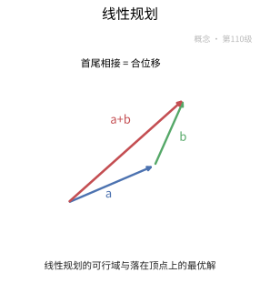

**一句话点破**：线性规划把海量可能的方案，收窄到只需在少数顶点里挑选。

### 6.2 分东西不能切半：整数规划

现实里很多东西必须“整个整个”地算——几辆车、几台机器、几个人，都不能是 $2.5$ 个。整数规划就是给变量加上“必须取整数”的要求，代价是问题一下子难了很多，常常只能靠分支定界、割平面一点点逼近。

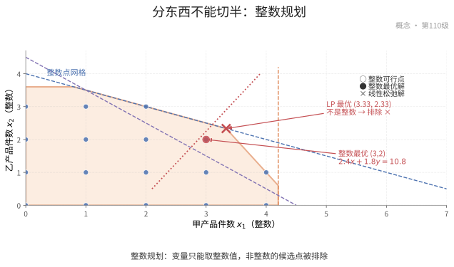

**一句话点破**：一旦要求变量必须是整数，寻优就从“顺坡下滑”变成了“翻山越岭”。

### 6.3 让货自己找出路：网络流

把管道、道路、通信线路看成一张带容量的网，货或数据从源头往终点挤，每条边都有一条“最多能过多少”的上限。网络流要问的是：在不撑爆任何一条边的前提下，最多能送过去多少。

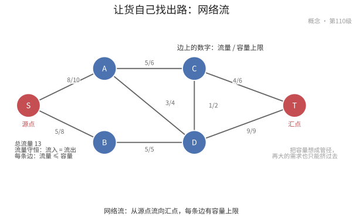

**一句话点破**：网络流算的不是单条最省的路，而是整张网一次最多能吞吐多少。

### 6.4 拆成小问题，一步步攒出大答案：动态规划

一件事要分好几步做，每一步的选择都会影响后面。动态规划像记账：把每个小局面下的最优结果记在表里，轮到更大的局面时直接翻旧账，省下大量重复计算。

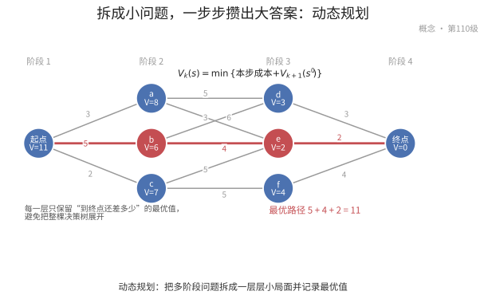

**一句话点破**：别重复解同一个子问题——把结果存下来，大的答案就由小的答案拼出来。

### 6.5 导航里的那条最优路线：最短路径

从家到公司，路网有无数条走法，可地图总能秒算出最省时间的一条。它把每条路记上一个权重（里程或耗时），在整张图上找起点到终点权重之和最小的那条链。

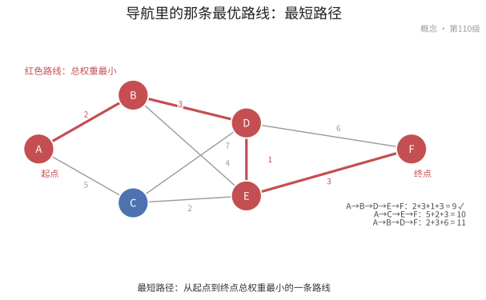

**一句话点破**：导航、调度、路由，说到底都是同一道题——在图上找最省的那条路。

### 6.6 用最少的线把所有点连起来：最小生成树

要给几个村子通水、通网、通电，目标是“全部连通”且“铺线最省”。这不需要任意两点之间都有直达线，只要连成一棵没有回路的树即可，最小生成树就是花销最小的那种连法。

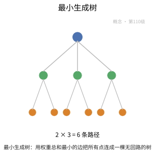

**一句话点破**：连通所有点却不多铺一米线——贪心地挑最便宜的边就够。

### 6.7 运筹学里还有哪些趁手的招

除了上面几样，运筹学还有一大箱工具：设备怎么排班的排程、库存进多少才不亏的库存论、好几方博弈各出什么招的博弈论，以及面对不确定性的决策分析。它们常常组合使用，共同对付现实里的复杂调度。

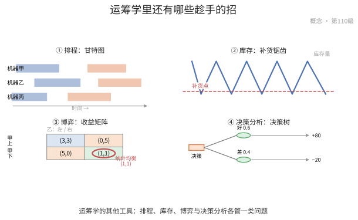

**一句话点破**：现实问题五花八门，运筹学就攒了一整套工具箱来分别对付。

### 6.8 对偶：同一件事的两种算法（强对偶定理）

每个线性规划问题都有一面“镜子”：原问题求最大，镜像问题求最小，却共享同一个最优值。强对偶定理说，只要两者都有可行解，这个等式必然成立——就像从山的两侧往同一个峰顶爬，无论走哪条路，登顶的高度一模一样。

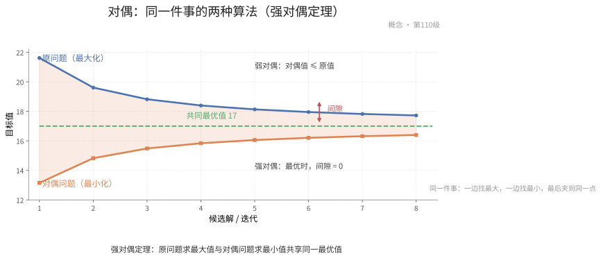

**一句话点破**：原问题的最优值恰好等于对偶问题的最优值，两边夹逼即得答案。

### 6.9 能送多少，卡在最小的一道窄口（最大流最小割定理）

往一张网络里送东西，能送的最大流量，恰好等于“把源头和终点彻底切开”所需付出的最小容量。瓶颈不在整体管道多宽，而在最窄的那一刀——要堵就一定能堵死，能堵死就说明流量已经到顶。

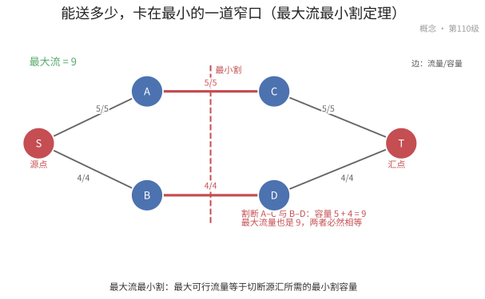

**一句话点破**：最大流等于最小割，瓶颈那道窄口决定了整张网的上限。

### 6.10 为什么 Dijkstra 每次都能挑对（Dijkstra 算法的正确性）

Dijkstra 每次都从还没定下来的点里，挑距离起点最近的那个“钉死”。它之所以不会错，是因为边权非负：一旦某个点成了当前最近的未定点，之后绕远路回来只会更贵，不可能再更省——这一步的结论永远成立。

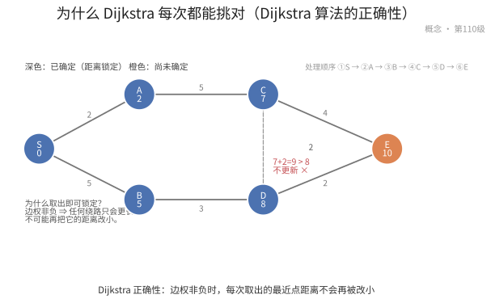

**一句话点破**：边的代价非负，意味着“先到的最省”不会翻盘，算法才能一锤定音。

### 6.11 全局最优由局部最优拼成（动态规划的最优性原理）

最优性原理说：一条最优路线，随便截下来的任意一段，对那一段的起点和终点而言也一定是最优的。正因如此，我们才能安心地“只记住每段的最优值”，再把它们拼成整体的最优，这就是动态规划赖以成立的基石。

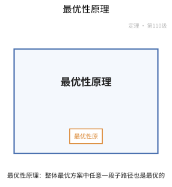

**一句话点破**：整体最优的每一段都局部最优，所以可以放心地把答案一层层拼起来。

### 6.12 分支定界为什么总能停下来（分支定界算法的收敛性）

分支定界把问题像树枝一样不断对半再细分，同时用上下界把明显不可能更优的枝桠修剪掉。由于整数解是有限的，每分一次搜索范围就缩小一点，被剪掉的分支不再生长，这棵搜索树终究会缩到只剩最优解，算法必然停下。

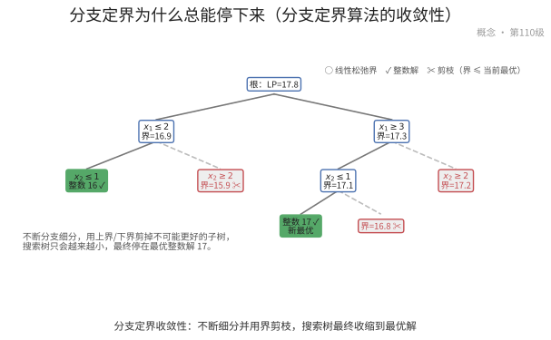

**一句话点破**：整数解有限加上不断剪枝，保证搜索树越走越小、算法一定收得住。

## 7. 数学史（History of Mathematics）

> 在动手建模之前，先想清楚一个基本问题：**打仗、开厂、排班这些千头万绪的"调度"难题，为什么值得成立一门数学学科？**

**一个真实的生活场景（第一步：直觉）**

二战期间，一位英军指挥官面前摆着一堆"火灾一样"的调度难题：雷达该怎样布防才能最大程度拦截轰炸机、护航舰队要多大学：才既保安全又不浪费吨位、有限的物资该怎么在战区间调配。这些问题没有标准答案，但**处处都藏着"钱/兵力/时间就这么点，如何花在最值的地方"的算计**。运筹学（operations research, OR）就是研究"把这类复杂的资源调度，写成数学模型、再找到最优解"的学问——**它把"打仗的直觉"升级为"可计算、可证明的决策科学"**。

**它到底想解决什么问题（第二步：要解决的问题）**

**运筹学**是二战中在英国与美国军方诞生、战后转向工业与管理的一门应用数学。它要解决的**根问题**是：

> 面对资源有限、约束众多的现实决策问题，如何**建立数学模型**把目标与约束讲清，用**优化、网络流、动态规划、决策分析**等工具求出最优或近似最优的**决策方案**？

> **🧠 一句话记住运筹学的"出生证"**
>
> 运筹学源于"战争与工业中的资源调度需要系统化的数学决策"。它要解决的根本问题是：
>
> $$ \boxed{\text{在 }Ax\le b\text{ 等约束下求 }c^\top x\text{ 的最优（线性/整数/网络/随机规划）。}} $$

**看待本章的三种眼光（第三步：正式定义前的准备）**

- **建模的眼光**：先学会把现实问题翻译成目标函数与约束的线性记录语言。
- **算法的眼光**：再掌握单纯形法、网络流算法、分支定界这些求解引擎。
- **决策的眼光**：最后理解对偶、影子价格与动态规划的最优性原理，把"算出的解"讲成"能用的决策"。

---

### 7.1 战争催生"作战研究"（Blackett 团队）

**运筹学**的直接源头是二战。英国 **Patrick Blackett** 领导的一支由物理学家、数学家组成的团队，用统计与数学建模分析**雷达部署、护航编队、飞机炮位**等战术问题，开创了"把科学方法用于作战部署"的 practice，即最早的 operations research。它开启了"用数值算军事决策"的先河。

### 7.2 线性规划与 N 国独立提出

二战及战后，**George Dantzig（1947）**为美国空军设计资源配置时系统提出**线性规划**并发明**单纯形法**；此前苏联 **Leonid Kantorovich（1939）**已独立给出资源分配的线性模型。**多国近乎同时**提出同一模型，说明"在约束下求最优"是那个时代的必然需求。Kantorovich 因在线性规划应用经济学的贡献，于 1975 年获诺贝尔经济学奖。

### 7.3 单纯形法：在多面体顶点间寻优

**单纯形法**（Dantzig）的思路，是在线性规划的可行域（一个多面体）的**顶点**之间沿改善方向移动，直到找到使目标值最优的顶点。它在有限步内结束，让 LP 成为可大规模求解的实用工具，至今仍是最重要的运筹核心算法之一。

### 7.4 von Neumann 与对偶理论、博弈的联系

**John von Neumann** 把线性规划与**博弈论**联系起来，并独立推导了极大极小对偶关系。**对偶理论**通过把原问题与其镜像对偶问题配对，揭示了**强对偶**（原/对偶最优值相等）与**影子价格**（约束松紧的边际价值）等深刻结构，为经济解释与算法设计同时提供了养分。

### 7.5 网络流与最大流最小割定理

运筹学的图论分支处理流与网络问题。**Ford 与 Fulkerson（1956）**建立**最大流最小割定理**：网络能传输的最大流量恰等于最小割的容量，并给出增广路算法。**Dijkstra（1959）**提出单源最短路贪心算法，**Bellman–Ford** 处理含负权情形，**Kruskal、Prim** 求解最小生成树。这套图论工具构成调度与运输网络的基础。

### 7.6 Bellman 与动态规划的最优性原理

**Richard Bellman（1950 年代）**提出**动态规划**与**最优性原理**：一个整体最优的策略，其每个子阶段也必是最优。通过**状态递推（Bellman 方程）**，把指数级组合问题化为多项式级的递推计算，是许多决策与路径问题极优雅的解法。

### 7.7 整数规划与 NP 难的挣扎

当决策变量必须取整数（如"派几辆车"），问题变为**整数规划**，往往属于 **NP-难**问题。运筹学相继发展出**分支定界**（Branch and Bound 系统剪枝）、**割平面**（Gomory 割）等算法，用"智能穷举 + 松弛界"在可行范围内逼近最优，把理论上的"很难"变成工程上的"还算能算"。

### 7.8 排队论、库存论与决策论

运筹学是一把"决策工具箱"的统称：**排队论**（Erlang）研究等待与拥塞，**库存论**（EOQ 模型）研究补货批量，**决策论**研究不确定性下的选择，**指派与运输问题**则是经典的线性分配模型。它们从不同侧面回答"系统该怎么设计"，共同构成 OPER 的完整版图。

### 7.9 从军事到工业，再到信息时代

二战后，规模化工业生产、物流、运输与供应链管理把运筹学从军方推向企业与公共部门。**计算机普及**使大规模模型从"算不动"变为"一键求解"，运筹学成为航空调度、电网规划、物流排程与企业运营管理背后的决策引擎。

### 7.10 现代运筹学：与机器学习深度融合

进入大数据时代，运筹学与**机器学习、强化学习**深度结合：用学习预测参数、用优化做决策，甚至把优化器嵌入神经网络训练。运筹学从"预先建好模型再求解"的传统范式，走向**在线决策、随机优化、实时调度**，仍是支撑现代智能决策的核心数学底座。

---

| 时间 | 人物／文献 | 事件与贡献 |
| --- | --- | --- |
| 二战期间 | Blackett 团队 | 用数学建模分析防空与护航，开创作战研究 |
| 1939 | Kantorovich | 独立提出线性规划的资源配置模型 |
| 1947 | Dantzig | 系统提出线性规划并发明单纯形法 |
| 1947 前后 | von Neumann | 建立对偶理论与线性规划的博弈联系 |
| 1950 年代 | Bellman | 提出动态规划与最优性原理 |
| 1956 | Ford、Fulkerson | 建立最大流最小割定理并给出算法 |
| 1959 | Dijkstra | 提出单源最短路算法 |
| 1975 | Kantorovich | 获诺贝尔经济学奖，运筹学获经济认可 |

> **小结**：运筹学的成长，是一部"**把战时调度难题锻造成系统决策科学**"的进行曲。它从二战 Blackett 团队的作战研究起步，靠 Dantzig 的线性规划与单纯形法、von Neumann 的对偶理论确立核心框架，再用网络流、动态规划、整数规划不断扩充工具箱，最终从军事走向工业并拥抱大数据与机器学习。运筹学始终追问同一个问题：**有限的资源，怎么花才最值？**而这种把"直觉"变成"可计算的决策"的能力，正是它历久弥新的价值所在。

---

## 现实应用（Real-World Applications）

> 本节把本章的知识点落到真实的工程、科学与生活场景中。每个案例都给出**完整的问题背景、建模过程、可复现的数据 / 公式 / 代码与结果解读**；案例末尾的「涉及知识点」对应本章的具体小节，文末附**知识点覆盖对照表**，确保本章知识点全部被覆盖。

### 应用案例 1：乳制品制造｜多产品周度生产计划中的线性规划与影子价格

**场景与问题**

某中型乳制品厂每周排一次生产计划。工厂有两条产线资源：原料生鲜奶与灌装设备工时。主要产品是两款：产品 A 为大瓶装（每箱利润 12 元），产品 B 为小杯组合装（每箱利润 9 元）。根据 ERP 系统导出的一周可用资源，生鲜奶配额 4800 kg（受牧场供奶合同限制），灌装线可用工时 900 h。

生产主管面对的困难是：两款产品抢同一批奶和同一批工时，凭经验"哪种利润高就多产哪种"往往把某一种资源一次性用光，反而少赚钱。需要一套能给出**最优产量组合**、并回答"再多 1 kg 奶能多赚多少、再多 1 h 工时能多赚多少"的方法。这类问题在食品、化工、制药、钢铁的排产中每天都会出现。

**涉及知识点**

- 本章「1.1 线性规划 (Linear Programming)」：把产量决策写成目标最大化、资源量写成不等式约束的标准 LP。
- 本章「2.1 线性规划强对偶定理」：用对偶问题算出每种资源的影子价格，判断该向哪条产线追加投资。

**建模与数据**

设每周产量 $x$（箱 A）、$y$（箱 B）。单位消耗与配额如下表（数据来源：工厂 ERP 排产模块的 BOM 与产能台账）。

| 资源 | 单位 A 消耗 | 单位 B 消耗 | 周配额 |
| --- | --- | --- | --- |
| 生鲜奶 (kg) | 3 | 1 | 4800 |
| 灌装工时 (h) | 0.5 | 0.75 | 900 |
| 单位利润 (元/箱) | 12 | 9 | — |

线性规划模型：

$$
\begin{aligned}
\max \quad & 12x + 9y \\
\text{s.t.} \quad & 3x + y \leq 4800 \\
& 2x + 3y \leq 3600 \\
& x, y \geq 0
\end{aligned}
$$

（第二式由 $0.5x+0.75y\leq 900$ 两边乘 4 得到，便于整数系数。）假设产线没有最小批量限制、单位消耗固定、原料与工时均可用完（不做半成品库存）。

**完整推导与算法**

1. 画可行域并列出顶点。两约束取等：$3x+y=4800$ 与 $2x+3y=3600$。交点：

$$
x=1542.857,\quad y=171.429 .
$$

候选顶点为 $(0,0)$、$(1600,0)$、$(0,1200)$、$(1542.857,171.429)$。

2. 计算各顶点目标值。线性规划最优解必在顶点（本章第 1.1 节的顶点论）。

$$
z(1600,0)=19200,\quad z(0,1200)=10800,\quad z(1542.857,171.429)\approx 20057.14 .
$$

故最优产量约为 A 1543 箱、B 171 箱，周利润约 20057 元；两条资源约束都取等号（均为紧约束）。

3. 用单纯形法机读最优基。最优基由两约束行构成 $B=\begin{pmatrix}3 & 1\\ 2 & 3\end{pmatrix}$，基变量目标系数 $c_B=(12,9)^\top$。

```python
# 核心：从最优基读出影子价格（对偶最优解） y = (B^{-1})^T c_B
import numpy as np
B = np.array([[3.0, 1.0], [2.0, 3.0]])
cB = np.array([12.0, 9.0])
y = np.linalg.solve(B.T, cB)      # 等价于 (B^{-1})^T c_B，单位：元/kg、元/h
z_star = cB @ np.linalg.solve(B, np.array([4800.0, 3600.0]))   # 最优目标值
```

运行得 $y=(2.5714,\ 2.1429)$，$z^\star=20057.14$。

4. 验证强对偶。对偶问题为 $\min 4800y_1+3600y_2$，约束 $3y_1+2y_2\geq 12$、$y_1+3y_2\geq 9$。代入 $y^\star$：$3(2.5714)+2(2.1429)=12.000$，$2.5714+3(2.1429)=9.000$，对偶目标 $4800\times2.5714+3600\times2.1429=20057.14$，与原问题最优值相等——强对偶成立。

5. 互补松弛核对：两约束都紧（无剩余），故两个对偶变量都非零；$x,y$ 均为正，故两条对偶约束都取等号。与第 2.1 节"不稀缺的资源不值钱、值钱的资源一定用满"完全一致。

**可复现步骤**

1. 环境与依赖：`pip install numpy scipy`
2. 数据准备：把上面 $A$、$\mathbf{b}$、$\mathbf{c}$ 直接写进脚本（或从 ERP 导出的 csv 读入）。
3. 运行：`python case1.py`，用 `scipy.optimize.linprog(c=-c, A_ub=A, b_ub=b, bounds=(0,None))` 求原问题。
4. 预期输出：$x^\star\approx1542.86$、$y^\star\approx171.43$、$z^\star\approx20057.14$；对偶解 $y^\star\approx(2.571,2.143)$，且原问题与对偶问题目标值相等。

**结果解读与延伸**

影子价格的投资含义：每追加 1 kg 生鲜奶带来 2.571 元利润，每追加 1 h 工时带来 2.143 元利润。若牧场把供奶从 4800 kg 提到 4900 kg（价格不变），周利润约增 257 元；只有当追加量超过某临界值、使约束不再紧时影子价格才下降。误差来源主要是"线性假设"（规模效应、批量折扣会破坏线性）与参数估计误差。可延伸：把单一周期扩为多周期（库存与需求波动），就进入动态规划（案例 6）与整数规划（案例 2）的领域。

### 应用案例 2：快递分拨中心｜设备采购的整数规划与分支定界收敛性

**场景与问题**

某快递分拨中心要采购两种自动化分拣机做大促备战。A 型分拣机每年可创造的净收益约 5 万元/台（折算），占用场地 6 个标准工位单元，占用年度预算 6 万元；B 型净收益约 4 万元/台，占地 4 个单元，预算 4 万元。中心可用场地 24 个单元、年度预算 24 万元。

关键约束是"设备必须整台采购"——不能买 1.5 台。于是问题从易解的线性规划变成整数规划，而"能不能只把 LP 解四舍五入"正是本章 1.2 节点名的常见坑。

**涉及知识点**

- 本章「1.2 整数规划 (Integer Programming)」：决策变量取非负整数，用分支定界求整数最优。
- 本章「2.5 分支定界算法的收敛性」：说明分支定界的搜索树有限、剪枝完备，因而必在有限步停止。

**建模与数据**

设采购 A 型 $x_1$ 台、B 型 $x_2$ 台（$x_1,x_2\in\mathbb{Z}_{\geq 0}$）。

| 指标 | A 型 | B 型 | 上限 |
| --- | --- | --- | --- |
| 年净收益 (万元/台) | 5 | 4 | — |
| 场地消耗 (单元/台) | 6 | 4 | 24 |
| 预算消耗 (万元/台) | 1 | 2 | 6 |

（为便于手算，把预算约束按比例缩为 $x_1+2x_2\leq 6$，相当于把预算单位换算成"每 4 万元一档"。）模型：

$$
\begin{aligned}
\max \quad & 5x_1 + 4x_2 \\
\text{s.t.} \quad & 6x_1 + 4x_2 \leq 24 \\
& x_1 + 2x_2 \leq 6 \\
& x_1, x_2 \in \mathbb{Z}_{\geq 0}
\end{aligned}
$$

**完整推导与算法**

1. LP 松弛。先放开整数约束，求两约束交点：$6x_1+4x_2=24$、$x_1+2x_2=6$ 解得 $x_1=3,\ x_2=1.5$，目标值 $z_{LP}=5\times3+4\times1.5=21$。这是整数最优的**上界**（松弛是放宽）。

2. 四舍五入为什么会错。若把 $x_2=1.5$ 直接舍成 2，得 $(3,2)$：$6\times3+4\times2=26>24$，**违反场地约束，根本不可行**。这正是 1.2 节点名的陷阱——取整解可能跳出可行域。

3. 分支定界。对分数变量 $x_2=1.5$ 分两支：

   - 左支 $x_2\leq 1$：LP 最优在 $6x_1+4=24$ 与端点处，得 $(3,1)$，$z=19$（整数可行，更新下界 $\underline{z}=19$）。
   - 右支 $x_2\geq 2$：约束变为 $6x_1+4x_2\leq24\Rightarrow 6x_1\leq16\Rightarrow x_1\leq2.667$，且 $x_1+2x_2\leq6\Rightarrow x_1\leq2$，故 $x_1=2$，$z=18$。该支上界 18 < 19，**剪枝**。

```python
# 核心：分支定界的剪枝判断——子问题上界 <= 当前最优整数解就整枝剪掉
def should_prune(z_upper_bound, best_integer_z):
    return z_upper_bound <= best_integer_z + 1e-9   # 该子区域不可能更好
# 左支 z=19 成为新的 best_integer_z；右支上界 18 <= 19 => 剪枝
```

4. 收敛性论证（对应 2.5 节）。整数变量 $x_1,x_2$ 各有有限取值（由约束 $x_1\leq4$、$x_2\leq3$ 界定），故可行整数点有限。每次分支把当前子区域沿某整数坐标劈成两个不交子集（$x_i\leq\lfloor v\rfloor$ 与 $x_i\geq\lceil v\rceil$），两子集的并恰为原区域，故不遗漏；凡子问题 LP 下界（对最大化是上界）不优于当前最优整数解者一律剪去，不会误砍真最优。分支树深度有限、每层节点有限，故算法必在有限步终止并返回整数最优。

5. 结论：整数最优为 $x_1=3,\ x_2=1$，年净收益 19 万元；LP 松弛的 21 万元高估了 2 万元，这就是"整数间隙"（integrality gap）。

**可复现步骤**

1. 环境与依赖：`pip install numpy scipy pulp`（pulp 或 `scipy.optimize.milp` 均可）。
2. 数据准备：把目标系数 $(5,4)$、约束矩阵与右端项按上表填入。
3. 运行：`python case2.py`，用 `pulp.LpProblem` 设 `cat=pulp.LpInteger` 求解，或手工实现上面的分支定界。
4. 预期输出：LP 松弛解 $(3,1.5)$、$z=21$；整数最优 $(3,1)$、$z=19$；分支树上右支被剪。

**结果解读与延伸**

结果说明"整数间隙"在大促采购这类小规模问题上就有 2/21≈9.5% 的差距，规模越大间隙通常越显著，因此工业界（排班、选址、车辆路径）普遍依赖 branch-and-cut 求解器。误差来源：收益/消耗系数的估计误差、以及"线性可加"假设（实际可能有边际递减）。可延伸：加入"至少买 1 台 A 型否则 B 型不可用"的逻辑约束，就用到 0-1 变量与 big-M，进入混合整数规划。

### 应用案例 3：区域生鲜配送｜运输问题与指派问题的全幺模结构

**场景与问题**

某生鲜平台在华北有 3 个前置仓（供应点 $S_1,S_2,S_3$）向 3 个城市（需求点 $D_1,D_2,D_3$）供货，每日的供应量、需求量与单位运费（元/箱）如下。平台要回答两个问题：(a) 每天怎么调运总运费最省？(b) 如果把 3 条干线各交给 1 家车队承运（每队一条），怎样指派使总报价最低？两者看似是"运输问题"和"指派问题"两个不同问题，实则是网络流（最小费用流）的两个特例。

**涉及知识点**

- 本章「1.7 其他重要概念」：运输问题（西北角法/位势法）、指派问题（匈牙利算法）、以及"矩阵全幺模故 LP 松弛即整数最优"的结构性结论。
- 本章「1.3 网络流 (Network Flow)」：运输问题是最小费用流模型的产销平衡特例，可用网络流视角统一处理。

**建模与数据**

供应量 $s=(120,80,100)$，需求量 $d=(90,110,100)$，产销平衡（各 300 箱）。单位运费矩阵（元/箱）：

| — | $D_1$ | $D_2$ | $D_3$ | 供应 |
| --- | --- | --- | --- | --- |
| $S_1$ | 4 | 6 | 8 | 120 |
| $S_2$ | 6 | 5 | 7 | 80 |
| $S_3$ | 9 | 7 | 5 | 100 |
| 需求 | 90 | 110 | 100 | 300 |

指派问题：3 条干线对 3 家车队的报价矩阵 $\begin{pmatrix}9 & 2 & 7\\ 6 & 4 & 3\\ 5 & 8 & 1\end{pmatrix}$（万元），求最小总报价的指派。

**完整推导与算法**

运输问题（最小费用流）建模为：变量 $x_{ij}$ 为 $S_i$ 运往 $D_j$ 的箱数，目标 $\min\sum c_{ij}x_{ij}$，约束 $\sum_j x_{ij}=s_i$、$\sum_i x_{ij}=d_j$、$x_{ij}\geq0$。等价于在二分网络上"源 $\to$ 供应点（容量 $s_i$）$\to$ 需求点（边权 $c_{ij}$，容量 $\infty$）$\to$ 汇（容量 $d_j$）"求最小费用流。

1. 西北角法取初始基本可行解：$S_1$ 先供 $D_1$ 90 → $S_1$ 余 30 供 $D_2$；$S_2$ 供 $D_2$ 余 80 全给 $D_2$（$D_2$ 已得 110）；$S_3$ 供 $D_3$ 100。得初始解

$$
x=\begin{pmatrix}90 & 30 & 0\\ 0 & 80 & 0\\ 0 & 0 & 100\end{pmatrix},\quad \text{运费}=90\cdot4+30\cdot6+80\cdot5+100\cdot5=1740 .
$$

2. 位势法检验。设行位势 $u_i$、列位势 $v_j$，对基变量要求 $u_i+v_j=c_{ij}$。取 $u_1=0$：$v_1=4$、$v_2=6$；由 $x_{22}$ 基得 $u_2=5-6=-1$；由 $x_{33}$ 基得 $v_3=5,\ u_3=0$。对非基变量算检验数 $c_{ij}-u_i-v_j$：$x_{13}$ 得 $8-0-5=3>0$，$x_{21}$ 得 $6-(-1)-4=3$，$x_{23}$ 得 $7-(-1)-5=3$，$x_{31}$ 得 $9-0-4=5$，$x_{32}$ 得 $7-0-6=1$，全为非负 → 达到最优（对最小化问题检验数非负即最优）。故最小运费 $1740$ 元/日。

3. 对偶（位势）含义：$u_i$、$v_j$ 正是运输问题 LP 的对偶变量，$u_i$ 可读作"供应点 $S_i$ 的边际供货价值"，$v_j$ 为"需求点 $D_j$ 的边际到货价值"，最优时 $u_i+v_j\leq c_{ij}$，等价于第 2.1 节的互补松弛。

4. 指派问题用匈牙利算法。报价矩阵减去各行最小值 $[2,3,1]$ 再减各列最小值，得

```python
# 核心：匈牙利算法——行/列归约后找最大匹配，用 0 元素构造最小代价指派
from scipy.optimize import linear_sum_assignment
import numpy as np
cost = np.array([[9, 2, 7], [6, 4, 3], [5, 8, 1]])   # 万元
rows, cols = linear_sum_assignment(cost)             # 返回最优指派的行、列索引
min_total = cost[rows, cols].sum()                   # 最小总报价
```

最优指派为"干线 1→车队 2、干线 2→车队 3、干线 3→车队 1"，总报价 $2+3+5=10$ 万元。

5. 为什么两者都能用多项式算法（对应 1.7 节的课堂问答）。运输问题与指派问题的约束矩阵都是**全幺模矩阵**（每个子方阵行列式为 $0,\pm1$），故 LP 松弛的顶点自动是整数点，直接解 LP 即得整数最优；匈牙利算法正是这一结构的组合化实现。而一般整数规划缺乏该结构，只能靠分支定界。

**可复现步骤**

1. 环境与依赖：`pip install numpy scipy`
2. 数据准备：把运费矩阵、供应/需求向量与报价矩阵按上表写入脚本。
3. 运行：`python case3.py`；运输问题用 `scipy.optimize.linprog`（等式约束 A_eq），指派用 `linear_sum_assignment`。
4. 预期输出：最小运费 1740 元/日；最优指派总报价 10 万元；两者 LP 解均为整数。

**结果解读与延伸**

全幺模结构是"为什么这类问题好解"的数学根因：任何含"成套分配"结构的网络流问题（最大流、最小费用流、运输、指派）都享此红利。误差来源：单位运费可能随量打折（使成本非线性和非全幺模）。可延伸：加入转运点即从中转网络建模，退化为案例 4 的多级最大流问题。

### 应用案例 4：电商仓配网络｜最大流与最小割定出的吞吐天花板

**场景与问题**

某电商在双 11 前的压测中发现：订单从总仓到城市配送站之间存在多级环节（总仓 → 区域仓 → 前置仓 → 配送站），每个环节的每小时处理能力不同。运营团队想知道：(a) 整条链每小时最多能把多少订单送达配送站？(b) 瓶颈到底卡在哪一段？"最多多少"对应最大流，"卡在哪"对应最小割。

**涉及知识点**

- 本章「1.3 网络流 (Network Flow)」：最大流问题的增广路径算法与剩余网络。
- 本章「2.2 最大流最小割定理」：最大流值 = 最小割容量，用割的精确定位瓶颈。

**建模与数据**

节点：$S$（总仓）、$P_1,P_2$（区域仓）、$H_1,H_2,H_3$（前置仓）、$T$（配送站）。各边容量（件/小时，来源：各环节设备铭牌参数与历史峰值吞吐）：

| 边 | 容量 | 边 | 容量 |
| --- | --- | --- | --- |
| $S\to P_1$ | 1000 | $P_1\to H_1$ | 300 |
| $S\to P_2$ | 500 | $P_1\to H_2$ | 500 |
| $P_2\to H_2$ | 200 | $P_2\to H_3$ | 400 |
| $H_1\to T$ | 400 | $H_2\to T$ | 600 |
| $H_3\to T$ | 450 | — | — |

**完整推导与算法**

1. 找一条增广路径并加流。先走 $S\to P_1\to H_1\to T$，瓶颈容量 $\min(1000,300,400)=300$，加 300。

2. 继续增广。走 $S\to P_1\to H_2\to T$：$P_1$ 剩余 700、$H_2\to T$ 剩 600，加 500（受 $P_1\to H_2$ 限制）。

3. 走 $S\to P_2\to H_2\to T$：$P_2$ 剩 500、$H_2\to T$ 剩 100，加 100。

4. 走 $S\to P_2\to H_3\to T$：瓶颈 $\min(500-100,400,450)=400$，加 400。

5. 剩余网络中已无 $S\to T$ 增广路径，算法停止。总流 $=300+500+100+400=1300$ 件/小时。

```python
# 核心：Ford-Fulkerson / Edmonds-Karp 反复在剩余网络里找增广路，delta = 路径最小剩余容量
from collections import deque
def bfs_augment(graph, cap, s, t):           # graph: 邻接表; cap: 剩余容量 dict
    parent, seen = {s: None}, {s}
    q = deque([s])
    while q:
        u = q.popleft()
        for v in graph[u]:
            if v not in seen and cap[(u, v)] > 0:
                seen.add(v); parent[v] = u; q.append(v)
                if v == t:
                    delta = min(cap[(a, b)] for a, b in ((parent[x], x) for x in _path(parent, t)))
                    return delta, parent          # 沿路径增广 delta（含反向边更新）
    return None
```

最大流为 1300 件/小时。

6. 用最小割验证（对应 2.2 节）。取 $S$ 在剩余网络中可达的点集 $S^\star=\{S,P_1,P_2,H_2\}$。跨出该集合的边恰为 $P_1\to H_1$（300）、$P_2\to H_3$（400）、$H_2\to T$（600），容量和 $300+400+600=1300$，等于最大流。由最大流最小割定理，这已是全局最大流。

**可复现步骤**

1. 环境与依赖：`pip install networkx`
2. 数据准备：把上表边与容量写成 `networkx.DiGraph`，容量作 `capacity` 属性。
3. 运行：`python case4.py`，调用 `networkx.maximum_flow_value(G, 'S', 'T')` 与 `nx.minimum_cut`。
4. 预期输出：最大流值 1300；最小割集为 $\{S,P_1,P_2,H_2\}$，割容量 1300；三条瓶颈边为 $P_1\to H_1$、$P_2\to H_3$、$H_2\to T$。

**结果解读与延伸**

结论直接指导扩容：三处瓶颈里 $H_2\to T$（600）与 $P_2\to H_3$（400）、$P_1\to H_1$（300）任一扩容，都需同步考虑其它两条，否则扩一处后最大流不变。这正是最小割"把网络切成两半的所有边容量之和"的价值——它一次性给出**所有**需要同时扩容的边。误差来源：容量被当作静态常数，实际峰值有波动；边之间可能有耦合（共用叉车）。可延伸：给每条边加单位成本，求"最低扩容成本使最大流≥目标值"，就成了最小费用流 / 网络设计问题。

### 应用案例 5：连锁药房 | 从 EOQ 到报童模型的库存决策

**场景与问题**

某连锁药房的销售分为两类：一类是常年稳定销售的维生素（需求平稳、可重复补货），一类是季节性强的流感抗原试剂（需求随机、只卖一季，季末未售出只能低价处理）。两类商品的最优订货量公式完全不同，前者用经济订货量 EOQ 权衡"订货成本与持有成本"，后者用报童模型权衡"缺货损失与压货损失"。

**涉及知识点**

- 本章「1.7 其他重要概念」：库存论中的经济订货量 EOQ 模型，以及它在"其他重要概念"里与成本权衡的共同骨架。

**建模与数据**

稳定品（维生素）：年需求 $D=36000$ 件，每次订货固定成本 $K=200$ 元（下单、验收、物流），单位年持有成本 $h=6$ 元/件·年（资金占用 + 仓储）。

季节性品（抗原试剂）：进货成本 $c=1.0$ 元/份，售价 $p=2.0$ 元/份，季末残值 $v=0.2$ 元/份；季需求视为正态，均值 $\mu=500$、标准差 $\sigma=120$。

**完整推导与算法**

1. EOQ 的总成本函数。设每次订货量为 $Q$，年订货次数 $D/Q$，平均库存约 $Q/2$：

$$
C(Q)=\frac{KD}{Q}+\frac{hQ}{2}.
$$

2. 求导置零：$C'(Q)=-\dfrac{KD}{Q^2}+\dfrac{h}{2}=0$，得

$$
Q^\star=\sqrt{\frac{2KD}{h}}=\sqrt{\frac{2\times200\times36000}{6}}\approx1549 \text{ 件}.
$$

年订货次数 $D/Q^\star\approx23.2$ 次，约每 15 天补一次货；最小年相关成本 $\sqrt{2KDh}\approx13856$ 元。

```python
# 核心：EOQ 的平方根律 Q* = sqrt(2*K*D/h)，总成本在订货成本与持有成本相等处最小
import math
K, D, h = 200, 36000, 6
Q_star = math.sqrt(2*K*D/h)          # 约 1549 件
orders_per_year = D / Q_star         # 约 23.2 次
C_min = math.sqrt(2*K*D*h)           # 最小年相关成本，约 13856 元
```

3. 报童模型的临界分位。设订货 $Q$，多订 1 份的边际期望：缺货损失（少赚）$=p-c=1.0$ 元，压货损失（进多了只能按残值处理）$=c-v=0.8$ 元。最优 $Q^\star$ 应使"边际缺货损失 × 缺货概率 = 边际压货损失 × 压货概率"，即

$$
P(\text{需求}\leq Q^\star)=\frac{p-c}{(p-c)+(c-v)}=\frac{1.0}{1.0+0.8}=0.5556 .
$$

4. 由正态分位求 $Q^\star$：$\Phi(z)=0.5556\Rightarrow z\approx0.1397$，故

$$
Q^\star=\mu+z\sigma=500+0.1397\times120\approx516.8 \text{ 份}.
$$

```python
# 核心：报童模型——最优订货量取到临界分位 ratio=(p-c)/((p-c)+(c-v)) 对应的正态分位
from scipy.stats import norm
p, c, v, mu, sigma = 2.0, 1.0, 0.2, 500, 120
ratio = (p - c) / ((p - c) + (c - v))     # 0.5556
Q_star = mu + norm.ppf(ratio) * sigma     # 约 516.8 份
```

**可复现步骤**

1. 环境与依赖：`pip install numpy scipy`
2. 数据准备：把 $K,D,h$ 与 $p,c,v,\mu,\sigma$ 写入脚本。
3. 运行：`python case5.py`
4. 预期输出：EOQ 类 $Q^\star\approx1549$ 件、年订货约 23.2 次；报童类临界分位 0.5556、$Q^\star\approx517$ 份。

**结果解读与延伸**

两类模型的差异根源：EOQ 面对**确定性**需求、目标是"订货与持有成本平衡"；报童面对**随机**需求、目标是"缺货与压货的期望损失平衡"。当 $p-c$ 变大（毛利率高）时临界分位升高，应多备货；当 $c-v$ 变大（残值低、报废狠）时临界分位降低，应少备货。误差来源：正态假设对极端厚尾需求可能失真，$K,h$ 的估计误差。可延伸：多周期随机库存（$(s,S)$ 策略）的最优决策可用动态规划求解，见案例 6。

### 应用案例 6：建筑工程项目｜CPM/PERT 关键路径与动态规划

**场景与问题**

某建筑公司承接一个厂房项目，共有 7 项活动（A–G），存在先后约束。项目经理要回答：(a) 项目最短工期是多少、哪条活动链是**关键路径**（耽误一天工期就延迟一天）？(b) 考虑每项活动工期的不确定性，项目在 24 天内完工的概率有多大？关键路径本质是活动网络（有向无环图）上的**最长路径**，可用动态规划逐阶段求解。

**涉及知识点**

- 本章「1.4 动态规划 (Dynamic Programming)」：用 Bellman 方程在活动网络上递推最早/最晚时间。
- 本章「2.4 动态规划的最优性原理」：说明为什么逐活动取最优能拼出全局最优。
- 本章「1.5 最短路径 (Shortest Path)」：CPM 的"最长路径"与最短路同属 DAG 上的路径 DP。
- 本章「1.7 其他重要概念」：决策论中不确定性下的 PERT 工期估计。

**建模与数据**

活动及紧前关系、乐观/最可能/悲观工期（天）：

| 活动 | 紧前 | 乐观 $a$ | 最可能 $m$ | 悲观 $b$ |
| --- | --- | --- | --- | --- |
| A | — | 3 | 4 | 5 |
| B | — | 5 | 6 | 7 |
| C | A | 4 | 5 | 6 |
| D | B | 6 | 8 | 10 |
| E | C | 5 | 7 | 9 |
| F | C, D | 2 | 3 | 4 |
| G | E, F | 2 | 4 | 6 |

PERT 用三点估计把随机工期折算为期望 $\mu_e=(a+4m+b)/6$ 与方差 $\sigma_e^2=((b-a)/6)^2$。

**完整推导与算法**

1. 折算期望工期：A:4、B:6、C:5、D:8、E:7、F:3、G:4（单位天）。

2. 前向递推最早开始 $ES$ 与最早完成 $EF$（Bellman 前向方程 $ES_j=\max_{i\in pred(j)} EF_i$）：

$$
ES_A=ES_B=0,\ EF_A=4,\ EF_B=6;
$$
$$
ES_C=4,EF_C=9;\ ES_D=6,EF_D=14;\ ES_E=9,EF_E=16;
$$
$$
ES_F=\max(EF_C,EF_D)=14,EF_F=17;\ ES_G=\max(EF_E,EF_F)=17,EF_G=21.
$$

项目期望工期 $=21$ 天。

3. 后向递推最晚完成 $LF$ 与最晚开始 $LS$（从 $LF_G=21$ 倒推）：

$$
LS_G=17;\ LS_E=17-7=10,\ LS_F=17-3=14,\ LS_D=14-8=6,\ LS_C=\min(10,14)-5=5,\ LS_A=5-4=1,\ LS_B=6-6=0.
$$

4. 总时差 $SL=LS-ES$：A:1、B:0、C:1、D:0、E:1、F:0、G:0。时差为 0 的活动构成关键路径 $B\to D\to F\to G$，长度 $6+8+3+4=21$ 天，与工期一致。

```python
# 核心：DAG 上的路径 DP —— 按拓扑序做前向最长路（Bellman 方程）
import networkx as nx
G = nx.DiGraph()
for u, v, dur in [('A','C',4),('B','D',6),('C','E',5),('C','F',3),('D','F',8),
                  ('E','G',7),('F','G',3),('START','A',0),('START','B',0)]:
    G.add_edge(u, v, weight=dur)
ES = {n: 0 for n in G}                     # 最早开始时间
for n in nx.topological_sort(G):           # 拓扑序保证前驱已算完
    for m in G.successors(n):
        ES[m] = max(ES[m], ES[n] + G[n][m]['weight'])   # Bellman 最大化
project_duration = max(ES.values())        # 期望工期 = 21 天
```

5. PERT 完工概率。关键路径 $B\to D\to F\to G$ 的方差为各活动方差之和：

$$
\sigma_{cp}^2=\left(\tfrac{7-5}{6}\right)^2+\left(\tfrac{10-6}{6}\right)^2+\left(\tfrac{4-2}{6}\right)^2+\left(\tfrac{6-2}{6}\right)^2\approx0.111+0.444+0.111+0.444=1.111,
$$

$\sigma_{cp}\approx1.054$。则 24 天完工概率

$$
P(T\leq24)=\Phi\!\left(\frac{24-21}{1.054}\right)=\Phi(2.847)\approx0.9976 .
$$

**可复现步骤**

1. 环境与依赖：`pip install networkx numpy scipy`
2. 数据准备：把活动、紧前关系与三点工期写入脚本，先算 $\mu_e$ 建 DAG。
3. 运行：`python case6.py`
4. 预期输出：期望工期 21 天；关键路径 B-D-F-G；$P(T\leq24)\approx0.998$。

**结果解读与延伸**

关键路径上的活动没有缓冲，是进度控制与赶工资源的投放重点；非关键活动有 1 天时差，可灵活调度。这三步递推正是动态规划最优性原理的体现：从某活动出发的最晚时间只依赖其后继的最小最晚开始（无后效性），故逐活动递推即可得全局最优。误差来源：三点估计的主观性、关键路径可能因方差而在其他路径上"漂移"（可用蒙特卡洛模拟校验）。可延伸：给各项活动加"赶工成本"，在工期约束下最小化总成本，构成时间—成本权衡问题。

### 应用案例 7：城市末端配送与光纤骨干网｜Dijkstra 最短路与最小生成树

**场景与问题**

同一家物流城市运营团队有两件规划任务：(a) 给骑手规划从中心仓到各片区的最快到达路线（边权为行驶时间，非负）；(b) 为覆盖全市 7 个营业点铺设光纤，任意两点间可连线的铺设成本已知，求总成本最低的组网方案。前者是最短路径，后者是最小生成树——两者目标不同，别混淆。

**涉及知识点**

- 本章「1.5 最短路径 (Shortest Path)」：Dijkstra（非负权）与 Bellman-Ford（可含负权）。
- 本章「2.3 Dijkstra算法的正确性」：非负权保证"已定案节点不会被改小"。
- 本章「1.6 最小生成树 (Minimum Spanning Tree)」：Kruskal/Prim 用割性质构造 MST。

**建模与数据**

最短路（行驶时间，min）：中心仓记节点 0，片区节点 1–5。

| 边 | 时间 | 边 | 时间 |
| --- | --- | --- | --- |
| 0–1 | 7 | 1–3 | 15 |
| 0–2 | 9 | 2–3 | 11 |
| 0–5 | 14 | 2–5 | 2 |
| 1–2 | 10 | 3–4 | 6 |
| 4–5 | 9 | — | — |

光纤成本（万元）：7 个营业点 A–G，可连边及成本：A–B 7、A–D 5、B–C 8、B–D 9、B–E 7、C–E 5、D–E 15、D–F 6、E–F 8、E–G 9、F–G 11。

**完整推导与算法**

1. Dijkstra 从节点 0 出发，逐步"圈定"距离最小的节点：

```python
# 核心：优先队列版 Dijkstra —— 每次弹出当前距离最小的未定案点，永久定案后松弛邻居
import heapq
def dijkstra(adj, src):
    dist = {n: float('inf') for n in adj}
    dist[src] = 0
    pq = [(0, src)]
    while pq:
        d, u = heapq.heappop(pq)
        if d > dist[u]:
            continue                        # 过期条目，跳过
        for v, w in adj[u]:                 # 非负权才可永久定案
            if d + w < dist[v]:
                dist[v] = d + w
                heapq.heappush(pq, (dist[v], v))
    return dist
```

计算得 $d(1)=7$、$d(2)=9$、$d(5)=11$（0–2–5）、$d(3)=20$（0–2–3）、$d(4)=20$（0–2–5–4）。最短路径总长与图一致。

2. Dijkstra 正确性（对应 2.3 节）。设弹出 $u$ 时 $d(u)$ 仍非真最短 $\delta(u)$，沿真最短路走向 $u$ 取第一个未定案点 $x$（前驱 $y$ 已定案）。因 $y$ 已定案时松弛过 $(y,x)$，有 $d(x)\leq d(y)+w(y,x)=\delta(x)\leq\delta(u)<d(u)$，与 $u$ 距离最小矛盾。关键不等式 $\delta(x)\leq\delta(u)$ 依赖路径边权非负——若存在负权边，绕远路可能更短，已定案点还能被改小，Dijkstra 失效，须改用 Bellman-Ford（至多 $|V|-1$ 轮全局松弛，可检测负环）。

3. Kruskal 构造 MST。按成本升序排列并依次加边、不成环才留：A–D(5)、C–E(5)、D–F(6)、A–B(7)、B–E(7)（连接 $\{A,B,D,F\}$ 与 $\{C,E\}$ 两分量）、E–G(9)。再取 B–C(8)、E–F(8)、B–D(9) 时两端已连通，成环丢弃。共选 6 条边（$|V|-1$）。

```python
# 核心：Kruskal —— 边按权重升序，并查集判断是否成环（割性质的贪心实现）
edges = sorted([(5,'A','D'),(5,'C','E'),(6,'D','F'),(7,'A','B'),(7,'B','E'),
                (8,'B','C'),(8,'E','F'),(9,'B','D'),(9,'E','G'),(11,'F','G'),(15,'D','E')])
parent = {c: c for c in 'ABCDEFG'}
def find(x):
    while parent[x] != x:
        parent[x] = parent[parent[x]]; x = parent[x]
    return x
mst, total = [], 0
for w, u, v in edges:
    ru, rv = find(u), find(v)
    if ru != rv:                            # 不同集合，加边不成环
        parent[ru] = rv; mst.append((u, v, w)); total += w
```

MST 总成本 $=5+5+6+7+7+9=39$ 万元。

4. 为什么两算法都对（对应 1.6 节）。Kruskal 与 Prim 同用"割性质"：对任一切分 $S$ 与 $V\setminus S$，横跨该割的最小权边必属于某棵 MST。Kruskal 全局按权加边、Prim 每次取已选与未选之间的最小边，是同一性质的不同执行方式；对偶的"环性质"说任一环上最大权边不在任何 MST 中，正是 Kruskal 跳过成环边的依据。

**可复现步骤**

1. 环境与依赖：`pip install networkx numpy`
2. 数据准备：把两组边权分别写入两个 `networkx.Graph`。
3. 运行：`python case7.py`，调用 `nx.dijkstra_path_length` 与 `nx.minimum_spanning_tree`。
4. 预期输出：从中心仓到各点最短时间 $\{1:7,2:9,3:20,4:20,5:11\}$；MST 总成本 39 万元、含 6 条边。

**结果解读与延伸**

最短路与 MST 是**不同目标**：前者最小化"源点到各点的路径长"，后者最小化"全体边权之和"。经典反例是等边三角形——MST 取两条短边，而最短路可能被迫走长边。Dijkstra 的正确性完全依赖非负权，这也是地图导航（时间非负）用 Dijkstra/A*、而含负权（如收益折算）时用 Bellman-Ford 的原因。误差来源：边权随实时路况变化，需滚动重算。可延伸：把 MST 用于电路布线、聚类（单链聚类）、网络设计的"最省连通"，是运筹学最常用的组合优化工具之一。

### 知识点覆盖对照表

| 本章知识点 | 覆盖案例 |
| --- | --- |
| 1.1 线性规划 (Linear Programming) | 案例 1 |
| 1.2 整数规划 (Integer Programming) | 案例 2 |
| 1.3 网络流 (Network Flow) | 案例 3、案例 4 |
| 1.4 动态规划 (Dynamic Programming) | 案例 6 |
| 1.5 最短路径 (Shortest Path) | 案例 6、案例 7 |
| 1.6 最小生成树 (Minimum Spanning Tree) | 案例 7 |
| 1.7 其他重要概念 | 案例 3、案例 5 |
| 2.1 线性规划强对偶定理 | 案例 1 |
| 2.2 最大流最小割定理 | 案例 4 |
| 2.3 Dijkstra算法的正确性 | 案例 7 |
| 2.4 动态规划的最优性原理 | 案例 6 |
| 2.5 分支定界算法的收敛性 | 案例 2 |

---

## 8. 总结

本级别系统地介绍了运筹学的核心理论和方法：

1. **线性规划**：介绍了单纯形法和对偶理论，证明了强对偶定理，这是线性规划领域最深刻的结果之一。

2. **整数规划**：介绍了分支定界法和割平面法，证明了分支定界算法在有限步内收敛到全局最优解。

3. **网络流**：介绍了最大流和最小费用流问题，证明了最大流最小割定理，建立了流与割之间的深刻联系。

4. **动态规划**：介绍了最优性原理和Bellman方程，证明了最优策略的子策略也是最优的。

5. **图论算法**：介绍了Dijkstra算法、Bellman-Ford算法、Kruskal算法和Prim算法，证明了Dijkstra算法的正确性。

6. **其他运筹学分支**：简要介绍了排队论、库存论、决策论、多目标决策、指派问题和运输问题等。

运筹学的核心思想是**优化**——在资源约束下寻求最优决策。这些方法在物流调度、生产计划、网络设计、金融投资等领域有广泛应用。
