# 第112级：信息论 (Information Theory)

## 从"一句话里到底有多少信息"说起：信息论要解决的根问题

> 在动手接触熵、互信息之前，先想清楚一个问题：**人为什么需要信息论？**

**一个真实的生活场景（第一步：直觉）**

想象你每天给朋友发一条短信，短信只有四个字。第一天你发「太阳照常升起」，第二天发「你中了五百万」。同样是四个字，但你会觉得第二天这条"信息含量"高得多——因为第一句是人人都知道的**必然**，第二句是几乎不可能的**意外**。再想深一层：同样是存放这两条短信，占的字节数完全相同，可为什么感觉上差别巨大？

这提醒我们：**"信息"不是关于"消息练了几个字"，而是关于"这条消息让你多惊讶、消除了多少不确定"**。由此催生出一个根本疑问：像"惊讶程度"这么主观的感觉，能不能被量化成一个**数学上可算的数**，并用来回答"最少要几个比特才能表示这条消息"？这正是信息论萌芽的土壤。

**它到底想解决什么核心问题（第二步：要解决的问题）**

信息论诞生于**电报与通信工程**的现实困境。19 世纪末的电报已能"传字"，但工程师说不清：为什么有的符号能压得很短？一条线路一口气到底能可靠传多少信息？1928 年，Hartley 首次提出用 $\log N$ 度量"等可能情形下的信息量"，迈出可量化的第一步；真正的里程碑是 1948 年贝尔实验室工程师**香农（C. E. Shannon）**发表的《通信的数学理论》——他给出熵 $H=-\sum p_i\log p_i$ 度量"平均惊讶"、证明**无损压缩的下界是熵**、并给出**信道容量** $C=\max I(X;Y)$，第一次把"信息"从工程师的直觉变成一门有极限定理的严格数学分支。《Elements of Information Theory》（Cover & Thomas）正是循此框架集其大成。它的核心问题概括起来有两个：**一条消息至少需要几个比特来表示它**（压缩极限 = 熵），以及**一条含噪信道最多能可靠传多少比特**（容量）。

> **🧠 一句话记住信息论的"出生证"**
>
> 信息论要解决的**根本问题**是：
>
> $$ \boxed{\text{如何把"信息"量化度量，并回答两个极限问题：无损压缩的最少码长是多少（熵 H），以及信道能可靠传输的最大速率是多少（容量 C）。}} $$
>
> 熵、联合熵、互信息、KL 散度、信源/信道编码定理……这些工具都围绕"信息可以计数、压缩与传输都有天花板"这一件事展开。

**看待本章的两种眼光（第三步：正式定义前的准备）**

- **压缩的眼光**：从"单符号的熵"起步，扩展到联合熵、条件熵、熵率，回答"一段数据最少几个比特"；
- **传输的眼光**：用互信息与信道容量衡量"一条链路能可靠送多少信息"，再谈率失真（有损压缩）与纠错码。

读到本章末尾，你应当记住的不是一个个公式，而是：**信息论把"没想到、不确定"这些感觉变成可计算、可下界的数**——自此语言（压缩）、通信（容量）、推断（互信息）共享同一套度量体系，彼此用逻辑相连。

---

## 开始之前

**本章在讲什么**：信息论研究"信息的度量与极限"。你会先掌握熵、联合熵、条件熵、熵率与互信息等核心量，再理解 KL 散度、信息不等式、Fano 不等式，进而进入香农信源编码定理（压缩下界）与信道编码定理（容量），最后了解率失真理论、微分熵、高斯信道与纠错码/网络信息论。

**为什么要学它**：它是概率论（第 98 级）在"信息"这一视角上的延伸，也是数据压缩、机器学习（交叉熵、最大熵）、密码学、编码理论的内在数学。紧接的第 113 级编码理论将把本章的"存在性极限"落实为"具体构造的码字"，而机器学习里的交叉熵损失、自然语言处理中的困惑度，本质都是熵的变体。

**开始前请确认你还记得**：

- 概率论（第 98 级）：随机变量、期望、联合分布、条件分布、独立性、马尔可夫链。
- 对数与不等式：$\log$（常取 2 底，对应比特）、Jensen 不等式、期望的线性性质。
- 极限与数列：上确界 / 极限，用于理解熵率与编码定理的极限叙述。

---

## 学习目标

1. 理解信息熵、联合熵、条件熵、互信息等基本概念
2. 掌握信息不等式、Fano不等式等基本不等式
3. 理解香农信源编码定理及其证明思想
4. 理解香农信道编码定理及其证明思想
5. 掌握信道容量的计算方法
6. 了解率失真理论、微分熵、高斯信道等进阶主题

---

## 1. 核心概念

### 1.1 熵 (Entropy)

熵是信息论中最基本的概念，用于度量随机变量的不确定性。

**定义**：设 $X$ 是离散随机变量，取值于字母表 $\mathcal{X}$，概率质量函数为 $p(x) = P(X = x)$，则 $X$ 的熵定义为：
$$
H(X) = -\sum_{x \in \mathcal{X}} p(x) \log p(x)
$$

约定 $0 \log 0 = 0$。对数底数通常取2，此时熵的单位为比特（bit）；取自然对数时单位为纳特（nat）。

**性质**：
1. 非负性：$H(X) \geq 0$
2. 有界性：$H(X) \leq \log |\mathcal{X}|$，等号成立当且仅当 $X$ 服从均匀分布
3. 凹性：$H(p)$ 是 $p$ 的凹函数

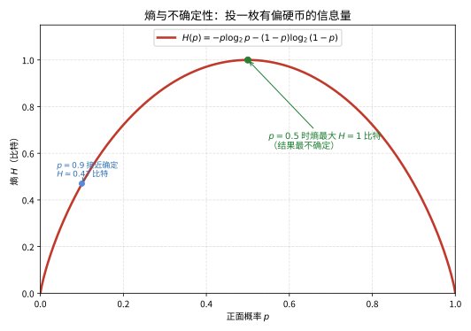

> **直观理解（现实类比）**：熵度量的是"这件事有多难猜"。投一枚公平硬币时，正反面各半，你完全无法预测结果，此时信息量最大（1 比特）；而如果硬币几乎总是正面（比如 90%），你猜正面基本不会错，这时候"告诉你结果"带来的信息就很少。所以不确定越大，熵越高——就像抛硬币前你越拿不准，揭晓时获得的信息就越多。

> **🧠 思考历程：一串符号到底"带了多少信息"？怎么把它变成一个数？**
>
> 熵把"没想到、不确定"这个心理感觉，翻译成唯一一个可度量的数。它把通信工程从"线路能不能通"提升为"信息最少要占多少码字"，而这一跃，正是1948年一篇论文顺手拆下的天花板。
>
> - **热力学的"拆墙"预兆**。玻尔兹曼早就用 $-p\log p$ 描述分子的混沌程度；Hartley 1928年首次把信息量定为 $\log N$（$N$ 个等可能情形），为"信息可以计量"埋下伏笔——真正把它铸成通讯基石的是贝尔实验室工程师们对带宽与速率的摸索。
> - **Shannon 的一把钥匙**。1948年 Shannon 发表《通信的数学理论》，定义熵 $H=-\sum_i p_i\log p_i$ 为"平均惊喜"，证明存在无损压缩的下界（编码不可能低于熵），并给出信道容量公式 $C=\max I(X;Y)$——通信问题第一次有了纯数学的极限。
> - **从电报到智能**。此后半个多世纪，熵席卷无损/有损压缩、密码学与统计推断，Jaynes 又把"最大熵原则"带入贝叶斯推断——"信息"从工程一角升格为理解世界的基本物理量之一。
> - **心路**：把"惊喜"量化成对数，是人类屈指可数的几次把"感觉"变成"常量"的壮举——你能计量多少，就能工程多少。

> **常见坑**：熵有三个细节极易踩坑。其一，**对数底决定单位**：$\log_2$ 给出比特（bit）、$\log_e$ 给出纳特（nat），公式相同单位却差一个常数倍 $\ln 2$，比较数值务必先统一底数。其二，**约定 $0\log0=0$**：零概率事件对"不确定"没有任何贡献，求和中须按此处理，否则会算出负无穷。其三，**熵到 $\log|\mathcal{X}|$ 的边界是均匀分布**，别只在硬币这种两个符号的例子上停留——符号越多，熵（均匀时的上界）就越大。

#### 课堂问答

**老师**：熵的定义是 $H(X)=-\sum_x p(x)\log p(x)$，为什么用对数，而不是直接用概率？

**学生**：结论先给：因为对数把"相乘"的独立事件变成"相加"，信息量才可加。两件独立的事同时发生，其信息应为两者之和，令 $I(p)=-\log p$ 便有 $I(pq)=I(p)+I(q)$；而 $I(p)=1-p$ 之类做不到。再者 $I(p)$ 随 $p\to0$ 趋于无穷，符合"越罕见越惊讶"，于是 $-p\log p$ 加权取期望就是熵。

**老师（追问）**：那 $H(X)\le\log|\mathcal X|$ 从哪来，等号何时取？

**学生**：用 KL 散度即可：取均匀分布 $u$，则 $D(p\parallel u)=H(X)-\log|\mathcal X|\ge0$，故 $H(X)\le\log|\mathcal X|$，等号当且仅当 $p=u$，即均匀分布最难猜。常见误区是以为熵与取值本身有关，其实它只依赖概率分布；换底数只差常数倍，$\log_2$ 给比特、$\ln$ 给纳特，二者相差 $\ln2$ 倍。

**老师（拓展）**：既说熵是"平均惊讶"，那确定性事件的贡献是多少？

**学生**：按约定 $0\log0=0$：概率为 0 的事件贡献 0，概率为 1 的事件贡献 $-1\cdot\log1=0$，都不带信息。所以确定性事件熵为 $0$，正是"必然发生的事不带来信息"的数学表达，否则求和会出现 $0\cdot(-\infty)$ 的未定式。

### 1.2 联合熵与条件熵

**联合熵**：两个随机变量 $(X, Y)$ 的联合熵为：
$$
H(X, Y) = -\sum_{x \in \mathcal{X}} \sum_{y \in \mathcal{Y}} p(x, y) \log p(x, y)
$$

**条件熵**：给定 $Y$ 时 $X$ 的条件熵为：
$$
H(X|Y) = -\sum_{x, y} p(x, y) \log p(x|y) = \mathbb{E}_{p(y)}[H(X|Y = y)]
$$

**链式法则**：
$$
H(X, Y) = H(X) + H(Y|X) = H(Y) + H(X|Y)
$$

推广到 $n$ 个随机变量：
$$
H(X_1, X_2, \ldots, X_n) = \sum_{i=1}^n H(X_i | X_1, \ldots, X_{i-1})
$$

> **💡 直观理解（类比）**：联合熵与条件熵像"拼读两份报纸的信息量"——联合熵 $H(X,Y)$ 是两份报纸读下来的总信息量；条件熵 $H(X|Y)$ 是"已经看完 $Y$ 后，再看 $X$ 还能得到的新料"。链式法则 $H(X,Y)=H(X)+H(Y|X)$ 则保证：先读 $X$ 再读 $Y$，总信息恰为两份之和——两者重叠的部分只算一次，绝不重复奖励。

#### 课堂问答

**老师**：链式法则 $H(X,Y)=H(X)+H(Y|X)$ 凭什么成立？

**学生**：直接把 $p(x,y)=p(x)p(y|x)$ 代进定义即可：$-∑p(x,y)\log p(x,y) = -∑p(x,y)\log p(x) - ∑p(x,y)\log p(y|x) = H(X)+H(Y|X)$。直觉是"先记 $X$ 再记 $Y$，总信息等于两部分之和"。推广到 $n$ 个变量就是 $H(X_1,\dots,X_n)=\sum_{i=1}^n H(X_i|X_1,\dots,X_{i-1})$。

**老师（追问）**：$H(X|Y)$ 一定不大于 $H(X)$ 吗？

**学生**：是的。$H(X|Y)=H(X)-I(X;Y)\le H(X)$，因为互信息非负；等号当且仅当 $X,Y$ 独立。"知道得越多、剩余不确定越少"，与条件概率直觉一致。注意这是离散情形，条件熵不会为负。

**老师（拓展）**：那 $H(X|Y)$ 与 $H(Y|X)$ 谁大？

**学生**：一般不同！二者满足 $H(X)-H(X|Y)=H(Y)-H(Y|X)=I(X;Y)$，即差等于熵差。对称的是互信息，不是条件熵。常见误区就是把 $H(X|Y)$ 当成"$X$ 与 $Y$ 的信息"，其实那是互信息 $I(X;Y)$ 的活。

### 1.3 互信息 (Mutual Information)

互信息衡量两个随机变量之间的依赖关系。

**定义**：
$$
I(X; Y) = H(X) - H(X|Y) = H(Y) - H(Y|X) = H(X, Y) - H(X|Y) - H(Y|X)
$$

等价形式：
$$
I(X; Y) = \sum_{x, y} p(x, y) \log \frac{p(x, y)}{p(x)p(y)}
$$

**性质**：
1. 非负性：$I(X; Y) \geq 0$，等号成立当且仅当 $X$ 与 $Y$ 独立
2. 对称性：$I(X; Y) = I(Y; X)$
3. 数据处理不等式：如果 $X \to Y \to Z$ 构成马尔可夫链，则 $I(X; Y) \geq I(X; Z)$

> **💡 直观理解（类比）**：互信息度量"一个变量能透露多少关于另一个变量的底"——$I(X;Y)=H(X)-H(X|Y)$ 即是"知道 $Y$ 后，关于 $X$ 的疑惑减少了多少"。就像看穿着猜职业：能看懂的细节越多，猜中行当的把握就越大，两者间联动越强、互信息越高；若完全无关，则烦恼一分不减。

#### 课堂问答

**老师**：定义 $I(X;Y)=H(X)-H(X|Y)$，凭什么它天然非负？

**学生**：因为它可写成 KL 散度：$I(X;Y)=D(p(x,y)\parallel p(x)p(y))\ge0$，等号当且仅当 $p(x,y)=p(x)p(y)$，即独立。它等于"知道 $Y$ 后关于 $X$ 消除的不确定"，且对称：$I(X;Y)=I(Y;X)$。

**老师（追问）**：若 $X\to Y\to Z$ 构成马尔可夫链，$I(X;Z)$ 与 $I(X;Y)$ 谁大？

**学生**：$I(X;Y)\ge I(X;Z)$，这就是数据处理不等式。展开 $I(X;Y,Z)=I(X;Y)+I(X;Z|Y)=I(X;Z)+I(X;Y|Z)$，马尔可夫性给出 $I(X;Z|Y)=0$，故 $I(X;Y)=I(X;Z)+I(X;Y|Z)\ge I(X;Z)$——处理数据不会凭空造出信息。

**老师（拓展）**：那互信息有没有上界？

**学生**：有，$I(X;Y)\le\min\{H(X),H(Y)\}$。因 $I=H(X)-H(X|Y)\le H(X)$，又 $I=H(Y)-H(Y|X)\le H(Y)$。等号要 $H(X|Y)=0$ 且 $H(Y|X)=0$，即二者相互确定，此时 $H(X)=H(Y)$。别把它误记成 $H(X)+H(Y)$，那恰恰漏掉了"重叠只算一次"。

### 1.4 相对熵 (KL散度)

相对熵（Kullback-Leibler散度）衡量两个概率分布之间的差异。

**定义**：对于两个概率分布 $p$ 和 $q$：
$$
D(p \parallel q) = \sum_{x} p(x) \log \frac{p(x)}{q(x)}
$$

**性质**：
1. 非负性：$D(p \parallel q) \geq 0$，等号成立当且仅当 $p = q$ 几乎处处成立
2. 不对称性：$D(p \parallel q) \neq D(q \parallel p)$ 一般成立
3. 凸性：$D(p \parallel q)$ 是 $(p, q)$ 的凸函数

> **💡 直观理解（类比）**：相对熵像"拿错歌词本要额外多花的力气"——$D(p\parallel q)$ 问"既然假装成错误本 $q$，冒充真实分布 $p$ 平均多浪费多少"。它是一把不对称的尺子：用 $q$ 冒充 $p$ 的代价与反着来完全不同，只有当 $p=q$ 时零代价，任何偏差都折算成正的成本。

> **常见坑**：KL 散度的"方向"是最高频的错误。$D(p\parallel q)\neq D(q\parallel p)$，**第一个参数是被当作"真实分布"的，第二个是"用于近似"的**：$D(p\parallel q)$ 对 $q$ 的取值更敏感（$q$ 出现 $0$ 时会爆炸），反之亦然。因此切勿把 $p$、$q$ 调换后以为是同一回事。同时别与**交叉熵**混淆：交叉熵 $H(p,q)=H(p)+D(p\parallel q)$，熵加上相对熵；机器学习里的交叉熵损失用的是"经验分布 vs 模型分布"的这一形式，而非对称的 KL。

#### 课堂问答

**老师**：KL 散度 $D(p\parallel q)=\sum p\log\frac pq$ 为什么非负？

**学生**：用 Jensen 不等式：$D(p\parallel q)=-\sum p\log\frac qp\ge-\log\sum p\cdot\frac qp=-\log1=0$，等号当且仅当 $p=q$ 几乎处处。它度量"用 $q$ 替代真实分布 $p$ 要多付的平均代价"。

**老师（追问）**：那它是对称的度量吗？

**学生**：不是。$D(p\parallel q)\neq D(q\parallel p)$：第一位是"真实分布"，第二位是"近似分布"。例如 $p=(1,0)$、$q=(0.5,0.5)$ 时 $D(p\parallel q)=\log2$ 有限；一旦调换方向 $D(q\parallel p)=\infty$，因为 $q>0$ 处 $p=0$。所以它只是"散度"，不是"距离"。

**老师（拓展）**：它和交叉熵是什么关系？

**学生**：$H(p,q)=H(p)+D(p\parallel q)$，交叉熵 = 熵 + KL 散度。机器学习里真实分布 $p$ 固定、$H(p)$ 是常数，于是最小化交叉熵等价于最小化 $D(p\parallel q)$，即让模型分布逼近真实分布——这正是最大似然估计的信息论表述。

### 1.5 熵率 (Entropy Rate)

对于随机过程 $\{X_i\}$，熵率定义为：
$$
H(\mathcal{X}) = \lim_{n \to \infty} \frac{1}{n} H(X_1, X_2, \ldots, X_n)
$$

对于平稳过程，极限存在。对于平稳马尔可夫链，熵率为：
$$
H(\mathcal{X}) = H(X_2 | X_1) = -\sum_{i, j} \mu_i P_{ij} \log P_{ij}
$$

其中 $\mu_i$ 是平稳分布，$P_{ij}$ 是转移概率。

> **💡 直观理解（类比）**：熵率是"看一部连续剧平均每集带来的新信息量"——把整出戏的总信息除以集数、再让集数趋于无穷的每集平均值。若剧情有明显的套路（稳态马尔可夫链），下一集的内容多半能从上一集猜到，熵率就远低于每集都完全陌生的新鲜度。

#### 课堂问答

**老师**：为什么熵率要除以 $n$ 再取极限，而不是直接用 $H(X_1,\dots,X_n)$？

**学生**：因为联合熵随 $n$ 线性增长，直接看会发散；除以 $n$ 才得到"每符号平均信息量"这个稳定量。对平稳过程极限存在，对平稳马尔可夫链更简化为 $H(\mathcal X)=H(X_2|X_1)=-\sum_{i,j}\mu_i P_{ij}\log P_{ij}$，其中 $\mu$ 是平稳分布、$P_{ij}$ 是转移概率。

**老师（追问）**：为什么马尔可夫链的熵率恰等于相邻两变量的条件熵？

**学生**：由链式法则 $\frac1n H(X_1,\dots,X_n)=\frac1n H(X_1)+\frac{n-1}{n}H(X_2|X_1)$，马尔可夫性使每一步条件熵都等于 $H(X_2|X_1)$，$n\to\infty$ 时首项被 $1/n$ 消掉，极限就是 $H(X_2|X_1)$。直觉是"链的记忆只有一步"。

**老师（拓展）**：那独立同分布序列的熵率是多少？

**学生**：就是单符号熵 $H(X)$，因为 $H(X_1,\dots,X_n)=nH(X)$，除以 $n$ 即得。此时"看前一集对下一集毫无帮助"，熵率最高；而在强相关甚至确定性序列里熵率可低至 0。这正说明长序列的可压缩性由熵率而非单符号熵决定。

### 1.6 信息不等式与Fano不等式

**信息不等式**：$D(p \parallel q) \geq 0$，且等号成立当且仅当 $p = q$。

**Fano不等式**：对于估计问题，如果要从观测 $Y$ 估计 $X$，则误差概率的下界为：
$$
P_e \geq \frac{H(X|Y) - 1}{\log |\mathcal{X}|}
$$

其中 $P_e = P(\hat{X} \neq X)$ 是估计误差概率。

> **💡 直观理解（类比）**：信息不等式说"用错的分布描述数据一定多花钱"（$D\ge0$，只有 $p=q$ 才零花费）；Fano 不等式则给出"猜错的下限"——观测 $Y$ 留下的残余疑惑 $H(X|Y)$ 越大，猜 $X$ 的出错率 $P_e$ 就越高。它像考试交白卷时的一道保底条款：你再怎么乱猜，错误率也低不过由剩余未知决定的底线。

#### 课堂问答

**老师**：信息不等式是信息论的地基，它到底说了什么？

**学生**：$D(p\parallel q)\ge0$，等号当且仅当 $p=q$。它的价值在于"几乎所有非负结论都能由它导出"：取 $q$ 为均匀分布得 $H(X)\le\log|\mathcal X|$；取 $q=p(x)p(y)$ 得 $I(X;Y)\ge0$。所以它是整座大厦的出发点。

**老师（追问）**：Fano 不等式 $P_e\ge\frac{H(X|Y)-1}{\log|\mathcal X|}$ 想告诉我们什么？

**学生**：它把"猜错的概率"与"残余不确定"绑在一起：观测 $Y$ 后对 $X$ 仍有 $H(X|Y)$ 的疑惑，这就是出错的根源；$H(X|Y)$ 越大，$P_e$ 越低不了。它是证明信道编码逆定理（$R>C$ 必错）的关键工具。

**老师（拓展）**：那为什么有时 Fano 只给出平凡下界 0？

**学生**：当 $H(X|Y)\le1$ 时右端 $\le0$，而概率非负，下界退化为 0。这只说明"光凭 Fano 不足以约束误差"，并不代表误差一定小。它真正发力是在 $H(X|Y)$ 很大（如码率超过容量）时给出严格正的误差下界。别把"下界为 0"误读成"误差可以任意小"。

### 1.7 数据压缩与信源编码

**信源编码定理**：对于独立同分布信源，任意码长 $n$，存在一个编码方案使得压缩率 $R > H(X)$ 时，解码误差可以任意小；当 $R < H(X)$ 时，解码误差趋近于1。

> **💡 直观理解（类比）**：信源编码定理把"数据到底能压多扁"钉死——只要平均每符号码率 $R$ 高于熵 $H(X)$，就能做到无损解压不出错；一旦低于熵，就注定大量内容解不出来。这好比收拾行李：行李的"最少装箱体积"就是熵，压得比它还紧一点就塞不下、必出错，留点余量多半能打包得严丝合缝。

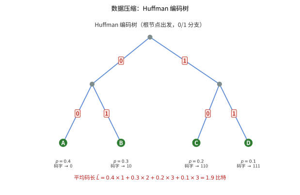

> **直观理解（现实类比）**：Huffman 编码就像给常用字安排更简短的"暗号"。在一条消息里，出现频率最高的符号（如字母 A）用最短的码（$0$），出现少的符号用长码（D 用 $111$）。这样平均每个符号占用的比特数就最少，接近信息论的下界——熵。图中从树的根部按 0/1 分支走到叶子，路径上的数字拼起来就是该符号的码字。

#### 课堂问答

**老师**：信源编码定理说 $R>H(X)$ 能无损、$R<H(X)$ 必错，这个阈值为什么恰好是熵？

**学生**：因为典型序列的个数约为 $2^{nH(X)}$，只给典型集编号就只需约 $nH(X)$ 个比特，而典型集几乎承载全部概率，所以 $R$ 略高于 $H(X)$ 就能无损。反过来，基数 $2^{nR}<2^{nH(X)}$ 的码本装不下典型序列，误差必趋于 1。

**老师（追问）**：那实际工程怎么逼近这个下界？

**学生**：构造前缀码，比如 Huffman：把概率最小的两个符号反复合并成超符号建树，大概率符号自然拿到短码。它是最优前缀码，满足 $H(X)\le\bar L<H(X)+1$，与熵最多差 1 比特；算术编码、LZ 系列能进一步逼近熵率。

**老师（拓展）**：那"等长编码"浪费在哪里？

**学生**：它无视概率分布：$|\mathcal X|=4$ 时一律用 2 比特，而熵可能只有 1.75 比特，每符号白扔 0.25 比特。变长码才能"高频短码、低频长码"地把平均码长压到熵附近。记住：熵是下界，等长码是"最笨但最省心"的方案。

### 1.8 信道容量

信道容量定义为在信道上可可靠传输的最大信息速率：
$$
C = \max_{p(x)} I(X; Y)
$$

**常见信道容量**：
- 二进制对称信道（BSC）：$C = 1 - H(p)$，其中 $p$ 是错误转移概率
- 二进制擦除信道（BEC）：$C = 1 - \alpha$，其中 $\alpha$ 是擦除概率

> **💡 直观理解（类比）**：信道容量像"电话线的送货上限"——再聪明的编码也超不过这条线去可靠传信息：超过 $C$ 必错，低于 $C$ 总能用某套码传对。BSC 的 $C=1-H(p)$ 直观地道出：噪声越让人分不清（$p$ 越大），这条上限就越低，可用的可靠带宽就越少。

> **🔑 为什么重要**：信道容量是信息论"最令人安心"的结论——香农信道编码定理保证：只要传输速率低于 $C$，**存在**编码方案使错误概率任意小，且这是**不可能被超越**的天花板。它把"能不能可靠通信"从工程试错变成一道可算的极限：噪声信道（BSC、BEC、AWGN）都可以算出一个确定的 $C$，正是它支撑了从电话调制解调到 Wi-Fi、5G 的一切信道编码设计，也解释了"接近容量"的编码（如 Turbo、LDPC）为何是现代通信的基石。

#### 课堂问答

**老师**：$C=\max_{p(x)}I(X;Y)$，为什么要对输入分布取最大？

**学生**：因为互信息同时依赖信道与输入分布。给定信道 $p(y|x)$，要挑一个最有利的输入分布 $p(x)$ 让互信息最大，这就是这条信道能可靠传输的上限。BSC 的最优分布是均匀，此时 $C=1-H(p)$。

**老师（追问）**：BSC 容量 $C=1-H(p)$ 里那个 $H(p)$ 代表什么？

**学生**：$H(p)$ 是"噪声本身携带的不确定性"，即无论怎么选输入都甩不掉的模糊；$1-H(p)$ 就是"总比特减去被噪声吃掉的部分"。$p=0$ 或 $1$ 时 $H(p)=0$、$C=1$（无损或确定性反相）；$p=0.5$ 时 $H(p)=1$、$C=0$（完全乱猜）。

**老师（拓展）**：那 BEC 的 $C=1-\alpha$ 为什么比同参数 BSC 高？

**学生**：因为擦除是"丢掉、绝不给错"，损失只有被擦掉的 $\alpha$ 份额；而 BSC 的 $p$ 是"给错答案"，还要叠加 $H(p)$ 那层混淆。$\alpha=0.2$ 时 BEC 容量为 0.8，而同参数 BSC 只有 $1-H(0.2)\approx0.278$。宁缺毋滥（擦除）比翻错对容量友善得多。

### 1.9 率失真理论

率失真理论研究在给定失真度下，信源编码所需的最小比特率。

**率失真函数**：
$$
R(D) = \min_{p(\hat{x}|x): \mathbb{E}[d(X, \hat{X})] \leq D} I(X; \hat{X})
$$

> **💡 直观理解（类比）**：率失真函数刻画"允许糊一点能省多少码率"——失真度 $D$ 像照片允许模糊的程度，允许越糊，需要传的比特就越少：$D=0$ 精确到像素时烧到 $H(X)$，$D$ 放宽到几乎无所谓时码率能一路降到接近 0。它给视频、图片这类有损压缩指明一条"拿保真度换带宽"的理论底线。

#### 课堂问答

**老师**：$R(D)=\min_{p(\hat x|x):\mathbb E[d(X,\hat X)]\le D}I(X;\hat X)$，为什么最小化的是互信息？

**学生**：率失真把有损压缩看成一次"通信"：原始 $X$ 与重建 $\hat X$ 之间的互信息 $I(X;\hat X)$ 正是"为描述 $\hat X$ 所需携带的关于 $X$ 的信息量"，也就是最小码率。在平均失真 $\le D$ 的可行集上取最小的互信息，便得 $R(D)$。

**老师（追问）**：$D=0$ 和 $D$ 很大时 $R(D)$ 分别是多少？

**学生**：$D=0$ 不允许失真，退化为无损，$R(0)=H(X)$；$D$ 大到"随便糊都行"时几乎无需传信息，$R(D)\to0$。$R(D)$ 关于 $D$ 单调不增且为凸函数，刻画"拿保真度换码率"的权衡。

**老师（拓展）**：那有损压缩为什么能低于熵？

**学生**：因为目标不再是精确重建 $X$，而是重建一个与 $X$ 在失真度量下足够近的 $\hat X$，于是可行集 $I(X;\hat X)$ 可以小于 $H(X)$。这正是图像、视频压缩的理论依据——记住"允许失真越大、所需速率越低"，它是一条取舍曲线，不是免费午餐。

### 1.10 微分熵

对于连续随机变量 $X$ 的概率密度函数 $f(x)$，微分熵定义为：
$$
h(X) = -\int_{\mathcal{S}} f(x) \log f(x) dx
$$

**高斯分布的微分熵**：若 $X \sim \mathcal{N}(0, \sigma^2)$，则：
$$
h(X) = \frac{1}{2} \log(2\pi e \sigma^2)
$$

**高斯信道容量**：在加性高斯白噪声（AWGN）信道中，信道容量为：
$$
C = \frac{1}{2} \log\left(1 + \frac{P}{\sigma^2}\right)
$$

> **💡 直观理解（类比）**：微分熵把"不确定性度量"推广到连续分布，但没了绝对零点、数值可负，只刻画相对弥散程度，像给一朵云打分形状。核心洞察是：在固定功率（方差 $\sigma^2$）约束下，高斯分布最"随机难测"、微分熵最大——这正解释了高斯信道容量 $C=\frac12\log(1+P/\sigma^2)$：在噪声底下还能可靠塞进"信号比噪声强多少"的对数一半那么多新比特，像在吵闹的房间里按照信号比噪声大几成决定还能聊多大声。

#### 课堂问答

**老师**：微分熵 $h(X)=-\int f(x)\log f(x)\,dx$ 为什么可以取负值？

**学生**：因为连续量没有"原子"，密度可取大于 1 的值，使 $-\log f$ 为负；也没有离散那样的绝对零点。它只刻画相对弥散程度，不是"描述某条消息需要几个比特"的绝对计数。

**老师（追问）**：为什么高斯分布的微分熵最大？

**学生**：在固定方差 $\sigma^2$ 约束下，由 KL 散度非负可证任意密度 $f$ 对高斯 $g$ 满足 $D(f\parallel g)\ge0$，展开即 $h(X)\le\frac12\log(2\pi e\sigma^2)$，等号当且仅当 $f=g$ 为高斯。所以高斯是"给定功率下最不可测"的分布。

**老师（拓展）**：那 AWGN 信道容量 $C=\frac12\log(1+P/\sigma^2)$ 怎么来的？

**学生**：最优输入是高斯，$I(X;Y)=h(Y)-h(Y|X)$，其中 $h(Y)=\frac12\log(2\pi e(P+\sigma^2))$、$h(Y|X)=h(N)=\frac12\log(2\pi e\sigma^2)$，相减即得 $C=\frac12\log(1+P/\sigma^2)$。它正是"信号功率比噪声功率大多少"取对数的一半，是香农带宽公式的雏形。

### 1.11 纠错码与网络信息论

**纠错码**：在信息序列中添加冗余信息，使其能够抵抗传输过程中的错误。包括线性分组码、卷积码、LDPC码、Turbo码等。

**网络信息论**：研究网络中信源编码和信道编码的极限，包括多址接入信道、广播信道、中继信道等。

> **💡 直观理解（类比）**：纠错码像"重要信息复印多份再投票"——发送端故意掺进冗余，传输途中字节被噪声改坏几个后，接收端靠众人表决或校验规律把错的揪出来改正，相当于用"多抄几遍"换可靠。线性分组码、卷积码、LDPC、Turbo 都是不同花样的"冗余布局"，用带宽换纠错能力。

---

#### 课堂问答

**老师**：纠错码凭什么能用冗余换可靠？

**学生**：结论是"加冗余 → 拉开码字间距 → 出错后仍能唯一还原"。例如线性分组码在信息位后附加校验位，接收端用校验方程或"到哪个合法码字最近"来纠错。卷积码、LDPC、Turbo、极化码则是不同布局的冗余方案。

**老师（追问）**：香农说"逼近容量"的码存在，为什么还要几十年才做出来？

**学生**：随机编码定理只证明"存在好码"，并未给出能多项式时间构造与解码的算法。汉明码、Reed–Solomon、Turbo、LDPC、极化码（Arikan 2008）一步步把"存在"变成"可造、可解"，这才是从理论到 5G 的落地关键。

**老师（拓展）**：那网络信息论与点对点容量有何本质不同？

**学生**：点对点是单个标量 $C=\max I(X;Y)$；而多用户网络（多址接入、广播、中继）给出的是整个"容量区域"，比如 $R_1\le C_1$、$R_2\le C_2$、$R_1+R_2\le C_\Sigma$ 的联立约束。相同信道下合作用户能超可加地传更多，单信道容量拼不出这个区域——这是从"一条线"到"一张网"的实质深化。

## 2. 定理与证明

### 2.1 香农信源编码定理

> **定理 1（香农信源编码定理）**：设 $\{X_i\}_{i=1}^\infty$ 是独立同分布随机变量序列，$X_i \sim p(x)$，熵为 $H(X)$。则对于任意 $\epsilon > 0$，存在一个编码方案，当码长 $n$ 足够大时，可以用 $n(H(X) + \epsilon)$ 个比特表示信源序列，且解码误差概率小于 $\epsilon$。反之，任何编码方案若使用少于 $n(H(X) - \epsilon)$ 个比特，则解码误差概率趋于1。

> **💡 直观理解（类比）**：正向靠"只给典型序列记账"来压缩：绝大多数消息都挤在一个'代表性集合'里，只需给它们编号就能省流；而一旦码率低于熵，码本就装不下这些典型序列，错误率必然飙向 1。它像说"几乎所有人都穿同一批尺码，记清这些号就够——硬要把每人的个别差异都写全，码本就爆了"。

**证明**：

**步骤1：典型序列（AEP）**

首先证明**渐近等分性质（AEP）**：对于独立同分布随机变量序列 $X_1, X_2, \ldots, X_n \sim p(x)$，

$$
-\frac{1}{n} \log p(X_1, X_2, \ldots, X_n) \xrightarrow{P} H(X)
$$

**证明**：由大数定律：
$$
-\frac{1}{n} \log p(X_1, \ldots, X_n) = -\frac{1}{n} \sum_{i=1}^n \log p(X_i) \xrightarrow{P} \mathbb{E}[-\log p(X)] = H(X)
$$

**步骤2：典型集的定义**

定义**典型集** $A_\epsilon^{(n)}$ 为满足以下条件的序列 $x^n = (x_1, \ldots, x_n)$ 的集合：
$$
\left| -\frac{1}{n} \log p(x^n) - H(X) \right| < \epsilon
$$

**典型集的性质**：

1. 如果 $x^n \in A_\epsilon^{(n)}$，则 $2^{-n(H(X)+\epsilon)} \leq p(x^n) \leq 2^{-n(H(X)-\epsilon)}$

2. 典型集的大小：$|A_\epsilon^{(n)}| \leq 2^{n(H(X)+\epsilon)}$

3. 对于足够大的 $n$，$P(A_\epsilon^{(n)}) > 1 - \epsilon$

4. 对于足够大的 $n$，$|A_\epsilon^{(n)}| \geq (1-\epsilon) 2^{n(H(X)-\epsilon)}$

**证明性质2**：
$$
1 \geq \sum_{x^n \in A_\epsilon^{(n)}} p(x^n) \geq \sum_{x^n \in A_\epsilon^{(n)}} 2^{-n(H(X)+\epsilon)} = |A_\epsilon^{(n)}| \cdot 2^{-n(H(X)+\epsilon)}
$$

因此 $|A_\epsilon^{(n)}| \leq 2^{n(H(X)+\epsilon)}$。

**证明性质3**：由AEP，$-\frac{1}{n}\log p(X^n) \to H(X)$ 依概率，因此对于任意 $\epsilon > 0$，存在 $N$，当 $n > N$ 时：
$$
P\left( \left| -\frac{1}{n}\log p(X^n) - H(X) \right| < \epsilon \right) > 1 - \epsilon
$$

即 $P(A_\epsilon^{(n)}) > 1 - \epsilon$。

**步骤3：编码方案（正向定理）**

**编码**：只对典型集 $A_\epsilon^{(n)}$ 中的序列进行编码。由于 $|A_\epsilon^{(n)}| \leq 2^{n(H(X)+\epsilon)}$，我们可以用 $n(H(X)+\epsilon)$ 个比特为每个典型序列分配一个唯一的码字。

**解码**：收到码字后，解码为对应的典型序列。如果收到的码字不对应任何典型序列，则解码失败。

**误差分析**：误差概率为 $P(X^n \notin A_\epsilon^{(n)}) < \epsilon$（由性质3）。因此平均误差概率小于 $\epsilon$。

**步骤4：逆定理**

假设存在一个编码方案，使用 $nR$ 个比特（$R < H(X) - 2\epsilon$）表示信源序列，解码误差概率为 $P_e^{(n)}$。

码字的总数为 $2^{nR}$。设 $S$ 为解码函数映射到的序列集合，则 $|S| \leq 2^{nR}$。

**误差概率下界**：
$$
P_e^{(n)} = P(X^n \notin S) \geq P(X^n \notin S \cap A_\epsilon^{(n)}) \geq P(A_\epsilon^{(n)}) - |S \cap A_\epsilon^{(n)}| \cdot \max_{x^n} p(x^n)
$$

对于 $x^n \in A_\epsilon^{(n)}$，$p(x^n) \leq 2^{-n(H(X)-\epsilon)}$，且 $|S \cap A_\epsilon^{(n)}| \leq |S| \leq 2^{nR}$，因此：
$$
P_e^{(n)} \geq P(A_\epsilon^{(n)}) - 2^{nR} \cdot 2^{-n(H(X)-\epsilon)} \geq (1-\epsilon) - 2^{-n(H(X)-\epsilon-R)}
$$

当 $R < H(X) - \epsilon$ 时，$H(X) - \epsilon - R > 0$，当 $n \to \infty$ 时，$2^{-n(H(X)-\epsilon-R)} \to 0$，因此 $P_e^{(n)} \to 1$。

更精确地，取 $\epsilon$ 使得 $R < H(X) - 2\epsilon$，则对于足够大的 $n$，有 $P_e^{(n)} > 1 - 2\epsilon$。$\square$

#### 课堂问答

**老师**：AEP（渐近等分性质）为什么是信源编码定理的核心？

**学生**：因为 $-\frac1n\log p(X_1,\dots,X_n)$ 是 $-\log p(X_i)$ 的样本均值，由大数定律依概率收敛到 $H(X)$。于是"几乎所有"序列的概率都接近 $2^{-nH(X)}$，这些典型序列共约 $2^{nH(X)}$ 个且几乎覆盖全部概率——只给它们编号就只需 $nH(X)$ 比特。

**老师（追问）**：逆定理凭什么证明 $R<H(X)$ 必错？

**学生**：码字数只有 $2^{nR}$，能覆盖的典型序列至多这么多；典型序列每个概率 $\le2^{-n(H(X)-\epsilon)}$，故被遗漏的概率下界为 $P(A_\epsilon^{(n)})-2^{nR}\cdot2^{-n(H(X)-\epsilon)}\ge(1-\epsilon)-2^{-n(H(X)-\epsilon-R)}$，当 $R<H(X)-\epsilon$ 时该项趋于 1。

**老师（拓展）**：这个定理是"构造性"的吗？

**学生**：不是。它只证明"存在"一个编码方案在 $n$ 足够大时达到熵下界，并未给出具体算法。Huffman 在有限码长上给出最优前缀码，算术编码逼近熵率，算是把存在性一步步落到工程。记住：熵是无损压缩不可跨越的下界，但"怎么压"是另一门手艺。

### 2.2 香农信道编码定理

> **定理 2（香农信道编码定理）**：对于离散无记忆信道，信道容量为 $C = \max_{p(x)} I(X; Y)$。对于任意 $R < C$，存在一种码率为 $R$ 的编码方案，使得误差概率可以任意小。反之，对于 $R > C$，任意编码方案的误差概率有正的下界。

> **💡 直观理解（类比）**：随机编码定理说"随手撒网也能捞到好网"——发送方随手生成海量'翻译本'，接收端挑与收到的字串'罕见地共同典型'的那一本；只要发送速率比容量 $C$ 略低，撞错码字的概率就指数式趋近 0。平均来看，至少有一本翻译效果能好到顶用，这就是存在性好码的底气。

**证明（随机编码与联合典型序列）**：

**正向定理：$R < C$ 时存在好码**

**步骤1：随机编码**

1. 固定输入分布 $p(x)$，使得 $I(X; Y) = C - \delta$（其中 $\delta$ 充分小）
2. 随机生成 $2^{nR}$ 个码字，每个码字 $\mathbf{X}(m) = (X_1(m), \ldots, X_n(m))$ 独立同分布地服从 $\prod_{i=1}^n p(x_i)$
3. 将码本 $\mathcal{C} = \{\mathbf{X}(1), \ldots, \mathbf{X}(2^{nR})\}$ 同时告知发送方和接收方

**步骤2：联合典型解码**

给定接收序列 $\mathbf{y} = (y_1, \ldots, y_n)$，接收方寻找满足以下条件的码字 $m$：
- $(\mathbf{X}(m), \mathbf{y})$ 是联合典型的
- 不存在其他码字 $m' \neq m$ 使得 $(\mathbf{X}(m'), \mathbf{y})$ 是联合典型的

如果存在唯一这样的码字，则解码为 $\hat{m} = m$；否则解码失败。

**联合典型集**定义：
$$
A_\epsilon^{(n)} = \left\{ (x^n, y^n) : \left| -\frac{1}{n}\log p(x^n) - H(X) \right| < \epsilon, \left| -\frac{1}{n}\log p(y^n) - H(Y) \right| < \epsilon, \left| -\frac{1}{n}\log p(x^n, y^n) - H(X, Y) \right| < \epsilon \right\}
$$

**联合典型集的性质**：
1. $P((X^n, Y^n) \in A_\epsilon^{(n)}) \to 1$ 当 $n \to \infty$
2. $|A_\epsilon^{(n)}| \leq 2^{n(H(X,Y)+\epsilon)}$
3. 如果 $(\tilde{X}^n, \tilde{Y}^n) \sim p(x^n)p(y^n)$（独立），则 $P((\tilde{X}^n, \tilde{Y}^n) \in A_\epsilon^{(n)}) \leq 2^{-n(I(X;Y)-3\epsilon)}$

**步骤3：误差分析**

考虑发送消息 $m = 1$ 的情况。定义事件：
- $E_1$：$(\mathbf{X}(1), \mathbf{Y}) \notin A_\epsilon^{(n)}$
- $E_2$：存在 $m' \neq 1$，使得 $(\mathbf{X}(m'), \mathbf{Y}) \in A_\epsilon^{(n)}$

误差概率 $P_e^{(n)} \leq P(E_1) + P(E_2)$。

**$P(E_1)$ 的界**：由联合AEP，$P(E_1) < \epsilon$ 对于足够大的 $n$。

**$P(E_2)$ 的界**：由对称性，
$$
P(E_2) \leq \sum_{m'=2}^{2^{nR}} P((\mathbf{X}(m'), \mathbf{Y}) \in A_\epsilon^{(n)})
$$

由于 $\mathbf{X}(m')$ 与 $\mathbf{Y}$ 独立（给定 $\mathbf{X}(1)$），由性质3：
$$
P((\mathbf{X}(m'), \mathbf{Y}) \in A_\epsilon^{(n)}) \leq 2^{-n(I(X;Y)-3\epsilon)}
$$

因此：
$$
P(E_2) \leq (2^{nR} - 1) \cdot 2^{-n(I(X;Y)-3\epsilon)} < 2^{-n(I(X;Y)-3\epsilon-R)}
$$

**步骤4：选择参数**

令 $R = C - 2\epsilon$，选择 $p(x)$ 使 $I(X; Y) = C - \epsilon$，则 $I(X; Y) - 3\epsilon - R = (C - \epsilon) - 3\epsilon - (C - 2\epsilon) = -2\epsilon < 0$，因此：
$$
P(E_2) < 2^{-n \cdot 2\epsilon} = 2^{-2n\epsilon} \to 0 \quad (n \to \infty)
$$

总误差概率 $P_e^{(n)} < \epsilon + 2^{-2n\epsilon}$，对于足够大的 $n$，$P_e^{(n)} < 2\epsilon$。

**步骤5：去随机化**

由于平均误差概率（对随机码本取平均）可以任意小，存在至少一个码本，其误差概率不超过平均值。因此存在确定性码本满足要求。

**逆定理：$R > C$ 时误差概率有正下界**

**步骤1：Fano不等式**

设 $\hat{M}$ 是接收方对消息 $M$ 的估计，$P_e^{(n)} = P(\hat{M} \neq M)$。由Fano不等式：
$$
H(M|\hat{M}) \leq 1 + P_e^{(n)} \log(2^{nR} - 1) \leq 1 + nR P_e^{(n)}
$$

**步骤2：数据处理不等式**

由数据处理不等式：
$$
I(M; \hat{M}) \leq I(X^n; Y^n) \leq nC
$$

其中 $X^n$ 是发送的码字，$Y^n$ 是接收序列。

**步骤3：推导下界**

$$
nR = H(M) = I(M; \hat{M}) + H(M|\hat{M}) \leq nC + 1 + nR P_e^{(n)}
$$

因此：
$$
P_e^{(n)} \geq 1 - \frac{C}{R} - \frac{1}{nR}
$$

当 $R > C$ 时，$1 - C/R > 0$，对于足够大的 $n$，$P_e^{(n)} \geq (1 - C/R)/2 > 0$。$\square$

#### 课堂问答

**老师**：随机编码定理为什么反而能证明"好码存在"？

**学生**：它反着来：随机生成 $2^{nR}$ 个码字，计算"平均误差"；若平均误差可任意小，则至少存在一个码本不差于平均，于是好码存在。这一步叫"去随机化"。

**老师（追问）**：误差分析里最关键的量是什么？

**学生**：是联合典型。对 $m'\ne1$，$\mathbf X(m')$ 与 $\mathbf Y$ 独立，落入联合典型集的概率 $\le2^{-n(I(X;Y)-3\epsilon)}$，乘上 $2^{nR}$ 个干扰码字得 $P(E_2)<2^{-n(I(X;Y)-3\epsilon-R)}$。只要 $R<I(X;Y)$，指数为负，误差就指数式衰减。

**老师（拓展）**：那逆定理又靠什么？

**学生**：靠 Fano 加数据处理不等式。由 $nR=H(M)=I(M;\hat M)+H(M|\hat M)\le nC+1+nRP_e$ 移项得 $P_e\ge1-\frac CR-\frac1{nR}$，当 $R>C$ 时右端严格正，误差有正下界——超过容量必错。正逆两向合起来，正是"容量之下必能可靠，容量之上绝无可能"。

### 2.3 Fano不等式

> **定理 3（Fano不等式）**：设 $X$ 和 $\hat{X}$ 是取值于同一字母表 $\mathcal{X}$ 的随机变量，$P_e = P(X \neq \hat{X})$。则：
$$
H(X|\hat{X}) \leq H(P_e) + P_e \log(|\mathcal{X}| - 1) \leq 1 + P_e \log |\mathcal{X}|
$$
> 其中 $H(P_e) = -P_e \log P_e - (1-P_e)\log(1-P_e)$ 是二进制熵函数。

> **💡 直观理解（类比）**：Fano 不等式是误判的"保底下限"——观测留下的残余疑惑 $H(X|\hat X)$ 越大，出错率 $P_e$ 就越低不了，因为它把'猜错'折算成必须支付的信息成本。好比盲猜答案：对完全一窍不通的题，再聪明的猜法也保不了低失误，因为毫无凭据可依。

**证明**：

**步骤1：定义误差指示变量**

定义 $E = \mathbf{1}_{\{X \neq \hat{X}\}}$，则 $P(E = 1) = P_e$，$P(E = 0) = 1 - P_e$。

**步骤2：应用链式法则**

$$
H(X, E | \hat{X}) = H(X|\hat{X}) + H(E|X, \hat{X}) = H(E|\hat{X}) + H(X|E, \hat{X})
$$

由于 $E$ 由 $X$ 和 $\hat{X}$ 完全确定，$H(E|X, \hat{X}) = 0$，因此：
$$
H(X|\hat{X}) = H(E|\hat{X}) + H(X|E, \hat{X})
$$

**步骤3：上界估计**

$H(E|\hat{X}) \leq H(E) = H(P_e)$（条件熵不超过无条件熵）。

对于 $H(X|E, \hat{X})$：
$$
H(X|E, \hat{X}) = P(E=0) H(X|\hat{X}, E=0) + P(E=1) H(X|\hat{X}, E=1)
$$

当 $E=0$ 时，$X = \hat{X}$，$H(X|\hat{X}, E=0) = 0$。

当 $E=1$ 时，$X \neq \hat{X}$，$X$ 最多可取 $|\mathcal{X}| - 1$ 个值，因此 $H(X|\hat{X}, E=1) \leq \log(|\mathcal{X}| - 1)$。

因此：
$$
H(X|E, \hat{X}) \leq P_e \log(|\mathcal{X}| - 1)
$$

**步骤4：合并结果**

$$
H(X|\hat{X}) \leq H(P_e) + P_e \log(|\mathcal{X}| - 1)
$$

由于 $H(P_e) \leq 1$（二进制熵以1为上界），可得简化形式：
$$
H(X|\hat{X}) \leq 1 + P_e \log |\mathcal{X}|
$$

$\square$

#### 课堂问答

**老师**：Fano 不等式证明里引入误差指示变量 $E$ 是神来之笔，妙在哪？

**学生**：因为 $E=\mathbf 1_{\{X\ne\hat X\}}$ 把"对/错"两种情形一刀切开。由链式法则 $H(X|\hat X)=H(E|\hat X)+H(X|E,\hat X)$，其中 $H(E|\hat X)\le H(P_e)$，而 $E=0$ 时 $X=\hat X$ 贡献 0、$E=1$ 时 $X$ 至多 $|\mathcal X|-1$ 个取值。

**老师（追问）**：于是得到什么？

**学生**：$H(X|\hat X)\le H(P_e)+P_e\log(|\mathcal X|-1)\le1+P_e\log|\mathcal X|$，末步用了 $H(P_e)\le1$。这就是 Fano 不等式，把残余不确定 $H(X|\hat X)$ 用误差概率 $P_e$ 牢牢卡住。

**老师（拓展）**：它和"信息论中的不确定性"有什么哲学味？

**学生**：它把"出错"翻译成"必须支付的残余信息成本"：你不知道的越多（$H(X|\hat X)$ 越大），就越难用低出错率猜中。反过来，$P_e$ 有正下界时 $H(X|\hat X)$ 就不能太小——这正是信道编码逆定理"超容量必错"的支点。注意 $|\mathcal X|$ 出现在对数里，字母表越大，冗余的代价越高。

### 2.4 数据处理不等式

> **定理 4（数据处理不等式）**：如果 $X \to Y \to Z$ 构成马尔可夫链，则：
$$
I(X; Y) \geq I(X; Z)
$$

> **💡 直观理解（类比）**：数据处理不等式说"信息处理只会漏，不会多"——从 $X$ 摸到 $Y$、再加工出 $Z$，就像接力的复印机，每道工序都是损耗源，最终成品与原件 $X$ 的相关度 $I(X;Z)$ 只会 ≤ 与第一手副本 $Y$ 的相关度 $I(X;Y)$。它给"加工不能凭空造出新信息"这一直观立起数学界碑。

**证明**：

**步骤1：马尔可夫链的定义**

$X \to Y \to Z$ 构成马尔可夫链当且仅当 $p(x, y, z) = p(x) p(y|x) p(z|y)$，即给定 $Y$ 时，$X$ 与 $Z$ 条件独立：
$$
p(x, z|y) = p(x|y) p(z|y)
$$

**步骤2：应用链式法则展开互信息**

$$
I(X; Y, Z) = I(X; Y) + I(X; Z|Y) = I(X; Z) + I(X; Y|Z)
$$

由于 $X \to Y \to Z$ 是马尔可夫链，$p(x, z|y) = p(x|y)p(z|y)$，因此 $I(X; Z|Y) = 0$。

所以：
$$
I(X; Y) = I(X; Z) + I(X; Y|Z)
$$

**步骤3：互信息的非负性**

由互信息的非负性，$I(X; Y|Z) \geq 0$，因此：
$$
I(X; Y) \geq I(X; Z)
$$

**等号条件**：$I(X; Y|Z) = 0$，即 $X \to Z \to Y$ 也构成马尔可夫链。

**步骤4：推广**

数据处理不等式可以推广到更长的马尔可夫链 $X_1 \to X_2 \to \cdots \to X_n$：
$$
I(X_1; X_n) \leq I(X_1; X_2)
$$

**应用**：数据处理不等式表明，对数据进行任何处理（确定性或随机性），都不会增加信息量。也就是说，数据处理只能丢失信息，不能创造信息。$\square$

#### 课堂问答

**老师**：$X\to Y\to Z$ 构成马尔可夫链时，为什么 $I(X;Z|Y)=0$？

**学生**：马尔可夫链等价于 $p(x,z|y)=p(x|y)p(z|y)$，即给定 $Y$ 时 $X$ 与 $Z$ 条件独立。条件独立意味着 $I(X;Z|Y)=0$——一旦知道 $Y$，$Z$ 对 $X$ 再无额外信息。

**老师（追问）**：那怎么得到 $I(X;Y)\ge I(X;Z)$？

**学生**：展开 $I(X;Y,Z)=I(X;Y)+I(X;Z|Y)=I(X;Z)+I(X;Y|Z)$，用 $I(X;Z|Y)=0$ 得 $I(X;Y)=I(X;Z)+I(X;Y|Z)$，再由 $I(X;Y|Z)\ge0$ 即得。等号当且仅当 $I(X;Y|Z)=0$，即 $X\to Z\to Y$ 也是马尔可夫链。

**老师（拓展）**："处理不增信息"的现实含义是什么？

**学生**：对数据做任何确定性或随机处理，都只会保留或丢失关于原始来源的信息，绝不会凭空造出。它给"特征工程不能无中生有""充分统计量不丢信息"立了数学界碑，也是信道编码逆定理里 $I(M;\hat M)\le I(X^n;Y^n)$ 的依据。

### 2.5 信道容量的对偶表示

> **定理 5（信道容量的对偶表示）**：离散无记忆信道的容量可以表示为：
$$
C = \max_{p(x)} I(X; Y) = \max_{p(x)} \min_{q(y|x)} D(p(x,y) \parallel p(x)q(y))
$$
> 其中 $q(y|x)$ 是信道转移概率。进一步，容量可以表示为KL散度的最大最小值。

> **💡 直观理解（类比）**：容量对偶表示把求容量翻成一局拉锯博弈——对外尽可能挑好的输入分布 $p(x)$ 把信道好处拉到最大，对内又用 KL 散度按最不利的输出分布 $q(y)$ 来计价，两个方向一挤就框住真实的 $C$。它给数值求解容量开出一条新的迭代逼近路线。

**证明（互信息的凸性）**：

**步骤1：互信息关于输入分布的凹性**

固定信道转移概率 $p(y|x)$，$I(X; Y)$ 是 $p(x)$ 的凹函数。

**证明**：设 $p_1(x)$ 和 $p_2(x)$ 是两个输入分布，$p_\lambda(x) = \lambda p_1(x) + (1-\lambda) p_2(x)$。由互信息的定义：
$$
I_{p_\lambda}(X; Y) = \sum_{x, y} p_\lambda(x) p(y|x) \log \frac{p_\lambda(x) p(y|x)}{p_\lambda(x) p_\lambda(y)}
$$

其中 $p_\lambda(y) = \sum_x p_\lambda(x) p(y|x)$。

利用KL散度的凸性，可以证明：
$$
I_{p_\lambda}(X; Y) \geq \lambda I_{p_1}(X; Y) + (1-\lambda) I_{p_2}(X; Y)
$$

但注意，这里我们需要的是凹性（$\geq$），实际计算时需要仔细验证符号。

**更直接的证明**：$I(X; Y) = H(Y) - H(Y|X)$。$H(Y|X) = \sum_x p(x) H(Y|X=x)$ 是 $p(x)$ 的线性函数（因为 $H(Y|X=x)$ 不依赖于 $p(x)$），而 $H(Y)$ 是 $p(y) = \sum_x p(x) p(y|x)$ 的凹函数，由于 $p(y)$ 是 $p(x)$ 的线性函数，且 $H(\cdot)$ 是凹函数，所以 $H(Y)$ 是 $p(x)$ 的凹函数。因此 $I(X; Y) = H(Y) - H(Y|X)$ 是凹函数（凹函数减去线性函数仍为凹函数）。

**步骤2：互信息关于信道转移概率的凸性**

固定输入分布 $p(x)$，$I(X; Y)$ 是 $p(y|x)$ 的凸函数。

**证明**：设 $p_1(y|x)$ 和 $p_2(y|x)$ 是两个信道，$p_\lambda(y|x) = \lambda p_1(y|x) + (1-\lambda) p_2(y|x)$。则：
$$
I_{p_\lambda}(X; Y) \leq \lambda I_{p_1}(X; Y) + (1-\lambda) I_{p_2}(X; Y)
$$

这可以通过KL散度的凸性来证明。

**步骤3：对偶表示**

信道容量定义为：
$$
C = \max_{p(x)} I(X; Y) = \max_{p(x)} \min_{q(y|x)} D(p(x,y) \parallel p(x)q(y))
$$

其中第二个等号利用了互信息的变分表示：
$$
I(X; Y) = \min_{q(y)} D(p(x,y) \parallel p(x)q(y))
$$

这里 $q(y)$ 是 $Y$ 的任意分布。

**证明**：对于固定的 $p(x)$ 和 $p(y|x)$：
$$
\begin{aligned}
D(p(x,y) \parallel p(x)q(y)) &= \sum_{x,y} p(x,y) \log \frac{p(x,y)}{p(x)q(y)} \\
&= \sum_{x,y} p(x,y) \log \frac{p(y|x)}{q(y)} \\
&= \sum_{x,y} p(x,y) \log \frac{p(y|x)}{p(y)} + \sum_{x,y} p(x,y) \log \frac{p(y)}{q(y)} \\
&= I(X; Y) + D(p(y) \parallel q(y))
\end{aligned}
$$

由于 $D(p(y) \parallel q(y)) \geq 0$，且等号成立当且仅当 $q(y) = p(y)$，因此：
$$
\min_{q(y)} D(p(x,y) \parallel p(x)q(y)) = I(X; Y)
$$

**步骤4：容量作为最大最小值**

$$
C = \max_{p(x)} I(X; Y) = \max_{p(x)} \min_{q(y)} D(p(x,y) \parallel p(x)q(y))
$$

由于 $I(X; Y)$ 是 $p(x)$ 的凹函数、$p(y|x)$ 的凸函数，且定义域是紧凸集，由von Neumann极小极大定理，可以交换最大最小次序：
$$
C = \min_{q(y)} \max_{p(x)} D(p(x,y) \parallel p(x)q(y))
$$

这个对偶表示为计算信道容量提供了另一种途径。$\square$

---

#### 课堂问答

**老师**：为什么 $I(X;Y)=\min_{q(y)}D(p(x,y)\parallel p(x)q(y))$？

**学生**：把 KL 展开：$D(p(x,y)\parallel p(x)q(y))=\sum p(x,y)\log\frac{p(y|x)}{q(y)}=I(X;Y)+D(p(y)\parallel q(y))$。因 $D(p(y)\parallel q(y))\ge0$ 且仅当 $q(y)=p(y)$ 取零，故最小值恰为 $I(X;Y)$。

**老师（追问）**：那容量怎么会变成 max-min？

**学生**：代入即得 $C=\max_{p(x)}\min_{q(y)}D(p(x,y)\parallel p(x)q(y))$。关键在于：$I$ 关于 $p(x)$ 是凹的（$H(Y)$ 凹、$H(Y|X)$ 线性），关于 $p(y|x)$ 是凸的，定义域是紧凸集，于是由 von Neumann 极小极大定理可交换最大最小次序。

**老师（拓展）**：这个对偶形式有什么用？

**学生**：它把求容量从"在输入分布上找凹函数最大值"变成 min-max 问题，可导出 Blahut–Arimoto 迭代算法：交替更新 $p(x)$ 与 $q(y)$ 逼近 $C$，对没有解析解的一般信道特别有用。同一座容量的另一副面孔，算起来更顺手。注意别把它与"对称容量"混为一谈，对非对称信道两者一般不等。

## 3. 示例

### 3.1 计算离散信源的熵

**问题**：一个离散信源以概率 $\{0.4, 0.3, 0.2, 0.1\}$ 产生四个符号 $\{A, B, C, D\}$。求：
(1) 信源的熵
(2) 如果使用二进制编码，理论最小平均码长

**解**：

**步骤1：计算熵**

$$
H(X) = -\sum_{i=1}^4 p_i \log_2 p_i
$$

$$
\begin{aligned}
H(X) &= -[0.4 \log_2 0.4 + 0.3 \log_2 0.3 + 0.2 \log_2 0.2 + 0.1 \log_2 0.1] \\
&= -[0.4 \times (-1.3219) + 0.3 \times (-1.7370) + 0.2 \times (-2.3219) + 0.1 \times (-3.3219)] \\
&= -[-0.5288 - 0.5211 - 0.4644 - 0.3322] \\
&= -[-1.8465] = 1.8465 \text{比特}
\end{aligned}
$$

**步骤2：对偶熵**

我们也可以计算以2为底的对数：
$$
\log_2 0.4 = \frac{\ln 0.4}{\ln 2} = \frac{-0.9163}{0.6931} = -1.3219
$$

$$
\log_2 0.3 = \frac{-1.2040}{0.6931} = -1.7370
$$

$$
\log_2 0.2 = \frac{-1.6094}{0.6931} = -2.3219
$$

$$
\log_2 0.1 = \frac{-2.3026}{0.6931} = -3.3219
$$

因此：
$$
H(X) = -(0.4 \times (-1.3219) + 0.3 \times (-1.7370) + 0.2 \times (-2.3219) + 0.1 \times (-3.3219))
$$

$$
= 0.5288 + 0.5211 + 0.4644 + 0.3322 = 1.8465 \text{比特}
$$

**步骤3：理论最小平均码长**

由香农信源编码定理，理论最小平均码长等于熵：
$$
\bar{L}_{\min} = H(X) = 1.8465 \text{比特/符号}
$$

实际中，Huffman编码可以接近这个下界。

### 3.2 计算信道容量

#### 二进制对称信道（BSC）

**问题**：二进制对称信道的错误转移概率为 $p = 0.1$，求信道容量。

**解**：

**步骤1：信道模型**

BSC的输入 $X \in \{0, 1\}$，输出 $Y \in \{0, 1\}$，转移概率为：
$$
P(Y = 1|X = 0) = P(Y = 0|X = 1) = p = 0.1
$$

**步骤2：计算互信息**

设 $P(X = 0) = \pi$，$P(X = 1) = 1 - \pi$。

$$
P(Y = 0) = \pi(1-p) + (1-\pi)p = \pi(1-2p) + p
$$

$$
P(Y = 1) = \pi p + (1-\pi)(1-p) = 1 - \pi(1-2p) - p
$$

互信息为：
$$
I(X; Y) = H(Y) - H(Y|X)
$$

由于 $H(Y|X) = \sum_x p(x) H(Y|X=x) = H(p)$（与 $\pi$ 无关），其中 $H(p) = -p\log p - (1-p)\log(1-p)$。

因此：
$$
I(X; Y) = H(Y) - H(p)
$$

$H(Y)$ 在 $Y$ 服从均匀分布时取最大值，即当 $P(Y=0) = P(Y=1) = 1/2$ 时 $H(Y) = 1$。

**步骤3：最大化互信息**

$P(Y=0) = 1/2$ 等价于 $\pi(1-2p) + p = 1/2$，即 $\pi = 1/2$。

因此：
$$
C = \max_\pi I(X; Y) = 1 - H(p) = 1 - H(0.1)
$$

**步骤4：计算数值**

$$
H(0.1) = -0.1 \log_2 0.1 - 0.9 \log_2 0.9 = -0.1 \times (-3.3219) - 0.9 \times (-0.1520)
$$

$$
= 0.3322 + 0.1368 = 0.4690 \text{比特}
$$

因此：
$$
C = 1 - 0.4690 = 0.5310 \text{比特/信道使用}
$$

#### 二进制擦除信道（BEC）

**问题**：二进制擦除信道的擦除概率为 $\alpha = 0.2$，求信道容量。

**解**：

**步骤1：信道模型**

BEC的输入 $X \in \{0, 1\}$，输出 $Y \in \{0, 1, e\}$（$e$ 表示擦除），转移概率为：
$$
P(Y = X) = 1 - \alpha = 0.8
$$
$$
P(Y = e) = \alpha = 0.2
$$

**步骤2：计算互信息**

设 $P(X = 0) = \pi$，$P(X = 1) = 1 - \pi$。

$$
I(X; Y) = H(X) - H(X|Y)
$$

由于 $Y$ 以概率 $1-\alpha$ 完全确定 $X$，以概率 $\alpha$ 不提供任何信息：

$$
H(X|Y) = \sum_y P(Y=y) H(X|Y=y)
$$

当 $Y = 0$ 或 $Y = 1$ 时，$X$ 完全确定，$H(X|Y) = 0$。

当 $Y = e$ 时，$H(X|Y=e) = H(\pi)$。

$P(Y = e) = \alpha$，因此：
$$
H(X|Y) = \alpha H(\pi)
$$

所以：
$$
I(X; Y) = H(\pi) - \alpha H(\pi) = (1-\alpha) H(\pi)
$$

**步骤3：最大化互信息**

$H(\pi)$ 在 $\pi = 1/2$ 时取最大值1，因此：
$$
C = \max_\pi (1-\alpha) H(\pi) = 1 - \alpha = 1 - 0.2 = 0.8 \text{比特/信道使用}
$$

---

## 4.S Stewart 微积分风格补充：现实应用、分步例题与解题策略

> 微积分教材里，"这条消息值多少比特"从来不是一句"文件有多大"，而是**从真实问题出发 → 建模 → 一步步算 → 再翻译回现实**。本节用 Stewart 式的"策略 → 例题 → 分步解 → 回读现实"四步法，把本级信息论的熵、互信息、信道容量工具放进压缩、传输、预测的真实场景里跑一遍。每道例题先给**解题策略**，让你看到"这道题该往哪个方向想"，再给出**每步都解释'为什么'**的分步解答。

### 🎯 本级解题策略（Principles of Problem Solving）

Stewart 解决问题讲究"先问对问题，再动笔"，信息论题尤其如此。做一道信息论题，请按这四步走：

- **第一步 · 认对象**：先问"是单变量（熵）、双变量（互信息）、还是输入-输出（信道）？"。熵回答"多不确定"，互信息回答"知道 Y 让 X 少了多少不确定"，信道容量回答"一条链路最多可靠传多少"。
- **第二步 · 选底数**：算熵/互信息/容量前先统一 $\log$ 底——$\log_2$ 得比特、$\log_e$ 得纳特，二者相差一个 $\ln2$ 的常数倍。比较数值时务必同底。
- **第三步 · 套公式**：熵 $H=-\sum p\log p$，条件熵用 $H(X|Y)=\sum_y p(y)H(X|Y=y)$，互信息 $I=H(X)-H(X|Y)$，信道容量 $C=\max_{p(x)}I(X;Y)$。逐个算"清楚的可算量"再合并。
- **第四步 · 验证回读**：检查概率归一（$\sum p_i=1$）、$H\le\log|\mathcal X|$、$I\ge0$，再把"几个比特"翻译回"能压多小、能传多准"，确认数值落在 [0, 上界] 内可信。

> **一句话带走**：信息论的分步解就像"先算清楚每个符号有多'没想到'，再决定压多短、传多准"——**底数、概率和归一化这些'小事'，往往是算错熵的最主要来源。**

---

### 例题 A · 天气预报的熵与编码：4 种情况最少几个比特

> **🎯 建模策略**：这是"熵 + 无损压缩下界"的最小切片。把"四种天气"翻译成概率 $\{0.5,0.25,0.125,0.125\}$，用 $H=-\sum p\log_2 p$ 求理论最小平均码长。**策略：先算熵，得出"平均每符号最少 $\bar L_{\min}=H$ 比特"，再构造 Huffman 码观察它是否接近这个下界。**

**问题**：某地预报只有四种天气，概率为晴 $0.5$、阴 $0.25$、小雨 $0.125$、大雨 $0.125$。求平均信息量（熵），并说明若要二进制无失真编码，平均每个预报最少需要多少比特。

**解**：

**步骤 1：写熵公式**（为什么：熵是一丝"平均惊喜"的度量，$H=-\sum_i p_i\log_2 p_i$ 把每种情况的"没想到程度"加权平均）

$$
H(X)=-\left[0.5\log_2 0.5+0.25\log_2 0.25+2\times0.125\log_2 0.125\right]
$$

**步骤 2：代入对数值**（为什么：$\log_2 0.5=-1,\ \log_2 0.25=-2,\ \log_2 0.125=-3$）

$$
H(X)=0.5+0.5+0.75=1.75\ \text{比特}
$$

**步骤 3：由编码定理读下界并回读**（为什么：香农编码定理说无损压缩的每个符号最少码长恰为熵，故平均码长不能低于 1.75）

由信源编码定理，$\bar L_{\min}=H(X)=1.75$ 比特/符号。Huffman 码（晴 → 0、阴 → 10、小雨 → 110、大雨 → 111）把高频晴编成 1 位、中频 2 位、低频 3 位，平均码长恰为 $\tfrac12\cdot1+\tfrac14\cdot2+2\cdot\tfrac18\cdot3=1.75$，正好贴着下界。

> **回读现实**：四种天气若不精心编码（一律用 2 位，平均 2.0 比特）就浪费了 $0.25$ 比特/符号——天气常见就编短码、罕见才编长码，这正是 zip 压缩把"更多字符"用更短码字的背后原理。**熵就是"我怎么也压不破"的那道墙。**

---

### 例题 B · 有条件才省的比特：天气预报还能再押

> **🎯 建模策略**：这是"条件熵"的切片。把"今天预报能替明天省多少不确定"翻译成 $H(X|Y)=H(X,Y)-H(Y)$ 或 $\sum p(y)H(X|Y=y)$。**策略：先构建条件概率表，算 $H(X)$ 与 $H(X|Y)$ 之差，这正是"知道 Y 我少猜了多少"。**

**问题**：明天天气 $X$ 只取"晴/雨"两种（$P(晴)=P(雨)=0.5$）。若已知今天是否下雨 $Y\in\{今天雨, 今天晴\}$，$P(X=晴\mid Y=今雨)=0.5$、$P(X=雨\mid Y=今雨)=0.5$，而 $P(X=晴\mid Y=今晴)=0.75$、$P(X=雨\mid Y=今晴)=0.25$。求 $H(X)$ 与 $H(X|Y)$，并说明"看了今天"能省多少不确定性。

**解**：

**步骤 1：算原始熵 $H(X)$**（为什么：没有任何先验时，明两天五五开，不确定性最大）

$$
H(X)=-2\times0.5\log_2 0.5=2\times0.5=1\ \text{比特}
$$

**步骤 2：算条件熵**（为什么：给定今天后，对明天的猜测按"今天状态"加权平均——今晴时 $H(0.75)$、今雨时 $H(0.5)$）

$$
H(X|Y)=P(今晴)\cdot H(0.75)+P(今雨)\cdot H(0.5)
$$

$$
H(0.75)=-0.75\log_2 0.75-0.25\log_2 0.25\approx0.811,\qquad H(0.5)=1
$$

若今晴、今雨各半（$P(今晴)=P(今雨)=0.5$）：
$$
H(X|Y)=\tfrac12\cdot0.811+\tfrac12\cdot1\approx0.906\ \text{比特}
$$

**步骤 3：算互信息并回读**（为什么：$I(X;Y)=H(X)-H(X|Y)$ 是"知道 Y 消除的疑惑"）

$$
I(X;Y)=1-0.906=0.094\ \text{比特}
$$

> **回读现实**：今天这一条信息平均只帮你省约 0.09 比特——因为"今雨"这条几乎没给你任何新信息（$H(0.5)=1$ 跟前一天五五开一样），只有"今晴"才稍许帮上忙。**信息不是越多越值钱，而是"能帮你消除多少不确定"才值钱**：天气预报的营销话事要看互信息，而不是看报了几条。

---

### 例题 C · 一台"带噪"的电话：容量告诉你最多传多准

> **🎯 建模策略**：这是"信道容量"的切片。把"这条线路多结实"翻译成 $C=\max_{p(x)}I(X;Y)$。**策略：用 BSC 公式 $C=1-H(p)$，先算 $H(p)$ 再取 $1-$它。** 数值越小表示噪声越狠，可靠通信的余地就越少。

**问题**：一条二进制对称信道（BSC）错误转移概率 $p=0.1$。求它的信道容量，并用它判断"平均每用一次信道最多可靠传几个比特"。

**解**：

**步骤 1：确认用 BSC 容量公式**（为什么：输入输出都是 0/1 且对称地以概率 $p$ 挑错，恰为标准 BSC，$C=1-H(p)$）

**步骤 2：算 $H(p)=H(0.1)$**（为什么：二进制熵 $H(p)=-p\log_2 p-(1-p)\log_2(1-p)$）

$$
H(0.1)=-0.1\log_2 0.1-0.9\log_2 0.9\approx0.3322+0.1368=0.469
$$

**步骤 3：求容量并回读**（为什么：$C=1-H(p)$，噪声越大 $H(p)$ 越大、容量越小）

$$
C=1-0.469=0.531\ \text{比特/信道使用}
$$

> **回读现实**：噪声 10% 的信道，每次传输平均只能带走 0.53 比特的"可靠信息"——就算你狠命发长码，也超不过这面墙（香农定理保证低于它就能做对、超过必错）。**容量不是"百分之几的误码率"，而是'再怎么加密也压不进的可靠上限'**，这正是 Wi-Fi、5G 里 LDPC / Turbo 码让实际速率逼近容量值、工程界"摸着香农天花板走"的语境。

---

## 4. 习题

### 基础题

**习题 1**（熵的计算）一个离散信源有 5 个符号，概率分布为 $\{0.3, 0.25, 0.2, 0.15, 0.1\}$。(1) 计算信源的熵；(2) 如果使用等长编码，每个符号需要多少比特？(3) 比较 (1)(2) 的结果并说明差异的原因（提示：等长编码需 $\lceil \log_2 5 \rceil = 3$ 比特/符号）。

**习题 2**（互信息与信道容量）考虑输入 $X \in \{0, 1\}$、输出 $Y \in \{0, 1\}$ 的离散信道，转移概率为 $P(Y=0|X=0)=0.9$、$P(Y=1|X=0)=0.1$、$P(Y=0|X=1)=0.2$、$P(Y=1|X=1)=0.8$。(1) 当输入为均匀分布时计算 $I(X; Y)$；(2) 求信道的容量；(3) 说明该信道是否对称，并与 BSC 的信道容量公式 $C=1-H(p)$ 对比。

**习题 3**（Fano 不等式应用）在 BSC($p=0.1$) 上传输 8 个等概率消息，码率为 $R=0.5$。(1) 由 Fano 不等式求误差概率的下界；(2) 已知信道容量 $C=0.531$，而 $R=0.5<C$ 时理论上误差可任意小，对比 (1) 中的下界说明 Fano 不等式的意义。

**习题 4**（数据处理不等式）考虑马尔可夫链 $X \to Y \to Z$：$X$ 为伯努利变量 $P(X=0)=P(X=1)=0.5$，$Y=X+N_1$、$Z=Y+N_2$（均为模 2 加法），$N_1, N_2$ 独立且 $P(N_i=0)=0.9$、$P(N_i=1)=0.1$。(1) 计算 $I(X; Y)$；(2) 计算 $I(X; Z)$；(3) 验证数据处理不等式 $I(X; Y) \geq I(X; Z)$。

**习题 5**（信源编码定理）一个二进制独立同分布信源，$P(X=0)=0.9$、$P(X=1)=0.1$。(1) 计算信源的熵；(2) 用 Huffman 编码求平均码长；(3) 用香农-Fano 编码求平均码长；(4) 验证平均码长不小于熵（提示：$H(X) \leq \bar{L} < H(X)+1$）。

**习题 6**（高斯信道容量）AWGN 信道 $Y = X + N$，$N \sim \mathcal{N}(0, \sigma^2)$，发送功率约束 $\mathbb{E}[X^2] \leq P$。(1) 证明容量为 $C = \frac{1}{2}\log_2(1+\frac{P}{\sigma^2})$；(2) 当 $P/\sigma^2 = 10$ dB 时求容量；(3) 对带宽 $B$，香农公式 $C = B\log_2(1+\frac{P}{N_0B})$ 中当 $B \to \infty$ 时容量趋于何值？

**习题 7**（交叉熵）写出交叉熵的定义 $H(p, q) = -\sum_x p(x)\log q(x)$，说明它与熵、相对熵的关系，并解释为何恒有 $H(p, q) \geq H(p)$。

**习题 8**（信息不等式）写出信息不等式（KL 散度非负性）$D(p \parallel q) \geq 0$ 及其等号成立的条件，说明为什么它是信息论中最基本的不等式。

**习题 9**（Huffman 编码）说明 Huffman 编码的基本思想与步骤，并解释其最优前缀码的平均码长满足 $H(X) \leq \bar{L} < H(X) + 1$ 的含义。

**习题 10**（熵率）写出平稳随机过程熵率的定义 $H(\mathcal{X}) = \lim_{n \to \infty} \frac{1}{n}H(X_1, \dots, X_n)$，并给出平稳马尔可夫链熵率 $H(\mathcal{X}) = H(X_2 | X_1) = -\sum_{i,j} \mu_i P_{ij}\log P_{ij}$ 的表达式。

### 进阶题

**习题 11**（熵的有界性）证明 $H(X) \leq \log |\mathcal{X}|$，等号成立当且仅当 $X$ 服从均匀分布（提示：取 $q$ 为 $\mathcal{X}$ 上的均匀分布并利用 KL 散度非负性或 $\log$ 的凹性）。

**习题 12**（条件熵不大于熵）证明 $H(X|Y) \leq H(X)$，并说明等号何时成立（提示：利用互信息 $I(X; Y) = H(X) - H(X|Y)$ 的非负性）。

**习题 13**（链式法则）证明链式法则 $H(X, Y) = H(X) + H(Y|X)$，并将其推广到 $n$ 个随机变量 $H(X_1, \dots, X_n) = \sum_{i=1}^n H(X_i | X_1, \dots, X_{i-1})$。

**习题 14**（BSC 容量推导）推导二进制对称信道的容量 $C = 1 - H(p)$，并说明使互信息达到最大的输入分布（提示：先写出 $I(X;Y) = H(Y) - H(Y|X)$）。

**习题 15**（BEC 容量推导）推导二进制擦除信道的容量 $C = 1 - \alpha$，其中 $\alpha$ 为擦除概率，并说明为什么擦除符号本身不贡献信息量。

**习题 16**（互信息非负性）证明互信息 $I(X; Y) \geq 0$，等号成立当且仅当 $X$ 与 $Y$ 独立（提示：$I(X;Y) = D(p(x,y) \parallel p(x)p(y))$）。

**习题 17**（互信息链式法则）写出并证明互信息链式法则 $I(X; Y_1, \dots, Y_n) = \sum_{i=1}^n I(X; Y_i | Y_1, \dots, Y_{i-1})$。

**习题 18**（KL 散度链式法则）证明相对熵的链式法则 $D(p(x,y) \parallel q(x,y)) = D(p(x) \parallel q(x)) + D(p(y|x) \parallel q(y|x))$。

**习题 19**（交叉熵与相对熵）用相对熵表示交叉熵，并据此说明在机器学习中最小化交叉熵损失为何等价于最小化预测分布与真实分布之间的 KL 散度。

### 挑战题

**习题 20**（Fano 不等式）完整陈述并证明 Fano 不等式 $H(X|\hat{X}) \leq H(P_e) + P_e \log(|\mathcal{X}| - 1)$，其中 $P_e = P(X \neq \hat{X})$（提示：引入误差指示变量 $E = \mathbf{1}_{\{X \neq \hat{X}\}}$ 并用链式法则）。

**习题 21**（数据处理不等式）证明若 $X \to Y \to Z$ 构成马尔可夫链，则 $I(X; Y) \geq I(X; Z)$（提示：展开 $I(X; Y, Z)$，利用条件独立得 $I(X; Z|Y) = 0$）。

**习题 22**（互信息的变分表示）证明 $I(X; Y) = \min_{q(y)} D(p(x,y) \parallel p(x)q(y))$，并由此导出信道容量 $C = \max_{p(x)} \min_{q(y)} D(p(x,y) \parallel p(x)q(y))$ 的对偶表示。

**习题 23**（AEP 与典型集）利用弱大数定律证明 $-\frac{1}{n}\log p(X_1, \dots, X_n) \to H(X)$ 依概率收敛，并据此说明典型集 $A_\epsilon^{(n)}$ 的大小满足 $|A_\epsilon^{(n)}| \leq 2^{n(H(X)+\epsilon)}$。

**习题 24**（信源编码正定理）依据典型序列论证香农信源编码正定理：当码率 $R > H(X)$ 时存在压缩方案使解码误差任意小，而当 $R < H(X)$ 时误差概率趋于 1（提示：只对典型集编码并估计误差）。

**习题 25**（信道编码逆定理）用 Fano 不等式与数据处理不等式证明：当 $R > C$ 时信道编码的误差概率有正下界（提示：$nR = H(M) = I(M;\hat{M}) + H(M|\hat{M}) \leq nC + 1 + nRP_e$）。

**习题 26**（最大熵原理）说明最大熵原理的基本思想，并利用 KL 散度非负性证明：无任何约束时 $\mathcal{X}$ 上均匀分布的熵最大。

### 探究题

**习题 27**（率失真理论）探究率失真函数 $R(D) = \min_{p(\hat{x}|x): \mathbb{E}d(X,\hat{X}) \leq D} I(X; \hat{X})$ 的含义，讨论它如何刻画"允许失真度 $D$ 与所需最小码率 $R$"之间的权衡。

**习题 28**（交叉熵损失与信息论）结合机器学习中常用的交叉熵损失，探究它为何等价于最小化模型分布与真实分布间的 KL 散度，并与最大似然估计建立联系。

**习题 29**（最大熵与统计推断）探究最大熵原理在统计推断中的应用：说明在给定矩约束（如均值、方差）下如何求出熵最大的分布形态（如在固定方差下得到高斯分布）。

**习题 30**（网络信息论）探究多址接入信道等网络信息论课题中的"容量区域"概念，并与单信道容量 $C = \max_{p(x)} I(X; Y)$ 比较其异同。

### 应用题（Stewart 式综合应用）

**应用题 31**（熵—压缩综合）：一个字母表有 4 个符号，概率为 $\{0.5, 0.25, 0.125, 0.125\}$。除了算出它的熵，请构造一组与例题 A 一致的 Huffman 码，验证其平均码长确实等于熵（即达到 $1.75$ 比特/符号），并说明"等长编码"（每符号 2 位）比最优编码各多花几个比特。

**应用题 32**（互信息—相关性综合）：考虑风寒医诊场景，设 $X$ 表示"是否感冒"、$Y$ 表示"是否发烧"，二者联合分布为：$P(X=1,Y=1)=0.05$，$P(X=1,Y=0)=0.15$，$P(X=0,Y=1)=0.05$，$P(X=0,Y=0)=0.75$。求 $H(X)$、$H(X|Y)$ 与互信息 $I(X;Y)$，并解释 $\log_2$ 底下的这些值告诉医生"发烧"有多能说明"感冒"。

**应用题 33**（容量—工程综合）：一条二进制擦除信道（BEC）擦除概率 $\alpha=0.2$，容量为 $C=1-\alpha=0.8$ 比特/信道使用。请解释：为何这里"擦除只是丢掉、从不给错"，容量比同参数噪声的 BSC 容量（$1-H(0.2)\approx0.278$）高得多？能否从公式 $C=1-\alpha$ 与 $C=1-H(p)$ 的比较找到直觉。

**应用题 34**（信道容量—设计综合）：若要把上面的 BSC（$p=0.1$）容量从 0.531 提升到至少 0.7 比特/信道使用，错误概率需要降到多低才够（用 $C=1-H(p)$ 反解 $p$），并说明这比"多传一遍（两倍冗余）"方案在带宽上划算在哪里。

---

## 5. 习题答案与解析

### 基础题答案

1. **熵的计算** 熵 $H = -\sum_i p_i \log_2 p_i$。逐项计算：$0.3\log_2\frac{1}{0.3}=0.5211$，$0.25\times2=0.5$，$0.2\times2.3219=0.4644$，$0.15\times2.737=0.4106$，$0.1\times3.3219=0.3322$，故 $H\approx2.2283$ 比特。(2) 等长编码需 $\lceil\log_2 5\rceil=3$ 比特/符号。(3) 等长编码无法利用概率的不均匀性，故 $3>2.2283$；熵是平均码长的理论下界，变长/前缀编码的平均码长可逼近熵。

2. **互信息与信道容量** 输入均匀即 $\pi=\frac12$，得 $P(Y=0)=0.55$、$P(Y=1)=0.45$，$H(Y)\approx0.9928$。条件熵 $H(Y|X)=0.5H(0.1,0.9)+0.5H(0.2,0.8)=0.5\times0.469+0.5\times0.7219=0.5955$，故 $I(X;Y)=0.9928-0.5955\approx0.3973$ 比特。该信道非对称（$P(Y=1|X=0)=0.1\neq0.2=P(Y=0|X=1)$），不能直接套用 $C=1-H(p)$，容量需优化输入分布求得。

3. **Fano 不等式应用** 8 个等概率消息 $H(M)=\log_2 8=3$ 比特。Fano 给出 $P_e\geq\frac{H(M|\hat{M})-1}{\log_2 8}$，而 $H(M|\hat{M})=H(M)-I(M;\hat{M})\geq H(M)-nC$。当 $R=0.5<C$ 且块长 $n$ 足够大使 $nC\geq H(M)$ 时 $H(M|\hat{M})$ 可趋于 0，Fano 只给出零（平凡）下界，与"$R<C$ 误差可任意小"的正定理一致。Fano 的价值在于 $R>C$ 时给出误差概率严格正下界，是证明逆定理的工具。

4. **数据处理不等式** $Y$ 由 $X$ 经 BSC($p=0.1$) 得到：$P(Y=X)=0.9$，且 $P(Y=0)=P(Y=1)=0.5$，故 $H(Y)=1$、$H(Y|X)=H(0.1)=0.469$，故 $I(X;Y)=0.531$。(2) $Z$ 由 $Y$ 再经 BSC($0.1$)，等效于 BSC($p'=2p(1-p)=0.18$)，$H(0.18)=0.6795$，故 $I(X;Z)=1-0.6795=0.3205$。(3) $0.531\geq0.3205$，数据处理不等式成立：处理不增加信息。

5. **信源编码定理** $H(X)=-0.9\log_2 0.9-0.1\log_2 0.1=0.1368+0.3322=0.469$ 比特。(2) Huffman：两符号各得码字 $0$、$1$，平均码长 $0.9\times1+0.1\times1=1$。(3) 香农-Fano 同样两符号各 1 比特，平均码长为 $1$。(4) $1\geq0.469$，符合 $H(X)\leq\bar{L}$；此分布因 $X=0$ 占 90%，变长编码无增益。

6. **高斯信道容量** 最优输入为高斯时 $I(X;Y)=h(Y)-h(Y|X)$，$h(Y)=\frac12\log_2(2\pi e(P+\sigma^2))$、$h(Y|X)=h(N)=\frac12\log_2(2\pi e\sigma^2)$，相减得 $C=\frac12\log_2(1+\frac{P}{\sigma^2})$。(2) $P/\sigma^2=10$，$C=\frac12\log_2 11=1.7297$ 比特/符号。(3) 令 $x=\frac{P}{N_0B}$，$C=\frac{P}{N_0}\frac{\log_2(1+x)}{x}$；$B\to\infty$ 时 $x\to0$、$\frac{\log_2(1+x)}{x}\to\log_2 e$，故 $C\to\frac{P}{N_0}\log_2 e$ 比特/秒。

7. **交叉熵** $H(p,q)=-\sum_x p(x)\log q(x)$。由对数运算 $H(p,q)=-\sum p\log p-\sum p\log\frac{q}{p}=H(p)+D(p\parallel q)$，故 $H(p,q)\geq H(p)$，等号当且仅当 $p=q$。它表示"用关于 $q$ 的编码描述真实分布 $p$ 的平均码长"，码本 $q\neq p$ 会浪费比特。

8. **信息不等式** $D(p\parallel q)=-\sum_x p(x)\log\frac{q(x)}{p(x)}\geq0$（等号当且仅当 $p=q$ 几乎处处），由 $\log$ 凹性及 Jensen 不等式：$D(p\parallel q)=-\sum p\log\frac{q}{p}\geq-\log\sum p\frac{q}{p}=-\log1=0$。它是导出 $H(X)\leq\log|\mathcal{X}|$、$I(X;Y)\geq0$ 等非负性的基础。

9. **Huffman 编码** 每次合并概率最小的两个符号构成"超符号"，自底向上建树，合并次数越多码长越长，故大概率符号得短码、小概率得长码。它是最优前缀码，满足 $H(X)\leq\bar{L}<H(X)+1$，即平均码长与熵下界至多相差 1 比特，合并对称分组可任意逼近熵。

10. **熵率** 熵率是每符号渐近平均信息量 $H(\mathcal{X})=\lim_{n\to\infty}\frac1n H(X_1,\dots,X_n)$。对平稳马尔可夫链，$\frac1n H(X_1,\dots,X_n)=\frac1n(H(X_1)+\sum_{i=2}^n H(X_i|X_{i-1}))\to H(X_2|X_1)$，代入平稳分布与转移即得 $H(\mathcal{X})=-\sum_{i,j}\mu_i P_{ij}\log P_{ij}$，为每步新增信息量。

### 进阶题答案

1. **熵的有界性** 取均匀分布 $q(x)=1/|\mathcal{X}|$，由信息不等式 $0\leq D(p\parallel q)=-\sum p\log p-\sum p\log\frac1{|\mathcal{X}|}=H(X)-\log|\mathcal{X}|$，得 $H(X)\leq\log|\mathcal{X}|$，等号当且仅当 $p=q$（均匀）。等可能符号最"难猜"，不确定性最大。

2. **条件熵不大于熵** $I(X;Y)=H(X)-H(X|Y)\geq0$，故 $H(X|Y)\leq H(X)$。条件 $Y$ 提供信息，不应增加不确定性；等号当且仅当 $I(X;Y)=0$，即 $X,Y$ 独立时观测无帮助。

3. **链式法则** $p(x,y)=p(x)p(y|x)$，故 $H(X,Y)=-\sum p(x,y)\log p(x)-\sum p(x,y)\log p(y|x)=H(X)+H(Y|X)$。重复应用于 $n$ 个变量得 $H(X_1,\dots,X_n)=\sum_{i=1}^n H(X_i|X_{1..i-1})$，把联合熵分解为逐次新增条件熵之和。

4. **BSC 容量推导** $I(X;Y)=H(Y)-H(Y|X)$，其中 $H(Y|X)=\sum_x p(x)H(Y|X=x)=H(p)$ 与输入无关，故最大化 $I$ 即最大化 $H(Y)$。二元输出 $H(Y)\leq1$，$\pi=\frac12$ 时 $P(Y=0)=P(Y=1)=\frac12$ 取到，故 $C=1-H(p)$，最优输入为均匀分布。

5. **BEC 容量推导** 输出 $Y\in\{0,1\}$ 时 $X$ 被确定、条件熵为 0；$Y=e$ 时 $H(X|Y=e)=H(\pi)$。故 $H(X|Y)=\alpha H(\pi)$，$I(X;Y)=(1-\alpha)H(\pi)\leq(1-\alpha)$，$\pi=\frac12$ 时取到，$C=1-\alpha$。擦除发生时信息完全丢失，可用信息按 $1-\alpha$ 比例保留。

6. **互信息非负性** $I(X;Y)=\sum p(x,y)\log\frac{p(x,y)}{p(x)p(y)}=D(p(x,y)\parallel p(x)p(y))\geq0$，等号当且仅当 $p(x,y)=p(x)p(y)$，即 $X,Y$ 独立。独立变量间无相互信息。

7. **互信息链式法则** $I(X;Y_{1..n})=H(Y_{1..n})-H(Y_{1..n}|X)$，对两项分别用熵链式法则再逐项相减得 $=\sum_{i=1}^n[H(Y_i|Y_{1..i-1})-H(Y_i|Y_{1..i-1},X)]=\sum_{i=1}^n I(X;Y_i|Y_{1..i-1})$，把联合互信息逐项拆开。

8. **KL 散度链式法则** $D(p(x,y)\parallel q(x,y))=\sum p(x,y)\log\frac{p(x)p(y|x)}{q(x)q(y|x)}=D(p(x)\parallel q(x))+D(p(y|x)\parallel q(y|x))$。相对熵沿"边缘+条件"分解时可加，与熵链式法则平行。

9. **交叉熵与相对熵** 由 $H(p,q)=H(p)+D(p\parallel q)$，真实 $p$ 固定时 $H(p)$ 常数，最小化交叉熵等价于最小化 $D(p\parallel q)$，即让模型分布 $q$ 逼近真实分布。又 $-\mathbb{E}_p\log q$ 最小化正是最大似然估计的信息论表述，故交叉熵损失与 MLE 一致。

### 挑战题答案

1. **Fano 不等式** 令 $E=\mathbf1_{\{X\neq\hat X\}}$，$P(E=1)=P_e$。由链式法则 $H(X,E|\hat X)=H(X|\hat X)+H(E|X,\hat X)=H(E|\hat X)+H(X|E,\hat X)$；因 $E$ 由 $X,\hat X$ 决定，$H(E|X,\hat X)=0$，故 $H(X|\hat X)=H(E|\hat X)+H(X|E,\hat X)\leq H(E)+P_e\log(|\mathcal{X}|-1)=H(P_e)+P_e\log(|\mathcal{X}|-1)$（$E=0$ 时 $X=\hat X$ 条件熵 0，$E=1$ 时 $X$ 至多 $|\mathcal{X}|-1$ 个可能）。再由 $H(P_e)\leq1$ 得简化式 $H(X|\hat X)\leq1+P_e\log|\mathcal{X}|$。

2. **数据处理不等式** 展开 $I(X;Y,Z)$：$I(X;Y)+I(X;Z|Y)=I(X;Z)+I(X;Y|Z)$。马尔可夫链 $X\to Y\to Z$ 蕴含 $p(x,z|y)=p(x|y)p(z|y)$，故 $I(X;Z|Y)=0$。于是 $I(X;Y)=I(X;Z)+I(X;Y|Z)\geq I(X;Z)$（$I(X;Y|Z)\geq0$）。等号当且仅当 $I(X;Y|Z)=0$，即 $X\to Z\to Y$ 亦为马尔可夫链。数据处理只会保留或丢失信息。

3. **互信息的变分表示** $D(p(x,y)\parallel p(x)q(y))=D(p(x,y)\parallel p(x)p(y))+D(p(y)\parallel q(y))=I(X;Y)+D(p(y)\parallel q(y))$。因 $D(p(y)\parallel q(y))\geq0$ 且仅当 $q(y)=p(y)$ 取零，故 $\min_{q(y)}D(p(x,y)\parallel p(x)q(y))=I(X;Y)$。于是 $C=\max_{p(x)}\min_{q(y)}D(p(x,y)\parallel p(x)q(y))$；由 $I$ 的凹/凸性与 von Neumann 极小极大定理可交换次序，得到容量的对偶表示，提供数值计算另一途径。

4. **AEP 与典型集** $-\frac1n\log p(X_1,\dots,X_n)=-\frac1n\sum\log p(X_i)$ 是独立同分布变量的算术平均，期望 $H(X)$，由弱大数定律依概率收敛到 $H(X)$，故典型集概率趋 1。典型集内 $p(x^n)\geq2^{-n(H(X)+\epsilon)}$，故 $1\geq\sum_{x^n\in A_\epsilon^{(n)}}p(x^n)\geq|A_\epsilon^{(n)}|2^{-n(H(X)+\epsilon)}$，即 $|A_\epsilon^{(n)}|\leq2^{n(H(X)+\epsilon)}$。典型集几乎承载全部概率，大小由熵决定。

5. **信源编码正定理** 正向：$R>H(X)$ 时取 $\epsilon$ 使 $R>H(X)+\epsilon$，只给典型集分配 $n(H(X)+\epsilon)$ 比特唯一码字；$P(A_\epsilon^{(n)})\to1$，故误差任意小。逆向：若 $R<H(X)-2\epsilon$，$|S|\leq2^{nR}$，$P_e^{(n)}\geq P(A_\epsilon^{(n)})-|S\cap A_\epsilon^{(n)}|\max p(x^n)\geq(1-\epsilon)-2^{nR}2^{-n(H(X)-\epsilon)}\to1$。压缩率低于熵必失败，熵是无损压缩极限。

6. **信道编码逆定理** $H(M)=nR$。Fano 得 $H(M|\hat M)\leq1+nRP_e^{(n)}$；数据处理不等式得 $I(M;\hat M)\leq nC$。于是 $nR=I(M;\hat M)+H(M|\hat M)\leq nC+1+nRP_e^{(n)}$，移项 $P_e^{(n)}\geq1-\frac{C}{R}-\frac1{nR}$。$R>C$ 时 $1-C/R>0$，充分大 $n$ 下 $P_e^{(n)}\geq\frac12(1-C/R)>0$，超出容量必错。

7. **最大熵原理** 对任意 $p$ 与均匀 $u(x)=1/|\mathcal{X}|$，$D(p\parallel u)=-H(p)-p\log\frac1{|\mathcal{X}|}=-H(p)+\log|\mathcal{X}|\geq0$，故 $H(p)\leq\log|\mathcal{X}|=H(u)$，均匀分布熵最大。最大熵原理主张在已知约束下选熵最大的分布作为最"无偏"推断，不加额外假设、避免过度自信。

### 探究题答案

1. **率失真理论** $R(D)$ 在期望失真 $\leq D$ 的条件分布集合上最小化 $I(X;\hat X)$，刻画"允许损失 $D$ 可换取的最低码率"：$D=0$ 时 $R(0)=H(X)$，$D$ 增大时 $R(D)$ 单调降至 0。它指导有损压缩在给定保真度下限以低于熵的速率传输；对高斯信源平方失真可显式写出率失真函数。

2. **交叉熵损失与信息论** $H(p,q)=H(p)+D(p\parallel q)$，固定真实标签分布 $p$ 时最小化交叉熵即最小化 $D(p\parallel q)$；同时 $-\sum p\log q$ 的样本均值正是负对数似然，故与最大似然估计等价。可延伸探讨熵正则化、标签平滑、样本 vs 总体分布等话题。

3. **最大熵与统计推断** 用拉格朗日乘子在"固定均值"约束下最大化 $-\sum p\log p$，解得指数族分布；在"固定方差 $\sigma^2$、无限支集"下得到高斯密度 $f(x)=\frac1{\sqrt{2\pi\sigma^2}}e^{-x^2/2\sigma^2}$，其微分熵 $h=\frac12\log(2\pi e\sigma^2)$ 是该矩约束下最大值。这严格化了"定功率噪声中最随机的分布是高斯"的直觉，也解释了 AWGN 最优输入为高斯。

4. **网络信息论** 单信道容量是标量 $C=\max_{p(x)}I(X;Y)$；多用户网络（如多址接入信道）的容量是整个"速率对集合"（容量区域），需同时满足 $R_1\leq C_1$、$R_2\leq C_2$、$R_1+R_2\leq C_\Sigma$ 等联立约束。它无法由各单信道容量简单拼出，因同信道干扰和编解码协作使联合容量超可加。这是信息论从点对点迈向网络的实质深化。

### 应用题答案

1. **熵—压缩综合** 熵 $H(X)=0.5+0.5+2\cdot0.375=1.75$ 比特。Huffman 码：晴（$0.5$）→ $0$、阴（$0.25$）→ $10$、小雨与大雨（$0.125$）→ $110$、$111$；平均码长 $\bar L=0.5\cdot1+0.25\cdot2+2\cdot0.125\cdot3=1.75$，恰好达到熵下界。等长编码每符号 2 位、平均 2 位，比最优多花 $2-1.75=0.25$ 比特/符号；若以 1000 个符号计，最优压缩比等长约省 250 比特。这正说明"变长前缀码"利用概率不均匀能贴着熵下界。

2. **互信息—相关性综合** 边界分布：$P(X=1)=0.05+0.15=0.2$，$P(X=0)=0.8$；$P(Y=1)=0.05+0.05=0.1$，$P(Y=0)=0.9$。故 $H(X)=H(0.2)\approx0.722$ 比特。条件熵 $H(X|Y)=P(Y=1)H(X|Y=1)+P(Y=0)H(X|Y=0)$。给定 $Y=1$ 时 $P(X=1\mid Y=1)=\frac{0.05}{0.1}=0.5$，$H=1$；给定 $Y=0$ 时 $P(X=1\mid Y=0)=\frac{0.15}{0.9}=\frac16$，$H(\frac16)\approx0.650$。故 $H(X|Y)=0.1\cdot1+0.9\cdot0.650=0.685$ 比特。互信息 $I(X;Y)=H(X)-H(X|Y)=0.722-0.685\approx0.037$ 比特。医生读它：发烧平均只消去约 0.037 比特的"感冒不确定"——因为发烧较罕见（概率 0.1）且与感冒弱相关，单看发烧并不能很可靠地断言是否感冒，仍需其他症状与检验。

3. **容量—工程综合** BEC 擦除是"网页可能打不开，但绝不给错"——$Y=e$ 时只是丢失、绝不提供错误比特；而 BSC 的 $p$ 是"给错答案"，$H(p)$ 是被噪声污染的信息量。故 BEC 容量 $C=1-\alpha$（仅损失被擦掉的 $\alpha$ 份额），BSC 容量 $C=1-H(p)$（损失达 $H(p)$）。以 $\alpha=0.2$ 对照 $p=0.2$：BEC 丢 0.2、BSC 因"错答"又叠一层混淆，容量应显著更低，数值正是 $0.8$ vs $0.278$。直觉：擦除可被"重传/纠错"找回，而系统性给错会让纠错更难，所以"宁缺毋滥（擦除）"总比"翻错（误判）"对容量友善。

4. **信道容量—设计综合** 令 $C=1-H(p)\ge0.7$，即 $H(p)\le0.3$。$H(p)=0.3$ 时求解 $-p\log_2 p-(1-p)\log_2(1-p)=0.3$，得 $p\approx0.048$（约 $4.8\%$）。所以错误概率需从 $0.1$ 降到约 $0.048$ 以下才够。对比"两倍冗余"（重传一遍）：它把带宽翻倍、每符号还要多一份可靠比特的开销；而把误码从 10% 压到约 5% 只需在链路 SNR/冗余粒度上小幅改进，往往比整体翻倍带宽更便宜。这说明容量作为一种硬约束，量化了"为此提升竞争力需把误码压到多低"，从而把"压噪声"与"加冗余"两种方案放在同一把尺上比较。

---

## 6. 数学科普（Popular Mathematics）

### 6.1 越难猜，信息越多

投一枚公平硬币，正反面各半，结果完全无法预判，揭晓时带来的信息最大（1 比特）；若硬币九成都是正面，结果几乎能猜到，揭晓时就没多少信息。熵 $H(X)=-\sum p_i\log p_i$ 正是这种“平均惊讶程度”的度量。

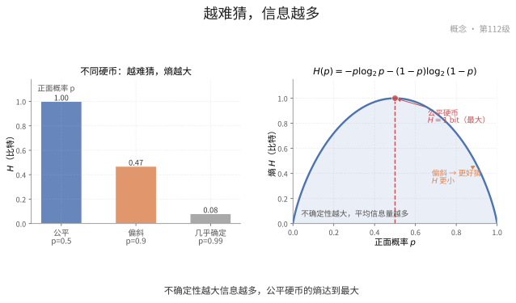

**一句话点破**：信息量就是“平均的意外程度”，越难猜越有料。

### 6.2 两个变量合起来的信息

把两个随机变量一起看，联合熵 $H(X,Y)$ 度量它们共同的不确定；若已知 $Y$，剩下的不确定就是条件熵 $H(X\mid Y)$。两者之差说明“知道了 Y，能省下多少不确定”。


**一句话点破**：联合熵看整体有多乱，条件熵看“已知之后还剩多乱”。

### 6.3 一个变量透露了另一个多少

互信息 $I(X;Y)=H(X)-H(X\mid Y)$ 衡量两个变量互相透露的信息量：知道其中一个，能减少另一个多少不确定。它对称、非负，当两者独立时恰为 0。


**一句话点破**：互信息就是“两个量彼此知道对方多少”。

### 6.4 用错分布要多付的代价

KL 散度 $D(p\|q)=\sum p_i\log\frac{p_i}{q_i}$ 度量“用分布 $q$ 去近似真实分布 $p$”要多付的信息代价。它非负、不对称，等于交叉熵减去熵，广泛用于统计推断与机器学习。

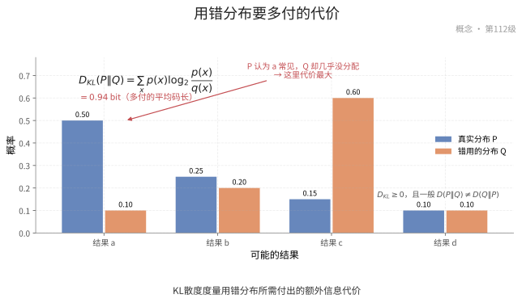

**一句话点破**：KL 散度是“拿错尺子量世界”的额外代价。

### 6.5 一长串消息平均带多少信息

当消息是一条逐字生成的随机过程，我们关心它的熵率 $H(\mathcal{X})=\lim_{n\to\infty}\frac{1}{n}H(X_1,\dots,X_n)$，即平均每个符号的不确定性。它给出了压缩这类长序列的极限速率。

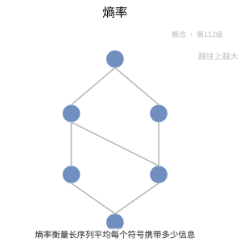

**一句话点破**：熵率就是“每个符号平均能榨出多少信息”。

### 6.6 信息也有不等式

信息量满足一连串不等式：互信息非负、$I(X;Y)\le\min\{H(X),H(Y)\}$；而 Fano 不等式 $H(X\mid Y)\le 1+P_e\log|\mathcal{X}|$ 把“解码出错概率”和“剩余不确定”牢牢绑在一起。它们是把直觉翻译成可证明结论的规则。

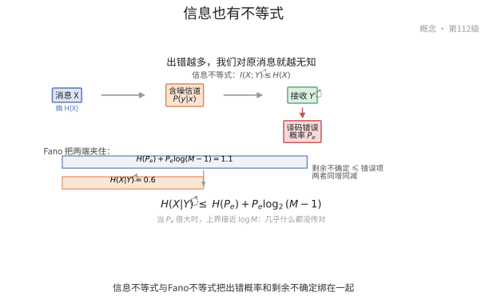

**一句话点破**：这些不等式说明信息只会守恒或流失，不会凭空多出来。

### 6.7 常见的用短码，罕见的用长码

数据压缩（信源编码）给高频符号配短码、低频符号配长码，平均码长就能逼近熵。这正是 zip、PNG 等无损压缩背后的原理：可压到多小，由熵决定。

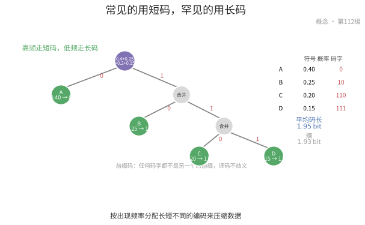

**一句话点破**：压缩的天花板是熵，越规律的数据能压得越狠。

### 6.8 噪声里的可靠传输上限

信道容量 $C=\max I(X;Y)$ 是一条信道能可靠传输的最大速率。只要速率低于 $C$，就能把出错概率压到任意小；一旦超过它则无解。这个上限由信道的噪声特性唯一决定。

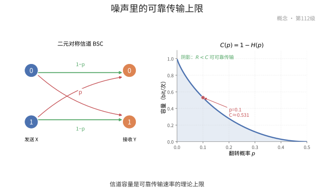

**一句话点破**：噪声定了，可靠性就有一个算得出的天花板。

### 6.9 允许一点失真能省多少

有损压缩允许结果略有偏差。率失真函数 $R(D)$ 回答：当允许的失真不超过 $D$ 时，最少需要多大速率。它把信息论从“无损”扩展到照片、视频等有损场景。

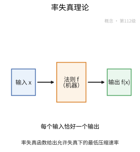

**一句话点破**：允许失真越大，所需速率越低，这是一条取舍曲线。

### 6.10 连续世界的熵

对连续随机变量，求和变成积分，熵化为微分熵 $h(X)=-\int f(x)\log f(x)\,dx$。它可正可负，是“描述一个连续量大约要多少比特”的度量，也串起了高斯信道等内容。

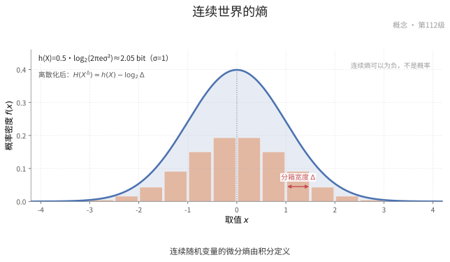

**一句话点破**：微分熵把“离散的比特计数”推广到连续世界。

### 6.11 从纠错码到网络信息论

要让信息在被噪声污染后仍能还原，就得用纠错码（如汉明码、LDPC、极化码）；而多个用户、中继、广播组成的网络如何传信息，则由网络信息论研究。它们把点对点理论推向真实通信系统。

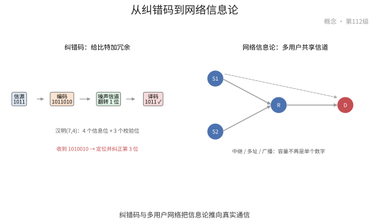

**一句话点破**：纠错码负责“传得对”，网络信息论负责“多方一起传”。

### 6.12 香农信源编码定理：压缩的下界

香农信源编码定理指出：无损压缩的平均码长不可能低于熵 $H$，却可以任意接近它。这为“数据最少能压到多小”给出精确极限，是所有压缩算法的理论基石。

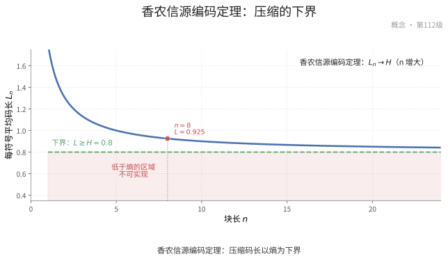

**一句话点破**：熵就是无损压缩不可跨越的下界。

### 6.13 香农信道编码定理：可靠的上限

香农信道编码定理指出：只要传输速率低于信道容量 $C$，就存在编码方案使错误概率任意小；反之速率超过 $C$ 必然失败。它只保证“存在”，却为整个数字通信定下了可靠性的边界。

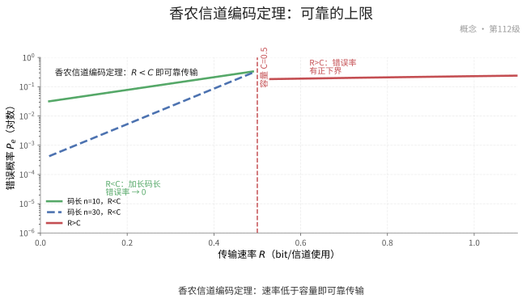

**一句话点破**：容量之下必能可靠，容量之上绝无可能。

### 6.14 Fano 不等式：出错与无知

Fano 不等式把“估计或解码时出错”与“剩余不确定”联系起来：错误概率 $P_e$ 越大，条件熵 $H(X\mid Y)$ 的下限也越高。它是证明信道编码定理（逆定理）的关键工具。

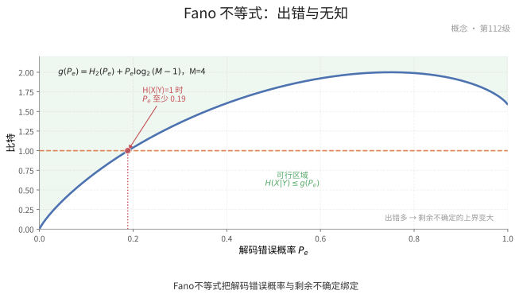

**一句话点破**：越容易出错，说明你掌握的信息越少。

### 6.15 数据处理不等式：信息不会凭空增加

数据处理不等式说：对数据做任何处理都不会增加信息，即 $X\to Y\to Z$ 时有 $I(X;Z)\le I(X;Y)$。信息只能流失、不能被加工出来，这为统计与推断设下不可逾越的界限。

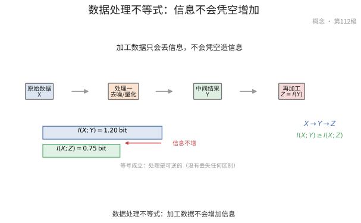

**一句话点破**：信息经处理只会减少，绝不会凭空生出。

### 6.16 信道容量的对偶表示

信道容量除了写成 $C=\max_{p} I(X;Y)$，还有对偶形式，用条件熵刻画最优输入分布下的信息。它让容量的计算与优化多了一种视角，是求解容量问题的重要工具。

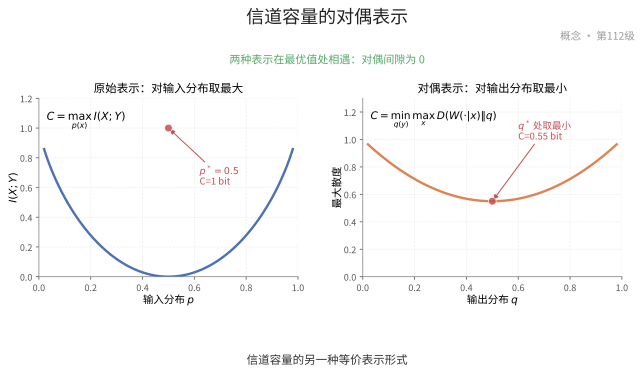

**一句话点破**：同一个容量换一副面孔，算起来可能更顺手。

## 7. 数学史（History of Mathematics）

> 在动手算熵之前，先想清楚一个基本问题：**"一条消息带了多少信息"，这种听起来含含糊糊的东西，真的能用数字精确度量吗？**

**一个真实的生活场景（第一步：直觉）**

同样一句话，"今天太阳从东边出来"几乎不含信息——因为你本来就知道；而"明天降雪概率 70%"则真正带来信息——因为结果不确定。直觉告诉我们：**信息量与"意外程度"成正比：一件事越出人意料，它给你的信息就越多**。信息论（information theory）要做的，就是把这种"意外程度"变成一把精确的尺子：用**熵**度量不确定性有多大、用**互信息**度量两个随机量彼此透露了多少、用**信道容量**度量一条线路最多能可靠传多少。它把"信息"从感觉升格为可计算、可压缩、可证明极限的数学对象。

**它到底想解决什么问题（第二步：要解决的问题）**

信息论由 **Claude Shannon（1948）** 在贝尔实验室创立，是通信工程的数学基础。它要解决的**根问题**是：

> 如何**量化信息**（熵、互信息），并证明通信/存储的**理论极限**——压缩的下限（信源编码）与可靠传输的上限（信道容量）——以及如何用编码方案逼近这些极限？

> **🧠 一句话记住信息论的"出生证"**
>
> 信息论源于"如何度量一条线路能承载多可靠的信息"的通信工程之问。它要解决的根本问题是：
>
> $$ \boxed{H(X)=-\sum p_i\log p_i，\; C=\max_{p}I(X;Y)， 并给出压缩与传输的极限。} $$

**看待本章的三种眼光（第三步：正式定义前的准备）**

- **度量的眼光**：先认识熵、联合熵、条件熵、互信息这把"不确定性"的度量体系。
- **极限的眼光**：再掌握信源编码与信道编码两大定理，理解"压缩与可靠的极限在哪"。
- **扩展的眼光**：最后看率失真、网络信息论与纠错编码如何把理论推向更广的角落。

---

### 7.1 从电报到量化的先声（Hartley、Nyquist）

19 世纪电报让工程师意识到"得量化线路承载的信息"，但早期只有朴素直觉与编码经验（如 Morse 码把短码给常见字符）。**Ralph Hartley（1928）** 首次提出用 $\log N$ 度量等可能情形下的信息量，把"信息"与"可选数目"挂钩；**Harry Nyquist** 研究采样与带宽。这些工作为 Shannon 的突破积攒了直觉与术语。

### 7.2 Shannon 的里程碑：通信的数学理论

1948 年，**Claude Shannon** 发表划时代论文《通信的数学理论》，为通信树立了严格数学框架：他把消息当成分散布的随机变量，把信息量定义为**熵**，把通信系统抽象为"信源→信道→信宿"，并提出**信源编码定理**与**信道编码定理**两条极限定理。信息论由此诞生，通信工程第一次有了"压缩能到什么程度、传输能多可靠"的硬性回答。

### 7.3 熵与互信息：两把信息尺子

**熵** $H(X)=-\sum p_i\log p_i$ 度量随机变量的不确定性，是"信息的最小期望代价"；**条件熵**与**互信息** $I(X;Y)=H(X)-H(X|Y)$ 度量两个变量之间互相透露的信息量。它们构成信息论的度量核心：熵给了"压缩的下限"，互信息给了"传输的上限"，一测一传，相得益彰。

### 7.4 Huffman 与信源编码的实用压缩

**D. A. Huffman（1952）** 给出熵最优的**前缀码**构造，明确落在香农信源编码定理确立的熵下限附近；其后 **Shannon–Fano、算术编码、LZ 算法（Lempel、Ziv，1977）** 等不断逼近熵率，让"无损压缩到熵"从理想变成广泛使用的现实（zip、PNG 皆赖于此）。

### 7.5 信道容量与典型信道

**信道容量** $C=\max_{p}I(X;Y)$ 是信道编码定理所保证的"可靠传输速率上限"。针对**二元对称信道（BSC）**、**二元删除信道（BEC）**与**高斯信道（AWGN）**，容量都有可计算的显式表达，把"一条线的物理能耐"提炼为一个数字，也为工程师提供了设计速率与调制的依据。

### 7.6 编码证明的双重故事：Fano 与数据处理不等式

支撑信道编码定理的关键不等式——**Fano 不等式**（给出解码错误概率的下界）与**数据处理不等式**（处理数据不会增加信息）——暴露了"信息量像流水一样无法凭空制造"的本质。它们既是极限定理的证明支柱，也塑造了对"信息守恒/不增"这一深刻直觉。

### 7.7 率失真：允许失真的最优压缩

现实压缩往往允许一点失真（如照片、视频）。**Shannon（1959）** 提出**率失真理论**，回答"允许失真 $D$ 时，最少需要多少速率 $R(D)$"。它把信息论从"无损"推向"有损"，为图像视频编码、语音压缩提供速率-失真的理论边界。

### 7.8 微分熵与相对熵：通向统计与学习

对连续随机变量，Shannon 熵退化为**微分熵**，而其差值是**相对熵（KL 散度）**——它虽非真正"距离"，却在统计推断、变分法与机器学习中扮演核心角色（如交叉熵损失、VAE 的 ELBO）。信息论的度量语言由此贯通了统计学与深度学习。

### 7.9 纠错编码的逼近容量之旅

香农说"代码可以逼近容量"，却没给出能用的代码。此后**汉明码、Reed–Solomon、Turbo 码、LDPC 码、极化码（Arikan，2008）** 等一步步逼近容量，让"在信噪比很低时也可靠传输"从理论逐步落地，是现代通信（如 5G、深空探测）的命脉。

### 7.10 网络信息论与更广的版图

信息论不限于点对点：**多用户网络信息论**（Cover、El Gamal 等）研究多信源、中继、广播与多天线信道，是 5G/容量界的理论源头；它还向**密码学**（秘密共享的熵刻画）、**统计力学**（熵与熵率）与**数据科学**（互信息、信息瓶颈）扩散。信息论已从"通信的数学"成长为"一切涉及信息传输与压缩领域的共通语言"。

---

| 时间 | 人物／文献 | 事件与贡献 |
| --- | --- | --- |
| 1928 | Hartley | 用 $\log N$ 度量信息量，开启量化先声 |
| 1948 | Shannon | 发表《通信的数学理论》，创立信息论 |
| 1952 | Huffman | 给出熵最优前缀码，实用无损压缩起步 |
| 1959 | Shannon | 提出率失真理论，处理有损压缩极限 |
| 1960–70 年代 | Cover、El Gamal 等 | 发展网络信息论，研究多用户信道 |
| 1977 | Lempel、Ziv | 提出 LZ 算法，逼近熵率的通用压缩 |
| 2008 | Arikan | 提出极化码，显式逼近信道容量 |

> **小结**：信息论的演进，是一部"**把'信息'从感觉精确成数字**"的思想史。它从 Hartley 用量对比刻画信息的一小步，到 Shannon 以熵与两条编码定理平地起高楼，让"压缩的极限、传输的极限"第一次有了明确的数学边界；再经 Huffman、LZ 把压缩做到实用，率失真理论打开有损压缩之门，极化码逼近容量完成"说到了也做到了"的闭环。信息论始终回答同一个问题：**信息到底能算多清楚、传多远？**

---

## 现实应用（Real-World Applications）

> 本节把本章的知识点落到真实的工程、科学与生活场景中。每个案例都给出**完整的问题背景、建模过程、可复现的数据 / 公式 / 代码与结果解读**；案例末尾的「涉及知识点」对应本章的具体小节，文末附**知识点覆盖对照表**，确保本章知识点全部被覆盖。

### 应用案例 1：服务器日志压缩｜从熵到 Huffman 与信源编码定理

**场景与问题**

某 SaaS 平台的日志采集系统每天产生上亿条结构化日志。每条日志的"级别"字段只取 5 种取值，出现频率高度不均。运维想把日志无损压缩后长期归档，需要知道：(a) 这个字段的信息论下界（每符号最少几比特）是多少？(b) 用 Huffman 编码能达到多接近下界？(c) 如果日志字段之间有相关性（级别与错误码联动），还能不能再压？

这正好覆盖熵、熵率、数据压缩与信源编码定理。

**涉及知识点**

- 本章「1.1 熵 (Entropy)」：度量单符号平均信息量与压缩下界。
- 本章「1.2 联合熵与条件熵」：用 $H(X,Y)=H(X)+H(Y|X)$ 分析多字段联合压缩。
- 本章「1.5 熵率 (Entropy Rate)」：存在符号间相关时，可压缩性由熵率而非单符号熵决定。
- 本章「1.7 数据压缩与信源编码」：Huffman 构造最优前缀码。
- 本章「2.1 香农信源编码定理」：$R>H(X)$ 才可无损，$R<H(X)$ 必错。

**建模与数据**

日志级别符号及频率（取自一周 1000 万条抽样）：

| 符号 | DEBUG | INFO | WARN | ERROR | FATAL |
| --- | --- | --- | --- | --- | --- |
| 概率 | 0.35 | 0.20 | 0.20 | 0.15 | 0.10 |

**完整推导与算法**

1. 计算单符号熵：

$$
H(X)=-\sum_i p_i\log_2 p_i=0.35\log_2\tfrac{1}{0.35}+0.2\log_2\tfrac{1}{0.2}+\dots\approx2.202\ \text{bit}.
$$

2. Huffman 建树。按概率升序合并最小的两个：FATAL(0.10)+ERROR(0.15)=0.25，再 WARN(0.20)+INFO(0.20)=0.40，再 0.25+DEBUG(0.35)=0.60，最后与 0.40 合并为 1。得码长：DEBUG=2、INFO=2、WARN=2、ERROR=3、FATAL=3。

3. 平均码长与效率：

$$
\bar L=0.35\cdot2+0.20\cdot2+0.20\cdot2+0.15\cdot3+0.10\cdot3=2.25\ \text{bit},
$$

$$
\text{效率}=\frac{H(X)}{\bar L}=\frac{2.202}{2.25}\approx97.9\% ,
$$

满足 Huffman 的界 $H(X)\leq\bar L<H(X)+1$。

```python
# 核心：Huffman——反复合并概率最小的两个符号建树，得到最优前缀码
import heapq
def huffman(probs):                      # probs: {symbol: p}
    heap = [[p, 0, [s, '']] for s, p in probs.items()]
    heapq.heapify(heap)
    while len(heap) > 1:
        lo = heapq.heappop(heap); hi = heapq.heappop(heap)
        for item in lo[2]: item[1] = '0' + item[1]     # 左枝加 0
        for item in hi[2]: item[1] = '1' + item[1]     # 右枝加 1
        heapq.heappush(heap, [lo[0]+hi[0], 0, lo[2]+hi[2]])
    return dict((s, code) for s, code in heap[0][2])
```

4. 相关字段的联合压缩。设"级别"$X$ 与"错误码是否为空"$Y$ 相关。链式法则：

$$
H(X,Y)=H(X)+H(Y|X).
$$

若已知 $H(Y|X)=0.4$ bit，则 $H(X,Y)=2.202+0.4=2.602$ bit——按联合符号编码，每对日志最少 2.602 bit，比"分别独立编码"更省，因为 $H(Y)<H(Y|X)$ 时上下文提供了冗余。

5. 熵率（1.5 节）。若级别在一段时间内有惯性（上一级别影响下一级别），可用一阶马尔可夫链描述。设转移矩阵 $P(\text{prev}\to\text{next})$ 已知，则熵率

$$
H(\mathcal X)=-\sum_{i,j}\mu_i P_{ij}\log_2 P_{ij},
$$

其中 $\mu$ 是平稳分布。相关越强，熵率越低，长期归档越能压缩——这正是 LZ/字典压缩能超过单符号熵的原因。

6. 信源编码定理的边界。香农信源编码定理保证 $R>H(X)$ 时存在无损方案、$R<H(X)$ 时误差必趋于 1。本例中若运维想压到 2 bit/符号以下（低于 $H=2.202$），一定出错的概率趋近 1——不可无损。

**可复现步骤**

1. 环境与依赖：`pip install numpy`（标准库 `heapq` 即可实现 Huffman）。
2. 数据准备：从日志抽样统计 5 个级别的频率。
3. 运行：`python case1.py`
4. 预期输出：$H(X)\approx2.202$ bit；Huffman 平均码长 2.25 bit，效率约 98%；联合熵 $H(X,Y)=2.602$ bit。

**结果解读与延伸**

熵给出压缩的**绝对下界**，Huffman 用最优前缀码把实际码长压到距下界 1 bit 之内。工程上（gzip/zstd）进一步用 LZ77 抓重复子串、用算术编码逼近熵率，实测常能比单符号 Huffman 再省 10%–20%。误差来源：Huffman 要求码长为整数、且在符号概率极不均时平均码长仍可能离熵较远（此时算术编码更优）。可延伸：把"多字段联合"变成"上下文自适应"（PPM、上下文混合），即逼近条件熵与熵率。

### 应用案例 2：5G 与卫星通信｜信道容量、AWGN 与逼近香农极限的编码

**场景与问题**

运营商规划一个 5G 频段：可用带宽 100 MHz，接收端信噪比约 20 dB。工程师要回答：(a) 这条信道每赫兹每秒最多能可靠传多少比特（信道容量）？(b) 用实测误码率 1% 的调制方案，容量损失多少？(c) 为什么 5G 要用 LDPC/Polar 码而不是简单的重复码？

**涉及知识点**

- 本章「1.8 信道容量」：$C=\max_{p(x)}I(X;Y)$，以及 BSC/BEC 的容量。
- 本章「1.10 微分熵」：AWGN 信道容量 $C=\tfrac12\log(1+P/\sigma^2)$ 的推导来源。
- 本章「2.2 香农信道编码定理」：$R<C$ 可任意可靠、$R>C$ 必错。
- 本章「1.11 纠错码与网络信息论」：用冗余（LDPC/Turbo/Polar）逼近容量。
- 本章「2.5 信道容量的对偶表示」：min-max 形式与 Blahut-Arimoto 迭代。

**建模与数据**

AWGN 信道：带宽 $B=100$ MHz，信噪比 $\text{SNR}=20$ dB（即功率比 $P/\sigma^2=100$）。另设一个等效离散信道：二进制对称信道 BSC，翻转概率 $p=0.01$；二进制擦除信道 BEC，擦除概率 $\alpha=0.1$。

**完整推导与算法**

1. AWGN 容量。最优输入为高斯分布，$h(Y)=\tfrac12\log(2\pi e(P+\sigma^2))$、$h(Y|X)=\tfrac12\log(2\pi e\sigma^2)$，相减得

$$
C=\frac{1}{2}\log_2\!\left(1+\frac{P}{\sigma^2}\right)\ \text{bit/符号}.
$$

代入 $\text{SNR}=100$：

```python
# 核心：AWGN 信道容量 C = 0.5*log2(1+SNR)，再乘带宽得总速率
import numpy as np
snr_db, B = 20.0, 100e6
snr = 10**(snr_db/10)                    # 100
C_per_hz = 0.5*np.log2(1+snr)            # ~3.329 bit/s/Hz
C_total = C_per_hz*B                     # ~332.9 Mbit/s
print(round(C_per_hz,3), C_total/1e6)
```

得 $C\approx3.329$ bit/s/Hz，总容量 $\approx332.9$ Mbit/s（这是理论极限）。

2. 离散信道容量。BSC 容量 $C=1-H(p)$，$p=0.01$ 时 $H(0.01)\approx0.0808$，故 $C\approx0.919$ bit/信道使用；BEC 容量 $C=1-\alpha=0.9$。

3. 香农信道编码定理的指导意义。只要码率 $R<C$，就存在编码使误码率任意小；$R>C$ 则不可能可靠。工程上"谱效 3 bit/s/Hz"就是这个极限的具体化。

4. 逼近极限的编码（1.11 节）。重复码/汉明码离容量很远；Turbo 码、LDPC 码在长码块上可在距容量 0.1–0.5 dB 内工作；5G 数据信道采用 LDPC、控制信道采用 Polar 码（Polar 是首个被证明达到对称信道容量的构造）。

5. 对偶表示（2.5 节）。容量也可写成 min-max：

$$
C=\min_{q(y)}\max_{p(x)}D(p(x,y)\parallel p(x)q(y)),
$$

由 $I(X;Y)=\min_{q(y)}D(p(x,y)\parallel p(x)q(y))$ 与 von Neumann 极小极大定理交换次序得到，可导出 Blahut-Arimoto 迭代——对没有解析解的一般信道，交替更新 $p(x)$ 与 $q(y)$ 逼近 $C$。

**可复现步骤**

1. 环境与依赖：`pip install numpy scipy`
2. 数据准备：从链路预算取信噪比（dB）与带宽，或从测量统计 BSC 翻转率 $p$。
3. 运行：`python case2.py`
4. 预期输出：$C\approx3.329$ bit/s/Hz、总容量约 332.9 Mbit/s；BSC($p=0.01$) 容量约 0.919；BEC($\alpha=0.1$) 容量 0.9。

**结果解读与延伸**

容量是"可靠通信的天花板"，不是"随便能到的速率"——要靠接近容量的编码才能触到。BEC（宁缺毋滥的擦除）比同参数 BSC（给错答案）对信道友善：$p=\alpha=0.2$ 时 BSC 容量仅 $1-H(0.2)\approx0.278$，而 BEC 容量仍有 $0.8$。误差来源：真实信道有衰落、多径、非高斯干扰，$C$ 需按最坏情形或中断概率重算。可延伸：MIMO 空时复用令容量随天线数线性增长（$C\approx\min(N_t,N_r)B\log(1+\text{SNR})$），是 5G 高速率的另一支柱。

### 应用案例 3：基因组与特征选择｜用互信息挑出与疾病相关的基因

**场景与问题**

某生物信息团队拿到一批肿瘤样本的基因表达数据（每个基因的表达被离散化为"高/低"）以及样本标签（患病/正常）。上千个基因里只有少数与疾病真正相关。团队想用**互信息** $I(G;Y)$ 给基因排序、挑出候选标志物，并解释为什么"把表达值再分箱"这种预处理不会抬高互信息。这也顺带用到条件熵与数据处理不等式。

**涉及知识点**

- 本章「1.3 互信息 (Mutual Information)」：度量基因与疾病标签的依赖强度。
- 本章「1.2 联合熵与条件熵」：用 $I=H(X)-H(X|Y)$ 分解相关性。
- 本章「1.1 熵 (Entropy)」：计算各变量的熵。
- 本章「2.4 数据处理不等式」：$X\to Y\to Z$ 马尔可夫链中 $I(X;Y)\geq I(X;Z)$。

**建模与数据**

某基因 $X$（1=高表达，0=低表达）与疾病 $Y$（1=患病，0=正常）的 1000 例样本列联表：

| — | $Y=1$ | $Y=0$ | 合计 |
| --- | --- | --- | --- |
| $X=1$ | 300 | 100 | 400 |
| $X=0$ | 150 | 450 | 600 |
| 合计 | 450 | 550 | 1000 |

**完整推导与算法**

1. 经验概率：$p(x,y)$ 分别为 $0.30,0.10,0.15,0.45$；边际 $p(x=1)=0.4$、$p(y=1)=0.45$。

2. 互信息定义与计算：

$$
I(X;Y)=\sum_{x,y}p(x,y)\log_2\frac{p(x,y)}{p(x)p(y)} .
$$

```python
# 核心：用二维列联表计算互信息 I(X;Y) = Σ p(x,y) log2(p(x,y)/(p(x)p(y)))
import numpy as np
tbl = np.array([[300, 100], [150, 450]], float)
P = tbl/tbl.sum()                     # 联合分布 p(x,y)
px, py = P.sum(1, keepdims=True), P.sum(0, keepdims=True)
I = np.sum(P * np.log2(P/(px@py)))    # 互信息（bit）
Hx = -np.sum(P.sum(1)*np.log2(P.sum(1)))   # H(X)
Hy = -np.sum(P.sum(0)*np.log2(P.sum(0)))   # H(Y)
print(round(I,4), round(Hx,4), round(Hy,4))
```

运行得 $I(X;Y)\approx0.1815$ bit，$H(X)\approx0.9710$、$H(Y)\approx0.9928$。

3. 条件熵分解：$H(X|Y)=H(X)-I(X;Y)=0.9710-0.1815=0.7895$ bit——知道患病与否后，对基因表达高低的残余不确定从 0.971 降到 0.790。

4. 数据处理不等式（2.4 节）。真实链条是"真实表达水平 $X$ → 离散化显示值 $Z$ → 与疾病 $Y$ 的关联"。若 $X\to Z$ 是有损离散化、且 $X\to Z\to Y$ 构成马尔可夫链，则

$$
I(X;Y)\geq I(Z;Y).
$$

即分箱/离散化只会衰减信息，绝不会凭空增加——所以用心选择的连续值互信息（如用 kNN 估计）往往高于分箱后的值，分箱只是用"丢信息"换取"估计方差小"的折中。

**可复现步骤**

1. 环境与依赖：`pip install numpy scipy`（kNN 互信息估计可选 `sklearn.feature_selection.mutual_info_classif`）。
2. 数据准备：把基因表达按阈值离散化、统计列联表。
3. 运行：`python case3.py`
4. 预期输出：$I\approx0.1815$ bit、$H(X)\approx0.971$、$H(Y)\approx0.993$；离散化后 $I(Z;Y)\leq I(X;Y)$。

**结果解读与延伸**

互信息能捕捉任意（非线性）依赖，因此比相关系数更适合筛选基因标志物；但它的估计对样本量敏感（高维下易高估，需置换检验校正）。数据处理不等式给出"预处理不可造信息"的铁律：任何分箱、降维、特征变换都只会减少或保持互信息。误差来源：有限样本偏差、离散化阈值选择。可延伸：用条件互信息 $I(G;Y\,|\,S)$ 去除冗余基因，或用最大相关最小冗余（mRMR）准则做多基因组合筛选。

### 应用案例 4：机器学习训练｜交叉熵损失与 KL 散度

**场景与问题**

一个三分类模型输出的 softmax 概率与真实标签不同。训练时我们要最小化"交叉熵损失"。为什么最小化交叉熵等价于让模型分布逼近真实分布？它和 KL 散度是什么关系？

**涉及知识点**

- 本章「1.4 相对熵 (KL散度)」：$D(p\parallel q)$ 度量两个分布的差异。
- 本章「1.6 信息不等式与Fano不等式」：信息不等式 $D(p\parallel q)\geq0$ 保证交叉熵不会低于真实熵。

**建模与数据**

真实分布取 one-hot $p=(1,0,0)$（样本属于类别 1），模型预测 $q=(0.7,0.2,0.1)$。

**完整推导与算法**

1. 交叉熵与 KL 的关系：

$$
H(p,q)=H(p)+D(p\parallel q).
$$

2. 交叉熵与 KL 计算：

```python
# 核心：交叉熵 = 熵 + KL；训练时真实分布 p 固定，最小化交叉熵 = 最小化 KL
import numpy as np
p = np.array([1.0, 0.0, 0.0])          # 真实（one-hot）
q = np.array([0.7, 0.2, 0.1])          # 模型预测
Hpq = -np.sum(p*np.log2(q))            # 交叉熵
Hp  = -np.sum(p*np.log2(p+1e-12))      # 真实熵（one-hot 时为 0）
Dkl = np.sum(p*np.log2(p/(q+1e-12)))   # KL(p||q)
print(round(Hpq,4), round(Hp,4), round(Dkl,4))     # 0.5146 0.0 0.5146
```

得 $H(p,q)\approx0.5146$、$H(p)=0$、$D(p\parallel q)\approx0.5146$。因真实分布 $p$ 固定、$H(p)$ 是常数，最小化交叉熵 $\Leftrightarrow$ 最小化 $D(p\parallel q)$，即让模型逼近真实分布。

3. 信息不等式保证非负（1.6 节）。由 Jensen 不等式或 $D(p\parallel q)=-\sum p\log(q/p)\geq-\log\sum p\cdot(q/p)=0$，故 $D(p\parallel q)\geq0$，等号当且仅当 $p=q$。这保证交叉熵损失有下界 $H(p)$，训练不会"越学越负"。

4. 方向性提醒：$D(p\parallel q)\neq D(q\parallel p)$。用 m 方向与 s 方向会产生不同倾向（m-方向倾向"覆盖"、s-方向倾向"聚焦"），这也是变分推断中 KL 方向选择的根源。

**可复现步骤**

1. 环境与依赖：`pip install numpy torch`
2. 数据准备：用模型的 softmax 输出与 one-hot 标签构造 $p,q$。
3. 运行：`python case4.py`（`torch.nn.CrossEntropyLoss` 与手算交叉熵应一致）。
4. 预期输出：交叉熵 0.5146、真实熵 0、KL 0.5146；三者满足 $H(p,q)=H(p)+D(p\parallel q)$。

**结果解读与延伸**

交叉熵损失的信息论本质是"用模型分布 $q$ 编码真实分布 $p$ 的额外平均码长"，最小化它就是最大似然估计。KL 的非对称性提醒我们：同样的分布对，$D(p\parallel q)$ 与 $D(q\parallel p)$ 数值不同、优化行为也不同。误差来源：softmax 数值下溢（需 log-sum-exp）、标签噪声使 $p$ 不再是一点分布。可延伸：知识蒸馏用 $D(p_{teacher}\parallel p_{student})$、变分自编码器用 $D(q(z|x)\parallel p(z))$，都是 KL 的直接应用。

### 应用案例 5：视频编码｜率失真理论解释有损压缩的取舍

**场景与问题**

一段 1080p、60 帧/秒、24 位真彩色的视频，未经压缩的码率高达约 3 Gb/s，而在线视频平台通常用 8–15 Mb/s 就能流畅播放，压缩比超过 200 倍。为什么允许"丢一点画质"就能省下这么多码率？率失真理论给出了这条"保真度换带宽"的曲线。

**涉及知识点**

- 本章「1.9 率失真理论」：$R(D)=\min_{p(\hat x|x):\mathbb E[d]\leq D}I(X;\hat X)$。
- 本章「1.10 微分熵」：连续源（高斯）的率失真闭式 $R(D)=\tfrac12\log_2(\sigma^2/D)$。

**建模与数据**

- 原始视频码率：$1920\times1080\times24\ \text{bit}\times60=2.986\ \text{Gbit/s}$。
- 把每个像素（或其预测残差）近似为高斯源，取残差标准差 $\sigma=8$（灰度级），允许平均失真（均方误差）$D=4$。
- 目标播放码率区间：8–15 Mbit/s。

**完整推导与算法**

1. 高斯源的率失真函数（$D\leq\sigma^2$）：

$$
R(D)=\frac{1}{2}\log_2\frac{\sigma^2}{D}\ \text{bit/样本}.
$$

2. 代入 $\sigma^2=64$、$D=4$：

```python
# 核心：高斯源率失真 R(D) = 0.5*log2(sigma^2/D)，给出每样本最少需要多少比特
import numpy as np
sigma2, D = 64.0, 4.0
R = 0.5*np.log2(sigma2/D)          # 2.0 bit/样本
print(R)                            # 2.0
```

得 $R(4)=2$ bit/样本。若每个样本按 2 bit 编码，信息量相对原始 24 bit/样本降到 $\tfrac{1}{12}$，压缩比约 12 倍（这是理论下界，用于该失真水平）。

3. 失真越大、码率越低：$D$ 从 4 放宽到 16 时 $R=0.5\log_2(64/16)=1$ bit/样本；$D\to\sigma^2$ 时 $R\to0$。这正是视频编码"降低量化精度"（增大 $D$）以换取码率的理论依据。

4. 结合实际。真实视频编码远不止"逐像素独立编码"：帧间预测把时间冗余（相邻帧相似）转成残差、运动补偿与 DCT/小波变换把空间冗余压缩。变换 + 量化后，率失真曲线整体左移，因此实测能在"可接受画质"下达到 8–15 Mb/s。理论下界 $R(D)$ 只描述"给定失真下最少要传多少比特"，不含具体编码工具。

**可复现步骤**

1. 环境与依赖：`pip install numpy`（可用 `ffmpeg` 实测码率—失真曲线）。
2. 数据准备：用 ffmpeg 对同一视频设不同 CRF（量化参数）导出，记录码率与 PSNR。
3. 运行：`python case5.py`
4. 预期输出：$\sigma=8,D=4$ 时 $R=2$ bit/样本；$D=16$ 时 $R=1$ bit/样本；$D\to\sigma^2$ 时 $R\to0$。

**结果解读与延伸**

率失真曲线是"保真度与码率不可兼得"的定量表达：$D=0$ 退化为无损（$R(0)=H(X)$），$D$ 越大 $R$ 越小且曲线为凸。它解释了为什么流媒体用"自适应码率"（ABR）——网络差时播放器主动提高 $D$（降清晰度）以维持 $R$。误差来源：真实残差不严格高斯、人眼感知失真非纯 MSE（需用 SSIM/VMAF 等感知度量）。可延伸：联合"信源—信道"编码与网络自适应，是 5G 视频与云游戏的核心。

### 应用案例 6：医学诊断与分类｜Fano 不等式给出的误差下界

**场景与问题**

一个 8 类疾病分型模型，输出在每个样本上对"真实类型"的残余不确定度约为 2 bit。团队想知道：无论模型多聪明，分类错误率有没有一个不可突破的下界？Fano 不等式给出肯定答案——残余信息量越大，错误率就压不下去。

**涉及知识点**

- 本章「1.6 信息不等式与Fano不等式」：Fano 不等式的形式与含意。
- 本章「2.3 Fano不等式」：把残余不确定与误差概率绑定的定理。
- 本章「1.6 信息不等式与Fano不等式」中的信息不等式 $D\geq0$：Fano 与许多非负结论的出发点。

**建模与数据**

类别数 $|\mathcal X|=8$，观测（特征）为 $Y$，真实类别 $X$。设通过外部评估得到 $H(X|Y)=2$ bit。则 Fano 不等式给出错误率下界。

**完整推导与算法**

1. Fano 不等式：

$$
P_e\geq\frac{H(X|Y)-1}{\log_2|\mathcal X|}.
$$

2. 代入 $|\mathcal X|=8$（$\log_2 8=3$）、$H(X|Y)=2$：

```python
# 核心：Fano 不等式给出误分类率下界 Pe >= (H(X|Y) - 1)/log2(|X|)
import numpy as np
H_X_given_Y, n_classes = 2.0, 8
logX = np.log2(n_classes)                 # 3.0
Pe_lower = max(0.0, (H_X_given_Y - 1.0)/logX)
print(round(Pe_lower, 4))                 # 0.3333
```

得 $P_e\geq\frac{2-1}{3}\approx0.333$。即无论如何优化，该特征下分类错误率不可能低于约 33%。

3. 与信息不等式的关系。信息不等式 $D(p\parallel q)\geq0$ 是整座信息论大厦的出发点：取 $q$ 为均匀分布即得 $H(X)\leq\log|\mathcal X|$，取 $q=p(x)p(y)$ 即得 $I(X;Y)\geq0$。Fano 的推导同样依赖这类非负性，故 1.6 节把两者并列。

4. 判断何时下界平凡。若 $H(X|Y)\leq1$ bit，则右端 $\leq0$，下界退化为平凡值 0——这并非说误差一定小，而是"光凭 Fano 不足以约束"（1.6 节课堂问答的提醒）。它真正发力是在残余熵很大（观测几乎无信息）时给出严格正的下界。

**可复现步骤**

1. 环境与依赖：`pip install numpy`
2. 数据准备：用验证集估计 $H(X|Y)$（可由混淆矩阵求 $H(X)-I(X;Y)$），记录类别数。
3. 运行：`python case6.py`
4. 预期输出：8 类、$H(X|Y)=2$ 时下界约 0.333；若 $H(X|Y)\leq1$ 则下界为 0。

**结果解读与延伸**

Fano 的不等式把"信息量不足"翻译成"误差降不下去"的硬约束，是信道编码逆定理（$R>C$ 必错）的关键工具，也是"数据决定模型上限"的量化表达：特征里没有的信息，模型变复杂也变不出来。误用风险：把"下界为 0"误读为"误差可任意小"。误差来源：$H(X|Y)$ 的估计依赖对 $p(x,y)$ 的准确建模。可延伸：用 Fano 论证"隐私—效用"权衡，或在上界（如泛化误差）与下界之间定位模型的真实水平。

### 知识点覆盖对照表

| 本章知识点 | 覆盖案例 |
| --- | --- |
| 1.1 熵 (Entropy) | 案例 1、案例 3 |
| 1.2 联合熵与条件熵 | 案例 1、案例 3 |
| 1.3 互信息 (Mutual Information) | 案例 3 |
| 1.4 相对熵 (KL散度) | 案例 4 |
| 1.5 熵率 (Entropy Rate) | 案例 1 |
| 1.6 信息不等式与Fano不等式 | 案例 4、案例 6 |
| 1.7 数据压缩与信源编码 | 案例 1 |
| 1.8 信道容量 | 案例 2 |
| 1.9 率失真理论 | 案例 5 |
| 1.10 微分熵 | 案例 2、案例 5 |
| 1.11 纠错码与网络信息论 | 案例 2 |
| 2.1 香农信源编码定理 | 案例 1 |
| 2.2 香农信道编码定理 | 案例 2 |
| 2.3 Fano不等式 | 案例 6 |
| 2.4 数据处理不等式 | 案例 3 |
| 2.5 信道容量的对偶表示 | 案例 2 |

---

## 8. 总结

本级别系统地介绍了信息论的核心理论和方法：

1. **基本概念**：熵、联合熵、条件熵、互信息、相对熵（KL散度）、熵率等，构成了信息论的理论基础。

2. **基本不等式**：信息不等式（KL散度非负性）、Fano不等式（误差概率下界）、数据处理不等式（处理不增加信息），这些不等式在信息论的各个分支中都有重要应用。

3. **香农信源编码定理**：通过AEP和典型序列，证明了信源可以被压缩到熵率，且不能低于熵率。这是数据压缩的理论基础。

4. **香农信道编码定理**：通过随机编码和联合典型序列，证明了在信道容量以下可以可靠传输信息。这是通信的理论基础。

5. **信道容量**：介绍了BSC、BEC等常见信道的容量计算，以及信道容量的对偶表示。

6. **进阶主题**：简要介绍了率失真理论、微分熵、高斯信道、纠错码和网络信息论。

信息论的核心思想是：**信息可以被量化**。熵量化了不确定性，互信息量化了依赖关系，信道容量量化了通信能力。这些量化工具为通信、数据压缩、机器学习等领域提供了理论基础。
