# 第 114 级：密码学 (Cryptography)

---

## 从"把秘密锁进数学保险箱"说起：密码学要解决的根问题

> 在看 RSA 那些模幂运算、各种"困难问题"之前，先想清楚一个最根本的问题：**为什么现代通信能放心地公开加密、却仍能守住秘密？**

**一个你天天在用的场景（第一步：直觉）**

你在购物网站上输入银行卡号时，网址边上会出现一把小锁（HTTPS）。数据明明要在公网上七拐八绕经过很多台服务器——这些服务器都可能被监听——可你的卡号依然只有卖家和你自己看得懂。莫非你和卖家事先偷偷见过面、约好暗号？并没有。**你们今天才第一次打交道，却能在隔着无数双眼睛的公开线路上，当场建立一个只有你们俩知道的秘密。** 密码学，就是这门"当着全世界面说悄悄话"的学问。

**一段从"换字母"到"换问题"的历史（第二步：要解决的问题）**

- **古代：靠"藏汉字眼"守秘密。** 早先的加密就是把消息"换一种写法"——凯撒大帝把每个字母往后移 3 位（凯撒密码）；二战时期德国使用**恩尼格玛（Enigma）**密码机。这一阶段的共同毛病是：**加密和解密用同一把钥匙，且"钥匙怎么安全送到对方手里"始终是死结**——一旦换钥的信使被截，一切皆休。
- **转折：1976 年 Diffie 与 Hellman《密码学的新方向》。** 他们发问：能不能**加密的钥匙公开、只有解密的钥匙私有**？于是有了"公钥加密"这一革命性思路，从根上解决"钥匙分发"难题。
- **现代：把"安全"建立在"问题之难"上。** 1977 年 RSA 基于**大整数因子分解**，1985 年 Miller、Koblitz 提出**椭圆曲线密码**（ECC）基于椭圆曲线群上的**离散对数问题**。今天的安全，不再靠"藏住算法"，而是靠"公开算法 + 一个公认极难反向求解的数学问题"。量子计算（Shor 算法）若成真，会一次性动摇这两大支柱，因此"后量子密码"（格密码等）成了新的竞逐场。

**第三步：正式定义前的准备**

本章按"从能用 → 到如何证明安全"推进：

1. 先分清两大阵营：**对称密码**（AES/DES，一把钥匙）与**非对称密码**（公钥加密，两把钥匙），搞懂它们各自的优势与软肋；
2. 再给"安全"立规矩：**归约证明**——把"破解我的方案"与"解某个公认难题"绑在一起，两者要么都成立、要么都不成立；
3. 依次拆解 RSA 的正确性与安全性、**Rabin 密码**与因子分解的等价、**Diffie–Hellman 密钥交换**与 **ElGamal 加密**（分别挂在 CDH、DDH 假设上）、**RSA-OAEP** 的填充与 CCA 安全；
4. 最后看**椭圆曲线、安全多方计算、零知识证明、同态加密、格密码与量子密码**等前沿，理解"安全"这条战线如何被不断重画。

带着"**凭什么公开一切却仍能保密？这个'难'到底难在哪里、又凭什么被认为难？**"去读每一步证明——你会看到密码学的每个定理，其实都在回答"我的方案卡在哪条公认的难题上"。

> **🧠 一句话记住密码学的"出生证"**
>
> 密码学源于"如何在公开、可被监听的信道上安全秘密地通信"，它解决的**根本问题**是：
>
> $$ \boxed{\text{让任何不在场的旁人即便截获全部公开信息，也读不懂、改不了、也冒充不了真正的消息。}} $$
>
> 现代密码学把这份承诺押在**一系列公认的数学难题**（分解、离散对数、格上困难问题）上，并用**归约证明**把"方案的安全性"和"难题的难解性"焊在一起。

---

## 开始之前

**本章在讲什么**：密码学研究"如何在有敌手的环境里安全通信"。你会学到对称密码（AES/DES）与非对称密码（公钥加密）两大阵营，理解 RSA 的正确性与安全性、Rabin 密码与因子分解的等价性、Diffie–Hellman 密钥交换、ElGamal 加密、RSA-OAEP 的 CCA 安全，以及数字签名、哈希、PKI 和椭圆曲线、同态加密、零知识证明、格密码、量子密码等方向。核心管线是"构造方案 → 定义安全模型 → 用归约证明安全"。

**为什么要学它**：它和刚学过的第 113 级编码理论正好是"问题的两面"——**编码理论防"噪声"（无意的物理差错），密码学防"敌手"（有意的攻击）**：一个要让消息在坏信道上"看得清"，一个要让消息在贼眼前"看不懂"。密码学把第 13 级数论（模运算、欧拉定理、原根、因子分解）、抽象代数（群、有限域）搬到信息安全的现场，也为第 121 级控制论中"系统对外部干扰与攻击的鲁棒性"提供了"对抗视角"的数学样板。它是网络安全、电子商务、区块链、可信计算的地基。

**开始前请确认你还记得**：

- 数论（见第 13 级）：模运算、欧拉函数 $\phi(n)$ 与欧拉定理、中国剩余定理、原根与离散对数、扩展欧几里得算法（关键：$ed\equiv1\pmod{\phi(n)}$，故 $m^{ed}\equiv m^{1+k\phi(n)}\pmod n$）。
- 抽象代数（群论）：循环群、群的阶、子群、生成元。Diffie–Hellman、ElGamal、ECC 全部跑在"好算却难反推"的循环群上。
- 组合与概率：多项式时间与可忽略概率、"生日问题"碰撞界 $2^{m/2}$。
- 编码理论（见第 113 级）的基本直觉：知道"噪声下的冗余"与"敌手下保密"是两种不同的可靠性目标即可。

---

## 1. 学习目标

完成本教程后，你将能够：

1. 理解对称密码与非对称密码的基本原理与区别
2. 掌握 RSA 密码系统的正确性证明与安全性基础
3. 理解 Rabin 密码系统与因子分解问题的等价性
4. 掌握 Diffie-Hellman 密钥交换与 ElGamal 加密的安全性证明
5. 理解 RSA-OAEP 的安全性证明思路
6. 了解椭圆曲线密码、同态加密、零知识证明等前沿方向
7. 了解量子密码与量子算法对密码学的冲击

---

## 2. 核心概念

### 2.1 对称密码

**为什么需要这个概念？** 密码学最早遇到的"可靠方案"就是："发信前用一把钥匙把信锁上，收信人用同一把钥匙开锁"。它天然满足"我懂你不懂"，而且快（现代世界毫秒级加解密海量数据全靠它）。它的代价是**密钥分发**：这把唯一的钥匙总得先安全地送到对方手里。先认识它、再体会它"缺在哪"，你才能理解后文公钥加密登场的原因。

**对称密码**（Symmetric Cryptography）使用相同的密钥进行加密和解密。代表性算法包括：

- **DES**（Data Encryption Standard）：64 位分组密码，56 位密钥，现已不安全
- **AES**（Advanced Encryption Standard）：128 位分组密码，支持 128/192/256 位密钥，为当前标准

对称密码的优点是加解密速度快，缺点是密钥分发问题。

> **💡 直观理解（类比）**：对称密码像"一门共用一把钥匙的保险箱"——加密和开锁用同一把钥匙，速度快、适合大批量数据；麻烦的是钥匙必须在攻击者眼皮底下安全交到对方手里，途中一旦被截走，一切就白搭。DES 已老到能被暴力硬撬开，AES 则是更牢靠的铁门。

#### 课堂问答

**老师**：DES 与 AES 都用同一把钥匙加解密，那"对称"到底对称在哪一步？别只说"密钥相同"。

**学生**：对称在变换的互逆与密钥的复用：加密 $E_k$ 与解密 $D_k$ 满足 $D_k(E_k(m))=m$，用的是同一个 $k$。DES 是 64 位分组、56 位有效密钥；AES 是 128 位分组，密钥 128/192/256。它快，是因为每轮只做查表、异或、移位等基本运算，代价近似线性于数据量。

**老师（追问）**：既然 AES 密钥能到 256 位、穷举要 $2^{256}$ 步，那对称密码还有致命弱点吗？

**学生**：有，且不在算法、而在密钥分发：加解密双方得先共享同一个 $k$。若信道上没有预共享秘密，这把钥匙怎么安全送达就是死结——攻击者只要截获这一次传递，之后全部密文防线瞬间归零。DES 的 56 位密钥空间 $2^{56}$ 已被硬件在可接受时间内暴力破解，所以它被 AES 取代。

**老师（拓展）**：那常听到的"一次一密绝对破不了"（香农完美保密），和 AES 差在哪，为什么不能拿来替代 AES？

**学生**：一次一密要求密钥与明文等长、真随机、且只用一次——此时密文与明文在信息论上独立，是无条件安全。但它做不到：密钥得和消息一样长、还得预先安全分发同样长的密钥，代价爆炸。AES 是计算安全：短密钥、可复用（配随机 IV），安全性依赖"看不到高效攻击"，是工程与安全性的折中。

### 2.2 非对称密码

**为什么需要这个概念？** 对称密码唯一的死结是"钥匙怎么送到对方手里"。非对称密码的回应很干脆：**开锁的钥匙（私钥）只有你留着，上锁的锁孔（公钥）可以贴满大街**。想做加密的人用公开锁孔锁上（加密），能打开锁的只有你（解密）——压根不需要事先偷偷递钥匙。它按"公钥加密、私钥解密"扭转了密钥分发的宿命，也换来速度变慢的代价（所以实践中总是"用公钥协商出对称密钥，再用对称密钥加密正文"）。

**非对称密码**（Asymmetric Cryptography）使用公钥加密、私钥解密，解决了密钥分发问题。代表性算法包括：

- **RSA**：基于大整数因子分解的困难性
- **ElGamal**：基于离散对数问题的困难性

> **💡 直观理解（类比）**：非对称密码像"信箱只配一锁一钥"——公钥像人人可往里投信的锁孔（加密），私钥是你独有的开锁钥匙（解密），旁人锁上谁都行、打开只有你。因为无需偷偷摸摸递钥匙，公钥大可堂而皇之公开，恰好根治对称密码"钥匙怎么安全送达"的死结。

#### 课堂问答

**老师**：非对称密码凭什么能"公开加密、私藏解密"？用函数的语言说清楚这对公钥、私钥在数学上各是什么。

**学生**：它给出一对互逆变换：公钥 $E$ 加密、私钥 $D$ 解密，满足 $D(E(m))=m$，但知道 $E$ 推不出 $D$。RSA 用 $E(m)=m^e\bmod n$、$D(c)=c^d\bmod n$，其中 $ed\equiv1\pmod{\phi(n)}$；ElGamal 挂在离散对数上。本质是单向陷门：正向好算，没有陷门（$p,q$ 或 $x$）则反推极难。

**老师（追问）**：既然公钥能公开，敌人也知道 $n,e$，那他为什么不直接解 $c=m^e$ 反推出 $m$？

**学生**：因为反推等价于求模 $n$ 的 $e$ 次根，而 $n=pq$ 只给了乘积、没给因子。只有已知 $\phi(n)=(p-1)(q-1)$，才能由 $ed\equiv1$ 立刻配出 $d$，而求 $\phi(n)$ 又等价于分解 $n$——这条链正是安全落点。注意"公钥公开"不等于"公钥可信"：攻击者调包公钥就能做中间人，所以还需 PKI。

**老师（拓展）**：那为什么实际通信不干脆全程用 RSA，而要"公钥协商 + 对称加密正文"双层？

**学生**：因为非对称的模幂在 $n$ 很大时比 AES 慢好几个数量级，直接加密大文件不现实。标准做法是用 RSA 或 DH 只协商/封装一把短的对称密钥，正文交给 AES，兼顾了非对称的"免预共享"与对称的"高速度"——这就是混合加密。

### 2.3 公钥基础设施

**公钥基础设施**（PKI, Public Key Infrastructure）是管理公钥证书的系统，包括证书颁发机构（CA）、注册机构（RA）、证书撤销列表（CRL）等组件。

> **💡 直观理解（类比）**：公钥基础设施像"房地产的产权登记与文印中心"——CA 像官方公证处，签发"这张公钥确实属于某人"的证书；RA 负责审核申请人身份，CRL 则像注销违规、过期房产的记录册。它把"我凭什么相信这是你的公钥"这个疑问，转交给一个可信的中间权威去背书。

#### 课堂问答

**老师**：PKI 到底解决什么问题？把它和"公钥公开"这一条对照，说说为什么光有公钥不够。

**学生**：它解决"公钥归属"：谁都能生成一对密钥并自称是某银行，公钥本身不含身份。PKI 用 CA 签发证书，把"公钥—身份—有效期"绑定并由 CA 私钥签名；RA 审核注册，CRL/OCSP 处理撤销。它把"我信任这把公钥"归约成"我信任 CA 的签名"。

**老师（追问）**：那 CA 成了单点信任，如果 CA 的私钥泄露或它恶意签发，整套体系还成立吗？

**学生**：不成立，这正是信任模型的风险边界——PKI 的安全性从"分解难题"转移到了"CA 的操作与密钥安全"上。缓解手段有多级根/中间 CA、证书透明度（CT）日志公开所有签发记录，以及吊销机制。所以 PKI 解决的是"身份认证"，与 RSA 那种"计算困难性"是两个不同层面的假设。

**老师（拓展）**：把这个思路接到 Diffie-Hellman：DH 本身有没有认证？它靠谁补上？

**学生**：DH 只保证被动窃听下安全，本身无认证：攻击者能把 Alice 发出的 $g^a$ 换成自己的 $g^{a'}$，与 Alice、Bob 各建一个共享密钥，双方却毫无察觉（中间人攻击）。要用 PKI 补救：双方用证书验证对方公钥与身份绑定，再对 DH 的公开值签名，就把无认证的密钥协商升级成认证密钥交换——即在数学难题之外，再叠一层身份信任。

### 2.4 数字签名与哈希函数

**数字签名**（Digital Signature）提供认证、完整性和不可否认性。常用算法包括 RSA 签名、DSA、ECDSA。

**哈希函数**（Hash Function）将任意长度消息映射为固定长度摘要，具有抗原像性、抗第二原像性和抗碰撞性。常用算法包括 SHA-256、SHA-3。

> **💡 直观理解（类比）**：数字签名像"亲笔签字加防伪"——用私钥签下、别人用公钥验真，既证明出自你手、又证明内容没被改，还让你赖不掉；哈希函数则像给文件盖"内容指纹"，任何一处改动都会让指纹彻底变样，所以原像、第二原像与碰撞分别对应"想反推指纹""想另找一份同指纹文件""想伪造两份同指纹文件"，一层比一层更难。

#### 课堂问答

**老师**：数字签名和加密都用"公钥/私钥"，但方向刚好相反。指出签名里谁用私钥、谁用公钥，以及它保证了什么。

**学生**：签名用私钥生成、公钥验证，恰好和加密反过来。它给出认证（确出自签名者）、完整性（篡改即验签失败）、不可否认性（签名者赖不掉）。实用上并不对整段消息做 RSA，而是"先哈希再签"：$\sigma=(\mathrm{Hash}(m))^d\bmod n$，验签时比 $(\sigma^e\bmod n)\overset{?}{=}\mathrm{Hash}(m)$。

**老师（追问）**：那哈希函数的"抗原像、抗第二原像、抗碰撞"三者，为什么签名最依赖其中最强的那一个？

**学生**：抗原像：给定摘要 $y$，找不到 $x$ 使 $H(x)=y$；抗第二原像：给定 $x_1$，找不到 $x_2\ne x_1$ 使 $H(x_2)=H(x_1)$；抗碰撞：随便找一对 $x_1\ne x_2$ 撞上即可。签名要防"换消息仍验签通过"，就必须堵死"另找一份同摘要文件"，所以靠抗碰撞性——它三者中要求最强。这也解释了为什么 SHA-256 的抗碰撞强度只有 $2^{128}$（生日界 $\sqrt{2^{256}}$）而非 $2^{256}$。

**老师（拓展）**：那"先哈希再签"只是为了省时间吗，还是安全性所必需？

**学生**：两者都有。一是效率，RSA 只能处理小于 $n$ 的整数，长消息无法直接签，哈希把它压成定长摘要；二是把签名与"内容指纹"绑定，避免直接对可拼接结构做运算带来的域攻击。所以哈希不只是压缩工具，它是把"不可伪造性归约到哈希的抗碰撞性"的那座桥。

### 2.5 密钥交换

**Diffie-Hellman 密钥交换**（DH Key Exchange）允许双方在不安全的信道上建立共享密钥。基于离散对数问题。

> **💡 直观理解（类比）**：Diffie-Hellman 密钥交换像"两人隔着嘈杂大厅对暗号，最后却算出同一个数"——Alice、Bob 各守一个秘密数，把公开算好的 $g^a$、$g^b$ 传给对方，各自再一换算就能得到相同的共享秘密 $g^{ab}$；偷听者虽然截下全部公开信息，却算不出这个共享值，因为"从 $g^a$ 反求 $a$"（离散对数）极难。

#### 课堂问答

**老师**：DH 让双方隔着公开信道达成同一个秘密。请说清三样东西：各自私藏什么、公开什么、共享值是什么。

**学生**：公开循环群 $G$、生成元 $g$ 与阶 $q$。Alice 私藏 $a$、公开 $A=g^a$；Bob 私藏 $b$、公开 $B=g^b$。共享值为 $K=g^{ab}$：Alice 算 $B^a=(g^b)^a=g^{ab}$，Bob 算 $A^b=(g^a)^b=g^{ab}$。中间人只看到 $g,g^a,g^b$，要拿 $K$ 就得解 CDH。

**老师（追问）**：如果群 $G$ 的阶 $q$ 不是素数，DH 会栽在什么攻击上？

**学生**：小子群攻击。若 $q$ 有小的素因子 $r$，攻击者把公开的 $g$ 换成 $r$ 阶子群元素 $g'$，则对方的 $g'^{b}$ 被"压缩"进小空间，穷举即可恢复 $b$ 的模 $r$ 信息；用小因子拼中国剩余定理就能逐步还原 $b$。防御是取素数阶群（无非平凡子群），并验证收到的元素非单位、阶恰为 $q$。

**老师（拓展）**：DLP、CDH、DDH 这三个问题谁难谁易，为什么协议常挂在最弱的那个上？

**学生**：DLP 问"看到 $g^a$ 求 $a$"，CDH 问"知 $g^a,g^b$ 求 $g^{ab}$"，DDH 问"判定 $g^c$ 是否等于 $g^{ab}$"。可解性链是 DLP $\Rightarrow$ CDH $\Rightarrow$ DDH，所以 DLP 最难（最强假设）、DDH 最易。协议挂在更弱的假设上，意味着假设更可能成立、归约更稳，DH/ElGamal 就分别倚靠 CDH/DDH。

### 2.6 椭圆曲线密码

**椭圆曲线密码**（ECC, Elliptic Curve Cryptography）使用椭圆曲线上的点群结构，在相同安全强度下密钥长度远小于 RSA。

椭圆曲线 $y^2 = x^3 + ax + b$ 上的点构成一个群，其"加法"由几何法则定义：

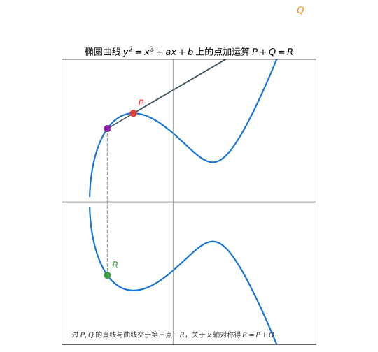

> **直观理解（现实类比）**：椭圆曲线上的"加法"就像在一条蜿蜒的滑梯上做游戏：把 $P$、$Q$ 两点连成一条线，看它撞到滑梯的第三个点，再把它翻个跟斗（沿 $x$ 轴对称）得到 "和" $P+Q$。反复玩这个游戏做 $k$ 次（$kP$）很容易，但若只知道结果和起始点，要反推出"玩了 $k$ 次"却极其困难——这正是椭圆曲线密码的安全基石。

> **🧠 思考历程：两把钥匙，一把交给全世界、一把藏在自己手里——凭什么安全？**
>
> 椭圆曲线公钥加密回答的，是密码学最反直觉的一项承诺：把加密方法完全公开，解密却依然无懈可击。而这承诺的支柱，是一个"好算却极难反推"的单向台阶——椭圆曲线群上的离散对数问题。
>
> - **从"对称"走向"分离"**。军用密码长期靠对称密钥（加密解密同一把钥匙），可钥匙怎么安全传递却是死结。1976年 Diffie 与 Hellman 发表《密码学的新方向》，Merkle 同场提出公钥雏形——"公开哲学"一夜之间改变了密钥分发的宿命。
> - **RSA 的证明与椭圆曲线接力**。1977年 Rivest、Shamir 与 Adleman 基于大数因子分解构造 RSA；而由 Miller 与 Koblitz 在1985年分别独立提出的椭圆曲线密码（ECC），在有限域上构造椭圆曲线群，用更小的密钥达到同等安全——"难在反推而非难在算"的原则被一遍遍兑现。
> - **把"难"变成工程边界**。过去五十年，密码界围绕离散对数、因子分解的困难与量子算法（Shor 1994）的威胁不断迭代，从 RSA 到 ECC 再到后量子候选——安全始终建立在"某个方向的运算被世界普遍相信极难"之上。
> - **心路**：把全球信任押在一个"可能被证明极难"的问题上，是科学近乎信仰的一跃——真正的密码学，一半靠数学、一半靠对"难"的敬畏。

#### 课堂问答

**老师**：椭圆曲线上的"加法"是把两点连线取第三交点、再对 $x$ 轴反射。请写出点加与倍点的坐标公式，并说明它为什么构成一个群。

**学生**：对 $y^2=x^3+ax+b$，设 $P=(x_1,y_1)$、$Q=(x_2,y_2)$。若 $P\ne Q$，斜率 $\lambda=(y_2-y_1)(x_2-x_1)^{-1}$；倍点 $P=Q$ 时 $\lambda=(3x_1^2+a)(2y_1)^{-1}$（要求 $y_1\ne0$）。则 $x_3=\lambda^2-x_1-x_2$、$y_3=\lambda(x_1-x_3)-y_1$。集合连同无穷远点 $\mathcal{O}$ 在"弦切法"下封闭、满足结合律，$\mathcal{O}$ 是单位元、$(x,y)$ 的逆是 $(x,-y)$，故构成群。

**老师（追问）**：那把 $k$ 反复自加得到 $kP$ 很快，为什么从 $P$ 和 $kP$ 反推 $k$ 会难到能做密码？

**学生**：因为这是椭圆曲线离散对数问题（ECDLP）。正向用倍点法只要 $O(\log k)$ 步；反向没有已知的亚指数算法——曲线群上数域筛法那套用不上，攻击工作量随密钥长度指数增长。所以同样安全强度下 ECC 密钥比 RSA 短得多（约 128 位安全：ECC 256 位 vs RSA 3072 位）。

**老师（拓展）**：例子中曲线 $y^2=x^3+2x+3$ 在 $\mathbb{F}_{11}$ 上恰有 13 个点，这个"13"为什么要特意算出来？

**学生**：群阶 $|E(\mathbb{F}_{11})|=13$ 是素数，由拉格朗日定理，任何非单位元素的阶都整除 13，故它们全是 13、全是生成元，天然免疫小子群攻击。这也解释了为何先数点、再选基点：安全的 ECDH 需要基点生成一个素数阶大子群；若群阶含小因子，就得先把基点限制进素阶子群。

### 2.7 高级密码学协议

**安全多方计算**（MPC）：多个参与方在不泄露各自输入的情况下共同计算一个函数。

**零知识证明**（ZKP）：证明者向验证者证明某个陈述为真，而不泄露任何额外信息。

**同态加密**（Homomorphic Encryption）：允许在密文上直接进行计算，结果解密后与对明文计算结果一致。

**格密码**（Lattice-based Cryptography）：基于格上困难问题（如 LWE、SIS），被认为能抵抗量子攻击。

> **💡 直观理解（类比）**：高级安全协议各显身手——安全多方计算像"多名评委各自打分却不互相看卷，最后只公布总分"；零知识证明像"向门卫证明你确实知道口令，却并不喊出半个字"；同态加密像"寄一箱封好的零部件给加工厂，他们不拆箱直接在箱外加工，退回来依然封着箱"；格密码则拿高维空间的困难问题当护身符，据说连量子计算机都啃不动。

#### 课堂问答

**老师**：安全多方计算、零知识证明、同态加密、格密码，四者各解决什么问题？分别用一句话说清目标。

**学生**：MPC 让多方在不泄露各自输入的前提下共同算出 $f(x_1,\dots,x_n)$；ZKP 让证明者证明"命题为真"却不泄露任何额外信息；同态加密让在密文上做运算 $E(x)\oplus E(y)\to E(x+y)$，解密后与明文运算一致；格密码基于 LWE、SIS 等格上困难问题，被认为能抗量子。

**老师（追问）**：零知识证明凭什么"什么都没说"还能让人信？用它的三个性质说清楚。

**学生**：靠完备性、可靠性、零知识性：完备性——真命题下诚实的证明者能让验证者接受；可靠性——假命题的证明者几乎骗不过；零知识性——验证者除了"命题为真"外学不到任何东西。经典做法是把秘密嵌进一个挑战—应答协议（如 Fiat–Shamir）；模拟器能伪造出接受的记录，恰恰说明记录本身不含秘密信息。

**老师（拓展）**：同态加密听起来能"在密文上算"，那它的安全性与可用性是不是天然冲突？

**学生**：确实有张力：同态加密要既能算又不泄露明文，因此纯同态方案对噪声增长极敏感——每次乘法的噪声都会成倍放大，需要"自举（bootstrapping）"或近似同态来重置噪声，代价很大。这也是全同态加密至今速度慢、密文膨胀严重的原因：安全性与可计算性被一条"噪声预算"牢牢绑在一起。

### 2.8 量子密码学

**量子密码**（Quantum Cryptography）：利用量子力学原理实现安全通信，如量子密钥分发（QKD）。

**Shor 算法**：能在多项式时间内分解大整数和计算离散对数，威胁 RSA 和 ECC。

**Grover 算法**：能在 $O(\sqrt{N})$ 时间内搜索无序数据库，将对称密码的安全强度减半。

> **💡 直观理解（类比）**：量子算法像"快进版的万能起子"——Shor 算法能在多项式时间内撬开 RSA 与离散对数的锁（分解、求离散对数），瞬间点名"这两把老锁不行了"；Grover 则像把翻一遍钥匙串的时间从 $N$ 步压到 $\sqrt N$ 步，等于把对称密码的钥匙有效长度砍半，逼得大家把钥匙加粗才安心。

---

#### 课堂问答

**老师**：量子时代为什么单提 Shor 和 Grover 两个算法？它们分别打击了密码学的哪些支柱？

**学生**：Shor 在多项式时间分解大整数、求离散对数：它把分解归约成求阶 $r$，再用量子傅里叶变换（经连分数展开）提取周期；若 $r$ 偶且 $a^{r/2}\not\equiv\pm1$，则 $\gcd(a^{r/2}-1,n)$ 给出因子。这直接攻破 RSA（分解）与 ECC/DH（离散对数）两大支柱。Grover 只给 $O(\sqrt N)$ 的平方加速，不影响分解，却把对称密钥穷举从 $2^k$ 压到 $2^{k/2}$，等效安全减半。

**老师（追问）**：那为什么面对 Grover，对称密码只要"把密钥加长一倍"就能扛，而 RSA 加长却救不了？

**学生**：因为两者受损的量级不同。Grover 是平方级加速，密钥从 $k$ 加到 $2k$ 就能补回 $k$ 位强度，属于线性代价；Shor 是多项式时间算法，把原本亚指数难度的分解变成可算，不是"把 $n$ 加长一点"能挡的——难度结构被彻底击穿。所以应对是换难题：改用 LWE/SIS 等无明显量子算法的格问题。

**老师（拓展）**：那"量子密钥分发（QKD）"与"后量子密码"是不是一回事？

**学生**：不是。QKD 靠量子力学原理（测量扰动、不可克隆定理）在物理层检测窃听，安全性来自物理定律而非计算困难，需要量子信道与硬件；后量子密码仍在经典计算机上运行，只是把困难问题换成抗量子的（格、码、多变量、哈希签名）。前者换物理载体，后者换数学难题，是两条互补路线。

## 3. 定理与证明

### 3.1 RSA 密码的正确性

**定理 3.1（RSA 正确性）** 设 $p, q$ 为两个不同的大素数，$n = pq$，$\phi(n) = (p-1)(q-1)$。选择 $e$ 满足 $1 < e < \phi(n)$ 且 $\gcd(e, \phi(n)) = 1$，计算 $d \equiv e^{-1} \pmod{\phi(n)}$。对任意明文 $m \in \mathbb{Z}_n^*$，加密 $c \equiv m^e \pmod{n}$，解密 $m' \equiv c^d \pmod{n}$，则 $m' = m$。

**证明：** 由 $d \equiv e^{-1} \pmod{\phi(n)}$ 知存在整数 $k$ 使得 $ed = 1 + k\phi(n)$。于是：

$$
m' \equiv c^d \equiv (m^e)^d \equiv m^{ed} \equiv m^{1 + k\phi(n)} \equiv m \cdot (m^{\phi(n)})^k \pmod{n}.
$$

若 $m \in \mathbb{Z}_n^*$（即 $\gcd(m, n) = 1$），由 Euler 定理 $m^{\phi(n)} \equiv 1 \pmod{n}$，得 $m' \equiv m \pmod{n}$。

若 $\gcd(m, n) \neq 1$，则 $m$ 是 $p$ 或 $q$ 的倍数，不妨设 $m \equiv 0 \pmod{p}$。此时 $m^{ed} \equiv 0 \equiv m \pmod{p}$ 显然成立。对模 $q$，若 $m \not\equiv 0 \pmod{q}$，由 Euler 定理 $m^{\phi(n)} \equiv (m^{q-1})^{p-1} \equiv 1^{p-1} \equiv 1 \pmod{q}$，故 $m^{ed} \equiv m \cdot (m^{\phi(n)})^k \equiv m \pmod{q}$；若 $m \equiv 0 \pmod{q}$，则 $m^{ed} \equiv 0 \equiv m \pmod{q}$。因此 $m^{ed} \equiv m \pmod{p}$ 和 $m^{ed} \equiv m \pmod{q}$ 同时成立，由中国剩余定理得 $m^{ed} \equiv m \pmod{n}$。

**使用 Carmichael 函数的证明：** Carmichael 函数 $\lambda(n)$ 定义为 $\lambda(p^a q^b) = \text{lcm}(\lambda(p^a), \lambda(q^b))$，其中 $\lambda(p^e) = \phi(p^e)$ 对奇素数 $p$，$\lambda(2^e) = 2^{e-2}$ 对 $e \geq 3$。对 $n = pq$，有 $\lambda(n) = \text{lcm}(p-1, q-1)$。由 Carmichael 定理，$a^{\lambda(n)} \equiv 1 \pmod{n}$ 对所有与 $n$ 互素的 $a$ 成立。取 $ed \equiv 1 \pmod{\lambda(n)}$，则 $ed = 1 + k\lambda(n)$，从而 $m^{ed} \equiv m \cdot (m^{\lambda(n)})^k \equiv m \pmod{n}$。$\square$

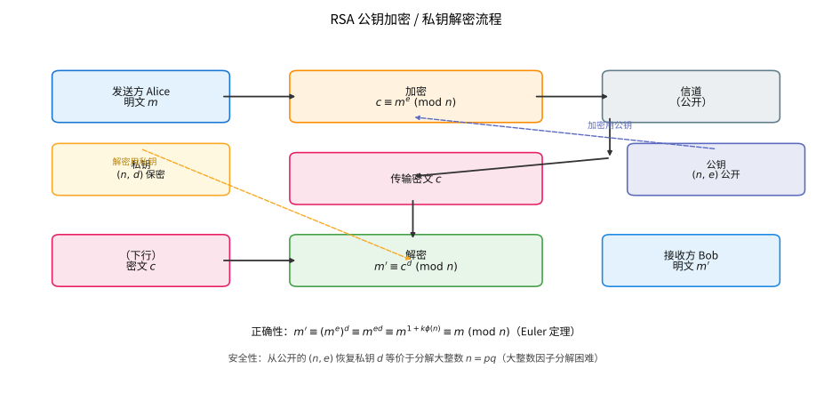

> **直观理解（现实类比）**：RSA 就像一把"锁"与"钥匙"分离的挂锁。公钥是上锁的挂锁（人人可锁上，即 $c=m^e \bmod n$），私钥是唯一的开锁钥匙（只有你持有，即 $m=c^d \bmod n$）。别人能把信投进你的信箱（加密），但只有你口袋里的钥匙能打开它（解密）。破解等价于找到打开挂锁的万能钥——即分解出 $n=pq$，而那在数学上极其困难。

> **常见坑**：① **"课本 RSA"（教科书 RSA）不安全**——$c=m^e$ 是确定性的：同一明文重复加密得到同一密文，敌手可据此辨别、还可用低指数小自明消息攻击，所以实际 RSA **必须加随机化填充**（如 OAEP），例 4.1 里的"裸 RSA"只为演示数学原理而非工程安全做法；② **公钥公开 ≠ 收到的公钥可信**——攻击者可以中途调包公钥（中间人攻击），这正是需要 PKI/证书来"证实公钥归属"的原因；③ 别把"正确性"与"安全性"划等号——RSA 证明的是 $m^{ed}\equiv m$（保证加解密互通），而安全性还要额外建立在"分解困难"之上，两者是两回事。

#### 课堂问答

**老师**：请证明 $D(E(m))=m$。关键指数关系是什么？先给出你依赖的那个等式。

**学生**：关键是 $ed\equiv1\pmod{\phi(n)}$，即存在 $k$ 使 $ed=1+k\phi(n)$。于是

$$
m'\equiv c^d\equiv(m^e)^d\equiv m^{ed}\equiv m\cdot(m^{\phi(n)})^k\pmod n.
$$

若 $\gcd(m,n)=1$，Euler 定理给出 $m^{\phi(n)}\equiv1\pmod n$，立得 $m'\equiv m$。

**老师（追问）**：那如果 $\gcd(m,n)\ne1$ 呢？Euler 定理用不了，RSA 不就在这些消息上崩了？

**学生**：不崩，只是要分开证。因 $n=pq$ 且 $p,q$ 为素数，$\gcd(m,n)\ne1$ 意味着 $m$ 是 $p$ 或 $q$ 的倍数，不妨设 $m\equiv0\pmod p$：则 $m^{ed}\equiv0\equiv m\pmod p$ 显然成立。再看模 $q$：若 $m\not\equiv0\pmod q$，由 $m^{q-1}\equiv1\pmod q$ 得 $m^{\phi(n)}=(m^{q-1})^{p-1}\equiv1\pmod q$，故 $m^{ed}\equiv m\pmod q$；若 $m\equiv0\pmod q$ 也成立。两式并立，由中国剩余定理得 $m^{ed}\equiv m\pmod n$。

**老师（拓展）**：若把指数从 $\phi(n)$ 换成 Carmichael 函数 $\lambda(n)=\mathrm{lcm}(p-1,q-1)$，为什么还能成立、而且更好？

**学生**：因为 Carmichael 定理保证对所有 $\gcd(a,n)=1$ 的 $a$ 有 $a^{\lambda(n)}\equiv1\pmod n$，而 $\lambda(n)\mid\phi(n)$。取 $ed\equiv1\pmod{\lambda(n)}$ 同样得 $m^{ed}\equiv m(m^{\lambda(n)})^k\equiv m$。好处是 $\lambda(n)$ 通常比 $\phi(n)$ 小，允许更小的 $d$、更快的解密——这是标准与某些实现常见的优化。

### 3.2 Rabin 密码的安全性

**定理 3.2（Rabin 密码的安全性）** 设 $n = pq$ 为两个大素数的乘积，Rabin 加密函数 $f(m) \equiv m^2 \pmod{n}$。则破解 Rabin 加密（即求平方根模 $n$）在计算上等价于分解 $n$。

> **💡 直观理解（类比）**：Rabin 加密像"算平方容易、开根号难"的弹簧锁——任何人都会做 $m^2 \bmod n$（加密），但模 $n$ 求平方根却和亲手拆出 $n=pq$ 两个质因子一样难。证明用"归约"把破解的难度牢牢栓到已知难题上：相当于先证明"撬开这把锁"与"撬开公认的铁锁"强度一模一样，于是只要没人能拆锁，就没人能撬开它。

**证明：** 我们需要证明两个方向：

**方向 1（分解 $\Rightarrow$ 求平方根）：** 若已知 $n = pq$ 的因子分解，则可分别在模 $p$ 和模 $q$ 下求平方根，再通过中国剩余定理组合。

对模 $p$，求解 $x^2 \equiv a \pmod{p}$。若 $p \equiv 3 \pmod{4}$，则 $x \equiv \pm a^{(p+1)/4} \pmod{p}$。对模 $q$ 同理。然后使用中国剩余定理组合 $4$ 个平方根。

**方向 2（求平方根 $\Rightarrow$ 分解）：** 假设存在一个神谕 $\mathcal{O}$，输入 $a$ 输出 $a$ 模 $n$ 的一个平方根（若存在）。我们利用 $\mathcal{O}$ 构造分解 $n$ 的算法：

1. 随机选择 $x \in \mathbb{Z}_n^*$，计算 $a \equiv x^2 \pmod{n}$
2. 调用 $\mathcal{O}(a)$ 得到平方根 $y$，即 $y^2 \equiv a \equiv x^2 \pmod{n}$
3. 若 $y \equiv \pm x \pmod{n}$，则返回步骤 1 重新选择
4. 若 $y \not\equiv \pm x \pmod{n}$，则 $x^2 - y^2 \equiv 0 \pmod{n}$，即 $(x-y)(x+y) \equiv 0 \pmod{n}$
5. 计算 $\gcd(x-y, n)$ 和 $\gcd(x+y, n)$，得到 $p$ 和 $q$ 的非平凡因子

由于 $x^2 \equiv y^2 \pmod{n}$ 等价于 $n \mid (x-y)(x+y)$。若 $y \not\equiv \pm x \pmod{n}$，则 $n$ 不整除 $x-y$ 也不整除 $x+y$，但 $n$ 整除它们的乘积，因此 $\gcd(x-y, n)$ 是 $n$ 的非平凡因子。

随机选择 $x$ 时，$y \equiv \pm x$ 的概率为 $1/2$，因此期望在 $2$ 次尝试后成功。$\square$

**注：** Rabin 加密的安全性证明是"归约证明"（reduction proof）的经典例子——将破解加密算法的困难性归约到解决一个已知困难问题。

#### 课堂问答

**老师**：Rabin 加密就是 $f(m)=m^2\bmod n$。请说清"破解它等价于分解 $n$"这两个方向各怎么走。

**学生**：方向一（分解 $\Rightarrow$ 求根）：已知 $n=pq$，分别在模 $p$、模 $q$ 下求根。若 $p\equiv q\equiv3\pmod4$，则 $x\equiv a^{(p+1)/4}\pmod p$、$x\equiv a^{(q+1)/4}\pmod q$，再用中国剩余定理组合出模 $n$ 的 4 个平方根。方向二（求根 $\Rightarrow$ 分解）见下一步。

**老师（追问）**：那"有求平方根的神谕就能分解 $n$"这一步具体怎么构造？为什么期望两次就成？

**学生**：随机取 $x\in\mathbb{Z}_n^*$，算 $a\equiv x^2\pmod n$，把神谕给出的一个根记为 $y$，则 $y^2\equiv x^2\pmod n$。而 $x^2$ 模 $n$ 恰有 4 个根，其中 2 个是 $\pm x$（与 $x$ 等价）、2 个不等价。若 $y\equiv\pm x$ 就重来（概率约 $1/2$）；否则 $n\mid(x-y)(x+y)$ 但 $n$ 不同时整除两个因子，$\gcd(x-y,n)$ 与 $\gcd(x+y,n)$ 就给出 $p,q$ 的非平凡因子。每次成功概率 $1/2$，期望 2 次。

**老师（拓展）**：Rabin 求根这么硬，为什么工程上反而更常用 RSA 而非 Rabin？它的安全性不是更强吗？

**学生**：Rabin 的安全性确实更直接——紧归约到分解，没有那么多填充陷阱。但它的麻烦在解密歧义：$m^2$ 有 4 个根，解密者必须从中挑出真的明文，需要额外冗余或标记来消歧。RSA 解密是唯一的，实现更省事。所以"更强的可证安全性"有时要拿"解密歧义/编码开销"去换，这是安全性、效率与实现复杂度之间的再权衡。

### 3.3 Diffie-Hellman 密钥交换的安全性

**定理 3.3（Diffie-Hellman 安全性）** 在计算性 Diffie-Hellman（CDH）假设下，Diffie-Hellman 密钥交换协议是安全的。

> **💡 直观理解（类比）**：这三个"难问题"像依次加码的锁——DLP 问"看到 $g^a$ 反求 $a$"，CDH 问"知道 $g^a,g^b$ 求 $g^{ab}$"，DDH 更进一步问"光从公开信息能不能分辨 $g^{ab}$ 与随机值"；一个比一个更强。证明用归约把"破坏协议"焊死到 CDH 上：若真有敌手能偷走共享密钥，就能原封不动拿同一招去解 CDH，与"CDH 无人能解"的假设顶牛——要么全安全，要么一起塌。

**先定义三个问题：**

- **离散对数问题（DLP）**：给定 $g, g^a \in G$，求 $a$
- **计算性 Diffie-Hellman 问题（CDH）**：给定 $g, g^a, g^b \in G$，求 $g^{ab}$
- **判定性 Diffie-Hellman 问题（DDH）**：给定 $g, g^a, g^b, g^c \in G$，判定 $c \equiv ab \pmod{|G|}$ 是否成立

**CDH 假设：** 不存在多项式时间算法能以不可忽略的概率解决 CDH 问题。

**证明思路：** 我们需要证明，若存在一个敌手 $\mathcal{A}$ 能破坏 Diffie-Hellman 密钥交换（即能从公开信息 $g, g^a, g^b$ 中提取关于共享密钥 $g^{ab}$ 的信息），则存在一个算法 $\mathcal{B}$ 能利用 $\mathcal{A}$ 解决 CDH 问题。

更具体地，考虑半诚实（semi-honest）模型下的安全性。协议执行后，敌手看到公开信息 $(g, g^a, g^b)$，其目标是计算 $g^{ab}$。

假设存在一个多项式时间敌手 $\mathcal{A}$ 使得：

$$
\Pr[\mathcal{A}(g, g^a, g^b) = g^{ab}] = \varepsilon(k),
$$

其中 $\varepsilon(k)$ 是不可忽略的（$k$ 为安全参数）。

构造算法 $\mathcal{B}$ 解决 CDH 问题：
1. $\mathcal{B}$ 接收 CDH 挑战 $(g, X, Y)$，其中 $X = g^x$，$Y = g^y$
2. $\mathcal{B}$ 将 $(g, X, Y)$ 作为公开信息发送给 $\mathcal{A}$
3. $\mathcal{A}$ 输出 $K$，$\mathcal{B}$ 将 $K$ 作为 CDH 答案输出

由于 $\mathcal{A}$ 在 $(g, g^a, g^b)$ 上的分布恰好与 CDH 挑战的分布相同，$\mathcal{B}$ 成功的概率也等于 $\varepsilon(k)$。若 $\varepsilon(k)$ 不可忽略，则 $\mathcal{B}$ 以不可忽略的概率解决 CDH 问题，与 CDH 假设矛盾。

因此，在 CDH 假设下，没有多项式时间敌手能以不可忽略的概率计算共享密钥 $g^{ab}$。$\square$

**注：** 上述证明针对的是"被动攻击者"（即窃听者）。对于主动攻击者（中间人攻击），DH 协议需要额外认证机制。

> **常见坑**：Diffie–Hellman 只解决"被动窃听下的**密钥协商**"，它**本身不提供认证**——攻击者可以把 Alice 发给 Bob 的 $g^a$ 换成自己的 $g^{a'}$，跟双方各建立一个共享密钥，Alice、Bob 却毫无察觉（中间人攻击）。所以实际部署必须叠加数字签名/PKI 来确认"对方发送的正是本人"。另外量好别把"DH 算出共享密钥"说成"DH 加密消息"：它只是协商出一把对称密钥，正文由这把密钥配合对称加密来完成。

#### 课堂问答

**老师**：请把 DLP、CDH、DDH 三个假设写清楚，并说明 DH 的安全性归约到哪一个。

**学生**：DLP：给 $g,g^a$ 求 $a$；CDH：给 $g,g^a,g^b$ 求 $g^{ab}$；DDH：给 $g,g^a,g^b,g^c$ 判定 $c\equiv ab\pmod{|G|}$。CDH 假设：不存在多项式算法以不可忽略概率解 CDH。DH 的被动安全性正好归约到 CDH：敌手能从 $g,g^a,g^b$ 算出 $g^{ab}$，就等于在解 CDH。

**老师（追问）**：那个"$\mathcal{B}$ 用 $\mathcal{A}$ 解 CDH"的归约里，哪一步的关键是"两个分布相同"？少了它会怎样？

**学生**：关键是 $\mathcal{B}$ 把 CDH 挑战 $(g,X=g^x,Y=g^y)$ 原样当作 DH 公开信息喂给 $\mathcal{A}$——这与真实协议里 $\mathcal{A}$ 看到的 $(g,g^a,g^b)$ 分布完全相同，所以 $\mathcal{A}$ 的成功概率 $\varepsilon(k)$ 原封不动转移到 $\mathcal{B}$，$\mathcal{B}$ 解 CDH 的概率也是 $\varepsilon(k)$。若两个分布不同，模拟就有偏差，$\mathcal{B}$ 的优势对不回假设，归约不成立。它只要不可忽略，就与 CDH 假设矛盾。

**老师（拓展）**：那这个证明为什么只覆盖"被动窃听者"？主动攻击者要额外加什么？

**学生**：归约中敌手只拿到 $(g,g^a,g^b)$ 这种被动信息，对应窃听者。若敌手主动，他能替换消息：把 Alice 的 $g^a$ 换成 $g^{a'}$，分别同双方建立密钥，双方却以为在跟对方说话（中间人攻击）。DH 本身没有认证机制，所以必须叠加数字签名/PKI 确认对方身份，才能把密钥协商升级为认证密钥交换；证明也从 CDH 转向 DDH 或更强假设下的归约。

### 3.4 ElGamal 加密的安全性

**定理 3.4（ElGamal 安全性）** 在判定性 Diffie-Hellman（DDH）假设下，ElGamal 加密方案具有 IND-CPA 安全性（选择明文攻击下的不可区分性）。

> **💡 直观理解（类比）**：ElGamal 加密像"每次封口都换一道不同的锁"——加密时为明文 $m$ 乘上一个随机罩子 $h^r$，于是同一句话发多少遍、密文都各不相同。IND-CPA 考验的是：挑战者把两个消息里的一个加密给敌手看，敌手要猜出是哪个；靠 DDH 保证，他这点判断力顶多比掷硬币略好一筹，几乎等于瞎猜。

**证明：** ElGamal 加密方案如下：
- **密钥生成**：$G$ 为 $q$ 阶循环群，生成元 $g$。私钥 $sk = x \in \mathbb{Z}_q^*$，公钥 $pk = (G, g, q, h = g^x)$
- **加密**：对明文 $m$，选择随机数 $r \in \mathbb{Z}_q^*$，输出密文 $(c_1, c_2) = (g^r, m \cdot h^r)$
- **解密**：$m = c_2 \cdot (c_1^x)^{-1}$

IND-CPA 安全性通过以下游戏定义：

1. 挑战者生成密钥对 $(pk, sk)$，将 $pk$ 发送给敌手 $\mathcal{A}$
2. $\mathcal{A}$ 选择两个等长明文 $m_0, m_1$
3. 挑战者随机选择 $b \in \{0, 1\}$，加密 $m_b$ 得到密文 $c^*$，发送给 $\mathcal{A}$
4. $\mathcal{A}$ 输出对 $b$ 的猜测 $b'$
5. $\mathcal{A}$ 的优势定义为 $\text{Adv}(\mathcal{A}) = |\Pr[b' = b] - 1/2|$

若 $\text{Adv}(\mathcal{A})$ 对任何多项式时间敌手都是可忽略的，则称方案具有 IND-CPA 安全性。

假设存在敌手 $\mathcal{A}$ 以不可忽略的优势 $\varepsilon$ 破坏 ElGamal 的 IND-CPA 安全性。构造算法 $\mathcal{D}$ 解决 DDH 问题：

$\mathcal{D}$ 接收 DDH 挑战 $(g, g^a, g^b, g^c)$，需要判定 $c \equiv ab \pmod{q}$ 是否成立。

1. $\mathcal{D}$ 设置 $h = g^a$，公钥 $pk = (G, g, q, h)$
2. $\mathcal{A}$ 选择 $m_0, m_1$，$\mathcal{D}$ 随机选择 $b \in \{0, 1\}$
3. $\mathcal{D}$ 构造密文 $c^* = (g^b, m_b \cdot g^c)$
4. 若 $c = ab$，则 $g^c = g^{ab} = (g^a)^b = h^b$，密文是 $m_b$ 的正确加密
5. 若 $c$ 是均匀随机的，则 $g^c$ 与 $h^b$ 独立，$m_b \cdot g^c$ 在群中均匀分布，不泄露 $b$ 的信息
6. $\mathcal{A}$ 输出 $b'$，若 $b' = b$ 则 $\mathcal{D}$ 输出 1（判定 $c = ab$），否则输出 0

分析 $\mathcal{D}$ 的优势：
- 当 $c = ab$ 时，$\mathcal{A}$ 正确猜测的概率为 $1/2 + \varepsilon$
- 当 $c$ 随机时，$\mathcal{A}$ 正确猜测的概率为 $1/2$

因此 $\mathcal{D}$ 区分 DDH 的优势为 $\varepsilon$，与 DDH 假设矛盾。$\square$

#### 课堂问答

**老师**：写出 ElGamal 的加解密，并说明它为什么是"随机化加密"、这对 IND-CPA 意味着什么。

**学生**：密钥：$G$ 为 $q$ 阶循环群、生成元 $g$，私钥 $x$、公钥 $h=g^x$。加密：随机取 $r\in\mathbb{Z}_q^*$，$c=(c_1,c_2)=(g^r,\,m\cdot h^r)$。解密：$m=c_2\cdot(c_1^x)^{-1}=m h^r\cdot(g^{rx})^{-1}=m$。因为 $r$ 每次随机，同一 $m$ 的密文都不同——这正是概率加密，天然抑制"确定性密文可被比对"的攻击。

**老师（追问）**：IND-CPA 游戏里敌手要区分 $m_0,m_1$ 的密文，DDH 是怎么把这点判断力"掐灭"的？

**学生**：构造 DDH 解算器 $\mathcal{D}$：收到挑战 $(g,g^a,g^b,g^c)$ 后，设 $h=g^a$、$pk=(G,g,q,h)$ 交给 $\mathcal{A}$；$\mathcal{A}$ 选出 $m_0,m_1$，$\mathcal{D}$ 随机取 $\beta$，置 $c^*=(g^b,\,m_\beta\cdot g^c)$。若 $c=ab$，则 $g^c=g^{ab}=h^b$，$c^*$ 是 $m_\beta$ 的正规密文，$\mathcal{A}$ 以 $1/2+\varepsilon$ 猜中；若 $c$ 均匀随机，$m_\beta g^c$ 在群中均匀、与 $\beta$ 独立，$\mathcal{A}$ 只有 $1/2$。$\mathcal{D}$ 的区分优势恰为 $\varepsilon$，与 DDH 假设矛盾。

**老师（拓展）**：ElGamal 是"密文可乘"的：给 $c=(g^r,m h^r)$，敌手能构造出 $m^2$ 的合法密文。这会不会破坏它的安全？

**学生**：不会破坏 IND-CPA，但确实说明它只到 CPA、达不到 CCA：这种密文可延展性（malleability）正是选择密文攻击的原料——敌手可以篡改密文再套解密神谕。结论是 IND-CPA 安全不等于 IND-CCA 安全；要抗 CCA，必须加完整性保护（如 Cramer–Shoup 或"KEM/DEM + 认证"结构），这与 RSA 那边"裸 RSA 非 OAEP 不可"是同一个教训。

### 3.5 RSA-OAEP 的安全性

**定理 3.5（RSA-OAEP 安全性）** 在随机神谕模型（Random Oracle Model）下，假设 RSA 问题是困难的（即给定 $c \equiv m^e \pmod{n}$ 求 $m$ 是困难的），则 RSA-OAEP 加密方案具有 IND-CCA2 安全性（自适应选择密文攻击下的不可区分性）。

> **💡 直观理解（类比）**：RSA-OAEP 像"先塞进裹满气泡垫的包装盒再上锁"——OAEP 用两个哈希函数 $G,H$ 给明文掺入随机盐，于是连加密同一消息每次的密文也焕然一新。证明把哈希当成'一问一答的纯随机神谕'：敌手想攻破，就必须去问神谕关于那块随机盐的编号，而这一问恰恰暴露了破解 RSA 的破绽——如同小偷去翻登记册，反被登记册出卖。

**证明思路：** OAEP（Optimal Asymmetric Encryption Padding）使用两个哈希函数 $G$ 和 $H$（在随机神谕模型中视为随机函数）对明文进行填充：

$$
\text{OAEP 编码：}
$$

设 $m$ 为 $k_0$ 位消息，$r$ 为 $k_1$ 位随机数。计算：

$$
s = (m \| 0^{k_1}) \oplus G(r), \quad t = r \oplus H(s),
$$

输出 $(s, t)$ 作为填充后的消息，再应用 RSA 加密 $c \equiv (s \| t)^e \pmod{n}$。

**安全性证明的核心思想**（Fujisaki-Okamoto 等人）：

1. **模拟器构造**：在 IND-CCA2 游戏中，模拟器 $S$ 不知道私钥 $d$，但需要回答敌手的解密查询。$S$ 维护 $G$ 和 $H$ 的查询表。

2. **解密查询的处理**：当敌手查询某个密文 $c$ 的解密时，$S$ 首先检查 $c$ 是否等于挑战密文 $c^*$，若是则拒绝。否则 $S$ 从 $G$ 和 $H$ 的查询表中查找是否已有对应的 $(s, t)$ 使得 $m$ 有意义。如果找到，返回对应的 $m$；否则返回 $\bot$。

3. **挑战阶段**：敌手选择 $m_0, m_1$，$S$ 随机选择 $b$，对 $m_b$ 进行 OAEP 编码得到 $(s^*, t^*)$，然后计算 $c^* = (s^* \| t^*)^e \pmod{n}$。关键在于 $S$ 不需要知道 $d$——它直接使用 $e$ 计算加密。

4. **归约**：若敌手能以不可忽略的优势区分 $m_0$ 和 $m_1$，则存在一个算法能利用敌手解决 RSA 问题（即从 $c^*$ 中恢复 $(s^*, t^*)$）。

5. **关键引理**：在随机神谕模型中，敌手若不对 $G$ 或 $H$ 进行特定查询，则无法区分 $m_b$ 的加密与随机值。因此，任何成功的敌手必然查询了 $G(r^*)$ 或 $H(s^*)$，其中 $r^*$ 是挑战加密中使用的随机数。这暴露了 $r^*$ 的信息，使模拟器可以提取 RSA 问题的解。

**结论**：RSA-OAEP 在随机神谕模型下是 IND-CCA2 安全的，归约到 RSA 问题的困难性。$\square$

---

#### 课堂问答

**老师**：课本 RSA 是确定性的，OAEP 用两个哈希 $G,H$ 把它"打散"。写出编码过程，并说清它补上了哪块短板。

**学生**：设消息 $m$ 长 $k_0$ 位、随机数 $r$ 长 $k_1$ 位：

$$
s=(m\|0^{k_1})\oplus G(r),\qquad t=r\oplus H(s),
$$

输出 $(s,t)$ 再作 RSA 加密 $c\equiv(s\|t)^e\pmod n$。由于 $r$ 每次随机，$m$ 的密文每次都不同，补上"确定性加密可被重放比对"这块短板，这也是走向 CCA 安全的前提。

**老师（追问）**：在随机神谕模型下，为什么说"成功的敌手必然查询过 $G(r^*)$ 或 $H(s^*)$"？

**学生**：因为 $G,H$ 被当作随机函数，$(s^*,t^*)$ 里 $s^*$ 是 $m_b$ 的唯一"出口"。若敌手从没查过 $H(s^*)$，他无法判断 $s$ 与 $r$ 的对应关系；若没查过 $G(r^*)$，他得不到 $r^*$，就没法把 $m_b$ 与 $m_{1-b}$ 区分开——不查这两个输入，$m_b$ 的密文与随机值不可区分。所以任何有不可忽略优势的敌手必然暴露 $r^*$，模拟器借此提取答案，把优势归约到 RSA 求逆。

**老师（拓展）**：那这个证明里"模拟器不知道私钥 $d$"却还能回答解密查询，凭什么不出漏洞？

**学生**：靠查表与拒绝策略。模拟器维护 $G,H$ 的查询表；敌手问 $c$ 的解密时，若 $c=c^*$ 直接拒绝（CCA 游戏本就不许问挑战密文），否则去表里找是否存在使 $m$ 有意义的 $(s,t)$——找到就返回对应的 $m$，找不到返回 $\bot$。这样无需 $d$ 就能自洽地模拟解密，挑战密文则直接用 $e$ 算出 $c^*=(s^*\|t^*)^e$。整个归约的要害是：把"攻破 OAEP 的 CCA 优势"换算成"解 RSA 求逆问题"的优势，两者同起同落。

## 4. 示例

### 示例 4.1：用 RSA 进行加密解密

**问题：** 取 $p = 61$，$q = 53$，$e = 17$，加密明文 $m = 65$，然后解密验证。

> **💡 直观理解（类比）**：这个例子像亲手走一遍"上锁、开锁"的仓库流程——先用公钥 $(3233,17)$ 把消息 $65$ 锁成密文 $2790$，再用私钥 $(3233,2753)$ 把它打开回 $65$。扩展欧几里得堪称"配钥匙"：辗转相除再回代，一步步倒算出开锁所需的那把 $d$；快速幂则像用翻倍平方记账，把巨大的 $65^{17}$、$2790^{2753}$ 飞快折成小步求和。

**解：**

**密钥生成：**
- $n = p \cdot q = 61 \times 53 = 3233$
- $\phi(n) = (61-1)(53-1) = 60 \times 52 = 3120$
- $e = 17$，验证 $\gcd(17, 3120) = 1$
- 计算 $d \equiv e^{-1} \pmod{3120}$，即 $17d \equiv 1 \pmod{3120}$

使用扩展欧几里得算法：
$$
3120 = 17 \times 183 + 9,\quad
17 = 9 \times 1 + 8,\quad
9 = 8 \times 1 + 1.
$$

反向代入：
$$
1 = 9 - 8 = 9 - (17 - 9) = 2 \cdot 9 - 17 = 2 \cdot (3120 - 17 \times 183) - 17 = 2 \times 3120 - 367 \times 17.
$$

因此 $d \equiv -367 \equiv 3120 - 367 = 2753 \pmod{3120}$。

公钥为 $(n = 3233, e = 17)$，私钥为 $(n = 3233, d = 2753)$。

**加密：** $c \equiv m^e \pmod{n} = 65^{17} \pmod{3233}$。

计算：
$$
65^2 \equiv 4225 \equiv 992 \pmod{3233},
$$
$$
65^4 \equiv 992^2 \equiv 984064 \equiv 992 \pmod{3233} \text{（需重新精确计算）}
$$

更精确地：
$$
65^2 = 4225 \equiv 4225 - 3233 = 992 \pmod{3233},
$$
$$
65^4 \equiv 992^2 = 984064, \quad 984064 \div 3233 = 304 \times 3233 = 982832, \quad 984064 - 982832 = 1232,
$$
$$
65^8 \equiv 1232^2 = 1517824, \quad 1517824 \div 3233 = 469 \times 3233 = 1516277, \quad 1517824 - 1516277 = 1547,
$$
$$
65^{16} \equiv 1547^2 = 2393209, \quad 2393209 \div 3233 = 740 \times 3233 = 2392420, \quad 2393209 - 2392420 = 789.
$$

由于 $17 = 16 + 1$，$65^{17} \equiv 65^{16} \cdot 65 \equiv 789 \times 65 = 51285$，$51285 \div 3233 = 15 \times 3233 = 48495$，$51285 - 48495 = 2790$。

故 $c = 2790$。

**解密：** $m' \equiv c^d \pmod{n} = 2790^{2753} \pmod{3233}$。使用快速幂模运算（此处略去详细计算过程），得到 $m' = 65$，验证正确。

### 示例 4.2：椭圆曲线密码的实现

**问题：** 在椭圆曲线 $E: y^2 = x^3 + 2x + 3$ 在 $\mathbb{F}_{11}$ 上实现 ECDH 密钥交换。

> **💡 直观理解（类比）**：这个例子像走一遍"各自爬同一串台阶再对暗号"——先数清曲线上共有多少个点（群阶 $13$，素数），这是确定每条安全车道有多长；然后 Alice、Bob 各自把基点 $G$ 翻倍加倍出自己的公钥 $(8,10)$、$(1,8)$，交换后各算 $k\times$ 对方公钥；两条不同路线最终殊途同归到同一个共享点 $K=(10,5)$。顺着台阶走（点加）轻松，倒着数走了多少步却极难，这正是秘密能共享、偷听撬不开的原因。

**解：** $\mathbb{F}_{11}$ 上的椭圆曲线 $E: y^2 = x^3 + 2x + 3$。

**步骤 1：列出所有点。**
计算 $x = 0, 1, \dots, 10$ 时的 $x^3 + 2x + 3 \pmod{11}$：

| $x$ | $x^3 + 2x + 3$ | 是否为平方数 | $y$ |
|-----|----------------|-------------|-----|
| 0 | 3 | 否 | - |
| 1 | 1 + 2 + 3 = 6 | 否 | - |
| 2 | 8 + 4 + 3 = 15 ≡ 4 | 是，$y = \pm 2$ | $(2,2), (2,9)$ |
| 3 | 27 + 6 + 3 = 36 ≡ 3 | 否 | - |
| 4 | 64 + 8 + 3 = 75 ≡ 9 | 是，$y = \pm 3$ | $(4,3), (4,8)$ |
| 5 | 125 + 10 + 3 = 138 ≡ 6 | 否 | - |
| 6 | 216 + 12 + 3 = 231 ≡ 0 | 是，$y = 0$ | $(6,0)$ |
| 7 | 343 + 14 + 3 = 360 ≡ 8 | 是，$y = \pm 5$ | $(7,5), (7,6)$ |
| 8 | 512 + 16 + 3 = 531 ≡ 3 | 否 | - |
| 9 | 729 + 18 + 3 = 750 ≡ 2 | 是，$y = \pm 6$ | $(9,6), (9,5)$ |
| 10 | 1000 + 20 + 3 = 1023 ≡ 0 | 是，$y = 0$ | $(10,0)$ |

加上无穷远点 $\mathcal{O}$，共 $13$ 个点，群的阶为 $13$（素数）。

**步骤 2：选择基点。** 取 $G = (2, 2)$。由于群阶为素数 $13$，$G$ 的阶为 $13$。

**步骤 3：密钥交换。**
- Alice 选择私钥 $a = 5$，计算公钥 $A = 5G$
- Bob 选择私钥 $b = 8$，计算公钥 $B = 8G$

计算 $5G$：
- $2G = (2,2) + (2,2)$
  - 斜率 $\lambda = (3 \cdot 2^2 + 2) \cdot (2 \cdot 2)^{-1} \pmod{11} = (12 + 2) \cdot 4^{-1} = 14 \cdot 3 = 42 \equiv 9 \pmod{11}$（因为 $4^{-1} \equiv 3 \pmod{11}$）
  - $x_3 = 9^2 - 2 - 2 = 81 - 4 = 77 \equiv 0 \pmod{11}$
  - $y_3 = 9 \cdot (2 - 0) - 2 = 18 - 2 = 16 \equiv 5 \pmod{11}$
  - 故 $2G = (0, 5)$

- $3G = 2G + G = (0,5) + (2,2)$
  - 斜率 $\lambda = (2 - 5) \cdot (2 - 0)^{-1} = (-3) \cdot 2^{-1} = 8 \cdot 6 = 48 \equiv 4 \pmod{11}$（$2^{-1} \equiv 6 \pmod{11}$）
  - $x_3 = 4^2 - 0 - 2 = 16 - 2 = 14 \equiv 3 \pmod{11}$
  - $y_3 = 4 \cdot (0 - 3) - 5 = 4 \cdot (-3) - 5 = -12 - 5 = -17 \equiv 5 \pmod{11}$
  - 故 $3G = (3, 5)$

- $4G = 2G + 2G = (0,5) + (0,5)$
  - 斜率 $\lambda = (3 \cdot 0^2 + 2) \cdot (2 \cdot 5)^{-1} = 2 \cdot 10^{-1} = 2 \cdot 10 = 20 \equiv 9 \pmod{11}$（$10^{-1} \equiv 10 \pmod{11}$）
  - $x_3 = 9^2 - 0 - 0 = 81 \equiv 4 \pmod{11}$
  - $y_3 = 9 \cdot (0 - 4) - 5 = 9 \cdot (-4) - 5 = -36 - 5 = -41 \equiv 3 \pmod{11}$
  - 故 $4G = (4, 3)$

- $5G = 4G + G = (4,3) + (2,2)$
  - 斜率 $\lambda = (2 - 3) \cdot (2 - 4)^{-1} = (-1) \cdot (-2)^{-1} = 10 \cdot 6 = 60 \equiv 5 \pmod{11}$（$(-2)^{-1} \equiv 6 \pmod{11}$）
  - $x_3 = 5^2 - 4 - 2 = 25 - 6 = 19 \equiv 8 \pmod{11}$
  - $y_3 = 5 \cdot (4 - 8) - 3 = 5 \cdot (-4) - 3 = -20 - 3 = -23 \equiv 10 \pmod{11}$
  - 故 $5G = (8, 10)$

Alice 的公钥 $A = (8, 10)$。

类似地，$8G = 5G + 3G = (8,10) + (3,5)$：
- 斜率 $\lambda = (5 - 10) \cdot (3 - 8)^{-1} = (-5) \cdot (-5)^{-1} = 1$
- $x_3 = 1^2 - 8 - 3 = 1 - 11 = -10 \equiv 1 \pmod{11}$
- $y_3 = 1 \cdot (8 - 1) - 10 = 7 - 10 = -3 \equiv 8 \pmod{11}$
- 故 $8G = (1, 8)$

Bob 的公钥 $B = (1, 8)$。

**步骤 4：共享密钥计算。**
- Alice 计算 $K = aB = 5 \cdot (1, 8)$
- Bob 计算 $K = bA = 8 \cdot (8, 10)$

计算 $5 \cdot (1, 8)$：
- $2 \cdot (1,8) = (1,8) + (1,8)$
  - 斜率 $\lambda = (3 \cdot 1^2 + 2) \cdot (2 \cdot 8)^{-1} = 5 \cdot 16^{-1} = 5 \cdot 5^{-1} = 5 \cdot 9 = 45 \equiv 1 \pmod{11}$（$16 \equiv 5$，$5^{-1} \equiv 9$）
  - $x_3 = 1^2 - 1 - 1 = -1 \equiv 10 \pmod{11}$
  - $y_3 = 1 \cdot (1 - 10) - 8 = 1 \cdot (-9) - 8 = -17 \equiv 5 \pmod{11}$
  - 故 $2 \cdot (1,8) = (10, 5)$

- $4 \cdot (1,8) = 2 \cdot (10,5) = (10,5) + (10,5)$
  - 斜率 $\lambda = (3 \cdot 10^2 + 2) \cdot (2 \cdot 5)^{-1} = (300 + 2) \cdot 10^{-1} = 302 \cdot 10 = 302 \bmod 11 = 5 \cdot 10 = 50 \equiv 6 \pmod{11}$（$302 \equiv 5$）
  - $x_3 = 6^2 - 10 - 10 = 36 - 20 = 16 \equiv 5 \pmod{11}$
  - $y_3 = 6 \cdot (10 - 5) - 5 = 6 \cdot 5 - 5 = 30 - 5 = 25 \equiv 3 \pmod{11}$
  - 故 $4 \cdot (1,8) = (5, 3)$

- $5 \cdot (1,8) = 4 \cdot (1,8) + (1,8) = (5,3) + (1,8)$
  - 斜率 $\lambda = (8 - 3) \cdot (1 - 5)^{-1} = 5 \cdot (-4)^{-1} = 5 \cdot 7^{-1} = 5 \cdot 8 = 40 \equiv 7 \pmod{11}$（$7^{-1} \equiv 8$）
  - $x_3 = 7^2 - 5 - 1 = 49 - 6 = 43 \equiv 10 \pmod{11}$
  - $y_3 = 7 \cdot (5 - 10) - 3 = 7 \cdot (-5) - 3 = -35 - 3 = -38 \equiv 5 \pmod{11}$
  - 故 $5 \cdot (1,8) = (10, 5)$

共享密钥为 $K = (10, 5)$，双方一致。

> 密码学在教材里常以密钥、模幂和困难问题呈现，但它真正回答的是现实问题：**公开世界里，凭什么陌生人之间能安全地传秘密？** 本节沿用「策略 → 例题 → 分步解 → 回读现实」四步法，把 RSA、模幂、素数判定这些工具放进密钥生成、数据加密与密钥交换的真实场景里跑一遍。每道例题先给**解题策略**，再给出**每步都解释'为什么'**的分步解。

### 🎯 本级解题策略（Principles of Problem Solving）

公钥密码有一套固定的分步**烹饪流程**，先认清每步在防谁：

- **第一步 · 先做素数判定守住"地基"**：RSA 的 $n=pq$ 必须由两个大素数相乘。选 $p,q$ 前先试除到 $\sqrt p$：只要 $2,3,5,\dots$ 都除不尽，$p$ 才是素数。地基有洞，后面全是白搭。
- **第二步 · 由 $\phi(n)$ 求私钥 $d$**：$d\equiv e^{-1}\pmod{\phi(n)}$。用扩展欧几里得把 $e$ 的模逆找出来，保证 $ed\equiv1\pmod{\phi(n)}$，加解密才互逆。
- **第三步 · 用"平方-乘"算模幂**：$c\equiv m^e\pmod n$ 别真乘 $e$ 次，而是反复平方、按二进制位选择性相乘，复杂度从 $O(e)$ 降到 $O(\log e)$。这才是大指数能算得动的原因。
- **第四步 · 用 Euler 定理复核并回读**：$m'\equiv c^d\equiv m^{ed}\equiv m^{1+k\phi(n)}\equiv m\pmod n$ 是正确性来源；每步结果都代回检查，别只看"貌似对"。

> **一句话带走**：公钥密码的分步解就像"先验好料（素数判定）→ 配好钥匙（求 $d$）→ 变着法算幂（平方-乘）→ 验算开锁（Euler 定理）"——每一步都对，通信才真正安全。

---

### 例题 A · RSA 的完整加解密：先配钥匙，再开一把公钥锁

> **🎯 建模策略**：这是"公钥操作、私钥开锁"的完整演示。**策略：先由 $n=pq$ 与 $\phi(n)$ 求出私钥 $d=e^{-1}\pmod{\phi(n)}$，再用"平方-乘"分别算 $c\equiv m^e\pmod n$ 与 $m'\equiv c^d\pmod n$。** 每一步都在验证"$ed\equiv1\pmod{\phi(n)}$"这一点。

**问题**：公司甲选素数 $p=7,q=13$ 生成 RSA 密钥对，取 $e=5$。请给出公钥与私钥，并加密明文 $m=10$，最后解密还原 $m$。

**解**：

**步骤 1：算 $n$ 与 $\phi(n)$**

$$
n=pq=7\times13=91,\qquad \phi(n)=(7-1)(13-1)=72.
$$

**为什么**：$\phi(n)=(p-1)(q-1)$，Euler 定理 $a^{\phi(n)}\equiv1\pmod n$ 要用的就是这个指数；$n$ 又是安全性的落点，两者一个都不能错。

**步骤 2：用扩展欧几里得求 $d=e^{-1}\pmod{\phi(n)}$**

辗转相除 $72=5\cdot14+2$、$5=2\cdot2+1$，回代得

$$
1=5-2\cdot2=5-(72-5\cdot14)\cdot2=5\cdot29-72\cdot2,
$$

故 $d\equiv29\pmod{72}$。验证 $5\cdot29=145=2\cdot72+1\equiv1\pmod{72}$ ✓。公钥 $(n,e)=(91,5)$，私钥 $(n,d)=(91,29)$。

**为什么**：只有 $ed\equiv1\pmod{\phi(n)}$，$c^d\equiv m^{ed}$ 才回得去 $m$；扩展欧几里得把"找逆元"算成确定步骤，不必试运气。

**步骤 3：用"平方-乘"加密 $c\equiv10^5\pmod{91}$**

$10^2\equiv9,\ 10^4\equiv9^2\equiv81$，因 $5=4+1$：

$$
c\equiv10^4\cdot10\equiv81\cdot10=810\equiv82\pmod{91}.
$$

**为什么**：把指数拆成二进制并反复平方，乘的次数从"乘 5 次"变成"平方再乘一次"，大指数照此法能算得动。

**步骤 4：解密 $m'\equiv c^d\equiv82^{29}\pmod{91}$ 并回读**

用平方-乘（$29=16+8+4+1$）：$82^2\equiv81$、$82^4\equiv9$、$82^8\equiv81$、$82^{16}\equiv9$，

$$
m'\equiv9\cdot81\cdot9\cdot82\equiv10\pmod{91}.
$$

**为什么**：由 $ed\equiv1\pmod{\phi(91)}$ 与 Euler 定理 $m'\equiv m^{ed}\equiv m$，恰好把 $m=10$ 还原出来——这就是 RSA 正确性在数值上的落地。

> **回读现实**：公钥 $(91,5)$ 贴满大街，谁都能把 $10$ 锁成 $82$；可要反推 $m$ 就得知道 $d=29$，而 $d$ 依赖 $\phi(91)$，$\phi(91)$ 又依赖分解 $91=7\cdot13$。**"算得动加密、算不动反推"**，正是公钥加密安全性的全部悬念。

---

### 例题 B · 素数判定：给 RSA 的大门验保证金砖

> **🎯 建模策略**：这是"生成安全模数前必做的一道健康检查"。**策略：对候选 $p$，逐一拿 $2\le k\le\sqrt p$ 里的素数试除；全除不尽，$p$ 才是素数。** 先判定、再乘出 $n$ 并算 $\phi(n)$。

**问题**：系统准备用 $p=29,\ q=31$ 作 RSA 模数。请先用试除法判定二者是否素数，再给出 $n$ 与 $\phi(n)$。

**解**：

**步骤 1：判定 $p=29$**

$\sqrt{29}\approx5.4$，只需试 $2,3,5$：29 是奇数、数位和 $2+9=11$ 非 3 的倍数、不以 0/5 结尾，均除不尽，故 29 为素数。

**为什么**：若 $p$ 有真因子必含有 $\le\sqrt p$ 的素因子，所以试到 $\sqrt p$ 已足够穷尽，不必傻试到 $p-1$。

**步骤 2：判定 $q=31$**

$\sqrt{31}\approx5.6$，试 $2,3,5$：31 为奇数、$3+1=4$ 非 3 的倍数、不以 0/5 结尾，均除不尽，故 31 为素数。

**步骤 3：乘出 $n$ 与 $\phi(n)$**

$$
n=29\times31=899,\qquad \phi(n)=28\times30=840.
$$

**为什么**：$p,q$ 都是素数才能直接写 $\phi(n)=(p-1)(q-1)$；一旦其中一个是合数，攻击者找到该因子就能反推私钥，所以素数判定是安全链上的第一环。

> **回读现实**：现实中换作几百位的大素数，试除法太慢，改用 Miller–Rabin 这类概率判定；但本次手工例子说明的核心不变——**上线前先验"料"是素数**，公钥才站得住。因为 $n=899$ 太小、可被轻易分解，现实中 $n$ 要大到数千位才安全。

---

### 例题 C · Diffie-Hellman：隔着公开信道算出同一个共享密钥

> **🎯 建模策略**：这是"模幂从公开量算出、离散对数却极难"的经典应用。**策略：公开素数 $q$ 与生成元 $g$；Alice 私藏 $a$ 发 $A\equiv g^a$，Bob 私藏 $b$ 发 $B\equiv g^b$；双方各自把对方的价值做幂后取模，得到同一值 $g^{ab}\pmod q$。** 全程没有一条秘密报文上网。

**问题**：Alice 与 Bob 用素数 $q=23$、生成元 $g=5$。Alice 取 $a=6$，Bob 取 $b=9$。请计算公开值 $A$、$B$ 及双方共享密钥。

**解**：

**步骤 1：Alice 算 $A\equiv g^a\equiv5^6\pmod{23}$**

$5^2\equiv25\equiv2$，$5^4\equiv2^2\equiv4$，故

$$
A\equiv5^6\equiv5^4\cdot5^2\equiv4\cdot2\equiv8.
$$

**为什么**：反复平方把大指数折成小数乘方，既快又不失真，这是"算得动"的前提。

**步骤 2：Bob 算 $B\equiv g^b\equiv5^9\pmod{23}$**

$5^8\equiv4^2\equiv16$，故 $B\equiv5^8\cdot5\equiv16\cdot5=80\equiv11$。

**步骤 3：各自动手算出同一共享密钥**

Alice 算 $B^a\equiv11^6\pmod{23}$：$11^2\equiv6$、$11^4\equiv6^2\equiv13$、$11^6\equiv13\cdot6=78\equiv9$。Bob 算 $A^b\equiv8^9\pmod{23}$：$8^2\equiv18$、$8^4\equiv18^2\equiv2$、$8^8\equiv4$、$8^9\equiv4\cdot8=32\equiv9$。两人都得共享密钥 $9$。

**为什么**：$B^a\equiv(g^b)^a\equiv g^{ab}\equiv(g^a)^b\equiv A^b$。中间人只看到 $A=8$、$B=11$ 与 $g,q$，却要解"$5^a\equiv8$ 求 $a$"这种离散对数——在此例太小能硬算，现实中增长到使之一筹莫展。

> **回读现实**：AES 这类对称加密又快又稳，缺的只是"钥怎么安全送到对方手上"；DH 正好补上这一环——**公开交换 $A,B$、私密算出 $9$**，此后就可以拿这 9 颗种子再去派生成对称密钥。离散对数的"单向"性质，让整个交换无需第三条秘密通道。

---

## 5. 习题

### 基础题

**习题 1**（对称密码）说出 DES 与 AES 在分组大小与密钥长度上的代表参数，并说明为什么 DES 如今被视作不安全。

**习题 2**（RSA 密钥对）设 $p=17$，$q=19$，$e=5$。构造 RSA 密钥对，并加密明文 $m=42$，说明解密如何还原明文。

**习题 3**（Rabin 平方根）在 Rabin 加密中，若 $p\equiv q\equiv 3\pmod{4}$，说明如何用公式 $x\equiv a^{(p+1)/4}\pmod{p}$、$x\equiv a^{(q+1)/4}\pmod{q}$ 结合中国剩余定理求 $a$ 模 $n$ 的平方根，并验证该公式成立。

**习题 4**（DH 小子群攻击）在 Diffie-Hellman 密钥交换中，若群 $G$ 的阶 $q$ 不是素数，说明协议可能受到怎样的小子群攻击，并给出防御措施。

**习题 5**（椭圆曲线点数）证明：若 $p$ 是奇素数且 $p\equiv 2\pmod{3}$，则椭圆曲线 $y^2=x^3+1$ 在 $\mathbb{F}_p$ 上恰好有 $p+1$ 个点。

**习题 6**（Shor 算法）解释 Shor 算法如何威胁 RSA 的安全性，并说明其两个核心步骤（阶求解与量子傅里叶变换）分别起什么作用。

**习题 7**（哈希性质）解释哈希函数的抗原像性、抗第二原像性与抗碰撞性三者的区别。

**习题 8**（RSA 正确性）说明为何 RSA 满足 $m'\equiv c^d\equiv m\pmod n$，并指出 Euler 定理在其中所起的作用。

**习题 9**（公钥密码）说明公钥（非对称）加密与对称加密的区别，以及它为何能解决密钥分发问题。

**习题 10**（数字签名）说明数字签名提供哪些安全性质（认证、完整性、不可否认性），并举出正文提到的签名算法。

### 进阶题

**习题 11**（ElGamal 解密）设 ElGamal 密文 $(c_1,c_2)=(g^r,\, m\cdot h^r)$，其中 $h=g^x$，验证解密公式 $c_2\cdot(c_1^x)^{-1}=m$。

**习题 12**（扩展欧几里得）用扩展欧几里得算法求 $d\equiv 5^{-1}\pmod{288}$，并验证 $5d\equiv 1\pmod{288}$。

**习题 13**（椭圆曲线点加）在曲线 $E:y^2=x^3+2x+3$（$\mathbb{F}_{11}$ 上）逐步计算 $2G=(2,2)+(2,2)=(0,5)$，写出斜率 $\lambda$ 与坐标的推导。

**习题 14**（Rabin 期望两次）说明为何用平方根神谕分解 $n$ 时 $y\equiv\pm x$ 的概率约为 $1/2$，故期望约 2 次尝试成功。

**习题 15**（离散对数三问题）比较 DLP、CDH、DDH 三个问题的定义与相对难度，说明哪一个最难、哪一个最易。

**习题 16**（DH 安全性归约）说明在 CDH 假设下 DH 密钥交换安全性证明的归约思想：如何把能破解 DH 的敌手转化为 CDH 解算器。

**习题 17**（生日攻击）推导：对一个输出 $m$ 位的理想哈希，约需 $2^{m/2}$ 次尝试才能以可观概率找到一次碰撞，说明抗碰撞安全的本质。

**习题 18**（OAEP 的作用）说明 RSA-OAEP 的填充（$s=(m\Vert 0^{k_1})\oplus G(r)$，$t=r\oplus H(s)$）在使方案达到 IND-CCA2 安全中起什么作用。

**习题 19**（Grover 与对称密码）说明 Grover 算法如何把穷举搜索所需时间从 $O(N)$ 降至 $O(\sqrt N)$，并解释为何它使对称密码的安全强度减半。

### 挑战题

**习题 20**（RSA 正确性完整证明）完整地证明 RSA 在 $ed\equiv1\pmod{\phi(n)}$ 下对任意 $m\in\mathbb{Z}_n$ 均有 $m^{ed}\equiv m\pmod n$，包括 $m$ 为 $p$ 或 $q$ 倍数的情形。

**习题 21**（RSA-OAEP 归约）说明随机神谕模型下 RSA-OAEP 的 IND-CCA2 证明思路：模拟器如何处理解密查询，"敌手必查 $G(r^*)$ 或 $H(s^*)$"这一关键引理起什么作用。

**习题 22**（ElGamal IND-CPA 归约）构造一个 DDH 解算器，把敌手破坏 ElGamal IND-CPA 的优势归约到 DDH 假设上。

**习题 23**（Rabin 等价性）证明"求平方根模 $n$"与"分解 $n$"在计算上双向等价。

**习题 24**（素数阶群）结合小子群攻击说明为何选择素数阶群能抵御它，并解释当 $q$ 为素数时 $q$ 阶群中每个非单位元素都是生成元。

**习题 25**（ECC 与 RSA 密钥长度）说明为何椭圆曲线密码在相同安全强度下能用远短于 RSA 的密钥，其安全性基于什么困难问题。

**习题 26**（格密码与量子）说明格基困难问题（如 LWE、SIS）为何被认为能抵抗量子攻击，并对比 RSA、ECC 在 Shor 算法下的处境。

### 探究题

**习题 27**（语义安全与 CCA）探究 IND-CPA 与 IND-CCA 的区别，并以"RSA 直接加密（无填充）"为例说明为什么在很多场景下需要面向 CCA 的构造。

**习题 28**（量子威胁与后量子迁移）探究 Shor、Grover 算法分别威胁哪些密码原语，以及向格密码、哈希等"后量子"方向迁移时需要考虑哪些因素。

**习题 29**（哈希强度与生日界限）探究为何哈希的抗碰撞强度只有输出位数的一半，并讨论这如何影响对 SHA-256（约 128 位抗碰撞安全）的评估。

**习题 30**（PKI 与信任）探究公钥基础设施中 CA、证书、CRL 的角色与信任模型，并说明 PKI 如何帮助抵抗 Diffie-Hellman 协议的中间人攻击。

### 应用题（综合应用）

**应用题 31**（RSA 完整加解密—密码学）：用 $p=11,q=17,e=7$ 构造 RSA 密钥对。给出 $n$、$\phi(n)$ 与私钥 $d$，并加密明文 $m=15$、再解密还原。

**应用题 32**（素数判定—密码学）：判定 $91$ 与 $97$ 是否为素数，并说明其中哪个适合作为 RSA 的因子 $p$、为什么。

**应用题 33**（平方-乘法求幂—密码学）：用"平方-乘"（反复平方、按二进制位相乘）计算 $3^{20}\bmod22$，并说明这与 Euler 定理 $\phi(22)=10$ 的一致性。

**应用题 34**（Diffie-Hellman—密码学）：Alice 与 Bob 用素数 $q=11$、生成元 $g=2$，分别取 $a=3$、$b=5$。计算公开值 $A,B$ 与共享密钥，并说明中间人为何算不出它。

---

## 6. 习题答案与解析

### 基础题答案

1. **对称密码** DES 是 64 位分组密码、56 位密钥；AES 是 128 位分组密码，支持 128/192/256 位密钥。DES 密钥仅 56 位，可被专用硬件在可接受时间内暴力破解（安全强度不足），故如今被视为不安全，AES 取代其成为标准。

2. **RSA 密钥对** $n=pq=17\times19=323$，$\phi(n)=(16)(18)=288$。$d\equiv 5^{-1}\pmod{288}$：由 $288=5\cdot57+3$、$5=3\cdot1+2$、$3=2\cdot1+1$，回代得 $1=3-2=3-(5-3)=2\cdot3-5=2(288-57\cdot5)-5=2\cdot288-115\cdot5$，故 $d\equiv-115\equiv173\pmod{288}$。公钥 $(n,e)=(323,5)$、私钥 $(n,d)=(323,173)$。加密 $c\equiv42^5\pmod{323}$，由 $42^2=1764\equiv149$、$42^4\equiv149^2=22201\equiv231$ 得 $c\equiv231\cdot42=9702\equiv4\pmod{323}$。解密 $m'\equiv c^{173}\pmod{323}$，由 $ed=1+k\phi(n)$ 与 Euler 定理保证 $m'=m=42$。

3. **Rabin 平方根** 因 $a$ 是模 $p$ 的平方数，$a^{(p-1)/2}\equiv(\tfrac{a}{p})\equiv1\pmod p$。于是 $\left(a^{(p+1)/4}\right)^2\equiv a^{(p+1)/2}\equiv a\cdot a^{(p-1)/2}\equiv a\pmod p$，故 $x\equiv a^{(p+1)/4}$ 是模 $p$ 的一个平方根；模 $q$ 同理。再用中国剩余定理把这组模 $p$、模 $q$ 的平方根组合成 4 个模 $n$ 的平方根。

4. **DH 小子群攻击** 若 $q$ 非素数，攻击者把公开的 $g$ 换成其中一个小素因子阶子群的元素 $g'$，使对方的公开值 $g'^{b}$ 被"压缩"到小子群，攻击者可通过穷举小阶空间恢复关于 $b$ 的信息。防御：使用阶为素数的群（素数阶群无非平凡子群），或验证接收到的元素属于正确阶的子群并检查其阶等于 $q$。

5. **椭圆曲线点数** 因 $p\equiv2\pmod3$ 得 $\gcd(3,p-1)=1$，故映射 $x\mapsto x^3$ 是 $\mathbb{F}_p$ 上的置换，$x^3+1$ 随 $x$ 取遍整个 $\mathbb{F}_p$。恰一个 $x$ 使 $x^3+1=0$，对应 1 个点 $(x,0)$；其余 $p-1$ 个 $x$ 中恰有一半使 $x^3+1$ 为平方数，各给出 $\pm y$ 两个点。故曲线点数为 $1+2\cdot\tfrac{p-1}{2}=p$，连同无穷远点 $\mathcal{O}$ 共 $p+1$ 个点。

6. **Shor 算法** Shor 把大整数分解归约为求阶：随机取 $a$，用周期搜寻求 $a\bmod n$ 的阶 $r$；若 $r$ 为偶数且 $a^{r/2}\not\equiv\pm1$，则 $\gcd(a^{r/2}-1,n)$ 给出非平凡因子。其中量子傅里叶变换用来从量子态中提取 $r$ 的周期信息（并经连分数展开恢复 $r$），这是指数级加速的核心。能在多项式时间求阶，故 RSA 依赖的分解困难性被摧毁。

7. **哈希性质** 抗原像性：给定摘要 $y$，找不到 $x$ 使 $H(x)=y$；抗第二原像性：给定 $x_1$，找不到不同的 $x_2$ 使 $H(x_2)=H(x_1)$；抗碰撞性：找不出任意一对 $x_1\ne x_2$ 使 $H(x_1)=H(x_2)$。三者中抗碰撞性要求最强，正文强调的数字签名与完整性验证主要依赖这些性质。

8. **RSA 正确性** 由 $ed=1+k\phi(n)$，$m'=c^d\equiv(m^e)^d\equiv m^{ed}\equiv m\cdot(m^{\phi(n)})^k$。当 $\gcd(m,n)=1$ 时 Euler 定理给出 $m^{\phi(n)}\equiv1\pmod n$，立即得 $m'\equiv m$。这保证加密解密互逆，是 RSA 正确性的基石。

9. **公钥密码** 对称密码加解密用同一密钥，速度快但需事先安全共享密钥（密钥分发问题）；非对称密码用公钥加密、私钥解密，公钥可公开，无需共享秘密，从而解决密钥分发。代价是速度慢，实践常以公钥协商对称密钥再对其加解密。

10. **数字签名** 签名提供认证（证明消息来自某人）、完整性（篡改则验签失败）、不可否认性（签名者无法否认）。正文提到的算法包括 RSA 签名、DSA、ECDSA。

### 进阶题答案

1. **ElGamal 解密** 代入 $c_1=g^r$、$h=g^x$ 得 $c_2\cdot(c_1^x)^{-1}\equiv m\cdot h^r\cdot((g^r)^x)^{-1}\equiv m\cdot g^{xr}\cdot g^{-xr}\equiv m$。即持私钥 $x$ 者可还原明文，正确性基于 $h^x=(g^x)^r=(g^r)^x$ 的离散对数结构。

2. **扩展欧几里得** 辗转相除 $288=5\cdot57+3$，$5=3\cdot1+2$，$3=2\cdot1+1$；回代得到 $1=2\cdot288-115\cdot5$，故 $-115\cdot5\equiv1\pmod{288}$，即 $d\equiv-115\equiv173\pmod{288}$。验证 $5\cdot173=865=3\cdot288+1\equiv1\pmod{288}$ 成立。

3. **椭圆曲线点加** 同点加法 $\lambda=(3x_1^2+2)/(2y_1)$。$2G=(2,2)+(2,2)$：$\lambda=(3\cdot4+2)/(2\cdot2)=14\cdot4^{-1}$，$\mathbb{F}_{11}$ 上 $4^{-1}=3$，$\lambda\equiv14\cdot3\equiv42\equiv9$（$2y_1=4\ne0$）。于是 $x_3=\lambda^2-2x_1=9^2-4=81-4\equiv0$，$y_3=\lambda(x_1-x_3)-y_1=9\cdot(2-0)-2\equiv5$。故 $2G=(0,5)$，与正文一致。

4. **Rabin 期望两次** $x^2\bmod n$ 恰有 4 个平方根（对应 $p,q$ 下符号的 4 种组合），神谕返回其一；其中 2 个与 $x$ 等价（$\pm x$）、2 个不等价。故 $y\equiv\pm x$ 概率约 $1/2$；一旦不等价，$(x-y)(x+y)\equiv0$ 而 $n\nmid(x\pm y)$，$\gcd(x\pm y,n)$ 给出非平凡因子。每次成功概率 $1/2$，期望尝试 2 次。

5. **离散对数三问题** DLP：给 $g,g^a$ 求 $a$；CDH：给 $g,g^a,g^b$ 求 $g^{ab}$；DDH：给 $g,g^a,g^b,g^c$ 判定 $c=ab$。难度关系为 DLP 最难（最强者），DDH 最易（最弱者），且 DLP 可解 $\Rightarrow$ CDH 可解 $\Rightarrow$ DDH 可判定。协议常依赖较弱的 CDH/DDH，便于在更健壮的假设上做归约证明。

6. **DH 安全性归约** 假设敌手 $\mathcal{A}$ 以不可忽略概率从 $(g,g^a,g^b)$ 恢复 $g^{ab}$。构造 $\mathcal{B}$：取 CDH 挑战 $(g,X,Y)$，把 $(g,X,Y)$ 当作 DH 的公开信息交给 $\mathcal{A}$，把其输出 $K$ 作为 CDH 答案。因二者分布相同，$\mathcal{A}$ 的成功概率原样转移到 $\mathcal{B}$；若不可忽略则与 CDH 假设矛盾。故 CDH 假设下无多项式时间被动敌手能算出共享密钥。

7. **生日攻击** 事件等价于"生日问题"：$n$ 个随机值落在 $M=2^m$ 个桶中，无碰撞概率近似 $e^{-n(n-1)/(2M)}$。当 $n^2\approx M$、即 $n\approx2^{m/2}$ 时碰撞概率到常数阶。故找任意碰撞只需约 $2^{m/2}$ 次而非 $2^m$ 次，这正是哈希抗碰撞强度为输出位数一半的根源。

8. **OAEP 的作用** OAEP 把随机盐 $r$ 与消息 $m$ 经 $G,H$ 混合成 $(s,t)$，使加密输出随机化，同一明文两次加密结果不同，从而消除"确定性加密"带来的可分辨性。在随机神谕模型下 $G,H$ 视作随机函数，敌手要攻破必查 $G(r^*)$ 或 $H(s^*)$，模拟器据此提取 $r^*$，把 IND-CCA2 优势归约到 RSA 困难性，实现 CCA 安全。

9. **Grover 与对称密码** Grover 能在 $O(\sqrt N)$ 次量子查询内找到 $N$ 个候选中的目标，而经典需 $O(N)$。对密钥空间 $2^k$，穷举时间由 $O(2^k)$ 降为 $O(2^{k/2})$，等效安全强度由 $k$ 位降为 $k/2$ 位，此即正文"把对称密码安全强度减半"的含义，故量子时代需相应增大密钥长度。

### 挑战题答案

1. **RSA 正确性完整证明** 分两类。若 $\gcd(m,n)=1$，Euler 定理 $m^{\phi(n)}\equiv1$，由 $ed=1+k\phi(n)$ 得 $m^{ed}\equiv m(m^{\phi(n)})^k\equiv m$。若 $\gcd(m,n)>1$，因 $p,q$ 为素数不妨 $m\equiv0\pmod p$：则 $m^{ed}\equiv0\equiv m\pmod p$。对模 $q$：若 $m\equiv0\pmod q$ 同样成立；若 $m\not\equiv0\pmod q$，由 $m^{q-1}\equiv1\pmod q$ 得 $m^{\phi(n)}=(m^{q-1})^{p-1}\equiv1$，故 $m^{ed}\equiv m\pmod q$。两式同时成立，由中国剩余定理得 $m^{ed}\equiv m\pmod n$，对所有 $m\in\mathbb{Z}_n$ 成立。

2. **RSA-OAEP 归约** 模拟器 $S$ 不知私钥 $d$：对解密查询，若等于挑战密文 $c^*$ 则拒绝；否则在 $G,H$ 查询表中寻找使 $m$ 有意义的 $(s,t)$，找到即返回 $m$，否则返回 $\bot$。挑战时 $S$ 直接用 $e$ 计算 $c^*=(s^*\Vert t^*)^e$，无需 $d$。关键引理：随机神谕下敌手若不查 $G(r^*)$ 或 $H(s^*)$，则 $m_b$ 的密文与随机值不可区分；故成功敌手必查该输入，暴露 $r^*$，使 $S$ 借此恢复 $(s^*,t^*)$，把优势归约到 RSA 求逆，得到 IND-CCA2 安全。

3. **ElGamal IND-CPA 归约** 给 DDH 解算器 $\mathcal{D}$ 挑战 $(g,g^a,g^b,g^c)$。$\mathcal{D}$ 设 $h=g^a$、$pk=(G,g,q,h)$ 交给敌手 $\mathcal{A}$；$\mathcal{A}$ 选 $m_0,m_1$，$\mathcal{D}$ 随机取 $\beta\in\{0,1\}$ 并置 $c^*=(g^b,\,m_\beta\cdot g^c)$。若 $c=ab$，则 $g^c=g^{ab}=h^b$，$c^*$ 是正规密文，$\mathcal{A}$ 以 $1/2+\varepsilon$ 猜中；若 $c$ 均匀随机，$m_\beta\cdot g^c$ 在群中均匀、不泄露 $\beta$，$\mathcal{A}$ 以 $1/2$ 猜中。$\mathcal{D}$ 据 $\mathcal{A}$ 是否猜中输出判定，区分优势恰为 $\varepsilon$，与 DDH 假设矛盾，故 ElGamal 具 IND-CPA 安全。

4. **Rabin 等价性** 分解 $\Rightarrow$ 求根：已知 $p,q$ 时在模 $p,q$ 下分别求 $x_p\equiv a^{(p+1)/4},x_q\equiv a^{(q+1)/4}$，按中国剩余定理组合得 4 个模 $n$ 平方根。求根 $\Rightarrow$ 分解：神谕 $\mathcal{O}$ 从 $x^2$ 返回一根 $y$，$y^2\equiv x^2$；若 $y\equiv\pm x$ 重来（概率约 $1/2$），否则 $n\mid(x-y)(x+y)$ 但 $n$ 不整除任一因子，$\gcd(x-y,n)$ 为非平凡因子，期望 2 次成功。两个方向均多项式可归约，故二者计算等价。

5. **素数阶群** 小子群攻击利用 $g^{ab}$ 落入小阶子群而被穷举。若 $q$ 素数，$\langle g\rangle$ 无真正的非平凡子群（仅 $\{1\}$ 与整个群），任意非单位元素 $g^k$ 的阶为 $q/\gcd(q,k)=q$ 都是生成元，不存在可穷举的小子群，公开值也不能被压缩到小空间。故选取素数阶 $q$ 并验证接收元素满足非单位阶为 $q$ 即能抵御该攻击。

6. **ECC 与 RSA 密钥长度** ECC 安全基于椭圆曲线点群的离散对数问题（ECDLP），RSA 基于分解。RSA 与有限域 DLP 可用数域筛法等亚指数算法直接攻击，需用更大的模数补偿；而椭圆曲线群尚无亚指数良法，故攻击曲线群需与密钥长度大体相当的指数工作量。因而在相同安全强度下 ECC 密钥可比 RSA 短得多（如 128 位安全：ECC 约 256 位，RSA 约 3072 位）。

7. **格密码与量子** RSA 依赖分解、ECC 依赖 ECDLP，而 Shor 算法能多项式时间求阶，同时攻破分解与离散对数，使二者在量子计算机下不再安全。格上 LWE、SIS 等问题没有已知的量子多项式时间算法，其困难性对量子敌手仍保持，故被视作能抵抗量子攻击的后量子候选，这也是密钥方向从 RSA/ECC 向格密码等迁移的原因。

### 探究题答案

1. **语义安全与 CCA** IND-CPA 中敌手只能取得加密示例、不能查解密，故确定性加密易受选择明文对映攻击；IND-CCA 中敌手额外可查询解密，更贴近现实攻击情境。RSA 直接加密 $c=m^e$ 是确定性的：对 $m_0,m_1$ 可重放加密比对，从而破坏 IND-CPA。加随机化填充（如 OAEP）并配 CCA 安全的构造才修复此问题，这也解释了为何实际 RSA 总需填充以获得概率性加密。

2. **量子威胁与后量子迁移** Shor 在多项式时间分解大整数、求离散对数，威胁 RSA、ElGamal、DH、ECC 等基于分解/DLP 的方案；Grover 的平方根加速使对称密码密钥长度要求翻倍、哈希抗碰撞强度减半。后量子迁移需考虑：改用可抗量子的原语（格 LWE/SIS、哈希签名、基于 MQ/编码等）、密钥与签名变大带来的带宽存储开销、后量子与传统协议共存的混合模式，以及与既有 PKI 和标准的平滑衔接。

3. **哈希强度与生日界限** 生日攻击表明找任意碰撞只需约 $2^{m/2}$ 次（$m$ 位输出落在 $2^m$ 个摘要中），故抗碰撞强度为 $m/2$ 而非 $m$。SHA-256 输出 256 位，抗碰撞约 $2^{128}$，经典计算下视为安全；但评估时须按生日界折半、并确认密码学分析未发现更优碰撞算法，同时关注 Grover 这类量子加速对未来强度的影响。

4. **PKI 与信任** PKI 中 CA 签发"公钥—身份"绑定的证书，RA 负责审核注册，CRL/在线状态用来撤销泄密或过期证书，形成分层信任。其作用是把"信任某公钥"转化为"信任 CA 的证书"。在 DH 中若公开值被中间人替换，双方将分别与攻击者建共享密钥而不自知；配合 PKI 验证对方证书、确认其公钥与真实身份绑定，可识别并阻止这种替换，从而把无认证的密钥协商升级为可信的认证密钥交换。

### 应用题答案

1. **RSA 完整加解密** $n=11\times17=187$，$\phi(n)=10\times16=160$。由 $160=7\cdot22+6$、$7=6+1$ 回代得 $1=7\cdot23-160$，故 $d\equiv23\pmod{160}$（验证 $7\cdot23=161=160+1$）。公钥 $(187,7)$、私钥 $(187,23)$。加密：$15^2\equiv38$、$15^4\equiv38^2\equiv135$，故 $c\equiv15^7\equiv135\cdot38\cdot15\equiv93\pmod{187}$。解密：$93^{23}\equiv15^{161}\equiv15\pmod{187}$（因 $ed=1+160$ 与 Euler 定理），还原 $m=15$。
2. **素数判定** $\sqrt{91}\approx9.5$：试 $2,3,5,7$，发现 $91=7\times13$ 为合数；$\sqrt{97}\approx9.8$：试 $2,3,5,7$ 均除不尽，故 $97$ 为素数。**只有 $97$ 适合作 RSA 因子**——若 $p$ 是合数，找到其因子即可反推 $\phi$ 与私钥 $d$，$n=pq$ 的安全承诺随之崩塌。
3. **平方-乘法求幂** 平方-乘：$3^2\equiv9$、$3^4\equiv9^2\equiv15$、$3^8\equiv15^2\equiv5$、$3^{16}\equiv5^2\equiv3$（均模 22），因 $20=16+4$，$3^{20}\equiv3^{16}\cdot3^4\equiv3\cdot15=45\equiv1\pmod{22}$。一致性：$\phi(22)=\phi(2\cdot11)=10$，由 Euler 定理 $3^{10}\equiv1\pmod{22}$（$\gcd(3,22)=1$），故 $3^{20}\equiv(3^{10})^2\equiv1$，与直接计算一致。
4. **Diffie-Hellman** $A\equiv2^3\equiv8\pmod{11}$，$B\equiv2^5\equiv32\equiv10\pmod{11}$。Alice 算 $B^a\equiv10^3\equiv1000\equiv10$；Bob 算 $A^b\equiv8^5\equiv8^2\cdot8^2\cdot8\equiv9\cdot9\cdot8\equiv10\pmod{11}$；$g^{ab}\equiv2^{15}\equiv2^{10}\cdot2^5\equiv1\cdot32\equiv10$，共享密钥为 $10$。中间人只见 $8,10,g=2,q=11$，要解"$2^a\equiv8$ 求 $a$"这类离散对数——本例小可硬试，现实中用足够大的素数阶群使之一筹莫展。

---

## 7. 数学科普（Popular Mathematics）

密码学说到底是一场"当着敌人的面说悄悄话"的游戏：从一把钥匙的对称加密，到公开上锁的公钥魔法，再到把安全压在难题之上的定理，每一环都在回答同一个问题——如何让秘密只属于该知道的人。

### 7.1 对称密码

加密和解密共用同一把钥匙，就像家里的门锁，一把钥匙既能上锁也能开锁。它算得快、适合加密海量数据，麻烦却在开头：这把唯一的钥匙，怎么安全地送到对方手里？

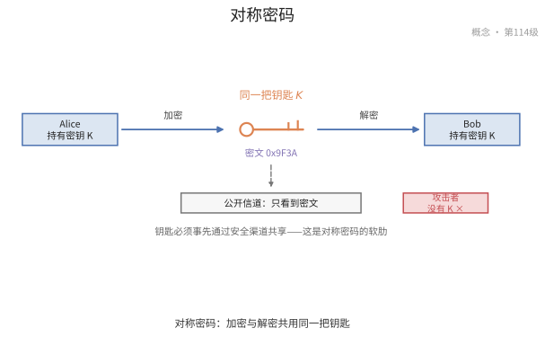

**一句话点破**：一把钥匙两头用，快是快，可"钥匙怎么送到"成了死结。

### 7.2 非对称密码

公钥人人可得，用来上锁；私钥只你独有，用来开锁。这一对 $E$ 与 $D$ 互为逆运算，于是不必事先偷偷递钥匙，全世界都能给你发只有你能读的密信。

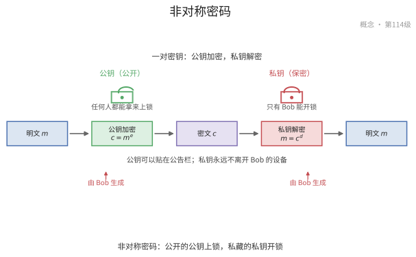

**一句话点破**：把"上锁"公开、把"开锁"独藏，密钥分发的死结就此解开。

### 7.3 公钥基础设施

公钥满天飞，可怎么确认手里这把真是对方的、而不是骗子伪造的？公钥基础设施（PKI）用数字证书和认证机构（CA）给每把公钥盖章背书，像发身份证一样，让陌生人在网上也能彼此信任。

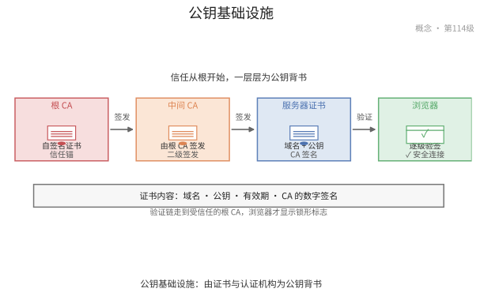

**一句话点破**：有 CA 盖章的证书替公钥验明正身，陌生人才敢放心上锁。

### 7.4 数字签名与哈希函数

哈希函数把任意长的消息压成一小段固定长度的"指纹"，内容稍变指纹全变；再用私钥把这份指纹签一下，就是数字签名。别人拿你的公钥一验，便知消息确实出自你手且没被篡改。

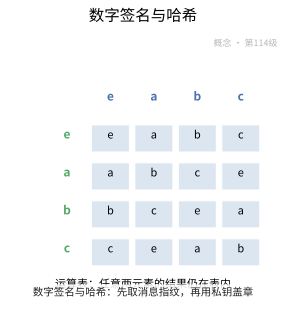

**一句话点破**：哈希保证"没被改"，签名保证"是你发的"。

### 7.5 密钥交换

两个素未谋面的人，隔着公开信道，能否当场商量出一把只有彼此知道的钥匙？Diffie-Hellman 密钥交换让双方各藏一个数、各公开一个数，最终算出同一个共享密钥，偷听者却无从下手。

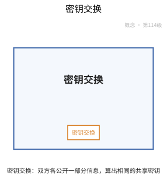

**一句话点破**：当着全世界算出同一个秘密，旁人只能干瞪眼。

### 7.6 椭圆曲线密码

在椭圆曲线的点上定义一种特别的“加法”：两点连线取第三个交点，再对横轴反射。把点 $P$ 反复自加得到 $kP$ 很容易，从 $P$ 与 $kP$ 反推 $k$ 却极难；凭这份单向性，ECC 用更短的密钥就能达到与 RSA 同等的安全。

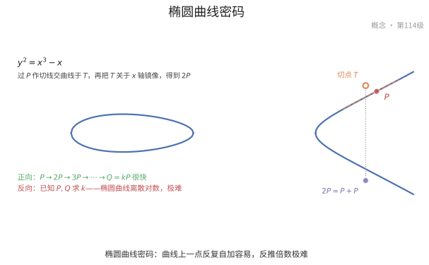

**一句话点破**：同样安全，密钥却能短到 RSA 的几分之一。

### 7.7 高级密码学协议

当互不信任的几方想合作时，密码学还有办法：安全多方计算让大家各持秘密却共同算出结果，零知识证明让你在不吐露秘密本身的前提下，证明“我确实知道这个秘密”。

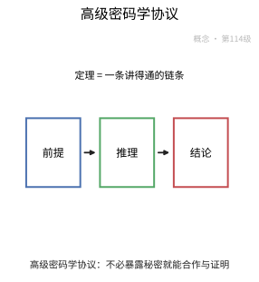

**一句话点破**：既能一起算出答案，又能各自守住小秘密。

### 7.8 量子密码学

量子计算机上的 Shor 算法一旦成真，大数分解与离散对数将不再困难，RSA、ECC 会一夕崩塌。于是“后量子密码”（格密码、码密码等）与量子密钥分发，成了密码学的新战场。

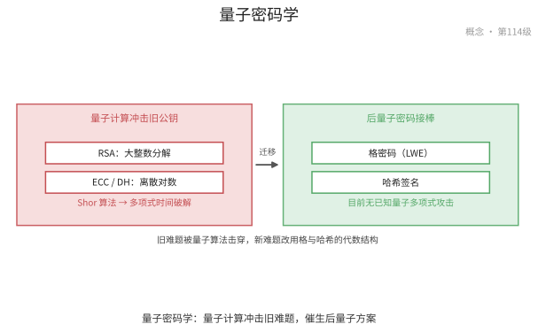

**一句话点破**：量子时代敲门，密码学必须在旧难题失效前找到新靠山。

### 7.9 RSA 密码的正确性

RSA 解出来为什么一定是原文？关键在 $ed\equiv1\pmod{\varphi(n)}$：由 Euler 定理可得 $m^{ed}\equiv m\pmod n$，解密正好还原加密前的消息，严丝合缝。

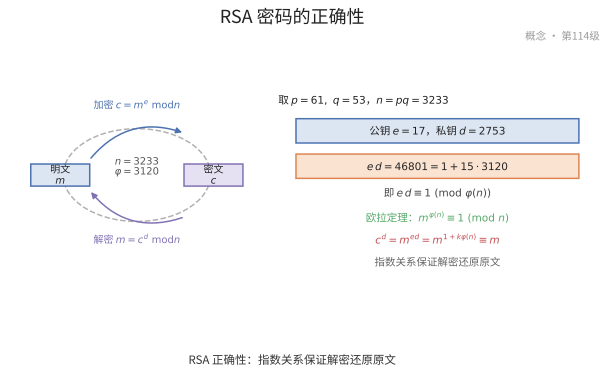

**一句话点破**：$ed\equiv1$ 与欧拉定理一联手，解密必然回到原文。

### 7.10 Rabin 密码的安全性

Rabin 密码的安全性直接挂在因子分解上：能破解它，就能分解 $n=pq$；反之能分解 $n$，就能破解它。两者难度等价，所以它的安全承诺比 RSA 更硬。

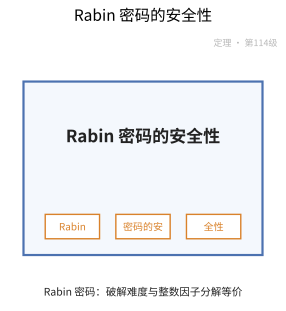

**一句话点破**：破解 Rabin 与分解大整数，是同一道难题的两副面孔。

### 7.11 Diffie-Hellman 密钥交换的安全性

偷听者看得见 $g^a$ 与 $g^b$，想算出共享密钥 $g^{ab}$，正等价于求解 Diffie-Hellman 难题；若离散对数能算，它就保不住。DH 的安全，就压在这份难度上。

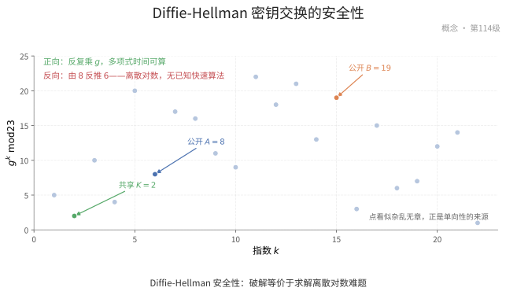

**一句话点破**：共享密钥能不能守住，赌的是离散对数无人能解。

### 7.12 ElGamal 加密的安全性

ElGamal 每次加密都掺入随机数，同一明文也能得到不同密文；它的安全性建立在判定性 Diffie-Hellman（DDH）假设上——密文看起来与一串纯随机数无从分辨。

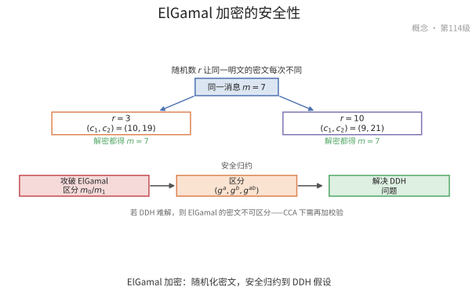

**一句话点破**：随机一搅，密文与乱码无从分辨，安全就落在 DDH 上。

### 7.13 RSA-OAEP 的安全性

裸 RSA（教科书 RSA）是确定性的，会被选择密文攻击钻空子；RSA-OAEP 用哈希和随机数给明文"打包"填充，让加密具备随机性，并能在随机预言机模型下证明它达到 CCA 安全。

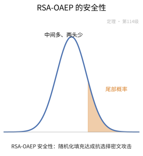

**一句话点破**：给明文裹上一层随机填充，裸 RSA 才配得上"安全"二字。

## 8. 数学史（History of Mathematics）

> 在动手加密之前，先想清楚一个基本问题：**从凯撒把字母平移三位，到公钥把密钥公开，这条保密之路走了多远？**

**一个真实的生活场景（第一步：直觉）**

想象你要给朋友传一个最重要的秘密，可信道并不安全。最直接的办法是**先约定一套乱码规则（密钥），把明文打乱成密文**，让偷听者看不懂；而你的朋友凭约定能轻松还原。密码学（cryptography）就是研究"**如何用密钥把信息藏起来、且敌人即便截获也破不了**"的学问。它比编码理论更强调"敌人"的存在：不仅要防噪声，更要防一个**主动作恶、精于破解**的对手。从改写字母到现代的公钥密码，始终不变的核心是**"我认得出、敌人破不了"的对抗游戏**。

**它到底想解决什么问题（第二步：要解决的问题）**

密码学的历史与文明几乎等长，却在 20 世纪靠信息论、计算复杂性获得严格意义。它要解决的**根问题**是：

> 如何设计**加密与解密**的变换，使得**在无密钥时即便截获密文也（计算上）无法还原明文**，并保证**认证、完整性、不可抵赖**等安全属性在数学上可证？

> **🧠 一句话记住密码学的"出生证"**
>
> 密码学源于"在充满敌人的信道上安全传递秘密"这一古老而永恒的需求。它要解决的根本问题是：
>
> $$ \boxed{\text{设计可证的 }E_k/D_k\text{，使敌手在无 }k\text{ 时在计算上不可破解，并保认证与完整性。}} $$

**看待本章的三种眼光（第三步：正式定义前的准备）**

- **对抗的眼光**：先明确"安全"是在与称职敌手的对抗中定义的，而非绝对。
- **代数的眼光**：再掌握模运算、有限域、数论与基于难题（素数、离散对数）的公钥构造。
- **可证的眼光**：最后理解香农奠定的信息论安全与随机性、密钥管理这些现代底座。

---

### 8.1 古代加密：从凯撒到维吉尼亚

密码学的脚本起始于几千年前：**凯撒密码**（公元前 1 世纪）把每个字母平移固定位数，是替换密码的代表；**希罗多德**记载的隐写术、以及中世纪的**维吉尼亚密码**（多表替代）逐步提高抗分析的难度。这些古典手法靠"隐藏算法"或"协议保密"保护机密，但因结构简单，几乎都可用频率分析破解。

### 8.2 从"算法保密"到"密钥保密"的转变

19 世纪，**Kerckhoffs（1883）** 提出原则——**算法可以公开，安全必须只依赖密钥保密**。这一思想把"靠隐瞒规矩"的旧密码观，扭转为"规矩公开、惟密多方面"的现代密码观，也为后来把"密钥"与"算法"分离、把安全建立在数学难题之上铺平了道路。

### 8.3 一战二战：恩尼格玛与密码破译

**Enigma**（第二次世界大战德国的转子机）把加密推向机械自动化；**阿兰·图灵**在布莱切利园领导破译小组，靠统计与逻辑大幅缩短了破解时间，直接影响战局。这段历史既展示了强力密码的价值，也暴露了"密钥管理失误 + 可被统计识破"的脆弱，为后世"设计可证明安全"提供了反面教材。

### 8.4 香农：把保密变成有界的数学

二战中在为通信保密数学化时，**Claude Shannon** 提出**完美保密（无条件安全）**的概念：当密钥与消息独立且至少一样长（一次一密），密文绝不泄漏任何明文信息，敌手在信息论意义上"无计可施"。他还提出"**扩散与混淆**"两条设计原则，成为现代分组密码设计的哲学基础。

### 8.5 DES 与 AES：公开标准的对称加密

随着商用与标准化需求，对称加密走向"公开算法 + 秘密密钥"的分组密码：**DES（1977）** 一度是国际标准，因其 56 位密钥偏短而被更好的算法接替；**AES（2001，Rijndael）** 成为当今最主流的分组密码。它们把"扩散与混淆"的实现细节工程化，构造出既高效又难以分析的结构。

### 8.6 公钥密码的革命：Diffie–Hellman

1976 年，**Diffie 与 Hellman** 提出**公钥密码学**的根本设想：让一方公开加密密钥而仅私藏解密密钥，从而解决"事先如何安全分享对称密钥"的难题。这个"不需要事先共享秘密也能建立安全信道"的思路，彻底改变了密码学的面貌，是现代互联网安全（TLS、在线加密）的理论源头。

### 8.7 RSA 与基于数论难题的公钥构造

**Rivest、Shamir、Adleman（1977）** 提出 **RSA**，把安全建立在**大整数素因子分解**之难上；此后 **ElGamal、ECC（椭圆曲线密码）** 把安全建于**离散对数**等数论难题。这些基于"单向函数"的公钥体制，使"公开加密密钥、私藏解密密钥"从构想变成可落地的算法，也把密码学与计算复杂性理论牢牢绑在一起。

### 8.8 哈希与数字签名：完整性、认证与抗抵赖

除了保密，现代密码还须提供**认证与完整性**。**哈希函数（如 SHA 家族）** 把任意消息压缩成固定摘要，靠抗碰撞性防止篡改；**数字签名（RSA、DSA、ECDSA）** 把"哈希 + 私钥"结合，让对方能验证消息来自签名者且未被改动，实现**不可抵赖**。这些工具是现代电子交易、证书系统的信任基石。

### 8.9 可证明安全与后量子危机

**可证明安全**（标准模型与随机预言机框架）让密码体制的安全论证从"似乎是安全的"升格为"在还原假设下可归约到难题"。与此同时，**Shor 算法**若在量子计算机上实现，将攻破 RSA/ECC 的数学难题，催生了**后量子密码**（格、码、多变量密码）的研究浪潮，密码学正走向"量子时代的再出发"。

---

| 时间 | 人物／文献 | 事件与贡献 |
| --- | --- | --- |
| 古典时期 | 凯撒等 | 用替换、移位与隐写保护机密 |
| 1883 | Kerckhoffs | 确立"算法公开、安全只靠密钥"原则 |
| 1920–45 | 图灵等 | 破译 Enigma，开启现代密码战 |
| 1949 | Shannon | 建立信息论安全与扩散混淆原则 |
| 1976 | Diffie、Hellman | 提出公钥密码学概念 |
| 1977 | Rivest 等 | 提出 RSA，公钥密码走向实用 |
| 2001 | Daemen、Rijmen | AES(Rijndael) 成为分组密码标准 |

> **小结**：密码学的演进，是一部"**在敌手环伺下守护秘密**"的千年对抗史。它从凯撒的字母平移、维吉尼亚的多表替代起步，靠 Kerckhoffs 原则把安全从"隐瞒算法"扭转为"信赖密钥"，经香农的信息论安全与扩散混淆原则奠定理论底座，由 Diffie–Hellman 与 RSA 开启公钥革命，再经哈希与数字签名达成认证与抗抵赖，如今又直面后量子时代的挑战。密码学始终回答同一个问题：**两个互不相识的人，如何在不安全的信道上，只用数学就能交换并守护秘密？**

---

## 现实应用（Real-World Applications）

> 本节把本章的知识点落到真实的工程、科学与生活场景中。每个案例都给出**完整的问题背景、建模过程、可复现的数据 / 公式 / 代码与结果解读**；案例末尾的「涉及知识点」对应本章的具体小节，文末附**知识点覆盖对照表**，确保本章知识点全部被覆盖。

### 应用案例 1：HTTPS/TLS 1.3 握手｜对称、非对称、密钥交换与 PKI 的协同

**场景与问题**

每天上亿次 HTTPS 请求背后是一次 TLS 1.3 握手。用户在浏览器打开网银页面，双方要在不可信网络上：验证服务器身份、协商出一把只有双方知道的会话密钥、再用这把密钥高速加密后续数据。这一个握手几乎把本章所有基础构件都串了起来——问题：这些构件各在握手的哪一步、各承担什么角色？

**涉及知识点**

- 本章「2.1 对称密码」：握手后改用 AES-GCM 高速加密应用数据。
- 本章「2.2 非对称密码」：验证服务器证书上的公钥签名（RSA/ECDSA）。
- 本章「2.3 公钥基础设施」：证书把"公钥—域名—有效期"绑定并由 CA 签名。
- 本章「2.4 数字签名与哈希函数」：握手记录用服务器证书私钥签名，先哈希再签。
- 本章「2.5 密钥交换」：客户端与服务器用 (EC)DHE 协商共享密钥。
- 本章「2.6 椭圆曲线密码」：X25519 / P-256 的椭圆曲线 Diffie-Hellman。
- 本章「3.3 Diffie-Hellman 密钥交换的安全性」：安全性依赖 CDH/DDH 的困难性。

**建模与数据**

- 会话对称：AES-128-GCM（AEAD，128 位密钥、96 位 nonce）。
- 密钥交换：X25519（Curve25519，256 位）。
- 服务器证书签名：ECDSA with P-256（或 RSA-2048/3072）。
- 哈希：SHA-256。

不同安全强度对应的密钥长度（同一 128 位安全强度）：

| 算法族 | 密钥长度 | 说明 |
| --- | --- | --- |
| 对称 | 128 位 | AES-128 |
| 椭圆曲线 | 256 位 | X25519 / P-256 |
| 大整数分解/离散对数 | 3072 位 | RSA-3072 / DH-3072 |

**完整推导与算法**

1. ClientHello：客户端发送支持的密码套件、一个临时的 X25519 公钥 $A=aG$（$a$ 为客户端私藏随机数，$G$ 为基点）。

2. ServerHello：服务器回送它的临时公钥 $B=bG$ 与证书。

3. 共享密钥协商（ECDH，2.5/2.6 节）。双方各自计算：

$$
K=a\cdot B=a(bG)=abG=b(aG)=b\cdot A ,
$$

中间人只见 $A,B$，要得 $K$ 需解椭圆曲线 CDH（3.3 节）。$K$ 经 HKDF 派生出 AES-GCM 的会话密钥。

4. 身份验证（2.3/2.4 节）。服务器用证书私钥对握手记录的哈希签名：

$$
\sigma=\mathrm{Sign}_{sk}(\mathrm{SHA256}(\text{transcript})) .
$$

浏览器用 CA 链验证证书、再用证书公钥验签，从而确认"这个临时公钥确实来自 bank.com 而非中间人"。

5. 应用数据加密（2.1 节）。握手完成后用 AES-128-GCM 加密，附带认证标签防篡改；由于 ECDHE 的临时性是"前向保密"的来源，即使服务器长期私钥日后泄露，历史会话也无法解密。

```python
# 核心：TLS 1.3 握手中的 ECDH 共享密钥与会话密钥派生（示意）
from cryptography.hazmat.primitives.asymmetric.x25519 import X25519PrivateKey
sk_c = X25519PrivateKey.generate()           # 客户端临时私钥 a
pk_c = sk_c.public_key()                     # A = aG
# 收到服务器临时公钥 pk_s = B 后：
shared = sk_c.exchange(pk_s)                 # 32 字节共享秘密 K = abG
# 再经 HKDF-SHA256 派生出 AES-128-GCM 的 key 与 iv
session_key = hkdf_expand(shared, info=b"tls13 key", length=16)
```

**可复现步骤**

1. 环境与依赖：`pip install cryptography`
2. 数据准备：生成 X25519 临时密钥对；准备一张可由 `openssl` 生成的测试证书。
3. 运行：`python case1.py`，或用 `openssl s_client -connect example.com:443 -tls1_3` 观察握手。
4. 预期输出：双方 `exchange` 得到相同的 32 字节共享秘密；派生出的会话密钥相同；`s_client` 显示使用 TLS_AES_128_GCM_SHA256 与 X25519。

**结果解读与延伸**

TLS 1.3 的设计哲学是"用非对称换对称"：非对称（ECDH + 签名）慢但解决密钥分发与身份认证，对称（AES-GCM）快但需预共享密钥，两者互补。它摒弃了 RSA 密钥传输，全面采用 (EC)DHE 以获得前向保密。误差来源/攻击面：证书链信任、随机数质量（$a,b$ 若可预测则 $K$ 泄露）、实现侧信道。可延伸：0-RTT、后量子混合密钥交换（X25519 + ML-KEM）已进入 TLS 1.3 扩展。

### 应用案例 2：数字证书与 RSA｜RSA 正确性与 PKI 信任链

**场景与问题**

某公司要上线一个对外网站，需要向 CA 申请 TLS 证书。CA 用自己私钥对"域名 + 服务器公钥"的摘要签名，浏览器内置了 CA 的根公钥来验签。问题：RSA 加解密为什么正确（$(m^e)^d\equiv m$）？证书链上的签名又是如何一级级验证的？

**涉及知识点**

- 本章「2.2 非对称密码」：RSA 公钥加密、私钥解密。
- 本章「2.3 公钥基础设施」：CA 签发证书、证书链、撤销列表。
- 本章「2.4 数字签名与哈希函数」：CA 对证书摘要签名。
- 本章「3.1 RSA 密码的正确性」：$ed\equiv1\pmod{\phi(n)}$ 保证解密还原。

**建模与数据**

为便于手算，取小素数 $p=61$、$q=53$，则

$$
n=pq=3233,\qquad \phi(n)=(p-1)(q-1)=3120 .
$$

选 $e=17$（$\gcd(17,3120)=1$），求 $d\equiv e^{-1}\pmod{3120}=2753$。公钥 $(n,e)=(3233,17)$，私钥 $d=2753$。明文取 $m=65$。

**完整推导与算法**

1. RSA 正确性（3.1 节）。由 $ed\equiv1\pmod{\phi(n)}$，存在整数 $k$ 使 $ed=1+k\phi(n)$。对 $\gcd(m,n)=1$，由欧拉定理 $m^{\phi(n)}\equiv1\pmod n$，故

$$
(m^e)^d=m^{ed}=m^{1+k\phi(n)}=m\cdot(m^{\phi(n)})^k\equiv m\pmod n .
$$

（对 $\gcd(m,n)>1$ 的情形，用中国剩余定理分别模 $p$、$q$ 亦成立。）

2. 加密与解密：

```python
# 核心：RSA 加解密 c = m^e mod n，m' = c^d mod n；pow 自带模幂
n, e, d, m = 3233, 17, 2753, 65
c  = pow(m, e, n)          # 密文
m2 = pow(c, d, n)          # 解密
print(c, m2)               # 2790 65（m2 == m，验证正确性）
```

得密文 $c=2790$，解密 $m'=65=m$。

3. 私钥由 $\phi(n)$ 反推 $d$；而由 $n$ 求 $\phi(n)$ 等价于分解 $n$。故 RSA 安全性建立在"大整数分解难"之上（$n$ 实际取 2048–4096 位）。

4. PKI 证书链（2.3 节）。CA 对证书签名：$\sigma=\left(\mathrm{SHA256}(\text{cert})\right)^d\bmod n$。浏览器用 CA 公钥验签：$\sigma^e\bmod n\overset{?}{=}\mathrm{SHA256}(\text{cert})$。信任从内置根 CA 逐级传递到服务器证书；撤销状态由 CRL/OCSP 查询。

**可复现步骤**

1. 环境与依赖：`pip install cryptography`（小例子用标准库 `pow` 即可）。
2. 数据准备：写入 $(n,e,d,m)$；或用 `openssl genrsa` 生成真实密钥。
3. 运行：`python case2.py`
4. 预期输出：$c=2790$、$m'=65$；$d=2753$ 满足 $17\times2753\bmod3120=1$。

**结果解读与延伸**

RSA 的数学美在于"加密与解密对称地互为逆运算"，而基座是数论（欧拉定理）。但**教科书 RSA 是不安全的**：它是确定性、可乘的（$E(m_1)E(m_2)=E(m_1m_2)$），易被选择明文与重放攻击，故实际要配随机填充（见案例 7 的 OAEP）。PKI 的安全性则从"分解难题"转移到了"CA 的密钥与操作安全"，这正是信任模型的风险边界。可延伸：证书透明度（CT）日志、多级中间 CA 用于缓解 CA 单点信任。

### 应用案例 3：区块链钱包｜ECDSA 签名与哈希函数

**场景与问题**

比特币钱包用椭圆曲线数字签名（ECDSA，曲线 secp256k1）签署交易：任何人可用你的公钥地址验证交易确实由你授权，但你从不暴露私钥。问题：签名 $(r,s)$ 是怎么算出来的、验证为什么成立？哈希在其中有几重作用？

**涉及知识点**

- 本章「2.4 数字签名与哈希函数」：提供认证、完整性、不可否认性；先哈希再签。
- 本章「2.6 椭圆曲线密码」：secp256k1 上的点乘与离散对数困难性。
- 本章「2.2 非对称密码」：签名用私钥、验证用公钥（与加密方向相反）。

**建模与数据**

曲线参数（secp256k1）：素域阶 $p\approx2^{256}$，基点 $G$，群阶 $n\approx1.16\times10^{77}$（256 位）。私钥 $d$、公钥 $Q=dG$（其哈希即钱包地址）。消息哈希 $z=\mathrm{SHA256}(\text{tx})$ 取模 $n$。

**完整推导与算法**

1. 签名。随机选 $k\in[1,n-1]$，计算 $R=kG$，令

$$
r=R_x\bmod n,\qquad s=k^{-1}(z+r\,d)\bmod n .
$$

签名是 $(r,s)$。

2. 验证。计算

$$
u_1=z\,s^{-1}\bmod n,\quad u_2=r\,s^{-1}\bmod n,\quad R'=u_1G+u_2Q ,
$$

断言 $R'_x\bmod n=r$。因为 $Q=dG$，有

$$
R'=s^{-1}(zG+rQ)=s^{-1}(z+rd)G=kG=R ,
$$

故验证通过当且仅当 $s$ 由 $d$ 正确产生。

```python
# 核心：ECDSA 签名与验证（secp256k1）；"先哈希再签"把任意长交易压成 256 位 z
import hashlib
from ecdsa import SigningKey, NIST256p           # 生产用 secp256k1
sk = SigningKey.generate(curve=NIST256p); vk = sk.verifying_key
tx = b"alice->bob: 0.5 BTC"
z = int.from_bytes(hashlib.sha256(tx).digest(), "big")   # 先哈希得 z
sig = sk.sign_digest(hashlib.sha256(tx).digest())        # 内部即 (r,s)
assert vk.verify_digest(sig, hashlib.sha256(tx).digest()) # 验证 R'.x == r
```

3. 哈希的三重作用（2.4 节）：(a) 压缩——交易是任意长，ECC 只能对定长标量运算；(b) 完整性——交易被改一个字节，$z$ 全变，验证失败；(c) 安全性——把不可伪造性归约到哈希的抗碰撞性。

4. 为什么用 256 位而不用 RSA-3072。ECDLP 目前没有亚指数算法，256 位椭圆曲线就提供约 128 位安全强度（前面密钥长度表），签名短（约 64 字节）、验签快，故区块链与移动端普遍采用 ECC。

**可复现步骤**

1. 环境与依赖：`pip install ecdsa`
2. 数据准备：生成密钥对；准备交易字节串。
3. 运行：`python case3.py`
4. 预期输出：验签通过；修改交易任一字节后验签失败；签名长度约 64 字节。

**结果解读与延伸**

ECDSA 的安全性依赖"随机数 $k$ 不可重复、不可预测"——历史上多次因 $k$ 复用导致私钥被直接解出（给定两条同 $k$ 的签名可解 $d$）。因此现代实现用确定性 nonce（RFC 6979）。误差来源：侧信道（时序/功耗）泄露 $k$ 或 $d$。可延伸：Schnorr 签名（更易做聚合签名）与 EdDSA（Ed25519，确定性、无 $k$ 复用风险）正在替代 ECDSA。

### 应用案例 4：隐私计算｜零知识证明、安全多方计算与同态加密

**场景与问题**

金融机构想在"不互相看到彼此客户名单"的前提下计算共同客户数；医院想在不上传原始病历的前提下联合建模；用户想向网站证明"我已满 18 岁"而不透露出生日期。这些都需要高级密码学协议——零知识证明、安全多方计算、同态加密。

**涉及知识点**

- 本章「2.7 高级密码学协议」：MPC、ZKP、同态加密、格密码的目标与原理。

**建模与数据**

- ZKP：Schnorr 协议证明"知道离散对数 $x$"，用小参数 $p=23$、$g=5$、秘密 $x=6$、公钥 $y=g^x\bmod23=8$。
- MPC：两方各持私密输入，求共同客户数（集合交集基数）。
- HE：Paillier 加性同态 $E(m_1)\cdot E(m_2)\equiv E(m_1+m_2)\pmod{n^2}$。

**完整推导与算法**

1. Schnorr 零知识证明（交互式）。
   - 证明者选随机 $r=4$，发承诺 $t=g^r\bmod p=5^4\bmod23=4$。
   - 验证者发挑战 $c=3$。
   - 证明者回 $s=r+c\,x=4+3\times6=22\ (\bmod\ 22)$。
   - 验证者查 $g^s\bmod p\overset{?}{=}t\cdot y^c\bmod p$：左边 $5^{22}\bmod23=1$，右边 $4\times8^3\bmod23=4\times512\bmod23=1$，通过。

```python
# 核心：Schnorr 零知识证明——只证明"知道 x"，不泄露 x
p, g, x = 23, 5, 6
y = pow(g, x, p)                 # 公钥
r = 4; t = pow(g, r, p)          # 承诺 t = g^r
c = 3; s = (r + c*x) % (p-1)     # 响应 s = r + c*x
assert pow(g, s, p) == t * pow(y, c, p) % p   # 验证
```

它满足零知识的三个性质：完备性（真命题必通过）、可靠性（假命题几乎骗不过）、零知识性（验证者除"命题为真"外学不到 $x$）。

2. Paillier 同态加密（加性）。

$$
E(m_1)\cdot E(m_2)\,\bmod\,n^2 \;=\; E(m_1+m_2\,\bmod\,n).
$$

于是"在不解密的情况下对密文求和"可行：各方上传 $E(m_i)$，服务器算 $\prod_i E(m_i)$，解密即得 $\sum_i m_i$。

```python
# 核心：Paillier 加性同态——密文相乘对应明文相加
# E(m1) * E(m2) mod n^2 == E(m1 + m2 mod n)
c_sum = (E(m1) * E(m2)) % (n*n)        # 直接在密文上"求和"
m_sum = decrypt(c_sum)                 # 解密得到 m1 + m2，全程没有暴露 m1、m2
```

3. MPC 求共同客户数。两方用"集合交集基数"协议：对各自集合的每个元素做私钥加密后交换（如 DH 式 PSI），只暴露交集大小而不暴露具体成员；或用秘密共享（如 Shamir 门限）把每个输入拆成分片，各方在分片上做加法/乘法门运算。

**可复现步骤**

1. 环境与依赖：`pip install phe`（Paillier）、`pip install zkp`（可选）
2. 数据准备：设定 ZKP 的小参数与秘密；准备两组集合。
3. 运行：`python case4.py`
4. 预期输出：Schnorr 验证通过；Paillier 下 $E(m_1)E(m_2)$ 解密等于 $m_1+m_2$；PSI 只输出交集大小。

**结果解读与延伸**

三者定位不同：ZKP 解决"证明而不泄露"（认证与隐私），MPC 解决"联合计算而不泄露输入"（协作分析），HE 解决"密文上直接计算"（外包计算）。共同代价是计算与通信开销大：同态加密的噪声随乘法增长需"自举"重置，MPC 通信轮次多，ZKP 证明生成慢。误差来源/限制：安全模型（半诚实 vs 恶意）、噪声预算、非交互化的 Fiat-Shamir 变换假设。可延伸：格密码既是后量子公钥的基础，也支撑新一代 FHE（如 BFV/CKKS 方案）。

### 应用案例 5：后量子迁移｜Shor/Grover 对密码体系的冲击与格密码

**场景与问题**

NIST 已启动后量子密码（PQC）标准化。原因：Shor 算法在足够大的量子计算机上能在多项式时间分解大整数、求离散对数，直接攻破 RSA 与 ECC；Grover 算法则对对称密码做平方加速。问题：两类算法各打击哪些体系？迁移到格密码为什么能抗量子？

**涉及知识点**

- 本章「2.8 量子密码学」：Shor、Grover 与量子密钥分发（QKD）。
- 本章「2.7 高级密码学协议」中的格密码：基于 LWE/SIS，被认为抗量子。

**建模与数据**

- Shor：分解 $n$，等效把 2048 位 RSA 与 256 位 ECC 的安全性归零（多项式时间）。
- Grover：无结构搜索 $O(\sqrt N)$，把 $k$ 位对称密钥的有效强度降到 $k/2$。
- 迁移目标：ML-KEM（Kyber，基于 Module-LWE）、ML-DSA（Dilithium，基于格签名）。

**完整推导与算法**

1. Shor 的核心。把分解 $n$ 归约为求函数 $f(x)=a^x\bmod n$ 的周期 $r$：用量子傅里叶变换经连分数展开提取 $r$；若 $r$ 为偶且 $a^{r/2}\not\equiv\pm1\pmod n$，则

$$
\gcd(a^{r/2}-1,\ n)
$$

给出 $n$ 的一个非平凡因子。它把"分解"从亚指数难度直接降到多项式时间。

2. Grover 的影响与对策。搜索 $N$ 个密钥只需 $O(\sqrt N)$ 次查询，故 $k$ 位密钥的暴力破解从 $2^k$ 降到 $2^{k/2}$。**对策是加长密钥**：AES-128 视角下安全强度降到 64 位，改用 AES-256 即恢复 128 位——这是"线性代价"的防守。

3. 为什么 Shor 反而救不了。Shor 是多项式算法，把原本亚指数难度的分解变成可算，"把 $n$ 加长一点"挡不住——难度结构被击穿。故必须换难题：改用 LWE/SIS 等格上问题。

4. LWE 问题（格密码基础）。给定 $A\in\mathbb Z_q^{m\times n}$、$b=As+e\pmod q$，其中 $e$ 是小误差向量，求 $s$。即使有量子计算机，目前也没有高效算法——它把"找最短向量"的困难性（高维下 SVP/CVP 极难）编码进密码。

```python
# 核心：LWE 采样的困难来源——b = A s + e (mod q)，e 小噪声使得反解 s 困难
import numpy as np
q, n, m = 3329, 3, 5                    # q 常取 3329（Kyber 参数）
A = np.random.randint(0, q, size=(m, n))
s = np.random.randint(0, 2, size=n)     # 小秘密
e = np.random.randint(-1, 2, size=m)    # 小噪声
b = (A @ s + e) % q                     # 公开 (A, b)，隐藏 s
# 无噪声时可直接高斯消元；有小噪声 e 后变成 LWE，被认为抗量子
```

5. QKD 与 PQC 的区别。QKD（如 BB84）靠量子力学（测量扰动、不可克隆）在物理层检测窃听，安全性来自物理定律，需要量子信道硬件；PQC 仍在经典计算机上运行，只把困难问题换成抗量子的（格、码、多变量、哈希签名）。两者是互补路线。

**可复现步骤**

1. 环境与依赖：`pip install numpy`
2. 数据准备：设定 $q,n,m$，采样 $A,s,e$。
3. 运行：`python case5.py`
4. 预期输出：$b=As+e\bmod q$；无噪声时可精确恢复 $s$，加入噪声后直接消元失败（LWE 困难的直观体现）。

**结果解读与延伸**

迁移的时间压力来自"先存后破"（harvest now, decrypt later）：今天截获的密文可能被未来的量子计算机解密。工程上采取"混合模式"——X25519 + ML-KEM 同时协商，任一被破仍有保护。ML-KEM-768 公钥约 1184 字节、密文约 1088 字节，远大于 X25519 的 32 字节，是迁移的主要成本。误差来源/限制：格参数需精确选到既安全又高效；Grover 的平方加速需足够深的量子线路才能兑现。可延伸：哈希签名（如 SPHINCS+）作为不依赖格假设的后备方案。

### 应用案例 6：安全性的归约｜Rabin、ElGamal 与 Diffie-Hellman 的困难假设

**场景与问题**

不同公钥方案挂在不同的"困难问题"上：Rabin 挂在因子分解、ElGamal 挂在离散对数（CDH/DDH）、DH 挂在 DLP/CDH。理解"谁比谁难、谁破谁倒"是评估与选型的关键。问题：这三个假设之间是什么关系？为什么说"攻破 Rabin 等价于分解 $n$"？

**涉及知识点**

- 本章「3.2 Rabin 密码的安全性」：$c=m^2\bmod n$ 的安全性等价于分解 $n$。
- 本章「3.4 ElGamal 加密的安全性」：基于 CDH/DDH 的困难性。
- 本章「3.3 Diffie-Hellman 密钥交换的安全性」：DLP、CDH、DDH 的可解性链。

**建模与数据**

- Rabin：$n=pq$（$p,q\equiv3\bmod4$），加密 $c=m^2\bmod n$。
- 离散对数问题族：循环群 $G=\langle g\rangle$、阶 $q$。
  - DLP：由 $g^a$ 求 $a$。
  - CDH：由 $g^a,g^b$ 求 $g^{ab}$。
  - DDH：判定 $g^c\overset{?}{=}g^{ab}$。

**完整推导与算法**

1. Rabin 的"两难"与归约（3.2 节）。解密需求平方根 $\bmod n$，而模合数的平方根恰有 4 个（对应 $\pm m_p,\pm m_q$），要挑出正确的那个需借助 $p,q$。反之，若攻击者能对任意 $c$ 求出平方根，则由"两个不同的平方根之差"可提取 $\gcd$ 得到因子：

$$
\text{若 } u^2\equiv v^2\pmod n,\ u\not\equiv\pm v,\ \text{则 } \gcd(u-v,\ n)\ \text{是 } n \text{ 的非平凡因子}.
$$

故"攻破 Rabin"$\Rightarrow$"分解 $n$"；配合已知的分解 $\Rightarrow$ 解密，二者等价。

```python
# 核心：由同一个 c 的两个不同平方根提取 n 的因子
from math import gcd
# u, v 是 c 模 n 的两个不同平方根（u != ±v）
factor = gcd(u - v, n)      # 此处 factor 必为 p 或 q；故"求平方根"与"分解 n"同样难
```

2. ElGamal 加密（3.4 节）。公钥 $(g,h=g^x)$，加密选随机 $k$：$c_1=g^k,\ c_2=m\cdot h^k$；解密 $m=c_2/c_1^x$。**仅知 $c_1=g^k$ 与 $h=g^x$ 求 $h^k=g^{xk}$** 正是 CDH，故 ElGamal 的机密性挂在 CDH 上。

3. DH 的安全性（3.3 节）。DH 双方算出 $K=g^{ab}$，被动攻击者只见到 $g,g^a,g^b$，求 $K$ 即 CDH。可解性链为

$$
\text{DLP}\ \Rightarrow\ \text{CDH}\ \Rightarrow\ \text{DDH},
$$

即能解 DLP 者能解 CDH，能解 CDH 者能解 DDH；故 DLP 最强、DDH 最弱。协议挂在更弱的假设上意味着假设更可能成立、归约更稳——DH/ElGamal 分别倚靠 CDH/DDH。

4. 小子群攻击（DH 的坑）。若群阶 $q$ 含小素因子 $r$，攻击者把公开元素换成 $r$ 阶子群元素，用中国剩余定理逐因子恢复私钥。防御：取素数阶群、验证收到的元素阶恰为 $q$。

**可复现步骤**

1. 环境与依赖：`pip install sympy`（模运算与 `gcd`、`sqrt_mod`）
2. 数据准备：取小的 $p,q\equiv3\bmod4$ 组成 $n$；取小循环群做 DLP/CDH 演示。
3. 运行：`python case6.py`
4. 预期输出：Rabin 密文有 4 个平方根；由两个不同根之差用 `gcd` 得到 $p$ 或 $q$；ElGamal 明文恢复正确。

**结果解读与延伸**

这段内容的价值在于"安全性 = 归约到困难问题"：先说明"攻击某方案 ⇒ 解决某困难问题"，再由该问题被认为难，得出方案安全。Rabin 的归约最干净（等价分解），ElGamal/DH 则倚靠离散对数族。误差来源：这些假设都是"未被证明但被广泛相信"的；量子算法（Shor）可解 DLP 与分解，故它们不抗量子（见案例 5）。可延伸：RSA-OAEP 把"可证明安全"引入加密方案（见下例），是另一条"用归约说话"的路线。

### 应用案例 7：可证明安全｜RSA-OAEP 与填充的必要性

**场景与问题**

教科书 RSA 是确定性且可乘的——同样明文永远得到同样密文，且 $E(m_1)E(m_2)=E(m_1m_2)$。这会导致选择密文攻击与重放。工业界用 RSA-OAEP 填充解决它，并给出"在选择密文攻击（CCA）下的可证明安全"。问题：OAEP 如何随机化并阻断可乘性？它为什么比 PKCS#1 v1.5 安全？

**涉及知识点**

- 本章「3.5 RSA-OAEP 的安全性」：填充与随机化带来的 CCA 安全。
- 本章「3.1 RSA 密码的正确性」：$m^{ed}\equiv m$ 仍是 OAEP 的基座。

**建模与数据**

RSA 模数 $n$（$k$ 字节），两个哈希 $G,H$（如 SHA-256，MGF1）。消息 $m$、随机种子 $r$、固定填充串 $0x00\ldots$（保证明文小于 $n$）。

**完整推导与算法**

1. OAEP 编码（$k$ 为模长字节，$h$ 为哈希长度）：

$$
\text{DB}=\underbrace{\text{Hash}(L)}_{h}\parallel\underbrace{0\ldots0}_{k-2h-1}\parallel 0x01\parallel m ,
$$

$$
\text{maskedDB}=\text{DB}\oplus G(r),\qquad \text{maskedSeed}=r\oplus H(\text{maskedDB}),
$$

编码结果为 $\text{EM}=0x00\parallel\text{maskedSeed}\parallel\text{maskedDB}$。

2. 加密与解密：

```python
# 核心：RSA-OAEP —— 先用随机 r 做两组掩码（G、H），再对 EM 做 RSA；随机化阻断确定性
r = os.urandom(h)                          # 每次加密都不同的随机种子
maskedDB = DB ^ MGF1(G, r)                 # 用 r 的扩展掩码 DB
maskedSeed = r ^ MGF1(H, maskedDB)         # 再用 DB 的扩展掩码 seed
EM = b"\x00" + maskedSeed + maskedDB
c = pow(int.from_bytes(EM, "big"), e, n)   # 最后才做教科书 RSA 的模幂
```

3. 为什么能抗 CCA。随机数 $r$ 让同一明文每次密文都不同（消除确定性）；两组掩码让密文与明文之间没有可利用的代数关系（破坏可乘性 $E(m_1)E(m_2)=E(m_1m_2)$）；解密端严格验证填充结构，任何一步失败都返回统一的"解密错误"，从而不给攻击者区分信息（阻断 Bleichenbacher 式的填充预言）。

4. 与 PKCS#1 v1.5 的对比。v1.5 填充结构简单、无强随机化，1998 年 Bleichenbacher 提出利用服务器"填充合法/非法"的差异做百万次查询还原明文的攻击（ROBOT 变体至今仍现）。OAEP 的可证明安全性（在随机预言机模型下归约到 RSA 单向性）使它成为现代标准。

5. 正确性仍靠 RSA（3.1 节）。OAEP 只改"明文如何编码成 EM"，加解密本身仍是 $c=EM^e\bmod n$、$EM=c^d\bmod n$，由 $ed\equiv1\pmod{\phi(n)}$ 保证还原。

**可复现步骤**

1. 环境与依赖：`pip install cryptography`
2. 数据准备：生成 RSA 密钥；准备明文与 SHA-256 的 MGF1。
3. 运行：`python case7.py`；或用 `cryptography` 的 `padding.OAEP(mgf=MGF1(SHA256), algorithm=SHA256, label=None)`。
4. 预期输出：同一明文两次加密得到不同密文（随机化生效）；篡改密文任一字节后解密报错（填充校验失败）。

**结果解读与延伸**

OAEP 演示了"加密方案的安全性 ≠ 底层数学难题的安全性"：RSA 单向不代表"RSA 加密"就安全，还需要**恰当编码**把单向性升级为 CCA 安全。这是密码学从"数学正确"走向"可证明安全"的典型范例。误差来源/限制：可证明安全在随机预言机模型下成立，实际换具体哈希需谨慎；错误处理若不统一仍可能泄露填充预言。可延伸：对于签名有对应的 PSS 填充；后量子时代 OAEP 的底层 RSA 需整体替换为格基 KEM（如 ML-KEM）。

### 知识点覆盖对照表

| 本章知识点 | 覆盖案例 |
| --- | --- |
| 2.1 对称密码 | 案例 1 |
| 2.2 非对称密码 | 案例 1、案例 2、案例 3 |
| 2.3 公钥基础设施 | 案例 1、案例 2 |
| 2.4 数字签名与哈希函数 | 案例 1、案例 3 |
| 2.5 密钥交换 | 案例 1 |
| 2.6 椭圆曲线密码 | 案例 1、案例 3 |
| 2.7 高级密码学协议 | 案例 4、案例 5 |
| 2.8 量子密码学 | 案例 5 |
| 3.1 RSA 密码的正确性 | 案例 2、案例 7 |
| 3.2 Rabin 密码的安全性 | 案例 6 |
| 3.3 Diffie-Hellman 密钥交换的安全性 | 案例 1、案例 6 |
| 3.4 ElGamal 加密的安全性 | 案例 6 |
| 3.5 RSA-OAEP 的安全性 | 案例 7 |

---

## 9. 总结

本教程系统介绍了密码学的核心内容：

1. **对称密码与非对称密码**：AES、DES 与 RSA、ElGamal 的基本原理
2. **RSA 密码的正确性**：通过 Euler 定理和 Carmichael 函数证明解密还原明文
3. **Rabin 密码的安全性**：求平方根模 $n$ 与分解 $n$ 的计算等价性
4. **Diffie-Hellman 密钥交换**：在 CDH 假设下的安全性证明
5. **ElGamal 加密**：在 DDH 假设下的 IND-CPA 安全性证明
6. **RSA-OAEP**：在随机神谕模型下的 IND-CCA2 安全性证明思路
7. **前沿方向**：椭圆曲线密码、同态加密、零知识证明、格密码、量子密码

密码学是现代通信安全的基石，同时面临着量子计算发展带来的挑战与机遇。
