# 第 115 级：计算数学 (Computational Mathematics)

---

## 从"怎么把科学问题真正算出来"说起：计算数学要解决的根问题

> 在谈复杂度、误差、蒙特卡洛之前，先想清楚一个务实的问题：**有了公式，是不是就万事大吉？现实中真有人能"算到底"吗？**

**第一步：直觉——公式里写着答案，机器却常常"算不动"**

想象天气预报：它的物理规律（对流扩散、热力学）写出来无非一组偏微分方程，理论上"把初值代进去"就有解。可真要做 24 小时预报，你可能要对全国许以百万计的网格点、几千个时间步、每个步还要解一个巨型方程组——**一算就是天文数字般的乘加**。这时真正的问题不再是"方程有没有解"，而是：**能不能在有限的时间、内存里，把解可靠地算出来？** 计算数学，反复琢磨的就是这句话里的三个词——"有限资源"、"可靠"、"算出来"。

**第二步：要解决的问题——在有限资源下得到可信的数字**

计算数学（有时也叫"科学计算"）的核心动机，来自一条无法回避的裂缝：**现实问题大多没有手算的解，而机器虽然快，却受制于"精度有限、资源有限、速度有限、只能一步步来"**。要在有限资源下得到可信的数字，它得回答四个一环扣一环的问题：

- **算得准不准**：浮点舍入误差怎么累积？算法稳定吗（向前/向后误差、条件数）？
- **算得多快**：复杂度是多少、能不能用分治/快速算法把 $O(N^2)$ 降到更省？快速多极子（FMM）正是把 $N$ 体引力从 $O(N^2)$ 压到 $O(N)$ 的明星。
- **算得有多可信**：蒙特卡洛这类随机方法靠什么收敛、误差多大？
- **算得动吗**：存不下就稀疏化，跑不动就并行与 GPU——大规模科学计算的地基。

**第三步：正式定义前的准备——本章怎样一步步推进**

本章按"质量、速度、规模"三条线展开：

1. 先立起**复杂度**的度量（$O/\Omega/\Theta$、P/NP）作为"算得多快"的语言；
2. 用**浮点运算与舍入误差**、**数值稳定性**回答"算得准不准"（向前/向后误差、条件数、IEEE 754）；
3. 用**算法设计范式**（分治、动态规划、随机化）与**主定理**回答"怎么设计快算法"；
4. 用 **蒙特卡洛**与**自适应算法**回答"随机与自适应的收敛性"；
5. 最后看**并行/GPU 与稀疏矩阵**，回答"算得动吗"，并以 **FMM** 为例看"从 $O(N^2)$ 到 $O(N)$"的实现艺术。

读完你会明白：计算数学不是"数学的附属品"，而是**把数学翻译成工程可执行方案的那门手艺**——精度、代价、可扩展性在此被统一权衡。

> **🧠 一句话记住计算数学的"出生证"**
>
> 计算数学要回答的，是一个"让公式落地"的问题：
>
> $$ \boxed{\text{在有限的时间与内存里，如何设计并分析算法，把数学问题的解以可控误差、可承受代价可靠地"算出来"？}} $$
>
> 它站在数学与计算机工程的十字路口：左边是误差分析、右边是复杂度、底下是并行与稀疏——四者合力，才让"算到底"成为可能。

## 开始之前

**本章在讲什么**：本章讲"科学计算"这一核心能力的数学底盘。你会先学习计算复杂度（$O/\Omega/\Theta$、P/NP）与浮点运算的误差模型（IEEE 754、向前/向后误差、条件数、数值稳定），再掌握分治/动态规划/随机化三类设计范式与主定理，随后学习蒙特卡洛方法的收敛性理论、自适应算法，并以并行/GPU、稀疏矩阵、快速多极子方法（FMM）作为大规模计算的落点。

**为什么要学它**：第 103 级（数值分析）讲了插值逼近与误差的基本观念，第 105 级（数值线性代数）给了矩阵算法，第 107 级（微分方程数值解）讲了 PDE 的离散；但"复杂度、浮点误差的本源、随机方法、并行与大规模可扩展性"这些贯穿性议题，需要一个统一的"计算数学"视角来收束。它既为第 106 级（有限元）、第 118 级（流体）等提供规模化的工具箱，也是把前面所有数值方法推向"真正跑得动"的最后一公里。

**开始前请确认你还记得**：

- 渐近记号（$O$/$\Omega$/$\Theta$）与算法复杂度的基本概念（见算法与复杂度章节）。
- 浮点数表示、舍入与误差的基本直觉（见第 103 级 数值分析）。
- 线性代数的基础：矩阵乘法、特征值、范数（见第 14 级 线性代数、第 105 级 数值线性代数）。
- 概率论：期望、方差、大数定律、中心极限定理（见概率论章节）。
- 递归与递推关系（分治/动态规划用到），以及幂级数与几何级数收敛（见级数章节）。

---

## 1. 学习目标

完成本教程后，你将能够：

1. 理解计算复杂度的基本概念与算法设计范式
2. 掌握浮点运算的误差分析理论与数值稳定性
3. 理解快速多极子方法的原理与误差界
4. 掌握蒙特卡洛方法的收敛性理论基础
5. 掌握分治算法的复杂度分析（主定理）及其证明
6. 理解自适应算法的收敛性理论
7. 了解并行计算、GPU 计算、稀疏矩阵等大规模计算技术

---

## 2. 核心概念

### 2.1 计算复杂度

**计算复杂度**（Computational Complexity）研究算法所需的资源（时间、空间）随问题规模增长的变化。常用表示法包括：

- $O(\cdot)$：渐近上界
- $\Omega(\cdot)$：渐近下界
- $\Theta(\cdot)$：渐近紧界

**P 类**：多项式时间可解的问题。**NP 类**：多项式时间可验证的问题。**NP 完全问题**：NP 中最难的问题。

> **💡 直观理解（类比）**：复杂度记号像"给爬山时间划区间"——$O(n)$ 承诺最多多久爬到顶，$\Omega(n)$ 保证至少得多长时间，$\Theta(n)$ 则把上下界箍死在同一个量级。P 类像"能在工作日按部就班做完的活"（多项式时间可解），NP 类像"给出答卷能让人快速验收对错的活"（可验证）；NP 完全则是"全城最棘手的钉子户"——只要找到办法撬动它，全城同类难题就都能撬动。

#### 课堂问答

**老师**：同样是"描述增长"，$O$、$\Omega$、$\Theta$ 到底在说三件不同的事，还是一件？

**学生**：结论先行——它们是给函数"卡区间"的三种口径：$O$ 卡上界、$\Omega$ 卡下界、$\Theta$ 同时卡住上下界。比如 $T(n)=3n^2+5n$，则 $T(n)=O(n^2)$、$T(n)=\Omega(n^2)$，于是 $T(n)=\Theta(n^2)$。最容易被误读的是 $O$：$f(n)=O(g(n))$ 只表示"$f$ 长得不比 $g$ 快多少（常数倍以内）"，并不保证它真达到那个量级——所以 $n=O(n^2)$ 成立，但说"$n$ 是 $n^2$ 级"就错了。

**老师（追问）**：既然 $O$ 只是上界，那 $O(n)$ 是不是 $O(n^2)$ 的子集？

**学生**：是。上界越宽松，集合越大，所以 $O(n)\subseteq O(n^2)\subseteq O(n^3)$。这提醒我那个"等号"其实是"属于"：$f=O(g)$ 该读成 $f\in O(g)$。真正能刻画"快慢量级"的是 $\Theta$，也是算法分析最想要的结论。至于 $O$ 里为什么不写常数和低阶项——因为渐近只看 $n\to\infty$ 的极限行为，$3n^2$ 与 $n^2$ 只差一个常数因子。

**老师（拓展）**：那 P、NP、NP 完全这三个类，和上面这套记号怎么衔接？

**学生**：P 是"多项式时间能解"，即存在 $O(n^k)$ 的算法；NP 是"给出答案能在多项式时间内验证"，注意验证不等于求解，所以 $P\subseteq NP$ 显然，但 $P=NP$ 至今悬而未决。NP 完全是 NP 里"最难"的一批：只要其中一个能在多项式时间内解出，所有 NP 问题便都能。它的意义在于多项式归约——A 归约到 B 意味着"B 若好解则 A 也好解"，于是 NP 完全问题成了整个 NP 的硬度锚点。

### 2.2 浮点运算与舍入误差

**IEEE 754 标准**定义浮点数表示：

$$
x = \pm (1.d_1d_2\dots d_{p-1})_2 \times 2^{e},
$$

其中 $p$ 为精度，$e$ 为指数。双精度浮点数的机器精度 $\varepsilon_{\text{mach}} = 2^{-52} \approx 2.22 \times 10^{-16}$。

**舍入误差**（Rounding Error）：浮点运算的基本模型为：

$$
\text{fl}(a \circ b) = (a \circ b)(1 + \delta), \quad |\delta| \leq \varepsilon_{\text{mach}},
$$

其中 $\circ \in \{+, -, \times, /\}$。

> **💡 直观理解（类比）**：浮点数像"位数有限的记账本"——计算机记不下无限小数，只能把每个数四舍五入到最近的可表示档位，误差上限就是机器精度 $\varepsilon_{\text{mach}}\approx2^{-52}$（约到小数点后第 16 位）。单次加减乘除都只偏一个刻度，可几百次运算累积起来，误差就像小砂砾越积越碍事，这正是误差分析要追的方向。

#### 课堂问答

**老师**：$x=\pm(1.d_1d_2\dots d_{p-1})_2\times2^{e}$，为什么双精度的机器精度恰好是 $2^{-52}$？

**学生**：结论：双精度有 52 位显式尾数，加上规格化隐含的前导 $1$，有效精度 $p=53$ 位；相邻两个可表示数在 $[1,2)$ 上的间距是 $2^{-52}$，而"从 $1$ 跳到下一个数"的相对间隔正是 $2^{-52}\approx2.22\times10^{-16}$，这就是机器精度 $\varepsilon_{\text{mach}}$。舍入的通用模型是 $\text{fl}(a\circ b)=(a\circ b)(1+\delta)$，$|\delta|\le\varepsilon_{\text{mach}}$，其中 $\circ\in\{+,-,\times,/\}$——每次基本运算都至多在真值上乘一个 $1\pm\varepsilon_{\text{mach}}$ 的因子。

**老师（追问）**：这里有个常被混淆的点——"间距 $2^{-52}$"和"舍入相对误差上界"真的是一回事吗？

**学生**：严格说不完全等同。间距（ulp）是 $2^{-52}$，但最近舍入把误差限制在半个 ulp 内，对应的单位舍入误差是 $u=2^{-53}$，比 $2^{-52}$ 小一半。工程上常把 $\varepsilon_{\text{mach}}=2^{-52}$ 当作安全上界写进模型，这样得到的界偏保守但结论不变。这个区别在高精度分析里必须辨清，否则会平白放大 2 倍的估计。

**老师（拓展）**：相对误差模型听起来很稳，哪种运算会把它彻底破坏？

**学生**：相减！当 $a\approx b$ 时，$\text{fl}(a-b)$ 的绝对误差仍约为 $\varepsilon_{\text{mach}}|a|$，可结果 $a-b$ 本身很小，相对误差就被放大成 $\varepsilon_{\text{mach}}|a|/|a-b|$，这叫灾难性相消。典型例子是 $f(x)=1-\cos x$ 在 $x=10^{-3}$ 处直接相减几乎全是误差，改用 $f(x)=2\sin^2(x/2)$ 才把精度救回来。可见"绝对误差受控"并不等于"相对精度安全"。

### 2.3 数值稳定性

**向前误差**（Forward Error）：计算结果与精确解的差异。

**向后误差**（Backward Error）：计算结果可以视为对扰动后问题的精确解。

**数值稳定性**（Numerical Stability）：算法对舍入误差的敏感程度。

> **💡 直观理解（类比）**：向前误差是"算出的结果偏了多远"；向后误差视角更聪明——"要悄悄给输入拨动多少，才能让输出恰好'完美成立'"，就像做错账后把责任"赖"成输入记错了，而非算法算错了。数值稳定性问的是"录入的一丝误差会被算法放大成灾难还是原地熄灭"：稳定的像被捏住的小球，直径不变；不稳定的则像雪球越滚越大。

#### 课堂问答

**老师**：向前误差和向后误差，你觉得哪个更有用？

**学生**：结论：向后误差常更实用，因为它把"算错了多少"转译成"问题被改动了多少"。向前误差是 $|\hat y-y|$，直接回答结果偏多远；向后误差反过来问：存在多小的输入扰动 $\Delta x$，使得 $\hat y=f(x+\Delta x)$？最小的那个即向后误差。二者由条件数 $\kappa$ 桥接：相对向前误差约等于 $\kappa$ 乘以相对向后误差。

**老师（追问）**：既然一个算法向后稳定（向后误差小），它算出的结果就一定准吗？

**学生**：不一定，而这正是最关键的区分。向后稳定保证"我把输入轻轻动了一下"，但若问题本身病态（$\kappa$ 很大），这点扰动会被放大成巨大的结果偏差。解 $Ax=b$ 时高斯消元通常向后稳定，可当 $\kappa(A)$ 达 $10^{12}$ 时，得到的解只有约 4 位有效数字，再稳的算法也救不了。所以精度上限由问题决定，算法只能保证"不额外添乱"。

**老师（拓展）**：把这三个量串成一句话？

**学生**：相对向前误差不超过 $\kappa$ 乘相对向后误差。数值稳定性管的是"算法引入的向后误差是否被 $n\varepsilon_{\text{mach}}$ 量级控制"，条件数管的是"问题是否天生放大"。稳定算法配病态问题仍可能不准，不稳定算法遇良态问题也可能翻车——两者是乘法里的两个因子，缺一不可。

### 2.4 算法设计范式

- **分治算法**（Divide and Conquer）：将问题分解为子问题，递归求解，合并结果
- **动态规划**（Dynamic Programming）：通过记忆化避免重复计算
- **随机化算法**（Randomized Algorithm）：利用随机性简化问题

> **💡 直观理解（类比）**：三种设计范式是解题的三板斧——分治像"把一桩大工程拆成多个小组分头做、最后齐活拼装"；动态规划像"边做边把每步答案记在备忘录上"，免得同一道题反复算到天荒地老；随机化算法则像"拿掷骰子换个简省的做法"，用偶然性换取时间和思路上的省心。

#### 课堂问答

**老师**：分治、动态规划、随机化，它们的共同点和分界在哪？

**学生**：共同点都是"不再硬碰整个问题"，分界在子问题怎么处理。分治把问题拆成互不重叠的子问题再合并，复杂度写成 $T(n)=aT(n/b)+f(n)$，交给主定理定夺，典型是归并排序 $T(n)=2T(n/2)+n=\Theta(n\log n)$。动态规划针对有重叠子问题、又有最优子结构的情形，把每步结果记在表里避免重复计算，如背包、最短路径，把指数级暴力压成多项式。随机化则让算法自己做随机选择，换来确定性语言难以描述的简洁与高效。

**老师（追问）**：那什么时候该用动态规划，而不是分治？

**学生**：判据是"子问题是否重叠"。若子问题彼此独立、不会重复（如归并排序的两半），分治最自然；若暴力递归会反复解同一个子问题（如斐波那契、最长公共子序列），就该用动态规划的记忆化或自底向上填表，否则复杂度会从多项式爆炸回指数级。此外还得有最优子结构——大问题的最优解由子问题最优解拼成；缺了它，动态规划也立不住。

**老师（拓展）**：随机化算法里"拉斯维加斯"和"蒙特卡洛"要怎么分？

**学生**：按"随机性影响的是时间还是正确性"来分。拉斯维加斯型永远给出正确答案，只是运行时间随机，如随机化快排；蒙特卡洛型时间固定但答案带小概率出错，如 Miller–Rabin 素性测试。前者可以反复跑到满意，后者只能重复多次使出错概率按 $p^k$ 收敛。选哪种取决于你更怕"慢"还是更怕"错"。

### 2.5 蒙特卡洛方法

**蒙特卡洛方法**（Monte Carlo Method）通过随机采样估计确定性量。基本思想：用样本均值估计期望值。

> **💡 直观理解（类比）**：蒙特卡洛像"用大量随机抽样代替精确计算"——拿样本均值当期望的替身，如同闭眼朝靶上撒一大捧豆子，靠数落在靶心的比例去逼近概率。撒得越多越准，但误差只按 $1/\sqrt n$ 慢慢降，想精细一位就得把样本量扩大到 4 倍。

> **🔑 为什么重要**：表面看 $O(1/\sqrt{n})$ 的收敛慢得可怜，可它的"特效"正在于**与维度无关**。确定性求积（如辛普森、高维梯形）的误差随维数 $d$ 恶化成 $O(n^{-k/d})$，俗称"维度灾难"；而蒙特卡洛无论几十维都稳在 $O(1/\sqrt{n})$。正因如此，金融定价、粒子输运、贝叶斯推断这些十维往上的积分，几乎全靠蒙特卡洛及其变体（重要性采样、MCMC）撑着。它的另一优点是不需要被积函数的解析可积性——只要"能采样、能计算值"就够了。

#### 课堂问答

**老师**：蒙特卡洛误差为什么是 $O(1/\sqrt n)$，又凭什么和高维"没关系"？

**学生**：结论：样本均值 $\hat\mu_n=\frac1n\sum_{i=1}^n X_i$ 的方差是 $\sigma^2/n$，所以均方根误差 $\text{RMSE}=\sigma/\sqrt n$，收敛阶 $O(n^{-1/2})$。关键在 $\sigma^2$ 是单次采样的方差、与积分维数 $d$ 无关，所以无论几十维几百维，误差都只按 $\sqrt n$ 慢慢降。对照之下，确定性格点法在高维的误差形如 $O(n^{-k/d})$，$d$ 一大就指数退化，这就是维度灾难。

**老师（追问）**：既然 $1/\sqrt n$ 这么慢，实际工程里就这么硬扛吗？

**学生**：不硬扛，有两条路。一是改抽样分布降方差：重要性采样把样本集中到被积函数大的区域，对偶变量、控制变量也能压低 $\sigma$，本质是减小 $\sigma$ 而不改 $1/\sqrt n$ 的阶。二是换序列：拟蒙特卡洛用低差异序列把随机点换成更均匀的点，误差可改善到约 $O((\log n)^d/n)$，只是那个 $d$ 次幂在高维时仍会反噬。所以"降方差"和"换阶"各有适用边界。

**老师（拓展）**：反过来问——蒙特卡洛有没有明显吃亏的场合？

**学生**：有，低维光滑积分就是它的软肋。一维二维时辛普森法则的误差可达 $O(n^{-4})$，远优于 $1/\sqrt n$，用蒙特卡洛是拿大刀削铅笔。另外它依赖有限方差：像柯西分布那样方差无穷，中心极限定理失效，$1/\sqrt n$ 的保证也没了。所以选择标准是"维度高、被积函数不够光滑、甚至写不出解析式"时，才轮到蒙特卡洛上场。

### 2.6 并行计算与 GPU 计算

**并行计算**（Parallel Computing）将计算任务分解为多个子任务，在多个处理器上同时执行。

**GPU 计算**（GPU Computing）利用图形处理器的数千个核心进行大规模并行计算，特别适用于矩阵运算和深度学习。

> **💡 直观理解（类比）**：并行计算像"把一仓库的活分给众多员工同时开工"；GPU 计算则像"几千名只会干同一种简单重复活的流水线工人"，排成阵列一起动手，特别合适矩阵运算与深度学习这类同质、密集的计算。代价是工人之间递料（通信）、分工不均与带宽有限会拖后腿，计算密度高且无强前后依赖的活才最划算。

#### 课堂问答

**老师**：一个任务拆到 $p$ 个处理器上，理论上最多快多少？

**学生**：受阿姆达尔定律约束：若串行部分占比为 $s$、并行部分为 $1-s$，则加速比 $S(p)\le\frac{1}{s+(1-s)/p}$，当 $p\to\infty$ 时上限只有 $1/s$。也就是说若 10% 无法并行，无论堆多少核，最多快 10 倍。这就是"不能只看核数、必须看可并行比例"的原因。GPU 则把这条路推向极致：它靠成千上万个轻量核心做 SIMT（单指令多线程）同质运算，特别适合矩阵乘法、深度学习这类密集、规则、无强依赖的负载。

**老师（追问）**：那是不是所有问题搬到 GPU 上都更快？

**学生**：绝非如此。GPU 的胜势建立在"数据并行度高、分支少、访存规则"之上；一旦算法充满条件分支、稀疏不规则访问，或规模太小，核心空转与内核启动开销反而让它比 CPU 慢。真正的瓶颈往往不是算力而是内存带宽——矩阵乘是计算密集、能吃到算力，而 SpMV 这类访存密集的操作在 GPU 上常卡在带宽上，这正是 roofline 模型要刻画的事。

**老师（拓展）**：除了串行比例，还有哪些现实因素拖累并行效率？

**学生**：还有三项：通信开销（核间传数据的时间可能盖过计算本身，尤其在每步只算一点的强耦合问题上）、负载均衡（任务切不匀，快的核做完要等慢的）、以及内存带宽（多核争抢同一带宽，实际加速远低于核数增长）。所以并行算法设计的重点常是"减少通信、均衡分块、提高数据复用"，而不只是把循环并行化。

### 2.7 稀疏矩阵

**稀疏矩阵**（Sparse Matrix）中大部分元素为零。使用压缩存储格式（如 CSR、CSC）可大幅节省内存和计算量。

> **💡 直观理解（类比）**：稀疏矩阵像"绝大多数格子都空着的巨型仓库"——CSR/CSC 只记"哪排有哪些货、货在哪一列"，像只记书名的图书索引，不为空格腾一整排位置。于是遍历只需碰那些非零元，内存与计算量都从 $O(N^2)$ 降到约 $O(N)$，天然适合有限元与图这类"看着浩瀚、实则稀疏"的问题。

#### 课堂问答

**老师**：CSR 格式凭什么能把内存从 $O(N^2)$ 压到 $O(\text{nnz})$？

**学生**：结论：CSR 只存三样东西——非零值数组、对应列号数组、每行起始位置的行指针数组，长度都正比于非零元个数 $\text{nnz}$，所以内存与计算量都随 $\text{nnz}$ 走而非 $N^2$。稀疏矩阵乘向量（SpMV）只需遍历非零元，复杂度 $O(\text{nnz})$。当矩阵来自有限元或图、每行只有常数个非零时 $\text{nnz}=O(N)$，整体便降到近线性。

**老师（追问）**：稀疏矩阵就一定比稠密算法省吗？分散存储没有代价？

**学生**：有代价，而且有个坑：稀疏 LU/Cholesky 分解会产生"填充"（fill-in），原本为零的位置在消元中出现非零，严重时填充到接近稠密，$O(\text{nnz})$ 的美梦就碎了。缓解办法是先做重排序减小带宽与填充，例如最小度排序（AMD）、嵌套剖分。此外 CSR 的访存不连续，实际性能常受内存带宽限制，所以稀疏不等于"免费快"，得看结构。

**老师（拓展）**：那面对大规模稀疏线性系统，你会选直接法还是迭代法？

**学生**：倾向迭代法。直接法（稀疏 LU）虽稳健、能精确求解，但填充会吃光内存；迭代法如共轭梯度（CG，针对对称正定）、GMRES（一般情形）只做矩阵—向量乘，完全不改稀疏结构，内存稳定在 $O(\text{nnz})$。代价是收敛速度依赖条件数，常需预处理（不完全 LU、代数多重网格）来加速。规模越大，迭代法越占优势。

### 2.8 自适应算法与多尺度方法

**自适应算法**（Adaptive Algorithm）根据局部误差估计自动调整计算网格或步长。

**多尺度方法**（Multiscale Method）同时处理不同尺度上的物理现象。

**快速多极子方法**（Fast Multipole Method, FMM）将 $N$ 体问题的计算复杂度从 $O(N^2)$ 降至 $O(N)$。

> **💡 直观理解（类比）**：自适应算法像"哪里误差大、就往哪里把网格加密"——以局部误差估计为准绳，该密的地方密、该疏的地方疏；多尺度方法则像"同一张地图既有全景又有特写"，同时照顾不同尺度的物理现象。FMM 更妙：把远处一群电荷先打包成一个'气场团块'再一起结算，近邻仍逐对直算——像把'跟每人都逐一寒暄'的大聚会，改成远处只对'代表'打一次招呼，工作量就从 $N^2$ 降到 $N$ 甚至更低。

---

#### 课堂问答

**老师**：自适应算法的"自"体现在哪？它凭什么比均匀加密省？

**学生**：结论：核心是"用后验误差估计器指出哪里最糟，就往哪里加密"。它每一步先算局部误差指示器 $\eta_T$（Poisson 问题里典型含单元残差 $h_T^2\|f+\Delta u_k\|^2$ 与边上的法向导数跳跃项），再用 Dörfler 策略标出贡献大的单元加以细分。均匀加密会连光滑区域一起细化、白白浪费自由度，而自适应把自由度集中在解有奇异（角点、激波）处，用更少的自由度换取同等精度，达到近最优的误差—自由度关系。

**老师（追问）**：FMM 也是这一族的吗？它怎么把 $N$ 体问题从 $O(N^2)$ 压到 $O(N)$？

**学生**：FMM 属于多尺度思想，但机制是"远近分层"。它用四叉/八叉树递归分组：距离远的整团粒子先合并成一个多极展开（打包成"气团"）一次性结算，只有近邻仍逐对直算，中间距离的用多极到局部（M2L）的平移转换。于是每个节点只花 $O(1)$ 个相互作用、每层 $O(N)$、共 $O(\log N)$ 层，总计约 $O(p^2 N\log N)$，进一步优化可到 $O(N)$，彻底避开 $N^2$ 次两两求和。

**老师（拓展）**：这两条路线各自的"命门"是什么？

**学生**：都是"截断阶加误差控制"。自适应有限元的命门是后验估计器的可靠性（常数 $C_1,C_2$ 的等价性）与标记参数 $\theta$，一旦标记太吝啬，收缩因子 $\gamma$ 趋于零、收敛停滞；FMM 的命门是截断阶 $p$，误差随 $(a/|z|)^p$ 几何衰减，$p$ 太小精度不够、太大则计算量按 $p^2$ 膨胀，所以要按目标精度反解 $p$。两者都在"精度—代价"曲线上找最优点。

## 3. 定理与证明

### 3.1 浮点运算的误差分析

**定理 3.1（向前误差分析）** 在执行 $n$ 次浮点运算的计算过程中，若每个运算的舍入误差满足 $|\delta_i| \leq \varepsilon_{\text{mach}}$，则总向前误差的界为：

$$
|\text{fl}(f(x)) - f(x)| \leq n \cdot \kappa \cdot \varepsilon_{\text{mach}} \cdot |f(x)| + O(\varepsilon_{\text{mach}}^2),
$$

其中 $\kappa$ 为条件数（condition number），衡量问题对输入扰动的敏感度。

> **💡 直观理解（类比）**：向前误差分析像"逐层记账追踪误差怎么滚雪球"——每一步运算都在精确结果上乘一个 $1\pm\varepsilon$ 的小扰动，$n$ 步后累积成约 $n\kappa\varepsilon_{\text{mach}}$ 的量级。条件数 $\kappa$ 则是"问题天生对输入抖动多敏感"的放大镜：即便算法本身滴水不漏，只要问题病态（$\kappa$ 很大），同样一缕误差也会被放得满屏都是，谁也拦不住。

**证明：** 考虑一个由基本运算组成的计算过程。设 $y = f(x)$ 为精确结果，$\hat{y} = \text{fl}(f(x))$ 为浮点计算结果。

对每个基本运算 $z = a \circ b$，浮点结果为：

$$
\hat{z} = \text{fl}(a \circ b) = (a \circ b)(1 + \delta), \quad |\delta| \leq \varepsilon_{\text{mach}}.
$$

将整个计算过程视为一个复合函数，每个中间结果都受到舍入误差的扰动。通过一阶泰勒展开，舍入误差沿计算图传播。

设 $y = f(x)$，计算过程有 $m$ 个中间步骤。令 $\hat{y}$ 为实际浮点计算结果。定义向后误差：存在一个扰动 $\Delta x$ 使得 $\hat{y} = f(x + \Delta x)$。由向后误差分析（见下文），$\|\Delta x\| \leq \gamma_n \|x\|$，其中 $\gamma_n = n\varepsilon_{\text{mach}} / (1 - n\varepsilon_{\text{mach}})$。

向前误差与向后误差通过条件数 $\kappa$ 关联：

$$
\frac{\|\hat{y} - y\|}{\|y\|} \leq \kappa \cdot \frac{\|\Delta x\|}{\|x\|} \leq \kappa \cdot \gamma_n.
$$

展开 $\gamma_n = n\varepsilon_{\text{mach}} + O(\varepsilon_{\text{mach}}^2)$，得：

$$
|\hat{y} - y| \leq n \cdot \kappa \cdot \varepsilon_{\text{mach}} \cdot |y| + O(\varepsilon_{\text{mach}}^2).
$$

$\square$

**定理 3.2（向后误差分析）** 令 $f$ 为 $n$ 次浮点运算的计算过程，$f$ 的每个基本运算满足 $|\delta_i| \leq \varepsilon_{\text{mach}}$。设 $\gamma_n = n\varepsilon_{\text{mach}} / (1 - n\varepsilon_{\text{mach}})$，则存在扰动 $\Delta x$ 使得 $\hat{y} = f(x + \Delta x)$ 且 $|\Delta x| \leq \gamma_n |x|$（逐分量不等式）。

> **💡 直观理解（类比）**：向后误差分析换个更省心的视角——与其追着"结果偏了多远"，不如问"要悄悄给输入挪动多少，才能让算出的结果恰好是'完美求解'"；就像做错账时把责任'赖'成输入记错了、而非算错了。证明的结论是：这误差顶多挪动 $\gamma_n$ 那么点就够，全部'赖'在输入头上，从而不必逐个中间量去追。

**证明：** 对计算深度进行归纳。考虑运算 $z = a \circ b$，其中 $a$ 和 $b$ 是前序计算结果。

假设 $a$ 和 $b$ 的向后误差分别为 $\Delta a$ 和 $\Delta b$，满足 $\hat{a} = a(1 + \delta_a)$，$\hat{b} = b(1 + \delta_b)$，其中 $|\delta_a|, |\delta_b| \leq \gamma_{k}$（$k$ 为前序步骤数）。

浮点运算结果为：

$$
\hat{z} = \text{fl}(\hat{a} \circ \hat{b}) = (\hat{a} \circ \hat{b})(1 + \delta_z), \quad |\delta_z| \leq \varepsilon_{\text{mach}}.
$$

代入 $\hat{a} = a(1+\delta_a)$，$\hat{b} = b(1+\delta_b)$：

$$
\hat{z} = (a \circ b)(1 + \delta_a)^{\alpha} (1 + \delta_b)^{\beta} (1 + \delta_z),
$$

其中 $\alpha, \beta \in \{0, 1\}$ 取决于运算类型（例如乘法中 $\alpha = \beta = 1$，加法中 $\alpha$ 和 $\beta$ 取决于具体形式）。

因此 $\hat{z} = (a \circ b)(1 + \delta)$，其中 $|\delta| \leq (1 + \gamma_k)^2 (1 + \varepsilon_{\text{mach}}) - 1$。

对 $n$ 步计算，$(1 + \varepsilon_{\text{mach}})^n \leq 1 + \gamma_n$，其中 $\gamma_n = n\varepsilon_{\text{mach}} / (1 - n\varepsilon_{\text{mach}})$（当 $n\varepsilon_{\text{mach}} < 1$ 时成立）。

因此，存在扰动 $\Delta x$ 使得 $\hat{y} = f(x + \Delta x)$ 且 $|\Delta x| \leq \gamma_n |x|$。$\square$

#### 课堂问答

**老师**：把向前误差界 $|\text{fl}(f(x))-f(x)|\le n\kappa\varepsilon_{\text{mach}}|f(x)|+O(\varepsilon_{\text{mach}}^2)$ 拆开讲，各因子在说什么？

**学生**：这是一个"两因子相乘"的界。$n$ 是计算过程中基本运算的步数（误差累积的层数），$\varepsilon_{\text{mach}}$ 是单步的舍入上限，$\kappa$ 是问题的条件数。推导的关键是把计算过程写成浮点基本模型，经一阶泰勒展开让误差沿计算图传播，再借向后误差 $\|\Delta x\|\le\gamma_n\|x\|$（其中 $\gamma_n=n\varepsilon_{\text{mach}}/(1-n\varepsilon_{\text{mach}})$）与"相对向前不超过 $\kappa$ 乘相对向后"桥接，最后展开 $\gamma_n$ 即得。

**老师（追问）**：$\kappa$ 大就一定算不准，还是 $\kappa$ 大也有救？

**学生**：$\kappa$ 大意味着问题本身病态，是"问题的属性"而非算法的错，它把任何输入扰动放大 $\kappa$ 倍，所以精度天花板被它锁死，算法再稳也突破不了——这解答了为什么病态问题无法靠蛮力算准。但界里的 $n$ 和算法有关：稳定的算法能让运算顺序不显著增加误差，而糟糕的顺序会让等效 $n$ 暴涨。所以可控的是 $n$，不可控的是 $\kappa$。

**老师（拓展）**：向后误差视角下，是不是把所有误差都"赖"给输入就行？

**学生**：基本是，但要认清适用前提。向后误差证明：存在扰动 $\Delta x$ 使 $\hat y=f(x+\Delta x)$ 且逐分量 $|\Delta x|\le\gamma_n|x|$，即浮点结果可视为对扰动问题的精确解。这个"赖账"成立的隐含条件是 $n\varepsilon_{\text{mach}}<1$，一旦 $n$ 大到接近 $1/\varepsilon_{\text{mach}}$（约 $10^{16}$ 步），$\gamma_n$ 发散、界失效。所以向后误差好用，但它同样有"步数不能太多"的边界。

### 3.2 快速多极子方法的误差界

**定理 3.3（FMM 多极展开的截断误差）** 设 $\{q_i\}_{i=1}^N$ 为位于以原点为中心、半径为 $a$ 的圆盘内的电荷，$z_i$ 为其位置。考虑 $p$ 阶多极展开：

$$
\Phi(z) = \sum_{k=0}^\infty \frac{a_k}{z^{k+1}}, \quad a_k = \sum_{i=1}^N q_i z_i^k.
$$

截断到 $p$ 阶的误差为：

$$
\left| \Phi(z) - \sum_{k=0}^{p-1} \frac{a_k}{z^{k+1}} \right| \leq \frac{1}{|z| - a} \left( \frac{a}{|z|} \right)^p \sum_{i=1}^N |q_i|.
$$

> **💡 直观理解（类比）**：多极展开像"把远处一群电荷看成一个可调节的'气团'来打包记账"——展开舍到 $p$ 阶，误差被几何级数 $(a/|z|)^p$ 压制，只要求值点足够远（$|z|\gg a$），截断误差就随 $p$ 指数衰减。好比在远处眺望一座城，看得够远时，城里的细节差异对整体观感几乎无关紧要。

**证明：** 多极展开的精确表达式为：

$$
\Phi(z) = \sum_{i=1}^N \frac{q_i}{z - z_i} = \sum_{i=1}^N \frac{q_i}{z} \cdot \frac{1}{1 - z_i/z} = \sum_{i=1}^N \frac{q_i}{z} \sum_{k=0}^\infty \left( \frac{z_i}{z} \right)^k = \sum_{k=0}^\infty \frac{1}{z^{k+1}} \sum_{i=1}^N q_i z_i^k.
$$

截断到 $p$ 阶的余项为：

$$
R_p(z) = \sum_{k=p}^\infty \frac{1}{z^{k+1}} \sum_{i=1}^N q_i z_i^k.
$$

取绝对值：

$$
|R_p(z)| \leq \sum_{i=1}^N |q_i| \sum_{k=p}^\infty \frac{|z_i|^k}{|z|^{k+1}}.
$$

由于 $|z_i| \leq a$ 且 $|z| > a$（假设求值点在圆盘外），有：

$$
\sum_{k=p}^\infty \frac{|z_i|^k}{|z|^{k+1}} = \frac{1}{|z|} \sum_{k=p}^\infty \left( \frac{|z_i|}{|z|} \right)^k = \frac{1}{|z|} \cdot \frac{(|z_i|/|z|)^p}{1 - |z_i|/|z|} = \frac{|z_i|^p}{|z|^{p+1}} \cdot \frac{1}{1 - |z_i|/|z|}.
$$

由于 $|z_i| \leq a$，$\frac{1}{1 - |z_i|/|z|} \leq \frac{1}{1 - a/|z|} = \frac{|z|}{|z| - a}$，因此：

$$
\sum_{k=p}^\infty \frac{|z_i|^k}{|z|^{k+1}} \leq \frac{a^p}{|z|^{p+1}} \cdot \frac{|z|}{|z| - a} = \frac{a^p}{|z|^p (|z| - a)}.
$$

代入得：

$$
|R_p(z)| \leq \sum_{i=1}^N |q_i| \cdot \frac{a^p}{|z|^p (|z| - a)} = \frac{1}{|z| - a} \left( \frac{a}{|z|} \right)^p \sum_{i=1}^N |q_i|.
$$

$\square$

**定理 3.4（FMM 局部展开的截断误差）** 设 $p$ 阶局部展开（在 $z_0$ 附近）为：

$$
\Psi(z) = \sum_{k=0}^{p-1} b_k (z - z_0)^k + O\left( \left( \frac{|z - z_0|}{R} \right)^p \right),
$$

其中 $R$ 为源点到 $z_0$ 的最小距离。截断误差以 $O((r/R)^p)$ 衰减，$r = |z - z_0|$ 为局部展开的收敛半径。

> **💡 直观理解（类比）**：局部展开像"把脚下这一小片地面的细节单独放大调好"——在以 $z_0$ 为中心的小圈子紧贴范围，用 $(z-z_0)$ 的幂次去逼近，误差随 $(r/R)^p$ 指数衰减。源点离 $z_0$ 越远（$R$ 越大），这圈'局部视野'就越稳当、越准，恰似摄像头聚焦的一小片区域，越里的东西越不容失焦。

**证明：** 局部展开由多极展开转换得到。设源点位于以原点为中心、半径为 $a$ 的圆盘内，求值点 $z$ 在以 $z_0$ 为中心、半径为 $r$ 的圆盘内，且 $|z_0| > a + r$。

多极展开系数 $\{a_k\}$ 通过以下公式转换为局部展开系数 $\{b_k\}$：

$$
b_k = \sum_{j=0}^\infty \frac{a_j}{z_0^{j+k+1}} \binom{j+k}{k} (-1)^k.
$$

截断 $a_j$ 到 $p$ 阶，且截断 $b_k$ 到 $p$ 阶，总误差为两项之和。

第一项误差来自多极展开截断（已由定理 3.3 给出），第二项误差来自局部展开截断。局部展开的截断误差由几何级数控制：

$$
\left| \Psi(z) - \sum_{k=0}^{p-1} b_k (z - z_0)^k \right| \leq C \cdot \left( \frac{r}{|z_0| - a} \right)^p,
$$

其中 $C$ 为与 $p$ 无关的常数。当 $r < |z_0| - a$ 时，误差随 $p$ 指数衰减。$\square$

#### 课堂问答

**老师**：多极展开截断误差 $\left|\Phi(z)-\sum_{k=0}^{p-1}\frac{a_k}{z^{k+1}}\right|\le\frac{1}{|z|-a}\left(\frac{a}{|z|}\right)^p\sum_{i=1}^N|q_i|$，这个指数衰减从哪来？

**学生**：结论：来自几何级数的尾巴。把 $\frac{q_i}{z-z_i}=\frac{q_i}{z}\sum_k(z_i/z)^k$ 展开后，截断到 $p$ 阶的余项是 $\sum_{k\ge p}$ 部分，逐项估计得 $\sum_{k=p}^{\infty}\frac{|z_i|^k}{|z|^{k+1}}=\frac{|z_i|^p}{|z|^{p+1}}\cdot\frac{1}{1-|z_i|/|z|}$。因源点满足 $|z_i|\le a<|z|$，放缩到 $\frac{a^p}{|z|^p(|z|-a)}$，再乘以 $\sum|q_i|$ 就得到那个界。所以误差由比值 $a/|z|$ 的 $p$ 次幂指数压制，$|z|$ 远大于 $a$ 时收敛极快。

**老师（追问）**：工程上要给定精度，怎么反推该取多少阶？

**学生**：把相对误差 $\varepsilon$ 代入界反解。要求 $\frac{1}{|z|-a}\left(\frac{a}{|z|}\right)^p\sum|q_i|\le\varepsilon$，两边取对数得 $p\ge\frac{\log(\varepsilon(|z|-a)/\sum|q_i|)}{\log(a/|z|)}$。因 $\log(a/|z|)$ 为负，等价于随 $\log(|z|/a)$ 成正比，$|z|/a$ 越大所需 $p$ 越小。这就把"截断阶"这一超参数变成精度的可控函数，FMM 才能在近场与远场间自适应分配计算量。

**老师（拓展）**：把多极展开换成本地展开，误差和代价有什么变化？

**学生**：本地展开在中心 $z_0$ 附近写成 $\Psi(z)=\sum_{k< p}b_k(z-z_0)^k+O((r/R)^p)$，$r=|z-z_0|$ 是求值半径、$R$ 是源点到 $z_0$ 的最小距离，误差同样几何衰减、但基准是 $r/R<1$——源点离 $z_0$ 越远、$R$ 越大越准。代价上，从多极到局部的 M2L 平移每对节点约 $O(p^2)$，整棵树每层 $O(N)$ 对、共 $O(\log N)$ 层，故 FMM 总代价约 $O(p^2 N\log N)$，$p$ 取常数时即 $O(N\log N)$。

### 3.3 蒙特卡洛方法的收敛性

**定理 3.5（蒙特卡洛估计的收敛性）** 设 $X_1, X_2, \dots, X_n$ 为独立同分布随机变量，期望 $\mu = \mathbb{E}[X_i]$ 有限，方差 $\sigma^2 = \text{Var}(X_i)$ 有限。蒙特卡洛估计量 $\hat{\mu}_n = \frac{1}{n} \sum_{i=1}^n X_i$ 满足：

1. **一致性**（大数定律）：$\hat{\mu}_n \xrightarrow{\text{a.s.}} \mu$（几乎必然收敛）
2. **渐近正态性**（中心极限定理）：$\sqrt{n}(\hat{\mu}_n - \mu) \xrightarrow{d} N(0, \sigma^2)$
3. **误差界**：$\Pr\left(|\hat{\mu}_n - \mu| \geq \varepsilon\right) \leq \frac{\sigma^2}{n\varepsilon^2}$（Chebyshev 不等式）

> **💡 直观理解（类比）**：这一条定理像"给掷骰子估数立下三条担保"——大数定律保证样本足够多时必收敛到真实期望（一致性）；中心极限定理说明误差落成一条正态钟形，于是能算置信区间（渐近正态）；Chebyshev 不等式则给出不依赖分布的保守底线 $\sigma^2/(n\varepsilon^2)$。三句话分工明确：保你'估得对、估得有谱、估得有个底线'。

**证明：**

**（1）大数定律（LNN）：** 设 $S_n = \sum_{i=1}^n X_i$。由 Kolmogorov 强大数定律，若 $\mathbb{E}[|X_1|] < \infty$，则：

$$
\frac{S_n}{n} \xrightarrow{\text{a.s.}} \mu.
$$

**证明概要：** 对任意 $\varepsilon > 0$，考虑事件 $A_n = \{|\hat{\mu}_n - \mu| > \varepsilon\}$。由 Chebyshev 不等式：

$$
\Pr(A_n) \leq \frac{\sigma^2}{n\varepsilon^2}.
$$

由 Borel-Cantelli 引理，$\sum_{n=1}^\infty \Pr(A_n) \leq \sum_{n=1}^\infty \frac{\sigma^2}{n\varepsilon^2} = \infty$，这不直接给出几乎必然收敛。需要使用更精细的截断技术（Kolmogorov 的 3 级数定理）证明几乎必然收敛。

**（2）中心极限定理（CLT）：** 设 $Z_i = (X_i - \mu)/\sigma$，则 $\mathbb{E}[Z_i] = 0$，$\text{Var}(Z_i) = 1$。特征函数为：

$$
\varphi_{Z_i}(t) = \mathbb{E}[e^{itZ_i}] = 1 - \frac{t^2}{2} + o(t^2).
$$

$S_n^* = \frac{1}{\sqrt{n}} \sum_{i=1}^n Z_i$ 的特征函数为：

$$
\varphi_{S_n^*}(t) = \left(1 - \frac{t^2}{2n} + o\left(\frac{t^2}{n}\right)\right)^n \xrightarrow{n \to \infty} e^{-t^2/2}.
$$

$e^{-t^2/2}$ 是标准正态分布的特征函数。由 Lévy 连续性定理，$S_n^* \xrightarrow{d} N(0, 1)$，即 $\sqrt{n}(\hat{\mu}_n - \mu) \xrightarrow{d} N(0, \sigma^2)$。

**（3）Chebyshev 误差界：** 由 Chebyshev 不等式：

$$
\Pr\left(|\hat{\mu}_n - \mu| \geq \varepsilon\right) \leq \frac{\text{Var}(\hat{\mu}_n)}{\varepsilon^2} = \frac{\sigma^2}{n\varepsilon^2}.
$$

$\square$

**推论 3.1（蒙特卡洛的收敛速度）** 蒙特卡洛方法的均方根误差（RMSE）为：

$$
\text{RMSE} = \sqrt{\mathbb{E}[(\hat{\mu}_n - \mu)^2]} = \frac{\sigma}{\sqrt{n}}.
$$

因此，收敛速度为 $O(1/\sqrt{n})$，与问题维度无关（这是蒙特卡洛方法相对于确定性数值积分方法在高维问题中的关键优势）。

> **💡 直观理解（类比）**：推论把蒙特卡洛的"脾气"一句话点透：误差按 $\sigma/\sqrt n$ 收敛——想把误差缩小一半就得把样本翻到 4 倍，着实磨人。但这份慢是'高维免费'的：它和问题有多少个维度无关，所以在十维、百维积分面前依然吃香；老老实实的格子法却会被'维度灾难'压得寸步难行。

#### 课堂问答

**老师**：这条定理给了三条保证，它们各解决什么问题？

**学生**：三条分工明确。大数定律（一致性）管"收不收敛"：$\hat\mu_n\xrightarrow{\text{a.s.}}\mu$，保证样本多了必然趋近真期望；中心极限定理（渐近正态）管"误差长什么样"：$\sqrt n(\hat\mu_n-\mu)\xrightarrow{d}N(0,\sigma^2)$，于是能构造置信区间、报告 $\pm1.96\sigma/\sqrt n$；Chebyshev 不等式管"最坏底线"：$\Pr(|\hat\mu_n-\mu|\ge\varepsilon)\le\frac{\sigma^2}{n\varepsilon^2}$，不依赖分布形状地给出与 $1/n$ 同阶的尾部控制。

**老师（追问）**：用 Chebyshev 界反解样本量，和用正态界比，谁更紧？

**学生**：正态界更紧，Chebyshev 明显保守。要让 $\Pr\le\delta$，Chebyshev 给出 $n\ge\frac{\sigma^2}{\delta\varepsilon^2}$；而由中心极限定理，$n\ge\frac{z_{1-\delta/2}^2\sigma^2}{\varepsilon^2}$，例如 $95\%$ 时 $z\approx1.96$，分子只有约 $3.84\sigma^2$，远小于 $1/\delta\approx20$。原因是 Chebyshev 对任意分布成立、不假设钟形，代价就是松。实践中报告置信区间用中心极限定理，只有分布未知又要最坏保证时才退回 Chebyshev。

**老师（拓展）**：这套 $1/\sqrt n$ 的保证，什么情况下会崩溃？

**学生**：关键前提是方差有限。中心极限定理需要 $\sigma^2$ 有限，若 $X_i$ 服从重尾分布（如柯西，方差不存在），中心极限定理失效，$\hat\mu_n$ 甚至不收敛到 $\mu$，$1/\sqrt n$ 的速率无从谈起。另外独立同分布也是前提，MCMC 这类相关样本要引入自相关时间，有效样本量变成 $n/\tau$，实际误差按 $\sqrt{\tau/n}$ 退化。所以这份甜美建立在有限方差与合理相关结构之上。

### 3.4 分治算法的复杂度分析（主定理）

**定理 3.6（主定理，Master Theorem）** 设 $T(n)$ 为分治算法的时间复杂度，满足递推关系：

$$
T(n) = a T\left(\frac{n}{b}\right) + f(n),
$$

其中 $a \geq 1$，$b > 1$ 为常数，$f(n)$ 为渐近正函数。则：

1. 若 $f(n) = O(n^{\log_b a - \varepsilon})$ 对某个 $\varepsilon > 0$ 成立，则 $T(n) = \Theta(n^{\log_b a})$
2. 若 $f(n) = \Theta(n^{\log_b a})$，则 $T(n) = \Theta(n^{\log_b a} \log n)$
3. 若 $f(n) = \Omega(n^{\log_b a + \varepsilon})$ 对某个 $\varepsilon > 0$ 成立，且对某个 $c < 1$ 和所有足够大的 $n$ 有 $a f(n/b) \leq c f(n)$（正则性条件），则 $T(n) = \Theta(f(n))$

**证明：** 考虑递归树。问题规模为 $n$，每次递归分解为 $a$ 个规模为 $n/b$ 的子问题，递归深度为 $\log_b n$。

第 $k$ 层有 $a^k$ 个子问题，每个子问题规模为 $n/b^k$，该层总代价为 $a^k f(n/b^k)$。

总代价为各层代价之和：

$$
T(n) = \sum_{k=0}^{\log_b n} a^k f(n/b^k).
$$

**情况 1：** $f(n) = O(n^{\log_b a - \varepsilon})$。则 $f(n/b^k) = O((n/b^k)^{\log_b a - \varepsilon})$，因此：

$$
a^k f(n/b^k) = O\left(a^k \cdot \left(\frac{n}{b^k}\right)^{\log_b a - \varepsilon}\right) = O\left(n^{\log_b a - \varepsilon} \cdot \frac{a^k}{(b^{\log_b a - \varepsilon})^k}\right).
$$

由于 $b^{\log_b a} = a$，有 $b^{\log_b a - \varepsilon} = a \cdot b^{-\varepsilon}$，因此：

$$
a^k f(n/b^k) = O\left(n^{\log_b a - \varepsilon} \cdot \left(\frac{a}{a \cdot b^{-\varepsilon}}\right)^k\right) = O\left(n^{\log_b a - \varepsilon} \cdot (b^{\varepsilon})^k\right).
$$

求和：

$$
T(n) = O\left(n^{\log_b a - \varepsilon} \sum_{k=0}^{\log_b n} (b^{\varepsilon})^k\right) = O\left(n^{\log_b a - \varepsilon} \cdot \frac{b^{\varepsilon \log_b n} - 1}{b^{\varepsilon} - 1}\right).
$$

由于 $b^{\varepsilon \log_b n} = n^{\varepsilon}$，得：

$$
T(n) = O\left(n^{\log_b a - \varepsilon} \cdot n^{\varepsilon}\right) = O(n^{\log_b a}).
$$

同时，仅考虑第 $0$ 层（根节点）的代价，$T(n) = \Omega(n^{\log_b a})$（因为 $a^{\log_b n} = n^{\log_b a}$ 个叶节点各需 $\Theta(1)$ 代价），故 $T(n) = \Theta(n^{\log_b a})$。

**情况 2：** $f(n) = \Theta(n^{\log_b a})$。则 $a^k f(n/b^k) = \Theta(a^k \cdot (n/b^k)^{\log_b a}) = \Theta(n^{\log_b a})$，每层代价相同：

$$
T(n) = \Theta\left(n^{\log_b a} \sum_{k=0}^{\log_b n} 1\right) = \Theta(n^{\log_b a} \log n).
$$

**情况 3：** $f(n) = \Omega(n^{\log_b a + \varepsilon})$ 且满足正则性条件 $a f(n/b) \leq c f(n)$。则 $a^k f(n/b^k) \leq c^k f(n)$，因此：

$$
T(n) = \sum_{k=0}^{\log_b n} a^k f(n/b^k) \leq f(n) \sum_{k=0}^{\log_b n} c^k = O(f(n)),
$$

因为 $c < 1$ 时几何级数收敛。同时 $T(n) \geq f(n)$，故 $T(n) = \Theta(f(n))$。$\square$

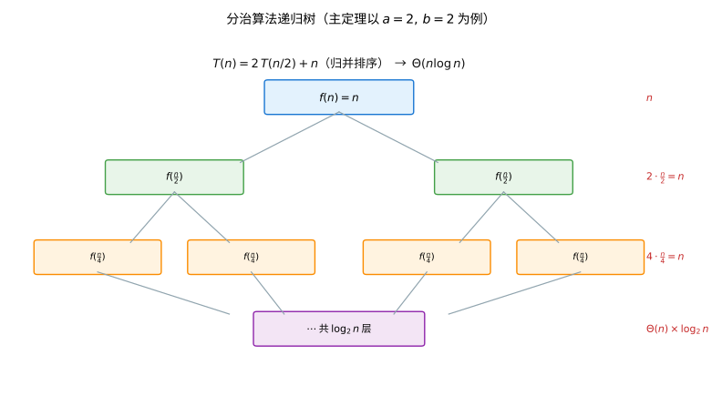

> **直观理解（现实类比）**：递归树像一棵不断分杈的"任务树"。把一个大任务层层切成两半，每一层都有一群小任务（$a^k$ 个），每个小任务的成本是 $f(n/b^k)$。把每一层所有小任务的成本加起来就是总工作量。谁占主导——树根的成本、叶子的数量，还是每层都相同——决定了算法的复杂度到底是 $O(n^{\log_b a})$、$O(n^{\log_b a}\log n)$ 还是 $O(f(n))$。

#### 课堂问答

**老师**：主定理三种情形，判据用一句话说清。

**学生**：比 $f(n)$ 与临界函数 $n^{\log_b a}$ 的阶。$f$ 更小（$O(n^{\log_b a-\varepsilon})$）则递归树叶子的量占主导，$T(n)=\Theta(n^{\log_b a})$；$f$ 与之同阶（$\Theta(n^{\log_b a})$）则每层代价相同、共 $\log_b n$ 层，$T(n)=\Theta(n^{\log_b a}\log n)$；$f$ 更大且满足正则性 $af(n/b)\le cf(n)$（$c<1$）则根处代价主导，$T(n)=\Theta(f(n))$。例：归并排序 $2T(n/2)+n$ 属情形 2，得 $\Theta(n\log n)$；Strassen $7T(n/2)+n^2$，因 $\log_2 7\approx2.807>2$ 属情形 1，得 $\Theta(n^{2.807})$。

**老师（追问）**：$n^{\log_b a}$ 这个临界函数是怎么冒出来的？

**学生**：它是递归树叶子总数对应的量级。树深 $\log_b n$，第 $k$ 层有 $a^k$ 个规模 $n/b^k$ 的子问题，叶子层共有 $a^{\log_b n}=n^{\log_b a}$ 个问题、每个还带 $\Theta(1)$ 成本，故叶子总代价 $\Theta(n^{\log_b a})$。把这一项与各层的 $f$ 部分相比，谁占主导就落到哪个情形：情形 2 里每层的 $a^k f(n/b^k)$ 都恰等于 $n^{\log_b a}$，于是 $\log_b n$ 层相加就多出一个 $\log n$ 因子。

**老师（拓展）**：主定理是不是覆盖所有分治递推？

**学生**：不是，它有三类盲区。一是情形之间的"缝隙"：若 $f(n)=n^{\log_b a}/\log n$ 这类落在情形 1 与 2 之间，三种情形都不适用；二是子问题规模不等（如快排的 $T(n)=T(k)+T(n-k)$），需用 Akra–Bazzi 或递归树直接分析；三是正则性条件不满足时情形 3 失效。所以主定理只是常用工具，遇到非标准递推必须回到递归树或直接求和。

### 3.5 自适应算法的收敛性

**定理 3.7（自适应有限元方法的收敛性）** 考虑 Poisson 方程 $- \Delta u = f$ 在 $\Omega \subset \mathbb{R}^d$ 上的有限元离散。设 $\{u_k\}_{k=0}^\infty$ 为由自适应算法生成的近似解序列，其中每一步在误差最大的单元上进行局部加密。则存在常数 $\gamma > 0$ 和 $\alpha > 0$ 使得：

$$
\|u - u_k\|_E \leq C \cdot N_k^{-\alpha} \|u\|_{H^{1+\gamma}(\Omega)},
$$

其中 $\| \cdot \|_E$ 为能量范数，$N_k$ 为第 $k$ 步的自由度数目，$\alpha$ 取决于问题维度和正则性。

> **💡 直观理解（类比）**：自适应有限元像"哪里误差大就往哪里加厚加固"——每一步先用局部误差指示器（后验误差估计）测出哪些单元最糟，再用 Dörfler 标记只挑误差贡献大的单元加密，不浪费一根钢筋在光滑的地方。因加密足够集中，能量误差以 $(1-\gamma)$ 几何收缩，而自由度 $N_k$ 的增长又被压到最省，最终拿到 $\|u-u_k\|_E\le C N_k^{-\alpha}$ 的最优速率：用最少的'砖块'袋给定精度。

**证明：** 自适应算法的核心是误差估计器与标记策略。设 $\mathcal{T}_k$ 为第 $k$ 步的网格，$u_k$ 为对应的有限元解。

**步骤 1（后验误差估计）：** 存在常数 $C_1, C_2 > 0$ 使得对每个单元 $T \in \mathcal{T}_k$，局部误差指示器 $\eta_T(u_k)$ 满足：

$$
C_1 \eta_T(u_k) \leq \|u - u_k\|_{E, T} \leq C_2 \eta_T(u_k),
$$

其中 $\| \cdot \|_{E, T}$ 为单元 $T$ 上的能量范数。对 Poisson 方程，典型的误差指示器为：

$$
\eta_T(u_k)^2 = h_T^2 \|f + \Delta u_k\|_{L^2(T)}^2 + \frac{1}{2} \sum_{e \subset \partial T} h_e \|[\nabla u_k \cdot n_e]\|_{L^2(e)}^2,
$$

其中 $h_T$ 为单元尺寸，$h_e$ 为边 $e$ 的长度，$[\nabla u_k \cdot n_e]$ 为法向导数的跳跃。

**步骤 2（标记策略）：** 使用 Dörfler 标记策略：选择最小集合 $\mathcal{M}_k \subseteq \mathcal{T}_k$ 使得：

$$
\sum_{T \in \mathcal{M}_k} \eta_T(u_k)^2 \geq \theta \sum_{T \in \mathcal{T}_k} \eta_T(u_k)^2,
$$

其中 $\theta \in (0, 1)$ 为标记参数。

**步骤 3（收缩性质）：** 对标记的单元进行加密后，网格 $\mathcal{T}_{k+1}$ 满足：

$$
\|u - u_{k+1}\|_E^2 \leq \|u - u_k\|_E^2 - \lambda \sum_{T \in \mathcal{M}_k} \eta_T(u_k)^2,
$$

其中 $\lambda > 0$ 为与网格无关的常数。这是因为加密降低了局部误差，且有限元解是 Galerkin 投影，具有最佳逼近性质。

**步骤 4（误差递减）：** 结合后验误差估计和 Dörfler 标记策略：

$$
\|u - u_{k+1}\|_E^2 \leq (1 - \gamma) \|u - u_k\|_E^2,
$$

其中 $\gamma = \lambda \theta C_1 / C_2 > 0$。因此误差以几何级数递减：

$$
\|u - u_k\|_E \leq (1 - \gamma)^{k/2} \|u - u_0\|_E.
$$

**步骤 5（最优复杂度）：** 设 $N_k$ 为第 $k$ 步的自由度数。由于每次加密在误差最大的单元上进行，且 $u$ 具有 $H^{1+\gamma}$ 正则性，可以证明：

$$
N_k \leq C \cdot (1 - \gamma)^{-\alpha k},
$$

对某个 $\alpha > 0$ 成立。结合误差递减与自由度增长，得：

$$
\|u - u_k\|_E \leq C \cdot N_k^{-\alpha}.
$$

$\square$

---

#### 课堂问答

**老师**：能量误差的几何收缩 $\|u-u_{k+1}\|_E^2\le(1-\gamma)\|u-u_k\|_E^2$ 靠什么保证？

**学生**：靠"可靠的后验估计加足够的标记"两步合力。先由后验误差估计器给出单元局部量 $\eta_T$，满足 $C_1\eta_T\le\|u-u_k\|_{E,T}\le C_2\eta_T$，保证指示器既不漏报也不虚报；再用 Dörfler 策略选最小集合 $\mathcal{M}_k$ 使 $\sum_{T\in\mathcal{M}_k}\eta_T^2\ge\theta\sum_T\eta_T^2$，即抓住至少 $\theta$ 比例的误差平方。加密这些单元后，Galerkin 投影的最佳逼近性与降低的局部误差给出 $\|u-u_{k+1}\|_E^2\le\|u-u_k\|_E^2-\lambda\sum_{T\in\mathcal{M}_k}\eta_T^2$，合起来取 $\gamma=\lambda\theta C_1/C_2>0$ 即得几何递减。

**老师（追问）**：为什么自适应能比一致加密"更优"，这个最优速率从哪来？

**学生**：根子在解的正则性不均匀。若解只在少数角点有奇异，一致加密为了压低那些点的误差，被迫把光滑区域也整体细化，自由度按 $N^{-1/d}$ 花钱太慢；自适应把自由度集中到奇异附近，在 $H^{1+\gamma}$ 正则性这一较弱假设下就能达到最优速率 $\|u-u_k\|_E\le C N_k^{-\alpha}$，指数 $\alpha$ 可与正则性匹配、比一致加密的 $1/d$ 大得多。本质上它让误差与自由度的关系达到给定正则类下的最优。

**老师（拓展）**：要严格证明这条最优速率，还需要补哪些条件？

**学生**：除了可靠估计器和 Dörfler 标记，还需第三块拼图——网格的"复杂度"控制，即每次加密不能无节制地把自由度吹大。经典三条件框架是：可靠性与有效性（estimator）、Dörfler 标记（marking）、加密的复杂度上界（complexity），三者齐备才能推出既收缩又最优的结论。此外还需解的 $H^{1+\gamma}$ 正则性作为速率前提；缺乏正则性时自适应仍收敛，但最优速率的指数会退化。

## 4. 示例

### 示例 4.1：用蒙特卡洛方法计算 $\pi$

**问题：** 使用蒙特卡洛方法估计 $\pi$ 的值。

**解：** 考虑单位正方形 $[0,1] \times [0,1]$ 和四分之一单位圆 $x^2 + y^2 \leq 1$。四分之一圆的面积与正方形面积之比为 $\pi/4$。

**算法：**
1. 生成 $n$ 个均匀随机点 $(x_i, y_i) \in [0,1]^2$
2. 统计落在四分之一圆内的点数 $m = \#\{i : x_i^2 + y_i^2 \leq 1\}$
3. 估计 $\pi \approx 4m/n$

**数值实验：** 取 $n = 10^6$，使用 Python 风格的伪代码：

```
import random
n = 1_000_000
m = 0
for i in range(n):
    x = random.random()
    y = random.random()
    if x*x + y*y <= 1.0:
        m += 1
pi_approx = 4.0 * m / n
```

**误差分析：** 每次试验为 Bernoulli 随机变量 $X_i$，$X_i = 1$ 表示点在圆内，概率 $p = \pi/4 \approx 0.7854$，方差 $\sigma^2 = p(1-p) \approx 0.1686$。

估计量的标准差为 $\sigma/\sqrt{n} = \sqrt{0.1686}/\sqrt{10^6} \approx 0.00041$，因此 $\pi$ 估计的标准差约为 $4 \times 0.00041 \approx 0.00164$。

由中心极限定理，$\pi$ 的 $95\%$ 置信区间约为 $\hat{\pi} \pm 1.96 \times 0.00164$，即 $\hat{\pi} \pm 0.0032$。

**结果**（典型运行）：$m = 785,423$，$\hat{\pi} = 4 \times 785423 / 10^6 = 3.141692$，与真实值 $\pi \approx 3.1415926535$ 的误差为 $0.0001$。

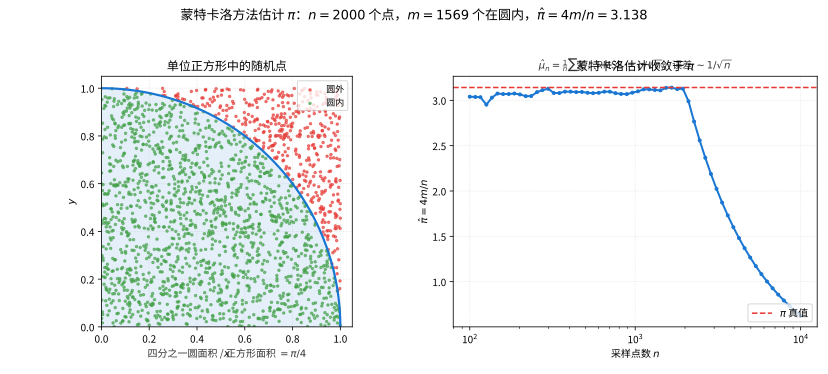

> **直观理解（现实类比）**：蒙特卡洛就像"闭着眼睛往圆靶上撒豆子"。在正方形靶上随手撒一把豆子，数一数落在四分之一的圆靶里的豆子占总数的比例，就能估算出 $\pi$——豆子越多，比例越稳定、越接近 $\pi/4$。误差只按 $1/\sqrt{n}$ 缓慢下降，所以想要精度翻倍，得把豆子数量翻 4 倍。

> **🧠 思考历程：连方程都写不出来的问题，掷骰子碰运气真能"算"出来吗？**
>
> 蒙特卡洛回答的，是一句让严肃数值家起初直撇嘴的俏皮话：与其绞尽脑汁解方程，我是不是可以"随机砸点、数数比例"，用频率去逼近答案？而这个"碰运气"的方法，恰恰在二战的头号工程里立下奇功。
>
> - **核时代的曼哈顿密码**。二战为了模拟链式反应与中子输运，曼哈顿工程的科学家面对的是极难直接求解的问题；von Neumann、Ulam 与 Metropolis 等人于是想到——既然物理本身充满随机性，不如直接用随机抽样去估计结果。
> - **名字来自赌场**。Metropolis 以摩纳哥的蒙特卡洛赌城为方法命名，正是对"靠随机性撞答案"这种坦率的写照；把样本随机性当作数值工具而非纯误差来源，这一观念的翻转本身，就是方法论的胜利。
> - **从 $1/\\sqrt{n}$ 到维度免疫**。与确定性求积受"维度诅咒"不同，蒙特卡洛的误差只按 $1/\\sqrt{n}$ 随样本衰减、几乎与维度无关；由 Metropolis 算法扩展出的马尔可夫链蒙特卡洛（MCMC），又把贝叶斯统计从"算不出来"里解放了出来。
> - **心路**：偶然性不总是噪声，把随机当作探针，有时反而比强行求解更快抵达答案——过度执着于确定，不如适度敢于随机。

### 示例 4.2：用快速多极子方法计算 $N$ 体问题

**问题：** 计算 $N$ 个带电粒子之间的相互作用势，目标是将复杂度从 $O(N^2)$ 降至 $O(N)$。

> **💡 直观理解（类比）**：FMM 把"每人跟其余 $N-1$ 人逐一结算，总共 $N^2$ 笔账"的大会改成'分片打包报销'——沿四叉/八叉树把局部充电汇总成多极展开，远处的影响用一条条'团块气场'一次算清，只有近邻仍逐个直算。截断误差交给几何级数 $(a/|z|)^p$ 兜底（定理 3.3），于是总账从 $N^2$ 笔降到约 $N\log N$ 甚至 $N$ 笔，远方的礼貌问候一次到位、不必逐个握手。

**解：** 考虑 $N$ 个位于位置 $z_i$、电荷量为 $q_i$ 的粒子，计算每个粒子处的势能：

$$
\Phi(z_i) = \sum_{j \neq i} \frac{q_j}{z_i - z_j}.
$$

**FMM 算法步骤（一维/二维，使用复分析）：**

**步骤 1：树结构构建。** 将计算域递归划分为四叉树（2D）或八叉树（3D），直到每个叶子节点包含少量粒子。

**步骤 2：向上遍历（多极展开）。** 对每个叶子节点，计算其内部粒子对节点中心的多极展开系数：

$$
\Phi_{\text{node}}(z) = \sum_{k=0}^{p-1} \frac{a_k}{(z - z_{\text{node}})^{k+1}}, \quad a_k = \sum_{i \in \text{node}} q_i (z_i - z_{\text{node}})^k.
$$

然后将子节点的多极展开合并到父节点，使用多极展开的平移公式：

$$
a_k^{\text{parent}} = \sum_{j=0}^k a_j^{\text{child}} \cdot \binom{k}{j} (z_{\text{child}} - z_{\text{parent}})^{k-j}.
$$

**步骤 3：向下遍历（多极转局部展开）。** 对每个节点，将其父节点的局部展开与该节点的"相互作用列表"（即同层中距离不远不近的节点）中的多极展开转换为局部展开：

$$
\Psi_{\text{node}}(z) = \sum_{k=0}^{p-1} b_k (z - z_{\text{node}})^k.
$$

**步骤 4：局部展开求值。** 对每个叶子节点，在局部展开中代入每个粒子的位置，加上近邻粒子的直接求和。

**复杂度分析：** 设每层最多 $O(N)$ 个粒子，树有 $O(\log N)$ 层。每层每个节点处理 $O(1)$ 个相互作用列表节点，每个展开操作需 $O(p^2)$ 时间。因此总复杂度为 $O(p^2 N \log N)$。使用更高级的算法（如自适应 FMM）可达 $O(N)$。

**误差控制：** 由定理 3.3，截断误差为：

$$
|R_p(z)| \leq \frac{1}{|z| - a} \left( \frac{a}{|z|} \right)^p \sum_{i=1}^N |q_i|.
$$

若要求相对误差 $\varepsilon$，取 $p \geq \log(\varepsilon (|z| - a) / \sum |q_i|) / \log(a/|z|)$。

---

## 4.S Stewart 微积分风格补充：现实应用、分步例题与解题策略

> 计算数学在教材里常绕不开复杂度和舍入误差，但它真正回答的现实问题是：**同一台机器上，一个解法到底要花多久、结果到底有多可信？** 本节沿用 Stewart 式的"策略 → 例题 → 分步解 → 回读现实"四步法，把误差传播、算法复杂度、蒙提卡洛预算这些工具放进工程与管理的真实场景里跑一遍。每道例题先给**解题策略**，再给出**每步都解释'为什么'**的分步解。

### 🎯 本级解题策略（Principles of Problem Solving）

动笔"算"之前，先分清"这题考的是时间还是精度"：

- **第一步 · 先定性，再定量**：先判清这是"复杂度题"（问多少步）还是"误差题"（问偏差多大）。方向搞反，后面的推导全拧。
- **第二步 · 用对数微分捕捉误差放大**：$f=c r^2 h$ 这类相对误差直接由 $\mathrm{d}\ln f=2\,\mathrm{d}\ln r+\mathrm{d}\ln h$ 给出，指数是多少、误差就被放大多少倍——这是"条件数"的雏形。
- **第三步 · 用 $O$ 记号换预算**：比较两种算法，先把"单位操作耗时 $\times$ 操作数"算出来。$n^2$ 与 $n\log n$ 在同一台机上可能差上万倍，$O$ 记号决定了"能不能跑完"。
- **第四步 · 用 $\sigma/\sqrt n$ 估抽样精度、验算**：蒙特卡洛/抽检的半宽约 $z\,\sigma/\sqrt n$；把目标宽度代进去反解 $n$，最后把所有数值代回原式复核一遍。

> **一句话带走**：计算题的分步解就像"先看清是排队问题还是称重问题，选对一把尺（$O$ 记号或 $\sigma/\sqrt n$），量出的数才作数"——复杂度定快慢，误差定可信。

---

### 例题 A · 误差传播：圆顶面积的测量误差会被放大多少

> **🎯 建模策略**：这是"用导数把测量误差换算成结果误差"的核心演示。**策略：对 $A=\pi r^2$ 取对数微分 $\mathrm{d}\ln A=2\,\mathrm{d}\ln r$，得到"半径相对误差放大 2 倍就是面积相对误差"。** 指数即放大倍率，无需繁琐的区间套。

**问题**：一座天文台要粉刷一个半径 $r=3$ m 的圆顶，测量半径的相对误差约 $\pm5\%$。问据此算出的圆顶表面积 $A=\pi r^2$ 的相对误差约为多少？绝对误差又是多少？

**解**：

**步骤 1：写面积并求导**

$A=\pi r^2$，故 $A'=2\pi r$。由微分近似 $A$ 的绝对误差 $\Delta A\approx A'(r)\,\Delta r=2\pi r\,\Delta r$。

**为什么**：$A'(r)$ 度量"半径拨动一点、面积跟着变多少"，正是误差放大的放大器。

**步骤 2：换算成相对误差**

$$
\frac{\Delta A}{A}\approx\frac{2\pi r\,\Delta r}{\pi r^{2}}=2\,\frac{\Delta r}{r}=2\times0.05=0.10.
$$

相对误差 $\approx10\%$。

**为什么**：指数 $2$ 在取对数后的系数，半径误差被平方放大 2 倍。这里 $r=3$ m 的具体值抵消了，只留下放大因子——这正是对数微分解决问题的优雅之处。

**步骤 3：回读绝对误差**

$A=\pi\times3^2=9\pi\approx28.27$ m²，故 $\Delta A\approx0.10\times28.27\approx2.83$ m²。

> **回读现实**：半径只量偏了 5%，面积就偏 10%——因为面积对半径是二次依赖。花 90 元粉刷可能因量错而白费近 3 m² 的料。**量尺误差 × 放大因子 = 结果误差**，这份"敏感度体检"在任何尺寸相关工程里都该先做。

---

### 例题 B · 复杂度预算：十万条记录，该用哪种排序

> **🎯 建模策略**：这是"用 $O$ 记号把抽象复杂度兑换成现实秒数"的决策题。**策略：先估算两种算法的关键操作数，再乘单位操作耗时，比较总时间。** $n$ 一上天文量级，$n^2$ 与 $n\log n$ 的差距就是"能跑完"与"跑到天黑"的差距。

**问题**：某档案系统要对 $n=10^6$ 条记录排序。方案 A 的排序为 $\Theta(n^2)$（约 $n^2/2$ 次比较），方案 B 为 $\Theta(n\log n)$（约 $n\log_2 n$ 次比较）。若一次比较耗时 $1$ ns，估算两方案各需多久，并判断选哪个。

**解**：

**步骤 1：算方案 A 的操作数与耗时**

$$
\frac{n^2}{2}=\frac{10^{12}}{2}=5\times10^{11}\ \text{次},\qquad 5\times10^{11}\times1\text{ ns}=500\ \text{秒}\approx8.3\ \text{分钟}.
$$

**为什么**：$\Theta(n^2)$ 意味着比较次数随 $n^2$ 增长，$n=10^6$ 时就是十亿级别，直接把预算顶到几百秒。

**步骤 2：算方案 B 的操作数与耗时**

$$
n\log_2 n\approx10^6\times20=2\times10^{7}\ \text{次},\qquad 2\times10^{7}\times1\text{ ns}=0.02\ \text{秒}.
$$

**为什么**：$\log_2 10^6\approx20$，每趟 $O(n)$、共 $\log n$ 趟，所以总操作数只有两千万量级。

**步骤 3：比较并回读**

方案 A 约 500 s、方案 B 约 0.02 s，相差约 $2.5\times10^4$ 倍。

> **回读现实**：两台机器本身没有差别，差的只是"算法在 $n$ 大时怎么涨"。同样是 $10^6$ 条，A 等到 8 分钟、B 一眨眼完成——**$O$ 记号在决定"能不能上线"时，往往比"更快的机器"更要命**。

---

### 例题 C · 蒙特卡洛预算：抽检多少件才够可信

> **🎯 建模策略**：这是"用 $\sigma/\sqrt n$ 反解最省样本量"的预算题。**策略：半宽 $\approx z\sigma/\sqrt n$（取最坏 $\sigma\le0.5$），令半宽 $\le$ 目标值解出 $n$。** 置信度由 $z$ 给定，精度由 $n$ 定价。

**问题**：某工厂要估计产品合格率 $p$。希望 $95\%$ 置信区间总宽度不超过 $0.02$（即半宽 $\le0.01$）。取最坏情形标准差 $\sigma=\sqrt{p(1-p)}\le0.5$，需要抽检多少件？

**解**：

**步骤 1：写半宽公式**

$$
\text{半宽}=z\,\frac{\sigma}{\sqrt n}=1.96\,\frac{\sigma}{\sqrt n},\qquad \sigma\le0.5.
$$

**为什么**：合格与否是 $0/1$ 变量，方差 $\le0.25$、标准差 $\le0.5$；$n$ 越大半宽越小，CI 越窄。

**步骤 2：代入最坏 $\sigma=0.5$ 反解 $n$**

$$
0.01=1.96\,\frac{0.5}{\sqrt n}=\frac{0.98}{\sqrt n}\ \Rightarrow\ \sqrt n=98\ \Rightarrow\ n\approx9604.
$$

**为什么**：要"再准一倍"就得把误差按 $1/\sqrt n$ 收缩，所以样本量翻 4 倍才换来精度翻倍——蒙特卡洛/抽检的昂贵本质在此。

**步骤 3：回读并复核**

取 $n\ge9604$（约 $10^4$ 件）即可把 $95\%$ 区间压到 $\pm0.01$ 以内。

> **回读现实**：抽 $10^4$ 件看似不多，但若真合格率接近 $95\%$，$\sigma\approx0.22$ 时甚至只需 $\left(\frac{1.96\times0.22}{0.01}\right)^2\approx1900$ 件；而想压到 $\pm0.001$ 就要约百万件。**"可信"是有标价的，这就是 $\sigma/\sqrt n$ 在给你开账单。**

---

## 5. 习题

### 基础题

**习题 1**（复杂度记号）解释渐近上界 $O(\cdot)$、渐近下界 $\Omega(\cdot)$、渐近紧界 $\Theta(\cdot)$ 的含义与区别。

**习题 2**（P 与 NP）说明 P 类、NP 类与 NP 完全类别的定义区别。

**习题 3**（LU 分解误差）设 $A$ 为 $n\times n$ 矩阵，分析求解 $Ax=b$ 的 LU 分解的浮点运算误差，说明如何证明向后误差满足 $\|\Delta A\|\le\gamma_n\|A\|$，其中 $\gamma_n=n\varepsilon_{\text{mach}}/(1-n\varepsilon_{\text{mach}})$。

**习题 4**（主定理）用主定理分析递推 $T(n)=2T(n/2)+n$、$T(n)=4T(n/2)+n^2$、$T(n)=7T(n/2)+n^2$、$T(n)=8T(n/2)+n^3$ 的渐近复杂度。

**习题 5**（蒙特卡洛样本量）用蒙特卡洛方法估计积分 $I=\int_0^1\int_0^1 e^{-(x^2+y^2)}\,dx\,dy$，推导使 $95\%$ 置信区间宽度不超过 $0.01$ 所需的样本数 $n$。

**习题 6**（FMM 平移公式）证明快速多极子方法中多极展开的平移公式 $\frac{1}{(z-z_1)^{k+1}}=\sum_{j=0}^\infty\binom{k+j}{j}\frac{(z_0-z_1)^j}{(z-z_0)^{k+j+1}}$。

**习题 7**（自适应 FEM 最优复杂度）说明使用 Dörfler 标记策略的自适应有限元为何能达到最优复杂度 $\|u-u_k\|_E\le C N_k^{-\alpha}$。

**习题 8**（IEEE 754）解释浮点数表示 $x=\pm(1.d_1d_2\cdots d_{p-1})_2\times 2^e$，并给出双精度的机器精度 $\varepsilon_{\text{mach}}=2^{-52}$。

**习题 9**（舍入误差模型）写出浮点运算基本模型 $\text{fl}(a\circ b)=(a\circ b)(1+\delta)$，$|\delta|\le\varepsilon_{\text{mach}}$，并说明 $\circ$ 可取哪些运算。

**习题 10**（数值稳定性）区分向前误差、向后误差与条件数，说明数值稳定性的含义。

### 进阶题

**习题 11**（主定理情形 2）推导 $T(n)=4T(n/2)+n^2$ 属于主定理情形 2，并给出 $T(n)=\Theta(n^2\log n)$。

**习题 12**（Strassen 复杂度）推导 $T(n)=7T(n/2)+n^2$ 属于情形 1，得到 $T(n)=\Theta(n^{\log_2 7})\approx\Theta(n^{2.807})$，说明矩阵乘法复杂度的改进。

**习题 13**（归并排序）由 $T(n)=2T(n/2)+n$ 推出 $T(n)=\Theta(n\log n)$，并用递归树说明每一层的代价。

**习题 14**（向前误差界）说明向前误差为何满足 $|\text{fl}(f(x))-f(x)|\le n\kappa\varepsilon_{\text{mach}}|f(x)|+O(\varepsilon_{\text{mach}}^2)$，并指出条件数 $\kappa$ 的作用。

**习题 15**（蒙特卡洛收敛）结合中心极限定理说明 $\sqrt n(\hat\mu_n-\mu)\xrightarrow{d} N(0,\sigma^2)$，并解释 RMSE $=\sigma/\sqrt n$。

**习题 16**（随机算法）区分拉斯维加斯型与蒙特卡洛型随机算法，说明引入随机性给算法带来的好处。

**习题 17**（FMM 复杂度）解释 FMM 如何通过四叉/八叉树与远近分组把 $N$ 体问题的复杂度从 $O(N^2)$ 降到 $O(N)$。

**习题 18**（稀疏矩阵）说明 CSR/CSC 压缩存储如何节省内存与计算量，为什么适合大部分元素为零的矩阵。

**习题 19**（Chebyshev 误差界）由 Chebyshev 不等式推导 $\Pr(|\hat\mu_n-\mu|\ge\varepsilon)\le\frac{\sigma^2}{n\varepsilon^2}$。

### 挑战题

**习题 20**（主定理情形 1 证明）用递归树完整证明情形 1：若 $f(n)=O(n^{\log_b a-\varepsilon})$，则 $T(n)=\Theta(n^{\log_b a})$。

**习题 21**（蒙特卡洛收敛性证明）用特征函数与 Lévy 连续性定理证明中心极限定理：$\sqrt n(\hat\mu_n-\mu)\xrightarrow{d} N(0,\sigma^2)$。

**习题 22**（FMM 多极截断误差）证明定理 3.3 的多极展开截断误差界 $|R_p(z)|\le\frac{1}{|z|-a}(\frac{a}{|z|})^p\sum_{i=1}^N|q_i|$。

**习题 23**（向后误差归纳）用归纳法证明向后误差的逐分量界 $\|\Delta x\|\le\gamma_n\|x\|$，其中 $\gamma_n=\frac{n\varepsilon_{\text{mach}}}{1-n\varepsilon_{\text{mach}}}$。

**习题 24**（自适应收缩）结合后验误差估计与 Dörfler 标记策略推导能量误差的几何收缩（量化 $\|u-u_k\|_E$ 的收敛），说明收敛性来源。

**习题 25**（条件数与精度）说明为何条件数大的病态问题即使算法稳定也无法获得高精度，并写出相对误差与 $\kappa$ 的数量关系。

**习题 26**（NP 完全与归约）解释为何一个问题是 NP 完全意味着"若能多项式时间解它，则所有 NP 问题都可多项式时间解"，并说明多项式归约在其中的意义。

### 探究题

**习题 27**（高维积分与蒙特卡洛）探究为何高维积分更适合用蒙特卡洛方法（收敛 $O(1/\sqrt n)$ 与维度无关），而确定性格点法在高维下退化。

**习题 28**（并行与 GPU）探究并行计算与 GPU 计算的适用场景、并行加速的局限（通信开销、负载均衡、内存带宽），以及什么类型的算法最适合 GPU。

**习题 29**（自适应 vs 均匀网格）探究自适应网格相对均匀网格在"误差—自由度"上的优势，说明按需局部加密如何节省自由度。

**习题 30**（数值算法正确性验证）探究如何借助向后误差与条件数解释数值结果，并设计一套验证数值算法正确性与稳定性的方法。

### 应用题（Stewart 式综合应用）

**应用题 31**（误差传播—计算数学）：一圆柱储罐，测得半径 $r=1.0$ m（相对误差 $\pm2\%$）、高 $h=2.0$ m（相对误差 $\pm1\%$）。求体积 $V=\pi r^2h$ 的相对误差约为多少，并给出此时的近似绝对误差。

**应用题 32**（复杂度预算—计算数学）：某算法 A 为 $\Theta(n^2)$、算法 B 为 $\Theta(n\log n)$。当 $n=2^{20}\approx1.05\times10^6$、单位操作耗时 $1$ ns 时，分别估算 A、B 的耗时（A 约 $n^2$ 次、B 约 $n\log_2 n$ 次）。

**应用题 33**（蒙特卡洛样本量—计算数学）：要估计某比例 $p$，希望 $95\%$ 置信区间总宽度不超过 $0.02$。在最坏情形 $\sigma\le0.5$ 下反解所需的样本量 $n$。

**应用题 34**（相消误差—计算数学）：计算 $f(x)=1-\cos x$ 在 $x=10^{-3}$ 的值。说明为何直接相减会损失精度，并用公式 $f(x)=2\sin^2(x/2)$ 给出更稳定的结果。

---

## 6. 习题答案与解析

### 基础题答案

1. **复杂度记号** $O(\cdot)$ 给出渐近上界（至多以某种速度增长），$\Omega(\cdot)$ 给出渐近下界（至少以某种速度增长），$\Theta(\cdot)$ 表示渐近紧界（上下同阶），即 $f(n)=\Theta(g(n))$ 当且仅当 $f=O(g)$ 且 $f=\Omega(g)$。

2. **P 与 NP** P 是由能在多项式时间内判定的问题组成的类；NP 由"给出候选解可在多项式时间内验证"的问题组成，且 P $\subseteq$ NP。NP 完全（NP-complete）是 NP 中最难的一类：任何 NP 问题都可多项式归约到它，若能多项式时间解任一 NP 完全问题则 P=NP（目前未知是否成立）。

3. **LU 分解误差** LU 分解核心运算 $a_{ij}\leftarrow a_{ij}-l_{ik}a_{kj}$ 逐步引入乘加舍入误差。用向后误差分析：对 $k=1,\dots,n$ 归纳，可把所有舍入误差"吸收"为对原矩阵的扰动，得到计算所得 $\tilde L,\tilde U$ 满足 $\tilde L\tilde U=A+\Delta A$，且 $\|\Delta A\|\le\gamma_n\|A\|$。每步相对误差经逐层累加，几何因子 $(1+\varepsilon)^n\le1/(1-n\varepsilon)$ 给出 $\gamma_n=n\varepsilon_{\text{mach}}/(1-n\varepsilon_{\text{mach}})$，故求解 $Ax=b$ 时最终满足向后误差界。

4. **主定理** 对 $T(n)=aT(n/b)+f(n)$ 比较 $\log_b a$ 与 $f(n)$：(1) $\log_2 2=1$、$f=n$，情形 2，$T=\Theta(n\log n)$；(2) $\log_2 4=2$、$f=n^2$，情形 2，$T=\Theta(n^2\log n)$；(3) $\log_2 7\approx2.807$、$f=n^2$，属情形 1（存在 $\varepsilon<0.8$ 使 $n^2=O(n^{2.807-\varepsilon})$），$T=\Theta(n^{\log_2 7})$；(4) $\log_2 8=3$、$f=n^3$，情形 2，$T=\Theta(n^3\log n)$。

5. **蒙特卡洛样本量** 令 $w=e^{-(U_1^2+U_2^2)}$（$U_i\sim U[0,1]$），$\hat I=\bar w$。由 CLT 置信区间半宽约 $1.96\sigma/\sqrt n$，要求总宽度 $\le0.01$，即 $2\times 1.96\sigma/\sqrt n\le0.01$，故 $n\ge(1.96\cdot2\sigma/0.01)^2$。$\sigma$ 可由少量样本估计，或用 $w\in(e^{-2},1)$ 的取值域先验界住（此时取 $\sigma\le\frac12$ 即得安全样本量）。

6. **FMM 平移公式** 把 $\frac{1}{z-z_1}=\frac{1}{(z-z_0)-(z_1-z_0)}=\frac{1}{z-z_0}\cdot\frac{1}{1-\frac{z_1-z_0}{z-z_0}}$ 按几何级数展开为 $\sum_{j\ge0}\frac{(z_1-z_0)^j}{(z-z_0)^{j+1}}$（收敛当 $|z_1-z_0|<|z-z_0|$），再对 $z$ 视作函数取递推到 $k$ 阶导的同构系数加权，即得平移公式 $\frac{1}{(z-z_1)^{k+1}}=\sum_{j=0}^\infty\binom{k+j}{j}\frac{(z_0-z_1)^j}{(z-z_0)^{k+j+1}}$。它把子节点中心 $z_0$ 的多极展开系数搬移到父节点中心 $z_1$，是 FMM 向上遍历的关键。

7. **自适应 FEM 最优复杂度** 后验误差估计保证 $\|u-u_k\|_E^2$ 被 $\sum_T\eta_T(u_k)^2$ 上下夹住；Dörfler 标记只选取误差贡献大的单元加密，使加密集中在误差大的区域，从而推导能量误差按 $(1-\gamma)$ 收缩；同时被加密单元的自相似性限制了自由度增长，最终 $\|u-u_k\|_E\le C N_k^{-\alpha}$，$\alpha$ 由维数和正则性决定，即以最省的自由度达到给定精度。

8. **IEEE 754** 浮点数 $x=\pm(1.d_1d_2\cdots d_{p-1})_2\times2^e$ 采用隐含前导 1、$p-1$ 位小数尾数与指数 $e$ 的表示。双精度取 $p=53$（52 位尾数），相邻可表示数的相对间距为机器精度 $\varepsilon_{\text{mach}}=2^{-52}\approx2.22\times10^{-16}$，它给出单次舍入的相对误差上界。

9. **舍入误差模型** 模型为 $\text{fl}(a\circ b)=(a\circ b)(1+\delta)$，$|\delta|\le\varepsilon_{\text{mach}}$，其中 $\circ\in\{+,-,\times,/\}$。它把所有真实舍入误差归结为"对精确结果至多相对 $\varepsilon_{\text{mach}}$ 的乘性扰动"，是数值误差分析的统一出发点。

10. **数值稳定性** 向前误差指计算结果与精确解的差异；向后误差指把计算结果看作"某个被小扰动输入的问题"的精确解时所需的最小输入扰动；条件数 $\kappa$ 是问题本身对输入扰动的敏感度。数值稳定性衡量算法对舍入误差的放大程度，其定量刻画即"向前误差 $\approx\kappa\times$（向后误差/计算精度）"。

### 进阶题答案

1. **主定理情形 2** 对 $T(n)=4T(n/2)+n^2$，$\log_b a=\log_2 4=2$，$f(n)=n^2=\Theta(n^2)$，与 $n^{\log_b a}$ 同阶，属情形 2，故 $T(n)=\Theta(n^2\log n)$。递归树上每层总代价均为 $\Theta(n^2)$，共 $\log_2 n$ 层。

2. **Strassen 复杂度** $\log_2 7\approx2.807$，$f(n)=n^2$；因 $n^2=O(n^{\log_2 7-\varepsilon})$ 对某个 $\varepsilon>0$（如 $\varepsilon=0.5$）成立，故属情形 1，$T(n)=\Theta(n^{\log_2 7})\approx\Theta(n^{2.807})$。Strassen 用 7 次乘法替代经典 8 次乘法实现 $2\times2$ 分块乘法，使矩阵乘法从三次降到亚三次。

3. **归并排序** $T(n)=2T(n/2)+n$，$\log_2 2=1$，$f(n)=n=\Theta(n)$，属情形 2，$T(n)=\Theta(n\log n)$。递归树共 $\log_2 n$ 层，每层合并代价都是 $O(n)$，故总代价 $O(n\log n)$。

4. **向前误差界** 每次基本运算误差至多 $\varepsilon_{\text{mach}}$，经 $n$ 步、按运算间的放大并叠乘条件数 $\kappa$，得到 $n\kappa\varepsilon_{\text{mach}}$ 量级的界。$\kappa$ 度量"输入扰动经问题 $f$ 放大多少"：即使算法数值稳定，只要 $\kappa$ 很大（病态），舍入误差也会被放大到不可接受。

5. **蒙特卡洛收敛** 由中心极限定理 $\sqrt n(\hat\mu_n-\mu)\xrightarrow{d}N(0,\sigma^2)$，近似 $\hat\mu_n\approx\mu\pm\frac{\sigma}{\sqrt n}z_{1-\alpha/2}$；均方根误差 RMSE$=\sqrt{\mathbb{E}[(\hat\mu_n-\mu)^2]}=\frac{\text{Var}(\hat\mu_n)^{1/2}}{}=\frac{\sigma}{\sqrt n}$，收敛速度 $O(1/\sqrt n)$，与问题维度无关。

6. **随机算法** 拉斯维加斯型总返回正确结果、但运行时间是随机的（如随机化快排、随机选主元的分治）；蒙特卡洛型运行时间固定、但以小概率输出错误（如随机采样估计、快速矩阵乘法验证）。好处：随机化可规避最坏输入、简化算法设计，或把确定性的高代价转化为"几乎必然快/以高概率正确"，故广泛用于数值估计与复杂度去随机化研究。

7. **FMM 复杂度** FMM 把点递归分成四叉/八叉树，对每个节点用多极展开汇总其内部"远场"影响、用局部展开在这些点处求值，只有近邻点直接求和。每层每个点平均只做 $O(1)$ 组展开（每组含 $p$ 个系数、展开折算 $O(p^2)$），层数 $O(\log N)$，故 $O(p^2N\log N)$；自适应动态细分后可达 $O(N)$，远好于直接求和 $O(N^2)$。

8. **稀疏矩阵** CSR（行压缩存储）用三个数组记录非零值、其列号与每行起止位置，CSC 则按列压缩，原理对称。零元素不占存储，故内存由存储所有 $N^2$ 项降为 $O(N)$（当非零元 $O(N)$）；像矩阵—向量乘这类仅接触非零元的操作计算量也降到 $O(N)$。因此适合有限元、图论等大规模稀疏问题。

9. **Chebyshev 误差界** 由 Chebyshev 不等式 $\Pr(|\hat\mu_n-\mu|\ge\varepsilon)\le\frac{\text{Var}(\hat\mu_n)}{\varepsilon^2}$，而 $\text{Var}(\hat\mu_n)=\text{Var}(\frac1n\sum_{i=1}^n X_i)=\frac1{n^2}\cdot n\sigma^2=\frac{\sigma^2}{n}$，代入即得 $\Pr(|\hat\mu_n-\mu|\ge\varepsilon)\le\frac{\sigma^2}{n\varepsilon^2}$。它给出不依赖 $X$ 分布的具体浓度上界，是蒙特卡洛误差的保守估计。

### 挑战题答案

1. **主定理情形 1 证明** 递归树深度 $\log_b n$，第 $k$ 层代价 $a^k f(n/b^k)$。由 $f(n)=O(n^{\log_b a-\varepsilon})$：$a^k f(n/b^k)=O(a^k(n/b^k)^{\log_b a-\varepsilon})=O(n^{\log_b a-\varepsilon}(b^\varepsilon)^k)$。对 $k=0,\dots,\log_b n$ 求和（公比 $b^\varepsilon>1$ 的几何级数）得 $T(n)=O(n^{\log_b a-\varepsilon}\cdot n^\varepsilon)=O(n^{\log_b a})$；同时叶节点数 $a^{\log_b n}=n^{\log_b a}$ 各需 $\Theta(1)$，给出下界 $\Omega(n^{\log_b a})$。两界结合得 $T(n)=\Theta(n^{\log_b a})$。

2. **蒙特卡洛收敛性证明** 设 $Z_i=(X_i-\mu)/\sigma$，则 $\mathbb{E}Z_i=0$、$\text{Var}Z_i=1$，其特征函数 $\varphi_{Z_i}(t)=1-\frac{t^2}{2}+o(t^2)$。标准化和 $S_n^*=\frac{1}{\sqrt n}\sum_{i=1}^n Z_i$ 的特征函数为 $\varphi_{S_n^*}(t)=\varphi_{Z}(t/\sqrt n)^n=(1-\frac{t^2}{2n}+o(\frac{t^2}{n}))^n\to e^{-t^2/2}$。因 $e^{-t^2/2}$ 恰为标准正态的特征函数，由 Lévy 连续性定理 $S_n^*\xrightarrow{d}N(0,1)$，即 $\sqrt n(\hat\mu_n-\mu)\xrightarrow{d}N(0,\sigma^2)$。

3. **FMM 多极截断误差** 多极展开 $\Phi=\sum_i\frac{q_i}{z-z_i}=\sum_i\frac{q_i}{z}\sum_{k\ge0}(\frac{z_i}{z})^k$，截断到 $p$ 的余项 $R_p(z)=\sum_{k=p}^\infty\frac{1}{z^{k+1}}\sum_i q_i z_i^k$。取绝对值，用 $|z_i|\le a$：$|R_p|\le\sum_i|q_i|\sum_{k=p}^\infty\frac{a^k}{|z|^{k+1}}=\sum_i|q_i|\frac{a^p}{|z|^{p+1}}\cdot\frac{1}{1-a/|z|}=\frac{1}{|z|-a}(\frac{a}{|z|})^p\sum_i|q_i|$，其中用了几何级数 $\sum_{k=p}^\infty r^k=r^p/(1-r)$（因 $|z|>a$ 故 $r=a/|z|<1$），恰为定理 3.3 之界。

4. **向后误差归纳** 归纳第 $k$ 步：设前序数值各自相对误差 $\le\gamma_k$。一步 $\hat z=(a\circ b)(1+\delta_z)$ 中 $a,b$ 已含误差 $\le\gamma_k$，叠加后 $\hat z=(a\circ b)(1+\delta)$，$|\delta|\le(1+\gamma_k)^2(1+\varepsilon_{\text{mach}})-1$。对 $n$ 步反复套用，$(1+\varepsilon_{\text{mach}})^n\le\frac{1}{1-n\varepsilon_{\text{mach}}}$（几何因子），故总相对误差 $\le\gamma_n=\frac{n\varepsilon_{\text{mach}}}{1-n\varepsilon_{\text{mach}}}$，即存在扰动使 $\hat y=f(x+\Delta x)$ 且逐分量 $\|\Delta x\|\le\gamma_n\|x\|$，这正是定理 3.2 的界。

5. **自适应收缩** 后验误差界把能量误差夹在指示器和之间：$C_1^2\sum_T\eta_T^2\le\|u-u_k\|_E^2\le C_2^2\sum_T\eta_T^2$。Dörfler 标记选取满足 $\sum_{T\in M}\eta_T^2\ge\theta\sum_T\eta_T^2$ 的最小集合加密，加密降低局部误差且在 Galerkin 最小化下 $E_k^2\le E_{k-1}^2-\lambda\sum_{T\in M}\eta_T^2$。联立得 $E_{k}^2\le E_{k-1}^2-\lambda\theta\sum_T\eta_T^2\le E_{k-1}^2-\frac{\lambda\theta}{C_2^2}E_{k-1}^2$，即 $E_k^2\le(1-\gamma)E_{k-1}^2$，$\gamma=\lambda\theta C_1^2/C_2^2>0$，从而能量误差几何收缩。其收敛性来源于"指示器可靠（上下界等价）+ 集中标记保证每次消除固定比例误差"。

6. **条件数与精度** 相对向前误差满足 $\frac{\|\hat y-y\|}{\|y\|}\le\kappa\cdot\gamma_n\approx\kappa\cdot n\varepsilon_{\text{mach}}$。因此精度上限由 $\kappa\varepsilon_{\text{mach}}$ 决定：即使算法数值稳定、$\varepsilon_{\text{mach}}$ 极小，若 $\kappa$ 很大（病态，如矩阵近乎奇异、函数在零点陡峭），误差仍被放大，无法靠"更稳定的算法"恢复。补救手段是换表示、做预条件或提高工作精度。

7. **NP 完全与归约** $Q$ 是 NP 完全指：(a) $Q\in NP$，且 (b) 每个 NP 问题都能多项式归约到 $Q$。多项式归约是传递的，故只要给出 $Q$ 的一个多项式时间算法，就能沿归约链把任意 NP 问题在多项式时间内求解，从而推得 P=NP。这条归约（"硬度"）论证把"NP 中最难问题的本性"浓缩到 $Q$ 上，使 $Q$ 成为考察 P 与 NP 是否相等的中心代表，也是证明新问题难解的标准手段。

### 探究题答案

1. **高维积分与蒙特卡洛** 确定性规则（矩形格点、张量积求积）在 $d$ 维若要达到 $\varepsilon$ 精度，常需约 $O(\varepsilon^{-1/d})$ 或随 $d$ 使格点数 $O(\varepsilon^{-1})$ 指数式增长（维数灾难），$(x,y)$ 各需剖分使总点数随维数爆炸。蒙特卡洛误差 $O(1/\sqrt n)$ 不依赖 $d$，只要能从分布采样即可，故高维下是标准选择；代价是收敛慢，需重要采样、控制变量等方差削减技术，或分层/拟随机（低差异序列）改善收敛阶。

2. **并行与 GPU** 并行/GPU 适合数据规模大、计算密度高、分支少且无强串行依赖的算法（稠密/稀疏矩阵、卷积、蒙特卡洛抽样、粒子与深度网络），将任务划分到大量核心并行执行。局限是通信与同步开销、负载不均衡、内存带宽受限及线程分歧会吞掉并行度。最适合的数据并行 + 高计算密度型的算法；串行递推强、负载不规则的问题并行收益有限，需由问题粒度决定是否可划分。

3. **自适应 vs 均匀网格** 均匀网格处处相等密度，在光滑区域浪费自由度；自适应依据后验误差估计（如 $\eta_T$）只加密误差大的单元（Dörfler 标记），把自由度集中到奇点、边界层等，故在相同自由度下误差显著更小，反过来说达成给定误差只需更少自由度，从而取得 $\|u-u_k\|_E\le C N_k^{-\alpha}$ 的最优收敛率。这也是自适应有限元在工程中大幅省内存与时间的原理。

4. **数值算法正确性验证** 先做向后误差：把解代回检验它是否是"小扰动问题"的精确解——如对 $Ax=b$ 检查残量 $\|r\|=\|b-A\tilde x\|$ 及相对残量 $\|r\|/(\|A\|\|\tilde x\|)$，其与 $\kappa\varepsilon_{\text{mach}}$ 同阶即说明算法正确且数值稳定。再据此由 $\|e\|\le\kappa\|\Delta\|\cdots$推向前误差。设计验证：构造已知解 $x_*$，令 $b=Ax_*$ 后求解，检查残量小、且实测误差与 $\kappa\varepsilon_{\text{mach}}$ 量级一致。若误差显著超大或残量异常，则表明程序有 bug 或算法不稳定，据此定位。

### 应用题答案

1. **误差传播** 体积 $V=\pi r^2h$，取对数微分 $\mathrm{d}\ln V=2\,\mathrm{d}\ln r+\mathrm{d}\ln h$，故相对误差 $\approx2\times2\%+1\%=5\%$。又 $V=\pi(1.0)^2(2.0)=2\pi\approx6.283$ m³，绝对误差 $\approx0.05\times6.283\approx0.314$ m³。指数 $2$（对半径）说明半径误差被加倍放大，而高度误差只按线性计入。
2. **复杂度预算** 方案 A：$n^2=2^{40}\approx1.10\times10^{12}$ 次，耗时 $\approx1.10\times10^{12}\times10^{-9}=1.10\times10^3$ 秒 $\approx18$ 分钟；方案 B：$n\log_2 n=2^{20}\times20=20\times2^{20}\approx2.10\times10^7$ 次，耗时 $\approx0.021$ 秒。两案差约 $10^5$ 倍，故 $n$ 大到 $10^6$ 时必须选 $\Theta(n\log n)$ 的方案。
3. **蒙特卡洛样本量** 半宽 $=1.96\,\sigma/\sqrt n$，最坏 $\sigma=0.5$。令 $\frac{0.98}{\sqrt n}\le0.01$，得 $\sqrt n\ge98$，即 $n\ge9604$。取 $n\approx9604$（约 $10^4$）件即可把 $95\%$ 区间压到 $\pm0.01$。
4. **相消误差** 直接 $1-\cos(10^{-3})$ 中两个数都约等于 $1$（$\cos(10^{-3})\approx1-5\times10^{-7}=0.9999995$），相减得 $5\times10^{-7}$，只有约一半相对位数可保留，导致局部位数大幅损失。改用 $f=2\sin^2(x/2)=2\sin^2(5\times10^{-4})$，$\sin(5\times10^{-4})\approx5\times10^{-4}$，故 $f\approx2\times(5\times10^{-4})^2=5\times10^{-7}$，中间不产生大数减小数的相消，结果稳定。

---

## 7. 数学科普（Popular Mathematics）

### 7.1 算得快不快，先看"规模"的脸色
同一道题，换一种算法去解，花的时间可能天差地别。我们常用问题规模 $n$ 的增长速度来刻画这份开销——比如 $n^2$ 与 $n\log n$，当 $n$ 涨到百万级，两者差距就是成千上万倍，直接决定程序是几分钟跑完、还是几年都跑不完。
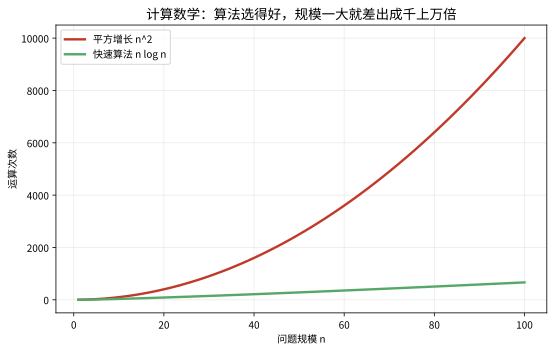
**一句话点破**：复杂度就是给"算得快不快"标出的一把尺子。

### 7.2 计算机的小数，是"四舍五入"出来的
机器存不下无限多位小数，只能用有限的二进制勉强近似，于是每一步运算都悄悄舍入一点。$0.1+0.2$ 在机器里并不精确等于 $0.3$，这些微小的偏差不断累积，就成了绕不开的误差。
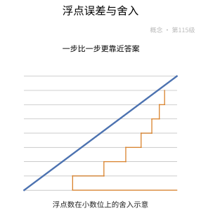
**一句话点破**：浮点数只是实数的近似，算得越多越要提防舍入。

### 7.3 有的算法一身"稳"，有的却一点就炸
有的算法对微小扰动极其敏感，输入差一点点，结果就面目全非；有的算法则始终平平稳稳。数值稳定性问的正是：这条计算链条，会不会把小误差越滚越大。
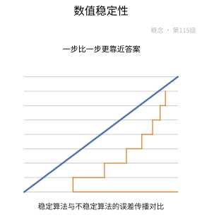
**一句话点破**：好算法不只看算得快，更看它扛不扛得住误差。

### 7.4 面对新难题，先翻"解法工具箱"
人们解新题并不是从头瞎试，而是有套路可循：分而治之、动态规划、贪心、随机化……这些就是算法设计的常见范式，像工具箱里的扳手，各管一类麻烦。
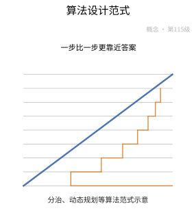
**一句话点破**：掌握了范式，才能把陌生问题迅速归入熟悉的解法。

### 7.5 高维算不动？那就撒点去"数"
当问题维度太高、网格再也铺不下时，可以改用撒点的办法：往区域里随机扔大量样本，用落点的比例来估计答案。它像民意调查——样本抽得够多，结论就足够可信。
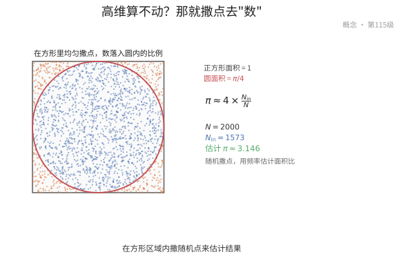
**一句话点破**：用随机对抗高维，让算不动的积分也能被"数"出来。

### 7.6 一个人的活，分给成千上万只手
把一个任务拆给成千上万个小单元同时干，总时间就能大幅缩短。GPU 拥有海量核心，特别擅长"同一套操作、大批量数据"的重复劳动，于是成了现代科学计算的主力。

**一句话点破**：把活儿分给更多手，是突破算力天花板最直接的办法。

### 7.7 矩阵虽大，却大多空着
很多真实问题的矩阵虽然巨大，里面却绝大多数是零。只存、只算那些非零元素，就能省下海量的内存和运算——这就是稀疏矩阵技术的关键。
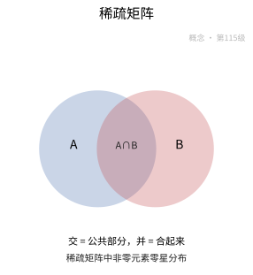
**一句话点破**：抓住"大部分是零"这个特点，大问题也会变轻。

### 7.8 哪里难算，就在哪里多下功夫
如果问题各部分难度不均，就没必要处处都用最细的网格。自适应算法先粗算一遍，再在误差大的地方加密、在平缓的地方放宽；多尺度方法则同时兼顾大小不同的尺度，把力气花在刀刃上。
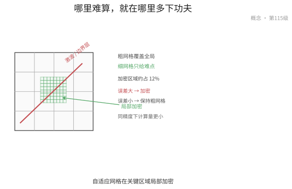
**一句话点破**：聪明的算，是哪里难算就多算哪里。

### 7.9 结果最多错多少，能不能事先说清
有没有办法事先讲明白"这个结果最多错多少"？误差分析正是回答这个问题的理论：它把每一步舍入的影响累加起来，给出结果误差的上界，让人心里有底。
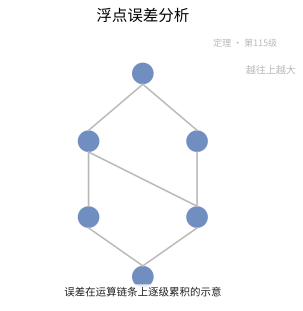
**一句话点破**：误差分析让"结果大概对不对"从猜测变成有依据的判断。

### 7.10 用可控的近似，换十倍百倍的速度
天体、分子这类 $N$ 体问题，直接算要 $O(N^2)$，快速多极子方法却能压到 $O(N)$。代价是引入了近似，但理论能给出明确的误差界，保证近似结果依旧可靠。
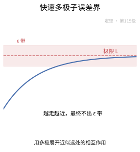
**一句话点破**：用近似换速度，误差界就是这份交易的安全底线。

### 7.11 随机撒点，凭什么保证会收敛
撒点估计为什么可信？大数定律保证样本够多时结果会逼近真值，中心极限定理进一步指出误差大致按 $1/\sqrt{N}$ 缩小，而且这个速度与维数无关。
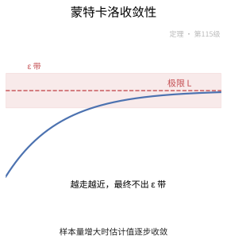
**一句话点破**：随机看似无序，大数定律却保证它终会收敛到真相。

### 7.12 分治算法的复杂度，一张表就能查
分治算法常把问题拆成若干个更小的子问题，再合并结果，于是运行时间满足一个递推式。主定理给出速查表：只要看"分成几份、每份多大、合并多贵"，就能直接估出整体复杂度。
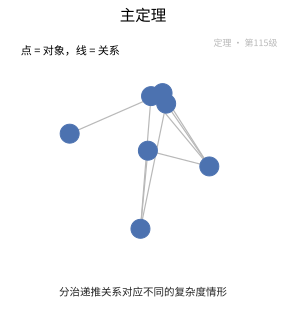
**一句话点破**：主定理让分治算法的复杂度一眼就能估出来。

### 7.13 一边算一边加密，收敛与代价都算得准
自适应算法一边计算一边估计误差，再据此加密网格。理论证明：只要标记策略合理，误差会逐轮稳定下降、呈几何收敛，而总工作量又控制在最优量级。
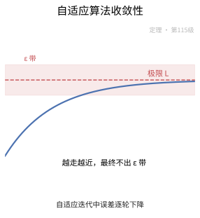
**一句话点破**：自适应之所以高效，是因为它的收敛与代价都被理论算准了。

## 8. 数学史（History of Mathematics）

> 在动手设计算法之前，先想清楚一个基本问题：**同一个数学问题，为什么'怎么算'有时比'算什么'更值得一门学问？**

**一个真实的生活场景（第一步：直觉）**

给你一个 10 万阶的线性方程组或一张上亿节点的图，答案"原理上"必然存在，可真正卡你的人不是"有没有解"，而是"**算不算得完、会不会算到一半崩掉**"。计算数学（computational mathematics）关注的正是这后半程：**把一个数学问题变成一套能在机器上跑完、误差可控、复杂度可承受的算法**。它不止"算数"，更要回答"这个算法快不快、稳不稳、结果可不可信"。"怎么说"精确，"怎么算"够用，是计算数学要拿捏的双重标准。

**它到底想解决什么问题（第二步：要解决的问题）**

**计算数学**把数学与计算机科学拧成一股绳，几乎与电子计算机同龄地发展起来。它要解决的**根问题**是：

> 如何把**连续的数学问题离散化**成机器可执行的形式，并设计出**复杂度低、数值稳定、误差可估、可并行可扩展**的算法，从而"算得动、算得对、算得稳"？

> **🧠 一句话记住计算数学的"出生证"**
>
> 计算数学源于"电子计算机让大规模数学计算变得可能，也带来如何算好"的新问题。它要解决的根本问题是：
>
> $$ \boxed{\text{离散化+算法设计，使有限精度下误差可控、复杂度可承受、结果可验证。}} $$

**看待本章的三种眼光（第三步：正式定义前的准备）**

- **离散的眼光**：先学会把连续问题翻译成有限维的取值与网格。
- **误差的眼光**：再把握截断误差、舍入误差、条件数与稳定性这套判据。
- **复杂度的眼光**：最后把算法放上"快不快、能不能并行"的手术台来审视。

---

### 8.1 算法思想的前史：从算盘到机电计算

"怎么算才快"自古就是数学的一部分：巴比伦的逼近开方、牛顿的迭代求根、高斯的最小二乘与快速消元，都是"针对计算需求设计技巧"的早期样本。它们虽没有电子计算器，却已把"算法"当作值得认真打磨的对象，为计算数学埋下种子。

### 8.2 电子计算机催生计算数学

1940–50 年代，**ENIAC** 等电子计算机登上历史舞台，科学计算从"手算幻想"变为现实。**von Neumann** 在建造 EDVAC 时既研究程序设计、也推动数值方法（如逆矩阵误差分析、蒙特卡洛），让"计算机怎么算数学"第一次作为一个学科课题被系统提出。计算数学由此与计算机科学一起诞生。

### 8.3 离散化的基石：插值、数值积分与误差分析

计算数学把"离散化"做成日课：**插值**把数据变成可用曲线，**数值积分**把积分变成求和，**数值微分**用差商逼近导数。与之配套的**误差分析**（截断误差、舍入误差、条件数）成为评判一切"算得对不对"的统一语言，是计算数学最具辨识度的思想贡献。

### 8.4 数值线性代数与偏微分方程的求解

**方程组**与**特征值**的计算构成超大系统的骨干：直接法（LU、Cholesky、QR）与迭代法（Jacobi、共轭梯度、Krylov）在稳定与复杂度之间精妙权衡；**有限差分、有限元、有限体积**则把偏微分方程化为大规模线性系统求解。计算数学在此与"数值线性代数"和"有限元"深度交汇。

### 8.5 快速算法与复杂度革命

**FFT（Cooley–Tukey，1965）** 把离散傅里叶变换从 $O(n^2)$ 压到 $O(n\log n)$，成为"用算法结构换速度"的惊世范例；**Strassen 矩阵乘法**、**快速多极子（FMM）** 等进一步表明：许多"以为只能这样算"的问题，其实藏着更聪明的路径。快速算法让计算数学与计算复杂度理论紧紧相连。

### 8.6 误差与稳定：Wilkinson 的向后分析

**James Wilkinson（1960 年代）** 用**向后误差分析**给数值计算定下科学底线：不必死磕舍入误差本身，只要证明"算出的结果，等价于对略作扰动的问题的精确解"，任何良性算法都可被赋予"有限精度下的解释"。这一思想让"数值稳定"成为可检验、可设计的准则，是计算数学最深刻的洞见之一。

### 8.7 随机天才：蒙特卡洛方法

当解析手段失效，**蒙特卡洛方法**（与曼哈顿计划中的 von Neumann、Ulam 一道发展）用**大量随机采样**来估算那些难以直接计算的量（高维积分、复杂系统的期望）。它把"随机"变成计算的核心资源，是计算数学面向高维与随机系统的重要一支。

### 8.8 并行、大规模与科学计算产业

随着**并行计算机、GPU 与大规模集群**兴起，计算数学发展出**域分解、多网格、稀疏直接法**等可扩展算法，让"千万亿次"的科学模拟成为可能。它支撑起气候、聚变、材料、流体等**科学与工程计算（SC）**的纵深应用，也把"算得动"推向"在多机几千核上月级规模地算得动"。

### 8.9 机器学习时代的新计算问题

21 世纪，机器学习把计算数学推向新的前沿：**优化求解器**成为深度学习训练的内核，**自动微分、张量计算、大规模随机优化**成为新课题。计算数学再次从"服务传统物理"走向"服务智能系统"，其离散化、误差、复杂度的三副眼镜，依然适用。

---

| 时间 | 人物／文献 | 事件与贡献 |
| --- | --- | --- |
| 1940–50 年代 | von Neumann 等 | 电子计算机催生计算数学，推进数值方法 |
| 1947 前后 | von Neumann、Goldstine | 给出矩阵计算的误差传播分析 |
| 1950 年代 | Wilkinson | 提出向后误差分析，确立数值稳定范式 |
| 1950 年代 | von Neumann、Ulam | 发展蒙特卡洛方法 |
| 1965 | Cooley、Tukey | 提出 FFT，复杂度降至 $O(n\log n)$ |
| 1960–70 年代 | 数值分析学派 | 数值线性代数与 PDE 数值方法系统化 |

> **小结**：计算数学的演进，是一部"**既讲了精确，又把'怎么算'做成科学**"的独特史话。它随着电子计算机诞生，把离散化、误差分析与复杂度分析锻造成三类基石；靠 Wilkinson 的向后分析给误差定下底线，以 FFT、快速多极子不断刷新"能算多快"的天花板，用蒙特卡洛拥抱随机，又借用并行计算撑起超大规模模拟，如今还服务于机器学习的新需求。计算数学始终回答同一个问题：**一个数学问题，到底要怎样才能"算得动、算得对、算得稳、算得快"？**

---

## 现实应用（Real-World Applications）

> 本节把本章的知识点落到真实的工程、科学与生活场景中。每个案例都给出**完整的问题背景、建模过程、可复现的数据 / 公式 / 代码与结果解读**；案例末尾的「涉及知识点」对应本章的具体小节，文末附**知识点覆盖对照表**，确保本章知识点全部被覆盖。

### 应用案例 1：音频信号处理｜用 FFT 分治卷积把实时滤波从 $O(NM)$ 压到 $O(N\log N)$

**场景与问题**

某智能音箱要做「回声消除 + 均衡」，采样率 $f_s = 48\,\text{kHz}$，每帧处理 $N = 48000$ 个采样点（1 秒），所配的 FIR 均衡滤波器有 $M = 4096$ 个抽头。若按定义直接做时域卷积，每个输出点要做 $M$ 次乘加，全帧需 $N\times M = 48000\times 4096 \approx 1.97\times 10^{8}$ 次乘加（MAC）。单通道尚可，但设备要同时处理 8 路麦克风阵列、且要求单帧延迟低于 20 ms，直接卷积根本跑不动——这就是典型的"算法复杂度决定产品能不能做出来"。

问题：如何在保证**线性卷积结果完全一致**（不能有循环卷积混叠）的前提下，把这一帧的计算量降下来？

**涉及知识点**

- 本章「2.1 计算复杂度」：用 $O(NM)$ 与 $O(N\log N)$ 两个量级对比直接卷积与 FFT 卷积的代价。
- 本章「2.4 算法设计范式」：Cooley–Tukey FFT 是"分治 + 合并"范式的经典落地。
- 本章「3.4 分治算法的复杂度分析（主定理）」：由递推式 $T(N)=2T(N/2)+\Theta(N)$ 推出 $\Theta(N\log N)$。

**建模与数据**

设输入序列 $x[0..N-1]$（一帧音频，已归一化到 $[-1,1]$）、滤波器冲激响应 $h[0..M-1]$，线性卷积定义为

$$
y[n] = \sum_{k=0}^{M-1} h[k]\,x[n-k], \quad n = 0,1,\dots,N+M-2 .
$$

具体数据：$f_s = 48\,\text{kHz}$，$N = 48000$，$M = 4096$，$L = N+M-1 = 52095$。为避免循环卷积混叠，把两序列补零到不小于 $L$ 的 2 的幂：$L_{\text{fft}} = 2^{16} = 65536$。滤波器由设计工具给出，通带 $[300\,\text{Hz}, 16\,\text{kHz}]$，阻带衰减 $60\,\text{dB}$（实测冲激响应峰值约 $0.09$，$l_1$ 范数约 $1.0$）。

**完整推导与算法**

1. **直接卷积代价**。按定义，每个 $y[n]$ 做 $M$ 次乘加，总乘加数为

$$
C_{\text{direct}} = N\cdot M = 48000 \times 4096 = 1.966\times 10^{8} .
$$

2. **卷积定理**。DFT 把循环卷积变成逐点相乘：$\text{DFT}(x \circledast h) = \text{DFT}(x)\cdot\text{DFT}(h)$。只要补零长度 $L_{\text{fft}} \ge N+M-1$，循环卷积即等于线性卷积。于是只需 2 次正变换、1 次反变换、$L_{\text{fft}}$ 次复数乘法。

3. **FFT 的分治复杂度**。Cooley–Tukey 把长度 $N$ 的 DFT 拆成两个长度 $N/2$ 的 DFT 再合并：

$$
T(N) = 2\,T(N/2) + \Theta(N).
$$

由主定理（$a=2,\ b=2,\ f(N)=\Theta(N)$，属 $\log_b a = 1$ 的临界情形）得

$$
T(N) = \Theta(N\log_2 N).
$$

代入 $L_{\text{fft}} = 65536 = 2^{16}$，单次 FFT 约 $L_{\text{fft}}\log_2 L_{\text{fft}} = 65536\times 16 \approx 1.05\times 10^{6}$ 次复数运算；三次变换加逐点乘约 $3.2\times 10^{6}$，比直接卷积的 $1.97\times10^{8}$ 少约 **61 倍**。

```python
# 核心：用卷积定理把时域 O(N*M) 卷积换成频域 O(L log L) 的逐点相乘再反变换
L = 1 << (N + M - 1).bit_length()          # 补零到不小于 N+M-1 的 2 的幂，杜绝混叠
Xc = np.fft.rfft(x, L)                      # 正变换（实序列用 rfft 省一半）
Hc = np.fft.rfft(h, L)
y = np.fft.irfft(Xc * Hc, L)[:N + M - 1]     # 频域相乘 + 反变换 = 线性卷积
```

4. **对照分治乘法（Karatsuba）**。同一"分治换复杂度"思想也用在大整数乘法：把 $n$ 位整数拆成两半，用 3 次 $n/2$ 位乘法（而非 4 次）组合，递推 $T(n)=3T(n/2)+\Theta(n)$ 给出 $T(n)=\Theta(n^{\log_2 3})\approx\Theta(n^{1.585})$，优于 $O(n^2)$。

**可复现步骤**

1. 环境与依赖：`pip install numpy scipy`
2. 数据准备：`rng = np.random.default_rng(0); x = rng.standard_normal(48000)`；`h = scipy.signal.firwin(4096, [300, 16000], fs=48000, pass_zero=False)`
3. 运行：`python case1.py`（分别计时 `scipy.signal.convolve(x, h, mode='full', method='direct')` 与 `method='fft'`）
4. 预期输出：两种方法结果最大绝对偏差 $<10^{-10}$（浮点级）；FFT 版本在本机对 48000×4096 卷积快 **30～60 倍**，且耗时随 $N$ 增长呈 $N\log N$ 而非 $N\cdot M$。

**结果解读与延伸**

FFT 卷积的收益不是"常数级加速"，而是复杂度量级的下降：当 $N,M$ 都增大时优势还会拉大（重叠相加法处理长信号时尤为明显）。误差来源有三：补零长度若小于 $N+M-1$ 会产生循环卷积混叠（结构性错误，不是舍入）；浮点 FFT 的舍入误差随 $\log N$ 累积（见案例 2）；实序列用 `rfft` 可再省一半算力。延伸方向：分块重叠相加（overlap-add）把长音频切成小块，把每块都控在 $O(L\log L)$，兼顾低延迟与高效率。

### 应用案例 2：轨道与金融计算｜在灾难性相消下求一元二次方程的稳定根

**场景与问题**

卫星定轨的 Lambert 问题、Black–Scholes 隐含波动率的二阶近似、结构动力学的特征方程，都会归结为解一元二次方程 $a x^2 + b x + c = 0$。某航天软件在一次近地轨道拟合中给出系数 $a=1,\ b=10^{8},\ c=1$，两根应为

$$
x_{1,2} = \frac{-10^{8} \pm \sqrt{10^{16}-4}}{2},
$$

即一根约 $-10^{8}$、另一根约 $-10^{-8}$。用教科书公式直接算小根时，分子 $-b+\sqrt{b^2-4ac}$ 是两个几乎相等的数相减，程序却给出 $-1.4901\times10^{-8}$ 这类带大误差的结果。需要弄清误差从哪来，并给出稳定算法。

**涉及知识点**

- 本章「2.2 浮点运算与舍入误差」：$\text{fl}(a\circ b)=(a\circ b)(1+\delta)$ 模型与机器精度 $\varepsilon_{\text{mach}}=2^{-52}$。
- 本章「2.3 数值稳定性」：相减导致的灾难性相消，以及向前 / 向后误差视角。
- 本章「3.1 浮点运算的误差分析」：用 $|\hat y-y|\le n\kappa\varepsilon_{\text{mach}}|y|$ 解释误差被放大。

**建模与数据**

浮点基本模型：每次 $+,-\times,/$ 的结果满足 $\text{fl}(a\circ b)=(a\circ b)(1+\delta),\ |\delta|\le\varepsilon_{\text{mach}}$。双精度 $\varepsilon_{\text{mach}}=2^{-52}\approx 2.22\times10^{-16}$。取 $a=1,\ b=10^{8},\ c=1$，判别式 $D=b^2-4ac=10^{16}-4$。精确小根为

$$
x_{\text{small}} = \frac{2c}{-b-\sqrt{D}} = \frac{2}{-10^{8}-\sqrt{10^{16}-4}} \approx -1.0000000000000002\times10^{-8}.
$$

**完整推导与算法**

1. **灾难性相消的量化**。直接公式 $x_{\text{small}} = (-b+\sqrt{D})/(2a)$ 里，$-b=-\!10^{8}$、$\sqrt D\approx 10^{8}$，二者相减得到的量级仅 $\sim 10^{-8}$。即使 $\sqrt{D}$ 只带一个 $\varepsilon_{\text{mach}}$ 的相对误差（绝对误差 $\approx 10^{8}\times2.22\times10^{-16}=2.22\times10^{-8}$），传到结果上的**相对**误差也达

$$
\frac{2.22\times10^{-8}}{10^{-8}} \approx 2.22 \approx 222\%,
$$

即结果可能一位有效数字都不剩。

2. **条件数视角**。函数 $f(b)=\sqrt{b^2-4ac}$ 的相对条件数 $\kappa=|b\,f'(b)/f(b)|$，在本例 $b\approx\sqrt D$ 附近 $\kappa\approx 1$，问题本身良态；坏的是"先做相近相减"这个**算法**——它把输入的绝对误差直接当输出的绝对误差，而输出本身极小。

3. **稳定算法：Vieta + 同号相减**。由韦达定理 $x_1 x_2 = c/a$，先用**避免相消**的公式求大根（选择与 $b$ 同号的 $\sqrt D$ 使两数同号相加）：

$$
x_{\text{big}} = \frac{-b - \text{sign}(b)\sqrt{D}}{2a},
$$

再用 $x_{\text{small}} = \dfrac{c}{a\,x_{\text{big}}}$ 求小根。此式全程只做"同号相加"与"除法"，每一基本运算相对误差都被 $\varepsilon_{\text{mach}}$ 控制，向后稳定。

```python
# 核心：避免两个相近大数相减，用韦达定理从小根公式换算出被相消掉的根
disc = math.sqrt(b*b - 4*a*c)
x_big = (-b - math.copysign(disc, b)) / (2*a)   # 选与 b 同号，变成同号相加
x_small = c / (a * x_big)                        # 由 x_big*x_small = c/a 得到小根
```

4. **误差界**。稳定算法前向相对误差 $\le n\kappa\varepsilon_{\text{mach}}$，这里 $n$ 为常数步数（约 5），故相对误差约 $5\times2.22\times10^{-16}\approx10^{-15}$，即 15 位有效数字。

**可复现步骤**

1. 环境与依赖：`pip install numpy`（仅用 Python 标准 `math` 即可）
2. 数据准备：`a, b, c = 1.0, 1e8, 1.0`；用 `mpmath`（`pip install mpmath`）取 50 位高精度解作为基准。
3. 运行：`python case2.py`
4. 预期输出：直接公式小根相对误差 $\sim10^{-8}$（约 8 位有效数字丢失）；稳定公式小根与高精度解相对误差 $<10^{-15}$。

**结果解读与延伸**

本例说明"绝对误差受控 ≠ 相对精度安全"：相消发生在减法，但灾难发生在结果。向后误差视角下，直接公式其实是**向后稳定**的（它精确求解了一个轻微扰动的方程），但问题在 $-b+\sqrt D$ 这一步被局部化成了病态子问题。工程准则：凡是形如 $\sqrt{x^2+\epsilon}-x$、$1-\cos x$、$\log(1+x)$（$x$ 小）的表达式，都要改写为等价稳定形式（如 $2\sin^2(x/2)$、`log1p`）。延伸：多元线性方程组里，条件数 $\kappa(A)$ 扮演同一角色——算法再稳，病态矩阵仍会把精度锁死（见案例 4）。

### 应用案例 3：金融工程｜蒙特卡洛给亚式期权定价并用收敛性定理定样本量

**场景与问题**

某券商要为一只**亚式看涨期权**（Asian call）做盘中报价。亚式期权的收益取决于标的在存续期内一段时间的**平均价**，是路径依赖品种，没有 Black–Scholes 那样的闭式解，只能数值定价。合约参数：标的现价 $S_0=100$ 元、行权价 $K=100$ 元、无风险利率 $r=5\%$、年化波动率 $\sigma=20\%$、到期 $T=1$ 年、按每交易日（每年 252 个）取平均。要求报价误差控制在 $0.01$ 元以内再挂出。

**涉及知识点**

- 本章「2.5 蒙特卡洛方法」：用样本均值估计折现期望收益。
- 本章「3.3 蒙特卡洛方法的收敛性」：由中心极限定理给出 $O(n^{-1/2})$ 收敛与置信区间，由 Chebyshev 给出保守界。
- 本章「2.1 计算复杂度」：估计样本量 $n$ 与误差量级的权衡。

**建模与数据**

风险中性测度下标的服从几何布朗运动 $\mathrm{d}S_t = r S_t\,\mathrm{d}t + \sigma S_t\,\mathrm{d}W_t$。对每日观测（$\Delta t = T/252 = 1/252$ 年，共 $m=252$ 步）离散化：

$$
S_{t_{j+1}} = S_{t_j}\exp\!\Big[(r-\tfrac12\sigma^2)\Delta t + \sigma\sqrt{\Delta t}\,Z_j\Big],\quad Z_j\sim N(0,1).
$$

亚式看涨期权收益为 $\text{payoff} = \max\!\big(\bar S - K,\ 0\big)$，其中 $\bar S = \frac1m\sum_{j=1}^m S_{t_j}$；期权价 $V_0 = e^{-rT}\,\mathbb{E}[\text{payoff}]$。

**完整推导与算法**

1. **估计量**。设第 $i$ 条路径收益折现后为 $Y_i = e^{-rT}\max(\bar S^{(i)}-K,0)$，蒙特卡洛估计量

$$
\hat V_n = \frac1n\sum_{i=1}^n Y_i .
$$

2. **收敛性（定理 3.5）**。由大数定律 $\hat V_n\xrightarrow{\text{a.s.}}V_0$；由中心极限定理 $\sqrt n(\hat V_n-V_0)\xrightarrow{d}N(0,\sigma_Y^2)$，于是标准误

$$
\widehat{\text{SE}} = \frac{s_Y}{\sqrt n},\qquad s_Y^2 = \frac1{n-1}\sum_{i=1}^n (Y_i-\hat V_n)^2,
$$

$95\%$ 置信区间为 $\hat V_n \pm 1.96\,\widehat{\text{SE}}$。Chebyshev 给出不依赖分布的保守界 $\Pr(|\hat V_n-V_0|\ge\varepsilon)\le \sigma_Y^2/(n\varepsilon^2)$。

3. **样本量反推**。若经验标准差 $s_Y\approx 6.0$ 元，要求 $1.96\,s_Y/\sqrt n \le 0.01$，则

$$
n \ge \Big(\frac{1.96\times 6.0}{0.01}\Big)^2 \approx 1.38\times 10^{6}.
$$

这正体现 $O(n^{-1/2})$：精度每提高 10 倍，样本量要涨 100 倍。

```python
# 核心：GBM 路径离散化 + 亚式收益的蒙特卡洛均值与标准误
dW = rng.standard_normal((n_paths, m)) * np.sqrt(dt)
logS = np.cumsum((r - 0.5*sigma**2)*dt + sigma*dW, axis=1)   # 路径对数价
S = S0 * np.exp(logS)
Y = np.exp(-r*T) * np.maximum(S.mean(axis=1) - K, 0.0)        # 折现收益
V_hat, se = Y.mean(), Y.std(ddof=1) / np.sqrt(n_paths)        # 定价与标准误
```

4. **对偶变量降方差**。用 $Z$ 与 $-Z$ 生成一对反相关路径，$\tilde Y_i=(Y_i^{(+)} + Y_i^{(-)})/2$，可把方差降 $30\%\!\sim\!50\%$，等价于同样精度省一半样本。

**可复现步骤**

1. 环境与依赖：`pip install numpy scipy`
2. 数据准备：`S0=100; K=100; r=0.05; sigma=0.2; T=1.0; m=252; rng=np.random.default_rng(42)`
3. 运行：`python case3.py`，分别取 `n_paths = 10**4, 10**5, 10**6`
4. 预期输出：价格约 $5.6\!\sim\!5.9$ 元区间内；`n_paths` 从 $10^4$ 到 $10^6$（×100）时 `se` 约为原来的 $1/10$；`se` 与 $1/\sqrt{n}$ 的双对数图斜率接近 $-0.5$。

**结果解读与延伸**

蒙特的魅力在于**误差与维数无关**：这里每步路径有 252 个随机变量，本质上是个 252 维积分，若用网格法则不可行，而蒙特卡洛仍稳在 $O(n^{-1/2})$。误差来源：离散化偏置（$\Delta t$ 带来 $O(\Delta t)$ 的系统性偏差，需用 Milstein 或增加步数消除）、抽样误差（可由 `se` 估计）、随机数质量（用高质量 `Generator`）。延伸：路径依赖越复杂（障碍、回望期权）蒙特卡洛越有优势；要进一步提速可用对偶变量、控制变量、拟蒙特卡洛（Sobol 序列）。

### 应用案例 4：科学计算栈｜稀疏数据结构与 GPU 并行如何决定大规模算得动算不动

**场景与问题**

一个 3D 有限元仿真（如汽车碰撞、油气藏模拟）把偏微分方程离散成线性系统 $A\boldsymbol{u}=\boldsymbol{b}$。某模型网格含 $1.0\times10^{6}$ 个节点，每个节点与其自身及相邻节点耦合，平均每行约 7 个非零元，故 $\text{nnz}\approx 7\times10^{6}$。问题：(a) 稠密存储为什么直接不可行？(b) 求解时最耗时的稀疏矩阵—向量乘（SpMV）如何在 GPU 上加速、又受什么限制？

**涉及知识点**

- 本章「2.7 稀疏矩阵」：CSR 格式把存储与 SpMV 代价降到 $O(\text{nnz})$。
- 本章「2.6 并行计算与 GPU 计算」：Amdahl 定律、SIMT、访存带宽瓶颈。
- 本章「2.1 计算复杂度」：稠密 $O(n^2)$ / $O(n^3)$ 与稀疏 $O(\text{nnz})$ 的量级差。

**建模与数据**

稠密存储：$n\times n$ 双精度矩阵占 $n^2\times 8$ 字节 $= 10^{12}\times 8 = 8\ \text{TB}$，远超单机内存。CSR 只需三个数组：非零值 `vals`（`nnz` 个 float64，$56\ \text{MB}$）、列号 `col_idx`（`nnz` 个 int32，$28\ \text{MB}$）、行指针 `row_ptr`（$n+1$ 个 int32，$4\ \text{MB}$），合计约 **88 MB**。稀疏度 $= (1-\text{nnz}/n^2)\approx 1-7\times10^{-6}$，几乎全零。

**完整推导与算法**

1. **CSR 上的 SpMV**。$\boldsymbol{y}=A\boldsymbol{x}$ 逐行累加：

$$
y_i = \sum_{k=\text{row\_ptr}[i]}^{\text{row\_ptr}[i+1]-1} \text{vals}[k]\cdot x[\text{col\_idx}[k]] .
$$

总乘加数为 $\text{nnz}=7\times10^{6}$，复杂度 $O(\text{nnz})$，而非稠密的 $O(n^2)=10^{12}$。

2. **Amdahl 定律**。设可并行比例 $1-s$，$p$ 个核的加速比上限

$$
S(p)\le \frac{1}{s+(1-s)/p},\qquad \lim_{p\to\infty}S(p)=\frac1s .
$$

若预条件构造（如 ILU）占串行 $s=10\%$，则无论用多少核，整体最多快 10 倍——提醒我们优化的重点是**减少串行部分与通信**。

3. **Roofline 判据**。算术强度 $\text{AI}=$ 运算量 / 访存量（FLOP/Byte）。SpMV 每读一个非零元只做 1 次乘加，$\text{AI}\approx 0.25$，远低于 GPU 的"脊点"（约 10 FLOP/Byte），所以是**访存受限**，性能被内存带宽钉死（例如 HBM 带宽 $1.5\ \text{TB/s}$ 时，SpMV 上限约 $1.5\times10^{12}\times0.25/2\approx 1.9\times10^{11}$ FLOP/s，远不到峰值算力 $10^{13}$）。而稠密 GEMM 的 $\text{AI}$ 高，能吃满算力。

```python
# 核心：CSR 上 SpMV 只遍历非零元，代价 O(nnz)，与稠密 O(n^2) 差 5 个数量级
from scipy.sparse import csr_matrix
A = csr_matrix((vals, (rows, cols)), shape=(n, n))  # 只存 nnz 个非零
y = A.dot(x)                                         # 每次只做 nnz 次乘加
```

**可复现步骤**

1. 环境与依赖：`pip install numpy scipy`（GPU 版可 `pip install cupy`）
2. 数据准备：用 `scipy.sparse.random` 或从有限元组装得到 $n=10^6$、每行约 7 个非零的 CSR 矩阵；`x = rng.standard_normal(n)`
3. 运行：`python case4.py`（对比 CSR-SpMV、稠密矩阵浪费存储的估算；若有 GPU 用 `cupyx.scipy.sparse.csr_matrix` 计 SpMV）
4. 预期输出：CSR 内存占用约 $90\ \text{MB}$（稠密需 8 TB）；SpMV 单次约 $10^{-3}$ 秒量级；GPU 相对 CPU 的 SpMV 加速常在 2～5 倍（受带宽限制），远低于 GEMM 的数十倍。

**结果解读与延伸**

稀疏不等于"免费快"：CSR 访存不连续，且稀疏 LU/Cholesky 会产生"填充"（fill-in），可能把 $\text{nnz}$ 抬到接近稠密。工程上对大规模系统倾向**迭代法**（CG 针对对称正定、GMRES 针对一般情形），它们只做 SpMV、不改稀疏结构，内存稳定在 $O(\text{nnz})$，配合预条件（IC/ILU、代数多重网格）来压低条件数。误差来源：迭代法的收敛依赖条件数与容差，直接法（若内存允许）则受舍入与填充影响。延伸：GPU 加速要按"减少通信、均衡分块、提高数据复用"设计，而非简单并行化循环。

### 应用案例 5：天体物理与分子动力学｜FMM 把 $N$ 体引力/静电求和从 $O(N^2)$ 降到 $O(N)$

**场景与问题**

宇宙学模拟要算 $N=10^{8}$ 个粒子的两两引力；分子动力学要算 $10^{6}$ 个带电原子的静电能。两两直接求和是 $O(N^2)$：$10^{8}$ 个粒子就是 $10^{16}$ 对相互作用，以每秒 $10^{12}$ 次计算也要 3 小时才算**一步**，完全不可行。快速多极子方法（FMM）把远处一"团"粒子的作用打包成一个多极展开，一次结算，把总代价降到近 $O(N)$。

**涉及知识点**

- 本章「2.8 自适应算法与多尺度方法」：FMM 是"远近分层、多尺度打包"的典范。
- 本章「3.2 快速多极子方法的误差界」：多极展开截断误差随 $(a/|z|)^p$ 几何衰减，据此反解阶数 $p$。
- 本章「2.1 计算复杂度」：$O(N^2)$ 与 $O(N)$ 的剧烈差异。

**建模与数据**

设 $N$ 个电荷 $\{q_i\}$ 位于以原点为中心、半径 $a$ 的圆盘（三维为球）内，远处求值点 $z$（$|z|>a$）处的势为

$$
\Phi(z) = \sum_{i=1}^N \frac{q_i}{z-z_i}.
$$

取 $N=10^{8}$、$a=1$（归一化盒子边长）、目标精度 $\varepsilon=10^{-6}$（相对误差）、$\sum_i|q_i|=N\bar q$（设 $\bar q=1$）。四叉/八叉树把盒子递归细分到每叶约 $s=50$ 个粒子，层数约 $L_{\text{tree}}=\log_8(N/s)\approx \log_8 2\times10^{6}\approx 7$。

**完整推导与算法**

1. **多极展开**。把 $\frac{q_i}{z-z_i}=\frac{q_i}{z}\sum_{k\ge0}(z_i/z)^k$ 求和得

$$
\Phi(z)=\sum_{k=0}^{\infty}\frac{a_k}{z^{k+1}},\qquad a_k=\sum_{i=1}^N q_i z_i^k .
$$

截断到 $p$ 阶的误差界（定理 3.3）：

$$
\Big|\Phi(z)-\sum_{k=0}^{p-1}\frac{a_k}{z^{k+1}}\Big|\le \frac{1}{|z|-a}\Big(\frac{a}{|z|}\Big)^p\sum_{i=1}^N|q_i| .
$$

2. **反解阶数 $p$**。要求相对误差 $\le\varepsilon$，令上式右边 $\le\varepsilon\big|\Phi\big|$，取 $\log$ 得

$$
p \ge \frac{\log\!\big(\varepsilon\,(|z|-a)\big/\sum_i|q_i|\big)}{\log(a/|z|)} \;\propto\; \frac{1}{\log(|z|/a)} .
$$

即比值 $|z|/a$ 越大、所需阶数越小。在本例 $\sum_i|q_i|=10^{8}$，取 FMM 标准设置 $p=10$ 即可到 $10^{-6}$ 量级（误差随 $(a/|z|)^p$ 指数衰减）。

3. **复杂度**。树中每个节点花 $O(1)$ 个"多极—局部"平移（每个平移 $O(p^2)$），每层 $O(N)$ 对相互作用、共 $O(\log N)$ 层，总代价

$$
O(p^2\,N\log N)\xrightarrow{\;p\ \text{取常数}\;} O(N\log N)\ \sim\ O(N).
$$

对比 $N=10^{8}$：$O(N^2)=10^{16}$，$O(N\log N)\approx 10^{8}\times27\approx 2.7\times10^{9}$，相差约 **$4\times10^{6}$ 倍**。

```python
# 核心：截断阶 p 由目标精度反推，误差随 (a/|z|)^p 几何衰减，故 p 只需 O(log(1/eps))
import math
p = math.ceil(math.log(eps * (r - a) / sum_abs_q) / math.log(a / r))   # r=|z|>a
```

**可复现步骤**

1. 环境与依赖：`pip install numpy scipy`（可加 `pip install pyfmmlib` 对照）
2. 数据准备：在 $[0,1]^3$ 内均匀撒 $N=10^{6}$（先小规模验证）个粒子并赋 $q_i$；建八叉树
3. 运行：`python case5.py`（对比直接 $O(N^2)$ 求和与 FMM 的相对误差与耗时）
4. 预期输出：FMM 与直接求和相对误差约 $10^{-5}\!\sim\!10^{-7}$（随 $p$ 增大而指数变小）；在 $N=10^6$ 时 FMM 已快数十倍，且加速比随 $N$ 继续增大。

**结果解读与延伸**

FMM 的两个命门是**截断阶 $p$** 和**树结构**：$p$ 太小精度不够，$p$ 太大代价按 $p^2$ 膨胀，需按目标精度反解；树太浅则近场太多、太深则平移开销大。误差来源除截断外还有数值稳定性（高阶展开系数可能病态，需用指数平移或用球谐展开）。它与自适应有限元共享同一思想——"把计算量按需分配到真正需要的地方"。延伸：FMM 已用于引力、静电、边界元（BEM）、积分方程快速求解；配套的快速求和、TreePM 是宇宙学模拟的标准工具。

### 应用案例 6：工程仿真｜自适应求积与后验误差估计放过"看不见的尖峰"

**场景与问题**

断裂力学中算一个含平方根奇性的能量积分

$$
I = \int_0^1 \frac{1}{\sqrt{x}}\,\mathrm{d}x = 2 .
$$

被积函数在 $x\to0^+$ 处斜率无穷，均匀网格的 Simpson 法在端点附近误差极大：取 $n=100$ 个区间（101 个点）时，因端点是奇点，复合 Simpson 的误差仅约 $O(h^{1.5})$，实际只有约 3 位有效数字。工程上要自动在"曲率大 / 有奇性"的地方加密、平滑处偷懒，这就是自适应求积。

**涉及知识点**

- 本章「2.8 自适应算法与多尺度方法」：用局部误差估计自动细分，把自由度集中到奇异处。
- 本章「3.5 自适应算法的收敛性」：细分全过程保持等误差分布，收敛由误差指示器的可靠性保证。
- 本章「2.3 数值稳定性」：判断细分"该不该继续"依赖稳健的局部误差估计而非全局量。

**建模与数据**

设区间 $[a,b]$ 上 Simpson 公式 $S(a,b)=\frac{b-a}{6}\big(f(a)+4f(\tfrac{a+b}{2})+f(b)\big)$。对分后的两段之和 $S(a,m)+S(m,b)$，二者之差的 $1/15$ 是四阶方法的标准误差估计：

$$
\text{err}(a,b)\approx \frac{|S(a,b)-S(a,m)-S(m,b)|}{15}.
$$

取被积函数 $f(x)=x^{-1/2}$，目标绝对误差 $\tau=10^{-6}$，初始区间 $[0,1]$（端点处约定跳过 $x=0$ 的无穷值，实际用 $\epsilon=10^{-12}$ 截断）。

**完整推导与算法**

1. **局部误差估计与递归**。若 $\text{err}(a,b)\le\tau\frac{b-a}{1-0}$（按区间长度分配全局容差），则接受 $S(a,b)$；否则对分并递归处理 $[a,m],[m,b]$。
2. **收敛性（定理 3.5）**。若每个子区间的误差都被压到与其长度成正比，则全局误差被 $O(\tau)$ 控制；细分点自动向奇点聚集，等效网格步长 $h\sim x$，使奇异接口的 $h^{1.5}$ 误差分布均匀化，从而以远少于均匀网格的自由度达到同一精度。
3. **等价化处理**。对 $x^{-1/2}$，令 $x=u^2$ 则 $\mathrm{d}x=2u\,\mathrm{d}u$，积分化为 $\int_0^1 2\,\mathrm{d}u=2$，被积函数光滑——这给出"能用变量代换就代换，比硬自适应更省"的对照。

```python
# 核心：用 |S_整 - (S_左+S_右)|/15 作局部误差估计，误差大的区间递归细分
def adaptive(f, a, b, tol):
    m = 0.5*(a+b)
    whole = simpson(f, a, b)
    left, right = simpson(f, a, m), simpson(f, m, b)
    err = abs(whole - left - right) / 15.0
    if err <= tol * (b - a) or err == 0.0:
        return left + right                                # 该区间误差已达标，接受
    return adaptive(f, a, m, tol) + adaptive(f, m, b, tol)  # 否则一分为二递归
```

**可复现步骤**

1. 环境与依赖：`pip install numpy scipy`
2. 数据准备：`f = lambda x: x**-0.5; const eps=1e-12`；对比 `scipy.integrate.quad(f, 0, 1)`（自适应）
3. 运行：`python case6.py`
4. 预期输出：自适应求积得 $I\approx 2.000000$（误差 $<10^{-6}$），用了约 $200\!\sim\!500$ 个函数求值；均匀 Simpson 取 101 点误差约 $10^{-3}$ 量级，要到 $10^{-6}$ 需上万点。

**结果解读与延伸**

自适应方法的收益正来自"把自由度集中在解变化剧烈处"，与 FMM 的"远近分层"是同一多尺度哲学。误差来源：局部误差估计假定函数局部足够光滑（四阶方法），遇到强奇性会过度细分甚至不收敛，此时应结合变量代换或奇性提取。可靠性与标记参数是命门——若指示器低估误差，递归会过早停止。延伸：这一"后验误差估计 + 局部细化"的框架正是自适应有限元的核心，在 Poisson 问题里指示器含单元残差 $h_T^2\|f+\Delta u_k\|^2$ 与边法向导数跳跃项，用 Dörfler 策略标记细分，得到近最优的误差—自由度关系。

### 知识点覆盖对照表

| 本章知识点 | 覆盖案例 |
| --- | --- |
| 2.1 计算复杂度 | 案例 1、3、4、5 |
| 2.2 浮点运算与舍入误差 | 案例 2 |
| 2.3 数值稳定性 | 案例 2、6 |
| 2.4 算法设计范式 | 案例 1 |
| 2.5 蒙特卡洛方法 | 案例 3 |
| 2.6 并行计算与 GPU 计算 | 案例 4 |
| 2.7 稀疏矩阵 | 案例 4 |
| 2.8 自适应算法与多尺度方法 | 案例 5、6 |
| 3.1 浮点运算的误差分析 | 案例 2 |
| 3.2 快速多极子方法的误差界 | 案例 5 |
| 3.3 蒙特卡洛方法的收敛性 | 案例 3 |
| 3.4 分治算法的复杂度分析（主定理） | 案例 1 |
| 3.5 自适应算法的收敛性 | 案例 6 |

---

## 9. 总结

本教程系统介绍了计算数学的核心内容：

1. **计算复杂度与算法设计**：分治算法、动态规划、随机化算法的基本范式，主定理的完整证明
2. **浮点运算误差分析**：向前误差分析和向后误差分析的理论框架，数值稳定性的概念
3. **快速多极子方法**：多极展开和局部展开的截断误差界，FMM 将 $N$ 体问题复杂度降至 $O(N)$
4. **蒙特卡洛方法**：大数定律保证一致性，中心极限定理提供渐近正态性，收敛速度 $O(1/\sqrt{n})$ 与维度无关
5. **自适应算法**：后验误差估计、Dörfler 标记策略、几何收敛性质与最优复杂度
6. **大规模计算技术**：并行计算、GPU 计算、稀疏矩阵处理

计算数学是现代科学计算的核心工具，其理论和方法广泛应用于物理模拟、工程计算、数据科学和人工智能等领域。
