# 第 116 级：数据科学 (Data Science)

---

## 从"把数据变成能拍板的判断"说起：数据科学要解决的根问题

> 在学 PCA、XGBoost、评估指标之前，先想清楚一个商场里的朴素问题：**一堆记录、点几下网页、刷几张卡——怎么把它们变成一句"下一步该怎么做"的决策？**

**第一步：直觉——从五花八门的记录里挤出判断**

想象你经营一家电商。每天服务器上躺着百万条点击、浏览、加购、评价的记录，它们彼此混乱、缺斤少两、尺度不一、还夹杂着刷单的异常值。你能从中得到的最大财富，不是"我会 SQL 能查到"，而是**"接下来该给谁推荐什么、愿出多高的价、要不要补货"**这类可行动的判断。数据要变成这种判断，至少要经过三步：**清洗整齐**（预处理）、**看出结构**（探索性分析、降维、聚类）、**学会预测**（分类、回归）。把这套从"杂乱记录"通向"行动决策"的流水线讲清楚，就是数据科学。

**第二步：要解决的问题——从"验证假设"到"数据里找答案"**

数据科学的核心动机，来自统计与工程的一次合流：传统统计学习惯于"在明确假设下小心验证一个已知的问题"，可现实里我们面对的往往是"数据一大堆、问题却模糊、前提又叫不准"的新境况。它要回答的根问题是：**如何从海量、杂、不完美、非实验室产出的观测数据里，可靠地提取出能支撑决策的规律与预测？**

- **统计的积淀**：描述统计、回归、假设检验早就为"从数据说话"备好了语言；John Tukey 的"探索性数据分析（EDA）"率先提出"先观察、再假设"的工作方式。
- **机器的加入**：机器学习把"找规律"从公式推导交给"从数据拟合"，一下子把可处理问题的规模与复杂度推到前所未有的程度。
- **"数据科学"这个名字**：临近大数据时代，"数据分析 + 机器学习 + 工程部署"打成一个整体，才被冠以"数据科学"之名——它定义为一条从原始数据直达可部署决策的完整流水线。

**第三步：正式定义前的准备——本章怎样一步步推进**

本章沿"数据 → 特征 → 模型 → 评估"的主线展开：

1. 先立起**数据预处理**与**探索性数据分析**（EDA）——"把原料洗净摆正"；
2. 用**统计建模**与**偏差-方差权衡**建立"预测的本质误差"的观念；
3. 用**特征选择 / 特征工程 / 降维**（PCA、SVD、t-SNE、UMAP）解决"用哪些量来建模"；
4. 用 **聚类、分类、回归**三大任务讲授主流模型（K-means、DBSCAN、逻辑回归、决策树/随机森林、SVM、XGBoost 等）；
5. 最后用**模型评估**（交叉验证、AUC-ROC、混淆矩阵）、**过拟合与正则化**与**超参数调优**回答"结果能不能信、怎么调更好"。

读完你会明白：数据科学不是零散工具的杂烩，而是一条有章可循的流水线——**每一环都在回答"我们离'靠谱的决策'还差多远"**。

> **🧠 一句话记住数据科学的"出生证"**
>
> 数据科学要回答的，是一个"让数据开口"的问题：
>
> $$ \boxed{\text{如何从海量、杂乱、不完美的数据中，清洗出结构、提炼出特征、训练出模型，并对这个判断给出可信度评估，最终支撑决策？}} $$
>
> 它是一套从"原始数据"到"可行动预测"的闭环方法论，而不是某一种算法、单一手段能替代的。

## 开始之前

**本章在讲什么**：本章讲数据科学的完整方法论与核心算法。你会先学数据预处理与探索性数据分析，再掌握统计建模与偏差-方差权衡的框架，随后深入特征工程与降维（PCA、SVD、t-SNE、UMAP）、三大任务（聚类、分类、回归）及主流模型（K-means、DBSCAN、逻辑回归、决策树、随机森林、SVM、XGBoost），最后以模型评估（交叉验证、AUC-ROC、混淆矩阵）、过拟合与正则化、超参数调优收束，并辅以若干关键定理的证明。

**为什么要学它**：第 92 级（回归分析）、第 99 级（统计学习理论）与第 100 级（机器学习）已给出统计推断和"偏差-方差""过拟合"的理论骨架，但真正把"从数据到产品"串成一条可执行流水线的，还要看"预处理—特征—建模—评估"的整体编排。它与第 105 级（数值线性代数，PCA/SVD 的矩阵底座）、第 112 级（信息论，熵/互信息/信息增益）、第 116 级所在的应用数学簇互为表里，也为第 100 级机器学习的工程落地提供全景图。

**开始前请确认你还记得**：

- 描述统计：均值、中位数、方差、四分位数、相关系数（见数理统计章节）。
- 概率与条件概率、贝叶斯公式、期望与方差（见概率论章节）。
- 线性代数：矩阵、特征值、奇异值分解（SVD）的基础（见第 14 级 线性代数、第 105 级）。
- 优化：梯度下降与凸优化思想（见第 109 级 优化理论）。
- 统计学习理论中的偏差-方差分解与过拟合概念（见第 99 级）。

---

## 1. 学习目标

完成本教程后，你将能够：

1. 掌握数据预处理与探索性数据分析的基本方法
2. 理解统计建模与特征工程的核心思想
3. 掌握 PCA 等降维方法的原理并能推导其最优性
4. 理解 K-means、DBSCAN、层次聚类等聚类算法
5. 掌握逻辑回归、决策树、随机森林、SVM、XGBoost 等分类与回归方法
6. 理解集成学习与模型评估的核心技术
7. 掌握过拟合与正则化的数学原理
8. 能独立完成超参数调优与数据可视化

---

## 2. 核心概念

### 2.1 数据预处理

**数据预处理**（Data Preprocessing）是数据科学流程的第一步，旨在将原始数据转换为适合分析的格式。

**常见步骤**：
1. **缺失值处理**：删除缺失值、均值/中位数填充、插值法、模型预测填充
2. **异常值检测**：基于统计方法（$3\sigma$ 原则、IQR 方法）、基于距离方法（LOF）、基于密度方法
3. **数据标准化/归一化**：
   - **Z-score 标准化**：$x' = \dfrac{x - \mu}{\sigma}$
   - **Min-Max 归一化**：$x' = \dfrac{x - x_{\min}}{x_{\max} - x_{\min}}$
4. **数据变换**：对数变换、Box-Cox 变换、幂变换
5. **编码分类变量**：独热编码（One-hot Encoding）、标签编码（Label Encoding）

> **直观理解（现实类比）**：数据预处理像"做菜前的食材清洗"——刚买回来的菜带着泥、坏叶、大小不一，必须先洗净去烂、切配整齐、按菜谱需要改刀，才能下锅。对应到数据里就是去噪、去异常值、填补缺失、归一化到同一尺度。若食材没洗干净就下锅，再高明的厨师（模型）也做不出好菜——"垃圾进，垃圾出"正是这个道理。

> **🧠 思考历程：倒进模型的真实数据，为什么总要先"洗个澡"？**
>
> 数据预处理回答的是一个不浪漫却很要命的问题：现实里的数据总是肚带污泥——缺一半、带异常、尺度不一——若不清理，模型再聪明也救不回来。而这个"土味环节"，恰恰是数据科学从"纯统计回归"里分家的第一课。
>
> - **"多到可用"的乐观**。20世纪中叶统计界仍以"少量干净的手工实验数据"为常态；John Tukey 在1962年提出探索性数据分析（EDA），强调"先观察、再假设"，第一次把"把数据摆正"提到与"推公式"同等的地位。
> - **"垃圾进、垃圾出"的定律**。工程界与统计界不约而同认识到：变异、缺失与尺度差异无法靠加大样本掩盖，反而会系统性污染梯度与回归——于是标准化、缺失插补、异常检测从"可有可无的整理"升格为"科学的必修课"。
> - **预处理被当成一门学科**。进入大数据与机器学习年代，预处理被形式化为特征工程与数据管线，成为决定模型性能的天花板；"数据科学"这个名称也在21世纪真正成为全行业最炙手可热的标签。
> - **心路**：好的分析从不自以为聪明，而从放低姿态"把原料洗净"开始——模型的极限，往往正是数据的下限。

#### 课堂问答

**老师**：先问你一个最土的问题——为什么把数据喂进模型之前，常常要先做标准化？不标准化会怎样？

**学生**：结论先行：不标准化会让"量纲大的特征"在距离或梯度里单方面霸屏。以 $k$ 近邻或 $k$-means 为例，距离是 $\|x_i-x_j\|^2=\sum_{l}(x_{il}-x_{jl})^2$，若某维取值在 $10^5$ 量级、另一维在 $10^{-2}$，那前者的平方项会完全支配距离，后者等于不存在。标准化 $x'=(x-\mu)/\sigma$ 让每维变成零均值、单位方差，本质是把"每个特征的发言权"拉平到同一量纲。

**老师（追问）**：那 Z-score 与 Min-Max 归一化 $x'=(x-x_{\min})/(x_{\max}-x_{\min})$ 分别什么时候用？看起来都是把尺度压到差不多啊。

**学生**：不一样。Min-Max 只依赖极值，输出落在 $[0,1]$，对离群值极其脆弱——一个 $x_{\max}$ 被脏数据顶到 $450$ 而不是 $45$，全列就被压扁到几乎重叠。Z-score 用均值与标准差，输出无界，在近似高斯分布时更稳。所以：需要固定边界（如神经网络输入、图像像素）用 Min-Max；分布有厚尾、要用统计距离时用 Z-score。但两者都怕离群值，真要抗脏得先做异常检测。

**老师（拓展）**：说到异常，IQR 判离群点比 $3\sigma$ 更稳，为什么？

**学生**：因为 $\sigma$ 自己就被离群值污染了——一个极端值能把 $\sigma$ 抬得很大，反而让真正的离群点"看起来正常"，也让正常点被误判。IQR $=Q_3-Q_1$ 只由中位数附近的一半数据决定，离群值对它几乎无影响，所以 $[Q_1-1.5\,\text{IQR},\,Q_3+1.5\,\text{IQR}]$ 这条界线更稳健。一句话：用被污染的量去定义"污染"，逻辑上是自欺。

### 2.2 探索性数据分析

**探索性数据分析**（Exploratory Data Analysis, EDA）通过可视化与统计摘要来理解数据特征。

**核心工具**：
- **描述性统计**：均值、中位数、方差、偏度、峰度
- **可视化方法**：直方图、箱线图、散点图、热力图、Q-Q 图
- **相关性分析**：Pearson 相关系数、Spearman 秩相关系数

直方图展现数据的分布形态，箱线图用四分位数概括数据的集中趋势与离群情况：

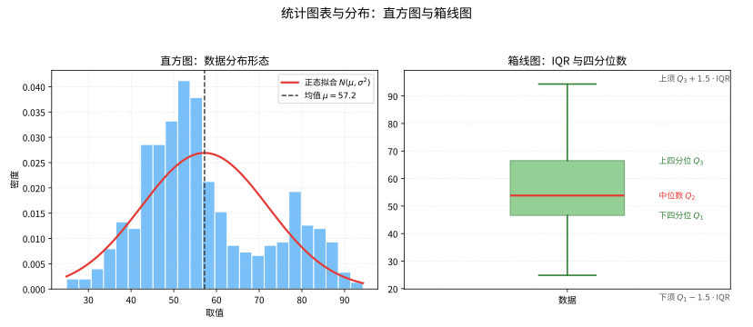

> **直观理解（现实类比）**：直方图像"把一整筐鸡蛋按大小分堆摆好"，一眼看出多数鸡蛋集中在哪个大小、有没有两头少见的"怪蛋"。箱线图则像"给全班成绩排队后画成一幅简图"：箱体告诉你中间一半人的分数落在哪个区间，两条须线说明正常范围，而冒出须线的小点就是必须核查的"异常分数"。

> **常见坑**：**相关 ≠ 因果**。EDA 里发现"冰淇淋销量与溺水人数高度正相关"——可驱动力是炎热的天气，不是冰淇淋本身。看到强相关性，只能说明"两者一起变化"，绝不等于"改变一个就能改变另一个"。做任何因果宣称前，需要实验设计（随机对照）或专门的因果推断模型，而不是一张散点图就拍板。

#### 课堂问答

**老师**：EDA 里最容易犯的错是什么？

**学生**：把相关当因果。Pearson 系数 $\rho=\dfrac{\operatorname{Cov}(X,Y)}{\sigma_X\sigma_Y}$ 只测线性共变，$\rho$ 大只说明两者一起动。冰淇淋销量与溺水人数正相关，真凶是"气温"，两者都是它的下游共同结果——这叫混杂。想主张因果，得靠随机对照实验或因果推断模型，一张散点图不够。

**老师（追问）**：那你为何还要算相关？Pearson 和 Spearman 你怎么选？

**学生**：因为相关仍是"该不该进一步建模"的廉价探针，能快速筛掉明显无关的变量。选法看关系形状：Pearson 抓线性关系，对离群值和单调非线性都无能为力；Spearman 先换成秩再算相关，$\rho_s=1-\dfrac{6\sum d_i^2}{n(n^2-1)}$，只要单调（哪怕非线性）就能测出来，且对离群值稳健。所以分布厚尾或关系疑似单调非线性时，先看 Spearman。

**老师（拓展）**：偏度、峰度这两个描述统计，对你判断"要不要做对数变换"有什么用？

**学生**：判断很直接。偏度 $=\mathbb{E}\left[\left(\dfrac{X-\mu}{\sigma}\right)^3\right]$，正偏（右尾长，如收入、点击量）时均值被少数大值拉高，此时取对数 $\log x$ 能把乘性结构变加性、把右尾压直，常让分布近乎对称。峰度刻画尾部厚薄与尖峰，峰度高意味着离群更常见，提示你慎用依赖正态假设的方法。一句话：先把形状看清，再决定煲不煲那锅"对数汤"。

### 2.3 统计建模

**统计建模**将数据生成过程抽象为数学形式。给定数据 $\{(x_i, y_i)\}_{i=1}^n$，目标是学习 $y = f(x) + \varepsilon$，其中 $\varepsilon$ 为噪声项。

**偏差-方差权衡**（Bias-Variance Tradeoff）：

$$
\mathbb{E}[(y - \hat{f}(x))^2] = \underbrace{(\mathbb{E}[\hat{f}(x)] - f(x))^2}_{\text{Bias}^2} + \underbrace{\mathbb{E}[(\hat{f}(x) - \mathbb{E}[\hat{f}(x)])^2]}_{\text{Variance}} + \underbrace{\sigma^2}_{\text{Irreducible Error}}
$$

> **💡 直观理解（类比）**：把预测模型比作射箭。**偏差**是箭总是系统性偏离靶心固定的距离（模型太简单、总打偏）；**方差**是箭落点忽左忽右散乱无章（模型太复杂、太敏感）；**不可约误差**则是风吹箭动——无论手多稳都消除不掉的随机扰动。射箭总失误 = 稳定准头（偏差）+ 收敛落点（方差）+ 天注定（噪声），三者相加决定最后的命中精度。

#### 课堂问答

**老师**：把偏差-方差分解写清楚，并告诉我它最反直觉的结论。

**学生**：对 $y=f(x)+\varepsilon$、$\mathbb{E}[\varepsilon]=0$、$\operatorname{Var}(\varepsilon)=\sigma^2$，有

$$\mathbb{E}[(y-\hat f(x))^2]=\underbrace{(\mathbb{E}[\hat f(x)]-f(x))^2}_{\text{Bias}^2}+\underbrace{\mathbb{E}[(\hat f(x)-\mathbb{E}\hat f(x))^2]}_{\text{Variance}}+\underbrace{\sigma^2}_{\text{Irreducible}}$$

最反直觉的是：期望误差不是"训练误差"，它同时受两个方向相反的力牵制。模型越复杂，偏差降、方差升，总误差是条 U 形曲线，在中间某处最小——所以"训练得越好"不等于"预测得越好"。

**老师（追问）**：$\sigma^2$ 那一项为什么叫不可约误差？它真的动不了吗？

**学生**：动不了，因为它是数据生成过程本身注入的噪声，跟你选什么模型无关。哪怕你取 $\hat f=f$（完美命中真函数），误差仍停在 $\sigma^2$，这是下界。它提醒我们：泛化误差的地板由问题本身决定，建模只能在 $\text{Bias}^2+\text{Variance}$ 这两块里做文章——想压低它，只能换数据（减噪、增特征），不能靠更聪明的模型。

**老师（拓展）**：那实际中怎么用这条曲线做决策？

**学生**：用它指导"复杂度调节"。看到验证误差先降后升，就说明已经越过 U 形最低点进入过拟合区，应往回退：减层数、加正则化 $\lambda\|\boldsymbol{w}\|^2$、早停或增数据。反过来若训练误差和验证误差都高且贴近，就是欠拟合，得加容量。核心动作始终是"盯着验证误差这条 U 形曲线的谷底走"，而不是盯训练误差。

### 2.4 特征选择

**特征选择**（Feature Selection）从原始特征集中选择最具信息量的子集。

**方法**：
1. **过滤法**（Filter）：基于统计指标（卡方检验、互信息、方差分析）
2. **包裹法**（Wrapper）：使用搜索策略（向前选择、向后消除、递归特征消除）
3. **嵌入法**（Embedded）：Lasso（$L_1$ 正则化）、树模型的重要性

> **💡 直观理解（类比）**：特征选择像"整理行李箱"——容量有限，聪明的做法不是把每件衣服都塞进去，而是挑出上车使用率最高的必需品。过滤法像先按"单件衣服是否值钱"粗筛；包裹法像"实际试穿走一段路再决定带不带"（直接看最终效果好坏）；嵌入法则像"装箱时随装随把鸡肋扔出去"。删掉无关特征，既省算力，结果还更清爽可靠。

#### 课堂问答

**老师**：过滤法、包裹法、嵌入法三者的本质差别是什么？

**学生**：差别在"用什么标准、在什么时候选"。过滤法在建模前独立打分，如卡方、互信息 $I(X;Y)=\sum p(x,y)\log\frac{p(x,y)}{p(x)p(y)}$，快但与具体模型的交互脱钩，可能删掉"单看弱、组合强"的特征。包裹法直接以模型最终验证分数为目标做搜索（前向选择、RFE），最贴近目标但计算最贵、易过拟合。嵌入法则在训练中顺带完成，如 Lasso 的 $\lambda\|\boldsymbol{w}\|_1$ 会把无用的 $w_j$ 压到零。

**老师（追问）**：为什么 $L_1$ 能把权重压成精确的零，而 $L_2$ 只能让它们变小？

**学生**：几何。$L_1$ 的约束集 $\|\boldsymbol{w}\|_1\le t$ 是个有尖角的菱形，等值线椭球最先碰到的往往是菱形顶点——顶点处部分坐标恰为零，于是稀疏。$L_2$ 约束集 $\|\boldsymbol{w}\|_2\le t$ 是光滑的圆，切点一般在弧上，各坐标只是被整体缩小、极少恰好为零。差别的根在"约束集的角"，不在惩罚大小。

**老师（拓展）**：那特征选择和特征工程是一回事吗？

**学生**：不是，方向相反。特征选择是"做减法"——从已有集合里挑子集，信息量不增只减；特征工程是"做加法"——凭空造出新特征（$x_1x_2$、分箱、时间派生），可能引入原始特征里根本没有的信息。实践顺序通常是先工程"造料"、再选择"精选"，两者叠加才对性能上限有实质提升。

### 2.5 特征工程

**特征工程**（Feature Engineering）通过领域知识创建新特征以提升模型性能。

**常见技术**：
- **多项式特征**：$x_1, x_2 \to x_1, x_2, x_1^2, x_2^2, x_1x_2$
- **交互特征**：$x_1 \times x_2$
- **分箱**（Binning）：连续变量离散化
- **时间特征**：提取年、月、日、星期等
- **文本特征**：TF-IDF、词嵌入

> **直观理解（现实类比）**：特征工程像"从矿石中提炼金属"——原始数据是含杂质的矿石，模型是炼炉，但真正决定产出的是"喂进去什么"。把 $x_1, x_2$ 组合成 $x_1x_2$、从时间戳里拆出"是否周末"、把文本变成 TF-IDF，都是在提炼最有信息量的精华。好的特征往往比更复杂的模型更能提升效果，正所谓"特征决定上限，模型逼近上限"。

#### 课堂问答

**老师**：为什么说"特征决定上限，模型逼近上限"？

**学生**：因为模型只能在你给的坐标里找函数。若真正的关系是 $y=x_1x_2$，而输入只有 $x_1,x_2$，线性模型永远学不到；一旦补上交互项 $x_1x_2$，同一条直线立刻就能拟合。特征工程做的就是"把藏在原始坐标之外的结构显式搬进来"——多项式、交互、分箱、TF-IDF，本质都是给模型换一套更能直视规律的坐标系，所以它抬高的是可达精度的天花板，模型只负责逼近它。

**老师（追问）**：分箱把连续变量离散化，明明丢了信息，为什么有时反而变强？

**学生**：因为它把"形状的灵活性"换了进来。原始 $x$ 进线性模型只能贡献固定斜率；分成若干箱后每箱可有独立系数，等于允许任意阶梯形的非线性响应，同时把离群值、噪声压在箱内。理论上损失了箱内的分辨率，实践上却更稳健、更抗过拟合——这正是"灵活性与信息量的权衡"，和偏差-方差是一回事。

**老师（拓展）**：TF-IDF 里为什么要同时乘 TF 和 IDF？

**学生**：因为一个词的价值由"在本篇多不多"和"在全体稀不稀"共同决定。设词 $t$ 在文档 $d$ 出现频率 $\text{tf}(t,d)$、在 $N$ 篇中出现在 $\text{df}(t)$ 篇，则 $\text{idf}(t)=\log\frac{N}{\text{df}(t)}$。只乘 TF，会把"的、是"这类高频虚词捧成关键词；乘上 IDF 后，虚词因 df 接近 $N$ 而权重趋零，罕见却专指的词被抬高。它是"用全局稀有度给局部频率重新定权"。

### 2.6 降维

**降维**（Dimensionality Reduction）将高维数据映射到低维空间，同时保留数据的核心结构。

> **直观理解（现实类比）**：降维像"压缩照片"——一张千万像素的照片存成 JPEG 后只占零头大小，却依然能看清人脸和风景，因为它丢掉的是人眼几乎察觉不到的冗余高频细节。PCA 正是在数据中找"最佳投影角度"，沿方差最大（信息最丰富）的方向压扁，把次要方向当冗余丢掉。维度降了，计算快了，噪声也顺带滤掉，但主干信息得以保留。

#### 2.6.1 PCA（主成分分析）

PCA 寻找数据方差最大的方向，将数据投影到这些方向上。

给定中心化数据矩阵 $\boldsymbol{X} \in \mathbb{R}^{n \times p}$，PCA 求解：

$$
\max_{\|\boldsymbol{w}\| = 1} \boldsymbol{w}^\top \boldsymbol{X}^\top \boldsymbol{X} \boldsymbol{w}
$$

解为 $\boldsymbol{X}^\top \boldsymbol{X}$ 的前 $k$ 个最大特征值对应的特征向量。

PCA 将高维数据投影到方差最大的主成分方向上，实现降维与可视化：

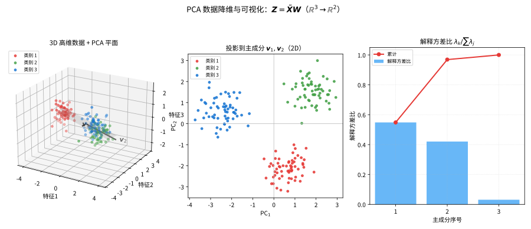

> **直观理解（现实类比）**：PCA 就像给一个"装在玻璃盒里的立体模型"拍快照。你找到一个最能看出差别（方差最大）的角度把它拍下来，再用第二个正交角度补拍，得到几张 2D 照片就足以分辨原来的立体结构。照片张数远比原始维度少，却保留了最重要的信息——这正是从 784 维手写数字压缩到 2 维仍能看清类别的原理。

#### 2.6.2 SVD（奇异值分解）

SVD 将矩阵分解为 $\boldsymbol{X} = \boldsymbol{U}\boldsymbol{\Sigma}\boldsymbol{V}^\top$，其中 $\boldsymbol{U} \in \mathbb{R}^{n \times n}$、$\boldsymbol{V} \in \mathbb{R}^{p \times p}$ 为正交矩阵，$\boldsymbol{\Sigma} \in \mathbb{R}^{n \times p}$ 为对角矩阵。

> **💡 直观理解（类比）**：SVD 像"把一张彩色照片拆成亮度、色调、饱和度三张独立底片"：先旋转到标准方向（$\boldsymbol{U}$），再按各方向的"主导强度"缩放（$\boldsymbol{\Sigma}$），最后旋转回目标姿态（$\boldsymbol{V}^\top$）。若只保留 $\boldsymbol{\Sigma}$ 里最大的几个奇异值，就能用极小的代价近似整张图——这正是压缩与降维的本质。

#### 2.6.3 t-SNE

t-SNE（t-distributed Stochastic Neighbor Embedding）是一种非线性降维方法，特别适合可视化。它最小化高维空间与低维空间中概率分布的 KL 散度。

> **💡 直观理解（类比）**：t-SNE 像"给一堆乱堆的珠子重新排队，规定认识的朋友必须挨在一起"。它在高维里数清每对点有多亲近（概率），再到低维把人摆得尽量维持这份亲近关系，为此宁可牺牲精确距离，也要保住"谁跟谁是一伙"。所以它能把弯弯曲曲的非线性簇展开成清晰团块，特别适合看局部聚类。

#### 2.6.4 UMAP

UMAP（Uniform Manifold Approximation and Projection）基于黎曼几何与拓扑数据分析，比 t-SNE 更快且能更好地保留全局结构。

> **💡 直观理解（类比）**：UMAP 像一位"既认路又认人"的向导——它先假设数据其实躺在一张高低起伏的流形膜上（黎曼几何视角），再同时做到"近邻保住、远邻大致不错位"。相比 t-SNE 只死磕局部，UMAP 连整体布局也尽量不乱，所以跑得快、局部分得清、全局也不离谱，像一张既准确又清晰的折叠地图。

#### 课堂问答

**老师**：PCA、SVD、t-SNE、UMAP，你到底该在什么时候用哪个？

**学生**：先分两类。PCA 与 SVD 是线性、全局方法，做降维与压缩时用：PCA 解 $\max_{\|\boldsymbol{w}\|=1}\boldsymbol{w}^\top\boldsymbol{X}^\top\boldsymbol{X}\boldsymbol{w}$，取协方差矩阵前 $k$ 个特征向量；SVD 把它一般化为 $\boldsymbol{X}=\boldsymbol{U}\boldsymbol{\Sigma}\boldsymbol{V}^\top$，不必显式构造协方差矩阵，数值更稳，主成分就是 $\boldsymbol{V}$ 的前几列。t-SNE、UMAP 是非线性、以可视化为目的：为了画出清晰团块，宁可扭曲全局距离，所以别拿它们的轴或簇间距离下定量结论。

**老师（追问）**：t-SNE 和 UMAP 又差在哪？

**学生**：差在"要不要管全局"。t-SNE 在高维用高斯、低维用 t 分布建相似度，最小化两者 KL 散度 $\text{KL}(P\|Q)=\sum p_{ij}\log\frac{p_{ij}}{q_{ij}}$，只死磕局部邻域，故簇内分得清但簇间距离无意义、且不稳定。UMAP 假设数据落在黎曼流形上，同时兼顾近邻与远邻，跑得更快、全局布局更连贯。结论：只要局部团块用 t-SNE，想兼顾整体结构用 UMAP。

**老师（拓展）**：那"降维"到底是丢信息还是保信息？

**学生**：它是"有原则地丢"。PCA 丢掉的是方差最小的方向，即在平方误差意义下最不重要的方向——数学上第 $k$ 个特征值 $\lambda_k$ 恰好等于该方向被丢弃的信息量，所以保留前 $k$ 个主成分就是"删掉代价最小的那些方向"，是最优压缩。但"方差小=不重要"本身是个假设：若某个判别方向恰好低方差（靠细微差异区分类别），PCA 会把它一起扔掉，这时应改用有监督的 LDA（最大化类间与类内方差之比）。

### 2.7 聚类

**聚类**（Clustering）将数据分成若干组，使得组内数据相似度高、组间相似度低。

> **💡 直观理解（类比）**：聚类像"把一屋子人自动分成若干朋友圈"：规则只有一条——一个圈子内部的人彼此熟络（相似度高），而不同圈子之间少有交集（相似度低）。它不需要标签，属于"无人监督地自然分堆"，相当于只看聊天密度就把全场自然围成几桌。

#### 2.7.1 K-means

K-means 将数据划分为 $K$ 个簇，最小化簇内平方和：

$$
\min_{\{C_1,\dots,C_K\}} \sum_{k=1}^K \sum_{x_i \in C_k} \|x_i - \mu_k\|^2
$$

其中 $\mu_k$ 为第 $k$ 个簇的中心。

> **💡 直观理解（类比）**：K-means 像"几个人反复把一箱球往最近的几个镖盘中心归堆"：先随便插 $K$ 面旗当中心，把每颗球归到最近的旗，再把每堆球的几何中心重插旗，如此"先归属、后移旗"来回倒直到旗不动。它简单高效，但结局好坏很看旗子初始插在哪儿，容易停在"半好不坏"的局部最优。

#### 2.7.2 DBSCAN

DBSCAN（Density-Based Spatial Clustering of Applications with Noise）基于密度进行聚类，不需要预先指定簇数，能识别任意形状的簇和噪声点。

**核心概念**：
- **$\varepsilon$-邻域**：$N_\varepsilon(p) = \{q \in D \mid \text{dist}(p,q) \le \varepsilon\}$
- **核心点**：$|N_\varepsilon(p)| \ge \text{MinPts}$
- **边界点**：非核心点但属于某个核心点的邻域
- **噪声点**：既非核心点也非边界点

> **💡 直观理解（类比）**：DBSCAN 像"识别人群中自然形成的小团伙"：只要在肉眼距离（$\varepsilon$）内能碰见足够多的同伴（MinPts），就结成团伙并向四周"传染"；紧贴团伙边缘的算边界点，孤零零晃荡的算噪声。它不用预先定好"要有几帮人"，也不怕打出弯弯曲曲、奇形怪状的帮派边界，还能把散兵游勇单独剔出来。

#### 2.7.3 层次聚类

**层次聚类**（Hierarchical Clustering）通过构建树状结构（树状图）来组织数据。

- **凝聚式**（Agglomerative）：自底向上，每个点起始为一个簇，逐层合并
- **分裂式**（Divisive）：自顶向下，所有点起始为一个簇，逐层分裂

**链接准则**：单链接（最小距离）、全链接（最大距离）、平均链接、Ward 法（最小化方差增加）

> **💡 直观理解（类比）**：层次聚类像"从下往上拼家谱"或"从上往下拆分部落"。凝聚式先把每个点当成孤家寡人，把最像的两家先并成一家，再一层层往上合并成大树；分裂式反之，从整族开始一刀刀劈开。最终得到的树状图就是一张"亲疏关系谱"，随时可据它挑出任一层级来分组。

#### 课堂问答

**老师**：K-means 和 DBSCAN 的适用边界，用一句话分开。

**学生**：K-means 假设簇是"又圆又等大"的凸团，且必须预先给定 $K$，它最小化 $\sum_k\sum_{x_i\in C_k}\|x_i-\mu_k\|^2$；DBSCAN 假设簇是"密度连通"的，靠 $\varepsilon$-邻域与 $\text{MinPts}$ 生长，不需要 $K$、能出任意形状、还能把孤立点标为噪声。所以：簇近似球形且要速度快，用 K-means；形状古怪、含噪声、$K$ 未知，用 DBSCAN。

**老师（追问）**：为什么 K-means 只保证收敛到局部最优，怎么缓解？

**学生**：因为目标 $J$ 非凸，它的收敛只是"分配-更新"交替下 $J$ 单调不增、又在有限种划分里取值，所以必然停住——停住的点是局部最优，落在哪个谷底取决于初始中心。缓解手段就是优化起点：K-means++ 按距离平方正比抽样撒初始中心，让它们尽量分散；或多次随机初始化取 $J$ 最小者。本质都是"多撒几次、挑最深的谷"。

**老师（拓展）**：层次聚类的链接准则里，为什么 Ward 法常被推荐？

**学生**：因为它直接对齐 K-means 的目标。单链接看最小距离，容易把两个真簇用一条细桥连起来（链式效应）；全链接看最大距离，又对噪声与形状敏感。Ward 法合并时选"使簇内平方和增量最小"的一对，即最小化 $\Delta=\dfrac{|A||B|}{|A|+|B|}\|\bar{x}_A-\bar{x}_B\|^2$，正好是 K-means 目标在多一层合并上的增量，所以得到的树状图与 K-means 的划分最一致、簇也最紧凑。

### 2.8 分类

#### 2.8.1 逻辑回归

**逻辑回归**（Logistic Regression）用于二分类问题，输出属于类别 1 的概率：

$$
P(y = 1 \mid x) = \sigma(\boldsymbol{w}^\top \boldsymbol{x} + b) = \frac{1}{1 + e^{-(\boldsymbol{w}^\top \boldsymbol{x} + b)}}
$$

损失函数为交叉熵损失（负对数似然）：

$$
\mathcal{L}(\boldsymbol{w}) = -\sum_{i=1}^n [y_i \log \hat{y}_i + (1 - y_i) \log(1 - \hat{y}_i)]
$$

> **💡 直观理解（类比）**：逻辑回归像"用一根可滑动的红线在数轴上给两类点划界"。它不直接说"这是正还是负"，而是把加权得分压进 S 形的 Sigmoid 函数，输出"属于正类的概率"。离红线远的样本几乎笃定一边，贴近红线则含糊不定——这种"概率式表态"天然给出置信度，也带来了凸损失等优良性质。

#### 2.8.2 决策树

**决策树**（Decision Tree）通过递归划分特征空间构建树状结构。划分准则包括：

- **信息增益**（ID3）：$\text{Gain}(D, A) = H(D) - H(D \mid A)$
- **信息增益率**（C4.5）：$\text{GainRatio}(D, A) = \dfrac{\text{Gain}(D, A)}{\text{IV}(A)}$
- **Gini 系数**（CART）：$\text{Gini}(D) = 1 - \sum_{k=1}^K p_k^2$

#### 2.8.3 随机森林

**随机森林**（Random Forest）通过 Bagging 集成多个决策树：

1. 对训练数据进行 Bootstrap 采样
2. 在每个节点分裂时随机选择特征子集
3. 投票（分类）或平均（回归）得到最终结果

> **💡 直观理解（类比）**：随机森林像"请一大群各自情况不同的村民集体诊断"：每个人（决策树）用自带的抽签样本和随机挑的几项指标做出判断，最后由多数投票定案。个体都各有偏，但只要错误彼此不相干，投票就能把错误噪声相互抵消、把正确信号凸显出来——这正是"臭皮匠要'各自独立'才顶得上诸葛亮"的关键。

#### 2.8.4 SVM（支持向量机）

**SVM** 寻找最大间隔分离超平面。对线性可分数据：

$$
\min_{\boldsymbol{w},b} \frac{1}{2}\|\boldsymbol{w}\|^2 \quad \text{s.t.} \quad y_i(\langle \boldsymbol{w}, \boldsymbol{x}_i \rangle + b) \ge 1
$$

通过核技巧（RBF 核、多项式核）处理非线性问题。

#### 2.8.5 XGBoost

**XGBoost**（eXtreme Gradient Boosting）是一种基于梯度提升框架的集成学习算法。它在每一步迭代中拟合前一步的残差：

$$
F_t(x) = F_{t-1}(x) + \eta \cdot f_t(x)
$$

其中 $f_t$ 是使目标函数下降最快的基学习器，$\eta$ 为学习率。

> **💡 直观理解（类比）**：XGBoost 像"团队逐轮改错补课"：第一轮先各自开处方，第二轮专抓上一轮没治好的病人重点补课（拟合残差），再错再补，越补越准，每轮只补一小步（学习率 $\eta$）。同一拨病人被一个个医生接棒精修，能把最难啃的角落也啃下来，所以它特别强势，但也得靠正则化和小步慢走防止补课补过头。

#### 课堂问答

**老师**：逻辑回归的损失为什么不是平方误差，而是交叉熵？

**学生**：因为要从概率出发做最大似然。模型 $P(y=1\mid x)=\sigma(\boldsymbol{w}^\top\boldsymbol{x})$，样本的对数似然是 $y\log\hat y+(1-y)\log(1-\hat y)$，取负号就是交叉熵 $\mathcal{L}=-\sum_i[y_i\log\hat y_i+(1-y_i)\log(1-\hat y_i)]$。它天然对应"概率预测的似然"，且对 $\boldsymbol{w}$ 是凸的，梯度 $\sum_i(\hat y_i-y_i)x_i$ 简洁，故优化稳、有全局最优。若硬用平方误差配 Sigmoid，会得到非凸目标、梯度还带 $\sigma'$ 饱和项，训练反而更糟。

**老师（追问）**：决策树用信息增益、增益率、Gini，有什么区别？

**学生**：都是"选哪个特征来劈"的打分，差别在偏袒谁。信息增益 $\text{Gain}=H(D)-H(D\mid A)$ 偏爱取值多的特征（如身份证号能把每样本分到一叶，增益虚高），C4.5 除以固有值 $\text{IV}(A)$ 得增益率来纠偏；CART 用 Gini $\text{Gini}=1-\sum_k p_k^2$，它只需平方、比熵里的 $\log$ 便宜，且形状与熵相近。三者选出的树往往接近，但增益必须防"多取值特征作弊"。

**老师（拓展）**：SVM 的最大间隔和随机森林的投票，分别在对抗什么问题？

**学生**：抗的是泛化误差的两个不同来源。SVM 解 $\min\frac12\|\boldsymbol{w}\|^2$，约束 $y_i(\langle\boldsymbol{w},x_i\rangle+b)\ge1$，最大化间隔，控制的是假设空间的复杂度与稳定性，本质在压方差、给出好的泛化界，软间隔则用 $\xi_i$ 容忍个别越界点。随机森林靠 Bootstrap 采样加特征随机，让多棵树去相关再投票，同样是在压方差——只是路径不同。两者都指向同一句话：好的泛化来自"不过度依赖训练集的偶然细节"。

### 2.9 回归

**回归**（Regression）预测连续值输出。常见方法包括线性回归、岭回归、Lasso 回归、回归树、随机森林回归、XGBoost 回归等。

> **💡 直观理解（类比）**：回归像"凭多年房价历史画一条趋势线来估新房价格"。它输出的不是某个类别，而是连续数值——仿佛把一堆散点浓缩成一条随时可查的趋势曲线。线性/岭/Lasso 是不同画法：有的只画直线，有的给直线加约束别太陡（防过拟合），有的干脆把无关因素剔掉（稀疏）。

#### 课堂问答

**老师**：岭回归和 Lasso 都在给线性回归加惩罚，为什么一个只缩不放、一个能选特征？

**学生**：看惩罚的形状。OLS 解 $\hat{\boldsymbol{w}}=(\boldsymbol{X}^\top\boldsymbol{X})^{-1}\boldsymbol{X}^\top\boldsymbol{y}$ 在特征共线时 $\boldsymbol{X}^\top\boldsymbol{X}$ 近奇异，解爆炸、方差极大。岭加 $\lambda\|\boldsymbol{w}\|_2^2$ 后变成 $(\boldsymbol{X}^\top\boldsymbol{X}+\lambda I)^{-1}\boldsymbol{X}^\top\boldsymbol{y}$，$\lambda I$ 把矩阵拉回可逆、把权重整体平滑缩小，所以只缩不删。Lasso 加 $\lambda\|\boldsymbol{w}\|_1$，其约束集是有尖角的菱形，最优解常落在顶点上，于是部分系数精确为零，自带特征选择。

**老师（追问）**：那为什么不用 Lasso 通吃？

**学生**：因为它不稳定且不唯一。当特征高度相关时，$L_1$ 会在"几个同样好的特征"中随机只留一个、把其余清零，选择结果对微小扰动很敏感；而且当 $p>n$（特征数超过样本数）时，$L_1$ 最多选出 $n$ 个非零系数，无法全选。岭则会把相关特征整组等比例保留，更稳。折中是 Elastic Net $\lambda_1\|\boldsymbol{w}\|_1+\lambda_2\|\boldsymbol{w}\|_2^2$，既稀疏又保住"相关成组"。

**老师（拓展）**：正则化的 $\lambda$ 怎么理解才不算玄学？

**学生**：把它看成"你对先验有多自信"。岭回归等价于给权重加了高斯先验 $\boldsymbol{w}\sim N(0,\tau^2 I)$，$\lambda$ 与先验方差成反比：$\lambda$ 越大，越笃定权重该小、约束越强，偏差升而方差降。所以调 $\lambda$ 不是试魔法，而是在偏差-方差曲线上找谷底——$\lambda\to0$ 退回 OLS（高方差），$\lambda\to\infty$ 把权重全压到零（高偏差），最优在中间，用交叉验证选。

### 2.10 集成方法

**集成方法**（Ensemble Methods）通过组合多个基学习器来提升性能。

- **Bagging**：并行训练多个基学习器（如随机森林），降低方差
- **Boosting**：串行训练，每个新模型纠正前一个的错误（如 AdaBoost、XGBoost、LightGBM）
- **Stacking**：用元学习器组合多个基学习器的预测结果

> **💡 直观理解（类比）**：集成方法像"集多人之力、扬长避短"。Bagging 是让一批模型各练各的（并行），靠平均/投票压住各自的抖动，专治"太敏感"（降方差）；Boosting 是让模型排队、后一个专改前一个的错（串行），把"偏"的地方越纠越准（降偏差）；Stacking 则请一位"总调度"综合各位专家的意见。三招本质上都是"三个臭皮匠顶个诸葛亮"。

#### 课堂问答

**老师**：Bagging 和 Boosting，一个降方差一个降偏差，凭什么？

**学生**：因为组合方式不同。Bagging 并行训练多个近似独立、各自高方差低偏差的学习器（如深树），再平均或投票，平均把独立误差相互抵消，方差按 $\frac{1}{M}$ 量级下降，偏差基本不变。Boosting 串行地把每个新模型拟合前面的残差，逐步补上单个弱学习器（高偏差）没抓住的结构，等于在持续降低偏差。所以 Bagging 治"太敏感"，Boosting 治"学不够"。

**老师（追问）**：随机森林在 Bagging 之上又加了一步，为什么要"随机选特征"？

**学生**：为了压相关度。泛化误差界 $\text{PE}\le\frac{\bar\rho(1-s^2)}{s^2}$ 里，$\bar\rho$ 是树间相关度、$s$ 是单棵强度。若每棵树都在同一批最强特征上分裂，它们会高度相关，平均也抵不掉共同的错误，$\bar\rho$ 大就抬高上界。每个节点只从随机特征子集里挑最优分裂，强行让树"各看各的角度"，降低 $\bar\rho$，于是同样的强度下误差更小——这就是"降相关"的价值。

**老师（拓展）**：Stacking 和前两者最根本的不同点？

**学生**：学习"怎么组合"这件事本身。Bagging 用等权平均、Boosting 用固定加法，组合规则是人为指定的；Stacking 额外训练一个元学习器，把基模型的输出当新特征，用数据去学最优融合权重（还可包含原始特征）。代价是要多一层交叉验证来生成"未见过"的元特征，否则会泄漏。一句话：Bagging 与 Boosting 是"给好的意见投固定票"，Stacking 是"再训练一个人来决定该听谁的"。

### 2.11 模型评估

#### 2.11.1 交叉验证

**交叉验证**（Cross-Validation）将数据划分为 $K$ 折，轮流用 $K-1$ 折训练、1 折验证。

- **K 折交叉验证**：最常用，$K = 5$ 或 $10$
- **留一交叉验证**（LOOCV）：$K = n$
- **分层交叉验证**：保持各类别比例

> **💡 直观理解（类比）**：交叉验证像"让选手分批换岗、轮番当裁判"。把数据切成 $K$ 份，每次让其中 $K-1$ 份当"考生"训练、剩下一份当"考官"验收，轮 $K$ 次让每一份都当过考官，最后取平均分。这样每个样本都既被学过又被考过，得出的结论比"只考一次"更可靠，也能看出模型会不会只是"把旧题背熟"。

#### 2.11.2 AUC-ROC

**ROC 曲线**（Receiver Operating Characteristic Curve）绘制不同阈值下的真正率（TPR）与假正率（FPR）：

$$
\text{TPR} = \frac{\text{TP}}{\text{TP} + \text{FN}}, \quad \text{FPR} = \frac{\text{FP}}{\text{FP} + \text{TN}}
$$

**AUC**（Area Under the ROC Curve）衡量分类器整体性能，AUC = 1 为完美分类器，AUC = 0.5 为随机猜测。

> **💡 直观理解（类比）**：ROC 曲线像"工厂质检员的松紧旋钮"——转动判"正"的阈值松紧，就能在"多抓出真病号（TPR↑）"与"多冤枉好人（FPR↑）"之间取舍，把不同松紧的结果连成一条曲线。AUC 则是这条曲线下方的面积：面积越大说明"不管旋钮扭到哪都既抓得准又误伤少"，而面积 0.5 就等同于"全靠瞎蒙"。

#### 2.11.3 混淆矩阵

**混淆矩阵**（Confusion Matrix）汇总分类结果：

|  | 预测为正类 | 预测为负类 |
|:-:|:-:|:-:|
| **实际为正类** | TP（真正例） | FN（假负例） |
| **实际为负类** | FP（假正例） | TN（真负例） |

**衍生指标**：
- **准确率**：$\text{Accuracy} = \dfrac{\text{TP} + \text{TN}}{\text{TP} + \text{TN} + \text{FP} + \text{FN}}$
- **精确率**：$\text{Precision} = \dfrac{\text{TP}}{\text{TP} + \text{FP}}$
- **召回率**：$\text{Recall} = \dfrac{\text{TP}}{\text{TP} + \text{FN}}$
- **F1 分数**：$\text{F1} = 2 \cdot \dfrac{\text{Precision} \cdot \text{Recall}}{\text{Precision} + \text{Recall}}$

> **💡 直观理解（类比）**：混淆矩阵像"一张对账小抄"，把"事实真相"和"模型判断"两两核对：说中有（TP）、说中没（TN）是答对；漏报有（FN，明明有病却说来没病）、冤枉有（FP，明明是没事却说有事）是答错。四格填上数量，就能一眼算出准头、精确率、召回率等指标，看清模型具体在哪种错上栽跟头。

#### 课堂问答

**老师**：为什么一定要交叉验证，单个验证集不够吗？

**学生**：单个留出法有两个病：一是只测了一次，估计方差大，换一批切分分数就跳；二是训练用的数据比全量少，估计偏悲观且浪费数据。$K$ 折交叉验证让每个样本都轮流当过验证集，得到 $K$ 个误差取平均，估计更稳、更省数据，取 $K=5$ 或 $K=10$ 是偏差与计算量的常用折中。类别不平衡时还要用分层折，保证每折的类别比例与全体一致。

**老师（追问）**：AUC 到底在度量什么？为什么说它和阈值无关？

**学生**：它在度量"排序能力"。把正负样本两两配对，AUC 等于"随机取一个正例、其得分高于一个随机负例"的概率，即 $\text{AUC}=P(\hat s(x^+)>\hat s(x^-))$。所以它衡量的是分类器把正例排在负例前面的能力，完全不依赖你最后把阈值切在哪——转动阈值只改变 ROC 上的点，而曲线下的面积不动。AUC 也可由真正率 $\frac{\text{TP}}{\text{TP}+\text{FN}}$ 对假正率 $\frac{\text{FP}}{\text{FP}+\text{TN}}$ 的积分得到。

**老师（拓展）**：既然 AUC 这么全，为什么还要看精确率和召回率？

**学生**：因为 AUC 对"概率校准"和"具体业务代价"都不敏感。它只看排序，一个把得分压成极端值的模型可以 AUC 很高却概率不可信；而且它是全阈值平均，可现实中你只能用某个具体阈值。当正例稀少时，即便 AUC 不错，选定阈值下的 $\text{Precision}=\frac{\text{TP}}{\text{TP}+\text{FP}}$ 仍可能很低。所以要么按业务代价挑阈值看 P、R、$F_1$，要么用 PR 曲线——类极不平衡时，PR 比 ROC 更能暴露问题。

### 2.12 过拟合与正则化

**过拟合**（Overfitting）指模型在训练数据上表现极好但在新数据上表现差，原因是模型过于复杂，学到了噪声而非信号。

**正则化**（Regularization）通过在损失函数中加入惩罚项来抑制过拟合：

- **$L_2$ 正则化**（Ridge）：$\Omega(\boldsymbol{w}) = \lambda \|\boldsymbol{w}\|_2^2$
- **$L_1$ 正则化**（Lasso）：$\Omega(\boldsymbol{w}) = \lambda \|\boldsymbol{w}\|_1$
- **Elastic Net**：$\Omega(\boldsymbol{w}) = \lambda_1 \|\boldsymbol{w}\|_1 + \lambda_2 \|\boldsymbol{w}\|_2^2$
- **Dropout**（神经网络）：训练时随机丢弃部分神经元

> **直观理解（现实类比）**：过拟合像"死记硬背"——学生把往年试题连标点都背下来，平时测验满分，可考试题稍一变化就抓瞎，因为他学的是"题目"而非"规律"。正则化则像"强迫简单"——给模型套上枷锁（权重惩罚），不许它把每个细节都死记，逼它去抓普遍规律。$L_2$ 让权重整体变小（平滑），$L_1$ 直接把不重要特征的权重压到零（稀疏），都是在用"简单"换"泛化"。

> **常见坑**：三类最常见的"自欺"。一是**数据泄漏（data leakage）**：在切分训练/测试之前就做了标准化、缺失填充或特征选择，把测试集的信息"偷"进了训练——于是验证分数虚高，上线即崩；正确做法是只基于训练集拟合预处理参数再应用到测试集。二是**用测试集反复调超参**：测试集本是"考卷"，用它调参等于开卷考试，到最后测试误差早已失真，应当另留验证集（或嵌套交叉验证）来调参。三是**类别不平衡下只看准确率**：99% 都是负例时，"全判负"也能有 99% 准确率却毫无用处——必须看精确率/召回率、F1 或 AUC，而不是被漂亮的 Accuracy 骗到。

#### 课堂问答

**老师**：用偏差-方差的语言，说清"过拟合"和"欠拟合"的区别。

**学生**：过拟合是方差主导——模型容量太大，连训练集里的噪声 $\varepsilon$ 都拟合了，训练误差极低但验证误差高，两个误差之间出现明显 Gap。欠拟合是偏差主导——模型太简单，训练、验证误差都高且贴近，连信号都没抓住。诊断看的就是这条 Gap 与两条误差各自的绝对高度，而不只是训练误差本身。

**老师（追问）**：$L_1$ 和 $L_2$ 分别在对权重做什么，为什么能抑制过拟合？

**学生**：都在限制权重规模，从而压住方差。$L_2$ 惩罚 $\lambda\|\boldsymbol{w}\|_2^2$，让权重连续收缩、分布更平滑，等于限制了函数的变化率，模型不容易对单个样本剧烈响应；$L_1$ 惩罚 $\lambda\|\boldsymbol{w}\|_1$，因约束集有尖角而把部分权重精确压到零，直接删特征、减容量。共同点：都是把"复杂度"写进目标函数，用一点偏差换取大量方差下降，Elastic Net 则把两者相加。

**老师（拓展）**：除了加惩罚，还有哪些等价思路在抑制过拟合？

**学生**：它们本质是同一件事的不同实现。Dropout 训练时随机丢神经元，等效于对子网络做集成、也等效于一种隐式正则；早停是在验证误差回升时停手，等价于在某个正则强度处截断；数据增强通过扩大有效样本来压方差，减小模型、加数据更直接。核心都指向"别让模型依赖训练集的偶然细节"，用简单换泛化。

### 2.13 超参数调优

**超参数调优**（Hyperparameter Tuning）寻找最优的超参数组合。

**方法**：
1. **网格搜索**（Grid Search）：穷举所有候选组合
2. **随机搜索**（Random Search）：从分布中随机采样
3. **贝叶斯优化**：使用高斯过程建模目标函数
4. **早停法**（Early Stopping）：监控验证集性能，在过拟合前停止训练

> **💡 直观理解（类比）**：超参数调优像"试菜时调咸淡火候"：学习率、树深这些旋钮不像普通参数靠数据自动学出来，而是要厨师亲手一遍遍拧、用"出锅好不好吃（验证分数）"来定夺。网格搜索是"把每个旋钮的档位全试一遍"；随机搜索是"随手拧几个组合"；贝叶斯优化则像"记住哪个调法好吃、下次偏往那附近多拧"，用最少的试错找到最佳风味。

#### 课堂问答

**老师**：学习率、树深、正则系数，为什么叫"超参数"而不能像权重那样直接学出来？

**学生**：因为它们是"决定优化问题本身形状"的量，处在学习过程之外。权重 $\boldsymbol{w}$ 是在给定损失、给定学习率与模型结构下由数据通过梯度下降拟合出来的；而学习率、树深这些量一变，损失曲面和假设空间都变了，无法对它们求同一个可微目标。所以只能在外层用验证集评估来搜索——这是一层嵌套的"优化套优化"。

**老师（追问）**：网格搜索、随机搜索、贝叶斯优化，谁的性价比最高？

**学生**：通常随机搜索优于网格，贝叶斯又优于随机，但要分情形。网格搜索在低维有效，但维度一高就指数爆炸，且它在"一个重要维度、多个无关维度"上会把预算浪费在重复采样无关维度。随机搜索给每个维度都撒满独立取值，同样的开销能覆盖更多有效组合，$n$ 个随机点通常好于 $n$ 个网格点。贝叶斯优化用高斯过程建模目标、按采集函数挑下一个点，样本效率最高，但每步有额外建模开销，维度很高时会退步。

**老师（拓展）**：那"早停法"凭什么叫调优方法？它调的到底是什么？

**学生**：它调的是"迭代轮数"这个超参数本身，只不过用在线方式自动定。训练时每轮在验证集上评估，当验证误差不再下降（连续若干轮）就停，等价于在偏差-方差曲线上自动停在谷底附近——既不欠训练，也不让模型滑进过拟合区。它和正则化互补：正则化约束单步复杂度，早停约束总步数，两者都服务于"别训过头"。

### 2.14 数据可视化

**数据可视化**（Data Visualization）利用图形化手段传达数据中的信息。

**常用工具与图形**：
- **Matplotlib / Seaborn**：折线图、散点图、柱状图、热力图、箱线图
- **Plotly**：交互式可视化
- **降维可视化**：PCA 散点图、t-SNE 可视化、UMAP 可视化

> **💡 直观理解（类比）**：数据可视化像"把数据画成常人一眼能懂的故事"：折线讲趋势、散点讲关系、热力图讲亲疏、箱线图讲波动。它把藏在成百上千个数字里的规律，翻译成眼睛直接读得懂的形状与颜色，是"让自己和别人快速看懂数据"的最直接方式。

---

#### 课堂问答

**老师**：可视化对"建模"真的有必要吗，还是只是汇报用的装饰？

**学生**：它在流程里是探针，不是装饰。直方图、Q-Q 图能暴露分布形状与异常，箱线图一眼给出 $Q_1,Q_2,Q_3$ 与 $\text{IQR}=Q_3-Q_1$ 的四分位概貌，散点图与热力图能先看出相关和聚类结构。很多建模错误其实是"数据长什么样"没看清导致的——比如把 U 形关系硬套线性回归。可视化的价值是让你在花算力之前，先用眼睛发现该用哪种模型、哪些点要复核。

**老师（追问）**：那"用 t-SNE 图上的簇间距离判断相似度"这句话错在哪？

**学生**：错在把可视化图当成了度量。t-SNE 为追求局部清晰，会主动扭曲全局距离，簇与簇之间离得远近、甚至相对位置都可能随机变化，换一次随机种子布局就不同。它保真的只有局部邻域，所以能说"这两簇内部各自很紧"，不能从图上量两组有多像、更不能读出簇的绝对大小。要保留全局结构应看 PCA 或 UMAP，要做定量相似度得回原始空间算距离。

**老师（拓展）**：箱线图的须为何定在 $1.5\,\text{IQR}$，而不是别的？

**学生**：这是一条经验性的稳健约定，而非数学必然。以中位数和四分位为基准、用 $\text{IQR}=Q_3-Q_1$ 当尺度，须线取 $Q_1-1.5\,\text{IQR}$ 与 $Q_3+1.5\,\text{IQR}$，在近高斯数据下恰好约覆盖 $99.3\%$，于是落在须外的点被当作"值得核查"的疑似离群值。换成 $3\,\text{IQR}$ 就是"极端离群"的更强判据。要点是它由中位数、四分位这类稳健量决定，不会被个别极端值牵着走——这正是它比均值加 $3\sigma$ 更抗脏的原因。

## 3. 定理与证明

### 定理 3.1：PCA 的最优性定理（最大方差方向）

**定理**：设 $\boldsymbol{X} \in \mathbb{R}^{n \times p}$ 为中心化数据矩阵（每列均值为零），$\boldsymbol{S} = \frac{1}{n} \boldsymbol{X}^\top \boldsymbol{X}$ 为样本协方差矩阵。则第一主成分方向 $\boldsymbol{w}_1$ 是如下优化问题的解：

$$
\max_{\|\boldsymbol{w}\| = 1} \boldsymbol{w}^\top \boldsymbol{S} \boldsymbol{w}
$$

且 $\boldsymbol{w}_1$ 为 $\boldsymbol{S}$ 的最大特征值对应的特征向量。

**证明**：

**步骤1：建立优化问题**

我们的目标是找到一个单位方向 $\boldsymbol{w} \in \mathbb{R}^p$，使得数据投影到该方向后方差最大。投影后的数据为 $\boldsymbol{X}\boldsymbol{w} \in \mathbb{R}^n$，其方差为：

$$
\text{Var}(\boldsymbol{X}\boldsymbol{w}) = \frac{1}{n} \|\boldsymbol{X}\boldsymbol{w}\|^2 = \frac{1}{n} (\boldsymbol{X}\boldsymbol{w})^\top (\boldsymbol{X}\boldsymbol{w}) = \boldsymbol{w}^\top \left(\frac{1}{n} \boldsymbol{X}^\top \boldsymbol{X}\right) \boldsymbol{w} = \boldsymbol{w}^\top \boldsymbol{S} \boldsymbol{w}
$$

因此优化问题为：

$$
\max_{\boldsymbol{w} \in \mathbb{R}^p} \boldsymbol{w}^\top \boldsymbol{S} \boldsymbol{w} \quad \text{s.t.} \quad \|\boldsymbol{w}\|^2 = \boldsymbol{w}^\top \boldsymbol{w} = 1
$$

**步骤2：使用 Lagrange 乘子法**

构造 Lagrange 函数：

$$
\mathcal{L}(\boldsymbol{w}, \lambda) = \boldsymbol{w}^\top \boldsymbol{S} \boldsymbol{w} - \lambda (\boldsymbol{w}^\top \boldsymbol{w} - 1)
$$

其中 $\lambda \in \mathbb{R}$ 为 Lagrange 乘子。

**步骤3：求驻点**

对 $\boldsymbol{w}$ 求梯度并设为零：

$$
\frac{\partial \mathcal{L}}{\partial \boldsymbol{w}} = 2\boldsymbol{S}\boldsymbol{w} - 2\lambda \boldsymbol{w} = \boldsymbol{0}
$$

化简得：

$$
\boldsymbol{S}\boldsymbol{w} = \lambda \boldsymbol{w}
$$

这正是特征值方程！$\boldsymbol{w}$ 是 $\boldsymbol{S}$ 的特征向量，$\lambda$ 是对应的特征值。

**步骤4：确定最优解**

将 $\boldsymbol{S}\boldsymbol{w} = \lambda \boldsymbol{w}$ 代入目标函数：

$$
\boldsymbol{w}^\top \boldsymbol{S} \boldsymbol{w} = \boldsymbol{w}^\top (\lambda \boldsymbol{w}) = \lambda \boldsymbol{w}^\top \boldsymbol{w} = \lambda
$$

因此，投影后方差等于特征值 $\lambda$。要最大化方差，应选择最大的特征值 $\lambda_{\max}$，对应的特征向量 $\boldsymbol{w}_1$ 即为第一主成分方向。

**步骤5：推广到更多主成分**

第 $k$ 个主成分方向 $\boldsymbol{w}_k$ 是第 $k$ 大特征值对应的特征向量，且与所有前 $k-1$ 个方向正交。这可以递归证明：在约束 $\boldsymbol{w}_k^\top \boldsymbol{w}_j = 0$（$j < k$）下最大化 $\boldsymbol{w}_k^\top \boldsymbol{S} \boldsymbol{w}_k$，同样得到特征值问题。

因此，PCA 的最优降维方式是通过对协方差矩阵进行特征分解，取前 $k$ 个最大特征值对应的特征向量作为投影方向。$\square$

> **💡 直观理解（类比）**：这条定理的"人话"是：想找"投影后散得最开"的方向，答案藏在协方差矩阵的特征向量里——最大特征值对应的方向就是方差最大的方向。就像给一群人拍剪影，最出彩（信息最多）的角度恰好是"影子拉得最长"的那个方向；每个主成分正是协方差矩阵的"正面剪影"。

---

#### 课堂问答

**老师**：请把 PCA 最优性证明的骨架重述一遍，并点出最关键的"魔法步骤"。

**学生**：目标是让投影方差最大。投影 $\boldsymbol{X}\boldsymbol{w}$ 的方差为 $\operatorname{Var}=\boldsymbol{w}^\top\left(\frac1n\boldsymbol{X}^\top\boldsymbol{X}\right)\boldsymbol{w}=\boldsymbol{w}^\top\boldsymbol{S}\boldsymbol{w}$，于是问题变成 $\max_{\|\boldsymbol{w}\|=1}\boldsymbol{w}^\top\boldsymbol{S}\boldsymbol{w}$。用 Lagrange 乘子解得 $2\boldsymbol{Sw}-2\lambda\boldsymbol{w}=\boldsymbol{0}$，即 $\boldsymbol{Sw}=\lambda\boldsymbol{w}$ 的特征值方程；代回目标得 $\boldsymbol{w}^\top\boldsymbol{Sw}=\lambda$，故投影方差恰等于特征值，取最大特征值方向 $\boldsymbol{w}_1$ 即为第一主成分。魔法步骤就是"驻点方程正好是特征方程"——优化问题自动落回特征分解。

**老师（追问）**：为什么"投影方差等于特征值"这一步是全部证明的枢纽？

**学生**：因为它把"要最大化的一堆模糊的东西"翻成了"一个具体的数 $\lambda$"。有了 $\boldsymbol{w}^\top\boldsymbol{Sw}=\lambda$，最大化方差就等价于在 $\boldsymbol{S}$ 的所有单位特征向量里挑最大特征值那个，结论立刻落地。若没有这一步，你只能停在"驻点是特征向量"，说不出该选哪一个、也说不清它对应的方差是多少。

**老师（拓展）**：推广到前 $k$ 个主成分时，为什么必须加正交约束？

**学生**：否则会退化、重复。若不加约束，第二个方向会立刻又指向 $\boldsymbol{w}_1$ 把同一个最大方差再抄一遍，得不到新信息。加上 $\boldsymbol{w}_k^\top\boldsymbol{w}_j=0$（$j<k$）后，同样用 Lagrange 乘子仍得到特征值方程，只是解被限制在已用方向的正交补空间内，于是第 $k$ 个主成分恰是第 $k$ 大特征值的特征向量。这也顺带说明主成分两两正交、由大到小排序——它们把总方差 $\sum_j\lambda_j$ 按贡献分摊，解释了为什么能用累积解释方差比 $\sum_{j\le k}\lambda_j/\sum_j\lambda_j$ 来定维度。

### 定理 3.2：K-means 的收敛性

**定理**：K-means 算法在有限迭代次数内收敛到局部最优解。

**证明**：

**步骤1：算法回顾**

K-means 算法交替执行两个步骤：
- **分配步骤**：将每个样本分配到最近的中心
- **更新步骤**：重新计算每个簇的中心

**步骤2：定义目标函数**

定义 K-means 的目标函数（簇内平方和）：

$$
J(\{C_k\}, \{\mu_k\}) = \sum_{k=1}^K \sum_{x_i \in C_k} \|x_i - \mu_k\|^2
$$

其中 $C_k$ 为第 $k$ 个簇的样本集合，$\mu_k$ 为第 $k$ 个簇的中心。

**步骤3：证明分配步骤不增加目标函数**

在分配步骤中，每个样本 $x_i$ 被分配到最近的簇中心：

$$
C_k^{(t)} = \{x_i : \|x_i - \mu_k^{(t-1)}\|^2 \le \|x_i - \mu_j^{(t-1)}\|^2, \forall j\}
$$

对于任意样本 $x_i$，如果它从簇 $j$ 被重新分配到簇 $k$，则必有 $\|x_i - \mu_k\|^2 \le \|x_i - \mu_j\|^2$。因此，对所有样本求和后，目标函数 $J$ 不会增加：

$$
J(\{C_k^{(t)}\}, \{\mu_k^{(t-1)}\}) \le J(\{C_k^{(t-1)}\}, \{\mu_k^{(t-1)}\})
$$

**步骤4：证明更新步骤不增加目标函数**

在更新步骤中，新的簇中心取簇内所有样本的均值：

$$
\mu_k^{(t)} = \frac{1}{|C_k^{(t)}|} \sum_{x_i \in C_k^{(t)}} x_i
$$

我们需要证明 $\mu_k^{(t)}$ 是簇 $C_k^{(t)}$ 的最优中心。对于任意候选中心 $\mu$：

$$
\sum_{x_i \in C_k} \|x_i - \mu\|^2 = \sum_{x_i \in C_k} \|x_i - \bar{x}_k + \bar{x}_k - \mu\|^2
$$

其中 $\bar{x}_k = \frac{1}{|C_k|} \sum_{x_i \in C_k} x_i$ 为簇均值。展开：

$$
\begin{aligned}
\sum_{x_i \in C_k} \|x_i - \mu\|^2 &= \sum_{x_i \in C_k} \|x_i - \bar{x}_k\|^2 + 2\sum_{x_i \in C_k} (x_i - \bar{x}_k)^\top (\bar{x}_k - \mu) + |C_k| \cdot \|\bar{x}_k - \mu\|^2 \\
&= \sum_{x_i \in C_k} \|x_i - \bar{x}_k\|^2 + 2(\bar{x}_k - \mu)^\top \sum_{x_i \in C_k} (x_i - \bar{x}_k) + |C_k| \cdot \|\bar{x}_k - \mu\|^2
\end{aligned}
$$

由于 $\sum_{x_i \in C_k} (x_i - \bar{x}_k) = \boldsymbol{0}$，交叉项为零，故：

$$
\sum_{x_i \in C_k} \|x_i - \mu\|^2 = \sum_{x_i \in C_k} \|x_i - \bar{x}_k\|^2 + |C_k| \cdot \|\bar{x}_k - \mu\|^2 \ge \sum_{x_i \in C_k} \|x_i - \bar{x}_k\|^2
$$

当且仅当 $\mu = \bar{x}_k$ 时等号成立。因此，使用均值作为新中心最小化该簇内的平方和，从而：

$$
J(\{C_k^{(t)}\}, \{\mu_k^{(t)}\}) \le J(\{C_k^{(t)}\}, \{\mu_k^{(t-1)}\})
$$

**步骤5：单调性与收敛性**

综合步骤3和步骤4，K-means 的每次迭代都使目标函数 $J$ 单调不增：

$$
J^{(t)} \le J^{(t-1)} \le \cdots \le J^{(0)}
$$

由于 $J$ 有下界（$J \ge 0$），且 $J$ 在每次迭代中严格递减的步数有限（因为分配方案是有限的——$n$ 个样本分配到 $K$ 个簇的方案数为有限值 $K^n$），因此算法必然在有限步内收敛到局部最优解。$\square$

> **💡 直观理解（类比）**：这条定理保证 K-means 的"先归属、后移旗"循环不会无限空转：每轮要么让总分（簇内平方和）变小，要么保持不变，而总分垫底不能低于 0，所以迟早撞到一个地板停住。它只"保证停在某个谷底"，并不保证停在最深谷——就像下山保证能站到某个局部低点，却不保证那是全山最洼处。

---

#### 课堂问答

**老师**：K-means 收敛性证明的核心逻辑是什么？

**学生**：核心是"两步都不让目标变差"。目标 $J=\sum_k\sum_{x_i\in C_k}\|x_i-\mu_k\|^2$。分配步把每个点派给最近中心，对单点必有 $\|x_i-\mu_k\|^2\le\|x_i-\mu_j\|^2$，求和后 $J$ 不增；更新步把中心取为簇均值 $\mu_k=\frac{1}{|C_k|}\sum x_i$，因为 $\sum\|x_i-\mu\|^2=\sum\|x_i-\bar x_k\|^2+|C_k|\|\bar x_k-\mu\|^2\ge\sum\|x_i-\bar x_k\|^2$，当且仅当 $\mu=\bar x_k$ 取等，所以这一步也不增。两步交替，$J$ 单调不增且 $\ge0$，又因划分方案数有限（$K^n$），必在有限步停住，停点即局部最优。

**老师（追问）**：等等——如果每一步都"不增"，为什么还可能是局部而非全局最优？

**学生**："不增"只保证一路下坡不反弹，却不保证你落在的是最深的谷。停在哪个谷底由初始中心决定：不同的初始划分会把你带进不同的局部极小。收敛性定理给的是"一定会停下、且停处满足极小的必要条件"，不是"一定最优"。这也是 K-means++、多次重启这类初始化技巧存在的理由。

**老师（拓展）**：为什么"更新步取簇均值"这一步是精确最优，而不是近似？

**学生**：因为它有闭式解，而且全局最优。把单簇目标对 $\mu$ 求梯度：$\nabla_\mu\sum_{x_i\in C_k}\|x_i-\mu\|^2=-2\sum(x_i-\mu)=0\Rightarrow\mu=\bar x_k$。上面的展开式更给出强结论：任意 $\mu$ 的平方和都等于"在均值处的平方和"加上一个非负项 $|C_k|\|\bar x_k-\mu\|^2$，故 $\bar x_k$ 是该簇唯一的全局最小点。这说明 K-means 的两步都是"对当前另一半变量求精确全局最小"——它是一次坐标下降，这也是它简单却很有效的根本原因。

### 定理 3.3：逻辑回归的凸性

**定理**：逻辑回归的负对数似然损失函数（交叉熵损失）是关于参数 $\boldsymbol{w}$ 的凸函数。

**证明**：

**步骤1：定义损失函数**

给定数据集 $\{(x_i, y_i)\}_{i=1}^n$，其中 $x_i \in \mathbb{R}^p$，$y_i \in \{0, 1\}$。逻辑回归模型为：

$$
P(y_i = 1 \mid x_i) = \sigma(\boldsymbol{w}^\top x_i) = \frac{1}{1 + e^{-\boldsymbol{w}^\top x_i}}
$$

其中 $\sigma(z) = \frac{1}{1 + e^{-z}}$ 为 Sigmoid 函数。为简化记号，我们省略偏置项 $b$（可通过在 $x_i$ 中增加常数维度 1 实现）。

负对数似然损失函数为：

$$
\mathcal{L}(\boldsymbol{w}) = -\sum_{i=1}^n \left[ y_i \log \sigma(\boldsymbol{w}^\top x_i) + (1 - y_i) \log(1 - \sigma(\boldsymbol{w}^\top x_i)) \right]
$$

**步骤2：简化损失函数**

利用 $\sigma(-z) = 1 - \sigma(z)$，可将损失函数写为：

$$
\mathcal{L}(\boldsymbol{w}) = -\sum_{i=1}^n \left[ y_i \log \sigma(\boldsymbol{w}^\top x_i) + (1 - y_i) \log \sigma(-\boldsymbol{w}^\top x_i) \right]
$$

**步骤3：计算梯度**

首先计算 $\log \sigma(z)$ 的导数：

$$
\frac{d}{dz} \log \sigma(z) = \frac{\sigma'(z)}{\sigma(z)} = \frac{\sigma(z)(1 - \sigma(z))}{\sigma(z)} = 1 - \sigma(z)
$$

同理，$\frac{d}{dz} \log \sigma(-z) = -\sigma(z)$。

因此，损失函数对 $\boldsymbol{w}$ 的梯度为：

$$
\nabla \mathcal{L}(\boldsymbol{w}) = -\sum_{i=1}^n \left[ y_i (1 - \sigma(\boldsymbol{w}^\top x_i)) x_i - (1 - y_i) \sigma(\boldsymbol{w}^\top x_i) x_i \right]
$$

化简：

$$
\nabla \mathcal{L}(\boldsymbol{w}) = -\sum_{i=1}^n \left[ y_i x_i - y_i \sigma(\boldsymbol{w}^\top x_i) x_i - \sigma(\boldsymbol{w}^\top x_i) x_i + y_i \sigma(\boldsymbol{w}^\top x_i) x_i \right]
$$

$$
\nabla \mathcal{L}(\boldsymbol{w}) = -\sum_{i=1}^n \left[ y_i x_i - \sigma(\boldsymbol{w}^\top x_i) x_i \right] = \sum_{i=1}^n (\sigma(\boldsymbol{w}^\top x_i) - y_i) x_i
$$

**步骤4：计算 Hessian 矩阵**

对梯度求导得到 Hessian 矩阵：

$$
\nabla^2 \mathcal{L}(\boldsymbol{w}) = \sum_{i=1}^n \sigma(\boldsymbol{w}^\top x_i) (1 - \sigma(\boldsymbol{w}^\top x_i)) x_i x_i^\top
$$

推导过程：$\frac{\partial}{\partial \boldsymbol{w}} \sigma(\boldsymbol{w}^\top x_i) = \sigma(\boldsymbol{w}^\top x_i)(1 - \sigma(\boldsymbol{w}^\top x_i)) x_i$，因此：

$$
\nabla^2 \mathcal{L}(\boldsymbol{w}) = \sum_{i=1}^n \sigma(\boldsymbol{w}^\top x_i)(1 - \sigma(\boldsymbol{w}^\top x_i)) x_i x_i^\top
$$

**步骤5：证明 Hessian 矩阵半正定**

对于任意向量 $\boldsymbol{v} \in \mathbb{R}^p$：

$$
\boldsymbol{v}^\top \nabla^2 \mathcal{L}(\boldsymbol{w}) \boldsymbol{v} = \sum_{i=1}^n \sigma(\boldsymbol{w}^\top x_i)(1 - \sigma(\boldsymbol{w}^\top x_i)) \boldsymbol{v}^\top x_i x_i^\top \boldsymbol{v}
$$

$$
= \sum_{i=1}^n \sigma(\boldsymbol{w}^\top x_i)(1 - \sigma(\boldsymbol{w}^\top x_i)) (\boldsymbol{v}^\top x_i)^2
$$

由于 $\sigma(z) \in (0, 1)$，所以 $\sigma(\boldsymbol{w}^\top x_i)(1 - \sigma(\boldsymbol{w}^\top x_i)) > 0$，且 $(\boldsymbol{v}^\top x_i)^2 \ge 0$，因此：

$$
\boldsymbol{v}^\top \nabla^2 \mathcal{L}(\boldsymbol{w}) \boldsymbol{v} \ge 0, \quad \forall \boldsymbol{v} \in \mathbb{R}^p
$$

Hessian 矩阵半正定，故 $\mathcal{L}(\boldsymbol{w})$ 是凸函数。

**步骤6：凸性的意义**

由于损失函数是凸函数，逻辑回归的优化问题具有以下优良性质：
- 任何局部最优解都是全局最优解
- 可以使用梯度下降、牛顿法等优化算法高效求解
- 收敛性有理论保证

$\square$

> **💡 直观理解（类比）**：这条定理的"人话"是：逻辑回归的损失曲面是一只碗（凸），没有别的坑坑洼洼。所以你在山上找到的任何"看起来最低的点"，其实就是全山最低点——梯度下降随便滚都能滚到全局最优，不会卡在假谷底。这正是逻辑回归训练又稳又顺的底气。

---

#### 课堂问答

**老师**：如何证明逻辑回归的损失是凸的？

**学生**：梯度那里已经化简出漂亮形式：$\nabla\mathcal{L}(\boldsymbol{w})=\sum_i(\sigma(\boldsymbol{w}^\top x_i)-y_i)x_i$。对其再求导得 Hessian

$$\nabla^2\mathcal{L}=\sum_i\sigma(\boldsymbol{w}^\top x_i)(1-\sigma(\boldsymbol{w}^\top x_i))\,x_ix_i^\top$$

因 $\sigma(z)\in(0,1)$，系数 $\sigma(1-\sigma)>0$，且每个 $x_ix_i^\top$ 半正定，故对任意 $\boldsymbol{v}$ 有 $\boldsymbol{v}^\top\nabla^2\mathcal{L}\boldsymbol{v}=\sum_i\sigma(1-\sigma)(\boldsymbol{v}^\top x_i)^2\ge0$。Hessian 半正定，损失凸。

**老师（追问）**：这个证明里哪一步最容易被忽略，却最关键？

**学生**：关键是"$\sigma(z)(1-\sigma(z))$ 恒正"。正因为 Sigmoid 的导数等于 $\sigma(1-\sigma)$ 且严格大于零，Hessian 才是若干半正定矩阵的加权和、权重全正，从而整体半正定。若损失不是交叉熵（例如用平方误差配 Sigmoid），这个正权重结构就被破坏，Hessian 可能不定，凸性随之丢失——所以"交叉熵 加 Sigmoid"这对组合不是巧合，而正是凸性的来源。

**老师（拓展）**：凸性给逻辑回归带来了哪些实际保证，边界情况呢？

**学生**：保证至少有两条：任何局部最优都是全局最优，且梯度下降、牛顿法都能高效收敛到它。不过要小心"可分数据"的边界：当数据线性完全可分时，最优 $\|\boldsymbol{w}\|$ 会趋向无穷（总想把间隔拉开、损失趋零却达不到），解不唯一、也不存在有限的极大似然解。这时需要加 $L_2$ 正则 $\lambda\|\boldsymbol{w}\|^2$ 让目标强凸、解唯一——正则化在此不仅防过拟合，还修好了适定性。

### 定理 3.4：随机森林的泛化误差

**定理**：随机森林的泛化误差随着树的数量增加而收敛，且上界由基学习器的强度和相关度决定。

**证明思路**：

**步骤1：随机森林的泛化误差分解**

考虑分类问题，随机森林由 $M$ 棵决策树 $\{h(x, \Theta_m)\}_{m=1}^M$ 组成，其中 $\Theta_m$ 是随机向量，控制第 $m$ 棵树的随机性（Bootstrap 采样和特征随机选择）。

随机森林的预测通过多数投票得到：

$$
H(x) = \text{sign}\left(\frac{1}{M} \sum_{m=1}^M h(x, \Theta_m)\right)
$$

泛化误差定义为：

$$
\text{PE}(H) = P_{X,Y}(H(X) \neq Y)
$$

**步骤2：边缘函数**

定义边缘函数（Margin Function）：

$$
\text{mg}(X, Y) = \frac{1}{M} \sum_{m=1}^M I(h(X, \Theta_m) = Y) - \max_{j \neq Y} \frac{1}{M} \sum_{m=1}^M I(h(X, \Theta_m) = j)
$$

边缘函数衡量正确类别的平均票数与其他类别的最大平均票数之差。泛化误差满足：

$$
\text{PE}(H) = P_{X,Y}(\text{mg}(X, Y) < 0)
$$

**步骤3：大数定律与收敛性**

当 $M \to \infty$ 时，由大数定律，对几乎所有的 $(X, Y)$：

$$
\frac{1}{M} \sum_{m=1}^M I(h(X, \Theta_m) = Y) \xrightarrow{a.s.} P_\Theta(h(X, \Theta) = Y)
$$

因此，随机森林的预测收敛到极限：

$$
H_\infty(x) = \text{sign}\left(P_\Theta(h(x, \Theta) = Y) - \max_{j \neq Y} P_\Theta(h(x, \Theta) = j)\right)
$$

泛化误差收敛到 $\text{PE}(H_\infty)$，不会随着树的数量增加而过拟合。

**步骤4：泛化误差上界**

定义随机森林的**强度**（Strength）$s$ 和**相关度**（Correlation）$\bar{\rho}$：

- 强度 $s$ 衡量单棵树的平均边缘函数：$s = \mathbb{E}_{X,Y}[\text{mg}(X, Y)]$
- 相关度 $\bar{\rho}$ 衡量不同树之间的预测相关性

Breiman 给出了泛化误差的上界：

$$
\text{PE}(H) \le \frac{\bar{\rho}(1 - s^2)}{s^2}
$$

**证明思路**：利用 Chebyshev 不等式，将泛化误差与边缘函数的均值和方差联系起来。树的投票可以看作随机变量，其方差受树之间相关性的影响。降低相关度（通过特征随机选择）和提高强度（通过更准确的基学习器）可以减少泛化误差。

**步骤5：关键结论**

- 随机森林不会随着树的数量增加而过拟合（收敛性保证）
- 降低树之间的相关性（增加特征随机性）有助于减少泛化误差
- 提高单棵树的准确率有助于减少泛化误差
- 存在最优的随机性水平，平衡强度与相关度

$\square$

> **💡 直观理解（类比）**：这条定理的"人话"是：树越多结果越稳（大数定律兜底、不会过拟合），而最终准不准由两件事决定——单棵树要够准（强度大）、树与树又要够独立（相关度小）。就像请专家会诊：专家水平越高越好，意见越"各执所见、不互相抄"越好，因为各有主见的专家凑一起，投票才最能互补。

---

#### 课堂问答

**老师**：随机森林泛化误差定理的两个主角是什么？

**学生**：强度 $s$ 与相关度 $\bar\rho$。定义边缘函数 $\text{mg}(X,Y)=\frac1M\sum_m I(h(X,\Theta_m)=Y)-\max_{j\ne Y}\frac1M\sum_m I(h(X,\Theta_m)=j)$，即正确类平均票减去最强错误类的平均票；泛化误差 $\text{PE}=P(\text{mg}<0)$。Breiman 的上界是 $\text{PE}\le\frac{\bar\rho(1-s^2)}{s^2}$：单棵越准（$s$ 大）、树间越不相关（$\bar\rho$ 小），上界越低。

**老师（追问）**：为什么"树越多越好"不会导致过拟合，这一点是怎么保证的？

**学生**：由大数定律保证。每棵树对应一个随机变量 $\Theta_m$，$\frac1M\sum_m I(h(X,\Theta_m)=Y)\xrightarrow{a.s.}P_\Theta(h(X,\Theta)=Y)$，于是整片森林的预测收敛到一个固定的极限 $H_\infty$，它的误差 $\text{PE}(H_\infty)$ 不再随 $M$ 变化。也就是说，增加树数只是让投票估计更贴近这个极限、减小估计波动，不会像 Boosting 那样越加越拟合训练集。所以树数可以放心取大。

**老师（拓展）**：那上界里为什么同时要"又准又独立"，不能只追求一样？

**学生**：因为两项方向相反，单方面改进会被另一项抵消。若只按最强特征分裂，树间高度相关，$\bar\rho\to1$，上界退化成约 $1-s^2$，集成的收益被吃掉；若一味加随机性把 $\bar\rho$ 压低，单棵变弱、$s$ 下降，上界里的 $1/s^2$ 又把它放大。所以存在一个最优随机性水平：特征子集大小（如 $\sqrt{p}$）正是在"强度"与"去相关"之间做平衡的旋钮——这就是随机森林里那个随机维度的意义。

### 定理 3.5：XGBoost 的梯度提升算法收敛性

**定理**：在适当的正则化条件下，XGBoost 使用的梯度提升算法在迭代过程中，目标函数单调递减，并收敛到局部最优解。

**证明**：

**步骤1：梯度提升框架**

XGBoost 使用加法模型，在第 $t$ 轮迭代中，模型为：

$$
F_t(x) = F_{t-1}(x) + f_t(x)
$$

其中 $f_t$ 是第 $t$ 轮添加的基学习器（通常为决策树）。目标函数为：

$$
\mathcal{L}^{(t)} = \sum_{i=1}^n \ell(y_i, F_{t-1}(x_i) + f_t(x_i)) + \Omega(f_t)
$$

其中 $\ell$ 为损失函数，$\Omega(f)$ 为正则化项。

**步骤2：二阶泰勒展开**

对损失函数在 $F_{t-1}(x_i)$ 处进行二阶泰勒展开：

$$
\ell(y_i, F_{t-1}(x_i) + f_t(x_i)) \approx \ell(y_i, F_{t-1}(x_i)) + g_i f_t(x_i) + \frac{1}{2} h_i f_t(x_i)^2
$$

其中 $g_i = \frac{\partial \ell(y_i, F_{t-1}(x_i))}{\partial F_{t-1}(x_i)}$ 为一阶梯度，$h_i = \frac{\partial^2 \ell(y_i, F_{t-1}(x_i))}{\partial F_{t-1}(x_i)^2}$ 为二阶梯度。

**步骤3：简化目标函数**

忽略常数项 $\ell(y_i, F_{t-1}(x_i))$，目标函数近似为：

$$
\tilde{\mathcal{L}}^{(t)} = \sum_{i=1}^n \left[ g_i f_t(x_i) + \frac{1}{2} h_i f_t(x_i)^2 \right] + \Omega(f_t)
$$

对于决策树，$f_t(x) = w_{q(x)}$，其中 $q(x)$ 将样本映射到叶节点，$w_j$ 为第 $j$ 个叶节点的权重。正则化项为：

$$
\Omega(f_t) = \gamma T + \frac{1}{2} \lambda \sum_{j=1}^T w_j^2
$$

其中 $T$ 为叶节点数，$\gamma$ 和 $\lambda$ 为正则化参数。

**步骤4：求解最优叶节点权重**

将属于第 $j$ 个叶节点的样本集合记为 $I_j = \{i \mid q(x_i) = j\}$。目标函数可写为：

$$
\tilde{\mathcal{L}}^{(t)} = \sum_{j=1}^T \left[ \left(\sum_{i \in I_j} g_i\right) w_j + \frac{1}{2} \left(\sum_{i \in I_j} h_i + \lambda\right) w_j^2 \right] + \gamma T
$$

对每个叶节点 $j$，这是一个关于 $w_j$ 的二次函数。令导数为零：

$$
\frac{\partial \tilde{\mathcal{L}}^{(t)}}{\partial w_j} = \sum_{i \in I_j} g_i + \left(\sum_{i \in I_j} h_i + \lambda\right) w_j = 0
$$

解得最优叶节点权重：

$$
w_j^* = -\frac{\sum_{i \in I_j} g_i}{\sum_{i \in I_j} h_i + \lambda}
$$

**步骤5：目标函数递减**

将 $w_j^*$ 代入目标函数，得到最优目标值：

$$
\tilde{\mathcal{L}}^{(t)*} = -\frac{1}{2} \sum_{j=1}^T \frac{(\sum_{i \in I_j} g_i)^2}{\sum_{i \in I_j} h_i + \lambda} + \gamma T
$$

在每一步中，我们选择使目标函数下降最多的分裂方式。由于泰勒展开的近似误差为 $O(f_t^3)$，当学习率 $\eta$ 足够小时，实际目标函数严格递减：

$$
\mathcal{L}^{(t)} \le \mathcal{L}^{(t-1)} - \delta
$$

其中 $\delta > 0$ 为每次迭代的最小下降量（在非最优情况下）。

**步骤6：收敛性证明**

由于目标函数 $\mathcal{L}^{(t)}$ 有下界（损失函数非负，正则化项非负），且单调递减，由单调有界定理，序列 $\{\mathcal{L}^{(t)}\}$ 收敛。

具体地，对序列求和：

$$
\sum_{t=1}^\infty (\mathcal{L}^{(t-1)} - \mathcal{L}^{(t)}) = \mathcal{L}^{(0)} - \lim_{t \to \infty} \mathcal{L}^{(t)} < \infty
$$

因此 $\lim_{t \to \infty} (\mathcal{L}^{(t-1)} - \mathcal{L}^{(t)}) = 0$，即算法收敛到局部最优解。

**步骤7：XGBoost 的特殊优化**

XGBoost 相比传统梯度提升的改进：
1. **二阶近似**：使用牛顿法方向，收敛更快
2. **正则化**：控制模型复杂度，防止过拟合
3. **列抽样**：类似随机森林的特征子采样，降低相关性
4. **加权分位数**：高效处理大规模数据
5. **缓存感知访问**：硬件优化的并行计算

$\square$

> **💡 直观理解（类比）**：这条定理的"人话"是：每次补课（加一棵树）都保证让"挑错成本"只降不升，而这些成本又有下限，于是补到一定程度自然收敛。就像不断修一座越修越平、只往平处压绝不反弹的坑，听着修不完其实有底，早晚会停在一个不想再动的最优点。

---

#### 课堂问答

**老师**：把 XGBoost 一轮迭代里"目标函数会下降"的推理串起来。

**学生**：加法模型 $F_t=F_{t-1}+f_t$，对损失在 $F_{t-1}$ 处二阶泰勒展开得 $\tilde{\mathcal{L}}^{(t)}=\sum_i[g_if_t(x_i)+\frac12 h_if_t(x_i)^2]+\Omega(f_t)$，其中 $g_i,h_i$ 为一、二阶梯度。对叶权 $w_j$ 配方后闭式解出 $w_j^*=-\frac{\sum_{i\in I_j}g_i}{\sum_{i\in I_j}h_i+\lambda}$，代回得 $\tilde{\mathcal{L}}^{(t)*}=-\frac12\sum_j\frac{(\sum_{i\in I_j}g_i)^2}{\sum_{i\in I_j}h_i+\lambda}+\gamma T$。每轮挑选使该值下降最多的分裂，配合足够小的学习率 $\eta$，实际目标满足 $\mathcal{L}^{(t)}\le\mathcal{L}^{(t-1)}-\delta$。

**老师（追问）**：那"收敛"这一步是怎么收尾的？

**学生**：靠单调有界。损失非负、正则项非负，故 $\mathcal{L}^{(t)}\ge0$ 有下界，又单调递减，由单调有界定理序列收敛。更进一步，对下降量求和：$\sum_{t=1}^\infty(\mathcal{L}^{(t-1)}-\mathcal{L}^{(t)})=\mathcal{L}^{(0)}-\lim_t\mathcal{L}^{(t)}<\infty$，所以 $\mathcal{L}^{(t-1)}-\mathcal{L}^{(t)}\to0$，即每步的改进趋于零、算法停在不再下降的点。这给出的是收敛性，落在哪个局部极小仍与初始化和分裂搜索有关。

**老师（拓展）**：二阶展开相比传统梯度提升的一阶用法，多换来了什么？

**学生**：多换了"牛顿方向"和更快的收敛速度。一阶方法只用梯度，步长是标量学习率、方向不掌握曲率信息；用二阶 $h_i$ 后，$w_j^*$ 的分母出现 $\sum h_i+\lambda$，等于按每个叶的曲率自适应地缩放步长，曲率大处自动走小步，收敛更快也更稳。再加上正则项 $\Omega=\gamma T+\frac12\lambda\sum_j w_j^2$ 约束树的复杂度，并叠加列抽样、加权分位数与缓存优化等工程手段，就有了工程上强势的表现。

## 4. 示例

### 示例 4.1：用 PCA 对高维数据降维可视化

**问题**：给定一个高维数据集（如手写数字识别数据集 MNIST，每张图片为 $28 \times 28 = 784$ 维），使用 PCA 将其降至 2 维，并可视化观察数据分布。

**数据**：MNIST 数据集包含 0-9 的手写数字图像，共 70000 张，每张为 784 维向量。

**步骤 1：数据预处理**

对数据进行中心化（减去均值）：

$$
\tilde{\boldsymbol{X}} = \boldsymbol{X} - \boldsymbol{1}_n \bar{\boldsymbol{x}}^\top
$$

其中 $\bar{\boldsymbol{x}} = \frac{1}{n} \sum_{i=1}^n x_i$ 为样本均值向量。

**步骤 2：计算协方差矩阵**

$$
\boldsymbol{S} = \frac{1}{n} \tilde{\boldsymbol{X}}^\top \tilde{\boldsymbol{X}} \in \mathbb{R}^{784 \times 784}
$$

**步骤 3：特征分解**

对 $\boldsymbol{S}$ 进行特征分解，得到特征值 $\lambda_1 \ge \lambda_2 \ge \cdots \ge \lambda_{784} \ge 0$ 和对应的特征向量 $\boldsymbol{v}_1, \boldsymbol{v}_2, \dots, \boldsymbol{v}_{784}$。

**步骤 4：投影到 2 维**

取前两个特征向量构成投影矩阵 $\boldsymbol{W} = [\boldsymbol{v}_1, \boldsymbol{v}_2] \in \mathbb{R}^{784 \times 2}$，将数据投影到 2 维空间：

$$
\boldsymbol{Z} = \tilde{\boldsymbol{X}} \boldsymbol{W} \in \mathbb{R}^{n \times 2}
$$

**步骤 5：可视化**

将 $\boldsymbol{Z}$ 的前两列作为 $x$ 坐标和 $y$ 坐标，用不同颜色表示不同数字类别，绘制散点图。

**结果分析**：
- PCA 将 784 维数据压缩到 2 维，仍然保留了数据的全局结构
- 不同数字类别在低维空间中出现一定程度的分离
- 前两个主成分通常能解释数据总方差的 10-20%（对于 MNIST）
- 若数据具有更明显的低维结构，PCA 效果更好

**解释方差比**（Explained Variance Ratio）：

$$
\text{EV}_k = \frac{\lambda_k}{\sum_{j=1}^{784} \lambda_j}
$$

前 $d$ 个主成分的累积解释方差比为 $\sum_{k=1}^d \text{EV}_k$，用于选择保留的维度数。

> **💡 直观理解（类比）**：这个例子就是"把 784 维手写数字的'照片墙'压成一张 2 维平面地图"的实操：先平移到原点（中心化），再算出最能张开数据的"裁切角度"（协方差特征分解），只取最出彩的前两个方向投影，然后涂色画散点。结果 2 维图上同类数字聚成一团——哪怕丢掉九成多维度，数字间的"亲疏"仍清晰可辨，代价是只解释了约一成信息。

---

### 示例 4.2：用 XGBoost 进行分类任务

**问题**：使用 XGBoost 对乳腺癌数据集（Wisconsin Breast Cancer Dataset）进行分类，预测肿瘤为良性或恶性。

**数据**：569 个样本，30 个特征（细胞核的半径、纹理、周长、面积、光滑度等），二分类标签（良性/恶性）。

**步骤 1：数据准备**

将数据集划分为训练集（80%）和测试集（20%），并对特征进行标准化：

$$
x_{ij}' = \frac{x_{ij} - \mu_j}{\sigma_j}
$$

**步骤 2：XGBoost 模型配置**

关键超参数：
- **n_estimators**：树的数量（迭代次数），设为 100
- **max_depth**：树的最大深度，设为 6
- **learning_rate**（$\eta$）：学习率，设为 0.1
- **subsample**：行采样比例，设为 0.8
- **colsample_bytree**：列采样比例，设为 0.8
- **reg_lambda**（$\lambda$）：$L_2$ 正则化参数，设为 1.0
- **reg_alpha**（$\gamma$）：$L_1$ 正则化参数，设为 0.0
- **eval_metric**：评估指标，设为 AUC

**步骤 3：模型训练**

使用训练集训练 XGBoost 模型：

$$
F_t(x) = F_{t-1}(x) + \eta \cdot f_t(x), \quad t = 1, 2, \dots, 100
$$

每轮迭代拟合负梯度方向，并应用正则化防止过拟合。

**步骤 4：模型评估**

在测试集上评估模型性能：

1. **准确率**：$\text{Accuracy} = \frac{\text{TP} + \text{TN}}{\text{TP} + \text{TN} + \text{FP} + \text{FN}}$
2. **精确率、召回率、F1 分数**
3. **AUC-ROC**：衡量模型在不同阈值下的整体性能
4. **混淆矩阵**：直观展示分类结果

**步骤 5：特征重要性分析**

XGBoost 可以输出特征重要性分数，基于：
- **频率**（Weight）：特征被选为分裂节点的次数
- **增益**（Gain）：特征分裂带来的平均信息增益
- **覆盖度**（Cover）：特征影响的样本数量

**结果分析**：
- XGBoost 通常能在乳腺癌数据集上达到 97-98% 的准确率
- 相比单一决策树，XGBoost 显著降低了方差（通过集成和正则化）
- 学习率 $\eta$ 与树的数量 $n\_estimators$ 之间存在权衡：$\eta$ 越小，需要更多树，但泛化能力通常更好
- 特征重要性分析可以识别出最具判别力的特征（如最差面积、最差凹度等）

**超参数调优建议**：

使用网格搜索或贝叶斯优化寻找最优超参数组合。典型搜索范围：

| 超参数 | 搜索范围 |
|:------:|:--------:|
| max_depth | [3, 4, 5, 6, 7, 8] |
| learning_rate | [0.01, 0.05, 0.1, 0.2] |
| n_estimators | [50, 100, 200, 500] |
| subsample | [0.6, 0.7, 0.8, 0.9, 1.0] |
| colsample_bytree | [0.6, 0.7, 0.8, 0.9, 1.0] |
| reg_lambda | [0.1, 1.0, 10.0] |

> **💡 直观理解（类比）**：这个例子是用 XGBoost 当"肿瘤判官"的完整演练：把乳房细胞核的 30 项指标喂给"逐轮纠错的团队"，让它在良性和恶性之间给出判断，再用一堆体检表（准确率、AUC、混淆矩阵）打分，最后看看哪几项指标（比如最差面积）最像"犯罪线索"，用来说明模型凭啥下结论。

---

## 4.S Stewart 微积分风格补充：现实应用、分步例题与解题策略

> 数据科学在教材里常以模型和降维呈现，但它真正回答的现实问题是：**一堆原始表格里，怎么把"能拍板的判断"干净地捞出来？** 本节沿用 Stewart 式的"策略 → 例题 → 分步解 → 回读现实"四步法，把数据清洗、可视化、统计度量这些工具放进核对账本、质检报表与疾病筛查的真实场景里跑一遍。每道例题先给**解题策略**，再给出**每步都解释'为什么'**的分步解。

### 🎯 本级解题策略（Principles of Problem Solving）

拿到一份"脏"数据，先别急着上模型，按这四步把底摸清：

- **第一步 · 先洗数据：看缺失、找异常**：缺失要填、异常要查。而"异常"要用稳健统计量（中位数、IQR）来认——均值容易被一个离群值带跑，中位数则几乎不为所动。
- **第二步 · 用可视化当"体检仪"**：箱线图把一组数浓缩成 $Q_1,Q_2,Q_3$ 和一个 IQR 框，超出 $Q_1-1.5\,\text{IQR}$ 与 $Q_3+1.5\,\text{IQR}$ 的点就是必须人工复核的离群值；先看图再算数，别让一个错值污染全部分析。
- **第三步 · 选对统计度量**：评价分类模型依次看精确率 $P$、召回率 $R$、准确率与 $F_1$；不同业务的"贵"不同——漏检 vs 误报，哪个更致命，决定优先最大化 $P$ 还是 $R$。
- **第四步 · 算完代回复核**：把算出的每个比率还原成实际个数（如 $P=\frac{TP}{TP+FP}$），看看分子分母是否与你数的格子一致，避免漏掉该加的项。

> **一句话带走**：数据题的分步解就像"先洗净食材、再掂量秤砣、最后报账要勾稽"——中位数抗脏、箱线图找刺、$F_1$ 平衡漏报与误报，每步都让结论更经得起拍板。

---

### 例题 A · 数据清洗：一个错录的时薪，把均值拐成什么样

> **🎯 建模策略**：这是"用稳健统计量识别异常值"的入门演示。**策略：先算均值与中位数两个量，把"差很多"当作异常征兆；再逐格核对数据，找出那个'不和谐'的录入。** 中位数对异常免疫，是查错的帮手。

**问题**：某小组 5 人的时薪为 $45,50,55,60,42$（元）。后来发现把其中一人的 $45$ 误录成了 $450$。请分别计算含错前后两组数据的均值与中位数，说明哪个统计量更能"扛住"这次录错。

**解**：

**步骤 1：算正确数据（排序后 $42,45,50,55,60$）的均值与中位数**

$$
\text{均值}=\frac{42+45+50+55+60}{5}=\frac{252}{5}=50.4,\qquad \text{中位数}=50.
$$

**为什么**：中位数是排序后正中间的数（第 3 个），只看"位置"不看具体大小，所以天生对个别极端值不敏感。

**步骤 2：算含错数据（$42,50,55,60,450$）的均值与中位数**

$$
\text{均值}=\frac{42+50+55+60+450}{5}=131.4,\qquad \text{中位数}=55.
$$

**为什么**：均值把 $450$ 平摊给 5 个人，人人份都往上涨；中位数仍落在中间（$55$）附近，几乎没动。

**步骤 3：对比并回读**

含错后均值从 $50.4$ 飙到 $131.4$（约 +160%），而中位数只从 $50$ 变到 $55$（+10%）。

> **回读现实**：如果经理用均值做薪资分析，一个手滑的 $450$ 就会把"人均时薪"从 50 元虚报到 131 元。**均值怕离群、中位数抗离群**——所以清数据时先排序、算稳健量，把"均值与中位数差很多"当成追查异常值的线索。

---

### 例题 B · 箱线图：一眼揪出报表里的"天价销售"

> **🎯 建模策略**：这是"用四分位数与 IQR 圈定正常范围"的可视化判读。**策略：先排好序取 $Q_1,Q_2,Q_3$，算 $\text{IQR}=Q_3-Q_1$，得异常界 $[Q_1-1.5\,\text{IQR},\ Q_3+1.5\,\text{IQR}]$；超出界的点标为离群值。** 箱线图把"正态范围"画成一目了然的框。

**问题**：某店铺一周每天的订单额（百元）为 $6,8,10,12,14,18,26,45$。请计算 $Q_1,Q_2,Q_3$ 与 IQR，画出异常界的上下限，并指出哪些点为离群值。

**解**：

**步骤 1：排序并取四分位数**

数据已排好：$6,8,10,12,14,18,26,45$（$n=8$ 为偶数）。中位数 $Q_2=\frac{12+14}{2}=13$；下四分位 $Q_1=\frac{8+10}{2}=9$；上四分位 $Q_3=\frac{18+26}{2}=22$。

**为什么**：偶数个数据时，$Q_1,Q_3$ 分别是"下半段 4 个数的中位数""上半段 4 个数的中位数"，先把段切对才能取准。

**步骤 2：算 IQR 与异常界**

$$
\text{IQR}=Q_3-Q_1=22-9=13,\qquad [Q_1-1.5\,\text{IQR},\ Q_3+1.5\,\text{IQR}]=[9-19.5,\ 22+19.5]=[-10.5,\ 41.5].
$$

**为什么**：$1.5\times\text{IQR}$ 是识别离群的经验阈值，超出上下界即认为"远到不像是同一批数据"。

**步骤 3：判定离群点并回读**

$45>41.5$，故 $45$ 为离群值；其余各点都在 $[-10.5,41.5]$ 内。

> **回读现实**：箱线图把"正常订单额"框在 $41.5$ 以内，那笔 $45$ 的单子是别人的 3 倍多，要么是真实大单、要么是录入多位——**先标出来人工复核，再决定是采纳还是清洗**。这就是可视化在"数据核对"里的真正作用。

---

### 例题 C · 统计度量：疾病筛查该信精确率还是召回率

> **🎯 建模策略**：这是"用混淆矩阵逐个算分类指标"的度量题。**策略：先列 $TP,FP,FN,TN$，再分别代入精确率 $P$、召回率 $R$、准确率与 $F_1$，最后根据"漏检 vs 误报哪个更贵"解读。** 四个量各有侧重，别只盯准确率。

**问题**：某实验室血清筛查 1000 人，结果：真病且检出 $TP=85$、真病但漏检 $FN=15$、健康却误报 $FP=90$、健康且未报 $TN=810$。请计算精确率、召回率、准确率与 $F_1$，并讨论哪个指标最该被"召回复核"重视。

**解**：

**步骤 1：列四个数并核对总和**

平均水平 $TP+FP+FN+TN=85+90+15+810=1000$ ✓。

**为什么**：先对总数，确保四个格子没数漏——这是混淆矩阵最容易出错的一步。

**步骤 2：逐一代入公式**

$$
P=\frac{TP}{TP+FP}=\frac{85}{175}\approx0.486,\qquad R=\frac{TP}{TP+FN}=\frac{85}{100}=0.85,
$$

$$
\text{Accuracy}=\frac{TP+TN}{1000}=\frac{895}{1000}=0.895,\qquad F_1=\frac{2PR}{P+R}=\frac{2\times0.486\times0.85}{1.336}\approx0.618.
$$

**为什么**：精确率答"报为病的里真的有多少"，召回率答"真病里逮住了多少"，准确率会被大量健康者拉高，而 $F_1$ 用调和平均惩罚"单边偏高"。

**步骤 3：回读并解读**

准确率 0.895 看着不错，但精确率仅 0.486（误报里一半是冤枉）、召回率 0.85（漏掉 15% 的病人）。

> **回读现实**：筛查的目的是"别放过病"——所以召回率 $0.85$ 最要紧，宁可多误报让人复查，也不能把病漏掉；反过来若做"精准推送优惠券"，误报代价高，就会优先保精确率。**指标选哪个，取决于"漏检 vs 误报"哪个更贵**，这正是统计度量真正咬合业务的地方。

---

## 5. 习题

### 基础题

**习题 1**（数据预处理流程）列出数据科学流程中数据预处理的主要步骤，并说明为什么"垃圾进垃圾出"强调预处理的重要性。

**习题 2**（标准化与归一化）写出 Z-score 标准化 $x' = (x-\mu)/\sigma$ 与 Min-Max 归一化 $x' = (x-x_{\min})/(x_{\max}-x_{\min})$ 的公式，并说明二者各自的适用场景。

**习题 3**（缺失值处理）列举处理缺失值的常见方法，并说明均值填充的优缺点。

**习题 4**（EDA 工具）说出探索性数据分析（EDA）常用的可视化方法（直方图、箱线图、散点图、热力图、Q-Q 图），并说明各自适用的场景。

**习题 5**（异常值检测）写出基于 $3\sigma$ 原则与 IQR 方法检测异常值的判定规则，并说明二者的适用前提。

**习题 6**（特征选择）区分过滤法、包裹法、嵌入法三种特征选择方法的原理与代表技术。

**习题 7**（特征工程）列举特征工程的常见技术（多项式特征、交互特征、分箱、时间特征、文本特征），并举例说明交互特征的作用。

**习题 8**（PCA 思想）用一句话说明 PCA 的基本思想，并写出其优化问题 $\max_{\|\boldsymbol{w}\|=1} \boldsymbol{w}^\top \boldsymbol{X}^\top \boldsymbol{X} \boldsymbol{w}$。

**习题 9**（K-means 目标）写出 K-means 的簇内平方和目标函数 $\min_{\{C_k\}} \sum_{k} \sum_{x_i \in C_k} \|x_i - \mu_k\|^2$，并解释"分配-更新"两个步骤。

**习题 10**（偏差-方差）说明过拟合的含义，并解释偏差-方差权衡中三个误差成分（Bias²、Variance、不可约误差）各代表什么。

### 进阶题

**习题 11**（PCA 最优化推导）用 Lagrange 乘子法证明 PCA 的第一主成分方向是协方差矩阵 $\boldsymbol{S} = \frac{1}{n}\boldsymbol{X}^\top \boldsymbol{X}$ 的最大特征值对应的特征向量。

**习题 12**（K-means 最优中心）证明在给定簇 $C$ 的情况下，最小化 $\sum_{x \in C} \|x - \mu\|^2$ 的中心是簇均值 $\bar{x}$。

**习题 13**（逻辑回归凸性）证明逻辑回归负对数似然损失函数的 Hessian 矩阵半正定，并说明这对优化求解的意义。

**习题 14**（偏差-方差分解）推导 $\mathbb{E}[(y - \hat{f}(x))^2]$ 分解为 Bias²、Variance 与不可约误差 $\sigma^2$ 之和。

**习题 15**（混淆矩阵指标）由混淆矩阵写出 Accuracy、Precision、Recall、F1 的公式，并证明 F1 是 Precision 与 Recall 的调和均值。

**习题 16**（K 折交叉验证）说明 K 折交叉验证与留一交叉验证（LOOCV）的过程，并分析二者在偏差与计算成本上的差异。

**习题 17**（标准化与相关系数）证明对变量做 Z-score 标准化 $x' = (x-\mu_x)/\sigma_x$ 后，$x'$ 与 $y'$ 的 Pearson 相关系数等于 $x$ 与 $y$ 的相关系数。

**习题 18**（信息增益与 Gini）写出信息增益 $\text{Gain}(D, A) = H(D) - H(D \mid A)$ 与 Gini 系数 $\text{Gini}(D) = 1 - \sum_k p_k^2$，说明二者分别用于哪类决策树算法。

**习题 19**（L2 正则化解）对带 $L_2$ 正则化的最小二乘目标 $J(\boldsymbol{w}) = \|\boldsymbol{X}\boldsymbol{w} - \boldsymbol{y}\|^2 + \lambda \|\boldsymbol{w}\|^2$ 求梯度并写出其解。

### 挑战题

**习题 20**（过拟合诊断与改进）给定一个包含 1000 个样本、100 个特征的数据集，模型在训练集上准确率为 99.5%、在测试集上只有 85%。请分析可能的原因，并提出至少 3 种改进方案。

**习题 21**（XGBoost 完整流程）使用 XGBoost 对 Iris 数据集（3 个类别、150 个样本、4 个特征）进行分类，写出完整的算法流程（数据预处理、超参数设置、训练过程与评估指标），并说明多分类问题的处理方式。

**习题 22**（PCA vs t-SNE）对比 PCA 与 t-SNE 在可视化高维数据时的优缺点，说明什么情况下更适合使用 t-SNE 而非 PCA（提示：从线性/非线性、全局/局部结构、计算复杂度、可解释性等角度）。

**习题 23**（随机森林泛化误差）解释随机森林泛化误差上界 $\text{PE}(H) \le \frac{\bar{\rho}(1-s^2)}{s^2}$ 中"强度"$s$ 与"相关度"$\bar{\rho}$ 的含义，并说明特征随机选择如何降低相关度。

**习题 24**（K 值选择）说明 K-means 中 K 值的选择方法（肘部法、轮廓系数），并分析初始中心对聚类结果的影响及缓解手段。

**习题 25**（SVM 最大间隔）写出线性可分 SVM 的优化问题 $\min_{\boldsymbol{w},b} \frac{1}{2}\|\boldsymbol{w}\|^2 \ \text{s.t.} \ y_i(\langle \boldsymbol{w}, \boldsymbol{x}_i\rangle + b) \ge 1$，并说明其与最大化间隔的关系。

**习题 26**（MNIST 降维）结合示例 4.1，写出对 784 维 MNIST 数据用 PCA 降至 2 维的步骤（中心化、协方差矩阵特征分解、投影、解释方差比），并分析观察结论。

### 探究题

**习题 27**（大数据可视化）探究在百万级样本的大数据量下，直方图、散点图、箱线图等经典可视化面临的挑战，以及随机采样与降维可视化（PCA、t-SNE）如何辅助理解数据。

**习题 28**（数据管道设计）设计一个从原始数据到模型部署的端到端数据管道，说明每个阶段（数据采集、清洗、特征工程、建模、评估、部署）的关键决策。

**习题 29**（调参与偏差-方差）探究偏差-方差权衡如何指导超参数调优（如正则化强度 $\lambda$、决策树深度、XGBoost 学习率与树的数量），并说明早停法的原理。

**习题 30**（EDA 驱动建模）探究描述性统计与可视化如何为模型选择提供依据，从均值、方差、偏度以及散点分布形状出发说明如何决定使用线性模型、非线性方法或聚类。

### 应用题（Stewart 式综合应用）

**应用题 31**（标准化—数据科学）：对数据集 $10,12,14,16$ 分别做 Min-Max 归一化与 Z-score 标准化，写出每一步的结果，并说明经过标准化后数据的统计含义（均值/极差）。

**应用题 32**（箱线图找离群—数据科学）：对订单额数据（升序）$3,5,7,9,11,13,28$ 计算 $Q_1,Q_3$、IQR 与异常上界，判断 $28$ 是否为离群值。

**应用题 33**（混淆矩阵—数据科学）：某欺诈检测模型在 1000 笔交易中 $TP=40$、$FP=10$、$FN=5$、$TN=945$。计算精确率、召回率，估算 $F_1$，并说明用于"抓诈骗"时应优先保哪个指标。

**应用题 34**（相关系数—数据科学）：给定 $(x,y)$ 的四组数据 $(1,2),(2,3),(3,5),(4,7)$，计算 Pearson 相关系数 $r$，并说明 $|r|\approx1$ 只说明线性关系密切、并不等于因果。

---

## 6. 习题答案与解析

### 基础题答案

1. **数据预处理流程** 数据预处理把原始数据转成适合分析的格式，主要包括：① 缺失值处理（删除、均值/中位数填充、插值法、模型预测填充）；② 异常值检测与处理（$3\sigma$ 原则、IQR 方法）；③ 数据标准化/归一化（Z-score、Min-Max）；④ 数据变换（对数、Box-Cox、幂变换）；⑤ 分类变量编码（独热编码、标签编码）。因为它直接决定进入模型的数据质量——数据若有噪声、缺失、量纲不一致，再强的算法也难以学到可靠规律，故强调"垃圾进，垃圾出"。

2. **标准化与归一化** Z-score 标准化 $x' = (x-\mu)/\sigma$ 使得数据均值为 0、方差为 1，适合数据近似正态分布或需消除量纲/可比的情况（如距离类算法、神经网络）。Min-Max 归一化 $x' = (x-x_{\min})/(x_{\max}-x_{\min})$ 将数据映射到 $[0,1]$，适合属性有天然边界、需要落入固定区间的情况（如图像像素 $[0,1]$）。Min-Max 对离群值敏感（极端值会压缩大部分数据区间），而 Z-score 对离群值相对稳健。

3. **缺失值处理** 方法包括：删除含缺失的行或列（仅在缺失比例小且随机时）；用均值、中位数或众数填充（简单但会低估方差、扭曲分布）；插值法（适合时间序列）；用其他特征或模型预测填充（信息利用充分但较复杂、可能引入偏差）。均值填充的优点是利用了全部非缺失信息、实现简单；缺点是会低估总体方差、削弱变量间关系，且当缺失机制非随机时引入系统性偏差。

4. **EDA 工具** 直方图呈现单变量的分布形态、偏度与峰度；箱线图用四分位数概括数据的集中趋势并识别离群点；散点图考察两变量之间的关系形态（线性/非线性、聚簇）；热力图展示多个变量两两相关性的强度（相关矩阵）；Q-Q 图检验数据是否服从正态分布（点落在对角线上为正态）。不同图形互补，共同支撑对数据分布与关系的初步判断。

5. **异常值检测** $3\sigma$ 原则：当数据近似正态时，观测满足 $|x - \mu| > 3\sigma$ 判为异常（正态下约 99.7% 的样本落在 $\mu\pm3\sigma$ 内）。IQR 方法：观测落在区间 $[Q_1 - 1.5\,\text{IQR},\ Q_3 + 1.5\,\text{IQR}]$ 之外判为离群点，其中 $\text{IQR} = Q_3 - Q_1$。$3\sigma$ 原则依赖正态假设且受均值/标准差影响；IQR 基于分位数、不依赖分布假设，对极端值和偏态分布更稳健。

6. **特征选择** 过滤法（Filter）独立依据统计指标（卡方检验、互信息、方差分析）评估每个特征，计算快、可扩展，但不考虑特征之间的组合效应；包裹法（Wrapper）用搜索策略（向前选择、向后消除、递归特征消除）以最终模型性能为指导选择子集，效果好但计算开销大、易过拟合；嵌入法（Embedded）在训练过程中完成选择，如 Lasso 的 $L_1$ 正则把系数压为零、树模型给出特征重要性，兼顾效率与效果。

7. **特征工程** 常见技术：多项式特征（$x_1,x_2 \to x_1,x_2,x_1^2,x_2^2,x_1x_2$）、交互特征（$x_1 \times x_2$）、分箱（连续变量离散化）、时间特征（提取年、月、日、星期、是否节假日等）、文本特征（TF-IDF、词嵌入）。交互特征如"是否周末 × 时段"对客流的影响，能表达单一特征无法刻画的组合非线性关系，从而提升模型上限——"特征决定上限，模型逼近上限"。

8. **PCA 思想** PCA 寻找数据方差最大（信息最丰富）的相互正交方向，把高维数据投影到这些方向上以实现降维。其优化问题为 $\max_{\|\boldsymbol{w}\|=1} \boldsymbol{w}^\top \boldsymbol{X}^\top \boldsymbol{X} \boldsymbol{w}$，解是 $\boldsymbol{X}^\top \boldsymbol{X}$ 前 $k$ 个最大特征值对应的特征向量（即协方差矩阵的最大方差方向）。

9. **K-means 目标** 目标函数为 $J = \min_{\{C_k\}} \sum_{k=1}^K \sum_{x_i \in C_k} \|x_i - \mu_k\|^2$，其中 $\mu_k$ 是第 $k$ 个簇中心，衡量簇内平方和。算法交替执行：分配步骤把每个样本分配到最近的簇中心，更新步骤把每个簇内样本的均值作为新中心，重复两步骤直至簇内平方和不再下降，收敛到局部最优。

10. **偏差-方差** 过拟合指模型过于复杂、在训练集上学到了噪声而非信号，导致训练表现好但泛化差。偏差-方差分解中：Bias² $= (\mathbb{E}[\hat{f}(x)] - f(x))^2$ 是模型与真实函数的系统性偏离（欠拟合来源）；Variance $= \mathbb{E}[(\hat{f}(x) - \mathbb{E}[\hat{f}(x)])^2]$ 是模型估计在均值附近的波动、对训练数据变动敏感（过拟合来源）；$\sigma^2$ 是数据本身不可避免的噪声，任何模型都无法消除。三者之和构成泛化误差，需在偏差与方差之间权衡。

### 进阶题答案

1. **PCA 最优化推导** 设 $\boldsymbol{x}_i$ 中心化，协方差矩阵 $\boldsymbol{S} = \frac{1}{n}\boldsymbol{X}^\top\boldsymbol{X}$。构造 Lagrange 函数 $\mathcal{L}(\boldsymbol{w}, \lambda) = \boldsymbol{w}^\top \boldsymbol{S} \boldsymbol{w} - \lambda(\boldsymbol{w}^\top\boldsymbol{w} - 1)$，对 $\boldsymbol{w}$ 求梯度并令其为零：$2\boldsymbol{S}\boldsymbol{w} - 2\lambda\boldsymbol{w} = \boldsymbol{0}$，即 $\boldsymbol{S}\boldsymbol{w} = \lambda\boldsymbol{w}$——这是特征值方程，$\boldsymbol{w}$ 是 $\boldsymbol{S}$ 的特征向量。代入目标函数 $\boldsymbol{w}^\top\boldsymbol{S}\boldsymbol{w} = \boldsymbol{w}^\top(\lambda\boldsymbol{w}) = \lambda$，投影方差恰等于特征值 $\lambda$。要最大化方差应取最大特征值，其对应特征向量即第一主成分方向；第 $k$ 个主成分是第 $k$ 大特征值对应、且与先前方向正交的特征向量。

2. **K-means 最优中心** 设 $g(\mu) = \sum_{x \in C}\|x-\mu\|^2 = \sum_{x \in C}(x-\mu)^\top(x-\mu)$。对 $\mu$ 求导：$\frac{\partial g}{\partial \mu} = -2\sum_{x \in C}(x-\mu) = 0$，得 $\sum_{x\in C}x = |C|\mu$，即 $\mu = \frac{1}{|C|}\sum_{x \in C} x = \bar{x}$。又 $\frac{\partial^2 g}{\partial \mu^2} = 2|C|$ 正定，故簇均值 $\bar{x}$ 是使得簇内平方和最小的唯一最优中心，从而更新步使用簇均值保证目标函数单调不增。

3. **逻辑回归凸性** 梯度 $\nabla\mathcal{L}(\boldsymbol{w}) = \sum_i (\sigma(\boldsymbol{w}^\top x_i) - y_i)x_i$。再对 $\boldsymbol{w}$ 求导，利用 $\sigma' = \sigma(1-\sigma)$ 得 Hessian $\nabla^2\mathcal{L}(\boldsymbol{w}) = \sum_i \sigma(\boldsymbol{w}^\top x_i)(1-\sigma(\boldsymbol{w}^\top x_i))\,x_ix_i^\top = \boldsymbol{X}^\top\boldsymbol{D}\boldsymbol{X}$，其中 $\boldsymbol{D}$ 是对角元 $\sigma_i(1-\sigma_i) > 0$ 的正对角矩阵。对任意 $\boldsymbol{v}$，$\boldsymbol{v}^\top\nabla^2\mathcal{L}\,\boldsymbol{v} = \sum_i\sigma_i(1-\sigma_i)(\boldsymbol{v}^\top x_i)^2 \ge 0$，故 Hessian 半正定、损失为凸函数。意义：任何局部最优解都是全局最优解，可用梯度下降、牛顿法等高效求解且收敛有保证。

4. **偏差-方差分解** 记 $y = f(x) + \varepsilon$，$\mathbb{E}[\varepsilon]=0$、$\text{Var}(\varepsilon)=\sigma^2$，且 $\varepsilon$ 与 $\hat{f}$ 独立。令 $\bar{f} = \mathbb{E}[\hat{f}(x)]$，展开
$$
\mathbb{E}[(y-\hat{f})^2] = \mathbb{E}[((f-\bar{f}) + (\bar{f}-\hat{f}) + \varepsilon)^2]
$$
交叉项期望为零（$\mathbb{E}[\bar{f}-\hat{f}]=0$、$\mathbb{E}[\varepsilon]=0$ 且相互独立），故
$$
= (f-\bar{f})^2 + \mathbb{E}[(\hat{f}-\bar{f})^2] + \mathbb{E}[\varepsilon^2] = \text{Bias}^2 + \text{Variance} + \sigma^2
$$
即均方误差分解为偏差平方、方差与不可约噪声三者之和。

5. **混淆矩阵指标** 由混淆矩阵：Accuracy $= \frac{TP+TN}{TP+TN+FP+FN}$，Precision $= \frac{TP}{TP+FP}$，Recall $= \frac{TP}{TP+FN}$，F1 $= 2\cdot\frac{Precision\cdot Recall}{Precision + Recall}$。证明调和均值：调和均值定义 $H = \frac{2}{\frac{1}{P}+\frac{1}{R}} = \frac{2PR}{P+R}$，恰为 F1 的表达式。因此 F1 是精确率与召回率的调和均值，类别不平衡时比 Accuracy 更能反映少数类的综合表现。

6. **K 折交叉验证** K 折交叉验证把数据均分为 K 折，轮流取一折做验证、其余 K-1 折训练，得到 K 个性能估计后取平均，常用 K=5 或 10。留一（LOOCV）是 K=n 的特例，每折只有一个样本。K 越大训练数据越多、估计偏差越小，但折间重叠增大导致方差增大，且需要约 n 次（LOOCV）训练、计算成本高。K=5/10 在偏差与计算成本间取得平衡，是最常用选择。

7. **标准化与相关系数** Pearson 相关系数 $r(x,y) = \frac{\sum (x_i-\bar{x})(y_i-\bar{y})}{\sqrt{\sum(x_i-\bar{x})^2\sum(y_i-\bar{y})^2}}$。标准化后 $\bar{x}'=0$、$\sigma_{x'}=1$、$\sum x_i'^2 = n$，故
$$
r(x',y') = \frac{\sum x_i' y_i'}{\sqrt{\sum x_i'^2\sum y_i'^2}} = \frac{\sum (x_i-\bar{x})(y_i-\bar{y})}{\sqrt{\sum (x_i-\bar{x})^2\sum (y_i-\bar{y})^2}} = r(x, y)
$$
分子分母同时除以 $\sigma_x\sigma_y$ 消去。可见对变量做线性标准化不改变其线性相关强度，故标准化常用于消除量纲而不影响相关性分析。

8. **信息增益与 Gini** 信息增益 $\text{Gain}(D,A) = H(D) - H(D\mid A)$，其中熵 $H(D) = -\sum_{k=1}^K p_k\log_2 p_k$，$p_k$ 是第 $k$ 类占比；增益率 $\text{GainRatio} = \text{Gain}(D,A)/IV(A)$。Gini 系数 $\text{Gini}(D) = 1 - \sum_k p_k^2$。ID3 用信息增益，C4.5 用信息增益率（修正信息增益偏爱取值多属性的偏误），CART 用 Gini 系数（无需对数、计算更简单）。三者都衡量划分特征后数据集纯度的提升量。

9. **L2 正则化解** 目标 $J(\boldsymbol{w}) = \|\boldsymbol{X}\boldsymbol{w}-\boldsymbol{y}\|^2 + \lambda\|\boldsymbol{w}\|^2$，求梯度 $\nabla J = 2\boldsymbol{X}^\top(\boldsymbol{X}\boldsymbol{w}-\boldsymbol{y}) + 2\lambda\boldsymbol{w}$，令其为零：$(\boldsymbol{X}^\top\boldsymbol{X} + \lambda\boldsymbol{I})\boldsymbol{w} = \boldsymbol{X}^\top\boldsymbol{y}$，故解为 $\boldsymbol{w} = (\boldsymbol{X}^\top\boldsymbol{X} + \lambda\boldsymbol{I})^{-1}\boldsymbol{X}^\top\boldsymbol{y}$。加入 $\lambda\boldsymbol{I}$ 使 $\boldsymbol{X}^\top\boldsymbol{X}$ 可逆（解决病态/多重共线性），同时把系数向零收缩、减小方差，这是岭回归抑制过拟合的数学原理。

### 挑战题答案

1. **过拟合诊断与改进** 原因：100 个特征相对 1000 个样本属高维情形，模型复杂度过高、把训练噪声当信号学走（过拟合），且缺乏正则化与严谨验证。改进方案：① 用 K 折交叉验证重新评估，避免单一训练/测试划分的偶然性；② 加正则化（$L_2$、$L_1$、Elastic Net）或降低模型复杂度（减小决策树深度、减少树的数量）；③ 做特征选择（过滤法）或降维（PCA）削减冗余特征；④ 收集更多训练数据或做数据增强，提高样本/特征比。

2. **XGBoost 完整流程** 流程：① 数据预处理——对 4 个特征作 Z-score 标准化；② 划分训练/测试集（如 70%/30%）；③ 超参数设置——n_estimators、max_depth（取较小如 3 防过拟合）、learning_rate $=0.1$、subsample $=0.8$、reg_lambda（$L_2$ 正则）等；④ 由于是三分类，objective 设为 softmax 多分类、num_class=3，用交叉熵损失；⑤ 训练集训练，逐轮拟合负梯度并加正则化；⑥ 评估——在测试集计算准确率、混淆矩阵、F1/macro 指标，并可输出特征重要性。Iris 结构简单，通常可获得很高准确率。

3. **PCA vs t-SNE** PCA 是线性、全局方法，保留全局方差结构，计算快、结果可解释（主成分是原特征的线性组合），但难以刻画非线性流形；t-SNE 是非线性、局部方法，擅长展开流形（如环状、簇状）结构、局部聚类更清晰，但计算慢、结果非确定（每次运行不同）、只用于可视化而不适合作为降维特征，且损失全局距离信息。当数据具有明显非线性/流形结构、重点是观察局部聚类时选 t-SNE；需要可解释的线性降维、做预处理或数据量很大时选 PCA。

4. **随机森林泛化误差** 强度 $s = \mathbb{E}[\text{mg}(X,Y)]$ 是单棵树的平均边缘函数（正确类平均票数减最高错误类平均票数），衡量基学习器准确率；相关度 $\bar{\rho}$ 度量树与树之间预测的相关性。泛化误差上界 $\text{PE} \le \frac{\bar{\rho}(1-s^2)}{s^2}$：树越准（$s$ 大）或树间越不相关（$\bar{\rho}$ 小），上界越小。随机森林在每个节点随机选特征子集分裂，正是为降低树间相关性；还保证随树数增加泛化误差收敛而不过拟合。

5. **K 值选择** 肘部法：绘制"簇数 K vs 簇内平方和"曲线，选择下降变缓的拐点（肘部）作为 K。轮廓系数：对每个样本计算其与自身簇内紧密度 $a$ 与最近簇的分离度 $b$，轮廓系数 $s = (b-a)/\max(a,b) \in [-1,1]$，取平均轮廓系数最大的 K。K-means 收敛到局部最优，初始中心不同结果不同，是典型的初值敏感问题；缓解手段包括用 K-means++（选取相距较远的点作初始中心）初始化，并多次随机运行取簇内平方和最小的结果。

6. **SVM 最大间隔** 线性可分 SVM 的优化问题为 $\min_{\boldsymbol{w},b}\frac{1}{2}\|\boldsymbol{w}\|^2$，约束 $y_i(\langle\boldsymbol{w},\boldsymbol{x}_i\rangle + b)\ge1$、$i=1,\dots,n$。超平面 $\langle\boldsymbol{w},\boldsymbol{x}\rangle+b=0$ 的几何间隔为 $\frac{2}{\|\boldsymbol{w}\|}$（两支撑超平面 $\langle\boldsymbol{w},\boldsymbol{x}\rangle+b=\pm1$ 间的距离），故最大化间隔 $\Leftrightarrow$ 最小化 $\|\boldsymbol{w}\|$，即问题中 $\frac12\|\boldsymbol{w}\|^2$ 的来源（取平方为可导与凸性）。约束右端取 $1$ 是归一化约定：任意可行边距可缩放 $(\boldsymbol{w},b)$ 使最近点到超平面的函数距离为 $1$，不损失一般性；只有使某个约束 $y_i(\langle\boldsymbol{w},\boldsymbol{x}_i\rangle+b)=1$ 等号成立的样本（恰位于间隔边界上）才是支持向量，它们决定 $\boldsymbol{w},b$。对偶形式 $\max_\alpha\sum_i\alpha_i-\frac12\sum_{i,j}\alpha_i\alpha_j y_i y_j\langle\boldsymbol{x}_i,\boldsymbol{x}_j\rangle$，约束 $\sum_i\alpha_i y_i=0$、$\alpha_i\ge0$，其中 $\alpha_i\ne0$ 对应支持向量；对偶问题便于引入核方法并快速求解。

7. **MNIST 降维** 步骤：① 中心化 $\tilde{\boldsymbol{X}} = \boldsymbol{X} - \boldsymbol{1}_n\bar{\boldsymbol{x}}^\top$；② 计算协方差矩阵 $\boldsymbol{S} = \frac{1}{n}\tilde{\boldsymbol{X}}^\top\tilde{\boldsymbol{X}} \in \mathbb{R}^{784\times784}$；③ 特征分解得特征值 $\lambda_1\ge\cdots\ge\lambda_{784}$ 与对应特征向量；④ 取前两个特征向量组成投影矩阵 $\boldsymbol{W} = [\boldsymbol{v}_1,\boldsymbol{v}_2] \in \mathbb{R}^{784\times2}$；⑤ 投影 $\boldsymbol{Z} = \tilde{\boldsymbol{X}}\boldsymbol{W} \in \mathbb{R}^{n\times2}$，按数字类别着色绘散点图。分析：前两个主成分保留了数据的部分全局结构、各数字类别出现一定分离，但解释方差比通常只占约 10%–20%，故分离并不完美；保留维数可根据累积解释方差比 $\sum_{k=1}^d\lambda_k/\sum_j\lambda_j$ 决定。

### 探究题答案

1. **大数据可视化** 百万级样本下经典图形严重重叠（over-plotting）：直方图分箱需精细调核、箱线图无法反映分布细节、散点图大量点叠在一起掩盖密度。对策：① 用随机采样或分层采样抽取代表性子集再可视化；② 改用轴向密度估计、六边形分箱（hexbin）等专为大样本设计的图形；③ 用 PCA、t-SNE 等把高维数据降到 2D 后画散点观察分布与聚类。可视化的目标是从大数据中抓住整体形态与突出结构，而非呈现每个单独样本。

2. **数据管道设计** 端到端管道：① 数据采集——确定来源、格式、接口与采集频率；② 数据清洗——缺失值填充/删除、异常值检测处理、去重、类型转换；③ 数据变换——标准化、编码分类变量、数据变换；④ 特征工程与选择——构造新特征并按重要性筛选；⑤ 降维——需要时用 PCA/特征选择减小维度；⑥ 建模——据任务（分类、回归、聚类）选算法；⑦ 模型评估与调参——交叉验证、准确率/AUC/混淆矩阵、网格或贝叶斯调参；⑧ 部署与监控——上线后用新数据持续验证与重训。每个阶段的关键决策（填充策略、是否标准化、算法与超参数、评估口径）都应结合数据分布与业务目标确定，并保持各环节可复用、可追踪。

3. **调参与偏差-方差** 增大正则化强度 $\lambda$、减小决策树深度/特征选择、给 XGBoost 配以较小学习率并增加树数，都会降低模型复杂度——减小方差、增大偏差；反向调节则减小偏差、增大方差。偏差-方差权衡提示存在一个使验证误差最小的复杂度水平。早停法在验证集性能开始下降（越过最优）时提前终止训练，本质上是在偏差与方差交汇处停止，从而避免过拟合。实践中可观察训练/验证误差曲线（训练误差持续下降、验证误差先降后升），据此搜索使验证误差最小的 $\lambda$、depth、$\eta$。

4. **EDA 驱动建模** 描述性统计与可视化提供选择模型族的依据：① 直方图显示分布（偏度、峰度、多峰）→决定是否取对数变换、选用何种损失或非参数方法；② 散点图看 $y$ 与各 $x$ 是否线性→线性关系用线性回归/逻辑回归，非线性用树模型、核方法；③ 分组统计与交互图看有无类别效应或交互→引入分组变量与交互特征；④ 热力图看特征之间相关性→去除高相关冗余、处理多重共线性、指导特征选择；⑤ 看方差大小→判特征是否有信息量、是否需要标准化。综合 EDA 结论，才能确定模型族、特征集合与预处理方式，是建模前必不可少的关键判断环节。

### 应用题答案

1. **标准化** Min-Max：$x_{\min}=10,x_{\max}=16$，得 $\frac{x-10}{6}$：$0,\frac13,\frac23,1$（落 $[0,1]$，极差为 1）。Z-score：均值 $13$，总体标准差 $\sqrt{\frac{(9+1+1+9)}{4}}=\sqrt5\approx2.236$，故 z 值为 $\left(-\frac{3}{\sqrt5},-\frac1{\sqrt5},\frac1{\sqrt5},\frac3{\sqrt5}\right)\approx(-1.34,-0.45,0.45,1.34)$；标准化后均值为 $0$、标准差为 $1$，量纲不再影响距离度量（如 PCA/K-means 前必需）。
2. **箱线图找离群** $n=7$ 中位数 $Q_2=9$；下半段 $3,5,7$ 取 $Q_1=5$，上半段 $11,13,28$ 取 $Q_3=13$。$\text{IQR}=13-5=8$，异常上界 $Q_3+1.5\,\text{IQR}=13+12=25$；$28>25$，故 $28$ 为离群值（下界 $5-12=-7$，无下侧离群）。
3. **混淆矩阵** $P=\frac{TP}{TP+FP}=\frac{40}{50}=0.8$，$R=\frac{TP}{TP+FN}=\frac{40}{45}\approx0.89$，$F_1=\frac{2PR}{P+R}\approx0.84$（$2\cdot0.8\cdot0.89/(0.8+0.89)\approx0.842$）。用于抓诈骗时漏一笔坏账代价极高，故优先保召回率 $R$：宁可多查几笔误报，也要尽量不放跑真正欺诈；若误报的人工成本极贵，则再权衡是否让步精确率。
4. **相关系数** 均值 $\bar x=2.5,\bar y=4.25$。$\sum(x_i-\bar x)(y_i-\bar y)=(-1.5)(-2.25)+(-0.5)(-1.25)+(0.5)(0.75)+(1.5)(2.75)=8.5$；$\sum(x_i-\bar x)^2=5$，$\sum(y_i-\bar y)^2=14.75$，故 $r=\frac{8.5}{\sqrt{5\times14.75}}\approx0.990$。$|r|\approx1$ 说明 $y$ 随 $x$ 近似线性增长，但相关性不能推出"改变 $x$ 就改变 $y$"，还可能受共同潜伏因子驱动，故不构成因果。

---

## 7. 数学科普（Popular Mathematics）

面对成百上千个指标，数据科学要做的第一件事，是“从一团乱麻里看出门道”：哪些信息是主要的，哪些其实是重复的，模型又该复杂到什么程度。

### 7.1 先把数据洗干净

原数据常有缺失、重复、量纲不一。就像做菜前要先洗菜切菜——补上缺的值、去掉重复行、把不同单位的数字拉到同一把尺子上（标准化），后面的分析才站得住脚。比如把 $0\sim100$ 的分数和 $0\sim1$ 的比率放进同一尺度，比较才公平。

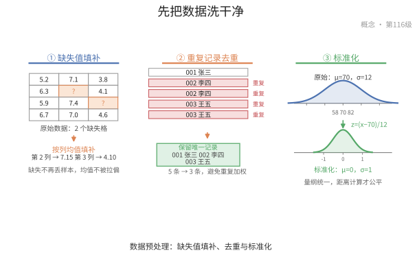

**一句话点破**：垃圾进、垃圾出；数据不干净，再好的模型也救不回来。

### 7.2 先看图再动手

建模前先画一画：直方图看分布、散点图看关系、均值中位数看大致范围。这就像看房先四处转一圈，心里先有个底，才不会盲人摸象、把方向搞反。

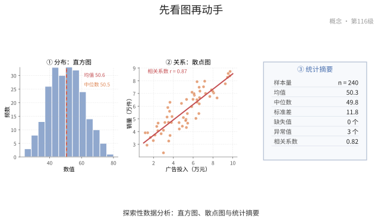

**一句话点破**：先看清数据长什么样，再决定用什么模型。

### 7.3 用概率的语言描述世界

现实数据总有随机波动，统计建模不追求“分毫不差”，而是承认不确定性：用参数刻画规律，用分布描述噪声，再判断结论有多可靠。比如用 $y=\beta_0+\beta_1 x+\varepsilon$ 表示“趋势加上扰动”。

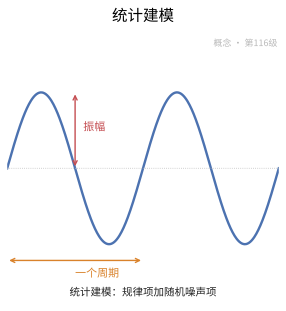

**一句话点破**：好模型不是没有误差，而是把误差说得清清楚楚。

### 7.4 挑出最有用的几个指标

指标太多反而添乱：冗余的、无关的会干扰判断。特征选择就是按重要性筛选，只留下真正对预测有帮助的那些，既省算力又更准。

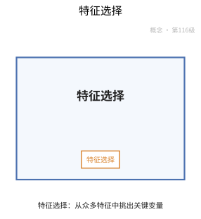

**一句话点破**：少而精的特征，往往胜过一大堆无关指标。

### 7.5 把原料加工成好用的样子

现成的字段常常不好用，需要动手造新特征：把日期拆成年、月、星期，把长宽算成面积，把分类打成一串 $0/1$。这就像把食材切成合适的形状，模型才嚼得动。

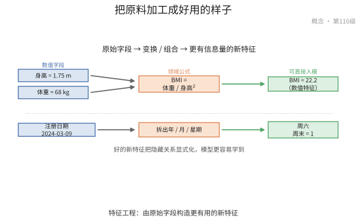

**一句话点破**：喂给模型什么特征，往往比用什么模型更决定效果。

### 7.6 十几个指标压成一两个

当指标成百上千时，很多信息其实是重复的。降维就是把高维数据投影到少数几个“主方向”上，用一两个新指标概括原来的十几个，画出来也能一眼看清结构。

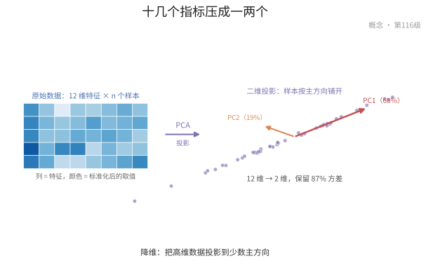

**一句话点破**：降维不是丢信息，而是挤出最主要的那部分信息。

### 7.7 物以类聚，自动分组

聚类不看答案，只看相似度：把彼此靠近的样本归成一堆。就像把一筐混装的水果按大小、颜色自动分成几堆，事先并不知道会分出几类。

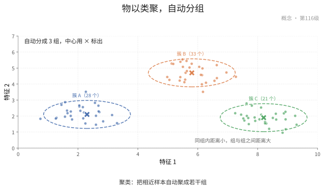

**一句话点破**：没有标签也能分组，靠的是“谁和谁更像”。

### 7.8 贴上对号入座的标签

分类是有标准答案的学习：已有“哪些是垃圾邮件、哪些不是”的历史记录，模型学会规则后给新样本判定类别。它的输出通常是属于各个类别的概率。

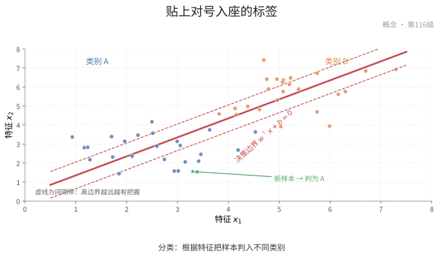

**一句话点破**：分类学的是“分界线该画在哪里”。

### 7.9 预测一个具体的数

回归和分类不同，它要预测的是连续数值，比如房价、销量、温度。模型学出一条规律，输入特征就吐出一个估计值，并给出大致的误差范围。

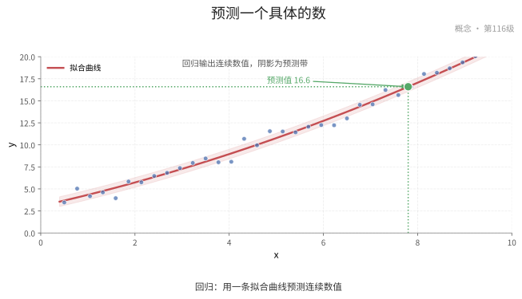

**一句话点破**：分类答“是哪一类”，回归答“大概是多少”。

### 7.10 三个臭皮匠顶个诸葛亮

单棵树容易看走眼，但把许多棵树（随机森林、梯度提升）的结论汇总起来，就稳得多。就像找多个专家投票，总比只信一个人更靠谱。

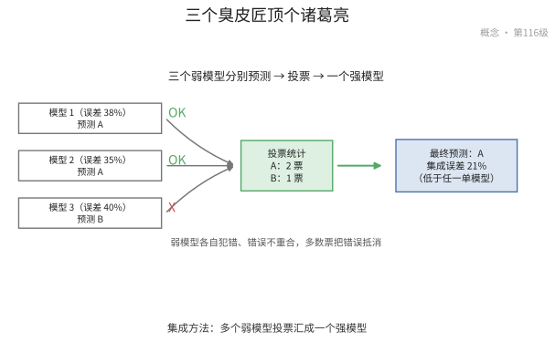

**一句话点破**：把许多“差不多”的模型合起来，常常比一个“完美”的模型更准。

### 7.11 光看准确率会骗人

模型好不好，要用它没见过的数据来考。准确率在类别极不均衡时会骗人：若 99% 都是正常交易，全判成正常也能有 99% 的准确率。所以还要看精确率、召回率、$F_1$ 这些指标。

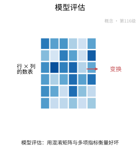

**一句话点破**：衡量模型要用它没见过的考题，还要挑对打分标准。

### 7.12 别把噪声当成规律背下来

一味追求在已知数据上分毫不差，模型会把噪声也一并记住，换上新数据就露馅，这就是过拟合。正则化则给模型“上点约束”，罚它别太复杂，逼它去学真正的规律。

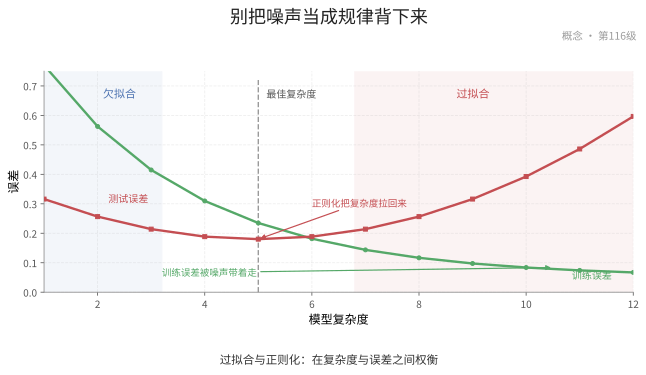

**一句话点破**：在没见过的新数据上还准，才算真学到了规律。

### 7.13 调火候，找到最合适的那一档

树有多深、学习率多大、正则化多强，这些“旋钮”由人来设，叫做超参数。调优就是不停地试不同组合，看哪一组在验证集上表现最好，像炒菜时反复调火候。

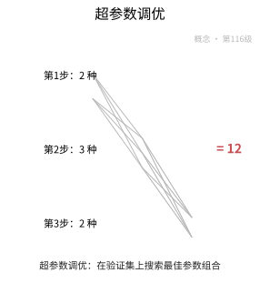

**一句话点破**：模型自己学参数，人来调旋钮，最终以验证集表现定优劣。

### 7.14 让数据自己开口说话

再复杂的规律，画成图往往一眼就懂：折线看趋势，柱状看比较，热力图看相关，散点看分布。可视化既是分析的起点，也是把结论讲给别人听的利器。

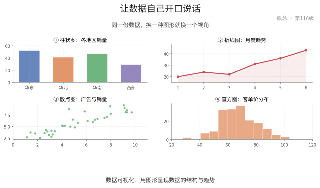

**一句话点破**：一张好图，抵得上十页数字表格。

### 7.15 选对方向，保留最多信息

PCA 告诉我们：在所有可能的方向里，沿着方差最大的方向投影，保留的信息最多。换句话说，如果只能用一条线来概括这批数据，就选让数据“铺得最开”的那一条。

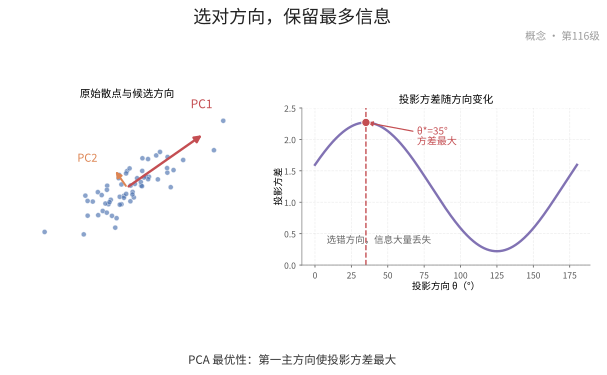

**一句话点破**：保留最多差异的方向，就是最好的投影方向。

### 7.16 分组越换越稳，终会停下

K-means 每次先按当前中心分组，再重新计算每组中心，如此反复。它保证每一步都让组内平方误差不增，所以误差只能越走越小、又有下界，最后必然停在某个稳定分组上。

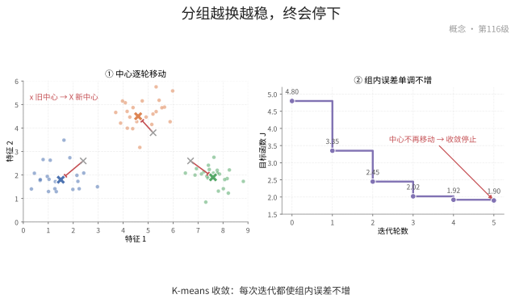

**一句话点破**：每轮都让误差更小，而误差有底，所以迭代一定收敛。

### 7.17 只有一个谷底，不怕走丢

逻辑回归的损失函数是凸的，形状像一口碗，只有一个最低点。这意味着用梯度下降时不必担心陷进“假山谷”，只要一直往下走，总能到达全局最优。

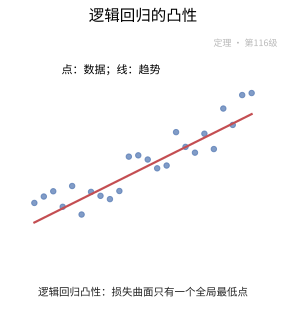

**一句话点破**：凸问题只有一个谷底，梯度下降必定走到全局最优。

### 7.18 树越多、越独立，越不容易出错

随机森林把许多棵树平均起来。理论上，随着树的数量增加，泛化误差趋于稳定而不会持续上升；每棵树之间越不相关，整体误差的上升幅度就越小。所以关键是既让单棵树足够强，又让它们彼此不那么像。

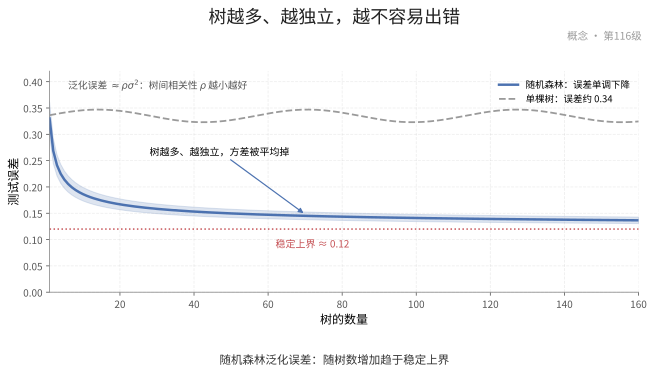

**一句话点破**：树多且彼此独立，集体判断的误差就有一个稳定的上界。

### 7.19 一小步一小步，稳步逼近最优

梯度提升像下坡时每步都沿着最陡的方向迈一小步：每新增一棵树，都在拟合当前的残差。只要步长（学习率）得当、损失足够光滑，这样一步步加上去，整体损失就会单调下降、稳步收敛。

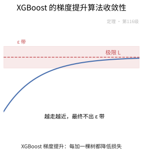

**一句话点破**：每次补一棵树来纠正残差，小步慢走，必达收敛。

## 8. 数学史（History of Mathematics）

> 在动手分析数据之前，先想清楚一个基本问题：**当数据多到像汪洋大海，'从中找出规律'这件本事，是如何被一门门学科接力搭起来的？**

**一个真实的生活场景（第一步：直觉）**

你收到一份海量用户行为记录，想知道"哪些人更可能流失""明天的销量大概多少"p。直觉上你会：先把数据整理干净、画出趋势、再建个模型来预测。这背后其实藏着一条由**统计学、数据库、机器学习、可视化**拼接而成的大线——**数据科学（data science）**要做的，就是把这套"从原始数据到可用智慧"的全流程方法论化：**采集、清洗、探索、建模、验证、部署**，让"在数据里挖到真规律"成为一件可重复、可检验、有统计保障的事。

**它到底想解决什么问题（第二步：要解决的问题）**

**数据科学**是一个横跨多学科的研究领域，其名字在 21 世纪大数据浪潮中走向显学，思想却根植于此前的统计与机器学习。它要解决的**根问题**是：

> 如何从**脏乱、海量、多变**的数据中，可靠地**提取有用信息与规律**，并用**模型**对未知做出预测，同时**控制误差、评估不确定性**、把结论讲得严谨可信？

> **🧠 一句话记住数据科学的"出生证"**
>
> 数据科学源于"数据爆炸时代需要把统计、计算与领域知识融成一套方法论"。它要解决的根本问题是：
>
> $$ \boxed{\text{从数据中用模型做推断与预测，并量化偏差-方差、检验其统计可靠性。}} $$

**看待本章的三种眼光（第三步：正式定义前的准备）**

- **统计的眼光**：先打牢数据、分布、估计与假设检验这些古典统计底座。
- **计算的眼光**：再认识数据库、机器学习与并行计算如何让海量数据"算得动"。
- **可证与可用的眼光**：最后学习模型选择、交叉验证与偏差-方差权衡，把预测讲成有证据的结论。

---

### 8.1 统计学的先声：从平均到推断

数据科学的第一块基石是**统计学**。从高斯时期的最小二乘拟合天文观测，到**皮尔逊、费希尔**在 20 世纪初建立**相关、回归、假设检验与抽样推断**的体系，人类首次学会"从样本说总体、从数据谈规律"，这一套在数据科学中依然是一切方法的底色。

### 8.2 数据库与信息检索：让数据存得下、查得快

在"数据多"成为现实后，**数据库（关系模型，Codd 1970）** 与 **SQL、信息检索** 解决了"数据如何存、如何查"的工程问题；**数据仓库**与**联机分析（OLAP）** 则为海量数据提供了"按需汇总、即席分析"的舞台。统计提供方法，数据库提供舞台，二者开始并进。

### 8.3 数据挖掘的诞生：用算法找隐藏规律

1990 年代，**数据挖掘** 作为统计学与机器学习、数据库的交叉领域兴起，主攻"在海量数据里自动发现先前未知的规律"：**分类、聚类、关联规则**（如超市购物篮分析发现"啤酒与尿布"）等任务被算法化。它把"人看数据"推进到"机器挖数据"。

### 8.4 Cleveland 与"数据科学"的正式命名

**William S. Cleveland（2001）** 在一篇论文中首次系统阐述"数据科学"，主张把统计学的疆域扩展为涵盖计算、可视化和跨学科协作的更广学科；此前 **Tukey 等** 倡导的"探索性数据分析（EDA）"也已把"先看图再建模"思想注入统计。这个命名把它从"统计的分支"抬升为一门独立的行当。

### 8.5 大数据时代与 Hadoop 生态

进入 21 世纪，互联网催生**大数据**——体量大、速度快、种类多是它的代名词。**Hadoop、MapReduce（2004 前后）** 与 **Spark** 提供了"分而治之、分布式处理"的工程底座，让 TB/PB 级数据也可被常规计算。数据科学与并行计算、云计算自此深度融合，"算得动大数据"成为新常态。

### 8.6 机器学习与统计模型的双向滋养

数据科学的核心工具之一是**机器学习**：经典统计模型（线性回归、逻辑回归、分类树）与更现代的**神经网络、梯度提升、随机森林**共同构成预测引擎。两者互相滋养——统计学提供推断与不确定性语言，机器学习提供大规模非线性拟合能力，使"从数据到预测"兼具灵活与严谨。

### 8.7 可视化与 EDA：先看见再建模

**数据可视化**与**探索性数据分析**让"人眼"成为第一道分析工具（Tukey 开创的箱线图、散点图矩阵等至今常用）。在建模之前先"看见"数据形状、异常与相关结构，能极大减少盲人摸象式的误建模。数据科学因此强调"可视化探索 → 假设 → 建模 → 验证"的闭环。

### 8.8 偏差-方差权衡与模型选择

要在"太简单（欠拟合）"与"太复杂（过拟合）"之间找平衡，数据科学严格化出**偏差-方差权衡**与**交叉验证**：把数据切成训练/验证/测试集，以"在未见数据上的表现"为准挑选模型与超参。这套"以证据选模型、以验证估误差"的纪律，是数据科学区别于"拍脑袋"的关键。

### 8.9 数据科学成熟为全面学科

今天的数据科学已发展成覆盖**采集清洗、特征工程、建模、部署运维、伦理与隐私**的全周期学科，并反哺统计学（可再现性、因果推断）、深度学习的**数据工程**与人工智能。数据科学既是一门技术、更是一套"用证据说话"的科学方法论，成为跨越科研、工业与社会决策的普遍语言。

---

| 时间 | 人物／文献 | 事件与贡献 |
| --- | --- | --- |
| 20 世纪初 | 皮尔逊、费希尔 | 建立相关、回归与推断统计体系 |
| 1970 | Codd | 提出关系数据库模型 |
| 1970 年代 | Tukey | 倡导探索性数据分析（EDA） |
| 1990 年代 | 数据挖掘研究者 | 发展分类、聚类、关联规则挖掘 |
| 2001 | Cleveland | 系统提出"数据科学" |
| 2004 前后 | 大数据生态 | Hadoop、MapReduce 使大数据可处理 |

> **小结**：数据科学的演进，是一部"**把看数据、存数据、挖数据、算数据拧成一套方法论**"的融合史。它从费希尔、皮尔逊的古典统计出发，经关系数据库解决存储查询、以数据挖掘开启自动找规律，由 Cleveland 正式命名，靠 Hadoop-MapReduce 迈入大数据时代，并用机器学习与偏差-方差纪律把预测做成可检验的科学。数据科学始终回答同一个问题：**在这堆看似杂乱的数据里，到底藏着哪些真规律，又有多大的把握说这是真的？**

---

## 9. 总结

**数据科学**是统计学、计算机科学和领域知识的交叉学科，其核心流程包括：

1. **数据预处理**：清洗数据、处理缺失值和异常值、标准化
2. **探索性数据分析**：通过统计摘要和可视化理解数据
3. **特征工程与选择**：创建有意义的特征，选择最具信息量的特征子集
4. **降维**：使用 PCA、SVD、t-SNE、UMAP 等方法减少特征维度
5. **建模**：选择适当的算法（聚类、分类、回归）进行建模
6. **模型评估**：使用交叉验证、AUC-ROC、混淆矩阵等评估模型性能
7. **超参数调优**：优化模型超参数以提升泛化能力

**关键定理回顾**：
- **PCA 最优性定理**：最大方差方向对应协方差矩阵的最大特征值特征向量
- **K-means 收敛性**：算法在有限步内收敛到局部最优
- **逻辑回归凸性**：负对数似然是凸函数，保证全局最优
- **随机森林泛化误差**：随树数量增加收敛，受强度和相关度影响
- **XGBoost 收敛性**：梯度提升算法在正则化条件下单调收敛

数据科学是一门实践性学科，理论学习需要与大量实践相结合。掌握数学原理有助于选择合适的算法、调试模型和解释结果，是成为优秀数据科学家的基石。
