# 第119级 连续介质力学

---

## 从"把一根梁拆成一格一格的受力"说起：连续介质力学要解决的根问题

> 在开始记变形梯度 $\boldsymbol{F}$、抄各种应力张量之前，先想清楚一个最基本的问题：**一根钢筋、一块橡胶、一团软泥，它们的形变到底能不能被同一套数学抓在手里？**

**一个你随时都在用的场景（第一步：直觉）**

一座跨河大桥每天压着汽车重几万吨，桥墩却既不塌也看不出明显矮下去；你把一罐可乐捏扁，罐身留下凹陷却不会散成一堆碎片。材料"看不见颗粒"，你一捏它，它内部每一处都在悄悄拉长、压缩、错动。问题是：**你没法把一根桥墩剖开看它里面每一小粒受了多大力**——那要怎么办？连续介质力学的做法是：把物体切成一格一格的连续"小方块"，用数学描述每一个小方块如何变形、受了多大的力，再把它们拼起来推算出整根梁会不会垮。**这门学问，就是"用微积分给材料写受力体检报告"。**

**一段从"把离散当连续"到"建立通用语言"的历史（第二步：要解决的问题）**

- **源头：Euler 的"连续介质假定"。** 18 世纪中期 Euler 提出：物体哪怕由原子构成，宏观上也可以当作"处处连续、无限可分"的场来研究，于是微积分才派得上用场。这是整门学科能成立的信仰前提。但仅有"连续"还不够——你还得能说清"物体内部某个小面上，周围材料到底怎么推它"。
- **转折：Cauchy 的应力张量（1822–1823）。** Cauchy 把"单位面积上的力"从直觉里的标量升级成**张量**：作用在一个面上的力有多少，取决于这个面的法向 $\boldsymbol{n}$，而且必须用九个分量才能完整描述。从此"内部的分割面上的力"和"外表面的力"共用同一套语言，连续介质力学第一次在数学上凝聚成一套自洽体系。
- **收束：把"力—变形"的对应关系统一成"本构理论"。** 17 世纪 Hooke 发现弹簧"力与伸长成正比"，被推广为应力与应变的线性（及更一般）本构关系；20 世纪 Truesdell 等人把整套体系整理成"理性力学"，明确"守恒律对一切材料成立，本构方程才区分材料"。至此，弹性、塑性、流体虽各不相同，却都共享同一张框架。

**第三步：正式定义前的准备**

本章按"先几何、后力学、再材料"三步走：

1. **变形几何**：先定义变形梯度 $\boldsymbol{F}$，用极分解把"真变形"与"刚体转动"分开，再引出一族应变张量（Cauchy–Green、Green–Lagrange、无穷小应变）；
2. **应力理论**：用 Cauchy 定理证明"面力总可被一个应力张量 $\boldsymbol{\sigma}$ 描述"，再给出质量、动量、能量三条守恒律；
3. **本构理论**：回答"材料如何对应力"—从各向同性表示定理，到超弹性材料由应变能导出应力 $\boldsymbol{S}=2\frac{\partial\Psi}{\partial\boldsymbol{C}}$ 及其热力学基础。

带着"**材料里每一小方块到底被推了多少、又变形了多少？**"去读每一个定义，你会发现变形梯度、应力张量这些名词不是抽象黑话，而是在回答一个再具体不过的工程问题。

> **🧠 一句话记住连续介质力学的"出生证"**
>
> 连续介质力学源于"要预测桥墩、机翼这些连续材料如何受力与变形"，它解决的**根本问题**是：
>
> $$ \boxed{\text{给定载荷与边界，预测连续体每一点的应力、应变与位移如何分布并演化。}} $$
>
> 它的三步曲——**用 $\boldsymbol{F}$ 描述变形、用 $\boldsymbol{\sigma}$ 描述受力、用本构方程把两者联通**——在这一框架下成为固体、流体、生物力学共享的同一种骨架。

---

## 开始之前

**本章在讲什么**：连续介质力学研究把物体视为连续体后，如何描述它的变形与受力。你会学到连续介质假设、变形梯度 $\boldsymbol{F}$ 与其极分解、一族应变张量、Cauchy 应力与 Piola–Kirchhoff 应力、质量/动量/能量三条守恒律、各向同性本构表示定理，以及超弹性材料由应变能 $\Psi$ 导出应力这一闭环体系。

**为什么要学它**：它和第 118 级流体力学是"同一棵树的果实"——**连续介质力学从应力张量 $\boldsymbol{\sigma}$ 与守恒律（Cauchy 方程）搭起最普适的框架，流体力学的 Navier–Stokes 方程不过是把流体本构 $\boldsymbol{\sigma}=-p\boldsymbol{I}+2\mu\boldsymbol{d}$ 代入其中得到的特例**。它把线性代数（对称正定、特征分解、Cayley–Hamilton）、向量微积分（散度定理、Reynolds 输运）与热力学（Clausius–Duhem 不等式）拧成一套力学的通用语言，是固体力学、材料科学、生物力学的共同地基；学完它，你再看第 118 级那些流体方程，会看清它们底下的"应力—守恒"骨架。

**开始前请确认你还记得**：

- 线性代数（见第 14 级）：矩阵与特征值分解、对称正定矩阵、Cayley–Hamilton 定理。$\boldsymbol{C}=\boldsymbol{F}^T\boldsymbol{F}$ 的谱分解、极分解全靠它。
- 向量分析与张量直觉：梯度/散度/旋度、张量内积 $\boldsymbol{A}:\boldsymbol{B}=\mathrm{tr}(\boldsymbol{A}^T\boldsymbol{B})$、散度定理、物体导数，以及不变量的概念（$\mathrm{tr}$、$\det$）。
- 热力学基础：内能、熵、Helmholtz 自由能 $\psi=e-\theta\eta$、热力学第一/二定律与 Clausius–Duhem 不等式。
- 流体力学的基础（见第 118 级）的直觉：知道"应力张量 ▸ 本构关系 → Navier–Stokes"这条线，会帮你更快找到本章的落脚点。

---

## 学习目标

1. 理解连续介质假设的基本思想及其适用范围
2. 掌握变形梯度与各种应变张量的定义及其几何意义
3. 理解Cauchy应力张量、Piola-Kirchhoff应力张量的物理意义
4. 掌握守恒律（质量、动量、能量）在连续介质中的数学表述
5. 理解本构方程的基本原理及各向同性材料的表示定理
6. 掌握超弹性材料的本构关系及其热力学基础

---

## 核心概念

### 连续介质假设

连续介质力学的基本假设是：物质在宏观尺度上可以被视为连续分布的，即物质点填满整个空间区域，而物理量（密度、速度、应力等）是空间位置和时间的连续（或分段连续）函数。这一假设在分子平均自由程远小于特征尺度时成立。

> **💡 直观理解（类比）**：连续介质假设像是"把一杯沙看成一块布"——沙子颗粒再细，站在宏观角度我们仍可把它当成一层面团般平滑、处处可分的连续体来解方程。这就像把挤成一团的蚂蚁大军模糊成"一股流动"，忽略单只蚂蚁，只盯着连续密度、速度这些"场"。只要分子平均自由程远小于物体尺寸（比如一根钢筋、一缸水），这种"把离散当连续"的近似就足够准。

#### 课堂问答

**老师**：连续介质假设到底"假设"了什么？材料其实由离散原子组成，这个假设凭什么成立？

**学生**：结论先给——它假设物质在宏观尺度上"处处连续、无限可分"，密度、速度、应力都是空间和时间的连续（或分段连续）场。理由是：只要分子平均自由程 $\ell$ 远小于特征尺度 $L$，即 Knudsen 数 $Kn=\ell/L\ll1$，微观离散性就被平滑掉，用可微的场量取体积平均时得到的是稳定值，微积分才用得上。常见误区是以为它"任何时候都对"——其实在稀薄气体、纳米通道、激波里 $Kn$ 趋近或超过 1 时就失效。

**老师（追问）**：你说取极限 $\Delta V\to0$，可若真的趋于零，就落进单个分子的空隙里，密度便没了意义。这个极限该怎么取？

**学生**：关键是"双重尺度"——取的是物理上无穷小、数学上仍含大量分子的体积元：它比分子间距大得多（统计稳定），又比宏观物体小得多（可视为一点）。所以密度是一个在"恰到好处的中间尺度"上取的极限 $\rho=\lim_{\Delta V\to\Delta V^*}\Delta m/\Delta V$。这正是连续介质假设的操作定义。

**老师（拓展）**：如果 Knudsen 数不满足，你会保留什么、丢掉什么？

**学生**：丢掉"用连续场写 Euler/Navier–Stokes 方程"的做法，改用 Boltzmann 方程或分子动力学/DSMC 直接追踪分布函数 $f(\boldsymbol{x},\boldsymbol{v},t)$；守恒律的统计形式仍可保留，但场量与本构要重新定义。一句话：连续介质力学是 $Kn\ll1$ 的渐近理论。

### 变形梯度

设参考构型中物质点的位置为 $\boldsymbol{X}$，当前构型中的位置为 $\boldsymbol{x} = \boldsymbol{\varphi}(\boldsymbol{X}, t)$，则**变形梯度**定义为：

$$\boldsymbol{F} = \frac{\partial \boldsymbol{\varphi}}{\partial \boldsymbol{X}} = \nabla_{\boldsymbol{X}} \boldsymbol{\varphi}, \quad F_{iA} = \frac{\partial x_i}{\partial X_A}$$

变形梯度是一个二阶张量，包含了变形和刚体转动的一切信息。

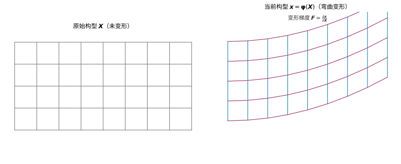

> **直观理解（现实类比）**：把一块方形海绵画上均匀的方格网格，再用力把右端往上掰弯，网格就从"规整的方格"变成"弯曲的梯形碗"。原来每个小方格如何被拉伸、倾斜、旋转，就对应着变形梯度 $\boldsymbol{F}$ 在各点的取值——它是描述"海绵内部每一小片如何变形"的完整说明书。

> **🧠 思考历程：材料和三明治一样"看不见颗粒"，怎么用一小片描述一大块？**
>
> 变形梯度回答的是连续介质力学最根本的假设：把物体看作"处处连续"的场，而不是一摞单个微粒——于是拉、压、剪这些日常动作，都能被一张张"局部变化说明书"（变形梯度 $\boldsymbol{F}$）逐点讲清。
>
> - **先把"连续"画成假设**。Euler 在18世纪中期提出"连续介质假定"，把物体想象成无限可分的连续场、从而能用微积分研究它——这一"以大化小再积分"的立场，近乎是让"材料力学"得以成立的信仰前提。
> - **Cauchy 的应力登场**。1822–1823年 Cauchy 提出应力张量，把"单位面积上的力"从高中里的标量升级为描述物体内质点受力方向依赖的张量——由此"内部分割面上的力"与表面力是同一套语言，连续介质在数学上第一次完整成形。
> - **Hooke 的老规律升格为模型**。17世纪 Hooke 发现的弹簧"力与伸长成正比"，被后继者推广成应力与应变的线性本构关系；Truesdell 等人在20世纪又把连续介质力学整理成"理性力学"——同一张变形矩阵里，藏着弹性、塑性、流体的分野。
> - **心路**：把"一团东西"缩写成"连续场加一个局部梯度"，看似抽象，其实是把最日常的形变翻译成最普适的演算语言。

#### 课堂问答

**老师**：变形梯度 $\boldsymbol{F}=\partial\boldsymbol{x}/\partial\boldsymbol{X}$ 为什么是二阶张量，而不是一个向量？

**学生**：因为它要把参考构型的线元映射到当前构型：$\mathrm{d}\boldsymbol{x}=\boldsymbol{F}\,\mathrm{d}\boldsymbol{X}$。输入一个方向（参考线元）、输出一个方向（当前线元），是线性映射 $\mathbb{R}^3\to\mathbb{R}^3$，所以是二阶张量，分量 $F_{iA}=\partial x_i/\partial X_A$。它一并携带了拉伸、剪切与刚体转动的全部信息。

**老师（追问）**：既然 $\boldsymbol{F}$ 逐点变化，什么量保证它可逆、可以用来定义应变？

**学生**：$\det\boldsymbol{F}=J>0$。因为 $\boldsymbol{\varphi}$ 要一一对应（物质不重叠、不翻转），Jacobian 必须非零且取正号（保定向）。$J$ 还给出局部体积比 $\mathrm{d}V=J\,\mathrm{d}V_0$。

**老师（拓展）**：那我做一次刚体转动 $\boldsymbol{X}\mapsto\boldsymbol{Q}\boldsymbol{X}$，$\boldsymbol{F}$ 会怎样？这对本构有什么后果？

**学生**：$\boldsymbol{F}\to\boldsymbol{Q}\boldsymbol{F}$，即左乘正交阵就改变。所以 $\boldsymbol{F}$ 本身不是客观量，单凭它写本构会把刚体转动误当变形——这正是要用 $\boldsymbol{C}=\boldsymbol{F}^T\boldsymbol{F}$ 的原因，因为 $\boldsymbol{C}\to(\boldsymbol{Q}\boldsymbol{F})^T(\boldsymbol{Q}\boldsymbol{F})=\boldsymbol{F}^T\boldsymbol{F}$ 对转动不变。

### 应变张量

- **右Cauchy-Green变形张量**：$\boldsymbol{C} = \boldsymbol{F}^T \boldsymbol{F}$
- **左Cauchy-Green变形张量**：$\boldsymbol{b} = \boldsymbol{F} \boldsymbol{F}^T$
- **Green-Lagrange应变张量**：$\boldsymbol{E} = \frac{1}{2}(\boldsymbol{C} - \boldsymbol{I})$
- **无穷小应变张量**：当位移梯度很小时，$\boldsymbol{\varepsilon} = \frac{1}{2}(\nabla \boldsymbol{u} + (\nabla \boldsymbol{u})^T)$

> **💡 直观理解（类比）**：这些应变张量都是"变形进度尺"的不同刻度写法。$\boldsymbol{C}=\boldsymbol{F}^T\boldsymbol{F}$ 和 $\boldsymbol{b}$ 像"量长度的平方"，自动消掉转动只留伸长；Green-Lagrange $\boldsymbol{E}$ 在 $\boldsymbol{C}$ 基础上再减去"未变形的单位刻度" $(\tfrac12(\boldsymbol{C}-\boldsymbol{I}))$，好让"没变形时读数为零"；无穷小应变 $\boldsymbol{\varepsilon}$ 则是小变形时把尺子简化成一阶近似。它们只是同一件事——"物体被拉压剪成什么样"——换个更趁手的量尺罢了。

> **常见坑**：$\boldsymbol{C}=\boldsymbol{F}^T\boldsymbol{F}$ 与 $\boldsymbol{b}=\boldsymbol{F}\boldsymbol{F}^T$ 的"位置别写反"——右（含 $^T$ 在后的 $\boldsymbol{F}^T$ 在前者坐落在参考构型上）与左不同构型，不能混用。格林–拉格朗日应变 $\boldsymbol{E}$ 用的是 $\boldsymbol{C}$（减 $\boldsymbol{I}$）；而 Piola 变换里常见的是 $\boldsymbol{b}$。小变形时三种应变张量（$\boldsymbol{E}$、$\boldsymbol{\varepsilon}$ 与 $\tfrac12(\boldsymbol{C}-\boldsymbol{I})$）数值趋同，但**大变形时它们彼此相差很大**，选错表述会产生明显的数值错误。

#### 课堂问答

**老师**：$\boldsymbol{C}=\boldsymbol{F}^T\boldsymbol{F}$ 与 $\boldsymbol{b}=\boldsymbol{F}\boldsymbol{F}^T$ 只差一个转置位置，为什么一个叫"右"、一个叫"左"，物理上有别吗？

**学生**：有本质区别。$\boldsymbol{C}=\boldsymbol{F}^T\boldsymbol{F}$ 作用在参考构型（右 Cauchy–Green），$\boldsymbol{b}=\boldsymbol{F}\boldsymbol{F}^T$ 作用在当前构型（左 Cauchy–Green）。二者特征值相同，都是主伸长比的平方 $\lambda_i^2$，但特征方向分属两个构型。与能量共轭的是 $\boldsymbol{C}$，它配第二 Piola 应力 $\boldsymbol{S}$。

**老师（追问）**：为什么是 $\boldsymbol{C}$ 而不是 $\boldsymbol{b}$ 与 Green–Lagrange 应变 $\boldsymbol{E}$ 配对？

**学生**：因为 $\boldsymbol{E}=\frac12(\boldsymbol{C}-\boldsymbol{I})$ 建立在参考构型上，其共轭应力 $\boldsymbol{S}$ 也在参考构型，二者的功率密度 $\boldsymbol{S}:\dot{\boldsymbol{E}}$ 才成立。若用 $\boldsymbol{b}$ 就得配当前构型的量，混用会出错。

**老师（拓展）**：什么时候 $\boldsymbol{E}$ 可以近似成无穷小应变 $\boldsymbol{\varepsilon}=\frac12(\nabla\boldsymbol{u}+(\nabla\boldsymbol{u})^T)$？

**学生**：当位移梯度小，$\boldsymbol{F}=\boldsymbol{I}+\nabla_{\boldsymbol{X}}\boldsymbol{u}$。代入得 $\boldsymbol{E}=\frac12(\nabla\boldsymbol{u}+\nabla\boldsymbol{u}^T+\nabla\boldsymbol{u}^T\nabla\boldsymbol{u})$，忽略二次项 $\nabla\boldsymbol{u}^T\nabla\boldsymbol{u}$ 即得 $\boldsymbol{\varepsilon}$。要点：小应变还要配小转动，否则 $\boldsymbol{E}$ 与 $\boldsymbol{\varepsilon}$ 会差出大误差。

### 应力张量

- **Cauchy应力张量** $\boldsymbol{\sigma}$：当前构型中的真实应力（单位：力/当前面积）
- **第一Piola-Kirchhoff应力张量** $\boldsymbol{P}$：力参考当前构型，面积参考参考构型，$\boldsymbol{P} = J \boldsymbol{\sigma} \boldsymbol{F}^{-T}$，其中 $J = \det \boldsymbol{F}$
- **第二Piola-Kirchhoff应力张量** $\boldsymbol{S}$：完全参考参考构型，$\boldsymbol{S} = \boldsymbol{F}^{-1} \boldsymbol{P} = J \boldsymbol{F}^{-1} \boldsymbol{\sigma} \boldsymbol{F}^{-T}$

> **💡 直观理解（类比）**：应力张量描述"物体内部每个小面被周围材料推挤的力度分布"。Cauchy 应力 $\boldsymbol{\sigma}$ 用"变形后最新的真实截面"当分母；第一、第二 Piola-Kirchhoff 应力（$\boldsymbol{P}$、$\boldsymbol{S}$）为了算账方便，把力的读数折算回"未变形的原始截面"上。就像记账分别用"现价"还是"原价"标价——材料变形越大，这两种标价方式的差异就越明显。

> **常见坑**：三种应力张量的"参考构型"极易搞混——Cauchy $\boldsymbol{\sigma}$（力与面积都在**当前**构型）、第一 Piola–Kirchhoff $\boldsymbol{P}$（力在**当前**、面积在**参考**，是"两个构型混合"的两点张量，**不一定对称**）、第二 Piola–Kirchhoff $\boldsymbol{S}$（力与面积都在**参考**，对称，且与 $\boldsymbol{C}$ 能量共轭）。别把 $\boldsymbol{P}$ 和 $\boldsymbol{S}$ 当作同一种"参考构型应力"；尤其在有限元里网格建在参考构型，用 $\boldsymbol{P}$、$\boldsymbol{S}$ 描述才方便，若误用 $\boldsymbol{\sigma}$ 把面积算在变形后，大变形时误差很大。

#### 课堂问答

**老师**：三个应力张量 $\boldsymbol{\sigma},\boldsymbol{P},\boldsymbol{S}$ 差的只是"面积参考哪个构型"，为什么非得有三个？

**学生**：因为 Cauchy 关系 $\boldsymbol{t}=\boldsymbol{\sigma}\boldsymbol{n}$ 里力和面积都在当前构型，但有限元网格与实验边界却常在参考构型给出。于是用 Piola 变换把力或面积折算回参考构型：$\boldsymbol{P}=J\boldsymbol{\sigma}\boldsymbol{F}^{-T}$（力在当前、面积在参考，是两点张量、一般不对称），$\boldsymbol{S}=\boldsymbol{F}^{-1}\boldsymbol{P}=J\boldsymbol{F}^{-1}\boldsymbol{\sigma}\boldsymbol{F}^{-T}$（力与面积都在参考，对称）。

**老师（追问）**：$\boldsymbol{\sigma}$ 对称而 $\boldsymbol{P}$ 不一定对称，这对求解有什么影响？

**学生**：$\boldsymbol{\sigma}$ 的对称性来自角动量守恒，把 9 个分量压到 6 个。$\boldsymbol{P}$ 因混合了两个构型而破坏对称（只满足 $\boldsymbol{P}\boldsymbol{F}^T=\boldsymbol{F}\boldsymbol{P}^T$）。$\boldsymbol{S}$ 又恢复对称，且与 $\boldsymbol{C}$ 能量共轭，所以超弹性里 $\boldsymbol{S}=2\partial\Psi/\partial\boldsymbol{C}$ 最自然。

**老师（拓展）**：$J=\det\boldsymbol{F}$ 在几个变换里反复出现，它的意义是什么？

**学生**：$J$ 是局部体积比 $\mathrm{d}v=J\,\mathrm{d}V$。Piola 变换把"单位当前面积"的力折算成"单位参考面积"的力，正需要 $J$ 配合 Nanson 公式 $\boldsymbol{n}\,\mathrm{d}a=J\boldsymbol{F}^{-T}\boldsymbol{n}_0\,\mathrm{d}a_0$，把面元比与法向变换一起补上。不可压时 $J=1$，第三不变量 $I_3=1$。

### 守恒律

- **质量守恒**：$\dot{\rho} + \rho \nabla \cdot \boldsymbol{v} = 0$
- **动量守恒（Cauchy第一运动定律）**：$\nabla \cdot \boldsymbol{\sigma} + \rho \boldsymbol{b} = \rho \dot{\boldsymbol{v}}$
- **能量守恒（第一定律）**：$\rho \dot{e} = \boldsymbol{\sigma} : \boldsymbol{d} - \nabla \cdot \boldsymbol{q} + \rho r$

> **💡 直观理解（类比）**：守恒律是连续介质世界的三条"铁账本"：质量账（物质不凭空生成）、动量账（$\boldsymbol{F}=m\boldsymbol{a}$ 的场形式）、能量账（做功 + 传热 = 内能变化）。它们告诉你"任何一块材料切出来，里面的量只能进进出出、不能凭空冒出来或蒸发掉"——如同机场安检，行李总数不会因来回搬运而多出或少掉一件。这三本就是推导几乎所有材料运动方程的地基。

#### 课堂问答

**老师**：三条守恒律里，哪一条对"所有材料"都成立，哪一条需要材料信息才能落地？

**学生**：三条守恒律本身都是普适的：质量守恒 $\dot\rho+\rho\nabla\cdot\boldsymbol{v}=0$、动量守恒 $\nabla\cdot\boldsymbol{\sigma}+\rho\boldsymbol{b}=\rho\dot{\boldsymbol{v}}$、能量守恒 $\rho\dot e=\boldsymbol{\sigma}:\boldsymbol{d}-\nabla\cdot\boldsymbol{q}+\rho r$。但动量与能量里出现了应力 $\boldsymbol{\sigma}$ 与热流 $\boldsymbol{q}$，它们不是守恒律能给的，必须由本构方程补上。所以守恒律给框架，本构方程才闭合方程组。

**老师（追问）**：质量守恒为什么写成 $\dot\rho+\rho\nabla\cdot\boldsymbol{v}=0$，它和通量形式 $\partial_t\rho+\nabla\cdot(\rho\boldsymbol{v})=0$ 一样吗？

**学生**：完全一样，只是写法。展开 $\partial_t\rho+\nabla\cdot(\rho\boldsymbol{v})=\partial_t\rho+\boldsymbol{v}\cdot\nabla\rho+\rho\nabla\cdot\boldsymbol{v}=\dot\rho+\rho\nabla\cdot\boldsymbol{v}$。物质导数 $\dot\rho$ 是"跟着材料点看密度变化"，通量形式更适合对控制体积积分。

**老师（拓展）**：不可压条件 $\nabla\cdot\boldsymbol{v}=0$ 是哪条守恒律的推论？

**学生**：它不是独立定律，而是质量守恒在密度不变（$\dot\rho=0$）时的特例，此时 $\rho\nabla\cdot\boldsymbol{v}=0$ 给出 $\nabla\cdot\boldsymbol{v}=0$。物理上即"体积不变化"，因为 $\nabla\cdot\boldsymbol{v}=\mathrm{tr}\,\boldsymbol{d}$ 正是体积膨胀率。

### 本构方程

本构方程描述材料对应力的响应，是联系应力与变形的物理关系。

> **💡 直观理解（类比）**：本构方程像"材料的脾气说明书"：同样的变形，橡皮筋、面团、冰、铁各自给出不同回应，正是本构关系在定这张"变形→应力"的反应曲线。守恒律（力学账本）对所有材料通用，唯独"怎么反抗变形"千差万别，要靠本构方程来拍板。它把抽象力学"接上地气"，是区分钢铁、橡胶还是软泥的关键。

#### 课堂问答

**老师**：守恒律对钢和橡胶一视同仁，那"区分材料"的到底是什么？本构方程在数学上扮演什么角色？

**学生**：本构方程是"材料的脾气说明书"，回答应力怎样依赖变形、变形率和温度。数学上它专门**闭合**守恒方程组：守恒律里未知场比方程多，缺的正是本构。结论是：守恒律定框架，本构定个性。

**老师（追问）**：既然本构常来自唯象拟合，那它可以随便写吗？

**学生**：不能乱写，至少受三条硬约束。其一，客观性——本构在刚体转动下形式不变；其二，热力学相容——满足 Clausius–Duhem 不等式，不能凭空制造能量；其三，材料对称性——如各向同性限制函数的生成元。超弹性还额外要求存在应变能 $\Psi$，使应力成为它的导数。

**老师（拓展）**：线弹性本构 $\boldsymbol{\sigma}=\lambda(\mathrm{tr}\,\boldsymbol{\varepsilon})\boldsymbol{I}+2\mu\boldsymbol{\varepsilon}$ 满足客观性吗？

**学生**：满足，因为它只含 $\boldsymbol{\varepsilon}$，本身就是对刚体转动不敏感的二阶量。大变形则要用 $\boldsymbol{C}$ 或 $\boldsymbol{b}$ 这类客观量，例如各向同性超弹性 $\boldsymbol{\sigma}=\alpha_0\boldsymbol{I}+\alpha_1\boldsymbol{b}+\alpha_2\boldsymbol{b}^2$。直接以 $\boldsymbol{F}$ 建模会破坏客观性。

### 材料分类

- **弹性**：应力仅取决于当前变形状态
- **塑性**：存在不可逆变形
- **粘弹性**：兼具弹性与粘性特征
- **超弹性**：存在应变能函数，应力由应变能导出

> **💡 直观理解（类比）**：材料分类像给"松手就弹回还是赖在原地"的脾气分档：橡皮筋（弹性）松手就弹回；揉皱的纸（塑性）留下褶子回不去；既有点弹又有点黏的橡皮泥、面团（粘弹性）介于其间；而超弹性（如橡胶）最"讲理"，把所有变形带来的能量写进一张"应变能账"，应力就是这张账的方向导数。知道材料属哪一类，才能挑对账本（本构模型）。

---

#### 课堂问答

**老师**：弹性、塑性、粘弹性、超弹性，材料分类的判据到底是什么？

**学生**：看两点——变形是否可恢复，以及应力是否只依赖当前状态。弹性：应力只依赖当前变形，卸载沿原路返回；塑性：存在不可逆的残余变形，应力依赖加载历史；粘弹性：弹性与粘性并蓄，应力还依赖变形率或历史；超弹性：属于弹性且存在应变能势 $\Psi$，应力由其导数导出。

**老师（追问）**：超弹性与普通弹性有何本质区别，为什么值得单列？

**学生**：普通弹性只说"卸载能恢复"，可以是路径相关的；超弹性更强，要求存在势函数 $\Psi(\boldsymbol{F})$ 使 $\boldsymbol{P}=\partial\Psi/\partial\boldsymbol{F}$，于是做功与路径无关、能量守恒。数学后果是弹性张量具有主对称性，即 $\partial P_{iA}/\partial F_{jB}=\partial P_{jB}/\partial F_{iA}$，这能减少材料常数并保证热力学自洽。

**老师（拓展）**：那么"弹性"是否一定意味着"超弹性"？

**学生**：小变形线弹性两者等价，能量可积为 $\Psi=\frac12\lambda(\mathrm{tr}\,\boldsymbol{\varepsilon})^2+\mu\boldsymbol{\varepsilon}:\boldsymbol{\varepsilon}$。但大变形的一般 Cauchy 弹性（应力只依赖当前 $\boldsymbol{F}$）未必能积出势函数，因此不一定是超弹性。超弹性是弹性中"额外要求存在能量势"的那一类。

## 定理与证明

### 定理1：Cauchy应力张量的存在性（Cauchy定理）

**定理**：在连续介质中，若存在体力密度 $\boldsymbol{b}$ 和面力密度 $\boldsymbol{t}(\boldsymbol{n})$，且面力满足动量平衡，则存在一个对称的二阶张量场 $\boldsymbol{\sigma}$，使得对于任意方向 $\boldsymbol{n}$，有：

$$\boldsymbol{t}(\boldsymbol{n}) = \boldsymbol{\sigma} \cdot \boldsymbol{n}$$

其中 $\boldsymbol{\sigma}$ 称为Cauchy应力张量，且 $\boldsymbol{\sigma} = \boldsymbol{\sigma}^T$。

**证明**（四面体论证）：

考虑一个无穷小四面体，其三个面分别垂直于坐标轴 $x_1, x_2, x_3$，斜面法向为 $\boldsymbol{n}$。设四面体顶点在原点，斜面面积为 $\Delta S$，三个坐标面的面积分别为 $\Delta S_1, \Delta S_2, \Delta S_3$。

由几何关系，$\Delta S_i = n_i \Delta S$，其中 $n_i$ 是 $\boldsymbol{n}$ 的分量。

**步骤1：面力平衡**

四面体受到三种力的作用：体力、三个坐标面上的面力、斜面上的面力。设四面体体积为 $\Delta V$，体力密度为 $\boldsymbol{b}$。

由牛顿第二定律（动量平衡）：

$$\boldsymbol{t}(\boldsymbol{n}) \Delta S + \sum_{i=1}^{3} \boldsymbol{t}(-\boldsymbol{e}_i) \Delta S_i + \rho \boldsymbol{b} \Delta V = \rho \boldsymbol{a} \Delta V$$

其中 $\boldsymbol{t}(-\boldsymbol{e}_i)$ 是法向为 $-\boldsymbol{e}_i$ 的面上的面力。

**步骤2：利用作用力与反作用力**

由牛顿第三定律，$\boldsymbol{t}(-\boldsymbol{e}_i) = -\boldsymbol{t}(\boldsymbol{e}_i)$。

代入得：

$$\boldsymbol{t}(\boldsymbol{n}) \Delta S - \sum_{i=1}^{3} \boldsymbol{t}(\boldsymbol{e}_i) n_i \Delta S + \rho \boldsymbol{b} \Delta V = \rho \boldsymbol{a} \Delta V$$

**步骤3：取极限**

四面体缩至一点时，$\Delta V \sim O(h^3)$，$\Delta S \sim O(h^2)$，其中 $h$ 为特征尺寸。当 $h \to 0$ 时，体积项相比面积项为高阶小量，因此：

$$\boldsymbol{t}(\boldsymbol{n}) = \sum_{i=1}^{3} \boldsymbol{t}(\boldsymbol{e}_i) n_i$$

**步骤4：定义应力张量**

定义 $\sigma_{ij}$ 为作用在法向为 $\boldsymbol{e}_i$ 的面上的面力在 $j$ 方向的分量，即：

$$\boldsymbol{t}(\boldsymbol{e}_i) = \sigma_{ij} \boldsymbol{e}_j$$

则：

$$\boldsymbol{t}(\boldsymbol{n}) = \sum_{i=1}^{3} \sum_{j=1}^{3} \sigma_{ij} n_i \boldsymbol{e}_j = \boldsymbol{\sigma} \cdot \boldsymbol{n}$$

其中 $\boldsymbol{\sigma} = \sigma_{ij} \boldsymbol{e}_i \otimes \boldsymbol{e}_j$。

**步骤5：对称性证明**

由角动量守恒（Cauchy第二运动定律），可以证明 $\boldsymbol{\sigma} = \boldsymbol{\sigma}^T$，即 $\sigma_{ij} = \sigma_{ji}$。考虑一个无穷小体积元上的力矩平衡即可得到这一结果。

这就完成了Cauchy应力张量存在性的证明。$\square$

> **💡 直观理解（类比）**：Cauchy定理说的是"只要物体内部受力平衡，每一点都能配到一张统一的"力–方向账本"$\boldsymbol{\sigma}$：任意切一刀看到的力 $\boldsymbol{t}(\boldsymbol{n})$ 都等于这张账本乘上切面方向 $\boldsymbol{n}$"。就像切橡皮泥，无论从哪个角度下刀，两侧受力总是由同一种内部状态（$\boldsymbol{\sigma}$）决定，而不会因切法不同凭空冒出新规律。四面体论证不过是"取一块楔形小片，逼三个坐标面上的力和斜面上的力相互对账，再缩成一点"——本质是说明微观上内部各方向的作用力彼此协调一致。

---

#### 课堂问答

**老师**：Cauchy 定理为什么偏偏用一个"四面体"来论证？它证明的到底是什么？

**学生**：它证明存在一个与方向无关的二阶张量 $\boldsymbol{\sigma}$，使任意法向 $\boldsymbol{n}$ 的面力满足 $\boldsymbol{t}(\boldsymbol{n})=\boldsymbol{\sigma}\boldsymbol{n}$。四面体是关键：让斜面上的力与三个坐标面上的力做平衡 $\boldsymbol{t}(\boldsymbol{n})\Delta S-\sum_i\boldsymbol{t}(\boldsymbol{e}_i)n_i\Delta S+(\rho\boldsymbol{b}-\rho\boldsymbol{a})\Delta V=\boldsymbol{0}$，再用面积关系 $\Delta S_i=n_i\Delta S$。

**老师（追问）**：取极限时体积项凭什么可以丢掉？

**学生**：因为 $\Delta V\sim O(h^3)$ 而 $\Delta S\sim O(h^2)$，两者之比 $\Delta V/\Delta S\sim O(h)$。令 $h\to0$，体力与惯性项相对面力项高阶可忽略，只剩 $\boldsymbol{t}(\boldsymbol{n})=\sum_i\boldsymbol{t}(\boldsymbol{e}_i)n_i=\boldsymbol{\sigma}\boldsymbol{n}$。这就是"应力张量存在"的核心。

**老师（拓展）**：$\boldsymbol{\sigma}$ 的对称性也是这个论证给出的吗？

**学生**：不是。存在性来自力平衡（第一运动定律）；对称性 $\boldsymbol{\sigma}=\boldsymbol{\sigma}^T$ 另需角动量守恒（第二运动定律）对无穷小体积元取矩。二者缺一不可：前者保证 $\boldsymbol{\sigma}$ 存在，后者把它从 9 个独立分量砍到 6 个。

### 定理2：变形梯度与应变张量的关系（极分解）

**定理**：任意非奇异的变形梯度 $\boldsymbol{F}$（$\det \boldsymbol{F} > 0$）可以唯一地分解为：

$$\boldsymbol{F} = \boldsymbol{R} \boldsymbol{U} = \boldsymbol{V} \boldsymbol{R}$$

其中 $\boldsymbol{R}$ 是正交张量（$\boldsymbol{R}^T \boldsymbol{R} = \boldsymbol{I}$，代表刚体转动），$\boldsymbol{U}$ 和 $\boldsymbol{V}$ 是对称正定张量（分别称为右和左伸长张量）。

**证明**：

**步骤1：构造对称正定张量**

考虑右Cauchy-Green变形张量 $\boldsymbol{C} = \boldsymbol{F}^T \boldsymbol{F}$。它是一个对称正定张量，因为对于任意非零向量 $\boldsymbol{v}$：

$$\boldsymbol{v}^T \boldsymbol{C} \boldsymbol{v} = \boldsymbol{v}^T \boldsymbol{F}^T \boldsymbol{F} \boldsymbol{v} = \|\boldsymbol{F} \boldsymbol{v}\|^2 > 0$$

（$\boldsymbol{F} \boldsymbol{v} \neq \boldsymbol{0}$ 因为 $\det \boldsymbol{F} \neq 0$。）

**步骤2：定义伸长张量**

由对称正定张量的谱定理，$\boldsymbol{C}$ 可以正交对角化：

$$\boldsymbol{C} = \sum_{i=1}^{3} \lambda_i^2 \boldsymbol{N}_i \otimes \boldsymbol{N}_i$$

其中 $\lambda_i > 0$ 是主伸长比，$\boldsymbol{N}_i$ 是正交的单位特征向量。

定义右伸长张量：

$$\boldsymbol{U} = \sqrt{\boldsymbol{C}} = \sum_{i=1}^{3} \lambda_i \boldsymbol{N}_i \otimes \boldsymbol{N}_i$$

显然 $\boldsymbol{U}$ 是对称正定的，且 $\boldsymbol{U}^2 = \boldsymbol{C}$。

**步骤3：定义转动张量**

定义 $\boldsymbol{R} = \boldsymbol{F} \boldsymbol{U}^{-1}$。验证 $\boldsymbol{R}$ 的正交性：

$$\boldsymbol{R}^T \boldsymbol{R} = (\boldsymbol{U}^{-1})^T \boldsymbol{F}^T \boldsymbol{F} \boldsymbol{U}^{-1} = \boldsymbol{U}^{-1} \boldsymbol{C} \boldsymbol{U}^{-1} = \boldsymbol{U}^{-1} \boldsymbol{U}^2 \boldsymbol{U}^{-1} = \boldsymbol{I}$$

因此 $\boldsymbol{R}$ 是正交张量，且 $\boldsymbol{F} = \boldsymbol{R} \boldsymbol{U}$。

**步骤4：左分解**

类似地，左Cauchy-Green变形张量 $\boldsymbol{b} = \boldsymbol{F} \boldsymbol{F}^T$ 也是对称正定的。定义 $\boldsymbol{V} = \sqrt{\boldsymbol{b}}$，则 $\boldsymbol{V}$ 对称正定，且：

$$\boldsymbol{V} = \boldsymbol{R} \boldsymbol{U} \boldsymbol{R}^T$$

从而 $\boldsymbol{F} = \boldsymbol{V} \boldsymbol{R}$。

**步骤5：唯一性**

若 $\boldsymbol{F} = \boldsymbol{R}_1 \boldsymbol{U}_1 = \boldsymbol{R}_2 \boldsymbol{U}_2$，则 $\boldsymbol{F}^T \boldsymbol{F} = \boldsymbol{U}_1^2 = \boldsymbol{U}_2^2$。由对称正定矩阵平方根的唯一性，$\boldsymbol{U}_1 = \boldsymbol{U}_2$，进而 $\boldsymbol{R}_1 = \boldsymbol{R}_2$。唯一性得证。

**应变张量与变形梯度的关系**：

Green-Lagrange应变张量 $\boldsymbol{E}$ 与 $\boldsymbol{U}$ 的关系为：

$$\boldsymbol{E} = \frac{1}{2}(\boldsymbol{C} - \boldsymbol{I}) = \frac{1}{2}(\boldsymbol{U}^2 - \boldsymbol{I})$$

这表明 $\boldsymbol{E}$ 完全由伸长张量 $\boldsymbol{U}$ 决定，不受刚体转动 $\boldsymbol{R}$ 的影响，这正是应变度量应满足的基本要求。$\square$

> **💡 直观理解（类比）**：极分解把"任何变形"拆成"先伸长后转动"（$\boldsymbol{F}=\boldsymbol{R}\boldsymbol{U}$）或"先转动后伸长"（$\boldsymbol{F}=\boldsymbol{V}\boldsymbol{R}$）。就像剖析一块被拧弯的海绵：整体怎么扭是转动 $\boldsymbol{R}$，而它内部被拉或被揉的程度由对称的 $\boldsymbol{U}/\boldsymbol{V}$（伸长张量）忠实记录。取 $\boldsymbol{C}=\boldsymbol{F}^T\boldsymbol{F}$ 等于"把转动抹掉、只留下拉伸的平方"，再开平方拿回伸长 $\boldsymbol{U}$，剩下的 $\boldsymbol{R}$ 就是纯转动部分。这正是区分"真变形"与"刚体转动"的黄金法则——所以应变度量只跟 $\boldsymbol{U}$ 有关，不受转动干扰。

---

#### 课堂问答

**老师**：极分解 $\boldsymbol{F}=\boldsymbol{R}\boldsymbol{U}=\boldsymbol{V}\boldsymbol{R}$ 为什么一定成立，而且唯一？

**学生**：先把 $\boldsymbol{C}=\boldsymbol{F}^T\boldsymbol{F}$ 拎出来。对任意非零 $\boldsymbol{v}$ 有 $\boldsymbol{v}^T\boldsymbol{C}\boldsymbol{v}=\|\boldsymbol{F}\boldsymbol{v}\|^2>0$（因 $\det\boldsymbol{F}\neq0$），故 $\boldsymbol{C}$ 对称正定，有唯一正平方根 $\boldsymbol{U}=\sqrt{\boldsymbol{C}}$。令 $\boldsymbol{R}=\boldsymbol{F}\boldsymbol{U}^{-1}$，则 $\boldsymbol{R}^T\boldsymbol{R}=\boldsymbol{U}^{-1}\boldsymbol{C}\boldsymbol{U}^{-1}=\boldsymbol{I}$，$\boldsymbol{R}$ 正交，于是 $\boldsymbol{F}=\boldsymbol{R}\boldsymbol{U}$。

**老师（追问）**：唯一性靠的是什么？$\boldsymbol{U}$ 与 $\boldsymbol{R}$ 会不会有别的选法？

**学生**：靠对称正定矩阵平方根的唯一性。若 $\boldsymbol{F}=\boldsymbol{R}_1\boldsymbol{U}_1=\boldsymbol{R}_2\boldsymbol{U}_2$，则 $\boldsymbol{F}^T\boldsymbol{F}=\boldsymbol{U}_1^2=\boldsymbol{U}_2^2$；正定平方根唯一，故 $\boldsymbol{U}_1=\boldsymbol{U}_2$；再由 $\boldsymbol{R}=\boldsymbol{F}\boldsymbol{U}^{-1}$ 得 $\boldsymbol{R}_1=\boldsymbol{R}_2$。所以唯一。

**老师（拓展）**：$\boldsymbol{V}=\boldsymbol{R}\boldsymbol{U}\boldsymbol{R}^T$ 与 $\boldsymbol{U}$ 有什么共同点？为什么 $\boldsymbol{E}$ 只依赖 $\boldsymbol{U}$？

**学生**：$\boldsymbol{U}$ 与 $\boldsymbol{V}$ 相似，特征值同为 $\lambda_i$（主伸长比），只是特征方向分别落在参考与当前构型。$\boldsymbol{C}=\boldsymbol{U}^2$ 不含 $\boldsymbol{R}$，所以 $\boldsymbol{E}=\frac12(\boldsymbol{U}^2-\boldsymbol{I})$ 与转动无关——这正是应变度量必须"对刚体转动不敏感"的要求。

### 定理3：运动方程（Cauchy第一运动定律）

**定理**：对于连续介质体，动量守恒定律等价于：

$$\nabla \cdot \boldsymbol{\sigma} + \rho \boldsymbol{b} = \rho \dot{\boldsymbol{v}}$$

其中 $\boldsymbol{\sigma}$ 是Cauchy应力张量，$\boldsymbol{b}$ 是体力密度，$\rho$ 是密度，$\boldsymbol{v}$ 是速度场，$\dot{\boldsymbol{v}} = \frac{D\boldsymbol{v}}{Dt}$ 是物质加速度。

**证明**：

**步骤1：动量守恒的积分形式**

对于任意物质体积 $\Omega(t)$，其动量 $ \boldsymbol{P}(t) = \int_{\Omega(t)} \rho \boldsymbol{v} \, dV $。动量守恒定律指出：动量的物质时间导数等于作用于该体积上的所有外力之和：

$$\frac{D}{Dt} \int_{\Omega(t)} \rho \boldsymbol{v} \, dV = \int_{\Omega(t)} \rho \boldsymbol{b} \, dV + \int_{\partial \Omega(t)} \boldsymbol{t} \, dS$$

其中 $\boldsymbol{t} = \boldsymbol{\sigma} \cdot \boldsymbol{n}$ 是面力。

**步骤2：利用Reynolds输运定理**

由Reynolds输运定理，对于任意张量场 $\boldsymbol{\phi}$：

$$\frac{D}{Dt} \int_{\Omega(t)} \rho \boldsymbol{\phi} \, dV = \int_{\Omega(t)} \rho \frac{D\boldsymbol{\phi}}{Dt} \, dV$$

应用此定理于 $\boldsymbol{\phi} = \boldsymbol{v}$：

$$\frac{D}{Dt} \int_{\Omega(t)} \rho \boldsymbol{v} \, dV = \int_{\Omega(t)} \rho \dot{\boldsymbol{v}} \, dV$$

**步骤3：将面力转化为体积分**

由Cauchy定理，$\boldsymbol{t} = \boldsymbol{\sigma} \cdot \boldsymbol{n}$。应用散度定理：

$$\int_{\partial \Omega(t)} \boldsymbol{\sigma} \cdot \boldsymbol{n} \, dS = \int_{\Omega(t)} \nabla \cdot \boldsymbol{\sigma} \, dV$$

**步骤4：代入并利用体积分的任意性**

将以上结果代入动量守恒方程：

$$\int_{\Omega(t)} \rho \dot{\boldsymbol{v}} \, dV = \int_{\Omega(t)} \rho \boldsymbol{b} \, dV + \int_{\Omega(t)} \nabla \cdot \boldsymbol{\sigma} \, dV$$

即：

$$\int_{\Omega(t)} (\nabla \cdot \boldsymbol{\sigma} + \rho \boldsymbol{b} - \rho \dot{\boldsymbol{v}}) \, dV = \boldsymbol{0}$$

由于 $\Omega(t)$ 是任意物质体积，被积函数必须处处为零，因此：

$$\nabla \cdot \boldsymbol{\sigma} + \rho \boldsymbol{b} = \rho \dot{\boldsymbol{v}}$$

这就是Cauchy第一运动定律（局部动量守恒方程）。$\square$

> **💡 直观理解（类比）**：Cauchy第一运动定律就是 $\boldsymbol{F}=m\boldsymbol{a}$ 在连续介质里的"密度版"：单位体积材料的加速度（$\rho\dot{\boldsymbol{v}}$），由周围材料作用在其上的应力梯度（$\nabla\cdot\boldsymbol{\sigma}$）连同体力（$\rho\boldsymbol{b}$，如重力）共同决定。它把一团巨大材料内部每一小块"受力→加速"的关系压缩成同一个偏微分方程。推导里 Reynolds 输运定理负责把"对整块运动材料的积分变化率"折算成每点变化率，散度定理负责把"表面上的推挤"折算成内部体积作用——先宏观整体、再局部逐点，最后得到处处成立的运动方程。

---

#### 课堂问答

**老师**：运动方程 $\nabla\cdot\boldsymbol{\sigma}+\rho\boldsymbol{b}=\rho\dot{\boldsymbol{v}}$ 看着就是 $\boldsymbol{F}=m\boldsymbol{a}$，为什么要绕一大圈用 Reynolds 输运和散度定理？

**学生**：因为要先从"整块材料"的积分守恒走到"每一点"的微分形式。先对物质体积 $\Omega(t)$ 写 $\frac{D}{Dt}\int\rho\boldsymbol{v}\,\mathrm{d}V=\int\rho\boldsymbol{b}\,\mathrm{d}V+\int_{\partial\Omega}\boldsymbol{t}\,\mathrm{d}S$；用 Reynolds 输运把左端化为 $\int\rho\dot{\boldsymbol{v}}\,\mathrm{d}V$，再用 Cauchy 定理 $\boldsymbol{t}=\boldsymbol{\sigma}\boldsymbol{n}$ 与散度定理把面力化为 $\int\nabla\cdot\boldsymbol{\sigma}\,\mathrm{d}V$。

**老师（追问）**：从"积分等于零"到"被积函数等于零"，这一步合法吗？

**学生**：合法，前提是**任意性**。$\int_\Omega(\nabla\cdot\boldsymbol{\sigma}+\rho\boldsymbol{b}-\rho\dot{\boldsymbol{v}})\,\mathrm{d}V=0$ 对任意物质体积 $\Omega$ 成立；若被积函数在某点连续且非零，就能取足够小、含该点的 $\Omega$ 使积分不为零，矛盾。故被积函数处处为零，得到局部方程（这里用到了被积函数连续的正则性假设）。

**老师（拓展）**：$\dot{\boldsymbol{v}}$ 是物质加速度，改用空间描述会多出什么项？

**学生**：空间形式是 $\dot{\boldsymbol{v}}=\partial_t\boldsymbol{v}+(\boldsymbol{v}\cdot\nabla)\boldsymbol{v}$，多出对流项 $(\boldsymbol{v}\cdot\nabla)\boldsymbol{v}$，物理上是"材料点随流动移到速度不同处"带来的加速度。把这套代入牛顿流体本构 $\boldsymbol{\sigma}=-p\boldsymbol{I}+2\mu\boldsymbol{d}$，就得到 Navier–Stokes 方程——正是第 118 级的内容。

### 定理4：本构方程的各向同性表示

**定理**（各向同性张量函数表示定理）：对于各向同性弹性材料，Cauchy应力 $\boldsymbol{\sigma}$ 可以表示为左Cauchy-Green变形张量 $\boldsymbol{b}$ 的各向同性张量函数。具体地，存在一个各向同性函数 $\mathcal{G}$，使得 $\boldsymbol{\sigma} = \mathcal{G}(\boldsymbol{b})$，且 $\boldsymbol{\sigma}$ 可以表示为 $\boldsymbol{b}$ 的多项式形式：

$$\boldsymbol{\sigma} = \alpha_0 \boldsymbol{I} + \alpha_1 \boldsymbol{b} + \alpha_2 \boldsymbol{b}^2$$

其中 $\alpha_0, \alpha_1, \alpha_2$ 是 $\boldsymbol{b}$ 的三个主不变量 $I_1, I_2, I_3$ 的标量函数。

**证明**：

**步骤1：各向同性的定义**

材料是各向同性的，意味着本构关系在所有正交变换下形式不变。即对于任意正交张量 $\boldsymbol{Q}$：

$$\boldsymbol{Q} \boldsymbol{\sigma} \boldsymbol{Q}^T = \mathcal{G}(\boldsymbol{Q} \boldsymbol{b} \boldsymbol{Q}^T)$$

即 $\mathcal{G}$ 是各向同性张量函数。

**步骤2：Cayley-Hamilton定理**

对于任意二阶对称张量 $\boldsymbol{b}$，Cayley-Hamilton定理指出：

$$\boldsymbol{b}^3 - I_1 \boldsymbol{b}^2 + I_2 \boldsymbol{b} - I_3 \boldsymbol{I} = \boldsymbol{0}$$

其中 $I_1 = \text{tr}(\boldsymbol{b})$，$I_2 = \frac{1}{2}[(\text{tr}(\boldsymbol{b}))^2 - \text{tr}(\boldsymbol{b}^2)]$，$I_3 = \det(\boldsymbol{b})$ 是 $\boldsymbol{b}$ 的主不变量。

**步骤3：张量函数的一般表示**

由各向同性张量函数的表示定理，$\boldsymbol{\sigma} = \mathcal{G}(\boldsymbol{b})$ 可以表示为 $\boldsymbol{I}, \boldsymbol{b}, \boldsymbol{b}^2$ 的线性组合，系数为不变量 $I_1, I_2, I_3$ 的函数。这是因为：

- $\boldsymbol{\sigma}$ 与 $\boldsymbol{b}$ 同轴（有相同的特征向量方向）
- $\boldsymbol{\sigma}$ 的特征值 $\sigma_i$ 是 $\boldsymbol{b}$ 的特征值 $b_i$ 的函数
- 对称函数 $\sigma_i = f(b_i)$ 可以由三个标量不变量参数化

**步骤4：构造证明**

设 $\boldsymbol{b}$ 的特征值为 $\lambda_1^2, \lambda_2^2, \lambda_3^2$，对应的特征向量为 $\boldsymbol{v}_1, \boldsymbol{v}_2, \boldsymbol{v}_3$。由于各向同性，$\boldsymbol{\sigma}$ 与 $\boldsymbol{b}$ 同轴，因此 $\boldsymbol{v}_i$ 也是 $\boldsymbol{\sigma}$ 的特征向量。设 $\boldsymbol{\sigma}$ 的特征值为 $\sigma_1, \sigma_2, \sigma_3$。

由对称性，$\sigma_i$ 必须是 $\lambda_j^2$ 的对称函数，因而可以表示为 $I_1, I_2, I_3$ 的函数。

考虑 $\boldsymbol{\sigma}$ 在 $\boldsymbol{I}, \boldsymbol{b}, \boldsymbol{b}^2$ 张成的空间中的投影。由于对称张量的空间是三维的，而 $\boldsymbol{I}, \boldsymbol{b}, \boldsymbol{b}^2$ 线性无关（当 $\boldsymbol{b}$ 具有不同的特征值时），它们构成一组基。

利用Cayley-Hamilton定理，$\boldsymbol{b}^n$（$n \geq 3$）均可表示为 $\boldsymbol{I}, \boldsymbol{b}, \boldsymbol{b}^2$ 的线性组合，因此任意各向同性张量函数都存在上述表示。

**步骤5：确定系数**

因此存在标量函数 $\alpha_0(I_1, I_2, I_3), \alpha_1(I_1, I_2, I_3), \alpha_2(I_1, I_2, I_3)$ 使得：

$$\boldsymbol{\sigma} = \alpha_0 \boldsymbol{I} + \alpha_1 \boldsymbol{b} + \alpha_2 \boldsymbol{b}^2$$

这就是各向同性弹性材料最一般的本构表示。$\square$

> **💡 直观理解（类比）**：各向同性材料对"方向"没脾气——转动一下它的表现完全一样，所以应力 $\boldsymbol{\sigma}$ 只能由变形 $\boldsymbol{b}$ 的"与方向无关的信息"（主不变量 $I_1,I_2,I_3$，大致代表拉伸多少、剪切多少、体积变没变）决定，也只用 $\boldsymbol{I},\boldsymbol{b},\boldsymbol{b}^2$ 这三张"与方向无关的牌"拼出来。如同判断一团橡皮泥被揉成什么样，你只需关心"拉了多少、挤扁多少、体积变了没"这几个标量，不必知道它朝哪个方向转。Cayley-Hamilton 定理保证了更高次幂$\boldsymbol{b}^n$ 都逃不出这三张牌，所以这个表达式既有限又完整。

---

#### 课堂问答

**老师**：为什么各向同性材料的应力只能写成 $\boldsymbol{\sigma}=\alpha_0\boldsymbol{I}+\alpha_1\boldsymbol{b}+\alpha_2\boldsymbol{b}^2$？$\boldsymbol{b}^3$ 及以上哪里去了？

**学生**：两个要点。第一，各向同性要求 $\boldsymbol{\sigma}$ 与 $\boldsymbol{b}$ 同轴（有相同特征向量），且应力主值 $\sigma_i$ 是伸长主值 $\lambda_j^2$ 的对称函数，可用三个主不变量 $I_1,I_2,I_3$ 参数化。第二，三维对称张量空间中 $\boldsymbol{I},\boldsymbol{b},\boldsymbol{b}^2$ 构成一组基（当特征值互异时线性无关）。

**老师（追问）**：那 $\boldsymbol{b}^3$ 到哪去了？

**学生**：被 Cayley–Hamilton 定理吸收掉了：$\boldsymbol{b}^3-I_1\boldsymbol{b}^2+I_2\boldsymbol{b}-I_3\boldsymbol{I}=\boldsymbol{0}$，于是 $\boldsymbol{b}^3=I_1\boldsymbol{b}^2-I_2\boldsymbol{b}+I_3\boldsymbol{I}$，可递归地把任何 $\boldsymbol{b}^n$（$n\ge3$）降为 $\boldsymbol{I},\boldsymbol{b},\boldsymbol{b}^2$ 的组合。因此这个表示既有限又完备。

**老师（拓展）**：若材料不是各向同性而是横观各向同性，这个表示会怎么变？

**学生**：会多出一个"结构张量"，例如纤维方向 $\boldsymbol{a}\otimes\boldsymbol{a}$，作为不变量生成元进入展开式，于是出现含结构张量的附加项。要点：对称性越强，生成元越少、本构越受限；各向同性是最简、最受限的一档，能自由调节的只剩三个标量函数 $\alpha_0,\alpha_1,\alpha_2$。

### 定理5：超弹性材料的本构关系

**定理**：对于超弹性材料，存在一个应变能函数 $\Psi = \Psi(\boldsymbol{F})$（或 $\Psi = \Psi(\boldsymbol{C})$），使得第二Piola-Kirchhoff应力 $\boldsymbol{S}$ 由下式给出：

$$\boldsymbol{S} = 2 \frac{\partial \Psi}{\partial \boldsymbol{C}}$$

或等价地，第一Piola-Kirchhoff应力 $\boldsymbol{P} = \frac{\partial \Psi}{\partial \boldsymbol{F}}$。并且，由Clausius-Duhem不等式（热力学第二定律）可以推导出这一关系是热力学相容的。

**证明**：

**步骤1：Clausius-Duhem不等式**

热力学第二定律的局部形式（Clausius-Duhem不等式）为：

$$\rho \dot{\eta} + \nabla \cdot \left(\frac{\boldsymbol{q}}{\theta}\right) - \frac{\rho r}{\theta} \geq 0$$

其中 $\eta$ 是比熵，$\theta$ 是绝对温度，$\boldsymbol{q}$ 是热流，$r$ 是热源。

**步骤2：引入Helmholtz自由能**

定义Helmholtz自由能 $\psi = e - \theta \eta$，其中 $e$ 是比内能。代入能量守恒方程和Clausius-Duhem不等式，经过化简可得（在等温条件下）：

$$\boldsymbol{P} : \dot{\boldsymbol{F}} - \rho_0 \dot{\psi} \geq 0$$

其中 $\rho_0$ 是参考构型密度，$\boldsymbol{P}$ 是第一Piola-Kirchhoff应力。

**步骤3：超弹性假设**

超弹性材料假设存在一个应变能函数 $\Psi = \rho_0 \psi$，它仅依赖于变形梯度：

$$\Psi = \Psi(\boldsymbol{F})$$

则 $\dot{\Psi} = \frac{\partial \Psi}{\partial \boldsymbol{F}} : \dot{\boldsymbol{F}}$。

**步骤4：代入耗散不等式**

将 $\dot{\Psi}$ 代入Clausius-Duhem不等式：

$$\left(\boldsymbol{P} - \frac{\partial \Psi}{\partial \boldsymbol{F}}\right) : \dot{\boldsymbol{F}} \geq 0$$

**步骤5：论证任意性**

由于 $\dot{\boldsymbol{F}}$ 可以是任意值（变形可以是任意的），要使不等式对所有可能的变形过程都成立，括号内的项必须为零：

$$\boldsymbol{P} = \frac{\partial \Psi}{\partial \boldsymbol{F}}$$

**步骤6：用第二Piola-Kirchhoff应力表示**

由 $\boldsymbol{S}$ 与 $\boldsymbol{P}$ 的关系 $\boldsymbol{P} = \boldsymbol{F} \boldsymbol{S}$，以及 $\boldsymbol{C} = \boldsymbol{F}^T \boldsymbol{F}$，可得：

$$\boldsymbol{S} = 2 \frac{\partial \Psi}{\partial \boldsymbol{C}}$$

这就证明了超弹性材料的本构关系由应变能函数导出，且满足热力学第二定律。$\square$

> **💡 直观理解（类比）**：超弹性材料"弹得很有分寸"——它把所有变形对应的能量记进一张总账 $\Psi$（应变能函数），应力就是这张账对变形量 $\boldsymbol{C}$（或 $\boldsymbol{F}$）的"边际变化率"：$\boldsymbol{S}=2\frac{\partial\Psi}{\partial\boldsymbol{C}}$。就像弹簧的力永远是"弹性能对伸长量求导"（$F=-kx$），只因材料不把能量挥霍在不可逆的摩擦上，才能这么干净地从能量导出应力。Clausius-Duhem 不等式（热力学第二定律）则保证这套写法不会违背"能量只能耗散、不能凭空制造"的底线，也就是热力学相容。

---

#### 课堂问答

**老师**：$\boldsymbol{S}=2\partial\Psi/\partial\boldsymbol{C}$ 这个关系是怎么从热力学"逼"出来的，而不是人为规定的？

**学生**：从 Clausius–Duhem 不等式出发。等温下代入 Helmholtz 自由能与能量守恒化简，得耗散不等式 $\boldsymbol{P}:\dot{\boldsymbol{F}}-\rho_0\dot{\psi}\ge0$。令 $\Psi=\rho_0\psi=\Psi(\boldsymbol{F})$，则 $\dot{\Psi}=\frac{\partial\Psi}{\partial\boldsymbol{F}}:\dot{\boldsymbol{F}}$，代入便得 $\left(\boldsymbol{P}-\frac{\partial\Psi}{\partial\boldsymbol{F}}\right):\dot{\boldsymbol{F}}\ge0$。

**老师（追问）**：为什么括号里必须为零？留个正的也可以啊？

**学生**：因为 $\dot{\boldsymbol{F}}$ 有**任意性**——变形过程可以任选。若括号 $\boldsymbol{A}\neq\boldsymbol{0}$，就能取使 $\boldsymbol{A}:\dot{\boldsymbol{F}}<0$ 的 $\dot{\boldsymbol{F}}$ 违反不等式；要它对所有 $\dot{\boldsymbol{F}}$ 成立，只能 $\boldsymbol{A}=\boldsymbol{0}$，即 $\boldsymbol{P}=\partial\Psi/\partial\boldsymbol{F}$，再用 $\boldsymbol{P}=\boldsymbol{F}\boldsymbol{S}$、$\boldsymbol{C}=\boldsymbol{F}^T\boldsymbol{F}$ 得 $\boldsymbol{S}=2\partial\Psi/\partial\boldsymbol{C}$。

**老师（拓展）**：若材料有耗散（塑性、粘性），这套推理怎么改？

**学生**：此时 $\Psi$ 只依赖弹性部分，耗散不等式右边不再恒为零，而是留下非负的耗散项，例如塑性的 $\boldsymbol{S}:\dot{\boldsymbol{E}}^p\ge0$ 或粘性项刻画不可逆能量损失。超弹性是其特例：耗散恒为零、不等式取等号，应力纯由势函数梯度给出，加载卸载无能量损失。

## 示例

### 示例1：线性弹性材料的应力-应变关系

**问题**：对于各向同性线性弹性材料，给出其应力-应变关系，并用Lamé常数表示。

**解答**：

各向同性线性弹性材料的本构方程为广义Hooke定律：

$$\boldsymbol{\sigma} = \lambda (\text{tr} \boldsymbol{\varepsilon}) \boldsymbol{I} + 2\mu \boldsymbol{\varepsilon}$$

其中 $\lambda$ 和 $\mu$ 是Lamé常数，$\boldsymbol{\varepsilon} = \frac{1}{2}(\nabla \boldsymbol{u} + (\nabla \boldsymbol{u})^T)$ 是无穷小应变张量。

分量形式：

$$\sigma_{ij} = \lambda \varepsilon_{kk} \delta_{ij} + 2\mu \varepsilon_{ij}$$

也可用工程常数表示：

$$\boldsymbol{\varepsilon} = \frac{1+\nu}{E} \boldsymbol{\sigma} - \frac{\nu}{E} (\text{tr} \boldsymbol{\sigma}) \boldsymbol{I}$$

其中 $E$ 是杨氏模量，$\nu$ 是泊松比，关系为：

$$\lambda = \frac{E\nu}{(1+\nu)(1-2\nu)}, \quad \mu = \frac{E}{2(1+\nu)}$$

**物理意义**：该关系表明，各向同性线性弹性材料的应力包含两部分——体积变形部分（$\lambda$项）和剪切变形部分（$\mu$项）。

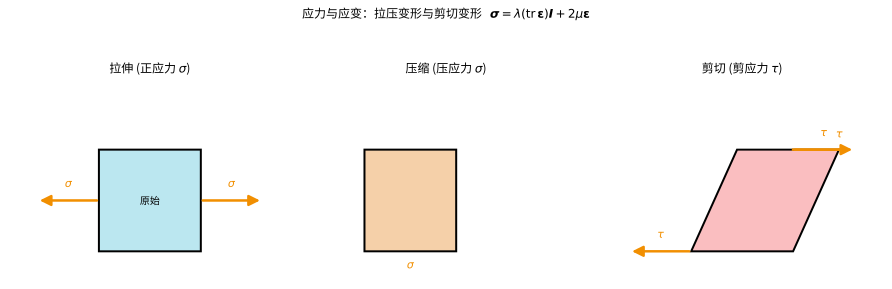

> **直观理解（现实类比）**：拉一根橡皮筋，它会变细变长（拉伸）；压一块海绵，它会变矮变肥（压缩）；而两手捏住一块豆腐上下错开，它会被"搓"成平行四边形（剪切）。应力就是"单位面积上的力"，应变就是"单位尺度的变形量"，它们就像价格与销量——应力驱动材料发生与之成正比的应变，这正是 Hooke 定律的直观含义。

### 示例2：Neo-Hookean超弹性材料

**问题**：给出不可压缩Neo-Hookean材料的应变能函数和应力表达式。

**解答**：

不可压缩Neo-Hookean材料的应变能函数为：

$$\Psi = \frac{\mu}{2} (I_1 - 3)$$

其中 $\mu$ 是剪切模量，$I_1 = \text{tr}(\boldsymbol{C}) = \text{tr}(\boldsymbol{b})$ 是右Cauchy-Green变形张量的第一主不变量。不可压缩条件 $\det \boldsymbol{F} = 1$ 意味着 $I_3 = 1$。

**Cauchy应力表达式**：

$$\boldsymbol{\sigma} = -p \boldsymbol{I} + \mu \boldsymbol{b}$$

其中 $p$ 是由不可压缩条件确定的静水压力（Lagrange乘子）。

**推导**：

由超弹性材料的本构关系：

$$\boldsymbol{S} = 2 \frac{\partial \Psi}{\partial \boldsymbol{C}} = \mu \boldsymbol{I}$$

其中利用了 $\frac{\partial I_1}{\partial \boldsymbol{C}} = \boldsymbol{I}$。

对于不可压缩材料，需引入约束条件 $\det \boldsymbol{F} = 1$，通过Lagrange乘子 $p$ 修正应力：

$$\boldsymbol{S} = -p \boldsymbol{C}^{-1} + \mu \boldsymbol{I}$$

通过Piola变换得到Cauchy应力：

$$\boldsymbol{\sigma} = \frac{1}{J} \boldsymbol{F} \boldsymbol{S} \boldsymbol{F}^T = -p \boldsymbol{I} + \mu \boldsymbol{b}$$

**应用**：Neo-Hookean模型广泛应用于橡胶类材料和大变形弹性体的模拟，尤其适用于描述中等变形行为。

> **💡 直观理解（类比）**：Neo-Hookean 就像是超弹性阵营里最朴素的"橡皮筋模型"——能量只跟第一主不变量 $I_1$（大致代表材料被拉伸得有多"凶"）挂钩：$\Psi=\frac{\mu}{2}(I_1-3)$。变形越明显、$I_1$ 越大，储存的能量越多，应力随之由 $\mu\boldsymbol{b}$ 给出。那块不可缺少的静水压 $p\boldsymbol{C}^{-1}$ 项，像是用 Lagrange 乘子的方式把"无论如何都捏不动体积"（$\det\boldsymbol{F}=1$）的约束硬挤进来，保证材料只剪切、不改体积。它公式简洁、以 $\mu$ 一个常数就能标定，是小到中等变形下橡胶类材料的标准开场模型。

> 连续介质力学的"微积分味"藏在一个动作里：**把一块材料切开、看"这一小块"上受力与变形如何互相牵动**。本节用「策略→例题→分步解→回读现实」四步法，把应力、应变、本构方程放进拉棒、剪切、受压这些可手算的工程场景里算一遍。每道例题先给**解题策略**，再给出**每步都解释'为什么'**的分步解答。

### 🎯 本级解题策略（Principles of Problem Solving）

做一道连续介质力学题，请按这四步走：

- **第一步 · 定构型与坐标**：先确认是参考构型还是当前构型，写清位移场 $\boldsymbol{u}$ 或变形映射 $\boldsymbol{\varphi}$，再定坐标系。
- **第二步 · 选变形度量**：小变形用无穷小应变 $\boldsymbol{\varepsilon}=\frac12(\nabla\boldsymbol{u}+\nabla\boldsymbol{u}^{\top})$；大变形用 $\boldsymbol{F}$、$\boldsymbol{C}$、$\boldsymbol{E}$。别混用参考与当前构型。
- **第三步 · 配本构方程**：把应变换算成应力：线弹性 $\boldsymbol{\sigma}=\lambda(\text{tr}\,\boldsymbol{\varepsilon})\boldsymbol{I}+2\mu\boldsymbol{\varepsilon}$；超弹性 $\boldsymbol{S}=2\frac{\partial\Psi}{\partial\boldsymbol{C}}$。材料参数（$E,\nu,\mu,K$）要先换算成同一套。
- **第四步 · 用守恒/平衡验算**：把应力代回力平衡（Navier/平衡方程）看是否自洽；数值上注意单位（Pa、kN、m）换算，最后把"数值"翻译回"会不会断、伸长多少"的工程判断。

> **一句话带走**：连续介质题的分步解，就是"找到变形 → 求出应变 → 配上本构得应力 → 用平衡核对"四步循环——单位错了再漂亮的公式也白搭。

---

### 例题 A · 拉一根钢棒：它到底会伸长多少

> **🎯 建模策略**：这是最简单也最典型的"单向拉伸"问题：应力只有轴向分量，应变只有一个方向。**策略：先用 $P/A$ 得应力，再用 Hooke 定律 $\sigma=E\varepsilon$ 得应变，最后乘原长得伸长——三步到位。**

**问题**：一根长 $L=2$ m、截面积 $A=10^{-4}$ m²（$1\text{ cm}^2$）的钢棒，弹性模量 $E=200$ GPa，两端受轴向拉力 $P=100$ kN（$10^5$ N）。求棒内轴向应力、轴向应变与总伸长量。

**解**：

**步骤 1：求轴向应力**

$$
\sigma=\frac{P}{A}=\frac{10^5\text{ N}}{10^{-4}\text{ m}^2}=10^{9}\text{ Pa}=1\text{ GPa}
$$

**步骤 2：用 Hooke 定律求应变**

$$
\varepsilon=\frac{\sigma}{E}=\frac{10^{9}}{2\times10^{11}}=5\times10^{-3}=0.5\%
$$

**步骤 3：求总伸长并回读现实**

$$
\Delta L=\varepsilon L=5\times10^{-3}\times2=0.01\text{ m}=1\text{ cm}
$$

> **回读现实**：$1\text{ GPa}$ 已是相当高的应力（接近多数结构钢的屈服点），而 $0.5\%$ 的应变、$2$ m 棒伸长 $1$ cm 是"肉眼可见"的量级。这提醒工程上"看似纹丝不动的钢，其实一直在悄悄伸缩"——桥梁伸缩缝、管道热膨胀补偿，都是在为这种微小变形留余量。

---

### 例题 B · 简单剪切：一块橡皮在扳手力下歪了多少

> **🎯 建模策略**：剪切问题的特征是"位移一个方向、随高度线性变化"，应变是剪力对应的切应变。**策略：先由切应力与剪切模量得切应变 $\gamma=\tau/G$，再由几何关系换算成顶点水平位移。**

**问题**：一块方块橡皮高 $h=0.05$ m，剪切模量 $G=10^6$ Pa，顶面受平行切应力 $\tau=5\times10^4$ Pa。忽略体积应变，求切应变与顶面相对底面的水平滑移量。

**解**：

**步骤 1：由 $\tau=G\gamma$ 求切应变**

$$
\gamma=\frac{\tau}{G}=\frac{5\times10^4}{10^6}=0.05
$$

**步骤 2：由几何求水平滑移**

对纯剪切，切应变 $\gamma$ 等于顶面水平位移 $\Delta$ 除以高度 $h$（小角度下 $\tan\gamma\approx\gamma$）：

$$
\Delta=\gamma h=0.05\times0.05=2.5\times10^{-3}\text{ m}=2.5\text{ mm}
$$

**步骤 3：回读现实**

> **回读现实**：橡皮这类"软"材料 $G$ 小，$0.05$ 的切应变就给顶面带来 $2.5$ mm 的滑移、外观明显歪斜（角度约 $3^\circ$）。而钢材 $G\approx80$ GPa，同样切应力下滑移微米级。**"刚度"决定同一外力下变形是肉眼可见还是几乎可忽略**——这正是选材的物理依据。

---

### 例题 C · 三向受压：水下物体体积会被压掉多少

> **🎯 建模策略**：静水压力问题只需关心体积应变。**策略：用体积模量 $K$ 连接平均压应力和体应变 $\frac{\Delta V}{V}=-\frac{p}{K}$，先算体应变，再还原成边长或体积的变化。**

**问题**：一个边长为 $a=0.1$ m 的立方体钢块（体积模量 $K=160$ GPa）完全沉入 4 km 深的水下。忽略水的压缩，取水深压强为 $p=\rho gh$、$\rho g=10^4\ \text{N/m}^3$，求由此压应力引起的体积相对变化。

**解**：

**步骤 1：求静水压强**

$$
p=(\rho g)h=10^4\times4\times10^3=4\times10^7\text{ Pa}=40\text{ MPa}
$$

**步骤 2：由体积模量求体应变**

$$
\frac{\Delta V}{V}=-\frac{p}{K}=-\frac{4\times10^7}{1.6\times10^{11}}=-2.5\times10^{-4}
$$

**步骤 3：换算体积变化并回读现实**

体积 $V=a^3=10^{-3}\text{ m}^3$，$\Delta V=(-2.5\times10^{-4})(10^{-3})=-2.5\times10^{-7}\text{ m}^3=-0.25\ \text{cm}^3$。

> **回读现实**：$40$ MPa（4 km 深水的压强）能把一块 $1\ \text{dm}^3$ 的钢压掉约 $0.25\ \text{cm}^3$（约千分之 0.25），几乎可忽略。这告诉我们**钢的"不可压"在很大程度上成立**，深海潜器、高压容器的体积变化远小于压力幅度——凡是要求"承压不变形"的场合，都依赖这种高体积模量。

---

## 习题

### 基础题

**习题 1**（连续介质假设）说明连续介质假设的基本思想，指出物理量（密度、速度、应力）在什么条件下可以视为空间位置的连续函数，并说明该假设在何种尺度的流动中成立。

**习题 2**（变形梯度）写出变形梯度 $\boldsymbol{F} = \frac{\partial \boldsymbol{\varphi}}{\partial \boldsymbol{X}}$（分量形式 $F_{iA} = \frac{\partial x_i}{\partial X_A}$），说明它包含了哪些关于变形与转动过程的信息。

**习题 3**（应变张量）写出右 Cauchy-Green 变形张量 $\boldsymbol{C} = \boldsymbol{F}^T\boldsymbol{F}$、左 Cauchy-Green 变形张量 $\boldsymbol{b} = \boldsymbol{F}\boldsymbol{F}^T$、Green-Lagrange 应变张量 $\boldsymbol{E} = \frac{1}{2}(\boldsymbol{C} - \boldsymbol{I})$ 与无穷小应变张量 $\boldsymbol{\varepsilon} = \frac{1}{2}(\nabla\boldsymbol{u} + (\nabla\boldsymbol{u})^T)$ 的定义。

**习题 4**（Cauchy 应力张量）说明 Cauchy 应力张量 $\boldsymbol{\sigma}$ 的物理意义，写出面力关系 $\boldsymbol{t}(\boldsymbol{n}) = \boldsymbol{\sigma}\cdot\boldsymbol{n}$，并指出它作用在当前构型中的哪个面积之上。

**习题 5**（守恒律）写出连续介质中的质量守恒 $\dot{\rho} + \rho\nabla\cdot\boldsymbol{v} = 0$、动量守恒（Cauchy 第一运动定律）$\nabla\cdot\boldsymbol{\sigma} + \rho\boldsymbol{b} = \rho\dot{\boldsymbol{v}}$ 与能量守恒 $\rho\dot{e} = \boldsymbol{\sigma}:\boldsymbol{d} - \nabla\cdot\boldsymbol{q} + \rho r$。

**习题 6**（材料分类）说明弹性、塑性、粘弹性、超弹性四类材料各自对应力的响应有何区别，并指出超弹性材料区别于其他材料的标志。

**习题 7**（Piola-Kirchhoff 应力）写出第一 Piola-Kirchhoff 应力 $\boldsymbol{P} = J\boldsymbol{\sigma}\boldsymbol{F}^{-T}$ 与第二 Piola-Kirchhoff 应力 $\boldsymbol{S} = \boldsymbol{F}^{-1}\boldsymbol{P}$（$J = \det\boldsymbol{F}$），说明三者分别参考哪个构型的力与面积。

**习题 8**（广义 Hooke 定律）写出各向同性线性弹性材料的本构关系 $\boldsymbol{\sigma} = \lambda(\text{tr}\,\boldsymbol{\varepsilon})\boldsymbol{I} + 2\mu\boldsymbol{\varepsilon}$，说明 $\lambda$ 与 $\mu$ 的名称及对应变形的意义。

**习题 9**（Lamé 常数与工程常数）写出 Lamé 常数与杨氏模量、泊松比的关系 $\lambda = \frac{E\nu}{(1+\nu)(1-2\nu)}$、$\mu = \frac{E}{2(1+\nu)}$，并说明 $E$ 与 $\nu$ 的物理含义。

**习题 10**（超弹性本构）写出超弹性材料的本构关系 $\boldsymbol{S} = 2\frac{\partial\Psi}{\partial\boldsymbol{C}}$（或 $\boldsymbol{P} = \frac{\partial\Psi}{\partial\boldsymbol{F}}$），说明其中的 $\Psi$ 是什么，并指出该关系由哪条热力学不等式导出。

### 进阶题

**习题 11**（简单剪切变形）对简单剪切变形 $\boldsymbol{x} = (X_1 + \gamma X_2, X_2, X_3)$ 分别计算变形梯度 $\boldsymbol{F}$、右 Cauchy-Green 张量 $\boldsymbol{C}$、Green-Lagrange 应变 $\boldsymbol{E}$ 与 $\gamma\ll1$ 时的无穷小应变 $\boldsymbol{\varepsilon}$。

**习题 12**（Green-Lagrange 刚体不变性）证明 Green-Lagrange 应变 $\boldsymbol{E}$ 在刚体运动（$\boldsymbol{F} = \boldsymbol{R}$，$\boldsymbol{R}^T\boldsymbol{R} = \boldsymbol{I}$）下为零。

**习题 13**（推导 Navier-Stokes 方程）利用 Cauchy 第一运动定律 $\nabla\cdot\boldsymbol{\sigma} + \rho\boldsymbol{b} = \rho\dot{\boldsymbol{v}}$，代入牛顿流体本构 $\boldsymbol{\sigma} = -p\boldsymbol{I} + 2\mu\boldsymbol{d}$（$\boldsymbol{d}$ 为变形率张量），并结合不可压缩条件 $\nabla\cdot\boldsymbol{v} = 0$ 推导 Navier-Stokes 方程。

**习题 14**（应变能密度）证明各向同性线弹性材料的应变能密度函数为 $\Psi = \frac{1}{2}\lambda(\text{tr}\,\boldsymbol{\varepsilon})^2 + \mu\boldsymbol{\varepsilon}:\boldsymbol{\varepsilon}$，并说明其正定性要求。

**习题 15**（Neo-Hookean 材料）已知不可压缩 Neo-Hookean 材料应变能 $\Psi = \frac{\mu}{2}(I_1 - 3)$，利用 $\boldsymbol{S} = 2\frac{\partial\Psi}{\partial\boldsymbol{C}}$ 与不可压缩条件推导其 Cauchy 应力 $\boldsymbol{\sigma} = -p\boldsymbol{I} + \mu\boldsymbol{b}$。

**习题 16**（Cauchy 定理——四面体论证）用无穷小四面体的力平衡推导面力关系 $\boldsymbol{t}(\boldsymbol{n}) = \boldsymbol{\sigma}\cdot\boldsymbol{n}$，说明为何收缩至一点时体力项相对面力项为高阶可忽略。

**习题 17**（极分解）说明任意变形梯度 $\boldsymbol{F}$ 为何可以唯一分解为 $\boldsymbol{F} = \boldsymbol{R}\boldsymbol{U} = \boldsymbol{V}\boldsymbol{R}$，其中 $\boldsymbol{R}$ 为正交（转动）、$\boldsymbol{U}$ 与 $\boldsymbol{V}$ 为对称正定（伸长），并指出这种分解的物理意义。

**习题 18**（本构各向同性表示）写出各向同性弹性材料的应力表示 $\boldsymbol{\sigma} = \alpha_0\boldsymbol{I} + \alpha_1\boldsymbol{b} + \alpha_2\boldsymbol{b}^2$，说明系数 $\alpha_0,\alpha_1,\alpha_2$ 依赖于 $\boldsymbol{b}$ 的哪些不变量。

**习题 19**（Mooney-Rivlin 材料）对 Mooney-Rivlin 材料 $\Psi = C_1(I_1 - 3) + C_2(I_2 - 3)$，利用 $\frac{\partial I_2}{\partial\boldsymbol{C}} = I_1\boldsymbol{I} - \boldsymbol{C}$，推导其不可压缩 Cauchy 应力表达式。

### 挑战题

**习题 20**（极分解的唯一性证明）严格证明变形梯度极分解 $\boldsymbol{F} = \boldsymbol{R}\boldsymbol{U}$ 的唯一性，说明用右 Cauchy-Green 张量 $\boldsymbol{C} = \boldsymbol{F}^T\boldsymbol{F}$ 的对称正定性与平方根唯一性论证 $\boldsymbol{U}$ 与 $\boldsymbol{R}$ 的唯一确定。

**习题 21**（应力对称性与角动量）利用角动量守恒（Cauchy 第二运动定律）说明 Cauchy 应力张量的对称性 $\boldsymbol{\sigma} = \boldsymbol{\sigma}^T$ 的来源，并指出对称性对 $\boldsymbol{\sigma}$ 的独立分量个数的影响。

**习题 22**（超弹性与热力学相容）从 Clausius-Duhem 不等式 $\rho\dot{\eta} + \nabla\cdot(\boldsymbol{q}/\theta) - \rho r/\theta \geq 0$ 出发，结合 Helmholtz 自由能，推导超弹性本构 $\boldsymbol{P} = \frac{\partial\Psi}{\partial\boldsymbol{F}}$ 是由耗散不等式与 $\dot{\boldsymbol{F}}$ 的任意性得到的。

**习题 23**（线弹性能的正定性）给出无穷小应变下各向同性线弹性能 $\Psi = \frac{1}{2}\lambda(\text{tr}\,\boldsymbol{\varepsilon})^2 + \mu\boldsymbol{\varepsilon}:\boldsymbol{\varepsilon}$，讨论 $\lambda$ 和 $\mu$ 需满足什么条件才能保证应变能正定（材料稳定），从而推导对体积模量 $K = \lambda + \frac{2}{3}\mu > 0$、$\mu > 0$ 的要求。

**习题 24**（变形率张量与体积变化）说明变形率张量 $\boldsymbol{d}$ 与体积变化的关系：证明 $\text{tr}(\boldsymbol{d}) = \nabla\cdot\boldsymbol{v}$ 表示体积膨胀率，并说明不可压缩条件 $\nabla\cdot\boldsymbol{v} = 0$ 与质量守恒在密度不变假设下的联系。

**习题 25**（Cauchy 第一运动定律的局部化）从动量的积分守恒出发，利用 Reynolds 输运定理 $\frac{D}{Dt}\int_\Omega\rho\boldsymbol{\phi}\,dV = \int_\Omega\rho\frac{D\boldsymbol{\phi}}{Dt}\,dV$、Cauchy 定理与散度定理，把积分方程局部化为微分形式 $\nabla\cdot\boldsymbol{\sigma} + \rho\boldsymbol{b} = \rho\dot{\boldsymbol{v}}$。

**习题 26**（应变能函数的客观性要求）说明应变能函数 $\Psi$ 为何只能依赖于 $\boldsymbol{C}$（或 $\boldsymbol{b}$）而不能直接依赖 $\boldsymbol{F}$ 本身，指出这如何体现了材料本构对客观刚性转动的无感性要求（材料客观性）。

### 探究题

**习题 27**（连续介质假设的适用边界）探究连续介质假设在纳米尺度、稀薄气体与高应变率冲击等极端情形下的失效条件，说明当分子平均自由程与特征尺度可相比时，为何需要改用统计力学或气体分子动力学描述。

**习题 28**（多种应力张量的选用）探究 Cauchy、第一/第二 Piola-Kirchhoff 应力张量分别适合描述何种构型与大变形问题，并从数值计算的便利性角度说明在有限元等中参考构型的应力描述为何更受青睐。

**习题 29**（超弹性模型家族）探究 Neo-Hookean、Mooney-Rivlin 等形式不同超弹性模型的适用差异，说明 $I_2$ 依赖项、可压缩性修正等对描述橡胶类材料大变形行为的影响，以及如何通过实验确定模型常数。

**习题 30**（材料客观性原理的内涵）探究材料客观性（本构对刚体转动的无感性）原理对构造本构模型的约束，说明该原理如何排除掉以 $\boldsymbol{F}$ 直接为自变量的本构、并如何引导采用 $\boldsymbol{C}$、$\boldsymbol{b}$ 或相对变形梯度等合理度量。

### 应用题（综合应用）

**应用题 31**（轴向拉伸—Hooke）：一根铝棒长 $L=1.5$ m、直径 $d=0.01$ m（面积 $\pi d^2/4$），弹性模量 $E=70$ GPa，受 $P=30$ kN。求轴向应力 $\sigma$、轴向应变 $\varepsilon$ 与伸长量 $\Delta L$。

**应用题 32**（剪切—$G$）：一钢方板边长 $a=0.2$ m，剪切模量 $G=80$ GPa，顶面受切应力 $\tau=8\times10^7$ Pa。求 $\gamma$ 与顶面滑移 $\Delta$。

**应用题 33**（泊松比—横向应变）：一根钢棒受轴向拉应变 $\varepsilon_1=10^{-3}$，泊松比 $\nu=0.3$。求横向（直径方向）应变 $\varepsilon_2$ 与面积相对变化（$\varepsilon_2=- \nu\varepsilon_1$，小变形下 $A'\approx A(1+2\varepsilon_2)$）。

**应用题 34**（体应变—体积模量）：压强 $p=100$ MPa 作用于体积模量 $K=40$ GPa 的油液。求体应变 $\Delta V/V$；若初始体积 $V_0=0.001\ \text{m}^3$，求体积减小的绝对值。

---

## 习题答案与解析

### 基础题答案

1. **连续介质假设** 连续介质假设把物质视为在宏观尺度上连续分布，物质点填满空间区域，物理量（密度、速度、应力等）是空间位置与时间的连续函数。该假设在分子平均自由程远小于流动特征尺度时成立，此时微观分子结构的离散性可以被平滑的宏观场替代。

2. **变形梯度** $\boldsymbol{F} = \frac{\partial\boldsymbol{\varphi}}{\partial\boldsymbol{X}}$，分量 $F_{iA} = \frac{\partial x_i}{\partial X_A}$。作为二阶张量，它同时包含了变形的拉伸、剪切与刚体转动的全部信息，是连接参考构型与当前构型基本线元映射 $\mathrm{d}\boldsymbol{x} = \boldsymbol{F}\,\mathrm{d}\boldsymbol{X}$ 的关键量。

3. **应变张量** $\boldsymbol{C} = \boldsymbol{F}^T\boldsymbol{F}$（右 Cauchy-Green）、$\boldsymbol{b} = \boldsymbol{F}\boldsymbol{F}^T$（左 Cauchy-Green）、$\boldsymbol{E} = \frac{1}{2}(\boldsymbol{C}-\boldsymbol{I})$（Green-Lagrange）、$\boldsymbol{\varepsilon} = \frac{1}{2}(\nabla\boldsymbol{u} + (\nabla\boldsymbol{u})^T)$（无穷小应变，位移梯度很小时适用）。

4. **Cauchy 应力张量** Cauchy 应力 $\boldsymbol{\sigma}$ 是当前构型中的真实应力，量纲为"单位当前面积上的力"。面力关系为 $\boldsymbol{t}(\boldsymbol{n}) = \boldsymbol{\sigma}\cdot\boldsymbol{n}$，其中 $\boldsymbol{n}$ 为面元法向，$\boldsymbol{t}(\boldsymbol{n})$ 为该面上的面力密度。

5. **守恒律** 质量守恒 $\dot{\rho} + \rho\nabla\cdot\boldsymbol{v} = 0$；动量守恒（Cauchy 第一运动定律）$\nabla\cdot\boldsymbol{\sigma} + \rho\boldsymbol{b} = \rho\dot{\boldsymbol{v}}$；能量守恒 $\rho\dot{e} = \boldsymbol{\sigma}:\boldsymbol{d} - \nabla\cdot\boldsymbol{q} + \rho r$。

6. **材料分类** 弹性——应力仅取决于当前变形状态；塑性——存在不可逆变形；粘弹性——兼具弹性与粘性（应力依赖变形历史与速率）；超弹性——存在应变能函数，应力由应变能关于变形度量求导导出。超弹性的标志正是存在势函数（应变能）$\Psi$。

7. **Piola-Kirchhoff 应力** 第一 Piola-Kirchhoff 应力 $\boldsymbol{P} = J\boldsymbol{\sigma}\boldsymbol{F}^{-T}$ 的力参考当前构型、面积参考参考构型（两点张量）；第二 Piola-Kirchhoff 应力 $\boldsymbol{S} = \boldsymbol{F}^{-1}\boldsymbol{P} = J\boldsymbol{F}^{-1}\boldsymbol{\sigma}\boldsymbol{F}^{-T}$ 的力与面积都参考参考构型（对称）。

8. **广义 Hooke 定律** $\boldsymbol{\sigma} = \lambda(\text{tr}\,\boldsymbol{\varepsilon})\boldsymbol{I} + 2\mu\boldsymbol{\varepsilon}$：$\lambda$（Lamé 第一常数）对应体积变形部分，$\mu$（Lamé 第二常数，即剪切模量）对应剪切变形部分。该关系是各向同性线性弹性的本构方程。

9. **Lamé 常数与工程常数** $\lambda = \frac{E\nu}{(1+\nu)(1-2\nu)}$、$\mu = \frac{E}{2(1+\nu)}$。杨氏模量 $E$ 度量单向拉伸时的应力应变比例，泊松比 $\nu$ 度量横向收缩与纵向伸长的比值。

10. **超弹性本构** $\boldsymbol{S} = 2\frac{\partial\Psi}{\partial\boldsymbol{C}}$（或 $\boldsymbol{P} = \frac{\partial\Psi}{\partial\boldsymbol{F}}$），其中 $\Psi$ 为应变能密度函数（单位参考体积的能量）。该关系由 Clausius-Duhem 不等式（热力学第二定律）结合 $\dot{\boldsymbol{F}}$ 的任意性导出，故热力学相容。

### 进阶题答案

1. **简单剪切变形** 由 $\boldsymbol{x} = (X_1+\gamma X_2, X_2, X_3)$ 得 $\boldsymbol{F} = \begin{pmatrix}1 & \gamma & 0\\0&1&0\\0&0&1\end{pmatrix}$。于是 $\boldsymbol{C} = \boldsymbol{F}^T\boldsymbol{F} = \begin{pmatrix}1 & \gamma & 0\\\gamma & 1+\gamma^2 & 0\\0&0&1\end{pmatrix}$，$\boldsymbol{E} = \frac{1}{2}(\boldsymbol{C}-\boldsymbol{I}) = \begin{pmatrix}0 & \gamma/2 & 0\\\gamma/2 & \gamma^2/2 & 0\\0&0&0\end{pmatrix}$。位移场 $\boldsymbol{u} = (\gamma X_2, 0, 0)$，无穷小应变 $\boldsymbol{\varepsilon} = \frac{1}{2}(\nabla\boldsymbol{u}+(\nabla\boldsymbol{u})^T) = \begin{pmatrix}0 & \gamma/2&0\\\gamma/2&0&0\\0&0&0\end{pmatrix}$，即 $\gamma\ll1$ 时 $\boldsymbol{E}\to\boldsymbol{\varepsilon}$。

2. **Green-Lagrange 刚体不变性** 刚体运动 $\boldsymbol{F}=\boldsymbol{R}$ 且 $\boldsymbol{R}^T\boldsymbol{R}=\boldsymbol{I}$。代入：$\boldsymbol{E} = \frac{1}{2}(\boldsymbol{F}^T\boldsymbol{F}-\boldsymbol{I}) = \frac{1}{2}(\boldsymbol{R}^T\boldsymbol{R}-\boldsymbol{I}) = \frac{1}{2}(\boldsymbol{I}-\boldsymbol{I}) = \boldsymbol{0}$。这说明 $\boldsymbol{E}$ 排除刚体转动、只度量真实变形，这正是应变度量应满足的基本要求。

3. **推导 Navier-Stokes 方程** 代入 $\boldsymbol{\sigma} = -p\boldsymbol{I} + 2\mu\boldsymbol{d}$：$\nabla\cdot\boldsymbol{\sigma} = -\nabla p + 2\mu\nabla\cdot\boldsymbol{d}$。对不可压牛顿流 $2\boldsymbol{d} = \nabla\boldsymbol{v} + (\nabla\boldsymbol{v})^T$，$\nabla\cdot\boldsymbol{d} = \frac{1}{2}\nabla^2\boldsymbol{v} + \frac{1}{2}\nabla(\nabla\cdot\boldsymbol{v})$，由 $\nabla\cdot\boldsymbol{v}=0$ 得 $\nabla\cdot\boldsymbol{\sigma} = -\nabla p + \mu\nabla^2\boldsymbol{v}$。代入动量方程：$\rho\dot{\boldsymbol{v}} = -\nabla p + \mu\nabla^2\boldsymbol{v} + \rho\boldsymbol{b}$，即 Navier-Stokes 方程。

4. **应变能密度** 由 $\boldsymbol{\sigma} = \partial\Psi/\partial\boldsymbol{\varepsilon} = \lambda(\text{tr}\,\boldsymbol{\varepsilon})\boldsymbol{I} + 2\mu\boldsymbol{\varepsilon}$。验证极值一致性并积分：$\int_0^{\boldsymbol{\varepsilon}}\boldsymbol{\sigma}:\mathrm{d}\boldsymbol{\varepsilon}' = \frac{1}{2}\lambda(\text{tr}\,\boldsymbol{\varepsilon})^2 + \mu\boldsymbol{\varepsilon}:\boldsymbol{\varepsilon}$。正定性要求材料稳定，通常要求 $3\lambda + 2\mu > 0$、$\mu > 0$（即 $K>0$、$\mu>0$）。

5. **Neo-Hookean 材料** 用 $\partial I_1/\partial\boldsymbol{C} = \boldsymbol{I}$，$\boldsymbol{S} = 2\frac{\partial\Psi}{\partial\boldsymbol{C}} = \mu\boldsymbol{I}$。不可压缩 $\det\boldsymbol{F}=1$，需引入 Lagrange 乘子 $p$（静水压力）：$\boldsymbol{S} = -p\boldsymbol{C}^{-1} + \mu\boldsymbol{I}$。经 Piola 变换 $\boldsymbol{\sigma} = \frac{1}{J}\boldsymbol{F}\boldsymbol{S}\boldsymbol{F}^T = -p\boldsymbol{I} + \mu\boldsymbol{b}$（$J=1$）。

6. **Cauchy 定理——四面体论证** 对无穷小四面体，斜面与坐标面的面积关系为 $\Delta S_i = n_i\Delta S$。写力平衡 $\boldsymbol{t}(\boldsymbol{n})\Delta S - \sum\boldsymbol{t}(\boldsymbol{e}_i)n_i\Delta S = (\rho\boldsymbol{a}-\rho\boldsymbol{b})\Delta V$，并利用 $\boldsymbol{t}(-\boldsymbol{e}_i) = -\boldsymbol{t}(\boldsymbol{e}_i)$。四角体缩至一点时 $\Delta V\sim O(h^3)$、$\Delta S\sim O(h^2)$，故 $h\to0$ 时体积项为高阶小量可忽略，得 $\boldsymbol{t}(\boldsymbol{n}) = \sum_i\boldsymbol{t}(\boldsymbol{e}_i)n_i = \boldsymbol{\sigma}\cdot\boldsymbol{n}$。

7. **极分解** 右 Cauchy-Green 张量 $\boldsymbol{C}=\boldsymbol{F}^T\boldsymbol{F}$ 对称正定（对任意非零 $\boldsymbol{v}$，$\boldsymbol{v}^T\boldsymbol{C}\boldsymbol{v}=\|\boldsymbol{F}\boldsymbol{v}\|^2>0$）。令 $\boldsymbol{U}=\sqrt{\boldsymbol{C}}$（对称正定）、$\boldsymbol{R}=\boldsymbol{F}\boldsymbol{U}^{-1}$，则 $\boldsymbol{R}^T\boldsymbol{R}=\boldsymbol{U}^{-1}\boldsymbol{C}\boldsymbol{U}^{-1} = \boldsymbol{U}^{-1}\boldsymbol{U}^2\boldsymbol{U}^{-1} = \boldsymbol{I}$ 为正交，故 $\boldsymbol{F}=\boldsymbol{R}\boldsymbol{U}$。类似 $\boldsymbol{V}=\sqrt{\boldsymbol{b}}=\boldsymbol{R}\boldsymbol{U}\boldsymbol{R}^T$ 得 $\boldsymbol{F}=\boldsymbol{V}\boldsymbol{R}$。物理意义：把任意变形分解为先伸长后转动（或先转动后伸长）。

8. **本构各向同性表示** 各向同性弹性材料 $\boldsymbol{\sigma} = \alpha_0\boldsymbol{I} + \alpha_1\boldsymbol{b} + \alpha_2\boldsymbol{b}^2$，其中 $\alpha_0,\alpha_1,\alpha_2$ 是 $\boldsymbol{b}$（或 $\boldsymbol{C}$）的三个主不变量 $I_1 = \text{tr}\,\boldsymbol{b}$、$I_2 = \frac{1}{2}[(\text{tr}\,\boldsymbol{b})^2 - \text{tr}\,\boldsymbol{b}^2]$、$I_3 = \det\boldsymbol{b}$ 的标量函数。该表示由各向同性张量函数表示定理与 Cayley-Hamilton 定理保证。

9. **Mooney-Rivlin 材料** 用 $\partial I_1/\partial\boldsymbol{C}=\boldsymbol{I}$、$\partial I_2/\partial\boldsymbol{C} = I_1\boldsymbol{I} - \boldsymbol{C}$：$\boldsymbol{S} = 2\frac{\partial\Psi}{\partial\boldsymbol{C}} = 2C_1\boldsymbol{I} + 2C_2(I_1\boldsymbol{I} - \boldsymbol{C})$。不可压缩修正（乘子 $p$）$\boldsymbol{S} = -p\boldsymbol{C}^{-1} + 2C_1\boldsymbol{I} + 2C_2(I_1\boldsymbol{I} - \boldsymbol{C})$，再经 Piola 变换 $\boldsymbol{\sigma} = \frac{1}{J}\boldsymbol{F}\boldsymbol{S}\boldsymbol{F}^T = -p\boldsymbol{I} + 2C_1\boldsymbol{b} - 2C_2\boldsymbol{b}^{-1}$（利用 $I_1\boldsymbol{b}-\boldsymbol{b}^2 = \text{tr}\,\boldsymbol{C}\,\boldsymbol{b} - \boldsymbol{b}^2$ 与 Cayley-Hamilton 化简）。

### 挑战题答案

1. **极分解的唯一性证明** 设 $\boldsymbol{F}=\boldsymbol{R}_1\boldsymbol{U}_1=\boldsymbol{R}_2\boldsymbol{U}_2$。两边取 $\boldsymbol{F}^T\boldsymbol{F}$：$\boldsymbol{U}_1^2 = \boldsymbol{F}^T\boldsymbol{F} = \boldsymbol{U}_2^2$。$\boldsymbol{U}_i$ 对称正定，其平方根唯一，故 $\boldsymbol{U}_1=\boldsymbol{U}_2$。又 $\boldsymbol{R}_1 = \boldsymbol{F}\boldsymbol{U}_1^{-1} = \boldsymbol{F}\boldsymbol{U}_2^{-1} = \boldsymbol{R}_2$，唯一性得证。关键在于对称正定矩阵的平方根唯一性，这由 $\boldsymbol{C} = \sum\lambda_i^2\boldsymbol{N}_i\otimes\boldsymbol{N}_i$（$\lambda_i>0$）的正交对角化与正特征值保证。

2. **应力对称性与角动量** Cauchy 第二运动定律（角动量守恒）要求体积元上的力矩平衡。对一个无穷小体积元，面力对中心取矩总和必须为零；若 $\boldsymbol{\sigma}$ 反对称部分不为零，会导致净力矩，违反角动量守恒，故必须有 $\sigma_{ij} = \sigma_{ji}$。对称性使 $\boldsymbol{\sigma}$ 的独立分量由 9 个减为 6 个，为求解运动方程减少未知量。

3. **超弹性与热力学相容** 由 Clausius-Duhem 不等式并代入能量守恒，等温下得耗散不等式 $\boldsymbol{P}:\dot{\boldsymbol{F}} - \rho_0\dot{\psi} \geq 0$。令 $\Psi = \rho_0\psi$，若 $\Psi=\Psi(\boldsymbol{F})$，则 $\dot{\Psi} = \frac{\partial\Psi}{\partial\boldsymbol{F}}:\dot{\boldsymbol{F}}$，代入得 $\left(\boldsymbol{P} - \frac{\partial\Psi}{\partial\boldsymbol{F}}\right):\dot{\boldsymbol{F}} \geq 0$。因 $\dot{\boldsymbol{F}}$ 可取任意值（变形的任意性），要该不等式对所有过程成立，括号必须为零，即 $\boldsymbol{P} = \frac{\partial\Psi}{\partial\boldsymbol{F}}$，再由 $\boldsymbol{P}=\boldsymbol{F}\boldsymbol{S}$、$\boldsymbol{C}=\boldsymbol{F}^T\boldsymbol{F}$ 得 $\boldsymbol{S} = 2\frac{\partial\Psi}{\partial\boldsymbol{C}}$。

4. **线弹性能的正定性** 应变能密度 $\Psi = \frac{1}{2}\lambda(\text{tr}\,\boldsymbol{\varepsilon})^2 + \mu\boldsymbol{\varepsilon}:\boldsymbol{\varepsilon}$。对体积应变，$\boldsymbol{\varepsilon}=\frac{1}{3}(\text{tr}\,\boldsymbol{\varepsilon})\boldsymbol{I}$ 时 $\Psi = \frac{1}{2}(\lambda+\frac{2}{3}\mu)(\text{tr}\,\boldsymbol{\varepsilon})^2 = \frac{1}{2}K(\text{tr}\,\boldsymbol{\varepsilon})^2$，$K=\lambda+\frac{2}{3}\mu$ 为体积模量；对纯剪切（$\text{tr}\,\boldsymbol{\varepsilon}=0$），$\Psi = \mu\boldsymbol{\varepsilon}:\boldsymbol{\varepsilon}$。材料稳定要求任一变形的能量非负，故需 $K = \lambda + \frac{2}{3}\mu > 0$、$\mu > 0$。

5. **变形率张量与体积变化** 变形率张量 $\boldsymbol{d} = \frac{1}{2}(\nabla\boldsymbol{v} + (\nabla\boldsymbol{v})^T)$。体积元相对变化率满足 $\frac{\dot{\delta V}}{\delta V} = \nabla\cdot\boldsymbol{v}$，而 $\text{tr}\,\boldsymbol{d} = \nabla\cdot\boldsymbol{v}$，故 $\text{tr}\,\boldsymbol{d}$ 即体积膨胀率。不可压缩意味着体积不变化：$\nabla\cdot\boldsymbol{v} = 0$；对常密度材料质量守恒 $\dot{\rho} + \rho\nabla\cdot\boldsymbol{v} = 0$ 退化为 $\nabla\cdot\boldsymbol{v}=0$，两者在等密度情形一致。

6. **Cauchy 第一运动定律的局部化** 动量的积分守恒为 $\frac{D}{Dt}\int_\Omega\rho\boldsymbol{v}\,dV = \int_\Omega\rho\boldsymbol{b}\,dV + \int_{\partial\Omega}\boldsymbol{t}\,dS$。由 Reynolds 输运定理左端 $=\int_\Omega\rho\dot{\boldsymbol{v}}\,dV$；由 Cauchy 定理与散度定理，右端面力项 $=\int_{\partial\Omega}\boldsymbol{\sigma}\cdot\boldsymbol{n}\,dS = \int_\Omega\nabla\cdot\boldsymbol{\sigma}\,dV$。故 $\int_\Omega(\nabla\cdot\boldsymbol{\sigma} + \rho\boldsymbol{b} - \rho\dot{\boldsymbol{v}})\,dV = 0$，由 $\Omega$ 任意取被积函数为零，得 $\nabla\cdot\boldsymbol{\sigma} + \rho\boldsymbol{b} = \rho\dot{\boldsymbol{v}}$。

7. **应变能函数的客观性要求** 材料客观性（本构对刚体转动无感）要求刚性转动物体时本构关系形式不变。若 $\Psi$ 直接依赖 $\boldsymbol{F}$，则叠加一个刚体转动 $\boldsymbol{Q}$ 得 $\boldsymbol{Q}\boldsymbol{F}$，而 $\Psi(\boldsymbol{Q}\boldsymbol{F})\neq\Psi(\boldsymbol{F})$ 会错误地预示能量变化。由于 $\boldsymbol{C} = \boldsymbol{F}^T\boldsymbol{F}$（或 $\boldsymbol{b}$、$\boldsymbol{E}$）在刚体转动下不变（$(\boldsymbol{Q}\boldsymbol{F})^T(\boldsymbol{Q}\boldsymbol{F}) = \boldsymbol{F}^T\boldsymbol{F}$），故 $\Psi$ 只能依赖 $\boldsymbol{C}$ 等转动无关的度量。

### 探究题答案

1. **连续介质假设的适用边界** 连续介质假设在分子平均自由程与流动特征尺度可相比时失效，典型场景包括：纳米尺度流动（微纳通道中尺度接近分子自由程）、稀薄气体（低压高马赫数，Knudsen 数接近或超过 1）、冲击波与超高应变率（局部密度、应力在分子尺度上剧变）。此时连续假设下的场方程和本构失效，需改用 Boltzmann 方程的气体分子动力学、粒子模拟（分子动力学、DSMC）或统计力学来刻画离散分子微观行为。

2. **多种应力张量的选用** Cauchy 应力 $\boldsymbol{\sigma}$ 描述当前（变形后）构型的真实应力，适合小变形与欧拉描述；第一 Piola-Kirchhoff $\boldsymbol{P}$ 的力在当前构型、面积在参考构型，适合边界力已知于参考构型的问题；第二 Piola-Kirchhoff $\boldsymbol{S}$ 完全参考参考构型、对称且与 $\boldsymbol{C}$ 共轭（$\boldsymbol{S}=2\partial\Psi/\partial\boldsymbol{C}$），特别适合大变形表述。在有限元方法中，由于网格与积分建立在参考（未变形）构型上，用 $\boldsymbol{P}$、$\boldsymbol{S}$ 和 $\boldsymbol{F}$ 描述编辑构型便利得多，因而更受青睐。

3. **超弹性模型家族** Neo-Hookean $\Psi=\frac{\mu}{2}(I_1-3)$ 只依赖 $I_1$，形式简单，适合中等变形，但无法描述大伸张时的应变硬化；Mooney-Rivlin $\Psi=C_1(I_1-3)+C_2(I_2-3)$ 增加 $I_2$ 项，能更好拟合较宽的等双轴与剪切数据；更复杂者加入高次 $I_1,I_2$ 项或可压缩项（引入体积模量 $K$ 处理近乎不可压缩）。常数（$\mu$、$C_1$、$C_2$、$K$）通常由单轴/双轴/纯剪实验的应力应变曲线拟合标定。

4. **材料客观性原理的内涵** 材料客观性（frame indifference / objectivity）要求本构方程在刚体转动（叠加任意正交变换 $\boldsymbol{Q}$）下形式不变，即 $\boldsymbol{Q}\boldsymbol{\sigma}\boldsymbol{Q}^T = \mathcal{G}(\boldsymbol{Q}\boldsymbol{b}\boldsymbol{Q}^T)$ 之类。这一原理排除以 $\boldsymbol{F}$ 直接建模的本构（因为 $\boldsymbol{F}$ 的老式信息被转动混淆），转而要求采用转动无关的变形度量（$\boldsymbol{C}$、$\boldsymbol{b}$、$\boldsymbol{E}$ 或相对变形梯度）作自变量。它同时保证材料的能量、应力不会因观察坐标系转动而改变，是本构模型合法性的根本约束，也解释了为何各向同性表示以 $\boldsymbol{b}$（或 $\boldsymbol{C}$）的主不变量出现。

### 应用题答案

1. **轴向拉伸** $A=\pi(0.01)^2/4=\pi\times10^{-4}/4\approx7.854\times10^{-5}\ \text{m}^2$；$\sigma=P/A=3\times10^4/7.854\times10^{-5}\approx3.82\times10^8$ Pa$=382$ MPa；$\varepsilon=\sigma/E=3.82\times10^8/7\times10^{10}\approx5.46\times10^{-3}$；$\Delta L=\varepsilon L=5.46\times10^{-3}\times1.5\approx8.2\times10^{-3}\ \text{m}=8.2$ mm。
2. **剪切** $\gamma=\tau/G=8\times10^7/8\times10^{10}=10^{-3}$；$\Delta=\gamma a=10^{-3}\times0.2=2\times10^{-4}\ \text{m}=0.2$ mm。
3. **泊松比** $\varepsilon_2=-\nu\varepsilon_1=-0.3\times10^{-3}$；面积相对变化 $A'\approx A(1+2\varepsilon_2)=A(1-6\times10^{-4})$，即面积缩小约 0.6‰（$2\times0.3\times10^{-3}=6\times10^{-4}$）。物理含义：拉长时直径变细，这正是泊松比造成的"细颈"倾向。
4. **体应变** $\Delta V/V=-p/K=-10^8/(4\times10^{10})=-2.5\times10^{-3}$；$\Delta V=-2.5\times10^{-3}\times0.001=-2.5\times10^{-6}\ \text{m}^3=-2.5\ \text{cm}^3$。油液较"可压"，$100$ MPa 压掉约千分之 $2.5$ 的体积，比同压强下钢的体应变（约 0.6‰，用 $K=160$ GPa 计）大一个量级。

---

## 数学科普

### 把万物都看成"连续的一片"

一杯沙子、一根钢筋、一块肌肉，看起来完全不同，连续介质力学却先假设：它们都能当成"连续的一片"，而不是一堆离散颗粒。这样一来，密度、速度、应力在这些点上都能随时求值、随时求导。

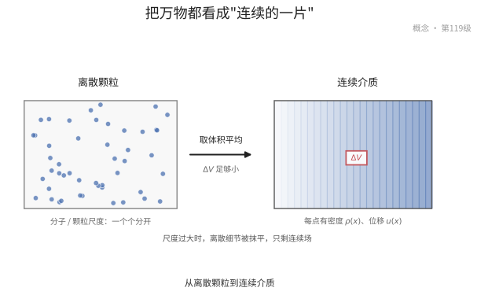

**一句话点破**：先假装物质无限可分地铺满空间，才能为它写出可微的场方程。

### 给每一点配一张"变形说明书"

给一块海绵画上整齐方格再把它掰弯，每个小格被拉伸、倾斜、转动的程度都不同。变形梯度 $\boldsymbol{F}$ 就是这样一张逐点的"变形说明书"，记录每个小体积元附近的变化。

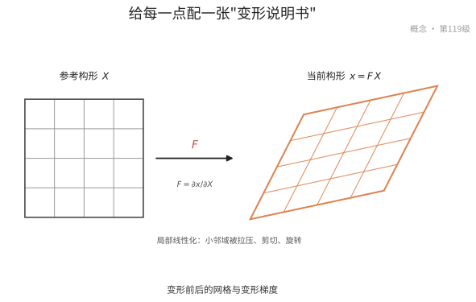

**一句话点破**：变形梯度把"变形成什么样"变成处处可算的矩阵。

### 拉伸、剪切有多大，量出来

橡皮筋被拉长会变细、被扭一下会歪斜，可刚体整体平移或转动其实并不产生"内伤"。应变张量 $\boldsymbol{E}$ 专门量度这种减去转动之后的纯拉伸与剪切。


**一句话点破**：应变只关心形状的真变化，不理会整体平移与转动。

### 一点受力，各个方向都不同

用手掌按压一块豆腐，正面受压、斜切面上却同时出现拉和剪的作用。同一处内力在不同方向的面上表现不同，应力张量 $\boldsymbol{\sigma}$ 把这种"方向依赖性"一次说清。

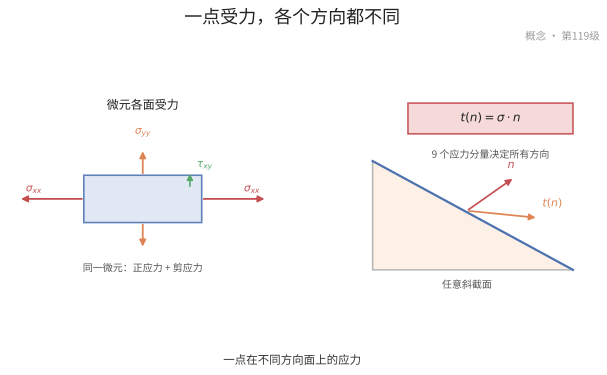

**一句话点破**：应力张量回答了"过这一点的任意一个面上，究竟受了多大的力"。

### 质量、动量、能量三本账

管子里的水不会凭空变多，滑冰的人被推一下就会加速，摩擦生的热也不会消失。质量、动量、能量三条守恒律，就是连续体的"记账规则"，任何材料都得遵守。


**一句话点破**：守恒律是全民通用语法，任何材料都不能违反。

### 给材料填上"个性"

同样拉长 1%，钢几乎纹丝不动，橡皮筋却轻松伸长——差别不在守恒律，而在本构方程。它规定应力如何依赖应变、应变率与温度，是每种材料独有的"性格"。

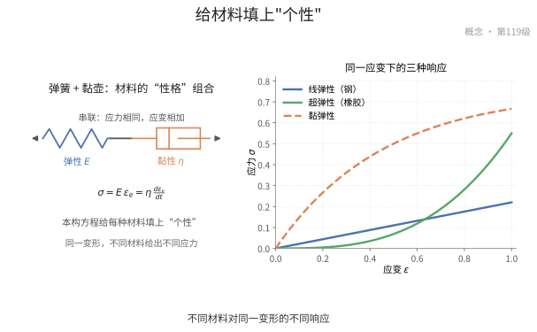

**一句话点破**：守恒律搭好框架，本构方程才填进材料的个性。

### 固体、流体、弹性、塑性

拉一下就回弹的是弹性体，拉过头留下永久变形的是塑性体，一直流动下去的是流体，随时间慢慢蠕变的则介于两者之间。按"变形是否可恢复、是否随时间变化"给材料分类，才能选对本构。


**一句话点破**：材料的三六九等，归根结底看它怎么恢复、怎么流动。

### 为什么一定存在应力张量

无论材料多复杂，过一点的任意斜面上的力，都能由三个坐标面上的力组合出来。Cauchy 定理证明：一定存在一个应力张量，把任意方向的应力一网打尽。

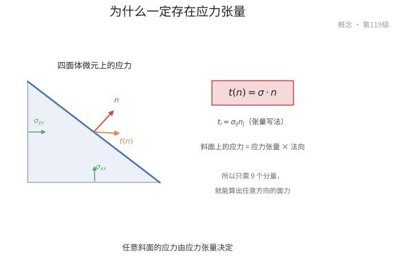

**一句话点破**：应力张量不只是记号，它的存在性由静力平衡严格保证。

### 变形可拆成"拉伸加转动"

把手帕又拉又拧，看起来一团乱，其实总能拆成"先拉伸、再整体旋转"两步。极分解定理 $\boldsymbol{F}=\boldsymbol{R}\boldsymbol{U}$ 说明任何局部变形都能这样拆分。

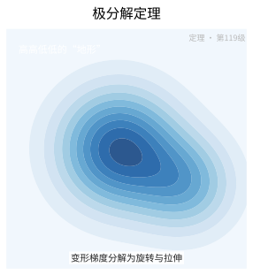

**一句话点破**：任何形变 = 纯拉伸 + 刚体转动，这正是应变张量的立足点。

### 受力就加速的运动定律

把牛顿第二定律用到每个小体积元上，质量乘加速度等于外力的合力，就得到连续体的运动方程 $\nabla\cdot\boldsymbol{\sigma}+\rho\boldsymbol{b}=\rho\ddot{\boldsymbol{x}}$。它就是连续介质版的 $\boldsymbol{F}=m\boldsymbol{a}$。

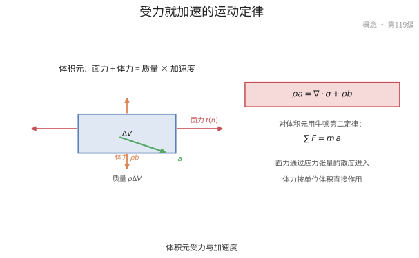

**一句话点破**：运动方程把 $\boldsymbol{F}=m\boldsymbol{a}$ 逐点化，让每个小微元都守牛顿定律。

### 各向同性的材料只剩极少自由

一块各向同性的材料，不管你怎么转它，响应都一样。表示定理说明：这样的本构只能通过应变的三个主不变量来写，能自由调节的只是一些标量函数。

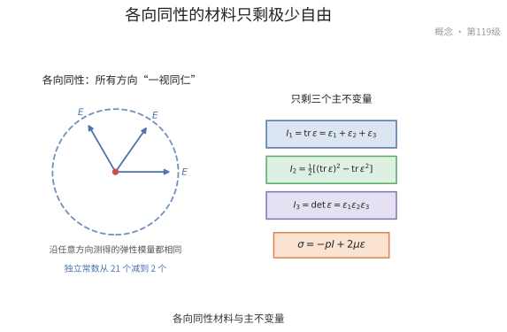

**一句话点破**：对称性越强，本构能自由发挥的空间越小。

### 应变能一求导，应力就出来

橡胶拉伸后能弹回，是因为形变储存了弹性能。超弹性理论证明：只要存在一个应变能函数 $\Psi$，应力就是它的导数，形变与加载路径无关、能量守恒。

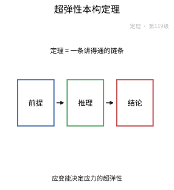

**一句话点破**：有应变能打底，应力就是能量的斜率，能量账本自然平衡。

## 数学史（History of Mathematics）

> 在动手设变量之前，先想清楚一个基本问题：**水、土、钢筋、肌肉各不相同，它们却能共用一套偏微分方程——奥秘在哪？**

**一个真实的生活场景（第一步：直觉）**

水会流动，钢梁会变形，泥土会被压实——它们的"脾气"相去甚远，可工程师都想预测"我用力下去，它会怎么响应"。连续介质力学（continuum mechanics）给出的统一答案是：**把一切材料都当成"连续的介质"，用小到不能再分却又有体积的"质点"铺满整个物体**，然后只凭**质量、动量、能量三条守恒律**和一条**材料本构关系**，就能描述弹性变形、塑性流动、甚至流体运动。它不问材料是什么成分，只问"连续体如何形变与受力"——于是土壤力学、流体力学、结构力学都能在同一套语言下被统一推演。

**它到底想解决什么问题（第二步：要解决的问题）**

**连续介质力学**是现代固体力学与流体力学的共同祖先。它要解决的**根问题**是：

> 如何用**连续介质假设**与**守恒律**（质量、动量、能量）加上**本构关系**，通过 **Cauchy 应力、变形梯度与应变**等概念，建立能描述**弹性、塑性、黏性**等材料行为的统一场方程？

> **🧠 一句话记住连续介质力学的"出生证"**
>
> 连续介质力学源于"把固体与流体统一到连续体假设下用守恒律描述"的力学需求。它要解决的根本问题是：
>
> $$ \boxed{\text{守恒律 + 本构关系 ⇒ 场方程，统一描述弹性/塑性/流体的形变与受力。}} $$

**看待本章的三种眼光（第三步：正式定义前的准备）**

- **假设的眼光**：先认识到"连续介质"是一种站得住脚的简化，粒子细节被尺度化略去。
- **场量的眼光**：再掌握应力、应变、变形梯度这些描述"如何受力、如何形变"的场量。
- **本构的眼光**：最后理解本构关系如何把"材料个性"接入守恒方程。

---

### 7.1 连续假设：把材料不当"粒子"而当"场"

连续介质力学的根基是**连续介质假设**：把物体设想为由许许多多"体积元"连续铺成的介质，每个点都可有密度、速度与应力。它把微观的原子离散舍去，换来可微可积的场方程。这一"看清大尺度、忽略小尺度"的假设，是力学能写出偏微分方程的前提。

### 7.2 运动学：如何描述"形变与流动"

先要讲清"连续体是怎么动的"——这就是**运动学**。**变形梯度、应变张量与速度场**刻画了体积元的拉伸、剪切与刚体转动；**Lagrange 描述**跟随材料点、**Euler 描述**看特定空间位置，两者分别适合固体（Lagrange）与流体（Euler）。这套"量变形与时变"的语言，是刻画一切介质动作的公共地基。

### 7.3 从欧拉到 Cauchy：应力与守恒

**Euler、Cauchy** 在 19 世纪把"受力"严谨化为 **Cauchy 应力张量**——一点所承受的内力分布。由**动量守恒**导出的平衡方程，正是连续体"要么匀速、要么被外力推动"的微分表述。应力张量与平衡方程共同构成连续介质力学的"牛顿第二定律"。

### 7.4 质量、动量、能量：三大守恒与闭合问题

连续介质的场方程全部源自**质量、动量、能量三大守恒律**：密度连续性、动量方程、能量方程各司其职。可这些方程共有许多未知场，于是需要**本构关系**来"闭合"——给出应力如何依赖形变/温度。缺少本构，方程是开环的；补上本构，方程才真正可解。这是连续介质是"缺点越来越少"的关键闭环。

### 7.5 从牛顿到弹性理论：胡克与纳维的实验概括

在连续介质框架下，材料行为由**本构关系**接驳：**胡克定律**以"应力 ∝ 应变"刻画弹性，成为现代弹性力学的起点；**Navier、Cauchy、Poisson** 把弹性理论系统化，形成用弹性模量写就的可解方程。弹性固体由此成为第一个被完全纳入连续介质力学的物类。

### 7.6 流体与固体的一分为二与归一

连续介质力学的一大功绩是"既能当固体、也能当流体"的归一律：**固体以形变为主（弹性、塑性）**，**流体以持续流动为主（黏性与压差）**；而两者都从同一条守恒方程出发，仅在**本构关系**强弱不同处分野——固体用应力-应变、流体用应变率-应力。这为之后的弹塑性力学、流体力学、结构力学提供了共同母体。

### 7.7 弹性、塑性与材料分支的百花齐放

沿着"固体"支线，连续介质力学又细分出**线弹性、超弹性、塑性与粘弹性**等模型：**Tresca、von Mises** 的屈服准则刻画永久的塑性流动，粘弹性把弹性与黏性并蓄。这些模型让"固体会不会屈服、会不会随时间蠕变"也能被方程预测，支撑从桥梁到软骨的力学设计。

### 7.8 经典无解难题与数学挑战

连续介质力学的方程虽美，却极难求解：**Navier–Stokes 方程**的光滑解存在性问题至今是千禧年大奖；弹性与塑性中的**非线性、断裂与接触问题**也让解析难以闭合。这促使它拥抱**变分原理（最小势能）、物质对称性与数值模拟**，把"算不出的精确解"交给计算机逼近。数学与力学的联姻，正是本题的独特气质。

### 7.9 现代连续介质：从机械到多物理与计算

当代连续介质力学已与**有限元、计算力学**深度融合，并向**多物理场耦合**（热-力、流-固、电磁-力）延伸，还引入**损伤、断裂与相场**等更精细的描述。它既是固体与流体力学的统一底座，也是现代工程仿真（CAE）与生物力学的理论骨架，仍在不断扩展"连续体"能覆盖的疆域。

---

| 时间 | 人物／文献 | 事件与贡献 |
| --- | --- | --- |
| 17 世纪 | 胡克 | 提出线性弹性本构（胡克定律） |
| 18–19 世纪 | Euler、Cauchy | 建立应力、变形梯度与守恒方程 |
| 19 世纪 | Navier、Poisson | 系统化弹性理论 |
| 19–20 世纪 | 纳维、斯托克斯 | 导出黏性流体的 NS 方程 |
| 20 世纪 | Tresca、von Mises 等 | 建立塑性屈服准则与塑性理论 |
| 当代 | 计算力学推进 | 有限元、多物理场耦合扩展连续介质模型 |

> **小结**：连续介质力学的演进，是一部"**把千差万别的材料收进同一套场方程**"的统一史。它以"连续介质假设"立本，用运动学与 Cauchy 应力奠定描述语汇，靠三大守恒律配上本构关系把方程"闭合"，由胡克、纳维把弹性系统化，用"同一守恒律 + 不同本构"把固体与流体归于一体，再经塑性、粘弹、多物理与数值计算不断扩展疆域。它始终坚守一个统一雄心：**世间有形之物，皆可看成一团连续的"质"，皆可用守恒与本构把它写进方程、算到明白。**

---

## 现实应用（Real-World Applications）

> 本节把本章的知识点落到真实的工程、科学与生活场景中。每个案例都给出**完整的问题背景、建模过程、可复现的数据 / 公式 / 代码与结果解读**；案例末尾的「涉及知识点」对应本章的具体小节，文末附**知识点覆盖对照表**，确保本章知识点全部被覆盖。

### 应用案例 1：汽车车身｜线弹性有限元分析一块受力钣金

**场景与问题**

某车企要评估一款车门防撞梁（材料为高强钢）在侧面碰撞工况下是否屈服。取其中一块平直钣金做校核：尺寸 $300\ \text{mm}\times80\ \text{mm}\times1.2\ \text{mm}$，一端固定，另一端受 $F=8\ \text{kN}$ 面内力，材料弹性模量 $E=210\ \text{GPa}$、泊松比 $\nu=0.3$、屈服强度 $\sigma_y=550\ \text{MPa}$。工程师要回答：**钣金里的应力分布如何、最大等效应力是否超过屈服？** 这需要连续介质假设、应力应变张量、Cauchy 定理与运动方程——它们是有限元（FEM）的数学地基。

**涉及知识点**

- 本章「连续介质假设」：宏观尺度上钢材被视为连续场（$Kn\ll1$），密度、应力都是空间连续函数。
- 本章「应力张量」：Cauchy 应力 $\boldsymbol{\sigma}$ 描述内部分割面上的面力。
- 本章「应变张量」：小变形用 $\boldsymbol{\varepsilon}=\tfrac12(\nabla\boldsymbol{u}+(\nabla\boldsymbol{u})^\top)$。
- 本章「守恒律」：动量守恒 $\nabla\cdot\boldsymbol{\sigma}+\rho\boldsymbol{b}=\rho\dot{\boldsymbol{v}}$ 在静力下退化为平衡方程。
- 本章「定理1：Cauchy应力张量的存在性（Cauchy定理）」：存在对称二阶张量 $\boldsymbol{\sigma}$ 使 $\boldsymbol{t}(\boldsymbol{n})=\boldsymbol{\sigma}\cdot\boldsymbol{n}$。
- 本章「定理3：运动方程（Cauchy第一运动定律）」：动量守恒的场形式。

**建模与数据**

线弹性本构（各向同性）：$\boldsymbol{\sigma}=\lambda(\operatorname{tr}\boldsymbol{\varepsilon})\boldsymbol{I}+2\mu\boldsymbol{\varepsilon}$，其中 Lamé 常数

$$
\lambda=\frac{E\nu}{(1+\nu)(1-2\nu)},\qquad \mu=\frac{E}{2(1+\nu)}.
$$

代入 $E=210\ \text{GPa},\ \nu=0.3$：$\lambda\approx121.2\ \text{GPa}$，$\mu\approx80.8\ \text{GPa}$。数据：$L=0.3$ m、$W=0.08$ m、$t=1.2\times10^{-3}$ m、$F=8000$ N、密度 $\rho=7850\ \text{kg/m}^3$。

**完整推导与算法**

1. **连续介质假设与平衡方程**。把钢板视为连续体。静力下动量守恒（定理 3）退化为平衡方程

$$
\nabla\cdot\boldsymbol{\sigma}+\rho\boldsymbol{b}=\boldsymbol{0}.
$$

忽略体积力，得 $\nabla\cdot\boldsymbol{\sigma}=\boldsymbol{0}$。Cauchy 定理（定理 1）保证存在对称张量 $\boldsymbol{\sigma}$ 使任意面法向 $\boldsymbol{n}$ 上的面力 $\boldsymbol{t}=\boldsymbol{\sigma}\boldsymbol{n}$。

2. **单轴近似下的应力**。面内力近似为单向拉伸，截面积 $A=W\cdot t=0.08\times1.2\times10^{-3}=9.6\times10^{-5}\ \text{m}^2$，

$$
\sigma_{xx}=\frac{F}{A}=\frac{8000}{9.6\times10^{-5}}\approx83.3\ \text{MPa}.
$$

3. **应变与等效应力**。单轴应力下 $\varepsilon_{xx}=\sigma_{xx}/E=83.3\times10^{6}/210\times10^{9}\approx3.97\times10^{-4}$，$\varepsilon_{yy}=\varepsilon_{zz}=-\nu\varepsilon_{xx}\approx-1.19\times10^{-4}$。von Mises 等效应力

$$
\sigma_{\text{vM}}=\sqrt{\tfrac12\big[(\sigma_{xx}-\sigma_{yy})^2+\dots\big]}=\sigma_{xx}\approx83.3\ \text{MPa}\ <\ 550\ \text{MPa},
$$

结论：不屈服，安全系数约 6.6。

```python
# 核心：由 Cauchy 应力张量与线弹性本构算 von Mises 等效应力，判断是否屈服
sigma = lam*np.trace(eps)*np.eye(3) + 2*mu*eps        # 各向同性线弹性本构
s = sigma - np.trace(sigma)/3*np.eye(3)               # 偏应力张量
sigma_vm = np.sqrt(1.5*np.sum(s*s))                    # von Mises 等效应力
```

4. **有限元离散**。把平衡方程弱形式化，用单元形函数插值位移 $\boldsymbol{u}=\boldsymbol{N}\boldsymbol{u}_e$，得到单元刚度

$$
\boldsymbol{K}_e=\int_{\Omega_e}\boldsymbol{B}^\top\boldsymbol{D}\boldsymbol{B}\,\mathrm{d}\Omega,
$$

其中 $\boldsymbol{B}$ 是应变-位移矩阵、$\boldsymbol{D}$ 是弹性矩阵。组装后解 $\boldsymbol{K}\boldsymbol{u}=\boldsymbol{F}$，再回代求应力。

**可复现步骤**

1. 环境与依赖：`pip install numpy scipy`（FEM 可用 `pip install scikit-fem`）
2. 数据准备：`E,nu,F,W,t = 210e9,0.3,8000.0,0.08,1.2e-3`
3. 运行：`python case1.py`
4. 预期输出：$\lambda\approx121$ GPa、$\mu\approx81$ GPa；面内应力 $\sigma_{xx}\approx83$ MPa；von Mises $\approx83$ MPa，安全系数约 6.6；FEM 解得的最大位移约 $0.12$ mm 量级。

**结果解读与延伸**

本例把本章"场量 + 守恒律 + 本构"的三件套落到最工程化的场景。误差来源：单轴近似忽略了孔洞、折弯导致的应力集中（实际可达 2～3 倍）与几何非线性；薄板的大挠度会超出小应变假设。局限：线弹性只在 $\sigma<\sigma_y$ 时成立，超载须用弹塑性本构（见案例 4）。延伸：碰撞工况是显式动力学（瞬态运动方程 $\rho\ddot{\boldsymbol{u}}=\nabla\cdot\boldsymbol{\sigma}+\rho\boldsymbol{b}$），需处理大变形与接触。

### 应用案例 2：橡胶工业｜以 Neo-Hookean 超弹性模型分析密封圈大变形

**场景与问题**

某汽车密封圈用丁腈橡胶制成，装配时被压缩 $25\%$（大变形），必须用**超弹性**模型而非线弹性。材料参数由单轴拉伸实验拟合：剪切模量 $\mu=0.8\ \text{MPa}$、体积模量 $\kappa=1000\ \text{MPa}$（近似不可压）。要分析：**给定拉伸比 $\lambda$ 下的 Cauchy 应力是多少？为什么必须用 $\boldsymbol{F}$、$\boldsymbol{C}$ 这类客观量而不能直接对位移梯度建模？** 这需要变形梯度、极分解、应变张量与超弹性本构。

**涉及知识点**

- 本章「变形梯度」：$\boldsymbol{F}=\partial\boldsymbol{x}/\partial\boldsymbol{X}$，含拉伸、剪切与刚体转动。
- 本章「应变张量」：$\boldsymbol{C}=\boldsymbol{F}^\top\boldsymbol{F}$、Green–Lagrange $\boldsymbol{E}=\tfrac12(\boldsymbol{C}-\boldsymbol{I})$。
- 本章「本构方程」：应力对变形的响应关系，须满足客观性。
- 本章「材料分类」：橡胶属超弹性（存在应变能势）。
- 本章「定理2：变形梯度与应变张量的关系（极分解）」：$\boldsymbol{F}=\boldsymbol{R}\boldsymbol{U}=\boldsymbol{V}\boldsymbol{R}$。
- 本章「定理5：超弹性材料的本构关系」：$\boldsymbol{S}=2\,\partial\Psi/\partial\boldsymbol{C}$。

**建模与数据**

Neo-Hookean 应变能（可压缩版）：

$$
\Psi=\frac{\mu}{2}(\bar I_1-3)+\frac{\kappa}{2}(J-1)^2,\qquad
\bar I_1=J^{-2/3}\operatorname{tr}\boldsymbol{C},\quad J=\det\boldsymbol{F}.
$$

数据：$\mu=0.8\ \text{MPa}$、$\kappa=1000\ \text{MPa}$、$J\approx1$（近似不可压），单轴拉伸比 $\lambda=1.5$（拉伸 $50\%$）。

**完整推导与算法**

1. **变形梯度与极分解（定理 2）**。单轴拉伸的变形梯度 $\boldsymbol{F}=\operatorname{diag}(\lambda,\lambda^{-1/2},\lambda^{-1/2})$（不可压）。极分解 $\boldsymbol{F}=\boldsymbol{R}\boldsymbol{U}$ 中 $\boldsymbol{R}=\boldsymbol{I}$（无刚体转动），右拉伸张量 $\boldsymbol{U}=\boldsymbol{F}$，说明纯变形。

2. **应变张量**。

$$
\boldsymbol{C}=\boldsymbol{F}^\top\boldsymbol{F}=\operatorname{diag}(\lambda^2,\lambda^{-1},\lambda^{-1}).
$$

3. **超弹性本构（定理 5）**。第二 Piola 应力

$$
\boldsymbol{S}=2\frac{\partial\Psi}{\partial\boldsymbol{C}}=\mu J^{-2/3}\Big(\boldsymbol{I}-\frac{I_1}{3}\boldsymbol{C}^{-1}\Big)+\kappa J(J-1)\boldsymbol{C}^{-1}.
$$

Cauchy 应力由 Piola 变换 $\boldsymbol{\sigma}=J^{-1}\boldsymbol{F}\boldsymbol{S}\boldsymbol{F}^\top$ 得到；单轴情形下轴向

$$
\sigma_{11}=\mu(\lambda^2-\lambda^{-1})+\kappa(\lambda-\lambda^{-2}) .
$$

```python
# 核心：Neo-Hookean 超弹性 —— 由应变能对 C 求导得应力，单轴解 σ=μ(λ²−1/λ)+κ(λ−1/λ²)
F = np.diag([lam, lam**-0.5, lam**-0.5])       # 不可压单轴拉伸的变形梯度
C = F.T @ F                                     # 右 Cauchy-Green 张量
S = mu * (np.eye(3) - np.trace(C)/3 * np.linalg.inv(C)) + kappa*(np.linalg.det(F)-1)*np.linalg.inv(C)
sigma = (1/np.linalg.det(F)) * F @ S @ F.T      # Cauchy 应力
```

4. **数值**。取 $\lambda=1.5$、$\mu=0.8$ MPa，忽略可压项：$\sigma_{11}=0.8\times(2.25-0.667)\approx1.27\ \text{MPa}$。若用线弹性 $E=3\mu=2.4$ MPa、$\varepsilon=0.5$，会得 $\sigma=1.2$ MPa 且应变超 100%（小应变假设已失效）。

**可复现步骤**

1. 环境与依赖：`pip install numpy`
2. 数据准备：`mu,kappa,lam = 0.8e6,1000e6,1.5`
3. 运行：`python case2.py`
4. 预期输出：$\boldsymbol{C}=\operatorname{diag}(2.25,0.667,0.667)$；轴向 Cauchy 应力约 $1.27$ MPa；若 $\boldsymbol{R}\ne\boldsymbol{I}$（含转动），$\boldsymbol{\sigma}$ 不变——验证客观性。

**结果解读与延伸**

关键点是**客观性**：$\boldsymbol{F}$ 本身在刚体转动下变为 $\boldsymbol{Q}\boldsymbol{F}$，不能直接用来写本构；必须用 $\boldsymbol{C}=\boldsymbol{F}^\top\boldsymbol{F}$（对转动不变）或 $\boldsymbol{b}=\boldsymbol{F}\boldsymbol{F}^\top$，这正是极分解与应变张量的意义。局限：Neo-Hookean 只在中等到大变形下准确，超大变形需 Mooney–Rivlin、Ogden 模型；实验数据要覆盖单轴、等双轴、平面拉伸以拟合参数。延伸：超弹性有限元中应力由 $\Psi$ 求导得到，天然保证能量守恒与主对称性。

### 应用案例 3：压力容器｜热弹性下的应力与安全评估

**场景与问题**

某电厂蒸汽管道（外径 $500$ mm、壁厚 $20$ mm、钢制）在运行中承受内压 $p=10\ \text{MPa}$，同时管壁内外温差达 $\Delta T=80$ K。工程师要算：**内壁的环向应力有多大？热膨胀引起的热应力会不会把总应力推过屈服？** 这要用应力张量、守恒律与本构（热弹性）。

**涉及知识点**

- 本章「应力张量」：内压产生的薄膜应力 $\sigma_\theta,\sigma_z,\sigma_r$。
- 本章「守恒律」：径向力平衡方程。
- 本章「本构方程」：热弹性本构 $\boldsymbol{\sigma}=\lambda(\operatorname{tr}\boldsymbol{\varepsilon})\boldsymbol{I}+2\mu\boldsymbol{\varepsilon}-(3\lambda+2\mu)\alpha\Delta T\,\boldsymbol{I}$。
- 本章「定理1：Cauchy应力张量的存在性（Cauchy定理）」：把内压与壁面受力翻译成张量条件。

**建模与数据**

薄壁圆筒薄膜应力：环向 $\sigma_\theta=\frac{pr}{t}$、轴向 $\sigma_z=\frac{pr}{2t}$、径向 $\sigma_r\approx0$。数据：内压 $p=10\ \text{MPa}$、内半径 $r=0.23$ m、壁厚 $t=0.02$ m、$E=200$ GPa、$\nu=0.3$、线膨胀系数 $\alpha=12\times10^{-6}\ \text{K}^{-1}$、$\Delta T=80$ K、屈服 $\sigma_y=350$ MPa。

**完整推导与算法**

1. **热弹性本构**。温度变化使自由膨胀应变 $\boldsymbol{\varepsilon}^{\text{th}}=\alpha\Delta T\,\boldsymbol{I}$，弹性应变为 $\boldsymbol{\varepsilon}^{e}=\boldsymbol{\varepsilon}-\boldsymbol{\varepsilon}^{\text{th}}$，故

$$
\boldsymbol{\sigma}=\lambda(\operatorname{tr}\boldsymbol{\varepsilon}^{e})\boldsymbol{I}+2\mu\boldsymbol{\varepsilon}^{e}.
$$

2. **内压应力**。$\sigma_\theta=10\times10^{6}\times0.23/0.02=115\ \text{MPa}$，$\sigma_z=57.5\ \text{MPa}$。

3. **受约束热应力**。若壁面因温差产生受约束的轴向与环向温度梯度，简化估算的等效应热量：

$$
\sigma^{\text{th}}\approx \frac{E\alpha\Delta T}{1-\nu}=\frac{200\times10^{9}\times12\times10^{-6}\times80}{0.7}\approx274\ \text{MPa}.
$$

4. **叠加与判定**。von Mises 等效应力

$$
\sigma_{\text{vM}}=\sqrt{\sigma_\theta^2+\sigma_z^2-\sigma_\theta\sigma_z}+\sigma^{\text{th}}\approx\sqrt{115^2+57.5^2-115\times57.5}+274\approx100+274=374\ \text{MPa}>\sigma_y ,
$$

故在温差与内压同时作用下会进入屈服——必须加装膨胀节或降低温差。

```python
# 核心：热弹性 —— 总应力 = 内压引起的机械应力 + 受约束热应力 E*alpha*dT/(1-nu)
sig_theta = p * r / t                       # 环向薄膜应力
sig_z = p * r / (2*t)                       # 轴向薄膜应力
sig_th = E * alpha * dT / (1 - nu)          # 受约束热应力
sig_vm = np.sqrt(sig_theta**2 + sig_z**2 - sig_theta*sig_z) + sig_th
```

**可复现步骤**

1. 环境与依赖：`pip install numpy`
2. 数据准备：`p,r,t,E,nu,alpha,dT,sy = 10e6,0.23,0.02,200e9,0.3,12e-6,80.0,350e6`
3. 运行：`python case3.py`
4. 预期输出：$\sigma_\theta=115$ MPa、$\sigma_z=57.5$ MPa、热应力约 $274$ MPa；合成 von Mises 约 $374$ MPa，超过屈服 $350$ MPa。

**结果解读与延伸**

热应力的物理是"想膨胀却被约束"：$\sigma^{\text{th}}\propto E\alpha\Delta T$，与温差成正比、与约束程度成正比。误差来源：薄膜近似忽略了壁厚方向的应力梯度（厚壁需用 Lamé 公式）、温度场假设简化、材料参数随温度变化。工程对策：降低温差、选用低膨胀材料、设置膨胀节释放约束。延伸：瞬态热冲击（如冷激）会产生更剧烈的峰值热应力，需耦合传热与动力学求解。

### 应用案例 4：岩土工程｜土体的弹塑性与地基沉降

**场景与问题**

某建筑地基下的软黏土在加载后先弹性压缩、超过屈服后产生不可恢复的塑性变形。取代表性土样做三轴试验：围压 $p_0=100\ \text{kPa}$、弹性模量 $E=20\ \text{MPa}$、泊松比 $\nu=0.35$、内摩擦角 $\varphi=25^\circ$、黏聚力 $c=15\ \text{kPa}$。工程师要判断：**加载到竖向应力 $\sigma_v=250\ \text{kPa}$ 时，土体处于弹性还是塑性？会沉降多少？** 这要用材料分类（弹性/塑性）与弹塑性本构。

**涉及知识点**

- 本章「材料分类」：弹性（可恢复）vs 塑性（不可恢复、依赖加载历史）。
- 本章「本构方程」：Mohr–Coulomb 屈服 + 弹塑性增量本构。
- 本章「守恒律」：地基内的静力平衡。

**建模与数据**

Mohr–Coulomb 屈服准则用主应力表示：

$$
\tau = c + \sigma_n\tan\varphi\quad\Longleftrightarrow\quad
\sigma_1-\sigma_3 = 2c\cos\varphi + (\sigma_1+\sigma_3)\sin\varphi .
$$

数据：$c=15$ kPa、$\varphi=25^\circ$、$p_0=100$ kPa、$E=20$ MPa、$\nu=0.35$、$\sigma_v=250$ kPa。

**完整推导与算法**

1. **弹塑判据**。竖向为最大主应力 $\sigma_1=250$ kPa、水平为最小主应力 $\sigma_3=100$ kPa。代入屈服函数

$$
f=(\sigma_1-\sigma_3)-2c\cos\varphi-(\sigma_1+\sigma_3)\sin\varphi .
$$

计算：$\sigma_1-\sigma_3=150$ kPa；$2c\cos\varphi=2\times15\times0.9063=27.2$ kPa；$(\sigma_1+\sigma_3)\sin\varphi=350\times0.4226=147.9$ kPa；故 $f=150-27.2-147.9=-25.1$ kPa $<0$，仍处**弹性**（未达屈服，安全余量约 25 kPa）。

```python
# 核心：Mohr-Coulomb 屈服函数 f>0 即进入塑性；f<0 表示仍在弹性范围
f = (sig1 - sig3) - 2*c*math.cos(phi) - (sig1 + sig3)*math.sin(phi)
plastic = f > 0
```

2. **弹性沉降**。若将 $\sigma_v$ 提高到 $300$ kPa，则 $\sigma_1-\sigma_3=200$、$(\sigma_1+\sigma_3)\sin\varphi=169.0$、$f=200-27.2-169.0=3.8>0$，进入塑性。弹性阶段（$\sigma_v\le250$）沉降可用一维压缩 $s=\frac{\Delta\sigma\,H}{E_s}$ 估（$H$ 为土层厚度、$E_s$ 为压缩模量），取 $H=5$ m、$E_s=20$ MPa、$\Delta\sigma=150$ kPa，则 $s=150\times10^{3}\times5/20\times10^{6}=0.0375\ \text{m}=3.75$ cm。

3. **塑性增量**。塑性阶段用流动法则 $\mathrm{d}\boldsymbol{\varepsilon}^p=\mathrm{d}\lambda\,\partial g/\partial\boldsymbol{\sigma}$，弹性与塑性应变累加，沉降不再线性增长且卸载后留有残余变形。

**可复现步骤**

1. 环境与依赖：`pip install numpy`
2. 数据准备：`c,phi,p0,E,nu = 15e3,math.radians(25),100e3,20e6,0.35`
3. 运行：`python case4.py`
4. 预期输出：$\sigma_v=250$ kPa 时 $f\approx-25$ kPa（弹性），弹性沉降约 3.75 cm；$\sigma_v=300$ kPa 时 $f\approx+3.8$ kPa（塑性），卸载后残余变形不可恢复。

**结果解读与延伸**

材料分类的实践价值是"知道卸载后能不能弹回"：弹性可恢复、塑性留残余、粘弹性兼具两者且依赖时间（蠕变）。混淆会导致错误设计——把塑性土当弹性土会低估沉降。误差来源：Mohr–Coulomb 忽略了中主应力影响（可用 Drucker–Prager）、参数 $c,\varphi$ 受取样扰动、排水条件（不排水用总应力分析）。延伸：地基沉降是固结过程（有效应力与时间耦合），需用 Terzaghi 一维固结理论或 Cam-Clay 模型。

### 应用案例 5：航空复合材料｜层合板各向异性本构与铺层设计

**场景与问题**

某飞机机翼蒙皮用碳纤维/环氧树脂层合板（单层正交各向异性）。要求设计铺层角度 $\theta$ 使结构在机翼弯曲方向刚度最大。已知单向板工程常数：$E_1=140\ \text{GPa}$、$E_2=10\ \text{GPa}$、$G_{12}=5\ \text{GPa}$、$\nu_{12}=0.3$。工程师要算：**单层的应力–应变关系（各向异性弹性矩阵）是什么？铺层角如何影响表观模量？** 这要用各向异性本构与各向同性表示定理作对照。

**涉及知识点**

- 本章「本构方程」：从各向同性推广到正交各向异性的一般弹性矩阵。
- 本章「定理4：本构方程的各向同性表示」：$\boldsymbol{\sigma}=\alpha_0\boldsymbol{I}+\alpha_1\boldsymbol{b}+\alpha_2\boldsymbol{b}^2$（以 $\boldsymbol{b}$ 的生成元表示），说明对称性如何限制本构形式。

**建模与数据**

正交各向异性单层在材料主方向下的柔度关系（平面应力）：

$$
\begin{pmatrix}\varepsilon_1\\ \varepsilon_2\\ \gamma_{12}\end{pmatrix}
=\begin{pmatrix}1/E_1 & -\nu_{12}/E_1 & 0\\ -\nu_{12}/E_1 & 1/E_2 & 0\\ 0&0&1/G_{12}\end{pmatrix}
\begin{pmatrix}\sigma_1\\ \sigma_2\\ \tau_{12}\end{pmatrix}.
$$

数据（T300/环氧）：$E_1=140$ GPa、$E_2=10$ GPa、$G_{12}=5$ GPa、$\nu_{12}=0.3$、单层厚度 $t=0.125$ mm。

**完整推导与算法**

1. **求刚度矩阵**。由柔度矩阵求逆得 $\boldsymbol{Q}$：

$$
Q_{11}=\frac{E_1}{1-\nu_{12}\nu_{21}},\quad Q_{22}=\frac{E_2}{1-\nu_{12}\nu_{21}},\quad Q_{12}=\frac{\nu_{12}E_2}{1-\nu_{12}\nu_{21}},\quad Q_{66}=G_{12},
$$

其中 $\nu_{21}=\nu_{12}E_2/E_1=0.3\times10/140\approx0.0214$。故 $Q_{11}\approx140.7$ GPa、$Q_{22}\approx10.05$ GPa、$Q_{12}\approx2.14$ GPa、$Q_{66}=5$ GPa。

2. **坐标变换到铺层角 $\theta$**。$\bar{\boldsymbol{Q}}(\theta)=\boldsymbol{T}^{-1}\boldsymbol{Q}\,(\boldsymbol{T}^{-1})^\top$（$\boldsymbol{T}$ 为应变转换矩阵）。表观轴向模量

$$
E_x(\theta)=1/\bar S_{11}(\theta),
$$

在 $\theta=0^\circ$ 时 $E_x\approx E_1=140$ GPa，$\theta=90^\circ$ 时 $E_x\approx E_2=10$ GPa。这就是"用铺层角调刚度"的原理。

3. **各向同性表示的对照（定理 4）**。若材料各向同性，则应力只能是 $\boldsymbol{b}$ 的生成元组合

$$
\boldsymbol{\sigma}=\alpha_0\boldsymbol{I}+\alpha_1\boldsymbol{b}+\alpha_2\boldsymbol{b}^2,
$$

即只有 3 个独立函数（系数由不变量 $I_1,I_2,I_3$ 决定），故各向同性弹性只需 2 个常数（$\lambda,\mu$）；而正交各向异性有 9 个独立常数——**对称性越少，本构参数越多**。

```python
# 核心：正交各向异性单层刚度矩阵 Q；铺层角 θ 通过坐标变换改变表观模量
Q11 = E1/(1 - nu12*nu21);  Q22 = E2/(1 - nu12*nu21)
Q12 = nu12*E2/(1 - nu12*nu21);  Q66 = G12
Q = np.array([[Q11,Q12,0],[Q12,Q22,0],[0,0,Q66]])
Qbar = Tinv @ Q @ Tinv.T                     # 转到铺层坐标，得到含耦合项的刚度
```

**可复现步骤**

1. 环境与依赖：`pip install numpy`
2. 数据准备：`E1,E2,G12,nu12,t = 140e9,10e9,5e9,0.3,0.125e-3`
3. 运行：`python case5.py`
4. 预期输出：$Q_{11}\approx140.7$ GPa、$Q_{66}=5$ GPa；$E_x(0^\circ)\approx140$ GPa、$E_x(90^\circ)\approx10$ GPa、$E_x(45^\circ)$ 约 $17$ GPa（并有拉剪耦合 $\bar Q_{16}\ne0$）。

**结果解读与延伸**

各向异性让工程师能"定向设计"——把纤维铺在主要承载方向，实现比金属更高的比刚度。代价是耦合效应（拉伸–剪切耦合、弯扭耦合），必须用经典层合板理论（CLT）叠加各层贡献。误差来源：单层常数测量误差、层间剪切、边缘效应与分层。延伸：用优化算法搜索铺层序列（$\pm45^\circ/0^\circ/90^\circ$ 组合）最大化屈曲载荷；损伤需引入渐进损伤模型。

### 应用案例 6：断裂力学｜裂纹尖端的应力奇异性与应力强度因子

**场景与问题**

一座钢桥的受拉构件上发现一条穿透裂纹，长度 $2a=20$ mm，构件受远端拉应力 $\sigma_\infty=150$ MPa。工程师要判断：**裂纹尖端应力有多集中？是否会发生快速断裂？** 断裂力学指出裂纹尖端应力存在 $1/\sqrt{r}$ 奇异性，其强度由应力强度因子 $K_I$ 度量。这要用连续介质假设（应力在尖端附近仍按连续场处理）、应力张量与运动方程。

**涉及知识点**

- 本章「连续介质假设」：裂纹尖端外的材料仍视为连续体，Westergaard 解在 $Kn\ll1$ 下成立。
- 本章「应力张量」：裂纹尖端附近是双轴平面应力/应变状态，需完整张量描述。
- 本章「定理3：运动方程（Cauchy第一运动定律）」：在无体力、静力下 $\nabla\cdot\boldsymbol{\sigma}=\boldsymbol{0}$ 给出尖端场的边界值问题。

**建模与数据**

I 型（张开型）裂纹尖端的应力场（极坐标 $r,\theta$ 从裂尖量起）：

$$
\sigma_{ij}=\frac{K_I}{\sqrt{2\pi r}}\,f_{ij}(\theta)+O(1),
$$

其中应力强度因子 $K_I=Y\,\sigma_\infty\sqrt{\pi a}$（$Y$ 为几何修正因子，大板穿透裂纹 $Y\approx1$）。数据：$2a=20$ mm（$a=0.01$ m）、$\sigma_\infty=150$ MPa、断裂韧度 $K_{Ic}=60\ \text{MPa}\sqrt{\text{m}}$。

**完整推导与算法**

1. **验证平衡方程**。把 $\sigma_{ij}\propto r^{-1/2}f_{ij}(\theta)$ 代入 $\nabla\cdot\boldsymbol{\sigma}=\boldsymbol{0}$，可解出角函数 $f_{ij}(\theta)$：

$$
\sigma_{xx}=\frac{K_I}{\sqrt{2\pi r}}\cos\frac\theta2\Big(1-\sin\frac\theta2\sin\frac{3\theta}{2}\Big),\quad
\sigma_{yy}=\frac{K_I}{\sqrt{2\pi r}}\cos\frac\theta2\Big(1+\sin\frac\theta2\sin\frac{3\theta}{2}\Big),\quad
\tau_{xy}=\frac{K_I}{\sqrt{2\pi r}}\sin\frac\theta2\cos\frac\theta2\cos\frac{3\theta}{2}.
$$

2. **算 $K_I$**。

$$
K_I=1.0\times150\times\sqrt{\pi\times0.01}=150\times0.1772\approx26.6\ \text{MPa}\sqrt{\text{m}} .
$$

由于 $K_I=26.6<K_{Ic}=60$，构件**不会**立即断裂，但安全裕度有限。

```python
# 核心：应力强度因子 K_I = Y*sigma*sqrt(pi*a)，与断裂韧度 K_Ic 比较判断是否开裂
KI = Y * sigma_inf * math.sqrt(math.pi * a)
will_fracture = KI >= KIc
```

3. **奇异性的含义**。理论上 $r\to0$ 时应力 $\to\infty$，但真实材料在裂尖会通过塑性区（尺寸 $r_p\approx\frac{1}{2\pi}(K_I/\sigma_y)^2$）来释放应力，故连续介质解只在 $r>r_p$ 有效。取 $\sigma_y=350$ MPa：$r_p=\frac{1}{2\pi}(26.6/350)^2\approx0.92$ mm。

**可复现步骤**

1. 环境与依赖：`pip install numpy`
2. 数据准备：`sigma_inf,a,Y,KIc,sy = 150e6,0.01,1.0,60e6,350e6`
3. 运行：`python case6.py`
4. 预期输出：$K_I\approx26.6\ \text{MPa}\sqrt{\text{m}}<60$，不立即断裂；塑性区尺寸约 $0.92$ mm；绘制尖端 $\sigma_{yy}(\theta=0)\sim r^{-1/2}$ 曲线，可见 $1/\sqrt r$ 奇异性。

**结果解读与延伸**

断裂力学的核心洞见是"用 $K_I$ 而非峰值应力判断开裂"——因为峰值应力理论上无穷，唯一有意义的是奇异场的强度系数。误差来源：几何修正因子 $Y$ 依赖裂纹形状与构件尺寸、塑性修正（Irwin 有效裂纹长度）、残余应力。局限：连续介质假设在极近尖端失效，须用内聚力模型或分子动力学。延伸：疲劳裂纹扩展用 Paris 律 $\mathrm{d}a/\mathrm{d}N=C(\Delta K)^m$ 预测寿命，是桥梁、飞机结构损伤容限设计的核心工具。

### 知识点覆盖对照表

| 本章知识点 | 覆盖案例 |
| --- | --- |
| 连续介质假设 | 案例 1、6 |
| 变形梯度 | 案例 2 |
| 应变张量 | 案例 1、2 |
| 应力张量 | 案例 1、3、6 |
| 守恒律 | 案例 1、3、4 |
| 本构方程 | 案例 2、3、4、5 |
| 材料分类 | 案例 2、4 |
| 定理1：Cauchy应力张量的存在性（Cauchy定理） | 案例 1、3 |
| 定理2：变形梯度与应变张量的关系（极分解） | 案例 2 |
| 定理3：运动方程（Cauchy第一运动定律） | 案例 1、6 |
| 定理4：本构方程的各向同性表示 | 案例 5 |
| 定理5：超弹性材料的本构关系 | 案例 2 |

---

## 总结

在本级中，我们学习了连续介质力学的基本框架：

1. **连续介质假设**奠定了将物质视为连续体的理论基础，使得物理量可以用连续函数描述。

2. **变形几何学**引入了变形梯度 $\boldsymbol{F}$ 作为基本变形度量，通过极分解揭示了变形的伸长和转动成分。各种应变张量（Green-Lagrange、无穷小应变等）提供了在不同变形程度下度量应变的工具。

3. **应力理论**通过Cauchy定理证明了应力张量的存在性，建立了面力与应力张量之间的线性关系。Cauchy应力、第一/第二Piola-Kirchhoff应力分别在不同构型下描述内力分布。

4. **守恒律**构成了连续介质力学的动力学基础：质量守恒、动量守恒（Cauchy第一运动定律）和能量守恒分别给出了密度演化、运动方程和热力学第一定律的数学表达。

5. **本构理论**提供了材料特定行为的数学描述。各向同性表示定理简化了本构函数的形式，超弹性材料的Clausius-Duhem分析则建立了热力学相容的本构关系。

这些知识构成了现代连续介质力学的基础，广泛应用于固体力学、流体力学、生物力学和地球科学等领域，是连接材料微观结构与宏观力学行为的桥梁。
