# 第120级 博弈论

## 从"该不该跟对方合作"说起：博弈论要解决的根问题

> 在动手接触纳什均衡、混合策略之前，先想清楚一个问题：**人为什么需要博弈论？**

**一个真实的生活场景（第一步：直觉）**

想象你家楼下新开了一家奶茶店，隔壁老店也在卖奶茶。两家都想多赚钱，但都清楚：**一家降价，另一家若不跟进就会丢生意；可两家一起大打价格战，又都赚不到钱。** 如果你是一家店的店主，你会不会降价？——难就难在：**你的最优选择，取决于对方怎么选；而对方也在琢磨你会怎么选。** 这不是一道孤立的优化题（第 109 级），而是一道"我的选择和你我的选择互相缠绕"的题。

再比如猜拳：铁锤克布、布克石头、石头克铁锤，你若总是出石头，对方就能猜穿你。这类把戏里，**赢不赢不只取决于你自己，更取决于对方会不会拿捏你的套路。** 把这类"多人相互影响的选择"抽象成数学模型、并回答"最后会停在哪个局面"，正是**博弈论**要做的事。

**它到底想解决什么核心问题（第二步：要解决的问题）**

博弈论的思想萌芽其实很早——古诺（Cournot）1838 年就用"反应线相交"分析双寡头产量竞争，齐默尔（Zermelo）1913 年研究国际象棋的"必胜/必败"；但把它锻造成一门成熟的数学分支，公认的起点是 **1944 年冯·诺依曼（von Neumann）与摩根斯坦（Morgenstern）的《Theory of Games and Economic Behavior》**，当时他们围绕的还是二人零和博弈（你赢我必输的"对战"），其极小化极大定理正回应着冷战背景下对策、核威慑等军事需求。1950 年，年轻的**纳什（J. Nash）**在其博士论文中把"零和"的紧箍咒松开，证明**任何有限博弈，只要允许混合策略，都存在纳什均衡**——从此博弈论跳出"你死我活"的框架，深入经济学、生物学（演化博弈）、政治学与人工智能（对抗训练、机制设计）。Osborne、Fudenberg & Tirole、Myerson 的教材各自把这套理论体系推向极致。

核心问题可以凝成一句：**当多个理性决策者的命运彼此交织、一人之利赖于他人之择时，理性选择的交互最终会稳定在什么状态（均衡）？又该如何设计规则让这个稳态合意？**

> **🧠 一句话记住博弈论的"出生证"**
>
> 博弈论要解决的**根本问题**是：
>
> $$ \boxed{\text{在多个理性决策者、且彼此的收益相互依赖的情形下，预测（或设计）他们各自会采取什么策略、最终稳定在哪个策略组合（均衡）上。}} $$
>
> 纳什均衡、混合策略、零和博弈、Shapley 值、子博弈完美均衡……这些概念都围绕"多方互动下行为如何收敛、如何做到公平与最优"这一件事展开。

**看待本章的两种眼光（第三步：正式定义前的准备）**

- **非合作的眼光**：先把"玩家、策略、收益"三要素摆清，再找"无人愿意单方面改主意"的纳什均衡，并由静态延伸到动态（子博弈完美均衡）；
- **合作的眼光**：再谈"可以签协议分钱"的情形，用 Shapley 值、核、Nash 讨价还价解解决"如何公平分配合作收益"。

读到本章末尾，你应当记住的不是一个个解的概念，而是：**博弈论是"相互依赖的决策"的研究**——当你的最优不由你说了算、而取决于他人也会精打细算时，"均衡"就是理解现实结局（竞争、谈判、拍卖、军事）的核心钥匙。

---

## 开始之前

**本章在讲什么**：博弈论研究策略相互依赖下的决策。你会先掌握博弈的三要素与分类，理解纯策略与混合策略、纳什均衡及其存在性，再进入零和博弈的极小化极大定理，并延伸至合作博弈（Shapley 值、核、Nash 讨价还价）与动态博弈（子博弈完美均衡），最后看到它在拍卖、机制设计中的应用。

**为什么要学它**：它是第 109 级优化（单主体最优）向"多主体、目标互相冲突"情形的自然延伸——当最优依赖他人选择时，最大化概念升级为"均衡"概念。它在经济学（市场、拍卖）、政治学（议价、联盟）、生物演化（演化稳定策略）以及人工智能（多智能体、对抗训练）中都是核心语言；现代 AI 的自我对弈、拍卖机制设计都直接建立在其概念之上。

**开始前请确认你还记得**：

- 概率论（第 98 级）：混合策略本质是概率分布 $\Delta(S_i)$，期望收益的计算依赖期望。
- 最优化（第 109 级）：最优解、约束，用于理解"为什么纳什均衡不是单个最优而是多方均衡"。
- 凸集与分离（第 14 / 109 级）：极小化极大定理与不动点思想的几何背景。

---

## 学习目标

1. 掌握博弈论的基本要素和分类方法
2. 理解纳什均衡的概念及其存在性条件
3. 掌握零和博弈的极小化极大定理及其证明
4. 理解合作博弈的Shapley值的公理化刻画
5. 掌握讨价还价问题和Nash解
6. 理解动态博弈中的子博弈完美均衡
7. 了解博弈论在拍卖、机制设计等领域的应用

---

## 核心概念

### 博弈的基本要素

一个博弈由以下三个基本要素构成：

- **玩家**（Players）：博弈中的决策主体，记为集合 $N = \{1, 2, \ldots, n\}$
- **策略**（Strategies）：每个玩家 $i$ 可选择的行动集合 $S_i$，策略组合 $s = (s_1, s_2, \ldots, s_n) \in S = \prod_i S_i$
- **收益**（Payoffs）：每个玩家的效用函数 $u_i: S \to \mathbb{R}$，表示在策略组合下的收益

> **💡 直观理解（类比）**：一场博弈的三个要素就像一局棋的"玩家、走法、输赢"——玩家是执子的棋手（谁在做决策），策略是每人可走的全部着法（该选哪个行动），收益是落子后每人得到的分数/效用。把它们抽象成集合 $N$、策略组合 $s$ 和效用函数 $u_i$，就能把从棋局、谈判到市场硝烟的一切策略互动，都装进同一套数学模型里比个高下。

#### 课堂问答

**老师**：你说博弈由三要素构成，那就把它们的数学身份逐一交代清楚——玩家、策略、收益分别是什么对象？

**学生**：玩家是集合 $N=\{1,\ldots,n\}$；策略是每个玩家可选的行动集 $S_i$，全体策略组合构成笛卡尔积 $S=\prod_i S_i$，其元素 $s=(s_1,\ldots,s_n)$ 称为策略组合；收益是一族实值函数 $u_i:S\to\mathbb{R}$。关键在收益定义于**整个组合** $s$ 之上，而非仅自己的 $s_i$——这正是博弈区别于单人优化（第109级只需 $u_i(s_i)$）的根源。

**老师（追问）**：既然 $u_i$ 定义在整个 $S$ 上，那"只改变我自己策略"该怎么精确记？

**学生**：用记号 $s=(s_i,s_{-i})$，其中 $s_{-i}$ 是除 $i$ 外所有人的策略，于是收益可写 $u_i(s_i,s_{-i})$。常见误区是以为每个玩家各自最大化一个独立函数，其实 $u_i$ 依赖 $s_{-i}$，所以"最优"不是函数极值点而是均衡——给定别人不动，我无利可改。

**老师（拓展）**：三要素够用吗？什么情形需要额外结构？

**学生**：静态完全信息博弈三要素已够，即 $(N,(S_i),(u_i))$。动态博弈还需**博弈树、行动时机与信息集**；不完全信息还需**类型空间与先验分布**（Harsanyi 类型）。可见三要素只是底座：扩展式博弈在其上添树与信息集，贝叶斯博弈再加类型 $\theta_i$ 与共同先验。

### 纳什均衡

一个策略组合 $s^* = (s_1^*, s_2^*, \ldots, s_n^*)$ 是**纳什均衡**，如果对于每个玩家 $i$ 和每个策略 $s_i \in S_i$：

$$u_i(s_i^*, s_{-i}^*) \geq u_i(s_i, s_{-i}^*)$$

其中 $s_{-i}^*$ 表示其他玩家的策略。即，没有玩家可以通过单方面改变策略来获得更高的收益。

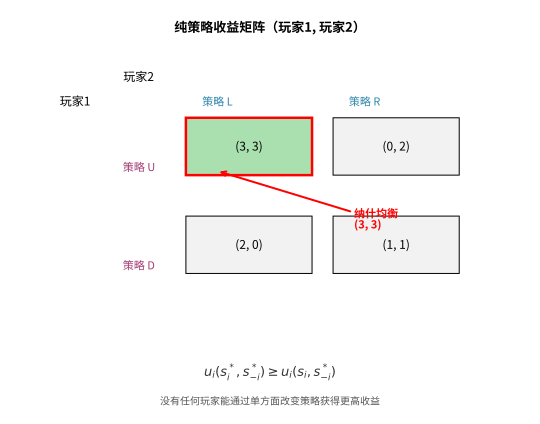

> **直观理解（现实类比）**：纳什均衡就像停车场的"默契"——当大家都不愿单方面改变行为时，这个状态就稳定下来。比如一条路上两辆车相向而行，谁都先不动（都等待）时，谁先变道谁吃亏，于是"都等待"就成了一个均衡点。它刻画的是"给定别人怎么做，我也没有理由改变"的稳态。

> **🧠 思考历程：人人都"不后悔地选自己的底牌"，最后会走到什么局面？**
>
> 纳什均衡回答的是博弈论最核心的一个稳态问题："给定其他人的选择，我没有理由改变自己的选择"——这种奇妙的自发"默契"，是如何在人人自利的世界里稳定下来的？答案竟要等一位21岁就完成博士论文的年轻人。
>
> - **从古诺到冯·诺依曼**。古诺（Cournot）早在1838年就用"双方反应线相交"的思想分析寡头竞争，但真正把"博弈"变成数学分支的，是1944年冯·诺依曼与摩根斯坦（von Neumann & Morgenstern）的《Theory of Games and Economic Behavior》——那时他们围绕的还是二人零和博弈的矩阵。
> - **Nash 把"零和"松开**。1950年 Nash 在他的博士论文里证明：只要允许混合策略，任何有限博弈都存在至少一个"无人单方面改变能获益"的均衡点——这个均衡随之以他的名字命名，从此跳出零和的框架，走进经济、生物、政治乃至 AI 的训练场。
> - **从均衡到演化与学习**。随后演化博弈（理性要求很低的"生物版均衡"）与博弈论学习算法相继登场，把纳什均衡从"静态理性结论"推向"动态演化结果"；图克（Tucker）1950年提出的囚徒困境，也因此成为跨学科理解"自利与集体利益冲突"的钥匙。
> - **心路**：一个"大家都不愿单方面改主意"的状态，看似平凡，却是把自利世界写成可分析理论的关键支点。

> **常见坑**：最容易的误区是把纳什均衡当成"所有人都得到最好结果"。**纳什均衡只保证"无人单方面偏离能获益"，绝不保证收益最大，甚至可能对所有人都不好**——囚徒困境的坦白-坦白就是典型：它是个均衡，双方却都比"都不坦白"差。因此讨论均衡时永远要同时回答两件事：**这个均衡是否"稳定"**（无人有单边背离动机）、**这个均衡是否"合意"**（是不是帕累托最优）。另外注意 "均衡存在唯一解" 与 "一个博弈可有多个均衡" 并不矛盾——后者在实际中反而常见，这正是后续 "均衡选择" 问题的来源。

#### 课堂问答

**老师**：纳什均衡的定义只是一行不等式，它究竟在说"稳"在哪里？

**学生**：$s^*$ 是纳什均衡当且仅当对每个玩家 $i$ 和每个 $s_i\in S_i$ 都有 $u_i(s_i^*,s_{-i}^*)\ge u_i(s_i,s_{-i}^*)$。这等价于 $s_i^*$ 是给定 $s_{-i}^*$ 时的最优反应，即 $s_i^*\in\mathrm{BR}_i(s_{-i}^*)$。所以均衡就是每个玩家都正对别人"最省力"的位置，无人有单边偏离动机。

**老师（追问）**：那"存在均衡"和"均衡好"是同一件事吗？请用囚徒困境检验。

**学生**：完全不同。均衡只保证"稳定"，不保证"合意"。囚徒困境中（背叛，背叛）是均衡，收益却是 $(1,1)$，帕累托劣于（合作，合作）的 $(3,3)$。注意定义要求对**所有** $s_i$ 成立才算均衡，只对一个成立不算；均衡与帕累托最优是两把独立的尺子。

**老师（拓展）**：若把纯策略换成混合策略、收益换成期望收益，定义会怎么变？

**学生**：把 $s_i$ 换成 $\sigma_i\in\Delta(S_i)$、$u_i$ 换成期望收益，即得**混合策略纳什均衡**。有个易错点：均衡中被赋予正概率的纯策略必须**同时**是最优反应（否则把概率挪给更优者即可改进），这正是求解混合均衡时"令对手无差异"的依据。

### 纯策略与混合策略

- **纯策略**：玩家确定性地选择某个具体行动
- **混合策略**：玩家以概率分布 $\sigma_i \in \Delta(S_i)$ 随机选择策略，其中 $\Delta(S_i)$ 是 $S_i$ 上的概率单纯形

> **💡 直观理解（类比）**：纯策略像"每次都固定出剪刀"；混合策略像"掷骰子决定出什么——50% 剪刀、50% 布"。当对手能预判你的固定套路（甩石头的手总被布克制）时，把选择"随机化"、按概率 $\sigma_i\in\Delta(S_i)$ 出招，就能让对手抓不住规律。所以混合策略是"让人猜不透"的必要武器，也是很多没有纯策略均衡的博弈（如划拳对决）求解的关键。

> **常见坑**：很多博弈（如猜硬币、划拳）根本不存在纯策略纳什均衡，此刻**只能**用混合策略求解，别硬找"纯策略均衡"而认定无解。求解混合均衡的常用办法是**让对手在两条纯策略之间"无所谓"**（令两个策略期望收益相等），再联立解出概率 $\sigma_i$；常见的笔误是把"使自己收益最大化"误写成"使自己的概率最优"，实际应让**对手**对选择无差异，才是均衡的关键。

#### 课堂问答

**老师**：混合策略写成 $\sigma_i\in\Delta(S_i)$，那 $\Delta$ 是什么？它与纯策略是什么关系？

**学生**：$\Delta(S_i)$ 是 $S_i$ 上的概率单纯形，即满足 $\sigma_i(s_i)\ge0$ 且 $\sum_{s_i}\sigma_i(s_i)=1$ 的全部分布。纯策略是它的顶点（某坐标取 1），故纯策略是混合策略的退化特例，混合空间是纯策略集的凸包。

**老师（追问）**：为什么要允许"掷骰子"？什么博弈非混合不可？

**学生**：因为许多博弈没有纯均衡，如匹配便士、猜拳，任何固定的纯选择都会被对手针对。此时用期望收益 $u_i(\sigma)=\sum_s\left(\prod_j\sigma_j(s_j)\right)u_i(s)$，令对手在各纯策略间期望相等（无差异）即可解出混合均衡。误区是把随机化当成外在噪声，其实它是理性面对被预判时的防守。

**老师（拓展）**：为什么"随机"会出现在精确的最优反应里？

**学生**：在混合均衡处，若某玩家的支撑含多个纯策略，则这些纯策略的期望收益必须**相等**且都为最优——否则他会把概率全压到更优的那个上去。于是随机不是随意，而是被"无差异"逼出的精确配比。更一般地，$\Delta(S_i)$ 的凸性保证最优反应集是凸集，这正是 Nash 存在性证明中启用角谷不动点的前提。

### 博弈分类

- **零和博弈**：所有玩家的收益之和为零（或常数）
- **完全信息博弈**：所有玩家了解博弈的全部结构
- **不完全信息博弈**：部分玩家拥有私人信息
- **合作博弈**：玩家可以达成有约束力的协议
- **非合作博弈**：玩家之间不能达成有约束力的协议

> **💡 直观理解（类比）**：博弈分类像给互动"贴性格标签"——零和是"蛋糕只有一块，你多我少总有人吃亏"（打扑克）；完全信息是"规则和底牌都摊在桌上明打"（象棋）；不完全信息是"每人各自藏着底牌"（德州扑克、贸易谈判）；合作是"签字就作数、可以分钱"（并购分利）；非合作是"各打各的主意，协议靠不住"（市场竞争）。先分清是哪一类，才知道该用哪套工具来解。

#### 课堂问答

**老师**：分类博弈有哪几条标尺？请把每类用数学条件写出来。

**学生**：四条标尺：一是收益结构——**零和**即对所有 $s$ 有 $\sum_i u_i(s)=0$，常和则等于常数；二是信息——完全信息指 $(N,S_i,u_i)$ 是共同知识，不完全信息指存在私人类型 $\theta_i$；三是能否签约——合作博弈允许有约束力协议，非合作不允许；四是行动时序——静态（同时）对动态（扩展式）。

**老师（追问）**："零和"和"非合作"是一回事吗？请举反例。

**学生**：不是。零和刻画的是**收益结构**（利益完全对立），合作与非合作刻画的是**可否签协议**，属解概念层面。可以零和又合作（两人分一笔固定赌注先签约分账），也可以非零和又非合作（囚徒困境）。两条标尺正交，混淆会导致误选工具——零和用极小化极大，合作才谈 Shapley 值。

**老师（拓展）**：不完全信息为什么常能"翻译"成信息完全但不完美的博弈？

**学生**：靠 Harsanyi 转换：把"自然"当作先行动者，先按共同先验抽出各人的类型 $\theta_i$，再让玩家在不知抽中结果的信息集里行动。于是不完全信息博弈变成一个**完全但不完美信息**的扩展式博弈，均衡随之升级为贝叶斯纳什均衡。这说明分类不是死标签，而是选对建模层级的问题。

### Shapley值

对于合作博弈 $(N, v)$，其中 $v: 2^N \to \mathbb{R}$ 是特征函数，Shapley值 $\phi_i(v)$ 衡量玩家 $i$ 的"公平"贡献：

$$\phi_i(v) = \sum_{S \subseteq N \setminus \{i\}} \frac{|S|! (n - |S| - 1)!}{n!} [v(S \cup \{i\}) - v(S)]$$

> **💡 直观理解（类比）**：Shapley值回答"多人合伙干活赚了钱，怎么分才公平"。它让每个玩家随机排进一个"入场顺序"，各自的贡献就看"他加入时给联盟多带来多少"（边际贡献），再对 $n!$ 种顺序取平均。就像三个劳工各怀绝技，把每个人都当作可能"最后到"的人来算一遍平均水平——贡献越大、越不可替代就分得越多，因而天然自带一整套"公平"公理。

#### 课堂问答

**老师**：请写出 Shapley 值公式，并说清那个组合系数到底在数什么。

**学生**：$\phi_i(v)=\sum_{S\subseteq N\setminus\{i\}}\frac{|S|!(n-|S|-1)!}{n!}\,[v(S\cup\{i\})-v(S)]$。系数是把 $n$ 人随机排成一列时，$i$ 之前恰好是 $S$ 这批人的概率 $\frac{|S|!(n-|S|-1)!}{n!}$，中括号是 $i$ 的边际贡献。所以 Shapley 值就是对全部 $n!$ 种加入顺序取平均的边际贡献。

**老师（追问）**：它凭什么算"公平"？与"按人平均分"差在哪里？

**学生**：因为它满足四条公理——效率 $\sum_i\phi_i(v)=v(N)$、对称（可互换者同酬）、哑元（无贡献者只拿 $v(\{i\})$）、可加性，而定理证明这四条唯一锁定 $\phi$。与平均分的差别在于：平均分不看贡献，Shapley 值让"边际贡献大、越不可替代"的人分得越多。典型误区是把它当成某次谈判的结果，其实它是公理化唯一解，与具体谈判过程无关。

**老师（拓展）**：若某人是哑元、或某两人对称，公式会退化成什么？

**学生**：若 $i$ 是哑元，则对一切 $S$ 有 $v(S\cup\{i\})-v(S)=v(\{i\})$，各项相同而权重求和为 1，故 $\phi_i(v)=v(\{i\})$。若 $i,j$ 可互换，把二人在一列顺序中的位置对调，即知各自平均边际贡献相等，故 $\phi_i(v)=\phi_j(v)$。这正可用来检验公理在具体公式中的落地。

### 核

合作博弈的**核**（Core）是所有满足以下条件的收益分配 $x = (x_1, \ldots, x_n)$ 的集合：

$$\sum_{i \in N} x_i = v(N), \quad \sum_{i \in S} x_i \geq v(S), \forall S \subseteq N$$

> **💡 直观理解（类比）**：合作博弈的核像一张"谁都不想单飞的分账清单"。它要求两点：一是大家把总报酬 $v(N)$ 分光（不留空账）；二是任一组人 $S$ 单干能拿到 $v(S)$ 不能比在大集体里分到的还多——否则这组人就会拆伙单飞。核就是所有"拆不散的方案"的集合；它唯一的毛病是，有时连一个这样的"铁方案"都不存在（核可能是空的）。

#### 课堂问答

**老师**：请用两行不等式写出核（Core）的定义，并说明各自管什么。

**学生**：核 $=\ \{x\in\mathbb{R}^n:\ \sum_{i\in N}x_i=v(N),\ \sum_{i\in S}x_i\ge v(S)\ \forall S\subseteq N\}$。第一条是**效率**：把总收益 $v(N)$ 恰好分完；第二条是**联盟理性**：任一小团体 $S$ 单干所得 $v(S)$ 不能超过它在方案里分到的总和，否则 $S$ 会拆伙。所以核就是所有"拆不散"的分配。

**老师（追问）**：核与 Shapley 值是什么关系？核一定非空吗？

**学生**：核是**集合**，Shapley 值是**点**，二者无必然包含关系：Shapley 值未必落在核里；但若博弈是凸的且核非空，Shapley 值常属于核。核**未必非空**——如三人多数博弈 $v(S)=1$（当 $|S|\ge2$）、否则为 0，要同时满足两两之和 $\ge1$ 且总和 $=1$ 会推出矛盾，核为空。这说明"稳定分配"有时根本不存在。

**老师（拓展）**：核为空时理论怎么办？

**学生**：放宽要求即可：把联盟理性从"$\ge$"改为考虑**超出量**，得到最小核；或允许有界"反对"，引入 $\epsilon$-核、谈判集、稳定集（von Neumann–Morgenstern 解）。这与单人优化里从"精确可行解"退到"近似解、罚函数"是同一套路：当理想约束过强，就找一个略有松弛却能保证存在的概念。

### 讨价还价问题

Nash讨价还价问题由可行集 $F \subseteq \mathbb{R}^2$ 和威胁点 $d \in \mathbb{R}^2$ 构成，要找到一个公平的协议点。

> **💡 直观理解（类比）**：讨价还价问题是把"分蛋糕谈判"提炼成两个量：可行集 $F$（双方各种可能利益组合，像蛋糕的全部切法）和威胁点 $d$（谈崩时各自拿多少，像"掀桌不干了回到各自老本"）。任何协议都得让双方比 $d$ 更强，否则不如谈崩。这个模型把人情味十足的讨价还价，压缩成"在可行集里找一个所有方向都优于威胁点的公平点"的几何问题。

#### 课堂问答

**老师**：Nash 讨价还价问题由哪两个数据构成？为什么必须有"威胁点"？

**学生**：由可行集 $F\subseteq\mathbb{R}^2$ 与威胁点 $d\in\mathbb{R}^2$ 构成，$d$ 是谈崩（不一致）时各自的保留收益。任何理性协议 $x\in F$ 必须满足 $x\ge d$（逐分量），否则不如谈崩。$F$ 设为凸紧集，用以体现"可掷骰子混合出中间结果"。

**老师（追问）**：解 $f(F,d)$ 由什么条件刻画？四条公理各自说了什么？

**学生**：解由最大化 **Nash 积** 给出：$f(F,d)=\arg\max_{x\in F,\ x\ge d}(x_1-d_1)(x_2-d_2)$。四条公理是：帕累托最优（不浪费可得分）、对称（对称问题给对称解）、无关选择独立性（删去不相关选项不改解）、仿射变换不变性（换效用单位答案随之换算）。正是这四条唯一锁定了该解。

**老师（拓展）**：仿射不变性为什么重要？换成 Kalai–Smorodinsky 解会怎样？

**学生**：仿射不变性保证结论不依赖效用单位——把"元"换成"美元"或做正线性重标度，解只做同样的变换，从而排除了凭量纲操纵结果。若把"无关选择独立性"换成**单调性**（可行集变大时我分得不应变少），所得唯一解就变成 Kalai–Smorodinsky 解。二者恰因公理取舍不同而分道扬镳，说明公理化框架里"换一条公理就换一个解"。

### 子博弈完美均衡

在动态博弈中，一个策略组合是**子博弈完美均衡**，如果它在每一个子博弈上都构成纳什均衡。

> **💡 直观理解（类比）**：子博弈完美均衡要求"不管走到哪一步，剩下的局都要按最优来打"，因而会提前拆穿"将来我一定报复你"这类空口威胁。就像有人承诺"你若选A我就自断一臂"，可真到了那个局面他根本下不去手，威胁自然不可信；只有在每一步（每个子博弈）都毫不缩水地最优的策略，才算"一直信守到底"，这正是它比普通纳什均衡更严格、也更贴近真实博弈的原因。

---

#### 课堂问答

**老师**：子博弈完美均衡（SPE）比普通纳什均衡多要求了什么？

**学生**：要求策略组合在**每一个子博弈**上都构成纳什均衡。子博弈是从某个单点信息集出发、含其后全部后续的博弈。普通 Nash 均衡只要求"在整局起点"无单边偏离动机，而 SPE 要求"无论博弈走到哪个子博弈，剩余策略仍最优"。所以 SPE 是 Nash 均衡的子集，严格更强。

**老师（追问）**：为什么 SPE 能筛掉"不可信威胁"？请举例。

**学生**：因为它在每个子博弈独立地要求最优，那些"真到了那个局面其实不会执行"的威胁，在对应子博弈里就不满足最优，因而被剔除。例：进入者—垄断者博弈中，垄断者扬言"你若进入我就打价格战"，但真到"已进入"的子博弈里打价格战两败俱伤、容忍反而更优，故威胁不可信，SPE 只留下"容忍"；普通 Nash 均衡却可能容纳这个空洞威胁。

**老师（拓展）**：有限完美信息博弈中，SPE 一定存在吗？怎么算？

**学生**：一定存在（Kuhn 定理），用**逆向归纳**：从终节点倒推，每个决策点选对当前玩家最优的行动。因每步行动有限，最大值总存在，故过程能一路推到根节点。注意逆向归纳只对**完美信息**（每个信息集是单点）可直接用；一旦有同时行动或信息集非单点，就要在每个信息集上求纳什或最优反应，否则算子会出错。

## 定理与证明

### 定理1：Nash均衡的存在性定理

**定理**：任何有限博弈（有限个玩家，每个玩家有有限个纯策略）至少存在一个混合策略纳什均衡。

**证明**（利用角谷不动点定理）：

**步骤1：建立混合策略空间**

设博弈有 $n$ 个玩家，玩家 $i$ 有 $m_i$ 个纯策略。混合策略空间为 $\Sigma_i = \Delta(S_i)$，即 $m_i - 1$ 维单纯形。全体混合策略组合空间为 $\Sigma = \prod_{i=1}^n \Sigma_i$，它是欧氏空间中的凸紧集。

**步骤2：定义最优反应对应**

对于每个玩家 $i$，定义其最优反应对应 $\text{BR}_i: \Sigma_{-i} \to 2^{\Sigma_i}$：

$$\text{BR}_i(\sigma_{-i}) = \arg\max_{\sigma_i \in \Sigma_i} u_i(\sigma_i, \sigma_{-i})$$

其中 $u_i(\sigma_i, \sigma_{-i})$ 是期望收益。

**步骤3：验证BR_i的性质**

- **凸性**：期望收益 $u_i(\sigma_i, \sigma_{-i})$ 是 $\sigma_i$ 的线性函数（因为它是 $\sigma_i$ 的加权平均），因此最大值点集是凸集。
- **上半连续性**：由最大值定理，$\text{BR}_i$ 是上半连续的。

**步骤4：定义整体对应**

定义 $\Phi: \Sigma \to 2^{\Sigma}$ 为：

$$\Phi(\sigma) = \prod_{i=1}^n \text{BR}_i(\sigma_{-i})$$

即 $\Phi(\sigma)$ 是所有玩家的最优反应集合的笛卡尔积。

**步骤5：验证角谷不动点定理的条件**

角谷不动点定理指出：如果 $X$ 是 $\mathbb{R}^n$ 中的非空凸紧集，$\Phi: X \to 2^X$ 是上半连续的，且对每个 $x \in X$，$\Phi(x)$ 是非空凸集，则 $\Phi$ 存在不动点，即存在 $x^* \in X$ 使得 $x^* \in \Phi(x^*)$。

验证条件：
- $\Sigma$ 是非空凸紧集 ✓
- $\Phi(\sigma)$ 是非空凸集（每个 $\text{BR}_i$ 的凸性）✓
- $\Phi$ 是上半连续的（每个 $\text{BR}_i$ 的上半连续性）✓

**步骤6：不动点即纳什均衡**

由角谷不动点定理，存在 $\sigma^* \in \Sigma$ 使得 $\sigma^* \in \Phi(\sigma^*)$。这意味着对于每个玩家 $i$：

$$\sigma_i^* \in \text{BR}_i(\sigma_{-i}^*)$$

即 $\sigma_i^*$ 是玩家 $i$ 对 $\sigma_{-i}^*$ 的最优反应。这正是混合策略纳什均衡的定义。$\square$

> **💡 直观理解（类比）**：这一定理保证"只要策略是有限多个，大家总能通过某种（可能带随机的）选择，走到谁都不愿单方面改主意的稳态"。证明把所有人的最优反应 $\text{BR}_i$ 拼成一个映射 $\Phi$，再借助角谷不动点定理找"被这个映射钉住不动"的点 $\sigma^*$——就像几根手指各自指向对方的组合，最终必然存在一个"互相对准、再无一人想指向别处"的稳定点。正是这一点，让纳什均衡在几乎所有博弈里都保证"找得到"。

---

#### 课堂问答

**老师**：请陈述 Nash 存在性定理，并说出证明所用的核心工具。

**学生**：定理：任何有限博弈（有限个玩家、每人有限个纯策略）至少存在一个混合策略纳什均衡。证明用**角谷（Kakutani）不动点定理**：在凸紧集 $\Sigma=\prod_i\Delta(S_i)$ 上构造最优反应对应 $\Phi(\sigma)=\prod_i\mathrm{BR}_i(\sigma_{-i})$，它非空凸值且上半连续，故有不动点 $\sigma^*\in\Phi(\sigma^*)$，此即均衡。

**老师（追问）**：为什么 $\mathrm{BR}_i$ 是凸值的？这一步为什么必须依赖混合策略？

**学生**：因为期望收益 $u_i(\sigma_i,\sigma_{-i})$ 关于 $\sigma_i$ 是**线性**的，线性函数的最大值点集是凸集，故 $\mathrm{BR}_i(\sigma_{-i})$ 为凸集。这一步恰恰靠混合：若限死纯策略，最优反应集可能是非凸的点集，角谷定理的条件就崩了。所以存在性定理必须允许混合策略，"凸性"是整套证明的命门。

**老师（拓展）**：$\Delta(S_i)$ 在欧氏空间里是什么？为什么它是紧的？

**学生**：$\Delta(S_i)$ 是 $\mathbb{R}^{m_i}$ 中的 $m_i-1$ 维单纯形，是有限多个线性不等式 $\sigma\ge0$ 与等式 $\sum\sigma=1$ 的交，因而是有界闭集即**紧集**，乘积 $\Sigma$ 仍紧。紧、凸、上半连续、凸值四条件齐备，正好套用角谷定理。若去掉"有限"这一限制，紧性可能丧失，需改用 Glicksberg 定理（连续收益、紧策略空间）。

### 定理2：极小化极大定理（von Neumann）

**定理**：对于有限二人零和博弈，有：

$$\max_{\sigma_1 \in \Delta(S_1)} \min_{\sigma_2 \in \Delta(S_2)} u_1(\sigma_1, \sigma_2) = \min_{\sigma_2 \in \Delta(S_2)} \max_{\sigma_1 \in \Delta(S_1)} u_1(\sigma_1, \sigma_2)$$

这个共同值称为博弈的值。

**证明**（利用线性规划对偶性）：

**步骤1：将博弈表示为线性规划**

设玩家1（最大化者）有 $m$ 个纯策略，玩家2（最小化者）有 $n$ 个纯策略。收益矩阵为 $A \in \mathbb{R}^{m \times n}$，其中 $a_{ij}$ 是玩家1选择策略 $i$、玩家2选择策略 $j$ 时玩家1的收益。

玩家1选择混合策略 $\boldsymbol{x} \in \mathbb{R}^m$（$x_i \geq 0$，$\sum x_i = 1$）。玩家1保证的最小收益为：

$$\max_{\boldsymbol{x}} \min_{j} \sum_{i=1}^m x_i a_{ij}$$

**步骤2：转化为线性规划问题**

引入变量 $v$，玩家1的问题等价于：

$$\begin{aligned}
\text{最大化} \quad & v \\
\text{约束} \quad & \sum_{i=1}^m x_i a_{ij} \geq v, \quad j = 1, \ldots, n \\
& \sum_{i=1}^m x_i = 1, \quad x_i \geq 0
\end{aligned}$$

这是线性规划问题（P）。

类似地，玩家2（最小化者）的问题等价于：

$$\begin{aligned}
\text{最小化} \quad & u \\
\text{约束} \quad & \sum_{j=1}^n y_j a_{ij} \leq u, \quad i = 1, \ldots, m \\
& \sum_{j=1}^n y_j = 1, \quad y_j \geq 0
\end{aligned}$$

这是线性规划问题（D）。

**步骤3：验证对偶性**

可以验证（P）和（D）互为对偶线性规划。由线性规划对偶定理，如果两者都有可行解，则最优值相等：

$$v^* = u^*$$

**步骤4：解释为极小化极大定理**

$v^*$ 正是 $\max_{\sigma_1} \min_{\sigma_2} u_1(\sigma_1, \sigma_2)$，而 $u^*$ 正是 $\min_{\sigma_2} \max_{\sigma_1} u_1(\sigma_1, \sigma_2)$。因此：

$$\max_{\sigma_1} \min_{\sigma_2} u_1(\sigma_1, \sigma_2) = \min_{\sigma_2} \max_{\sigma_1} u_1(\sigma_1, \sigma_2)$$

这就完成了极小化极大定理的证明。$\square$

> **💡 直观理解（类比）**：极小化极大定理说的是"在零和博弈里，'先想最坏再让自己最好'（$\max\min$）与'先想对手最好再组织最坏'（$\min\max$）殊途同归、结果相等"。就像棋手在毫无把握时"往好处想想，也得往最坏处打算打算"——只要对方是同样理性的敌手，你的保底收益和对方能压你的上限会恰好碰上同一个值，于是博弈有了确定可预测的"价码"。它的证明把整个博弈翻译成一对互为对偶的线性规划，用对偶定理一举证得相等。

---

#### 课堂问答

**老师**：请写出极小化极大定理的等式，并解释左右两端各是什么含义。

**学生**：对有限二人零和博弈（玩家 1 的收益矩阵 $A\in\mathbb{R}^{m\times n}$）有 $\max_{x\in\Delta(S_1)}\min_{y\in\Delta(S_2)}x^{\mathsf T}Ay=\min_{y\in\Delta(S_2)}\max_{x\in\Delta(S_1)}x^{\mathsf T}Ay$，共同值称为博弈的**值** $v$。左端是玩家 1"料到对手最狠"时的保底收益（maximin），右端是玩家 2 能压到的上限（minimax）。定理断言二者相等，博弈有确定价值。

**老师（追问）**：证明的关键一步是什么？为什么能证相等？

**学生**：把两侧各写成一个**线性规划**：玩家 1 解 $\max v$ 满足 $\sum_i x_i a_{ij}\ge v\ \forall j$、$x\ge0,\sum x_i=1$；玩家 2 解 $\min u$ 满足 $\sum_j y_j a_{ij}\le u\ \forall i$、$y\ge0,\sum y_j=1$。二者互为**对偶**，由弱对偶恒有 $v\le u$，由强对偶得 $v^*=u^*$，于是 minimax 等于 maximin。

**老师（拓展）**：在一般（非零和）博弈里 $\max\min=\min\max$ 还成立吗？

**学生**：一般**不**成立，只有弱不等式 $\max_x\min_y f(x,y)\le\min_y\max_x f(x,y)$（保底永远不超过对手能压的上限）。等号成立需额外结构，如 $f$ 关于 $x$ 凹、关于 $y$ 凸且 $X,Y$ 凸紧（Sion 极小化极大定理），零和双线性正是其特例。可见换序不是恒等式，而是有条件的定理。

### 定理3：Shapley值的公理化刻画

**定理**：在合作博弈 $(N, v)$ 中，存在唯一的值函数 $\phi(v) = (\phi_1(v), \ldots, \phi_n(v))$ 满足以下四条公理：

1. **效率公理**：$\sum_{i \in N} \phi_i(v) = v(N)$
2. **对称性公理**：若玩家 $i$ 和 $j$ 是可互换的（即对任意 $S \subseteq N \setminus \{i,j\}$ 有 $v(S \cup \{i\}) = v(S \cup \{j\})$），则 $\phi_i(v) = \phi_j(v)$
3. **哑元公理**：若玩家 $i$ 是哑元（即对任意 $S \subseteq N$ 有 $v(S \cup \{i\}) = v(S) + v(\{i\})$），则 $\phi_i(v) = v(\{i\})$
4. **可加性公理**：$\phi(v + w) = \phi(v) + \phi(w)$

这个唯一的值就是Shapley值：

$$\phi_i(v) = \sum_{S \subseteq N \setminus \{i\}} \frac{|S|! (n - |S| - 1)!}{n!} [v(S \cup \{i\}) - v(S)]$$

**证明**：

**步骤1：存在性**

验证Shapley值满足四条公理。

**效率公理**：注意到 $\sum_{i \in N} \phi_i(v)$ 中，每个联盟 $S$ 的边际贡献 $v(S)$ 出现的总次数为：

$$\sum_{i \in S} \frac{(|S|-1)! (n-|S|)!}{n!} = \frac{n}{n} \cdot \frac{(|S|-1)! (n-|S|)!}{n!} \cdot |S| = \frac{1}{n}$$

因此 $\sum_{i \in N} \phi_i(v) = \sum_{S \subseteq N} \frac{1}{\binom{n}{|S|}} v(S) \cdot \binom{n}{|S|} \cdot \frac{1}{n} \cdot ?$ 

更简洁地，直接证明：

$$\sum_{i=1}^n \phi_i(v) = \sum_{i=1}^n \sum_{S \subseteq N \setminus \{i\}} \frac{|S|! (n - |S| - 1)!}{n!} [v(S \cup \{i\}) - v(S)]$$

将求和顺序交换，考虑每个联盟 $T \subseteq N$，当 $T = S \cup \{i\}$ 时，$v(T)$ 的系数为正，$v(S)$ 的系数为负。最终所有 $v(N)$ 的系数之和为1，其他项相互抵消，得到 $\sum \phi_i(v) = v(N)$。

**对称性公理**：若 $i$ 和 $j$ 可互换，则 $v(S \cup \{i\}) - v(S) = v(S \cup \{j\}) - v(S)$ 对所有不包含 $i,j$ 的 $S$ 成立，且求和中的权重相同，因此 $\phi_i(v) = \phi_j(v)$。

**哑元公理**：若 $i$ 是哑元，则 $v(S \cup \{i\}) - v(S) = v(\{i\})$，代入Shapley公式可直接得到 $\phi_i(v) = v(\{i\})$。

**可加性公理**：Shapley值是边际贡献的线性组合，因此对 $v$ 和 $w$ 具有可加性。

**步骤2：唯一性**

假设存在另一个值函数 $\psi$ 也满足四条公理。对于任意特征函数 $v$，考虑其特征函数的基表示。

定义**联盟特征函数** $u_T$，其中 $T \subseteq N$，$T \neq \emptyset$：

$$u_T(S) = \begin{cases} 1 & \text{如果 } T \subseteq S \\ 0 & \text{否则} \end{cases}$$

任意特征函数 $v$ 可以唯一地表示为 $u_T$ 的线性组合（因为 $u_T$ 构成特征函数空间的一组基）：

$$v = \sum_{T \subseteq N, T \neq \emptyset} c_T u_T$$

其中 $c_T$ 是唯一确定的系数（实际上 $c_T = \sum_{S \subseteq T} (-1)^{|T|-|S|} v(S)$，即Möbius变换）。

**步骤3：确定 $\psi$ 在基函数上的值**

对于 $u_T$，满足前三條公理的 $\psi$ 被唯一确定：

- 若 $i \notin T$，则 $i$ 是哑元，$\psi_i(u_T) = u_T(\{i\}) = 0$
- 若 $i, j \in T$，则 $i$ 和 $j$ 可互换，$\psi_i(u_T) = \psi_j(u_T)$
- 由效率公理，$\sum_{i \in T} \psi_i(u_T) = u_T(N) = 1$

因此 $\psi_i(u_T) = 1/|T|$ 当 $i \in T$，否则为0。

**步骤4：由可加性延拓**

由可加性公理：

$$\psi_i(v) = \sum_{T \subseteq N, T \neq \emptyset} c_T \psi_i(u_T) = \sum_{T \ni i} \frac{c_T}{|T|}$$

可以验证这个表达式正是Shapley值。因此满足四条公理的值函数是唯一的，即Shapley值。$\square$

> **💡 直观理解（类比）**：这一定理把"公平分配"用四条不容争辩的规矩（效率、对称、哑元、可加性）钉死，并证明满足这些规矩的分配只有一种——Shapley值。就像制定分蛋糕协议时先约定"蛋糕必须分光、长相一样的人一样待遇、没本事的人只拿自己那份、两笔生意分开分跟合起来分一个样"，这些规矩看似天经地义，却正好唯一地逼出了"按全部加入顺序取平均边际贡献"那套公式，令人信服地落到唯一的算法上。

---

#### 课堂问答

**老师**：Shapley 公理化定理包含存在与唯一两件事，各自怎么证？

**学生**：定理：满足效率、对称、哑元、可加性四条公理的值函数唯一存在，即 Shapley 值 $\phi_i(v)=\sum_{S\subseteq N\setminus\{i\}}\frac{|S|!(n-|S|-1)!}{n!}[v(S\cup\{i\})-v(S)]$。存在性靠逐条验证四条公理；唯一性靠**基分解**：用联盟特征函数 $u_T(S)=\mathbf{1}[T\subseteq S]$ 张成特征函数空间，$v=\sum_T c_T u_T$。

**老师（追问）**：唯一性证明里，$\psi$ 在基函数 $u_T$ 上的值是怎样被逼出来的？

**学生**：对 $u_T$ 逐个施压：若 $i\notin T$，则 $i$ 是哑元，故 $\psi_i(u_T)=u_T(\{i\})=0$；若 $i,j\in T$，二者可互换，故 $\psi_i(u_T)=\psi_j(u_T)$；再由效率得 $\sum_{i\in T}\psi_i(u_T)=u_T(N)=1$。三条件一联立，每个 $i\in T$ 都必须取 $\psi_i(u_T)=1/|T|$。最后由可加性延拓到任意 $v$，值便被唯一钉死。

**老师（拓展）**：系数 $c_T$ 怎么解出？它与 Möbius 变换有何关系？

**学生**：$c_T=\sum_{S\subseteq T}(-1)^{|T|-|S|}v(S)$，正是特征函数在子集格上的 **Möbius 反演**，与概率中的容斥、布尔代数的 Möbius 函数同源。它在概念上把"联盟整体价值"翻译成"每个联盟的净增量"，从而 $\psi_i(v)=\sum_{T\ni i}c_T/|T|$ 恰等于逐顺序平均的 Shapley 值——两条看似不同的路径殊途同归。

### 定理4：Nash讨价还价解

**定理**：对于讨价还价问题 $(F, d)$，其中 $F \subseteq \mathbb{R}^2$ 是凸紧可行集，$d \in F$ 是威胁点，存在唯一满足以下公理的解 $f(F, d) \in F$：

1. **帕累托最优**：不存在 $x \in F$ 使得 $x \geq f(F, d)$ 且 $x \neq f(F, d)$
2. **对称性**：如果 $F$ 关于直线 $x_1 = x_2$ 对称且 $d_1 = d_2$，则 $f_1(F, d) = f_2(F, d)$
3. **无关选择的独立性**：若 $F' \subseteq F$ 且 $f(F, d) \in F'$，则 $f(F', d) = f(F, d)$
4. **仿射变换不变性**：若 $\phi(x) = (a_1 x_1 + b_1, a_2 x_2 + b_2)$，$a_i > 0$，则 $f(\phi(F), \phi(d)) = \phi(f(F, d))$

这个解是以下最大化问题的解：

$$f(F, d) = \arg\max_{x \in F, x \geq d} (x_1 - d_1)(x_2 - d_2)$$

**证明**：

**步骤1：构造辅助问题**

设 $F$ 和 $d$ 满足定理条件。通过仿射变换将 $d$ 映射到原点，并将可行集标准化。定义：

$$z_i = \frac{x_i - d_i}{a_i}$$

选择适当的 $a_i$ 使得标准化后的可行集在一个特定范围内。

**步骤2：定义对称化可行集**

考虑变换后的可行集 $F'$。由仿射变换不变性，只需证明在 $d = (0,0)$ 且可行集对称时的情形。

**步骤3：最大化Nash积**

定义Nash积 $N(x) = (x_1 - d_1)(x_2 - d_2)$。在标准化后，$N(x) = x_1 x_2$。

**步骤4：证明解满足公理**

- **帕累托最优**：若存在 $x \in F$ 使得 $x$ 比 $f$ 更优，则 $x_1 x_2 > f_1 f_2$，与 $f$ 最大化Nash积矛盾。
- **对称性**：若 $F$ 关于 $x_1 = x_2$ 对称且 $d$ 对称，则最大化 $x_1 x_2$ 的解必然满足 $x_1 = x_2$（否则交换坐标可得到另一个同样好的解，由唯一性得对称）。
- **无关选择的独立性**：若 $f(F, d) \in F' \subseteq F$，则 $f(F, d)$ 在 $F'$ 中仍然是Nash积的最大值点（因为 $F'$ 是 $F$ 的子集）。
- **仿射变换不变性**：若 $x^*$ 最大化 $(x_1 - d_1)(x_2 - d_2)$，则 $\phi(x^*)$ 最大化 $(y_1 - \phi(d)_1)(y_2 - \phi(d)_2)$，其中 $y = \phi(x)$。

**步骤5：唯一性**

假设存在两个不同的解 $x$ 和 $y$ 都满足公理。由帕累托最优，它们不可比较。通过构造一个缩小可行集，利用无关选择的独立性导出矛盾，从而证明唯一性。

因此，Nash讨价还价解由最大化Nash积唯一确定。$\square$

> **💡 直观理解（类比）**：这些公理和结论说的是"双方讲道理地分蛋糕，最终会落在最大化Nash积 $(x_1-d_1)(x_2-d_2)$ 的点上"——它既计较"我比威胁点多拿多少"，又要求"对面也有同样的保障"，像个把双方"谈判红利"相乘、追求共赢面积最大的公平规则。四条公理（帕累托最优、对称、无关选择独立、仿射不变）分别对应"不浪费可得分、不偏袒、删掉无关选项不影响、换个单位答案跟着换算"，这些合情合理的规矩最终唯一锁定了一个解。

---

#### 课堂问答

**老师**：Nash 讨价还价定理断言解满足四条公理且唯一，这个解是什么形式？

**学生**：定理：对凸紧可行集 $F$ 与威胁点 $d$，存在唯一满足帕累托最优、对称、无关选择独立性、仿射不变性的解 $f(F,d)$，且它由最大化 **Nash 积** 给出：$f(F,d)=\arg\max_{x\in F,\ x\ge d}(x_1-d_1)(x_2-d_2)$。直观上就是把双方"相对威胁点的增益"相乘，取乘积最大处。

**老师（追问）**：为什么最大化乘积恰好满足了"对称"与"帕累托最优"？

**学生**：帕累托最优：若存在 $x\ge f$ 且 $x\ne f$，则正增益相乘有 $x_1x_2>f_1f_2$（此处 $x\ge d$），与 $f$ 最大化乘积矛盾。对称：若 $F$ 关于 $x_1=x_2$ 对称、$d$ 也对称，则交换两坐标是保值变换，乘积不变，故最优解自身对称，即 $f_1=f_2$。两条公理正是"乘积在对称变换下的自然性质"。

**老师（拓展）**：无关选择独立性为什么是这里最"强硬"的一条？

**学生**：它要求只要原解仍留在新可行集内，缩小可行集就不改变结果，从而排除了大量看似合理的解——Kalai–Smorodinsky 解正是违反了它。这条极强公理与仿射不变性一起，才唯一锁定了 Nash 积。概念上它与 Arrow 社会选择中的"无关备选独立性"异曲同工，都是靠"删掉未被选中的选项不应影响结果"来约束解的结构，深刻影响机制设计。

### 定理5：子博弈完美均衡的存在性

**定理**：任何有限完美信息扩展式博弈（有限个阶段、有限个行动）都存在子博弈完美均衡。

**证明**（逆向归纳法/Kuhn定理）：

**步骤1：定义子博弈**

对于完美信息扩展式博弈，每个决策节点（包括终节点）都定义了一个子博弈——从该节点开始的博弈剩余部分。

**步骤2：终节点子博弈**

博弈树的最底层是终节点，在这些节点上，玩家没有进一步的决策，收益已经确定。因此，每个终节点子博弈的均衡是平凡的。

**步骤3：从底层向上归纳**

设博弈树的最大深度为 $D$。对深度 $d = D-1, D-2, \ldots, 0$ 进行归纳。

**归纳假设**：对于深度大于 $d$ 的所有节点，子博弈完美均衡已经构造完成。

**归纳步骤**：考虑深度为 $d$ 的节点 $h$，由该玩家 $i(h)$ 在该节点选择行动。对于每个可能的行动 $a \in A(h)$，博弈进入深度更大的子博弈，其均衡收益已由归纳假设确定，记为 $u_i(h, a)$。

在该节点，玩家 $i(h)$ 选择最大化其收益的行动：

$$a^* = \arg\max_{a \in A(h)} u_{i(h)}(h, a)$$

选择该行动，并继续按照已确定的子博弈均衡策略进行，就构成了从节点 $h$ 开始的子博弈完美均衡。

**步骤4：扩展到整个博弈**

通过逆向归纳，从终节点一直到根节点，逐步确定每个决策节点上的最优行动，从而得到整个博弈的策略组合。

**步骤5：验证子博弈完美性**

由构造方式，在每个子博弈中，给定对手策略，每个玩家的策略都是最优的。因此，该策略组合是子博弈完美均衡。

**步骤6：存在性论证**

由于每个阶段的策略空间都是有限集，最大值总是存在的（有限集上的最大值问题总有解），因此逆向归纳过程可以顺利进行，从而保证了子博弈完美均衡的存在性。

这就完成了子博弈完美均衡存在性的证明。$\square$

> **💡 直观理解（类比）**：子博弈完美均衡的存在性靠逆向归纳而来：从博弈树的末梢（终节点）往回走，每到一个决策点就挑对"当前玩家"最有利的那条路，像学下棋时"先算残局再倒推开局"。只要每步可选的行动有限，最大值就总存在，这个过程能一路推回根节点，保证总能找到"全程不打折扣、威胁都可信"的完美均衡。它把"动态博弈里每一步都优选"这件事，变成总能执行的机械程序。

---

#### 课堂问答

**老师**：子博弈完美均衡存在性定理的条件与结论各是什么？

**学生**：定理：任何**有限完美信息**扩展式博弈（有限阶段、每个决策点有限个行动）都存在子博弈完美均衡。证明用**逆向归纳（Kuhn 定理）**：从博弈树最深层的终节点起逐层向上，在每个决策点由行动者 $i(h)$ 选择使 $u_{i(h)}(h,a)$ 最大的行动 $a^*=\arg\max_{a\in A(h)}u_{i(h)}(h,a)$，最终推回根节点，所得策略组合在每个子博弈上都最优。

**老师（追问）**：存在性论证中，"有限"这个条件用在哪一步？

**学生**：用在**最大值的存在性**上：当每个决策点的行动集 $A(h)$ 有限时，$u_{i(h)}(h,a)$ 在有限集上取到最大，$a^*$ 必然存在；博弈树深度 $D$ 有限则保证归纳能终止并覆盖所有节点。若行动集无限或阶段无限，最大值可能取不到（只能取上确界），逆向归纳失效，需另借紧性与连续性做极限论证。

**老师（拓展）**：信息非完美（信息集非单点）时，为什么不能直接逆向归纳？

**学生**：因为逆向归纳依赖"行动者知道自己身处哪个节点"，而信息集非单点时行动者无法分辨，同一信息集内所有节点必须共享一个行动，"逐点取最优"便不再适用，须在每个信息集上求解**最优反应或纳什**，对应 Selten 的**颤抖手完美**与**序贯均衡**（附加信念一致性与序贯理性）。可见"完美信息"正是逆向归纳成立的技术命门。

## 示例

### 示例1：囚徒困境的纳什均衡分析

**问题**：分析囚徒困境的纳什均衡，并讨论其与帕累托最优的关系。

**解答**：

囚徒困境的收益矩阵如下（收益为（玩家1，玩家2））：

|  | 合作 | 背叛 |
|--|------|------|
| **合作** | (3, 3) | (0, 5) |
| **背叛** | (5, 0) | (1, 1) |

**纳什均衡分析**：

对于玩家1：
- 如果玩家2合作，玩家1背叛得5 > 合作得3
- 如果玩家2背叛，玩家1背叛得1 > 合作得0
因此，背叛是玩家1的严格占优策略。

同理，背叛也是玩家2的严格占优策略。

**纳什均衡**：（背叛，背叛），收益为 (1, 1)。

**帕累托最优**：双方都合作时收益为 (3, 3)，帕累托优于 (1, 1)，但不是纳什均衡。

**关键洞察**：囚徒困境揭示了个体理性与集体理性的冲突——每个理性个体追求自身利益最大化，却导致集体（也是每个个体）的处境更差。

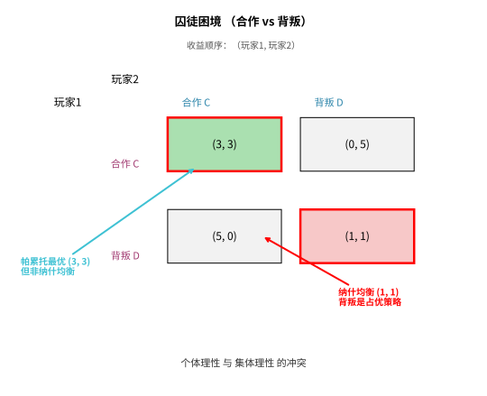

> **直观理解（现实类比）**：就像两个商贩在同一街区打价格战——单方面降价（背叛）能抢到更多顾客，但双方都降价（都背叛）后利润反而都不如"协商定价"（合作）。每个人都想占便宜，结果却两败俱伤；这正是"囚徒困境"在现实商业竞争、环保、公共资源中的普遍写照。

### 示例2：拍卖中的最优策略

**问题**：分析密封拍卖（一级价格密封拍卖）中的最优出价策略。

**解答**：

**设定**：$n$ 个竞拍者，每个竞拍者 $i$ 对物品的估价为 $v_i$，独立同分布服从 $[0,1]$ 上的均匀分布。每个竞拍者同时提交出价 $b_i$，最高出价者获胜并支付自己的出价。

**目标**：每个竞拍者最大化自己的期望收益 $u_i = (v_i - b_i) \cdot P(\text{获胜})$。

**对称均衡分析**：

假设所有竞拍者采用相同的严格递增出价策略 $b = \beta(v)$。

对于估价为 $v$ 的竞拍者，出价为 $b$ 时的期望收益为：

$$\pi(v, b) = (v - b) \cdot P(\text{出价最高})$$

由于其他 $n-1$ 个竞拍者的估价独立同分布，他们出价低于 $b$ 的概率为 $F(\beta^{-1}(b))^{n-1}$，其中 $F$ 是估价的分布函数。

对于均匀分布 $[0,1]$，$F(v) = v$，因此：

$$\pi(v, b) = (v - b) \cdot (\beta^{-1}(b))^{n-1}$$

**一阶条件**：在均衡中，竞拍者应出价 $\beta(v)$，即 $b = \beta(v)$ 应最大化 $\pi(v, b)$。由包络定理或直接求导可得：

$$\beta(v) = \frac{n-1}{n} v$$

**最优策略**：每个竞拍者出价为估价的 $\frac{n-1}{n}$ 倍。随着竞拍者数量增加，出价趋近于估价（竞争更激烈）。

**关键洞察**：在密封拍卖中，竞拍者会策略性地" shading"（压低出价），而压低幅度取决于竞拍者数量。

> **💡 直观理解（类比）**：密封拍卖中每个人都会"藏一手"——报出比真实估价低一点的 $\beta(v)=\frac{n-1}{n}v$ 倍。因为报太高赢了就赔太多、报太低又怕不中，均衡就是在"乐观"与"谦虚"之间择中的报价。报名的人越多、竞争越激烈，大家就越敢往真实估价贴近（$\beta(v)\to v$）。这解释了"拍卖台上光靠往高喊不如精算对手人数"：真正的报价策略不是豪赌，而是关于博弈人数的一笔精细算计。

> 博弈论的"味道"和微积分里的"求极值"其实一脉相承：都把无数种可能摆开，再问"理性的人会怎么选、选哪里最稳"。本节用「策略→例题→分步解→回读现实」四步法，把纳什均衡、混合策略与 Shapley 值放进报价、Game 反演、分工合作这些现实场景里算一遍。每道例题先给**解题策略**，再给出**每步都解释'为什么'**的分步解答。

### 🎯 本级解题策略（Principles of Problem Solving）

做一道博弈题，请按这四步走：

- **第一步 · 摆收益表**：先写清玩家、各自的策略集合与每个策略组合下的收益 $u_i(s)$，把博弈"翻译"成一张表格。表格写错，后面全部白算。
- **第二步 · 找占优 / 划线**：对每个玩家，逐列比较自己选中某策略是否无论对方怎么选都更好。若存在严格占优策略，直接锁定；否则用"画线法"找纯策略纳什均衡（互为最优反应）。
- **第三步 · 无纯均衡就上混合**：若纯均衡不存在或你要求所有均衡，设各方选了某策略的概率 $p,q$，用"无差异条件"（对方让你在各策略间无差异）联立解出概率。
- **第四步 · 合作博弈看分配**：若是合作博弈，用边际贡献求 Shapley 值，或用联盟合理性（核）验证一个分配是否稳定；最后把数学解翻译回"谁该得到多少/该不该合作"的现实判断。

> **一句话带走**：博弈的分步解，本质是"把每个玩家的最优反应都找到，再找它们的公共点"——读题先读'策略能不能组合'，比急着算概率更关键。

---

### 例题 A · 价格战：两家卖电器的该不该"跟价"

> **🎯 建模策略**：这是典型的双人双策略静态博弈。先把双方"降价/不降价"的四种组合收益写成矩阵，再用支配逻辑看每家的最优反应。**策略：先找严格占优策略或画线法直接定位纯策略纳什均衡。**

**问题**：两家相邻的特卖商店 A、B 卖同款冰箱，进价相同。若两家都卖原价，各赚 3000 元；若都降价，各只赚 1000 元；若一家降价另一家不降，降价方抢走客源赚 5000 元、不降价方赚 0 元。问两家各自最理性的选择是什么？

**解**：

**步骤 1：写出收益矩阵**

行是商店 A，列是商店 B，其中每格为 $(u_A, u_B)$：

$$
\begin{array}{c|cc}
 & \text{不降价} & \text{降价} \\ \hline
\text{不降价} & (3000,3000) & (0,5000) \\
\text{降价} & (5000,0) & (1000,1000)
\end{array}
$$

**步骤 2：逐家找最优反应**

对 A：若 B 不降价，A 降价得 5000 > 不降价得 3000，故 A 应降价；若 B 降价，A 降价得 1000 > 不降价得 0，故仍应降价。即 **降价是 A 的严格占优策略**。由对称性，降价同样是 B 的严格占优策略。

**步骤 3：确定均衡并回读现实**

双方都选严格占优策略，纳什均衡为（降价，降价），收益 $(1000,1000)$。

> **回读现实**：明明（不降价，不降价）给双方 3000、对谁都更好，可连锁店的占优逻辑却把大家都逼到"都只赚 1000"。这与"囚徒困境"同构：**个体理性（降价抢量）导致集体次优（利润腰斩）**。现实中"不打价格战"的默契、行业协会或"最低价保证"条款，本质都是要改变这张收益表、把均衡从坏角捞回来。

---

### 例题 B · 猜拳投注：没有纯均衡，就找随机比例

> **🎯 建模策略**：石头-剪刀-布这类博弈没有纯策略纳什均衡（任何一个纯选择都能被对手针对）。**策略：引入混合策略，用"无差异条件"——让对方在你两个可选策略之间的期望收益相等——把概率解出来。**

**问题**：两人玩"匹配便士"变体：双方各出一种硬币朝向（正/反），若相同则玩家 1 赢 1 元、若不同则玩家 2 赢 1 元。问双方如何用概率选择才能立于"不败"？

**解**：

**步骤 1：写收益矩阵**（玩家 1 的视角，行玩家 1、列玩家 2）

$$
\begin{array}{c|cc}
 & \text{正} & \text{反} \\ \hline
\text{正} & 1 & -1 \\
\text{反} & -1 & 1
\end{array}
$$

**步骤 2：设概率并用无差异条件（决定玩家 2 的 $q$）**

设玩家 1 出正的概率为 $p$、出反为 $1-p$；玩家 2 出正的概率为 $q$。

玩家 2 的混合比例 $q$ 要起到"让玩家 1 无论出正面或反面期望收益都一样"的作用（否则玩家 1 会专挑期望高的那面，玩家 2 就被人吃定）：

- 玩家 1 出正时，期望 $=q\cdot1+(1-q)(-1)=2q-1$；
- 玩家 1 出反时，期望 $=q\cdot(-1)+(1-q)\cdot1=1-2q$。

令两者相等：$2q-1=1-2q$，解得 $q=\frac12$。

**步骤 3：对称地决定玩家 1 的 $p$**

由矩阵对称，玩家 1 也应让玩家 2 在"正/反"间无差异。玩家 2 出正时自己的期望为 $p\cdot(-1)+(1-p)\cdot1=1-2p$（玩家 1 出正则玩家 2 输 1，出反则赢 1）；出反时为 $p\cdot1+(1-p)(-1)=2p-1$。令 $1-2p=2p-1$，得 $p=\frac12$。

**步骤 4：回读现实**

玩家 1、玩家 2 都以 $\left(\frac12,\frac12\right)$ 出正反，这就是**匹配便士的混合纳什均衡**：此时任何一方换策略都不占便宜，长期期望支付为零，谁也讨不到好处。

> **回读现实**：当博弈没有一个"各取所守"的纯均衡时，理性就表现为**不可预测的随机化**——足球点球、网球发球，选手刻意打乱节奏，正是为了让对方无法预判。这里的 $p=\frac12$ 不仅是一个数字，而是"从被针对当中脱离出来"的最小防线。

---

### 例题 C · 三人卖水果，该按什么比例分钱

> **🎯 建模策略**：合作博弈里要问"总价值该怎么公平分配"。**策略：算每个人对联盟的边际贡献，再对全部 $n!$ 种加入顺序取平均——这就是 Shapley 值，它把"我加入时给联盟带来多少"作为公平依据。**

**问题**：A、B、C 三家水果摊协商把库存合起来一起卖，联盟价值分别为：单干 A、B、C 各 0；$v(\{A,B\})=6$，$v(\{A,C\})=5$，$v(\{B,C\})=4$；三家齐全 $v(\{A,B,C\})=10$。问三家各应分多少才公平？

**解**：

**步骤 1：列出全部 6 种加入顺序及边际贡献**

每个玩家在某顺序下的边际贡献 = "轮到他时的联盟价值" − "轮到他前的联盟价值"。

| 顺序 | A 的边际 | B 的边际 | C 的边际 |
|:---:|:---:|:---:|:---:|
| A,B,C | 0 | 6 | 4 |
| A,C,B | 0 | 4 | 5 |
| B,A,C | 6 | 0 | 4 |
| B,C,A | 4 | 0 | 6 |
| C,A,B | 5 | 4 | 0 |
| C,B,A | 4 | 6 | 0 |

**步骤 2：对每个玩家取平均**

A：$\frac{0+0+6+4+5+4}{6}=\frac{19}{6}\approx3.17$；B：$\frac{6+4+0+0+4+6}{6}=\frac{20}{6}\approx3.33$；C：$\frac{4+5+4+6+0+0}{6}=\frac{19}{6}\approx3.17$。

**步骤 3：验证效率并回读现实**

三者之和 $\frac{19}{6}+\frac{20}{6}+\frac{19}{6}=10=v(\{A,B,C\})$，总价值全部分完。

> **回读现实**：Shapley 值给了每个摊主"我一旦入伙能多带来多少"的公平报价：能从 $v(\{B,C\})$ 或 $v(\{A,B\})$ 这种"双人联盟"里多榨价值的成员更值钱。分工合作的本质是**按贡献分钱，而不是按人平均分**——这正好解释了现实里"关键资源握得越紧、谈判话语权越大"的现象。

---

## 习题

### 基础题

**习题 1**（博弈的基本要素）写出博弈的三个基本要素及其数学记号：玩家 $N=\{1,2,\dots,n\}$、策略组合 $s=(s_1,\dots,s_n)$ 与收益函数 $u_i:S\to\mathbb{R}$。

**习题 2**（纳什均衡的定义）用不等式写出策略组合 $s^*$ 为纳什均衡的条件，并解释其"单方面偏离不能获益"的经济含义。

**习题 3**（纯策略与混合策略）说明纯策略与混合策略的区别，写出混合策略 $\sigma_i$ 所在的概率单纯形 $\Delta(S_i)$。

**习题 4**（博弈的分类）分别说明零和博弈、完全信息博弈、合作博弈的含义。

**习题 5**（囚徒困境的占优策略）在示例1的囚徒困境中，说明为何背叛是双方的严格占优策略，指出纳什均衡及其与帕累托最优 $(3,3)$ 的关系。

**习题 6**（零和博弈与极小化极大）说明零和博弈的含义，并写出极小化极大（maxmin）策略 $\max_{\sigma_1}\min_{\sigma_2}u_1(\sigma_1,\sigma_2)$ 的思想。

**习题 7**（Shapley值）写出Shapley值 $\phi_i(v)=\sum_{S\subseteq N\setminus\{i\}}\frac{|S|!(n-|S|-1)!}{n!}[v(S\cup\{i\})-v(S)]$，并解释其含义。

**习题 8**（核的定义）写出合作博弈的核所满足的两个条件（$\sum_{i\in N}x_i=v(N)$ 与 $\sum_{i\in S}x_i\ge v(S)$）。

**习题 9**（讨价还价问题的构成）Nash讨价还价问题由哪两部分构成？说明威胁点 $d$ 的作用。

**习题 10**（子博弈完美均衡）考虑两阶段进入市场博弈：不进入得 $(0,2)$；进入且不降价得 $(1,1)$；进入且降价得 $(-1,-1)$。用逆向归纳求其子博弈完美均衡。

### 进阶题

**习题 11**（性别战的纳什均衡）求"性别战"博弈 [拳击：(2,1)、(0,0)；芭蕾：(0,0)、(1,2)] 的所有纳什均衡（含混合）。（设丈夫以概率 $p$、妻子以概率 $q$ 选拳击，用无差异条件求解。）

**习题 12**（三人合作博弈的Shapley值）对 $v(\{1\})=1,v(\{2\})=2,v(\{3\})=3$、$v(\{1,2\})=4,v(\{1,3\})=5,v(\{2,3\})=6,v(\{1,2,3\})=10$，计算Shapley值。

**习题 13**（Nash讨价还价解）对可行集 $F=\{(x_1,x_2)\in\mathbb{R}_+^2:x_1+x_2\le1\}$、威胁点 $d=(0,0)$，求Nash讨价还价解（最大化Nash积 $x_1x_2$）。

**习题 14**（混合均衡的无差异原理）说明在混合策略纳什均衡中，为何对手的策略选择须使己方各纯策略的期望收益相等，并据此给出求解混合NE的一般步骤。

**习题 15**（纳什均衡的低效性）以囚徒困境解释为什么纳什均衡可以不是帕累托最优，并阐述"个体理性 vs 集体理性"的冲突。

**习题 16**（零和博弈矩阵求解）对二人零和博弈（玩家1）收益矩阵 $\begin{pmatrix}2&-3\\-1&1\end{pmatrix}$，求双方混合最优策略与博弈值。

**习题 17**（Shapley值的对称公理）结合Shapley值公式，验证当玩家 $i,j$ 可互换时必有 $\phi_i(v)=\phi_j(v)$。

**习题 18**（SPE与NE的区别）构造或说明一个"纳什均衡但不是子博弈完美均衡"的例子（含不可信威胁），并解释SPE如何剔除此类威胁。

**习题 19**（核的判定）对三人博弈 $v(\{1,2,3\})=10,v(\{1,2\})=6,v(\{1,3\})=5,v(\{2,3\})=4$（单体联盟价值为0），判断分配 $(3,3,4)$ 是否属于核并说明理由。

### 挑战题

**习题 20**（零和博弈最优策略构成纳什均衡）证明：二人零和博弈中，若 $\sigma_1^*,\sigma_2^*$ 分别是双方的最优策略，则 $(\sigma_1^*,\sigma_2^*)$ 构成纳什均衡。

**习题 21**（Nash存在性定理的证明思路）概述用角谷不动点定理证明"有限博弈存在混合策略纳什均衡"的关键步骤。

**习题 22**（极小化极大定理与线性规划对偶）说明如何将有限二人零和博弈转化为一对互为对偶的线性规划，并由对偶定理得出 $\max\min=\min\max$。

**习题 23**（Shapley值的效率公理）通过交换求和次序，证明Shapley值满足效率公理 $\sum_{i\in N}\phi_i(v)=v(N)$。

**习题 24**（Nash讨价还价解的公理验证）验证Nash讨价还价解满足对称性公理与无关选择独立性公理。

**习题 25**（混合均衡存在性的一般论证）结合最优反应对应的凸性与上半连续性，论证有限博弈纯策略均衡可能不存在但其混合策略均衡必存在。

**习题 26**（拍卖中的最优出价）在示例2的 $n$ 人密封拍卖（估价独立同分布服从 $[0,1]$ 均匀）中，推导对称均衡出价 $\beta(v)=\frac{n-1}{n}v$。

### 探究题

**习题 27**（重复博弈与合作涌现）探讨：在重复进行的囚徒困境中，"针锋相对"为何可能促成合作？试联系Folk定理思想说明合作可持续的条件。

**习题 28**（Shapley值与核的比较）比较Shapley值与核作为合作博弈解概念的异同，并讨论各自的适用场景与局限。

**习题 29**（拍卖与机制设计）基于示例2说明竞拍者为何在密封拍卖中"压低出价"，并探讨如何通过机制设计激励如实报价。

**习题 30**（个体理性与集体理性）以博弈论观点分析公共资源、价格战等场景中个体理性如何导致集体非理性，并讨论理论上的缓解途径。

### 应用题（综合应用）

**应用题 31**（囚徒式谈判—占优）：两家船厂 A、B 同时决定"接大单/接小单"。矩阵（行 A、列 B）为：都接大单 $(3,3)$；A 大 B 小 $(5,1)$；A 小 B 大 $(1,5)$；都接小单 $(2,2)$。用画线法找纯策略纳什均衡，并说明它是否为帕累托最优。

**应用题 32**（狩猎-主导之争—混合）：零和矩阵给出玩家 1 行 1、行 2 的收益（玩家 1 视角）：列 1 $(2,-1)$、列 2 $(-3,1)$。求双方混合均衡与博弈值。

**应用题 33**（三人合作—Shapley）：联盟价值 $v(\{i\})=0$、$v(A,B)=8$、$v(A,C)=7$、$v(B,C)=6$、$v(N)=12$。计算 Shapley 值并验证效率公理。

**应用题 34**（Nash讨价还价—比价）：两人要分一笔 100 元，若谈崩则各自得到 $d=(20,30)$。用 Nash 讨价还价解（最大化 $(x_1-20)(x_2-30)$，且 $x_1+x_2=100$）求分配方案。

---

## 习题答案与解析

### 基础题答案

1. **博弈的基本要素** 三个要素：玩家（决策主体，集合 $N=\{1,\dots,n\}$）；策略（玩家 $i$ 的行动集合 $S_i$，策略组合 $s=(s_1,\dots,s_n)\in S=\prod_i S_i$）；收益（每个玩家的效用函数 $u_i:S\to\mathbb{R}$，给每个策略组合赋予一个收益）。三者共同确定一个博弈的完整结构。

2. **纳什均衡的定义** 策略组合 $s^*$ 是纳什均衡当且仅当对每个玩家 $i$ 和每个 $s_i\in S_i$ 都有 $u_i(s_i^*,s_{-i}^*)\ge u_i(s_i,s_{-i}^*)$。含义：给定其他玩家的策略不变，任一玩家单方面改换策略都无法提高自己的收益，因此均衡状态"自我实施"、无人有动机偏离。

3. **纯策略与混合策略** 纯策略是确定性地选择某个具体行动；混合策略 $\sigma_i$ 是 $S_i$ 上的概率分布，位于概率单纯形 $\Delta(S_i)=\{(\sigma_{i1},\dots,\sigma_{im_i}):\sigma_{ik}\ge0,\sum_k\sigma_{ik}=1\}$ 中。纯策略是混合策略把全部概率集中到单一行动的特殊情形。

4. **博弈的分类** 零和博弈：所有玩家收益之和恒为常数（通常为0），一方的所得必为另一方的所失；完全信息博弈：所有玩家都了解博弈的全部结构（无私人信息）；合作博弈：玩家可达成有约束力的协议（可进行转移分配）；非合作博弈：玩家间不能缔结有约束力的协议。

5. **囚徒困境** 若对手合作，背叛（5）>合作（3）；若对手背叛，背叛（1）>合作（0），故背叛是严格占优策略，双方都选背叛，纳什均衡为（背叛,背叛）得 $(1,1)$。而（合作,合作）得 $(3,3)$，双方都更好（帕累托占优），但不是均衡——体现了个体理性与集体理性的冲突。

6. **零和博弈与极小化极大** 零和博弈收益之和为常数，玩家1力求 $\max_{\sigma_1}\min_{\sigma_2}u_1(\sigma_1,\sigma_2)$：先考虑最坏的对手反应 $\min_{\sigma_2}u_1$，再选使这一"保底收益"最大的 $\sigma_1$，从而保证无论对手如何行动都能得到确定的下界收益。

7. **Shapley值** $\phi_i(v)=\sum_{S\subseteq N\setminus\{i\}}\frac{|S|!(n-|S|-1)!}{n!}[v(S\cup\{i\})-v(S)]$，是所有 $n!$ 种玩家排列中玩家 $i$ 加入其前一联盟 $S$ 时的边际贡献 $v(S\cup\{i\})-v(S)$ 的平均值，衡量玩家 $i$ 对总价值 $v(N)$ 的"公平"预期贡献。

8. **核的定义** 核是所有满足两个条件的分配 $x=(x_1,\dots,x_n)$：① $\sum_{i\in N}x_i=v(N)$（集体效率，总价值全部分配殆尽）；② 对任意联盟 $S\subseteq N$，$\sum_{i\in S}x_i\ge v(S)$（联盟合理性，任何联盟分到的不少于该联盟单独能创造的价值，故没有联盟有动机脱离大联盟）。两个条件即核的定义。

9. **讨价还价问题的构成** 由可行集 $F\subseteq\mathbb{R}^2$（双方可能达成的一切效用组合）与威胁点 $d=(d_1,d_2)$（谈判破裂时各自获得的效用）两部分组成。$d$ 是双方的"底线/参照点"，任何协议必须给双方带来不低于 $d$ 的效用，公平解应在 $F$ 中且 Pareto 最优并优于 $d$。

10. **子博弈完美均衡** 定义：在每个（由任意历史出发的）子博弈上都构成纳什均衡的策略组合。逆向归纳：第二阶段若玩家2降价得 $-1$、不降价得 $1$，故玩家2不降价；玩家1预期到这一点，进入得 $1>0$（不进入），故进入。子博弈完美均衡为（进入，不降价），收益 $(1,1)$。

### 进阶题答案

1. **性别战的纳什均衡** 收益矩阵中两个纯NE为（拳击,拳击）与（芭蕾,芭蕾）——（拳击,芭蕾）时丈夫想改看拳击、妻子想改看芭蕾，反之亦然。混合均衡用无差异条件：设丈夫选拳击概率 $p$、妻子选拳击概率 $q$。丈夫在拳击与芭蕾间无差异需 $q=2(1-q)\Rightarrow q=2/3$；妻子无差异需 $2p=1-p\Rightarrow p=1/3$。故共三个均衡：两个纯NE与混合均衡（丈夫 $(1/3,2/3)$、妻子 $(2/3,1/3)$）。

2. **三人合作博弈的Shapley值** 6个排列逐项计算各玩家边际贡献后取平均：玩家1的边际贡献为 1,1,2,4,2,4，和14，$\phi_1=14/6=7/3$；玩家2为 3,5,2,2,5,3，和20，$\phi_2=20/6=10/3$；玩家3为 6,4,6,4,3,3，和26，$\phi_3=26/6=13/3$。三者相加 $7/3+10/3+13/3=10=v(\{1,2,3\})$，满足效率公理。故 $\phi=(7/3,10/3,13/3)$。

3. **Nash讨价还价解** 最大化Nash积 $x_1x_2$，Pareto最优点在 $x_1+x_2=1$ 上。代入 $x_2=1-x_1$ 得 $g=x_1(1-x_1)$，求导 $1-2x_1=0\Rightarrow x_1=1/2$，$x_2=1/2$。故Nash解为 $(1/2,1/2)$，最大Nash积为 $1/4$，解关于直线 $x_1=x_2$ 对称。

4. **混合均衡的无差异原理** 在混合均衡中，我方混合 $\sigma_i$ 与对手策略 $\sigma_{-i}$ 相互为最优反应。若对手某一纯策略下的期望收益高于其他纯策略，则对手会把概率全部集中到该策略上以获益，与混合均衡相悖；因此均衡要求对手的混合使己方"无差异"，即己方各被支持的纯策略期望收益相等。求解一般步骤：为各双方纯策略设概率，令双方各自的纯策略期望收益相等，联立解出概率（限支持范围内），再验证支持外的策略不占优于混入的策略。

5. **纳什均衡的低效性** 囚徒困境中唯一NE（背叛,背叛）得 $(1,1)$，但（合作,合作）$(3,3)$ 帕累托占优：存在使双方都不更差、且至少一方更好的状态。NE由"单方偏离不获益"定义，不保证 Pareto 最优。这说明个体各自最优化导致集体次优，即个体理性与集体理性的冲突，是纳什均衡概念的核心局限。

6. **零和博弈矩阵求解** 玩家1以概率 $p$ 选第1行。玩家2选第1列时玩家1期望 $2p-1(1-p)=3p-1$；选第2列时期望 $-3p+1(1-p)=1-4p$。玩家1最大化保底，令 $3p-1=1-4p\Rightarrow p=2/7$，博弈值 $v=3(2/7)-1=-1/7$。玩家2以概率 $q$ 选第1列：第1行收益 $2q-3(1-q)=5q-3$，第2行收益 $-q+1(1-q)=1-2q$，令相等 $5q-3=1-2q\Rightarrow q=4/7$，$v=-1/7$。故玩家1混合 $(2/7,5/7)$、玩家2混合 $(4/7,3/7)$，博弈值为 $-1/7$。

7. **Shapley值的对称公理** 若 $i,j$ 可互换，则对任意不含 $i,j$ 的 $S$ 有 $v(S\cup\{i\})-v(S)=v(S\cup\{j\})-v(S)$。而 Shapley 公式中 $i$ 与 $j$ 的位置完全对称：把求和 $S\subseteq N\setminus\{i\}$ 与 $S\subseteq N\setminus\{j\}$ 通过含另一个玩家的联盟一一对应（$S\leftrightarrow T=S\cup\{j\}\setminus\{i\}$），权重 $\frac{|S|!(n-|S|-1)!}{n!}$ 不变，相应边际贡献相等，故 $\phi_i(v)=\phi_j(v)$。

8. **SPE与NE的区别** 例：玩家1威胁"若玩家2如何我便惩罚"，但该惩罚在对应子博弈里并非玩家1的最优反应（惩罚自己也受损），则此威胁不可信。这样的NE在受威胁的子博弈上不构成NE，故不是SPE。SPE 要求在每个子博弈都用最优反应，从而剔除不可信威胁，只保留真正可信、可自我实施的均衡。

9. **核的判定** 逐一检查：$\sum x_i=3+3+4=10=v(\{1,2,3\})$（集体效率成立）；子联盟 $v(\{1,2\})=6\le x_1+x_2=6$、$v(\{1,3\})=5\le7$、$v(\{2,3\})=4\le7$，单体 $v(\{i\})=0$ 均不超过对应单元素；所有联盟的合理性成立。故分配 $(3,3,4)$ 属于核。

### 挑战题答案

1. **零和博弈最优策略构成纳什均衡** 由极小化极大定理存在公共值 $v=\max_{\sigma_1}\min_{\sigma_2}u_1=\min_{\sigma_2}\max_{\sigma_1}u_1$。$\sigma_1^*$ 是最优策略保证 $\min_{\sigma_2}u_1(\sigma_1^*,\cdot)\ge v$，从而 $u_1(\sigma_1^*,\sigma_2^*)\ge v$；$\sigma_2^*$ 是最优策略保证 $\max_{\sigma_1}u_1(\cdot,\sigma_2^*)\le v$，从而 $u_1(\sigma_1^*,\sigma_2^*)\le v$。故 $u_1(\sigma_1^*,\sigma_2^*)=v$。玩家1单方面偏离至多仍得 $v$（被 $\sigma_2^*$ 压制），玩家2偏离也不能把 $u_1$ 降到 $v$ 以下（$\sigma_1^*$ 保证下界），故双方无偏离动机，$(\sigma_1^*,\sigma_2^*)$ 是纳什均衡。

2. **Nash存在性定理的证明思路** ① 混合策略空间 $\Sigma=\prod_i\Delta(S_i)$ 是欧氏空间中的非空凸紧集；② 最优反应对应 $\mathrm{BR}_i(\sigma_{-i})=\arg\max_{\sigma_i}u_i(\sigma_i,\sigma_{-i})$，因期望收益是 $\sigma_i$ 的（加权平均）线性函数，其最大值点集非空且凸；③ 由最大值定理 $\mathrm{BR}_i$ 是上半连续的；④ $\Phi=\prod_i\mathrm{BR}_i:\Sigma\to2^\Sigma$ 满足角谷不动点定理全部条件；⑤ 由角谷定理存在 $\sigma^*\in\Phi(\sigma^*)$，即 $\sigma_i^*\in\mathrm{BR}_i(\sigma_{-i}^*)$ 对所有 $i$ 成立，这正是混合策略纳什均衡。

3. **极小化极大定理与线性规划对偶** 玩家1（最大化者）的问题等价于LP(P)：最大化 $v$，约束 $\sum_i x_i a_{ij}\ge v$、$\sum_i x_i=1$、$x_i\ge0$；玩家2（最小化者）的问题等价于对偶LP(D)：最小化 $u$，约束 $\sum_j y_j a_{ij}\le u$、$\sum_j y_j=1$、$y_j\ge0$。二者互为对偶且都可行，由线性规划强对偶定理它们最优值相等 $v^*=u^*$。而 $v^*=\max_{\sigma_1}\min_{\sigma_2}u_1$、$u^*=\min_{\sigma_2}\max_{\sigma_1}u_1$，故极小化极大定理成立。

4. **Shapley值的效率公理** 交换求和：$\sum_i\phi_i(v)=\sum_i\sum_{S\subseteq N\setminus\{i\}}w_{|S|}[v(S\cup\{i\})-v(S)]$，其中 $w_{|S|}=\frac{|S|!(n-|S|-1)!}{n!}$。把正项 $v(T)$（$T=S\cup\{i\}$）与负项 $v(S)$ 分别聚拢：对 $T=N$，每个 $i$ 对应 $S=N\setminus\{i\}$、$|S|=n-1$，权重和 $\sum_i\frac{(n-1)!0!}{n!}=n\cdot\frac1n=1$，故 $v(N)$ 系数为1；对任意真子集 $T\subsetneq N$，正负项正好两两配对抵消（$v(T)$ 的综合系数为0）。故总和对任意特征函数 $v$ 恒等于 $v(N)$。

5. **Nash讨价还价解的公理验证** 对称性：若可行集与威胁点关于 $x_1=x_2$ 对称且 $d_1=d_2$，则标准化后最大化Nash积 $x_1x_2$ 的解必满足 $x_1=x_2$；否则 $x_1\ne x_2$ 时交换坐标可得另一个同样可行、同样最大值 $x_1x_2$ 的点，若与 $f$ 不同则与唯一性矛盾，故 $f_1=f_2$。无关选择独立性：若 $f(F,d)\in F'\subseteq F$，则 $f(F,d)$ 在 $F'\subseteq F$ 中仍是Nash积的最大值点，故 $f(F',d)=f(F,d)$。两条公理均由"$f$ 最大化Nash积 $\prod_i(x_i-d_i)$"直接导出。

6. **混合均衡存在性的一般论证** 纯策略均衡需鞍点结构，条件苛刻（如匹配便士等博弈就没有纯均衡）。但混合空间 $\Sigma$ 非空凸紧，期望收益线性使最优反应对应取凸值且上半连续，$\Phi=\prod_i\mathrm{BR}_i$ 满足角谷/Nash不动点定理条件，故存在 $\sigma^*\in\Phi(\sigma^*)$，即混合策略纳什均衡。这保证了"任何有限博弈至少存在一个（混合）纳什均衡"，即Nash存在性定理。

7. **拍卖中的最优出价** 设对称严格递增均衡 $\beta(v)$，估价 $v$ 的出价 $b$ 的期望收益为 $\pi(v,b)=(v-b)[\beta^{-1}(b)]^{n-1}$（均匀分布下其他 $n-1$ 人出价均低于 $b$ 的概率为 $[\beta^{-1}(b)]^{n-1}$）。均衡要求 $b=\beta(v)$，$\partial\pi/\partial b=0$。由包络定理对 $v$ 求导并配合"最低估价类型出价为它自己"的边界条件，可解得 $\beta(v)=\frac{n-1}{n}v$：一方面验证它使一阶条件成立，另一方面它严格递增且 $n\to\infty$ 时 $\beta(v)\to v$。故均衡是每个竞拍者报估价的 $\frac{n-1}{n}$ 倍（竞争越激烈越接近真实估价）。

### 探究题答案

1. **重复博弈与合作** 一次性囚徒困境中背叛占优；但在无限或较长的重复博弈里，今天背叛的短期收益会被未来对手的报复（转向背叛）所抵消，故合作可能实现。Folk定理的思想是：当贴现因子足够高（玩家有耐心、今后合作的贴现和超过单次违约收益）时，任何可行且给每位玩家不低于其保留（最小最大）收益的结果都能由某个子博弈精炼均衡支撑，因此（合作,合作）可被维持。类似"针锋相对"的策略（首轮合作、此后模仿对手上一轮选择）通过可信的报复威胁实现互惠合作；其可持续的条件包括：对偏离存在可信惩罚、玩家足够有耐心、合作的长期收益超过了违约的短期诱惑。

2. **Shapley值与核** 二者都是合作博弈的解概念。核强调联盟稳定性：分配须令任何联盟 $S$ 都无动机脱离（$\sum_{i\in S}x_i\ge v(S)$），聚焦"不瓦解"的分配，但核可能为空集。Shapley值侧重公平：由四条公理唯一刻画，按玩家在所有排列中的平均边际贡献分配，总存在且唯一，但未必落在核内（可能某个联盟私下分走更多，反而破坏稳定性）。适用上：需要确定且公平时用Shapley；需要联盟激励相容、优先稳定时用核；实践中常校验Shapley分配是否使大联盟稳定，二者往往互补使用。

3. **拍卖与机制设计** 一级价格密封拍卖中，报价越高成交时利润越低、报价越低获胜概率越低，均衡是把出价压低到 $\beta(v)=\frac{n-1}{n}v$，故每个竞拍者都"shading"（报低于真实估价），压低幅度随竞拍者数量增多而减小。机制设计的目标是让诚实出价成为最优（激励相容）并兼顾个体理性与（分配）效率；例如二级价格（Vickrey）拍卖中报出真实估价是占优策略，从而激励竞拍者如实披露私人信息，这是"直接真实机制"的重要结论，也是机制设计理论的核心思想。

4. **个体理性与集体理性** 公共资源（公地悲剧）、价格竞争、污染治理等场景中，每个主体的理性自利都会造成对集体（最终对个体自己）不利的均衡，结构与囚徒困境同构。缓解的途径包括：① 通过制度设计（产权界定、税收/补贴、监管与惩罚）把外部性内部化，改变博弈的收益结构；② 借助重复互动（声誉、长期契约）引入合作的可能；③ 运用机制设计构造激励相容的规则，使个体的理性选择与集体目标一致。博弈论的价值正在于揭示"为何每个理性个体的选择会导致次优的集体结果"，从而为政策与机制设计提供依据。

### 应用题答案

1. **囚徒式谈判** 对 A：若 B 大，A 大得 3 好于小得 1 → A 选大；若 B 小，A 大得 5 好于小得 2 → A 选大，"接大单"是 A 的占优策略；对称地 B 也选大。故纯策略纳什均衡为（大,大）得 $(3,3)$。它是否帕累托最优？候选 $(5,1),(1,5),(2,2)$ 中无同时让双方都不更差、且一方更好的点优于 $(3,3)$（$(3,3)$ 下 A 要更佳只能取 $5$ 但 B 会降为 $1$），故 $(3,3)$ 是（弱）帕累托最优。注意它并非"对双方最有利"的极端，而是"稳定"的均衡。
2. **狩猎-主导之争** 玩家 1 期望（行 1 概率 $p$、列 1 概率 $q$）：列 1 被选时期望 $2p+(-1)(1-p)=3p-1$；列 2 时期望 $(-3)p+1(1-p)=1-4p$。令相等 $3p-1=1-4p\Rightarrow p=2/7$，博弈值 $v=3(2/7)-1=-\frac17$。玩家 2 的列概率 $q$：行 1 期望 $2q+(-3)(1-q)=5q-3$；行 2 期望 $(-1)q+1(1-q)=1-2q$；令 $5q-3=1-2q\Rightarrow q=4/7$。故玩家 1 混合 $(2/7,5/7)$、玩家 2 混合 $(4/7,3/7)$，博弈值 $v=-\frac17$。
3. **三人合作—Shapley** 6 种顺序：A,B,C：A:0,B:8,C:4；A,C,B：A:0,C:7,B:5；B,A,C：B:0,A:8,C:4；B,C,A：B:0,C:6,A:6；C,A,B：C:0,A:7,B:5；C,B,A：C:0,B:6,A:6。A 边际和 $=0+0+8+6+7+6=27$，$\phi_A=\frac{27}{6}=\frac92$；B 边际和 $=8+5+0+0+5+6=24$，$\phi_B=4$；C 边际和 $=4+7+4+6+0+0=21$，$\phi_C=\frac{21}{6}=\frac72$。$\phi_A+\phi_B+\phi_C=\frac92+4+\frac72=4+4+4=12=v(N)$，效率公理成立。
4. **Nash讨价还价** 由 $x_1+x_2=100$ 得 $x_2=100-x_1$，代入目标：$h(x_1)=(x_1-20)((100-x_1)-30)=(x_1-20)(70-x_1)$。求导 $h'=(70-x_1)-(x_1-20)=90-2x_1=0\Rightarrow x_1=45$，$x_2=55$。验证：$x_1-20=25$、$x_2-30=25$，Nash 积最大为 $25\times25=625$，两人均优于谈崩的 $(20,30)$。

---

## 数学科普

### 一场博弈的三样东西

任何博弈都逃不出三样东西：谁在参与（玩家）、每人能怎么做（策略）、做完各得多少（收益）。把这三样摆成一张表，一盘斗智就变成了能算的数学题。

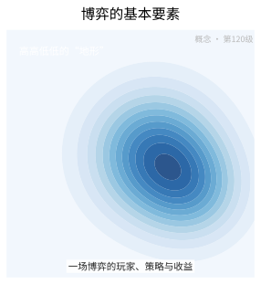

**一句话点破**：把“谁、能干什么、得到什么”说清楚，博弈才能变成数学。

### 谁都不愿先动的稳定局面

一组策略里，如果谁单独改主意都不会变得更划算，这就是纳什均衡。它像两人都握着方向盘不松手：不是因为这样最好，而是因为单独动一下会更亏。

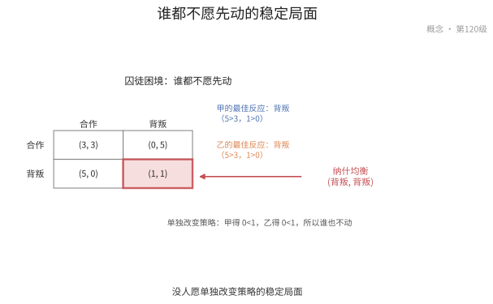

**一句话点破**：纳什均衡是“谁都不愿先动”的那个稳定点。

### 猜不透时，随机反而最稳

每次只死认一招叫纯策略；按一定概率在几招之间随机挑叫混合策略，记作 $\Delta(S_i)$。猜拳里没有必胜的纯策略，随机出招反而让对手最难对付。

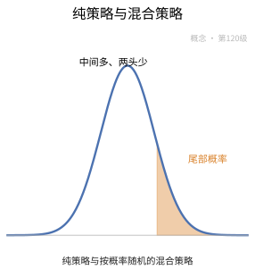

**一句话点破**：当下定决心会被看穿，按概率出招才是更聪明的策略。

### 先认清这是哪一类博弈

博弈能按几把尺子分类：同时出手还是先后出手（静态/动态）、收益总和恒定还是可变（零和/非零和）、能否商量着分钱（合作/非合作）。类别不同，找解的方法也不同。

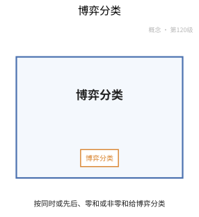

**一句话点破**：先分清这盘棋属于哪一类，才知道该用哪套工具去找解。

### 合伙分钱，按缺了你会少赚多少

几个人合伙赚了钱该怎么分？Shapley 值的答案是：看你在每一种结盟顺序里额外带来多少收益，再把这些边际贡献取平均。谁缺了你少赚得多，谁就分得多。

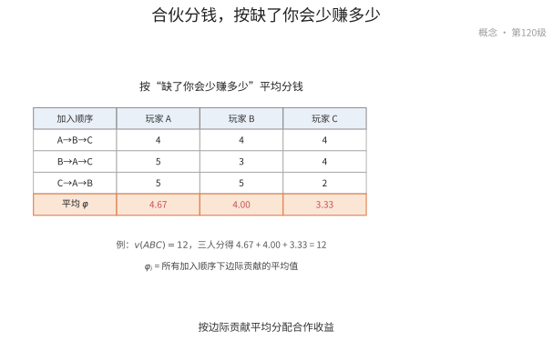

**一句话点破**：公平的分法，就是把你处处不可替代的分量平均出来。

### 谁都没兴趣单干的分配

一个分配方案若让任何一小群人单独结盟都捞不到更多好处，它就落在“核”里。核是那些“谁都不想另起炉灶”的稳定分配，有时可能空无一物。

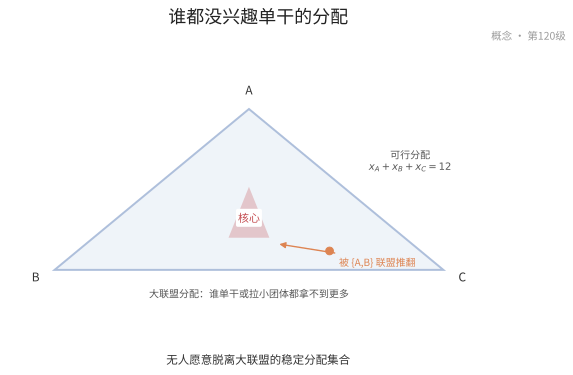

**一句话点破**：核就是那些谁都没兴趣撇下大家单干的分配方案。

### 谈崩时你手里还握着什么

两个人分一块蛋糕，谈崩了就都拿不到——各自“谈崩能得到什么”就是威胁点。谈判的结果被框在可行收益与威胁点之间的那块边界里。

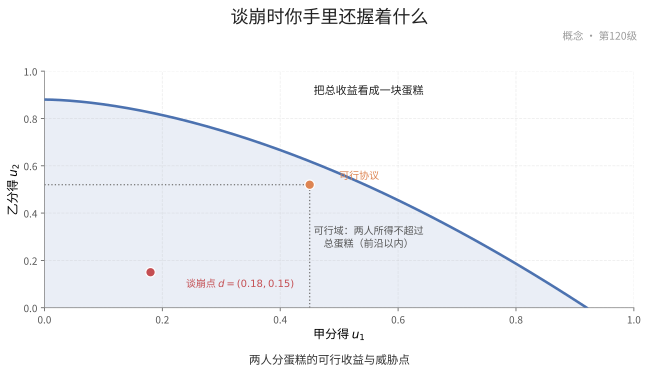

**一句话点破**：谈判力的大小，取决于谈崩时你手里还握着什么。

### 让每一步承诺都经得起检验

动态博弈里，有些威胁只是嘴上说说、真到那一步并不会执行。子博弈完美均衡要求从每一步往后看，每个子局面里的策略都必须是最优的，从而把不可信的威胁筛掉。

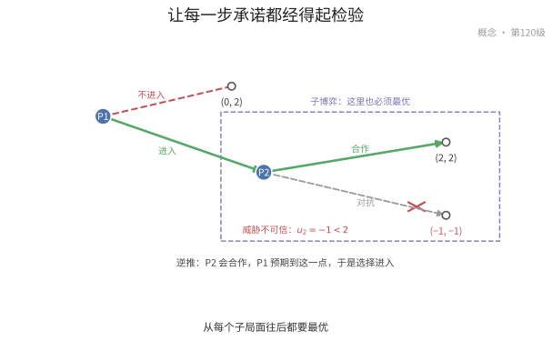

**一句话点破**：子博弈完美，就是让每一个承诺都经得起事后检验。

### 有限博弈的均衡一定存在

纳什证明：任何有限博弈，只要允许混合策略，就至少有一个纳什均衡。证明的思路是把“最佳响应”看成一张连续映射，再用不动点定理保证它必有不动点。

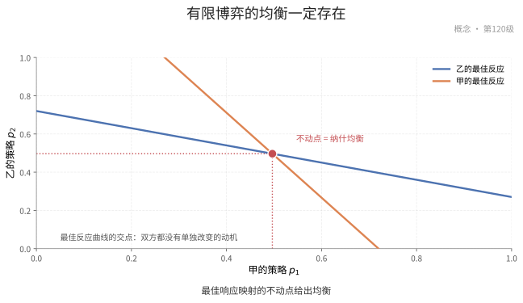

**一句话点破**：有限博弈永远不会无解——随机一点，均衡总存在。

### 零和博弈里那个压不住的值

在零和博弈里，冯·诺依曼证明双方都用混合策略时，存在一个确定的博弈值 $v$：一方能保证至少拿到 $v$，另一方最多只失去 $v$，两边的最优期望恰好咬合。

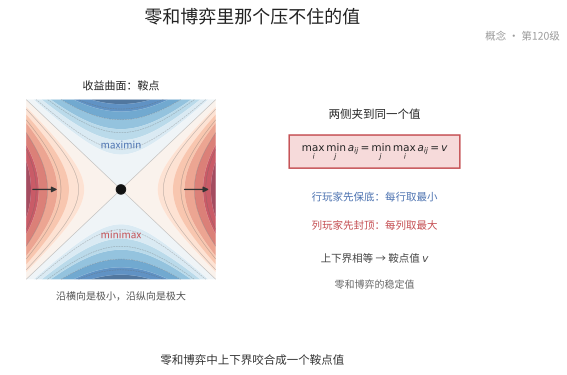

**一句话点破**：你死我活的零和博弈里，总有一个双方都压不住的确定值。

### 几条公理把公平唯一定死

Shapley 值不是随便挑的一种分法，而是被效率性、对称性、哑元、可加性这几条公理唯一钉死的规则。只要讲理，分法就只剩这一种。

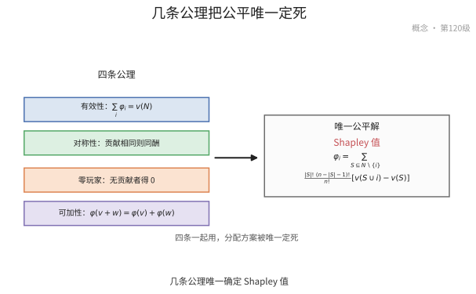

**一句话点破**：公平不是口味问题，几条公理就把它唯一定死了。

### 最讲理的谈判解

纳什给出了讨价还价的标准答案：在可行收益里，最大化两人各自“超出威胁点的那份增量”的乘积。它同样由若干条讲理的公理唯一确定。

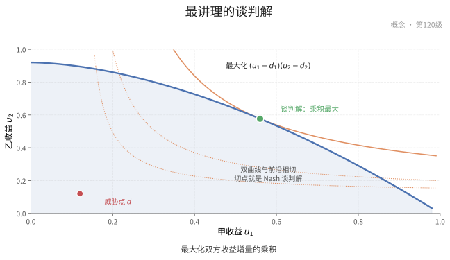

**一句话点破**：把两人超出底线的收益相乘取最大，就是最讲理的谈判解。

### 有限动态博弈总有解

只要博弈是有限的，用“从后往前”的逆推归纳，就一定能构造出子博弈完美均衡。这保证了动态博弈至少有一个经得起步步检验的稳健结局。

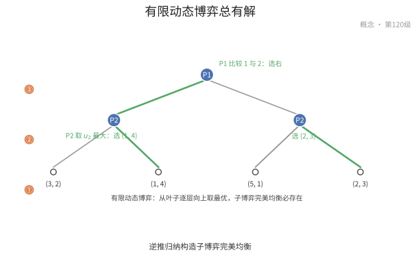

**一句话点破**：有限动态博弈总有解，倒着想回去就能把它找出来。

## 数学史（History of Mathematics）

> 在动手找均衡之前，先想清楚一个基本问题：**当结局不只取决于你自己的选择，还取决于对手怎么想，'最优'到底该怎么说？**

**一个真实的生活场景（第一步：直觉）**

两支军队对峙、两家公司竞价、两个人分一块蛋糕——你的收益不仅由你做主，还由"对方会怎么出招"决定。此时"我单方面求最大"就失效了，你得替对手“设身处地”再回推自己。博弈论（game theory）就是研究这门"**多人互动中的理性决策**"学问：它把各方策略、收益写成矩阵或树，再问"什么组合算得上'各有各的最佳'、结局会停在哪"。它不回答"这一方该怎么做最省心"，而回答"在互相算计之下，怎样的结局才是持久的稳定点"。

**它到底想解决什么问题（第二步：要解决的问题）**

**博弈论**在现代由 von Neumann 与 Nash 奠基，深刻影响了经济学与社会选择。它要解决的**根问题**是：

> 在一个**多方互动**的决策环境里，如何用**策略、收益、最优反应**的工具建模，寻找**均衡（Nash 均衡）**，并刻画合作、威胁、信息与重复博弈下的理性结局？

> **🧠 一句话记住博弈论的"出生证"**
>
> 博弈论源于"把理性的利益冲突与合作用数学讲清楚"的经济与战略需求。它要解决的根本问题是：
>
> $$ \boxed{\text{求 }(\sigma_1^*,\sigma_2^*):\ \text{每个人的策略都是对他人策略的最优反应（Nash 均衡）。}} $$

**看待本章的三种眼光（第三步：正式定义前的准备）**

- **互动的眼光**：先分清"单方最优化"与"多方互动中的最优"本质不同。
- **均衡的眼光**：再掌握占优、纳什均衡与帕累托最优这套"结局停在哪"的语言。
- **扩展的眼光**：最后看懂扩展式、完全信息与重复博弈如何刻画时间与信息的作用。

---

### 7.1 古代策略思想：从孙子到决斗

博弈论的种子早已潜伏在古人智慧里：**《孙子兵法》** 的"知彼知己、庙算决胜"、棋类与决斗中的想前想后，都是朴素的差分博弈与军备竞赛雏形。这些经验虽无体系，却已包含"互相对抗、预判对手"的自觉，是后世博弈论的经验土壤。

### 7.2 Cournot 与古诺模型：博弈论的古典前奏

**Anthony Cournot（1838）** 研究两家产商同时定产量竞争的**古诺模型**，第一次把"竞争者的产量互相影响、谁能找到稳定产量"用方程与反应函数写下。他凭借"产量对策"得出了类似后世"均衡"的概念，被视为博弈与经济学均衡思想的早期源头。

### 7.3 Zermelo 与博弈论的先声：下棋的可决定性

**Ernst Zermelo（1913）** 证明**国际象棋**这类完全信息、有限、零和博弈中"存在必胜/必和/必败的判定"，还首开"谁先手谁受益"的思辨。这虽偏组合博弈，却让"把博弈'知晓底细、可判结局'"变成数学家可啃的对象，是博弈论登上数学舞台的先声。

### 7.4 von Neumann 与零和博弈：棋局的数学化

**约翰·冯·诺依曼（1928、1944）** 是博弈论公认的开创者：他把**零和博弈**（我赢你输、总和为零）严密化，证明**极小极大定理**——在混合策略下，双方的最优期待收益有确定的"鞍点值"。1944 年他与莫根施特恩合著《博弈论与经济行为》，用公理方法把"经济竞争"接上数学，极大丰富了博弈论的框架。

### 7.5 Nash 与非零和均衡：从战争到共赢

**约翰·纳什（1950）** 给出**Nash 均衡**的定义：一组策略组合，在他人策略不变时谁单方改招都不会更好。它把均衡从"零和、我赢你输"推广到一切博弈，让"合作与竞争并存"的博弈（如囚徒困境、拍卖）都有了稳定的"停下来"的结局。Nash 均衡成为博弈论乃至经济学的基石，纳什因此获 1994 年诺贝尔经济学奖。

### 7.6 均衡的精炼：从颤抖手到子博弈完美

**Nash 均衡有时多得离谱**，于是理论发展出各种"精炼"：**子博弈完美均衡**（考虑事后是否可信）、**颤抖手均衡**、**序贯均衡**等，把"不可信的威胁"过滤掉。这些精炼让均衡从"笼统的停滞点"变得更能检验"战略上站得住脚、说一不二"。

### 7.7 扩展式与信息：让时间与隐瞒进模型

真实博弈常有先后与秘密，博弈论用**扩展式博弈（博弈树）**刻画先后次序，用**信息集**与**贝叶斯博弈**刻画对对手类型的不确定性（Harsanyi 的工作）。这使"先动优势、后发制人、虚张声势、信号传递"等真实算计也可被建模成一棵树，是博弈论贴近现实的一大步。

### 7.8 重复博弈与合作：囚徒困境的破局

**囚徒困境**揭示"双方都理性却得到坏结局"的悖论；但**重复博弈**（Axelrod 的锦标赛、以牙还牙策略）证明：在长期重复中，合作可以涌现、威胁可以可信，**声誉与惩罚**让合作成为稳定均衡。这一支为"为什么人们会合作"提供了博弈论的解释，深刻影响演化与制度分析。

### 7.9 博弈论的影响：经济学、生物与计算机

博弈论早已跨界渗透：**经济学**用它做拍卖、机制设计与市场竞争，**生物学**把纳什均衡借为演化稳定策略（ESS），**计算机**与人工智能用它做对抗搜索与多智能体决策。从纳什、谢林到机制设计，博弈论成为理解"理性者在互动中如何稳定共存"的通用语法，至今仍是经济与社会选择理论的核心工具。

---

| 时间 | 人物／文献 | 事件与贡献 |
| --- | --- | --- |
| 1838 | Cournot | 提出古诺竞争模型，博弈均衡思想萌芽 |
| 1913 | Zermelo | 证明完全信息棋类可判定，博弈数学化 |
| 1928 | von Neumann | 证明极小极大定理，奠基零和博弈 |
| 1944 | von Neumann、Morgenstern | 出版《博弈论与经济行为》 |
| 1950 | Nash | 提出 Nash 均衡，推广到非零和博弈 |
| 1960 年代 | Harsanyi、Selten | 发展贝叶斯与精炼均衡 |
| 当代 | 机制设计、演化博弈 | 博弈论渗透经济、生物与 AI |

> **小结**：博弈论的演进，是一部"**把理性的利益冲突写成可解的平衡**"的科学史。它从孙子的庙算与古诺的产量对策起步，经 Zermelo 证明下棋可判定、von Neumann 用极小极大为棋局立纲，靠 Nash 把均衡从零和推向一般博弈，再以均衡精炼与扩展式刻画信息与时间，借重复博弈解释合作，最终渗透进经济、生物与人工智能。博弈论始终回答同一个问题：**当命运由多方共同执笔，理性之人究竟会在哪里停下，那处又如何才真正持久？**

---

## 现实应用（Real-World Applications）

> 本节把本章的知识点落到真实的工程、科学与生活场景中。每个案例都给出**完整的问题背景、建模过程、可复现的数据 / 公式 / 代码与结果解读**；案例末尾的「涉及知识点」对应本章的具体小节，文末附**知识点覆盖对照表**，确保本章知识点全部被覆盖。

### 应用案例 1：电信运营商资费战｜囚徒困境中的"降价"占优与行业利润流失

**场景与问题**

某省通信市场由两家运营商 A、B 主导，5G 套餐业务已进入饱和期，季度新增用户趋近于零，利润变化主要来自用户在两网之间携号转网迁移。2023 年该省移动业务收入约 240 亿元/年，两家分别占 55% 与 45%，单季合计约 60 亿元。每逢季初，两家市场部各自独立决定：维持现行资费，还是把主推套餐月费下调 20%（约 129 元降至 103 元）。降价能通过携转抢到对方用户，但会拉低存量用户 ARPU；两家都清楚对方的成本结构与动作集合。

要回答的问题是：在双方都追求单季收入最大化、且同时行动的前提下，均衡结果是什么？它是否对企业整体（乃至行业）最优？

**涉及知识点**

- 本章「博弈的基本要素」：把两家运营商抽象为玩家 $N=\{A,B\}$，动作集为 $\{\text{维持},\text{降价}\}$，收益即收益矩阵中的季度收入。
- 本章「纳什均衡」：逐格检验单方面偏离动机，定位均衡格。
- 本章「纯策略与混合策略」：先判断纯策略占优，再用一个无纯策略均衡的变体演示混合均衡的求解。
- 本章「博弈分类」：判定该博弈属于非合作、完全信息、静态、非零和博弈。
- 本章「定理1：Nash均衡的存在性定理」：用"有限博弈必存在混合均衡"保证均衡一定找得到。

**建模与数据**

符号：玩家 $N=\{A,B\}$；策略集 $S_A=S_B=\{\text{维持},\text{降价}\}$；收益 $u_i:S_A\times S_B\to\mathbb{R}$，单位亿元/季度。

数据表（某省内部测算，已按季度收入归一化）：

| A \ B | B 维持 | B 降价 |
|---|---|---|
| **A 维持** | (50, 50) | (35, 70) |
| **A 降价** | (70, 35) | (40, 40) |

假设：(1) 双方同时一次性行动；(2) 收益为季度收入，不考虑跨期报复；(3) 需求总量固定，抢客是主要利润变化来源，但成本下降带来约 5 亿元正溢出，故非严格零和。

**完整推导与算法**

步骤1 检验占优策略。对 A：
- 若 B 维持：A 维持得 50，降价得 70，故 A 选降价；
- 若 B 降价：A 维持得 35，降价得 40，故 A 选降价。

无论 B 怎么做 A 都选降价，"降价"是 A 的严格占优策略。对称地，"降价"也是 B 的严格占优策略。

步骤2 定位均衡。占优策略组合 (降价, 降价) 即纳什均衡，验证纳什条件：

$$u_A(\text{降价},\text{降价})=40\ge u_A(\text{维持},\text{降价})=35$$

$$u_B(\text{降价},\text{降价})=40\ge u_B(\text{降价},\text{维持})=35$$

步骤3 与帕累托最优比较。$(50,50)$ 逐分量优于 $(40,40)$，却非均衡——个体理性与集体理性冲突，这就是囚徒困境。行业单季收入由 100 亿元（都维持）跌到 80 亿元，损失约 20 亿元/季。

步骤4 混合策略演示。若把动作换成"投放高端广告/不投放、对方恰好相反时最有收益"的对抗型博弈，收益矩阵为

$$A_{\text{pay}}=\begin{bmatrix} 1 & -1\\ -1 & 1\end{bmatrix}$$

它没有纯策略纳什均衡。设 A 以概率 $p$ 选第 1 行、B 以概率 $q$ 选第 1 列，则 A 选第 1、2 行的期望收益分别为 $2q-1$ 与 $1-2q$。均衡要求对手无差异：$2q-1=1-2q\Rightarrow q=1/2$，同理 $p=1/2$。混合纳什均衡为 $(1/2,1/2)$，博弈值为 0。

关键代码片段：

```python
# 核心：对每个对手动作求最优反应，得到占优/均衡信息
import numpy as np
payA = np.array([[50, 35],
                 [70, 40]])      # 行=维持/降价(A)，列=B维持/降价
payB = np.array([[50, 70],
                 [35, 40]])      # payB[i, j] 为 B 的收益
br_A = [int(np.argmax(payA[:, j])) for j in range(payA.shape[1])]  # -> [1, 1]
br_B = [int(np.argmax(payB[i, :])) for i in range(payB.shape[0])]  # -> [1, 1]
print(br_A, br_B)                # 两者都选"降价"，(1,1) 即均衡
```

**可复现步骤**

1. 环境与依赖：`pip install numpy`
2. 数据准备：把上表两个矩阵录入 `payA`、`payB`。
3. 运行：`python case1.py`
4. 预期输出：`[1, 1] [1, 1]`，均衡格 (1,1) 收益 (40,40)；对抗型变体的混合均衡 $p=q=1/2$、值为 0。

**结果解读与延伸**

均衡 (降价, 降价) 是稳定的（无人愿单方面改变），但对双方都劣于 (维持, 维持)，这是囚徒困境的教科书形态：理性个体导致集体次优。误差来源在于"成本下降正溢出 5 亿元"等参数需实测；局限在于一次性、完全信息假设。要摆脱困境需改变博弈结构——重复博弈中的触发策略（见案例 4）或以合同/监管形成有约束力协议。这正呼应纳什均衡"稳定但不合意"的告诫：均衡与帕累托最优是两把独立的尺子。

### 应用案例 2：程序化竞价广告｜一级价格密封拍卖的对称均衡报价

**场景与问题**

某头部电商在"618"大促中出售首页开屏广告位，采用一级价格密封拍卖（最高出价者胜出并支付自己的出价）。平台有 $n=8$ 家品牌广告主参与，每家的真实价值 $v_i$（每千次曝光的期望转化收益，eCPM）独立同分布地服从 $[0,1]$ 上的均匀分布，真实 eCPM 区间对应 0~50 元。各家同时提交出价，出价最高者获胜。

广告主的问题是：应当出价多少？是否存在一个所有广告主都遵循的对称均衡策略？

**涉及知识点**

- 本章「博弈的基本要素」：玩家是 8 家广告主，策略是出价函数，收益是"获胜时的盈亏"；关键是收益依赖他人出价（$s_{-i}$），且各家有私人类型 $v_i$。
- 本章「纳什均衡」：均衡策略 $\beta(v)$ 使任何广告主都不能通过改变出价提高期望收益。
- 本章「博弈分类」：属于不完全信息（贝叶斯）博弈、非合作博弈。
- 本章「定理1：Nash均衡的存在性定理」：有限动作/连续策略的博弈存在（贝叶斯）均衡。

**建模与数据**

- 竞拍者 $i=1,\dots,n$，$n=8$；私有估值 $v_i\sim U[0,1]$ 独立同分布，先验为共同知识。
- 策略为严格递增的出价函数 $b=\beta(v)$，考察对称均衡（所有人用同一 $\beta$）。
- 收益：$u_i=(v_i-b_i)\cdot P(\text{获胜})$。

**完整推导与算法**

步骤1 写期望收益。若某广告主估值为 $v$、出价 $b$，则其余 $n-1$ 家的出价均低于 $b$ 时他获胜：

$$\pi(v,b)=(v-b)\cdot F\!\left(\beta^{-1}(b)\right)^{n-1}$$

其中 $F$ 为估值分布函数，均匀分布下 $F(v)=v$。

步骤2 转化为无约束问题。令 $x=\beta^{-1}(b)$（即"出价 $b$ 相当于报出估值 $x$"），则 $b=\beta(x)$，

$$\pi=(v-\beta(x))\,x^{\,n-1}$$

步骤3 一阶条件。对 $x$ 求导并令在均衡点 $x=v$ 处取极值：

$$-\beta'(x)x^{\,n-1}+(v-\beta(x))(n-1)x^{\,n-2}=0$$

代入 $x=v$：

$$v\,\beta'(v)=(n-1)\big(v-\beta(v)\big)$$

步骤4 解微分方程。设 $\beta(v)=cv$，代入得 $cv=(n-1)(v-cv)$，即 $c=(n-1)(1-c)$，解得

$$c=\frac{n-1}{n},\qquad \beta(v)=\frac{n-1}{n}v$$

关键代码片段：

```python
# 核心：一级价格密封拍卖的对称均衡报价 β(v) = (n-1)/n * v
n = 8
beta = lambda v: (n - 1) / n * v          # 8 家广告主的报价函数
v = 0.6                                    # 某广告主的真实估值（归一化 eCPM）
bid = beta(v)                              # -> 0.525，相对估值压低 12.5%

# 核心：卖家期望收入 = 期望第二高出价 ≈ (n-1)/(n+1)
exp_revenue = (n - 1) / (n + 1)           # -> 7/9 ≈ 0.778
print(bid, exp_revenue)
```

**可复现步骤**

1. 环境与依赖：`pip install numpy`
2. 数据准备：设 $n=8$，估值均匀分布 $[0,1]$，任取 $v=0.6$。
3. 运行：`python case2.py`
4. 预期输出：出价 0.525（即压低 12.5%）；卖家期望收入约 0.778。可再用蒙特卡洛模拟 10 万次竞价，验证均衡报价下无广告主能靠偏离 $\beta$ 提高期望收益。

**结果解读与延伸**

结论是每位广告主都会"藏着报"——出价只有真实估值的 $(n-1)/n$ 倍。竞价人数越多（$n$ 越大），$\beta(v)\to v$，竞争越激烈、压价越少。这一"shading"幅度来自对"竞争对手数量"的精细算计。局限：假设风险中性、私有价值独立（IPV）、无合谋与无进入成本；若价值相关联（common value）则会出现赢家诅咒。延伸方向包括二级价格（VCG）拍卖的机制设计、保留价设置，以及同样可用"最优反应"框架分析的收益等价定理。

### 应用案例 3：网络安全攻防｜零和博弈的混合策略与极小化极大

**场景与问题**

某企业内网有 3 个关键节点（数据库、域控、邮件网关）。蓝队只有一份"蜜罐+补丁"资源，只能重点加固 1 个节点；红队选择 1 条攻击路径。红队收益定义为"攻击成功造成的损失增益"，蓝队收益为其相反数，构成零和博弈。红队要选择让"最坏情况收益最大"的混合策略，蓝队要选择让"最好情况损失最小"的混合策略。

问题：双方的最优策略与博弈值是多少？为什么必须随机化？

**涉及知识点**

- 本章「纯策略与混合策略」：本例没有纯策略均衡，混合策略是唯一出路，需令对手在支集动作间无差异。
- 本章「定理2：极小化极大定理（von Neumann）」：$\max\min=\min\max$ 给出确定的博弈值。
- 本章「博弈分类」：典型二人零和博弈，用 minimax 而非 Shapley/讨价还价工具。

**建模与数据**

红队（最大化者）有 3 条路径、蓝队（最小化者）有 3 个加固点，红队收益矩阵（单位：损失增益，可用"千万元"计）：

$$A=\begin{bmatrix} 4 & 0 & 3\\ 2 & 3 & 1\\ 3 & 2 & 4\end{bmatrix}$$

假设：完全信息、同时行动、零和；$a_{ij}$ 为红队选路径 $i$、蓝队选加固点 $j$ 时红队的收益。

**完整推导与算法**

步骤1 化为线性规划。红队选混合策略 $x\in\Delta^3$ 最大化保底收益 $v$：

$$\max_{x\ge 0,\ \sum_i x_i=1} v \quad\text{s.t.}\quad \sum_i x_i a_{ij}\ge v,\ \ j=1,2,3$$

步骤2 蓝队的对偶问题。蓝队选 $y\in\Delta^3$ 最小化上限 $u$：

$$\min_{y\ge 0,\ \sum_j y_j=1} u \quad\text{s.t.}\quad \sum_j a_{ij}y_j\le u,\ \ i=1,2,3$$

二者互为对偶，由线性规划强对偶性 $v^*=u^*$，这就是极小化极大定理。

步骤3 数值求解。三条下界约束分别为 $L_1=4x_1+2x_2+3x_3$、$L_2=3x_2+2x_3$、$L_3=3x_1+x_2+4x_3$。令三者相等并联立 $\sum x_i=1$，解得 $x=(0,\tfrac12,\tfrac12)$，此时 $L_1=L_2=L_3=2.5$，故博弈值 $v^*=2.5$。

步骤4 对偶最优解。取 $\varepsilon$-紧的蓝队策略 $y=(0,\tfrac34,\tfrac14)$ 可验证三条行约束都等于 2.5，故蓝队也拿到值 2.5。红队以各半概率攻击路径 2、3；蓝队以 3/4 概率加固域控、1/4 概率加固邮件网关。

关键代码片段：

```python
# 核心：用线性规划求零和博弈的值与双方最优混合策略
import numpy as np
from scipy.optimize import linprog
A = np.array([[4, 0, 3],
              [2, 3, 1],
              [3, 2, 4]], dtype=float)
n = 3
# 变量 [x1,x2,x3,v]，max v  <=> min -v
c  = np.array([0, 0, 0, -1.0])
A_ub = np.hstack([-A.T, np.ones((n, 1))])          # -A^T x + v <= 0
b_ub = np.zeros(n)
A_eq = np.array([[1, 1, 1, 0.0]])                  # sum x = 1
b_eq = np.array([1.0])
res = linprog(c, A_ub=A_ub, b_ub=b_ub, A_eq=A_eq, b_eq=b_eq,
              bounds=[(0, 1)] * 3 + [(None, None)])
print(res.x)                                        # [0, .5, .5, 2.5]
```

**可复现步骤**

1. 环境与依赖：`pip install numpy scipy`
2. 数据准备：录入收益矩阵 $A$。
3. 运行：`python case3.py`
4. 预期输出：红队混合策略约为 $(0,0.5,0.5)$，博弈值 2.5；再用对偶 LP（或令 $A\to -A^T$ 复用同一代码）可得蓝队策略 $(0,0.75,0.25)$。

**结果解读与延伸**

纯策略下红队若总走路径 1，蓝队就固定加固节点 1 使其收益降到 4 与 0 之间最差的 0；随机化让对手抓不住规律，这正是混合策略在安全中的价值。博弈值 2.5 意味着信息系统应把"最坏情况下的预期损失"压到 2.5 千万级。局限：矩阵收益需由风险评估量化，且假设理性零和；现实中攻防信息常不对称，应改用贝叶斯博弈。延伸方向包括多资源 Colonel Blotto 博弈、蜜罐部署的机制设计，以及用启发式求解大规模安全博弈（如 ARMOR 系统）。

### 应用案例 4：原油产量合谋｜重复博弈、触发策略与子博弈完美均衡

**场景与问题**

两个产油国（或两家航空、两家平台）在无限延续的市场上重复进行"限产保价/增产抢份额"的博弈。单期收益矩阵与案例 1 同构：合作（限产）各得 $R=50$，单方背叛（增产）得 $T=70$、对方得 $S=35$，双方都背叛各得 $P=40$（单位：亿元/季）。区别是：若产量决策按季度重复进行，背叛会招致未来报复。

问题：在有限期重复与无限期重复两种情形下，合作能否被维持？需要多"有耐心"？

**涉及知识点**

- 本章「博弈分类」：这里把静态博弈升级为动态（重复）博弈，考察时序对均衡的影响。
- 本章「子博弈完美均衡」：要求策略在每个子博弈上都构成纳什均衡，从而排除"不可信的报复威胁"。
- 本章「定理5：子博弈完美均衡的存在性」：用逆向归纳证明有限完美信息博弈的 SPE 存在且唯一。
- 本章「纳什均衡」：单期基准（增产, 增产）仍是唯一的静态纳什均衡。

**建模与数据**

- 单期收益 $(T,R,P,S)=(70,50,40,35)$，满足 $T>R>P>S$（囚徒困境结构）。
- 有限重复：$T_{\text{期}}=12$ 个季度，双方都知道期末。
- 无限重复：贴现因子 $\delta\in(0,1)$，$\delta=\dfrac{1}{1+r}$，$r$ 为季度利率。
- 触发策略（grim trigger）：第一期限产；只要历史上从未有人增产，就继续限产；一旦出现增产，此后永远增产。

**完整推导与算法**

步骤1 有限重复的逆向归纳。最后一期（第 12 期）之后无未来报复，单期唯一均衡是（增产, 增产）；预见到此，第 11 期也退化为单期博弈……逐步倒推，得到唯一子博弈完美均衡：每期都（增产, 增产）。由定理 5，逆向归纳保证这一 SPE 存在且由"每步取对当前玩家最优的动作"构造。

步骤2 无限重复的合谋条件。若双方都限产，每期各得 $R$，贴现总和为 $\dfrac{R}{1-\delta}$。若一方在首期背叛：当期多得 $T$，此后永远只拿 $P$，偏离的净增量为

$$\Delta=(T-R)-\frac{\delta}{1-\delta}(R-P)$$

合作可维持当且仅当 $\Delta\le 0$，整理得

$$\delta\ \ge\ \frac{T-R}{T-P}$$

步骤3 代入数值：

$$\delta\ \ge\ \frac{70-50}{70-40}=\frac{20}{30}=\frac23\approx 0.667$$

关键代码片段：

```python
# 核心：无限重复囚徒困境中用触发策略维持合谋的贴现因子门槛
T, R, P, S = 70, 50, 40, 35
delta_min = (T - R) / (T - P)          # -> 2/3 ≈ 0.6667

# 核心：由贴现因子反推可接受的季度利率上限
r_max = 1 / delta_min - 1              # -> 0.5，即季度利率不高于 50% 才可能合谋
print(delta_min, r_max)
```

**可复现步骤**

1. 环境与依赖：`pip install numpy`（参数计算仅需内置算术）。
2. 数据准备：设定 $(T,R,P,S)=(70,50,40,35)$、期数 12、可选 $\delta\in\{0.5,0.667,0.9,0.95\}$。
3. 运行：`python case4.py`
4. 预期输出：$\delta_{\min}=0.667$；当 $\delta=0.5$ 时单期偏离净增益为正（合谋瓦解），$\delta=0.9$ 时为负（合谋可维持）。有限 12 期时，模拟逆向归纳可得每期都增产。

**结果解读与延伸**

结论对比鲜明：有限且期末公开时，逆向归纳让合谋彻底瓦解——报复威胁"到了最后一期不可信"，被 SPE 剔除；无限期或期末不确定时，只要贴现因子超过 2/3（等价的季度利率不超过 50%），触发策略就能把限产维持为子博弈完美均衡。这解释了现实中的卡特尔往往需要"长期关系 + 难以观测的期末"才能稳住。局限：完全信息、单次偏离可观测；若背叛难以察觉（如产量偷偷增加），需引入不完全监测的重复博弈。延伸方向包括有限期但期末概率不确定的"随机终止"模型、以及声誉机制与合谋反垄断执法。

### 应用案例 5：供应链 Stackelberg 博弈｜批发价先行与双重边际化

**场景与问题**

某新能源车企（制造商，领导者）向独家经销商（零售商，追随者）销售电池包，单位生产成本 $c=20$（万元）。市场需求的反需求函数为

$$P=100-Q$$

即市场上每季总需求 $Q$（万套）对应单价 $P$（万元）。制造商先制定批发价 $w$，经销商观察到 $w$ 后决定订货量 $q$。这是一个"领导者先动、追随者后动"的序贯博弈。

问题：子博弈完美均衡下的批发价、订货量、双方利润各是多少？与"纵向一体化"相比损失多少？

**涉及知识点**

- 本章「子博弈完美均衡」：领导者必须预判追随者的最优反应，这正由"在追随者子博弈上取纳什均衡"来保证。
- 本章「定理5：子博弈完美均衡的存在性」：完美信息动态博弈可用逆向归纳求解 SPE。
- 本章「博弈的基本要素」：玩家（制造商、经销商）、策略（$w$ 与 $q$）、收益（各自利润）。
- 本章「博弈分类」：完全信息、动态（序贯）博弈，与案例 1 的同时行动博弈相对照。

**建模与数据**

- 反需求函数 $P=100-Q$，单位成本 $c=20$。
- 经销商：给定 $w$，选 $q$ 最大化 $\pi_r=(P-w)q=(100-q-w)q$。
- 制造商：预期经销商的反应，选 $w$ 最大化 $\pi_m=(w-c)q$。
- 假设线性需求、无库存与无固定成本。

**完整推导与算法**

步骤1 求解追随者子博弈。经销商对 $q$ 求一阶条件：

$$\frac{\partial \pi_r}{\partial q}=100-w-2q=0\ \Rightarrow\ q(w)=\frac{100-w}{2}$$

这是经销商的**最优反应函数**——领导者必须把整条反应函数当作"后续子博弈的均衡"。

步骤2 领导者预判并最优化。代入制造商利润：

$$\pi_m(w)=(w-20)\cdot\frac{100-w}{2}$$

对 $w$ 求一阶条件：

$$\frac{d\pi_m}{dw}=\frac{(100-w)-(w-20)}{2}=0\ \Rightarrow\ w^*=60$$

步骤3 回代求均衡。$q^*=\dfrac{100-60}{2}=20$，$P^*=100-20=80$，于是

$$\pi_r^*=(80-60)\cdot 20=400,\qquad \pi_m^*=(60-20)\cdot 20=800,\qquad \text{合计}=1200$$

步骤4 与纵向一体化比较。若制造商与经销商合并，总利润为 $(100-q-20)q=(80-q)q$，最优 $q^{I}=40$，总利润

$$\pi^{I}=(80-40)\cdot 40=1600$$

差额 $1600-1200=400$ 即"双重边际化"造成的效率损失。

关键代码片段：

```python
# 核心：Stackelberg 逆向归纳——先解追随者反应，再优化领导者
c = 20
reaction = lambda w: (100 - w) / 2                 # 追随者最优订货量
w_star = 60                                        # 领导者最优批发价（由 FOC 解出）
q_star = reaction(w_star)                           # -> 20
pi_r = (100 - q_star - w_star) * q_star            # -> 400
pi_m = (w_star - c) * q_star                        # -> 800
pi_I = (100 - 40 - c) * 40                          # 一体化总利润 -> 1600
print(q_star, pi_r, pi_m, pi_I, pi_I - pi_r - pi_m)  # 20 400 800 1600 400
```

**可复现步骤**

1. 环境与依赖：`pip install numpy`（或纯算术）。
2. 数据准备：设 $c=20$，需求 $P=100-Q$。
3. 运行：`python case5.py`
4. 预期输出：$w^*=60,\ q^*=20,\ P^*=80$，$\pi_r=400$，$\pi_m=800$，一体化损失 400。

**结果解读与延伸**

结论：领导者用逆向归纳"料定"追随者的反应后再定价，拿到 800 的利润，明显高于追随者的 400——这正是"先动优势"。双重边际化损失 400 说明两层加价使终端价偏高、销量偏低，实务中常用两部定价、数量折扣或收益共享契约来缓解。局限：线性需求、单领导者单追随者、完全信息。延伸方向包括多追随者 Stackelberg、需求不确定下的契约设计，以及与案例 1 对照理解"序贯 vs 同时"如何改变均衡。

### 应用案例 6：机场跑道成本分摊｜Shapley 值与核

**场景与问题**

某支线机场要修建一条跑道，成本由"需要的最长跑道长度"决定。三家航空公司对跑道长度的需求分别为 $r_A=2$、$r_B=3$、$r_C=4$（单位：亿元）。联盟 $S$ 的成本就是其中最长需求：

$$c(S)=\max_{i\in S} r_i,\qquad c(\varnothing)=0$$

机场管理方要把 4 亿元总成本公平地分摊给三家。问题：怎么分才"公平"？用 Shapley 值分配，它是否落在核（任一联盟都拆不散）里？

**涉及知识点**

- 本章「Shapley值」：用边际贡献对全部加入顺序取平均，得到唯一公平分摊。
- 本章「核」：检验分摊方案是否"任何小联盟单干都不更划算"。
- 本章「定理3：Shapley值的公理化刻画」：效率、对称、哑元、可加性四条公理唯一锁定 Shapley 值。

**建模与数据**

成本特征函数（成本博弈）：

| 联盟 $S$ | $\{A\}$ | $\{B\}$ | $\{C\}$ | $\{A,B\}$ | $\{A,C\}$ | $\{B,C\}$ | $\{A,B,C\}$ |
|---|---|---|---|---|---|---|---|
| $c(S)$ | 2 | 3 | 4 | 3 | 4 | 4 | 4 |

**完整推导与算法**

步骤1 列出全部加入顺序与边际贡献。Shapley 值公式为

$$\phi_i(c)=\sum_{S\subseteq N\setminus\{i\}}\frac{|S|!\,(n-|S|-1)!}{n!}\big[c(S\cup\{i\})-c(S)\big]$$

步骤2 枚举 6 种加入顺序，逐个算边际贡献：

| 顺序 | $A$ 的边际 | $B$ 的边际 | $C$ 的边际 | 合计 |
|---|---|---|---|---|
| A B C | 2 | 1 | 1 | 4 |
| A C B | 2 | 0 | 2 | 4 |
| B A C | 0 | 3 | 1 | 4 |
| B C A | 0 | 3 | 1 | 4 |
| C A B | 0 | 0 | 4 | 4 |
| C B A | 0 | 0 | 4 | 4 |

步骤3 三列分别求和除以 $3!=6$：

$$\phi_A=\frac{2+2}{6}=\frac{2}{3},\qquad \phi_B=\frac{1+3+3}{6}=\frac{7}{6},\qquad \phi_C=\frac{1+2+1+1+4+4}{6}=\frac{13}{6}$$

（每行合计均为 $c(N)=4$，验证了效率公理 $\sum_i\phi_i=c(N)$。）

步骤4 核的检验。成本博弈的核要求 $\sum_i x_i=c(N)$ 且对每个联盟 $\sum_{i\in S}x_i\le c(S)$。逐条验证 $\phi$：

$$\phi_A+\phi_B=\tfrac{11}{6}\le c(\{A,B\})=3,\quad \phi_A+\phi_C=\tfrac{17}{6}\le 4,\quad \phi_B+\phi_C=\tfrac{20}{6}\le 4$$

且 $\phi_A=\tfrac23\le 2,\ \phi_B=\tfrac76\le 3,\ \phi_C=\tfrac{13}{6}\le 4$，故 $\phi$ 落在核中。

关键代码片段：

```python
# 核心：用"全排列平均边际贡献"计算 Shapley 值
import itertools
r = {'A': 2, 'B': 3, 'C': 4}
def cost(S):                      # 联盟成本 = 联盟内最长需求
    return max((r[i] for i in S), default=0)
phi = {i: 0.0 for i in r}
perms = list(itertools.permutations(r))
for p in perms:                   # 每种加入顺序
    for k, i in enumerate(p):
        S = set(p[:k])            # i 之前已加入的联盟
        phi[i] += cost(S | {i}) - cost(S)   # 边际贡献
for i in phi:
    phi[i] /= len(perms)          # 对 6 种顺序取平均
print(phi)                        # {'A': 0.667, 'B': 1.167, 'C': 2.167}
```

**可复现步骤**

1. 环境与依赖：Python 标准库 `itertools`。
2. 数据准备：需求字典 `r = {'A':2,'B':3,'C':4}`。
3. 运行：`python case6.py`
4. 预期输出：`{'A': 0.667, 'B': 1.167, 'C': 2.167}`，合计 4；再逐条检查核不等式均成立。

**结果解读与延伸**

结果符合直觉：需求越大（越不可替代地"迫使"建长跑道）分摊越多，$\phi_C>\phi_B>\phi_A$。Shapley 值是**点**（唯一分摊方案），核是**集合**（所有拆不散的方案）；本例 Shapley 值恰好落在核里，这与机场成本博弈是凸（费用次模）博弈有关。局限：假设合作有约束力、特征函数已知。延伸方向包括用 Shapley 值分摊云资源与网络互联成本、以及当核为空时改用 $\epsilon$-核或最小核。

### 应用案例 7：并购谈判｜Nash 讨价还价解与"等增益"分配

**场景与问题**

公司 A 拟收购公司 B。合并后预计产生 10 亿元协同价值可供双方分配。若谈判破裂，A、B 各自维持现状的收益（威胁点）为 $d=(2,3)$（亿元）。可行集是 $F=\{x\ge d:\ x_1+x_2\le 10\}$，即不超过协同总价值的任意分配。双方要找一份公平均衡的协议。

问题：Nash 讨价还价解给出哪一份分配？它为何"公平"？

**涉及知识点**

- 本章「讨价还价问题」：由可行集 $F$ 与威胁点 $d$ 构成，协议须逐分量优于 $d$。
- 本章「定理4：Nash讨价还价解」：唯一满足帕累托最优、对称、无关选择独立性、仿射不变性的解，就是最大化 Nash 积的点。

**建模与数据**

- 可行集 $F=\{x\in\mathbb{R}^2:\ x_1+x_2\le 10,\ x\ge d\}$，威胁点 $d=(2,3)$。
- Nash 积 $N(x)=(x_1-d_1)(x_2-d_2)=(x_1-2)(x_2-3)$。

**完整推导与算法**

步骤1 利用帕累托最优定位前沿。Nash 积随 $x_1,x_2$ 递增，最优必在 $x_1+x_2=10$ 上。

步骤2 化为一元优化。令 $x_2=10-x_1$，

$$N(x_1)=(x_1-2)(10-x_1-3)=(x_1-2)(7-x_1)$$

步骤3 一阶条件：

$$\frac{dN}{dx_1}=(7-x_1)-(x_1-2)=9-2x_1=0\ \Rightarrow\ x_1=4.5$$

回代得 $x_2=5.5$。

步骤4 验证"等增益"结构。两侧相对威胁点的增益为

$$x_1-d_1=4.5-2=2.5,\qquad x_2-d_2=5.5-3=2.5$$

二者相等，这正是线性前沿下 Nash 解的标志性结论：把协同"红利" $(10-5)=5$ 亿元对半分。

关键代码片段：

```python
# 核心：最大化 Nash 积 (x1-d1)(x2-d2) 求解讨价还价解
from scipy.optimize import minimize_scalar
d1, d2, total = 2, 3, 10
# 前沿上 x2 = total - x1，最大化 (x1-d1)(x2-d2)
neg_nash = lambda x1: -((x1 - d1) * ((total - x1) - d2))
res = minimize_scalar(neg_nash, bounds=(d1, total - d2), method='bounded')
x1 = res.x
print(x1, total - x1, (x1 - d1), (total - x1) - d2)   # 4.5 5.5 2.5 2.5
```

**可复现步骤**

1. 环境与依赖：`pip install scipy`
2. 数据准备：威胁点 $d=(2,3)$，协同总量 10。
3. 运行：`python case7.py`
4. 预期输出：$x=(4.5,5.5)$，双方增益均为 2.5。

**结果解读与延伸**

Nash 讨价还价解把"谈判红利"对半分，兼顾了"比威胁点强多少"与"对方也得到保障"，由帕累托最优、对称、无关选择独立性、仿射不变性四条公理唯一确定。局限：假设可行集凸紧、双方风险中性；若可行集非凸或一方更厌恶风险，解会偏向更耐谈者。延伸方向包括 Kalai–Smorodinsky 解（以单调性替代无关选择独立性）、以及带信息不对称与外部选项的谈判模型，可为并购、工资谈判与供应链分利提供定量基准。

### 知识点覆盖对照表

| 本章知识点 | 覆盖案例 |
| --- | --- |
| 博弈的基本要素 | 案例 1、2、5 |
| 纳什均衡 | 案例 1、2、4 |
| 纯策略与混合策略 | 案例 1、3 |
| 博弈分类 | 案例 1、2、3、4、5 |
| Shapley值 | 案例 6 |
| 核 | 案例 6 |
| 讨价还价问题 | 案例 7 |
| 子博弈完美均衡 | 案例 4、5 |
| 定理1：Nash均衡的存在性定理 | 案例 1、2、4 |
| 定理2：极小化极大定理（von Neumann） | 案例 3 |
| 定理3：Shapley值的公理化刻画 | 案例 6 |
| 定理4：Nash讨价还价解 | 案例 7 |
| 定理5：子博弈完美均衡的存在性 | 案例 4、5 |

---

## 总结

在本级中，我们学习了博弈论的核心概念和主要定理：

1. **纳什均衡**是博弈论中最基本的解概念，其存在性通过角谷不动点定理得到保证，是理解策略性互动的基石。

2. **极小化极大定理**揭示了零和博弈中确定性预测的可能性——无论对手如何行动，最优策略保证了确定的下界收益。

3. **Shapley值**通过四条公理（效率、对称性、哑元、可加性）唯一刻画了合作博弈中每个玩家的公平贡献，为收益分配提供了理论基础。

4. **Nash讨价还价解**给出了在可行集和威胁点下达成公平协议的公理化方法，在经济学和商业谈判中有广泛应用。

5. **子博弈完美均衡**通过逆向归纳法剔除了动态博弈中的不可信威胁，使得均衡分析更加精确。

博弈论的应用范围极其广泛，从经济学（市场设计、拍卖、机制设计）到政治学（投票理论、国际关系），从生物学（演化博弈）到计算机科学（算法博弈论），已成为跨学科分析策略性决策的核心工具。
