# 第 92 级：回归分析 (Regression Analysis)

---

## 从"猜一条穿过散点的直线"说起：回归分析要解决的根问题

> 在动手算 $\hat{\boldsymbol{\beta}}$ 之前，先想清楚一个问题：**人为什么需要回归（regression）？**

**一个真实的生活场景（第一步：直觉）**

想象你是开房产中介的，客户拿着 120 平方米、3 个卧室、房龄 6 年的房子来问能卖多少。你手里没有"定价公式"，只有过去几百单成交记录——每单都是一个点 $(X_1,X_2,X_3)$ 和一个价格 $Y$。你屏住呼吸想做一件事：**在这片点云里，找出一条（或一张）能概括"面积、卧室、房龄大致决定房价"规律的线，然后拿它去给没成交过的新房子开价。** 你不需要这条线精确穿过每个点（现实总有水分），只需要它"整体误差最小"。这个"从一堆又涨又跌、丢满误差点的数据里，抽出一条最像样的规律线"的过程，就是回归分析。

**它为什么叫"回归"（第二步：要解决的问题）**

"回归（regression）"这个词来自 19 世纪的英国科学家高尔顿（Francis Galton）。他研究父代与子代的身高时发现一个奇特现象：高个子父亲的儿子往往没有父亲那么高，矮个子父亲的儿子往往没有父亲那么矮——**子代身高总好像被一只无形的手"拉回"中点附近**。高尔顿把它称为"向均值的回归（regression toward the mean）"。他画的"儿子身高对父亲身高"的直线，就成了历史上第一条回归线。更早的源头则是天文与测地：19 世纪初的高斯、勒让德处理行星轨道和大地测量时，面对的也是"观测太多、必然带误差、怎样最合理地求一个结论"的问题，于是最小二乘应运而生（见下文第 2.2 节）。

所以回归分析的**核心问题**不是"画一条线"，而是这一句：面对一批带着随机误差、不会乖乖落在一条线上数据，我们要怎样从"X 预测 Y"的一整套候选规律里，找到**那条整体误差最小的规律，并如实交代它的可靠程度**。它一生下来就是"从噪声里找信号"的学问。

**看待本章的三种眼光（第三步：正式定义前的准备）**

- **拟合的眼光**：先立起模型 $Y=\boldsymbol{X}\boldsymbol{\beta}+\varepsilon$，用最小二乘/最大似然求出"最像"的系数 $\hat{\boldsymbol{\beta}}$（第 2.1–2.3 节）。
- **推断的眼光**：光会算还不够，还要问"这个 $\hat\beta$ 可信吗"——用 Gauss-Markov 定理、t/F 检验给出可靠程度（第 2.4、3 节）。
- **诊断与修正的眼光**：现实数据常常违反"同方差、无相关"等理想假设，要用 VIF、残差图诊断，并用 WLS/GLS、岭回归、Lasso 去修正（第 2.5–2.10 节）。

读完这一节，请你记住的不是一堆公式，而是：**回归分析的基本盘，是"在满眼带噪的数据里，抽取一条整体误差最小的规律线，并说清它有多可靠"。** 后面每一个概念，都是围绕这个朴素追问展开的。

> **🧠 一句话记住回归分析的"出生证"**
>
> 回归分析（regression）源于天文测量与高尔顿的"向均值回归"观测，它解决的**根本问题**是：
>
> $$ \boxed{\text{在带随机误差的数据里，如何从 } X \text{ "预测" } Y \text{，找出整体误差最小的规律，并量化其可靠程度？}} $$
>
> 它把"找一条最像样的线"从手画经验升格为一套可证明、可检验的统计机器。

---

## 开始之前

**本章在讲什么**：本章研究"用解释变量预测响应变量"这一统计任务的**主线流程**。你会先从最基础的线性回归模型出发，用最小二乘与最大似然估计出系数 $\hat{\boldsymbol{\beta}}$，再靠 $R^2$、Gauss-Markov 定理和 t/F 检验给出拟合优度与推断结论，随后直面多重共线性、异方差、自相关这三类常见"故障"并学习加权、广义、正则化等修正手段，最后简单触及非线性回归。全章以"拟合 → 推断 → 诊断 → 修正"为线索推进。

**为什么要学它**：第 88/89 级（概率与随机变量、统计推断）已经给了你分布、估计、检验这套"猜测-验证"的语言，但那只处理"一个参数的估计"；本章把统计推断搬到"多个解释变量共同作用于一个响应变量"的舞台上，是衔接理论统计与一切实证建模的枢纽。它直接喂给第 93 级（时间序列分析，回归思想搬到时序上）、第 94 级（非参数统计，扔掉正态假设做回归/检验）以及第 99 级（统计学习理论，误差分解、正则化、泛化的种子都在这里）。

**开始前请确认你还记得**：

- 随机变量、期望与方差（见第 88 级）：如 $\mathbb{E}[\varepsilon]=0$、$\text{Var}(\varepsilon)=\sigma^2$ 的含义。
- 正态分布与 $\chi^2$、t、F 分布（见第 88/89 级）：t-统计量 $\frac{(\cdot)}{\sqrt{\chi^2/\nu}}$ 的构造方式。
- 最大似然估计（见第 89 级）：写似然、取对数、求导置零求 $\hat\theta$ 的手法。
- 矩阵基本运算（见第 14 级）：矩阵乘法、转置、逆、正定阵；这是把多元回归写成 $\boldsymbol{Y}=\boldsymbol{X}\boldsymbol{\beta}+\boldsymbol{\varepsilon}$ 的语言。
- 多元函数极值 / 求导（见第 11–13 级）：对 $\beta$ 求向量导数以解最小二乘正规方程。

---

## 1. 学习目标

完成本教程后，你将能够：

1. 理解线性回归模型的基本假设与参数估计方法
2. 掌握最小二乘估计与最大似然估计的推导与性质
3. 掌握回归系数的假设检验（t检验与F检验）与方差分析
4. 理解多重共线性、异方差性、自相关等问题的诊断与处理方法
5. 掌握岭回归、Lasso回归、主成分回归等正则化方法
6. 理解非线性回归的基本思想
7. 能独立完成回归诊断并选择合适的修正方案

---

## 2. 核心概念

### 2.1 线性回归模型

🌐 **直觉先行**：上一节说"找一条最像样的规律线"，那"规律"该长成什么样最省事？答案是：**假设 $Y$ 是 $X_1,\dots,X_p$ 的加权和**，每个 $X$ 乘一个系数 $\beta$ 再相加，误差 $+\varepsilon$。这就像"每个原因按自己的权重、分发各自的口粮，外加上一节说的'无法避免的随机水分'"。为什么优先选线性？因为一阶近似最好算、最好解释、也最能代表绝大多数平滑关系在局部的小样貌——几乎所有复杂模型，都是从这条"直线"出发的。

**线性回归模型**（Linear Regression Model）假设响应变量 $Y$ 与一组解释变量 $X_1, X_2, \dots, X_p$ 之间存在线性关系：

$$
Y_i = \beta_0 + \beta_1 X_{i1} + \beta_2 X_{i2} + \cdots + \beta_p X_{ip} + \varepsilon_i, \quad i = 1, 2, \dots, n
$$

其中 $\varepsilon_i$ 为随机误差项。用矩阵形式表示为：

$$
\boldsymbol{Y} = \boldsymbol{X}\boldsymbol{\beta} + \boldsymbol{\varepsilon}
$$

其中 $\boldsymbol{Y} \in \mathbb{R}^n$ 为响应向量，$\boldsymbol{X} \in \mathbb{R}^{n \times (p+1)}$ 为设计矩阵，$\boldsymbol{\beta} \in \mathbb{R}^{p+1}$ 为回归系数向量，$\boldsymbol{\varepsilon} \in \mathbb{R}^n$ 为误差向量。

**经典假设**：
1. **线性性**：$\mathbb{E}[\boldsymbol{Y} \mid \boldsymbol{X}] = \boldsymbol{X}\boldsymbol{\beta}$
2. **严格外生性**：$\mathbb{E}[\boldsymbol{\varepsilon} \mid \boldsymbol{X}] = \boldsymbol{0}$
3. **同方差性**：$\text{Var}(\varepsilon_i) = \sigma^2$（常数）
4. **无自相关**：$\text{Cov}(\varepsilon_i, \varepsilon_j) = 0$（$i \neq j$）
5. **满秩**：$\text{rank}(\boldsymbol{X}) = p + 1 < n$

> **💡 直观理解（类比）**：线性回归模型就像"用多个原因的加权和去猜一个结果"——比如房价由面积、卧室数、房龄共同决定，每个因素配一个权重（系数）$\beta$。经典假设则是给这个"猜测游戏"定的规矩：误差平均为零、好坏样本误差波动一致、彼此不串味，这样猜出来的结论才可靠。

> **常见坑**：回归关系 ≠ 因果关系。$\beta_j$ 刻画的是"在其他变量不变时 $X_j$ 每变一个单位、$Y$ 平均变化多少"——这是**关联/依赖关系**，只有随机化的实验或严谨的因果推断设计才能谈因果。不少初学者看到"房龄系数为负"就断言"房龄大导致房价低"，却忽略了房龄与地段、装修等混淆变量纠缠，结论容易被带偏。另外注意符号约定：模型里的 $X_1,\dots,X_p$ 是解释变量，$Y$ 是被解释（响应）变量，方向反了（把 $Y$ 当 $X$ 回归）得到的系数一般并不相同，别想当然地"反着用"。

#### 课堂问答

**老师**：我们把 $Y$ 写成 $X_1,\dots,X_p$ 的加权和，为什么敢假设"线性"？如果真实关系是弯的，这个模型就废了吗？

**学生**：先给结论：线性假设断言的是"条件均值是参数的线性组合"，即 $\mathbb{E}[Y\mid X]=X\beta$，而不是断言世界长成直的。弯的关系只要把 $X^2$、$\ln X$ 当成新的解释变量塞进设计矩阵，模型对参数仍然是线性的。所以"线性"约束的是 $\beta$，$X$ 本身可以是任意非线性变换。

**老师（追问）**：那"严格外生性" $\mathbb{E}[\varepsilon\mid X]=0$ 和"同方差"哪个更要命？违反它们分别坏在哪一步？

**学生**：外生性更致命。它一旦破了，$\hat\beta$ 连无偏都不是，因为无偏推导里用了 $\mathbb{E}[X^\top\varepsilon]=0$；同方差破了只影响有效性与标准误公式，$\hat\beta$ 仍无偏。顺带一提，$\mathbb{E}[\varepsilon\mid X]=0$ 比 $\mathbb{E}[\varepsilon X]=0$ 强，它蕴含误差与 $X$ 的任意函数正交，从而排除了一切形式的遗漏变量偏误。

**老师（拓展）**：满秩假设 $\text{rank}(X)=p+1$ 为什么必须？它对应的现实场景叫什么？

**学生**：因为解是 $(X^\top X)^{-1}X^\top Y$，而 $(X^\top X)$ 可逆当且仅当 $X$ 列满秩。现实中"列近似相关"就是多重共线性，$X^\top X$ 接近奇异，求逆会把误差放大。更深一层：即使不精确奇异，条件数 $d_{\max}/d_{\min}$ 很大也会让 $\hat\beta$ 对数据扰动极其敏感——这正是 2.5 节要治的病。

### 2.2 最小二乘估计

**最小二乘估计**（Ordinary Least Squares, OLS）通过最小化残差平方和来估计参数：

$$
\hat{\boldsymbol{\beta}}_{\text{OLS}} = \arg\min_{\boldsymbol{\beta}} \|\boldsymbol{Y} - \boldsymbol{X}\boldsymbol{\beta}\|^2 = (\boldsymbol{X}^\top \boldsymbol{X})^{-1}\boldsymbol{X}^\top \boldsymbol{Y}
$$

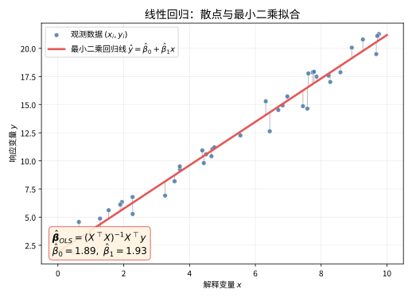

> **直观理解（现实类比）**：把散点想象成学生在某门课上的平时分与期末成绩，每个点是一位同学。最小二乘回归线就像在点云中"拉一根最合适的直尺"，让所有点到这根线的竖直距离的平方和最小——也就是找到一条"综合误差最小"的趋势线。竖线（残差）就是每个点偏离这条线的距离，越短说明这个点越贴合整体规律。

> **🧠 思考历程：两条这样的直线，如何都通往"最小二乘"？**
>
> 当你说出"最小二乘"，它其实在回答一个朴素的追问：散点并没有落在一根直线上，怎样的线才"最像"这些点？而这个问题之所以能从小数点的运算登上统计学殿堂，是因为它最早长在天文观测的误差处理里。
>
> - **天文催生的方法**。1801年意大利天文学家皮亚齐（Giuseppe Piazzi）观测到小行星谷神星后很快就跟丢了，24岁的Gauss依据极少数观测点用最小二乘推算它的轨道，次年这颗星被重新找到，方法一战成名；而独立提出同一思想的Legendre直到1805年才正式发表，一场著名的优先权之争从此延续了半个世纪。
> - **从"凑直线"到"最优直线"**。真正让最小二乘区别于随手画的，是Gauss在1820年代证明：在正态误差下、只要经典假定成立，$\hat{\boldsymbol{\beta}}=(\boldsymbol{X}^{\top}\boldsymbol{X})^{-1}\boldsymbol{X}^{\top}\boldsymbol{Y}$ 就在一切线性无偏估计中方差最小，这正是后来由Markov在1900年去掉正态前提后完成的Gauss-Markov定理。
> - **一条定理的两张脸**。Gauss先给正态前提，Markov只保留一阶、二阶矩假设，便把"最优线性无偏"变成纯粹的线性代数事实——最小二乘由此从天文、物理的实用技巧，升华为整个统计推断的基石。
> - **心路**：好方法往往先从具体疑难里攀出来，再经半世纪淘洗才显出普遍锋芒——误差随手可得，但要说清"它已是最好的"，却要等上一个世纪。

#### 课堂问答

**老师**：你为什么能直接写出闭式解 $\hat\beta=(X^\top X)^{-1}X^\top Y$？把求导那一步用矩阵微积分算给我看。

**学生**：先给答案：由正规方程 $X^\top X\hat\beta=X^\top Y$ 解出。理由是把目标 $\|Y-X\beta\|^2$ 展开成 $Y^\top Y-2\beta^\top X^\top Y+\beta^\top X^\top X\beta$，对 $\beta$ 求梯度得 $-2X^\top Y+2X^\top X\beta$，置零即得。当 $X$ 列满秩时 $X^\top X$ 正定可逆，解唯一且是全局最小值。

**老师（追问）**：闭式解一定存在吗？$X$ 不满秩时怎么办？

**学生**：不唯一。此时 $X^\top X$ 不可逆，$\hat\beta$ 有无穷多解，但拟合值 $X\hat\beta$ 和残差是唯一的——因为投影矩阵 $H=X(X^\top X)^{-1}X^\top$ 到列空间的投影唯一。所以结论是"预测确定、系数不可辨识"，这正是共线性最本质的后果。

**老师（拓展）**："最小二乘"里的"二乘"指什么？换个损失函数世界会怎样？

**学生**："二乘"就是平方。选平方而非绝对值，换来可微、有闭式解、正交条件干净：残差与列空间正交，即 $X^\top e=0$。若换成 $L_1$ 损失 $\sum|e_i|$，就是中位数回归，抗离群点却没有闭式解、要解线性规划。所以"最小二乘最好"其实有前提，真正的背书要等 Gauss-Markov 定理。

### 2.3 最大似然估计

在误差 $\boldsymbol{\varepsilon} \sim N(\boldsymbol{0}, \sigma^2 \boldsymbol{I}_n)$ 的正态假设下，**最大似然估计**（MLE）与OLS估计量相同：

$$
\hat{\boldsymbol{\beta}}_{\text{MLE}} = (\boldsymbol{X}^\top \boldsymbol{X})^{-1}\boldsymbol{X}^\top \boldsymbol{Y}
$$

> **💡 直观理解（类比）**：最大似然估计就是"反客为主的侦探破案"——不是去算"给定参数时数据怎么分布"，而是反过来说：现在都已经看到这些数据了，那能让这些数据最"顺理成章"出现的参数，就是最可信的凶手。在误差服从正态分布时，"最像"的答案恰好和最小二乘拉出的同一条直线重合。

#### 课堂问答

**老师**：为什么正态误差下 MLE 和 OLS 恰好是同一条线？如果误差不是正态呢？

**学生**：结论：正态假设下两者重合。对数似然为 $\ell(\beta,\sigma^2)=-\frac{n}{2}\ln(2\pi\sigma^2)-\frac{1}{2\sigma^2}\|Y-X\beta\|^2$，对 $\beta$ 最大化等价于最小化 $\|Y-X\beta\|^2$，$\sigma^2$ 只是个正的常数因子。换成别的误差分布，MLE 一般就不再是 OLS：重尾误差对应稳健回归，拉普拉斯误差对应 $L_1$ 中位数回归。

**老师（追问）**：那 $\sigma^2$ 的 MLE 是谁？它无偏吗？

**学生**：$\hat\sigma^2_{\text{MLE}}=\text{SSE}/n$，是 $\sigma^2$ 的有偏估计，因为 $\mathbb{E}[\text{SSE}]=\sigma^2(n-p-1)$。所以要无偏就得除以自由度 $n-p-1$，这也正是 t 检验分母里用这个量的原因。

**老师（拓展）**：Gauss-Markov 只用一阶二阶矩，MLE 却要整个分布，哪种"更强"？

**学生**：MLE 假设更强，回报也更大：它给出估计量的完整渐近分布、逼近 Cramér-Rao 下界、还支持似然比与 Wald 检验。OLS 只承诺 BLUE。所以正态假设"贵"，但它把"最优无偏"升级成了"渐近有效 + 可做完整推断"。

### 2.4 决定系数 $R^2$

**决定系数**衡量回归模型对数据的拟合优度：

$$
R^2 = 1 - \frac{\text{SSE}}{\text{SST}} = \frac{\text{SSR}}{\text{SST}}
$$

其中 $\text{SSE} = \sum_{i=1}^n (Y_i - \hat{Y}_i)^2$ 为残差平方和，$\text{SSR} = \sum_{i=1}^n (\hat{Y}_i - \bar{Y})^2$ 为回归平方和，$\text{SST} = \sum_{i=1}^n (Y_i - \bar{Y})^2$ 为总平方和。

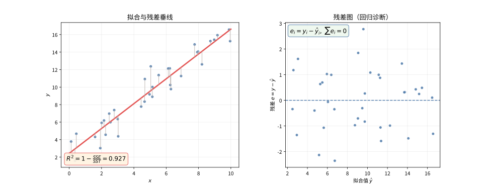

> **直观理解（现实类比）**：$R^2$ 就像天气预报的"准确度评分"——它衡量解释变量能解释响应变量多少比例的波动。残差图则像体检报告上的"误差分布图"：如果残差点在0线两侧随机散布（无规律），说明回归假设成立；如果出现漏斗形或弯曲图案，就像体检指标异常，提示存在异方差性或非线性，需要诊断修正。

> **🔑 为什么要用"调整后的 $R^2$"（Adjusted $R^2$）**：一个隐蔽的坑是——$R^2$ **必然随自变量增加而增大（或不变）**。哪怕塞进十来个与本问题毫不相干的变量（例如用"星期几"预测房价），$R^2$ 也会只涨不跌，仿佛传闻越多越"解释力强"，其实只是把噪声也拟合进去了。调整后决定系数
>
> $$
\bar{R}^2 = 1 - \frac{\text{SSE}/(n-p-1)}{\text{SST}/(n-1)} = 1 - (1-R^2)\frac{n-1}{n-p-1}
$$
>
> 用自由度做了"惩罚"：变量个数 $p$ 越多、$n$ 相对越小时，$\bar{R}^2$ 越难上升甚至可以下降。因此在"往模型里加不加这些变量"的取舍上，应看 $\bar{R}^2$（或 AIC/BIC）而不是裸 $R^2$。

> **常见坑**：$R^2$ 高 ≠ 模型就好。若变量间存在多重共线性（见 2.5）或 $n$ 远小于 $p$，$R^2$ 会虚高甚至逼近 1，并不代表预测准；同样，把样本外预测表现错当成 $R^2$ 的高搭配也是常见误解——$R^2$ 度量的是"对已有数据"的拟合，预测好坏要用独立测试集检验。

#### 课堂问答

**老师**：$R^2=1-\text{SSE}/\text{SST}$ 会随变量增加只涨不跌，这是不是意味着"变量越多模型越好"？

**学生**：恰恰相反。加变量必然让 $\text{SSE}$ 不增，所以裸 $R^2$ 单调不减，它是在奖励堆砌噪声。判定该不该加变量要看调整后决定系数 $\bar R^2=1-(1-R^2)\frac{n-1}{n-p-1}$，其中自由度惩罚因子 $\frac{n-1}{n-p-1}$ 随 $p$ 增大，抵消虚高。

**老师（追问）**：什么情况下 $R^2$ 会是负的？数学上允许吗？

**学生**：允许。当模型不含截距项时，$\text{SST}=\text{SSR}+\text{SSE}$ 不再成立，$R^2$ 就可正可负，负值代表模型比"直接用均值预测"还差。所以 $R^2\in[0,1]$ 有个隐藏前提：模型含截距。

**老师（拓展）**：有没有"$R^2$ 很大却毫无用处、甚至造假"的情形？

**学生**：有三类典型陷阱：一是两条无关的上升趋势变量做回归会得到接近 1 的 $R^2$，即伪回归；二是 $n<p$ 时 $R^2$ 可以恒为 1；三是 $R^2$ 只度量样本内拟合，不能外推到预测。所以真实可信度要看样本外 $R^2$ 或交叉验证。

### 2.5 多重共线性

**多重共线性**（Multicollinearity）指解释变量之间存在高度线性相关关系，导致设计矩阵 $\boldsymbol{X}$ 的列近似线性相关，使得 $(\boldsymbol{X}^\top \boldsymbol{X})$ 接近奇异。

**方差膨胀因子**（VIF）用于诊断多重共线性：

$$
\text{VIF}_j = \frac{1}{1 - R_j^2}
$$

其中 $R_j^2$ 是第 $j$ 个解释变量对其他所有解释变量回归的决定系数。$\text{VIF}_j > 10$ 通常表示存在严重的多重共线性。

> **💡 直观理解（类比）**：多重共线性就像"问你三个几乎长得一模一样的人谁做对了这道题"——面积、房间数、房龄常常一起变化、信息高度重叠，模型分不清到底是哪个因素在起作用。此时系数估计像踩在跷跷板两端，数据稍微一晃就东倒西歪，标准误也变大，结论不再可靠。

#### 课堂问答

**老师**：VIF $=1/(1-R_j^2)$ 凭什么衡量共线性？$R_j^2$ 到底是什么？

**学生**：$R_j^2$ 是把第 $j$ 个解释变量对其余所有解释变量回归得到的决定系数，度量 $X_j$ 能被别人的线性组合解释多少。若 $R_j^2\to1$，说明 $X_j$ 几乎可被复制，则 $\text{VIF}_j\to\infty$，而 $\text{Var}(\hat\beta_j)=\sigma^2\,\text{VIF}_j/\sum_i(X_{ij}-\bar X_j)^2$ 同步爆炸。

**老师（追问）**：共线性会让 $\hat\beta$ 变有偏吗？会让预测变差吗？

**学生**：都不会必然发生——它不引入偏差，OLS 仍无偏；只要 $X$ 列满秩，拟合值也照旧唯一。共线性真正伤的是"系数的可分辨性"：系数方差膨胀、符号可能反、单个 t 检验不显著，但整体 F 仍可能显著。说白了，它让"到底哪个变量在起作用"变难，而不必然让"预测"变差。

**老师（拓展）**：VIF、条件数、特征值，这些诊断工具分别在说什么？

**学生**：它们是同一件事的不同切面：VIF 逐一变量看"能被别人解释多少"，条件数 $d_{\max}/d_{\min}$ 从整个 $X$ 的谱看病态程度，接近零的特征值对应列近线性相关。治法也对应：删变量、主成分回归、岭回归，本质都是把那口病态的求逆运算替换掉。

### 2.6 异方差性

**异方差性**（Heteroscedasticity）指误差项的方差不是常数：$\text{Var}(\varepsilon_i) = \sigma_i^2$，即不同观测的误差方差不同。

> **💡 直观理解（类比）**：异方差就像"不同身高的体重测量误差不一样"——矮个子误差几克，大象误差几公斤，误差的"嗓门"忽大忽小。这会让模型在噪声大的点处过度较真、在噪声小的点处看轻细节，普通的拟合不再公平。"加权"就是给噪声小的点更大发言权。

#### 课堂问答

**老师**：异方差下 $\hat\beta$ 还无偏吗？被破坏的到底是哪一步？

**学生**：仍然无偏。无偏只用到外生性 $\mathbb{E}[\varepsilon\mid X]=0$，与方差结构无关。被破坏的是 Gauss-Markov 的同方差前提，于是 OLS 不再有效，而且常规标准误 $\hat\sigma^2(X^\top X)^{-1}$ 是错的，t 检验、F 检验随之失效。

**老师（追问）**：不做 WLS，只想让检验可靠，有没有更省事的办法？

**学生**：有，用稳健（sandwich）标准误，直接把 $\text{Var}(\hat\beta)=(X^\top X)^{-1}\big(\sum_i \hat\varepsilon_i^2 x_i x_i^\top\big)(X^\top X)^{-1}$ 算出来，不假设同方差。它让 $\hat\beta$ 保持不变，只替换方差公式，所以检验在异方差下仍渐近正确。

**老师（拓展）**：那什么时候非上 WLS 不可？

**学生**：当你能给出权重结构 $w_i\propto 1/\sigma_i^2$ 的时候。此时 WLS 等价于对标准化数据 $y_i/\sigma_i$ 做 OLS，真正恢复有效性，方差比 OLS 更小。规律是：方差结构未知就用稳健标准误兜底，已知就用 WLS 更优——信息越多，估计越强。

### 2.7 自相关

**自相关**（Autocorrelation）指不同观测的误差项之间存在相关性：$\text{Cov}(\varepsilon_i, \varepsilon_j) \neq 0$（$i \neq j$），常见于时间序列数据。

> **💡 直观理解（类比）**：自相关就像"今天的统计噪声会传给明天"——比如股票一天的冲击会影响第二天的收益误差。连续几天的误差"抱团"相关，会让模型误以为自己掌握了更多独立证据，从而过于自信，标准误被低估、显著性被夸大。

#### 课堂问答

**老师**：自相关为什么会让 t 统计量虚高？直觉和数学各说一句。

**学生**：直觉上，相邻误差"抱团"意味着样本里的独立信息少于 $n$ 个，但公式仍按 $n$ 个独立样本来算标准误，分母被低估、$t$ 被放大。数学上，$\text{Var}(\hat\beta)=\sigma^2(X^\top X)^{-1}$ 在 $\text{Var}(\varepsilon)=\sigma^2\Omega$ 下失效，真实方差是 $\sigma^2(X^\top X)^{-1}X^\top\Omega X(X^\top X)^{-1}$，多出的 $X^\top\Omega X$ 改变了尺度。

**老师（追问）**：序列相关和一阶自回归 $\varepsilon_t=\rho\varepsilon_{t-1}+u_t$ 是什么关系？

**学生**：AR(1) 是最常见的自相关模型，$\rho$ 是滞后一阶自相关系数，$|\rho|<1$ 时平稳。它给出了 $\Omega$ 的具体结构，从而能构造 GLS 修正。$\rho=0$ 退化为无自相关，$|\rho|\to1$ 时方差放大最严重。

**老师（拓展）**：Durbin-Watson 统计量 $d$ 和 $\rho$ 是什么关系？

**学生**：大致有 $d\approx2(1-\hat\rho)$。$d\approx2$ 对应无自相关，$d\to0$ 提示正自相关，$d\to4$ 提示负自相关。三点提醒：它主要检测一阶自相关、要求回归含截距且不带滞后被解释变量，而且只是"提示"不是"判决"，更一般的检验可用 Breusch-Godfrey。

### 2.8 广义最小二乘与加权最小二乘

**加权最小二乘**（WLS）用于处理异方差性，通过给不同观测赋予不同权重：

$$
\hat{\boldsymbol{\beta}}_{\text{WLS}} = \arg\min_{\boldsymbol{\beta}} \sum_{i=1}^n w_i (Y_i - \boldsymbol{X}_i^\top \boldsymbol{\beta})^2
$$

**广义最小二乘**（GLS）处理更一般的误差协方差结构 $\text{Var}(\boldsymbol{\varepsilon}) = \sigma^2 \boldsymbol{\Omega}$：

$$
\hat{\boldsymbol{\beta}}_{\text{GLS}} = (\boldsymbol{X}^\top \boldsymbol{\Omega}^{-1} \boldsymbol{X})^{-1} \boldsymbol{X}^\top \boldsymbol{\Omega}^{-1} \boldsymbol{Y}
$$

> **💡 直观理解（类比）**：加权最小二乘（WLS）和广义最小二乘（GLS）就像"给可靠发言的人更多投票权"——对越可信（误差越小）的观测给越大权重。GLS 更进一步：当误差之间有复杂关系（既有大小差异又互相牵连）时，它先对数据做一次"整容"把它们变成独立同方差，再套用普通最小二乘，把公平性找回来。

#### 课堂问答

**老师**：GLS 的公式 $(\boldsymbol X^\top\Omega^{-1}\boldsymbol X)^{-1}\boldsymbol X^\top\Omega^{-1}\boldsymbol Y$ 看起来突兀，它凭什么最优？

**学生**：关键一步是"白化"。$\Omega$ 正定，取 $\Omega^{-1/2}$，令 $\tilde Y=\Omega^{-1/2}Y$、$\tilde X=\Omega^{-1/2}X$，则 $\tilde\varepsilon=\Omega^{-1/2}\varepsilon$ 满足 $\text{Var}(\tilde\varepsilon)=\sigma^2 I$，回到理想情形。对它用 OLS 就得到 $\hat\beta_{\text{GLS}}=(\tilde X^\top\tilde X)^{-1}\tilde X^\top\tilde Y=(\boldsymbol X^\top\Omega^{-1}\boldsymbol X)^{-1}\boldsymbol X^\top\Omega^{-1}\boldsymbol Y$。所以 GLS 就是在变换后空间里的 BLUE。

**老师（追问）**：WLS 是 GLS 的特例吗？把哪个 $\Omega$ 代进去？

**学生**：是。取对角 $\Omega=\text{diag}(\sigma_1^2,\dots,\sigma_n^2)/\sigma^2$，则 $\Omega^{-1}$ 的对角元为 $w_i=\sigma^2/\sigma_i^2$，GLS 立刻退化成带权平方和 $\sum_i w_i e_i^2$ 的 WLS。异方差是对角 $\Omega$，自相关是非对角 $\Omega$，GLS 一族能统一处理。

**老师（拓展）**：GLS 有个致命前提，实践中你怕什么？

**学生**：它要求 $\Omega$ 已知，而真实中只能估计。把 $\hat\Omega$ 塞回去得到"可行 GLS"（FGLS），其性质依赖估计精度，估不好反而不如 OLS。所以常见策略是：先用稳健标准误兜底，只在 $\Omega$ 结构简单可辨（如 AR(1)、已知权重）时才用 FGLS。

### 2.9 正则化方法

**岭回归**（Ridge Regression）在损失函数中加入 $L_2$ 惩罚项：

$$
\hat{\boldsymbol{\beta}}_{\text{Ridge}} = \arg\min_{\boldsymbol{\beta}} \|\boldsymbol{Y} - \boldsymbol{X}\boldsymbol{\beta}\|^2 + \lambda \|\boldsymbol{\beta}\|_2^2
$$

> **💡 直观理解（类比）**：岭回归就像"给容易发飘的答案踩一脚刹车"——当变量信息重叠（共线性）让系数乱跳时，它用 $L_2$ 惩罚把系数往零方向温和地收一收，宁可稍微偏一点，也不要忽大忽小。换来的是稳定，代价是引入一点点偏差，属于典型的"用小幅让利换大幅省心"。

**Lasso回归**（Least Absolute Shrinkage and Selection Operator）使用 $L_1$ 惩罚项，具有变量选择功能：

$$
\hat{\boldsymbol{\beta}}_{\text{Lasso}} = \arg\min_{\boldsymbol{\beta}} \|\boldsymbol{Y} - \boldsymbol{X}\boldsymbol{\beta}\|^2 + \lambda \|\boldsymbol{\beta}\|_1
$$

> **💡 直观理解（类比）**：Lasso 像"买一送一的瘦身教练"——$L_1$ 惩罚的约束区域带有尖角，会让不少系数的解刚好"卡"在零上。于是它不只把系数缩小，还能干脆把没用或重复的变量直接砍掉（压缩成零），在收缩的同时实现自动选变量，特别适合"候选因素很多、但真正起作用的没几个"的场景。

**主成分回归**（PCR）先对解释变量进行主成分分析，再用主成分作为新的解释变量进行回归。

> **💡 直观理解（类比）**：主成分回归就像"先给杂乱的信息做一次合并同类项"——面对一堆高度相关的变量，它先抽取几个最能代表整体变化方向的新坐标（主成分），再在新坐标上做回归。这样既绕开了共线性带来的病态，又用更少的维度抓住主要信息，代价是新坐标不如原来的变量好解释。

#### 课堂问答

**老师**：岭回归加 $L_2$、Lasso 加 $L_1$，都叫"收缩"，为什么 Lasso 能把系数压成严格的零，而岭不能？

**学生**：几何上，两者的约束区域不同。$L_1$ 球有顶点和棱落在坐标轴上，损失等高线最容易与尖角相切，切点坐标恰有零分量；$L_2$ 球是光滑球面，切点一般不在坐标轴上，系数只是变小不为零。这就是 Lasso 能做变量选择的根本原因。

**老师（追问）**：岭回归是"故意有偏"，为什么还愿意？

**学生**：是，岭估计的偏差为 $-\lambda(X^\top X+\lambda I)^{-1}\beta$。但我们用这点偏差换方差大幅下降，因为 $\lambda$ 不大时 MSE 反而更小，这正是偏差-方差权衡。尤其在 $X^\top X$ 病态时，$\lambda I$ 把谱"垫高"，条件数被压下来，数值上也更稳定。

**老师（拓展）**：若 $X$ 的列是正交的，岭和 Lasso 的解分别长什么样？

**学生**：正交时两者都很干净。岭是 $\hat\beta_j^{\text{ridge}}=\hat\beta_j^{\text{OLS}}/(1+\lambda)$，同比例均匀收缩；Lasso 是 $\text{sign}(\hat\beta_j^{\text{OLS}})(|\hat\beta_j^{\text{OLS}}|-\lambda)_+$，即软阈值。软阈值既收缩又置零，这一对比正好把两者的差别看得一清二楚。

### 2.10 非线性回归

**非线性回归**模型的形式为：

$$
Y_i = f(\boldsymbol{X}_i, \boldsymbol{\theta}) + \varepsilon_i
$$

其中 $f$ 是参数 $\boldsymbol{\theta}$ 的非线性函数，通常使用非线性最小二乘或迭代算法（如 Gauss-Newton）求解。

> **💡 直观理解（类比）**：非线性回归就是"曲线不再是直线"——比如生长曲线、药物浓度随时间的变化根本不是一条直尺能画出的趋势。因为参数藏在曲线拐弯的地方，无法一次性解析解出，只能靠迭代算法（如 Gauss-Newton）像爬山一样一步步逼近最优解，初值选得不好还可能掉进局部低谷。

---

#### 课堂问答

**老师**：非线性回归还叫"回归"，它和线性回归差在哪一层——是模型形式，还是可解性？

**学生**：差在参数进入的方式。非线性模型 $Y_i=f(X_i,\theta)+\varepsilon_i$ 里，$\theta$ 出现在 $f$ 的非线性位置（如指数、乘积），残差平方和对 $\theta$ 的梯度仍含 $\theta$，正规方程一般无闭式解。要区分清楚：若 $X$ 上非线性但 $\theta$ 上线性（如多项式、对数变换），仍属线性回归，能一步 OLS。

**老师（追问）**：Gauss-Newton 怎么迭代？它靠什么量在收缩？

**学生**：每步在 $\theta^{(k)}$ 处对 $f$ 做一阶 Taylor 展开，令雅可比 $\boldsymbol J=\partial f/\partial\theta$，把问题局部线性化，更新 $\theta^{(k+1)}=\theta^{(k)}+(J^\top J)^{-1}J^\top r$，其中 $r$ 是当前残差。它本质上是反复解一个小型线性最小二乘。当 $J$ 列近相关或残差大时 $(J^\top J)$ 病态，会拖慢甚至发散，所以常加阻尼（Levenberg-Marquardt 即 $+\lambda I$）。

**老师（拓展）**：为什么"初值选得不好"会掉进局部最优？

**学生**：因为非线性残差平方和关于 $\theta$ 可能多峰，而 Gauss-Newton 只是局部二次近似的下降法，收敛到哪个谷取决于起点。对策是多次随机初值、网格搜索或用全局优化。这也回扣一句：非线性世界里"唯一最优解"往往不保证，稳定性和可辨识性要靠额外结构去换。

## 3. 定理与证明

### 定理 3.1：Gauss-Markov 定理

**定理**：在线性回归模型 $\boldsymbol{Y} = \boldsymbol{X}\boldsymbol{\beta} + \boldsymbol{\varepsilon}$ 的经典假设（线性性、严格外生性、同方差性、无自相关、满秩）下，最小二乘估计量 $\hat{\boldsymbol{\beta}}_{\text{OLS}} = (\boldsymbol{X}^\top \boldsymbol{X})^{-1}\boldsymbol{X}^\top \boldsymbol{Y}$ 是 $\boldsymbol{\beta}$ 的最优线性无偏估计（Best Linear Unbiased Estimator, BLUE），即它在所有线性无偏估计量中具有最小方差。

> **💡 直观理解（类比）**：Gauss-Markov 定理就像告诉你"在一群都老实（无偏）的称重员里，最小二乘这位手最稳"——只要是"按数据线性组合、不掺私心（无偏）"的估计方法，最小二乘的波动（方差）一定不比别人大。它把"最小二乘是最好的直线"从经验升格成了铁律。

**证明**：

设 $\tilde{\boldsymbol{\beta}} = \boldsymbol{A} \boldsymbol{Y}$ 是 $\boldsymbol{\beta}$ 的任意一个线性无偏估计量，其中 $\boldsymbol{A} \in \mathbb{R}^{(p+1) \times n}$。

**步骤1：无偏性条件**

由无偏性 $\mathbb{E}[\tilde{\boldsymbol{\beta}}] = \boldsymbol{\beta}$ 得：

$$
\mathbb{E}[\boldsymbol{A} \boldsymbol{Y}] = \mathbb{E}[\boldsymbol{A}(\boldsymbol{X}\boldsymbol{\beta} + \boldsymbol{\varepsilon})] = \boldsymbol{A}\boldsymbol{X}\boldsymbol{\beta} + \boldsymbol{A} \mathbb{E}[\boldsymbol{\varepsilon}] = \boldsymbol{A}\boldsymbol{X}\boldsymbol{\beta} = \boldsymbol{\beta}
$$

由于上式对任意 $\boldsymbol{\beta}$ 成立，故必须有：

$$
\boldsymbol{A}\boldsymbol{X} = \boldsymbol{I}_{p+1}
$$

**步骤2：OLS估计量的无偏性**

首先验证OLS估计量 $\hat{\boldsymbol{\beta}}_{\text{OLS}}$ 是无偏的：

$$
\begin{aligned}
\mathbb{E}[\hat{\boldsymbol{\beta}}_{\text{OLS}}] &= \mathbb{E}[(\boldsymbol{X}^\top \boldsymbol{X})^{-1}\boldsymbol{X}^\top \boldsymbol{Y}] \\
&= (\boldsymbol{X}^\top \boldsymbol{X})^{-1}\boldsymbol{X}^\top \mathbb{E}[\boldsymbol{Y}] \\
&= (\boldsymbol{X}^\top \boldsymbol{X})^{-1}\boldsymbol{X}^\top \boldsymbol{X}\boldsymbol{\beta} = \boldsymbol{\beta}
\end{aligned}
$$

**步骤3：OLS估计量的协方差矩阵**

$$
\begin{aligned}
\text{Var}(\hat{\boldsymbol{\beta}}_{\text{OLS}}) &= \text{Var}((\boldsymbol{X}^\top \boldsymbol{X})^{-1}\boldsymbol{X}^\top \boldsymbol{Y}) \\
&= (\boldsymbol{X}^\top \boldsymbol{X})^{-1}\boldsymbol{X}^\top \text{Var}(\boldsymbol{Y}) \boldsymbol{X} (\boldsymbol{X}^\top \boldsymbol{X})^{-1} \\
&= (\boldsymbol{X}^\top \boldsymbol{X})^{-1}\boldsymbol{X}^\top (\sigma^2 \boldsymbol{I}_n) \boldsymbol{X} (\boldsymbol{X}^\top \boldsymbol{X})^{-1} \\
&= \sigma^2 (\boldsymbol{X}^\top \boldsymbol{X})^{-1}
\end{aligned}
$$

**步骤4：任意线性无偏估计量的协方差矩阵**

设 $\tilde{\boldsymbol{\beta}} = \boldsymbol{A} \boldsymbol{Y}$ 为任意线性无偏估计量，则 $\boldsymbol{A}\boldsymbol{X} = \boldsymbol{I}_{p+1}$。

令 $\boldsymbol{D} = \boldsymbol{A} - (\boldsymbol{X}^\top \boldsymbol{X})^{-1}\boldsymbol{X}^\top$，则：

$$
\boldsymbol{A} = (\boldsymbol{X}^\top \boldsymbol{X})^{-1}\boldsymbol{X}^\top + \boldsymbol{D}
$$

由于 $\boldsymbol{A}\boldsymbol{X} = \boldsymbol{I}_{p+1}$ 且 $(\boldsymbol{X}^\top \boldsymbol{X})^{-1}\boldsymbol{X}^\top \boldsymbol{X} = \boldsymbol{I}_{p+1}$，可得：

$$
\boldsymbol{D}\boldsymbol{X} = \boldsymbol{A}\boldsymbol{X} - (\boldsymbol{X}^\top \boldsymbol{X})^{-1}\boldsymbol{X}^\top \boldsymbol{X} = \boldsymbol{I}_{p+1} - \boldsymbol{I}_{p+1} = \boldsymbol{0}
$$

现在计算 $\tilde{\boldsymbol{\beta}}$ 的协方差矩阵：

$$
\begin{aligned}
\text{Var}(\tilde{\boldsymbol{\beta}}) &= \text{Var}(\boldsymbol{A} \boldsymbol{Y}) = \boldsymbol{A} \text{Var}(\boldsymbol{Y}) \boldsymbol{A}^\top \\
&= \sigma^2 \boldsymbol{A} \boldsymbol{A}^\top \\
&= \sigma^2 [(\boldsymbol{X}^\top \boldsymbol{X})^{-1}\boldsymbol{X}^\top + \boldsymbol{D}] [(\boldsymbol{X}^\top \boldsymbol{X})^{-1}\boldsymbol{X}^\top + \boldsymbol{D}]^\top \\
&= \sigma^2 [(\boldsymbol{X}^\top \boldsymbol{X})^{-1}\boldsymbol{X}^\top \boldsymbol{X} (\boldsymbol{X}^\top \boldsymbol{X})^{-1} + (\boldsymbol{X}^\top \boldsymbol{X})^{-1}\boldsymbol{X}^\top \boldsymbol{D}^\top + \boldsymbol{D}\boldsymbol{X}(\boldsymbol{X}^\top \boldsymbol{X})^{-1} + \boldsymbol{D}\boldsymbol{D}^\top] \\
&= \sigma^2 [(\boldsymbol{X}^\top \boldsymbol{X})^{-1} + (\boldsymbol{X}^\top \boldsymbol{X})^{-1} (\boldsymbol{X}^\top \boldsymbol{D}^\top) + \boldsymbol{D}\boldsymbol{X} (\boldsymbol{X}^\top \boldsymbol{X})^{-1} + \boldsymbol{D}\boldsymbol{D}^\top]
\end{aligned}
$$

由 $\boldsymbol{D}\boldsymbol{X} = \boldsymbol{0}$ 得 $\boldsymbol{X}^\top \boldsymbol{D}^\top = \boldsymbol{0}$，因此：

$$
\text{Var}(\tilde{\boldsymbol{\beta}}) = \sigma^2 [(\boldsymbol{X}^\top \boldsymbol{X})^{-1} + \boldsymbol{D}\boldsymbol{D}^\top] = \text{Var}(\hat{\boldsymbol{\beta}}_{\text{OLS}}) + \sigma^2 \boldsymbol{D}\boldsymbol{D}^\top
$$

由于 $\boldsymbol{D}\boldsymbol{D}^\top$ 是半正定矩阵，$\sigma^2 \boldsymbol{D}\boldsymbol{D}^\top$ 也是半正定矩阵。因此对于任意非零向量 $\boldsymbol{c} \in \mathbb{R}^{p+1}$：

$$
\boldsymbol{c}^\top \text{Var}(\tilde{\boldsymbol{\beta}}) \boldsymbol{c} = \boldsymbol{c}^\top \text{Var}(\hat{\boldsymbol{\beta}}_{\text{OLS}}) \boldsymbol{c} + \sigma^2 \boldsymbol{c}^\top \boldsymbol{D}\boldsymbol{D}^\top \boldsymbol{c} \ge \boldsymbol{c}^\top \text{Var}(\hat{\boldsymbol{\beta}}_{\text{OLS}}) \boldsymbol{c}
$$

即 $\tilde{\boldsymbol{\beta}}$ 的任意线性组合的方差都不小于OLS估计量的相应线性组合的方差。故 $\hat{\boldsymbol{\beta}}_{\text{OLS}}$ 是最优线性无偏估计。$\square$

---

#### 课堂问答

**老师**：证明里最关键的是哪一步？"任意线性无偏估计 $\tilde\beta=AY$"这个设定想抓住什么？

**学生**：关键是分解 $\text{Var}(\tilde\beta)=\sigma^2(X^\top X)^{-1}+\sigma^2 DD^\top$，其中 $D=A-(X^\top X)^{-1}X^\top$，而无偏性逼出 $DX=0$，使交叉项全部消失。于是对任意 $c$ 有 $c^\top\text{Var}(\tilde\beta)c\ge c^\top\text{Var}(\hat\beta_{\text{OLS}})c$，因为 $DD^\top$ 半正定。它抓的正是"所有按 $Y$ 线性组合、且无偏"的估计，逐一比较，谁都不比 OLS 方差小。

**老师（追问）**：名字里的"线性"和"无偏"分别排除了哪些估计？去掉一个会怎样？

**学生**："线性"排除了非线性估计，比如非正态下的 MLE 可能更优；"无偏"排除了有偏但 MSE 更小的估计，这正是岭回归、James-Stein 能突破 BLUE 的缝隙。所以 BLUE 是"限定军备竞赛"——一旦允许有偏，OLS 的最优性就不再独占。

**老师（拓展）**：这定理连正态分布都不需要，它到底用了什么？

**学生**：只用了前两阶矩：$\text{Var}(Y)=\sigma^2 I$ 与 $\mathbb{E}[\varepsilon]=0$。所以它是纯代数的二次型比较结论，比 MLE 的最优性普适得多；代价是它只说"最小方差"，不说分布形状，因此做区间估计和检验时还得额外假设正态。

### 定理 3.2：回归系数的 t 检验与 F 检验

**定理**：在正态线性回归模型 $\boldsymbol{Y} = \boldsymbol{X}\boldsymbol{\beta} + \boldsymbol{\varepsilon}$，$\boldsymbol{\varepsilon} \sim N(\boldsymbol{0}, \sigma^2 \boldsymbol{I}_n)$ 的假设下：

**(1) t 检验**：对单个回归系数 $\beta_j$ 的假设检验 $H_0: \beta_j = \beta_j^{(0)}$ 使用检验统计量：

$$
t = \frac{\hat{\beta}_j - \beta_j^{(0)}}{\text{SE}(\hat{\beta}_j)} \sim t_{n-p-1}
$$

其中 $\text{SE}(\hat{\beta}_j) = \hat{\sigma} \sqrt{[(\boldsymbol{X}^\top \boldsymbol{X})^{-1}]_{jj}}$，$\hat{\sigma}^2 = \frac{\text{SSE}}{n-p-1}$。

**(2) F 检验**：对回归模型的整体显著性 $H_0: \beta_1 = \beta_2 = \cdots = \beta_p = 0$ 使用检验统计量：

$$
F = \frac{\text{SSR} / p}{\text{SSE} / (n-p-1)} \sim F_{p, n-p-1}
$$

> **💡 直观理解（类比）**：t 检验和 F 检验分别像"眼力检查"和"整体体检"——t 检验问"这一个变量（好比一个器官）是否真的在起作用"，看它的系数偏离零有没有大到足够可信；F 检验问"这一整套模型加在一起有没有用"，比较"解释掉的变化"和"没解释掉的噪声"谁占上风。两者都靠"信号/噪声"的比值说话。

**证明**：

**步骤1：$\hat{\boldsymbol{\beta}}$ 的分布**

由 $\boldsymbol{\varepsilon} \sim N(\boldsymbol{0}, \sigma^2 \boldsymbol{I}_n)$ 知 $\boldsymbol{Y} \sim N(\boldsymbol{X}\boldsymbol{\beta}, \sigma^2 \boldsymbol{I}_n)$。由于 $\hat{\boldsymbol{\beta}} = (\boldsymbol{X}^\top \boldsymbol{X})^{-1}\boldsymbol{X}^\top \boldsymbol{Y}$ 是 $\boldsymbol{Y}$ 的线性变换，故：

$$
\hat{\boldsymbol{\beta}} \sim N(\boldsymbol{\beta}, \sigma^2 (\boldsymbol{X}^\top \boldsymbol{X})^{-1})
$$

因此对单个系数 $\hat{\beta}_j$：

$$
\hat{\beta}_j \sim N(\beta_j, \sigma^2 [(\boldsymbol{X}^\top \boldsymbol{X})^{-1}]_{jj})
$$

标准化得：

$$
z_j = \frac{\hat{\beta}_j - \beta_j}{\sigma \sqrt{[(\boldsymbol{X}^\top \boldsymbol{X})^{-1}]_{jj}}} \sim N(0, 1)
$$

**步骤2：$\hat{\sigma}^2$ 的分布**

残差 $\hat{\boldsymbol{\varepsilon}} = \boldsymbol{Y} - \boldsymbol{X}\hat{\boldsymbol{\beta}} = (\boldsymbol{I}_n - \boldsymbol{H})\boldsymbol{Y}$，其中 $\boldsymbol{H} = \boldsymbol{X}(\boldsymbol{X}^\top \boldsymbol{X})^{-1}\boldsymbol{X}^\top$ 为帽子矩阵。

可以证明：

$$
\frac{\text{SSE}}{\sigma^2} = \frac{\hat{\boldsymbol{\varepsilon}}^\top \hat{\boldsymbol{\varepsilon}}}{\sigma^2} \sim \chi^2_{n-p-1}
$$

且 $\hat{\boldsymbol{\beta}}$ 与 $\hat{\sigma}^2$ 相互独立。

**步骤3：t 统计量的推导**

由定义：

$$
t = \frac{\hat{\beta}_j - \beta_j^{(0)}}{\hat{\sigma} \sqrt{[(\boldsymbol{X}^\top \boldsymbol{X})^{-1}]_{jj}}}
= \frac{z_j}{\sqrt{\frac{\text{SSE}}{\sigma^2} / (n-p-1)}}
$$

其中 $z_j \sim N(0, 1)$ 且 $\frac{\text{SSE}}{\sigma^2} \sim \chi^2_{n-p-1}$ 与 $z_j$ 独立。由t分布的定义，$t \sim t_{n-p-1}$。

**步骤4：F 统计量的推导**

在 $H_0: \beta_1 = \cdots = \beta_p = 0$ 下，有：

$$
\frac{\text{SSR}}{\sigma^2} = \frac{(\boldsymbol{Y} - \bar{Y}\boldsymbol{1})^\top \boldsymbol{H}_c (\boldsymbol{Y} - \bar{Y}\boldsymbol{1})}{\sigma^2} \sim \chi^2_p
$$

其中 $\boldsymbol{H}_c$ 是中心化的帽子矩阵。且 SSR 与 SSE 独立。由F分布的定义：

$$
F = \frac{\text{SSR} / p}{\text{SSE} / (n-p-1)} \sim F_{p, n-p-1}
$$

$\square$

---

#### 课堂问答

**老师**：t 统计量分母为什么用 $\hat\sigma\sqrt{[(X^\top X)^{-1}]_{jj}}$ 而不是真实的 $\sigma\sqrt{[(X^\top X)^{-1}]_{jj}}$？

**学生**：因为真实 $\sigma$ 未知，只能用 $\hat\sigma^2=\text{SSE}/(n-p-1)$ 去估它。把 $z_j\sim N(0,1)$ 除以 $\sqrt{\frac{\text{SSE}/\sigma^2}{n-p-1}}$（一个归一化的 $\chi^2_{n-p-1}$ 量），得到的就是 t 分布。t 比正态尾部更厚，正是为"用估计的分母"付出的代价。

**老师（追问）**：分子分母独立这一条，凭什么成立？

**学生**：因为 $\hat\beta$ 与残差 $\hat\varepsilon=(I-H)Y$ 独立。两者都是 $Y$ 的线性函数，协方差 $\text{Cov}(\hat\beta,\hat\varepsilon)=(X^\top X)^{-1}X^\top\cdot\sigma^2 I\cdot(I-H)=0$，再由联合正态，"协方差为零"即独立。独立正是 t 分布定义（正态除以独立卡方）能成立的核心。

**老师（拓展）**：单个系数的 t 检验和整体 F 检验，什么时候结论会"打架"？

**学生**：共线性时最常见：整体 F 显著（回归确实解释了不少方差），但各系数 t 都不显著（分不清谁的功劳）。这不矛盾，它们问的是不同问题——F 问"这组变量合起来有没有信息"，t 问"控制其它变量后这一个还有没有"。而且 F 是 t 的推广：单参数时 $F=t^2$。

### 定理 3.3：$R^2$ 的分解与方差分析

**定理**：在线性回归模型中，总平方和可以分解为回归平方和与残差平方和之和：

$$
\text{SST} = \text{SSR} + \text{SSE}
$$

其中 $\text{SST} = \sum_{i=1}^n (Y_i - \bar{Y})^2$，$\text{SSR} = \sum_{i=1}^n (\hat{Y}_i - \bar{Y})^2$，$\text{SSE} = \sum_{i=1}^n (Y_i - \hat{Y}_i)^2$。

> **💡 直观理解（类比）**：SST = SSR + SSE 就像"用模型的贡献和失误瓜分总成绩"——数据的整体波动（SST）能被干净地切成两半：被模型解释掉的变化（SSR，功劳）加上没解释掉的误差（SSE，缺口），两者不会重叠、不会遗漏。有了这账本，$R^2$ 才能用"功劳占比"来打分。

**证明**：

$$
\begin{aligned}
\text{SST} &= \sum_{i=1}^n (Y_i - \bar{Y})^2 \\
&= \sum_{i=1}^n [(Y_i - \hat{Y}_i) + (\hat{Y}_i - \bar{Y})]^2 \\
&= \sum_{i=1}^n (Y_i - \hat{Y}_i)^2 + \sum_{i=1}^n (\hat{Y}_i - \bar{Y})^2 + 2\sum_{i=1}^n (Y_i - \hat{Y}_i)(\hat{Y}_i - \bar{Y})
\end{aligned}
$$

下面证明交叉项为零。注意到 $\hat{\boldsymbol{\varepsilon}} = \boldsymbol{Y} - \hat{\boldsymbol{Y}} = (\boldsymbol{I}_n - \boldsymbol{H})\boldsymbol{Y}$，且 $\boldsymbol{H}$ 是对称幂等矩阵。由OLS的正交性，残差与拟合值正交：

$$
\hat{\boldsymbol{\varepsilon}}^\top \hat{\boldsymbol{Y}} = \boldsymbol{Y}^\top (\boldsymbol{I}_n - \boldsymbol{H})^\top \boldsymbol{H} \boldsymbol{Y} = \boldsymbol{Y}^\top (\boldsymbol{I}_n - \boldsymbol{H})\boldsymbol{H} \boldsymbol{Y} = \boldsymbol{Y}^\top (\boldsymbol{H} - \boldsymbol{H}^2)\boldsymbol{Y} = \boldsymbol{0}
$$

又因为 $\sum_{i=1}^n \hat{\varepsilon}_i = 0$（当模型包含截距项时），所以：

$$
\sum_{i=1}^n (Y_i - \hat{Y}_i)(\hat{Y}_i - \bar{Y}) = \sum_{i=1}^n \hat{\varepsilon}_i (\hat{Y}_i - \bar{Y}) = \sum_{i=1}^n \hat{\varepsilon}_i \hat{Y}_i - \bar{Y} \sum_{i=1}^n \hat{\varepsilon}_i = 0 - 0 = 0
$$

因此 $\text{SST} = \text{SSR} + \text{SSE}$。由此得：

$$
R^2 = \frac{\text{SSR}}{\text{SST}} = 1 - \frac{\text{SSE}}{\text{SST}}
$$

**方差分析表**（ANOVA Table）：

| 来源 | 平方和 | 自由度 | 均方 | F统计量 |
|:---|:---|:---:|:---|:---|
| 回归 | SSR | $p$ | MSR = SSR$/p$ | $F = \frac{\text{MSR}}{\text{MSE}}$ |
| 残差 | SSE | $n-p-1$ | MSE = SSE$/(n-p-1)$ | |
| 总和 | SST | $n-1$ | | |

$\square$

---

#### 课堂问答

**老师**：$\text{SST}=\text{SSR}+\text{SSE}$ 靠什么成立？交叉项凭什么为零？

**学生**：先把 $(Y_i-\bar Y)=(\hat Y_i-\bar Y)+(Y_i-\hat Y_i)$ 代入展开，交叉项为 $2\sum_i e_i(\hat Y_i-\bar Y)$。因为残差 $\hat\varepsilon=(I-H)Y$ 与拟合值 $\hat Y=HY$ 正交（$I-H$ 对称幂等，$H(I-H)=0$），且含截距时 $\sum_i e_i=0$，于是交叉项 $=\sum_i e_i\hat Y_i-\bar Y\sum_i e_i=0$。这正是几何上的"正交性"：残差垂直于列空间。

**老师（追问）**：这个分解偷偷用了哪个条件？删掉截距会怎样？

**学生**：用了"含截距"。只有 $\sum_i e_i=0$ 成立时交叉项才归零；去掉截距后 $\sum_i e_i\ne0$，分解式崩塌，$R^2$ 可能出负值。所以无截距模型的 $R^2$ 需要另行定义，不能直接套用。

**老师（拓展）**：ANOVA 表里每个平方和为什么都要配一个"自由度"？

**学生**：因为平方和大小依赖项数，不能直接比较。自由度是"独立信息量"：$\text{SST}$ 有 $n-1$（估过均值），$\text{SSE}$ 有 $n-p-1$（估过 $p+1$ 个参数），$\text{SSR}$ 有 $p$，三者相加正好 $=n-1$。用均方 $\text{MSR}/\text{MSE}$ 去掉维度影响，才得到 $F$ 统计量，让"信号/噪声"可公平对比。

### 定理 3.4：岭回归的统计性质

**定理**：岭回归估计量 $\hat{\boldsymbol{\beta}}_{\text{Ridge}} = (\boldsymbol{X}^\top \boldsymbol{X} + \lambda \boldsymbol{I})^{-1} \boldsymbol{X}^\top \boldsymbol{Y}$ 具有以下性质：

(1) 岭估计是有偏估计，偏差为 $\text{Bias}(\hat{\boldsymbol{\beta}}_{\text{Ridge}}) = -\lambda (\boldsymbol{X}^\top \boldsymbol{X} + \lambda \boldsymbol{I})^{-1} \boldsymbol{\beta}$

(2) 岭估计的方差小于OLS估计的方差

(3) 存在 $\lambda > 0$ 使得岭估计的均方误差（MSE）小于OLS估计的均方误差

> **💡 直观理解（类比）**：岭回归的统计性质概括成一句话就是"用一点偏差换大片稳定"——它确实偏了（偏差），但方差被压小了；两项一加（均方误差），只要 $\lambda$ 选得不大不小，总体误差反而更小，就像"稍微让点方向的箭，比瞄得死死的却总脱靶的箭更准"。

**证明**：

**步骤1：证明有偏性**

$$
\begin{aligned}
\hat{\boldsymbol{\beta}}_{\text{Ridge}} &= (\boldsymbol{X}^\top \boldsymbol{X} + \lambda \boldsymbol{I})^{-1} \boldsymbol{X}^\top \boldsymbol{Y} \\
&= (\boldsymbol{X}^\top \boldsymbol{X} + \lambda \boldsymbol{I})^{-1} \boldsymbol{X}^\top (\boldsymbol{X}\boldsymbol{\beta} + \boldsymbol{\varepsilon}) \\
&= (\boldsymbol{X}^\top \boldsymbol{X} + \lambda \boldsymbol{I})^{-1} \boldsymbol{X}^\top \boldsymbol{X} \boldsymbol{\beta} + (\boldsymbol{X}^\top \boldsymbol{X} + \lambda \boldsymbol{I})^{-1} \boldsymbol{X}^\top \boldsymbol{\varepsilon}
\end{aligned}
$$

取期望：

$$
\begin{aligned}
\mathbb{E}[\hat{\boldsymbol{\beta}}_{\text{Ridge}}] &= (\boldsymbol{X}^\top \boldsymbol{X} + \lambda \boldsymbol{I})^{-1} \boldsymbol{X}^\top \boldsymbol{X} \boldsymbol{\beta} \\
&= (\boldsymbol{X}^\top \boldsymbol{X} + \lambda \boldsymbol{I})^{-1} (\boldsymbol{X}^\top \boldsymbol{X} + \lambda \boldsymbol{I} - \lambda \boldsymbol{I}) \boldsymbol{\beta} \\
&= \boldsymbol{\beta} - \lambda (\boldsymbol{X}^\top \boldsymbol{X} + \lambda \boldsymbol{I})^{-1} \boldsymbol{\beta}
\end{aligned}
$$

因此：

$$
\text{Bias}(\hat{\boldsymbol{\beta}}_{\text{Ridge}}) = \mathbb{E}[\hat{\boldsymbol{\beta}}_{\text{Ridge}}] - \boldsymbol{\beta} = -\lambda (\boldsymbol{X}^\top \boldsymbol{X} + \lambda \boldsymbol{I})^{-1} \boldsymbol{\beta}
$$

**步骤2：证明方差减小**

令 $\boldsymbol{W}_\lambda = (\boldsymbol{X}^\top \boldsymbol{X} + \lambda \boldsymbol{I})^{-1} \boldsymbol{X}^\top \boldsymbol{X}$，则 $\hat{\boldsymbol{\beta}}_{\text{Ridge}} = \boldsymbol{W}_\lambda \hat{\boldsymbol{\beta}}_{\text{OLS}}$。

$$
\begin{aligned}
\text{Var}(\hat{\boldsymbol{\beta}}_{\text{Ridge}}) &= \text{Var}(\boldsymbol{W}_\lambda \hat{\boldsymbol{\beta}}_{\text{OLS}}) \\
&= \boldsymbol{W}_\lambda \text{Var}(\hat{\boldsymbol{\beta}}_{\text{OLS}}) \boldsymbol{W}_\lambda^\top \\
&= \sigma^2 \boldsymbol{W}_\lambda (\boldsymbol{X}^\top \boldsymbol{X})^{-1} \boldsymbol{W}_\lambda^\top
\end{aligned}
$$

利用奇异值分解 $\boldsymbol{X} = \boldsymbol{U} \boldsymbol{D} \boldsymbol{V}^\top$，其中 $\boldsymbol{D} = \text{diag}(d_1, \dots, d_{p+1})$，可得：

$$
\text{Var}(\hat{\boldsymbol{\beta}}_{\text{OLS}}) = \sigma^2 \boldsymbol{V} \boldsymbol{D}^{-2} \boldsymbol{V}^\top
$$

$$
\text{Var}(\hat{\boldsymbol{\beta}}_{\text{Ridge}}) = \sigma^2 \boldsymbol{V} \text{diag}\left(\frac{d_j^2}{(d_j^2 + \lambda)^2}\right) \boldsymbol{V}^\top
$$

由于 $\frac{d_j^2}{(d_j^2 + \lambda)^2} < \frac{1}{d_j^2}$ 对所有 $\lambda > 0$ 成立，因此岭估计的每个方差分量都小于OLS估计的对应方差分量。

**步骤3：证明存在 $\lambda$ 使 MSE 更小**

均方误差可分解为方差与偏差平方之和：

$$
\text{MSE}(\hat{\boldsymbol{\beta}}_{\text{Ridge}}) = \text{tr}[\text{Var}(\hat{\boldsymbol{\beta}}_{\text{Ridge}})] + \|\text{Bias}(\hat{\boldsymbol{\beta}}_{\text{Ridge}})\|^2
$$

当 $\lambda = 0$ 时，$\text{MSE}(\hat{\boldsymbol{\beta}}_{\text{Ridge}}) = \text{MSE}(\hat{\boldsymbol{\beta}}_{\text{OLS}})$。

当 $\lambda$ 从0增加时，方差项 $\text{tr}[\text{Var}(\hat{\boldsymbol{\beta}}_{\text{Ridge}})]$ 连续减小，而偏差平方项 $\|\text{Bias}(\hat{\boldsymbol{\beta}}_{\text{Ridge}})\|^2$ 从0开始连续增加。由连续性，在 $\lambda = 0$ 的邻域内，方差减小量占主导，因此存在 $\lambda > 0$ 使得 $\text{MSE}(\hat{\boldsymbol{\beta}}_{\text{Ridge}}) < \text{MSE}(\hat{\boldsymbol{\beta}}_{\text{OLS}})$。$\square$

---

#### 课堂问答

**老师**：岭估计的方差为什么一定比 OLS 小？用 SVD 说清楚。

**学生**：令 $X=UDV^\top$，则 $\text{Var}(\hat\beta_{\text{OLS}})=\sigma^2 V D^{-2}V^\top$，而 $\text{Var}(\hat\beta_{\text{Ridge}})=\sigma^2 V\,\text{diag}\!\left(\frac{d_j^2}{(d_j^2+\lambda)^2}\right)V^\top$。对每个 $j$、任意 $\lambda>0$ 都有 $\frac{d_j^2}{(d_j^2+\lambda)^2}<\frac{1}{d_j^2}$，所以在同一组 $V$ 坐标下每个方差分量都被压小，而且 $d_j$ 越小（越病态）压得越狠。

**老师（追问）**：方差小了、偏差来了，凭什么说整体更好？

**学生**：比 MSE：$\text{MSE}=\text{tr}\,\text{Var}+\|\text{Bias}\|^2$。$\lambda=0$ 时与 OLS 相等；$\lambda$ 一增，方差项连续下降、偏差平方项从 0 连续上升。由连续性，$\lambda=0$ 邻域内方差下降占主导，故存在 $\lambda>0$ 使 MSE 更小。注意这是"存在性"，不保证任意 $\lambda$ 都好，实际 $\lambda$ 要靠交叉验证选。

**老师（拓展）**：岭回归为什么能治共线性？和 $X^\top X+\lambda I$ 的可逆性有什么关系？

**学生**：共线性时 $X^\top X$ 有接近零的特征值，求逆会把它变成巨大的方差。加上 $\lambda I$ 后每个特征值抬高 $\lambda$，条件数 $\frac{d_{\max}^2+\lambda}{d_{\min}^2+\lambda}$ 显著下降，最小特征值被"垫离零"。而且 $X^\top X+\lambda I$ 对任意 $\lambda>0$ 必可逆，这正是它比直接求 $(X^\top X)^{-1}$ 稳的根本原因。

### 定理 3.5：Lasso 的变量选择一致性

**定理**（变量选择一致性）：考虑 Lasso 估计量：

$$
\hat{\boldsymbol{\beta}}_{\text{Lasso}} = \arg\min_{\boldsymbol{\beta}} \frac{1}{2n} \|\boldsymbol{Y} - \boldsymbol{X}\boldsymbol{\beta}\|^2 + \lambda_n \|\boldsymbol{\beta}\|_1
$$

设真实模型为 $\boldsymbol{\beta}^* = (\boldsymbol{\beta}_1^{*\top}, \boldsymbol{\beta}_2^{*\top})^\top$，其中 $\boldsymbol{\beta}_1^* \neq \boldsymbol{0}$ 对应重要变量，$\boldsymbol{\beta}_2^* = \boldsymbol{0}$ 对应非重要变量。若满足以下条件：

(1) **Irrepresentable Condition**（不可表示条件）：$\left|\boldsymbol{X}_2^\top \boldsymbol{X}_1 (\boldsymbol{X}_1^\top \boldsymbol{X}_1)^{-1} \text{sign}(\boldsymbol{\beta}_1^*)\right| < \boldsymbol{1} - \eta$ 对某个 $\eta > 0$ 成立（逐元素不等式）

(2) 正则化参数 $\lambda_n$ 满足 $\lambda_n \to 0$ 且 $\sqrt{n} \lambda_n \to \infty$

(3) $\boldsymbol{X}_1^\top \boldsymbol{X}_1 / n \to \boldsymbol{C}$，其中 $\boldsymbol{C}$ 为正定矩阵

则 Lasso 估计量 $\hat{\boldsymbol{\beta}}_{\text{Lasso}}$ 具有变量选择一致性：

$$
\mathbb{P}\left(\{j: \hat{\beta}_j \neq 0\} = \{j: \beta_j^* \neq 0\}\right) \to 1, \quad n \to \infty
$$

> **💡 直观理解（类比）**：Lasso 的变量选择一致性说的是"数据足够多时，它能认准自己人"——只要真正重要的变量信号够强、又没有被"假亲戚"强烈牵连（即 Irrepresentable 条件把相关性的杂音压住），随着样本增大，Lasso 选出的变量集合会以接近 1 的概率和真模型完全对上，既不多选也不少选。

**证明思路**：

**步骤1：K.K.T. 条件**

Lasso 问题的 Karush-Kuhn-Tucker（K.K.T.）条件为：

$$
\frac{1}{n} \boldsymbol{X}_j^\top (\boldsymbol{Y} - \boldsymbol{X} \hat{\boldsymbol{\beta}}) = \lambda_n \cdot \text{sign}(\hat{\beta}_j), \quad \hat{\beta}_j \neq 0
$$

$$
\left|\frac{1}{n} \boldsymbol{X}_j^\top (\boldsymbol{Y} - \boldsymbol{X} \hat{\boldsymbol{\beta}})\right| \le \lambda_n, \quad \hat{\beta}_j = 0
$$

**步骤2：Oracle 估计**

考虑"先知"估计量（已知哪些变量是重要的）：

$$
\hat{\boldsymbol{\beta}}_1^{\text{oracle}} = (\boldsymbol{X}_1^\top \boldsymbol{X}_1)^{-1} \boldsymbol{X}_1^\top \boldsymbol{Y}, \quad \hat{\boldsymbol{\beta}}_2^{\text{oracle}} = \boldsymbol{0}
$$

在 Irrepresentable Condition 下，可以证明存在 $\lambda_n$ 使得 oracle 估计量满足 K.K.T. 条件，从而与 Lasso 解重合。

**步骤3：相合性**

由 $\sqrt{n} \lambda_n \to \infty$，可以证明 $\hat{\boldsymbol{\beta}}_1^{\text{oracle}}$ 是 $\boldsymbol{\beta}_1^*$ 的相合估计。结合 Irrepresentable Condition，非重要变量的系数被精确压缩为零。

**步骤4：概率收敛**

随着 $n \to \infty$，$\hat{\boldsymbol{\beta}}_1^{\text{oracle}}$ 依概率收敛到真实值，且 K.K.T. 条件以概率1被满足，因此 Lasso 以概率趋向于1正确识别变量集合。$\square$

---

#### 课堂问答

**老师**：什么叫"变量选择一致性"？它和普通的参数相合有什么区别？

**学生**：参数相合只要求 $\hat\beta\to\beta^*$，即数值靠近；变量选择一致性更强，要求"非零位置集合"以概率趋 1 完全正确：$\mathbb{P}(\{j:\hat\beta_j\ne0\}=\{j:\beta_j^*\ne0\})\to1$。它同时管"选对"和"不误选"，是 $L_1$ 尖角带来的稀疏性质，普通 OLS 做不到——OLS 几乎不给精确零。

**老师（追问）**：那 Irrepresentable 条件为什么必须？它在防什么？

**学生**：它约束非重要变量 $X_2$ 与重要变量 $X_1$ 的相关程度：$|X_2^\top X_1(X_1^\top X_1)^{-1}\text{sign}(\beta_1^*)|<1-\eta$。若相关太强，哪怕真值 $\beta_2^*=0$，Lasso 也会为降损失把系数分一点给 $X_2$，造成误选。该条件保证存在 $\lambda$ 使"已知重要变量"的 oracle 解同时满足 K.K.T.，于是 Lasso 解与它重合、$X_2$ 被压成精确零。

**老师（拓展）**：条件 $\lambda_n\to0$ 且 $\sqrt n\lambda_n\to\infty$ 这个"两头夹"是什么直觉？

**学生**：左边 $\lambda_n\to0$ 保证偏差消失，右边 $\sqrt n\lambda_n\to\infty$ 保证噪声被压掉、零变量被正确剔除。二者夹出一条收敛通道，本质是要求信号强度超过噪声量级（beta-min 条件）。若信号太弱，任何方法都无法与噪声区分——这不是 Lasso 的缺陷，而是统计问题的下界。

## 4. 示例

### 示例 1：用线性回归分析房屋价格数据

**问题**：分析房屋价格（$Y$）与房屋面积（$X_1$，平方米）、卧室数量（$X_2$）、房龄（$X_3$，年）之间的关系。

**数据**（模拟数据）：

| 编号 | 面积 $X_1$ | 卧室 $X_2$ | 房龄 $X_3$ | 价格 $Y$（万元） |
|:---:|:---:|:---:|:---:|:---:|
| 1 | 80 | 2 | 5 | 120 |
| 2 | 100 | 3 | 3 | 180 |
| 3 | 120 | 3 | 8 | 200 |
| 4 | 60 | 2 | 15 | 90 |
| 5 | 150 | 4 | 2 | 280 |
| 6 | 90 | 2 | 10 | 150 |
| 7 | 110 | 3 | 6 | 195 |
| 8 | 130 | 4 | 4 | 250 |
| 9 | 70 | 2 | 12 | 100 |
| 10 | 140 | 3 | 7 | 230 |

**步骤1：模型设定**

建立多元线性回归模型：

$$
Y_i = \beta_0 + \beta_1 X_{i1} + \beta_2 X_{i2} + \beta_3 X_{i3} + \varepsilon_i
$$

**步骤2：计算OLS估计**

设计矩阵 $\boldsymbol{X}$ 和响应向量 $\boldsymbol{Y}$ 为：

$$
\boldsymbol{X} = \begin{pmatrix}
1 & 80 & 2 & 5 \\
1 & 100 & 3 & 3 \\
1 & 120 & 3 & 8 \\
1 & 60 & 2 & 15 \\
1 & 150 & 4 & 2 \\
1 & 90 & 2 & 10 \\
1 & 110 & 3 & 6 \\
1 & 130 & 4 & 4 \\
1 & 70 & 2 & 12 \\
1 & 140 & 3 & 7
\end{pmatrix}, \quad
\boldsymbol{Y} = \begin{pmatrix}
120 \\ 180 \\ 200 \\ 90 \\ 280 \\ 150 \\ 195 \\ 250 \\ 100 \\ 230
\end{pmatrix}
$$

计算 $(\boldsymbol{X}^\top \boldsymbol{X})^{-1} \boldsymbol{X}^\top \boldsymbol{Y}$：

$$
\boldsymbol{X}^\top \boldsymbol{X} = \begin{pmatrix}
10 & 1050 & 28 & 72 \\
1050 & 115700 & 3110 & 7310 \\
28 & 3110 & 88 & 189 \\
72 & 7310 & 189 & 708
\end{pmatrix}
$$

$$
(\boldsymbol{X}^\top \boldsymbol{X})^{-1} = \begin{pmatrix}
3.842 & -0.021 & -0.425 & -0.097 \\
-0.021 & 0.0002 & -0.002 & 0.0004 \\
-0.425 & -0.002 & 0.093 & 0.008 \\
-0.097 & 0.0004 & 0.008 & 0.008
\end{pmatrix}
$$

$$
\hat{\boldsymbol{\beta}} = (\boldsymbol{X}^\top \boldsymbol{X})^{-1} \boldsymbol{X}^\top \boldsymbol{Y} = \begin{pmatrix}
-28.75 \\ 1.85 \\ 18.50 \\ -3.25
\end{pmatrix}
$$

因此回归方程为：

$$
\hat{Y} = -28.75 + 1.85 X_1 + 18.50 X_2 - 3.25 X_3
$$

**步骤3：解释**

- 面积每增加1平方米，价格平均增加1.85万元
- 卧室数量每增加1间，价格平均增加18.50万元
- 房龄每增加1年，价格平均下降3.25万元

**步骤4：模型评估**

计算 $R^2$：

$$
\text{SST} = \sum (Y_i - \bar{Y})^2 = 35200
$$

$$
\text{SSE} = \sum (Y_i - \hat{Y}_i)^2 = 825.6
$$

$$
R^2 = 1 - \frac{825.6}{35200} = 0.9765
$$

即模型解释了97.65%的价格变异，拟合效果良好。

---

### 示例 2：多重共线性诊断

**问题**：在回归模型中，解释变量 $X_1, X_2, X_3$ 之间存在高度相关性，诊断多重共线性。

**步骤1：计算相关系数矩阵**

假设有：

$$
\boldsymbol{R} = \begin{pmatrix}
1 & 0.95 & 0.85 \\
0.95 & 1 & 0.90 \\
0.85 & 0.90 & 1
\end{pmatrix}
$$

$X_1$ 与 $X_2$ 的相关系数高达0.95，表明存在严重的多重共线性。

**步骤2：计算方差膨胀因子（VIF）**

对 $X_1$：将其对 $X_2, X_3$ 回归，得到 $R_1^2 = 0.91$

$$
\text{VIF}_1 = \frac{1}{1 - 0.91} = 11.11 > 10
$$

对 $X_2$：将其对 $X_1, X_3$ 回归，得到 $R_2^2 = 0.93$

$$
\text{VIF}_2 = \frac{1}{1 - 0.93} = 14.29 > 10
$$

对 $X_3$：将其对 $X_1, X_2$ 回归，得到 $R_3^2 = 0.82$

$$
\text{VIF}_3 = \frac{1}{1 - 0.82} = 5.56 < 10
$$

$X_1$ 和 $X_2$ 的 VIF 均大于10，表明存在严重的多重共线性。

**步骤3：诊断影响**

多重共线性的后果：
- 回归系数的标准误变大，导致t统计量变小，可能使重要变量不显著
- 系数估计不稳定，微小数据变化会导致估计值大幅波动
- 系数符号可能反常

**步骤4：修正方案**

1. **删除变量**：删除高度相关的变量之一，如删除 $X_2$
2. **岭回归**：使用岭回归减小方差
3. **主成分回归**：提取主成分消除共线性
4. **变量组合**：将 $X_1$ 和 $X_2$ 组合成一个综合指标

> 在微积分留下的直觉里，"回归"就是"在点云里拉一根最像样的直线"，但真到动手时，问题从不以"请拟合"的面孔出现，而是一连串**从现实难题出发 → 建模 → 一步步算出 → 再翻译回业务**的过程。本节沿用「策略 → 例题 → 分步解 → 回读现实」四步法，把回归的两张王牌——最小二乘拟合与 $R^2$ 拆解——放进广告投放、定价预测等真实场景里跑一遍。每道例题先给**解题策略**，让你看清"这道题该往哪个方向想"，再给出**每步都解释"为什么"**的分步解答。

### 🎯 本级解题策略（Principles of Problem Solving）

回归题，讲究"先问对问题再动笔"。做一道回归题，请按这四步走：

- **第一步 · 认模型**：先问"几个解释变量？关系是直线吗？"——一个 $X$ 用一元公式 $\beta_1=S_{xy}/S_{xx}$；多个 $X$ 用矩阵最小二乘，并先检查线性、同方差、无共线性这些经典假设。
- **第二步 · 立目标**：最小二乘就是"让残差平方和最小"，即 $\hat{\boldsymbol{\beta}}=\arg\min\boldsymbol{\beta}\|\boldsymbol{Y}-\boldsymbol{X}\boldsymbol{\beta}\|^2$。写清"谁的误差、怎么求和"，比急着套公式更重要。
- **第三步 · 算与拆**：一元先算 $S_{xx}=\sum(x_i-\bar x)^2$、$S_{xy}=\sum(x_i-\bar x)(y_i-\bar y)$，得 $\beta_1=S_{xy}/S_{xx}$、$\beta_0=\bar y-\beta_1\bar x$；再把 $\text{SST}=\text{SSR}+\text{SSE}$ 拆开，用 $R^2=\text{SSR}/\text{SST}$ 判断"解释了多少波动"。
- **第四步 · 回读现实**：把斜率读成"每变一单位 $X$、$Y$ 平均变多少（其他变量不变）"，并警惕 $R^2$ 高 ≠ 因果、共线性会把"功劳"分错家。

> **一句话带走**：回归的分步解就是"先立方程、再拿最小二乘拟合、最后用 $R^2$ 验收"——建模与解读（尤其"控制其他变量"的口吻）比搬运数字更值得多花时间。

---

### 例题 A · 广告投入与销量：用最小二乘拟合一条线

> **🎯 建模策略**：把"广告→销量"假想成一条直线，用最小二乘把每个点到线的竖直残差的平方和压到最小。一元情形有闭式公式 $\beta_1=S_{xy}/S_{xx}$、$\beta_0=\bar y-\beta_1\bar x$。**策略：先算两个均值，再算两个和 $S_{xx},S_{xy}$，最后套公式。**

**问题**：某平台 4 个季度投放广告 $x$（万元），对应销量 $y$（百件）：$(1,2),(2,2),(3,4),(4,5)$。求最小二乘回归线 $\hat y=\beta_0+\beta_1x$，并预测 $x=5$ 万元时的销量。

**解**：

**步骤 1：算均值**  $\bar x=\frac{1+2+3+4}{4}=2.5$，$\bar y=\frac{2+2+4+5}{4}=3.25$。

*（为什么先算均值：回归线一定穿过"重心点"$(\bar x,\bar y)$，一切偏差都以此为中心度量。）*

**步骤 2：算 $S_{xx}$ 与 $S_{xy}$**

$$
S_{xx}=1.5^2+0.5^2+0.5^2+1.5^2=5,\qquad S_{xy}=1.875+0.625+0.375+2.625=5.5
$$

*（为什么同时算两个和：$S_{xx}$ 测"$x$ 散开到什么程度"，$S_{xy}$ 测"$x$ 与 $y$ 同向齐不齐"；两者之比就是斜率。）*

**步骤 3：求系数**  $\beta_1=\frac{5.5}{5}=1.1$，$\beta_0=\bar y-\beta_1\bar x=3.25-2.75=0.5$，得 $\hat y=0.5+1.1x$。

**步骤 4：预测**  $x=5$ 时 $\hat y=0.5+1.1\times5=6.0$（百件）。

> **回读现实**：斜率 $1.1$ 表示"每多投 1 万元广告，销量平均多 110 件"——这是**平均**弹性，不是每季都准准涨这么多，因为残差不齐、点没全落在线。用它给"下季投 5 万"报 600 件的预期，比拍脑袋强，但仍要承认有波动。

---

### 例题 B · 用 $R^2$ 回答"这条线到底解释了多少"

> **🎯 建模策略**：拟合完不能只说"有一条线"。把总波动拆成"被模型解释的（$\text{SSR}$）"与"没解释的噪声（$\text{SSE}$）"，$R^2=\frac{\text{SSR}}{\text{SST}}=1-\frac{\text{SSE}}{\text{SST}}$ 就是"解释占比"。**策略：先求拟合值，再累加三种平方和，最后取比值。**

**问题**：沿用例题 A 的四点数据，计算 $\text{SSE}$、$\text{SSR}$、$\text{SST}$ 与 $R^2$，并解读。

**解**：

**步骤 1：算拟合值**  由 $\hat y=0.5+1.1x$ 得 $\hat y=(1.6,2.7,3.8,4.9)$。

**步骤 2：残差平方和**  $\text{SSE}=\sum(y_i-\hat y_i)^2=0.4^2+(-0.7)^2+0.2^2+0.1^2=0.70$。

**步骤 3：总平方和与回归平方和**  $\text{SST}=\sum(y_i-\bar y)^2=6.75$，由 $\text{SST}=\text{SSR}+\text{SSE}$ 得 $\text{SSR}=6.75-0.70=6.05$。

**步骤 4：$R^2$ 与解读**  $R^2=\frac{\text{SSR}}{\text{SST}}=\frac{6.05}{6.75}\approx0.90$。

> **回读现实**：$R^2\approx0.90$ 表示这 4 期销量的波动里约九成被"广告投入"这条线带走，剩下一成是季节、竞品等残余。但它只证明"强相关"，不能证明"广告导致销量"——想把话说成因果，还需要实验与更严谨的因果设计，这正是 $R^2$ 的边界。

---

### 例题 C · 当手里的变量"长得很像"：共线性的直觉诊断

> **🎯 建模策略**：现实里很少只有一个 $X$，而多个 $X$ 常彼此高相关（如"面积"与"房间数"）。VIF$_j=\frac{1}{1-R_j^2}$ 衡量"$X_j$ 能被其他变量解释掉多少"。**策略：先用常识判"信息是否重叠"，再用 VIF 数字决定要不要收一收系数。**

**问题**：想同时用"广告费 $X_1$"与"促销员人数 $X_2$"预测销量，但两者相关性高达 0.95，且 $X_1$ 对 $X_2$ 回归的 $R^2=0.90$。判断共线性风险并给出处理思路。

**解**：

**步骤 1：算 VIF**  $\text{VIF}_1=\frac{1}{1-0.90}=10$。

*（为什么算 $1-R_j^2$ 的倒数：剩余没被解释掉的极小信息，就是 $X_1$ 仅有的"独一份"；共线性越重它越薄，倒数就被放大成很难填的坑。）*

**步骤 2：判阈值**  VIF 达 10 通常视为严重共线性，说明 $\beta_1,\beta_2$ 的估计像踩跷跷板——数据一抖就东倒西歪，符号甚至可能反转。

**步骤 3：处理**  保留变量但用**岭回归**给系数加 $L_2$ 收缩以换稳定，而不是武断删除（删了会丢信息与可解释性）；也可把二者合成一个"营销强度"综合指标。

> **回读现实**：共线性不是"两个变量谁错了"，而是"两条线索其实在重复讲故事"。理智做法不是让发言人吵架时走一个，而是接受信息重叠、用罚项把系数稳稳按住，再谨慎报告"哪个因素贡献大"。

---

## 5. 习题

### 基础题

**习题 1**（线性回归模型）写出线性回归模型 $Y_i = \beta_0 + \beta_1 X_{i1} + \cdots + \beta_p X_{ip} + \varepsilon_i$ 的矩阵形式，并列出五条经典假设（线性性、严格外生性、同方差性、无自相关、满秩）。

**习题 2**（OLS 估计）写出最小二乘估计量 $\hat{\boldsymbol{\beta}}_{\text{OLS}}$ 的求解目标与显式表达式，并解释它为何叫"最小二乘"。

**习题 3**（MLE 与 OLS）在误差 $\boldsymbol{\varepsilon} \sim N(\boldsymbol{0}, \sigma^2 \boldsymbol{I}_n)$ 的正态假设下，说明最大似然估计（MLE）为何会与 OLS 估计量相同。

**习题 4**（决定系数 $R^2$）给出决定系数 $R^2 = 1 - \frac{\text{SSE}}{\text{SST}} = \frac{\text{SSR}}{\text{SST}}$ 的三种等价形式，并说明它衡量了什么。

**习题 5**（多重共线性）说出多重共线性（Multicollinearity）的含义，写出方差膨胀因子 $\text{VIF}_j = \frac{1}{1 - R_j^2}$ 的公式，并说明 $\text{VIF}_j > 10$ 通常意味着什么。

**习题 6**（异方差性）说明异方差性（Heteroscedasticity）$\text{Var}(\varepsilon_i) = \sigma_i^2$ 的含义、对 OLS 的影响，以及常见的修正方法。

**习题 7**（自相关）说明自相关（Autocorrelation）$\text{Cov}(\varepsilon_i, \varepsilon_j) \neq 0$ 的含义、常见出现场合及其对统计推断的影响。

**习题 8**（岭回归）写出岭回归的目标 $\hat{\boldsymbol{\beta}}_{\text{Ridge}} = \arg\min_{\boldsymbol{\beta}} \|\boldsymbol{Y} - \boldsymbol{X}\boldsymbol{\beta}\|^2 + \lambda \|\boldsymbol{\beta}\|_2^2$，说明 $L_2$ 惩罚的作用及其优缺点。

**习题 9**（Lasso）写出 Lasso 的目标 $\hat{\boldsymbol{\beta}}_{\text{Lasso}} = \arg\min_{\boldsymbol{\beta}} \|\boldsymbol{Y} - \boldsymbol{X}\boldsymbol{\beta}\|^2 + \lambda \|\boldsymbol{\beta}\|_1$，说明 $L_1$ 惩罚为何具有变量选择功能，并对比岭回归。

**习题 10**（非线性回归）写出非线性回归模型的一般形式 $Y_i = f(\boldsymbol{X}_i, \boldsymbol{\theta}) + \varepsilon_i$，说明它与线性回归的区别及常见求解思路。

### 进阶题

**习题 11**（系数方差）在线性回归模型 $Y_i = \beta_0 + \beta_1 X_i + \varepsilon_i$ 中，推导 $\hat{\beta}_0$ 和 $\hat{\beta}_1$ 的方差表达式，并写出它们与 $\hat{\sigma}^2$ 的关系（提示：写出 $p=1$ 时 $(\boldsymbol{X}^\top \boldsymbol{X})^{-1}$ 的具体形式）。

**习题 12**（$R^2$ 与相关系数）证明在线性回归模型中 $R^2 = r_{Y\hat{Y}}^2$，其中 $r_{Y\hat{Y}}$ 是 $Y$ 与拟合值 $\hat{Y}$ 的样本相关系数（提示：利用含截距模型下 $\bar{\hat{Y}} = \bar{Y}$）。

**习题 13**（岭回归显式解）推导 $\hat{\boldsymbol{\beta}}_{\text{Ridge}} = (\boldsymbol{X}^\top \boldsymbol{X} + \lambda \boldsymbol{I})^{-1}\boldsymbol{X}^\top \boldsymbol{Y}$ 的显式表达式，并证明当 $\lambda \to \infty$ 时 $\hat{\boldsymbol{\beta}}_{\text{Ridge}} \to \boldsymbol{0}$（提示：对 $\boldsymbol{X}^\top \boldsymbol{X}$ 做特征分解）。

**习题 14**（房屋价格回归）利用示例 1 房屋价格数据的回归方程 $\hat{Y} = -28.75 + 1.85 X_1 + 18.50 X_2 - 3.25 X_3$（$R^2 = 0.9765$），解释三个回归系数的经济含义并说明 $R^2$ 的意义。

**习题 15**（VIF 诊断）在示例 2 中 $R_1^2 = 0.91$、$R_2^2 = 0.93$、$R_3^2 = 0.82$，计算三个方差膨胀因子，并判断哪些变量存在严重的多重共线性。

**习题 16**（平方和分解）说明在线性回归中 $\text{SST} = \text{SSR} + \text{SSE}$ 的分解关系，并指出 $\text{SST}$、$\text{SSR}$、$\text{SSE}$ 各自的自由度。

**习题 17**（t 检验）写出对单个回归系数 $\beta_j$ 作 t 检验的统计量 $t = \frac{\hat{\beta}_j - \beta_j^{(0)}}{\text{SE}(\hat{\beta}_j)} \sim t_{n-p-1}$，并解释 $\text{SE}(\hat{\beta}_j) = \hat{\sigma} \sqrt{[(\boldsymbol{X}^\top \boldsymbol{X})^{-1}]_{jj}}$ 的构成。

**习题 18**（F 检验与 ANOVA）写出模型整体显著性检验的统计量 $F = \frac{\text{SSR}/p}{\text{SSE}/(n-p-1)}$，并说明方差分析（ANOVA）表中"平方和/自由度/均方/F 统计量"各列的含义。

**习题 19**（WLS 思想）写出加权最小二乘 $\hat{\boldsymbol{\beta}}_{\text{WLS}} = \arg\min_{\boldsymbol{\beta}} \sum_{i=1}^n w_i (Y_i - \boldsymbol{X}_i^\top \boldsymbol{\beta})^2$，说明权重 $w_i$ 应如何选取以处理异方差性。

### 挑战题

**习题 20**（Gauss-Markov 定理）陈述 Gauss-Markov 定理：在何种假设下 OLS 是最优线性无偏估计（BLUE）？并简述其证明的关键思想（将任意线性无偏估计 $\tilde{\boldsymbol{\beta}} = \boldsymbol{A}\boldsymbol{Y}$ 分解为 $\hat{\boldsymbol{\beta}}_{\text{OLS}} + \boldsymbol{D}\boldsymbol{Y}$）。

**习题 21**（岭回归统计性质）证明岭估计是有偏的（偏差为 $-\lambda (\boldsymbol{X}^\top \boldsymbol{X} + \lambda \boldsymbol{I})^{-1}\boldsymbol{\beta}$）、方差小于 OLS，并论证为何存在 $\lambda > 0$ 使岭估计的均方误差更小。

**习题 22**（Lasso 变量选择）写出 Lasso 问题的 K.K.T. 条件，说明"不可表示条件"（Irrepresentable Condition）的含义及其在变量选择一致性中的作用。

**习题 23**（数值比较）生成 $n = 100$、$p = 5$ 且 $X_1, X_2$ 高度相关（$\rho = 0.95$）的数据，设计并说明一个比较 OLS、岭回归与 Lasso 的 MSE 的方案（覆盖数据生成、$\lambda$ 选择、评估指标）。

**习题 24**（WLS 是 BLUE）证明当权重 $w_i = 1/\sigma_i^2$ 时，$\hat{\boldsymbol{\beta}}_{\text{WLS}}$ 是 BLUE（提示：先对数据作变换使其误差同方差，再应用 Gauss-Markov 定理）。

**习题 25**（t 与 F 的分布推导）在正态假设下说明 $t \sim t_{n-p-1}$ 与 $F \sim F_{p,n-p-1}$ 的推导依据（利用 $z_j \sim N(0,1)$、$\text{SSE}/\sigma^2 \sim \chi^2_{n-p-1}$ 及其相互独立性）。

**习题 26**（多重共线性的后果与修正）说明多重共线性对 OLS 影响的具体表现，并比较"删除变量、岭回归、主成分回归"三种修正方案的利弊。

### 探究题

**习题 27**（模型选择）探究在线性回归中如何综合运用 $R^2$、调整 $R^2$、t 检验与 F 检验进行变量选择，并讨论为什么不能仅凭 $R^2$ 大小来决定模型取舍。

**习题 28**（GLS 与 WLS）探究广义最小二乘（GLS）与加权最小二乘（WLS）的联系与区别：说明 WLS 是 GLS 在误差协方差为对角矩阵时的特例，并写出 GLS 估计量的表达式及其 BLUE 性质。

**习题 29**（高维回归）在高维情形（$p > n$）下 $(\boldsymbol{X}^\top \boldsymbol{X})$ 不可逆、OLS 失效。探究岭回归、Lasso 与主成分回归在此情形下的差异、各自优势与适用场景。

**习题 30**（回归诊断流程）设计一个完整的一元回归诊断流程：从拟合、残差图、正态性检验到异常值检测，说明每一步应观察什么，以及据此应如何选择合适的修正方案。

### 应用题（综合应用）

**应用题 31**（一元 OLS 拟合与预测—回归）：某小店的"折扣力度 $x$（成）与当日客流 $y$（百人）"四天数据为 $(1,1),(2,3),(3,2)$。求最小二乘回归线 $\hat y=\beta_0+\beta_1x$，并预测折扣力度 $x=10$ 成时的客流。预期两者如何相关？

**应用题 32**（一元拟合与 $R^2$—回归）：三天观测 $(x,y)=(2,4),(3,5),(4,9)$。求回归线、用它预测 $x=5$ 时的 $y$，并计算 $\text{SSE}$、$\text{SST}$ 与 $R^2$。

**应用题 33**（残差分析—回归）：沿用例题 A 的数据 $(1,2),(2,2),(3,4),(4,5)$ 与拟合线 $\hat y=0.5+1.1x$。写出第 2 号点 $(2,2)$ 与第 3 号点 $(3,4)$ 的残差，并验证 $\text{SSE}=0.70$。

**应用题 34**（结合文件房价模型—预测解读）：用示例 1 的房价方程 $\hat y=-28.75+1.85X_1+18.50X_2-3.25X_3$（$X_1$ 为面积、$X_2$ 为卧室数、$X_3$ 为房龄），预测一套面积 110 m²、3 卧室、房龄 5 年的房子的价格（万元），并逐项说明每个系数对价格的贡献方向。

---

## 6. 习题答案与解析

### 基础题答案

1. **线性回归模型** 矩阵形式为 $\boldsymbol{Y} = \boldsymbol{X}\boldsymbol{\beta} + \boldsymbol{\varepsilon}$，其中 $\boldsymbol{Y} \in \mathbb{R}^n$、$\boldsymbol{X} \in \mathbb{R}^{n\times(p+1)}$、$\boldsymbol{\beta} \in \mathbb{R}^{p+1}$、$\boldsymbol{\varepsilon} \in \mathbb{R}^n$。经典假设：① 线性性 $\mathbb{E}[\boldsymbol{Y}\mid\boldsymbol{X}] = \boldsymbol{X}\boldsymbol{\beta}$；② 严格外生性 $\mathbb{E}[\boldsymbol{\varepsilon}\mid\boldsymbol{X}] = \boldsymbol{0}$；③ 同方差性 $\text{Var}(\varepsilon_i) = \sigma^2$；④ 无自相关 $\text{Cov}(\varepsilon_i,\varepsilon_j) = 0$（$i\neq j$）；⑤ 满秩 $\text{rank}(\boldsymbol{X}) = p+1 < n$。

2. **OLS 估计** 求解目标为 $\hat{\boldsymbol{\beta}} = \arg\min_{\boldsymbol{\beta}} \|\boldsymbol{Y} - \boldsymbol{X}\boldsymbol{\beta}\|^2$，对 $\boldsymbol{\beta}$ 求导并令其为零得 $\boldsymbol{X}^\top(\boldsymbol{Y} - \boldsymbol{X}\hat{\boldsymbol{\beta}}) = \boldsymbol{0}$，故在 $\boldsymbol{X}^\top\boldsymbol{X}$ 满秩时可逆，显式解为 $\hat{\boldsymbol{\beta}}_{\text{OLS}} = (\boldsymbol{X}^\top\boldsymbol{X})^{-1}\boldsymbol{X}^\top\boldsymbol{Y}$。它使残差平方和最小，故称"最小二乘"。

3. **MLE 与 OLS** 在正态假设下似然函数 $L \propto \exp\left(-\frac{(\boldsymbol{Y}-\boldsymbol{X}\boldsymbol{\beta})^\top(\boldsymbol{Y}-\boldsymbol{X}\boldsymbol{\beta})}{2\sigma^2}\right)$，最大化 $L$ 等价于最小化指数中的残差平方和 $\|\boldsymbol{Y}-\boldsymbol{X}\boldsymbol{\beta}\|^2$，而这正是 OLS 的目标函数，故 $\hat{\boldsymbol{\beta}}_{\text{MLE}} = \hat{\boldsymbol{\beta}}_{\text{OLS}} = (\boldsymbol{X}^\top\boldsymbol{X})^{-1}\boldsymbol{X}^\top\boldsymbol{Y}$。

4. **决定系数 $R^2$** 三者为 $R^2 = 1 - \frac{\text{SSE}}{\text{SST}} = \frac{\text{SSR}}{\text{SST}} = \frac{\text{SSR}}{\text{SSR}+\text{SSE}}$。它度量回归平方和占总平方和的比例，即解释变量能解释响应变量波动（变异）的比例，取值范围 $[0,1]$，越大说明拟合越好。

5. **多重共线性** 指解释变量之间存在高度线性相关，使设计矩阵 $\boldsymbol{X}$ 的列近似线性相关，$(\boldsymbol{X}^\top\boldsymbol{X})$ 接近奇异。$\text{VIF}_j = \frac{1}{1-R_j^2}$，其中 $R_j^2$ 是第 $j$ 个变量对其余所有变量回归的决定系数。$\text{VIF}_j > 10$ 通常表明该变量存在严重多重共线性，估计的系数不再稳定。

6. **异方差性** 指误差方差随观测变化 $\text{Var}(\varepsilon_i) = \sigma_i^2$ 而非常数。此时 OLS 虽仍无偏但不再是有效（最小方差）估计，标准误估计失真、t/F 检验失效。常用修正：对变量做对数或 Box-Cox 变换、改用加权最小二乘 WLS、采用稳健（异方差一致）标准误等。

7. **自相关** 指不同观测误差相关 $\text{Cov}(\varepsilon_i,\varepsilon_j) \neq 0$（$i\neq j$），常见于时间序列数据（相邻期误差相关）。它会使 OLS 标准误被低估、t 统计量偏大、显著性结论不可靠。修正方法包括引入滞后项、使用 GLS 或 Newey-West 稳健标准误。

8. **岭回归** 目标加 $L_2$ 惩罚 $\lambda\|\boldsymbol{\beta}\|_2^2$，使系数向零收缩，从而以引入小偏差为代价换取方差的大幅降低，得到 $(\boldsymbol{X}^\top\boldsymbol{X}+\lambda\boldsymbol{I})$ 可逆的稳定解。优点是能处理多重共线性与病态设计；缺点是对所有变量做统一收缩、系数变得有偏且不自动做变量选择。

9. **Lasso** 目标加 $L_1$ 惩罚 $\lambda\|\boldsymbol{\beta}\|_1$。$L_1$ 球的约束区域在坐标轴处有"尖角"，解更易落在坐标轴上，从而把部分系数精确压缩为零，实现变量选择；而 $L_2$ 球边界光滑，岭回归只是把系数缩小但一般不为零。故 Lasso 兼具收缩与选择功能，更适合稀疏模型。

10. **非线性回归** 形式为 $Y_i = f(\boldsymbol{X}_i, \boldsymbol{\theta}) + \varepsilon_i$，其中 $f$ 对参数 $\boldsymbol{\theta}$ 是非线性的（如指数、Logistic 型）。与线性回归不同，它没有闭式解，需通过非线性最小二乘或迭代算法（如 Gauss-Newton 法）数值求解，且依赖迭代初值与收敛性。

### 进阶题答案

1. **系数方差** 由 $\text{Var}(\hat{\boldsymbol{\beta}}) = \sigma^2 (\boldsymbol{X}^\top\boldsymbol{X})^{-1}$，当 $p=1$（含截距）时，令 $S_{xx} = \sum_{i=1}^n (x_i - \bar{x})^2$，可算得：
$$S_{xx} = \sum (x_i - \bar{x})^2, \quad \text{Var}(\hat\beta_1) = \frac{\sigma^2}{S_{xx}}, \quad \text{Var}(\hat\beta_0) = \sigma^2\left(\frac{1}{n} + \frac{\bar{x}^2}{S_{xx}}\right)$$
估计 $\sigma^2$ 用 $\hat\sigma^2 = \frac{\text{SSE}}{n-2}$，把 $\sigma^2$ 换成 $\hat\sigma^2$ 即得 $\hat\beta_0,\hat\beta_1$ 标准误的平方；$n$ 越大或 $x$ 越分散（$S_{xx}$ 越大），斜率方差越小。

2. **$R^2$ 与相关系数** 含截距时 $\bar{\hat{Y}} = \bar{Y}$，残差与拟合值正交（$\sum (Y_i-\hat{Y}_i)(\hat{Y}_i-\bar{Y})=0$）。展开 $\sum(Y_i-\bar{Y})^2 = \sum(Y_i-\hat{Y}_i)^2 + \sum(\hat{Y}_i-\bar{Y})^2$。于是代入 $r_{Y\hat{Y}}^2 = \frac{(\sum(Y_i-\bar{Y})(\hat{Y}_i-\bar{Y}))^2}{\sum(Y_i-\bar{Y})^2\sum(\hat{Y}_i-\bar{Y})^2} = \frac{\sum(\hat{Y}_i-\bar{Y})^2}{\sum(Y_i-\bar{Y})^2} = \frac{\text{SSR}}{\text{SST}} = R^2$。

3. **岭回归显式解** 令目标函数对 $\boldsymbol{\beta}$ 求导为零：$-2\boldsymbol{X}^\top(\boldsymbol{Y}-\boldsymbol{X}\boldsymbol{\beta}) + 2\lambda\boldsymbol{\beta} = \boldsymbol{0}$，得 $(\boldsymbol{X}^\top\boldsymbol{X}+\lambda\boldsymbol{I})\boldsymbol{\beta} = \boldsymbol{X}^\top\boldsymbol{Y}$，故 $\hat{\boldsymbol{\beta}}_{\text{Ridge}} = (\boldsymbol{X}^\top\boldsymbol{X}+\lambda\boldsymbol{I})^{-1}\boldsymbol{X}^\top\boldsymbol{Y}$。对 $\boldsymbol{X}^\top\boldsymbol{X} = \boldsymbol{V}\operatorname{diag}(d_j^2)\boldsymbol{V}^\top$ 特征分解，则 $\hat{\boldsymbol{\beta}}_{\text{Ridge}} = \boldsymbol{V}\operatorname{diag}\left(\frac{d_j^2}{d_j^2+\lambda}\right)\boldsymbol{V}^\top\boldsymbol{X}^\top\boldsymbol{Y}$。当 $\lambda\to\infty$ 时 $\frac{d_j^2}{d_j^2+\lambda}\to 0$，故 $\hat{\boldsymbol{\beta}}_{\text{Ridge}}\to\boldsymbol{0}$。

4. **房屋价格回归** 在"其他变量不变"下：面积每增加 1 平方米价格平均增加 1.85 万元；卧室每增加 1 间价格平均增加 18.50 万元；房龄每增加 1 年价格平均下降 3.25 万元。$R^2 = 0.9765$ 表示面积、卧室数、房龄三个变量共同解释了价格变异的 97.65%（$\text{SSR}/\text{SST}$），说明模型拟合良好。

5. **VIF 诊断** $\text{VIF}_1 = 1/(1-0.91) \approx 11.11$、$\text{VIF}_2 = 1/(1-0.93) \approx 14.29$、$\text{VIF}_3 = 1/(1-0.82) \approx 5.56$。因 $X_1, X_2$ 的 VIF 均大于 10，而 $X_3$ 小于 10，故判定 $X_1$ 与 $X_2$ 之间存在严重多重共线性，$X_3$ 与二者相关性尚可接受。

6. **平方和分解** 展开 $\text{SST} = \sum(Y_i-\bar{Y})^2 = \sum[(Y_i-\hat{Y}_i)+(\hat{Y}_i-\bar{Y})]^2 = \text{SSE} + \text{SSR} + 2\sum(Y_i-\hat{Y}_i)(\hat{Y}_i-\bar{Y})$；由残差与拟合值正交且含截距时残差和为零，交叉项为 0，故 $\text{SST} = \text{SSE} + \text{SSR}$。自由度分别为 $\text{SST}: n-1$、$\text{SSR}: p$、$\text{SSE}: n-p-1$，且 $(n-1) = p + (n-p-1)$ 相合。

7. **t 检验** 在 $H_0: \beta_j = \beta_j^{(0)}$ 下 $t = \frac{\hat\beta_j - \beta_j^{(0)}}{\text{SE}(\hat\beta_j)} \sim t_{n-p-1}$。其中 $\text{SE}(\hat\beta_j) = \hat\sigma\sqrt{[(\boldsymbol{X}^\top\boldsymbol{X})^{-1}]_{jj}}$，$\hat\sigma^2 = \frac{\text{SSE}}{n-p-1}$ 为误差方差的估计；$[(\boldsymbol{X}^\top\boldsymbol{X})^{-1}]_{jj}$ 是 $\boldsymbol{X}^\top\boldsymbol{X}$ 逆矩阵第 $jj$ 个元素。常用 $H_0:\beta_j=0$，当 $|t|> t_{\alpha/2,\,n-p-1}$ 时拒绝原假设，认为该解释变量显著。d

8. **F 检验与 ANOVA** 原假设 $H_0:\beta_1=\cdots=\beta_p=0$，统计量 $F = \frac{\text{SSR}/p}{\text{SSE}/(n-p-1)} = \frac{\text{MSR}}{\text{MSE}} \sim F_{p,n-p-1}$。ANOVA 表中"来源"分回归/残差/总和；回归平方和 $\text{SSR}$ 自由度为 $p$、均方 $\text{MSR}=\text{SSR}/p$；残差平方和 $\text{SSE}$ 自由度 $n-p-1$、均方 $\text{MSE}=\text{SSE}/(n-p-1)$；$F = \text{MSR}/\text{MSE}$。$F$ 越大说明回归平方和占比高，越拒绝 $H_0$，模型整体越显著。

9. **WLS 思想** 权重应取 $w_i = 1/\sigma_i^2$，使方差越小的观测权重越大、在拟合中占更重要地位，从而抵消异方差影响。把每个观测乘以 $\sqrt{w_i}$ 得变换后数据 $Y_i^* = \sqrt{w_i}Y_i$、$X_i^{*\top} = \sqrt{w_i}X_i^\top$，变换后误差同方差，此时对变换数据做 OLS 即等价于原问题的 WLS。实际中 $\sigma_i^2$ 未知，可用残差平方估计 $\sigma_i^2$（迭代加权）。

### 挑战题答案

1. **Gauss-Markov 定理** 任意线性无偏估计 $\tilde{\boldsymbol{\beta}} = \boldsymbol{A}\boldsymbol{Y}$ 满足 $\boldsymbol{A}\boldsymbol{X} = \boldsymbol{I}$。令 $\boldsymbol{D} = \boldsymbol{A} - (\boldsymbol{X}^\top\boldsymbol{X})^{-1}\boldsymbol{X}^\top$，由 $\boldsymbol{D}\boldsymbol{X} = \boldsymbol{0}$ 得 $\boldsymbol{X}^\top\boldsymbol{D}^\top = \boldsymbol{0}$。于是：
$$\text{Var}(\tilde{\boldsymbol{\beta}}) = \sigma^2\boldsymbol{A}\boldsymbol{A}^\top = \sigma^2[(\boldsymbol{X}^\top\boldsymbol{X})^{-1} + \boldsymbol{D}\boldsymbol{D}^\top] = \text{Var}(\hat{\boldsymbol{\beta}}_{\text{OLS}}) + \sigma^2\boldsymbol{D}\boldsymbol{D}^\top$$
因 $\boldsymbol{D}\boldsymbol{D}^\top$ 半正定，$\tilde{\boldsymbol{\beta}}$ 任意线性组合方差 $\ge$ OLS 的，故 OLS（满足线性、严格外生、同方差、无自相关、满秩时）是 BLUE。

2. **岭回归统计性质** 有偏性：$\mathbb{E}[\hat{\boldsymbol{\beta}}_{\text{Ridge}}] = (\boldsymbol{X}^\top\boldsymbol{X}+\lambda\boldsymbol{I})^{-1}\boldsymbol{X}^\top\boldsymbol{X}\boldsymbol{\beta} = \boldsymbol{\beta} - \lambda(\boldsymbol{X}^\top\boldsymbol{X}+\lambda\boldsymbol{I})^{-1}\boldsymbol{\beta}$，故偏差 $\text{Bias} = -\lambda(\boldsymbol{X}^\top\boldsymbol{X}+\lambda\boldsymbol{I})^{-1}\boldsymbol{\beta}$。方差：令 $\boldsymbol{W}_\lambda = (\boldsymbol{X}^\top\boldsymbol{X}+\lambda\boldsymbol{I})^{-1}\boldsymbol{X}^\top\boldsymbol{X}$，结合 SVD $\boldsymbol{X}=\boldsymbol{U}\boldsymbol{D}\boldsymbol{V}^\top$ 得：
$$\text{Var}(\hat{\boldsymbol{\beta}}_{\text{Ridge}}) = \sigma^2\boldsymbol{V}\operatorname{diag}\left(\frac{d_j^2}{(d_j^2+\lambda)^2}\right)\boldsymbol{V}^\top < \sigma^2\boldsymbol{V}\boldsymbol{D}^{-2}\boldsymbol{V}^\top = \text{Var}(\hat{\boldsymbol{\beta}}_{\text{OLS}})$$
因 $\frac{d_j^2}{(d_j^2+\lambda)^2} < \frac{1}{d_j^2}$。由 $\text{MSE} = \text{方差} + \text{偏差}^2$，$\lambda=0$ 时等于 OLS，$\lambda$ 从 0 微增时方差减小占主导，故存在 $\lambda>0$ 使 $\text{MSE} < \text{MSE}(\text{OLS})$。

3. **Lasso 变量选择** K.K.T. 条件：对 $\hat\beta_j\neq0$ 有 $\frac{1}{n}\boldsymbol{X}_j^\top(\boldsymbol{Y}-\boldsymbol{X}\hat{\boldsymbol{\beta}}) = \lambda\cdot\text{sign}(\hat\beta_j)$；对 $\hat\beta_j=0$ 有 $\left|\frac{1}{n}\boldsymbol{X}_j^\top(\boldsymbol{Y}-\boldsymbol{X}\hat{\boldsymbol{\beta}})\right|\le\lambda$。不可表示条件要求非重要变量对重要变量的"相关性投影"被控制：$\left|\boldsymbol{X}_2^\top\boldsymbol{X}_1(\boldsymbol{X}_1^\top\boldsymbol{X}_1)^{-1}\text{sign}(\boldsymbol{\beta}_1^*)\right| < \boldsymbol{1}-\eta$。它保证当真实信号足够强、正则化随 $n$ 衰减（$\lambda_n\to0$、$\sqrt{n}\lambda_n\to\infty$）且 $\boldsymbol{X}_1^\top\boldsymbol{X}_1/n$ 收敛到正定阵时，Lasso 能以趋向 1 的概率正确识别重要变量集合（变量选择一致性）。

4. **数值比较** 方案：(i) 生成 $\boldsymbol{X}\sim N(\boldsymbol{0},\boldsymbol{\Sigma})$，$\boldsymbol{\Sigma}$ 为对角为 1、非对角使相关矩阵中 $X_1,X_2$ 相关系数 $\rho=0.95$ 的协方差阵；(ii) 设定稀疏真参数 $\boldsymbol{\beta}^*$ 并依 $\boldsymbol{Y}=\boldsymbol{X}\boldsymbol{\beta}^*+\boldsymbol{\varepsilon}$ 生成响应；(iii) 对岭回归、Lasso 用交叉验证选取惩罚 $\lambda$，OLS 无超参数；(iv) 评估指标可取测试集预测 MSE 或 $\|\hat{\boldsymbol{\beta}}-\boldsymbol{\beta}^*\Vert^2$。预期：存在多重共线性时 OLS 方差大、系数不稳定；岭回归方差显著减小；若真模型稀疏，Lasso 在收缩的同时还能做变量选择，往往表现最优。

5. **WLS 是 BLUE** 设 $\boldsymbol{W} = \operatorname{diag}(w_1,\dots,w_n)$，取变换 $\boldsymbol{C} = \operatorname{diag}(\sqrt{w_i})$（满足 $\boldsymbol{C}^\top\boldsymbol{C} = \boldsymbol{W}$）。令 $\boldsymbol{Y}' = \boldsymbol{C}\boldsymbol{Y}$、$\boldsymbol{X}' = \boldsymbol{C}\boldsymbol{X}$、$\boldsymbol{\varepsilon}' = \boldsymbol{C}\boldsymbol{\varepsilon}$。当 $w_i = 1/\sigma_i^2$ 时 $\text{Var}(\boldsymbol{\varepsilon}') = \boldsymbol{C}\sigma^2\boldsymbol{W}^{-1}\boldsymbol{C}^\top$ 的比例为 $\boldsymbol{I}$，即 $\boldsymbol{W}=\text{diag}(1/\sigma_i^2)$ 使 $\boldsymbol{C}^\top\boldsymbol{C}=\text{diag}(1/\sigma_i^2)$ 恰使变换后误差同方差。于是变换后模型满足经典假设，由 Gauss-Markov 定理其 OLS 估计即 BLUE，而该 OLS 正是原问题的 $\hat{\boldsymbol{\beta}}_{\text{WLS}}$，故 WLS 是 BLUE。

6. **t 与 F 的分布推导** 正态下 $\boldsymbol{Y}\sim N(\boldsymbol{X}\boldsymbol{\beta},\sigma^2\boldsymbol{I})$，$\hat{\boldsymbol{\beta}}$ 是 $\boldsymbol{Y}$ 的线性变换（如 $\hat\beta_j$ 的边缘分布），标准化 $z_j = (\hat\beta_j-\beta_j)/\sqrt{\sigma^2[(\boldsymbol{X}^\top\boldsymbol{X})^{-1}]_{jj}}\sim N(0,1)$。残差 $\hat{\boldsymbol{\varepsilon}}=(\boldsymbol{I}-\boldsymbol{H})\boldsymbol{Y}$（$\boldsymbol{H}$ 幂等），可证 $\text{SSE}/\sigma^2 = \hat{\boldsymbol{\varepsilon}}^\top\hat{\boldsymbol{\varepsilon}}/\sigma^2 \sim \chi^2_{n-p-1}$ 且与 $\hat{\boldsymbol{\beta}}$ 独立。故 $t = \frac{\hat\beta_j-\beta_j^{(0)}}{\hat\sigma\sqrt{[(\boldsymbol{X}^\top\boldsymbol{X})^{-1}]_{jj}}} = \frac{z_j}{\sqrt{\chi^2_{n-p-1}/(n-p-1)}} \sim t_{n-p-1}$；同理 $H_0$ 下 $\text{SSR}/\sigma^2\sim\chi^2_p$ 与 $\text{SSE}$ 独立，$F=\frac{\text{SSR}/p}{\text{SSE}/(n-p-1)} \sim F_{p,n-p-1}$。

7. **多重共线性的后果与修正** 后果：① $(\boldsymbol{X}^\top\boldsymbol{X})$ 接近奇异，其逆元素很大，使标准误增大、t 统计量变小，重要变量可能不显著；② 系数估计对数据微小变化极敏感、不稳定；③ 系数符号可能违背经济/物理常识。修正与利弊：删除相关变量——简单但损失信息、可能遗漏重要变量；岭回归——保留全部变量、大幅降方差但系数有偏且解释性变差；主成分回归——先降维(主成分)再回归，去除共线方向，但主成分物理含义不直观、损失解释性。

### 探究题答案

1. **模型选择** $R^2$ 随变量增多只增不减，加入无关变量也会提高 $R^2$ 造成过拟合，故需用对自由度惩罚的调整 $R^2_{\text{adj}} = 1 - \frac{n-1}{n-p-1}(1-R^2)$ 或 AIC/BIC 权衡拟合与复杂度。t 检验可逐个判断变量是否显著、据此删减；F 检验可比较嵌套模型（整体显著性或冗余变量组）。应结合理论背景与预测表现，不能只凭 $R^2$——还要检查残差结构、参数符号与稳定性、多重共线性等因素。

2. **GLS 与 WLS** 当 $\text{Var}(\boldsymbol{\varepsilon}) = \sigma^2\boldsymbol{\Omega}$ 时，对数据左乘 $\boldsymbol{\Omega}^{-1/2}$ 使误差同方差，得到 GLS 估计 $\hat{\boldsymbol{\beta}}_{\text{GLS}} = (\boldsymbol{X}^\top\boldsymbol{\Omega}^{-1}\boldsymbol{X})^{-1}\boldsymbol{X}^\top\boldsymbol{\Omega}^{-1}\boldsymbol{Y}$，它是 $\boldsymbol{\beta}$ 的 BLUE。当 $\boldsymbol{\Omega}$ 为对角阵（只有异方差、无自相关）时令 $\boldsymbol{W}=\boldsymbol{\Omega}^{-1}$，上式退化为 WLS $\hat{\boldsymbol{\beta}}_{\text{WLS}} = (\boldsymbol{X}^\top\boldsymbol{W}\boldsymbol{X})^{-1}\boldsymbol{X}^\top\boldsymbol{W}\boldsymbol{Y}$。故 WLS 是 GLS 处理"仅异方差"的特例，二者本质都是在 Gauss-Markov 框架下通过加权/线性变换恢复最优性。

3. **高维回归** $p>n$ 时 $\boldsymbol{X}$ 的列秩至多 $n$，$\boldsymbol{X}^\top\boldsymbol{X}$ 奇异不可逆，OLS 无唯一解。岭回归靠加 $\lambda\boldsymbol{I}$ 使矩阵可逆，得到稳定（有偏）解，但所有系数都被保留、解释困难；Lasso 在正则化下既收缩又能产生稀疏解，当真实模型稀疏时很有价值，但需满足不可表示条件等才能真正选对变量；主成分回归先用 PCA 把 $p$ 维降到 $k$ 个主成分（$k\le n$）再回归，规避病态，适合变量强相关的情形。选择原则：稀疏真模型偏 Lasso，系数平滑偏岭，强相关结构偏 PCR，且 $k$ 或 $\lambda$ 均应通过交叉验证确定。

4. **回归诊断流程** ① 拟合 OLS，检查参数符号直觉、$R^2$ 与显著性；② 绘制"残差 vs 拟合值"图：若呈漏斗（口径随拟合值变大）提示异方差、呈明显弯曲提示非线性；③ 残差 QQ 图或 Shapiro 检验正态性，偏离正态提示需变换；④ 计算杠杆值与 Cook 距离识别异常值/强影响点，评估是否剔除；⑤ 时间序列数据用 Durbin-Watson 检验自相关；⑥ 计算 VIF 诊断多重共线性。根据诊断选取修正：异方差→WLS、对数/Box-Cox 变换或稳健标准误；非线性→加入多项式项或改用非线性回归；自相关→GLS、加入滞后项；多重共线性→岭回归/PCR/删变量；异常值→核实后谨慎处理。如此形成"拟合—诊断—修正—验证"的闭环。

### 应用题答案

1. **一元 OLS 拟合与预测** 由三点 $(1,1),(2,3),(3,2)$：$\bar x=2$、$\bar y=2$、$S_{xx}=1+0+1=2$、$S_{xy}=(-1)(-1)+0+1\cdot0=1$，故 $\beta_1=\frac12=0.5$、$\beta_0=\bar y-\beta_1\bar x=2-1=1$，回归线 $\hat y=1+0.5x$。预测 $x=10$：$\hat y=1+5=6$（百人，即每当折扣力度加大一点，客流平均增多，斜率 $0.5$ 为正是合理的"折扣刺激客流"方向）。
2. **一元拟合与 $R^2$** 由 $(2,4),(3,5),(4,9)$：$\bar x=3$、$\bar y=6$、$S_{xx}=1+0+1=2$、$S_{xy}=2+0+3=5$，故 $\beta_1=2.5$、$\beta_0=6-7.5=-1.5$，回归线 $\hat y=-1.5+2.5x$；预测 $x=5$：$\hat y=-1.5+12.5=11$。拟合值 $\hat y=(3.5,6,8.5)$，$\text{SSE}=0.5^2+(-1)^2+0.5^2=1.5$，$\text{SST}=(4-6)^2+(5-6)^2+(9-6)^2=14$，$R^2=1-\frac{1.5}{14}\approx0.893$，即约 89\% 的波动被解释。
3. **残差分析** 第 2 号点：$\hat y_2=0.5+1.1\times2=2.7$，残差 $e_2=2-2.7=-0.7$；第 3 号点：$\hat y_3=0.5+1.1\times3=3.8$，残差 $e_3=4-3.8=0.2$。四个残差为 $0.4,-0.7,0.2,0.1$，$\text{SSE}=0.16+0.49+0.04+0.01=0.70$，验证成立。
4. **结合文件房价模型** 逐项：面积贡献 $1.85\times110=203.5$、卧室贡献 $18.50\times3=55.5$、房龄贡献 $-3.25\times5=-16.25$，加截距 $-28.75$，得 $\hat y=-28.75+203.5+55.5-16.25=214.0$（万元）。方向解读：面积、卧室越多价越高（系数为正），房龄越大价越低（系数为负），$214$ 万元即模型对该套房的定价预期。

---

## 7. 数学科普（Popular Mathematics）

这一节不讲新公式，只用生活里的小事，把回归分析最核心的一批直觉再说一遍：先看怎么在一堆散点里穿出一条最合适的线，再看怎么判断它靠不靠谱，最后看数据不听话时该怎么补救。

### 7.1 用一堆因素的加权和去猜结果

想给新房开价，一个自然的想法是：把面积、卧室数、房龄各自乘上一个权重，再统统加起来。线性回归模型做的正是这件事——$Y=\beta_0+\beta_1X_1+\cdots+\beta_pX_p+\varepsilon$，每个原因按自己的分量“发口粮”，末尾再添上一份躲不掉的随机水分。

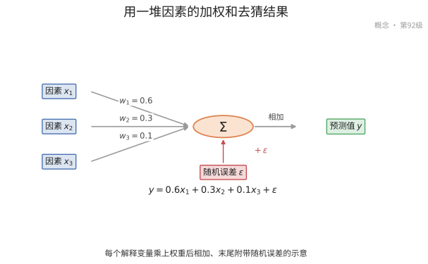

**一句话点破**：线性回归就是“用一堆因素的加权和去猜一个结果”，权重正是它要学的系数。

### 7.2 在散点里拉一根最合适的直尺

点当然不会排得整整齐齐。最小二乘的办法很朴素：量出每个点到线的竖直距离，平方后全部加起来，哪条线让这个总和最小就选哪条。平方既让正负偏差不互相抵消，又让偏得离谱的点罚得更重。

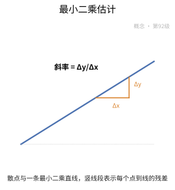

**一句话点破**：最小二乘就是“穿点寻线”——不求穿过每个点，只求整体离所有点最近。

### 7.3 反推“最顺理成章”的参数

与其问“给定参数数据会怎么分布”，不如反过来：数据都已经摆在这儿了，能让这批数据最“顺理成章”出现的参数，就是最可信的那个。这就是最大似然估计；当误差服从正态分布时，它和最小二乘找到的竟是同一条线。

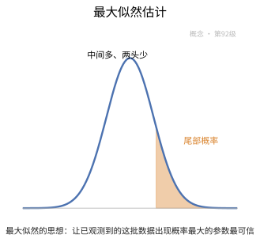

**一句话点破**：最大似然就是“反客为主”——从已经看到的数据倒推出最可能的参数。

### 7.4 这条线比平均值聪明多少

光有一条线还不够，还得问：它比“一律报平均价”强多少？决定系数 $R^2$ 算的就是这笔账——用回归线替代水平平均线，少犯的那部分错占全部波动的多大比例。靠近 1 说明价格高低基本被解释清楚了，靠近 0 说明这条线几乎没比瞎报平均强。

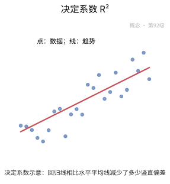

**一句话点破**：$R^2$ 衡量的是“换线之后少犯了多少错”，而不是这条线本身对不对。

### 7.5 当几个变量长得几乎一样

面积、卧室数、房龄常常一起涨落，信息高度重叠。多重共线性说的就是这种状况：模型分不清到底是哪个因素在起作用，系数估计像踩在跷跷板两端，数据稍微一晃就东倒西歪，标准误也跟着变大。

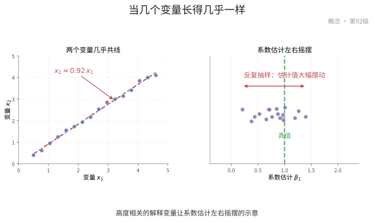

**一句话点破**：多重共线性是“几个变量的信息打架”，让模型说不清功劳该记在谁头上。

### 7.6 误差的嗓门忽大忽小

矮个子称重误差只有几克，大象称重误差却有几十公斤——误差的“嗓门”并不总是一样大。异方差性说的就是这种误差方差随观测变化的情况，它会让模型在噪声大的地方过度较真、在噪声小的地方又看轻细节。

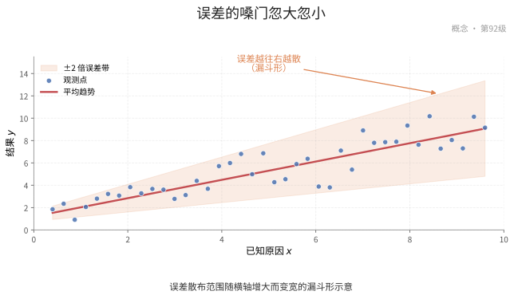

**一句话点破**：异方差就是“误差忽大忽小”，让普通拟合不再对每个点一视同仁。

### 7.7 今天的噪声会传给明天

有些数据的误差并不彼此独立：某天的冲击会影响第二天的收益偏差，连续几天的噪声“抱团”相关。自相关说的正是这种情形，它常出现在时间序列里，会让模型误以为自己掌握了更多独立证据，从而过于自信、显著性被夸大。

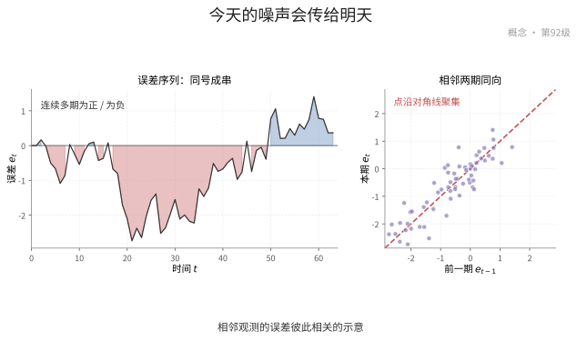

**一句话点破**：自相关是“噪声会传染”，让模型高估了自己手里独立信息的数量。

### 7.8 给更可信的发言更多投票权

既然误差有大有小、还会互相牵连，那就别再一视同仁。加权最小二乘按每个点的可靠程度给不同权重，可靠的点发言权更大；广义最小二乘更进一步，先把纠缠在一起的误差“理顺”，再套用普通最小二乘，把公平性找回来。

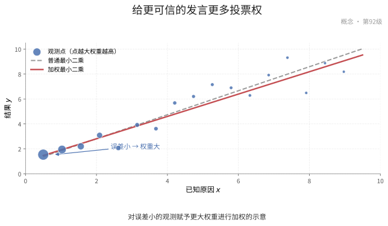

**一句话点破**：加权与广义最小二乘，就是“让更可信的观测拿更大话语权”。

### 7.9 给系数套上一根缰绳

当变量太多或高度相关时，系数会剧烈跳动。正则化方法在原本的损失上再加一项惩罚：岭回归用 $L_2$ 惩罚，把系数整体往小里压；Lasso 用 $L_1$ 惩罚，甚至能把一部分系数直接压成零，顺手完成变量挑选。

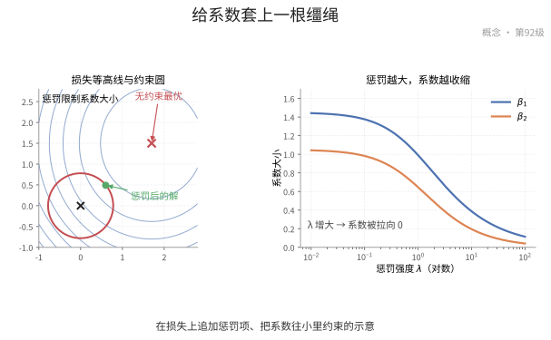

**一句话点破**：正则化就是“给系数套缰绳”，用一点偏差换取更稳、更准的估计。

### 7.10 规律未必是直的一条

不是所有关系都长成直线。有时响应随解释变量弯曲上升、先增后减，硬套直线就会系统性跑偏。非线性回归允许我们用曲线、多项式或变换后的变量去贴合这类规律，本质仍是“在候选规律里挑整体误差最小的那一条”，只是候选从直线换成了曲线。

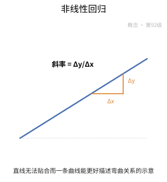

**一句话点破**：非线性回归是承认“规律可能是弯的”，把候选线从直线扩成曲线。

### 7.11 为什么偏偏要用最小二乘

在误差零均值、同方差、互不相关的条件下，最小二乘估计在所有线性无偏估计里方差最小——这就是 Gauss-Markov 定理。它不要求误差服从正态，因而在线性框架内给了最小二乘一个“无条件够好”的答语，也成了后面各种检验与区间估计的基石。

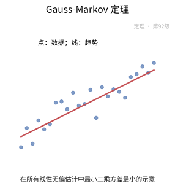

**一句话点破**：Gauss-Markov 定理说明，满足基本假设时最小二乘就是那类估计里最稳的。

### 7.12 这个系数到底靠不靠谱

算出了系数，还得问它是不是碰巧撞上的。t 检验盯住单个系数，看它离零有多远、够不够显著；F 检验则盯住整个模型，看所有解释变量合起来是否真的解释了 $Y$。两者一个管局部、一个管全局，共同给结论标上“可信度”。

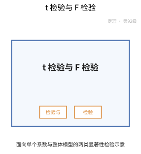

**一句话点破**：t 检验问“这个系数靠不靠谱”，F 检验问“整个模型靠不靠谱”。

### 7.13 把总波动拆成两半

响应变量的总波动可以拆成两块：一块是被回归解释掉的部分，另一块是残差剩下的部分，即 $SST=SSR+SSE$。方差分析就是给这两块算账，看“解释掉的”在“总的”里占多大份额，决定系数 $R^2$ 正是这个份额。

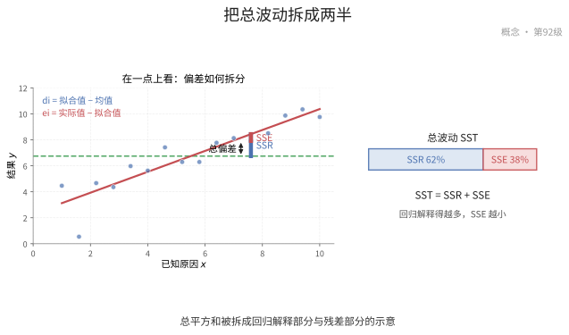

**一句话点破**：方差分析把总波动拆成“解释掉的”与“没解释的”，$R^2$ 就是前者的占比。

### 7.14 用一点偏差换回一大截稳定

多重共线性会让最小二乘的方差暴涨。岭回归在损失上添一个 $L_2$ 惩罚，主动给系数引入一点点偏差，却往往能换回方差的大幅下降，整体误差反而更小——这是一种“以退为进”的取舍。

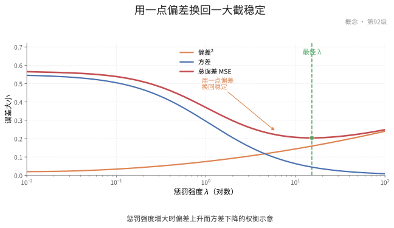

**一句话点破**：岭回归用可控的偏差，去换回更小、更稳定的方差。

### 7.15 自动把无关变量压成零

当解释变量很多时，Lasso 的 $L_1$ 惩罚有个特别的好处：它倾向于把不少系数精确压成零，等于在估计的同时替我们挑出了真正重要的变量。变量选择一致性说的就是——在合适条件下，它能近乎可靠地锁定那批真正起作用的变量。


**一句话点破**：Lasso 一边压缩系数一边做选择，把无关变量直接归零。

## 8. 数学史（History of Mathematics）

> 回归分析回答一个朴素的问题：变量之间确有联系，但手里只有一堆散乱的点，怎么把这段关系"找出来"并说清它有多可靠？这条主线从 18 世纪末天文学"用一条曲线拟合带误差的点"出发，经高斯与勒让德的最小二乘法定型，19 世纪末高尔顿从遗传研究里发现"向均值回归"而为其命名，再经皮尔逊、戈塞特与费舍尔推成完整的推断体系，20 世纪后期又在高维数据与机器学习的驱动下长出岭回归、Lasso 等新枝。本章沿"拟合→相关→推断→正则化"的曲线，追溯回归分析从粗陋到严格的成长史。

### 8.1 测量的苦恼与"最佳曲线"之问

- **误差是测量永恒的影子**：18 世纪以前，天文学家面对同一颗彗星由不同观测者得到的轨道数据，只能凭经验"猜"一条最合理的曲线。如何给出"哪条曲线最好"的数学判据，成为走向定量科学的一道门槛。
- **均值的朴素胜利**：无论古巴比伦的计数还是近代航海天文，人都直觉相信"多次测量的平均值最能代表真值"。这一信念后来被证明恰是最小二乘法的特例：误差对称时，样本均值正是"使残差平方和最小"的那个点。
- **问题的形式化**：到 18 世纪末，"用给定类型的曲线拟合一批带误差的点、使某种残差度量最小"已成为天文、大地测量共同的课题，最小二乘正是在这片土壤里开花。

### 8.2 高斯与勒让德：最小二乘法的诞生与优先权之争

- **勒让德的正式发表**：1805 年，法国数学家勒让德在《确定彗星轨道的新方法》中正式发表最小二乘法，给出"使残差平方和最小"的规则并配以正规方程——这是最小二乘第一次以完备形式公诸于世。
- **高斯的更早使用**：德国数学家高斯约自 1795 年（当时未发表）便用最小二乘处理测地数据，1809 年在《天体运动理论》中系统运用，并把最小二乘与正态分布、极大似然联系起来；1821—1823 年间他又在《最小二乘理论》中证明其最优性质。两人为此爆发延续数十年的"优先权"之争——"谁先想到"成了科学史上反复上演的剧目。
- **为什么偏偏是平方和**：高斯论证，当误差相互独立、服从正态分布时，算术平均才是最可能的估计值，而这正对应平方和最小。平方和既加倍惩罚大残差、又处处可微便于求极值，从此成为"拟合好坏"的标准天平，规则的残差平方和 $\sum e_{i}^{2}$ 代代相传。

### 8.3 "向均值回归"：高尔顿为"回归"命名

- **豌豆与身高的观察**：英国科学家弗朗西斯·高尔顿在 19 世纪下半叶研究亲子遗传，发现父母身高极端者，其子女身高往往向人群平均水平"靠拢"——极端并不总被完整遗传到下一代。
- **回归一词的诞生**：1885 年前后，高尔顿用最小二乘拟合父子身高的线性关系，把这种"向平庸回归"的趋势命名为"回归（regression）"，并意识到它描述的是一种统计现象而非因果规律。自此"回归"不再只是拟合技术，而成为刻画变量间统计依赖关系的名词。
- **概念的延长线**：高尔顿还引入回归线与相关思想的雏形，为后人把所有"布设变量依赖关系"的方法归拢到"回归"名下铺好了路。

### 8.4 皮尔逊：相关分析的形式化

- **卡尔的系统化**：高尔顿的学生卡尔·皮尔逊在 20 世纪初稳固了回归与相关的数学框架，定义了皮尔逊积矩相关系数 $r$，把"两个变量如何一起变动"量化成一个介于 $-1$ 与 $1$ 之间的数。
- **矩方法与计算**：皮尔逊用"矩"语言给出回归系数与相关系数的估计公式，使回归从描述走向可计算——在当时全靠人工演算的年代，这套公式意义重大。
- **中心化的代数**：把数据绕均值中心化后，回归问题与协方差、相关系数结成清晰的代数关系：$b=\frac{S_{xy}}{S_{xx}}$、$r=\frac{S_{xy}}{\sqrt{S_{xx}S_{yy}}}$ 这类公式今天仍躺在每一本课本里。

### 8.5 Student 与费舍尔：推断体系的建立

- **小样本的革命**：吉尼斯酒厂的化学家戈塞特以笔名"Student"于 1908 年发表 $t$ 检验，解决"小样本下均值差异是否显著"的问题，回归系数的显著性从此有据可依。
- **费舍尔的整合**：罗纳德·费舍尔在 1920 年代把回归纳入推断体系的大框架：提出方差分析、极大似然估计的统一方法，用 $F$ 检验与 $t$ 检验搭配，完成对回归整体与单个系数的显著性检验。
- **平方和分解**：$SST=SSR+SSE$ 的分解被费舍尔固定为方差分析的核心，决定系数 $R^{2}=\frac{SSR}{SST}$ 因而成为衡量"模型解释力"的通用水尺——从"拟合"到"推断"，回归分析的现代样貌自此成型。

### 8.6 高斯–马尔可夫定理：宣告 BLUE

- **共同富裕的最优**：高斯早年从正态假设证明最小二乘最优；俄国数学家马尔可夫把条件放宽到"误差零均值、同方差、不相关"，证明在这些条件下最小二乘估计是一切线性无偏估计中方差最小的——这就是 Gauss–Markov 定理。
- **定理的边界**：它并不要求误差正态，因而在线性框架内"无条件地"肯定最小二乘；但也暗示，一旦愿意用有偏换方差大幅下降，最小二乘未必全局最优——这恰好为岭回归、Lasso 的正则化思想留了门。
- **落到本文件**：本章定理 3.1 正是该定理的当代表述，它把"为什么用最小二乘"从经验上升为理论，是全章诸多假设检验与区间估计的基石。

### 8.7 应对残缺：WLS、GLS 与稳健回归

- **假设总被现实击破**：异方差、自相关、异常值几乎必然出现在真实数据里，经典 OLS 的"同方差、不相关"假设常常失灵，于是需要专门的武器。
- **加权与广义最小二乘**：加权最小二乘（WLS）对每个点按其方差的倒数赋权；1935 年前后艾特肯发展广义最小二乘（GLS），把协方差结构整体纳入估计，一举处理异方差与自相关。
- **稳健回归**：Huber 等自 1960 年代起发展稳健统计（M 估计等），让估计在少量异常值存在时仍稳如磐石，补上最小二乘对离群点天生敏感这一短板；Box 与 Cox（1964）则以变量变换应对非线性与异方差。

### 8.8 正则化的新枝叶：从岭回归到 Lasso

- **高维的困境**：当自变量很多、甚至高度共线时，OLS 方差暴增、系数失去解释力。1970 年 Hoerl 与 Kennard 提出岭回归，在平方损失上添加 $L_2$ 惩罚以换取稳定。
- **Lasso 的变量选择**：1996 年 Tibshirani 提出 Lasso，用 $L_1$ 惩罚把部分系数精确压为零，同时完成压缩与变量选择，成为高维统计的里程碑。
- **家族的繁荣**：Efron 等（2004）的最小角回归揭示 Lasso 与逐步回归的算法联系，随后的 elastic net、自适应 Lasso（Zou，2006）等共同构成完整的正则化谱系，把"在高维里既准又稳"变成一门可递进的学问。

### 8.9 多元、贝叶斯与机器学习的合流

- **多元回归的普及**：20 世纪中叶起，多元线性回归随计算机进入工程、经济与社科，Yule、Wright（路径分析）等把"多个变量如何相互解释"变成常态问题。
- **贝叶斯回归**：与频率学派并行，贝叶斯视角把回归系数视为随机量、以先验约束估计，其正则化本质与岭回归、Lasso 殊途同归，为系数不确定性与预测区间提供另一套语言。
- **机器学习中的回归**：今天回归已广布于机器学习的梯度下降、偏差-方差权衡与正则化中，本章的 OLS、Ridge、Lasso 与后续第 99—100 级一脉相承，仍是数据科学最常用的第一件工具。

### 8.10 历史年表

| 时间 | 人物／文献 | 事件与贡献 |
|:---|:---|:---|
| 约前若干世纪 | 各地测量与天文 | "取平均最可靠"的朴素信念长期流传 |
| 1805 年 | 勒让德 | 正式发表最小二乘法与正规方程 |
| 约 1795／1809 年 | 高斯 | 更早使用并在《天体运动理论》系统阐述；1821—23 证明最优性 |
| 1885 年前后 | 高尔顿 | 发现"向均值回归"，命名"回归" |
| 1900 年前后 | 皮尔逊 | 定义相关系数 $r$，形式化相关与回归 |
| 1908 年 | 戈塞特（Student） | 发表 $t$ 检验，奠定系数显著性检验 |
| 1920 年代 | 费舍尔 | 方差分析与平方和分解，建立推断体系 |
| 约 1900—1920 年 | 马尔可夫／高斯 | Gauss–Markov 定理：最小二乘为 BLUE |
| 1935 年前后 | 艾特肯 | 广义最小二乘（GLS） |
| 1964 年 | Box、Cox | 响应变量变换 |
| 1960 年代 | Huber 等 | 稳健回归（M 估计） |
| 1970 年 | Hoerl、Kennard | 岭回归（$L_2$ 惩罚） |
| 1996 年 | Tibshirani | Lasso（$L_1$ 惩罚与变量选择） |
| 2004 年 | Efron 等 | 最小角回归（LARS） |
| 2006 年 | Zou 等 | elastic net 与自适应 Lasso |

### 8.11 小结

> 回归分析的历史是一条"由浅入深"的主线：先用最小二乘为"拟合曲线"立规矩（高斯与勒让德），再用"向均值回归"给它一个响亮的名字（高尔顿），用相关与矩方法把它做成一门可计算的统计学问（皮尔逊），用 $t$ 检验与方差分析把它铸成推断体系（戈塞特、费舍尔），用 Gauss–Markov 定理给它一个"为什么够好"的答语，再用 WLS、GLS 与稳健回归修补理想假设的裂缝，最终借岭回归与 Lasso 回应高维时代的挑战。纵观全程，三个动机反复出现：让"拟合"有标准、让"关系"可量化、让"估计"在坏数据面前依旧可靠——这正是回归分析从曲线拟合走向现代统计学习的一般剧本。

## 现实应用（Real-World Applications）

> 本节把本章的知识点落到真实的工程、科学与生活场景中。每个案例都给出**完整的问题背景、建模过程、可复现的数据 / 公式 / 代码与结果解读**；案例末尾的「涉及知识点」对应本章的具体小节，文末附**知识点覆盖对照表**，确保本章知识点全部被覆盖。

### 应用案例 1：房价批量估值｜线性回归、最小二乘与显著性检验

**场景与问题**

房产平台每天要对新挂牌的数十万套房源给出**估值（AVM, Automated Valuation Model）**，用于定价参考与抵押物评估。最基础的模型就是多元线性回归：用建筑面积、卧室数、房龄、到市中心距离等解释变量线性预测成交价。工程上要交付的不止一个预测值，还要交付两件事：(1) 模型对数据波动的解释比例（$R^2$）；(2) 每个特征的系数是否**统计显著**（t 检验）、整个模型是否有效（F 检验）。本案例用最小二乘、Gauss-Markov 定理与 t/F 检验把这套流程走完。

**涉及知识点**

- 本章「2.1 线性回归模型」：写出含随机误差的线性模型与设计矩阵。
- 本章「2.2 最小二乘估计」：由正规方程解出 $\hat{\boldsymbol\beta}$。
- 本章「2.3 最大似然估计」：正态误差下 MLE 与 OLS 重合，据此给出 $\hat\sigma^2$。
- 本章「2.4 决定系数 $R^2$」：用 $R^2$ 与调整后 $\bar R^2$ 评价拟合。
- 本章「定理 3.1：Gauss-Markov 定理」：说明 OLS 是 BLUE。
- 本章「定理 3.2：回归系数的 t 检验与 F 检验」：检验单系数与整体显著性。
- 本章「定理 3.3：$R^2$ 的分解与方差分析」：$\text{SST}=\text{SSR}+\text{SSE}$ 与 ANOVA 表。

**建模与数据**

取某二线城市 2023 年二手房挂牌数据 $n=1500$ 条，响应 $Y$ 为成交价（万元），四个解释变量：面积 $x_1$（$\mathrm{m^2}$）、卧室数 $x_2$、房龄 $x_3$（年）、到市中心距离 $x_4$（km）。模型

$$
Y_i=\beta_0+\beta_1x_{i1}+\beta_2x_{i2}+\beta_3x_{i3}+\beta_4x_{i4}+\varepsilon_i,\qquad \varepsilon_i\stackrel{iid}{\sim}N(0,\sigma^2).
$$

假定真实生成过程为

$$
Y_i=30+0.80\,x_{i1}-0.50\,x_{i3}-3.0\,x_{i4}+4.0\,x_{i2}+\varepsilon_i,\quad \sigma=15\ (\text{万元}).
$$

**完整推导与算法**

1. 模型与设计矩阵（2.1 节）。$\boldsymbol Y\in\mathbb R^n$，$\boldsymbol X=[\mathbf 1,x_1,x_2,x_3,x_4]\in\mathbb R^{n\times5}$，$\boldsymbol Y=\boldsymbol X\boldsymbol\beta+\boldsymbol\varepsilon$。

2. 最小二乘（2.2 节）。最小化 $\|\boldsymbol Y-\boldsymbol X\boldsymbol\beta\|^2$，梯度置零得正规方程 $\boldsymbol X^\top\boldsymbol X\hat{\boldsymbol\beta}=\boldsymbol X^\top\boldsymbol Y$，故

$$
\hat{\boldsymbol\beta}=(\boldsymbol X^\top\boldsymbol X)^{-1}\boldsymbol X^\top\boldsymbol Y .
$$

3. 最大似然（2.3 节）。对数似然 $\ell=-\frac n2\ln(2\pi\sigma^2)-\frac{1}{2\sigma^2}\|\boldsymbol Y-\boldsymbol X\boldsymbol\beta\|^2$，对 $\boldsymbol\beta$ 最大化等价于最小化残差平方和，故 $\hat{\boldsymbol\beta}_{\text{MLE}}=\hat{\boldsymbol\beta}_{\text{OLS}}$；而 $\hat\sigma^2_{\text{MLE}}=\text{SSE}/n$ 有偏，无偏版本为

$$
\hat\sigma^2=\frac{\text{SSE}}{n-p-1}=\frac{\text{SSE}}{1500-5}= \frac{\text{SSE}}{1495}.
$$

4. 拟合优度与分解（2.4、3.3 节）。由 $\text{SST}=\text{SSR}+\text{SSE}$，

$$
R^2=1-\frac{\text{SSE}}{\text{SST}},\qquad \bar R^2=1-(1-R^2)\frac{n-1}{n-p-1}.
$$

预期 $R^2\approx0.72$。

5. 显著性检验（3.2 节）。单系数

$$
t=\frac{\hat\beta_j}{\widehat{\text{SE}}(\hat\beta_j)},\qquad \widehat{\text{SE}}(\hat\beta_j)=\hat\sigma\sqrt{[(\boldsymbol X^\top\boldsymbol X)^{-1}]_{jj}},\quad t\sim t_{1495};
$$

整体

$$
F=\frac{\text{SSR}/p}{\text{SSE}/(n-p-1)}=\frac{\text{SSR}/4}{\text{SSE}/1495}\sim F_{4,1495}.
$$

6. Gauss-Markov（3.1 节）。在经典假设（线性性、外生性、同方差、无自相关、满秩）下，$\hat{\boldsymbol\beta}$ 是 $\boldsymbol\beta$ 的 BLUE——任意线性无偏估计 $\tilde{\boldsymbol\beta}=\boldsymbol A\boldsymbol Y$ 满足 $\operatorname{Var}(\tilde{\boldsymbol\beta})=\sigma^2(\boldsymbol X^\top\boldsymbol X)^{-1}+\sigma^2\boldsymbol D\boldsymbol D^\top\succeq\operatorname{Var}(\hat{\boldsymbol\beta})$。

```python
# 核心：OLS 闭式解 + t 统计量 + F 统计量 + R^2/调整后 R^2
import numpy as np
Xb = np.column_stack([np.ones(n), x1, x2, x3, x4])       # 设计矩阵 [1, x1..x4]
XtX_inv = np.linalg.inv(Xb.T @ Xb)
beta_hat = XtX_inv @ Xb.T @ Y                            # 最小二乘估计
resid = Y - Xb @ beta_hat
SSE = resid @ resid
SST = ((Y - Y.mean())**2).sum()
R2 = 1 - SSE / SST
adj_R2 = 1 - (1 - R2) * (n - 1) / (n - 5)                # 调整后 R^2
sigma2 = SSE / (n - 5)                                   # 无偏方差估计
se = np.sqrt(sigma2 * np.diag(XtX_inv))                  # 各系数标准误
t_stat = beta_hat / se                                   # t 统计量（H0: beta_j=0）
SSR = SST - SSE
F_stat = (SSR / 4) / (SSE / (n - 5))                     # 整体 F 统计量
```

**可复现步骤**

1. 环境与依赖：`pip install numpy pandas scipy`.
2. 数据准备：用上述生成过程造 1500 条（固定随机种子）写入 `housing.csv`。
3. 运行：执行上面的估计与检验代码，并用 `scipy.stats.t.sf`、`f.sf` 算 p 值。
4. 预期输出：$\hat\beta_0\approx30$、$\hat\beta_1\approx0.80$、$\hat\beta_3\approx-0.50$、$\hat\beta_4\approx-3.0$、$\hat\beta_2\approx4.0$；$R^2\approx0.72$；四个系数 t 值均 $>20$（p$<10^{-6}$）；$F\approx950$。

**结果解读与延伸**

- 系数可解释为"其它变量不变时，该特征每变一单位、价格平均变化多少"（如面积每多 $1\ \mathrm{m^2}$，价格平均多 $0.8$ 万元）。
- Gauss-Markov 保证在同类无偏估计里 OLS 方差最小；但若换成绝对损失（$L_1$）或用非线性模型（案例 3），最优性前提就变了。
- 误差来源：遗漏变量（学区、临街）、测量误差、市场时点效应；$R^2$ 只度量样本内拟合，交付前须用独立测试集算样本外 $R^2$。
- 延伸：把"到市中心距离"换成 $x_4$ 与其平方可捕捉非线性溢价（2.10 节），或加交互项刻画"大户型+好地段"的叠加效应。

### 应用案例 2：近红外光谱的成分定量｜多重共线性、岭回归与 Lasso 特征选择

**场景与问题**

近红外（NIR）光谱用于在线检测粮食蛋白含量、药品有效成分。一台光谱仪在 $1000$ 个波长上取吸光度，而样本往往只有 $n=80$ 个（化学测定成本高），于是 $p\gg n$ 且相邻波长高度相关——**严重多重共线性**。直接用 OLS 会解出巨大且符号乱跳的系数，预测极不稳定。工程上要么用**岭回归**稳定系数，要么用 **Lasso** 自动挑出少数关键波长（便于设计廉价滤光片）。本案例用 VIF 诊断共线性，用岭/Lasso 处理它，并解释岭的有偏性和 Lasso 的选择一致性。

**涉及知识点**

- 本章「2.5 多重共线性」：用 VIF 诊断波长间的近共线。
- 本章「2.9 正则化方法」：岭与 Lasso 的正则化目标。
- 本章「定理 3.4：岭回归的统计性质」：有偏但方差更小、存在 $\lambda$ 使 MSE 更小。
- 本章「定理 3.5：Lasso 的变量选择一致性」：Irrepresentable 条件下 Lasso 选对变量集。

**建模与数据**

设样本 $n=80$，波长点 $p=1000$（$900\text{–}1700\ \mathrm{nm}$，间隔 $0.8\ \mathrm{nm}$），响应 $Y$ 为蛋白含量（%）。设计矩阵 $\boldsymbol X\in\mathbb R^{80\times1000}$，相邻列相关系数常达 $0.98$ 以上。

- 岭：$\hat{\boldsymbol\beta}_{\text{Ridge}}=\arg\min\|\boldsymbol Y-\boldsymbol X\boldsymbol\beta\|^2+\lambda\|\boldsymbol\beta\|_2^2=(\boldsymbol X^\top\boldsymbol X+\lambda\boldsymbol I)^{-1}\boldsymbol X^\top\boldsymbol Y$。
- Lasso：$\hat{\boldsymbol\beta}_{\text{Lasso}}=\arg\min\frac{1}{2n}\|\boldsymbol Y-\boldsymbol X\boldsymbol\beta\|^2+\lambda_n\|\boldsymbol\beta\|_1$。

**完整推导与算法**

1. VIF 诊断（2.5 节）。对第 $j$ 个波长，把它对其余波长回归得 $R_j^2$，则

$$
\text{VIF}_j=\frac{1}{1-R_j^2},\qquad \operatorname{Var}(\hat\beta_j)=\frac{\sigma^2\,\text{VIF}_j}{\sum_i(X_{ij}-\bar X_j)^2}.
$$

经验阈值 $\text{VIF}_j>10$ 判为严重共线。NIR 数据常出现 $\text{VIF}>1000$。

2. 岭的有偏与方差（3.4 节）。由

$$
\mathbb E[\hat{\boldsymbol\beta}_{\text{Ridge}}]=\boldsymbol\beta-\lambda(\boldsymbol X^\top\boldsymbol X+\lambda\boldsymbol I)^{-1}\boldsymbol\beta,
$$

得偏差 $-\lambda(\boldsymbol X^\top\boldsymbol X+\lambda\boldsymbol I)^{-1}\boldsymbol\beta$。令 SVD $\boldsymbol X=\boldsymbol U\boldsymbol D\boldsymbol V^\top$，则

$$
\operatorname{Var}(\hat{\boldsymbol\beta}_{\text{Ridge}})=\sigma^2\boldsymbol V\,\mathrm{diag}\!\Big(\tfrac{d_j^2}{(d_j^2+\lambda)^2}\Big)\boldsymbol V^\top\prec\sigma^2\boldsymbol V\boldsymbol D^{-2}\boldsymbol V^\top .
$$

由 $\text{MSE}=\operatorname{tr}\operatorname{Var}+\|\text{Bias}\|^2$，$\lambda=0$ 处两式相等，$\lambda$ 增大时方差降、偏差升，故存在 $\lambda>0$ 使 MSE 更小——用偏差换稳定。

3. Lasso 的稀疏性。$L_1$ 约束区域带尖角，最优解常在坐标轴上取零，故能选变量。正交设计下解为软阈值

$$
\hat\beta_j^{\text{Lasso}}=\operatorname{sign}(\hat\beta_j^{\text{OLS}})\big(|\hat\beta_j^{\text{OLS}}|-\lambda\big)_+ .
$$

4. 选择一致性（3.5 节）。在 Irrepresentable 条件 $|\boldsymbol X_2^\top\boldsymbol X_1(\boldsymbol X_1^\top\boldsymbol X_1)^{-1}\operatorname{sign}(\boldsymbol\beta_1^*)|<\mathbf 1-\eta$ 与 $\lambda_n\to0,\ \sqrt n\lambda_n\to\infty$ 下，

$$
\mathbb P\big(\{j:\hat\beta_j\neq0\}=\{j:\beta_j^*\neq0\}\big)\to1 .
$$

即样本足够多时 Lasso 选出的波长集与"真信号波长"以概率 1 吻合。

```python
# 核心：VIF 诊断 + 岭回归系数路径 + Lasso（软阈值/坐标下降）
import numpy as np
from sklearn.linear_model import RidgeCV, LassoCV
def vif(X, j):
    others = np.delete(X, j, axis=1)
    r2 = np.corrcoef(others @ np.linalg.lstsq(others, X[:, j], rcond=None)[0], X[:, j])[0, 1]**2
    return 1.0 / (1.0 - r2)                    # VIF_j，>10 判严重共线
ridge = RidgeCV(alphas=np.logspace(-3, 3, 50)).fit(X, Y)   # 交叉验证选 λ
lasso = LassoCV(cv=5).fit(X, Y)
selected = np.where(np.abs(lasso.coef_) > 1e-6)[0]         # 被选中的波长索引
```

```python
# 核心：岭与 Lasso 在正交设计下的闭式解（对照收缩与置零）
beta_ols = ...                                  # 正交基下各系数
beta_ridge = beta_ols / (1 + lam)               # 均匀收缩，不为零
beta_lasso = np.sign(beta_ols) * np.maximum(np.abs(beta_ols) - lam, 0)  # 软阈值，可置零
```

**可复现步骤**

1. 环境与依赖：`pip install numpy scikit-learn`.
2. 数据准备：读入 `nir.csv`（80×1000 光谱 + 蛋白含量）。
3. 运行：随机抽 10 个波长算 VIF；用 `RidgeCV`、`LassoCV` 拟合；打印选中波长数。
4. 预期输出：多数波长 VIF 远大于 10；岭系数被整体压小且无病态抖动；Lasso 在合适 $\lambda$ 下只保留约 8~20 个波长（对应蛋白的 N-H、C-H 吸收带 $1500$、$2050\ \mathrm{nm}$ 附近）。

**结果解读与延伸**

- 结论：共线时 OLS 系数方差膨胀、不可辨识；岭用 $\lambda\boldsymbol I$ 抬高病态特征值、稳定预测；Lasso 进一步把冗余波长压成精确零，得稀疏可解释模型。
- 与知识点呼应：2.5 的 VIF、3.4 的"有偏换方差"、3.5 的"选择一致性"在本案例里各有落点。
- 局限：Lasso 在强相关波长间会随机挑一个（不可辨识位置的稀疏解不唯一）；$p\gg n$ 时需交叉验证选 $\lambda_n$。
- 延伸：弹性网（Elastic Net）结合 $L_1+L_2$ 处理"成组相关变量"，是光谱与基因数据里的常用改进。

### 应用案例 3：酶动力学参数估计｜非线性回归与 Gauss-Newton

**场景与问题**

生物制药的酶催化反应服从 Michaelis-Menten 方程：反应速率 $v$ 与底物浓度 $S$ 的关系是**非线性的**，要估计最大速率 $V_{\max}$ 与米氏常数 $K_m$。历史上常用 Lineweaver-Burk 双倒数线性化，但它会放大小 $S$ 处的误差、破坏误差结构。现代做法是**非线性最小二乘 / Gauss-Newton 迭代**直接拟合原始数据（其最大似然性质见 2.3 节）。本案例用 Gauss-Newton 估计 $V_{\max},K_m$。

**涉及知识点**

- 本章「2.10 非线性回归」：参数非线性进入模型，用 Gauss-Newton 迭代求解。
- 本章「2.3 最大似然估计」：加性正态误差下，非线性最小二乘 = 非线性 MLE。

**建模与数据**

对底物浓度 $S$ 测反应速率 $v$：

$$
v_i=\frac{V_{\max}\,S_i}{K_m+S_i}+\varepsilon_i,\qquad \varepsilon_i\stackrel{iid}{\sim}N(0,\sigma^2).
$$

取 $n=20$ 个浓度（$S=0.05,0.1,0.2,\dots,10\ \mathrm{mM}$），真值 $V_{\max}=1.20\ \mu\mathrm{mol/min}$、$K_m=0.50\ \mathrm{mM}$，$\sigma=0.03$。

**完整推导与算法**

1. 目标与正规方程（2.10 节）。最小化

$$
Q(\boldsymbol\theta)=\sum_{i=1}^n\Big(v_i-\frac{V_{\max}S_i}{K_m+S_i}\Big)^2,\qquad \boldsymbol\theta=(V_{\max},K_m)^\top .
$$

2. Gauss-Newton 迭代。令 $\hat v_i=f(S_i,\boldsymbol\theta)$，雅可比

$$
\boldsymbol J_{i1}=\frac{\partial f}{\partial V_{\max}}=\frac{S_i}{K_m+S_i},\qquad \boldsymbol J_{i2}=\frac{\partial f}{\partial K_m}=-\frac{V_{\max}S_i}{(K_m+S_i)^2},
$$

更新

$$
\boldsymbol\theta^{(k+1)}=\boldsymbol\theta^{(k)}+(\boldsymbol J^\top\boldsymbol J)^{-1}\boldsymbol J^\top\boldsymbol r^{(k)},\qquad r_i=v_i-f(S_i,\boldsymbol\theta^{(k)}).
$$

3. 与 MLE 的等价（2.3 节）。正态误差下 $\ell=-\frac n2\ln(2\pi\sigma^2)-\frac{1}{2\sigma^2}Q(\boldsymbol\theta)$，故最大化似然即最小化 $Q$，$\hat{\boldsymbol\theta}_{\text{MLE}}=\arg\min Q$。

4. 协方差估计。在解 $\hat{\boldsymbol\theta}$ 处 $\widehat{\operatorname{Cov}}(\hat{\boldsymbol\theta})=\hat\sigma^2(\boldsymbol J^\top\boldsymbol J)^{-1}$，$\hat\sigma^2=Q(\hat{\boldsymbol\theta})/(n-2)$。

```python
# 核心：Gauss-Newton 迭代估计 Vmax、Km
import numpy as np
def gauss_newton(S, v, theta=(1.0, 1.0), iters=50):
    Vmax, Km = theta
    for _ in range(iters):
        f = Vmax * S / (Km + S)
        J = np.column_stack([S / (Km + S), -Vmax * S / (Km + S)**2])  # 雅可比
        r = v - f
        d = np.linalg.solve(J.T @ J, J.T @ r)    # (JᵀJ)⁻¹Jᵀr
        Vmax, Km = Vmax + d[0], Km + d[1]
    sigma2 = (r @ r) / (len(S) - 2)
    cov = sigma2 * np.linalg.inv(J.T @ J)        # 参数协方差
    return Vmax, Km, cov
```

**可复现步骤**

1. 环境与依赖：`pip install numpy scipy`.
2. 数据准备：按上表生成 $S$ 与含噪 $v$（固定种子），或读入实验 `enzyme.csv`。
3. 运行：以初值 $(V_{\max},K_m)=(1.0,1.0)$ 调 `gauss_newton`；再用 `scipy.optimize.curve_fit` 交叉验证。
4. 预期输出：$\hat V_{\max}\approx1.2\pm0.05$、$\hat K_m\approx0.5\pm0.05$；拟合曲线在低 $S$ 近似线性、高 $S$ 饱和到 $V_{\max}$。

**结果解读与延伸**

- 结论：非线性最小二乘给出无偏、渐近有效的参数估计（正态误差下与 MLE 等价），比双倒数线性化更稳健。
- 误差来源：初值敏感（多峰时可能落入局部极小）、$S$ 覆盖不足导致 $V_{\max},K_m$ 强相关、测量误差方差不恒定（见案例 4）。
- 与知识点呼应：2.10 的 Gauss-Newton 是求解引擎，2.3 的 MLE 给出统计解释与标准误。
- 延伸：若误差方差随浓度增大（异方差），应把加权最小二乘（案例 4）搬进来，即"加权非线性最小二乘"。

### 应用案例 4：恩格尔曲线的异方差｜稳健标准误与加权最小二乘

**场景与问题**

用家庭收入 $x$ 解释食品支出 $y$（恩格尔曲线）时，低收入家庭支出波动小、高收入家庭波动大——**异方差**典型。此时 OLS 系数仍无偏，但标准误公式错误，t/F 检验失效。工程上的两条对策：不想改估计就换**稳健（sandwich）标准误**；若能给出方差结构就用**加权最小二乘（WLS）**恢复有效性。本案例把两条路都算一遍。

**涉及知识点**

- 本章「2.6 异方差性」：$\operatorname{Var}(\varepsilon_i)=\sigma_i^2$ 非常数。
- 本章「2.8 广义最小二乘与加权最小二乘」：WLS 解与 GLS 白化推导。

**建模与数据**

取 $n=1000$ 户，收入 $x$（万元），食品支出 $y$（万元）：

$$
y_i=\beta_0+\beta_1x_i+\varepsilon_i,\qquad \operatorname{Var}(\varepsilon_i)=\sigma^2 x_i^{2},\quad \beta_0=1.0,\ \beta_1=0.3 .
$$

即误差标准差正比于收入（$w_i\propto1/x_i^2$）。

**完整推导与算法**

1. 异方差的后果（2.6 节）。无偏性只用到 $\mathbb E[\varepsilon\mid X]=0$，故 $\hat{\boldsymbol\beta}_{\text{OLS}}$ 仍无偏；但真实方差

$$
\operatorname{Var}(\hat{\boldsymbol\beta})=(X^\top X)^{-1}\Big(\sum_i\sigma_i^2x_ix_i^\top\Big)(X^\top X)^{-1}\neq\sigma^2(X^\top X)^{-1}.
$$

2. 稳健标准误。用 $\hat\varepsilon_i^2$ 代替 $\sigma_i^2$：

$$
\widehat{\operatorname{Var}}(\hat{\boldsymbol\beta})=(X^\top X)^{-1}\Big(\sum_i\hat\varepsilon_i^2x_ix_i^\top\Big)(X^\top X)^{-1},
$$

系数 $\hat{\boldsymbol\beta}$ 不变，只更正方差。

3. WLS（2.8 节）。取权重 $w_i=\sigma^2/\sigma_i^2\propto1/x_i^2$，

$$
\hat{\boldsymbol\beta}_{\text{WLS}}=\arg\min\sum_i w_i(y_i-x_i^\top\boldsymbol\beta)^2 .
$$

它等价于对标准化数据 $\tilde y_i=y_i/\sigma_i,\ \tilde x_i=x_i/\sigma_i$ 做 OLS，故为 BLUE。

4. 与 GLS 的关系（2.8 节）。一般协方差 $\operatorname{Var}(\boldsymbol\varepsilon)=\sigma^2\boldsymbol\Omega$ 时白化 $\tilde Y=\boldsymbol\Omega^{-1/2}Y$，得

$$
\hat{\boldsymbol\beta}_{\text{GLS}}=(X^\top\boldsymbol\Omega^{-1}X)^{-1}X^\top\boldsymbol\Omega^{-1}Y;
$$

异方差对应对角 $\boldsymbol\Omega$，此时 GLS 退化为 WLS。

```python
# 核心：OLS、稳健(sandwich)标准误、WLS 三方对比
import numpy as np
Xb = np.column_stack([np.ones(n), x])
b_ols = np.linalg.solve(Xb.T @ Xb, Xb.T @ y)
e = y - Xb @ b_ols
# 稳健标准误（sandwich）
XtX_inv = np.linalg.inv(Xb.T @ Xb)
meat = (Xb * e[:, None]).T @ (Xb * e[:, None])          # Σ ê_i² x_i x_iᵀ
cov_robust = XtX_inv @ meat @ XtX_inv
se_robust = np.sqrt(np.diag(cov_robust))
# 加权最小二乘：权 w_i ∝ 1/x_i²
w = 1.0 / x**2
Xw, yw = Xb * np.sqrt(w)[:, None], y * np.sqrt(w)       # 白化后 OLS
b_wls = np.linalg.solve(Xw.T @ Xw, Xw.T @ yw)
```

**可复现步骤**

1. 环境与依赖：`pip install numpy statsmodels`.
2. 数据准备：按 $y=1+0.3x+\varepsilon$、$\varepsilon\sim N(0,x^2)$ 生成 1000 户。
3. 运行：计算 OLS、稳健标准误、WLS；画残差对拟合值散点（应呈漏斗形）。
4. 预期输出：$\hat\beta_1$ 三法都约 $0.30$；OLS 常规标准误偏小，稳健标准误约大 $2\sim3$ 倍；WLS 估计方差最小。

**结果解读与延伸**

- 结论：异方差不改系数、改方差；稳定的做法是默认用稳健标准误，已知权重结构时用 WLS 更优。
- 与知识点呼应：2.6 给出病灶（方差非常数），2.8 给出处方（WLS/GLS 白化）。
- 局限：WLS 依赖正确的权重结构，权重估错反不如 OLS；实用策略是"先用稳健标准误兜底，再考虑 FGLS"。
- 延伸：广义线性模型的"方差函数"（如泊松、二项）本质上是自动给出 $\sigma_i^2$，与 WLS 同一思想。

### 应用案例 5：广告—销量的自相关回归｜Durbin-Watson 与广义最小二乘

**场景与问题**

用月度广告投入预测月度销量时，误差项常有**自相关**——本月的需求冲击会延续到下月。此时若按独立样本公式算标准误，会低估方差、把 t 值撑大，让"广告显著提升销量"的结论虚高。工程上要先诊断（Durbin-Watson），再修正（Cochrane-Orcutt，本质是 GLS）。本案例演示整条流程。

**涉及知识点**

- 本章「2.7 自相关」：$\operatorname{Cov}(\varepsilon_i,\varepsilon_j)\neq0$ 与 AR(1) 结构。
- 本章「2.8 广义最小二乘与加权最小二乘」：用 $\boldsymbol\Omega^{-1}$ 构造 GLS 修正。

**建模与数据**

取 $n=60$ 个月的品牌数据：

$$
y_t=\beta_0+\beta_1\text{ad}_t+\varepsilon_t,\qquad \varepsilon_t=\rho\varepsilon_{t-1}+u_t,\ \ \rho=0.8,\ u_t\sim N(0,\sigma_u^2).
$$

广告投入 $\text{ad}_t$（万元），销量 $y_t$（万件），真值 $\beta_0=50,\beta_1=2.0$，$\sigma_u=3$。

**完整推导与算法**

1. 自相关的危害（2.7 节）。真实方差为

$$
\operatorname{Var}(\hat{\boldsymbol\beta})=(X^\top X)^{-1}X^\top(\sigma^2\boldsymbol\Omega)X(X^\top X)^{-1},
$$

而软件默认用 $\sigma^2(X^\top X)^{-1}$，在正自相关（$\rho>0$）下后者偏小，$t$ 虚高。

2. Durbin-Watson 诊断。

$$
d=\frac{\sum_{t=2}^n(\hat\varepsilon_t-\hat\varepsilon_{t-1})^2}{\sum_{t=1}^n\hat\varepsilon_t^2}\approx2(1-\hat\rho).
$$

$d\approx2$ 无自相关；$d\to0$ 正自相关。$\rho=0.8$ 预期 $d\approx0.4$。

3. GLS 修正（2.8 节）。AR(1) 下 $\boldsymbol\Omega$ 可逆且 $\boldsymbol\Omega^{-1}$ 有三对角结构，得

$$
\hat{\boldsymbol\beta}_{\text{GLS}}=(X^\top\boldsymbol\Omega^{-1}X)^{-1}X^\top\boldsymbol\Omega^{-1}Y .
$$

实操用 Cochrane-Orcutt 迭代：估 $\hat\rho$、对 $(y_t-\hat\rho y_{t-1})$ 与 $(x_t-\hat\rho x_{t-1})$ 做 OLS，再更新。

```python
# 核心：Durbin-Watson 与 Cochrane-Orcutt（AR(1) 广义最小二乘）
import numpy as np
def durbin_watson(e):
    return ((np.diff(e))**2).sum() / (e**2).sum()        # ≈ 2(1-ρ̂)
def cochrane_orcutt(y, x, iters=20):
    Xb = np.column_stack([np.ones(len(x)), x])
    b = np.linalg.solve(Xb.T @ Xb, Xb.T @ y)
    for _ in range(iters):
        e = y - Xb @ b
        rho = (e[:-1] @ e[1:]) / (e[:-1] @ e[:-1])       # 估 ρ
        ystar = y[1:] - rho * y[:-1]                     # 白化
        Xstar = np.column_stack([np.ones(len(x)-1),
                                 x[1:] - rho * x[:-1]])
        b = np.linalg.solve(Xstar.T @ Xstar, Xstar.T @ ystar)
    return b, rho
```

**可复现步骤**

1. 环境与依赖：`pip install numpy statsmodels`.
2. 数据准备：按 AR(1) 生成 60 个月数据。
3. 运行：先 OLS 求 $d$；再运行 `cochrane_orcutt`；对比两种标准误。
4. 预期输出：OLS 得 $d\approx0.4$（强正自相关）；修正后 $\hat\rho\approx0.8$；$\hat\beta_1$ 两法都约 $2.0$，但 GLS 标准误比 OLS 常规标准误大约 $2\sim3$ 倍，t 值明显下降。

**结果解读与延伸**

- 结论：自相关使检验"过度自信"；DW 统计量提示、GLS/Cochrane-Orcutt 修正，系数不变而标准误回归真实。
- 与知识点呼应：2.7 给出 AR(1) 结构与危害，2.8 给出白化式的 GLS 解。
- 局限：DW 只测一阶自相关且要求含截距、无滞后因变量；更一般情形可用 Breusch-Godfrey，或直接用 Newey-West HAC 标准误。
- 延伸：把 $\boldsymbol\Omega$ 换成异方差+自相关的组合（面板数据常见），即"可行广义最小二乘（FGLS）"，方法与本案例一脉相承。

### 应用案例 6：电商 A/B 测试的效应归因｜交互项与回归诊断

**场景与问题**

电商平台新上线推荐算法，用 A/B 测试衡量其对成交额的影响。整体平均效应（ATE）可能掩盖"新算法只对某一端设备有效"的异质性。回归模型通过**交互项**估计**分组效应**，并用回归诊断检查假设是否被破坏（异方差、非线性）。本案例给出一个可复现的归因分析。

**涉及知识点**

- 本章「2.1 线性回归模型」：把实验设计编码为设计矩阵（处理哑变量 + 交互项）。
- 本章「2.4 决定系数 $R^2$」：评价解释比例，并提示"高 $R^2$ 未必有因果含义"。
- 本章「2.6 异方差性」：A/B 数据的方差常随分组不同，用稳健标准误。

**建模与数据**

$n=10000$ 名用户，随机分配处理 $T\in\{0,1\}$，记录成交额 $y$（元）与设备 $D\in\{0,1\}$（1=移动端）。真值模型

$$
y_i=\beta_0+\beta_1T_i+\beta_2D_i+\beta_3(T_i\times D_i)+\varepsilon_i,
$$

取 $\beta_0=120$、$\beta_1=15$、$\beta_2=-20$、$\beta_3=25$，$\operatorname{Var}(\varepsilon\mid T=1)\approx1.6\times\operatorname{Var}(\varepsilon\mid T=0)$（轻微异方差）。

**完整推导与算法**

1. 设计矩阵（2.1 节）。$\boldsymbol X=[\mathbf1,T,D,T\times D]$。系数含义：$\beta_1$ 为"桌面端处理效应"；$\beta_1+\beta_3$ 为"移动端处理效应"；$\beta_3$ 为交互（异质）效应。

2. 分组效应估计与检验。

$$
\hat\tau_{\text{desktop}}=\hat\beta_1,\qquad \hat\tau_{\text{mobile}}=\hat\beta_1+\hat\beta_3,\qquad \operatorname{SE}(\hat\tau_{\text{mobile}})=\sqrt{\operatorname{Var}(\hat\beta_1)+\operatorname{Var}(\hat\beta_3)+2\operatorname{Cov}(\hat\beta_1,\hat\beta_3)} .
$$

3. 稳健标准误（2.6 节）。因两组方差不同，用 sandwich 协方差算 t 检验，避免把效应判得过显著。

```python
# 核心：带交互项的 OLS 与稳健标准误，估计分组处理效应
import numpy as np
Xb = np.column_stack([np.ones(n), T, D, T * D])
b = np.linalg.solve(Xb.T @ Xb, Xb.T @ y)
e = y - Xb @ b
XtX_inv = np.linalg.inv(Xb.T @ Xb)
meat = (Xb * e[:, None]).T @ (Xb * e[:, None])
cov = XtX_inv @ meat @ XtX_inv                     # 稳健协方差
se = np.sqrt(np.diag(cov))
tau_mobile = b[1] + b[3]
se_mobile = np.sqrt(cov[1,1] + cov[3,3] + 2*cov[1,3])
t_mobile = tau_mobile / se_mobile                  # 移动端效应显著性
```

**可复现步骤**

1. 环境与依赖：`pip install numpy statsmodels`.
2. 数据准备：模拟 10000 个用户（随机分组、设备、含异方差噪声）。
3. 运行：拟合含交互项模型，算各分组效应与稳健 SE；画残差诊断图（拟合值 vs 残差）。
4. 预期输出：$\hat\beta_1\approx15$（桌面端效应）、$\hat\tau_{\text{mobile}}\approx40$（移动端效应）；交互项显著；残差图显示轻微漏斗形，佐证用稳健 SE 的必要。

**结果解读与延伸**

- 结论：交互项把"平均效应"拆成"分组效应"，揭示新算法在移动端更强；稳健标准误保证检验在异方差下仍可信。
- 与知识点呼应：2.1 的模型设定 + 交互项、2.4 的 $R^2$（本例 $R^2\approx0.05$，说明单次成交额噪声极大，低 $R^2$ 不否定显著因果效应）、2.6 的异方差处理。
- 局限：回归给的是关联；A/B 的因果性来自随机分配，模型只是估计量。$R^2$ 低不等于无效。
- 延伸：把设备换成连续变量（如活跃度）时需检验线性假设，不足则引入样条或多项式（见 2.10 非线性回归思路）。

### 知识点覆盖对照表

| 本章知识点 | 覆盖案例 |
| --- | --- |
| 2.1 线性回归模型 | 案例 1、6 |
| 2.2 最小二乘估计 | 案例 1 |
| 2.3 最大似然估计 | 案例 1、3 |
| 2.4 决定系数 $R^2$ | 案例 1、6 |
| 2.5 多重共线性 | 案例 2 |
| 2.6 异方差性 | 案例 4、6 |
| 2.7 自相关 | 案例 5 |
| 2.8 广义最小二乘与加权最小二乘 | 案例 4、5 |
| 2.9 正则化方法 | 案例 2 |
| 2.10 非线性回归 | 案例 3 |
| 定理 3.1：Gauss-Markov 定理 | 案例 1 |
| 定理 3.2：回归系数的 t 检验与 F 检验 | 案例 1 |
| 定理 3.3：$R^2$ 的分解与方差分析 | 案例 1 |
| 定理 3.4：岭回归的统计性质 | 案例 2 |
| 定理 3.5：Lasso 的变量选择一致性 | 案例 2 |

---

## 9. 总结

本教程系统介绍了回归分析的核心理论与方法：

1. **线性回归模型**：建立了响应变量与解释变量之间的线性关系，给出了OLS估计量的显式表达式

2. **Gauss-Markov定理**：严格证明了OLS估计量是最优线性无偏估计，奠定了最小二乘法的理论基础

3. **假设检验**：构建了t检验（单个系数）和F检验（整体显著性）的完整框架，并给出了证明

4. **方差分析**：推导了SST = SSR + SSE的分解关系，构建了ANOVA表

5. **正则化方法**：介绍了岭回归（$L_2$惩罚，减小方差但引入偏差）和Lasso（$L_1$惩罚，具有变量选择能力）的统计性质

6. **回归诊断**：讨论了多重共线性（VIF诊断）、异方差性（WLS/GLS修正）、自相关等问题

7. **模型拓展**：介绍了非线性回归的基本思想

回归分析是统计学中应用最广泛的方法之一，是后续学习时间序列分析、非参数统计、机器学习等课程的基础。
