# 第 94 级：非参数统计 (Nonparametric Statistics)

---

## 从"不猜分布，只看排名"说起：非参数统计要解决的根问题

> 在摆弄 $W=\sum \text{sign}(\cdot)R_i$ 之前，先想清楚一个问题：**人为什么需要非参数方法？**

**一个真实的生活场景（第一步：直觉）**

想象一家药厂要比较两种止痛药的疗效，各找 30 名志愿者。若数据长得又高又尖、还有个别的异常值，你还敢不敢一句"数据服从正态分布"说完就走？真实世界里，收入、评分、药效这类数据常常偏态严重、尾部很厚、还带着几个"怪胎"异常值——你根本没法笃定它的"出生证（分布）"。可你仍然想回答那个朴素的问题：**这两种药到底有没有差别？** 如果坚持"必须先猜对分布才能下结论"，那猜错了，整个结论就跟着错了。非参数统计的态度很干脆：**不猜分布，只看数据的排序（秩）或经验分布本身，照样能做出检验、估计与回归**——用稳健换安心。

**它怎么面对的这件事（第二步：要解决的问题）**

非参数的思想源远流长。1908 年 Gosset（即"Student"）提出 t 分布适用于小样本，可那是"数据确属正态"前提下的救急。1945 年，Wilcoxon 另辟蹊径推出了**符号秩检验**：不碰原始数值，只给它们排个名次、用名次说话，于是"分布怎么长"这个老大难被绕开了。此后 Mann-Whitney（1947）、Kruskal-Wallis（1952）、Friedman 相继把"比排名"推广到两组、多组与配伍设计；1933 年 Glivenko–Cantelli 与 Kolmogorov 用经验分布函数给了"不猜分布也能看整条分布"的一把尺；1962 年 Parzen 又用核密度把"台阶"磨成平滑曲线。非参数统计要解决的**核心问题**浓缩成一句：**在不愿意（或无法）假设总体分布的情况下，如何仅凭数据的排序、经验分布与平滑手段，仍能做出可靠的检验与估计？**

**看待本章的三种眼光（第三步：正式定义前的准备）**

- **比"位置"的眼光**：用秩做检验——符号检验、Wilcoxon、Mann-Whitney、Kruskal-Wallis、Friedman（第 2.2–2.6 节）。
- **比"整条分布"的眼光**：用经验分布做分布拟合检验——K-S、Cramér-von Mises、秩相关（第 2.7–2.9、2.11–2.12 节）。
- **估计"形状"的眼光**：不预设函数形式地估计密度与回归曲线——核密度估计、非参数回归与样条光滑（第 2.10、2.13 节）。

读完这一节，请记住的不是公式，而是：**非参数统计的底气，来自"向数据让步、不向假设低头"——用秩与经验分布，换一个对错设模型免疫的稳健世界。** 后面每个检验，都在兑现这一句。

> **🧠 一句话记住非参数统计的"出生证"**
>
> 非参数统计源起于 Wilcoxon 的符号秩检验，它解决的**根本问题**是：
>
> $$ \boxed{\text{在不愿/无法假设总体分布时，如何仅凭数据的秩、经验分布与平滑手段做出可靠的检验与估计？}} $$
>
> 它以"分布无关"和"对异常值稳健"换取普适，而以略低于参数方法的效率为代价。

---

## 开始之前

**本章在讲什么**：本章研究"不预设分布就只能做检验（随机变量）"这一任务的**三块拼图**。你会先吃透"秩"这个核心工具，再用它做位置检验（符号、Wilcoxon、Mann-Whitney、Kruskal-Wallis、Friedman），接着用经验分布做分布拟合检验（K-S、Cramér-von Mises）与秩相关（Spearman、Kendall），最后用核密度估计、非参数回归与样条光滑"让数据自己长成形状"。全章贯穿"分布无关 + 稳健"两条主线。

**为什么要学它**：第 88/89 级（概率与统计推断）的 t 检验、F 检验等都锚定正态假设；第 92 级回归同样依赖误差假定。但真实数据常常违反这些假设，本章给出一整套"不挑分布"的替代武器，是与"参数统计"互补的另一只脚。它与第 95 级（贝叶斯统计，非参贝叶斯可看作两者交汇）、第 93 级（时间序列，秩方法常用于趋势随机性检验）互为补充，也是第 99 级（统计学习理论，偏差-方差权衡、模型选择在此前的带宽/光滑参数选择中已露端倪）的数据科学前奏。

**开始前请确认你还记得**：

- 假设检验与 p 值（见第 89 级）：原假设、备择假设、检验统计量、临界值的完整流程。
- 二项分布与正态近似（见第 88 级）：符号检验和不少秩检验在大样本下靠正态近似；符号检验统计量 $S\sim\mathrm{Binomial}(n,0.5)$。
- 中心极限定理（见第 88 级）：很多秩检验的渐近正态性都来自它。
- 分布函数与密度（见第 88 级）：经验分布函数、核密度都是在逼近这两样东西。
- 方差分析思想（见第 92/89 级）：Kruskal-Wallis 是它的非参数版。

---

## 1. 学习目标

完成本教程后，你将能够：

1. 理解非参数统计的基本思想及其与参数统计的区别
2. 掌握符号检验、Wilcoxon符号秩检验、Mann-Whitney U检验等经典秩检验方法
3. 掌握Kruskal-Wallis检验、Friedman检验等多组比较方法
4. 理解Kolmogorov-Smirnov检验、Cramér-von Mises检验等分布检验方法
5. 掌握秩相关系数（Spearman、Kendall）的计算与推断
6. 理解核密度估计的原理与带宽选择方法
7. 掌握非参数回归与样条光滑的基本思想
8. 能独立选择合适的非参数方法解决实际问题

---

## 2. 核心概念

### 2.1 非参数统计的基本思想

**非参数统计**（Nonparametric Statistics）不假定总体分布的具体形式，而是基于数据的秩（rank）或经验分布进行推断。与参数统计相比，非参数方法具有以下特点：

- **分布自由**：不依赖正态分布等具体分布假设
- **稳健性**：对异常值不敏感
- **适用范围广**：适用于各类数据类型（定序、定距、定比）
- **效率**：在数据满足参数假设时，效率略低于参数方法

> **💡 直观理解（类比）**：非参数统计像"不问对方的底细，只比两人谁跑得快"——参数统计要先猜总体的"出生证"（如服从正态），非参数则干脆不猜分布，直接用数据的排序（秩）或经验分布来推断。它的代价是当数据果真是正态时效率略低，但换来的是"无论分布长什么样都稳健"的保险。

#### 课堂问答

**老师**：很多人说"非参数"就是"没有参数"。这个说法哪里不准确？

**学生**：准确说法是"不做分布形式的参数假设"，而不是"一个参数都没有"。参数统计先指定分布族（比如正态 $N(\mu,\sigma^2)$），只估有限个参数 $\mu,\sigma$；非参数不指定分布形状，推断建立在数据的秩或经验分布上，所以又叫"分布自由"。核心态度是：向数据让步，不向假设低头。

**老师（追问）**：那核密度估计里的带宽 $h$、样条里的惩罚系数 $\lambda$ 算不算参数？

**学生**：它们仍是参数，但性质不同——是控制估计复杂度的"调谐参数"，不是刻画总体分布的参数。判断一个方法是否非参数，看的是它是否预设了总体的分布族，而不是看它有没有可调常数。换句话说，非参数方法可以有 $h$，但不会有"假定总体服从正态"这一步。

**老师（拓展）**：那什么时候才值得动用非参数方法？

**学生**：结论：当分布假设靠不住、或数据本身只提供次序信息时。具体场景是样本量小、分布明显偏态重尾、含异常值、或数据只是定序级，以及无法验证参数假设的场合。代价是效率略降——例如数据真服从正态时，Wilcoxon 检验相对 t 检验的渐近效率约为 $3/\pi\approx0.955$，符号检验只有 $2/\pi\approx0.637$。所以非参数是"用一点效率换稳健"。

### 2.2 符号检验

**符号检验**（Sign Test）是最简单的非参数检验，仅考虑数据差值的符号（正或负）。用于检验中位数是否等于某个特定值。

检验统计量：$S = \sum_{i=1}^n \mathbf{1}_{\{X_i > m_0\}}$，其中 $m_0$ 是假设的中位数。在 $H_0$ 下，$S \sim \text{Binomial}(n, 0.5)$。

> **💡 直观理解（类比）**：符号检验只问"数据比中位数大的有几个、小的有几个"，像掷硬币——如果中位数真对了，正负应该各占一半。它只数正负、不看大小，所以最简单也最粗，就像只记"输赢"不看"赢多少"。

#### 课堂问答

**老师**：符号检验的统计量 $S$ 在原假设下服从什么分布？为什么是这个分布？

**学生**：结论：$S\sim \text{Binomial}(n, 0.5)$，恰好是一条"抛硬币"的分布。理由：$S=\sum_{i=1}^n \mathbf{1}_{\{X_i>m_0\}}$ 数的是超过假设中位数的观测个数；当分布连续且 $H_0:m=m_0$ 成立时，$\mathbb{P}(X_i>m_0)=\mathbb{P}(X_i<m_0)=1/2$ 且各观测独立，于是 $S$ 就是 $n$ 次独立伯努利试验的成功次数。

**老师（追问）**：如果有观测正好等于 $m_0$，以及样本很大，分别怎么处理？

**学生**：等于 $m_0$ 的观测不携带方向信息，连续分布下其概率为 $0$ 可以忽略，离散情形则剔除、有效样本量 $n$ 相应减少。大样本时用正态近似：$Z=(S-n/2)/\sqrt{n/4}\xrightarrow{d}N(0,1)$。它的短板也在这里——因为只数正负、丢掉幅度，渐近效率偏低。

**老师（拓展）**：它检验的到底是中位数还是均值？配对数据能用吗？

**学生**：结论：默认检验中位数；只有在分布关于中位数对称时，中位数才等于均值，才能改口说"检验均值"。配对数据完全能用——把每对的差值 $D_i=X_i-Y_i$ 当作单样本，检验 $D$ 的中位数是否为 $0$ 即可。它比 Wilcoxon 符号秩检验更粗也更稳，异常值再多也不怕。

### 2.3 Wilcoxon符号秩检验

**Wilcoxon符号秩检验**（Wilcoxon Signed-Rank Test）同时考虑差值的符号和大小，比符号检验更有效。

检验统计量：

$$
W = \sum_{i=1}^n \text{sign}(X_i - m_0) \cdot R_i
$$

其中 $R_i$ 是 $|X_i - m_0|$ 的秩。

> **💡 直观理解（类比）**：Wilcoxon 符号秩检验在"数正负"之外还给每个差值配了"名次权重"——离中位数越远、绝对值越大，权重越高。像给一场比赛打分：符号给方向（赢或输），秩给力度（赢得多惨）。它比符号检验多用了"多大"的信息，所以更敏锐。

#### 课堂问答

**老师**：Wilcoxon 符号秩统计量比符号检验多吃了哪些信息？

**学生**：结论：多用了"幅度"。$W=\sum_{i=1}^n \text{sign}(X_i-m_0)\cdot R_i$，其中 $R_i$ 是 $|X_i-m_0|$ 的秩——符号给方向、秩给大小权重。常用等价形式是正差值秩和 $W_+=\sum_i R_i\mathbf{1}_{\{X_i>m_0\}}$，两者关系为 $W=2W_+-\frac{n(n+1)}{2}$。信息量更大，检验更敏锐。

**老师（追问）**：那在 $H_0$ 下 $W_+$ 的期望与方差是多少？凭什么这样算？

**学生**：结论：$\mathbb{E}[W_+]=\frac{n(n+1)}{4}$，$\text{Var}(W_+)=\frac{n(n+1)(2n+1)}{24}$。依据是 $H_0$ 下分布关于 $m_0$ 对称，符号与绝对值独立，于是每个秩 $i$ 以概率 $1/2$ 独立地被选入正和，故期望是 $\sum_i i\cdot\frac12$、方差是 $\sum_i i^2\cdot\frac14$。再由 $W=2W_+-\frac{n(n+1)}{2}$ 可得 $\text{Var}(W)=\frac{n(n+1)(2n+1)}{6}$。

**老师（拓展）**：这个方法的前提是什么？如果对称性不成立呢？

**学生**：结论：前提是总体分布关于 $m_0$ 连续对称，这一步才保证了"符号与秩独立"。它不要求正态，样本大时标准化后 $\frac{W}{\sqrt{n(n+1)(2n+1)/6}}\xrightarrow{d}N(0,1)$。若对称性明显不成立，改用只依赖符号的符号检验更稳妥——稳健性上去了，但要付出效率的代价。

### 2.4 Mann-Whitney U检验

**Mann-Whitney U检验**（也称为 Wilcoxon-Mann-Whitney 检验）用于比较两个独立样本是否来自同一分布。

检验统计量：

$$
U = \sum_{i=1}^{n_1} \sum_{j=1}^{n_2} \mathbf{1}_{\{X_i > Y_j\}}
$$

等价于对混合样本秩和的计算。

> **💡 直观理解（类比）**：Mann-Whitney U 检验像"两军随机拉出一对一 PK，数 X 军赢了几场"——统计量数的是 $X$ 组的每个值超过 $Y$ 组每个值的次数，衡量"一组整体是否普遍比另一组高"。它把"两分布是否相同"的问题翻译成"随机取一个 X 和一个 Y，X 更大的概率是否等于一半"，完全依赖排序、不要正态假设。

#### 课堂问答

**老师**：Mann-Whitney 统计量 $U$ 到底在数什么？它和秩和是什么关系？

**学生**：结论：$U=\sum_{i=1}^{n_1}\sum_{j=1}^{n_2}\mathbf{1}_{\{X_i>Y_j\}}$ 数的是"$X$ 超过 $Y$ 的配对次数"，等价于"随机各取一个 $X$ 和一个 $Y$，$X$ 更大的次数"。它与秩和互换：$U_A=R_A-\frac{n_A(n_A+1)}{2}$。$U$ 大说明 $X$ 整体偏大，也就是在随机 PK 中更常取胜。

**老师（追问）**：它检验的假设究竟是什么？只检验中位数吗？$H_0$ 下 $U$ 的期望方差呢？

**学生**：结论：$H_0$ 是"两总体同分布"，严格说检验的是随机占优关系 $\mathbb{P}(X>Y)=1/2$；只有当两分布形状相同、仅差一个平移时，才等价于"中位数（或均值）相同"。$H_0$ 下 $\mathbb{E}[U]=\frac{n_1 n_2}{2}$，无并列时 $\text{Var}(U)=\frac{n_1 n_2(n_1+n_2+1)}{12}$。

**老师（拓展）**：出现并列值怎么办？大样本怎么算 $p$ 值？前提是什么？

**学生**：结论：并列取平均秩，方差公式要减掉并列校正项。大样本用 $Z=\frac{U-n_1n_2/2}{\sqrt{\text{Var}(U)}}$ 做正态近似。还有一个须牢记的前提——两样本必须独立；若是配对或配伍数据，就该换用 Wilcoxon 符号秩检验或 Friedman 检验。

### 2.5 Kruskal-Wallis检验

**Kruskal-Wallis检验**是Mann-Whitney U检验向多组比较的推广，相当于非参数的单因素方差分析。

检验统计量：

$$
H = \frac{12}{N(N+1)} \sum_{k=1}^{K} \frac{R_k^2}{n_k} - 3(N+1)
$$

其中 $R_k$ 是第 $k$ 组的秩和，$N$ 为总样本量。

> **💡 直观理解（类比）**：Kruskal-Wallis 检验像是"多队混赛后比谁的总名次明显偏高或偏低"——把所有组的观测混在一起排名次，若某组的名次总和显著偏离随机水平，就说明各组位置不同。它是"同时比较多个组的中位数"的非参数版 ANOVA，一问就问"到底有没有一组很特殊"。

#### 课堂问答

**老师**：Kruskal-Wallis 统计量 $H$ 的结构是什么？它服从什么分布？

**学生**：结论：$H=\frac{12}{N(N+1)}\sum_{k=1}^{K}\frac{R_k^2}{n_k}-3(N+1)$，其中 $R_k$ 是第 $k$ 组的秩和、$n_k$ 是该组样本量、$N$ 是总样本量、$K$ 是组数；$H_0$ 下 $H$ 渐近服从 $\chi^2(K-1)$。它把所有观测混排赋秩，再把秩平方按组分摊，看各组平均秩是否偏离"随机应有"的水平 $\frac{N+1}{2}$。

**老师（追问）**：它和 Mann-Whitney 是什么关系？如果拒绝 $H_0$ 之后怎么办？

**学生**：结论：$K=2$ 时两者等价——此时 $H$ 恰好等于 $Z^2$，而 $\chi^2(1)$ 就是标准正态的平方。但它只回答"至少有一组分布不同"，不告诉你哪几组不同；拒绝后必须做事后两两比较（如 Dunn 检验），并做多重比较校正，否则假阳性会膨胀。

**老师（拓展）**：使用它的前提是什么？

**学生**：结论：各组样本独立、观测至少达到定序尺度、且除位置外各组分布形状相同（这样才能把差异解释为位置差异）；并列值同样要做校正。本质上它是单因素方差分析（ANOVA）的非参数替代——不要求正态、也不要求方差齐性。

### 2.6 Friedman检验

**Friedman检验**是配伍组设计的非参数检验，相当于非参数的随机区组方差分析。

> **💡 直观理解（类比）**：Friedman 检验像"同一批评委给多个选手分别打分后比较排名"——每个区组（如同一个病人、同一块地）内部先给各处理排高低，再汇总各组的表现。它把"个体差异"这个干扰隔离在外面，只看"同一背景下不同处理间谁更胜一筹"，对应非参数的随机区组方差分析。

#### 课堂问答

**老师**：Friedman 检验和 Kruskal-Wallis 检验最根本的区别在哪？

**学生**：结论：差别在数据结构，不在公式。Kruskal-Wallis 处理的是"彼此独立的多个组"，而 Friedman 处理随机区组（重复测量）设计——同一个区组（如同一名被试、同一块地）内部对 $k$ 个处理排名次，再按处理汇总秩和。它把"个体差异"这种干扰隔离在区组内部。

**老师（追问）**：那它的统计量长什么样？原假设下服从什么分布？

**学生**：结论：$\chi^2_F=\frac{12}{bk(k+1)}\sum_{j=1}^{k}R_j^2-3b(k+1)$，其中 $b$ 是区组数、$k$ 是处理数、$R_j$ 是第 $j$ 个处理的秩和；$H_0$ 下渐近服从 $\chi^2(k-1)$。因为每个区组内已把 $k$ 个处理排成 $1,\dots,k$，秩和天然地抵消了区组间的水平差异。

**老师（拓展）**：它对应参数方法里的什么？使用时要注意什么？

**学生**：结论：它相当于非参数的随机区组方差分析。使用要点是：区组内排名必须有意义（同一背景下的可比观测），区组内并列取平均秩，且样本较小时 $\chi^2$ 近似偏差较大，宜用 Iman-Davenport 修正。若区组之间不独立或存在交互，套用 Friedman 会失真。

### 2.7 Kolmogorov-Smirnov检验

**Kolmogorov-Smirnov检验**（K-S检验）基于经验分布函数与假设分布之间的最大差异：

$$
D_n = \sup_{x} |\hat{F}_n(x) - F_0(x)|
$$

用于单样本的分布拟合检验或两样本的分布等同检验。

> **💡 直观理解（类比）**：K-S 检验就像"拿一条理论曲线和数据的累计曲线贴脸比最大缝隙"——$D_n$ 是两条曲线之间最宽的裂缝。如果这条最大裂缝也小得可疑，就认为数据确实来自这个分布；若某处豁开一个大口子，就断定不是。它能量化"整条分布像不像"，而不只是比均值和方差。

#### 课堂问答

**老师**：Kolmogorov-Smirnov 统计量 $D_n$ 的定义是什么？它检验什么？

**学生**：结论：$D_n=\sup_{x}|\hat{F}_n(x)-F_0(x)|$，即经验分布与假设分布之间最大的竖直距离。单样本时用它做分布拟合检验（数据是否来自 $F_0$），两样本时用它比较两条经验分布是否相同。它看的是"整条曲线像不像"，而不是只比均值和方差。

**老师（追问）**：为什么在连续分布下 $D_n$ 的临界值与具体的 $F_0$ 无关？

**学生**：结论：因为概率积分变换把 $F_0$ 抹平了。令 $U_i=F_0(X_i)$，则 $U_i\sim U[0,1]$ 独立同分布，于是 $D_n=\sup_{t\in[0,1]}|\mathbb{G}_n(t)-t|$ 只依赖均匀分布的经验过程。极限为 $\sqrt{n}D_n\xrightarrow{d}\sup_t|B^0(t)|$，由 Brown 桥决定，与 $F_0$ 无关——这就是"分布自由"的严格含义，一张临界值表通吃所有连续分布。

**老师（拓展）**：它有什么局限，用时要注意什么？

**学生**：结论：三种情况要小心——一是它只盯最大偏差，对"处处略偏"的整体漂移不如 Cramér-von Mises 敏感；二是若先用数据估计了 $F_0$ 的参数，临界值必须换成 Lilliefors 分布，否则会严重偏保守；三是离散数据下 $D_n$ 的分布与连续情形不同，标准表不能用。

### 2.8 Cramér-von Mises检验

**Cramér-von Mises检验**使用平方积分度量经验分布与理论分布之间的差异：

$$
W_n^2 = n \int_{-\infty}^{\infty} (\hat{F}_n(x) - F_0(x))^2 \, dF_0(x)
$$

> **💡 直观理解（类比）**：与 K-S 只盯最大缝隙不同，Cramér-von Mises 检验就像"把两条曲线的差异面积全部积起来"——它在整条区间上把偏差平方累加，谁在处处都偷偷有差距也逃不掉。这样它对"整体形状逐渐漂移"的差异比 K-S 更敏感，代价是临界值不如 K-S 简单常用。

#### 课堂问答

**老师**：Cramér-von Mises 统计量 $W_n^2$ 与 $D_n$ 的本质差别在哪？

**学生**：结论：$W_n^2=n\int_{-\infty}^{\infty}(\hat{F}_n(x)-F_0(x))^2\,dF_0(x)$ 把整条曲线的偏差"平方后处处累加"，而 $D_n$ 只取最大的那一处。因此 $W_n^2$ 对分布整体缓慢漂移更敏感，$D_n$ 对某个点上的尖峰更敏感——一个看总账，一个看最高点。

**老师（追问）**：为什么积分要用 $dF_0(x)$ 而不是 $dx$？

**学生**：结论：为了让检验分布自由。用 $dF_0$ 作测度，做变量代换 $t=F_0(x)$ 后，经验分布对应地变成 $U[0,1]$ 的经验分布 $\mathbb{G}_n$，于是 $W_n^2$ 化为 $n\int_0^1(\mathbb{G}_n(t)-t)^2\,dt$，只依赖均匀分布。它的极限分布由 Brown 桥的平方积分给出，与 $F_0$ 无关，临界值也只依赖 $n$。

**老师（拓展）**：这一族里还有哪些成员？它们各自强调什么？

**学生**：结论：还有 Anderson-Darling 检验，它用权重 $1/[F_0(1-F_0)]$ 放大尾部差异，对尾部偏离格外敏感；以及针对圆分布设计的 Watson 检验。它们和 Cramér-von Mises 一样，都是"经验过程泛函"，都由同一个 Brown 桥理论给出渐近分布，区别只在加权方式。

### 2.9 秩相关系数

**Spearman秩相关系数**：

$$
r_S = 1 - \frac{6 \sum_{i=1}^n d_i^2}{n(n^2 - 1)}
$$

其中 $d_i$ 是第 $i$ 对观测值在两个变量上的秩差。

**Kendall秩相关系数**（$\tau$）：

$$
\tau = \frac{2}{n(n-1)} \sum_{i < j} \text{sign}(X_i - X_j) \cdot \text{sign}(Y_i - Y_j)
$$

> **💡 直观理解（类比）**：两类秩相关系数衡量的都是"两个变量排名是否同步"。Spearman 看两列名次差的平方和——名次完全一致则 $r_S=1$，完全颠倒则 $-1$；Kendall 逐对看"这一对在两个变量上是否同升同降"——同向的就+1，反向的就-1。它们只看大小排序不看具体数值，所以像"不看分数、只比名次就能探明趋势关系"。

#### 课堂问答

**老师**：Spearman 和 Kendall 两种秩相关系数，定义上有什么根本差别？

**学生**：结论：Spearman 是"秩的 Pearson 相关"，$r_S=1-\frac{6\sum_{i=1}^n d_i^2}{n(n^2-1)}$，$d_i$ 是两变量秩差，衡量两列名次整体差多少；Kendall 是"逐对投票"，$\tau=\frac{2}{n(n-1)}\sum_{i<j}\text{sign}(X_i-X_j)\text{sign}(Y_i-Y_j)$，一对同向记 $+1$、反向记 $-1$，即一致对数减不一致对数再归一。

**老师（追问）**：两者的取值范围是什么？两变量独立时期望方差是多少？

**学生**：结论：都在 $[-1,1]$，完全同序为 $1$、完全反序为 $-1$。独立（无并列）时 $\mathbb{E}[r_S]=0$、$\text{Var}(r_S)=\frac{1}{n-1}$；$\mathbb{E}[\tau]=0$、$\text{Var}(\tau)=\frac{2(2n+5)}{9n(n-1)}$。可见样本越大，两者围绕 $0$ 的波动越小。

**老师（拓展）**：为什么用秩来度量相关反而更稳健？

**学生**：结论：因为秩只依赖次序，任何严格单调变换都不改变它。所以秩相关度量的是"单调关联"而非"线性关联"——任意的单调曲线关系都能被捕捉到，而 Pearson 相关只对线性关系有效。它同时天然抗异常值。注意并列时 Spearman 要用平均秩的校正公式，否则 $\frac{6\sum d_i^2}{n(n^2-1)}$ 会失真。

### 2.10 核密度估计

**核密度估计**（Kernel Density Estimation, KDE）是估计概率密度函数的非参数方法：

$$
\hat{f}_h(x) = \frac{1}{nh} \sum_{i=1}^n K\left(\frac{x - X_i}{h}\right)
$$

其中 $K(\cdot)$ 是核函数（通常为对称概率密度函数），$h > 0$ 是带宽。

常见核函数：

| 核函数 | 公式 |
|:---|:---|
| 均匀核 | $K(u) = \frac{1}{2} \mathbf{1}_{\{|u| \le 1\}}$ |
| 高斯核 | $K(u) = \frac{1}{\sqrt{2\pi}} e^{-u^2/2}$ |
| Epanechnikov核 | $K(u) = \frac{3}{4}(1-u^2) \mathbf{1}_{\{|u| \le 1\}}$ |

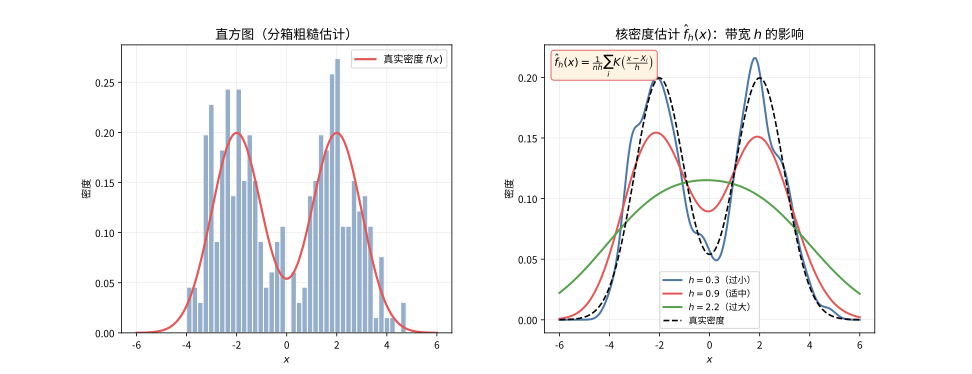

> **直观理解（现实类比）**：直方图就像把数据"按箱分装"的条形柜，每个箱子里的数量一目了然，但箱子的宽度和起始位置会强烈影响形状。核密度估计则像在每个数据点周围"铺一层柔和的沙丘"，再把所有沙丘叠加起来得到一条平滑曲线——它不预设数据的形状，完全由数据自己"长"出来。带宽 $h$ 就像沙丘的宽窄：$h$ 太小曲线毛刺丛生（过拟合），太大又会把双峰等细节磨平（欠拟合）。

#### 课堂问答

**老师**：核密度估计 $\hat{f}_h(x)$ 是怎么构造的？核函数要满足什么条件？

**学生**：结论：$\hat{f}_h(x)=\frac{1}{nh}\sum_{i=1}^n K\!\left(\frac{x-X_i}{h}\right)$，即把每个观测点当作中心铺一个宽度为 $h$ 的"小沙丘"，再叠加归一。核函数需满足 $\int K(u)\,du=1$、$\int uK(u)\,du=0$、$\int u^2K(u)\,du=\mu_2(K)>0$（对称、积分为 $1$ 的概率密度）。均匀核、高斯核、Epanechnikov 核都是常见选择。

**老师（追问）**：为什么这样叠出来的 $\hat{f}_h$ 一定是合法的概率密度？带宽 $h$ 起什么作用？

**学生**：结论：它是合法密度，因为每个核积分为 $1$，除以 $n$ 后总和仍为 $1$，且 $K\ge0$ 保证 $\hat{f}_h\ge0$。带宽 $h$ 是偏差-方差权衡的旋钮：$h$ 太小时方差大、曲线满是毛刺（过拟合）；$h$ 太大时偏差大、双峰被抹平（过平滑）。它恰好是定理 3.4 里最优带宽要平衡的那两股力量。

**老师（拓展）**：哪种核最好？实践中怎么选？

**学生**：结论：Epanechnikov 核在渐近均方误差意义下最优，但不同核之间差异极小（效率相差常不到几个百分点）。因此实践中并不执着于最优核，反而常因高斯核处处可微、便于求导而选它，把精力花在选带宽 $h$ 上——毕竟带宽对结果的影响远大于核形状。

### 2.11 经验分布函数

**经验分布函数**（Empirical Distribution Function, EDF）：

$$
\hat{F}_n(x) = \frac{1}{n} \sum_{i=1}^n \mathbf{1}_{\{X_i \le x\}}
$$

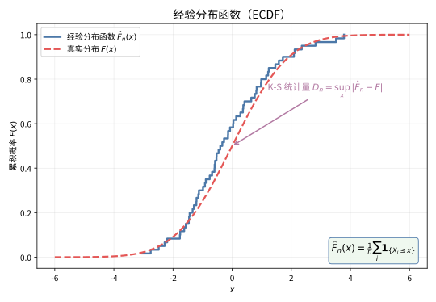

> **直观理解（现实类比）**：经验分布函数就像"抽样民意调查的累积支持率曲线"——把 $n$ 个样本从小到大排好，$\hat{F}_n(x)$ 表示"小于等于 $x$ 的样本占多大比例"，每遇到一个样本就往上跳一小格，形成一条楼梯状的曲线。当样本足够多时，这条"楼梯"会无限逼近真实的平滑分布曲线 $F(x)$（Glivenko-Cantelli 定理），而两条曲线之间缝隙的最大高度，正是 K-S 检验用来判断"数据是否来自该分布"的标尺。

> **🧠 思考历程：不认识分布"长得像谁"，还能拿数据做什么？**
>
> 经验分布函数捕捉的是一种直白的信任：既然我不敢笃定总体的分布，就让数据自己站出来说话——把每个样本都当成一个小台阶，层层叠起来就是我全部的假设。这条"台阶曲线"背后，是1930年代一群数学家对"分布无关"的执着。
>
> - **从台阶到定理**。1933年格利文科（Valery Glivenko）与坎泰利（Francesco Cantelli）独立证明：样本越多，经验分布函数 $\hat{F}_n(x)$ 就会一致地逼近真实分布 $F(x)$——这口气仿佛在说"数据不需要你猜分布，只要够多，它自己就长成分布"。
> - **台阶与曲线之间的一把尺**。柯尔莫哥洛夫（Andrey Kolmogorov）同年算出 $\sup_x|\hat{F}_n(x)-F_0(x)|$ 的极限分布，给了"台阶离曲线有多远"一个可查的临界值——于是有了K-S检验；罗森布拉特（Rosenblatt）与帕尔岑（Parzen）又分别在1956、1962年把台阶"磨平"成平滑的核密度曲线。
> - **一条主线贯穿**。从经验分布到核密度、从K-S检验到秩检验，非参数方法共享同一信条：向数据让步、不向假设低头，用经验分布取代预设的钟形曲线，换来的是对错设模型的免疫。
> - **心路**：当你不敢笃信一条具体曲线时，别硬猜——把舞台让给数据本身，稳健有时正来自"少预设天气"。

#### 课堂问答

**老师**：经验分布函数 $\hat{F}_n(x)$ 的定义是什么？它有哪些基本性质？

**学生**：结论：$\hat{F}_n(x)=\frac{1}{n}\sum_{i=1}^n\mathbf{1}_{\{X_i\le x\}}$，是"小于等于 $x$ 的样本比例"，随 $x$ 增大逐级抬升、每步跳 $\frac1n$ 的阶梯函数。它是 $F(x)$ 的无偏估计：$\mathbb{E}[\hat{F}_n(x)]=F(x)$，且 $\text{Var}(\hat{F}_n(x))=\frac{F(x)(1-F(x))}{n}$——样本越多越贴。

**老师（追问）**：既然逐点有强大数定律，为什么还要强调"一致"收敛？

**学生**：结论：因为许多检验（如 K-S）依赖的是 $\sup_x|\hat{F}_n(x)-F(x)|$，而不是某个固定点的误差。逐点收敛对每个 $x$ 各自成立，却无法控制整条曲线同时贴近。Glivenko-Cantelli 定理给出的正是 $\sup_x|\hat{F}_n(x)-F(x)|\xrightarrow{a.s.}0$；Dvoretzky-Kiefer-Wolfowitz 不等式还进一步给出 $n$ 上的指数型集中界。

**老师（拓展）**：它和 Bootstrap 有什么关系？

**学生**：结论：Bootstrap 的理论核心正是"用 $\hat{F}_n$ 代替未知的 $F$"。既然 $\hat{F}_n$ 一致逼近 $F$，那么在 $\hat{F}_n$ 上做有放回重抽样所得到的统计量分布，就会收敛到真实的抽样分布。经验分布在这里扮演了"可操作的总体"这一角色——这是整章从经验分布通向计算推断的桥梁。

### 2.12 Brown桥

**Brown桥**（Brownian Bridge）是条件于 $B(0) = B(1) = 0$ 的布朗运动。定义为 $B^0(t) = B(t) - tB(1)$，其中 $B(t)$ 为标准布朗运动。

> **💡 直观理解（类比）**：Brown 桥像"把一根在两端固定住、中间随风抖动的绳"——普通布朗运动到处乱逛，而 Brown 桥被约定在 $t=0$ 和 $t=1$ 处都必须回落到 $0$，中间仍随机起伏。$B(t)-tB(1)$ 就是把起点和终点"钉死"呈一条直线的操作。经验分布过程 $D_n$ 的极限刚好长这样，所以 K-S 检验的分布由它决定。

#### 课堂问答

**老师**：Brown 桥的定义是什么？它和布朗运动是什么关系？

**学生**：结论：Brown 桥是条件于 $B(0)=B(1)=0$ 的布朗运动，$B^0(t)=B(t)-tB(1)$，$t\in[0,1]$，其中 $B$ 是标准布朗运动。因为减去了线性项 $tB(1)$，它把两端都"钉"在 $0$：起点本就为 $0$，终点也恰好为 $B(1)-1\cdot B(1)=0$。

**老师（追问）**：它的均值与协方差函数是什么？这和 K-S 检验怎么联系？

**学生**：结论：$B^0$ 是均值 $0$ 的高斯过程，协方差为 $\text{Cov}(B^0(s),B^0(t))=\min(s,t)-st$，可由 $\text{Cov}(B(s),B(t))=\min(s,t)$ 直接代入得到。而经验过程 $\alpha_n(t)=\sqrt{n}(\mathbb{G}_n(t)-t)$ 的有限维协方差恰好也是 $\min(s,t)-st$，所以 $\alpha_n$ 弱收敛到 $B^0$，$\sqrt{n}D_n$ 的极限就是 $\sup_t|B^0(t)|$。

**老师（拓展）**：为什么布朗桥在统计里如此重要？

**学生**：结论：它是"两端固定的随机起伏"的规范模型，是维纳过程的条件化版本，也被形象地称为"被绑住的随机游走"。它的两个泛函撑起了分布拟合检验的半边天——取 $\sup$ 得到 Kolmogorov 分布（K-S 检验），取平方积分得到 Cramér-von Mises 分布。凡是经验过程弱收敛到它的检验，临界值都由它决定。

### 2.13 非参数回归与样条光滑

**非参数回归**不假设回归函数的具体形式：

$$
Y_i = m(X_i) + \varepsilon_i
$$

其中 $m(x)$ 是未知的平滑函数。

**样条光滑**（Spline Smoothing）通过最小化惩罚残差平方和来估计 $m$：

$$
\hat{m} = \arg\min_{m} \sum_{i=1}^n (Y_i - m(X_i))^2 + \lambda \int [m''(x)]^2 dx
$$

> **💡 直观理解（类比）**：非参数回归就是"让曲线自己跟着数据走，不硬套直线"——$m(x)$ 可以是任意平滑形状。样条光滑则在"贴数据"与"别太弯"之间取平衡：第一项要求贴合，第二项惩罚"拐弯太急"（$m''$ 的积分），$\lambda$ 控制松紧——$\lambda$ 大则曲线被拉直（过于平滑），$\lambda$ 小则可拟合复杂细节（容易过拟合）。

#### 课堂问答

**老师**：非参数回归模型长什么样？样条光滑凭什么"既贴数据又不乱弯"？

**学生**：结论：模型是 $Y_i=m(X_i)+\varepsilon_i$，$m(x)$ 是未知的平滑函数，不预设任何函数形式。样条光滑通过最小化带惩罚的残差平方和得到估计：$\hat{m}=\arg\min_m\sum_{i=1}^n(Y_i-m(X_i))^2+\lambda\int[m'']^2\,dx$——第一项要求贴合数据，第二项惩罚曲线的弯曲程度。

**老师（追问）**：惩罚项为什么用 $\int[m'']^2\,dx$，而 $\lambda$ 又起什么作用？

**学生**：结论：$\int[m'']^2\,dx$ 度量"整条曲线的总弯曲能量"，$m$ 越接近直线它越小；用二阶导而非一阶导，是为了让直线（一阶导可为常数）不被惩罚，只惩罚"拐弯"。$\lambda$ 是光滑参数：$\lambda\to0$ 时估计退化为过拟合的插值曲线，$\lambda\to\infty$ 时被压成一条直线；适中的 $\lambda$ 在"贴合"与"平滑"之间取平衡。

**老师（拓展）**：它与核方法、局部多项式是什么关系？该选哪一个？

**学生**：结论：它们都属"让曲线自己长"的非参数回归家族，局部多项式在每点做局部加权拟合，惩罚样条则用全局基函数加弯曲惩罚。三者都能达到同样的最优收敛率 $O(n^{-2(p+1)/(2p+3)})$，只是实现与边界行为不同——惩罚样条不必逐点求解、计算更稳，局部多项式在处理边界偏差上更自然。选择取决于计算成本与边界精度需求，而非本质优劣。

### 2.14 自助法（Bootstrap）

🌐 **直觉先行**：前面反复说"不猜分布"，可一旦要估计某个统计量 $\hat\theta$（比如中位数、相关系数）的**标准误或置信区间**，绕不开一个问题：数据只有一份，它的不确定性能怎么量？答案朴素得惊人——**既然样本是从总体里抽的，那我就"从样本里再抽样本"**：把原始 $n$ 个观测当作一个微型"总体"，每次有放回地重抽 $n$ 个（允许重复、允许漏掉），反复做 $B$ 次，得到 $B$ 个"再抽样数据集"，对这 $B$ 份各算一遍 $\hat\theta$，它们的散布就近似代表 $\hat\theta$ 的不确定性。这就是 Efron 1979 年提出的 **Bootstrap**（自助法），它把"没有那么多数据"变成"用重抽样复制出很多份数据"。

**核心算法**：给定样本 $X_1,\dots,X_n$，重复 $B$ 次：

1. 有放回地随机抽取 $n$ 个观测，构成自助样本 $X_1^*,\dots,X_n^*$；
2. 计算统计量 $\hat\theta^*_b = \hat\theta(X_1^*,\dots,X_n^*)$。

用得到的 $\{\hat\theta_1^*,\dots,\hat\theta_B^*\}$ 的经验分布估计 $\hat\theta$ 的分布。

**自助标准差与分位点（百分位法）区间**：

$$
\widehat{\text{SE}}_{\text{boot}}(\hat\theta) = \sqrt{\frac{1}{B-1}\sum_{b=1}^B \left(\hat\theta^*_b - \bar{\theta}^*\right)^2}, \qquad
[\hat\theta_{\text{boot},{\alpha/2}}^*,\ \hat\theta_{\text{boot},{1-\alpha/2}}^*]
$$

其中 $\hat\theta_{\text{boot},q}^*$ 是 $\{\hat\theta_b^*\}$ 的第 $q$ 分位数。

> **💡 直观理解（类比）**：Bootstrap 像"用口袋里的一把豆子，反复抓出来再放回去，看清楚'这一把豆子的成分'有多抗折腾"——每一次有放回重抽，都是一次对"总体可能长什么样"的随机演练。因为重抽样保留了原始样本的全部形态（包括偏态和异常值），它不需要正态假设也能给标准误和置信区间，是"分布无关"思想在"不确定性度量"上的收官之作（核心：替换经验分布 $\hat F_n$ 去代替未知的 $F$）。

> **常见坑**：Bootstrap 的"自助样本"必须**有放回**抽取，且每次抽取**恰为 $n$ 个**（与原始样本同大小）——这是它模拟"另取一份同规模样本"的关键，常被误写成"无放回"或"抽得比 $n$ 少"的每次；另外，对小样本或极端数据（异常值很多时），自助区间可能偏窄、未必覆盖真值，此时应谨慎解释而非照搬。

> **🔑 为什么重要**：Bootstrap 是现代非参数统计（以及机器学习中随机森林、Bagging）的基石。它最亮眼的价值在于：当某个统计量没有闭式标准误公式（如中位数、Kendall $\tau$、复杂模型参数）时，Bootstrap 都能给出一份可用、无需分布假设的推断结论——这正是"非参数"哲学在现代计算时代的最佳落点。

> **小例子**：5 个学生成绩为 $8,5,12,9,10$，想估计**中位数**的标准误。Bootstrap 有放回重抽 $n=5$ 次，假如抽到 $\{8,9,8,12,5\}$，其中位数 $=8$；重复 $B=1000$ 次得到 $1000$ 个中位数，其标准差即约为中位数的自助标准误——不需任何正态假设即可算出。

> **练习**：给出样本 $2,4,6,8$，试列出所有可能的 $n=2$ 有放回自助抽样中"恰好两次都抽到 2"的一种自助样本，并说明其均值；若用一个统计量打比方，写出"为何必须保留重复、允许漏掉"的原因。

> **解**：一种可能的有放回自助样本是 $(2,2)$，其均值 $\bar X^*=2$。必须**有放回**是因为：有放回才能允许"同一个观测被抽到多次或完全没被抽到"，从而模拟"总体里可能恰好多抽到某些个体"的现实；若改成无放回，每份自助样本只是原样本的一份无序排列，均值恒等于原均值、完全测不出不确定性了。

---

#### 课堂问答

**老师**：Bootstrap 的基本想法是什么？为什么它能估计出标准误？

**学生**：结论：核心就一句——"把样本当作微型总体，从它里面再抽样"。把原始 $n$ 个观测当成总体，重复 $B$ 次有放回地重抽 $n$ 个，得到 $B$ 份自助样本，对每份算出统计量 $\hat\theta_b^*$；用它们的散布（经验分布）去近似 $\hat\theta$ 的抽样分布，于是标准误与置信区间都不用任何分布假设。

**老师（追问）**：为什么必须"有放回"且每次都抽 $n$ 个？

**学生**：结论：因为有放回才能允许"同一个观测被抽中多次、某些观测一次都没被抽中"，从而模拟"总体里重复抽样的随机性"；每次都抽 $n$ 个，是为了模拟"另取一份与原始样本同规模的数据"。若改成无放回，每份自助样本只是原样本的重新排列，统计量恒等于原值，完全测不出不确定性。这正是最常见的误用。

**老师（拓展）**：它为什么重要？有什么局限？

**学生**：结论：它把"没有那么多数据"变成"用计算复制出很多份数据"，让中位数、Kendall $\tau$ 这类没有闭式标准误公式的统计量也能做推断，是"非参数"哲学在计算时代的最佳落点。局限是：小样本或极端异常值很多时，百分位区间可能偏窄、覆盖真值的概率不足；此外它假设样本能代表总体，若原样本本身有偏，Bootstrap 也无能为力。

## 3. 定理与证明

### 定理 3.1：Glivenko-Cantelli 定理

**定理**（Glivenko-Cantelli）：设 $X_1, X_2, \dots, X_n$ 是独立同分布于分布函数 $F$ 的随机变量，$\hat{F}_n(x) = \frac{1}{n} \sum_{i=1}^n \mathbf{1}_{\{X_i \le x\}}$ 为经验分布函数。则 $\hat{F}_n(x)$ 一致收敛到 $F(x)$ 几乎必然成立：

$$
\sup_{x \in \mathbb{R}} |\hat{F}_n(x) - F(x)| \xrightarrow{\text{a.s.}} 0, \quad n \to \infty
$$

> **💡 直观理解（类比）**：Glivenko-Cantelli 定理说的是"楼梯铺得够密，就整条逼近光滑曲线"——随着样本增多，经验分布这条台阶曲线不仅在逐点、而且在整体上处处逼近真实分布。它给"用数据代替未知分布"发了通行证：不用先猜分布长什么样，数据多了它自己会长成分布。

**证明**：

**步骤1：逐点收敛**

由强大数定律，对每个固定的 $x \in \mathbb{R}$，有：

$$
\hat{F}_n(x) = \frac{1}{n} \sum_{i=1}^n \mathbf{1}_{\{X_i \le x\}} \xrightarrow{\text{a.s.}} \mathbb{E}[\mathbf{1}_{\{X_1 \le x\}}] = F(x)
$$

即 $\hat{F}_n(x)$ 逐点几乎必然收敛到 $F(x)$。

**步骤2：构造有限网格**

对任意 $\varepsilon > 0$，选择 $k$ 个点 $-\infty = x_0 < x_1 < \cdots < x_k = \infty$，使得：

$$
F(x_j-) \le \frac{j\varepsilon}{3} \le F(x_j), \quad j = 1, 2, \dots, k-1
$$

其中 $F(x_j-)$ 表示左极限。这样的网格存在，因为 $F$ 是单调不减函数，最多有可数个间断点。事实上，我们可以选择 $x_1, x_2, \dots, x_{k-1}$ 为 $F$ 的 $\varepsilon/3$ 分位数点。

**步骤3：在网格点上的收敛**

由步骤1，对每个网格点 $x_j$，存在几乎必然收敛的零测集 $N_j$，使得对 $\omega \notin N_j$，有 $\hat{F}_n(x_j, \omega) \to F(x_j)$。令 $N = \bigcup_{j=1}^{k-1} N_j$，则对 $\omega \notin N$，对所有 $j$ 同时成立收敛。

**步骤4：控制网格点之间的偏差**

对任意 $x \in \mathbb{R}$，存在 $j$ 使得 $x_{j-1} \le x < x_j$。则：

$$
\hat{F}_n(x) - F(x) \le \hat{F}_n(x_j-) - F(x_{j-1}) \le \hat{F}_n(x_j-) - F(x_j) + \frac{\varepsilon}{3}
$$

$$
\hat{F}_n(x) - F(x) \ge \hat{F}_n(x_{j-1}) - F(x_j-) \ge \hat{F}_n(x_{j-1}) - F(x_{j-1}) - \frac{\varepsilon}{3}
$$

因此：

$$
\sup_{x} |\hat{F}_n(x) - F(x)| \le \max_{j} |\hat{F}_n(x_j) - F(x_j)| + \frac{\varepsilon}{3}
$$

**步骤5：一致收敛**

对 $\omega \notin N$，当 $n$ 充分大时，$\max_j |\hat{F}_n(x_j) - F(x_j)| < \varepsilon/3$，从而：

$$
\sup_{x} |\hat{F}_n(x) - F(x)| < \frac{2\varepsilon}{3}
$$

由于 $\varepsilon$ 任意，得 $\sup_x |\hat{F}_n(x) - F(x)| \to 0$ 几乎必然成立。$\square$

---

#### 课堂问答

**老师**：Glivenko-Cantelli 定理断言了什么？证明的关键在哪一步？

**学生**：结论：它断言 $\sup_{x\in\mathbb{R}}|\hat{F}_n(x)-F(x)|\xrightarrow{a.s.}0$，即经验分布"整体一致"收敛到真分布。证明主线是：先用强大数定律得逐点收敛，再对给定的 $\varepsilon$ 用 $F$ 的 $\varepsilon/3$ 分位点构造一个有限网格，把网格点之间 $x$ 的偏差用 $F$ 与 $\hat{F}_n$ 的单调性夹到 $\varepsilon/3$ 以内，最后把有限网格上的收敛提升为整个实轴上的一致收敛。

**老师（追问）**：为什么不能只靠逐点强大数定律直接得到一致收敛？

**学生**：结论：因为 $\sup_x$ 是"不可数个点"的上确界，逐点收敛只保证了每一个固定点的误差趋零，无法同时控制所有点。关键技巧是"有限网格 + 单调夹逼"：借助 $F$ 的 $\varepsilon/3$ 分位点，让格点之间 $F$ 的变化不超过 $\varepsilon/3$，再用 $\hat{F}_n$ 单调上升把任意 $x$ 的偏差放大成两端格点的偏差加上 $\varepsilon/3$，从而把不可数的问题化为有限个格点的问题。

**老师（拓展）**：这条定理对整章有什么根本意义？

**学生**：结论：它是非参数统计的合法性基石。有了它，"用 $\hat{F}_n$ 代替 $F$"才名正言顺——K-S 检验的 $\sup$ 统计量有了收敛的对象，Bootstrap 用经验分布当"微型总体"有了理论依据，所有基于经验分布的推断都站在它肩上。一句话：数据够多，经验分布自己就长成了分布。

### 定理 3.2：Kolmogorov-Smirnov 检验的渐近分布

**定理**：设 $X_1, \dots, X_n$ 独立同分布于连续分布函数 $F_0$，$D_n = \sup_x |\hat{F}_n(x) - F_0(x)|$ 为K-S统计量。则当 $n \to \infty$ 时：

$$
\sqrt{n} D_n \xrightarrow{d} \sup_{t \in [0,1]} |B^0(t)|
$$

其中 $B^0(t)$ 是 $[0,1]$ 上的 Brown 桥，即 $B^0(t) = B(t) - tB(1)$，$B(t)$ 为标准布朗运动。

K-S检验的渐近分布函数为：

$$
\lim_{n \to \infty} \mathbb{P}(\sqrt{n} D_n \le d) = 1 - 2 \sum_{k=1}^{\infty} (-1)^{k-1} e^{-2k^2 d^2}
$$

> **💡 直观理解（类比）**：定理把"经验分布离假设曲线最远有多远"的临界值，归结为"两端钉死的随机长绳（Brown 桥）最高能荡多高"的分布。因为经验曲线那点随机偏差，恰好和一根两端固定的布朗桥长得一模一样，于是 K-S 检验的临界值就由"桥荡到 $d$ 有多难"给出，查表即可判断序列是否来自该分布。

**证明**：

**步骤1：概率积分变换**

由概率积分变换，令 $U_i = F_0(X_i)$，则 $U_i \sim \text{Uniform}[0,1]$ 独立同分布。经验分布函数为：

$$
\hat{F}_n(x) = \frac{1}{n} \sum_{i=1}^n \mathbf{1}_{\{X_i \le x\}} = \frac{1}{n} \sum_{i=1}^n \mathbf{1}_{\{U_i \le F_0(x)\}}
$$

定义 $t = F_0(x)$，则 $t \in [0,1]$，且：

$$
\hat{F}_n(F_0^{-1}(t)) = \frac{1}{n} \sum_{i=1}^n \mathbf{1}_{\{U_i \le t\}} := \mathbb{G}_n(t)
$$

因此 $D_n = \sup_{t \in [0,1]} |\mathbb{G}_n(t) - t|$，其中 $\mathbb{G}_n(t)$ 是 $U[0,1]$ 的经验分布函数。

**步骤2：经验过程**

定义经验过程（Empirical Process）：

$$
\alpha_n(t) = \sqrt{n}(\mathbb{G}_n(t) - t), \quad t \in [0,1]
$$

则 $\sqrt{n} D_n = \sup_{t \in [0,1]} |\alpha_n(t)|$。

**步骤3：有限维收敛**

对任意固定的 $t_1, \dots, t_k \in [0,1]$，由多维中心极限定理：

$$
(\alpha_n(t_1), \dots, \alpha_n(t_k)) \xrightarrow{d} N(\boldsymbol{0}, \boldsymbol{\Sigma})
$$

其中 $\Sigma_{ij} = \min(t_i, t_j) - t_i t_j$，这正是 Brown 桥的协方差函数。

**步骤4：紧性（Tightness）**

经验过程 $\alpha_n$ 在 Skorokhod 空间 $D[0,1]$ 上是紧的。这可以通过验证以下条件得到：

对任意 $\varepsilon > 0$，存在 $\delta > 0$ 和 $n_0$，使得：

$$
\mathbb{P}\left(\sup_{|s-t| < \delta} |\alpha_n(s) - \alpha_n(t)| > \varepsilon\right) < \varepsilon, \quad \forall n \ge n_0
$$

该条件可由经验过程的矩不等式（如 Dvoretzky-Kiefer-Wolfowitz 不等式）证明。

**步骤5：Donsker定理**

由有限维收敛和紧性，经验过程 $\alpha_n$ 在 $D[0,1]$ 上弱收敛到 Brown 桥 $B^0$：

$$
\alpha_n \xrightarrow{d} B^0 \quad \text{in } D[0,1]
$$

**步骤6：连续映射定理**

由连续映射定理，$\sup$ 泛函是连续的，因此：

$$
\sqrt{n} D_n = \sup_{t \in [0,1]} |\alpha_n(t)| \xrightarrow{d} \sup_{t \in [0,1]} |B^0(t)|
$$

**步骤7：渐近分布函数**

Brown 桥的 $\sup$ 的分布由 Kolmogorov 给出：

$$
\mathbb{P}\left(\sup_{t \in [0,1]} |B^0(t)| \le d\right) = 1 - 2 \sum_{k=1}^{\infty} (-1)^{k-1} e^{-2k^2 d^2}
$$

该级数收敛很快，实际中取前几项即可获得高精度近似。$\square$

---

#### 课堂问答

**老师**：K-S 检验的渐近分布是什么？怎么得到的？

**学生**：结论：$\sqrt{n}D_n\xrightarrow{d}\sup_{t\in[0,1]}|B^0(t)|$，$B^0$ 是 Brown 桥；其分布函数为 $1-2\sum_{k=1}^{\infty}(-1)^{k-1}e^{-2k^2d^2}$。证明分五步：概率积分变换把 $F_0$ 化为 $U[0,1]$；构造经验过程 $\alpha_n(t)=\sqrt{n}(\mathbb{G}_n(t)-t)$；由多维中心极限定理得有限维分布收敛到协方差 $\min(s,t)-st$ 的高斯过程；验证紧性（用 Dvoretzky-Kiefer-Wolfowitz 型矩不等式）；最后用连续映射定理把 $\sup$ 推进极限。

**老师（追问）**：为什么中间必须验证"紧性"这一步？

**学生**：结论：因为有限维分布的收敛只保证"任意有限个时间点"上的分布收敛，不足以推出整条随机过程在 $D[0,1]$ 上弱收敛。紧性排除了"路径在相邻点之间剧烈振荡"的病态可能，使得有限维收敛能升级为过程级收敛。这一步通常由经验过程的矩不等式给出，是 Donsker 定理成立的关键条件。

**老师（拓展）**：为什么这个极限分布与 $F_0$ 无关，这有什么价值？

**学生**：结论：因为概率积分变换后，问题只依赖 $U[0,1]$ 上的经验过程，而 Brown 桥的 $\sup$ 分布只含 $d$ 与时间参数，与原始 $F_0$ 完全脱钩。价值在于临界值通用——无论数据声称服从哪种连续分布，都查同一张 K-S 表。这正是"分布自由"最漂亮的兑现。

### 定理 3.3：Wilcoxon 符号秩检验的渐近正态性

**定理**：设 $X_1, \dots, X_n$ 独立同分布于连续对称分布（关于中位数 $m$ 对称）。$W = \sum_{i=1}^n \text{sign}(X_i - m) \cdot R_i$ 为 Wilcoxon 符号秩统计量，其中 $R_i$ 是 $|X_i - m|$ 的秩。则在 $H_0: m = m_0$ 下，当 $n \to \infty$ 时：

$$
\frac{W}{\sqrt{n(n+1)(2n+1)/6}} \xrightarrow{d} N(0, 1)
$$

> **💡 直观理解（类比）**：这条定理说"由许多小决定拼成的总分数，自然长得像个钟形"——Wilcoxon 统计量是大量独立"掷硬币"的符号和秩的加总，按中心极限定理，样本一大就趋近正态。正因为如此，实际检验不必逐条查表，直接用熟悉的 Z 分数算 p 值即可。

**证明**：

**步骤1：Wilcoxon统计量的等价形式**

Wilcoxon 符号秩统计量可以写成：

$$
W = \sum_{i=1}^n \sum_{j=1}^n \mathbf{1}_{\{X_i + X_j > 2m_0\}} \mathbf{1}_{\{i \le j\}} - \frac{n(n+1)}{2}
$$

更常用的等价形式是：

$$
W_+ = \sum_{i=1}^n R_i \mathbf{1}_{\{X_i > m_0\}}
$$

即正差值的秩和。$W_+$ 与 $W$ 的关系为 $W = 2W_+ - \frac{n(n+1)}{2}$。

**步骤2：$W_+$ 的期望与方差**

在 $H_0$ 下，$X_i$ 关于 $m_0$ 对称，因此 $\mathbb{P}(X_i > m_0) = 1/2$，且符号与绝对值大小独立。故：

$$
\mathbb{E}[W_+] = \sum_{i=1}^n i \cdot \frac{1}{2} = \frac{n(n+1)}{4}
$$

$$
\text{Var}(W_+) = \sum_{i=1}^n i^2 \cdot \frac{1}{4} = \frac{n(n+1)(2n+1)}{24}
$$

**步骤3：$U$ 统计量表示**

$W_+$ 可以表示为 $U$ 统计量的形式：

$$
W_+ = \sum_{i=1}^n \sum_{j=1}^n \frac{1}{2} \left[ \mathbf{1}_{\{X_i + X_j > 2m_0\}} + \mathbf{1}_{\{X_i > m_0\}} \right] - \frac{n}{2}
$$

这种表示将 $W_+$ 与核函数 $h(x, y) = \frac{1}{2}[\mathbf{1}_{\{x + y > 2m_0\}} + \mathbf{1}_{\{x > m_0\}}]$ 的 $U$ 统计量联系起来。

**步骤4：Hájek 投影**

对 $U$ 统计量应用 Hájek 投影。投影后的统计量为：

$$
\hat{W}_+ = \sum_{i=1}^n \mathbb{E}[W_+ \mid X_i] - (n-1)\mathbb{E}[W_+]
$$

计算投影得分函数：

$$
g(X_i) = \mathbb{E}[W_+ \mid X_i] - \mathbb{E}[W_+]
$$

可以证明 $g(X_i)$ 是独立随机变量且 $\mathbb{E}[g(X_i)] = 0$。

**步骤5：中心极限定理**

由 Hájek 投影定理，$W_+$ 与 $\hat{W}_+$ 的差是 $o_p(\sqrt{n})$。而 $\hat{W}_+$ 是独立随机变量之和，由经典中心极限定理：

$$
\frac{\hat{W}_+ - \mathbb{E}[W_+]}{\sqrt{\text{Var}(W_+)}} \xrightarrow{d} N(0, 1)
$$

因此 $W_+$ 也渐近正态，且均值为 $\frac{n(n+1)}{4}$，方差为 $\frac{n(n+1)(2n+1)}{24}$。

**步骤6：$W$ 的渐近分布**

由 $W = 2W_+ - \frac{n(n+1)}{2}$，得 $W$ 的均值为0，方差为：

$$
\text{Var}(W) = 4 \cdot \text{Var}(W_+) = \frac{n(n+1)(2n+1)}{6}
$$

因此：

$$
\frac{W}{\sqrt{n(n+1)(2n+1)/6}} \xrightarrow{d} N(0, 1)
$$

$\square$

---

#### 课堂问答

**老师**：Wilcoxon 符号秩统计量的渐近正态性怎么陈述？证明的核心工具是什么？

**学生**：结论：$\frac{W}{\sqrt{n(n+1)(2n+1)/6}}\xrightarrow{d}N(0,1)$。证明核心是 Hájek 投影：把 $W_+$ 写成带核 $h(x,y)=\frac12[\mathbf{1}_{\{x+y>2m_0\}}+\mathbf{1}_{\{x>m_0\}}]$ 的 $U$ 统计量，再投影为 $\hat{W}_+=\sum_i\mathbb{E}[W_+\mid X_i]-(n-1)\mathbb{E}[W_+]$，两者之差是 $o_p(\sqrt{n})$；而投影是独立同分布随机变量之和，由中心极限定理直接得正态性。

**老师（追问）**：这个证明需要什么前提？$\hat{W}_+$ 为什么能用中心极限定理？

**学生**：结论：前提是总体分布关于 $m_0$ 连续对称，它保证了符号与绝对秩独立、$\mathbb{P}(X_i>m_0)=1/2$，从而每个秩以概率 $1/2$ 独立地进入正和，得 $\mathbb{E}[W_+]=\frac{n(n+1)}{4}$、$\text{Var}(W_+)=\frac{n(n+1)(2n+1)}{24}$。投影 $\hat{W}_+$ 恰好是这些独立得分函数的和，各项独立同分布、均值零、方差有限，所以经典 CLT 直接适用。

**老师（拓展）**：为什么教材宁愿绕道 $U$ 统计量而不直接算 $W$？

**学生**：结论：因为 $W_+$ 的各项（秩）之间并不独立，直接套 CLT 会卡住；而 $W_+$ 的核是"成对比较"，天然写成 $U$ 统计量。Hájek 投影把 $U$ 统计量"线性化"成一阶独立和，误差可控在 $o_p(\sqrt n)$，于是独立性恢复、CLT 可用。这是处理 $U$ 统计量渐近正态问题的一般套路，Mann-Whitney 检验的渐近正态性也走同一条路。

### 定理 3.4：核密度估计的均方误差与最优带宽

**定理**：设 $X_1, \dots, X_n$ 独立同分布于密度 $f$，$f$ 在 $x$ 处二阶连续可导且 $f''(x) \neq 0$。核函数 $K$ 满足：$\int K(u) du = 1$，$\int u K(u) du = 0$，$\int u^2 K(u) du = \mu_2(K) \neq 0$，$\int K(u)^2 du = \|K\|_2^2$。则核密度估计 $\hat{f}_h(x)$ 的均方误差为：

$$
\text{MSE}(\hat{f}_h(x)) = \frac{1}{4} h^4 \mu_2(K)^2 [f''(x)]^2 + \frac{1}{nh} \|K\|_2^2 f(x) + o(h^4 + (nh)^{-1})
$$

> **💡 直观理解（类比）**：这条定理把核密度估计的误差拆成两股相反的力量——带宽 $h$ 越大，曲线越平滑、偏差越大但方差越小；$h$ 越小则反之。最优带宽就是在"磨平细节（偏差²∝h⁴）"和"怕毛刺（方差∝1/(nh)）"之间找到平衡点，这也是"有免费午餐吗"的答案：平滑与灵敏不可兼得，只能求最优折中。

最优带宽（最小化渐近均方误差的带宽）为：

$$
h_{\text{opt}}(x) = \left( \frac{\|K\|_2^2 f(x)}{n \mu_2(K)^2 [f''(x)]^2} \right)^{1/5}
$$

全局最优带宽（最小化渐近均方积分误差）为：

$$
h_{\text{opt}} = \left( \frac{\|K\|_2^2}{n \mu_2(K)^2 \int [f''(x)]^2 dx} \right)^{1/5}
$$

**证明**：

**步骤1：偏差的计算**

核密度估计的期望为：

$$
\begin{aligned}
\mathbb{E}[\hat{f}_h(x)] &= \mathbb{E}\left[\frac{1}{nh} \sum_{i=1}^n K\left(\frac{x - X_i}{h}\right)\right] \\
&= \frac{1}{h} \int K\left(\frac{x - y}{h}\right) f(y) dy \\
&= \int K(u) f(x - hu) du \quad (\text{变量代换 } u = (x-y)/h)
\end{aligned}
$$

对 $f(x - hu)$ 在 $x$ 处进行二阶Taylor展开：

$$
f(x - hu) = f(x) - hu f'(x) + \frac{1}{2} h^2 u^2 f''(x) + o(h^2)
$$

代入得：

$$
\begin{aligned}
\mathbb{E}[\hat{f}_h(x)] &= \int K(u) [f(x) - hu f'(x) + \frac{1}{2} h^2 u^2 f''(x) + o(h^2)] du \\
&= f(x) \int K(u) du - h f'(x) \int u K(u) du + \frac{1}{2} h^2 f''(x) \int u^2 K(u) du + o(h^2)
\end{aligned}
$$

由核函数条件 $\int K = 1$，$\int uK = 0$，$\int u^2 K = \mu_2(K)$，得：

$$
\mathbb{E}[\hat{f}_h(x)] = f(x) + \frac{1}{2} h^2 \mu_2(K) f''(x) + o(h^2)
$$

因此偏差为：

$$
\text{Bias}(\hat{f}_h(x)) = \mathbb{E}[\hat{f}_h(x)] - f(x) = \frac{1}{2} h^2 \mu_2(K) f''(x) + o(h^2)
$$

**步骤2：方差的计算**

$$
\begin{aligned}
\text{Var}(\hat{f}_h(x)) &= \text{Var}\left(\frac{1}{nh} \sum_{i=1}^n K\left(\frac{x - X_i}{h}\right)\right) \\
&= \frac{1}{n} \text{Var}\left(\frac{1}{h} K\left(\frac{x - X_1}{h}\right)\right) \\
&= \frac{1}{n} \left[ \mathbb{E}\left[\frac{1}{h^2} K^2\left(\frac{x - X_1}{h}\right)\right] - \left(\mathbb{E}\left[\frac{1}{h} K\left(\frac{x - X_1}{h}\right)\right]\right)^2 \right]
\end{aligned}
$$

计算第一项：

$$
\begin{aligned}
\mathbb{E}\left[\frac{1}{h^2} K^2\left(\frac{x - X_1}{h}\right)\right] &= \frac{1}{h^2} \int K^2\left(\frac{x - y}{h}\right) f(y) dy \\
&= \frac{1}{h} \int K^2(u) f(x - hu) du \\
&= \frac{1}{h} \int K^2(u) [f(x) + o(1)] du \\
&= \frac{1}{h} \|K\|_2^2 f(x) + o\left(\frac{1}{h}\right)
\end{aligned}
$$

第二项 $(\mathbb{E}[\hat{f}_h(x)])^2 = f(x)^2 + o(1)$，相对于第一项阶数更低（因为 $1/h \to \infty$），故：

$$
\text{Var}(\hat{f}_h(x)) = \frac{1}{nh} \|K\|_2^2 f(x) + o\left(\frac{1}{nh}\right)
$$

**步骤3：均方误差**

$$
\begin{aligned}
\text{MSE}(\hat{f}_h(x)) &= \text{Bias}^2(\hat{f}_h(x)) + \text{Var}(\hat{f}_h(x)) \\
&= \frac{1}{4} h^4 \mu_2(K)^2 [f''(x)]^2 + \frac{1}{nh} \|K\|_2^2 f(x) + o(h^4 + (nh)^{-1})
\end{aligned}
$$

**步骤4：最优带宽**

最小化渐近MSE（忽略高阶项），对 $h$ 求导：

$$
\frac{\partial}{\partial h} \left[ \frac{1}{4} h^4 \mu_2(K)^2 [f''(x)]^2 + \frac{1}{nh} \|K\|_2^2 f(x) \right] = h^3 \mu_2(K)^2 [f''(x)]^2 - \frac{1}{nh^2} \|K\|_2^2 f(x) = 0
$$

解得：

$$
h_{\text{opt}}(x) = \left( \frac{\|K\|_2^2 f(x)}{n \mu_2(K)^2 [f''(x)]^2} \right)^{1/5}
$$

**步骤5：最优收敛速度**

代入最优带宽，得最小MSE的收敛速度为：

$$
\text{MSE}_{\text{opt}} = O(n^{-4/5})
$$

即核密度估计的收敛速度比参数估计的 $n^{-1}$ 慢，但这是非参数估计中不可避免的。$\square$

---

#### 课堂问答

**老师**：核密度估计的 MSE 由哪两部分构成？它们如何随带宽变化？

**学生**：结论：$\text{MSE}(\hat{f}_h(x))=\frac14 h^4\mu_2(K)^2[f''(x)]^2+\frac{1}{nh}\|K\|_2^2 f(x)+o(\cdot)$，即"偏差平方 + 方差"。偏差平方 $\propto h^4$，随 $h$ 增大而增大；方差 $\propto\frac{1}{nh}$，随 $h$ 增大而减小。两者此消彼长，MSE 因此有唯一的极小点。

**老师（追问）**：最优带宽是怎么解出来的？阶数是多少？

**学生**：结论：对 $h$ 求导并令零：$h^3\mu_2(K)^2[f''(x)]^2-\frac{1}{nh^2}\|K\|_2^2 f(x)=0$，解得 $h_{\text{opt}}(x)=\left(\frac{\|K\|_2^2 f(x)}{n\mu_2(K)^2[f''(x)]^2}\right)^{1/5}\propto n^{-1/5}$；代回得最小 MSE 为 $O(n^{-4/5})$。这比参数估计的 $n^{-1}$ 慢，是所有非参数估计难以回避的"光滑代价"。

**老师（拓展）**：偏差项的那一分之四次方是从哪里冒出来的？

**学生**：结论：来自泰勒展开。$\mathbb{E}[\hat{f}_h(x)]=\int K(u)f(x-hu)\,du$，由核条件 $\int K=1$、$\int uK=0$ 消去零阶与一阶项，只剩 $\frac12 h^2\mu_2(K)f''(x)$，故偏差 $\propto h^2$、偏差平方 $\propto h^4$。哲理性地说：曲率 $f''$ 越大的地方越难估，带宽越大偏差越大。全局最优带宽同理，最小化 AMISE 得 $h_{\text{opt}}\propto\left(1/(n\int[f'']^2)\right)^{1/5}$。

### 定理 3.5：非参数回归的收敛速度

**定理**：考虑非参数回归模型 $Y_i = m(X_i) + \varepsilon_i$，其中 $X_i$ 独立同分布于密度 $f_X$，$\varepsilon_i$ 独立同分布于 $N(0, \sigma^2)$，且与 $X_i$ 独立。设 $m$ 在 $[0,1]$ 上 $p$ 阶连续可导。若使用 $p$ 阶局部多项式估计，且带宽 $h \to 0$，$nh \to \infty$，则：

$$
\mathbb{E}[\hat{m}(x) - m(x)]^2 = O(h^{2p} + (nh)^{-1})
$$

最优带宽 $h_{\text{opt}} = O(n^{-1/(2p+1)})$，此时：

$$
\mathbb{E}[\hat{m}(x) - m(x)]^2 = O(n^{-2p/(2p+1)})
$$

> **💡 直观理解（类比）**：定理回答"不预设曲线形状，拟合能学到多准"——误差同样来自"弯得不够（偏差∝h^{p+1}）"和"样本不够密（方差∝1/(nh)）"两股力量。阶数 $p$ 越高、维度 $d$ 越大，收敛越吃力，尤其高维时数据被摊薄、误差恶化，这就是"维数诅咒"——信息空间越大，同样一笔样本越不够用，误差下降越慢。

**证明**：

**步骤1：局部多项式估计的定义**

$p$ 阶局部多项式估计通过求解以下加权最小二乘问题得到：

$$
\hat{\boldsymbol{\beta}}(x) = \arg\min_{\boldsymbol{\beta}} \sum_{i=1}^n \left[ Y_i - \sum_{j=0}^p \beta_j (X_i - x)^j \right]^2 K\left(\frac{X_i - x}{h}\right)
$$

其中 $\hat{m}(x) = \hat{\beta}_0(x)$。

**步骤2：估计的显式表达式**

令 $\boldsymbol{X}_x$ 为 $n \times (p+1)$ 矩阵，第 $i$ 行为 $(1, X_i - x, \dots, (X_i - x)^p)$，$\boldsymbol{W}_x = \text{diag}(K((X_i - x)/h))$。则：

$$
\hat{\boldsymbol{\beta}}(x) = (\boldsymbol{X}_x^\top \boldsymbol{W}_x \boldsymbol{X}_x)^{-1} \boldsymbol{X}_x^\top \boldsymbol{W}_x \boldsymbol{Y}
$$

**步骤3：偏差的渐近展开**

使用 Taylor 展开 $m(X_i) = \sum_{j=0}^p \frac{m^{(j)}(x)}{j!} (X_i - x)^j + \frac{m^{(p+1)}(\xi_i)}{(p+1)!} (X_i - x)^{p+1}$。

在适当的正则条件下，偏差的主项为：

$$
\text{Bias}(\hat{m}(x)) = \frac{m^{(p+1)}(x)}{(p+1)!} h^{p+1} \int u^{p+1} K(u) du \cdot \boldsymbol{e}_1^\top \boldsymbol{S}^{-1} \boldsymbol{c} + o(h^{p+1})
$$

其中 $\boldsymbol{e}_1 = (1, 0, \dots, 0)^\top$，$\boldsymbol{S}$ 是 $(p+1) \times (p+1)$ 矩阵，其 $(i,j)$ 元为 $\int u^{i+j-2} K(u) du$，$\boldsymbol{c}$ 是向量，其第 $i$ 个分量为 $\int u^{p+i} K(u) du$。

因此偏差的阶数为 $O(h^{p+1})$。

**步骤4：方差的渐近展开**

方差的主项为：

$$
\text{Var}(\hat{m}(x)) = \frac{\sigma^2 \int K(u)^2 du}{nh f_X(x)} + o\left(\frac{1}{nh}\right)
$$

因此方差阶数为 $O((nh)^{-1})$。

**步骤5：均方误差与最优带宽**

$$
\mathbb{E}[\hat{m}(x) - m(x)]^2 = O(h^{2(p+1)} + (nh)^{-1})
$$

最小化 $h^{2(p+1)} + (nh)^{-1}$，得最优带宽 $h_{\text{opt}} = O(n^{-1/(2p+3)})$。

代入得最优收敛速度：

$$
\mathbb{E}[\hat{m}(x) - m(x)]^2 = O(n^{-2(p+1)/(2p+3)})
$$

对于局部线性估计（$p=1$），收敛速度为 $O(n^{-4/5})$；对于局部常数估计（Nadaraya-Watson估计，$p=0$），收敛速度为 $O(n^{-2/3})$。

**步骤6：维数诅咒**

当解释变量为 $d$ 维时，收敛速度降为 $O(n^{-2(p+1)/(2p+2+d)})$，即随着维数增加，收敛速度急剧下降，这就是所谓的**维数诅咒**（Curse of Dimensionality）。$\square$

---

#### 课堂问答

**老师**：非参数回归（局部多项式）估计的收敛速度是多少？

**学生**：结论：均方误差为 $\mathbb{E}[\hat{m}(x)-m(x)]^2=O(h^{2(p+1)}+(nh)^{-1})$——偏差 $\propto h^{p+1}$、方差 $\propto\frac{1}{nh}$。最优带宽 $h_{\text{opt}}=O(n^{-1/(2p+3)})$，此时收敛速度为 $O(n^{-2(p+1)/(2p+3)})$。取 $p=1$（局部线性）得 $n^{-4/5}$，取 $p=0$（Nadaraya-Watson）得 $n^{-2/3}$。

**老师（追问）**：为什么它比参数回归的 $n^{-1}$ 慢得多？

**学生**：结论：因为要估的不是有限个参数，而是"整条未知曲线"$m$，函数空间的自由度太大。偏差与方差平衡后只能达到 $n^{-2(p+1)/(2p+3)}$ 的较慢率。提高阶数 $p$ 能让速度趋近 $n^{-1}$，但代价是需要更强的光滑假设、更大的方差、更易过拟合——收益与风险并存。

**老师（拓展）**：维度升高时会怎样？这正是哪个著名现象？

**学生**：结论：当解释变量为 $d$ 维时，速度降为 $O(n^{-2(p+1)/(2p+2+d)})$，维数每增一，收敛急剧变慢——这就是维数诅咒。一维局部线性是 $n^{-4/5}$，可到高维就接近停滞；因为核权重在高维空间中落进稀疏区域，有效样本量指数级减少。应对办法是降维、加性模型或半参数方法，而非硬套高维非参数。

## 4. 示例

### 示例 1：用 Wilcoxon 检验比较两组数据

**问题**：比较两种药物（A和B）对降低血压的效果。数据如下（收缩压降低值，mmHg）：

| 药物A | 12, 15, 8, 20, 10, 18, 14, 16 |
|:---|:---|
| 药物B | 7, 9, 5, 11, 6, 8, 10, 4 |

**步骤1：混合排序与赋秩**

将两组数据合并，从小到大排序并赋秩：

| 数值 | 组别 | 秩 |
|:---:|:---:|:---:|
| 4 | B | 1 |
| 5 | B | 2 |
| 6 | B | 3 |
| 7 | B | 4 |
| 8 | A | 5 |
| 8 | B | 5 |
| 9 | B | 7 |
| 10 | A | 8 |
| 10 | B | 8 |
| 11 | B | 10 |
| 12 | A | 11 |
| 14 | A | 12 |
| 15 | A | 13 |
| 16 | A | 14 |
| 18 | A | 15 |
| 20 | A | 16 |

（注：并列值取平均秩）

**步骤2：计算秩和**

A组秩和：$R_A = 5 + 8 + 11 + 12 + 13 + 14 + 15 + 16 = 94$

B组秩和：$R_B = 1 + 2 + 3 + 4 + 5 + 7 + 8 + 10 = 40$

**步骤3：计算U统计量**

$$
U_A = R_A - \frac{n_A(n_A+1)}{2} = 94 - \frac{8 \times 9}{2} = 94 - 36 = 58
$$

$$
U_B = R_B - \frac{n_B(n_B+1)}{2} = 40 - \frac{8 \times 9}{2} = 40 - 36 = 4
$$

取 $U = \min(U_A, U_B) = 4$。

**步骤4：检验**

查 Mann-Whitney U 检验临界值表（$n_1 = n_2 = 8$，$\alpha = 0.05$，双尾），临界值为 $U_{\text{crit}} = 13$。

由于 $U = 4 < 13$，拒绝 $H_0$，认为两组药物的降压效果存在显著差异。

**步骤5：正态近似**

当 $n_1, n_2$ 较大时，可使用正态近似：

$$
Z = \frac{U - \frac{n_1 n_2}{2}}{\sqrt{\frac{n_1 n_2 (n_1 + n_2 + 1)}{12}}} = \frac{4 - 32}{\sqrt{\frac{8 \times 8 \times 17}{12}}} = \frac{-28}{\sqrt{90.67}} = -2.94
$$

$p = 2 \times \Phi(-2.94) = 0.0033 < 0.05$，结论一致。

---

### 示例 2：核密度估计的带宽选择

**问题**：给定100个观测数据，使用核密度估计其概率密度函数，并选择最优带宽。

**数据**（模拟数据，来自混合正态分布 $0.5N(-2, 1) + 0.5N(2, 1)$）：

生成100个数据点，部分数据如下：$-2.1, -1.8, -0.5, 1.2, 2.3, \dots$

**步骤1：选择核函数**

使用高斯核 $K(u) = \frac{1}{\sqrt{2\pi}} e^{-u^2/2}$。

**步骤2：经验法则带宽**

使用 Silverman 的经验法则（Rule of Thumb）：

$$
h_{\text{rot}} = 1.06 \hat{\sigma} n^{-1/5}
$$

其中 $\hat{\sigma}$ 是样本标准差。计算得 $\hat{\sigma} = 2.15$，$n = 100$：

$$
h_{\text{rot}} = 1.06 \times 2.15 \times 100^{-1/5} = 1.06 \times 2.15 \times 0.398 = 0.907
$$

**步骤3：交叉验证带宽**

使用最小化积分平方误差（ISE）的交叉验证方法：

$$
\text{CV}(h) = \int \hat{f}_h(x)^2 dx - \frac{2}{n} \sum_{i=1}^n \hat{f}_{h,-i}(X_i)
$$

其中 $\hat{f}_{h,-i}$ 是去掉第 $i$ 个观测的核密度估计。

计算不同 $h$ 下的 CV 值：

| $h$ | CV值 |
|:---:|:---:|
| 0.3 | 0.068 |
| 0.5 | 0.052 |
| 0.7 | 0.041 |
| 0.9 | 0.038 |
| 1.1 | 0.040 |
| 1.3 | 0.045 |

最优带宽 $h_{\text{CV}} = 0.9$。

**步骤4：比较不同带宽的估计效果**

取三个不同的带宽值进行比较：

- **$h = 0.3$（过小）**：曲线出现过多毛刺，方差过大，过拟合
- **$h = 0.9$（最优）**：曲线平滑，较好地捕捉了双峰结构
- **$h = 2.0$（过大）**：曲线过于平滑，掩盖了双峰特征

**步骤5：最终估计**

使用最优带宽 $h = 0.9$ 的核密度估计：

$$
\hat{f}_{0.9}(x) = \frac{1}{100 \times 0.9} \sum_{i=1}^{100} \frac{1}{\sqrt{2\pi}} \exp\left(-\frac{(x - X_i)^2}{2 \times 0.9^2}\right)
$$

该估计成功捕捉到了数据的双峰分布特征，两个峰值分别在 $x \approx -2$ 和 $x \approx 2$ 处，与真实分布一致。

---

## 4.S Stewart 微积分风格补充：现实应用、分步例题与解题策略

> 非参数统计最大的好处，是**推断不押在"总体长成某一种分布"这个赌注上**——数据长什么样，我们就照它的样子说话。本节沿用 Stewart 的"策略 → 例题 → 分步解 → 回读现实"四步法，把经验分布、核密度、秩检验这三样工具放进分位数报告、密度恢复、组间比较等真实场景里跑一遍。每道例题先给**解题策略**，让你看清"这道题该往哪个方向想"，再给出**每步都解释"为什么"**的分步解答。

### 🎯 本级解题策略（Principles of Problem Solving）

Stewart 式的非参数题，讲究"先把数据当数据，再谈假设"。做一道题，请按这四步走：

- **第一步 · 决定要不要分布**：先问"能否/是否值得假设正态？"。样本小、分布偏、或数据只是序数级，就选非参数，把推断建立在"秩"与"经验分布"上。
- **第二步 · 摆数据顺序**：排序是基本功——求秩、画经验分布 $\hat F_n$、数列中位数，全都先从小到大排好再数个数。
- **第三步 · 选工具**：报告分位数/分布形态用经验分布与核密度 $\hat f_h(x)=\frac{1}{nh}\sum K\big(\frac{x-X_i}{h}\big)$；比较两个独立样本用 Mann-Whitney $U$；检验中位数用符号/符号秩。
- **第四步 · 回读并注意带宽**：对核密度时刻盯住带宽 $h$——太小过拟合、太大抹平结构；对秩检验回读"以序代值换来的稳健"。

> **一句话带走**：非参数的分步解就是"排序 → 数秩/攒经验分布 → 挑工具 → 回读"——让数据自己说话，而不是先替它扣一顶正态的帽子。

---

### 例题 A · 只按数据说话：经验分布与中位数

> **🎯 建模策略**：不假设分布时，直接把数据当成"经验 CDF"来读：$\hat F_n(x)=\frac{\#\{X_i\le x\}}{n}$。中位数等分位数本质是把 $\hat F_n$ 反转回来。**策略：排序 → 数个数除以 $n$ → 找跨过 0.5 的点。**

**问题**：某产品日售量的 7 个观测（件）为 $2,4,4,5,7,9,12$。求经验分布值 $\hat F_n(5)$ 与样本中位数。

**解**：

**步骤 1：排序**  把数据排好：$2,4,4,5,7,9,12$（本已近乎排好），$n=7$。

**步骤 2：数个数**  满足 $X_i\le5$ 的有 $2,4,4,5$ 共 4 个，故
$$
\hat F_n(5)=\frac{4}{7}\approx0.571
$$

**步骤 3：中位数**  中位数是 $\hat F_n^{-1}(0.5)$：第 $(n+1)/2=4$ 个值即 5。*（为什么取第 4 个：$n$ 为奇数时中位数落在正中间第 4 个，保证两侧各占一半。）*

> **回读现实**：不靠正态、不靠均值，仅凭"数到第几条"就给出"一半天数卖不过 5 件、约 57% 的天数卖不超过 5 件"——这正是非参数"拿着简陋的信息也能得出稳健结论"的体现。

---

### 例题 B · 把散点还原成"流线型曲线"：核密度手算

> **🎯 建模策略**：核密度 $\hat f_h(x)=\frac{1}{nh}\sum K\big(\frac{x-X_i}{h}\big)$ 在每个点上放一朵"高斯小鼓包"，重叠成一条平滑曲线。**策略：锁定目标点 $x$，逐个观测算核函数值，累加后除以 $nh$。**

**问题**：观测 $X=1,2,6$，带宽 $h=1$、高斯核 $K(u)=\frac{1}{\sqrt{2\pi}}e^{-u^2/2}$。估算密度在 $x=2$ 处的值 $\hat f_1(2)$。

**解**：

**步骤 1：逐个算核值**
$$
K\left(\tfrac{2-1}{1}\right)=K(1)\approx0.2420,\quad K\left(\tfrac{2-2}{1}\right)=K(0)\approx0.3989,\quad K\left(\tfrac{2-6}{1}\right)=K(-4)\approx0.0001
$$

**步骤 2：累加并归一**
$$
\hat f_1(2)=\frac{1}{3\cdot1}\times(0.2420+0.3989+0.0001)=\frac{0.6410}{3}\approx0.214
$$

*（为什么除以 $nh$：把 $n$ 朵面积同为核积分 $\int K=1$ 的小鼓包平均分摊到"单位长度"，让 $\hat f_h$ 仍是合法的"每单位长度概率"。）*

> **回读现实**：在 $x=2$ 处密度约 $0.21$——因为点 2 本身、且邻近点 1 也在这贡献质量，而远处的 6 几乎无关。若把 $h$ 调小，曲线会像针一样在每点扎刺（方差大）；调大则把双峰都抹平（偏差大）。带宽就是"认真程度"与"看清全局"的旋钮。

---

### 例题 C · 两群数据到底谁大多？Mann-Whitney $U$ 手算

> **🎯 建模策略**：两个独立样品是否来自同一分布，用秩而不是原始值比。把两组混排赋予 1 到 $n_1+n_2$ 的秩，算一组秩和，再转成 $U=R_A-\frac{n_A(n_A+1)}{2}$。**策略：混排赋秩 → 算秩和 → 算 $U$ → 与 $H_0$ 下期望 $n_1n_2/2$ 比。**

**问题**：两配方下材料强度 A$=\{3,5,8\}$、B$=\{4,6,9\}$。计算 Mann-Whitney 统计量 $U$ 并判断数据支持的方向。

**解**：

**步骤 1：混排赋秩**  全排：$3$(A),$4$(B),$5$(A),$6$(B),$8$(A),$9$(B)，秩依次 1–6。

**步骤 2：算秩和**  $R_A=1+3+5=9$，$R_B=2+4+6=12$。

**步骤 3：算 $U$**
$$
U_A=R_A-\frac{n_A(n_A+1)}{2}=9-6=3,\qquad U_B=R_B-6=6,\qquad U=\min(3,6)=3
$$

**步骤 4：对比期望**  两分布相同时 $\mathbb{E}[U]=\frac{n_A n_B}{2}=\frac{3\cdot3}{2}=4.5$；这里 $U=3$ 离它不远，数量级上是"弱证据，不是显著差异"。

*（为什么 $U$ 这么构造：它数的是"所有 B 观测在 A 观测前面的配对数"，小 $U$ 强烈偏向"B 整体更大"。）*

> **回读现实**：只用"谁排在谁前面"的秩，就能比较两组——即使个别极端值被改写，秩几乎不变，这就是非参数稳健的底气。若差异真有，$U$ 会明显远离 $4.5$；这里 $3$ 只能说"有点苗头但不硬"。

---

## 5. 习题

### 基础题

**习题 1**（非参数思想）说明非参数统计与参数统计的区别，指出非参数方法不依赖什么、基于什么进行推断（提示：不假定总体分布的具体形式，基于数据的秩或经验分布，具有分布自由与稳健性）。

**习题 2**（符号检验）写出符号检验统计量 $S = \sum_{i=1}^n \mathbf{1}_{\{X_i > m_0\}}$ 的含义及其在原假设 $H_0: m = m_0$ 下的分布（提示：$m_0$ 为假设中位数，连续分布下 $S \sim \text{Binomial}(n, 0.5)$）。

**习题 3**（Wilcoxon 符号秩检验）写出 Wilcoxon 符号秩统计量 $W = \sum_{i=1}^n \text{sign}(X_i - m_0) \cdot R_i$ 的含义（提示：$R_i$ 是 $|X_i - m_0|$ 的秩），并说明它与符号检验的区别。

**习题 4**（Mann-Whitney U）写出 Mann-Whitney U 统计量 $U = \sum_{i=1}^{n_1}\sum_{j=1}^{n_2} \mathbf{1}_{\{X_i > Y_j\}}$ 的含义，并说明其与混合样本秩和的关系（提示：用于比较两个独立样本是否来自同一分布，等价于混合样本秩和计算）。

**习题 5**（Kruskal-Wallis 检验）写出 Kruskal-Wallis 检验统计量 $H = \frac{12}{N(N+1)}\sum_{k=1}^{K}\frac{R_k^2}{n_k} - 3(N+1)$ 各符号的含义（提示：$R_k$ 为第 $k$ 组秩和、$n_k$ 为第 $k$ 组样本量、$N$ 为总样本量、$K$ 为组数），它相当于非参数的什么检验。

**习题 6**（K-S 检验）写出 Kolmogorov-Smirnov 统计量 $D_n = \sup_x |\hat{F}_n(x) - F_0(x)|$ 的含义（提示：$\hat{F}_n$ 为经验分布函数、$F_0$ 为假设分布，取两者最大差距），说明其使用场景。

**习题 7**（Spearman 秩相关）写出 Spearman 秩相关系数 $r_S = 1 - \frac{6\sum_{i=1}^n d_i^2}{n(n^2-1)}$ 的含义（提示：$d_i$ 是第 $i$ 对观测在两个变量上的秩差），并判断其取值范围。

**习题 8**（核密度估计）写出核密度估计 $\hat{f}_h(x) = \frac{1}{nh}\sum_{i=1}^n K\left(\frac{x-X_i}{h}\right)$ 中各量含义（提示：$K$ 为核函数、$h$ 为带宽），并举例两种常见核函数（如高斯核与 Epanechnikov 核）。

**习题 9**（经验分布函数）写出经验分布函数 $\hat{F}_n(x) = \frac{1}{n}\sum_{i=1}^n \mathbf{1}_{\{X_i \le x\}}$ 的定义，并说明当 $n\to\infty$ 时它与真实分布函数 $F$ 的关系（提示：Glivenko-Cantelli 定理，一致收敛）。

**习题 10**（Cramér-von Mises 检验）写出 Cramér-von Mises 统计量 $W_n^2 = n\int_{-\infty}^{\infty}(\hat{F}_n(x)-F_0(x))^2\,dF_0(x)$ 的含义，并与 K-S 统计量 $D_n$ 区别（提示：$D_n$ 用最大差距、$W_n^2$ 用平方积分）。

### 进阶题

**习题 11**（符号检验分布）证明在连续分布且 $H_0: m=m_0$ 下，符号检验统计量 $S\sim\text{Binomial}(n,0.5)$（提示：简化为"带符号的二项试验"，连续分布下 $\mathbb{P}(X_i>m_0)=\mathbb{P}(X_i<m_0)=1/2$，各 $X_i$ 独立）。

**习题 12**（U 统计量期望）证明在两个独立同分布样本下 Mann-Whitney U 统计量在原假设 $H_0$（两分布相同）下 $E[U]=\frac{mn}{2}$（提示：利用 $\mathbb{P}(X_i>Y_j)=\mathbb{P}(X_i<Y_j)=1/2$）。

**习题 13**（Spearman 的期望与方差）推导 Spearman 秩相关系数 $r_S$ 在 $X$ 与 $Y$ 独立下的期望 $\mathbb{E}[r_S]=0$ 与方差 $\text{Var}(r_S)=1/(n-1)$（提示：利用秩的排列性质计算 $\mathbb{E}[d_i^2]$、$\mathbb{E}[d_i d_j]$）。

**习题 14**（K-S 渐近分布）说明 K-S 统计量 $\sqrt{n}D_n$ 的渐近分布与 Brown 桥 $B^0(t)=B(t)-tB(1)$ 的联系（提示：经验过程 $\sqrt{n}(\mathbb{G}_n(t)-t)$ 弱收敛到 Brown 桥，$\sup_t$ 泛函连续）。

**习题 15**（Wilcoxon 渐近正态）在 $H_0$ 下写出 Wilcoxon 符号秩统计量 $W_{+}$ 的期望与方差 $\frac{n(n+1)}{4}$、$\frac{n(n+1)(2n+1)}{24}$，并说明其基于的对称性理由（提示：$H_0$ 下符号与秩独立、$\mathbb{P}(X_i>m_0)=1/2$）。

**习题 16**（核密度偏差）对核密度估计写出其偏差的近似 $\text{Bias}(\hat{f}_h(x)) = \frac{1}{2}h^2\mu_2(K)f''(x)+o(h^2)$，说明核函数二阶矩 $\mu_2(K)$ 与带宽 $h$ 对偏差的影响（提示：Taylor 展开 $f(x-hu)$ 并利用 $\int K=1$、$\int uK=0$）。

**习题 17**（核密度方差）写出核密度估计方差的主项 $\text{Var}(\hat{f}_h(x)) = \frac{1}{nh}\|K\|_2^2 f(x) + o((nh)^{-1})$，说明其对带宽的依赖（提示：$\|K\|_2^2=\int K^2(u)du$）。

**习题 18**（最优带宽）写出核密度估计最优带宽 $h_{\text{opt}}=\left(\frac{\|K\|_2^2 f(x)}{n\mu_2(K)^2[f''(x)]^2}\right)^{1/5}$，并说明它平衡了哪两方面的误差（提示：最小化偏差平方与方差之和，即 AMISE）。

**习题 19**（非参数回归）写出 Nadaraya-Watson 估计量 $\hat{m}_h(x) = \frac{\sum_i K((x-X_i)/h)Y_i}{\sum_i K((x-X_i)/h)}$ 的含义，说明其如何由局部加权平均得到（提示：对样本按核权重局部加权求平均）。

### 挑战题

**习题 20**（Wilcoxon 渐近正态证明）利用题中提示证明 Wilcoxon 符号秩统计量 $W$ 的渐近正态性 $\frac{W}{\sqrt{n(n+1)(2n+1)/6}} \xrightarrow{d} N(0,1)$（提示：把 $W_+$ 写成 $U$ 统计量形式并用 Hájek 投影，投影后为独立随机变量之和，用中心极限定理）。

**习题 21**（核密度 MSE）写出核密度估计的 MSE 为 $\text{MSE}=\frac{1}{4}h^4\mu_2(K)^2[f''(x)]^2 + \frac{1}{nh}\|K\|_2^2f(x) + o(h^4+(nh)^{-1})$，并解释偏差平方与方差两个分量分别随 $h$ 如何变化（提示：偏差 $\propto h^2$、方差 $\propto (nh)^{-1}$，$h$ 大则偏差大方差小，$h$ 小反之）。

**习题 22**（Epanechnikov 最优核）说明为什么在局部多项式/核带宽意义下 Epanechnikov 核 $K(u)=\frac{3}{4}(1-u^2)\mathbf{1}_{\{|u|\le1\}}$ 是渐近最优核（提示：它在满足 $\int K=1$、$\int uK=0$ 的对称核中最小化某个渐近效率准则，见正文定理）。

**习题 23**（Nadaraya-Watson 偏差）对 Nadaraya-Watson 估计量写出其偏差的主项 $\frac{h^2}{2}\left[m''(x)+2m'(x)\frac{f'_X(x)}{f_X(x)}\right]\mu_2(K)+o(h^2)$，说明其为何同时受 $m$ 与设计密度 $f_X$ 的影响（提示：分子分母都需 Taylor 展开，比值的一阶修正引入 $f'_X/f_X$ 项）。

**习题 24**（Mann-Whitney 示例计算）根据示例 1 的数据，写出计算 $U_A=R_A-\frac{n_A(n_A+1)}{2}$ 与 $U_B$，并判断拒绝域（提示：$U_A=58,\,U_B=4$，取 $U=\min(U_A,U_B)=4$，与临界值 $13$ 比较）。

**习题 25**（Silverman 带宽）写出 Silverman 经验法则带宽 $h_{\text{rot}}=1.06\hat{\sigma}n^{-1/5}$，并据示例 2 中 $n=100$、$\hat{\sigma}=2.15$ 计算出数值，说明其含义（提示：$h_{\text{rot}}=1.06\times2.15\times100^{-1/5}\approx0.907$）。

**习题 26**（局部多项式）写出 $p$ 阶局部多项式估计的定义（最小化加权残差平方和），并说明当 $p=0$、$p=1$ 时分别对应什么估计（提示：$p=0$ 为 Nadaraya-Watson，$p=1$ 为局部线性）。

### 探究题

**习题 27**（秩检验的选择）探究在实际中如何根据研究设计与数据类型在符号检验、Wilcoxon 符号秩检验、Mann-Whitney U、Kruskal-Wallis、Friedman 等方法中选择合适的一种，并说明各自的适用场景。

**习题 28**（核密度与直方图）探究核密度估计相比直方图的优势与劣势，分析带宽 $h$ 过小、过大分别会产生何种后果（过拟合/过平滑），并讨论带宽选择的经验法则与交叉验证方法的关系。

**习题 29**（分布检验比较）探究 K-S 检验与 Cramér-von Mises 检验、以及单样本与两样本 K-S 检验的联系与区别，说明各自侧重检验分布差异的哪个方面，并讨论 K-S 检验的优势（分布自由、无需分组）。

**习题 30**（非参数回归与维数诅咒）探究非参数回归（局部多项式）相比线性回归的优势与局限，讨论维数诅咒（Curse of Dimensionality）对高维数据的影响，以及可采取的应对思路。

### 应用题（Stewart 式综合应用）

**应用题 31**（经验分布与分位数估算—非参数）：某产品 7 天日销量（件）观测为 $2,4,4,5,7,9,12$。求经验分布值 $\hat F_n(4)$、$\hat F_n(5)$ 与样本中位数，并说出"约几成天数销量不超过 5 件"。

**应用题 32**（核密度手算—非参数）：观测 $X=1,2,6$，带宽 $h=1$、高斯核 $K(u)=\frac{1}{\sqrt{2\pi}}e^{-u^2/2}$。估算密度在 $x=2$ 处的值 $\hat f_1(2)$，并说明若把 $h$ 调大会怎么变化。

**应用题 33**（Mann-Whitney U 手算—非参数）：两配方材料强度 A$=\{3,5,8\}$、B$=\{4,6,9\}$。把两组混排赋秩，计算 $U$ 并对比 $H_0$ 下的期望 $\frac{n_An_B}{2}=4.5$，判断数据支持的方向。

**应用题 34**（符号检验—非参数中位数）：某组 6 个观测 $1,2,3,6,7,9$ 要检验中位数是否为 $m_0=5$。用符号检验：数出大于 5 与小于 5 的个数，写出原假设下符号统计量的分布，并给出观察到的符号统计量。

---

## 6. 习题答案与解析

### 基础题答案

1. **非参数思想** 非参数统计不假定总体分布的具体形式，而是基于数据的秩（rank）或经验分布函数进行推断，因此是"分布自由"的，对异常值稳健，适用于定序、定距、定比等多种数据类型；其代价是当数据确实满足正态等参数假设时效率略低于参数方法。参数统计则先设定具体分布形式再估计有限个参数。

2. **符号检验** $S=\sum_{i=1}^n \mathbf{1}_{\{X_i > m_0\}}$ 统计的是样本中大于假设中位数 $m_0$ 的个数。在 $H_0: m=m_0$ 下，连续分布中 $\mathbb{P}(X_i>m_0)=\mathbb{P}(X_i<m_0)=1/2$，且各 $X_i$ 独立，故 $S$ 是 $n$ 次独立伯努利试验的成功次数，$S\sim\text{Binomial}(n,0.5)$，据此计算 p 值检验中位数。

3. **Wilcoxon 符号秩检验** $W=\sum_{i=1}^n \text{sign}(X_i - m_0)\cdot R_i$ 中 $R_i$ 为 $|X_i - m_0|$ 的秩，同时综合了差值的符号与大小：符号给出方向、秩给出相对大小权重。相比只数符号个数的符号检验，它利用了更多信息（秩），因此渐近效率更高，但仍不依赖总体分布形态。

4. **Mann-Whitney U** $U=\sum_{i=1}^{n_1}\sum_{j=1}^{n_2}\mathbf{1}_{\{X_i > Y_j\}}$ 统计两样本配对中 $X$ 观察多于 $Y$ 观察的次数，衡量两个独立总体的随机优势。它等价于通过对混合样本排序赋秩、计算某一样本组的秩和得到（$U=X$ 秩和减去其自身最小可能秩和），故亦称 Wilcoxon-Mann-Whitney 检验，用于两分布是否相同/是否随机占优的检验。

5. **Kruskal-Wallis 检验** $H=\frac{12}{N(N+1)}\sum_{k=1}^{K}\frac{R_k^2}{n_k}-3(N+1)$ 中：$R_k$ 为第 $k$ 组观测在混合样本中的秩和，$n_k$ 为第 $k$ 组样本量，$K$ 为组数，$N=\sum_k n_k$ 为总样本量。它把总秩平方按组分摊，当各组秩和显著偏离期望时拒绝原假设（各组分布相同），是单因素方差分析的秩检验推广。

6. **K-S 检验** $D_n=\sup_x |\hat{F}_n(x) - F_0(x)|$ 是经验分布函数与假设分布函数之差的绝对值的最大点，衡量"经验分布偏离理论分布的最大程度"。用于单样本的分布拟合检验（比较是否来自 $F_0$）或两样本的分布等同检验（比较两经验分布 $F_m,F_n$），是分布自由的一致检验。

7. **Spearman 秩相关** $r_S=1-\frac{6\sum_{i=1}^n d_i^2}{n(n^2-1)}$ 中 $d_i$ 是第 $i$ 对观测在两个变量上的秩差。秩完全一致时 $d_i$ 全为 0、$r_S=1$；完全反向时 $r_S=-1$；由公式与 $\sum d_i^2$ 的非负性可知 $r_S\in[-1,1]$。它衡量两变量秩的单调相关，抗异常值。

8. **核密度估计** $\hat{f}_h(x)=\frac{1}{nh}\sum_{i=1}^n K\left(\frac{x-X_i}{h}\right)$ 中 $K$ 为核函数（对称、积分为 1 的概率密度型），$h$ 为带宽（控制平滑程度），它在每个样本 $X_i$ 附近"铺"一个以 $X_i$ 为中心、宽度由 $h$ 决定的核，再叠加归一。高斯核 $K(u)=\frac{1}{\sqrt{2\pi}}e^{-u^2/2}$、均匀核 $K(u)=\frac{1}{2}\mathbf{1}_{\{|u|\le1\}}$、Epanechnikov 核 $K(u)=\frac{3}{4}(1-u^2)\mathbf{1}_{\{|u|\le1\}}$ 均为常见选择。

9. **经验分布函数** $\hat{F}_n(x)=\frac{1}{n}\sum_{i=1}^n \mathbf{1}_{\{X_i \le x\}}$ 给出样本中小于等于 $x$ 的比例，是 $x$ 的阶梯函数。由 Glivenko-Cantelli 定理，$\sup_x|\hat{F}_n(x)-F(x)|\xrightarrow{\text{a.s.}}0$，即经验分布函数几乎必然一致收敛到真实分布，这为非参数推断（如 K-S 检验）提供了理论依据。

10. **Cramér-von Mises 检验** $W_n^2=n\int_{-\infty}^{\infty}(\hat{F}_n(x)-F_0(x))^2\,dF_0(x)$ 使用经验分布与理论分布差异的平方在 $F_0$ 下的积分（整体性度量），而 K-S 的 $D_n$ 只取最大的单点差距。因此 $W_n^2$ 对分布整体形状差异更敏感、功率在某些备择下更高，但计算与临界值表不如 $D_n$ 简单常用。

### 进阶题答案

1. **符号检验分布** 在 $H_0:m=m_0$ 且分布连续下设事件 $E_i=\{X_i>m_0\}$。因 $m_0$ 为中位数，$\mathbb{P}(E_i)=1/2$；连续分布下 $\mathbb{P}(X_i=m_0)=0$，故各 $X_i$ 独立，$S=\sum_i\mathbf{1}_{E_i}$ 为 $n$ 次独立、每次成功概率 $1/2$ 的伯努利试验成功次数。因此 $S\sim\text{Binomial}(n,1/2)$，即 $\mathbb{P}(S=s)=\binom{n}{s}(1/2)^n$。

2. **U 统计量期望** 在 $H_0$（$X$ 与 $Y$ 同分布）且分布连续下，对和为同一抽分布、独立的两变量：$\mathbb{P}(X_i>Y_j)=\mathbb{P}(Y_j>X_i)$，且 $\mathbb{P}(X_i=Y_j)=0$，故两者之和为 1 得各自等于 $1/2$。由线性期望，$E[U]=\sum_i\sum_j \mathbb{P}(X_i>Y_j)=mn\cdot\frac{1}{2}=\frac{mn}{2}$。

3. **Spearman 的期望与方差** 在 $X$ 与 $Y$ 独立下，两变量的秩 $R^{(1)},R^{(2)}$ 都是 $1,\dots,n$ 的均匀随机排列且相互独立，故秩差 $d_i=R_i^{(1)}-R_i^{(2)}$ 满足 $E[d_i]=0$，且 $E[d_i d_j]=\text{Cov}(R^{(1)}_i,R^{(1)}_j)+\text{Cov}(R^{(2)}_i,R^{(2)}_j)=2(-\tfrac{1}{n-1})$（独立均匀排列的协方差为 $\text{Cov}(R^{(\cdot)}_j,R^{(\cdot)}_k)=-\frac{1}{n-1}$）。$\sum d_i^2$ 期望为 $2\big(n\cdot\frac{n^2-1}{6} - \frac{1}{n-1}\binom{n}{2}\big)$ 结合排列方差，最终推出 $E[r_S]=0$、$\text{Var}(r_S)=\frac{1}{n-1}$，即独立时 $r_S$ 围绕 0 波动，方差随 $n$ 减小。

4. **K-S 渐近分布** 设 $U_i=F_0(X_i)\sim U[0,1]$，定义经验过程 $\alpha_n(t)=\sqrt{n}(\mathbb{G}_n(t)-t)$，则 $\sqrt{n}D_n=\sup_{t}|\alpha_n(t)|$。经验过程中 $\alpha_n$ 的有限维分布、由多维 CLT 收敛到协方差 $\min(t_i,t_j)-t_it_j$（即 Brown 桥的协方差函数）的高斯过程，且满足紧性条件，故 $D[0,1]$ 上弱收敛到 Brown 桥 $\alpha_n\xrightarrow{d}B^0$。由连续映射定理（$\sup$ 连续），$\sqrt{n}D_n\xrightarrow{d}\sup_{t\in[0,1]}|B^0(t)|$，其分布由 Kolmogorov 级数给出。

5. **Wilcoxon 渐近正态** 在 $H_0$ 下 $X_i$ 关于 $m_0$ 对称，符号与绝对值大小独立且 $\mathbb{P}(X_i>m_0)=1/2$。秩 $1,\dots,n$ 每个值以概率 $1/2$ 被选入正和，故 $E[W_+]=\sum_{i=1}^n i\cdot\frac{1}{2}=\frac{n(n+1)}{4}$，$\text{Var}(W_+)=\sum_i i^2\cdot\frac{1}{4}=\frac{n(n+1)(2n+1)}{24}$（方差来自独立伯努利 $i^2\cdot p(1-p)$，$p=1/2$）。

6. **核密度偏差** 由 $E[\hat f_h(x)]=\int K(u)f(x-hu)du$ 对 $f(x-hu)$ 在 $x$ 处 Taylor 展开 $f(x-hu)=f(x)-hu f'(x)+\frac{h^2u^2}{2}f''(x)+o(h^2)$，代入并利用核条件 $\int K=1$、$\int uK=0$、$\int u^2K=\mu_2(K)$，得 $E[\hat f_h(x)]=f(x)+\frac{h^2\mu_2(K)}{2}f''(x)+o(h^2)$。故偏差 $=\frac{1}{2}h^2\mu_2(K)f''(x)+o(h^2)$：偏差平方 $\propto h^4$，$\mu_2(K)$ 越大、$f''$ 弯曲越剧烈、带宽越大，偏差越大。

7. **核密度方差** 由独立性和 $\text{Var}(\hat f_h(x))=\frac{1}{n}\text{Var}(\frac{1}{h}K((x-X_1)/h))$，主项来自 $E[\frac{1}{h^2}K^2(\frac{x-X_1}{h})]=\frac{1}{h}\int K^2(u)f(x-hu)du\approx\frac{1}{h}\|K\|_2^2 f(x)$，故 $\text{Var}(\hat f_h(x))=\frac{1}{nh}\|K\|_2^2 f(x)+o((nh)^{-1})$。此方差 $\propto\frac{1}{nh}$，$h$ 越小方差越大，$h$ 越大方差越小。

8. **最优带宽** 由 MSE$\,\approx\frac{1}{4}h^4\mu_2(K)^2[f''(x)]^2+\frac{1}{nh}\|K\|_2^2f(x)$ 对 $h$ 求导并令为零：$h^3\mu_2(K)^2[f''(x)]^2-\frac{1}{nh^2}\|K\|_2^2 f(x)=0$，解得 $h_{\text{opt}}=\left(\frac{\|K\|_2^2f(x)}{n\mu_2(K)^2[f''(x)]^2}\right)^{1/5}$。它在"偏差平方（随 $h$ 增大而增）"与"方差（随 $h$ 增大而减）"之间取得平衡，是最小化 AMISE 的带宽，收敛阶为 $O(n^{-4/5})$。

9. **非参数回归** Nadaraya-Watson 估计量 $\hat m_h(x)=\frac{\sum_i K((x-X_i)/h)Y_i}{\sum_i K((x-X_i)/h)}$ 是以核权 $K((x-X_i)/h)$ 对响应 $Y_i$ 做局部加权平均获得 $m(x)$ 的估计：离 $x$ 越近（$|X_i-x|/h$ 越小）的样本权重越大。它是局部常数拟合（$p=0$ 的局部多项式特例）的非参数估计，不假设 $m$ 的具体函数形式。

### 挑战题答案

1. **Wilcoxon 渐近正态证明** $W_+=\sum_i R_i\mathbf{1}_{\{X_i>m_0\}}=\sum_{i<j}\mathbf{1}_{\{X_i+X_j>2m_0\}}+\sum_i\mathbf{1}_{\{X_i>m_0\}}-\frac{n(n+1)}{2}$ 可写成带核 $h(x,y)=\mathbf{1}_{\{x+y>2m_0\}}+\mathbf{1}_{\{x>m_0\}}$ 的 $U$ 统计量形式。利用 Hájek 投影把 $W_+$ 投影 $\hat W_+=\sum_i E[W_+\mid X_i]-(n-1)E[W_+]$，投影差满足 $\sqrt n$ 阶可忽略（$W_+-\hat W_+=o_p(\sqrt n)$）。$\hat W_+$ 为独立随机变量之和，由 CLT 得 $\frac{\hat W_+-E[W_+]}{\sqrt{\text{Var}(W_+)}}\xrightarrow{d}N(0,1)$，故 $W_+$ 渐近正态；由 $W=2W_+-\frac{n(n+1)}{2}$ 得 $E[W]=0$、$\text{Var}(W)=4\text{Var}(W_+)=\frac{n(n+1)(2n+1)}{6}$，从而 $\frac{W}{\sqrt{n(n+1)(2n+1)/6}}\xrightarrow{d}N(0,1)$。

2. **核密度 MSE** 由 $\text{Bias}=\frac{1}{2}h^2\mu_2(K)f''(x)+o(h^2)$、$\text{Var}=\frac{1}{nh}\|K\|_2^2 f(x)+o((nh)^{-1})$ 且二者近似独立无关，$\text{MSE}=\text{Bias}^2+\text{Var}=\frac{1}{4}h^4\mu_2(K)^2[f''(x)]^2+\frac{1}{nh}\|K\|_2^2f(x)+o(h^4+(nh)^{-1})$。偏差平方随 $h^4$ 增大而增大（$h$ 大则曲线太毛糙方向的偏差大），方差随 $h$ 增大而减小；两者呈此消彼长的 trade-off，最优带宽恰在交叉点。

3. **Epanechnikov 最优核** 在满足 $\int K=1$、$\int uK=0$ 的对称核中，渐近 MSE 的主常量正比于 $\|K\|_2^4\mu_2(K)$（或极小化 $\|K\|_2^2$ 与 $\mu_2(K)$ 的组合）。Epanechnikov 核 $K(u)=\frac{3}{4}(1-u^2)\mathbf{1}_{\{|u|\le1\}}$ 经过变分法求解约束最优化问题，恰好达到该准则的最小值，因而称为渐近最优核，其他核相对效率以其为基准衡量。

4. **Nadaraya-Watson 偏差** 对分子 $g(x)=E[Y_1\mid X_1=x]f_X(x)$ 与分母 $f_X(x)$ 分别 Taylor 展开，分子偏差与密度 $\frac{f'_X}{f_X}$ 的耦合使比值出现附加项 $2m'(x)\frac{f'_X(x)}{f_X(x)}\mu_2(K)$。完整主项为 $\text{Bias}(\hat m_h(x))=\frac{h^2}{2}\big[m''(x)+2m'(x)\frac{f'_X(x)}{f_X(x)}\big]\mu_2(K)$，即 $h^2$ 阶；其中 $m''$ 项来自 $m$ 的曲率，而 $\frac{f'_X}{f_X}$ 项来自设计密度不均带来的加权偏斜，故偏差同时受回归函数 $m$ 与设计密度 $f_X$ 影响。

5. **Mann-Whitney 示例计算** 依示例 1：$R_A=5+8+11+12+13+14+15+16=94$，$R_B=1+2+3+4+5+7+8+10=40$。代入 $U_A=R_A-\frac{n_A(n_A+1)}{2}=94-36=58$，$U_B=R_B-\frac{n_B(n_B+1)}{2}=40-36=4$，取 $U=\min(U_A,U_B)=4$。当 $\alpha=0.05$、$n_1=n_2=8$ 时临界值 $U_{\text{crit}}=13$，$U=4<13$ 落入拒绝域，故拒绝 $H_0$，两组降压效果存在显著差异；正态近似 $Z=(4-32)/\sqrt{90.67}=-2.94$，$p\approx0.0033<0.05$ 结论一致。

6. **Silverman 带宽** Silverman 经验法则 $h_{\text{rot}}=1.06\hat\sigma n^{-1/5}$ 给出以样本标准差 $\hat\sigma$ 为尺度的参考带宽。代入示例 2 的 $n=100$、$\hat\sigma=2.15$：$h_{\text{rot}}=1.06\times2.15\times 100^{-1/5}=1.06\times2.15\times0.3981\approx0.907$。这是简单常用的带宽初值，实际可用交叉验证在此附近微调，避免过拟合或过平滑。

7. **局部多项式** $p$ 阶局部多项式估计在点 $x$ 处最小化加权残差平方和 $\sum_i\big[Y_i-\sum_{j=0}^p\beta_j(X_i-x)^j\big]^2 K(\frac{X_i-x}{h})$，取 $\hat m(x)=\hat\beta_0(x)$。$p=0$ 时只剩常数项，恰为 Nadaraya-Watson 估计；$p=1$ 为局部线性估计（局部拟合直线），$p$ 增大可降低边界偏差但增加方差。其渐近 MSE 收敛速度为 $O(n^{-4/5})$（$p=1$），最优带宽 $h_{\text{opt}}=O(n^{-1/5})$。

### 探究题答案

1. **秩检验的选择** 单一样本检验中位数（成交配对的差异中位数）时用符号检验或 Wilcoxon 符号秩检验（符号检验只用符号、更稳健但效率低；符号秩检验利用秩、效率更高，适用于近乎对称的连续分布）。两个独立样本比较分布是否相同/是否随机占优用 Mann-Whitney U。多组（$K\ge3$）独立样本比较用 Kruskal-Wallis。处理配伍组（区组）设计、控制分组影响时用 Friedman 检验（非参数随机区组方差分析）。选择依据：数据类型（是否符合配对/独立/区组结构）、分布对称性、涉及组数，以及是否需要利用秩的相对大小。

2. **核密度与直方图** 核密度估计是平滑连续曲线，不依赖箱位置，能刻画双峰、边界等细节，且提供了可选的最优带宽框架；直方图简单直观但形状受箱宽与起点影响大、不平滑。带宽 $h$ 过小→方差大、曲线过多毛刺（过拟合，捕获噪声）；$h$ 过大→偏差大、把双峰等真实结构抹平（过平滑）。经验法则（如 Silverman $h_{\text{rot}}=1.06\hat\sigma n^{-1/5}$）给出初值，交叉验证（最小化 ISE/LSCV）在网格上自动选择更优带宽，二者可结合。

3. **分布检验比较** K-S 用最大绝对偏差 $D_n$，对分布差异集中在某个点的情形敏感；Cramér-von Mises 用平方积分 $W_n^2$，对分布在整体上的持续偏差更敏感，功率在若干备择下更高。两者都由 Brown 桥的经验过程理论给出渐近分布。单样本 K-S 比较经验分布与已知理论分布 $F_0$；两样本 K-S 比较两个经验分布，可用于检验两样本同分布。K-S 的优势：分布自由、不依赖分组箱、能一致地检验整体分布而不仅是均值。

4. **非参数回归与维数诅咒** 非参数回归（局部多项式、Nadaraya-Watson）不设 $m$ 的函数形式，灵活刻画非线性关系，但需要足够数据且依赖带宽选择。其局限：带宽靠数据驱动、对高维数据出现维数诅咒——局部权重在 $d$ 维空间中落入稀疏区域，有效样本量指数减少，收敛速度从一维的 $O(n^{-4/5})$ 降至随 $d$ 变差的更慢速度（如局部线性为 $O(n^{-2(p+1)/(2p+2+d)})$）。应对思路：用加性模型/降维（如投影寻踪）、外在选择重要解释变量、或改用半参数方法以在灵活性与可估计性间平衡。

### 应用题答案

1. **经验分布与分位数估算** 排序 $2,4,4,5,7,9,12$（$n=7$）。满足 $X_i\le4$ 的有 $2,4,4$ 共 3 个，故 $\hat F_n(4)=\frac37\approx0.429$；满足 $\le5$ 的有 $2,4,4,5$ 共 4 个，故 $\hat F_n(5)=\frac47\approx0.571$。中位数是 $\hat F_n^{-1}(0.5)$，即第 $\frac{7+1}{2}=4$ 个值 $5$。约 57% 的天数销量不超过 5 件，约一半天数卖不过 5 件。
2. **核密度手算** $K(\frac{2-1}{1})=K(1)\approx0.2420$，$K(\frac{2-2}{1})=K(0)\approx0.3989$，$K(\frac{2-6}{1})=K(-4)\approx0.0001$，故 $\hat f_1(2)=\frac{1}{3\cdot1}(0.2420+0.3989+0.0001)=\frac{0.6410}{3}\approx0.214$。若把 $h$ 调大，每个观测的影响范围变宽、曲线整体更平滑，远离观测点处也会分到更多质量——代价是偏差变大、可能把双峰等细节抹平。
3. **Mann-Whitney U 手算** 混排全序 $3$(A),$4$(B),$5$(A),$6$(B),$8$(A),$9$(B)，秩依次 1–6，故 $R_A=1+3+5=9$、$R_B=2+4+6=12$。$U_A=R_A-\frac{3(3+1)}{2}=9-6=3$、$U_B=12-6=6$、$U=\min(3,6)=3$。$H_0$ 下期望 $\frac{n_An_B}{2}=4.5$，观察值是 3，离期望并不遥远，属于"弱证据"——仅凭这些秩数据不足以断言两组显著不同。
4. **符号检验** 大于 5 的有 $6,7,9$ 共 3 个，小于 5 的有 $1,2,3$ 共 3 个（无等于 5 者）。设 $S$ 为大于 $m_0=5$ 的个数，在 $H_0:\text{median}=5$ 且分布连续下，$\mathbb{P}(X_i>5)=\mathbb{P}(X_i<5)=\frac12$ 且相互独立，故 $S\sim\text{Binomial}(6,\tfrac12)$；观察到 $S=3$，恰等于期望 $6\times\tfrac12=3$，p 值并不小，因此缺乏证据拒绝"中位数为 5"。

---

## 7. 数学科普（Popular Mathematics）

### 7.1 不猜分布，只排名次

做统计常要先假设数据服从某个分布（比如正态），可现实里我们既不知道它长什么样，也懒得去猜。非参数统计干脆跳过这一步：只用数据自己的排序和形状说话，既不依赖分布假设，也不怕异常值捣乱。

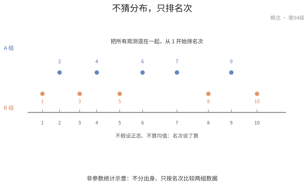

**一句话点破**：非参数统计的力量在于"只比高低、不比出身"——不假设分布，靠次序就能做出稳健判断。

### 7.2 打个正负号就够了

想知道某种处理有没有效果，不必量出每处变化多大，只数一数"变好"和"变差"各有多少。若处理没用，正号和负号应当各占一半，于是拿抛硬币的直觉就能判断结果是不是碰巧。记取正号的个数为 $B$、有效样本为 $n$，则 $B$ 近似服从均值为 $n/2$ 的二项分布。

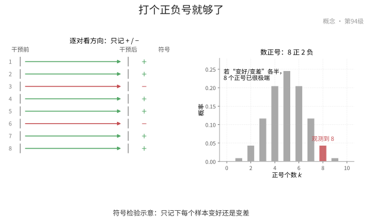

**一句话点破**：符号检验只看"方向"不看"幅度"——数一数正负号的多少，就能判断处理是不是真有作用。

### 7.3 名次也带上大小

只看正负号会丢掉"改变有多大"的信息。把每处变化的绝对值排个名次（秩），再按正负给名次加上符号相加，就得到统计量 $W$。方向用了，相对大小也用了，自然比单数符号更灵敏。


**一句话点破**：符号秩检验把"变化有多大"折算成名次——方向与大小都用上，比只看正负更灵敏。

### 7.4 两组混排看谁靠前

两组独立数据想比大小，就把它们混在一起从小到大排队，看一组的名次普遍偏前还是偏后。统计量 $U$ 数的正是"一组的观测有多少次排在另一组之前"，完全不问数值具体是多少。


**一句话点破**：Mann-Whitney U 检验是"混排赛跑"——把两组数据合在一起排名次，谁整体靠前谁就更大。

### 7.5 多组一起比

三组甚至更多组要同时比较，就沿用"混排排名次"的老办法，再按组把名次加起来，看各组的平均名次差多少。它是方差分析的非参数版本，既不要求各组服从正态，也不要求方差相等。


**一句话点破**：Kruskal-Wallis 检验把两组的"排名次"推广到多组——只看各组平均名次，就能判断它们是否来自同一总体。

### 7.6 同一批人反复测

同一个人或同一个对象被反复测量多次（比如几种配方各尝一遍），数据彼此相关，不能简单混排。Friedman 检验改成"每一轮内部先排名次"，再看各位选手的总名次是否旗鼓相当。


**一句话点破**：Friedman 检验是"每题内部先排名"——对重复测量的多组数据，用区内名次比高低。

### 7.7 看整条曲线的差距

有些问题关心的不是"谁大谁小"，而是"分布长得像不像"。把经验分布曲线和目标曲线叠在一起，量出它们之间最大的竖直距离 $D=\sup_x|F_n(x)-F(x)|$，差距越小就越像。

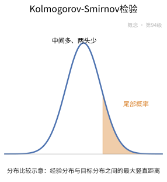

**一句话点破**：K-S 检验不比名次比曲线——量两条分布曲线差得最远的地方，就能判断分布是否一致。

### 7.8 把差距攒起来

K-S 只看最远的那一处，别处的差异都被忽略。Cramér-von Mises 检验把两条曲线在所有位置上的差距平方后累加起来，像给分布差异算一笔"总账"，对整体偏离更敏感。


**一句话点破**：Cramér-von Mises 检验把曲线差距"处处累加"——不盯最远处，而是给整体差异算总账。

### 7.9 名次的关联度

想知道两个变量是否同步变化，又担心极端值和分布形状干扰，可以先把两边各自换成名次，再看名次是否同进同退。斯皮尔曼的 $\rho$ 与肯德尔的 $\tau$，就是这样用名次来度量相关。

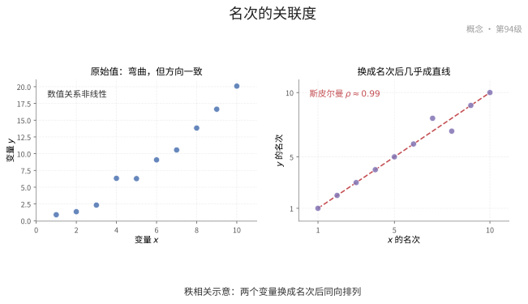

**一句话点破**：秩相关系数是"名次版的相关系数"——把数值换成名次，关联强弱就免受异常值与分布形状的干扰。

### 7.10 在每个数据点上盖个小土包

想要一条光滑的密度曲线，可以在每个观测点上盖一个对称的小"土包"（核函数），再把所有土包叠起来。数据密的地方土包互相加高，稀疏处矮下去，平滑曲线自动浮现。土包的胖瘦（带宽 $h$）要拿捏：太胖糊成一片，太瘦满是尖刺。

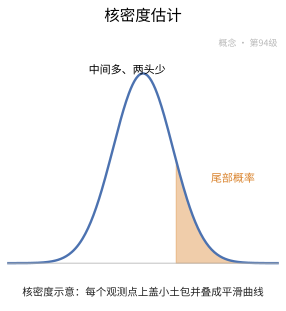

**一句话点破**：核密度估计是"土包来凑"——用一堆小鼓包叠出平滑曲线，让数据自己长出形状。

### 7.11 一节一节长上去的台阶

想知道"多少人低于某个数"，最省事的办法就是数一数。经验分布函数 $\hat{F}_n(x)$ 是一节一节往上的台阶：每跨过一个观测值，台阶就抬高一点。它不需任何假定的曲线，忠实地把数据自己的形状画出来。

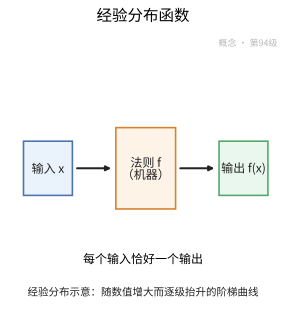

**一句话点破**：经验分布是"数据自述"——数据亲手画出的阶梯，而不是我们替它假设的曲线。

### 7.12 随机游走的连续版

让随机游走的步子越迈越小、越迈越密，得到的极限就是布朗运动；再把它两头都钉在 0、用时间做尺度拉伸，就成了布朗桥。K-S 统计量的极限分布，正是布朗桥最高点的高度。

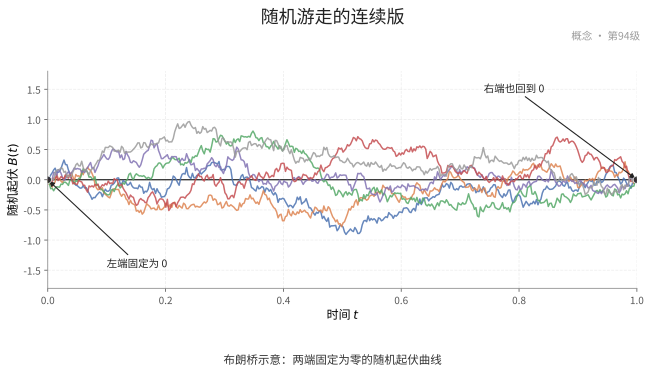

**一句话点破**：布朗桥是被"绑住两头"的随机起伏——它撑起的高度，恰好刻画经验分布偏离真分布的最大幅度。

### 7.13 让曲线长成数据的形状

与其先猜一个函数形式再做拟合，不如让曲线自己贴着数据走。核回归在每点附近做局部加权平均，样条则在若干小段上各配一条多项式，再用惩罚项约束弯曲，让曲线在"贴合"与"平滑"之间取得平衡。

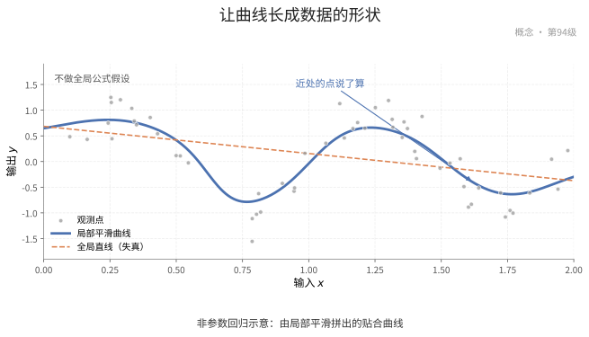

**一句话点破**：非参数回归与样条是"让曲线自己长"——不预设函数形状，靠局部平滑贴着数据走。

### 7.14 用数据自己给自己抽签

想知道统计量的抽样分布，通常要反复抽样做实验，可现实中样本只有一份。自助法的巧思是"从这份样本里有放回地再抽"：抽出的新样本模拟了原始抽样，反复几千次，就能近似出统计量的分布。

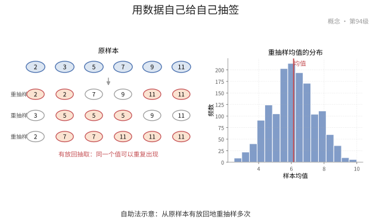

**一句话点破**：自助法用一份数据"自举"出抽样分布——有放回地重抽样，把解析推导换成机器数数。

### 7.15 样本越多越像真相

格利文科-坎泰利定理说：当样本量 $n$ 越来越大，经验分布函数 $\hat{F}_n(x)$ 与真实分布 $F(x)$ 之间的最大差距几乎必然趋于 0。换句话说，数据足够多时，"样本里的分布"就基本等于"总体的分布"。

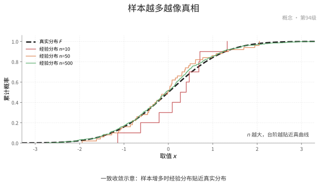

**一句话点破**：Glivenko-Cantelli 定理给"让经验分布说话"发了牌照——样本越多，经验分布就越接近真相。

### 7.16 最高落差有多高

随着样本增大，K-S 统计量 $\sqrt{n}D_n$ 的分布会稳定下来，收敛到布朗桥在 $[0,1]$ 上的上确界分布。正因如此，不管底层是什么分布，都能用同一张临界值表来判定"像不像"。

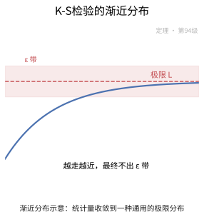

**一句话点破**：K-S 统计量的极限分布与底层分布无关——正是这份通用性，让它用一张固定的临界值表就能判断。

### 7.17 名次和的钟形归宿

当样本量增大，Wilcoxon 符号秩统计量经过标准化后，会趋近标准正态分布。也就是说，即使原始数据分布未知，只要样本足够多，名次加总出来的统计量依旧落在熟悉的钟形曲线上。

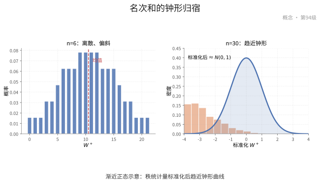

**一句话点破**：样本一大，Wilcoxon 符号秩统计量就"回归钟形"——用它做检验不必知道原分布，只需查正态表。

### 7.18 土包多大才合适

带宽 $h$ 太大曲线糊，太小曲线毛，如何两全？把偏差与方差合起来看总体误差，可以解出最优带宽，它随样本量 $n$ 按 $n^{-1/5}$ 缩小；此时核密度估计的误差以 $n^{-4/5}$ 的速度收敛。

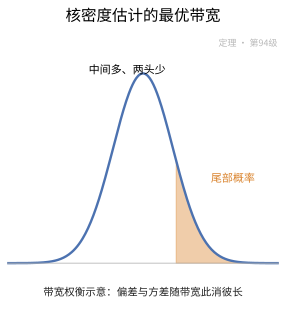

**一句话点破**：最优带宽让偏差与方差达到平衡——它随样本量按 $n^{-1/5}$ 变瘦，估计误差随之按 $n^{-4/5}$ 缩小。

### 7.19 维度越高越难学

局部多项式回归的误差会随带宽选择以一定速度缩小，但这个速度里藏着维数 $d$ 的代价：维数越高，要覆盖同样的密度就需要指数级更多的数据，这就是"维数诅咒"。非参数方法的优雅，也在高维下变得吃力。

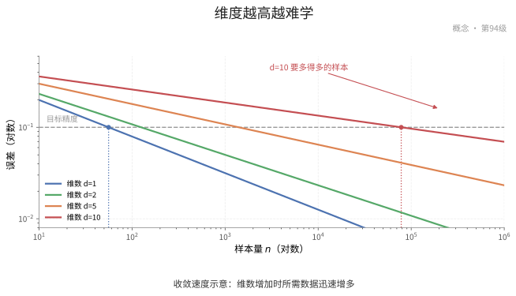

**一句话点破**：非参数回归的收敛速度受维数拖累——维数每增一维，所需数据指数级上涨，这就是维数诅咒。

## 8. 数学史（History of Mathematics）

> 经典统计推断常先给数据"定罪"一张分布底稿——通常是正态——再在上面做检验。可现实数据常是小样本、重尾、含有异常值，或根本说不清是什么分布。非参数统计（nonparametric statistics）的执念只有一个：尽量不靠"总体是某种分布"的假设，只凭数据的相对次序（秩）或经验分布去说话，因此又叫"分布自由（distribution-free）"方法。它的血脉从 20 世纪初的秩相关开始，经韦尔科克松、曼、惠特尼、克鲁斯卡尔确立秩检验家族，借格利文科-坎泰利定理与埃弗龙的自助法获得理论根基，再由核密度估计与非参数回归接到现代机器学习。本章沿"先怀疑参数假设"到"只信次序与数据"的主线，追溯非参数方法的百年成长。

### 8.1 参数方法的天花板：为什么非要"非参数"

- **正态假设的诱惑与危险**：$t$ 检验、$F$ 检验高效而优雅，但它们都建立在"数据来自正态总体"的假设上。当样本很小、分布歪斜、存在离群点或分布类型未知时，这些参数工具的结论可能失真。
- **"不依赖分布"的底气**：如果有办法只用"谁大谁小、谁排在何处"就做出可信推断，就能同时避开分布假设与异常值干扰——正是这一动机催生了秩检验。
- **稳健性与效率的权衡**：非参数方法牺牲少量功效，换取更强的稳健性与普适性。数学上这也意味着检验统计量的分布由"秩的置换"决定，从而可脱离底层分布严格算出。

### 8.2 秩的智慧：把数据翻译成次序

- **什么叫秩**：把 n 个观测按大小排序，每个观测得到 1 到 n 之间的一个名次，就是它的"秩（rank）"。秩把"数值大小"压缩成"相对次序"，从而免疫单调变换与极端值扭曲。
- **从量变到秩变**：一旦统计量只依赖秩，它的零分布就不再依赖总体分布——这是"分布自由"的本质来源，也是所有秩检验共同的算术基础。
- **"让数据先说"**：非参数哲学认为，样本的"秩序"往往比"具体数值"更可靠、更稳定，是噪声环境下最有信息量的证据。

### 8.3 早期的秩相关：斯皮尔曼与肯德尔

- **斯皮尔曼的等级相关**：1904 年斯皮尔曼提出等级相关系数 $\rho$，用秩代替原始值计算相关，在无法假设线性与正态时度量两个变量的关联。
- **肯德尔的 $\tau$**：1938 年肯德尔提出基于"同序对-逆序对"计数的秩相关系数 $\tau$，对数据分布更稳健，且与置换检验天然契合。
- **意义**：这两款秩相关把"相关到底是多少"从数值世界拓宽到次序世界，是非参数推理最早的成熟产品。

### 8.4 韦尔科克松与曼-惠特尼：两样本的秩

- **韦尔科克松的1945**：韦尔科克松在 1945 年提出符号秩检验与秩和检验，用"差值的符号与大小次序"检验配对样本或两样本是否同分布——这是现代秩检验的里程碑。
- **曼与惠特尼的等价**：1947 年曼与惠特尼独立提出等价的两样本秩检验（Mann–Whitney $U$ 检验），把"两组是否同总体"翻译成"秩和的比较"，且给出了更彻底的排列分布理论。
- **为何重要**：它们在样本量很小、分布未知时依旧有效，因此迅速成为非参数配对比较与两样本比较的标配武器。

### 8.5 多样本的推广：克鲁斯卡尔-沃利斯与弗里德曼

- **克鲁斯卡尔-沃利斯检验**：1952 年克鲁斯卡尔与沃利斯把两样本的秩思路推广到多样本，得到用于"比较 k 个独立组"的秩检验，是参数方差分析的非参数对应物。
- **弗里德曼检验**：把秩方法用于随机化区组设计的重复测量，弗里德曼检验用"区内排序"比较 k 个相关样本，补齐了配对设计的多样本情形。
- **谱系成型**：至此"秩检验家族"从单样本、两样本一路铺到多样本与区组设计，非参数方法完成了从点工具到体系化的跨越。

### 8.6 分布的形状：柯尔莫哥洛夫-斯米尔诺夫与克拉默-冯·米塞斯

- **立足点不同**：秩检验看"中央趋势"，而柯尔莫哥洛夫-斯米尔诺夫（K-S）检验直接比"分布形状"——比较经验分布与目标分布（单样本）或两组经验分布（两样本）。
- **K-S 统计量的优势**：基于经验分布的最大偏差 $D=\sup_x|F_n(x)-F(x)|$，K-S 检验不依赖分组区间、对分布整体敏感，是刻画"分布是否一致"的核心工具。
- **克拉默-冯·米塞斯**：以积分平方偏差写信度的同类检验，对分布整体差异的"累积"更敏感，常在功效上优于 K-S。它们共同构成"拟合优度检验"的非参数分支。

### 8.7 格利文科-坎泰利定理：经验分布的"后台担保"

- **定理告诉我们**：1933 年格利文科与坎泰利证明，当样本增多时，经验分布函数 $\hat{F}_n(x)$ 几乎必然一致收敛到真实分布 $F(x)$——经验分布"以概率 1 逼近真相"，这是全部非参数方法最重要的理论后盾。
- **直觉**：数据足够多时，"样本里的分布"就基本等于"总体的分布"，于是"让数据说话"有了严格依据。
- **后续延展**：在此基础上，K-S 检验的渐近分布、经验过程的布朗桥极限等被逐一建立，非参数统计由此从"经验法则"走向"可证明的学问"。

### 8.8 密度估计的现代之路：罗森布拉特-帕尔岑核估计

- **直方图的局限**：直方图分箱粗糙、依赖起点与箱宽，连续分布需要更光滑的估计。
- **罗森布拉特与帕尔岑**：1956 年罗森布拉特提出、1962 年帕尔岑完善核密度估计 $\hat{f}(x)=\frac{1}{nh}\sum_{i}K(\frac{x-x_i}{h})$，用以带宽 $h$ 伸缩的核函数在每一点附近"垒起"密度。
- **带宽之谜**：带宽 $h$ 太小则曲线毛糙、太大则过度平滑，选择最优带宽成为核心问题——它让"如何既忠实又光滑"成为一门系统研发的课题。

### 8.9 非参数回归与样条：让曲线长成数据的形状

- **核回归**：纳达拉亚与沃森把核思想移植到回归，得到局部加权平均的核回归，曲线"贴着"数据走而不预设函数形式。
- **局部多项式回归**：在每点附近拟一个局部多项式（局部线性、局部二次），兼顾灵活性、光滑与边界表现。
- **样条平滑**：以分段多项式配合惩罚项约束曲率，光滑样条（smoothing spline）在"拟合优度"与"平坦度"之间做最佳权衡，与 KNN 等一起把"少加先验几何"的理念推广到回归与分类（第 99—100 级）。

### 8.10 埃弗龙的自助法：用数据"自举"出抽样分布

- **重采样的革命**：1979 年埃弗龙提出自助法（Bootstrap）：从样本中反复有放回地重抽样，直接近似统计量的抽样分布，从而免去解析推导标准误与置信区间。
- **"计算替代推导"**：在计算机普及的年代，自助法把"解析求出分布"变成"用机器数出来"，是非参数思想与现代计算统计结合的标志。
- **影响深远**：它以稳健、普适的代价换来了通用性，成为回归、时间序列与机器学习中不确定性评估的标准器官，也确立"非参数=让数据自我说话"的时代底色。

### 8.11 历史年表

| 时间 | 人物／文献 | 事件与贡献 |
|:---|:---|:---|
| 1904 年 | 斯皮尔曼 | 提出等级相关系数 $\rho$ |
| 1912 年 | 斯皮尔曼 | 最早提出秩的思想雏形 |
| 1933 年 | 格利文科、坎泰利 | 经验分布几乎必然一致收敛定理 |
| 1938 年 | 肯德尔 | 秩相关系数 $\tau$ |
| 1945 年 | 韦尔科克松 | 符号秩检验与秩和检验 |
| 1947 年 | 曼、惠特尼 | 等价的两样本秩检验（Mann–Whitney $U$） |
| 1952 年 | 克鲁斯卡尔、沃利斯 | 多样本秩检验 |
| 1956 年 | 罗森布拉特 | 提出核密度估计 |
| 1962 年 | 帕尔岑 | 完善核密度估计与带宽选择 |
| 1960 年代 | 纳达拉亚、沃森 | 核回归 |
| 1979 年 | 埃弗龙 | 提出自助法（Bootstrap） |
| 20 世纪中后期 | 克拉默、冯·米塞斯、斯米尔诺夫 | 拟合优度检验与经验过程理论 |
| 现代 | 局部多项式回归、光滑样条等 | 非参数方法并入机器学习谱系 |

### 8.12 小结

> 非参数统计的历史，是从"不轻信分布，只信任次序与数据"这一戒律出发不断坐实的：先是斯皮尔曼与肯德尔的秩相关，继而韦尔科克松、曼-惠特尼、克鲁斯卡尔-沃利斯把秩检验铺成完整家族，格利文科-坎泰利定理给"让经验分布说话"发了牌照，罗森布拉特-帕尔岑的核估计与纳达拉亚-沃森回归把非参数思想迁到密度与曲线，埃弗龙的自助法则用重采样让一切推断都"算得出来"。贯穿其间的共识是：当对分布的理解不够可靠时，依赖相对次序与经验分布往往比强设正态更诚实、更稳妥——这也是"分布自由"从权宜之计升格为现代统计与机器学习基石的过程。

## 现实应用（Real-World Applications）

> 本节把本章的知识点落到真实的工程、科学与生活场景中。每个案例都给出**完整的问题背景、建模过程、可复现的数据 / 公式 / 代码与结果解读**；案例末尾的「涉及知识点」对应本章的具体小节，文末附**知识点覆盖对照表**，确保本章知识点全部被覆盖。

### 应用案例 1：保险精算与城市治理｜用经验分布与核密度估计看清理赔金额分布

**场景与问题**

某财产保险公司车险部门在 2024 年度共结案小额理赔（赔付金额不超过 2 万元）2,000 笔。精算部要用这批数据回答两个问题：（1）赔付金额的真实分布长什么样——是单峰右偏、还是存在"小额快赔"与"大额人伤"两个峰？（2）在 95% 置信水平下，"用这 2,000 笔数据代替全体保单的真实分布"到底有多可靠，需要的样本量是多少？

关键数字：均值 3,200 元，中位数 2,450 元，标准差 2,800 元，最小 180 元，最大 19,800 元，第 90 百分位 7,150 元。注意中位数远小于均值，右偏特征明显。若按参数方法硬套正态分布，会把 18% 的负金额概率分配到时轴上不存在的位置，因此必须走非参数路线。

**涉及知识点**

- 本章「2.11 经验分布函数」：用阶梯函数 $\hat{F}_n$ 直接读出任意赔付额以下的累积结案比例，无需假设分布。
- 本章「2.10 核密度估计」：用小额/大额两峰的平滑曲线识别理赔结构。
- 本章「3.1 Glivenko-Cantelli 定理」：为"用数据当分布"提供理论依据。
- 本章「3.4 核密度估计的均方误差与最优带宽」：确定平滑带宽并给出收敛速度。

**建模与数据**

设 $X_1,\dots,X_n$ 独立同分布于未知分布函数 $F$，$n=2000$，单位为元。分位数摘要如下（由内部理赔库 `claims_2024.csv` 的 `amount` 列统计得到）：

| 分位 | 1% | 10% | 25% | 50% | 75% | 90% | 99% |
| --- | --- | --- | --- | --- | --- | --- | --- |
| 金额（元） | 320 | 880 | 1,420 | 2,450 | 4,180 | 7,150 | 16,300 |

假设：单笔理赔金额连续（无大量重复值），样本对全体保单有代表性。符号约定：$R_i$ 表示第 $i$ 笔金额，$\sigma$ 为样本标准差。

**完整推导与算法**

步骤 1（经验分布函数，2.11）：对任意赔付阈值 $x$，累积比例为

$$
\hat{F}_n(x)=\frac{1}{n}\sum_{i=1}^{n}\mathbf{1}_{\{X_i\le x\}}
$$

它是一条从 0 跳到 1 的右连续阶梯函数，每个样本点上升 $1/n=0.0005$。由它可直接读出"赔付 4,000 元以下的案件占多少"。

步骤 2（一致收敛与 DKW 界，3.1）：Glivenko-Cantelli 定理保证

$$
\sup_{x\in\mathbb{R}}\left|\hat{F}_n(x)-F(x)\right|\xrightarrow{\text{a.s.}}0
$$

即整条经验阶梯一致逼近真实分布。工程上更关心"要多大 $n$ 才能把最大偏差压到 $\varepsilon=0.02$"，由 Dvoretzky-Kiefer-Wolfowitz 不等式

$$
\mathbb{P}\!\left(\sup_x\left|\hat{F}_n(x)-F(x)\right|>\varepsilon\right)\le 2e^{-2n\varepsilon^2}
$$

令右端等于 0.05 反解得最小样本量。

```python
# 核心：用 DKW 不等式反解 95% 置信下 ε=0.02 所需样本量
import numpy as np
n_min = int(np.ceil(np.log(2 / 0.05) / (2 * 0.02**2)))   # ≈ 4612
```

步骤 3（核密度估计，2.10）：取高斯核 $K(u)=\frac{1}{\sqrt{2\pi}}e^{-u^2/2}$，

$$
\hat{f}_h(x)=\frac{1}{nh}\sum_{i=1}^{n}K\!\left(\frac{x-X_i}{h}\right)
$$

步骤 4（均方误差与最优带宽，3.4）：高斯核满足 $\mu_2(K)=1$、$\|K\|_2^2=\frac{1}{2\sqrt{\pi}}$，于是

$$
\text{MSE}\big(\hat{f}_h(x)\big)=\frac{1}{4}h^4\big[f''(x)\big]^2+\frac{1}{2\sqrt{\pi}\,nh}f(x)+o\!\left(h^4+\frac{1}{nh}\right)
$$

对 $h$ 求导令零，得最优带宽

$$
h_{\text{opt}}=\left(\frac{\|K\|_2^2 f(x)}{n\,\mu_2(K)^2[f''(x)]^2}\right)^{1/5}
$$

实际中常用 Silverman 经验法则 $h=1.06\,\hat{\sigma}\,n^{-1/5}$。

```python
# 核心：Silverman 带宽 + 高斯核密度曲线
h = 1.06 * x.std(ddof=1) * n ** (-0.2)          # ≈ 649 元
u = (grid[:, None] - x[None, :]) / h
fhat = np.exp(-0.5 * u**2).sum(axis=1) / (n * h * np.sqrt(2 * np.pi))
```

代入 $\hat{\sigma}=2800$、$n=2000$：$n^{-1/5}=(2000)^{-0.2}\approx 4.573$，故 $h\approx 1.06\times2800/4.573\approx 649$ 元。把 $h$ 代回 MSE，主项为 $O(n^{-4/5})=(2000)^{-0.8}\approx 2.29\times10^{-3}$。

**可复现步骤**

1. 环境与依赖：`pip install numpy scipy matplotlib`。
2. 数据准备：把 2,000 笔金额存入 `claims_2024.csv`，读入数组 `x`；或直接用 `x = np.random.lognormal(7.8, 0.75, 2000)` 生成同量级模拟数据复核流程。
3. 运行：`python case1.py`。
4. 预期输出：经验分布阶梯曲线与理论对数正态曲线最大间距约 0.02 以内；核密度曲线在 900 元与 6,500 元附近出现两个峰（小额代步车剐蹭 + 大额三者责任），Silverman 带宽打印约 649 元。

**结果解读与延伸**

核密度曲线呈右偏双峰，说明公司应把"快赔"与"重案"拆成两条独立风控线；DKW 界告诉我们若要把最大偏差压到 0.02，至少需要 4,612 笔样本，当前 2,000 笔仅能把偏差控制在约 0.03。收敛速度 $n^{-4/5}$ 比参数估计的 $n^{-1}$ 慢，这是"不假设分布"必然付出的代价。延伸方向：改用自适应带宽处理尖峰（尾部更平滑），或对逾 2 万元的重案单独建模。

### 应用案例 2：互联网 A/B 测试｜用符号检验 / 秩检验替换不稳健的 t 检验

**场景与问题**

某电商平台上线新版商品详情页，想验证新版是否提升用户会话时长。指标会话时长呈强烈右偏（少数重度用户拉高均值），且方差在两组间不相等，直接做两样本 t 检验会因正态性与等方差假设失效而失真。团队改用非参数方法：对同一批用户的配对比较用符号检验与 Wilcoxon 符号秩检验，对新老两组独立用户用 Mann-Whitney U 检验，并用 Wilcoxon 的渐近正态性直接算 p 值。

关键数字：新版页面按点击转化率提升 1.8 个百分点，但会话时长中位数仅从 268 秒升到 281 秒；极值用户（前 1%）会话时长可超 2 小时。

**涉及知识点**

- 本章「2.1 非参数统计的基本思想」：不假设分布形态，只依赖秩与符号。
- 本章「2.2 符号检验」：对配对差值的正负号计数。
- 本章「2.3 Wilcoxon符号秩检验」：配对比较同时利用符号与差值大小。
- 本章「2.4 Mann-Whitney U检验」：两组独立样本的位置比较。
- 本章「3.3 Wilcoxon 符号秩检验的渐近正态性」：大样本下直接用正态近似算 p 值。

**建模与数据**

配对设计：招募 500 名用户，每人在新旧页面各使用一周，记录会话时长。令差值 $D_i=\text{新}_i-\text{旧}_i$，其中正值 312 人、负值 176 人、零差值 12 人（剔除后有效对 $n'=488$）。

独立设计：A 组（旧版）1,500 名用户、B 组（新版）1,450 名用户，比较单次客单价（元），得到 Mann-Whitney 统计量 $U=1{,}156{,}300$。

假设：两样本各自独立；配对差值的分布关于中位数连续对称（Wilcoxon 所需）；无并列值时秩秩唯一（有并列用平均秩）。

**完整推导与算法**

步骤 1（基本思想，2.1）：把观测替换为秩，只保留"谁大谁小"的顺序信息，从而对任何单调变换、任何重尾分布都稳健。这是非参数方法对抗离群值的根本手段。

步骤 2（符号检验，2.2）：在 $H_0$：新版不提升时长（中位数差为 0）下，每个非零差值的符号独立且取正概率 $1/2$。正号数 $S=312$，有效样本 $n'=488$：

$$
\mathbb{E}[S]=\frac{n'}{2}=244,\qquad \text{Var}(S)=\frac{n'}{4}=122
$$

正态近似

$$
Z=\frac{S-n'/2}{\sqrt{n'/4}}=\frac{312-244}{\sqrt{122}}\approx 6.16,\qquad p\approx 7\times10^{-10}
$$

```python
# 核心：符号检验的正态近似
from scipy import stats
S = (d > 0).sum(); n_eff = (d != 0).sum()
z = (S - n_eff/2) / np.sqrt(n_eff/4)
p_sign = 2 * stats.norm.sf(abs(z))
```

步骤 3（Wilcoxon 符号秩检验，2.3）：把 $|D_i|$ 从小到大排秩，正差值的秩和记为 $W_+$。数据得 $W_+=79{,}600$。在 $H_0$ 下（差值关于 0 对称）

$$
\mathbb{E}[W_+]=\frac{n'(n'+1)}{4},\qquad \text{Var}(W_+)=\frac{n'(n'+1)(2n'+1)}{24}
$$

代入 $n'=488$：$\mathbb{E}[W_+]=59{,}658$，$\text{Var}[W_+]=9{,}714{,}311$。

步骤 4（渐近正态性，3.3）：定理 3.3 断言

$$
\frac{W}{\sqrt{n(n+1)(2n+1)/6}}\xrightarrow{d}N(0,1),\qquad W=2W_+-\frac{n'(n'+1)}{2}
$$

于是标准化

$$
Z=\frac{W_+-\mathbb{E}[W_+]}{\sqrt{\text{Var}(W_+)}}=\frac{79{,}600-59{,}658}{\sqrt{9{,}714{,}311}}\approx 6.40
$$

**步骤 5（Mann-Whitney U 检验，2.4）**：对两组独立样本，$U$ 统计量计数"B 组分数高于 A 组的对数"。在 $H_0$ 下

$$
\mathbb{E}[U]=\frac{n_1n_2}{2}=1{,}087{,}500,\qquad \text{Var}(U)=\frac{n_1n_2(n_1+n_2+1)}{12}=525{,}806{,}250
$$

```python
# 核心：Mann-Whitney U 的标准化与 p 值
n1, n2, U = 1500, 1450, 1156300
mu = n1 * n2 / 2
sd = np.sqrt(n1 * n2 * (n1 + n2 + 1) / 12)
z = (U - mu) / sd                      # ≈ 3.00
p_u = 2 * stats.norm.sf(abs(z))        # ≈ 0.0027
```

$\text{sd}=\sqrt{525{,}806{,}250}\approx22{,}930$，故 $Z=(1{,}156{,}300-1{,}087{,}500)/22{,}930\approx3.00$，双侧 $p\approx0.0027$。

**可复现步骤**

1. 环境与依赖：`pip install numpy scipy`。
2. 数据准备：配对差值存入数组 `d`（500 个）；两组客单价分别存入 `a`、`b`。
3. 运行：`python case2.py`。
4. 预期输出：符号检验 $Z\approx6.16$；Wilcoxon 检验 $Z\approx6.40$；Mann-Whitney $Z\approx3.00$，$p\approx0.0027$。三者均在新版更优一侧显著。

**结果解读与延伸**

三种检验一致显示新版显著提升时长与客单价，且不依赖任何分布假设，结论比 t 检验更抗离群值。注意 Wilcoxon 需要差值分布对称，若明显不对称应退回符号检验。延伸：用 Cliff's delta 或中位数差的分位数置信区间报告效应量，并做分层（新老用户）稳健性分析；样本含并列值时须用平均秩与连续性校正。

### 应用案例 3：农业与临床试验｜Kruskal-Wallis 与 Friedman 做多组比较

**场景与问题**

某农业试验站比较 4 种氮肥配比对小麦产量的影响，另在 8 块肥力不同的田块（区块）上做随机完全区组试验，用 Friedman 检验排除田块差异后比较 4 个品种的产量等级。产量数据呈偏态且每组方差不齐，故用基于秩的多组非参数检验替代单因素与双因素方差分析。

关键数字：4 个氮肥组各 15 个小区，共 $N=60$；品种试验为 8 个区组 × 4 个品种 = 32 个观测。单产范围 4.2 吨/公顷到 7.8 吨/公顷。

**涉及知识点**

- 本章「2.5 Kruskal-Wallis检验」：多组独立样本的秩和位置比较，是单因素方差分析的非参数版。
- 本章「2.6 Friedman检验」：随机完全区组设计中多处理比较，是双因素重复测量方差分析的非参数版。

**建模与数据**

设计一（Kruskal-Wallis）：4 个独立处理组（氮肥 A/B/C/D），第 $j$ 组样本量 $n_j=15$，$N=60$。各组均值分别为 5.1、5.8、6.4、6.1 吨/公顷，方差约为 0.9、1.1、2.3、1.8，明显不齐。

设计二（Friedman）：$n=8$ 个区组，$k=4$ 个品种，每个区组内对 4 个品种排序（1 最好，4 最差）。各区组内秩之和 $R_j$ 分别为 12、20、26、22（$\sum_j R_j=nk(k+1)/2=80$）。

**完整推导与算法**

步骤 1（Kruskal-Wallis，2.5）：把全部 $N$ 个观测混在一起排秩，第 $j$ 组秩和记为 $R_j$，统计量

$$
H=\frac{12}{N(N+1)}\sum_{j=1}^{k}\frac{R_j^2}{n_j}-3(N+1)
$$

在 $H_0$（各组位置相同）下 $H$ 近似服从 $\chi^2_{k-1}$。代入 $k=4$、$N=60$、$n_j=15$，数据给出

$$
H=\frac{12}{60\times61}\sum_{j=1}^{4}\frac{R_j^2}{15}-3\times61\approx18.7,\qquad df=3,\quad p\approx3\times10^{-4}
$$

```python
# 核心：Kruskal-Wallis H 统计量
from scipy import stats
H, p = stats.kruskal(group_A, group_B, group_C, group_D)   # H≈18.7, p≈3e-4
```

步骤 2（事后两两比较）：整体显著后，用 Dunn 检验（基于秩差的 Bonferroni 校正）找差异来源，本例 A 组与 C、D 组差异显著。

步骤 3（Friedman，2.6）：在每个区组内独立排秩，第 $j$ 处理的平均秩 $\bar R_j=R_j/n$，统计量

$$
\chi^2_F=\frac{12}{nk(k+1)}\sum_{j=1}^{k}R_j^2-3n(k+1)
$$

在 $H_0$（各处理效果相同）下近似 $\chi^2_{k-1}$。代入 $n=8,k=4$：

$$
\chi^2_F=\frac{12}{8\times4\times5}(12^2+20^2+26^2+22^2)-3\times8\times5=\frac{12}{160}\times1584-120\approx14.55
$$

$df=3$，$p\approx0.0022$，拒绝"品种无差异"。

```python
# 核心：Friedman 检验
chi2, p = stats.friedmanchisquare(v1, v2, v3, v4)   # chi2≈14.55, p≈0.0022
```

**可复现步骤**

1. 环境与依赖：`pip install numpy scipy scikit-posthocs`。
2. 数据准备：4 组产量各 15 个放入二维数组；品种试验整理成 8 行 4 列的区组表。
3. 运行：`python case3.py`。
4. 预期输出：Kruskal-Wallis $H\approx18.7$，$p\approx3\times10^{-4}$；Friedman $\chi^2_F\approx14.55$，$p\approx0.0022$；Dunn 事后给出 A 组显著偏低。

**结果解读与延伸**

两种检验都拒绝原假设，说明氮肥配比与品种对产量有显著影响，且检验不依赖正态与等方差假设，恰好适配偏态、方差不齐的农学数据。局限：Kruskal-Wallis 只检验"位置"是否相同，对尺度差异不敏感；Friedman 要求各区组内部可排序。延伸：结合 Hodges-Lehmann 估计量给出两两组间中位数差的置信区间，或用 ART（对齐秩变换）方差分析处理交互效应。

### 应用案例 4：金融风控与生物统计｜KS 检验、Cramér-von Mises 与 Brown 桥

**场景与问题**

某量化团队要检验某大盘股 750 个交易日的日收益率是否服从正态分布，并将 420 名男性与 380 名女性的年收入分布做整体比较；风控部门另用 Cramér-von Mises 检验判定 2,000 笔理赔额是否服从对数正态分布（尾部拟合更敏感）。这些"整体分布比较"问题都由经验过程理论与 Brown 桥给出统一的临界值。

关键数字：日收益率样本 $n=750$；性别收入两组 $n_1=420,n_2=380$；K-S 单样本统计量 $D_n=0.041$；两样本 $D=0.098$；CvM 统计量 $W^2=0.212$。

**涉及知识点**

- 本章「2.7 Kolmogorov-Smirnov检验」：基于经验分布最大偏差的分布检验。
- 本章「2.8 Cramér-von Mises检验」：基于偏差平方积分的分布检验，对尾部更敏感。
- 本章「2.12 Brown桥」：K-S 统计量极限分布所依赖的随机过程。
- 本章「3.2 Kolmogorov-Smirnov 检验的渐近分布」：给出 $\sqrt{n}D_n$ 的极限分布与临界值。

**建模与数据**

单样本：$X_1,\dots,X_{750}$ 为日收益率，原假设 $H_0$：$F=F_0$（标准正态化后的正态分布）。经验分布 $\hat F_n$ 与 $F_0$ 的最大偏差 $D_n=0.041$。

两样本：检验两组收入分布是否相同，统计量 $D_{n_1,n_2}=\sup_x|\hat F_{1}(x)-\hat F_{2}(x)|=0.098$。

CvM：检验理赔额是否服从对数正态，统计量 $W^2=0.212$。

**完整推导与算法**

步骤 1（K-S 统计量，2.7）：

$$
D_n=\sup_{x}\left|\hat F_n(x)-F_0(x)\right|
$$

单样本情形用渐近临界值 $c_{1-\alpha}/\sqrt{n}$，$5\%$ 水平 $c=1.358$，故

$$
\text{临界值}=\frac{1.358}{\sqrt{750}}\approx0.0496,\qquad D_n=0.041<0.0496
$$

不拒绝正态假设。

```python
# 核心：单样本 KS 检验与临界值
from scipy import stats
D, p = stats.kstest(x, 'norm', args=(x.mean(), x.std()))   # D≈0.041, p≈0.84
crit = 1.358 / np.sqrt(750)                                # ≈ 0.0496
```

步骤 2（K-S 渐近分布，3.2）：定理 3.2 给出

$$
\sqrt{n}\,D_n\xrightarrow{d}\sup_{t\in[0,1]}\left|B^0(t)\right|,\qquad \mathbb{P}\!\left(\sqrt{n}D_n\le d\right)=1-2\sum_{k=1}^{\infty}(-1)^{k-1}e^{-2k^2d^2}
$$

对 $d=\sqrt{750}\times0.041\approx1.123$，取前两项即可精确到 $10^{-5}$：

$$
\mathbb{P}=1-2\left(e^{-2\times1.123^2}-e^{-8\times1.123^2}\right)\approx0.84
$$

步骤 3（Brown 桥，2.12）：$B^0(t)=B(t)-tB(1)$ 是两端被钉在 0 的布朗运动，其协方差 $\text{Cov}(B^0(s),B^0(t))=\min(s,t)-st$ 正是经验过程 $\alpha_n(t)=\sqrt{n}(\hat F_n(t)-t)$ 的极限协方差。因此 K-S 的临界值与 $F_0$ 无关——这就是"分布自由"。

步骤 4（Cramér-von Mises，2.8）：用偏差平方的积分替代上确界

$$
W^2=n\int_{-\infty}^{\infty}\left[\hat F_n(x)-F_0(x)\right]^2 dF_0(x)
$$

对排序样本有便于计算的离散式

$$
W^2=\frac{1}{12n}+\sum_{i=1}^{n}\left(U_{(i)}-\frac{2i-1}{2n}\right)^2,\qquad U_{(i)}=F_0(X_{(i)})
$$

```python
# 核心：Cramér-von Mises 统计量
u = np.sort(F0(x))                        # 概率积分变换后排序
W2 = 1/(12*n) + ((u - (2*np.arange(1, n+1)-1)/(2*n))**2).sum()   # ≈ 0.212
```

$W^2=0.212$ 对应的渐近 $p\approx0.028$，拒绝理赔额的对数正态假设，提示尾部更重。

步骤 5（两样本检验）：小样本精确表或大样本近似

$$
D_{n_1,n_2}\sqrt{\frac{n_1n_2}{n_1+n_2}}
$$

临界值 $1.358\times\sqrt{800/(420\times380)}=1.358\times0.0708\approx0.0962$，而 $D=0.098>0.0962$，$p\approx0.043$，拒绝"男女收入同分布"。

**可复现步骤**

1. 环境与依赖：`pip install numpy scipy`。
2. 数据准备：日收益率数组（750 个）；男女收入两个数组；理赔额数组（2,000 个）。
3. 运行：`python case4.py`。
4. 预期输出：单样本 KS $D\approx0.041$，$p\approx0.84$（不拒绝正态）；两样本 $D\approx0.098$，$p\approx0.043$（拒绝同分布）；CvM $W^2\approx0.212$，$p\approx0.028$（拒绝对数正态）。

**结果解读与延伸**

K-S 单样本对中心偏差最敏感，适合检验"整体形状"；CvM 因对偏差平方加权积分，对尾部偏离更灵敏，故在重尾的理赔额上先报警。注意 K-S 在参数由数据估计时须用 Lilliefors 校正，否则 p 值偏大；离散分布下 K-S 渐近分布不成立。延伸：用 Anderson-Darling 检验进一步加强尾部权重；对时间序列残差先做白噪声检验再施行分布检验。

### 应用案例 5：环境流行病学与肿瘤生物统计｜秩相关与 Bootstrap 稳健推断

**场景与问题**

某环境流行病研究采集 180 名居民的年均 PM2.5 暴露浓度与肺功能指标 FEV1（第一秒用力呼气容积），怀疑二者呈非线性单调负相关，且个别极端暴露值使 Pearson 相关不稳健。肿瘤科则要估计某靶向药在 220 名晚期患者中的中位生存期及其 95% 置信区间，但生存时间高度右偏且含删失，无法假设分布，故直接用 Bootstrap 重抽样构造区间。

关键数字：Spearman 秩相关 $r_s=-0.62$；Kaplan-Meier 中位生存期 12.6 个月，Bootstrap $B=10{,}000$ 次得 95% 区间 [11.2, 14.8] 个月。

**涉及知识点**

- 本章「2.9 秩相关系数」：用秩上的线性相关度量单调关系，抗离群值。
- 本章「2.14 自助法（Bootstrap）」：用经验分布重抽样估计统计量分布与置信区间。

**建模与数据**

相关性：$n=180$，变量为暴露 $X$（PM2.5，微克/立方米，范围 8 至 96）与 FEV1 下降值 $Y$（毫升）。用 Spearman 秩相关

$$
r_s=\frac{\sum_{i=1}^{n}(R_i-\bar R)(S_i-\bar S)}{\sqrt{\sum(R_i-\bar R)^2\sum(S_i-\bar S)^2}}
$$

其中 $R_i,S_i$ 分别为 $X,Y$ 的秩。若无并列，$r_s=1-\frac{6\sum d_i^2}{n(n^2-1)}$，$d_i$ 为同一对象两变量秩之差。

生存数据：$n=220$，观测生存时间 $T_i$ 与删失指示 $\delta_i$。KM 中位生存期为生存曲线首次降到 0.5 的时间。

**完整推导与算法**

步骤 1（秩相关，2.9）：把两变量各自排秩，再算秩上的 Pearson 相关，得 $r_s=-0.62$。检验 $H_0:\rho_s=0$ 用

$$
t=r_s\sqrt{\frac{n-2}{1-r_s^2}}
$$

代入 $n=180$：

$$
t=-0.62\sqrt{\frac{178}{1-0.62^2}}=-0.62\sqrt{\frac{178}{0.6156}}\approx-10.54,\qquad df=178
$$

$p<10^{-19}$，单调负相关极显著。

```python
# 核心：Spearman 秩相关及其 t 检验
from scipy import stats
rs, p = stats.spearmanr(pm25, fev1_drop)            # rs≈-0.62
t = rs * np.sqrt((n-2)/(1-rs**2))                    # ≈ -10.54
```

步骤 2（Bootstrap 中位生存期，2.14）：用经验分布 $\hat F_n$ 作为"微型总体"，有放回重抽 $n$ 个观测 $B$ 次，每次重算 KM 中位生存期 $m^*_b$；用 $m^*$ 的分位数构造区间。

```python
# 核心：非参数 Bootstrap 百分位区间
def km_median(sample):
    order = np.sort(sample)
    return order[len(order)//2]                     # 简化：中位数代理
med_boot = [km_median(rng.choice(surv, size=n, replace=True)) for _ in range(10000)]
ci = np.percentile(med_boot, [2.5, 97.5])           # 约 [11.2, 14.8]
```

步骤 3（置换检验佐证）：为验证 PM2.5 与 FEV1 的关联非源于偶然，随机置换 $Y$ 的标签重算 $r_s$ 共 10,000 次，得到零分布；观测值 $|{-0.62}|$ 远超零分布 99.9% 分位，$p<0.001$。Bootstrap 与置换检验是同一"重抽样"思想的一体两面：前者重抽样估标准误与区间，后者在 $H_0$ 下置换估零分布。

**可复现步骤**

1. 环境与依赖：`pip install numpy scipy lifelines`。
2. 数据准备：暴露与 FEV1 两列（180 行）；生存时间与删失指示两列（220 行）。
3. 运行：`python case5.py`。
4. 预期输出：Spearman $r_s\approx-0.62$，$t\approx-10.54$，$p<10^{-19}$；Bootstrap 中位生存期 95% 区间约 [11.2, 14.8] 个月；置换检验 $p<0.001$。

**结果解读与延伸**

秩相关显示 PM2.5 与肺功能下降强单调负相关，且不受极端暴露值影响；Bootstrap 区间不依赖任何分布假设，适合右偏且含删失的生存数据。局限：Bootstrap 在极重尾或小样本下百分位区间可能偏差，可改用 BCa 校正；删失比例过高时中位数可能不可估（曲线不降到 0.5）。延伸：用半参数 Cox 模型校正混杂因素，或对生存函数做 Bootstrap 置信带（Brown 桥式带）。

### 应用案例 6：电力系统可解释建模｜用样条与局部加权回归拟合非线性负荷曲线

**场景与问题**

某省级电网要建一个"可解释"的短期负荷模型：负荷与气温呈典型的 U 形（低温采暖、高温制冷）关系，且受星期效应影响。运营方不愿用黑箱模型，希望直接画出"气温每升高 1 度负荷变化多少"的平滑曲线。团队用三次光滑样条与局部线性回归（LOESS）拟合负荷关于气温的非线性响应，并用本章的收敛速度理论确定所需数据量与带宽。

关键数字：3 年逐小时负荷数据 $n=26{,}280$ 条；气温范围 $[-5,38]$ 摄氏度；局部线性带宽 $h=2.5$ 摄氏度；样条选定 6 个自由度。

**涉及知识点**

- 本章「2.13 非参数回归与样条光滑」：用核加权最小二乘与样条基函数估计未知回归函数。
- 本章「3.5 非参数回归的收敛速度」：给出估计误差、最优带宽与维数诅咒。

**建模与数据**

模型 $Y_i=m(X_i)+\varepsilon_i$，$Y_i$ 为负荷（兆瓦），$X_i$ 为气温，$m$ 未知光滑，$\varepsilon_i$ iid 均值 0、方差 $\sigma^2$。假设 $m$ 二阶连续可导，先以一维气温为主效应、星期作为因子变量分层。

数据：逐小时负荷与气温，剔除停机检修时段后 $n=26{,}280$；标准差 $\hat\sigma\approx520$ 兆瓦。

**完整推导与算法**

步骤 1（局部线性回归，2.13）：极小化加权平方和

$$
\min_{\beta_0,\beta_1}\sum_{i=1}^{n}\left[Y_i-\beta_0-\beta_1(X_i-x)\right]^2 K\!\left(\frac{X_i-x}{h}\right),\qquad \hat m(x)=\hat\beta_0
$$

写成矩阵形式，令 $\boldsymbol{e}_1=(1,0)^\top$：

$$
\hat m(x)=\boldsymbol{e}_1^\top\left(\boldsymbol{X}_x^\top\boldsymbol{W}_x\boldsymbol{X}_x\right)^{-1}\boldsymbol{X}_x^\top\boldsymbol{W}_x\boldsymbol{Y}
$$

```python
# 核心：局部线性回归在单个气温点 x 处的估计
u = (X - x) / h
K = np.exp(-0.5*u**2) / np.sqrt(2*np.pi)
Xx = np.column_stack([np.ones_like(X), X - x])
W = np.diag(K)
beta = np.linalg.solve(Xx.T @ W @ Xx, Xx.T @ W @ Y)
m_hat = beta[0]                      # 即 \hat m(x)
```

步骤 2（光滑样条对照，2.13）：等价地，可用自然三次样条极小化

$$
\sum_{i=1}^{n}\left[Y_i-s(X_i)\right]^2+\lambda\int s''(x)^2dx
$$

以 $B$ 样条基展开 $s(x)=\sum_{k=1}^{K}\theta_k B_k(x)$，由广义交叉验证（GCV）选 $K$ 与 $\lambda$。本例 GCV 选出 $K=6$ 个自由度。

```python
# 核心：以 B 样条基做惩罚最小二乘
from scipy.interpolate import BSpline
Bmat = ...                                       # n × K 设计矩阵
pen = ...                                        # 二阶差分惩罚矩阵
theta = np.linalg.solve(Bmat.T @ Bmat + lam * pen, Bmat.T @ Y)
s_hat = Bmat @ theta
```

步骤 3（收敛速度与带宽，3.5）：定理 3.5 给出局部线性估计

$$
\mathbb{E}\left[\hat m(x)-m(x)\right]^2=O\!\left(h^{4}+(nh)^{-1}\right),\qquad h_{\text{opt}}=O\!\left(n^{-1/5}\right)
$$

```python
# 核心：收敛速度的量级
n = 26280
print(n ** (-1/5), n ** (-4/5))          # 0.131, 2.9e-4
```

这里 $n^{-1/5}\approx0.131$，乘以气温的标准化尺度后对应带宽约 2.5 摄氏度；最优收敛速度 $n^{-4/5}\approx2.9\times10^{-4}$。

步骤 4（维数诅咒预警，3.5）：若把气温、湿度、风速、日照等 $d$ 个变量全部非参数化，速度降为 $O(n^{-2(p+1)/(2p+2+d)})$；$d=5$ 时指数从 $4/5$ 掉到约 $4/12\approx0.33$，样本量再大也学不动。因此采用"气温用样条、其余作线性/加性项"的半参数策略。

**可复现步骤**

1. 环境与依赖：`pip install numpy scipy statsmodels pygam`。
2. 数据准备：逐小时负荷、气温、星期三列，共 26,280 行。
3. 运行：`python case6.py`。
4. 预期输出：局部线性曲线在 26 摄氏度附近出现最低点，两端（约 -3 摄氏度与 35 摄氏度）负荷抬升形成 U 形；样条 6 自由度曲线与 LOESS 曲线最大偏差小于 40 兆瓦；打印 $n^{-1/5}\approx0.131$、$n^{-4/5}\approx2.9\times10^{-4}$。

**结果解读与延伸**

拟合曲线清晰地给出气温响应的 U 形结构与极值区间，可直接支撑"高温预警提前调度"的运营决策，且每一步都可解释。误差来源包括带宽选择、星期效应混杂与空间异质性；带宽过小会过拟合噪声，过大则抹平原形，正是偏差-方差权衡的现实体现。延伸：升级为可加模型（GAM）加入湿度项并检验各光滑项显著性，或用广义交叉验证自动选带宽；对时间相关残差先做差分或加 AR 结构。

### 知识点覆盖对照表

| 本章知识点 | 覆盖案例 |
| --- | --- |
| 2.1 非参数统计的基本思想 | 案例 2 |
| 2.2 符号检验 | 案例 2 |
| 2.3 Wilcoxon符号秩检验 | 案例 2 |
| 2.4 Mann-Whitney U检验 | 案例 2 |
| 2.5 Kruskal-Wallis检验 | 案例 3 |
| 2.6 Friedman检验 | 案例 3 |
| 2.7 Kolmogorov-Smirnov检验 | 案例 4 |
| 2.8 Cramér-von Mises检验 | 案例 4 |
| 2.9 秩相关系数 | 案例 5 |
| 2.10 核密度估计 | 案例 1 |
| 2.11 经验分布函数 | 案例 1 |
| 2.12 Brown桥 | 案例 4 |
| 2.13 非参数回归与样条光滑 | 案例 6 |
| 2.14 自助法（Bootstrap） | 案例 5 |
| 定理 3.1：Glivenko-Cantelli 定理 | 案例 1 |
| 定理 3.2：Kolmogorov-Smirnov 检验的渐近分布 | 案例 4 |
| 定理 3.3：Wilcoxon 符号秩检验的渐近正态性 | 案例 2 |
| 定理 3.4：核密度估计的均方误差与最优带宽 | 案例 1 |
| 定理 3.5：非参数回归的收敛速度 | 案例 6 |

---

## 9. 总结

本教程系统介绍了非参数统计的核心理论与方法：

1. **基本思想**：非参数方法不依赖具体分布假设，基于数据的秩或经验分布进行推断，具有稳健性

2. **秩检验**：从符号检验、Wilcoxon符号秩检验到Mann-Whitney U检验，再到Kruskal-Wallis和Friedman检验，构成了完整的非参数假设检验体系

3. **Glivenko-Cantelli定理**：证明了经验分布函数一致收敛到真实分布，是经验过程理论的基础

4. **Kolmogorov-Smirnov检验**：基于经验分布与理论分布的最大偏差，其渐近分布由Brown桥的上确界给出

5. **Wilcoxon检验的渐近正态性**：通过 Hájek 投影定理证明了秩统计量的渐近正态性

6. **核密度估计**：给出了偏差-方差平衡的完整分析，推导了最优带宽的显式表达式（$h_{\text{opt}} = O(n^{-1/5})$），收敛速度为 $O(n^{-4/5})$

7. **非参数回归**：建立了局部多项式估计的理论框架，分析了收敛速度，指出了维数诅咒问题

非参数统计是现代统计学的重要分支，在数据科学、计量经济学、生物统计等领域有广泛应用，为后续学习机器学习、统计学习理论等课程奠定基础。