# 第 98 级：测度论与概率论 (Measure Theory and Probability)

---

## 从"想给更古怪的集合量体积"说起：测度论与概率论要解决的根问题

> 在追着 Lebesgue 积分、Radon-Nikodym 定理跑之前，先想清楚一个直白的问题：**"长度""面积""概率"这些我们天天用的东西，凭什么对任意集合都能被严格定义？又为什么非得绕这么大一个弯子？**

**第一步：直觉——"量一量"你到底有多难**

想象你在操场上画了一片奇形怪状的区域，用一把直尺想量出它的"面积"。若它是圆圆方方的好形状，切成小格再求和就行；可若它是条毫无规律的边界、甚至是散布着无数针眼的集合呢？你很快会发现一个尴尬的事实：**"长度"看似人人会量，但一旦对象变得诡异，连"它到底有没有长度"都说不清。**

概率其实是一模一样的问题换了个马甲。抛一枚硬币一百次，"正面次数"这个集合谈"概率为 $1/2$"轻易；可当事件变得天马行空（"股价路径在某个瞬间超过某条曲线""对不可数个结果求平均"），"发生概率"这个数还存不存在、是不是唯一？答案一旦较真，就需要一门能给"非常广泛的集合"统一赋一个数的学问——这就是**测度**。

**第二步：要解决的问题——把"能丈量"从"碰巧好算"中解放出来**

历史上，这门学问的诞生与死磕几乎同步发生：

- **19 世纪巴黎的那场"面积危机"**。并且它直接攻击了当时分析学的命门：有些集合（如 $\mathbb{Q}\cap[0,1]$）在有限个区间里"数不清"，黎曼积分根本没法对付——甚至会出现"一步步上下逼近，却怎么也算不出应该等于的那个数"的怪象。鲍莱尔（Borel）与勒贝格（Lebesgue，1898–1902）为此重构"可测集""可测函数""积分"，第一次给"体积"一个真正普适的身份，也让"积分与极限换序"这样的操作有了合法依据。
- **概率要一座"公理化家园"**。20 世纪初的概率论还多半由"频率"这种软解释支撑。直到 1933 年**柯尔莫哥洛夫（Kolmogorov）**把概率定义为满足三条公理的规范化测度，用勒贝格测度统一离散与连续，"概率"才从一堆技巧升格为一门分析学分支。
- **测度论也因此成为所有下游学科的地基**：条件期望、特征函数、大数定律、中心极限定理，乃至随机分析里的鞅与 Radon-Nikodym 导数，全都站在"测度、可测、勒贝格积分"这三根柱子上。这正是 Durrett 的《概率：理论与例证》、Billingsley 的《概率与测度》所铺开的完整骨架。

**第三步：正式定义前的准备——本章怎样一步步推进**

本章按"先搭起可测的舞台，再定义积分，最后回到概率"的顺序走：

1. 从**测度空间**出发，讲清 $\sigma$-代数、测度与 Lebesgue 测度的来历；
2. 定义**可测函数**与**简单函数**，为积分备好"值得积的对象"；
3. 用三步法构造 **Lebesgue 积分**，并进入 **$L^p$ 空间**；
4. 经过**乘积测度与 Fubini 定理**，来到概率论的命门——**Radon-Nikodym 导数**与**条件期望**；
5. 把一切落回**概率测度、随机变量、分布函数、特征函数**；
6. 最终用 **Wiener 过程**作为"测度论铸成的随机引擎"，接上后续的随机分析与随机微分方程。

读完你会明白：所谓概率，不过是"加了一次权总共为 1 的测度"；而那六条定理——单调收敛、Fatou、控制收敛、Radon-Nikodym、条件期望、中心极限——是整座概率与分析大厦里最常用的六根承重梁。

> **🧠 一句话记住测度论与概率论的"出生证"**
>
> 这门学科要回答的问题是：
>
> $$ \boxed{\text{如何对尽可能广泛的集合族一以贯之地定义"大小、体积、概率"，使得积分、极限与期望都能严格地互算，并把概率安放在测度的公理上？}} $$
>
> 勒贝格把不可积的怪问题变成可积的新积分，柯尔莫哥洛夫让"概率"成为规范化测度——从此离散与连续、求和与积分在同一个飞去来器下统一了。

## 开始之前

**本章在讲什么**：本章把"面积/概率"背后的数学说得清清楚楚。你要先学 $\sigma$-代数、测度与 Lebesgue 测度，再学可测函数与三步构造的 Lebesgue 积分，进入 $L^p$ 空间与三大收敛定理（单调收敛、Fatou、控制收敛），然后掌握乘积测度与 Fubini 定理、Radon-Nikodym 导数与条件期望，最后落到概率空间、分布函数、特征函数与 Wiener 过程。

**为什么要学它**：这是随机分析（第 97 级）、随机微分方程（第 96 级）、以及其后统计学习、时间序列、贝叶斯等一切"带随机"学科的严格底座。第 96/97 级里的鞅、Itô 积分、条件期望、Girsanov 换测度，几乎全部建立在本章的可测空间与 Radon-Nikodym 导数之上；Central Limit Theorem 及特征函数技巧也会直接服务第 101 级（极值理论）与第 102 级（大偏差）的推导。

**开始前请确认你还记得**：

- 集合与集合运算：并、交、补、可数并/交、德摩根律（见第 1 级 集合论）。
- 函数与映射、一对一/满射/双射（见第 2 级 基础数学）。
- 实数系与极限、区间与开闭集、紧致性（见第 10 级 实数系与极限）。
- 黎曼积分的定义与局限（是什么、在哪失效，正是本章改造的对象）。
- 初等概率：随机事件、概率运算、期望、方差（直观层面即可，见高中与第 95 级 贝叶斯统计）。

---

## 1. 学习目标

完成本教程后，你将能够：

1. 理解测度空间的基本结构（可测空间、测度、完备化）
2. 掌握可测函数的定义与性质，熟悉几乎处处收敛、依测度收敛等收敛模式
3. 理解 Lebesgue 积分的定义与基本性质，掌握三大收敛定理
4. 掌握 Lᵖ 空间的结构与性质
5. 理解乘积测度与 Fubini 定理的应用
6. 掌握 Radon-Nikodym 导数与条件期望的严格理论
7. 理解概率论的公理化基础，掌握特征函数方法
8. 掌握大数定律与中心极限定理的严格证明
9. 了解 Wiener 过程的构造与基本性质

---

## 2. 核心概念

### 2.1 测度空间

> **🌐 直觉先行——为什么不能"直接量任意集合"？**
>
> 你可能会想：要给集合量长度，直接定义"长度"函数不就好了？为什么还要先立一个这么多条规矩的 $\sigma$-代数？原因是**"天下集合皆可测"与"长度可以任意相加"这两件事不能兼得**——著名的 Vitali 悖论告诉我们，若不限制哪些集合能测，就可能"把一个有限集合切碎之后，重新拼出两倍大的体积"（Banach-Tarski 一类把戏）。所以只能退而求其次：**先划定一块"够格被测量"的集合圈（$\sigma$-代数），再在这圈里安心地加加减减**。可测空间、σ-代数、测度这三样，正是"划圈—登记—称重"的完整流程。

**σ-代数**：设 $\Omega$ 为非空集合，$\mathcal{F}$ 是 $\Omega$ 的子集族。若 $\mathcal{F}$ 满足：
1. $\Omega \in \mathcal{F}$
2. 若 $A \in \mathcal{F}$，则 $A^c \in \mathcal{F}$
3. 若 $\{A_n\}_{n=1}^\infty \subset \mathcal{F}$，则 $\bigcup_{n=1}^\infty A_n \in \mathcal{F}$

则称 $\mathcal{F}$ 为 $\Omega$ 上的一个 **σ-代数**，$(\Omega, \mathcal{F})$ 称为 **可测空间**。

**Borel σ-代数**：$\mathbb{R}^d$ 上由所有开集生成的 σ-代数称为 **Borel σ-代数**，记作 $\mathcal{B}(\mathbb{R}^d)$。其元素称为 Borel 集。

**测度**：设 $(\Omega, \mathcal{F})$ 为可测空间，函数 $\mu: \mathcal{F} \to [0, \infty]$ 称为 **测度**，若满足：
1. $\mu(\emptyset) = 0$
2. **σ-可加性**：对任意互不相交的 $\{A_n\}_{n=1}^\infty \subset \mathcal{F}$，有 $\mu\left(\bigcup_{n=1}^\infty A_n\right) = \sum_{n=1}^\infty \mu(A_n)$

三元组 $(\Omega, \mathcal{F}, \mu)$ 称为 **测度空间**。

**完备测度**：若 $\mu(A) = 0$ 蕴含 $A$ 的所有子集都属于 $\mathcal{F}$，则称 $(\Omega, \mathcal{F}, \mu)$ 是完备的。任何测度空间都可以通过添加零测集的所有子集来完备化。

**Lebesgue 测度**：$\mathbb{R}^d$ 上存在唯一的平移不变的测度 $m$，使得 $m([0,1]^d) = 1$，称为 Lebesgue 测度。它在 Borel σ-代数上定义，并可以完备化到 Lebesgue σ-代数。

> **💡 直观理解（类比）**：σ-代数像"给整个宇宙盖的'可称重'箱笼清单"——它列好哪些集合够格被量出大小（可测集），规定空集和全集都能量、补集要量、可数个并起来也要能量。测度则是"那杆专门给这些箱笼称重的秤"：空集重0，互不相交的几箱'铿锵一摞'总重等于各箱之和（σ-可加性）。完备化好比"秤一旦认定某箱重量为0，它里面再细分的所有小格都自动算可测且为0"。$\mathbb{R}^d$ 上的 Lebesgue 测度就是那把'把区间长度推广到最古怪集合'的超大秤：平移不变、单位正方体重1，是概率论里一切"体积感"的最终靠山。

#### 课堂问答

**老师**：既然"给集合量长度"无非是写个函数，凭什么非要先整一个 $\sigma$-代数出来？

**学生**：因为"全天下子集都可测"与"可数可加"根本不能共存，只能先划出一圈够格测量的集合。$\sigma$-代数要求 $\Omega\in\mathcal{F}$、对补集封闭、对可数并封闭，由德摩根律它自动对可数交封闭；于是 $\{\emptyset,\Omega\}$ 是最小的 $\sigma$-代数，幂集 $2^\Omega$ 是最大的。Borel $\sigma$-代数就是"含所有开集的最小 $\sigma$-代数"，而 Lebesgue 测度则是 $\mathbb{R}^d$ 上唯一平移不变、单位立方体重 $1$ 的测度。

**老师（追问）**：$\sigma$-可加性这条要求会不会太奢侈，用有限可加代替行不行？

**学生**：不行。有限可加只能管有限个集合，正是可数可加性才让"测度的从下方连续性"和单调收敛这类极限操作成立。$\sigma$-可加性严格强于有限可加：一个只满足有限可加的"测度"在 $[0,1]$ 上可以造得处处违背直觉。完备化则是"$\mu(A)=0$ 时 $A$ 的一切子集都算可测且为零测"，它只为让"几乎处处"干净，不改变原测度在原来集合上的值。

**老师（拓展）**：那 Vitali 悖论究竟卡住了哪一步，逼得我们必须绕开某些集合？

**学生**：经典构造是在 $[0,1]$ 上按有理平移的等价类、用选择公理每类取一个代表得 $V$。若 $V$ 可测，则这些 $V+q$（$q\in\mathbb{Q}$）两两不交、可数并铺满 $[0,1]$ 差一个零测集；可数可加加平移不变会逼出"$\mu(V)>0$ 时之和为 $\infty$、$\mu(V)=0$ 时之和为 $0$"，两者都与 $\mu([0,1])=1$ 矛盾。所以病根不在我们笨，而在平移不变、可数可加、全子集可测三者本身不相容。

### 2.2 可测函数

**可测函数**：设 $(\Omega, \mathcal{F})$ 为可测空间，函数 $f: \Omega \to \mathbb{R}$ 称为 **可测函数**，若对任意 $a \in \mathbb{R}$，有 $\{\omega: f(\omega) > a\} \in \mathcal{F}$。

**简单函数**：形如 $f(\omega) = \sum_{i=1}^n a_i \mathbf{1}_{A_i}(\omega)$ 的函数，其中 $A_i \in \mathcal{F}$ 互不相交，称为 **简单函数**。任何非负可测函数都可以表示为单调递增的简单函数列的极限。

**几乎处处收敛**：称 $f_n \to f$ **几乎处处**（a.e.），若存在零测集 $N$ 使得对任意 $\omega \notin N$，有 $f_n(\omega) \to f(\omega)$。

**依测度收敛**：称 $f_n$ **依测度收敛**于 $f$，若对任意 $\varepsilon > 0$，有 $\mu(\{|f_n - f| > \varepsilon\}) \to 0$。

> **💡 直观理解（类比）**：可测函数像"领了合格证、允许进商场称重结算的商品"——只要每个"取值超过 $a$ 的货架"（上水平集 $\{f>a\}$）都属于可测家族，这函数就够格定义积分，不必奢求它连续光滑。简单函数则是"阶梯定价器"：一块块平铺不同高度的台阶，虽简陋却能砌出任何非负可测函数。两种收敛模式也各有性格：几乎处处收敛是"除了一小撮犟驴，其余都在死磕到底"；依测度收敛则是"耍赖不叠的概率区越来越瘦"——前者盯个别点，后者盯整体面子，二者常可互相抢救出子列。

#### 课堂问答

**老师**：连续函数当然可测，那反过来，"值得定义积分"的函数到底要多弱？

**学生**：结论：只要每个上水平集 $\{f>a\}\in\mathcal{F}$ 就够了，连续、单调一律不需要。这个定义与用 $\{f\ge a\}$、$\{f<a\}$、$\{f\le a\}$ 判定等价，因为几族集合可由 $\mathcal{F}$ 的封闭性互推。更本质的说法是对任意 Borel 集 $B\in\mathcal{B}(\mathbb{R})$ 都有 $f^{-1}(B)\in\mathcal{F}$——标量水平集只是 Borel 集中最方便的那一族。

**老师（追问）**：简单函数逼近是哪一种收敛？它和几乎处处、依测度收敛怎么排座次？

**学生**：非负可测函数 $f$ 可取 $f_n=\sum_{k=1}^{n2^n}\frac{k-1}{2^n}\mathbf{1}_{\{\frac{k-1}{2^n}\le f<\frac{k}{2^n}\}}+n\mathbf{1}_{\{f\ge n\}}$，这是递增的简单函数列且 $f_n\uparrow f$ 处处成立。在有限测度下，几乎处处收敛蕴含依测度收敛，但反之不然；不过依测度收敛必可抽出一个几乎处处收敛的子列。所以座次是：a.e. $\Rightarrow$ 依测度，依测度 $\Rightarrow$ 存在 a.e. 子列，方向不能反。

**老师（拓展）**：可测性在复合与运算下保不保得住？

**学生**：保得很漂亮。若 $f$ 可测、$\phi$ 连续（更一般 $\phi$ Borel 可测），则 $\phi\circ f$ 可测，因为 $(\phi\circ f)^{-1}(B)=f^{-1}(\phi^{-1}(B))$ 而 $\phi^{-1}(B)$ 是 Borel 集。同样地 $f\pm g$、$fg$、$\max(f,g)$、$\limsup f_n$、$\liminf f_n$ 都可测。唯一要小心的方向是：$\phi$ 必须 Borel 可测，若 $\phi$ 与 $f$ 都只是 Lebesgue 可测，$\phi\circ f$ 未必可测——这正是要区分 Borel 与 Lebesgue 两个 $\sigma$-代数的原因。

### 2.3 Lebesgue 积分

**Lebesgue 积分的定义**：分三步定义：

1. **非负简单函数**：若 $f = \sum_{i=1}^n a_i \mathbf{1}_{A_i}$，则 $\int f \, d\mu = \sum_{i=1}^n a_i \mu(A_i)$
2. **非负可测函数**：$\int f \, d\mu = \sup\left\{\int g \, d\mu: 0 \le g \le f, g \text{ 为简单函数}\right\}$
3. **一般可测函数**：将 $f$ 分解为 $f = f^+ - f^-$，其中 $f^+ = \max(f, 0)$，$f^- = \max(-f, 0)$，若 $\int f^+ \, d\mu < \infty$ 且 $\int f^- \, d\mu < \infty$，则称 $f$ **可积**，定义 $\int f \, d\mu = \int f^+ \, d\mu - \int f^- \, d\mu$。

> **💡 直观理解（类比）**：Lebesgue积分像"按商品价值分档，数清每一档的量再乘单价求和"，而不是Riemann那样"沿横轴横切定义域、指望函数在小格子里听话"。第三步那招 $f^+-f^-$ 更是决死分工：把函数劈成正部、负部两拨账，分别算清'赚了多少钱''赔了多少钱'，只要两本账都结得清（积分有限）才允许扣账得到净额——这正是"可积"的门槛：既不许赚得上天，也不许亏得没底。

> **常见坑：别把 Lebesgue 积分误当成"给 Riemann 积分的数值打补丁"，也别混淆"可积"与"广义可积"。**
>
> ① **积分值往往相同，但"谁能积"完全不同**：对那些黎曼可积的函数，两者的数值通常一致，可 Lebesgue 积分能处理黎曼积分根本不敢碰的集合（如 $\mathbf{1}_{\mathbb{Q}}$、莫名其妙的可测函数）——它革命的是"能对哪些函数定义积分"，不是"把同一个积分算得更准"。② **无界函数要注意**：如 $\int_0^\infty \frac{\sin x}{x}\,dx$ 作为广义黎曼积分存在，但作为 Lebesgue 积分它不"绝对值可积"；而 $\int_0^1 \frac1{\sqrt{x}}\,dx$ 这个黎曼意义下有缺陷的积分，Lebesgue 却干净利落地算成 2。③ **换序的合法性**：Lebesgue 里 $\lim$ 与 $\int$ 换序需要三大收敛定理把关，别默认为"老是不用请它们"就想当然地换序——这正是下面三条定理存在的原因。

#### 课堂问答

**老师**：Lebesgue 积分和 Riemann 积分最大的分叉，你一句话说清楚在哪。

**学生**：切法不同：Riemann 把定义域横切成小块、指望函数在小块上听话；Lebesgue 按值域分档，$\int f=\sum_i a_i\mu(A_i)$，只数"取这一档的集合有多大"。结论：Lebesgue 能积 $\mathbf{1}_{\mathbb{Q}}$ 这类处处不连续的函数（积分为 $0$），而 Riemann 对它无定义。三步构造是简单函数定值、非负函数取上确界、一般函数用 $f=f^+-f^-$ 并要求分别有限。

**老师（追问）**：那"可积"为什么非要正负两半都有限，只让净积分是有限数不够吗？

**学生**：不够，这正是常见误区。若允许 $f^+$、$f^-$ 各自无穷，$\infty-\infty$ 就没意义。例如 $\int_0^\infty\frac{\sin x}{x}\,dx$ 作为广义 Riemann 积分收敛，但绝对值积分发散，所以它不是 Lebesgue 可积；而 $\int_0^1\frac{1}{\sqrt{x}}\,dx$ 正部有限，Lebesgue 干净地算成 $2$。可积（属于 $L^1$）的定义是 $\int|f|<\infty$，这才是唯一稳妥的门槛。

**老师（拓展）**：那换序这件事，Lebesgue 里 $\lim$ 与 $\int$ 什么时候可以随便换？

**学生**：绝不能随便换。非负单调用单调收敛定理，非负一般用 Fatou 拿方向为 $\le$ 的不等式，有可积控制函数才用控制收敛定理得到等号。这些都是充分条件，缺一不可；反例 $f_n=n\mathbf{1}_{(0,1/n)}$ 逐点趋 $0$ 但 $\int f_n=1\not\to 0$，正是没有可积控制函数的后果。所以"先积分还是先取极限"必须请三定理把关。

### 2.4 Lᵖ 空间

对 $1 \le p < \infty$，定义：

$$
\|f\|_p = \left(\int |f|^p \, d\mu\right)^{1/p}
$$

**Lᵖ 空间**：$L^p(\mu) = \{f \text{ 可测}: \|f\|_p < \infty\}$，其中几乎处处相等的函数视为同一等价类。

**L^∞ 空间**：$\|f\|_\infty = \text{ess sup} |f| = \inf\{M: \mu(|f| > M) = 0\}$。

**重要不等式**：
- **Hölder 不等式**：若 $1/p + 1/q = 1$，则 $\int |fg| \, d\mu \le \|f\|_p \|g\|_q$
- **Minkowski 不等式**：$\|f + g\|_p \le \|f\|_p + \|g\|_p$

> **💡 直观理解（类比）**：Lᵖ 空间像"给所有函数按'体重'分类的体育馆会员册"——$\|f\|_p$ 是 $f$ 在 $p$ 频率下的总能量读数，凡能量有限的都进得来（p=1 是'身材匀称'、p=2 是'能量平方'、p=∞ 是'只看最胖的峰值'）。两员大将各司其职：Hölder不等式如同"配对法则——一个在波峰、另一个在波谷的双打，乘积总能量不大于两人各自能量之积"，是Hilbert空间里所有内积估价的根基；Minkowski不等式则像"共乘一辆车的总负重不超过每人负重之和"（三角不等式），正是$\|\cdot\|_p$配得上叫"范数"、从而有距离、能谈收敛的关键前提。

#### 课堂问答

**老师**：$L^p$ 里那句"几乎处处相等的函数视为同一等价类"是不是在耍赖？为什么非这么规定？

**学生**：不是耍赖，是非如此不可。$\|f\|_p=0$ 只说明 $f=0$ a.e.，若不把 a.e. 相等的函数粘成一点，$\|\cdot\|_p$ 就连正定性（$\|f\|=0\Rightarrow f=0$）都不满足，算不上范数。商掉零测差异以后它是完备的赋范空间（Riesz–Fischer 定理），$p=2$ 时还是 Hilbert 空间，内积为 $\langle f,g\rangle=\int fg\,d\mu$。

**老师（追问）**：$\|f\|_p$ 配得上叫"范数"，那三角不等式那一步凭什么成立？

**学生**：核心是 Minkowski 不等式 $\|f+g\|_p\le\|f\|_p+\|g\|_p$，而它靠 Hölder 不等式 $\int|fg|\le\|f\|_p\|g\|_q$（$1/p+1/q=1$）撑起来。它像"共乘一车的总负重不超过各自负重之和"，本质是 $L^p$ 单位球凸性这一几何事实的代数表达。$p=q=2$ 时 Hölder 退化为 Cauchy–Schwarz，正是内积估价的根基。

**老师（拓展）**：那 $L^p$ 收敛与 a.e. 收敛之间，谁强谁弱？

**学生**：彼此没有包含关系，这是最容易踩的坑。还是 $f_n=n\mathbf{1}_{(0,1/n)}$：它依测度收敛于 $0$，却 $\int|f_n|=1\not\to 0$，所以依测度收敛不蕴含 $L^1$ 收敛。反过来取"打字机序列"（依次扫过 $[0,1]$ 上越来越窄的小区间），它在 $L^1$ 上趋于 $0$，但每点都被无限次命中，故不 a.e. 收敛。三种收敛（a.e.、依测度、$L^p$）之间没有普适的强弱关系，只有加控制条件或一致可积性才能架桥。

### 2.5 乘积测度与 Fubini 定理

**乘积测度**：设 $(\Omega_1, \mathcal{F}_1, \mu_1)$ 和 $(\Omega_2, \mathcal{F}_2, \mu_2)$ 为 σ-有限的测度空间。在 $\Omega_1 \times \Omega_2$ 上定义乘积 σ-代数 $\mathcal{F}_1 \otimes \mathcal{F}_2$，存在唯一的测度 $\mu_1 \times \mu_2$ 满足 $(\mu_1 \times \mu_2)(A \times B) = \mu_1(A)\mu_2(B)$，称为 **乘积测度**。

> **💡 直观理解（类比）**：乘积测度像"把两个独立的'秤盘'拼成一张大货架并约定面积规则"——矩形 $A\times B$ 的面积就是长乘宽 $\mu_1(A)\mu_2(B)$，周长总区域再按这块"拼图的基本约定"唯一摊平展开。这正是概率里"独立两个随机量搭成联合分布"的测度语言：$X\perp Y$ 时联合分布就是边际乘积。搭配Fubini定理（后文），它保证"先按横行积分再按竖列积分，换顺序记账结果一样"——就像双人合算一张大账单，先横后竖都得同一笔总数，前提是货架别太巨大到爆表（σ-有限）。

#### 课堂问答

**老师**：$(\mu_1\times\mu_2)(A\times B)=\mu_1(A)\mu_2(B)$ 这条"矩形面积等于长乘宽"的规则，怎么就能唯一定出整个乘积 $\sigma$-代数上的测度？

**学生**：因为矩形族 $\{A\times B\}$ 构成一个半环、生成 $\mathcal{F}_1\otimes\mathcal{F}_2$，在这半环上给定值后，用 Carathéodory 扩张定理先造外测度再限制到可测集，在 $\sigma$-有限条件下得到唯一扩张。这一步对概率很关键：$X\perp Y$ 时联合分布正是边际测度的乘积。$\sigma$-有限是保证唯一性的前提，不能省。

**老师（追问）**：那 Fubini 说"先横后竖等于先竖后横"，总要附加条件吧？

**学生**：要，而且含糊不得。分两支：Tonelli 定理处理非负可测函数，无需任何可积性假设，换序两端相等（允许同为 $+\infty$）；Fubini 定理处理一般可积函数，必须 $\int\int|f|\,d\mu_1\,d\mu_2<\infty$，此时才保证换序且积分有限。实践中最稳的是两步走：先用 Tonelli 验证绝对可积，再用 Fubini 换序。

**老师（拓展）**：如果去掉可积条件硬换序，会出什么事？

**学生**：会算出两个不同的答案。经典反例在 $\mathbb{N}\times\mathbb{N}$ 上取交错权，使 $\sum_m\sum_n f$ 与 $\sum_n\sum_m f$ 一个为 $+1$、一个为 $-1$。根源是正部与负部的重积分各有正负无穷、相消无意义，换序等于改了相消顺序。所以 Fubini 的绝对可积条件不是学究式洁癖，而是防止"两把尺子量出两个面积"。

### 2.6 Radon-Nikodym 导数

**绝对连续**：设 $\nu$ 和 $\mu$ 是 $(\Omega, \mathcal{F})$ 上的测度，若 $\mu(A) = 0$ 蕴含 $\nu(A) = 0$，则称 $\nu$ 关于 $\mu$ **绝对连续**，记作 $\nu \ll \mu$。

如果 $\nu \ll \mu$ 且 $\mu$ 是 σ-有限的，则存在可测函数 $f$ 使得 $\nu(A) = \int_A f \, d\mu$ 对所有 $A \in \mathcal{F}$ 成立，记作 $f = \frac{d\nu}{d\mu}$，称为 **Radon-Nikodym 导数**。

> **💡 直观理解（类比）**：Radon-Nikodym导数像"把一把调不准的秤 $\nu$ 校准成'相对另一把秤 $\mu$ 的密度分布图'"——若 $\mu$ 认为重量为零的区域 $\nu$ 也必然认为是零（绝对连续 $\nu\ll\mu$），那么 $\nu(A)$ 就能算成"用 $\mu$ 当基尺、逐点乘上一块不均匀的倍率 $f=\frac{d\nu}{d\mu}$ 再累加"。好比温度感知：别再整段问'总热量'，而是问'每处有多少'。这杆'逐点倍率'正是条件期望的坯胎——把"在子 σ-代数下老先知一半信息"藏进这枚密度函数里。

#### 课堂问答

**老师**：若 $\nu(A)=\int_A f\,d\mu$，则 $f$ 是 $\nu$ 关于 $\mu$ 的密度。反过来，任意两个测度都有这种密度表示吗？

**学生**：不是，需要绝对连续 $\nu\ll\mu$：只要 $\mu(A)=0$ 就必须 $\nu(A)=0$，即 $\mu$ 认为无重量的地方 $\nu$ 不许凭空生重。此时且 $\mu$ σ-有限，Radon–Nikodym 定理保证存在 a.e. 唯一的 $f=\frac{d\nu}{d\mu}$。$\nu\ll\mu$ 是这套"逐点倍率"能落地地基；缺了它密度会爆炸——例如 $\nu=\delta_0$、$\mu$ 为 Lebesgue 测度时，$\delta_0(\{0\})=1>0$ 而 $m(\{0\})=0$，绝对连续性破裂。

**老师（追问）**：那若 $\nu$ 不满足 $\nu\ll\mu$，两个测度的关系有没有更一般的分解？

**学生**：有，就是 Lebesgue 分解定理 $\nu=\nu_{ac}+\nu_s$，其中 $\nu_{ac}\ll\mu$ 是可微部分（有密度），$\nu_s\perp\mu$ 是奇异部分（集中在某个 $\mu$-零测集上）。$\frac{d\nu}{d\mu}$ 只在 $\nu_{ac}$ 上有定义。所以 RN 定理不是万能钥匙，它只负责绝对连续那一块；奇异部分得另眼看待。这条分解正是概率里"离散与连续混合"的测度语言。

**老师（拓展）**：RN 导数满足哪些和普通导数类似的运算法则？

**学生**：链式法则很干净：若 $\nu\ll\mu\ll\lambda$，则 $\frac{d\nu}{d\lambda}=\frac{d\nu}{d\mu}\cdot\frac{d\mu}{d\lambda}$，$\lambda$-a.e.。还有 $\frac{d(\nu_1+\nu_2)}{d\mu}=\frac{d\nu_1}{d\mu}+\frac{d\nu_2}{d\mu}$，以及相互绝对连续时的倒数法则 $\frac{d\mu}{d\nu}=1/\frac{d\nu}{d\mu}$。形式与微积分里一模一样，所以"密度"这名字名副其实——但一律是 a.e. 成立，别指望逐点精确。

### 2.7 条件期望

**条件期望**：设 $(\Omega, \mathcal{F}, \mathbb{P})$ 为概率空间，$X$ 为可积随机变量，$\mathcal{G} \subset \mathcal{F}$ 为子 σ-代数。**条件期望** $\mathbb{E}[X \mid \mathcal{G}]$ 是满足以下两个条件的 $\mathcal{G}$-可测随机变量 $Y$：
1. $Y$ 是 $\mathcal{G}$-可测的
2. 对所有 $A \in \mathcal{G}$，$\int_A Y \, d\mathbb{P} = \int_A X \, d\mathbb{P}$

> **💡 直观理解（类比）**：条件期望像"只拿到子 σ-代数 $\mathcal{G}$ 这一摞有限线索时，对新随机量 $X$ 打出的最优预测"——它要求 $Y$ 只用 $\mathcal{G}$ 里的信息就能定下来（可测），但凡是 $\mathcal{G}$ 里能翻到的任意一块区域 $A$，$Y$ 和 $X$ 在上面累计的总量必须分毫不差（积分一致）。好比只瞄到"红绿灯、楼层、时段"这些粗信息就下注平均身高的脑补，无论从哪块已知区域对账都对得上，稳稳做出一张不许拆穿的'基于已知情报的平均成绩单'。

#### 课堂问答

**老师**：给定可积随机变量 $X$ 与子 $\sigma$-代数 $\mathcal{G}$，$\mathbb{E}[X\mid\mathcal{G}]$ 究竟是什么，凭什么说它存在且唯一？

**学生**：结论：它是唯一（a.s.）满足两条的 $\mathcal{G}$-可测随机变量 $Y$——一是 $Y$ 只依赖 $\mathcal{G}$ 的信息，二是对每个 $A\in\mathcal{G}$ 都有 $\int_A Y\,d\mathbb{P}=\int_A X\,d\mathbb{P}$。存在性就是把 RN 定理用在 $\nu(A)=\int_A X\,d\mathbb{P}$ 上（$\nu\ll\mathbb{P}|_\mathcal{G}$），唯一性由"差在任意可测集上积分为零即 a.s. 为零"得到。它不是数，是随机变量。

**老师（追问）**：那"条件期望"和常见的 $\mathbb{E}[X\mid Y=y]$ 是不是一回事？

**学生**：是同一件事的两种层次，但混用会出错。$\mathbb{E}[X\mid Y]$ 严格写成 $\mathbb{E}[X\mid\sigma(Y)]$，即关于 $Y$ 生成的 $\sigma$-代数的条件期望，它是 $Y$ 的可测函数 $g(Y)$；而 $\mathbb{E}[X\mid Y=y]=g(y)$ 只是把这个随机变量在 $Y=y$ 处取值。所以前者是随机变量，后者是数，分清了才不会在计算里张冠李戴。

**老师（拓展）**：条件期望有哪些像普通期望一样好用的性质？

**学生**：四条最常用：全期望 $\mathbb{E}[\mathbb{E}[X\mid\mathcal{G}]]=\mathbb{E}[X]$ 及嵌套的塔性质 $\mathbb{E}[\mathbb{E}[X\mid\mathcal{G}]\mid\mathcal{H}]=\mathbb{E}[X\mid\mathcal{H}]$（$\mathcal{H}\subset\mathcal{G}$）；"取出已知量" $\mathbb{E}[f(Y)X\mid\sigma(Y)]=f(Y)\mathbb{E}[X\mid\sigma(Y)]$；凸函数下的 Jensen 不等式 $\mathbb{E}[\varphi(X)\mid\mathcal{G}]\ge\varphi(\mathbb{E}[X\mid\mathcal{G}])$；以及独立时 $\mathbb{E}[X\mid\mathcal{G}]=\mathbb{E}[X]$。它们让条件期望成为最小均方误差意义下的最优预测。

### 2.8 概率测度与随机变量

**概率测度**：若 $\mathbb{P}(\Omega) = 1$，则称 $\mathbb{P}$ 为 **概率测度**，$(\Omega, \mathcal{F}, \mathbb{P})$ 称为 **概率空间**。

**随机变量**：可测函数 $X: \Omega \to \mathbb{R}$ 称为 **随机变量**。其 **分布函数** 定义为 $F_X(x) = \mathbb{P}(X \le x)$。

**分布函数**的性质：
1. $F$ 是单调非降的：$x < y \Rightarrow F(x) \le F(y)$
2. $\lim_{x \to -\infty} F(x) = 0$，$\lim_{x \to \infty} F(x) = 1$
3. $F$ 是右连续的：$\lim_{y \to x^+} F(y) = F(x)$

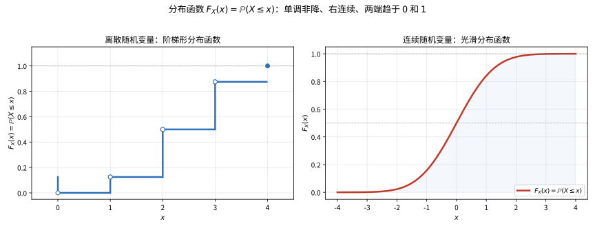

> **直观理解（现实类比）**：分布函数就像"人口累计统计图"——横轴是身高或收入，曲线告诉你"小于等于这个值的人占多大比例"。离散情形（如掷硬币）曲线是阶梯状跳动，连续情形（如身高）则是平缓上升的曲线。无论哪种，曲线都从 $0$ 升到 $1$，且只会向右上方爬升、绝不回头。

> **🧠 思考历程：要把"概率"变成像长度一样能丈量的量，谈何容易？**
>
> 分布函数把这句话又细细推敲了一遍：无论这个分布的"形状"多古怪，我都能用"小于等于 $x$ 的概率有多大"这条从0升到1的曲线把它概括下来。这条平凡到近乎平庸的定义背后，其实藏着数学为了收编"无穷"而爆发的一场革命。
>
> - **长度撑不下的集合**。19世纪末，能"丈量"的只是区间长度，面对越来越古怪的点集，黎曼积分常常失灵；鲍莱尔（Émile Borel）与勒贝格（Henri Lebesgue）在1898–1902年间重构"可测集"与"可测函数"，第一次给"体积"一个真正通用的身份。
> - **给概率一座公理化家园**。此前的概率论多靠"频率"这种软解释，连基本极限结论都说不利索。1933年柯尔莫哥洛夫（Kolmogorov）把概率定义为满足三条公理的规范测度，用勒贝格测度统一了离散与连续——"分布函数"也顺理成章地成为概率在实轴上的存档方式。
> - **定义铺路，极限承载**。有了测度，随机变量成了保持可测性的函数，期望成了勒贝格积分，大小数定律与中心极限定理才有了严谨的证明土壤——概率论从此是分析学的一门分支，而不再是一堆技巧。
> - **心路**：为一个看似自明的概念较真，往往是为了让更宏大的结论站得稳——可测性的那一毫米较真，换来了整座现代概率的建筑。

#### 课堂问答

**老师**：随机变量就是可测函数，"可测"这层额外要求到底挡掉了什么？

**学生**：挡掉了那些"没法赋予概率"的函数。若 $X$ 不可测，$\{X\le x\}$ 未必是事件，$\mathbb{P}(X\le x)$ 就无从定义，分布函数也立不起来。可测性保证每条水平集都落进 $\mathcal{F}$。而分布函数 $F_X(x)=\mathbb{P}(X\le x)$ 由三条性质刻画：单调非降、$\lim_{x\to-\infty}F=0$、$\lim_{x\to+\infty}F=1$，外加右连续。

**老师（追问）**：分布函数凭什么必须右连续，左连续行不行？

**学生**：必须右连续，因为 $\{X\le x\}=\bigcap_n\{X\le x+1/n\}$ 是"从右边往下夹"的可数交，测度的从上方连续性给出 $F(x)=\lim_{y\downarrow x}F(y)$。左连续一般不成立：取 $X\equiv 0$，$F(x)=\mathbf{1}_{[0,\infty)}(x)$ 在 $0$ 处左极限 $0$、右极限 $1$。顺带 $F(x)-F(x-)=\mathbb{P}(X=x)$ 正是跳跃高度。

**老师（拓展）**：两个分布函数相同，是否意味着两个随机变量相同？

**学生**：不，只能说明同分布，不能说明 a.s. 相等。结论：分布函数只记录"概率在实轴上的存档"，抹掉了 $\Omega$ 上的具体结构。比如同一枚均匀硬币，可以建模成 $\{0,1\}$ 上的恒等映射，也可以先取另一随机变量再翻转，两者分布相同而取值路径完全不同。真正的"相同"要求逐点 a.s. 相等，那是更强的关系，所以"依分布收敛"是几种收敛里最弱的一种。

### 2.9 特征函数

随机变量 $X$ 的 **特征函数** 定义为：

$$
\varphi_X(t) = \mathbb{E}[e^{itX}] = \int e^{itx} \, dF_X(x), \quad t \in \mathbb{R}
$$

特征函数具有以下重要性质：
1. $\varphi_X(0) = 1$，$|\varphi_X(t)| \le 1$
2. $\varphi_X$ 在 $\mathbb{R}$ 上一致连续
3. 若 $\mathbb{E}[|X|^k] < \infty$，则 $\varphi_X$ 在 $0$ 处 $k$ 次可微，且 $\varphi_X^{(k)}(0) = i^k \mathbb{E}[X^k]$
4. **唯一性**：特征函数唯一确定分布函数
5. **连续性**：若 $\varphi_{X_n}(t) \to \varphi_X(t)$ 对每个 $t$ 成立，且 $\varphi_X$ 在 $0$ 处连续，则 $X_n$ 依分布收敛于 $X$

> **💡 直观理解（类比）**：特征函数像"给随机变量拍的全频段'指纹照'"——$t$ 是频率旋钮，$\varphi_X(t)=\mathbb{E}[e^{itX}]$ 是这部产物 $X$ 在这个频率下的震动响应。它比分布函数更"好咬"：独立和的特征函数是对应乘积（$e^{it(X+Y)}=e^{itX}e^{itY}$），一次就能把卷积转成乘法。两条杀手级性质——唯一性说"指纹一样就同一人"（唯一确定分布），连续性定理说"指纹越拍越近似，则人也越近似"（逐点收敛推依分布收敛）——正是大数定律与中心极限定理里"只看特征函数不放分布"就能定乾坤的依仗。

#### 课堂问答

**老师**：为什么要给随机变量配一个特征函数 $\varphi_X(t)=\mathbb{E}[e^{itX}]$，直接用分布函数不好吗？

**学生**：因为特征函数把卷积变成了乘法，这正是研究独立和的关键。独立时 $\varphi_{X+Y}(t)=\varphi_X(t)\varphi_Y(t)$，源于 $e^{it(X+Y)}=e^{itX}e^{itY}$；而分布层面 $X+Y$ 的分布是卷积，麻烦得多。又因 $|\varphi_X(t)|\le 1$ 恒成立，它对任何随机变量都存在（不像矩母函数可能发散），并且一致连续、唯一确定分布。

**老师（追问）**：唯一性怎么用？"特征函数收敛"凭什么推出"分布收敛"？

**学生**：唯一性是说 $\varphi$ 与 $F$ 一一对应，可由反演公式从 $\varphi$ 复原 $F$。极限定理里真正发力的是 Lévy 连续性定理：若 $\varphi_{X_n}(t)\to\varphi(t)$ 对每个 $t$ 成立，且 $\varphi$ 在 $0$ 处连续，则 $\varphi$ 必是某随机变量 $X$ 的特征函数，且 $X_n\xrightarrow{d}X$。这把"证明分布收敛"降格成"算特征函数的逐点极限"，中心极限定理正是这么干的。

**老师（拓展）**：特征函数和矩之间是什么关系？

**学生**：若 $\mathbb{E}[|X|^k]<\infty$，则 $\varphi_X$ 在 $0$ 处 $k$ 次可微，且 $\varphi_X^{(k)}(0)=i^k\mathbb{E}[X^k]$，于是原点处的 Taylor 展开 $\varphi_X(t)=1+it\mathbb{E}[X]-\frac{t^2}{2}\mathbb{E}[X^2]+\cdots$ 就逐项读出各阶矩。这条正是 CLT 证明的引擎——方差把二阶系数钉成 $-1/2$。要留心矩母函数 $\mathbb{E}[e^{tX}]$ 可能发散（重尾分布），而特征函数用虚指数保证有界，所以更普适。

### 2.10 Wiener 过程

**标准 Wiener 过程**（Brownian 运动）$\{W_t\}_{t \ge 0}$ 是满足以下条件的随机过程：
1. $W_0 = 0$ a.s.
2. 轨道 $t \mapsto W_t$ 几乎处处连续
3. 独立增量：对 $0 \le s < t$，$W_t - W_s$ 与 $\mathcal{F}_s$ 独立
4. 正态增量：$W_t - W_s \sim N(0, t-s)$

> **💡 直观理解（类比）**：Wiener过程像"被亿万个看不见的小手随机轻推、在一盆水里游成一团乱线的花粉"——起点是原点、路径几乎处处连续（没跳楼），但每一小步都自成独立一轮骰、且呈方差正比于时间步长的正态抖动。测度论为它盖的厂房是"构造一族同时满足这四条的一致性随机变量"：它正是概率公理化之后，把'连续性+独立增量+正态增量'铸造成一台铁律随机引擎的杰作，也是后续Itô积分、SDE、随机分析的起跑线。

---

#### 课堂问答

**老师**：标准 Wiener 过程那四条（$W_0=0$、路径连续、独立增量、正态增量 $W_t-W_s\sim N(0,t-s)$），哪一条最难伺候？

**学生**：独立性加正态增量已定出全部有限维分布，都不算难点；真正难的是"存在性"与"路径连续"同时成立。有限维分布的一致性由 Kolmogorov 扩张定理保证，可造出满足前三条的过程，但扩张给出的版本路径未必连续。要再用 Kolmogorov 连续性准则（借助增量矩估计）改到连续轨道上，得到一个与原有限维分布相同、轨道 a.s. 连续的版本。四条合起来才配叫 Brownian 运动。

**老师（追问）**：路径连续就等于"行为像光滑曲线"了吗？能对它求导吗？

**学生**：恰恰相反。结论：$t\mapsto W_t$ 几乎处处连续却无处可微，轨道长度还是无穷的。直观上 $W_{t+h}-W_t$ 的标准差是 $\sqrt{h}$，故差商尺度为 $h^{-1/2}\to\infty$，导数不可能存在。它的二次变差却是确定的：$\sum_i|W_{t_{i+1}}-W_{t_i}|^2\to t$（依概率）。这印证了 $dW$ 的量级是 $\sqrt{dt}$ 而非 $dt$，也解释了 Itô 公式里为何会多出 $\frac{1}{2}f''$ 那一项。

**老师（拓展）**：Wiener 过程在本章里"承前启后"的角色是什么？

**学生**：它是把"连续加独立增量加正态增量"铸造成一台随机引擎，是后续随机分析的起跑线。往前，它需要测度论用 Kolmogorov 扩张定理把一族同时满足四条件的随机变量严格造出来；往后，鞅性质（$W_t$ 与 $W_t^2-t$ 都是鞅）、Markov 性、Itô 积分、SDE 都建在它上面。它也是无穷维高斯测度最典型的栖息地——$W$ 的分布就是 Wiener 测度，且与 Lebesgue 测度相互奇异，这层深度正是本章铺垫的目的。

## 3. 定理与证明

### 定理 3.1：单调收敛定理 (Monotone Convergence Theorem)

**定理**：设 $(\Omega, \mathcal{F}, \mu)$ 为测度空间，$\{f_n\}$ 为非负可测函数列，且 $f_n \uparrow f$（即 $0 \le f_1 \le f_2 \le \cdots$ 且 $\lim_{n \to \infty} f_n(\omega) = f(\omega)$ 对几乎所有 $\omega$ 成立）。则：

$$
\lim_{n \to \infty} \int f_n \, d\mu = \int f \, d\mu
$$

**证明**：

**步骤1：单调性**

由 $f_n \le f_{n+1} \le f$，对任意 $n$ 有 $\int f_n \, d\mu \le \int f_{n+1} \, d\mu \le \int f \, d\mu$。因此 $\lim_{n \to \infty} \int f_n \, d\mu$ 存在且不超过 $\int f \, d\mu$。记 $L = \lim_{n \to \infty} \int f_n \, d\mu$，则 $L \le \int f \, d\mu$。

**步骤2：反向不等式**

要证明 $\int f \, d\mu \le L$，根据积分的定义，只需证明对任意满足 $0 \le g \le f$ 的简单函数 $g$ 和任意 $0 < c < 1$，有 $c \int g \, d\mu \le L$。

**步骤3：构造逼近集**

设 $g$ 为简单函数 $0 \le g \le f$，$0 < c < 1$。定义：

$$
E_n = \{\omega: f_n(\omega) \ge c g(\omega)\}
$$

由 $f_n \uparrow f$ 可知 $\{E_n\}$ 是递增的集合列，且 $\bigcup_{n=1}^\infty E_n = \Omega$（除零测集外）。

**步骤4：在 $E_n$ 上估计积分**

对每个 $n$，有 $f_n \ge c g$ 在 $E_n$ 上成立，因此：

$$
\int f_n \, d\mu \ge \int_{E_n} f_n \, d\mu \ge c \int_{E_n} g \, d\mu
$$

**步骤5：利用测度的连续性**

由于 $g$ 是简单函数，可设 $g = \sum_{i=1}^m a_i \mathbf{1}_{A_i}$，其中 $A_i$ 互不相交。则：

$$
\int_{E_n} g \, d\mu = \sum_{i=1}^m a_i \mu(A_i \cap E_n)
$$

由测度的从下方连续性（因为 $E_n \uparrow \Omega$），有 $\mu(A_i \cap E_n) \to \mu(A_i)$。因此：

$$
\lim_{n \to \infty} \int_{E_n} g \, d\mu = \int g \, d\mu
$$

**步骤6：取极限**

对 $\int f_n \, d\mu \ge c \int_{E_n} g \, d\mu$ 两边取极限得：

$$
L = \lim_{n \to \infty} \int f_n \, d\mu \ge c \lim_{n \to \infty} \int_{E_n} g \, d\mu = c \int g \, d\mu
$$

由于 $c \in (0,1)$ 是任意的，令 $c \to 1$ 得 $L \ge \int g \, d\mu$。再对 $g \le f$ 取上确界得 $L \ge \int f \, d\mu$。

**步骤7：结论**

综合步骤1和步骤6，有 $\int f \, d\mu \le L \le \int f \, d\mu$，故 $L = \int f \, d\mu$。$\square$

> **💡 直观理解（类比）**：单调收敛定理像"盖楼时只要每层只加砖不倒楼，顶层总高度就是平时一层层累计的高度"——函数列 $f_n$ 一层层垒高（$f_n\uparrow f$），每一步攒下的积分都算数、只增不减；说极限积分等于积分极限，等于保证"最后那栋楼的封顶总方量，等于每层方量一路加到底的总和"，绝不会因为塔尖无穷而偷工减料。直觉上人尽皆知，难的是那一步反向不等式：为了补上'高频越级逼近'，得靠简单函数 $g$ 压出 $c<1$ 的一档油门（$E_n=\{f_n\ge cg\}$）慢慢顶到位，再用测度的下方连续性把这口气顺到底——防的正是"极限过后积分偷偷缩水"的幺蛾子。

---

#### 课堂问答

**老师**：单调收敛定理凭什么直接换序 $\lim\int=\int\lim$，连控制函数都不需要？

**学生**：因为单调性本身就是"控制"。$f_n\uparrow f$ 让被积对象只增不减，积分值单调且以 $\int f$ 为上界，故极限存在且 $\lim\int f_n\le\int f$。真正要下功夫的是反向 $\int f\le\lim\int f_n$：对每个满足 $0\le g\le f$ 的简单函数 $g$ 与 $c\in(0,1)$，令 $E_n=\{f_n\ge cg\}$，则 $E_n\uparrow\Omega$，用测度的从下方连续性把 $c\int g$ 顶到 $\lim\int f_n$，再令 $c\to 1$ 并对 $g$ 取上确界即可。

**老师（追问）**：那步"取简单函数 $g$ 再夹个 $c<1$"到底在防什么？

**学生**：防"极限过后积分偷偷缩水"。$E_n$ 上 $f_n\ge cg$ 是逐点估计，但 $c=1$ 时 $\{f_n\ge g\}$ 未必覆盖 $\Omega$，所以先退半步用 $c<1$ 让 $E_n$ 能铺满 $\Omega$，再靠"$c$ 任意接近 $1$"补回来。这实质是两次从下方逼近：先用简单函数逼近 $f$，再用 $c$ 逼近 $1$。少了 $c$ 这档油门，反向不等式根本顶不上去。

**老师（拓展）**：单调性这个假设能松吗？能否推广到不单调的函数列？

**学生**：不能松。反例 $f_n=n\mathbf{1}_{(0,1/n)}$ 递减、逐点趋 $0$，但 $\int f_n=1\not\to 0$；递增性是本质的。不过结论可推广到"$f_1$ 可积的递增列"：此时 $\int(f_n-f_1)$ 非负递增，得 $\int f_n\to\int f$；即便 $f_1$ 不可积，$\lim\int f_n=\int f$ 仍成立（允许两端同为 $+\infty$）。MCT 还是证明 Fatou 引理与控制收敛定理的基石，是整座积分论的第一块砖。

### 定理 3.2：Fatou 引理 (Fatou's Lemma)

**定理**：设 $\{f_n\}$ 为非负可测函数列，则：

$$
\int \liminf_{n \to \infty} f_n \, d\mu \le \liminf_{n \to \infty} \int f_n \, d\mu
$$

**证明**：

**步骤1：构造单调递增序列**

令 $g_n = \inf_{k \ge n} f_k$。则 $\{g_n\}$ 是非负可测函数列，且 $g_n \uparrow \liminf_{n \to \infty} f_n$。

由定义，$g_n \le f_k$ 对所有 $k \ge n$ 成立，因此：

$$
\int g_n \, d\mu \le \int f_k \, d\mu, \quad \forall k \ge n
$$

**步骤2：取下确界**

对 $k \ge n$ 取下确界得：

$$
\int g_n \, d\mu \le \inf_{k \ge n} \int f_k \, d\mu
$$

**步骤3：应用单调收敛定理**

由于 $g_n \uparrow \liminf f_n$，由单调收敛定理：

$$
\int \liminf_{n \to \infty} f_n \, d\mu = \lim_{n \to \infty} \int g_n \, d\mu
$$

**步骤4：取极限**

结合步骤2和步骤3：

$$
\int \liminf_{n \to \infty} f_n \, d\mu = \lim_{n \to \infty} \int g_n \, d\mu \le \lim_{n \to \infty} \inf_{k \ge n} \int f_k \, d\mu = \liminf_{n \to \infty} \int f_n \, d\mu
$$

$\square$

> **💡 直观理解（类比）**：Fatou引理像"水库夜间的闸口账本只许漏、不许回落"——逐点下极限对应'最下限那批水的底线'，积分之下它顶多不超过积分们的下极限，方向是往下压的不等式 $\le$。要读懂它，关键是把 $g_n=\inf_{k\ge n}f_k$ 看作"从第 $n$ 集往后所有低谷私下藏的那笔下限"，并对这笔单调递增的下限序列援引单调收敛定理。直觉类比：一群人越看越低矮，平均身高被这次'轮回拼命往下探底'拖住，最多被整体平均数兜住；没有更强假设（如控制、单调）时，极限与积分可真会'走位'错开，所以Fatou给的永远只是一句方向明确的'保底'。

---

#### 课堂问答

**老师**：Fatou 引理是 $\int\liminf f_n\le\liminf\int f_n$，为什么是不等号，而且方向朝这边？

**学生**：结论是"极限把积分往下压，最多压到积分们的下极限"。核心手段是把下极限化成单调列：令 $g_n=\inf_{k\ge n}f_k$，则 $g_n\uparrow\liminf f_n$，对 $g_n$ 用单调收敛定理得 $\int\liminf f_n=\lim\int g_n$。而 $g_n\le f_k$（$k\ge n$）给出 $\int g_n\le\inf_{k\ge n}\int f_k$，取极限即得。方向朝下，是因为逐点下确界丢掉了信息，积分只会更小。

**老师（追问）**：能不能反过来得到 $\liminf\int f_n\le\int\liminf f_n$？

**学生**：一般不能，这正是常见误区。反例 $f_n=\mathbf{1}_{[n,n+1)}$：每点最终为 $0$，故 $\int\liminf f_n=0$；但 $\int f_n=1$ 对所有 $n$，于是 $\liminf\int f_n=1>0$。要让反向成立得加"一致可积"或"被可积函数控制"，一旦有可积控制 $g\ge|f_n|$，Fatou 就用在下式上得到控制收敛定理的等号。

**老师（拓展）**：Fatou 在三大收敛定理里的地位是什么？

**学生**：它是一座桥。往上是 MCT 的特例（单调列时下极限就是极限，两边相等），往下它直接孵化控制收敛定理——对 $h_n=2g-|f_n-f|\ge 0$ 用 Fatou，整理出 $\limsup\int|f_n-f|\le 0$。它也说明"非负"不能去：没有非负性时 $\int$ 对负部无意义，下极限的推导就走不通。一句话，Fatou 提供的是无控制条件下最廉价、方向明确的保底结论。

### 定理 3.3：控制收敛定理 (Dominated Convergence Theorem)

**定理**：设 $\{f_n\}$ 为可测函数列，$f_n \to f$ 几乎处处，且存在可积函数 $g$ 使得 $|f_n| \le g$ 对所有 $n$ 几乎处处成立（$g$ 称为控制函数）。则 $f$ 可积且：

$$
\lim_{n \to \infty} \int |f_n - f| \, d\mu = 0
$$

特别地，$\lim_{n \to \infty} \int f_n \, d\mu = \int f \, d\mu$。

**证明**：

**步骤1：$f$ 的可积性**

由 $f_n \to f$ a.e. 和 $|f_n| \le g$，得 $|f| \le g$ a.e.。因此 $|f|$ 以可积函数 $g$ 为上界，故 $f$ 可积。

**步骤2：构造辅助函数**

令 $h_n = 2g - |f_n - f|$。则 $h_n \ge 0$（因为 $|f_n - f| \le |f_n| + |f| \le 2g$）。

由 $f_n \to f$ a.e.，得 $h_n \to 2g$ a.e.。

**步骤3：应用 Fatou 引理**

对 $h_n$ 应用 Fatou 引理：

$$
\int \liminf_{n \to \infty} h_n \, d\mu \le \liminf_{n \to \infty} \int h_n \, d\mu
$$

左边为 $\int 2g \, d\mu$。右边为：

$$
\liminf_{n \to \infty} \int (2g - |f_n - f|) \, d\mu = \int 2g \, d\mu + \liminf_{n \to \infty} \left(-\int |f_n - f| \, d\mu\right)
$$

**步骤4：整理不等式**

代入得：

$$
\int 2g \, d\mu \le \int 2g \, d\mu + \liminf_{n \to \infty} \left(-\int |f_n - f| \, d\mu\right)
$$

即：

$$
0 \le \liminf_{n \to \infty} \left(-\int |f_n - f| \, d\mu\right) = -\limsup_{n \to \infty} \int |f_n - f| \, d\mu
$$

**步骤5：结论**

因此 $\limsup_{n \to \infty} \int |f_n - f| \, d\mu \le 0$。由于 $\int |f_n - f| \, d\mu \ge 0$，故 $\lim_{n \to \infty} \int |f_n - f| \, d\mu = 0$。

由 $|\int f_n \, d\mu - \int f \, d\mu| \le \int |f_n - f| \, d\mu \to 0$，得 $\int f_n \, d\mu \to \int f \, d\mu$。$\square$

> **💡 直观理解（类比）**：控制收敛定理像"给一群上蹿下跳的选手统一套上一条可积的'安全带' $g$，防止有人跑到无穷远处撒野"——只要每只函数都被这条能卖钱（可积）的绳子拴住（$|f_n|\le g$），又几乎处处爬到目标 $f$，那积分就能放心地穿越极限：$\int f_n\to\int f$，甚至更强地 $\int|f_n-f|\to0$。证明的妙处全在一句反怪招：对非负的 $h_n=2g-|f_n-f|$ 反手用Fatou，把'距离'的技巧硬拗成'上下界夹住'，从而把 $\int|f_n-f|$ 那点不肯低头的小尾巴也一并掰弯归零——既然整支队伍被同一根有尽头的绳拴住，多绕一截也无处可逃。

---

#### 课堂问答

**老师**：控制收敛定理的条件是"$f_n\to f$ a.e. 且 $|f_n|\le g$、$g$ 可积"，为什么光有 a.e. 收敛不够？

**学生**：因为 a.e. 收敛管不住"质量往哪跑"。反例还是 $f_n=n\mathbf{1}_{(0,1/n)}$，逐点趋 $0$ 但 $\int f_n=1\not\to 0$。控制函数 $g$ 的作用是把 $f_n$ 全体按在一条可积的"安全带"里，阻止质量窜到高频区导致积分漏出。结论：有可积 $g$ 且 $|f_n|\le g$ a.e.，则不仅 $\int f_n\to\int f$，还更强地 $\int|f_n-f|\to 0$，即 $L^1$ 收敛。

**老师（追问）**：证明里那个 $h_n=2g-|f_n-f|$ 是怎么想出来的？

**学生**：这是"反手用 Fatou"的典型招法。要证 $\int|f_n-f|\to 0$，直接对 $|f_n-f|$ 用 Fatou 只能得到方向为 $\le$ 的不等式，不对路。于是翻成非负的 $h_n=2g-|f_n-f|\ge 0$（因 $|f_n-f|\le|f_n|+|f|\le 2g$），且 $h_n\to 2g$ a.e.。对它用 Fatou 得 $\int 2g\le\int 2g-\limsup\int|f_n-f|$，两边消去 $\int 2g$ 便有 $\limsup\int|f_n-f|\le 0$。妙处是把"距离趋零"翻译成"上下界夹逼归零"。

**老师（拓展）**：控制函数能换成 $|f_n|\le g_n$（$g_n$ 也依赖 $n$）吗？

**学生**：一般不能，必须是一条对所有 $n$ 一致的 $g$。若只假设 $|f_n|\le g_n$ 且 $g_n\to g$，控制就会失效。常见陷阱是把可积性当成理所当然——"$g$ 可积"这一条必须单独检查。当然 DCT 也可弱化成"依测度收敛加一致可积"，但条件更复杂；真正方便好用的，还是这条"一条可积绳子拴住全队"的经典形式。

### 定理 3.4：Radon-Nikodym 定理 (Radon-Nikodym Theorem)

**定理**：设 $\mu$ 和 $\nu$ 是 $(\Omega, \mathcal{F})$ 上的 σ-有限测度，且 $\nu \ll \mu$（即 $\nu$ 关于 $\mu$ 绝对连续）。则存在一个可测函数 $f \ge 0$，使得对任意 $A \in \mathcal{F}$，有：

$$
\nu(A) = \int_A f \, d\mu
$$

函数 $f$ 在 $\mu$-几乎处处意义下唯一，记作 $f = \frac{d\nu}{d\mu}$，称为 Radon-Nikodym 导数。

**证明**（使用 $L^2$ 空间方法，假设 $\mu$ 和 $\nu$ 是有限测度）：

**步骤1：构造 Hilbert 空间**

考虑 $L^2(\mu + \nu)$，即关于测度 $\rho = \mu + \nu$ 的平方可积函数空间。这是一个 Hilbert 空间，内积为 $\langle f, g \rangle = \int fg \, d(\mu + \nu)$。

**步骤2：定义线性泛函**

定义线性泛函 $\Phi: L^2(\mu + \nu) \to \mathbb{R}$ 为：

$$
\Phi(g) = \int g \, d\nu
$$

由于 $\nu \le \mu + \nu$，由 Cauchy-Schwarz 不等式：

$$
|\Phi(g)| \le \int |g| \, d\nu \le \int |g| \, d(\mu + \nu) \le \sqrt{(\mu + \nu)(\Omega)} \|g\|_{L^2(\mu + \nu)}
$$

因此 $\Phi$ 是 $L^2(\mu + \nu)$ 上的有界线性泛函。

**步骤3：应用 Riesz 表示定理**

由 Riesz 表示定理，存在唯一的 $h \in L^2(\mu + \nu)$ 使得：

$$
\Phi(g) = \int g \, d\nu = \int g h \, d(\mu + \nu), \quad \forall g \in L^2(\mu + \nu)
$$

即：

$$
\int g \, d\nu = \int g h \, d\mu + \int g h \, d\nu
$$

整理得：

$$
\int g (1 - h) \, d\nu = \int g h \, d\mu, \quad \forall g \in L^2(\mu + \nu)
$$

**步骤4：分析 $h$ 的性质**

我们证明 $0 \le h \le 1$ $\mu + \nu$-a.e.。

取 $g = \mathbf{1}_{\{h < 0\}}$，则左边 $\ge 0$，右边 $\le 0$，因此两边均为 0，故 $h \ge 0$ a.e.。

取 $g = \mathbf{1}_{\{h > 1\}}$，则右边 $\ge \int_{\{h > 1\}} h \, d\mu \ge 0$，左边 $= \int_{\{h > 1\}} (1 - h) \, d\nu \le 0$，因此必须有 $\mu(\{h > 1\}) = 0$ 且 $\nu(\{h > 1\}) = 0$，故 $h \le 1$ a.e.。

**步骤5：处理 $h = 1$ 的情况**

令 $A = \{h = 1\}$。在 $A$ 上，对任意 $g$ 有 $\int_A g(1 - h) \, d\nu = 0$，而 $\int_A g h \, d\mu = \int_A g \, d\mu$。由 $g$ 的任意性，$\mu(A) = 0$。由 $\nu \ll \mu$，得 $\nu(A) = 0$。

**步骤6：构造 Radon-Nikodym 导数**

在 $\{h < 1\}$ 上，由 $1 - h > 0$，定义：

$$
f = \frac{h}{1 - h}
$$

由 $\int g (1 - h) \, d\nu = \int g h \, d\mu$ 取 $g = \mathbf{1}_B \cdot \frac{1}{1 - h}$（其中 $B \in \mathcal{F}$），得：

$$
\int_B \, d\nu = \int_B \frac{h}{1 - h} \, d\mu = \int_B f \, d\mu
$$

因此 $\nu(B) = \int_B f \, d\mu$ 对所有 $B \in \mathcal{F}$ 成立，$f = \frac{d\nu}{d\mu}$。

**步骤7：唯一性**

若 $f_1$ 和 $f_2$ 都满足条件，则 $\int_A (f_1 - f_2) \, d\mu = 0$ 对所有 $A \in \mathcal{F}$ 成立，故 $f_1 = f_2$ $\mu$-a.e.。

**步骤8：推广到 σ-有限情形**

将 $\Omega$ 分解为可数个互不相交的有限测度集，在每个集上应用上述结论，再拼接起来即可。$\square$

> **💡 直观理解（类比）**：Radon-Nikodym定理的证明像"借一把已知的公平大秤 $\mu$ 去测另一把秤 $\nu$ 在各处该配几倍增杠"——在 $L^2(\mu+\nu)$ 里定义一个取 $\nu$ 值的泛函 $\Phi(g)=\int g\,d\nu$，它像一条有界线性'测重指令'，再请Riesz表示定理派一位代表 $h$，把'对$g$称$\nu$重'翻译成'对$g$乘$h$再称$\mu+\nu$重'。接着竖起两堵墙：用试探函数 $\mathbf{1}_{\{h<0\}}$、$\mathbf{1}_{\{h>1\}}$ 把 $h$ 挤进 $[0,1]$，再把 $h=1$ 那层邪门区判成零测，于是切线 $f=\frac{h}{1-h}$ 稳稳登场，充当逐点倍率。归根结底：绝对连续 $\nu\ll\mu$ 才是这趟'逐点倍率'能成立的地基，缺了它倍率会爆炸。

---

#### 课堂问答

**老师**：Radon–Nikodym 定理说 $\nu\ll\mu$ 且 $\mu$ σ-有限就存在密度 $f$，这个 $\sigma$-有限能不能省？

**学生**：不能省，这是本定理最容易被忽略的前提，去掉后会出现绝对连续却无密度的反例。$\sigma$-有限保证能把有限测度情形的结论拼接到整个空间。另外唯一性只是 a.e. 意义下的：两个都满足条件的 $f_1,f_2$ 差在所有 $A$ 上积分为零，故 $f_1=f_2$ $\mu$-a.e.。

**老师（追问）**：你给的 $L^2$ 证明为什么要借 Riesz 表示定理，不能直接构造 $f$ 吗？

**学生**：直接构造会被"未知的 $f$"困住，$L^2$ 路线是漂亮的迂回。在 $\rho=\mu+\nu$ 下取 $L^2(\rho)$，$g\mapsto\Phi(g)=\int g\,d\nu$ 是它的有界线性泛函（用 $\nu\le\rho$ 和 Cauchy–Schwarz 估界），Riesz 表示定理给出代表元 $h$ 使 $\int g\,d\nu=\int gh\,d\rho$。展开 $\rho=\mu+\nu$ 得 $\int g(1-h)\,d\nu=\int gh\,d\mu$；再用示性函数逼出 $0\le h\le1$ a.e.、$\{h=1\}$ 为 $\mu$-零测集，最后在 $\{h<1\}$ 上取 $f=\frac{h}{1-h}$。整条链条靠的是 Hilbert 空间的内积几何。

**老师（拓展）**：若 $\nu$ 不绝对连续，RN 定理给你什么"补救"？

**学生**：给你 Lebesgue 分解 $\nu=\nu_{ac}+\nu_s$，$\nu_{ac}\ll\mu$、$\nu_s\perp\mu$，$\frac{d\nu}{d\mu}$ 只对 $\nu_{ac}$ 存在。这条分解在概率里对应"密度部分加奇异部分"：一个分布可以既有密度又有原子。它是 Girsanov 换测度、似然比等一切"换密度"技术的理论出处，也提醒我们：绝对连续是"逐点倍率"成立的必要门槛，跳过它就要面对奇异测度这块硬骨头。

### 定理 3.5：条件期望的存在唯一性

**定理**：设 $(\Omega, \mathcal{F}, \mathbb{P})$ 为概率空间，$X$ 为可积随机变量，$\mathcal{G} \subset \mathcal{F}$ 为子 σ-代数。则存在唯一的（在几乎处处意义下）$\mathcal{G}$-可测随机变量 $Y$ 满足：

1. $Y$ 是 $\mathcal{G}$-可测的
2. 对所有 $A \in \mathcal{G}$，$\int_A Y \, d\mathbb{P} = \int_A X \, d\mathbb{P}$

该 $Y$ 称为 $X$ 关于 $\mathcal{G}$ 的 **条件期望**，记作 $\mathbb{E}[X \mid \mathcal{G}]$。

**证明**：

**步骤1：考虑 $X \ge 0$ 的情形**

首先假设 $X \ge 0$。在 $(\Omega, \mathcal{G})$ 上定义测度：

$$
\nu(A) = \int_A X \, d\mathbb{P}, \quad A \in \mathcal{G}
$$

容易验证 $\nu$ 是 $(\Omega, \mathcal{G})$ 上的有限测度（因为 $\mathbb{E}[X] < \infty$）。显然 $\nu \ll \mathbb{P}|_\mathcal{G}$（即 $\nu$ 关于 $\mathbb{P}$ 在 $\mathcal{G}$ 上的限制绝对连续）。

**步骤2：应用 Radon-Nikodym 定理**

由 Radon-Nikodym 定理，存在 $\mathcal{G}$-可测函数 $Y \ge 0$，使得对任意 $A \in \mathcal{G}$：

$$
\nu(A) = \int_A Y \, d\mathbb{P}
$$

即 $\int_A X \, d\mathbb{P} = \int_A Y \, d\mathbb{P}$，$A \in \mathcal{G}$。这正是条件期望的定义。

**步骤3：一般可积函数的情形**

对一般的可积随机变量 $X$，分解为 $X = X^+ - X^-$，其中 $X^+ = \max(X, 0)$，$X^- = \max(-X, 0)$。由步骤2，分别存在 $\mathcal{G}$-可测函数 $Y_1$ 和 $Y_2$ 对应 $X^+$ 和 $X^-$。令 $Y = Y_1 - Y_2$，则 $Y$ 是 $\mathcal{G}$-可测的，且对任意 $A \in \mathcal{G}$：

$$
\int_A Y \, d\mathbb{P} = \int_A Y_1 \, d\mathbb{P} - \int_A Y_2 \, d\mathbb{P} = \int_A X^+ \, d\mathbb{P} - \int_A X^- \, d\mathbb{P} = \int_A X \, d\mathbb{P}
$$

**步骤4：唯一性**

若 $Y_1$ 和 $Y_2$ 都满足条件，则对任意 $A \in \mathcal{G}$，$\int_A (Y_1 - Y_2) \, d\mathbb{P} = 0$。取 $A = \{Y_1 - Y_2 > 0\} \in \mathcal{G}$，得 $\mathbb{P}(A) = 0$。同理可得 $\mathbb{P}(\{Y_1 - Y_2 < 0\}) = 0$，故 $Y_1 = Y_2$ a.s.。$\square$

> **💡 直观理解（类比）**：条件期望存在唯一性的证明，是Radon-Nikodym定理在概率舞台上的'首秀'——先替每个 $\mathcal{G}$-区域定一笔账 $\nu(A)=\int_A X\,d\mathbb{P}$，这笔账显然被原概率在 $\mathcal{G}$ 上的限制牵制（$\nu\ll\mathbb{P}|_\mathcal{G}$）：凡一处概率为零，累计的 $X$ 当然也为零。于是RN定理递出一位 $\mathcal{G}$-可测的'逐点倍率' $Y$，恰与 $X$ 在每块 $\mathcal{G}$ 区域上账目持平——这正是条件期望的严格出身。正负两半分开做、再拼起来处理一般可积 $X$；唯一性一眼看穿：两本账差 $Y_1-Y_2$ 若在任意可测集合上都积分为零，它连正处、负处的概率都只能是0，故 a.s. 相等。托生于公平秤底、可靠无比，这就是条件期望是'依据已见信息的最优猜测'的数学外壳。

---

#### 课堂问答

**老师**：条件期望的存在唯一性证明，几乎是 Radon–Nikodym 定理的一句话推论，对吧？

**学生**：对，这就是它的精髓。对固定的 $X\in L^1(\mathbb{P})$，在 $\mathcal{G}$ 上定义 $\nu(A)=\int_A X\,d\mathbb{P}$。它是有限测度，且 $\mathbb{P}(A)=0\Rightarrow\nu(A)=0$，即 $\nu\ll\mathbb{P}|_\mathcal{G}$。对它用 RN 定理得 $\mathcal{G}$-可测的 $Y$ 满足 $\int_A Y\,d\mathbb{P}=\int_A X\,d\mathbb{P}$，这就是条件期望；正负两半分别做再相减即可处理一般可积 $X$。

**老师（追问）**：唯一性那一步为什么能直接断言 a.s. 相等？

**学生**：若 $Y_1,Y_2$ 都满足，则 $\int_A(Y_1-Y_2)\,d\mathbb{P}=0$ 对所有 $A\in\mathcal{G}$。取 $A=\{Y_1-Y_2>0\}\in\mathcal{G}$（因差 $\mathcal{G}$-可测），积分非负为零就逼出 $\mathbb{P}(A)=0$；同理由 $\{Y_1-Y_2<0\}$ 得另一端零测，故 $Y_1=Y_2$ a.s.。要害是"差"必须 $\mathcal{G}$-可测，否则没法把它当作积分域取出来——可测性是整个论证的支点。

**老师（拓展）**：为什么说条件期望是"最小均方误差意义下的最优预测"？

**学生**：因为它是 $X$ 在子空间 $L^2(\mathcal{G})$ 上的正交投影。对任意 $\mathcal{G}$-可测的 $Z$，$\mathbb{E}[(X-Z)^2]=\mathbb{E}[(X-\mathbb{E}[X\mid\mathcal{G}])^2]+\mathbb{E}[(\mathbb{E}[X\mid\mathcal{G}]-Z)^2]$，右端第二项非负，等号仅当 $Z=\mathbb{E}[X\mid\mathcal{G}]$ a.s.。这来自 $X-\mathbb{E}[X\mid\mathcal{G}]$ 与所有 $\mathcal{G}$-可测函数正交。所以"给定信息 $\mathcal{G}$ 的最优平方预测"就是条件期望，塔性质、取出已知量等法则都由这一几何图景自然导出。

### 定理 3.6：中心极限定理 (Central Limit Theorem)

**定理**：设 $\{X_n\}_{n=1}^\infty$ 为独立同分布的随机变量序列，$\mathbb{E}[X_1] = \mu$，$\text{Var}(X_1) = \sigma^2 \in (0, \infty)$。令 $S_n = \sum_{i=1}^n X_i$，则：

$$
\frac{S_n - n\mu}{\sigma\sqrt{n}} \xrightarrow{d} N(0, 1)
$$

即对任意 $x \in \mathbb{R}$，有：

$$
\lim_{n \to \infty} \mathbb{P}\left(\frac{S_n - n\mu}{\sigma\sqrt{n}} \le x\right) = \Phi(x) = \frac{1}{\sqrt{2\pi}} \int_{-\infty}^x e^{-t^2/2} \, dt
$$

**证明**（使用特征函数方法）：

**步骤1：标准化**

令 $Y_i = \frac{X_i - \mu}{\sigma}$，则 $\mathbb{E}[Y_i] = 0$，$\text{Var}(Y_i) = 1$。记 $Z_n = \frac{S_n - n\mu}{\sigma\sqrt{n}} = \frac{1}{\sqrt{n}} \sum_{i=1}^n Y_i$。

**步骤2：特征函数的展开**

设 $\varphi(t) = \mathbb{E}[e^{itY_1}]$ 为 $Y_1$ 的特征函数。由 $\mathbb{E}[Y_1] = 0$ 和 $\mathbb{E}[Y_1^2] = 1$，以及特征函数的可微性，在 $t = 0$ 附近有 Taylor 展开：

$$
\varphi(t) = 1 + \varphi'(0)t + \frac{\varphi''(0)}{2}t^2 + o(t^2) = 1 - \frac{t^2}{2} + o(t^2), \quad t \to 0
$$

其中 $\varphi'(0) = i\mathbb{E}[Y_1] = 0$，$\varphi''(0) = i^2 \mathbb{E}[Y_1^2] = -1$。

**步骤3：$Z_n$ 的特征函数**

由独立性，$Z_n$ 的特征函数为：

$$
\varphi_{Z_n}(t) = \mathbb{E}\left[e^{itZ_n}\right] = \mathbb{E}\left[\exp\left(\frac{it}{\sqrt{n}}\sum_{i=1}^n Y_i\right)\right] = \left[\varphi\left(\frac{t}{\sqrt{n}}\right)\right]^n
$$

**步骤4：取极限**

对固定的 $t$，当 $n \to \infty$ 时，$\frac{t}{\sqrt{n}} \to 0$，因此：

$$
\varphi\left(\frac{t}{\sqrt{n}}\right) = 1 - \frac{t^2}{2n} + o\left(\frac{1}{n}\right)
$$

取对数：

$$
\log \varphi_{Z_n}(t) = n \log\left(1 - \frac{t^2}{2n} + o\left(\frac{1}{n}\right)\right) = n\left(-\frac{t^2}{2n} + o\left(\frac{1}{n}\right)\right) \to -\frac{t^2}{2}
$$

**步骤5：结论**

因此 $\varphi_{Z_n}(t) \to e^{-t^2/2}$，这正是标准正态分布 $N(0,1)$ 的特征函数。由特征函数的连续性定理（Lévy 连续性定理），$Z_n$ 依分布收敛于 $N(0,1)$。$\square$

> **💡 直观理解（类比）**：中心极限定理像"一万个微小且彼此独立的影响者合力，最终把乱麻拧成一根标准正态曲线"——无论单步多古怪，归一化后的和 $Z_n=\frac{S_n-n\mu}{\sigma\sqrt n}$ 长相都收敛到 $e^{-t^2/2}$ 那口大钟。证明全靠特征函数这面透镜：先标准化让期望为0、方差为1，把单步特征函数在原点处Taylor展开成 $\varphi(t)=1-\frac{t^2}{2}+o(t^2)$（方差把平方阶的'峰'烙进系数）；再借独立性把 $n$ 次的卷积换成 $\left[\varphi(t/\sqrt n)\right]^n$，取对数一路化简直奔 $-\frac{t^2}{2}$——最后Lévy连续性定理喊话：特征函数都拼到标准钟了，分布也就乖乖登上去。看，只需转成'看特征函数'，极限定理就成了'算指数'的快活活计。

> **🔑 大数定律：把"期望"从理论名词变成"长期频率"的枢纽（与大数定律图配套）**
>
> 本章将在矩意义和依分布两个层面反复用到"平均值收敛"与"分布收敛"，而它们共享的根本直觉正是**大数定律**。
>
> **（上界式）弱大数定律（Kolmogorov 的切比雪夫版本）**：设 $X_1,X_2,\dots$ 为 i.i.d.，$\mathbb{E}X_1=\mu$，$\text{Var}(X_1)=\sigma^2<\infty$，则样本均值
> $$
\overline{X}_n = \frac{X_1+\cdots+X_n}{n} \to \mu \quad \text{（依概率）}
$$
> 证明只需一行切比雪夫不等式：$\mathbb{P}(|\overline{X}_n-\mu|\ge\varepsilon)\le\frac{\text{Var}(\overline{X}_n)}{\varepsilon^2}=\frac{\sigma^2}{n\varepsilon^2}\to 0$。
>
> **强大数定律（Kolmogorov）**：若只假设 $\mathbb{E}|X_1|<\infty$ 且 $\mathbb{E}X_1=\mu$，则
> $$
\overline{X}_n \to \mu \quad \text{（几乎必然）}
$$
> 它把"依概率收敛"提升为"整条路径几乎处处收敛"，是频率学派把概率解释为长期相对频率的严格依据，也是 Monte Carlo 数值积分可行的根本原因。

> **🌐 直觉先行——"概率收敛"vs"几乎必然收敛"差在哪？**
>
> 弱大数定律说"样本均值偏离均值的概率趋于 0"，强大大数定律说"除了零概率的坏样本，所有路径的均值都一头扎向 $\mu$"。两者的区别很像"合格率趋于 100%"与"几乎每个工人次次都行"：前者允许偶尔掉链子（只要次数占比趋于 0），后者要求几乎每一条路径都不掉链子。强版本更省条件（不必假设有限方差），也更贴合"频率 = 概率"的经验直觉。

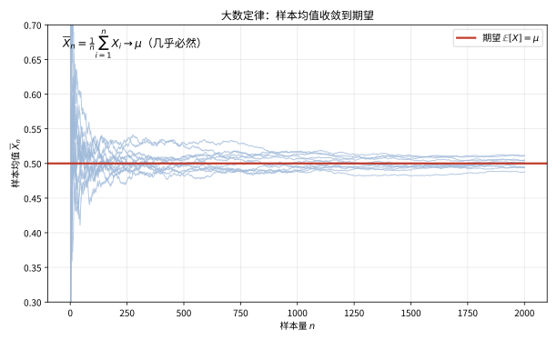

> **直观理解（现实类比）**：大数定律说的是"数据越多，平均值越靠谱"。就像多次抛硬币，抛 10 次正面比例可能波动很大，但抛 10000 次就会非常接近 $1/2$；或者像测量一件物品的误差，测量次数越多，取平均就越接近真实值。它把"概率"这个抽象概念落实为可观测的长期频率。

---

#### 课堂问答

**老师**：CLT 证明里，为什么单步特征函数只要展开到二阶 $\varphi(t)=1-\frac{t^2}{2}+o(t^2)$ 就够了？

**学生**：因为"每份 $1/n$ 的修正量"正是标尺所在。独立性让 $Z_n=\frac{1}{\sqrt n}\sum_i Y_i$ 的特征函数变成 $\left[\varphi(t/\sqrt n)\right]^n$；在原点附近 $\varphi(t/\sqrt n)=1-\frac{t^2}{2n}+o(1/n)$，二阶项恰好是 $O(t^2/n)$，取 $n$ 次幂配 $\log$ 再乘 $n$ 后正好留住常数 $-t^2/2$，更高阶项随 $n\to\infty$ 消失。所以二阶展开把方差钉进指数，正是 CLT 要的精度；展开到一阶会漏掉平方项，展开到三阶则多余。

**老师（追问）**：那从 $\varphi_{Z_n}(t)\to e^{-t^2/2}$ 到"依分布收敛于 $N(0,1)$"，这一步靠什么跨越？

**学生**：靠 Lévy 连续性定理。逐点收敛的极限 $\varphi(t)=e^{-t^2/2}$ 本身是标准正态的特征函数且在 $0$ 处连续，于是连续性定理保证存在 $Z\sim N(0,1)$ 使 $Z_n\xrightarrow{d}Z$。要害是极限函数必须"是个合法的特征函数且连续"，这条前提才让"看特征函数的收敛"能合法升级为"看分布的收敛"；没有它，逐点收敛不足以下结论。

**老师（拓展）**：CLT 的假设里，哪一条最不能被拿掉？

**学生**：有限方差 $\sigma^2\in(0,\infty)$ 最不能省。重尾反例是 $\alpha\in(0,2)$ 的稳定分布，此时归一化要用 $n^{1/\alpha}$ 而非 $\sqrt n$，极限是 $\alpha$-稳定分布，正态律失效，这是广义 CLT。另外 CLT 给的是依分布收敛，不是 a.s. 或 $L^1$ 收敛；$\sigma=0$ 退化为退化情形也要排除。看清这三点，才算抓住 CLT 的适用边界。

## 4. 示例

### 示例 1：用 Lebesgue 积分计算 Riemann 不可积函数的积分

**问题**：考虑 Dirichlet 函数 $f: [0,1] \to \mathbb{R}$：

$$
f(x) = \begin{cases}
1, & x \in \mathbb{Q} \cap [0,1] \\
0, & x \notin \mathbb{Q} \cap [0,1]
\end{cases}
$$

这个函数在 Riemann 意义下不可积（因为它在每一点都不连续），但在 Lebesgue 意义下可积。计算 $\int_{[0,1]} f \, dm$。

**解**：

**步骤1：分析 Riemann 不可积性**

对任意划分 $P = \{0 = x_0 < x_1 < \cdots < x_n = 1\}$，在每个子区间 $[x_{i-1}, x_i]$ 上，由于有理数和无理数都是稠密的，有：

$$
\sup_{x \in [x_{i-1}, x_i]} f(x) = 1, \quad \inf_{x \in [x_{i-1}, x_i]} f(x) = 0
$$

因此 Riemann 上和 $U(f, P) = 1$，Riemann 下和 $L(f, P) = 0$，$f$ Riemann 不可积。

**步骤2：Lebesgue 积分**

由于 $\mathbb{Q} \cap [0,1]$ 是可数集，其 Lebesgue 测度为零：

$$
m(\mathbb{Q} \cap [0,1]) = 0
$$

因此 $f$ 几乎处处等于 0。在 Lebesgue 积分理论中，几乎处处相等的函数视为相同，故：

$$
\int_{[0,1]} f \, dm = \int_{[0,1]} 0 \, dm = 0
$$

**步骤3：用定义验证**

将 $f$ 写为简单函数的形式：

$$
f = 1 \cdot \mathbf{1}_{\mathbb{Q} \cap [0,1]} + 0 \cdot \mathbf{1}_{[0,1] \setminus \mathbb{Q}}
$$

由简单函数积分的定义：

$$
\int_{[0,1]} f \, dm = 1 \cdot m(\mathbb{Q} \cap [0,1]) + 0 \cdot m([0,1] \setminus \mathbb{Q}) = 1 \cdot 0 + 0 \cdot 1 = 0
$$

**结论**：Lebesgue 积分能够处理 Riemann 积分无法处理的"病态"函数，这体现了测度论在处理奇异函数时的强大能力。

> **💡 直观理解（类比）**：示例 1 像"大片地方全是'空气'的函数，计量时只算真正占到的实体"——Dirichlet函数在有理点上取1、无理点上取0，可数的那撮有理点整体测度为零，于是按Lebesgue这把'准得离谱的秤'一称，积分 $=1\cdot m(\mathbb{Q}\cap[0,1])+0\cdot m(\text{其余})=0$。Riemann积分对它有劲儿使不上，是因为它在每个小区间都剧烈横跳（上下和分别是1和0），而Lebesgue积分不管你怎么病态，只按'值域分层×该层所占的比重'结算——比重为零的部分直接忽略，付账干脆利落。

---

### 示例 2：条件期望的计算

**问题**：设 $(\Omega, \mathcal{F}, \mathbb{P})$ 为概率空间，$X$ 和 $Y$ 是独立同分布的随机变量，服从 $[0,1]$ 上的均匀分布。考虑子 σ-代数 $\mathcal{G} = \sigma(X + Y)$（由 $X + Y$ 生成的 σ-代数）。计算 $\mathbb{E}[X \mid \mathcal{G}]$。

**解**：

**步骤1：问题分析**

我们需要找到 $\mathcal{G}$-可测的随机变量 $Z$，使得对任意 $A \in \mathcal{G}$，有 $\int_A Z \, d\mathbb{P} = \int_A X \, d\mathbb{P}$。

由于 $\mathcal{G} = \sigma(X + Y)$，由 Doob-Dynkin 引理，$\mathbb{E}[X \mid X+Y]$ 可以表示为 $X+Y$ 的可测函数，即存在 Borel 可测函数 $h$ 使得 $\mathbb{E}[X \mid X+Y] = h(X+Y)$。

**步骤2：利用对称性**

由于 $X$ 和 $Y$ 独立同分布，由对称性有：

$$
\mathbb{E}[X \mid X+Y] = \mathbb{E}[Y \mid X+Y]
$$

**步骤3：利用线性性质**

因此：

$$
\mathbb{E}[X \mid X+Y] + \mathbb{E}[Y \mid X+Y] = \mathbb{E}[X+Y \mid X+Y] = X+Y
$$

由对称性，$\mathbb{E}[X \mid X+Y] = \mathbb{E}[Y \mid X+Y]$，故：

$$
2 \mathbb{E}[X \mid X+Y] = X+Y
$$

**步骤4：结论**

因此：

$$
\mathbb{E}[X \mid X+Y] = \frac{X+Y}{2}
$$

**验证**：$\frac{X+Y}{2}$ 显然是 $\sigma(X+Y)$-可测的，且 $\mathbb{E}[\frac{X+Y}{2} \mid X+Y] = \frac{X+Y}{2}$，满足条件期望的定义。

> **💡 直观理解（类比）**：示例 2 像"被蒙住只看到'两人身高总和 $S$'，去猜其中一人身高的最佳答案是什么"——既然只知道总和，且两人来自同一条均匀分布（同分布），猜谁都一样（对称性 $\mathbb{E}[X\mid S]=\mathbb{E}[Y\mid S]$）；把两个猜测加起来必须恰好还原出已知总和 $S$，于是每人恰好分到一半：$\mathbb{E}[X\mid X+Y]=\frac{X+Y}{2}$。这正是条件期望在城市里的经典三连招：Doob-Dynkin告诉你能写成 $S$ 的函数，对称性直接'五五开'，线性性最后核账——一个无需算积分就能拿到的漂亮答案，也是"已知总和下手头信息量有限、只能雨露均沾"的直观写照。

---

## 4.S Stewart 微积分风格补充：现实应用、分步例题与解题策略

> 测度论的公式落到现实里，都是从同一个动作出发：**先判断"这个集合可不可测、够不够格被称重"，再决定用哪把积分刀**。本节沿用 Stewart 的"策略 → 例题 → 分步解 → 回读现实"四步法，把简单函数积分、Lebesgue 测度为零的集合、条件期望对称性、特征函数这几样核心工具放进分段定价、奇异集、公平猜测、矩的提取等真实场景里跑一遍。每道例题先给**解题策略**，让你看清"这道题该往哪个方向想"，再给出**每步都解释"为什么"**的分步解答。

### 🎯 本级解题策略（Principles of Problem Solving）

Stewart 式的测度论题，讲究"先立可测，再谈算什么"。做一道题，请按这四步走：

- **第一步 · 判可测**：先问"这个集合/函数是否可测"。区间、开集、开集的补与可数并都归入 Borel 家族；$f$ 只需"取值超过 $a$"的上水平集 $\{f>a\}$ 可测即可积分，不必要求连续。
- **第二步 · 化简对象**：非负可测函数用"简单函数 $\sum a_i\mathbf 1_{A_i}$ 逼近"，收敛定理（单调收敛、控制收敛）决定"积分与极限能不能换序"；零测集在 $\int$ 眼里可以忽略。
- **第三步 · 挑等式**：算期望用 $\mathbb{E}X=\int X\,d\mathbb{P}$；谈条件期望用"$\mathcal{G}$-可测 + 在 $\mathcal{G}$ 上积分一致"两条定义，或直接用对称性/线性性定出 $\mathbb{E}[X\mid X+Y]=\frac{X+Y}{2}$ 这类闭式；提取矩用特征函数 $\varphi_X(t)=\mathbb{E}[e^{itX}]$ 的导数 $\varphi^{(k)}(0)=i^k\mathbb{E}X^k$。
- **第四步 · 回读并验证**：把结果代回定义核对（如简单函数积分 = 值 × 体积的 Σ），对"零测集"类的调和要解释"为什么可积但算起来是 0"，需要时用唯一性（特征函数 ↔ 分布）反推分布。

> **一句话带走**：测度论的分步解就是"判可测 → 化简 → 挑等式 → 回读验证"——它真正的底线不是"算得更准"，而是"规定哪些集合算得清、哪些可以不算"，Lebesgue 随之成了让不可测/剧烈震荡也有从何说起的积分。

---

### 例题 A · 阶梯定价也配叫积分：简单函数的 Lebesgue 积分

> **🎯 建模策略**：最简单也最真实的 Lebesgue 积分就是把"价值 $a_i$ × 占据体积 $\mu(A_i)$"逐项加起来。**策略：把 $f$ 写成互不相交块上的常数（简单函数），再分别乘各自测度求和。**

**问题**：在 $[0,1]$（Lebesgue 测度）上定义 $f(x)=1\,\mathbf 1_{[0,\frac12]}(x)+2\,\mathbf 1_{(\frac12,1]}(x)$。计算 $\int_{[0,1]} f\,dm$。

**解**：

**步骤 1：写成分块求和**  $\int f\,dm=1\cdot m([0,\tfrac12])+2\cdot m((\tfrac12,1])$。

**步骤 2：代入测度**  $m([0,\tfrac12])=\tfrac12$、$m((\tfrac12,1])=\tfrac12$，故
$$
\int f\,dm=\tfrac12+2\cdot\tfrac12=1.5
$$

*（为什么能直接乘：$\mathbf 1_{A}$ 把积分压成"值乘测度"，线性性再允许逐块相加——Lebesgue 积分从这一层就已经是 Riemann 想都不敢想的"不需要函数连续"的合法积分。）*

> **回读现实**：$1.5$ 就是把"前半段单价 1、后半段单价 2"的分段账单按长度加权前的应付款——Lebesgue 积分兜住的正是这类"边界医着突跳、中间全是台阶"的现实函数，Riemann 积分则会怕突跳而处处为难。

---

### 例题 B · 一部"几乎不存在的分量"：可数集的 Lebesgue 测度

> **🎯 建模策略**：问"有理数那一片占了多少面积"。**策略：先证明有理数是可数个单点集的并，再由可数与 σ-可加性推出测度为零，最后用简单函数/积分得出 $\int\mathbf 1_{\mathbb Q}=0$。**

**问题**：证明 $m(\mathbb{Q}\cap[0,1])=0$，并求 $\int_{[0,1]}\mathbf 1_{\mathbb Q}\,dm$。

**解**：

**步骤 1：可数列举**  $\mathbb{Q}\cap[0,1]=\bigcup_n\{q_n\}$，其中 $q_n$ 是其中可数个有理数。

**步骤 2：σ-可加性推零**
$$
m(\mathbb{Q}\cap[0,1])\le\sum_n m(\{q_n\})=\sum_n 0=0
$$

**步骤 3：积分**  $\int_{[0,1]}\mathbf 1_{\mathbb Q}\,dm=1\cdot m(\mathbb{Q}\cap[0,1])=0$。

*（为什么不是"无穷多个点"所以不是零：单点测度为 0，可数个单点并起来测度仍为 0（σ-可加的下界）；"无穷多个点"≠"正面积"，这正是 Lebesgue 测度与初等直觉的分野。）*

> **回读现实**：有理数在数轴上密得"无处不有却零体积"——所以 Dirichlet 函数（$1_{\mathbb Q}$）在 Lebesgue 意义下积分恰为 0，在 Riemann 意义下却不可积。这告诉我们：测度论把"不可数的错乱"归纳成"可数的细点"，从而给了怪函数一个"算得清、值不大"的交代。

---

### 例题 C · 只掌握"总和"时的最优猜测：条件期望的对称性

> **🎯 建模策略**：想看"知道了 $S=X+Y$ 之后，$X$ 的最优预测"，别硬积分，先用"批判三连"：可测（能写成 $S$ 的函数）、对称（$X,Y$ 同分布所以 $\mathbb{E}[X\mid S]=\mathbb{E}[Y\mid S]$）、线性（二者之和必须还原为 $S$）。**策略：设 $G=\mathbb{E}[X\mid S]$，写出"可测"与"$2G=S$"两个等式，联立解得 $G=S/2$。**

**问题**：$X,Y$ 独立且均为 $[0,2]$ 上均匀分布，$S=X+Y$。求 $\mathbb{E}[X\mid S]$。

**解**：

**步骤 1：对称性**  $X,Y$ iid，故 $\mathbb{E}[X\mid S]=\mathbb{E}[Y\mid S]=:G$。

**步骤 2：线性核账**  $2G=\mathbb{E}[X+Y\mid S]=\mathbb{E}[S\mid S]=S$，故
$$
G=\frac{S}{2}=\frac{X+Y}{2}
$$

*（为什么能五五开：$G=X+Y/2$ 显然是 $\sigma(S)$-可测的，且 $\mathbb{E}[\frac{X+Y}{2}\mid S]=S/2=G$ 满足条件期望两条定义，无需算任何积分。）*

> **回读现实**：茫茫信息里只告诉你两人得分总和，猜谁都是"各拿一半"——条件期望用"可测 + 在子代上积分一致"剥离掉对称信息的随机性，把"只知道总和"的最优预测干净地落到 $\frac{X+Y}{2}$。这是"信息越少、只能雨露均沾"的数学版。

---

## 5. 习题

### 基础题

**习题 1**（σ-代数与测度）写出σ-代数的三条公理；给出测度的σ-可加性定义，说明可测空间、测度空间的含义。

**习题 2**（Lebesgue积分的定义）分三步说明Lebesgue积分的定义：非负简单函数、非负可测函数、一般可测函数（通过 $f^+$、$f^-$ 分解）。

**习题 3**（概率空间与随机变量）给出概率测度的定义（$\mathbb{P}(\Omega)=1$）、随机变量（可测函数）与分布函数 $F_X(x)=\mathbb{P}(X\le x)$ 的定义，并列出分布函数的三条基本性质。

**习题 4**（Lebesgue可积性判定）设 $f(x)=x^{-1/2}$（$[0,1]$ 上）。证明 $f$ 关于Lebesgue测度可积，但 $f^2$ 不可积（提示：用单调收敛定理把 $\sum f_n$ 逐项积分，或直接算广义Riemann积分 $\int_0^1 x^{-1/2}dx$ 与 $\int_0^1 x^{-1}dx$）。

**习题 5**（Riemann与Lebesgue积分）设 $f:[0,1]\to\mathbb{R}$ 是Riemann可积函数。证明 $f$ 也是Lebesgue可积的且两种积分值相等（提示：用Riemann可积的Lebesgue准则：不连续点集为零测集，再用有界收敛定理）。

**习题 6**（控制收敛定理的强结论）设可测函数列 $f_n\to f$ a.e. 且存在可积 $g$ 使 $|f_n|\le g$。证明更强的结论 $\int|f_n-f|\,d\mu\to0$（提示：用Fatou引理处理 $2g-|f_n-f|$）。

**习题 7**（收敛定理的基本陈述）陈述单调收敛定理与Fatou引理：$f_n\uparrow f$ 非负时 $\lim\int f_n=\int f$；非负函数列有 $\int\liminf f_n\le\liminf\int f_n$。

**习题 8**（L$^p$ 收敛与控制）设 $1\le p<\infty$，$f_n\in L^p$，$f_n\to f$ a.e.，且存在 $g\in L^p$ 使 $|f_n|\le g$。证明 $\|f_n-f\|_p\to0$（提示：由 $|f_n-f|^p\le(2g)^p$ 应用控制收敛定理）。

**习题 9**（特征函数的基本性质）设 $\varphi$ 是随机变量 $X$ 的特征函数。证明 $|\varphi(t)|\le1$、$\varphi(-t)=\overline{\varphi(t)}$、$\varphi$ 在 $\mathbb{R}$ 上一致连续（提示：用 $|e^{itX}|=1$、共轭性质与 $|\varphi(t+h)-\varphi(t)|\le\mathbb{E}[|e^{ihX}-1|]$）。

**习题 10**（条件期望：指数分布）设 $X\sim\text{Exp}(\lambda)$、$Y\sim\text{Exp}(\mu)$ 独立，计算 $\mathbb{E}[X\mid X+Y]$（提示：先求 $X+Y$ 的密度，再用联合密度得到条件密度）。

### 进阶题

**习题 11**（单调收敛定理证明）简述单调收敛定理的证明要点：对简单函数 $g\le f$ 构 $E_n=\{f_n\ge cg\}$（$0<c<1$），用测度的下方连续性过渡极限。

**习题 12**（Fatou引理证明）设 $g_n=\inf_{k\ge n}f_k$，证明 $\int\liminf f_n\,d\mu\le\liminf\int f_n\,d\mu$，指出用到的关键步骤。

**习题 13**（控制收敛定理证明）用Fatou引理证明：$f_n\to f$ a.e. 且 $|f_n|\le g$（$g$ 可积）时 $\lim\int f_n\,d\mu=\int f\,d\mu$（提示：考虑 $2g-|f_n-f|\ge0$ 并对它取 $\liminf$）。

**习题 14**（Hölder不等式）对 $1/p+1/q=1$，推导 $\int|fg|\,d\mu\le\|f\|_p\|g\|_q$，说明等号条件。

**习题 15**（Radon-Nikodym定理的$L^2$方法概要）介绍RN定理证明的核心：在 $L^2(\mu+\nu)$ 上定义有界线性泛函 $\Phi(g)=\int g\,d\nu$，用Riesz表示定理得到 $h$，再构造 $f=h/(1-h)$。

**习题 16**（条件期望的塔性质）设 $\mathcal{H}\subset\mathcal{G}$ 为子σ-代数，证明 $\mathbb{E}[\mathbb{E}[X\mid\mathcal{G}]\mid\mathcal{H}]=\mathbb{E}[X\mid\mathcal{H}]$（提示：两边都是 $\mathcal{H}$-可测且在与 $\mathcal{H}$ 集的积分上一致）。

**习题 17**（特征函数与矩）由 $\varphi^{(k)}(0)=i^k\mathbb{E}[X^k]$ 说明特征函数如何表达矩；并说明"特征函数唯一确定分布"用于何种场合。

**习题 18**（中心极限定理的特征函数证明）设 $S_n=\sum X_i$，$\mathbb{E}[X_1]=\mu$，$\text{Var}(X_1)=\sigma^2$。说明如何用特征函数证 $\frac{S_n-n\mu}{\sigma\sqrt n}\xrightarrow{d}N(0,1)$（提示：标准化后 $\varphi(t)=1-\frac{t^2}{2}+o(t^2)$，$\varphi_{Z_n}\to e^{-t^2/2}$）。

**习题 19**（Fubini与乘积测度）设 $(\Omega_i,\mathcal{F}_i,\mu_i)$ 为σ-有限测度空间。陈述Fubini定理：对非负可测 $f$ 在 $\Omega_1\times\Omega_2$ 上，两次积分可交换顺序；并说明积分顺序交换的适用条件。

### 挑战题

**习题 20**（Radon-Nikodym定理完整证明）给出RN定理基于 $L^2(\mu+\nu)$ 的完整证明：定义 $\Phi$、证有界、用Riesz表示得 $h$，证 $0\le h\le1$ a.e.、$A=\{h=1\}$ 满足 $\mu(A)=\nu(A)=0$，构造 $f=h/(1-h)$ 并证唯一性。

**习题 21**（条件期望存在唯一性）设 $\nu(A)=\int_A X\,d\mathbb{P}$（$A\in\mathcal{G}$）。证明 $\nu\ll\mathbb{P}|_\mathcal{G}$，从而由RN定理得 $\mathcal{G}$-可测的 $\mathbb{E}[X\mid\mathcal{G}]$，并证明其几乎处处唯一。

**习题 22**（中心极限定理完整证明）完整写出CLT证明：标准化 $Y_i$、展开 $\varphi(t)=1-t^2/2+o(t^2)$、计算 $\varphi_{Z_n}=[\varphi(t/\sqrt n)]^n$、取对数到 $-\frac{t^2}{2}$，由Lévy连续性定理得依分布收敛。

**习题 23**（控制收敛定理的强结论证明）完整证明 $f_n\to f$ a.e.、$|f_n|\le g$（$g$ 可积）蕴含 $\int|f_n-f|\,d\mu\to0$：先证 $f$ 可积，再对 $2g-|f_n-f|$ 用Fatou得到 $\limsup\int|f_n-f|\le0$。

**习题 24**（$L^p$ 空间的收敛性）严格证明：$f_n\to f$ a.e. 且 $|f_n|\le g\in L^p$ 时 $\|f_n-f\|_p\to0$，其中关键不等式 $|f_n-f|^p\le(2g)^p$，并说明为何此时可对 $|f_n-f|^p$ 应用控制收敛定理。

**习题 25**（收敛定理的逻辑链）说明单调收敛定理 → Fatou引理 → 控制收敛定理的依赖关系：如何由MCT得到Fatou，又如何由Fatou得到DCT。

**习题 26**（依测度收敛与几乎处处收敛）用Borel-Cantelli引理证明Riesz定理：若 $f_n$ 依测度收敛于 $f$，则存在子列 $f_{n_k}$ 几乎处处收敛于 $f$。

### 探究题

**习题 27**（Lebesgue与Riemann积分）深入探究Lebesgue积分与Riemann积分的本质差别（"分割值域 vs 分割定义域"），说明何时二者一致、何时Lebesgue可积而Riemann不可积，并结合Dirichlet函数举例。

**习题 28**（条件期望与鞅）探究条件期望在鞅理论中的作用：说明鞅定义 $\mathbb{E}[M_t\mid\mathcal{F}_s]=M_s$ 正是条件期望性质的应用，并联系随机分析中滤波与信息流的概念。

**习题 29**（特征函数与极限定理）探究特征函数方法在大数定律、中心极限定理与依分布收敛证明中的核心地位，说明"特征函数唯一确定分布"与Lévy连续性定理的用处。

**习题 30**（测度论作为概率的基石）探究测度论如何为概率论提供公理化基础：概率=正则化测度、随机变量=可测函数、期望=Lebesgue积分、Wiener过程存在性对测度构造的依赖，并讨论概率空间的完备化。

### 应用题（Stewart 式综合应用）

**应用题 31**（简单函数 Lebesgue 积分—测度论）：在 $[0,1]$ 上定义 $f(x)=\mathbf 1_{[0,\frac13]}(x)+2\,\mathbf 1_{(\frac13,\frac23]}(x)+3\,\mathbf 1_{(\frac23,1]}(x)$。计算 $\int_{[0,1]}f\,dm$。

**应用题 32**（可数集零测—测度论）：计算 $m(\mathbb{Q}\cap[0,1])$ 与 $\int_{[0,1]}\mathbf 1_{\mathbb Q}\,dm$，并解释为什么"有无穷多个点"仍会测度为零。

**应用题 33**（条件期望对称性—概率）：$X,Y$ 独立且均服从 $[0,2]$ 上均匀分布，$S=X+Y$。求 $\mathbb{E}[X\mid S]$ 并给出验证。

**应用题 34**（特征函数提取矩—概率）：$X\sim\text{Bernoulli}(p)$，计算特征函数 $\varphi_X(t)$，并利用 $\varphi'(0)$ 提取一阶矩核对 $\mathbb{E}[X]=p$。

---

## 6. 习题答案与解析

### 基础题答案

1. **σ-代数与测度** σ-代数的三条公理：① $\Omega\in\mathcal{F}$；② $A\in\mathcal{F}\Rightarrow A^c\in\mathcal{F}$；③ 可数并封闭 $\bigcup_n A_n\in\mathcal{F}$。测度 $\mu:\mathcal{F}\to[0,\infty]$ 满足 $\mu(\emptyset)=0$ 且σ-可加性 $\mu(\bigcup A_n)=\sum\mu(A_n)$（互不相交时）。$(X,\mathcal{F})$ 称可测空间，$(X,\mathcal{F},\mu)$ 称测度空间。

2. **Lebesgue积分的定义** ① 非负简单函数 $f=\sum a_i\mathbf1_{A_i}$：$\int f\,d\mu=\sum a_i\mu(A_i)$；② 非负可测函数：$\int f\,d\mu=\sup\{\int g\,d\mu:0\le g\le f,\,g\text{ 简单}\}$（任何非负可测函数是非负简单函数列单调递增极限）；③ 一般可测函数：拆 $f=f^+-f^-$，二者积分均有限时称可积，$\int f=\int f^+-\int f^-$。

3. **概率空间与随机变量** 概率测度要求 $\mathbb{P}(\Omega)=1$，$(\Omega,\mathcal{F},\mathbb{P})$ 称概率空间；随机变量即可测函数 $X:\Omega\to\mathbb{R}$；分布函数 $F_X(x)=\mathbb{P}(X\le x)$ 的三条性质：单调非降、$\lim_{x\to-\infty}F=0$ 且 $\lim_{x\to\infty}F=1$、右连续。

4. **Lebesgue可积性判定** $\int_0^1 x^{-1/2}dx=\lim_{n}\int x^{-1/2}\mathbf1_{[1/n,1]}dx=\lim[2x^{1/2}]_{1/n}^{1}=2$，故 $x^{-1/2}\in L^1[0,1]$（用MCT或广义Riemann积分）。而 $\int_0^1 (x^{-1/2})^2dx=\int_0^1 x^{-1}dx=\lim[\ln x]_{1/n}^{1}=+\infty$。因此 $f\in L^1$ 但 $f^2\notin L^1$，说明 $L^1$ 中的函数平方未必可积。

5. **Riemann与Lebesgue积分** 由Riemann可积的Lebesgue准则，$f$ 有界且不连续点集 $N$ 为零测集。取Riemann可积函数的简单函数列或阶梯函数列 $f_n$，其在每个连续点趋向 $f$，即 $f_n\to f$ a.e.；因 $f_n$ 一致有界（$|f_n|\le\|f\|_\infty$），由有界收敛定理 $\int f\,dm=\lim\int f_n dm$，而 $\int f_n dm$ 正是对应的Riemann和极限，故两种积分值相等。

6. **控制收敛定理的强结论** 令 $h_n=2g-|f_n-f|\ge0$，因 $|f_n-f|\le2g$。$f_n\to f$ a.e. 给出 $h_n\to2g$ a.e.。对 $h_n$ 用Fatou：$\int 2g\,d\mu\le\liminf\int(2g-|f_n-f|)d\mu=\int2g\,d\mu+\liminf(-\int|f_n-f|d\mu)$，消去 $\int2g$ 得 $0\le-\limsup\int|f_n-f|d\mu$，故 $\limsup\int|f_n-f|\le0$，而积分非负，故 $\int|f_n-f|\to0$。特别地 $\int f_n\to\int f$。

7. **收敛定理的基本陈述** 单调收敛定理：$0\le f_1\le f_2\le\cdots$ 且 $f_n\uparrow f$ 时 $\lim\int f_n\,d\mu=\int f\,d\mu$。Fatou引理：非负可测函数列满足 $\int\liminf f_nd\mu\le\liminf\int f_nd\mu$。两者都是"极限与积分交换"的充分条件，Fatou只有不等号。

8. **L$^p$ 收敛与控制** 由 $|f_n-f|^p\le(|f_n|+|f|)^p\le(2g)^p$（因 $|f_n|\le g$，$|f|\le g$ 于 $f_n\to f$ 与 $|f_n|\le g$ 推出）。$(2g)^p\in L^1$（因 $g\in L^p$），故对非负可测列 $|f_n-f|^p$ 应用控制收敛定理：$|f_n-f|^p\to0$ a.e.，故 $\int|f_n-f|^pd\mu\to0$，即 $\|f_n-f\|_p\to0$。

9. **特征函数的基本性质** $|\varphi(t)|=|\mathbb{E}[e^{itX}]|\le\mathbb{E}|e^{itX}|=1$。 $\varphi(-t)=\mathbb{E}[e^{-itX}]=\overline{\mathbb{E}[e^{itX}]}=\overline{\varphi(t)}$。一致连续：$|\varphi(t+h)-\varphi(t)|=|\mathbb{E}[e^{itX}(e^{ihX}-1)]|\le\mathbb{E}|e^{ihX}-1|\to0$（$h\to0$，由 $|e^{ihX}-1|\le2$ 与控制收敛定理取极限），与 $t$ 无关故一致连续。

10. **条件期望：指数分布** 联合密度 $f_{X,Y}(x,y)=\lambda e^{-\lambda x}\mu e^{-\mu y}$。给定 $X+Y=s$，条件密度 $f_{X|S}(x|s)\propto e^{-\lambda x}e^{-\mu(s-x)}=e^{-\mu s}e^{-(\lambda-\mu)x}$（$0<x<s$），故 $\mathbb{E}[X\mid S=s]=\frac{\int_0^s x e^{-(\lambda-\mu)x}dx}{\int_0^s e^{-(\lambda-\mu)x}dx}$。当 $\lambda=\mu$ 时由对称性 $\mathbb{E}[X\mid X+Y]=\frac{X+Y}{2}$（与该卷示例2的对称方法一致）。

### 进阶题答案

1. **单调收敛定理证明** 记 $L=\lim\int f_n$，由 $f_n\uparrow f$ 得 $L\le\int f$。反方向：对任简单函数 $0\le g\le f$ 与 $0<c<1$，令 $E_n=\{f_n\ge cg\}\uparrow\Omega$，则 $\int f_n\ge\int_{E_n}f_n\ge c\int_{E_n}g=c\sum a_i\mu(A_i\cap E_n)\to c\int g$（测度下方连续性），故 $L\ge c\int g$，令 $c\to1$、对 $g$ 取上确界得 $L\ge\int f$，故 $L=\int f$。

2. **Fatou引理证明** $g_n=\inf_{k\ge n}f_k$ 满足 $g_n\uparrow\liminf f_k$，且 $g_n\le f_k$（$k\ge n$）给出 $\int g_n\le\inf_{k\ge n}\int f_k\le\liminf\int f_k$（$n\to\infty$）。由MCT，$\int\liminf f_k=\lim\int g_n\le\liminf\int f_k$。关键是 $g_n$ 单调递增（可比），故可换极限与积分。

3. **控制收敛定理证明** 由 $|f_n|\le g$ 与 $f_n\to f$ a.e. 得 $|f|\le g$ a.e.，故 $f$ 可积。$h_n=2g-|f_n-f|\ge0$ 且 $h_n\to2g$ a.e.，Fatou：$\int2g\le\liminf\int h_n=\liminf\int(2g-|f_n-f|)=\int2g+\liminf(-\int|f_n-f|)$，得 $\limsup\int|f_n-f|\le0$，故 $\int|f_n-f|\to0$，从而 $|\int f_n-\int f|\le\int|f_n-f|\to0$。

4. **Hölder不等式** 由Young不等式 $\frac{|f|^p}{p\|f\|_p^p}+\frac{|g|^q}{q\|g\|_q^q}\ge\frac{|f||g|}{\|f\|_p\|g\|_q}$（两端同取对数后由 $uv\le u^p/p+v^q/q$），两边积分得 $\frac1p+\frac1q=1\ge\frac{\int|fg|}{\|f\|_p\|g\|_q}$，即 $\int|fg|\le\|f\|_p\|g\|_q$。等号当且仅当 $|f|^p$ 与 $|g|^q$ 成比例（Young取等条件）。

5. **Radon-Nikodym定理的$L^2$方法概要** 在 $L^2(\mu+\nu)$ 上 $\Phi(g)=\int g\,d\nu$ 为有界线性泛函（$\nu\le\mu+\nu$，Cauchy-Schwarz给出界），Riesz表示定理给唯一 $h$：$\int g\,d\nu=\int gh\,d(\mu+\nu)$。整理 $\int g(1-h)d\nu=\int gh\,d\mu$。由取 $g$ 为 $\mathbf1_{\{h<0\}}$、$\mathbf1_{\{h>1\}}$ 可证 $0\le h\le1$ a.e.；在 $\{h=1\}$ 上 $\int gh\,d\mu=\int g\,d\mu=0$ 故 $\mu(\{h=1\})=0$。于是 $1-h>0$ a.e.，定义 $f=h/(1-h)$，代入得 $\nu(B)=\int_B f d\mu$。

6. **条件期望的塔性质** 设 $Y_1=\mathbb{E}[X\mid\mathcal{G}]$、$Y_2=\mathbb{E}[Y_1\mid\mathcal{H}]$。$Y_2$ 是 $\mathcal{H}$-可测的。对任意 $A\in\mathcal{H}\subset\mathcal{G}$：$\int_A Y_2d\mathbb{P}=\int_A Y_1d\mathbb{P}$（$Y_2$ 的定义），且 $\int_A Y_1d\mathbb{P}=\int_A Xd\mathbb{P}=\int_A\mathbb{E}[X\mid\mathcal{H}]d\mathbb{P}$。故 $Y_2$ 满足 $\mathbb{E}[X\mid\mathcal{H}]$ 的两条性质，由（a.s.）唯一性 $\mathbb{E}[\mathbb{E}[X\mid\mathcal{G}]\mid\mathcal{H}]=\mathbb{E}[X\mid\mathcal{H}]$。

7. **特征函数与矩** 当 $\mathbb{E}|X|^k<\infty$ 时，可用控制收敛定理交换导数与期望，得 $\varphi^{(k)}(0)=i^k\mathbb{E}[X^k]$，故特征函数在零点的各阶导数给出各阶矩。又由"特征函数唯一确定分布"：两个分布若有相同特征函数则作为测度相等，可用于测度相等性的概率证明；配合Lévy连续性定理使依分布收敛转化为特征函数逐点收敛，是极限定理的核心工具。

8. **中心极限定理的特征函数证明** 标准化 $Y_i=(X_i-\mu)/\sigma$（$\mathbb{E}Y=0$，$\mathbb{E}Y^2=1$），$Z_n=\frac{1}{\sqrt n}\sum Y_i$。由独立性 $\varphi_{Z_n}(t)=[\varphi_Y(t/\sqrt n)]^n$。$\varphi_Y$ 在 $0$ 展开 $\varphi_Y(t/\sqrt n)=1-\frac{t^2}{2n}+o(1/n)$，取对数 $n\log(\cdot)\to-\frac{t^2}{2}$，故 $\varphi_{Z_n}(t)\to e^{-t^2/2}$（标准正态特征函数）。由Lévy连续性定理 $Z_n\xrightarrow{d}N(0,1)$。

9. **Fubini与乘积测度** 对σ-有限测度空间 $(\Omega_1,\mathcal{F}_1,\mu_1),(\Omega_2,\mathcal{F}_2,\mu_2)$，若 $f\ge0$ 是 $\mathcal{F}_1\otimes\mathcal{F}_2$-可测函数，则 $x\mapsto\int f(x,y)d\mu_2$ 可测且 $\int_{\Omega_1\times\Omega_2} f\,d(\mu_1\times\mu_2)=\int_{\Omega_1}(\int_{\Omega_2}f\,d\mu_2)d\mu_1=\int_{\Omega_2}(\int_{\Omega_1}f\,d\mu_1)d\mu_2$。对一般可积 $f$（$\int|f|d(\mu_1\times\mu_2)<\infty$）同样成立，即积分顺序可交换的适用条件是 $f\ge0$ 或 $f$ 绝对可积（Tonelli/Fubini）。

### 挑战题答案

1. **Radon-Nikodym定理完整证明** 设 $\rho=\mu+\nu$，在 $L^2(\rho)$ 上 $\Phi(g)=\int g\,d\nu$。有界性：$|\Phi(g)|\le\int|g|d\rho\le\sqrt{\rho(\Omega)}\|g\|_{L^2(\rho)}$。Riesz给 $h$：$\int g\,d\nu=\int gh\,d\rho$，即 $\int g(1-h)d\nu=\int gh\,d\mu$。取 $g=\mathbf1_{\{h<0\}}$：左 $\ge0$ 右 $\le0$，均0，故 $h\ge0$；取 $g=\mathbf1_{\{h>1\}}$：右 $\ge\int_{\{h>1\}}h\,d\mu\ge0$、左$\le0$，须 $\mu(\{h>1\})=0$ 且 $\nu(\{h>1\})=0$，故 $h\le1$。令 $A=\{h=1\}$，对 $g=\mathbf1_A$：$0=\int_A(1-h)d\nu=\int_A h\,d\mu=\mu(A)$，由 $\nu\ll\mu$ 得 $\nu(A)=0$。在 $\{h<1\}$ 上 $f=\frac{h}{1-h}$，取 $g=\mathbf1_B\frac1{1-h}$ 代入得 $\nu(B)=\int_B f\,d\mu$。唯一性：若 $\int_A(f_1-f_2)d\mu=0$ 对所有 $A$，则 $f_1=f_2$ a.e.。

2. **条件期望存在唯一性** 对 $X\ge0$，$\nu(A)=\int_A Xd\mathbb{P}$（$A\in\mathcal{G}$）是 $(\Omega,\mathcal{G})$ 上的有限测度，且 $\mathbb{P}|_\mathcal{G}(A)=0\Rightarrow\nu(A)=0$，即 $\nu\ll\mathbb{P}|_\mathcal{G}$。RN定理给 $\mathcal{G}$-可测 $Y\ge0$：$\int_A Xd\mathbb{P}=\int_A Yd\mathbb{P}$，$Y$ 正是 $\mathbb{E}[X\mid\mathcal{G}]$。一般 $X$ 拆正负部分别处理再相减。唯一性：若 $Y_1,Y_2$ 都满足，取 $A=\{Y_1-Y_2>0\}\in\mathcal{G}$，$\int_A(Y_1-Y_2)d\mathbb{P}=0$ 给出 $\mathbb{P}(A)=0$；同理 $\{Y_1-Y_2<0\}$ 概率0，故 $Y_1=Y_2$ a.s.。

3. **中心极限定理完整证明** 标准化 $Y_i$ 得 $\mathbb{E}Y_i=0$、$\mathbb{E}Y_i^2=1$。特征函数 $\varphi(t)=\mathbb{E}[e^{itY_1}]$ 在 $0$ 两阶可微且 $\varphi'(0)=i\mathbb{E}Y_1=0$、$\varphi''(0)=i^2\mathbb{E}Y_1^2=-1$，故 $\varphi(t)=1-\frac{t^2}{2}+o(t^2)$。由独立性 $\varphi_{Z_n}(t)=[\varphi(t/\sqrt n)]^n$，对固定 $t$：$\varphi(t/\sqrt n)=1-\frac{t^2}{2n}+o(1/n)$，$\log\varphi_{Z_n}(t)=n\log(1-\frac{t^2}{2n}+o(1/n))\to-\frac{t^2}{2}$。故 $\varphi_{Z_n}(t)\to e^{-t^2/2}$。由Lévy连续性定理（特征函数逐点收敛且极限在0连续）得 $Z_n\xrightarrow{d}N(0,1)$。

4. **控制收敛定理的强结论证明** 由 $f_n\to f$ a.e. 与 $|f_n|\le g$ 得 $|f|\le g$ a.e.，$f$ 可积。$h_n=2g-|f_n-f|\ge0$（因 $|f_n-f|\le|f_n|+|f|\le2g$），$h_n\to2g$ a.e.。Fatou：$\int2g\,d\mu\le\liminf\int h_n\,d\mu=\int2g\,d\mu+\liminf(-\int|f_n-f|d\mu)$，故 $\limsup\int|f_n-f|d\mu\le0$；又 $\int|f_n-f|d\mu\ge0$，故 $\lim\int|f_n-f|d\mu=0$。于是 $\int f_n\to\int f$（由 $|\int f_n-\int f|\le\int|f_n-f|$）。

5. **$L^p$ 空间的收敛性** 由 $f_n\to f$ a.e. 与 $|f_n|\le g$ 推出 $|f|\le g$ a.e.，故 $|f_n-f|^p\le(|f_n|+|f|)^p\le(2g)^p$，而 $(2g)^p\in L^1$（因 $g\in L^p$）。于是对非负可测函数列 $|f_n-f|^p$ 应用控制收敛定理：它 a.e. 收敛到 $0$ 且被可积函数 $(2g)^p$ 控制，得 $\int|f_n-f|^pd\mu\to0$，即 $\|f_n-f\|_p\to0$。关键是把 $L^p$-范数收敛转化为被控函数 $|f_n-f|^p$ 的积分收敛，再利用 $L^p$-控制条件保证极限与积分可交换（此时控制函数 $(2g)^p$ 正是 $L^p$ 可积的，故DCT适用）。

6. **收敛定理的逻辑链** MCT→Fatou：Fatou证明中令 $g_n=\inf_{k\ge n}f_k$ 单调递增，需MCT把 $\int\liminf=\lim\int g_n$ 换位，因此Fatou依赖MCT。Fatou→DCT：DCT证明中对非负的 $h_n=2g-|f_n-f|$ 用Fatou得到 $\limsup\int|f_n-f|\le0$ 从而结论，故DCT依赖Fatou（→MCT）。因此三者逻辑上是MCT最基础、Fatou次之、DCT最强，且DCT可由Fatou（间接由MCT）推出。

7. **依测度收敛与几乎处处收敛** 依测度收敛给出对 $\varepsilon=2^{-k}$，$\mu(|f_{n_k}-f|>2^{-k})<2^{-k}$（取严格递增子列 $n_k$），则 $\sum_k\mu(|f_{n_k}-f|>2^{-k})<\infty$，由Borel-Cantelli引理 $\limsup\{|f_{n_k}-f|>2^{-k}\}$ 属零测集，即除零测集外 $|f_{n_k}-f|\le2^{-k}$ 最终成立，故 $f_{n_k}\to f$ a.e.。这说明依测度收敛比几乎处处收敛弱，但总有"几乎处处收敛的子列"。

### 探究题答案

1. **Lebesgue与Riemann积分** Riemann积分把定义域 $[0,1]$ 切分成小区间，要求函数在每个小区间上"足够接近常数"（振幅随划分趋于0）才可积，因此对剧烈震荡（如Dirichlet函数，每点有理值1/1，无理值0）不可积。Lebesgue积分把值域分层，对每层 $[a_i,a_{i+1})$ 取原像 $f^{-1}([a_i,a_{i+1}))$ 并测其测度，用 $\sum a_i\,\mu(\cdot)$ 逼近——不要求连续性，只需原像可测。当 $f$ Riemann可积（不连续点集零测）时两种积分相等且值相同（例5）；Dirichlet函数仅在可数集上取1，Lebesgue测度0，故Lebesgue积分 $\int f=1\cdot0=0$ 存在，而Riemann不可积。这体现"Lebesgue积分以测度论处理奇异函数"的优势。

2. **条件期望与鞅** 鞅 $M_t$ 满足 $\mathbb{E}[M_t\mid\mathcal{F}_s]=M_s$（$s\le t$），即 $M_s$ 是 $M_t$ 在信息 $\mathcal{F}_s$ 下的最优预测。条件期望把"给定部分信息的最优预测"形式化：它是 $\mathcal{F}_s$-可测且与被预测变量的积分一致，塔性质 $\mathbb{E}[\mathbb{E}[X\mid\mathcal{G}]\mid\mathcal{H}]=\mathbb{E}[X\mid\mathcal{H}]$（$\mathcal{H}\subset\mathcal{G}$）刻画了"信息越多预测越准"的嵌套结构，而鞅正是两层 σ-代数（$s$ 时刻 vs $t$ 时刻）之间预测相等（过程"公平赌局"）的体现，是随机分析中滤波与信息流更新的理论基础。

3. **特征函数与极限定理** 特征函数 $\varphi_X(t)=\mathbb{E}[e^{itX}]$ 是测度 $dF$ 的（归一化）Fourier变换，与分布一一对应（唯一性）。它对卷积友好：独立和的特征函数是凸性的乘积，极大简化独立和之分布。三大用处：① 唯一性定理把"测度相等"转为"特征函数相等"；② Lévy连续性定理把"依分布收敛"转为特征函数的逐点收敛（极限在0连续），是CLT的枢纽；③ $\varphi^{(k)}(0)=i^k\mathbb{E}X^k$ 给出矩。弱大数定律与CLT都以特征函数方法证明，特征函数使"极限定理的严格证明"成为可能。

4. **测度论作为概率的基石** 概率论公理化后，概率被定义为满足 $\mathbb{P}(\Omega)=1$ 的σ-有限测度，随机变量即 $(\Omega,\mathcal{F})\to(\mathbb{R},\mathcal{B}(\mathbb{R}))$ 的可测函数，期望即Lebesgue积分 $\mathbb{E}X=\int X\,d\mathbb{P}$。这使概率受益于测度论全部工具：可测性（避免不可测集病态）、收敛定理、RN导数（条件期望）、乘积测度（独立性：$X_\perp Y$ iff 联合分布=乘积测度）。完备化的概率空间允许"几乎必然"处理时隐式忽略零测集。Wiener过程的存在性本身依赖在测度空间 $C([0,T])$ 上构造Wiener测度的Kolmogorov延拓定理/Karhunen定理，正是"构造满足给定性质的测度"这一测度论功用的直接体现——测度论为概率提供了严格、统一、可延拓的公理化基础。

### 应用题答案

1. **简单函数 Lebesgue 积分** 每段长度都是 $\frac13$：$\int f\,dm=1\cdot m([0,\frac13])+2\cdot m((\frac13,\frac23])+3\cdot m((\frac23,1])=\frac13+2\cdot\frac13+3\cdot\frac13=\frac13(1+2+3)=2$。这就是把"每栏单价 × 该栏体积"逐段相加，函数能否连续在这里根本不重要。
2. **可数集零测** $\mathbb{Q}\cap[0,1]=\bigcup_n\{q_n\}$ 可数个单点，由 σ-可加性 $m(\mathbb{Q}\cap[0,1])\le\sum_n m(\{q_n\})=\sum_n0=0$，故 $m=0$。于是 $\int\mathbf 1_{\mathbb Q}\,dm=1\cdot0=0$。"无穷多个点"只是单点的可数累加，单点测度为零、可数并仍为零——"点多"与"面积正"是两回事，这正是 Lebesgue 测度能收编有理数这类稠密可数集的原因。
3. **条件期望对称性** $X,Y$ iid 均匀，设 $G=\mathbb{E}[X\mid S]=\mathbb{E}[Y\mid S]$（对称性），则 $2G=\mathbb{E}[X+Y\mid S]=\mathbb{E}[S\mid S]=S$，故 $G=\frac{X+Y}{2}$。验证：$\frac{X+Y}{2}$ 是 $\sigma(S)$-可测的，且 $\mathbb{E}[\frac{X+Y}{2}\mid S]=\frac{S}{2}=G$，两条条件期望定义齐备——只知道总和时，最优预测就是各拿一半。
4. **特征函数提取矩** $\varphi_X(t)=\mathbb{E}[e^{itX}]=(1-p)e^{it\cdot0}+p\,e^{it\cdot1}=(1-p)+p\,e^{it}$。求导 $\varphi'(t)=i p e^{it}$，故 $\varphi'(0)=ip$。由 $\varphi'(0)=i\,\mathbb{E}[X]$ 得 $\mathbb{E}[X]=p$，与 Bernoulli 的均值核对一致——特征函数把"求矩"转成"对一个频率变量的导数"，大方地连接起分布与矩。

---

## 7. 数学科普（Popular Mathematics）

### 7.1 给集合先划个圈，再谈它有多大

想给各种集合量“大小”，可不能随便来，否则会算出“两个一样大的东西却不相等”这种怪事。于是先划一个圈，规定哪些集合“够格被称重”，圈连同那杆秤合起来就叫**测度空间** $(\Omega,\mathcal{F},\mu)$；空集重零，互不重叠的几块并起来，重量正好相加。

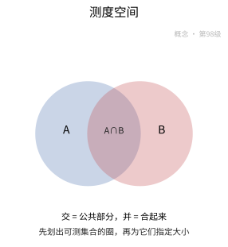

**一句话点破**：测度空间 = 一套能称重的集合 + 一杆守规矩的秤。

### 7.2 能被“称重”的函数才叫可测函数

光有集合还不够，还得给集合上的函数发资格证。如果一个函数把每个“区间”的原像都映回可测集合，就称它**可测**。说白了，可测函数就是那些“能让积分有定义”的乖孩子，日常遇到的连续函数几乎都合格。

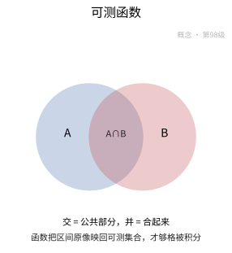

**一句话点破**：可测函数就是“取原像不跳出圈”的函数，积分才敢对它下手。

### 7.3 横着切的积分

算曲线下的面积，黎曼的做法是竖着切成许多细条；勒贝格换了个方向，横着按高度一层层累加。这个转向威力很大——有些“竖着切不动”的古怪函数，横着切照样能积出来，它也是现代概率论的地基。

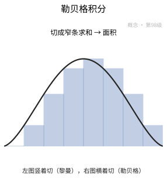

**一句话点破**：勒贝格积分只是把刀横过来——方向一变，能对付的函数就多了许多。

### 7.4 一起量函数“体格”的 $L^p$ 空间

把所有“可积得不太离谱”的函数归到一块儿，用 $\|f\|_p=(\int |f|^p)^{1/p}$ 衡量它有多大，就得到 $L^p$ 空间。$p$ 越大越看重函数的尖峰，而 $p=2$ 时还带着内积，像平面向量一样能算夹角和投影。

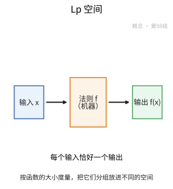

**一句话点破**：$L^p$ 空间是给函数量体格的尺子，$p=2$ 时最像向量空间。

### 7.5 两个空间相乘，还能分开算积分

把两个测度空间“乘”起来，就得到能谈论矩形的**乘积测度**。Fubini 定理则说：只要被积函数不太坏，二重积分可以拆成“先对一行、再对一列”两次一元积分，换顺序结果也一样。

$$\int_{X\times Y} f\,d(\mu\times\nu)=\int_X\left(\int_Y f\,d\nu\right)d\mu$$

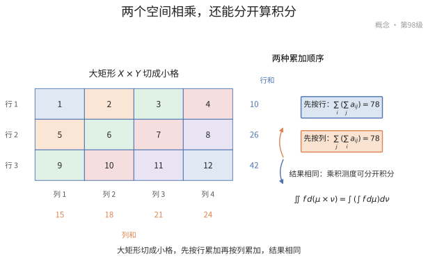

**一句话点破**：Fubini 定理把“算面积”拆成两趟一维累加，还允许你随意换次序。

### 7.6 两把秤之间的换算密度

有时一个测度完全“顺着”另一个测度走：后者为零的地方，前者也必须为零。这时二者的比值有个名字，叫 **Radon-Nikodym 导数** $\frac{d\nu}{d\mu}$，它像密度一样告诉你每一小块上该乘多大系数。

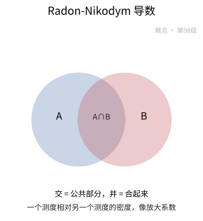

**一句话点破**：Radon-Nikodym 导数就是两把秤之间的换算密度。

### 7.7 知道得更多，就重新押注：条件期望

抛硬币前你只能猜平均值；一旦看了几个结果，就该更新判断。**条件期望** $\mathbb{E}[X\mid\mathcal{G}]$ 正是“在已知信息 $\mathcal{G}$ 下，对 $X$ 做的最优平均估计”，它是随信息变化的随机变量，而不是一个死数。

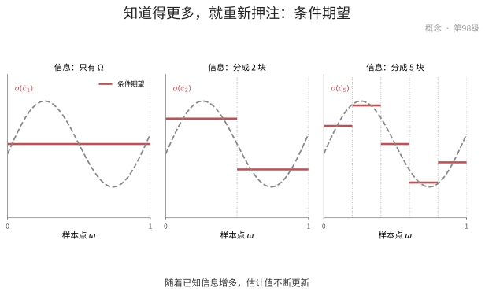

**一句话点破**：条件期望是“永远更聪明的平均”——手里有牌，押注就该随牌走。

### 7.8 概率就是总重为一的测度

把全集的总重量定为 $1$，测度就变成**概率测度**：事件是集合，概率是它的测度。往这个空间里放一个可测函数，就是**随机变量** $X$；问“取值落在某区间有多大概率”，其实就是在量那个原像集合的大小。

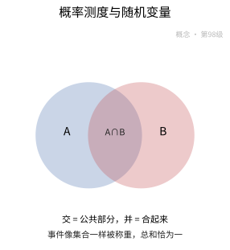

**一句话点破**：概率只是“总重为一”的测度，随机变量就是它上面的可测函数。

### 7.9 用一把复指数尺看清分布

把随机变量塞进 $e^{itX}$ 再取平均，得到 $\varphi_X(t)=\mathbb{E}[e^{itX}]$，这就是**特征函数**。它一条曲线就打包了整个分布，还专门把“求矩”变成“在 $t=0$ 处求导”，处理独立和的分布时尤其好使。

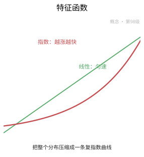

**一句话点破**：特征函数是分布的另一张身份证，求个导就能读出各阶矩。

### 7.10 永远抖动、却处处连续：Wiener 过程

花粉在水里被无数分子乱撞，画出一种永远抖动、却几乎处处连续又从不光滑的轨迹——这就是 **Wiener 过程**（布朗运动）。它从 $0$ 出发、增量独立且服从正态分布，是连续时间随机分析里最重要的那根“随机曲线”。

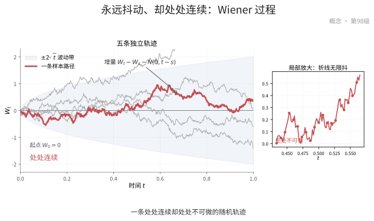

**一句话点破**：Wiener 过程把“连续但绝不光滑”的随机性画成了一条曲线。

### 7.11 单调上升，就能把极限搬进积分

单调收敛定理说：如果一列非负函数 $f_n$ 一步步往上爬，最终收敛到 $f$，那么它们的积分也跟着收敛到 $f$ 的积分，即 $\lim\int f_n=\int\lim f_n$。换句话说，单调递增这种“乖”性质，允许你大方地在积分内外交换极限。

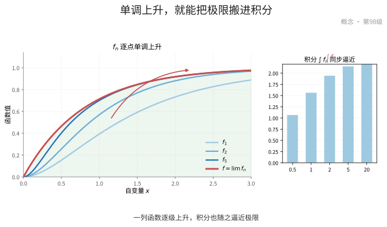

**一句话点破**：只要单调递增，积分和极限就能安全地交换位置。

### 7.12 差一点也是差一点：Fatou 引理

Fatou 引理说：对一列非负函数，$\int\liminf f_n\le\liminf\int f_n$——极限的下积分不会超过下积分的极限。它像一句保底条款：哪怕函数忽高忽低，积分的“下限”也跑不掉，是证明控制收敛定理的关键跳板。

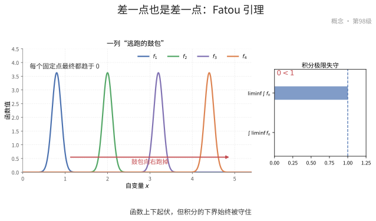

**一句话点破**：Fatou 引理是“下限守门员”，让不够乖的收敛也有积分的下界。

### 7.13 被一个可积函数罩住，就能换极限

如果一列函数 $f_n$ 逐点收敛到 $f$，而且全都被同一个可积函数 $g$ 罩住，即 $|f_n|\le g$，那么积分和极限可以放心交换：$\lim\int f_n=\int f$。这把“控制”二字很形象——头顶有把可积的伞，就不会让某处突然冒尖坏事。

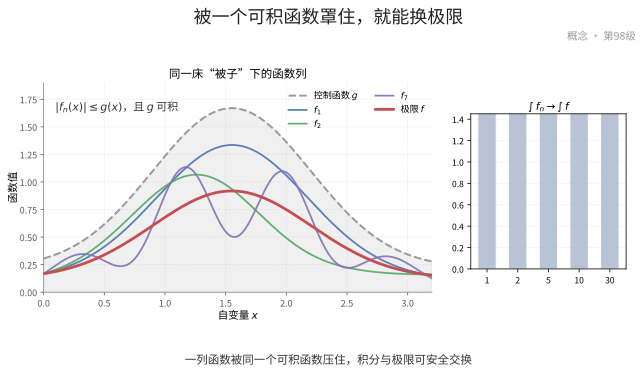

**一句话点破**：找到一把可积的伞罩住全列，极限与积分便不再有意外。

### 7.14 什么时候测度真有一个密度

Radon-Nikodym 定理说：只要测度 $\nu$ 相对 $\mu$ 绝对连续，即 $\nu\ll\mu$，就必存在可测函数 $h=\frac{d\nu}{d\mu}$，使 $\nu(A)=\int_A h\,d\mu$。它把“测度之间的关系”翻译成“一个函数”，是概率里密度与条件期望存在的根本依据。

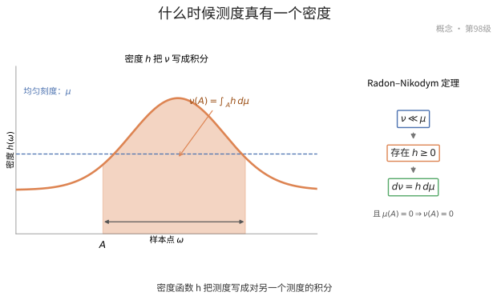

**一句话点破**：绝对连续加上 $\sigma$-有限，就保证存在那唯一的密度函数。

### 7.15 信息一确定，最好的猜测就唯一

定理保证：只要随机变量可积，条件期望 $\mathbb{E}[X\mid\mathcal{G}]$ 一定存在，而且几乎必然唯一。证明正是靠 Radon-Nikodym 定理把新测度写成积分密度。它让“凭已知信息做最优估计”这件事，有了严格又唯一的答案。

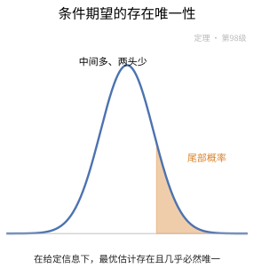

**一句话点破**：可积就有条件期望，且几乎必然唯一——最好的猜测名正言顺。

### 7.16 大量小随机叠加，必然靠近钟形

中心极限定理说：一堆独立同分布、方差有限的随机变量，无论各自什么形状，只要个数够多，它们的和（或平均）分布就会趋近一条钟形的正态曲线。它是概率论最出圈的结论，也是统计推断里到处都在用的那条 $\sqrt{n}$ 规律。

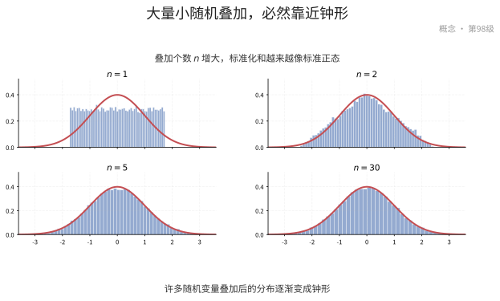

**一句话点破**：样本一多，形状不重要——平均值的分布自动变成正态。

## 8. 数学史（History of Mathematics）

> 概率论从 17 世纪"赌博算术"里长出时，只是一堆关于可行步数的组合计算；但"无穷次试验""几乎必然""一类事件的概率"这类提问，很快撞上"有限可加"永远不够的困境。20 世纪初，测度论（波莱尔、勒贝格）提供了新尺子，1933 年柯尔莫哥洛夫用三条公理把概率重新定义为"满足可数可加性的测度"，贝努利、德莫瓦尔、拉普拉斯留下的极限定理由此获得严格证明，条件期望、鞅、随机过程被纳入同一体系。本章沿"赌博计数→大数定律→概率无地基危机→测度论公理化→现代完整结构"的主线，追溯概率论从今天看起来"不严谨"到"测度论化"的百年脱胎。

### 8.1 赌博的算术：帕斯卡与费马通信之始

- **分注问题**：17 世纪，赌徒们问"游戏中断后如何分赌注"，牵出用排列组合算概率的需求。1654 年前后帕斯卡与费马通信解决分注问题，被普遍视为概率论的正式起点。
- **惠更斯与第一本教材**：惠更斯 1657 年出版《机遇论》，系统介绍期望与概率计算，概率论第一节教科书由此诞生。
- **为何是一桩严肃数学**：这些"赌局中的小算术"第一次把"偶然性"变成可数、可比较的量，为随机性定量化立下基石。

### 8.2 伯努利家族与大数定律的确立

- **雅各布·伯努利的《猜度术》**：1713 年雅各布·伯努利出版《猜度术》，证明大数定律的特殊形式——试验无限增加时，事件频率"几乎必然"趋向其概率，回答了"频率为何稳定"这一根本之问。
- **从经验到定理**：它把"经验上频率稳定"这件大家都信的事，第一次写出了数学论证，成为概率论第一条深刻的极限结论。
- **伯努利数的副产物**：证明过程中诞生的伯努利数是幂和公式与后续分析的工具，也映射出概率论最一开始就与分析纠缠不清。

### 8.3 棣莫弗-拉普拉斯：正态与中心极限的萌芽

- **棣莫弗的正态逼近**：1730 年代棣莫弗证明二项分布在试验很多时向一条"钟形曲线"逼近，并得到 $\tfrac{1}{\sqrt{2\pi}}e^{-x^2/2}$ 的形状，正态分布与误差曲线上场。
- **拉普拉斯的推广**：拉普拉斯把这一逼近推广到更一般情形，得到中心极限定理的雏形，并以之解释测量误差服从正态——"误差平均"与"钟形"自此结缘。
- **概率接通分析**：棣莫弗-拉普拉斯让概率论从组合计数跨进积分与分析，也为柯尔莫哥洛夫时代的极限理论埋下伏笔。

### 8.4 概率论无地基的危机

- **术语的逻辑空洞**：直到 19 世纪末，"概率"还只有朴素直觉与频率经验，缺乏严格定义；"无限多个事件""几乎必然"等说法在逻辑上站不住脚。
- **反例的警钟**：19 世纪后期出现所谓"概率悖论"与病态例子，暴露出满手运算规则、却无一条稳固公理的尴尬。
- **向测度论的招手**：要使"概率"能处理连续对象与可数无穷，旧式的组合加法远远不够，必须引进一种能对"集合"再量出体积/长度的新工具——测度论正是为此准备的。

### 8.5 勒贝格积分：给"更古怪集合"量体积的发明

- **黎曼积分的局限**：黎曼积分对高度震荡、处处不连续的函数无能为力，也难与"概率=集合的测度"直接衔接。
- **勒贝格积分的思路**：1902 年勒贝格把积分从"分隔自变量域"改为"分隔值域"：按取值水平划分、再乘对应集合的测度求和，从而能对几乎处处不规则却结构清晰的函数积分。
- **概率的接口**：勒贝格积分让"加权求和（期望）""几乎处处""可测集"都有了严格载体，成为概率公理化最需要的数学地基。

### 8.6 波莱尔与零测集的精细认识

- **波莱尔集合**：含点集拓扑、开集、可列交并所生成的集合族（σ-代数）由波莱尔在 1898 年前后系统引入，为"可测量的集合"给出边界。
- **可数可加性的关键意义**：波莱尔强调一个平凡分割可数无穷次、测度要据此相加——正是"可数可加"让概率论能无缝处理"无穷次试验"。
- **几乎处处与零测集**：波莱尔与勒贝格使"零测集"成为一个可操作性概念，"概率 1""几乎处处"从此不再是随意的语气词，而是可验证的数学属性。

### 8.7 柯尔莫哥洛夫：概率的公理化

- **1933 年《概率论基础》**：苏联数学家柯尔莫哥洛夫以测度论为样子，给出今天所用的三条公理——总测度为 1、非负、可数可加，将概率严格定义为σ-代数上的测度。
- **一统全局**：随机变量、期望、条件期望、收敛性全部在测度框架下有了统一且严密的定义，公理化使整个学科在逻辑上自洽。
- **意义远超越教科书**：它让概率论可以放心地进入分析、方程与随机过程，也为后续所有严格结论（第 98 级之后各级）铺设了稳固基石。

### 8.8 收敛概念与强大数定律

- **多种收敛的定义**：依点收敛、依概率收敛、依分布收敛、$L^p$ 收敛被逐一严格界定，并厘清彼此蕴含关系——这是概率极限理论的语言基础。
- **强大数定律**：柯尔莫哥洛夫在公理化后证明强大数定律：样本均值在"几乎必然"意义下收敛到期望，比伯努利"概率趋近"更精确的版本由此落地。
- **分析的汇流**：马尔可夫、莱维、克拉默、费勒等系统推进，使"随机变量列的极限行为"成为一门严密而丰饶的理论。

### 8.9 特征函数与中心极限定理的现代证明

- **特征函数的登场**：把分布的傅里叶变换（特征函数）当作其"代数指纹"，使独立和的分布变成乘积、卷积变成乘法，为极限定理提供了漂亮工具。
- **中心极限定理的现代化**：林德贝格（1922）、莱维等给出严格且广泛适用的中心极限定理证明，并配有把条件腰化为矩条件的表述。
- **从特殊到普遍的跨越**：中心极限定理从二项分布扩展到任意独立同分布列，成为"大量微小因素叠加即正态"这一普适原理的数学化身。

### 8.10 条件期望与鞅：回到"信息"的严格地

- **条件期望的公理化**：在测度论框架下，条件期望被定义为某σ-代数上的"正交投/预测"——它把"已知信息下的最佳猜测"写成可证明的对象。
- **鞅的测度论定义**：鞅是"条件期望等于当前值"的过程，其收敛性、停时性质源于测度论与滤流，为随机积分与随机微分方程奠基。
- **从中点看**：条件期望与鞅让概率论从"单个随机量"跃迁到"随时间展开的信息过程"，链接了第 96—97 级全部随机分析。

### 8.11 随机过程与维纳：概率论的连续时间形态

- **从有限步到连续流**：测度论概率让"整条路径""整个函数空间上的测度"成为可定义对象，随机过程理论由此展开。
- **维纳过程**：维纳 1923 年在连续函数空间上构造布朗运动，其独立增量、连续轨道等性质都在测度语言里严格成立。
- **分支的生发**：泊松过程、马尔可夫链、列维过程等在测度基础上全面开花，概率论从此同时贯通离散与连续、理论与应用。

### 8.12 影响与当代

- **整个随机数学的底座**：测度论概率支撑了统计推断、随机积分、泛函分析、调和分析与动力系统——几乎所有带"随机"二字的现代数学都要借它站脚。
- **与抽象分析的对话**：分布即测度、期望即积分、平方可积即 $L^2$ 空间，概率论与泛函分析上层结构融为一体，形成"函数空间上的概率"的现代研究。
- **本文件的纲目**：本文件有关测度、可测函数、勒贝格积分、收敛概念与两种大数定律的内容，正是这一由波莱尔-勒贝格与柯尔莫哥洛夫奠定的体系在当代课堂的完整呈现。

### 8.13 历史年表

| 时间 | 人物／文献 | 事件与贡献 |
|:---|:---|:---|
| 1654／1657 年 | 帕斯卡、费马、惠更斯 | 分注问题与《机遇论》，概率论诞生 |
| 1713 年 | 雅各布·伯努利《猜度术》 | 大数定律的特殊形式 |
| 1730s—1812 | 棣莫弗、拉普拉斯 | 正态逼近与中心极限定理萌芽 |
| 1898—1902 年 | 波莱尔、勒贝格 | 测度论与勒贝格积分奠基 |
| 1922 年 | 林德贝格 | 中心极限定理现代证明 |
| 1923 年 | 维纳 | 严格构造布朗运动 |
| 1933 年 | 柯尔莫哥洛夫《概率论基础》 | 概率公理化：概率为可数可加测度 |
| 1930—1950s | 马尔可夫、莱维、克拉默、费勒 | 收敛概念与极限理论的系统化 |
| 现代 | 条件期望、鞅、随机过程体系 | 概率论化为全部随机数学的共同语言 |

### 8.14 小结

> 概率论的历史，是从"掷骰子的计数"到"可数可加测度"的升格之路：帕斯卡与费马点燃了博弈算术，伯努利把"频率稳定"写成定理，棣莫弗-拉普拉斯发现了钟形曲线的魅力，而无地基的危机逼出波莱尔与勒贝格的测度论工具，最终柯尔莫哥洛夫用三条公理一锤定音。此后中心极限定理、条件期望与鞅、随机过程都在这一公理地基上有序生长。这趟历程最大的教益是：一门再直观的学科，只有把"可计数的无限次""几乎必然""不可测集合"等领域彻底驯服，才能真正称得上严格——而概率论正是在这一点上完成了它的百年脱胎。

## 9. 总结

本教程系统介绍了测度论与概率论的核心理论：

1. **测度空间**：建立了 σ-代数、测度、可测函数的基本框架，为现代概率论奠定了公理化基础

2. **Lebesgue 积分**：通过与 Riemann 积分不同的途径（从"分割值域"而非"分割定义域"出发），建立了更一般的积分理论，能够处理更多函数

3. **三大收敛定理**：
   - **单调收敛定理**：非负单调递增函数列的积分与极限可交换
   - **Fatou 引理**：下极限的积分不超过积分的下极限
   - **控制收敛定理**：被可积函数控制的几乎处处收敛序列，积分与极限可交换

4. **Lᵖ 空间**：建立了函数空间理论，为泛函分析在概率论中的应用开辟了道路

5. **Radon-Nikodym 定理**：揭示了绝对连续测度与可积函数之间的对应关系，是条件期望理论的基础

6. **条件期望**：作为 Radon-Nikodym 导数的直接应用，将条件期望建立在严格的测度论基础上

7. **概率论核心定理**：
   - **中心极限定理**：以特征函数为工具，严格证明了独立同分布随机变量之和的渐近正态性
   - 特征函数方法为概率极限理论提供了强大的分析工具

8. **Wiener 过程**：作为测度论在随机过程领域的应用，为随机分析奠定了基础

测度论是现代概率论的理论基石，也是联系分析学与概率论的桥梁。掌握这些内容将为后续学习随机分析、随机微分方程、统计学习理论等高级课程提供坚实的理论基础。