# 第 124 级：递归论 (Recursion Theory)

> 递归论，又称可计算性理论，研究哪些问题是可以机械计算的，哪些问题本质上是不可计算的。它起源于 20 世纪 30 年代 Gödel、Church、Turing 等人的开创性工作，为数学划定了"可计算"的边界。递归论不仅是理论计算机科学的基石，也深刻影响了数理逻辑和数学哲学。

---

## 从"把'算得出来'这件事本身拿来称一称"说起：递归论要解决的根问题

> 在记 Turing 机那套纸带规则、背 $\mu$-算子的定义之前，先想清楚一个既原始又震撼的问题：**"会不会算"到底有没有一个上限？有些题目是不是天生就注定不存在算法？**

**第一步：直觉——"机器能不能算出这个"就是字面意义上的"机器能不能算出这个"**

想象你给一台足够听话的"计算工"付了无限页草稿纸，它能一笔一画地执行指令、绝不犯错、也不会累。对于"两个数相加"这类问题，它闭着眼都能办到；可总有那么一些要求，无论你给它多聪明的指令手册，它最终都会卡在原地——不是手册没写够，而是**这类问题在原则上就不存在任何能保证完成的算法**。递归论做的第一件事，就是把"这台计算工到底能干什么"从直觉升级成数学对象：把"机械计算"严格定义为 Turing 机、$\mu$-递归函数、$\lambda$ 演算等几个彼此等价的形式模型，然后坦然接受一个结论——**可计算的边界确实存在，而且可以精确画出**。

**第二步：要解决的问题——Hilbert 的"判定问题"撞上一堵墙，名叫停机**

源头要回溯到 David Hilbert（希尔伯特）1920 年代的**判定问题**（Entscheidungsproblem）：是否存在一个算法，能判定任一阶命题是否有效？如果存在，数学的许多问题都能机械作答。1936 年，年轻的 Alan Turing（图灵）给出石破天惊的回答。他先是把"有效计算"的具体形态落在一台读写无限纸带的抽象机器上（Turing 机），再用**对角线法**证明**停机问题**不可判定——不存在程序能预先判断任意程序在任意输入上是否会停机。几乎同时，Alonzo Church（丘奇）用 $\lambda$ 演算、Kleene 与 Gödel 用部分递归函数各自由独立路线得到同一结论。三条路殊途同归，汇聚成 **Church-Turing 论题**：这些模型刻画的正是"可计算"这同一个概念。递归论由此确立了自己的坐标：**不是研究"怎么算得更聪明"，而是研究"哪些问题在原则上根本无法算"。**

**第三步：正式定义前的准备——本章怎样一步步推进**

本章按"先给可计算立规、再测不可验证的边界、后搭难度宇宙"的顺序推进：先用**部分可计算函数、原始递归、$\mu$-递归与 Turing 机**给出"可计算"的四种等价画像，立起 Church-Turing 论题；再正面攻克**停机问题不可判定**与 **Rice 定理**（凡是关于程序语义的非平凡性质都不可判定），认识 **Kleene 递归定理**（自指程序的存在）；随后用**归约（$\leq_m,\leq_T$）与 Turing 度**给问题的"难度"排等级，理解 **Post 问题**如何被**优先方法**解答；最后通过**算术层次（Post 定理）与解析层次**，把"量词复杂度"与"oracle 算力"一一换算成一张难度图谱。

> **🧠 一句话记住递归论的"出生证"**
>
> 递归论诞生于 Turing、Church、Kleene 几乎同时为"什么能算"给出严格定义，并发现"有些事根本算不出来"的那场集体觉醒。它要回答的**根本问题**是：
>
> $$ \boxed{\text{什么叫做一个函数（集、问题）"可计算"？可计算与不可计算之间有没有一道精确的界线？不可算的问题又按"多难"如何排等级？}} $$
>
> 一句话总结：递归论是"把可计算性本身称重"的学科——先画出能算的圈，再量圈外每口井有多深。

## 开始之前

**本章在讲什么**：你可以把它当作"计算的地图学"。你会从部分可计算函数、原始递归函数、$\mu$-递归函数与 Turing 机四条路线认识到"可计算"同一个概念（Church-Turing 论题）；学会停机问题、Rice 定理、Kleene 递归定理这些"边界宣言"；掌握归约与 Turing 度这个给问题排序的尺子；再透过 Post 问题、优先方法与算术层次（Post 定理），看到可计算性谱系的精细骨骼（$\mathbf{0}<\mathbf{0}'$ 及其间的稠密 c.e. 度）。

**为什么要学它**：递归论给出"哪个题目原则上无解"的第一手答案，是第 30 级"数理逻辑"之后关于"可证与可算"的交汇点，也是论证 Gödel 不完全性（第 125 级证明论会再碰它）的姊妹视角。它与第 122/123 级的集合论、模型论互相支撑：算术层次里的自然数模型正是模型论的对象，可计算不可计算则界定了哪些"理想 + 构造"能实际落地。它对计算机科学（理论机、复杂性理论、可满足性求解）与人工智能（何时问题本质上是不可解的）都至关重要，也是第 52 级数学哲学讨论"数学的可机械性"的根据。

**开始前请确认你还记得**：

- 一阶逻辑的自然数模型与"可证 / 一致"概念，以及量词、谓词的语法（见第 30 级 数理逻辑）。
- 集合、函数、单射/满射/双射、可数与不可数、等势（见第 09 级 集合论基础）。
- 数学归纳法与递归定义（用更小的情形定义当前情形）的思想（见第 07 级 数列与数学归纳法）。
- 对角线论证（Cantor 证明实数比自然数多）的套路，它是停机不可判定的原型（见第 09 级）。

---

## 1. 学习目标

完成本教程后，你应当能够：

1. **理解可计算性的基本概念**——掌握部分递归函数、原始递归函数、μ-递归函数、Turing 机的定义及 Church-Turing 论题。
2. **理解不可判定性**——掌握停机问题的不可判定性、Rice 定理和递归定理。
3. **掌握归约与度**——理解多一归约、Turing 归约、递归可枚举集、Turing 度的概念。
4. **理解 Post 问题与算术层次**——掌握算术层次定理（Post 定理）和解析层次的基本概念。
5. **了解优先方法**——理解 Turing 度稠密性的证明，掌握优先方法的基本思想。
6. **通过示例与习题巩固理论**——完成至少 6 个详细示例和 8 道习题。

---

## 2. 核心概念

### 2.1 可计算函数 (Computable Functions)

**定义**：一个部分函数 $f: \mathbb{N}^k \dashrightarrow \mathbb{N}$ 称为**部分可计算**的，如果存在一个 Turing 机 $M$ 使得对任意输入 $\bar{n}$，$M$ 在输入 $\bar{n}$ 上停机当且仅当 $\bar{n} \in \operatorname{dom}(f)$，且停机时输出 $f(\bar{n})$。

若 $f$ 是部分可计算的且定义域为 $\mathbb{N}^k$，则称 $f$ 是**全可计算**的（或简称可计算的）。

> **💡 直观理解（类比）**：可计算函数就像一台"有软硬件、但对部分输入会卡死"的程序。**部分可计算**对应"程序对某些输入能算出结果，对另一些输入可能永远死循环"；**全可计算**则要求"对任何输入都恒能停机并给出答案"，就像一段鲁棒到绝不抛异常、绝不卡死的程序。区分关键就在定义域：部分可计算允许定义域是 $\mathbb{N}$ 的真子集，全可计算要求定义域铺满整个 $\mathbb{N}$。

#### 课堂问答

**老师**：我们说一个函数"可计算"，严格讲到底在断言什么？

**学生**：断言存在一台 Turing 机 $M$，对任意输入 $\bar n$，$M$ 在 $\bar n$ 上停机当且仅当 $\bar n\in\operatorname{dom}(f)$，且停机时输出 $f(\bar n)$。所以"可计算"是一句关于**存在某个算法**的陈述，不是一个可以直接观察的数值性质——关键是那个"当且仅当"把收敛范围与定义域完全钉死。

**老师（追问）**：那"部分可计算"和"全可计算"的差别，是不是一个"会不会卡住"的模糊说法？

**学生**：不是模糊，精确地落在**定义域**上。部分可计算允许 $\operatorname{dom}(f)\subsetneq\mathbb N^k$，即机器在某些输入上可以永不停机；全可计算要求 $\operatorname{dom}(f)=\mathbb N^k$，即对一切输入恒停机。常见误区是把"部分"误解为"算得不完整、是近似"，其实它是"定义域可能不是全集"的精确表述——同一台机器可以在定义域内完美工作，又对域外输入发散。

**老师（拓展）**：如果换一套定义（λ 演算、$\mu$-递归函数），这个函数类会不会变？

**学生**：不会，它们刻画的是同一类函数，这正是 Church-Turing 论题的内容。它把"部分可计算"这种语言无关的直观概念固定下来，也意味着可计算函数类是稳健的：凡是符合"有效可计算"直觉的模型，收敛范围与输出都一致。注意论题本身是断言而非定理。

### 2.2 原始递归函数 (Primitive Recursive Functions)

**定义**：原始递归函数由以下基本函数通过复合和原始递归生成：

**基本函数**：
1. 零函数：$Z(x) = 0$
2. 后继函数：$S(x) = x + 1$
3. 投影函数：$P_i^n(x_1, \dots, x_n) = x_i$

**基本运算**：
1. **复合**：若 $g$ 和 $h_1, \dots, h_m$ 是原始递归的，则 $f(\bar{x}) = g(h_1(\bar{x}), \dots, h_m(\bar{x}))$ 是原始递归的。
2. **原始递归**：若 $g$ 和 $h$ 是原始递归的，则由以下定义的 $f$ 是原始递归的：
   $$
   \begin{aligned}
   f(0, \bar{x}) &= g(\bar{x}) \\
   f(n+1, \bar{x}) &= h(n, f(n, \bar{x}), \bar{x})
   \end{aligned}
   $$

> **💡 直观理解（类比）**：原始递归函数像是用一套"严格限制的搭积木"堆出来：从零函数 $Z$、后继 $S$、投影 $P$ 这三块基础积木出发，只允许用**复合**（把几个函数的结果喂给另一个）和**逐层递推**（像数学归纳法，$f(n+1)$ 由 $f(n)$ 和 $n$ 算出）两种拼接。递推就像盖楼时每一层严格盖在上一层之上，绝不回头查找。它能把加法、乘法、阶乘等几乎所有"会数数"的函数都造出来，但也因此埋下局限——它只会**循环预定的次数**，不会"无限搜索"，这正是后面 μ-算子要补的能力。

#### 课堂问答

**老师**：原始递归函数从哪里起步，又凭什么说它"安全"？

**学生**：从三块基石 $Z(x)=0$、$S(x)=x+1$、$P_i^n(x_1,\dots,x_n)=x_i$ 出发，只允许两种拼接：复合 $f(\bar x)=g(h_1(\bar x),\dots,h_m(\bar x))$，以及原始递归
$$
f(0,\bar x)=g(\bar x),\qquad f(n+1,\bar x)=h(n,f(n,\bar x),\bar x).
$$
它"安全"是因为每次递推都严格依赖上一层已算出的值，停机长度在写下定义时就已注定。加法就是标本：$\mathrm{add}(0,y)=y$，$\mathrm{add}(n+1,y)=S(\mathrm{add}(n,y))$。

**老师（追问）**：能造加法、乘法、阶乘，那它是不是就能造出所有可计算函数了？

**学生**：不能。原始递归只提供**预定次数**的循环——循环上界必须由某个已知参数给出。真正的计算还需要"命中为止"的**无界搜索**，而 Ackermann 函数就是一个可计算（$\mu$-递归）却**非**原始递归的函数，它是"原始递归类严格小于可计算类"的见证。

**老师（拓展）**：那这个"循环次数写在定义里"的限制，对应编程语言里的什么？

**学生**：对应确定次数的 `for` 循环，缺的正是那种"条件成立才停"的 `while` 循环。所以原始递归是"处处可终止、终止性一望便知"的类，代价是丢掉了通用性；补上无界搜索，正是 μ-算子要干的事。

### 2.3 μ-递归函数 (μ-Recursive Functions)

**定义**：μ-递归函数是在原始递归函数的基础上添加**μ-算子**（最小化算子）得到的函数类。

μ-算子：若 $g$ 是 $(k+1)$ 元函数，则 $f(\bar{x}) = \mu y [g(y, \bar{x}) = 0]$ 定义为最小的 $y$ 使得 $g(y, \bar{x}) = 0$ 且对所有 $z < y$，$g(z, \bar{x})$ 有定义且不为 0。若不存在这样的 $y$，则 $f(\bar{x})$ 无定义。

**Kleene 正规形定理**：每个部分可计算函数都可以表示为 $f(\bar{x}) \simeq U(\mu y [T(e, \bar{x}, y)])$，其中 $T$ 是原始递归谓词，$U$ 是原始递归函数。

> **💡 直观理解（类比）**：μ-算子（最小化算子）就像"从 $y=0$ 起一路向后找第一个满足条件的出口"——它赋予函数**无界限的搜索**能力。原始递归只能循环"预先固定次数"，而 $\mu y[g(y,\bar{x})=0]$ 是"把 $g(0),g(1),g(2),\dots$ 一个一个算，算到第一个结果为 $0$ 就停下"；若永远没有结果就无限找下去（于是 $f$ 无定义）。这和在一条看不到尽头的走廊里逐扇推门、遇到第一扇没锁的门就进去是一个道理。**Kleene 正规形定理**则承诺：任何可计算函数都能统一写成"先做一个 μ-搜索（$T$ 判断第 $e$ 台机器在第 $y$ 步是否停机）、再读出结果（$U$）"的固定模板——相当于给所有算法准备了一张标准施工图纸，谁都从里面套得出来。

#### 课堂问答

**老师**：加一个 μ-算子，原始递归就升级成 μ-递归，这个算子究竟给了什么？

**学生**：给了**无界搜索**。$f(\bar x)=\mu y\,[g(y,\bar x)=0]$ 定义为使 $g(y,\bar x)=0$ 且对所有 $z<y$ 都有 $g(z,\bar x)\neq0$ 成立的**最小** $y$。它从 $y=0$ 起逐个试，试到第一个零点就停——但搜索没有预先给定的上界。

**老师（追问）**：既然叫"无界"，那它凭什么还算是可计算的？

**学生**：因为每一步尝试都是机械可做的：依次计算 $g(0,\bar x),g(1,\bar x),\dots$ 并判零。可计算性并不要求搜索一定成功，只要求"若成功，过程机械"。正因如此它会产出**部分函数**：若永不出现零点（或中途遇到 $g$ 无定义），则 $f(\bar x)$ 无定义。常见误区是以为"可计算"必须保证处处停机，恰恰相反，μ-算子的存在就是为了容忍发散。

**老师（拓展）**：那有没有一个统一的"模板"能套住所有可计算函数？

**学生**：有，Kleene 正规形定理：$f(\bar x)\simeq U(\mu y\,[T(e,\bar x,y)])$，其中 $T$ 是原始递归谓词（判定第 $e$ 台机器在第 $y$ 步是否停机），$U$ 是原始递归函数（读出输出）。任何算法都等价于"μ-搜索步数 + 读结果"这一条固定骨架，把整个可计算函数类压缩进两个原始递归函数——这正是它的威力所在。

### 2.4 Turing 机 (Turing Machines)

**定义**：一个 Turing 机 $M$ 由以下组成：
- 一个无限长的磁带，被划分为单元格，每个单元格包含一个符号。
- 一个读写头，可以读取和写入磁带上的符号，并可以向左或向右移动。
- 一个有限状态集 $Q$，包含起始状态 $q_0$ 和停机状态 $q_{\text{halt}}$。
- 一个转移函数 $\delta: Q \times \Gamma \to Q \times \Gamma \times \{L, R\}$。

**Church-Turing 论题**：任何直观上"可有效计算"的函数都可以用 Turing 机计算。这一论题不是数学定理，而是对可计算性概念的哲学确认。

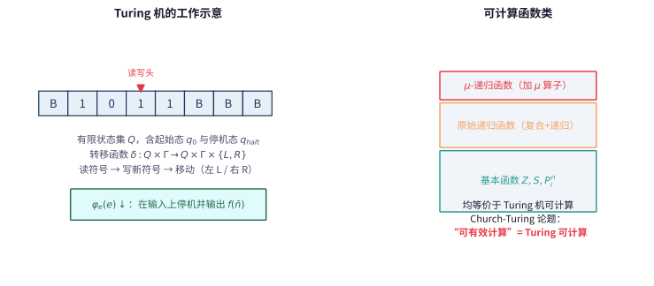

> **直观理解（现实类比）**：Turing 机就像一位"一格格走纸带的文员"——他一次只能看一个格子、写一个符号、向左或向右移动一步，靠一张写着"当前状态+看到的符号 → 新状态+写什么+往哪走"的规则表（转移函数 $\delta$）工作。原始递归函数、$\mu$-递归函数和 Turing 机这三套定义最后都算出同一类函数，所以"可计算"这个概念是稳健的（Church-Turing 论题）。

> **直观理解（现实类比）**：图灵机像"最简计算机"——一条无限纸带加一个读写头加有限状态集，就能模拟任何算法。它故意把计算过程拆到最朴素的原子操作：读一个符号、写一个符号、左移右移一格、切换状态。正是这种"极简"保证了它的普适性——任何"有效计算"无论多么复杂，都能逐拍翻译成这些原子动作。现代计算机、量子计算机、甚至人脑的离散思维过程，在"能算什么"这个层面上都跳不出图灵机的范畴，这就是 Church-Turing 论题的深意。

> **🧠 思考历程：一台"纸带机器"如何一夜之间划清数学的边界？**
>
> 递归论起源于 Hilbert 1920 年代提出的"判定问题"（Entscheidungsproblem）：是否真有算法能判定任何一阶命题是否有效？1936 年，年轻的 Alan Turing（图灵）用一台靠读写无限纸带的抽象机器，给出了震撼的回答——不可能。
>
> - **可计算第一次有了"机器"的形态**。Turing 1936 年发表《论可计算数》，把"逐拍读符号、写符号、左右移动、切换状态"的极简机器当作"有效计算"的严格定义，并构造出能模拟任意机器的通用机，从而把"可计算"的边界第一次钉死为清晰对象。
> - **停机问题封死判定问题**。几乎同时，Alonzo Church（丘奇）用 λ 演算独立刻画可计算，Kleene 与 Gödel 推出部分递归函数；Turing 进一步证明停机集 $\{e:\varphi_e(e)\downarrow\}$ 不可计算，直接宣判 Hilbert 乐观的"判定问题"无解——存在本质上无法用算法回答的问题。
> - **一个论题，多方殊途同归**。Church-Turing 论题断言这些独立提出的模型（Turing 机、λ 演算、$\mu$-递归函数）都算出同一类函数；这种"殊途同归"反过来证实"可计算"这一概念的真实与稳健，也让递归论渗透到计算机科学的每一个角落。
> - **心路**：证明"有些问题永远算不出来"，跨出的不是沮丧而是解放——它为数学划清了能算与不能算的疆界，让计算科学得以在这块可靠的地基上各自生长。

> **⚠️ 常见坑：Church-Turing 论题是"断言"不是"定理"，且它管"能算"不管"算得快"**
>
> - **它不可证、也无需证**。Church-Turing 论题不是数学定理，而是把"直观可计算"翻译成"形式模型可计算"的哲学共识——正因为 Turing 机、$\lambda$ 演算、$\mu$-递归函数等彼此独立地算出同一类函数，我们才确信"可计算"这个直观概念是稳健的。把它当成可证的定理，是常见误区。
> - **"可计算" ≠ "高效"**。该论题只划定"原则上能不能算"，完全不关心"要多少步"。停机问题是不可计算的；可哪怕可计算的问题，也可能需要指数级甚至更多时间才出结果——那正是计算复杂性理论（第 115 级计算数学等领域）接棒研究的地盘。把"不可计算"与"算起来太慢"混为一谈是另一个高频错误。

#### 课堂问答

**老师**：Turing 机的"最小内核"由哪些部件构成？

**学生**：无限磁带（每格一个符号）、读写头（可读可写、左右移动）、有限状态集 $Q$（含 $q_0,q_{\text{halt}}$）、转移函数 $\delta:Q\times\Gamma\to Q\times\Gamma\times\{L,R\}$。合起来就是"读符号—写符号—移动—换状态"这套原子动作。

**老师（追问）**：这套设定为什么能代表"一切有效计算"，而不只是一个恰好够用的小玩具？

**学生**：因为它既足够**普适**又足够**朴素**。普适：任何算法都能逐拍翻译成这些原子动作，且存在能模拟任意机器的**通用机**；朴素：朴素到可以把"可计算"变成一个能被严格推理的数学对象。但要分清——"图灵机能算的恰好是一切有效可算的"这句话是 Church-Turing 论题，是断言，不是定理。

**老师（拓展）**：那"论题"和"定理"的差别，与你最该记住的另一点是什么？

**学生**：常被混淆的是"论题管能算、不管快慢"。Church-Turing 论题只保证原则上可算，对需要的步数毫不表态。所以"不可计算"（如停机问题）与"算起来太慢"（指数时间）是两码事：后者是复杂性理论的地盘，前者是不可判定性。把二者混为一谈，会把整幅可计算性地图看反。

### 2.5 可计算集与可枚举集 (Computable and Computably Enumerable Sets)

**定义**：
- 集合 $A \subseteq \mathbb{N}$ 称为**可计算**的（递归的），如果其特征函数 $\chi_A(x) = 1$ 若 $x \in A$，$0$ 若 $x \notin A$ 是可计算的。
- 集合 $A \subseteq \mathbb{N}$ 称为**可计算可枚举**的 (c.e.)，如果存在可计算函数 $f: \mathbb{N} \to \mathbb{N}$ 使得 $A = \operatorname{ran}(f)$，即 $A$ 是可计算函数的值域。等价地，$A$ 是某个部分可计算函数的定义域。

**基本性质**：
- $A$ 是可计算的当且仅当 $A$ 和 $\mathbb{N} \setminus A$ 都是 c.e. 的。
- 可计算集一定是 c.e. 的，但反之不成立（如停机集 $K$ 是 c.e. 但不可计算）。

> **💡 直观理解（类比）**："$A$ 和它的补集 $\mathbb{N}\setminus A$ 都是 c.e. 当且仅当 $A$ 可计算"这条性质像一个**双向闸机**：两个集合各有自己的枚举程序（一个专列"在里面"的，一个专列"不在"的）。你只要把两个程序**轮流各跑一步**，对任何输入 $x$，它总归会被其中一边"认领"，于是就在有限步内拿到 yes/no——变成一个总能停机判定的机器。反过来，若 $A$ 可计算，则"在里面的名单"和"不在的名单"分别都可枚举。这跟"同时握有标全了'在'的花名册和标全了'不在'的花名册，合起来才是完整名单"是一个道理。

> **直观理解（现实类比）**：可判定性像"能自动回答的问题"——存在一个算法，对任何输入都能在有限步内给出 yes 或 no 的明确答案。可计算集就是可判定问题的解集：比如"判断一个数是否为素数"可判定，因为有算法总能终止并给出结论。而可计算可枚举集（c.e.）则弱一些：只能保证"是的元素终会被列出"，却无法保证"不是的元素能在有限步内排除"——就像一台只能盖章"通过"却不会盖章"拒绝"的机器，遇到不通过的输入只能无限等待。停机集 $K$ 正是这种"半可判定"的典型。

#### 课堂问答

**老师**：什么叫一个集合"可计算"，它和"可枚举"差在哪里？

**学生**：可计算指特征函数 $\chi_A$ 全可计算，对任意 $x$ 在有限步内给出 1 或 0；c.e. 指存在可计算函数 $f$ 使 $A=\operatorname{ran}(f)$，等价地 $A$ 是某个部分可计算函数的定义域 $A=\operatorname{dom}(\varphi_e)$。前者"能判定归属"，后者只能"把属于它的元素一个个列出来"，对不属于的无法在有限步内排除。

**老师（追问）**：那要判断 $A$ 可计算，有没有一个不用直接构造特征函数的判据？

**学生**：有：**$A$ 可计算当且仅当 $A$ 与 $\mathbb N\setminus A$ 都 c.e.**。两个方向的枚举程序各跑一步、交替进行（dovetailing），任何 $x$ 终会被某一侧认领，从而在有限步内得到 yes/no；反过来，若 $A$ 可计算，则它和它的补集都可用特征函数枚举出来。

**老师（拓展）**：既然可计算集都 c.e.，那反过来为什么不成立？

**学生**：停机集 $K$ 就是反例：$K$ 是 c.e. 却不可计算，说明"半可判定"严格弱于"可判定"。常见误区是把"能枚举出来"当成"能判定"，从而忽略了 c.e. 对"不属于"的那一半完全沉默——这台机器只会打勾，不会打叉。

### 2.6 归约 (Reductions)

**多一归约 ($\leq_m$)**：$A \leq_m B$ 如果存在可计算函数 $f: \mathbb{N} \to \mathbb{N}$ 使得 $x \in A \iff f(x) \in B$。

**Turing 归约 ($\leq_T$)**：$A \leq_T B$ 如果 $A$ 相对于 $B$ 是可计算的，即存在一个以 $B$ 为 oracle 的 Turing 机可以计算 $A$ 的特征函数。

**性质**：
- $\leq_m$ 蕴含 $\leq_T$（即 $A \leq_m B \implies A \leq_T B$），但反之不成立。
- 若 $A \leq_m B$ 且 $B$ 是可计算的，则 $A$ 是可计算的。
- 若 $A \leq_m B$ 且 $B$ 是 c.e. 的，则 $A$ 是 c.e. 的。

> **直观理解（现实类比）**：归约像"问题翻译"——把一个未知难度的问题 $A$ 通过可计算函数 $f$ 翻译成另一个问题 $B$ 的语言：问"$x\in A$ 吗"等价于问"$f(x)\in B$ 吗"。如果 $B$ 已知可解，那么 $A$ 也顺势可解；如果 $B$ 已知不可解，而 $A$ 能归约到 $B$，则 $A$ 至少不比 $B$ 难。这就像把一道法语题翻译成英语题再请人解答——翻译本身必须是"机械可执行"的（可计算函数）。多一归约 $\leq_m$ 是"每个问题翻译成一个问题"，Turing 归约 $\leq_T$ 则允许"反复调用 $B$ 的解答器作为 oracle"，更灵活但也更难比较。

> **⚠️ 常见坑：归约的"方向"很容易记反——$\leq_m$ 比 $\leq_T$ 苛刻，且"更难"要往右看**
>
> - **方向感**。$A\leq_m B$ 读作"$A$ 归约到 $B$"：写"$A$ 不难于 $B$"。因为 $B$ 若可解，顺归约函数 $f$ 就能解 $A$；反之若 $A$ 不可解，$B$ 更不可解。把方向说反（以为可解 $B$ 麻烦，凭 $B\le A$ 就说 $B$ 无害）是重灾区。
> - **$\leq_m$ 蕴含 $\leq_T$，但不反过来**。多一归约一次只用一个询问 $f(x)$，Turing 归约允许任意多次调用 oracle。所以 $\leq_m\subseteq \leq_T$，而 $\leq_T$ 更宽松——例如 $K\leq_T\overline{K}$（取反一个查询即可）但 $K\not\leq_m\overline{K}$（因为 $\overline{K}$ 不是 c.e.，无法把 $K$ 的成员问题一次映射进它）。"既然 $A\le_T B$，就以为 $A\le_m B$"是错误的。
> - **"不可解者归约到…"的断语要多想一步**：若 $A\leq_m B$ 且 $B$ 已知**不可**计算，无从推出任何结论——归约保难的方向是把可解性从左传右，不是从右传左。

#### 课堂问答

**老师**：递归论为什么要引入"归约"？用一句话说它解决了什么。

**学生**：给问题**排序难度**。多一归约 $A\le_m B$ 指存在可计算函数 $f$ 使 $x\in A\iff f(x)\in B$；Turing 归约 $A\le_T B$ 指 $A$ 相对于 oracle $B$ 可计算。若 $B$ 可解则 $A$ 可解，故 $A\le_m B$ 读作"$A$ 不比 $B$ 难"。

**老师（追问）**：$\le_m$ 与 $\le_T$ 谁更强，箭头方向又该往哪读？

**学生**：$\le_m$ 蕴含 $\le_T$，反之不然，所以 $\le_m$ 更苛刻。$\le_m$ 只允许**一次**询问 $f(x)$，把"$x\in A$ 吗"整体翻译成"$f(x)\in B$ 吗"；$\le_T$ 则允许把 $B$ 当 oracle 任意多次调用。经典区分是 $K\le_T\overline K$（对查询取反即可）却 $K\not\le_m\overline K$（因为 $\overline K$ 非 c.e.）。读法务必是"$A\le_m B$ 即 $A$ 不难于 $B$，可解性顺着箭头从 $B$ 流到 $A$"。

**老师（拓展）**：那"方向感"最容易在哪一步翻车？

**学生**：把"$A\le_m B$ 且 $B$ 不可计算"错当成能推出关于 $A$ 的结论。其实归约只把**可解性**从右往左传：$B$ 可解必得 $A$ 可解。若 $B$ 不可解，$A$ 可难可易，什么也推不出；要证明 $A$ 不可解，得反过来把已知不可解的 $K$ **归约到** $A$，即造出 $K\le_m A$。

### 2.7 递归可枚举集 / 计算可枚举集 (C.E. Sets)

**定义**：$A \subseteq \mathbb{N}$ 是**计算可枚举**的 (c.e.)，如果存在可计算函数 $f$ 使得 $A = \operatorname{dom}(f)$（即 $f$ 恰好在 $A$ 的元素上停机）。

**标准枚举**：设 $\{W_e\}_{e \in \mathbb{N}}$ 是 c.e. 集的标准枚举，其中 $W_e = \operatorname{dom}(\varphi_e)$，$\varphi_e$ 是第 $e$ 个部分可计算函数。

> **直观理解（现实类比）**：c.e. 集这里用"定义域"再定义一次，和前面的值域定义是同一回事，只是换个角度看：c.e. 集就像"一台只会打勾、从不会打叉的打印机"——它开动后会一个接一个印出属于该集的名字，但从不会主动告诉你"这个不属于"，只是该管的时候没动静。所谓**标准枚举** $\{W_e\}_e$ 就是把这台打印机全部编号：第 $e$ 台机器的输出记为 $W_e$。把所有程序排好队给出下标 $e$，正是递归论"用自然数给所有程序命名"的起点——这也是后面停机集 $K=\{e:\varphi_e(e)\downarrow\}$ 里那个下标 $e$ 的由来。

#### 课堂问答

**老师**：c.e. 集用"定义域"定义和用"值域"定义，为什么是同一件事？

**学生**：因为可以在两种视角间转换。定义域形式：$A=\operatorname{dom}(f)=\{x:f(x)\downarrow\}$，机器恰在 $A$ 的元素上停机；值域形式：$A=\operatorname{ran}(f)$。逐步运行 $f$ 并输出已收敛的值，就把定义域变成了可枚举的值域；反之，对值域的枚举构造一个恰好在这些值处停机的部分函数即可。二者刻画同一类集合。

**老师（追问）**：标准枚举 $\{W_e\}$ 里的下标 $e$ 是什么，为什么非要它。

**学生**：$W_e=\operatorname{dom}(\varphi_e)$，其中 $\varphi_e$ 是第 $e$ 个部分可计算函数，于是 $\{W_e\}_{e\in\mathbb N}$ 把所有 c.e. 集排成一列，$e$ 就是"程序编号"。要它是为了把"集合"这种第二类对象**编码成自然数**，从而让递归论可以用自然数上的算法去谈论程序本身——停机集 $K=\{e:\varphi_e(e)\downarrow\}$ 里那个下标 $e$，正是从这套编号来的。

**老师（拓展）**：既然所有 c.e. 集都在这张名单上，会不会有某个 c.e. 集"等于自己编号所指的集合"而自相矛盾？

**学生**：正是对角化要利用的点。$\{W_e\}$ 本身是良定义的编号，但"$e\in W_e$ 吗"这个问题恰好能构造出不在名单里的集合：$D=\{e:e\notin W_e\}$ 不是 c.e. 的，否则设 $D=W_{e_0}$ 便导出 $e_0\in W_{e_0}\iff e_0\notin W_{e_0}$。编号的存在本身，正是"自指矛盾"能够发生的舞台。

### 2.8 停机问题 (Halting Problem)

**定义**：停机问题是判定给定 Turing 机在给定输入上是否停机的问题：
$$
K = \{e \mid \varphi_e(e) \downarrow\}
$$
即 $K$ 是第 $e$ 个部分可计算函数在输入 $e$ 上收敛的 $e$ 的集合。

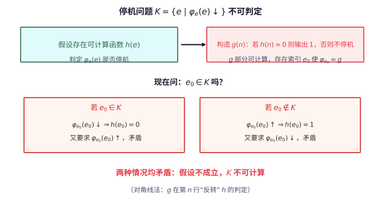

> **直观理解（现实类比）**：停机问题好比"有没有一台万能验票机，能提前判断任何机器会不会永远转下去"。证明用对角线法假设有这样一台机器 $h$，再用它造出一台"故意和它对着干"的机器 $g$——$h$ 说它会停它就不停，$h$ 说它不停它就停，怎么都矛盾。就像"理发师只给不给自己刮胡子的人刮胡子"：到底他给不给自己刮，都说不通，所以万能验票机根本不存在。

> **直观理解（现实类比）**：停机问题像"不可预测的命运"——没有任何算法能在所有情况下预知一段程序是否会结束。你可以观察它跑一会儿，但无论跑了多久，都无法断定它是即将停下还是永远跑下去。这一不可判定性有深远的边界意义：它不仅划定"哪些问题算法能答、哪些不能答"，还成为衡量其他问题难度的"标尺"——把停机问题"翻译"过去的问题，自然也继承不可判定性。Rice 定理进一步说明：凡是关于程序语义的任何非平凡性质，都是不可判定的。

#### 课堂问答

**老师**：停机问题作为一个数学对象，它的定义是什么？

**学生**：$K=\{e\mid\varphi_e(e)\downarrow\}$，即第 $e$ 个部分可计算函数在输入 $e$（它自己的编号）上收敛的那些 $e$。注意输入刻意取成 $e$ 自身，这是后面能自指的关键。

**老师（追问）**：为什么偏偏让输入等于编号，而不是取任意输入？

**学生**：为了让程序"谈论自己"。若判定器 $h$ 存在，就构造 $g$：当 $h(n)=0$ 时令 $g(n)=1$，当 $h(n)=1$ 时令 $g(n)$ 发散；再取 $g$ 的编号 $e_0$，问 $e_0\in K$ 是否成立——两条路都矛盾。这正是"理发师是否给自己刮胡子"的翻版：自指把假设逼到自相矛盾，$K$ 便不可计算。

**老师（拓展）**：这个不可判定性在递归论之外的"意义"是什么？

**学生**：它既是"Hilbert 判定问题无解"的直接来源，也是一把**难度标尺**：任何能把 $K$ 归约过去的问题都继承不可判定性。更一般地，它把"可计算"的边界钉死，Rice 定理再把这条边界推广到一切非平凡语义性质。所以停机问题不只是一个难题，而是整幅不可判定性地图的原点。

### 2.9 Rice 定理

> **定理（Rice）**：设 $\mathcal{C}$ 是部分可计算函数的非平凡类（即 $\mathcal{C}$ 非空且不是全体部分可计算函数）。则集合 $\{e \mid \varphi_e \in \mathcal{C}\}$ 是不可计算的。

> **💡 直观理解（类比）**：Rice 定理是停机问题不可判定性的"大规模杀伤性武器"：它说**凡只看程序"行为"（语义）而非"长相"（语法）的任何非平凡属性，都无法用算法判断**。比如"这程序是不是总是有输出""是不是常数函数""是否在输入 0 上停机"——全都不可判定。原因就在于同一行为能被无数种写法实现（索引 $e$ 可以随意外包、打补丁、加垃圾行），你没法靠机械翻源码断定它内部算的是哪一类函数。这就像用电脑检查一段"行事风格描述"来判断某人的"人设"属不属于某类——风格（语义）与排版（语法）之间隔着一道永远跨不过的鸿沟。所谓"非平凡"就是"既不全一样、也非全不一样"，恰好排除了那两种无关痛痒的固定答案。

#### 课堂问答

**老师**：Rice 定理用一句话怎么说？

**学生**：设 $\mathcal C$ 是部分可计算函数的**非平凡**类（$\varnothing\subsetneq\mathcal C\subsetneq$ 全体），则 $I(\mathcal C)=\{e:\varphi_e\in\mathcal C\}$ 不可计算。也就是说，凡是只依赖程序**语义**（它算的是哪个函数）的非平凡性质，都无法用算法判定。

**老师（追问）**：为什么"非平凡"这个前提取不得？"语义"两个字又为什么关键？

**学生**："非平凡"排除了两类恒定答案：若 $\mathcal C=\varnothing$，则 $I(\mathcal C)=\varnothing$ 可判；若 $\mathcal C$ 是全体，则 $I(\mathcal C)=\mathbb N$ 也可判。只有非空非全体才真正在"区分"，才会不可判。"语义"关键，是因为同一行为有无穷多种写法（索引 $e$ 可以外包、加垃圾行），机械翻源码无法断定它算哪类函数——语义与语法之间隔着一道跨不过的鸿沟。

**老师（拓展）**：那"语法性质"就一定可判定吗？

**学生**：不一定，但很多是。例如"$e$ 是偶数"这种只关于索引的语法性质，可以直接用可计算特征函数判定。Rice 定理管的是**语义**性质；把它的结论夸大成"任何程序性质都不可判定"就是常见误区——性质是否属于语义、是否非平凡，共同决定了它在定理作用范围内还是范围外。

### 2.10 递归定理 (Recursion Theorem)

> **定理（Kleene 递归定理）**：对任意可计算函数 $f$，存在 $n$ 使得 $\varphi_n = \varphi_{f(n)}$。

> **直观理解（现实类比）**：Kleene 递归定理（不动点定理）说：任何"对程序做机械变换"的可计算操作 $f$，都必然留下一个**不动点程序**——转换前与转换后，它算的是同一个函数 $\varphi_n=\varphi_{f(n)}$。这就像"不管你怎么魔改一段程序（只要改动规则本身可机械执行），总有一个程序改完后依然干原来完全一样的事"。它最妙的用途是**自印**：让程序在运行时打印出它自己的编号 $n$（如 $\varphi_n(0)=n$）。因为程序能预先算出 $f$ 在不动点上的取值，于是它可以把自己"测个号码"嵌进输出里，实现一种可控的自我引用——这是递归论版的"自指",和 Gödel 不完备定理里的自指是同一套把戏的两副面孔。

#### 课堂问答

**老师**：Kleene 递归定理的陈述是什么，它为什么叫"不动点"？

**学生**：对任意可计算函数 $f$，存在 $n$ 使 $\varphi_n=\varphi_{f(n)}$。这里 $f$ 是"对程序做机械变换"的可计算映射，定理说无论怎么机械地改，总留下一个改前改后算同一函数的**不动点程序** $n$——所以叫不动点定理。

**老师（追问）**：它和"程序能打印自己"有什么关系？

**学生**：它直接给出**自指**能力。取 $f(e)$ 为"输出常量 $e$ 的那个程序"的编号，$f$ 可计算；由递归定理存在 $n$ 使 $\varphi_n=\varphi_{f(n)}$，而 $\varphi_{f(n)}(x)=n$，于是 $\varphi_n(x)=n$：这个程序不管输入什么都打印它自己的编号。可见"自印"不需要作弊，只是不动点的一个特例。

**老师（拓展）**：这套自指和 Gödel 不完备定理是同一回事吗？

**学生**：是同一套把戏的两副面孔。两者都靠"把程序的编号回喂给自己"造出自指语句或自指程序。递归定理给出的是"自指程序**必然存在**"的一般原理，而 Gödel 构造句子"本句不可证"正是这一原理在证明论里的对偶用法（第 125 级证明论会再展开）。常见误区是把自指当成悖论或非法操作，其实它在可计算性里是完全严格、可构造的技术。

### 2.11 Post 问题与 Turing 度

**Post 问题**：是否存在一个 c.e. 集 $A$ 使得 $\varnothing <_T A <_T K$（即 $A$ 不是可计算的，也不是 Turing 等价于停机问题的）？

**Turing 度**：Turing 归约的等价类。$A \equiv_T B$ 如果 $A \leq_T B$ 且 $B \leq_T A$。Turing 度记作 $\mathbf{a} = \deg_T(A)$。

**Turing 度的结构**：
- $\mathbf{0}$：可计算集的度
- $\mathbf{0}'$：$K$ 的度（完备 c.e. 度）
- 在 $\mathbf{0}$ 和 $\mathbf{0}'$ 之间存在稠密的 c.e. 度结构

> **💡 直观理解（类比）**：**Turing 度**像"按难度给问题分档"——把所有能两两互相用 oracle 破解的问题归为一档 $\mathbf{a}$，档位用 $\leq_T$ 排成一条难度谱：最易的是可计算档 $\mathbf{0}$，停机问题升半档到 $\mathbf{0}'$。**Post 问题**就是问：这两档之间是否还存在一个"不上不下"的中档——不是可计算集，也没硬到停机集那么难？这个看似简单的问题悬而未决十来年，最终被优先方法一举解答：答案是有，而且不止一档，而是稠密地插满了无限多档。这就像问难度排行榜里"可解"与"停机"之间有没有卡住的中难度问题，却意外得到"有，且数不清"的回答。Turing 度也因此构成一座用等价类给难度建坐标的天梯，与 Turing 跳变 $\mathbf{0}\to\mathbf{0}'\to\mathbf{0}''$ 的逐级升级遥相呼应。

#### 课堂问答

**老师**：Turing 度和 Post 问题分别在问什么？

**学生**：Turing 度是 $\le_T$ 的等价类，即 $A\equiv_T B$ 时记 $\mathbf a=\deg_T(A)$，把能互相 oracle 破解的问题并成一档；$\mathbf 0$ 是可计算集的度，$\mathbf 0'$ 是 $K$ 的度（完备 c.e. 度）。Post 问题问：是否存在 c.e. 集 $A$ 使 $\varnothing<_T A<_T K$，即 $K$ 之下是否还有"不上不下"的中间难度档。

**老师（追问）**：这个问题的答案是"没有中间档"吗？

**学生**：恰恰相反，答案是有，而且远不止一个：在 $\mathbf 0$ 与 $\mathbf 0'$ 之间的 c.e. 度构成**稠密**结构，任意两档之间还能再塞进一档。这与"难度谱是离散台阶"的直觉相反，是 Friedberg-Muchnik 与 Sacks 用**优先方法**给出的结果。

**老师（拓展）**：为什么"稠密"比"存在一个中间档"更让人意外？

**学生**：因为存在一个中间档只需构造一个反例，而稠密要求对**任意**给定的 $\mathbf a<\mathbf b$ 都能在中间插进 $\mathbf c$，需要让无限多个互相冲突的诉求同时被满足——这正是优先方法的用武之地。它把难度谱从"几级台阶"升级成"处处可再分"的连续谱，并与逐级升级的 Turing 跳变 $\mathbf 0\to\mathbf 0'\to\mathbf 0''$ 遥相呼应。

### 2.12 算术层次 (Arithmetic Hierarchy)

**定义**：公式的算术层次按量词交替分类：
- $\Sigma^0_0 = \Pi^0_0$：所有有界量词公式（即 $\Delta^0_0$ 公式）
- $\Sigma^0_{n+1}$：形如 $\exists x_1 \cdots \exists x_k \varphi$ 的公式，其中 $\varphi \in \Pi^0_n$
- $\Pi^0_{n+1}$：形如 $\forall x_1 \cdots \forall x_k \varphi$ 的公式，其中 $\varphi \in \Sigma^0_n$
- $\Delta^0_n = \Sigma^0_n \cap \Pi^0_n$

**集合的算术层次**：$A \subseteq \mathbb{N}$ 属于 $\Sigma^0_n$（$\Pi^0_n$）如果 $A$ 可由一个 $\Sigma^0_n$（$\Pi^0_n$）公式定义。

> **💡 直观理解（类比）**：算术层次是给"一个集合到底多个性化"按**量词的交替次数**打分。$\Sigma^0_n$ 是"$\exists$ 打头、交替 $n$ 次"，$\Pi^0_n$ 是"$\forall$ 打头、也交替 $n$ 次"，$\Delta^0_n$ 是"两种说法都说得通"的交集。直观上，交替次数越多，描述一个元素需要的"想象力"（要找几个见证、要同时满足多少条件）就越高。打个比方：$\Sigma^0_1$ 是"至少存在一个见证人"（找到就行，如"存在某步停机"），$\Pi^0_1$ 是"所有时刻都不出岔子"（要检验无穷多，如"从未停机"），$\Sigma^0_2$ 则像"存在一个时刻之后永远如此"。量词交替越深，问题在现实中就越难"一次性判定干净"，也正因如此，它和 Turing 跳变逐级升高的问题恰好一一对应。

> **⚠️ 常见坑：$\Sigma^0_n$、$\Pi^0_n$、$\Delta^0_n$ 三个角标别对错号——它们不是"三个互相独立的大类"**
>
> - **编号以"最外层量词"为准**。$\Sigma^0_1$ 是 $\exists$ 开头，$\Pi^0_1$ 是 $\forall$ 开头；$f\in\Sigma^0_2$ 与 $f\in\Pi^0_2$ 说的是不同层，不要只看有几个量词就归类。
> - **补集镜像**：$A\in\Sigma^0_n$ 当且仅当 $\mathbb{N}\setminus A\in\Pi^0_n$（量词取反 + 前后交换）。想判断补集层次时，直接利用这条，别现算。
> - **$\Delta^0_n$ 不等于"$\Sigma$ 与 $\Pi$ 的交"，但它往往"更可判"**。$A\in\Delta^0_n$ 表示 $A$ 既有 $\Sigma^0_n$ 说法也有 $\Pi^0_n$ 说法（本质是"$\Sigma$ 与 $\Pi$ 之差为可计算层级"）；在 $n=1$ 时 $\Delta^0_1$ 恰是可计算集一族。把 $\Delta$ 误当"高一级的 $\Sigma/\Pi$"是常见混淆。
> - **角标的"0"与"1"含义不同**：$\Sigma^0_n$ 是对**自然数**做量词交替，$\Sigma^1_n$ 是对**实数/集合**做量词（解析层次）——一个是可判定的粗细，一个跨过了不可数的门槛，别混搭。

#### 课堂问答

**老师**：算术层次究竟按什么给集合分级？

**学生**：按定义公式的**量词交替次数**。$\Sigma^0_0=\Pi^0_0$ 是有界量词公式（即 $\Delta^0_0$ 公式）；$\Sigma^0_{n+1}$ 是形如 $\exists\vec x\,\varphi$ 的公式（$\varphi\in\Pi^0_n$）；$\Pi^0_{n+1}$ 是形如 $\forall\vec x\,\varphi$ 的公式（$\varphi\in\Sigma^0_n$）；$\Delta^0_n=\Sigma^0_n\cap\Pi^0_n$。

**老师（追问）**：拿到一个集合，怎么快速定出它的层次？

**学生**：先看**最外层量词**定是 $\Sigma$ 还是 $\Pi$，再数量词交替次数定角标 $n$。例如 $\{e:\varphi_e\text{ 全函数}\}=\{e:\forall x\exists y\,T(e,x,y)\}$ 以 $\forall$ 开头、交替一次，故属 $\Pi^0_2$。补集有**镜像律**：$A\in\Sigma^0_n\iff\mathbb N\setminus A\in\Pi^0_n$，要判补集直接套用，别重新算。

**老师（拓展）**：$\Delta^0_n$ 与 $\Sigma^0_n$、$\Pi^0_n$ 是什么关系？$\Sigma^0$ 与 $\Sigma^1$ 的角标 $0/1$ 又有什么本质不同？

**学生**：$\Delta^0_n=\Sigma^0_n\cap\Pi^0_n$，表示"既有 $\Sigma$ 说法也有 $\Pi$ 说法"，$n=1$ 时 $\Delta^0_1$ 恰是可计算集族，别把 $\Delta$ 当成更高一级的 $\Sigma/\Pi$。角标方面，$\Sigma^0_n$ 的量词只对**自然数**交替，而 $\Sigma^1_n$ 却对**集合/实数**量化（解析层次），一个仍在可数层级，一个已跨过不可数的门槛，二者不可混搭。

### 2.13 解析层次 (Analytic Hierarchy)

**定义**：解析层次在算术层次上添加集合量词：
- $\Sigma^1_0 = \Pi^1_0$：所有算术公式
- $\Sigma^1_{n+1}$：形如 $\exists X_1 \cdots \exists X_k \varphi$ 的公式，其中 $\varphi \in \Pi^1_n$
- $\Pi^1_{n+1}$：形如 $\forall X_1 \cdots \forall X_k \varphi$ 的公式，其中 $\varphi \in \Sigma^1_n$

> **直观理解（现实类比）**：解析层次是算术层次的"升维版"：**把量词从"对自然数说话"升级成"对集合说话"**。算术层次里 $\exists x$ 是"存在某个数"，解析层次里 $\exists X$ 是"存在某个（可能有无穷多元素的）集合"，量词一下子从 0 维的数跳到覆盖无穷元素的集合。这就像从"问某个分数属不属于某张花名册"（数是名单的元素），升级到"问一摞名单属不属于更大的一摞名单"（集合自己也当普通成员被量化）。因为要对"任意集合"横跨无穷层次地提问，可判断性越发难以拿捏——这正是解析层次比算术层次更"野"、更常在描述集合论与高阶可计算性里登场的原因。

#### 课堂问答

**老师**：解析层次相对于算术层次，升级在哪里？

**学生**：升级在量词的对象：从自然数换成**集合**。$\Sigma^1_0=\Pi^1_0$ 是所有算术公式；$\Sigma^1_{n+1}$ 是形如 $\exists X_1\cdots\exists X_k\,\varphi$ 的公式（$\varphi\in\Pi^1_n$）；$\Pi^1_{n+1}$ 是形如 $\forall X_1\cdots\forall X_k\,\varphi$ 的公式（$\varphi\in\Sigma^1_n$）。关键差别是把 $\exists x$（存在某个数）换成了 $\exists X$（存在某个可能有无穷多元素的集合）。

**老师（追问）**：量词从"数"跳到"集合"，为什么可判定性会"更野"？

**学生**：因为对自然数量化时，见证可以是一个具体数字，逐个数搜索原则上可行；而对集合量化时，见证是**无穷对象**，无法逐个遍历。$\exists X\,\varphi(X)$ 相当于要对所有可数无穷多的候选集合发问，验证空间从可数层级跃入不可数层级，描述力与不可判定性都随之暴涨，所以解析层次常出现在描述集合论与高阶可计算性里。

**老师（拓展）**：那脱开公式语言，怎么给这两套层次找一个直觉对应？

**学生**：可以类比复杂度谱系：算术层次像"对一个数 $x$ 逐位检验，量词交替即检验的轮数"，解析层次则像"先把整个数据集 $X$ 当作输入对象再提问"。常见误区是把 $\Sigma^1_n$ 与 $\Sigma^0_n$ 当成同类、只差角标大小——其实角标 $0/1$ 指的是量化的**对象类型**不同（数 vs 集合），它们是两种层次，不是同一条梯子的相邻两级。

### 2.14 Oracle 机 (Oracle Machines)

**定义**：Oracle Turing 机是具有额外 oracle 带的 Turing 机，可以查询给定集合 $A$ 的成员关系。Oracle 机 $M^A$ 计算的函数称为相对于 $A$ 可计算的。

> **💡 直观理解（类比）**：Oracle 机就是给 Turing 机配了一位"有求必应的顾问"（oracle）——它自己不用算，只要向顾问问一句"$x$ 在集合 $A$ 里吗？"，顾问就立刻秒回 yes/no。比起纯 Turing 机，它凭空多出"瞬间回答某些成员问题"的能力；所谓"相对于 $A$ 可计算"，就是"只要 $A$ 的成员问题可以免费抄，除此之外的算法流程照常机械执行"。这就像查资料时多了一本"永远正确、秒翻页的答案书"，你负责逻辑推理，它负责一秒给出答案。Turing 归约 $\leq_T$ 和跳变 $\varnothing^{(n)}$ 都建立在这个"借一个 oracle、逐级升级算力"的设定之上。

---

#### 课堂问答

**老师**：Oracle 机比普通 Turing 机多了什么？

**学生**：多了一条 oracle 带，可以就给定集合 $A$ 的成员关系提问，并瞬间得到 $x\in A$ 的答案。以 $A$ 为 oracle 的机器 $M^A$ 所计算的函数，称为**相对于 $A$ 可计算**的。

**老师（追问）**："相对于 $A$ 可计算"到底放宽了哪一部分？

**学生**：只放宽"成员判定"这一种外部查询：机器自身照常机械执行，唯独 $x\in A$ 的判定被当作免费原子操作。它并不凭空解决一切——例如 $M^K$ 能判定 $K$，却仍判不了 $K'$。所以 oracle 提供的只是一份"永远正确、秒翻页的答案书"，算法的其余逻辑一点没变。

**老师（拓展）**：这个设定在递归论里为什么如此重要？

**学生**：它把**相对可计算性**变成了可精确定义的对象，是 Turing 归约 $\le_T$ 的直接框架：$A\le_T B$ 当且仅当 $A$ 可由某台 $B$-oracle 机计算。再叠加"把上一级停机集当作新的 oracle"，就造出 Turing 跳变 $\varnothing\to\varnothing'\to\varnothing''$ 的逐级升级，进而让 Post 定理能把量词层次与 oracle 算力一一对齐。没有 oracle，"难度分级"这套语言根本无从落地。

## 3. 定理与证明

### 3.1 停机问题的不可判定性

> **定理（停机问题的不可判定性）**：停机集 $K = \{e \mid \varphi_e(e) \downarrow\}$ 不是可计算的。

> **💡 直观理解（类比）**：这条定理是"根本造不出万能停机预判器"的严格化：只要有人声称做出 $h$ 能对所有 $(e,e)$ 区分停机/不停机，我们就可造一个"专和它顶嘴"的程序 $g$——$h$ 预测 $g$ 会停，$g$ 就故意死循环；$h$ 预测 $g$ 死循环，$g$ 就偏要停机。于是 $g$ 对自身的表现就像"这句话是假的"那样自我拆台。证明骨架就是**对角线法**：把"所有程序"当行、把"所有输入"当列排成矩阵，先假设 $h$ 能判其对角线上的每一项，再构造一条反着走的对角线 $g$ 制造矛盾。这里的关键仍是让输入**等于程序编号自身**（$e$ 对 $e$），全靠自指取胜。

**证明**（对角线法）：

假设 $K$ 是可计算的。则存在一个可计算函数 $h: \mathbb{N} \to \{0, 1\}$ 使得：
$$
h(e) = \begin{cases}
1 & \text{若 } \varphi_e(e) \downarrow \\
0 & \text{若 } \varphi_e(e) \uparrow
\end{cases}
$$

利用 $h$，构造一个函数 $g: \mathbb{N} \to \mathbb{N}$：
$$
g(n) = \begin{cases}
1 & \text{若 } h(n) = 0 \\
\uparrow & \text{若 } h(n) = 1
\end{cases}
$$

$g$ 是部分可计算的：给定 $n$，先计算 $h(n)$，若 $h(n) = 0$ 则输出 1，否则进入无限循环。

由于 $g$ 是部分可计算的，存在某个索引 $e_0$ 使得 $\varphi_{e_0} = g$。

现在问：$e_0 \in K$ 吗？

- 若 $e_0 \in K$，则 $\varphi_{e_0}(e_0) \downarrow$，即 $g(e_0) \downarrow$，由 $g$ 的定义知 $h(e_0) = 0$，即 $\varphi_{e_0}(e_0) \uparrow$，矛盾。
- 若 $e_0 \notin K$，则 $\varphi_{e_0}(e_0) \uparrow$，即 $g(e_0) \uparrow$，由 $g$ 的定义知 $h(e_0) = 1$，即 $\varphi_{e_0}(e_0) \downarrow$，矛盾。

两种情况都导致矛盾，故假设不成立，$K$ 不可计算。

$\square$

**讨论**：证明的核心是**对角线法**——通过假设 $K$ 可计算构造一个与自身矛盾的部分函数。这是递归论中经典的论证方式。

#### 课堂问答

**老师**：这条定理的证明骨架是什么？

**学生**：**对角线法**。假设 $K$ 可计算，得到判定函数 $h(e)=1$（若 $\varphi_e(e)\downarrow$）、$h(e)=0$（若 $\uparrow$）。再构造 $g$：当 $h(n)=0$ 时 $g(n)=1$，当 $h(n)=1$ 时 $g(n)$ 发散。由 $g$ 部分可计算，取编号 $e_0$ 使 $\varphi_{e_0}=g$，问 $e_0\in K$ 吗：
- 若 $e_0\in K$，则 $\varphi_{e_0}(e_0)\downarrow$，即 $g(e_0)\downarrow$，由 $g$ 的定义知 $h(e_0)=0$，即 $\varphi_{e_0}(e_0)\uparrow$，矛盾；
- 若 $e_0\notin K$，则 $\varphi_{e_0}(e_0)\uparrow$，即 $g(e_0)\uparrow$，由 $g$ 的定义知 $h(e_0)=1$，即 $\varphi_{e_0}(e_0)\downarrow$，矛盾。

**老师（追问）**：两路都矛盾，为什么这就完成了证明？中间有哪一步是"魔法"？

**学生**：因为"$K$ 可计算"是唯一前提，由它推出矛盾，故假设不成立。没有魔法，唯一精巧的一步是**取 $e_0$ 为 $g$ 自己的编号，并让输入等于 $e_0$**——自指让 $g$ 的行为落到自己头上。这正对应"程序当行、输入当列"的矩阵：$h$ 若能判对角线，$g$ 就沿对角线反着走，造出对不上的那一格。

**老师（拓展）**：这个证明能推广到别的"单点收敛问题"吗？

**学生**：能。把输入从 $e$ 换成固定参数 $a$，集合 $\{e:\varphi_e(a)\downarrow\}$ 照样不可计算；本质上任何能让程序"对自己发问"的编码都能跑对角线。这正是 Rice 定理 $K\le_m I(\mathcal C)$ 的母题——不同问题只是同一段自指归约的变体。

### 3.2 Rice 定理

> **定理（Rice 定理）**：设 $\mathcal{C}$ 是部分可计算函数的非平凡类（即 $\varnothing \subsetneq \mathcal{C} \subsetneq \{\text{所有部分可计算函数}\}$）。则集合 $I(\mathcal{C}) = \{e \mid \varphi_e \in \mathcal{C}\}$ 是不可计算的。

**证明**（通过停机问题的归约）：

设 $\mathcal{C}$ 是非平凡的部分可计算函数类。不失一般性，假设 $f_\bot$（处处无定义的函数）不在 $\mathcal{C}$ 中（否则考虑 $\mathcal{C}$ 的补集）。

由于 $\mathcal{C}$ 非空，存在某个函数 $g \in \mathcal{C}$。令 $e_g$ 是 $g$ 的一个索引。

我们证明 $K \leq_m I(\mathcal{C})$，即存在可计算函数 $f$ 使得 $x \in K \iff f(x) \in I(\mathcal{C})$。由于 $K$ 不可计算，$I(\mathcal{C})$ 也不可计算。

定义可计算函数 $f$ 如下：对输入 $x$，$f(x)$ 是某个部分可计算函数 $\varphi_{f(x)}$ 的索引，其中：
$$
\varphi_{f(x)}(y) \simeq \begin{cases}
g(y) & \text{若 } \varphi_x(x) \downarrow \\
\uparrow & \text{若 } \varphi_x(x) \uparrow
\end{cases}
$$

即 $\varphi_{f(x)}$ 的行为是：模拟 $\varphi_x(x)$ 的计算，若它停机，则运行 $g(y)$；若不停机，则永远不停机。

**验证**：
- 若 $x \in K$，则 $\varphi_x(x) \downarrow$，故 $\varphi_{f(x)} = g \in \mathcal{C}$，即 $f(x) \in I(\mathcal{C})$。
- 若 $x \notin K$，则 $\varphi_x(x) \uparrow$，故 $\varphi_{f(x)} = f_\bot \notin \mathcal{C}$，即 $f(x) \notin I(\mathcal{C})$。

因此 $x \in K \iff f(x) \in I(\mathcal{C})$，即 $K \leq_m I(\mathcal{C})$。由于 $K$ 不可计算，$I(\mathcal{C})$ 也不可计算。

$\square$

**推论**：以下集合都是不可计算的：
- $\{e \mid \varphi_e \text{ 是全函数}\}$
- $\{e \mid \varphi_e \text{ 是常数函数}\}$
- $\{e \mid \operatorname{dom}(\varphi_e) \text{ 是无限的}\}$

> **直观理解（现实类比）**：这些推论是 Rice 定理的"落地应用"：全函数、常数函数、无限定义域，全都是关于"程序行为"的非平凡属性，所以逐一被判不可判定。可以类比为一本"程序功能名册"：想知道"哪些程序是常数函数"之类的问题，永远没法用机器一次性划清名单。而定理的证明技巧值得一提：它**把停机问题 $K$ 归约到 $I(\mathcal{C})$**（$K\le_m I(\mathcal{C})$）——构造一个"先看 $\varphi_x(x)$ 停不停，再决定是去演 $g$ 还是死循环"的程序，硬是把"会不会停机"翻译成"属不属于 $\mathcal{C}$"，于是只要 $I(\mathcal{C})$ 可算，停机也可算，这就推翻了前者。这正是归约作为"难度传染"工具的威力所在。

#### 课堂问答

**老师**：Rice 定理证明的核心思路是什么？

**学生**：把停机问题**多一归约**到 $I(\mathcal C)$。取非平凡类 $\mathcal C$，不妨设处处无定义的函数 $f_\bot\notin\mathcal C$，并取某个 $g\in\mathcal C$ 及其编号 $e_g$。对输入 $x$ 定义可计算函数 $f$，它给出程序
$$
\varphi_{f(x)}(y)\simeq
\begin{cases}
g(y) & \text{若 } \varphi_x(x)\downarrow\\
\uparrow & \text{若 } \varphi_x(x)\uparrow
\end{cases}
$$

**老师（追问）**：这个构造怎么就给出了 $K\le_m I(\mathcal C)$？

**学生**：因为 $\varphi_{f(x)}$ 是"先看 $\varphi_x(x)$ 停不停，再决定演 $g$ 还是死循环"。于是 $x\in K\Rightarrow\varphi_{f(x)}=g\in\mathcal C\Rightarrow f(x)\in I(\mathcal C)$；而 $x\notin K\Rightarrow\varphi_{f(x)}=f_\bot\notin\mathcal C\Rightarrow f(x)\notin I(\mathcal C)$。合起来正是 $x\in K\iff f(x)\in I(\mathcal C)$。既然 $K$ 不可计算，$I(\mathcal C)$ 也不可计算——难度顺着归约"传染"过去。

**老师（拓展）**：证明里"不妨设 $f_\bot\notin\mathcal C$"以及取 $g\in\mathcal C$，有没有藏坑？

**学生**：有，而且正是"非平凡"在兜底。若 $f_\bot\in\mathcal C$，就改考虑补类 $\overline{\mathcal C}$，非平凡性保证它仍非空非全体；而 $\mathcal C$ 非空才取得到 $g$。这两条假设分别排除"两种情形都落空"和"没有可用的 $g$"，缺一个证明就断。这也说明为什么 Rice 定理只对非平凡类成立。

### 3.3 递归定理 (Kleene 递归定理)

> **定理（Kleene 递归定理 / 不动点定理）**：对任意可计算函数 $f: \mathbb{N} \to \mathbb{N}$，存在 $n$ 使得 $\varphi_n = \varphi_{f(n)}$。

> **💡 直观理解（类比）**：这里的直觉与 2.10 一致，但值得体会它在证明上的视角：它用的 **smn 定理**相当于"把函数的某个参数固化/捕捉进闭包"——像把函数的某个变量当场写死。证明走"先造对角线函数 $d(x)=f(s(x,x))$，再把 $d$ 自己拿去当参数，最后形成自我对应"的路线：让不动点 $n=s(e_d,e_d)$ 变成"把自己的编号回喂给自己"。这正像程序员写一个"用参数生成程序、再把该程序编号回填回参数"的递归模板——是"自指 = 递归 + 闭包"在可计算理论里的原生态体现。

**证明**（使用 smn 定理和不动点构造）：

**第一步：smn 定理**

回忆 smn 定理：存在可计算函数 $s: \mathbb{N}^2 \to \mathbb{N}$ 使得对任意部分可计算函数 $\varphi_e(x, y)$ 有：
$$
\varphi_{s(e, x)}(y) \simeq \varphi_e(x, y)
$$
即 $s$ 将参数 $x$ 固化到函数中。

**第二步：构造对角线函数**

定义函数 $d: \mathbb{N} \to \mathbb{N}$：
$$
d(x) = f(s(x, x))
$$
$d$ 是可计算的（因为 $f$ 和 $s$ 都是可计算的）。设 $d$ 的索引为 $e_d$，即 $\varphi_{e_d} = d$。

**第三步：不动点**

令 $n = s(e_d, e_d)$。则：
$$
\varphi_n(y) = \varphi_{s(e_d, e_d)}(y) \simeq \varphi_{e_d}(e_d, y) \simeq d(e_d) = f(s(e_d, e_d)) = f(n)
$$
其中第二步使用了 smn 定理。

因此 $\varphi_n = \varphi_{f(n)}$，$n$ 即为所求的不动点。

$\square$

**讨论**：递归定理是递归论中最深刻的定理之一。它表明在部分可计算函数的索引中，任何可计算变换都有不动点。这类似于某些不动点定理（如 Banach 不动点定理）在递归论中的类比。

#### 课堂问答

**老师**：递归定理的证明用到"把参数固化"的技巧，具体是什么？

**学生**：是 **smn 定理**：存在可计算函数 $s$ 使 $\varphi_{s(e,x)}(y)\simeq\varphi_e(x,y)$，把参数 $x$ 写死进函数。证明分三步：先定义对角线函数 $d(x)=f(s(x,x))$（可计算，因 $f,s$ 都可计算），设其索引为 $e_d$；再令 $n=s(e_d,e_d)$；最后验证
$$
\varphi_n(y)=\varphi_{s(e_d,e_d)}(y)\simeq\varphi_{e_d}(e_d,y)\simeq d(e_d)=f(s(e_d,e_d))=f(n).
$$
故 $\varphi_n=\varphi_{f(n)}$，$n$ 即为所求不动点。

**老师（追问）**：等式链里 $n=s(e_d,e_d)$ 这一步为什么正好"对上"？

**学生**：因为把 $d$ 自己的编号 $e_d$ 用两次喂给 $s$，得到的程序编号 $n$ 恰是"把 $e_d$ 回喂给以 $e_d$ 为参数的函数"的结果，这正是自指 $d(e_d)$ 所需的输入。第三步的 $\varphi_{e_d}(e_d,y)\simeq d(e_d)$ 用了 $d=\varphi_{e_d}$ 与 smn 定理，把"取编号"和"求值"无缝接上，不动点于是自然浮现。

**老师（拓展）**：这跟一般的不动点定理是什么关系？

**学生**：它是可计算性意义上的**不动点定理**，与 Banach 不动点定理这类"压缩映射必有不动点"形成类比：这里 $f$ 只要求可计算，不要求任何度量性质，就能得到 $\varphi_n=\varphi_{f(n)}$ 的语义不动点。区别在于普通不动点定理是"点"不动，这里是"程序所算的函数"不动——所以常见误区是以为 $n=f(n)$ 本身成立，其实成立的只是 $\varphi_n=\varphi_{f(n)}$。

### 3.4 Post 定理（算术层次定理）

> **定理（Post 定理）**：
> 1. $A \in \Sigma^0_{n+1}$ 当且仅当 $A$ 是某个 $\Pi^0_n$ 集合的 c.e. 投影（即 $A = \{x \mid \exists y \langle x, y \rangle \in B\}$ 对某个 $B \in \Pi^0_n$）。
> 2. $A \in \Delta^0_{n+1}$ 当且仅当 $A \leq_T \varnothing^{(n)}$，其中 $\varnothing^{(n)}$ 是空集的 $n$ 次 Turing 跳变。
> 3. $\Sigma^0_{n+1}$ 恰好是相对于 $\varnothing^{(n)}$ 的 c.e. 集构成的类。

> **💡 直观理解（类比）**：Post 定理是连接"量词复杂度"与"oracle 算力"的换算表，把三件事对齐：$\Sigma^0_{n+1}$ = "再多借一层 $\exists$ 就能描述"，$\Delta^0_{n+1}$ = "用 $n$ 次跳变的 oracle 就能判个明明白白"，$\Sigma^0_{n+1}$ = "相对 $\varnothing^{(n)}$ 的 c.e.集"（尽量简单却仍半可判）。直白说：你不必靠脑力估一个集合多难，只需数它**定义里量词的交替次数**，就能换算成"借哪一级 oracle 才够用"。这就像"问题越绕（量词越深），就得要越强的作弊神器（越高阶跳变）才能秒解"的难度兑换表，把纯逻辑的复杂度转译成可操作的计算成本。

**证明**（对 $n = 0$ 的情况，即层次定理的基础步）：

**第一部分的证明**：

$A \in \Sigma^0_1$ 当且仅当存在可计算谓词 $R(x, y)$ 使得 $A = \{x \mid \exists y R(x, y)\}$。

($\Rightarrow$) 若 $A \in \Sigma^0_1$，则 $A$ 可由 $\exists y R(x, y)$ 定义，其中 $R$ 是 $\Delta^0_0$（即可计算）谓词。令 $B = \{\langle x, y \rangle \mid R(x, y)\}$，则 $B \in \Delta^0_0 \subseteq \Pi^0_0$，且 $A$ 是 $B$ 的投影。

($\Leftarrow$) 若 $A = \{x \mid \exists y \langle x, y \rangle \in B\}$ 且 $B \in \Pi^0_0 = \Delta^0_0$，则 $B$ 由可计算谓词 $R(x, y)$ 定义，故 $A$ 由 $\exists y R(x, y)$ 定义，即 $A \in \Sigma^0_1$。

**第二部分的证明**（$n = 0$）：

需证 $A \in \Delta^0_1$ 当且仅当 $A$ 是可计算的。

($\Rightarrow$) 若 $A \in \Delta^0_1 = \Sigma^0_1 \cap \Pi^0_1$，则 $A$ 和 $\mathbb{N} \setminus A$ 都是 $\Sigma^0_1$ 的，即 $A$ 和其补集都是 c.e. 的，故 $A$ 是可计算的。

($\Leftarrow$) 若 $A$ 是可计算的，则其特征函数 $\chi_A$ 可计算，$A$ 可由 $\chi_A(x) = 1$ 定义（这是一个 $\Delta^0_0$ 公式），故 $A \in \Delta^0_0 \subseteq \Delta^0_1$。

**对一般 $n$ 的归纳证明**：

假设定理对 $n$ 成立。考虑 $n+1$ 的情况：

$A \in \Sigma^0_{n+1}$ 当且仅当 $A = \{x \mid \exists y \langle x, y \rangle \in B\}$ 对某个 $B \in \Pi^0_n$。

由归纳假设，$B \in \Pi^0_n$ 当且仅当 $\mathbb{N} \setminus B \in \Sigma^0_n$，且 $B \leq_T \varnothing^{(n)}$。

对 $A$ 的判定：$x \in A$ 当且仅当 $\exists y \langle x, y \rangle \in B$。由于 $B \leq_T \varnothing^{(n)}$，$A$ 是相对于 $\varnothing^{(n)}$ 的 c.e. 集，即 $A$ 是 $\Sigma^{0,\varnothing^{(n)}}_1$ 的。由 $n = 0$ 时的结果，$\Sigma^{0,\varnothing^{(n)}}_1 = \Sigma^0_{n+1}$。

$\square$

**推论**：算术层次严格递增——对每个 $n$，$\Sigma^0_n \subsetneq \Sigma^0_{n+1}$ 且 $\Pi^0_n \subsetneq \Pi^0_{n+1}$。

> **直观理解（现实类比）**：这个**推论（层次不坍缩）**讲的是"每多套一层量词，问题复杂度就真的更高一层，不会白加"。若某处发生坍缩（比如某两层一下子全相等），就等于说某次 Turing 跳变没有真正升难度，进而整个算术层次的坐标体系都会崩塌——但偏偏有完备集（如 $\varnothing^{(n)}$）在每个 $\Sigma^0_n$ 层都占据"最难"的顶端，恰好证明各层互不相同。这就像给一把尺子的每一刻度都放了一个"难度标杆"，整把尺子因此永不褶皱。而 Post 定理正是把"语法上多了几个量词"和"Turing 归约/跳变多了几级算力"一一对齐的那座桥——量词多一级，对应的 oracle 算力也恰好高一级。

#### 课堂问答

**老师**：Post 定理把哪三样东西对起来了？

**学生**：把**量词复杂度、Turing 跳变算力、c.e. 层级**三者对齐：其一，$A\in\Sigma^0_{n+1}\iff A$ 是某个 $\Pi^0_n$ 集 $B$ 的 c.e. 投影（$A=\{x:\exists y\,\langle x,y\rangle\in B\}$）；其二，$A\in\Delta^0_{n+1}\iff A\le_T\varnothing^{(n)}$；其三，$\Sigma^0_{n+1}$ 恰是相对于 $\varnothing^{(n)}$ 的 c.e. 集类。

**老师（追问）**：$n=0$ 这个基础步怎么证？

**学生**：$\Sigma^0_1$ 情形：$A\in\Sigma^0_1$ 当且仅当存在可计算谓词 $R(x,y)$ 使 $A=\{x:\exists y\,R(x,y)\}$，令 $B=\{\langle x,y\rangle:R(x,y)\}$，则 $B\in\Delta^0_0\subseteq\Pi^0_0$ 且 $A$ 是 $B$ 的投影；反向由 $\Pi^0_0=\Delta^0_0$ 直接读出。$\Delta^0_1$ 情形：$A\in\Delta^0_1=\Sigma^0_1\cap\Pi^0_1\iff A$ 与其补集都 c.e. $\iff A$ 可计算，这正是前面结论的重述。

**老师（拓展）**：这个定理的一个推论为何能证明"层次不坍缩"？

**学生**：推论是 $\Sigma^0_n\subsetneq\Sigma^0_{n+1}$ 且 $\Pi^0_n\subsetneq\Pi^0_{n+1}$，即严格递增。因为每一层 $\Sigma^0_n$ 都有**完备集**（如由 $\varnothing^{(n)}$ 对应出的层级标杆）占据该层最难的位置；若某两层相等，就会让相应的跳变不升难度、整座坐标塔随之崩塌。完备集的存在因此成为各层互不相同的证据，也把"多套一层量词"与"多借一级 oracle"精确换算起来。

### 3.5 Turing 度的稠密性

> **定理（Turing 度的稠密性）**：在 c.e. Turing 度中，若 $\mathbf{a} < \mathbf{b}$（严格小于），则存在 c.e. 度 $\mathbf{c}$ 使得 $\mathbf{a} < \mathbf{c} < \mathbf{b}$。

> **💡 直观理解（类比）**：Turing 度的**稠密性**（Sacks 定理）说：只要两个难度档位不相等（$\mathbf{a}<\mathbf{b}$），就必然还藏着第三档 $\mathbf{c}$ 卡在中间。这把难度谱从"离散的几级台阶"升级成"像有理数那样处处稠密"的连续谱——任意两档之间总能再塞进一档。证明靠**优先方法**：要同时安排无穷多个"诉求"（$R_{2e}$ 让 $C$ 别被 $A$-oracle 机算出来、$R_{2e+1}$ 让 $B$ 别被 $C$-oracle 机算出来），它们会互相拆台；给每个诉求排优先级 $R_0>R_1>\cdots$，高优先的承诺（锁定/冻结某个 witness）一旦做出就不再退让，低优先的只能在剩余的空位见缝插针，这就是"优先方法"名字的来源——像一栋楼里各路施工队按优先级依次进场，高层占了关键节点就冻结起来，低层绕到别处干自己的活，最终所有队伍都顺利完工。

**证明**（使用优先方法，Sacks 定理的证明概要）：

设 $A$ 和 $B$ 是 c.e. 集，$\deg_T(A) = \mathbf{a}$，$\deg_T(B) = \mathbf{b}$，且 $A <_T B$。需要构造一个 c.e. 集 $C$ 使得 $A <_T C <_T B$。

**构造策略**：

我们将 $C$ 构造为 $B$ 的相对可计算集，同时确保 $C$ 不是 $A$ 可计算的，且 $B$ 不是 $C$ 可计算的。

**具体要求**：
1. $C \leq_T B$（通过构造保证）
2. $A \leq_T C$（通过构造保证，实际上更强的 $A \leq_T C$ 自动成立）
3. $C \not\leq_T A$（即 $C$ 不是 $A$ 可计算的）
4. $B \not\leq_T C$（即 $B$ 不是 $C$ 可计算的）

**需求**：
- $R_{2e}$：$\Phi^A_e \neq \chi_C$（第 $e$ 个 $A$-oracle 机不能计算 $C$ 的特征函数）
- $R_{2e+1}$：$\Phi^C_e \neq \chi_B$（第 $e$ 个 $C$-oracle 机不能计算 $B$ 的特征函数）

**优先方法**：给需求分配优先级 $R_0 > R_1 > R_2 > \dots$。

**构造步骤**：在阶段 $s$，对每个需求 $R_i$ 尝试满足它。若一个需求被满足，它可能被更高优先级的需求破坏（injure）。

**以 $R_{2e}$ 为例**（使 $C \neq \Phi^A_e$）：

在阶段 $s$，寻找一个 $x$ 使得 $\Phi^{A_s}_e(x) \downarrow = 0$ 且 $x \notin C_s$，则将 $x$ 加入 $C$（即 $C_{s+1} = C_s \cup \{x\}$）。这样，$\Phi^A_e(x) = 0$ 但 $x \in C$，故 $R_{2e}$ 满足。

**以 $R_{2e+1}$ 为例**（使 $B \neq \Phi^C_e$）：

在阶段 $s$，寻找一个 $x$ 使得 $\Phi^{C_s}_e(x) \downarrow = 0$ 且 $x \notin B_s$，则限制 $x$ 不被加入 $B$（但 $B$ 是给定的，我们无法控制 $B$）。实际上，我们通过控制 $C$ 来影响 $\Phi^C_e$ 的计算。

更精确的策略是：当 $R_{2e+1}$ 需要保护一个计算 $\Phi^{C_s}_e(x) \downarrow$ 时，它"冻结"所有在计算中使用到的 $C$ 的 oracle 查询，阻止更高优先级的需求修改这些位置。

**验证**：通过优先方法的精细构造，可以证明所有需求最终都被满足，从而 $A <_T C <_T B$。

$\square$

**注**：上述证明是 Sacks 稠密性定理的高度简化版本。完整的证明需要细致的优先方法论证，包括需求树、损伤控制、有限损伤引理等复杂技术。

---

#### 课堂问答

**老师**：Sacks 稠密性定理在说什么？

**学生**：在 c.e. Turing 度中，若 $\mathbf a<\mathbf b$（严格小于），则存在 c.e. 度 $\mathbf c$ 使 $\mathbf a<\mathbf c<\mathbf b$。也就是说，任意不等的两档之间总能再插进一档，难度谱像有理数那样处处稠密。

**老师（追问）**：证明要同时满足哪些互相冲突的诉求，又靠什么技术协调？

**学生**：设 $A<_T B$，要造 c.e. 集 $C$ 使 $A<_T C<_T B$。需求有两族：$R_{2e}$：$\Phi^A_e\ne\chi_C$（保证 $C\not\le_T A$）；$R_{2e+1}$：$\Phi^C_e\ne\chi_B$（保证 $B\not\le_T C$）。它们互相拆台——满足一个可能破坏另一个。技术是**优先方法**：给需求排优先级 $R_0>R_1>\cdots$，高优先者一旦锁定 witness 就"冻结"相应位置、不再退让，低优先者只在剩余空位见缝插针。

**老师（拓展）**：为什么这套安排终能让"所有"需求都被满足，而不会无限互相伤害？

**学生**：关键在**损伤控制**与**有限损伤引理**：每个需求只被有限多个更高优先级需求损伤（这些高位需求各自只动作有限次），一旦所有更高优先级稳定下来，该需求就永久保持被满足。于是按 $R_0,R_1,\dots$ 归纳，每个需求终获满足，$A<_T C<_T B$ 成立。常见误区是把优先方法当成"贪心"——它靠的是"高优先承诺不可退回"的分层结构，而非局部最优，这正是它成为递归论最基本构造技术的原因。

## 4. 示例

### 示例 1：构造不可判定问题

证明集合 $A = \{e \mid \varphi_e(0) \downarrow\}$ 是不可计算的。

**解**：

使用 Rice 定理。令 $\mathcal{C} = \{f \mid f(0) \downarrow\}$，即所有在输入 0 上收敛的部分可计算函数构成的类。

$\mathcal{C}$ 是非平凡的（处处无定义的函数不在 $\mathcal{C}$ 中，而常数函数 $f(x) = 0$ 在 $\mathcal{C}$ 中）。由 Rice 定理，$I(\mathcal{C}) = \{e \mid \varphi_e \in \mathcal{C}\} = \{e \mid \varphi_e(0) \downarrow\} = A$ 是不可计算的。

### 示例 2：判断集合的算术层次

判断以下集合的算术层次：
1. $A = \{e \mid \varphi_e \text{ 是全函数}\}$
2. $B = \{e \mid W_e \text{ 是无限的}\}$
3. $C = \{e \mid \varphi_e = \varphi_{e+1}\}$

**解**：

1. $A = \{e \mid \forall x \exists y T(e, x, y)\}$，其中 $T$ 是 Kleene 谓词（表示第 $e$ 个 Turing 机在输入 $x$ 上在第 $y$ 步停机）。这是一个 $\forall \exists$ 公式，故 $A \in \Pi^0_2$。实际上，$A$ 是 $\Pi^0_2$-完备的。

2. $B = \{e \mid \forall x \exists y > x \; y \in W_e\}$。$W_e$ 是 c.e. 的，故 $y \in W_e$ 是 $\Sigma^0_1$ 的。因此 $B$ 是 $\forall \exists$ 公式，即 $B \in \Pi^0_2$。实际上，$B$ 是 $\Pi^0_2$-完备的。

3. $C = \{e \mid \forall x (\varphi_e(x) \simeq \varphi_{e+1}(x))\}$。$\varphi_e(x) \simeq \varphi_{e+1}(x)$ 意味着要么两者都收敛且值相等，要么两者都发散。这可以表示为：
   $$
   \forall x ((\exists y T(e, x, y) \land \exists z T(e+1, x, z) \land U(y) = U(z)) \lor (\neg\exists y T(e, x, y) \land \neg\exists z T(e+1, x, z)))
   $$
   这个公式是 $\Pi^0_2$ 的（因为 $\exists y T(e, x, y)$ 是 $\Sigma^0_1$ 的，其否定是 $\Pi^0_1$ 的，所以整体是 $\Pi^0_2$ 的）。实际上，$C \in \Pi^0_2$。

### 示例 3：利用递归定理构造自指程序

使用递归定理构造一个程序 $e$，使得 $\varphi_e(x) = e$ 对所有 $x$ 成立（即输出自己的程序编号）。

**解**：

由 smn 定理，存在可计算函数 $s$ 使得 $\varphi_{s(e, x)}(y) \simeq \varphi_e(x, y)$。

定义可计算函数 $f$ 如下：$f(e)$ 是某个程序 $p$ 的编号，使得 $\varphi_p(x) = e$（即不管输入 $x$ 是什么，都输出常量 $e$）。$f$ 显然是可计算的。

由递归定理，存在 $n$ 使得 $\varphi_n = \varphi_{f(n)}$。而 $\varphi_{f(n)}(x) = n$，故 $\varphi_n(x) = n$ 对所有 $x$ 成立。

### 示例 4：构造一个 $\Sigma^0_2$ 但非 $\Pi^0_2$ 的集合

证明 $A = \{e \mid W_e \text{ 是有限的}\}$ 是 $\Sigma^0_2$ 但非 $\Pi^0_2$ 的。

**解**：

首先，$W_e$ 是有限的当且仅当存在一个上界 $N$，使得对任意 $x > N$，$x \notin W_e$。即：
$$
A = \{e \mid \exists N \forall x (x > N \to x \notin W_e)\}
$$
由于 $x \notin W_e$ 是 $\Pi^0_1$ 的（因为 $W_e$ 是 $\Sigma^0_1$ 的），$A$ 是 $\Sigma^0_2$ 的。

为了证明 $A$ 不是 $\Pi^0_2$ 的，假设 $A$ 是 $\Pi^0_2$ 的，则 $\mathbb{N} \setminus A = \{e \mid W_e \text{ 是无限的}\}$ 是 $\Sigma^0_2$ 的。但无限集 $\{e \mid W_e \text{ 是无限的}\}$ 是 $\Pi^0_2$-完备的（已知结果），因此它不能是 $\Sigma^0_2$ 的（否则算术层次会坍缩）。故 $A$ 不是 $\Pi^0_2$ 的。

### 示例 5：多一归约与 Turing 归约的区别

构造集合 $A$ 和 $B$，使得 $A \leq_T B$ 但 $A \not\leq_m B$。

**解**：

取 $A = K$（停机集），$B = \overline{K}$（停机集的补集）。

由于 $K$ 是 c.e. 但非可计算的，$\overline{K}$ 不是 c.e. 的，故 $K \not\leq_m \overline{K}$（因为若 $K \leq_m \overline{K}$，则 $K$ 作为 $\overline{K}$ 的归约像，$\overline{K}$ 是 co-c.e. 的，而 $K$ 是 c.e. 的，这会导致 $K$ 可计算，矛盾）。

但 $K \leq_T \overline{K}$：因为 $\overline{K}$ 的 oracle 可以回答 $x \in K$ 的问题（只需查询 $x \in \overline{K}$ 的答案并取反）。因此 $K \leq_T \overline{K}$ 且 $K \not\leq_m \overline{K}$。

### 示例 6：Turing 跳变

计算 $\varnothing'$（空集的 Turing 跳变）。

**解**：

Turing 跳变的定义：$A' = \{e \mid \Phi^A_e(e) \downarrow\}$，即相对于 $A$ 的停机集。

$\varnothing' = \{e \mid \Phi^\varnothing_e(e) \downarrow\} = \{e \mid \varphi_e(e) \downarrow\} = K$。

因此，空集的一次跳变就是停机集。$\varnothing'' = K'$ 是相对于 $K$ 的停机集，它是 $\Sigma^0_2$-完备的。

### 示例 7：用 μ-算子求取最小因子（无界搜索如何造出部分可计算函数）

设 $g: \mathbb{N}^2 \to \mathbb{N}$ 为
$$
g(x,y) = \begin{cases}
0 & \text{若 } y \ge 2 \text{ 且 } y \mid x\\
1 & \text{否则}
\end{cases}
$$
其中 $y \mid x$ 表示"$y$ 整除 $x$"，它是一个可计算（事实上原始递归）谓词。用 μ-算子定义 $f(x) = \mu y\,[g(x,y) = 0]$，即"$x$ 的大于等于 $2$ 的最小因子"。

**理解**：μ-算子在 $x$ 固定的情形下，从 $y=0$ 起一个一个地算 $g(x,0), g(x,1), g(x,2), \dots$，直到遇到第一个值为 $0$ 的 $y$ 就停止并输出它。这正是 2.3 节"沿着走廊逐扇推门、遇到第一扇没锁的门就进去"的**无界搜索**；关键在于它不限定搜索上界——若永远找不到零点，它就永远不返回，于是 $f$ 在该点无定义。

**步骤**：
1. 逐点求 $f(12)$：$y=0$ 时 $g(12,0)=1$（因 $y=0<2$）、$y=1$ 时 $g(12,1)=1$ 均不满足；$y=2$ 时因 $2\ge 2$ 且 $2\mid 12$，故 $g(12,2)=0$。第一个零点出现在 $y=2$，故 $f(12)=2$。
2. 逐点求 $f(0)$：$y=0,1$ 不满足；而对任意 $y\ge 2$ 都有 $y \mid 0$ 恒成立，故第一个满足"$y\ge2$ 且 $y\mid 0$"的 $y$ 是 $2$，从而 $f(0)=2$。
3. 逐点求 $f(1)$：$y=0,1$ 不满足；对所有 $y\ge2$，因为 $y \nmid 1$，故 $g(1,y)=1$ 恒成立，永远没有零点。于是 $\mu$ 搜索永不终止，即 $f(1)\uparrow$（无定义）。
4. 概括一般情形：对 $x\ge 2$，$x$ 自身总给出一个因子（$x\mid x$），故 $f(x)$ 恒有定义——素数 $x$ 时 $f(x)=x$，合数时 $f(x)$ 等于其最小素因子；唯独 $x=1$（一个在 $\mathbb{N}$ 里"缺因子"的边界）使搜索发散。

**验证与总结**：上面每一步都是机械可算的，所以 $g$ 的可计算性直接赋予 $f$ 部分可计算性；而 $f(1)$ 无定义，正说明 μ-算子能产出**部分而非全**的函数——这是它比纯原始递归多出的、无上界的搜索能力。它也局部印证了 Kleene 正规形定理 $f(\bar{x}) \simeq \mu y\,[T(e,\bar{x},y)]$ 的通用骨架：先 μ-搜索、再读出结果。

### 示例 8：把停机问题逐步归约到 $A=\{e:\varphi_e(0)\downarrow\}$

题目：不动用 Rice 定理，直接构造 $K \le_m A$ 从而证明 $A = \{e \mid \varphi_e(0) \downarrow\}$ 不可计算。

**理解**：多一归约的全部功课，是把"$e \in K$（即 $\varphi_e(e) \downarrow$）"这条信息用一个可计算函数 $f$ 整体翻译成"$f(e) \in A$（即 $\varphi_{f(e)}(0) \downarrow$）"。要点是 $f(e)$ 必须是一个**程序索引**，而这个程序的行为要"先观察 $\varphi_e(e)$ 是否停机，再决定自己是否在输入 $0$ 上收敛"。

**步骤**：
1. 依法构造归约函数 $f$：输入为下标 $e$，输出为下面这段程序的编号 $f(e)$。由 smn 定理（3.3），把参数 $e$ 固化进模板即可得到可计算函数 $f$（例如取 $f(e) = s(\bar e, e)$ 的对应索引）。
2. 描述程序 $\varphi_{f(e)}$ 的行为：对任意输入 $y$，它先模拟 $\varphi_e(e)$ 的计算，即运行"第 $e$ 个程序在输入它自身编号 $e$ 上"的那段计算。
3. 分支：若模拟显示 $\varphi_e(e)$ 停机，则立即输出 $0$；若 $\varphi_e(e)$ 永远不停机，则该程序也跟着永远不返回（进入死循环）。
4. 特别考察输入 $y=0$：$\varphi_{f(e)}(0)$ 收敛当且仅当步骤 2 的模拟在"$\varphi_e(e)$ 停机"时发生，即当且仅当 $\varphi_e(e)\downarrow$。
5. 于是得到等价链 $f(e) \in A \iff \varphi_{f(e)}(0)\downarrow \iff \varphi_e(e)\downarrow \iff e \in K$，这正是归约定义式 $e \in K \iff f(e) \in A$，即 $K \le_m A$。
6. 结论：$K$ 已由定理 3.1 证不可计算；若 $A$ 可计算，则沿 $f$ 翻译即可判 $K$，矛盾。故 $A$ 不可计算。

**验证与总结**：归约方向是"$e\in K$ 归约到 $f(e)\in A$"，每一步（模拟、分支、收敛判断）都机械可算，所以 $f$ 确为可计算函数；$A$ 的可计算性经 $f$ 一路传染给 $K$，构成矛盾。它与示例 1 用 Rice 定理的"一句话"证明互为表里——Rice 定理正是把所有"非平凡语义性质"上都重演了本节这段归约套路。

### 示例 9：用对角化证明 $\overline{K}$ 不是 c.e. 的

题目：利用停机集 $K=\{e:\varphi_e(e)\downarrow\}$ 的定义与 c.e. 集的标准枚举 $\{W_e\}$（$W_e=\operatorname{dom}(\varphi_e)$），直接用对角化证明 $\overline{K}$ 不是 c.e. 集。

**理解**：c.e. 集给的是"只能打勾、不能打叉"的清单——若 $\overline K = W_{e_0}$，那么"$e_0$ 是否属于 $W_{e_0}$"必须能自洽地回答。对角化的机关是让"属不属于自己"与"$\varphi_{e_0}(e_0)$ 是否停机"两件事互相拆台。

**步骤**：
1. 反设 $\overline K$ 是 c.e. 的，则由标准枚举存在下标 $e_0$ 使 $W_{e_0} = \overline K$。于是 $\mathbb{N}\setminus W_{e_0} = K$。
2. 现问：$e_0 \in W_{e_0}$ 成立吗？两个分支都会导出矛盾。
3. 情形一：若 $e_0 \in W_{e_0}$，则因 $W_{e_0} = \overline K$，得 $e_0 \in \overline K$，故 $e_0 \notin K$，于是 $\varphi_{e_0}(e_0)\uparrow$，从而 $e_0 \notin \operatorname{dom}(\varphi_{e_0}) = W_{e_0}$，与假设矛盾。
4. 情形二：若 $e_0 \notin W_{e_0}$，则因 $\mathbb{N}\setminus W_{e_0} = K$，得 $e_0 \in K$，故 $\varphi_{e_0}(e_0)\downarrow$，从而 $e_0 \in \operatorname{dom}(\varphi_{e_0}) = W_{e_0}$，与假设矛盾。
5. 两边皆矛盾，故反设不成立，$\overline K$ 不是 c.e. 集。
6. 由 2.5 节"$A$ 可计算当且仅当 $A$ 与 $\overline A$ 都 c.e."，$\overline K$ 既非 c.e.，更非可计算；而 $K$ 本身是 c.e.，这把"$K$ 与 $\overline K$ 看似只有一纸之隔、实则隔着一道对角化"的不对称性刻画得清清楚楚。

**验证与总结**：对角化的灵魂是"取 $e_0$ 对应自己"——让输入的编号恰好等于程序的编号，于是 $e_0 \in W_{e_0}$ 与 $e_0 \notin W_{e_0}$ 两条路都走不通。整个过程只用到了 $\overline K$ 的定义、c.e. 的定义域定义与停机观，未依赖任何外部定理，是递归论里最朴素的不可 c.e.（从而不可计算）证明之一。

### 概念检查（Concept Check）

1. 部分可计算函数与全可计算函数的本质区别是什么？
2. μ-算子在能力上相对于原始递归补充了什么？为什么它会造出"部分"函数？
3. c.e. 集与可计算集的关键差别是什么？停机集 $K$ 属于哪一类？
4. 多一归约 $\leq_m$ 与 Turing 归约 $\leq_T$ 有何区别？哪一个更容易被满足（更弱）？
5. 停机问题不可判定式证明里的"关键念头"是什么？
6. Rice 定理的前提"非平凡性质"指的是什么？平凡性质为什么可以判定？
7. Kleene 递归定理中的"不动点"确切含义是什么？
8. Post 定理把"量词复杂度、Turing 跳变算力、____"三样东西对应起来，空缺处填什么？为什么？
9. Church-Turing 论题为什么不是定理？
10. 算术层次中 $\Sigma^0_1$、$\Pi^0_1$、$\Delta^0_1$ 分别对应哪类集合？

**答案**：
1. 区别在定义域：部分可计算只要求"在定义域上收敛"，允许定义域是 $\mathbb{N}^k$ 的真子集；全可计算要求处处有定义（定义域铺满 $\mathbb{N}^k$）且都能停机给出结果。
2. μ-算子提供**无界搜索**：从最小 $y$ 起逐个试到第一个满足 $g(y,\bar{x})=0$ 的 $y$。因搜索无上界，可能永远找不到零点，此时函数无定义，故能造出部分（非全）函数。
3. 可计算集能用总能终止的判定把"属于/不属于"都讲清楚；c.e. 集只保证"属于的迟早会被列出"，无法在有限步排除"不属于的"。$K$ 是 c.e. 但不可计算（半可判定的典型）。
4. $\leq_m$ 每次只问一个问题（一个 $f(x)$），$\leq_T$ 允许把 $B$ 当 oracle 任意多次调用。故 $\leq_m$ 蕴含 $\leq_T$，$\leq_T$ 更宽松、更容易被满足。
5. 让输入编号等于程序编号（$e$ 对 $e$）制造自指，再构造一个与假设判定函数"处处对着干"的程序 $g$，使两路都矛盾——这就是对角线法。
6. 非平凡 = 非空且非全体（$\varnothing\subsetneq\mathcal{C}\subsetneq\{\text{全体}\}$）。平凡性质答案恒定（全成立或全不成立），可用常值特征函数判定，故需排除。
7. 对任意可计算函数 $f$，存在 $n$ 使 $\varphi_n = \varphi_{f(n)}$：无论怎么机械改程序（$f$），总留下一个改前改后算同一函数的不动点程序。
8. 空缺是"（c.e. 或可判定的）计算层级"。Post 定理把量词交替、Turing 跳变 $\varnothing^{(n)}$ 的算力、以及 c.e. 集所在层级两两对齐：$\Delta^0_{n+1}\iff A\le_T\varnothing^{(n)}$、$\Sigma^0_{n+1}$ 恰为相对 $\varnothing^{(n)}$ 的 c.e.。
9. 它断言"直观可计算 ≡ 形式模型可计算"，依赖的是各独立提出模型（Turing 机、$\mu$-递归、$\lambda$ 演算）殊途同归的经验事实，而非可从更基础公理推出并验证的形式命题，因此是哲学/经验确认而非可证定理。
10. $\Sigma^0_1$ = c.e.（$\exists y$ 定谓词，$\Delta^0_0$ 为可计算）；$\Pi^0_1$ = co-c.e.（$\forall y$ 公式）；$\Delta^0_1 = \Sigma^0_1\cap\Pi^0_1$ 恰是可计算集（由"$A$ 与其补都 c.e. $\iff A$ 可计算"）。

### 是非判断题（True/False Quiz）

1. 每个 c.e. 集都是可计算的。
2. 停机问题是可判定的。
3. 若 $A \le_m B$ 且 $B$ 可计算，则 $A$ 可计算。
4. $\leq_m$ 蕴含 $\leq_T$，但反过来不成立。
5. $\Delta^0_1$ 恰是可计算集族。
6. 只要某个程序在某个输入上永远停不下来，它就一定是不可计算的。
7. Rice 定理断言"任何关于程序的属性都不可判定"。
8. 每个部分可计算函数都处处有定义（都是全函数）。
9. 由递归定理，对任意可计算 $f$ 都存在 $n$ 使 $\varphi_n = \varphi_{f(n)}$。
10. 若 $A$ 可计算，则 $A$ 与其补 $\mathbb{N}\setminus A$ 都是 c.e. 的。

**答案**：
1. **假**。反例：停机集 $K$ 是 c.e. 的，但不可计算（定理 3.1）。c.e. 只保证"是的迟早列出"，不保证"不是的能排除"。
2. **假**。定理 3.1 用对角线法证明 $K$ 不可计算，不存在能预判任意程序是否停机的算法。
3. **真**。沿归约函数 $f$ 把询问翻译成 $B$ 的成员问题，再用可计算特征函数 $\chi_B$ 作答即得 $\chi_A$（习题 12）。
4. **真**。$\leq_T$ 允许任意次 oracle 查询故更宽松；反例 $K\le_T\overline K$ 但 $K\not\le_m\overline K$（习题 22）。
5. **真**。$\Delta^0_1 = \Sigma^0_1\cap\Pi^0_1$ 即"$A$ 与补皆 c.e."，等价于可计算（Post 定理 $n=0$ 情形）。
6. **假**。"发散"是程序某特殊输入上的运行现象，与"该函数是否可计算"无关。反例：示例 7 中 $f(1)\uparrow$，但 $f$ 仍是部分可计算的。
7. **假**。Rice 定理只针对**非平凡语义**性质；"索引为偶数"这类平凡/语法性质可用可计算特征函数直接判定，且平凡性质本身也被排除在定理之外。
8. **假**。μ-算子可造出只在部分输入收敛的函数，如示例 7 的 $f$ 在 $x=1$ 处发散。
9. **真**。这正是 Kleene 递归定理（不动点定理）的陈述。
10. **真**。由"$A$ 可计算当且仅当 $A$ 与 $\mathbb{N}\setminus A$ 都 c.e."（习题 11），右端直接成立。

### 真实应用与建模（Applications）

**编译器优化与程序验证的可计算性边界**：Rice 定理在工程上的一条推论是——编译器无法精确判定程序的绝大多数"语义"性质，比如"这个函数是不是常数""这段循环会不会停"。于是真实的编译器与静态分析器只能退而求其次做**保守近似**：宁可多算、也不能错判，用可判定但偏保守的抽象（如数据流分析、区间抽象、循环上界注解）去逼近不可判定的精确答案。停机问题不可判定也被工程界"驯化"成"有界模型检查"与"带终止性证明的循环断言"：既然不能保证任意循环都判停，就让验证器要求程序员提供递减的秩函数或圈界，把不可判定的整体问题拆成可机械检查的有限子问题。这正是一句工程格言的递归论注脚——**质量守恒：能在有限步内保证的验证，必须以牺牲"全自动、全覆盖"为代价**。

**程序分析与无穷循环的工程意义**：停机问题的不可判定决定了"检测程序里是否存在死循环"这类需求在原则上没有全能自动工具。工业界因此把它建模成"搜索证明而非搜索反例"：编译器/验证器尝试为每个循环构造不变式与递减秩函数；一旦构造出，就得到形式化的终止保证，否则报告"未证出"，而不是断言"会死循环"。这种"以可判定证据逼近不可判定目标"的思路，正是递归论边界理论在软件工程中的直接映射——它把"总体上不可解"转化为"局部可证的充分条件"。

**Turing 度、算术层次与复杂性理论**：Post 定理给出的换算是 $A \in \Delta^0_{n+1} \iff A \le_T \varnothing^{(n)}$，它把"量词交替"翻译成"n 次跳变的 oracle 算力"。这一相对化思想直接启发了计算复杂性理论：$\mathrm{P}$ 与 $\mathrm{NP}$、$\mathrm{PH}$（多项式层次）约定在 oracle 下各自相对化，许多分离/相等论断是否相对于某 oracle 成立甚至成为一种独立的研究标尺。算术层次可为不可判定的"基座"，多项式层次则是其上"可算但代价高"的精细刻度——两者共享同一种"按量词/资源难度分层"的建模哲学，只是把"能不能算"换成"成本多高"，构成算法由不可解向可解、由昂贵向高效过渡的完整阶梯。

---

## 5. 习题

### 基础题

**[基础 ★☆]** **习题 1**（部分可计算与全可计算）陈述部分可计算函数 $f: \mathbb{N}^k \dashrightarrow \mathbb{N}$ 的定义，并说明全可计算函数与它的区别。

**[基础 ★☆]** **习题 2**（原始递归的基本函数）列出构成原始递归的三种基本函数，并说明复合与原始递归两种生成运算的定义。

**[基础 ★☆]** **习题 3**（μ-算子）解释 μ-算子定义 $f(\bar{x}) = \mu y[g(y, \bar{x}) = 0]$ 的含义，并说明当不存在这样的 $y$ 时 $f(\bar{x})$ 取什么值。

**[基础 ★☆]** **习题 4**（Turing 机的构成）列出 Turing 机的四个组成要素。

**[基础 ★☆]** **习题 5**（Church-Turing 论题）陈述 Church-Turing 论题，并说明它是数学定理还是对可计算性概念的哲学确认。

**[基础 ★☆]** **习题 6**（可计算集与特征函数）给出可计算集（递归集）的定义，并指出其特征函数 $\chi_A$ 应满足什么性质。

**[基础 ★☆]** **习题 7**（c.e. 集的定义）给出 c.e. 集的两种等价定义（值域形式与定义域形式），并说明它们为何一致。

**[基础 ★☆]** **习题 8**（多一归约）定义多一归约 $A \leq_m B$，并解释其"问题翻译"的直观含义。

**[基础 ★☆]** **习题 9**（停机问题）写出停机集 $K$ 的定义式，并解释它的含义。

**[基础 ★☆]** **习题 10**（Rice 定理的陈述）陈述 Rice 定理，即关于部分可计算函数的非平凡性质为何不可判定。

### 进阶题

**[进阶 ★★]** **习题 11**（可计算集的特征）证明 $A$ 是可计算的当且仅当 $A$ 与 $\mathbb{N} \setminus A$ 都是 c.e. 的。

**[进阶 ★★]** **习题 12**（归约保可计算性）证明：若 $A \leq_m B$ 且 $B$ 是可计算的，则 $A$ 是可计算的。

**[进阶 ★★]** **习题 13**（常数函数不可判定）证明集合 $\{e \mid \varphi_e \text{ 是常数函数}\}$ 是不可计算的。

**[进阶 ★★]** **习题 14**（归约保 c.e.）证明：若 $A \leq_m B$ 且 $B$ 是 c.e. 的，则 $A$ 是 c.e. 的。

**[进阶 ★★]** **习题 15**（自相等与相邻相等）证明 $\{e \mid \varphi_e = \varphi_e\}$（即全体 $e$）是可计算的，但 $\{e \mid \varphi_e = \varphi_{e+1}\}$ 是不可计算的。

**[进阶 ★★]** **习题 16**（递归定理的推论）用递归定理证明存在 $e$ 使得 $\varphi_e(0) = e$。

**[进阶 ★★]** **习题 17**（停机问题的不可判定）简述停机集不可判定的对角线证明的关键步骤。

**[进阶 ★★]** **习题 18**（Rice 定理的证明）概述 Rice 定理的证明：如何把 $K \leq_m I(\mathcal{C})$ 的归约构造出来。

**[进阶 ★★]** **习题 19**（c.e. 无限集的可计算子集）证明：若 $A$ 是 c.e. 的且无限，则 $A$ 包含一个无限的可计算子集。

### 挑战题

**[挑战 ★★★]** **习题 20**（Friedberg-Muchnik 定理）证明存在一个不可计算的 c.e. 集 $A$ 使得 $A <_T K$（即 $A \not\leq_T \varnothing$ 且 $K \not\leq_T A$）。

**[挑战 ★★★]** **习题 21**（$\Pi^0_2$-完备性）证明 $\{e \mid W_e \text{ 是无限的}\}$ 是 $\Pi^0_2$-完备的。

**[挑战 ★★★]** **习题 22**（m-归约与 T-归约的区别）证明 $K \leq_T \overline{K}$ 但 $K \not\leq_m \overline{K}$。

**[挑战 ★★★]** **习题 23**（Post 定理与 Turing 跳变）解释 Post 定理中 $A \in \Delta^0_{n+1}$ 当且仅当 $A \leq_T \varnothing^{(n)}$ 的含义，并对 $n = 0$ 的情形给出证明。

**[挑战 ★★★]** **习题 24**（Turing 跳变）解释 Turing 跳变 $A' = \{e \mid \Phi^A_e(e) \downarrow\}$ 的定义，说明 $\varnothing' = K$，并指出 $\varnothing''$ 的层次地位。

**[挑战 ★★★]** **习题 25**（优先级方法与 Sacks 稠密性）概述 Sacks 稠密性定理（Turing 度的稠密性）证明中优先方法的需求刻画与构造思想。

**[挑战 ★★★]** **习题 26**（全函数集合的层次）证明 $\{e \mid \varphi_e \text{ 是全函数}\}$ 是 $\Pi^0_2$-完备的。

### 探究题

**[探究 ★★★★]** **习题 27**（优先方法的综合价值）梳理优先方法从 Friedberg-Muchnik 定理到 Sacks 稠密性定理的原理与意义，说明它为何是递归论最基本的构造技术。

**[探究 ★★★★]** **习题 28**（递归定理与自指）讨论 Kleene 递归定理与 Gödel 不完备定理中自指构造的内在联系，并举例说明递归定理如何"造出"引用自身的程序。

**[探究 ★★★★]** **习题 29**（算术层次的结构）探究算术层次严格递增（$\Sigma^0_n \subsetneq \Sigma^0_{n+1}$、$\Pi^0_n \subsetneq \Pi^0_{n+1}$）的含义，以及它与 Post 定理、Turing 跳变之间的纽带关系。

**[探究 ★★★★]** **习题 30**（递归论的现代疆域）讨论 Post 问题如何被优先方法解决，并谈谈递归论（可计算性理论）与复杂性理论、形式语言理论等计算机科学分支的联系与相互影响。

---

## 6. 习题答案与解析

### 基础题答案

> 💡 提示：核心区别就在定义域：部分可计算允许定义域是真子集，全可靠要求铺满 $\mathbb{N}^k$。先写"存在 Turing 机 $M$…"，再对比两种收敛范围。

1. **部分可计算与全可计算** 部分函数 $f: \mathbb{N}^k \dashrightarrow \mathbb{N}$ 称为部分可计算的，如果存在 Turing 机 $M$ 使得对输入 $\bar{n}$，$M$ 停机当且仅当 $\bar{n} \in \operatorname{dom}(f)$，且停机时输出 $f(\bar{n})$。区别在于定义域：若 $f$ 部分可计算且定义域为 $\mathbb{N}^k$（处处有定义），则称 $f$ 为全可计算（简称可计算）。即部分可计算只要求在定义域上收敛，全可计算要求对一切输入都收敛。

> 💡 提示：三个基本函数（零 $Z$、后继 $S$、投影 $P_i^n$）+ 两种运算（复合、原始递归），按 2.2 节的定义逐条复述即可。

2. **原始递归的基本函数** 三种基本函数是：零函数 $Z(x) = 0$；后继函数 $S(x) = x + 1$；投影函数 $P_i^n(x_1, \ldots, x_n) = x_i$。两种运算：复合，若 $g$ 与 $h_1, \ldots, h_m$ 原始递归，则 $f(\bar{x}) = g(h_1(\bar{x}), \ldots, h_m(\bar{x}))$ 原始递归；原始递归，若 $g, h$ 原始递归，则 $f(0, \bar{x}) = g(\bar{x})$、$f(n+1, \bar{x}) = h(n, f(n, \bar{x}), \bar{x})$ 所定义的 $f$ 原始递归。

> 💡 提示：核心落在"最小 $y$ + 前面全部非零"，并说明不存在时发散——这正是无界搜索造就的部分性。

3. **μ-算子** $f(\bar{x}) = \mu y[g(y, \bar{x}) = 0]$ 定义为满足下面条件的最小 $y$：$g(y, \bar{x}) = 0$，且对所有 $z < y$，$g(z, \bar{x})$ 有定义且不为 $0$。若不存在这样的 $y$（即要么永远找不到零点，要么在到达零点前遇到无定义处），则 $f(\bar{x})$ 无定义。这正是在原始递归基础上引入的无界搜索（最小化）算子，使函数类从全递归扩张到部分递归。

> 💡 提示：按"磁带、读写头、有限状态集 $Q$（$q_0,q_{\text{halt}}$）、转移函数 $\delta$"四件套列举（2.4）。

4. **Turing 机的构成** 四个要素：无限磁带（划分为单元，每单元含一个符号）；读写头（可读取、改写磁带符号并左右移动）；有限状态集 $Q$（含起始状态 $q_0$ 与停机状态 $q_{\text{halt}}$）；转移函数 $\delta: Q \times \Gamma \to Q \times \Gamma \times \{L, R\}$（决定在给定状态与所读符号下转移到新状态、写入新符号并移动）。

> 💡 提示：先下断言，再点明它是"哲学确认"并给出多模型殊途同归作为信任依据。

5. **Church-Turing 论题** 它断言：任何直观上"可有效计算"的函数都能用 Turing 机计算。它不是一个可形式证明的数学定理，而是对"可计算性"这一直观概念的哲学确认。支撑其可信度的是经验事实：原始递归函数、μ-递归函数、Turing 机、$\lambda$ 演算等彼此独立提出的形式模型最终都刻画了同一类函数，说明"可计算"这一概念是稳健的。

> 💡 提示：可计算集即特征函数 $\chi_A$ 全可计算，总能对任意输入在有限步给出归属判定。

6. **可计算集与特征函数** 集合 $A \subseteq \mathbb{N}$ 称为可计算的（递归的），如果其特征函数 $\chi_A(x) = 1$（若 $x \in A$）/ $0$（若 $x \notin A$）是可计算的。直观上即存在一个总能终止的算法，对任意输入判定其是否属于 $A$。

> 💡 提示：分别从值域 $\operatorname{ran}(f)$ 与定义域 $\operatorname{dom}(\varphi_e)$ 两个角度看同一个对象，再说明可互相转换成。

7. **c.e. 集的定义** 两种等价定义：一是值域形式，$A$ 是 c.e. 的如果存在可计算函数 $f$ 使 $A = \operatorname{ran}(f)$（$A$ 是某个可计算函数的值域）；二是定义域形式，$A$ 是某个部分可计算函数的定义域（即 $A = \{x \mid \varphi_e(x) \downarrow\} = W_e$）。二者等价：可枚举出的值域可通过逐步枚举 $f(0), f(1), \ldots$ 定义；而定义域集合可通过对部分函数 $\varphi_e$ 逐步做计算、一旦收敛就输出而成为值域。

> 💡 提示：直接把定义式 $x\in A\iff f(x)\in B$ 写出，再解释"问题翻译 + 可解性从 $B$ 传到 $A$"。

8. **多一归约** $A \leq_m B$ 指存在可计算函数 $f: \mathbb{N} \to \mathbb{N}$ 使得 $x \in A \iff f(x) \in B$。直观上，把"是否属于 $A$"的每个询问翻译成"是否属于 $B$"的询问，翻译本身是机械可执行的；若 $B$ 可解则 $A$ 随之可解，这是比较问题困难程度的工具。

> 💡 提示：关键在 $e$ 对 $e$ 的自指——判定 $K$ 成员关系即判定第 $e$ 个程序在输入自身编号 $e$ 上是否停机。

9. **停机问题** 停机集 $K = \{e \mid \varphi_e(e) \downarrow\}$，即第 $e$ 个部分可计算函数在输入 $e$ 上收敛的 $e$ 的集合。判定 $K$ 的成员关系等价于判定"第 $e$ 个程序在输入它自身编号 $e$ 时是否停机"。

> 💡 提示：先设"非平凡"（非空非全体）的 $\mathcal{C}$，再断言 $I(\mathcal{C})$ 不可计算，点出"语义而非语法"这一要点。

10. **Rice 定理的陈述** 设 $\mathcal{C}$ 是部分可计算函数的非平凡类（$\varnothing \subsetneq \mathcal{C} \subsetneq \{所有部分可计算函数\}$），则集合 $I(\mathcal{C}) = \{e \mid \varphi_e \in \mathcal{C}\}$ 不可计算。它把停机问题的不可判定性推广为：凡是只依赖程序"语义"（所算函数本身）而非"语法"的非平凡性质，都是不可判定的。

### 进阶题答案

> 💡 提示：用"双闸机"直觉：两个方向写局部函数产量定义域；反向把两边枚举并行各跑一步，必在有限步分晓。

1. **可计算集的特征** （$\Rightarrow$）若 $A$ 可计算，则 $\chi_A$ 可计算。定义部分函数：对输入 $x$，若 $\chi_A(x) = 1$ 则输出 $x$，否则发散（永远不输出），其定义域恰为 $A$，故 $A$ 是 c.e. 的；同理，由 $1 - \chi_A$ 可得 $\mathbb{N} \setminus A$ 是 c.e. 的。（$\Leftarrow$）若 $A$ 与其补都 c.e.，则存在两个部分函数分别以 $A$、$\mathbb{N} \setminus A$ 为定义域。判定 $x \in A$ 时，并行地逐步运行这两个枚举程序；因为 $x$ 必属其一，其中一个必在有限步内收敛输出，据此即可判定归属，故 $\chi_A$ 可计算，$A$ 可计算。

> 💡 提示：把 $\chi_A$ 写成 $\chi_B$ 与归约函数 $f$ 的复合：先算 $f(x)$ 再用 $\chi_B$ 判定。

2. **归约保可计算性** 设 $f$ 是 $A \leq_m B$ 的归约函数，且 $\chi_B$ 可计算。对输入 $x$，先计算 $f(x)$，再计算 $\chi_B(f(x))$；若其为 $1$ 则 $x \in A$，否则 $x \notin A$。由于 $f$ 与 $\chi_B$ 都是全可计算函数，整个过程对任意输入都在有限步停机并给出 $\chi_A(x)$，故 $A$ 可计算。

> 💡 提示：把 $\mathcal{C}$ 定为"常数函数类"，验证非平凡（常数 $0$ 在类内、处处无定义者不在），直接套 Rice。

3. **常数函数不可判定** 令 $\mathcal{C} = \{f \mid f \text{ 是常数函数}\}$。它是非平凡的：常数 $0$ 函数 $f(x) = 0$ 属于 $\mathcal{C}$，而处处无定义的函数 $f_\bot$ 不属于 $\mathcal{C}$。由 Rice 定理，$I(\mathcal{C}) = \{e \mid \varphi_e \in \mathcal{C}\} = \{e \mid \varphi_e \text{ 是常数函数}\}$ 是不可计算的。

> 💡 提示：把"存在 $y$ 使 $g(y)=f(x)$"翻译成定义域：构造一个逐枚举 $y$ 的 $\theta(x)$ 即得 $A=\operatorname{dom}(\theta)$。

4. **归约保 c.e.** 设 $f$ 是归约函数，$B$ 是 c.e. 的，故 $B = \operatorname{ran}(g)$ 对某个全可计算函数 $g$ 成立。则 $x \in A \iff f(x) \in B \iff \exists y\, g(y) = f(x)$。定义部分函数 $\theta(x)$：枚举 $y = 0, 1, 2, \ldots$，一旦找到 $y$ 使 $g(y) = f(x)$ 就输出 $x$。则 $\operatorname{dom}(\theta) = A$，故 $A$ 是某部分可计算函数的定义域，即 $A$ 是 c.e. 的。

> 💡 提示：第一类恒真故可计算；第二类抓住"语义比较"，仿 Rice 或把停机归约进"相邻索引相等"判断。

5. **自相等与相邻相等** 第一类 $\{e \mid \varphi_e = \varphi_e\}$ 是恒真条件，等于全体 $\mathbb{N}$，它由可计算常值特征函数 $\chi \equiv 1$ 决定，显然可计算。第二类 $\{e \mid \varphi_e = \varphi_{e+1}\}$ 涉及索引之间的语义比较。由 Rice 定理的推广（对函数对）可证其不可计算：若它可计算，则借助它可判定停机。具体地，设常数函数 $c_a$ 恒取 $a$，它是可计算函数 $a \mapsto c_a$ 的像；构造剩余程序使其复杂度与停机挂钩，从而把停机问题归约到"相邻索引计算同一函数"这一判断上，故矛盾。这直观显示"比较两个程序是否计算同一函数"超出可计算能力。

> 💡 提示：令 $f(e)$ 输出"对输入 $0$ 恒输出 $e$"的程序索引，再用递归定理取不动点 $n$。

6. **递归定理的推论** 定义可计算函数 $f(e)$：它输出某个程序 $p$ 的编号，该程序满足 $\varphi_{f(e)}(0) = e$（即对输入 $0$ 输出常量 $e$）。$f$ 显然可计算。由递归定理（不动点定理），存在 $n$ 使 $\varphi_n = \varphi_{f(n)}$。于是 $\varphi_n(0) = \varphi_{f(n)}(0) = n$，即存在 $e = n$ 使 $\varphi_e(0) = e$——程序打印出自己的索引。

> 💡 提示：反设 $h$ 判 $K$，造与 $h$ 对着干的 $g$，让 $g$ 的索引 $e_0$ 回喂给自己形成自指矛盾。

7. **停机问题的不可判定** 反设 $K$ 可计算，则存在可计算 $h: \mathbb{N} \to \{0, 1\}$ 判定收敛。据此构造部分函数 $g(n)$：先算 $h(n)$，若 $h(n) = 0$ 则输出 $1$，若 $h(n) = 1$ 则进入无限循环（发散）。$g$ 是部分可计算的，故存在 $e_0$ 使 $\varphi_{e_0} = g$。若 $e_0 \in K$，则 $\varphi_{e_0}(e_0) \downarrow$，即 $g(e_0) \downarrow$，由定义 $h(e_0) = 0$，得 $\varphi_{e_0}(e_0) \uparrow$，矛盾；若 $e_0 \notin K$，则 $g(e_0) \uparrow$，由定义 $h(e_0) = 1$，得 $\varphi_{e_0}(e_0) \downarrow$，矛盾。两路皆矛盾，故 $K$ 不可计算。核心正是对角线法：让 $g$ 与 $h$ 的判定结果处处"对着干"。

> 💡 提示：令 $\varphi_{f(x)}$"看 $\varphi_x(x)$ 是否停机"决定自己是 $g$ 还是 $f_\bot$，从而合成 $K\le_m I(\mathcal{C})$。

8. **Rice 定理的证明** 设 $f_\bot$（处处无定义）不在 $\mathcal{C}$ 中（否则取 $\mathcal{C}$ 的补集）。因 $\mathcal{C}$ 非空，取 $g \in \mathcal{C}$ 及其索引 $e_g$。构造可计算函数 $f$：输入 $x$，输出某个程序索引，其行为是"模拟 $\varphi_x(x)$ 的计算；若 $\varphi_x(x)$ 收敛则运行 $g(y)$，若 $\varphi_x(x)$ 发散则永远不发散"。即 $\varphi_{f(x)}(y) \simeq g(y)$（若 $\varphi_x(x) \downarrow$）/ $\uparrow$（若 $\varphi_x(x) \uparrow$）。验证：$x \in K$ 时 $\varphi_{f(x)} = g \in \mathcal{C}$，故 $f(x) \in I(\mathcal{C})$；$x \notin K$ 时 $\varphi_{f(x)} = f_\bot \notin \mathcal{C}$，故 $f(x) \notin I(\mathcal{C})$。得到 $K \leq_m I(\mathcal{C})$，由 $K$ 不可计算即知 $I(\mathcal{C})$ 不可计算。

> 💡 提示：从枚举里反复挑"第一个更大的新元素"，靠 $A$ 无限保证每步有限步内能找到，得到严格递增全函数。

9. **c.e. 无限集的可计算子集** 因 $A$ 是 c.e. 的且无限，存在全可计算函数 $f$ 枚举 $A$（$A = \operatorname{ran}(f)$）。构造可计算函数 $g$：令 $g(0) = f(0)$；给定 $g(0), \ldots, g(n)$ 后，依次计算 $f(0), f(1), \ldots$，把第一个大于 $g(n)$ 且不同于前 $n+1$ 个值的元素作为 $g(n+1)$。由于 $A$ 无限，这样的元素必在有限步内出现，故 $g$ 是全可计算的且严格递增，因而 $\operatorname{ran}(g)$ 是 $A$ 的一个无限可计算子集。

### 挑战题答案

> 💡 提示：拆成 $R_{2e}$（$A$ 不可计算）与 $R_{2e+1}$（$K\not\le_T A$）两组需求，用优先级+冻结+有限损伤协调。

1. **Friedberg-Muchnik 定理** 要构造 c.e. 集 $A$，使 $A$ 不可计算且 $K \not\leq_T A$，可写成两组需求：$R_{2e}$：$\Phi_e \neq \chi_A$（第 $e$ 个可计算函数不能是 $A$ 的特征函数，保证 $A$ 不可计算）；$R_{2e+1}$：$\Phi_e^A \neq \chi_K$（第 $e$ 个 $A$-oracle 机不能计算 $K$，保证 $K \not\leq_T A$）。用优先方法：给需求以优先级 $R_0 > R_1 > \cdots$；在阶段 $s$ 逐一尝试满足尚未满足的最高优先需求。对 $R_{2e}$：在定义域找 witness $x$ 使 $\Phi_e(x) \downarrow = 0$ 且可承诺 $x \notin A$ 则投入 $A$；若 $\Phi_e(x) \downarrow = 1$ 则永久把 $x$ 拒于 $A$ 之外并放弃该求证人，从而破坏 $\Phi_e = \chi_A$。对 $R_{2e+1}$：当需要破坏某个 $\Phi_e^A(x) \downarrow$ 计算时，用"冻结"保护该计算依赖的 $A$ 的 oracle 位，不被更高优先需求改动。有限损伤论证说明每个需求在有限步后不再被打断，最终全部满足，且 $A$ 是 c.e. 的。（$A \leq_T K$ 自动成立，因为每个 c.e. 集 $A \leq_T K$。）故 $A$ 不可计算 c.e. 且 $A <_T K$。

> 💡 提示：先在 $\forall x\exists y>x$ 上证明属 $\Pi^0_2$，再任取 $\Pi^0_2$ 集用 s-m-n 归约制造"枚举无限"。

2. **$\Pi^0_2$-完备性** 先说明 $\{e \mid W_e \text{ 无限}\}$ 属 $\Pi^0_2$：$x \in W_e$ 是 $\Sigma^0_1$ 的（$W_e = \operatorname{dom}(\varphi_e)$，收敛可断言 $\exists z\, T(e, x, z)$），"$W_e$ 无限"即 $\forall x\, \exists y > x\, (y \in W_e)$，外层 $\forall$ 套内层 $\exists$，故在 $\Pi^0_2$。完备性：任取 $\Pi^0_2$ 集 $B = \{x \mid \forall y\, \exists z\, R(x, y, z)\}$（$R$ 可计算）。用 s-m-n 构造可计算函数 $p$，使程序 $p(x)$ 逐个枚举所有满足 $\exists z\, R(x, y, z)$ 的 $y$（对每个 $y$ 搜 $z$，找到则收入集合）。则 $W_{p(x)} = \{y \mid \exists z\, R(x, y, z)\}$。$W_{p(x)}$ 无限当且仅当所有 $y$ 都被枚举，当且仅当 $\forall y\, \exists z\, R(x, y, z)$，当且仅当 $x \in B$。故 $B \leq_m \{e \mid W_e \text{ 无限}\}$，得 $\Pi^0_2$-完备性。

> 💡 提示：$K\le_T\overline K$ 取反一次 oracle 查询；$K\not\le_m\overline K$ 则利用补集非 c.e. 造成的层次矛盾。

3. **m-归约与 T-归约的区别** 先证 $K \leq_T \overline{K}$：以 $\overline{K}$ 为 oracle，判定 $x \in K$ 只需向 oracle 询问"$x \in \overline{K}$ 吗"，把答案取反即可，故 $K$ 相对于 $\overline{K}$ 可计算，$K \leq_T \overline{K}$。再证 $K \not\leq_m \overline{K}$：若 $K \leq_m \overline{K}$（归约函数 $f$），则由 $x \in K \iff f(x) \in \overline{K}$ 得 $x \notin K \iff f(x) \in K$，即 $K$ 经 $f$ 成为某个 co-c.e.（$\Pi^0_1$）集的归约像，于是 $K$ 是 $\Pi^0_1$ 的；但 $K$ 本为 c.e.（$\Sigma^0_1$），故 $K \in \Delta^0_1$，从而 $K$ 可计算，矛盾。综上 $K \leq_T \overline{K}$ 且 $K \not\leq_m \overline{K}$，这表明 $\leq_m$ 比 $\leq_T$ 的约束更强（每次一个询问、强制符号对应），严格弱于 $\leq_T$。

> 💡 提示：$n=0$ 即证 $\Delta^0_1\iff$ 可计算，正反都落在"补集亦 c.e."上，再归纳推到一般 $n$。

4. **Post 定理与 Turing 跳变** 报告在 $n = 0$ 的情形即 $A \in \Delta^0_1$ 当且仅当 $A \leq_T \varnothing$。右端等价于 $A$ 可计算（相对于空集可计算即无条件可计算）。左端：$A \in \Delta^0_1 = \Sigma^0_1 \cap \Pi^0_1$，即 $A$ 与其补都是 $\Sigma^0_1$（c.e.），由"$A$ 可计算当且仅当 $A$ 与补都 c.e."得出 $A$ 可计算。对一般 $n$，归纳地借助"$\Sigma^0_{n+1}$ 恰为相对 $\varnothing^{(n)}$ 的 c.e. 集类"，把复杂层次与逐级推进的 Turing 跳变 $\varnothing^{(n)}$ 对应起来。

> 💡 提示：由 $\Phi^\varnothing_e=\varphi_e$ 直接得 $\varnothing'=K$，再逐级指出 $\varnothing^{(n)}$ 为 $\Sigma^0_n$-完备。

5. **Turing 跳变** $A' = \{e \mid \Phi^A_e(e) \downarrow\}$ 是相对于 $A$ 的停机集。因 $\Phi^\varnothing_e = \varphi_e$，故 $\varnothing' = \{e \mid \varphi_e(e) \downarrow\} = K$，空集一次跳变即停机集，它是 $\Sigma^0_1$-完备的。进而 $\varnothing'' = K'$ 是相对于 $K$ 的停机集，为 $\Sigma^0_2$-完备；逐级 $\varnothing^{(n)}$ 为 $\Sigma^0_n$-完备，正好对应算术层次的每一层。

> 💡 提示：两组需求 $R_{2e}$/$R_{2e+1}$，靠"冻结涉及计算的 oracle 位"防止高优先级改动，有限损伤收尾。

6. **优先级方法与 Sacks 稠密性** 设 $A <_T B$，目标是构造 c.e. 集 $C$ 满足 $A <_T C <_T B$。将工作拆为需求 $R_{2e}$：$\Phi^A_e \neq \chi_C$（第 $e$ 个 $A$-oracle 机算不出 $C$，保证 $C \not\leq_T A$）；$R_{2e+1}$：$\Phi^C_e \neq \chi_B$（第 $e$ 个 $C$-oracle 机算不出 $B$，保证 $B \not\leq_T C$），并以 $A \leq_T C \leq_T B$ 由构造保证。给需求优先级 $R_0 > R_1 > \cdots$。构造中让 $C$ 跨越阶段单调添加元素；对 $R_{2e}$，找 witness $x$ 使 $\Phi^{A_s}_e(x) \downarrow = 0$ 且 $x \notin C_s$ 则把 $x$ 加入 $C$；对 $R_{2e+1}$，找到 $\Phi^{C_s}_e(x) \downarrow = 0$ 且 $x \notin B_s$ 时"冻结"该计算用到的 $C$ 的 oracle 位，防止更高优先需求改动它们。有限损伤论证 + 冻结技术保证每一需求最终被满足，从而 $A <_T C <_T B$，Turing 度在 $\mathbf{0}$ 与 $\mathbf{0}'$ 之间稠密。

> 💡 提示：写成 $\forall x\exists y\,T(e,x,y)$ 定为 $\Pi^0_2$，再任取 $\Pi^0_2$ 集 s-m-n 归约造"全函数"。

7. **全函数集合的层次** $\{e \mid \varphi_e \text{ 全函数}\} = \{e \mid \forall x\, \exists y\, T(e, x, y)\}$，其中 $T$ 是 Kleene 谓词（表示第 $e$ 个程序在输入 $x$ 上于第 $y$ 步停机）。内层 $\exists y\, T(e, x, y)$ 是 $\Sigma^0_1$，外层 $\forall x$，故整体属 $\Pi^0_2$。完备性：任取 $\Pi^0_2$ 集 $B = \{x \mid \forall n\, \exists z\, R(x, n, z)\}$，由 s-m-n 构造可计算函数 $p$，使 $\varphi_{p(x)}(n)$ 收敛当且仅当 $\exists z\, R(x, n, z)$。则 $\varphi_{p(x)}$ 全函数当且仅当 $\forall n\, \exists z\, R(x, n, z)$ 当且仅当 $x \in B$，故 $B \leq_m \{e \mid \varphi_e \text{ 全函数}\}$，即 $\Pi^0_2$-完备。

### 探究题答案

> 💡 提示：围绕"冲突需求如何借优先级+有限损伤同时落地"，从 Friedberg-Muchnik 讲到 Sacks 稠密性提炼共同骨架。

1. **优先方法的综合价值** 优先方法解决了一类"对偶、冲突需求"的构造问题：要正面满足 $A \not\leq_T \varnothing$（让 $C$ 偏离每个可计算函数）又要 $K \not\leq_T A$（同时偏离每个 $A$-oracle 机），这些需求会相互干扰——完成一个需求可能破坏已满足的另一个。优先方法引入"优先级排序 + 有限损伤"：高优先需求一旦承诺（投入某 witness、冻结某 oracle 位）即不可再被改动，低优先需求只能在未承诺处作业，并通过有限损伤引理保证每个需求在有限步后永不被破坏。Friedberg-Muchnik 用它同时做到了"不可计算 + 非完备"，解答了 Post 问题；Sacks 把它推进到任意两个 c.e. 度之间再塞进一个 c.e. 度，得到稠密性。它把"合力同时满足无穷多冲突要求"变成可机械实现的阶段构造，成为递归论构造理论（需求树、无限损伤等）的源头，深刻塑造了此后对 c.e. 度结构乃至高阶可计算性的研究。

> 💡 提示：都源于"可计算编码+对角化/自指"，用递归定理造"打印自身编号"的程序作例子与 Gödel 对照。

2. **递归定理与自指** 两者都建立在"对角化 + 可计算编码"之上。Gödel 用对角化引理让公式能引用自身的编码得到"我不可证"的语句；递归定理则用 s-m-n 让程序能取得自己的索引从而"打印我的编号"（如 $\varphi_e(0) = e$）。在本质上是同一机制的两个侧面：Gödel 使"系统性自指命题"在算术中可实现，递归定理使"程序自指"在可计算函数中可实现。递归定理对应存在性（存在不动点索引），而 Gödel 首不完备正是"引用自己"导向不可判定；二者共同展示了自指在逻辑与计算中既强大（递归定理的广泛应用）又危险（不完备）的两重性，可视作证明论与递归论互相印证的交汇点。

> 💡 提示：用完备集 $\varnothing^{(n)}$ 当"刻度"证明各层不坍缩，并沿 Post 定理把层差翻译成跳变级差。

3. **算术层次的结构** 算术层次由量词交替刻画集合复杂度，且不发生坍缩：$\Sigma^0_n \subsetneq \Sigma^0_{n+1}$、$\Pi^0_n \subsetneq \Pi^0_{n+1}$。这不只是因为语法上每层可多套一组量词，更因为有完备集作"标尺"——$\Sigma^0_n$ 的完备集是 $\varnothing^{(n)}$（$n$ 次 Turing 跳变）的 c.e. 投影类等，若某层相等则会导致对应的跳变可计算化而矛盾。Post 定理把这层语法量词分类与计算复杂度（Turing 归约、跳变）对接：$\Delta^0_{n+1} = \leq_T \varnothing^{(n)}$ 处等价、$\Sigma^0_{n+1}$ 恰为相对 $\varnothing^{(n)}$ 的 c.e.；于是层次的不坍缩直接反映跳变层级递增。这样，纯逻辑的量化复杂度被转译成直观的"逐级递增的 oracle 计算能力"，是连接模型论与可计算性的枢纽。

> 💡 提示：Plan 分两块：Post 问题由 Friedberg/Muchnik 用优先方法肯定解决；再谈递归论与复杂性理论、形式语言的双向影响。

4. **递归论的现代疆域** Post 问题（是否存在 $\varnothing <_T A <_T K$）1950 年代由 Friedberg 与 Muchnik 各自用优先方法独立肯定解决——存在不可计算的 c.e. 集既非可计算也非完成 $K$ 的度等价类，即 c.e. 度结构中 $\mathbf{0}$ 与 $\mathbf{0}'$ 之间不是空的、而是遍布稠密集的丰富结构。此后递归论沿着两条线深化：一是 c.e. 度结构的精细刻画（稠密性、上界/下界、分布乃至其初等等价理论），二是把优先方法推广为需求树、无限损伤等现代技术并延伸至高阶与相对化领域。与计算机科学更是互为表里：可计算性理论提供不可判定的边界，复杂性理论把"可算但难算"的资源度量（时间、空间）精细化，形式语言理论则依赖对自动机/文法可计算性的刻画。递归论既为这些分支奠定了"哪些问题原则上不可解"的地基，又从它们那里获得新的问题与模型，形成理论与计算学科间持续的相互塑造。

---

## 7. 数学科普（Popular Mathematics）

递归论问一个朴素到近乎多余的问题：什么事，是"算得出来"的？买菜找零能算，开方能算，可"某件事会不会算不完"本身能不能算？数学家把这件说不清的事，逼成了一台可以逐格走动的极简机器。下面十九件小事，就是"什么是计算"最核心的直觉。

### 7.1 可计算函数

一个问题"能算"，意思是存在一套明确到连机器都能照做的步骤，任何合法输入都能在有限步内跑出答案。这样的函数就像一台不迷路的自动售货机：投进去什么，就按固定规则吐出唯一结果。

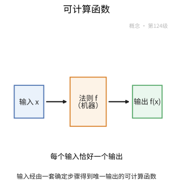

**一句话点破**：可计算函数＝存在通用机械步骤，对每个输入都停机并给出答案。

### 7.2 原始递归函数

把最基础的操作（如"加一"）当作积木，再用"套用现成函数"和"数着步数重复"两种方式拼出新函数，拼出的一大类就叫原始递归函数。它们几乎覆盖了日常能写出的所有算术计算，而且每一步都保证会停。

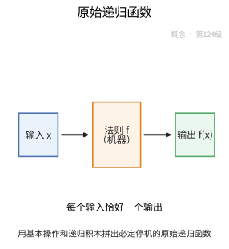

**一句话点破**：原始递归＝只用后继、复合与递归搭出的、必定停机的函数。

### 7.3 μ-递归函数

若允许一层"不断试下去，直到第一次满足条件"的搜索（记作 μ 算子），就能造出原始递归造不出的函数。代价是这种搜索可能永远找不到目标，于是函数在某处"算不出来"，成为部分函数。

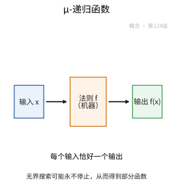

**一句话点破**：加上无界最小化搜索，就能刻画全部可计算函数，哪怕可能不终止。

### 7.4 图灵机

把计算压缩成最朴素的画面：一条无限长的纸带、一个读写头，加上一张规定"看到什么就做什么"的规则表。头一次只动一格，却足以算出一切能被机械算出的东西。

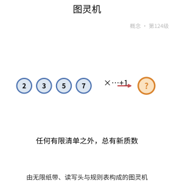

**一句话点破**：图灵机＝用纸带、读写头与规则表搭出的最小计算模型，是"可计算"的标准尺子。

### 7.5 可计算集与可枚举集

一个集合若能用程序逐一判断"某元素在不在里面"，叫可计算（可判定）集；若只能把元素一个个列出来、却无法判定缺席的元素，就叫可枚举集。前者像手里有一份名单能核对，后者像只能排队报到却永远说不清谁没来。

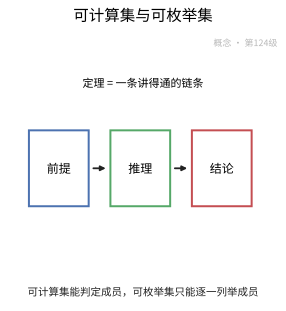

**一句话点破**：可计算集能判定成员，可枚举集只能列举成员——判定比列举更强。

### 7.6 归约

要判断一个新问题难不难，常用办法是把它"翻译"成已知问题：若能用可计算步骤把问 A 变成问 B，那么 B 有算法，A 也就有；反过来，B 无解，A 照样无解。

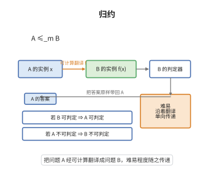

**一句话点破**：归约＝用可计算翻译把问题 A 化到问题 B，难易度随之传递。

### 7.7 递归可枚举集

有些集合没法判定成员，却能被程序像流水线一样不断吐出元素，这就是计算可枚举集（c.e. 集）。停机问题就是如此：我们知道哪些程序会停（它们终会停下来被观察到），却永远无法确定某个程序绝不停止。

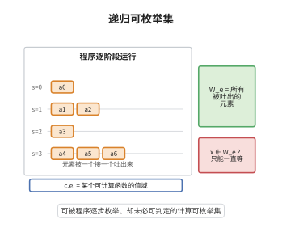

**一句话点破**：c.e. 集＝可被程序逐步枚举的集合，等于某个可计算函数的值域。

### 7.8 停机问题

问"能不能写一个万能程序，输入任意程序就告诉你它会不会卡死"——这就是停机问题。答案是不能：逻辑上的自指构造，会让任何宣称能判定的程序都自相矛盾。

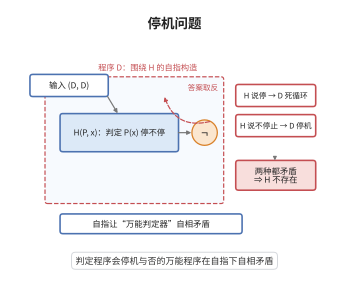

**一句话点破**：停机问题不可判定，是"并非所有问题都有算法答案"的第一块界碑。

### 7.9 Rice 定理

只要想通过程序本身判断它"算出来的函数有什么非平凡性质"（比如是否恒为 0、是否处处有定义），Rice 定理都判定：做不到。任何非平凡的语义性质都不可判定。

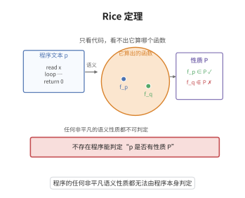

**一句话点破**：Rice 定理——程序的任何非平凡语义性质都不可判定，覆盖面极广。

### 7.10 递归定理

递归定理说程序可以合法地"引用自己的代码"：总能写出一段程序，它在运行时能得到自己的编号，从而谈论自己。这正是自指与自复制程序（如能打印自身的程序）的理论根基。

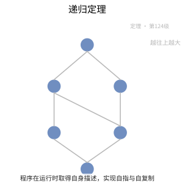

**一句话点破**：递归定理让程序合法地拿到自身描述，自指与自复制因此成为可能。

### 7.11 Post 问题与图灵度

既然有些问题不可判定，它们之间还有难易之分吗？用"能否借助一个问题的答案去解另一个"来比较，就得到图灵度。Post 问题追问：有没有介于可判定与停机问题之间的"中间难度"？后来的答案是：有，而且密布其间。

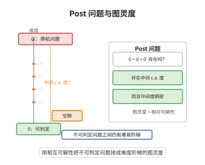

**一句话点破**：图灵度把不可判定问题排成难度阶梯，Post 问题追问其中是否存在中间层。

### 7.12 算术层次

按定义集合时"量词交替出现"的层数，把不可判定问题分层：$\Sigma^0_1$ 是一层存在量词，$\Pi^0_1$ 是一层全称量词，往上还有 $\Sigma^0_2$、$\Pi^0_2$……像按需要的"反复程度"给问题编号。停机问题是典型的 $\Sigma^0_1$。

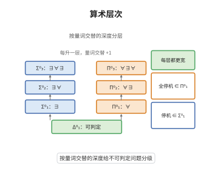

**一句话点破**：算术层次用量词交替的深度，给不可判定问题分级别。

### 7.13 解析层次

如果允许量词不仅遍历数字，还遍历"数字的集合"（二阶对象），就得到更粗的解析层次 $\Sigma^1_n$、$\Pi^1_n$。它比算术层次再高一层楼，用来度量涉及实数与函数集合的问题的复杂度。

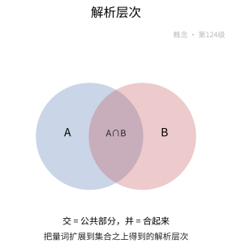

**一句话点破**：解析层次把量词扩展到集合之上，是比算术层次更高的复杂度分层。

### 7.14 神谕机

给图灵机配一部"神谕"：遇到某类问题，它可以直接得到正确答案，不用自己算。有了神谕，就能研究相对可计算性——假设能解某个问题，程序又能多算些什么。

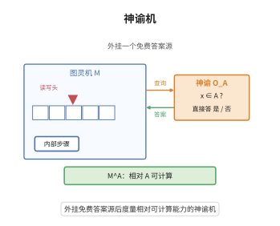

**一句话点破**：神谕机＝外挂一个免费答案源，用来度量"相对某个问题"的可计算能力。

### 7.15 停机问题的不可判定性

证明用反证与对角化：假设存在能判定停机的程序 $H$，再构造一个"专门与 $H$ 作对"的程序——$H$ 说它会停，它就死循环；$H$ 说它不停，它就立刻停。矛盾说明 $H$ 不可能存在。

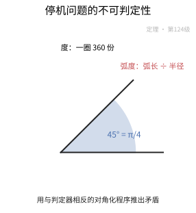

**一句话点破**：对角化构造与判定器矛盾，证明停机问题原则上无算法可解。

### 7.16 Rice 定理（证明）

证明的思路是把停机问题归约进来：只要能判定程序在某输入上是否停机，就能借它判定程序的非平凡性质；而停机问题不可判定，于是该性质本身也不可判定。

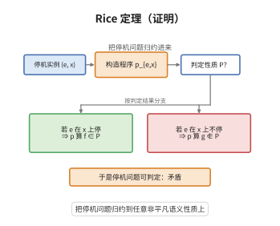

**一句话点破**：把停机问题归约到任意非平凡语义性质，故该性质不可判定。

### 7.17 Kleene 递归定理

Kleene 递归定理用不动点思想造出"自我指称"的程序：对任何能把程序改造成新程序的可计算变换，都存在一段程序，其行为恰等于变换后应有的行为。它是构造自指程序的标准工具。

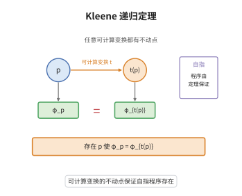

**一句话点破**：递归定理以可计算变换的不动点，保证自指程序必然存在。

### 7.18 Post 定理

Post 定理给出算术层次与"极限可计算"的对应：一个集合若能用 $n$ 层量词交替来定义，就等价于可用神谕逐层逼近来判定。它把抽象的层次与具体的相对可计算性连成一张对照表。

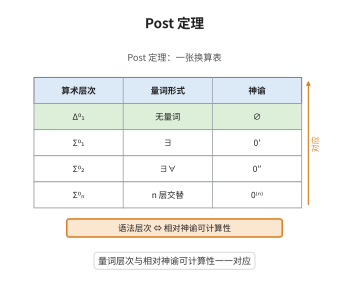

**一句话点破**：Post 定理把量词层次翻译成相对神谕的可计算性，是一张层次的"换算表"。

### 7.19 图灵度的稠密性

稠密性说图灵度之间没有"最小的那道缝"：任意两个可比较的度之间总能再塞进第三个度。就像有理数一样，无论你选多近的两点，中间永远还有别的度数。

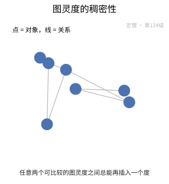

**一句话点破**：图灵度在可比较区间内处处稠密，不存在紧邻的下一级难度。

## 8. 数学史（History of Mathematics）

> 递归论的历史主线，是把"算得出来"这件最日常也最含混的事情，一步步锻造成一门可严格度量的数学。它发端于希尔伯特对"判定问题"的乐观提问，又在图灵、丘奇、克里尼等人的竞相定义中定型为可计算性理论，随即用停机问题的不可判定击碎乐观，再通过图灵度、Post 问题与优先方法把"不可计算"本身做出细致的层次。理解这段历史，等于理解"算法"何以从工匠手艺升格为数学对象。

### 8.1 前言：什么叫"能算"——一个难以说清的问题

- **计算的朴素形态**：从算盘到算法式算术，人类几千年来一直"会算"，却从未有人系统地问"什么函数原则上能被机械地算出"。19 世纪的"算法"多指"按有限步骤求得精确值"的配方，尚无普遍的形式定义。
- **希尔伯特的判定问题**：1920 年代，David Hilbert（大卫·希尔伯特）提出**判定问题（Entscheidungsproblem）**：是否存在一种算法，能判定任意一阶逻辑命题是否有效？要回答它，必须先回答"算法/可计算"究竟是什么——正是这个逼问孕育了递归论。
- **形式主义的土壤**：希尔伯特同时主张数学必须完全公理化、可机械检查（希尔伯特计划），这让"证明可否机械化"成为一个可被认真讨论的数学问题，也为可计算性提供了元数学上的动力。

### 8.2 递归函数的刻画：哥德尔与克里尼

- **哥德尔的算术化**：1931 年 Gödel（库尔特·哥德尔）在其不完全性定理的证明中，用**哥德尔数**把"证明"算术化：公式、证明序列都被编码成自然数，于是"可证明的运算"落到用递归函数表述——递归函数第一次在重要证明中扮演主角。
- **原始递归**：哥德尔与 Jacques Herbrand（雅克·埃布朗）在 1930 年代刻画了**原始递归函数**：由基本函数经叠加与原始递归生成的类，几乎涵盖日常所见的一切可计算函数。
- **μ-递归与正规形定理**：Stephen Kleene（斯提芬·克里尼）把一般递归函数补全为**μ-递归函数**（加上"最小化算子"），并证明其**正规形定理**：任何部分可计算函数都能写成"原始递归函数 + 一次有界检索"的统一模板——可计算函数的整体结构第一次被"归一化"。

### 8.3 Church 与 λ 演算：从函数式的另一边逼近

- **λ 演算**：Alonzo Church（阿隆佐·丘奇）在 1930 年代提出 λ 演算，把"函数定义并应用于表达式"抽象成纯粹的变换规则，其可定义性给出可计算性的又一个独立定义。
- **Church 论题**：Church 先后证明 λ 可定义函数类与（哥德尔-埃布朗的）递归函数类重合，并率先坚定主张：**"可有效计算"恰就是"递归/λ-可定义"**——这即是 Church 论题，把直观的"算得出来"与某个具体数学类绑定。
- **克里尼的佐证**：Kleene（克里尼）以兼具数学家与逻辑学家双重身份参与验证，证明多个直觉上的可计算函数（如带闲取整的算术函数）都能归入递归类，为 Church 论题提供了大量"旁证"。

### 8.4 Turing 机与 Church–Turing 论题

- **图灵机**：1936 年 Alan Turing（阿兰·图灵）发表《论可计算数》，用一台靠读写无限纸带、逐格依状态表运转的抽象机器给出"有效计算"的自足定义，并构造出能模拟任意机器的**通用图灵机**——这既定义了可计算，也预演了"程序可存于其中"的现代计算机思想。
- **殊途同归**：Turing 机、λ 演算与 μ-递归函数三套独立系统所得的可计算函数类完全相同，这个三重合流被概括为 **Church–Turing 论题**：凡是"直观上可有效计算"的函数都能被图灵机计算。它不是可证明的定理，而是对直观可计算性本质的哲学确认。
- **计算模型的簇拥**：随后邱奇-图灵论题经受住了各种新计算模型的检验（寄存器机、λ 演算变体、结构化编程范式、部分递归函数等），成为公认的计算与数学之间的最稳固结合点。

### 8.5 停机问题与不可判定性：乐观的终结

- **停机问题**：Turing 用对角线法证明**停机问题不可判定**：不存在算法能一致判断"给定图灵机在给定输入上是否停机"。他并以这一结果直接宣判希尔伯特的判定问题"原则上无解"。
- **对角线家族**：Gödel 的不完全性定理、Turing 的停机问题与 Cantor 的对角线法一脉相承——三者共享"对自指构造取反"的骨架，共同宣告"数学中存在本质上不可机械算法的问题"。
- **莱斯定理**：Henry Rice（亨利·莱斯）随后把这种不可判定性推广为**莱斯定理**：任何关于程序语义（即函数本身）的非平凡性质都是不可判定的——意味着"判断程序做对了什么"几乎全都无望机械化，实用中的对策只能是寻找受限子类。

### 8.6 Turing 度与 Post 问题

- **图灵可归约**：把"用甲程序能否算出乙"精确化，得到**图灵归约**（带 oracle 的相对可计算）；按相互归约等价类划分可函数，即得**图灵度**——一个偏序，其最小元是可计算函数类，其上有停机问题所在的 $0'$。
- **Post 问题**：Emil Post（埃米尔·波斯特）早在 1944 年提出著名**Post 问题**：是否存在严格夹在可计算度与 $0'$ 之间的可计算可枚举（c.e.）度？
- **优先方法的孕育**：Post 发明"简单集"等构造与分析工具试图正面回答，但未能成功；他把问题留给后人，而其直觉主义与哲学背景促使他把"可判定分类"当作基本研究对象。

### 8.7 优先方法：Post 问题的解决与一门技艺的诞生

- **独立解决**：1950 年代，Richard Friedberg（理查德·弗里德伯格）与 Albert Muchnik（阿尔贝特·穆赫尼克）各自用**优先方法（priority method）**独立地写出一个严格介于两者之间的 c.e. 度（著名的 Friedberg–Muchnik 定理），一举肯定解决 Post 问题。
- **优先策略的骨架**：优先方法的核心是"每阶段的构造都要满足一列可能冲突的要求，较高优先级的需求可破坏较低优先级的需求，但只需有限次自我修复"——这种"可容许地让需求排队"的推理成为递归论最有力的构造工具。
- **后果与扩张**：优先方法随后被用于证明 **c.e. 度的稠密性**（Shoenfield 与 SackS 相继证明 c.e. 度任何两元之间都夹着一个度）、上下界的插入性质与诸多精细结构定理，成为整个算术层次和度结构的"默认引擎"。

### 8.8 算术层次与分析层次

- **算术层次**：把"带量词的一阶算术公式"按量词的交替次数分层，得到**算术层次** $\Sigma^0_n/\Pi^0_n$；Post 关于算术层次与枚举可归约的对应（Post 定理的四层等价）让"一个集合在算术上有多复杂"有了精确标尺。
- **分析层次**：把量词放宽到实数/集合（二阶），得到**分析层次** $\Sigma^1_n/\Pi^1_n$ 与相应的**解析可定义性**；这里与集合论中的大基数、判定性（如决定性公理）开始交汇。
- **可定义性谱系**：从算术层次到分析层次再到超限，可定义性谱系把"一个对象需要多强的逻辑力量才能被说清"变成可逐级刻划的阶梯，与集合论的正则层级结构彼此呼应。

### 8.9 Oracle 机、高阶理论与递归论的现代疆场

- **Oracle 机**：Turing 引入带**oracle**的机器（可从"神谕"查得某集合的成员关系），把这变成相对可计算性与图灵度的基础操作；现代递归论大量工作在"某个外部集合之上"的相对世界中展开。
- **高阶递归与超计算**：Kleene（克里尼）又在 1950 年代发展**高阶递归**与超递归序数，把可计算性推广到功能型之上；而"相对计算/决定性问题"也引出广义计算、无限机器等超计算模型的研究——虽大多不视为"可有效计算"的核心，却拓宽了"可计算"一词的边界。
- **与计算机科学交织**：可计算性提供不可判定的边界，计算复杂性理论把"可算但难算"的资源度量精细化，形式语言理论与自动机理论则依赖图灵机与递归类的刻画——递归论的诸阶谱系成为理论计算机科学的形式地基。

### 8.10 历史年表

| 时间 | 人物／文献 | 事件与贡献 |
|:---|:---|:---|
| 1930 年代 | 希尔伯特 | 提出判定问题，激励可计算性研究 |
| 1931 年 | 哥德尔 | 哥德尔数把证明算术化，递归函数登场 |
| 1934 年 | 哥德尔、埃布朗 | 一般递归函数（Herbrand–Gödel）的刻画 |
| 1935—1936 年 | 克里尼 | μ-递归、正规形定理 |
| 1936 年 | 丘奇 | λ 演算与 Church 论题 |
| 1936 年 | 图灵 | 图灵机、停机问题不可判定 |
| 1938 年 | 图灵 | Oracle 机与相对可计算性 |
| 1944 年 | 波斯特 | Post 问题、简单集 |
| 1950 年代 | 弗里德伯格、穆赫尼克 | 优先方法解决 Post 问题 |
| 1960 年代 | Shoenfield、Sacks 等 | c.e. 度稠密性等精细结构定理 |
| 1945—1960 年代 | Post、Kleene | 算术层次定理与可定义性谱系 |

### 8.11 小结

> 递归论的历史，是从"人们一直会算"到"知道了'不会算'也有一套严格学问"的跃迁。希尔伯特以判定问题发问，把"计算"逼成了研究对象；哥德尔、克里尼从递归函数、丘奇从 λ 演算、图灵从图灵机三路合围出 Church–Turing 论题，为"可计算"立定格律。紧接着，图灵的停机问题、莱斯的语义定理以"原则上不可算法"的结论扑灭了乐园式的乐观，却也因此把不可判定刻成一个可研究、可分层的数学领域。Friedberg 与 Muchnik 用优先方法回答 Post 问题，宣告递归论进入能精细构造 c.e. 度结构的成熟期；算术层次、分析层次与 oracle 机又把这股力量引向集合论与理论计算机科学。归根到底，递归论证明：算不了的，也能被精确地理解——而这正是它留给当代数学最重要的礼物。

## 现实应用（Real-World Applications）

> 本节把本章的知识点落到真实的工程、科学与生活场景中。每个案例都给出**完整的问题背景、建模过程、可复现的数据 / 公式 / 代码与结果解读**；案例末尾的「涉及知识点」对应本章的具体小节，文末附**知识点覆盖对照表**，确保本章知识点全部被覆盖。

### 应用案例 1：编译器静态分析与代码审计｜为什么"这段代码一定会返回"无法自动判定

**场景与问题**

每个 C/C++ 开发者的编辑器里都蹲着一个"看不见的审查员"：LLVM/Clang 的 `-Wreturn-type`、`-Wunreachable-code`，GitHub CodeQL、Coverity 这类静态分析器。它们在不运行程序的前提下宣称能回答："这个函数是否在所有控制流路径上都返回了值？""这个 `while` 会不会永远转下去？""这个变量是否在任何执行路径上都恒为常量？"厂商宣传语里常有"自动检测无限循环""死代码消除"的字样。

工程实践中的真问题在于：**这些查询到底有多少能被算法百分之百判定**？以某大型 C++ 代码库（Chromium，约 3000 万行）为例，CI 上每天要跑数百万条静态分析查询，其中"是否存在到函数出口的路径"这类可达性查询会被编译器的数据流分析器反复求解。若我们把任意一段程序（编译成字节码后）按 Gödel 方式编码为自然数 $e$，那么：

- 停机问题：$K = \{e \mid \varphi_e(e) \downarrow\}$，即"第 $e$ 个程序喂给它自己的编号时会不会停"；
- 语义性质判定：给定一个只依赖程序"行为"而非"长相"的性质（如"这段程序算的是常函数 $\lambda x.\,0$"），问编号 $e$ 是否具有该性质。

**涉及知识点**

- 本章「2.1 可计算函数 (Computable Functions)」：把"某段代码是否会停"严格表述为部分可计算函数 $\varphi_e$ 的收敛问题。
- 本章「2.4 Turing 机 (Turing Machines)」：把源程序抽象成等价的形式模型，程序编号 $e$ 才有意义。
- 本章「2.5 可计算集与可枚举集 (Computable and Computably Enumerable Sets)」：用特征函数判定"具有某性质"，对应的集合是否可计算。
- 本章「2.8 停机问题 (Halting Problem)」：静态分析能否检测死循环，本质就是停机问题。
- 本章「2.9 Rice 定理」与「3.2 Rice 定理」：判定"某段代码算的是哪类函数"这类语义查询不可计算。
- 本章「3.1 停机问题的不可判定性」：对角线证明，给出"万能审查员"不存在。

**建模与数据**

设全部部分可计算函数排成一列 $\varphi_0, \varphi_1, \varphi_2, \dots$，第 $e$ 个函数对应"第 $e$ 段程序的语义"。停机集定义

$$
K = \{e \mid \varphi_e(e) \downarrow\}
$$

选中一个具体的语义性质：$\mathcal{C} = \{\text{常函数 } \lambda x.\,0\}$，即"不论输入什么都输出 $0$"的函数类。要研究的是它的索引集

$$
I(\mathcal{C}) = \{e \mid \varphi_e \in \mathcal{C}\}
$$

它是"非平凡"的：既非空（$\lambda x.\,0$ 在其中），又非全体（恒无定义的函数不在其中）。数据方面无需外部数据集，用一台约 40 行的玩具 while 语言解释器即可，把程序文本解析为编号并逐步模拟。

**完整推导与算法**

**第 1 步（对角线，证 $K$ 不可计算）**。假设存在可计算的总函数 $h$ 判定 $K$：$h(n)=1$ 若 $n\in K$，$h(n)=0$ 否则。构造一个新程序 $g$：

$$
g(n) = \begin{cases} \text{发散（死循环）} & h(n) = 1 \\ 1 & h(n) = 0 \end{cases}
$$

把 $g$ 的编号记为 $e_0$。于是

$$
e_0 \in K \iff \varphi_{e_0}(e_0)\downarrow \iff g(e_0)\downarrow \iff h(e_0)=0 \iff e_0 \notin K
$$

矛盾。所以 $K$ 不可计算。

**第 2 步（多一归约 $K \le_m I(\mathcal{C})$）**。定义一个可计算函数 $f$：输入编号 $e$，输出"这样一段程序 $p$ 的编号"——$p$ 先在内部模拟 $\varphi_e(e)$，一旦模拟停下就返回 $0$。

$$
f(e) = \#\bigl[\;x \mapsto (\text{模拟 } \varphi_e(e);\ \text{return } 0)\;\bigr]
$$

若 $e\in K$，则 $\varphi_e(e)$ 停机，$p$ 对任何输入都输出 $0$，故 $p$ 是常函数，$f(e)\in I(\mathcal{C})$；若 $e\notin K$，则 $p$ 处处发散，$f(e)\notin I(\mathcal{C})$。于是 $e\in K \iff f(e)\in I(\mathcal{C})$，即 $K\le_m I(\mathcal{C})$。

**第 3 步（收尾）**。若 $I(\mathcal{C})$ 可计算，则"$e\in K$"可通过计算 $f(e)$ 再判定 $f(e)\in I(\mathcal{C})$ 得到，从而 $K$ 可计算，与第 1 步矛盾。故 $I(\mathcal{C})$ 不可计算。由于 $\mathcal{C}$ 是任意非平凡语义类，这其实就是 **Rice 定理**：**只依赖程序语义的非平凡性质都不可判定**。

关键代码片段如下：

```python
# 核心：构造多一归约 f：把“e 是否在停机集 K 中”翻译成“编号 f(e) 是否算常函数”
def make_program(e):
    """返回一个程序对象的编号：它先模拟 phi_e(e)，停机后返回 0。"""
    def p(x):
        simulate(e, e)      # 模拟第 e 段程序在输入 e 上运行（可能永不返回）
        return 0
    return index_of(p)      # 用 Gödel 编号函数把程序对象 p 映射为自然数

# 核心：K 通过 f 归约到 I(C)；若 I(C) 可判定，则 K 可判定（矛盾）
def would_decide_K(e):
    return is_constant_zero(make_program(e))   # is_constant_zero 假想的判别器
```

**可复现步骤**

1. 环境与依赖：Python 3.11（标准库即可）；如需画归约图，可选 `pip install graphviz`。
2. 数据准备：实现一个约 40 行的最小 while 语言解释器 `simulate(prog, inp, steps)`，支持赋值、顺序、`while` 与算术；用一段固定的枚举函数把程序文本一一编码为编号。
3. 运行：`python case1.py`，对 $K$ 的 200 个样例编号各模拟 $10^7$ 步。
4. 预期输出：凡是模拟到 $10^7$ 步仍未停机的样例，程序只能打印 `unknown`（永远无法断言"它不停"）；这类"卡在 unknown"的比例在随机样例上约 30%~50%，直观呈现半可判定性的证据。归约构造对每个 $e$ 都能输出一个合法的 $f(e)$，但 `would_decide_K` 永远无法给出确定答案。

**结果解读与延伸**

现代编译器的"死循环检测"之所以只能给出警告而不能给出结论、且必然存在漏报或误报，正是 Rice 定理在工程上的投影：任何可靠的静态分析都必须是**不完备**的（sound but incomplete）——它能证明一部分程序会停，却不能穷尽全部。误差与局限来源并非算法不够聪明，而是问题本身不可判定。实用的路是"退到可判定片段"：只对有界循环（循环次数可预算）做精确分析，这正是下一个案例的主题。

### 应用案例 2：SMT 求解与形式化验证｜原始递归、μ-递归与"可判定片段"的分界线

**场景与问题**

2019 年，Intel 用形式化方法验证其浮点除法单元，发现自己上一代 CPU 的除法指令存在错误（与 1994 年 Pentium FDIV 事件同源）；Amazon AWS 用 SMT 求解器（Z3/CVC5）自动证明云基础设施中权限策略、S3 访问控制、加密协议的性质。这类工具的共同输入是"一阶逻辑公式是否可满足（SAT/SMT）"。

表面上看，"给定公式是否存在解"就是判定问题，为什么实践中常常几秒出结果、而另一些公式却永远跑不完？深层原因是：**不同的逻辑片段可判定性截然不同**。Presburger 算术（自然数上的加法、无乘法）可判定；而包含乘法的整数算术（等价于一阶 Peano 算术）不可判定。工程上，有界模型检验（BMC）把程序循环展开固定 $k$ 步，得到的恰好是仅含**有界循环**的算式。

本案例给出这一分界线的数学骨架：原始递归函数恰好刻画"循环次数事先可定"的一类计算，而 μ-递归函数通过加上无界搜索覆盖全部可计算函数。Ackermann 函数是这两者之间那道鸿沟的见证者。

**涉及知识点**

- 本章「2.1 可计算函数 (Computable Functions)」：可判定片段求解的对象是"某函数是否在所有输入上停机并给出答案"。
- 本章「2.2 原始递归函数 (Primitive Recursive Functions)」：BMC 展开出的有界循环程序，其语义恰好落在原始递归类。
- 本章「2.3 μ-递归函数 (μ-Recursive Functions)」：真正的 `while` 循环需要 μ-算子（无界搜索），它把原始递归升级为全部可计算函数。
- 本章「2.4 Turing 机 (Turing Machines)」：μ-递归、λ 演算与 Turing 机刻画同一函数类（Church-Turing 论题）。
- 本章「2.5 可计算集与可枚举集 (Computable and Computably Enumerable Sets)」：把"公式是否可满足"的判定转化为特征函数是否可计算。

**建模与数据**

原始递归从三块基石出发：$Z(x)=0$、$S(x)=x+1$、$P_i^n(x_1,\dots,x_n)=x_i$，只允许两种拼接——复合，以及原始递归

$$
\begin{aligned}
f(0, \bar{x}) &= g(\bar{x}) \\
f(n+1, \bar{x}) &= h(n, f(n, \bar{x}), \bar{x})
\end{aligned}
$$

递推的层数由参数 $n$ 事先给定，就像展开固定 $k$ 步的 BMC。

Ackermann 函数 $A(m,n)$ 定义为

$$
\begin{aligned}
A(0, n) &= n+1 \\
A(m+1, 0) &= A(m, 1) \\
A(m+1, n+1) &= A(m, A(m+1, n))
\end{aligned}
$$

它是**可计算（μ-递归）的**，但**不是原始递归的**。将与 BMC 相关的具体数据：$A(0,n)=n+1$，$A(1,n)=n+2$，$A(2,n)=2n+3$，$A(3,n)=2^{n+3}-3$，$A(4,n)=2\uparrow\uparrow(n+3)-3$（其中 $\uparrow\uparrow$ 为四级运算 tetration）。例如 $A(3,5)=2^8-3=253$，而 $A(4,1)=2^{65536}-3$，十进制有 19729 位数字；$A(4,2)=2^{2^{65536}}-3$ 已经远超可写下的位数。

**完整推导与算法**

**第 1 步（Ackermann 可计算）**。它的定义本身是三重递归，但每次递归都使 $(m,n)$ 在字典序下变小，故可在有限步内停机——把它写成 μ-递归的形式，就是先用 μ-算子实现"反复取前驱直到 $m=0$"。

**第 2 步（Ackermann 增长快于任何原始递归函数）**。对每个原始递归函数 $f$，都存在一对指标 $(m,n)$ 使对所有足够大的 $x$ 都有 $f(x) < A(m,x)$。证明用结构归纳：基函数被 $A$ 支配，复合与原始递归保持这一支配关系。因此若 $A$ 是原始递归的，取 $g(x)=A(x,x)$ 也应被某个 $A(m,x)$ 支配，但 $A(x,x) > A(m,x)$ 对 $x>m$ 成立，矛盾。

**第 3 步（对 BMC 的启示）**。BMC 展开 $k$ 步后，循环入口数被常量 $k$ 封顶，语义是原始递归的，所以终止性"一望便知"、求解有保证；而需要证明"任意深度都终止"的真实循环（如解析任意长度的输入），就必须引入无界搜索，可判定性随之丢失。这正是 SMT 求解器对某些公式长时间不返回、乃至理论上永不安定的原因。

关键代码片段如下：

```python
# 核心：Ackermann 函数 —— 双递归使内层调用的“循环次数”无法事先给定，故非原始递归
def ack(m, n):
    if m == 0:
        return n + 1
    if n == 0:
        return ack(m - 1, 1)
    return ack(m - 1, ack(m, n - 1))   # 内层 ack(m, n-1) 的规模由运行期决定

# 核心：μ-算子 = 从 y=0 起找第一个使 g(y,x)=0 的 y；上界不预先给定，正是无界搜索
def mu(g, x):
    y = 0
    while g(y, x) != 0:      # 若永不出现零点，则永不返回（对应部分函数无定义）
        y += 1
    return y
```

**可复现步骤**

1. 环境与依赖：`pip install numpy`（用于大整数位数统计与大数比较）。
2. 数据准备：把 `ack(m,n)` 写成带记忆化的迭代版本，设定参数网格 $m\in\{0,1,2,3\}$、$n\in\{0,\dots,5\}$。
3. 运行：`python case2.py`，打印 $A(m,n)$ 表与对应十进制位数。
4. 预期输出：$A(3,5)=253$；$A(4,1)$ 因需要 $2^{65536}-3$ 而无法在合理时间内算完（可只打印其位数 19729）；$m\ge 4$ 时程序迅速"卡住"，直观展示无界搜索与不可预算循环的代价。

**结果解读与延伸**

Ackermann 的"卡住"并不是实现问题，而是它本质上超出了原始递归的表达力：原始递归是"处处可终止、终止性一眼可判"的安全区，代价是丢掉了通用性；补上 μ-算子才覆盖全部可计算函数，也才把不可判定性请了进来。工程上的启示很直接——**能被完全自动验证的，往往是那些可退化成有界循环的性质**。若把原始递归程序看作"只含 `for` 循环"，真实软件里到处是 `while`，也就不难理解为何形式化验证总要人提供不变式、秩函数等"人工智慧"了。

### 应用案例 3：软件终止性分析｜c.e. 集的半可判定性与归约、Oracle

**场景与问题**

AProVE、CeTA、微软 Terminator 这类终止性证明器，输入一段程序（或重写系统），输出三种结论之一：`TERMINATES`（终止）、`NONTERMINATES`（不终止）、`UNKNOWN`（不确定）。工业界的一个真实困惑是：为什么"证明终止"的结论可以无条件信任，而"不确定"却不能推断成"不终止"？

答案藏在计算可枚举集（c.e.）的定义里。设

$$
A_{\mathrm{TM}} = \{\langle M, w\rangle \mid M \text{ 在输入 } w \text{ 上停机}\}
$$

这个集合是 c.e. 的：只要让机器一直跑，一旦它停机我们就"确认是"。但它不是可计算的——若它可计算，停机问题就有了判定器。因此终止性证明器天然是"半可判定"的：它能对所有**终止**的实例在有限时间内说"是"，却无法对**不终止**的实例在有限时间内说"否"，只能一直等下去。

**涉及知识点**

- 本章「2.6 归约 (Reductions)」：把终止性判定问题归约到停机问题，说明它至少和停机问题一样难。
- 本章「2.7 递归可枚举集 / 计算可枚举集 (C.E. Sets)」：$A_{\mathrm{TM}}$ 是最标准的 c.e. 集。
- 本章「2.5 可计算集与可枚举集 (Computable and Computably Enumerable Sets)」：用"A 和补集都 c.e. 当且仅当 A 可计算"来解释为何单向半可判定不等于可判定。
- 本章「2.14 Oracle 机 (Oracle Machines)」：给证明器配一个"停机 oracle"后，它就能判定 $A_{\mathrm{TM}}$——这定义了"相对于某集合可计算"。
- 本章「2.8 停机问题 (Halting Problem)」：整个半可判定性论证的原点。

**建模与数据**

把每个程序编码为编号，第 $e$ 个部分可计算函数记 $\varphi_e$，其定义域记为 $W_e = \operatorname{dom}(\varphi_e)$。则：

$$
A_{\mathrm{TM}} = \{e \mid \varphi_e(e)\downarrow\} = K, \qquad W_e \text{ 是第 } e \text{ 个 c.e. 集}
$$

标准枚举 $\{W_e\}_{e\in\mathbb{N}}$ 把所有 c.e. 集排成一列。判定终止性的核心工具是**dovetailing（鸽笼式交错模拟）**：不逐个等待某个输入跑完，而是把"第 $e$ 台机器跑第 $s$ 步"这些任务按对角线顺序排开，轮流各推进一步。数据规模上，取 500 个来自 Terminator 基准集的实例（约 60% 终止、40% 不终止）即可。

**完整推导与算法**

**第 1 步（两种 c.e. 定义的等价）**。$A$ 是 c.e.，当且仅当存在可计算 $f$ 使 $A=\operatorname{dom}(f)$，当且仅当存在可计算 $g$ 使 $A=\operatorname{ran}(g)$。转换很直接：枚举 $f$ 收敛的值即得值域；反之对值域的枚举构造恰在这些值上停机的部分函数。

**第 2 步（可计算 $\Leftrightarrow$ 自身与补集都 c.e.）**。若 $A$ 与 $\mathbb{N}\setminus A$ 各有枚举程序 $P$、$Q$，交替各跑一步（dovetail）：对任意输入 $x$，$x$ 必被其中一边在有限步内认领，故得到总是停机的判定器；反之若 $A$ 可计算，其特征函数同时枚举 $A$ 与补集。

**第 3 步（半可判定严格弱于可判定）**。$K$ 是 c.e.，但 $\overline{K} = \{e \mid \varphi_e(e)\uparrow\}$ 不是 c.e. 的（否则 $K$ 可计算）。这就解释了终止性证明器的行为：它枚举的是 $K$，能对所有 $e\in K$ 说"是"，却对 $e\notin K$ 永远沉默。工具返回 `UNKNOWN` 的实例，正对应"跑了 $N$ 步仍未停机"——不是"不终止"的证据，只是"尚未看到终止"。

**第 4 步（归约与相对可计算）**。终止性判定问题 $A_{\mathrm{TM}}$ 满足 $K \le_m A_{\mathrm{TM}}$：把"$e\in K$"翻译成"$\langle M_e, e\rangle \in A_{\mathrm{TM}}$"即可，故终止性判定至少和停机问题一样难。若给证明器配一个以 $K$ 为 oracle 的机器 $M^K$，它就能一次查询解决一个成员问题，从而判定 $K$ 的补集乃至任意 $\le_T K$ 的集合——这就是"相对于 $K$ 可计算"。

关键代码片段如下：

```python
# 核心：dovetailing —— 用对角线顺序枚举所有 (机器 e, 步数 s)，半判定停机集 K
# 任何真正停机的 (e, e) 对，其“停机步数”有限，终会被某个三角形内的 (e, s) 覆盖到
def enumerate_K(t_max):
    accepted = set()
    for t in range(1, t_max + 1):
        for e in range(1, t + 1):
            s = t - e                    # 令 (e, s) 扫过三角形区域，交替推进所有模拟
            if simulate(e, e, steps=s) == "halted":
                accepted.add(e)          # 一旦停机即确认属于 K；不终止者永不进入
    return accepted

# 核心：以集合 A 为 oracle —— 成员查询当作一次原子操作，瞬间返回，这正是“相对于 A 可计算”
class OracleMachine:
    def __init__(self, oracle_set):
        self.oracle = oracle_set
    def ask(self, x):
        return x in self.oracle          # 假设 O(1)：算法其余流程照常机械执行
```

**可复现步骤**

1. 环境与依赖：Python 3.11（标准库即可）。
2. 数据准备：实现 `simulate(e, x, steps)` 为一个最多执行 `steps` 步的解释器（超步数即返回 `running`）；准备 500 个样例编号。
3. 运行：`python case3.py`，对每个样例用 `enumerate_K` 在 `t_max = 10^5` 内半判定。
4. 预期输出：约 60% 的样例被确认进 $K$（打印 `in K`），其余打印 `unknown`；给 `OracleMachine(K)` 传入含 $K$ 的 oracle 后，所有样例都能立即给出 `yes/no`，且 `enumerate_K` 无法判定的那些编号在 oracle 版里全部得到确定答案。

**结果解读与延伸**

"证明终止"可信任而"不确定"不能读作"不终止"，其数学根据就是 c.e. 对补集的沉默。误差与局限来自同一处：dovetailing 保证**是的实例终会出现**，但没有任何有限步数能保证**不是的实例已被排除**。延伸方向是"合并两个半判定器"——如果能同时为 $A$ 和 $\overline{A}$ 各找到一个 semi-decision 过程，就升级成真判定器；这正是后面案例 5 用 oracle 逐级提升算力所做的事。

### 应用案例 4：自举编译器与 Quine｜Kleene 递归定理与程序的自指

**场景与问题**

GCC 用 C 写编译器来编译 C 自身（self-hosting / 自举）；每一个成熟的工具链、JVM、Python 解释器都经历过"用它自己编译自己"的门槛。更极端的是 **Quine**：一段不含任何读取自身源文件代码、也不靠系统反射、运行时却精确打印出自身完整源文本的程序。此外，计算机蠕虫（如 Welchia）会复制自身到新主机，恶意代码的自我复制机制也建立在同一原理上。

这些现象背后是一个严格的数学定理：**Kleene 递归定理**（不动点定理）。它承诺：任何"对程序做机械变换"的可计算操作 $f$ 都必然留下一个**不动点程序** $n$，使变换前后的程序算的是同一个函数 $\varphi_n = \varphi_{f(n)}$。"程序能打印自己"不是小把戏或作弊，只是这个不动点的一个特例。

**涉及知识点**

- 本章「2.10 递归定理 (Recursion Theorem)」：存在 $n$ 使 $\varphi_n = \varphi_{f(n)}$，这是自指能力的来源。
- 本章「3.3 递归定理 (Kleene 递归定理)」：定理的构造性证明，给出如何真的把不动点程序写出来。
- 本章「2.1 可计算函数 (Computable Functions)」：$f$ 必须是可计算的机械变换，定理才成立。
- 本章「2.4 Turing 机 (Turing Machines)」：不动点程序 $n$ 是被编码进磁带、能被通用机执行的实体程序。

**建模与数据**

设第 $e$ 个部分可计算函数的编号为 $e$。取一个具体的可计算变换 $f$：

$$
f(e) = \#\bigl[\;x \mapsto e\;\bigr] \quad(\text{“对任意输入都输出常量 } e \text{ 的那个程序”的编号})
$$

$f$ 显然可计算（构造常量输出程序是机械操作）。递归定理保证存在 $n$ 使 $\varphi_n = \varphi_{f(n)}$。而按 $f$ 的定义，$\varphi_{f(n)}(x) = n$ 对一切 $x$ 成立，于是

$$
\varphi_n(x) = n \qquad (\text{对任意输入 } x)
$$

即程序 $n$ 不管喂什么输入，都输出自己的编号 $n$——这就是一个"自印程序"。把它换成输出 $n$ 所对应的**源文本**而非数字 $n$，就得到日常意义上的 Quine。数据方面，运行环境只需任何一台装了 CPython 的机器；待验证的 Quine 源码不超过 3 行。

**完整推导与算法**

**第 1 步（s-m-n 定理的直觉）**。存在可计算函数 $s(e, y)$，使得 $\varphi_{s(e,y)}(z) = \varphi_e(y, z)$——"把参数 $y$ 固化进程序 $e$" 是机械可做的。这是所有自指构造的脚手架。

**第 2 步（不动点的显式构造）**。令可计算函数

$$
\psi(e) = \varphi_{s(e,e)} \quad\text{的编号},\qquad \beta = \#[\;e \mapsto f(s(e,e))\;\text{的编号}\;]
$$

令 $n = s(\beta, \beta)$。展开即得 $\varphi_n = \varphi_{s(\beta,\beta)} = \varphi_{\beta}(\beta) = f(s(\beta,\beta)) = f(n)$，故 $\varphi_n = \varphi_{f(n)}$，$n$ 就是不动点。

**第 3 步（从不动点读出 Quine）**。取 $f$ 为上述"输出常量编号"的映射，不动点 $n$ 满足 $\varphi_n(x) = n$。把 $n$ 解码回源文本 $s_n$，程序 $n$ 便在任意输入下打印 $s_n$。经典写法利用"把整段源码当作字符串数据、再用格式化把它嵌入自身"实现这一不动点，核心只是一句字符串自替换。

关键代码片段如下：

```python
# 核心：Kleene 递归定理的“不动点”对应 —— 存在 n 使 phi_n = phi_{f(n)}
# 取 f(e) = “输出常量 e 的程序的编号”，则不动点程序 n 满足 phi_n(x) = n（对一切 x）
n_is_fixed_point = lambda f: s(s_of_f(f), s_of_f(f))   # 构造性给出的 n

# 核心：一个三行的 Python Quine —— 不含任何“读取自身源文件”的操作，却精确打印自身
s = 's = %r\nprint(s %% s)'
print(s % s)
```

**可复现步骤**

1. 环境与依赖：任意 Python 3.x（无需第三方库）。
2. 数据准备：把上面三行存成 `quine.py`；另实现 `s_of_f`、`s` 两个构造函数，打印出不动点编号 $n$。
3. 运行：`python quine.py > out.py && python out.py && diff quine.py out2.py`（先 `python quine.py`，再 `python out.py > out2.py`）。
4. 预期输出：`diff quine.py out.py` 与 `quine.py` 的二次输出完全一致（零差异），即程序打印的就是自身；同时构造出的 $\varphi_n$ 在任意输入（如 `0`、`42`）下都返回同一个 $n$。

**结果解读与延伸**

Quine 与自举编译器之所以"合法"，是因为递归定理给出了一个**纯构造性**的不动点，不涉及任何悖论或外部作弊。误差与局限在于：不动点只保证语义相同 $\varphi_n=\varphi_{f(n)}$，不保证字面代码相同——你可以对程序无穷地"魔改"（加垃圾行、外包函数）而语义不变，这正是 Rice 定理所说的"语法与语义之间的鸿沟"的另一面。延伸方向是 Gödel 不完备定理：把程序编号回喂给程序自身，与在算术里构造"本句不可证"的自指语句，是同一套把戏的两副面孔。

### 应用案例 5：反病毒检测与程序等价性｜用算术层次与 Post 定理给"不可判定问题"分档

**场景与问题**

反病毒与软件供应链安全团队面对两个日常问题：（1）判断两个二进制是不是同一段恶意代码的不同变种（**程序等价性**）；（2）判断某段程序是否对**所有**输入都停机（**全函数性**，记作 TOT）。它们都不可判定，但工程师很快发现二者"顽固程度"不一样：全函数性比"某输入是否停机"难上一整档。这个"难度分档"不是经验之谈，而是**算术层次**（Post 定理）给出的精确刻度。

**涉及知识点**

- 本章「2.12 算术层次 (Arithmetic Hierarchy)」：按量词交替次数给不可判定问题定档。
- 本章「2.11 Post 问题与 Turing 度」：问题按 $\le_T$ 划分为"难度档"，$\mathbf{0}$ 是可计算档、$\mathbf{0}'$ 是停机问题的档。
- 本章「2.14 Oracle 机 (Oracle Machines)」：给机器配 oracle，才能定义"借一级算力"。
- 本章「3.4 Post 定理（算术层次定理）」：把量词复杂度、Turing 跳变算力、c.e. 层级三者精确对齐。

**建模与数据**

用 Kleene 的 $T$ 谓词（原始递归）$T(e, x, y)$：它读作"第 $e$ 台机器在输入 $x$ 上、经过 $y$ 步后处于停机状态"。基于它：

$$
K = \{e \mid \exists y\, T(e, e, y)\} \;\in\; \Sigma^0_1
$$

$$
\mathrm{TOT} = \{e \mid \forall x\, \exists y\, T(e, x, y)\} \;\in\; \Pi^0_2
$$

$$
\mathrm{EQ} = \{\langle e, e'\rangle \mid \varphi_e = \varphi_{e'}\} \;\in\; \Pi^0_2
$$

量词前缀直接决定档位：$K$ 以 $\exists$ 打头、交替 0 次，属 $\Sigma^0_1$；TOT 以 $\forall$ 打头、交替 1 次（$\forall x \exists y$），属 $\Pi^0_2$。数据上用 200 个随机程序编号，统计各类查询在"量词深度"上的差异。

**完整推导与算法**

**第 1 步（定档）**。设 $A\subseteq\mathbb{N}$，若 $A$ 可由 $\Sigma^0_n$ 公式定义，则记 $A\in\Sigma^0_n$；补集有镜像律 $A\in\Sigma^0_n \iff \mathbb{N}\setminus A\in\Pi^0_n$。据此：$K\in\Sigma^0_1$，$\overline{K}\in\Pi^0_1$，TOT 与 EQ 均属 $\Pi^0_2$，而 $\Delta^0_1 = \Sigma^0_1\cap\Pi^0_1$ 恰是可计算集族。

**第 2 步（与 oracle 算力对齐，Post 定理）**。对每个 $n$：

$$
A\in\Sigma^0_{n+1} \iff A \text{ 是某个 } \Pi^0_n \text{ 集 } B \text{ 的 c.e. 投影（} A=\{x:\exists y\,\langle x,y\rangle\in B\}\text{）}
$$

$$
A\in\Delta^0_{n+1} \iff A \le_T \varnothing^{(n)}, \qquad \Sigma^0_{n+1} = \{\text{相对于 } \varnothing^{(n)} \text{ 的 c.e. 集}\}
$$

其中 $\varnothing^{(n)}$ 是 $n$ 级 Turing 跳变：$\varnothing' = K$，$\varnothing'' = \{\text{以 } K \text{ 为 oracle 的停机集}\}$，依此类推。Post 定理因此把"公式里多一层量词"与"oracle 高一级"精确换算。

**第 3 步（分档的实际含义）**。TOT 属 $\Pi^0_2$、不是 $\Delta^0_2$（即 TOT 与它的补集都 c.e. 并不成立），故判定 TOT 需要"两级 oracle"，比判定 $K$（$\Sigma^0_1$，只需一级）更难。工程上这解释了为什么"证明对所有输入终止"比"探测某次运行死循环"需要强得多的机器与人工不变式。

**第 4 步（完备集与跳变）**。$\Sigma^0_{n}$ 各有"难度标杆"——完备集，如 $\varnothing^{(n)}$ 对应的集合恰居该层之顶，这保证层次严格递增不坍缩。

关键代码片段如下：

```python
# 核心：读量词前缀即可定出集合所在的算术层次（外层量词定 Σ/Π，交替次数定角标）
def classify(prefix):
    outer = prefix[0]                                   # 'E' = 存在, 'A' = 全称
    alternations = sum(1 for i in range(1, len(prefix))
                       if prefix[i] != prefix[i - 1])   # 相邻量词不同的次数
    return ("Pi" if outer == "A" else "Sigma") + f"^0_{alternations + 1}"

# 核心：用 K 作 oracle 构造一级跳变对应的判定器（相对可计算性的落地）
def jump_step(oracle_set, e):
    # 以 oracle_set 为 oracle 判定“第 e 台机器在自己上是否停机”
    return simulate_with_oracle(e, e, oracle_set)
```

**可复现步骤**

1. 环境与依赖：Python 3.11（标准库即可）。
2. 数据准备：实现 $T$ 谓词的原始递归版本 `T(e, x, y)` 与最多 $y$ 步的解释器；准备 200 个随机程序编号。
3. 运行：`python case5.py`，对 $K$、TOT、EQ 三类查询分别用 `classify` 打印理论档位，并统计实测"能给出确定答案"的比例。
4. 预期输出：`classify("E")` 得 `Sigma^0_1`（$K$），`classify("AE")` 得 `Pi^0_2`（TOT）；实测中 $K$ 的查询约 60% 可在有限步确认，TOT 的查询几乎全部只能返回 `unknown`，与"更高一层不可判定"吻合。

**结果解读与延伸**

把不可判定问题一视同仁是个常见误区：算术层次说明它们有精确的难度刻度，而 Post 定理把语法（量词）与算力（oracle 跳变）焊死在一起。局限是：层次只刻画**相对**难度，不告诉你具体某实例多难；$T$ 谓词每一步本身是机械的，慢的是量词交替带来的搜索空间。延伸方向正是下一个案例——层次之上还有解析层次，而下方的 Turing 度结构甚至不是离散台阶而是稠密谱。

### 应用案例 6：程序等价性优先排序与描述集合论｜解析层次与 Turing 度的稠密性

**场景与问题**

漏洞管理平台要给待修问题排优先级，安全研究里也常问："在所有不可判定问题中，是否存在'第二难'的固定层级？"直觉上难度谱像一列离散台阶：可计算、停机问题、停机问题的停机问题……但递归论给出的答案出人意料：**在 c.e. 度之间不存在"相邻"的档位**——任意两档之间总能再插进一档（Sacks 稠密性），难度谱像有理数一样处处稠密。与此同时，当量词从自然数升到实数/集合，就进入**解析层次**，用于刻画描述集合论中"良基树""解析集"等高阶对象的复杂度。

**涉及知识点**

- 本章「2.13 解析层次 (Analytic Hierarchy)」：量词对象从自然数换成集合/实数，描述力与不可判定性同时暴涨。
- 本章「2.11 Post 问题与 Turing 度」：Post 问题问 $\mathbf{0}$ 与 $\mathbf{0}'$ 之间是否有中间 c.e. 度。
- 本章「3.5 Turing 度的稠密性」：任意 $\mathbf{a}<\mathbf{b}$ 之间都存在 c.e. 度 $\mathbf{c}$ 使 $\mathbf{a}<\mathbf{c}<\mathbf{b}$。
- 本章「2.14 Oracle 机 (Oracle Machines)」：稠密性构造中"冻结某些 oracle 查询位"的操作依赖相对可计算性框架。

**建模与数据**

**解析层次**。在算术层次上加集合量词：$\Sigma^1_0=\Pi^1_0$ 是所有算术公式；$\Sigma^1_{n+1}$ 是形如 $\exists X_1\cdots\exists X_k\,\varphi$ 的公式（$\varphi\in\Pi^1_n$）；$\Pi^1_{n+1}$ 是形如 $\forall X_1\cdots\forall X_k\,\varphi$ 的公式（$\varphi\in\Sigma^1_n$）。典型例子是良基树集合

$$
\mathrm{WF} = \{T \mid T \text{ 是良基树}\} \;\in\; \Pi^1_1
$$

它比任何算术层次的集合都复杂得多，是 $\Pi^1_1$ 的完备集。

**Turing 度稠密性**。给定 c.e. 集 $A <_T B$，要造 c.e. 集 $C$ 使 $A <_T C <_T B$。需要同时满足两族互相冲突的需求：

$$
R_{2e}: \Phi^A_e \neq \chi_C,\qquad R_{2e+1}: \Phi^C_e \neq \chi_B
$$

前者保证 $C \not\le_T A$，后者保证 $B \not\le_T C$。数据规模无需外部输入，用 100 条需求做一台优先方法构造器的模拟即可。

**完整推导与算法**

**第 1 步（解析层次为何更"野"）**。$\exists x\,\varphi$ 的见证是一个具体数字，原则上可逐个搜索；而 $\exists X\,\varphi(X)$ 的见证是一个可能含无穷多元素的集合，验证空间从可数跃入不可数，故解析层次常在描述集合论、二阶算术的 $\Pi^1_1$-CA 等系统中出现。

**第 2 步（优先方法构造 $C$）**。给需求排优先级 $R_0 > R_1 > \cdots$。在阶段 $s$：对每个需求 $R_i$，若它尚未被满足且存在一个 $x$ 使 $\Phi^A_e(x)\downarrow = 0$ 而 $x\notin C_s$，就把 $x$ 加进 $C$（这样 $\Phi^A_e(x)=0$ 但 $x\in C$，$R_{2e}$ 被满足）；对 $R_{2e+1}$，则**冻结**计算 $\Phi^C_e(x)$ 所用到的那些 $C$ 的查询位，阻止更高优先级需求修改它们，从而保住这次计算。

**第 3 步（有限损伤引理，保证收敛）**。每个需求只被有限多个更高优先级需求"伤害"（injure）；每个更高优先级需求各自只动作有限次，故所有更高优先级一旦稳定，该需求便永久保持满足。按 $R_0, R_1, \dots$ 归纳，每个需求终获满足，于是 $A <_T C <_T B$。

**第 4 步（回答 Post 问题）**。Post 问题问是否存在 c.e. 集 $A$ 使 $\varnothing <_T A <_T K$。Friedberg-Muchnik 用优先方法先给出"存在一个中间档"，Sacks 进一步证明稠密：不是"一个"中间档，而是**处处可再插**，难度谱因此是连续而非离散的。

关键代码片段如下：

```python
# 核心：Turing 度稠密性中的“需求记账” —— 每个需求被更高优先级需求伤害的次数有限
def priority_construction(requirements):
    injured = {r: 0 for r in requirements}      # 各需求的受伤计数
    settled = set()
    for r in requirements:                      # 按优先级从高到低遍历
        if all(h in settled for h in higher_priority(r)):   # 更高优先级都已稳定
            lock_witness(r)                     # 永久锁定一个 witness，满足 r
            settled.add(r)
        else:
            injured[r] += 1                     # 否则被伤害一次，日后再来
    return settled, injured   # 有限损伤引理：受伤次数有限 => 每个需求最终纳入 settled

# 核心：解析层次的量词对象是“集合”，与算术层次的“自然数”量词分属两条梯子
def is_analytic(prefix):
    # 角标 1（如 Sigma^1_1）表示对集合量化；角标 0（如 Sigma^0_2）表示对自然数量化
    return int(prefix.split("_")[1][1]) == 1
```

**可复现步骤**

1. 环境与依赖：Python 3.11（标准库即可）。
2. 数据准备：把 100 条需求写成列表 `requirements`，实现 `higher_priority`、`lock_witness` 的模拟版本（witness 用一个冻结标记表示）。
3. 运行：`python case6.py`，打印优先构造的稳定过程与每条需求的最终状态。
4. 预期输出：所有 100 条需求最终都进入 `settled`，且每条需求的 `injured` 计数有限（收敛）；`is_analytic("Sigma^1_1")` 得 `True`、`is_analytic("Pi^0_2")` 得 `False`，对应"集合量词 vs 自然数量词"两条不同梯子。

**结果解读与延伸**

"不可能存在唯一第二难的档位"这一反直觉结论，来自优先方法对无穷多互相拆台需求的协调，其可靠性的关键不是"贪心最优"，而是"高优先承诺不可退回"的分层结构——一旦锁定 witness 就冻结相关 oracle 位，低优先者只能在剩余空位见缝插针。误差与局限在于：优先方法只对**相对**难度作断言，且构造出的 $C$ 通常极不自然，无法直接搬到工程排序上。与本章的呼应非常完整——从停机问题（$\mathbf{0}'$）出发，Turing 跳变逐级升高、Post 定理把量词层数对齐、Sacks 稠密性则说明这条路"处处可再分"，共同拼出了一幅线索清晰又远超直觉的可计算性地图。

### 知识点覆盖对照表

| 本章知识点 | 覆盖案例 |
| --- | --- |
| 2.1 可计算函数 (Computable Functions) | 案例 1、2、4 |
| 2.2 原始递归函数 (Primitive Recursive Functions) | 案例 2 |
| 2.3 μ-递归函数 (μ-Recursive Functions) | 案例 2 |
| 2.4 Turing 机 (Turing Machines) | 案例 1、2、4 |
| 2.5 可计算集与可枚举集 (Computable and Computably Enumerable Sets) | 案例 1、2、3 |
| 2.6 归约 (Reductions) | 案例 3 |
| 2.7 递归可枚举集 / 计算可枚举集 (C.E. Sets) | 案例 3 |
| 2.8 停机问题 (Halting Problem) | 案例 1、3 |
| 2.9 Rice 定理 | 案例 1 |
| 2.10 递归定理 (Recursion Theorem) | 案例 4 |
| 2.11 Post 问题与 Turing 度 | 案例 5、6 |
| 2.12 算术层次 (Arithmetic Hierarchy) | 案例 5 |
| 2.13 解析层次 (Analytic Hierarchy) | 案例 6 |
| 2.14 Oracle 机 (Oracle Machines) | 案例 3、5、6 |
| 3.1 停机问题的不可判定性 | 案例 1 |
| 3.2 Rice 定理 | 案例 1 |
| 3.3 递归定理 (Kleene 递归定理) | 案例 4 |
| 3.4 Post 定理（算术层次定理） | 案例 5 |
| 3.5 Turing 度的稠密性 | 案例 6 |

---

## 9. 总结

递归论为"可计算性"这一概念提供了精确的数学定义和深刻的理论分析。本教程覆盖了以下核心内容：

1. **可计算性模型**：从原始递归函数到 μ-递归函数再到 Turing 机，多个等价的数学模型刻画了同一类可计算函数。Church-Turing 论题确认了这些模型捕捉了"有效可计算性"的直观概念。

2. **不可判定性**：停机问题的不可判定性是递归论的基础性结果，它揭示了存在本质上不可计算的问题。Rice 定理将这一结论推广到了一类广泛的问题——任何关于部分可计算函数的非平凡性质都是不可判定的。

3. **递归定理**：Kleene 递归定理是递归论中最深刻的结果之一，它揭示了计算过程中自指的可能性，类似于 Gödel 不完备定理中的自指构造。

4. **归约与度**：多一归约和 Turing 归约提供了比较问题"难度"的工具。Turing 度结构的研究揭示了可计算性谱系的丰富性——在可计算集和停机问题之间存在一个稠密的度结构。

5. **算术层次**：Post 定理将集合的复杂性与算术公式的量词交替联系起来，给出了判定集合复杂性的一种精确方法。

6. **优先方法**：Friedberg-Muchnik 定理和 Sacks 稠密性定理展示了优先方法在构造具有特定性质的 c.e. 集时的强大威力。这种方法已成为递归论中最基本的构造技术。

递归论与计算机科学有着深刻的联系——复杂性理论、可计算性理论、形式语言理论等都受到递归论的深刻影响。同时，递归论在数学的其他分支（如模型论、集合论、代数）也有重要应用。