# 第126级 范畴论

## 从"抽象的对象该如何比较"说起：范畴论要解决的根问题

> 在动手背"对象＋态射＋复合"之前，先想清楚一个问题：**人为什么需要把数学再抽象一层，去研究"对象之间的关系"？**

**一个真实的生活场景（第一步：直觉）**

想象你要判断"两张城市地铁图是不是同一张图"。它们画的站点名字、线路颜色全不一样，但你关心的不是站名，而是**站点之间的连接关系**：A 站能不能直达 B 站、换乘几次才能到 C 站。为了比较，你得把"哪些点、怎么连"抽象出来——**不看每个站内部长什么样，只看站与站之间的路**。只要两张图的"连接方式"完全一致，你就说它们"本质上是一回事"。

范畴论做的正是这件事，只不过把"站"换成了"数学对象"（集合、群、拓扑空间……），把"路"换成了"态射"（函数、群同态、连续映射……），把"换乘方式"换成了"复合"（$g \circ f$）。

> **🧠 一句话记住范畴论的"出生证"**
>
> 范畴论要解决的**根本问题**是：
>
> $$ \boxed{\text{两个数学结构"本质相同"与否，能否只通过它们与其它结构的关系（箭头）来刻画与比较，而无须窥探其内部构造？}} $$
>
> 它的答案就是"用箭头说话"：范畴（对象＋态射）负责把"关系"从"内部是什么"中解放出来，函子与自然变换负责"比较"不同结构，Yoneda 引理则宣告"对象完全由它身上的箭头决定"。

**它的诞生并非孤想（第二步：要解决的问题）**

范畴论的种子埋在**代数拓扑**里。1940 年代，Eilenberg 与 Mac Lane 研究同调群时反复遇到一个说不清的念头：两个构造各自算出一个同构，可凭什么是"自然的"、能协调一致的同构？在含混多年后，1945 年他们合著《一般自然等价理论》，第一次把"两个对象之间的比较"沉淀为一张交换图、一套语言——范畴、函子、自然变换。**它从一开始就不是为了"发明新定理"，而是为了给数学家心里早已会做、却说不清道不明的"结构比较"补一个精确的语法。**

**看待本章的三种眼光（第三步：正式定义前的准备）**

- **结构的眼光**：范畴把"关系"外化——不看集合、群内部是什么，只看它们之间有什么箭头。
- **比较的眼光**：函子和自然变换负责"搬走结构"和"变来变去"，Yoneda 引理说明箭头足以决定对象。
- **统一的眼光**：极限、伴随、单子把数学里千差万别的构造收进同一套"普适性质"语法。

读完这一节，你应该记住的不是"背公理"，而是：**我们之所以需要范畴论，是因为数学里到处都在"比较结构"，而比较需要一把不依赖内部构造的尺子。** 带着这个问题去读下面的概念，你会发现它们不是孤立的定义，而是一套"不拆开对象也能证明定理"的语言。

---

## 开始之前

**本章在讲什么**：范畴论是"研究结构的相互关系"的学科。本章从范畴的定义出发，先认识函子与自然变换这对"翻译官与变形器"，再经由 Yoneda 引理看到"对象由箭头决定"，进而用伴随、极限与单子把数学里大量"自由—遗忘—最普适"的构造统一到一个框架下，最后了解 Cartesian 闭范畴、Topos 与同调代数的范畴论方法。

**为什么要学它**：前面的课程里你已经分别认识了集合、群、拓扑空间这些"结构"，也见过它们各自独立的定理体系；第 126 级把镜头抬高一层，研究这些结构**共同的关系语法**。它是第 127 级类型论的数学同构伙伴（CCC 正是 $\lambda$ 演算的语义模型），也是第 128 级构造性数学、数学基础论争的舞台背景——理解了"用箭头思考"，后面的基础性讨论才有共同的坐标系。

**开始前请确认你还记得**：

- 集合与函数（见第 2、3 级）：$f: A \to B$、像与原像、函数复合 $g \circ f$、双射与单射。
- 代数结构（见第 43 级群论等）：群、环、域、向量空间及其保持结构的同态映射。
- 拓扑与连续映射（见拓扑相关级别）：作为候选范畴的 Top 的"对象与态射"。
- 同构与等价的概念：什么叫做两个结构"本质上相同"，这是自然变换与 Yoneda 引理要精确化的直觉。

---

## 学习目标

1. 理解范畴的基本定义和常见例子
2. 掌握函子、自然变换和伴随函子的概念
3. 理解Yoneda引理及其在范畴论中的核心地位
4. 掌握极限与余极限的概念及其表示定理
5. 理解Cartesian闭范畴和topos的基本概念
6. 掌握单子理论及其与Kleisli范畴、Eilenberg-Moore范畴的关系
7. 理解Kan扩张和双范畴的概念
8. 了解同调代数中的范畴论方法

---

## 核心概念

### 范畴的定义

> **🌐 直觉先行：为什么第一步是"清空对象的内部"？**
>
> 前面你学过的每一门代数课，第一步都是定义"这个对象的内部结构"——群有群的运算、环有环的两层运算、拓扑空间有一族开集。范畴论却反其道而行，它**故意不问对象内部有什么**，只问对象之间有多少条箭头、箭头怎么复合。为什么敢这么做？回看开篇的地铁图例子：要比较两张图的连接结构，你根本不关心某个站台有几块瓷砖。同样，数学里许多关于"结构"的结论，其实只依赖"对象之间的映射怎么复合"，而不依赖对象内部构造。把内部剥掉，剩下的这套"对象＋箭头＋复合"骨架就是范畴。

一个**范畴** $\mathcal{C}$ 由以下要素构成：

- **对象**（Objects）：$\text{Ob}(\mathcal{C})$ 的全体
- **态射**（Morphisms/Arrows）：对任意 $A, B \in \text{Ob}(\mathcal{C})$，有一个集合 $\text{Hom}_{\mathcal{C}}(A, B)$（或 $\mathcal{C}(A, B)$），称为从 $A$ 到 $B$ 的态射集
- **恒等态射**（Identity）：对每个对象 $A$，存在 $\text{id}_A \in \text{Hom}_{\mathcal{C}}(A, A)$
- **复合**（Composition）：对任意 $f \in \text{Hom}_{\mathcal{C}}(A, B)$，$g \in \text{Hom}_{\mathcal{C}}(B, C)$，存在 $g \circ f \in \text{Hom}_{\mathcal{C}}(A, C)$

满足以下公理：

1. **结合律**：$h \circ (g \circ f) = (h \circ g) \circ f$
2. **单位律**：$f \circ \text{id}_A = f = \text{id}_B \circ f$

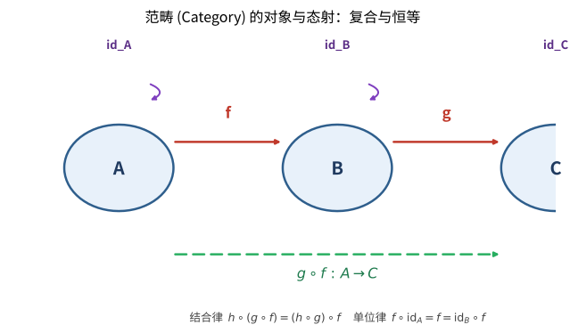

> **直观理解（现实类比）**：把范畴想象成一座城市的交通网——对象是"地点"（A、B、C），态射是"路线"（f：A→B，g：B→C）。恒等态射是"原地不动"的路线（id_A），复合则是"先走f再走g"连成一条新路线（g∘f）。结合律就像"先到B再到C再到D，无论怎么分组，最终到达的地点都一样"；单位律则说明"原地不动不会改变你的行程"。正是这种"路线可以连接、可以原地停留"的规则，让范畴成为描述一切关联结构的通用语言。

> **直观理解（现实类比）**：范畴像"数学结构的家族照"——它只关心对象之间有什么态射（道路），而不关心对象内部长什么样。集合、群、拓扑空间、向量空间各自构成一个范畴，它们共享同一套"家族照构图规则"（对象+态射+复合+恒等）。这种"只看关系不看本质"的抽象反而带来力量：一旦某个定理只依赖范畴公理，它就自动适用于所有范畴，从集合论到代数几何一网打尽。范畴论因此被誉为"数学的数学"，提供了一种跨分支的统一语言。

> **🧠 思考历程：放弃"对象长什么样"，数学竟然还能被一支支箭头重新组织起来？**
>
> 范畴论的种子，埋在组合拓扑对"自然同构"概念的苦苦追问里：怎样才算"两个构造天生一样"？1945 年 Samuel Eilenberg（艾伦伯格）与 Saunders Mac Lane（麦克莱恩）合著《一般自然等价理论》，第一次把这个问题沉淀为一门语言——范畴、函子、自然变换。
>
> - **从"自然"二字破土**。Eilenberg 与 Mac Lane 早年研究同调群时发现，同构记号写起来容易，可"为什么边界映射总与高阶同构相配"却难以说清。他们领悟到，真正要紧的不是集合内部是什么，而是对象之间的箭头如何协调——于是"自然"第一次被精确界定为交换图的成立，范畴与函子（1942–1945）顺理成章地诞生。
> - **一根箭头统摄无穷构造**。随后的关键跃迁是普适性质：极限与余极限把积、拉回、自由对象等千差万别的构造收进同一框架，Kan 1958 年提出伴随函子、Freyd 1965 年给出伴随函子存在定理；Yoneda 引理更证明"对象完全由它身上的箭头决定"。数学里五花八门的构造从此由同一套普适性语言管辖。
> - **从代数的角落长成纲领**。Grothendieck（格罗滕迪克）在 1950–70 年代把范畴论抬进代数几何与同调代数的核心：相对化、topos、谱序列都因范畴框架获得统一表述，单子与 Kleisli、Eilenberg–Moore 范畴又把逻辑、计算和代数紧紧绑在一起。范畴论由是成为"数学的数学"——不问对象何物，只问箭头为何。
> - **心路**：把目光从"物"转向"物与物的关系"，看似舍近求远，却让整个数学在更高处找到了共同的语法。

#### 课堂问答

**老师**：先把公理摆出来。一个范畴由哪四件数据组成，又满足哪两条公理？

**学生**：四件套——对象类 $\text{Ob}(\mathcal{C})$、每对对象 $A,B$ 的态射集 $\text{Hom}_{\mathcal{C}}(A,B)$、每个对象的恒等 $\text{id}_A$、以及复合 $g\circ f$。公理只有两条：结合律 $h\circ(g\circ f)=(h\circ g)\circ f$ 与单位律 $f\circ\text{id}_A=f=\text{id}_B\circ f$。一句话，范畴＝对象＋箭头＋复合＋恒等，故意不问对象内部。

**老师（追问）**：单位律为什么写成左右各一个等式？少写一半行不行？

**学生**：$f\circ\text{id}_A=f$ 让 $\text{id}_A$ 当右单位，$\text{id}_B\circ f=f$ 让它当左单位，二者分别管住 $A$ 端与 $B$ 端。少任何一半，就证不出恒等态射的唯一性。常见误区是只记 $f\circ\text{id}_A=f$、漏掉 $B$ 端，遇到两端对象不同的态射时就出错。

**老师（拓展）**：对象为什么说是"类"而不是"集合"？

**学生**：因为 $\textbf{Set}$、$\textbf{Grp}$ 这类范畴的对象全体太大会引发 Russell 型悖论，只能是真类（proper class），这叫大范畴；对象确实构成集合的（如有穷集范畴）才叫小范畴。这个大小之分，正是后面 Freyd 定理里"完备""局部小"必须小心处理的根源。

### 基本范畴的例子

- **Set**：集合为对象，函数为态射
- **Grp**：群为对象，群同态为态射
- **Ab**：Abel群为对象，群同态为态射
- **Top**：拓扑空间为对象，连续函数为态射
- **Vect$_k$**：域 $k$ 上的向量空间为对象，线性映射为态射
- **Rng**：环为对象，环同态为态射
- **Pos**：偏序集为对象，单调函数为态射

> **💡 直观理解（类比）**：这些例子说明范畴是"人人都能套用的公共框架"。集合、群、Abel群、拓扑空间、向量空间、环、偏序集各有形态迥异的对象，却都满足同一套"对象＋态射＋恒等＋复合＋结合/单位律"的建筑规范——就像汽车、船舶、飞机、自行车截然不同，却也共享"能移动＋能连接＋能原地停留"的交通规则。恰恰因为规则统一，范畴论才能一次性地同时处理这一整排"家族"，而不必为每一种对象单独证明。

#### 课堂问答

**老师**：$\textbf{Set}$ 与 $\textbf{Grp}$ 的对象、态射各是什么？

**学生**：$\textbf{Set}$ 以集合为对象、函数为态射；$\textbf{Grp}$ 以群为对象、群同态为态射。二者对象形态截然不同，却共享同一套"对象＋态射集＋恒等＋复合＋结合/单位律"，所以都是范畴。

**老师（追问）**：$\textbf{Ab}$ 和 $\textbf{Grp}$ 只差一个交换律，性质上真有大差别吗？

**学生**：差别很大。$\textbf{Ab}$ 的对象限定交换群、态射仍是群同态，但它因此成为一个 Abel 范畴；而 $\textbf{Grp}$ 不是——比如 $\textbf{Grp}$ 里余积是自由积而非直积，双积不成立，同调就做不动。可见"对象多半条条件"能改变整个范畴的性质。

**老师（拓展）**：那 $\textbf{Pos}$ 凭什么也能当范畴？

**学生**：偏序集 $(P,\le)$ 作范畴时，对象是 $P$ 的元素，$\text{Hom}(x,y)$ 在 $x\le y$ 时是单元素集、否则为空。$x\le x$ 给出恒等，$x\le y\le z$ 给出复合，传递性正好就是结合律。这提示：范畴是一套"带复合的箭头系统"，连偏序都能装进去，这正是统一语言的威力。

### 函子

> **🌐 直觉先行：起一个名字，就是为了"搬移结构"**
>
> 有了范畴，下一件要做的事自然是"把一个范畴的结构搬到另一个里"——就像把中文棋谱翻译成英文棋谱。翻译不是逐字直译，而必须保留"走法之间的逻辑关系"：若中文谱里 $f$ 后跟 $g$ 能得到 $g\circ f$，英文版里也应保持这种先后复合关系。函子就是这个"保结构翻译官"的正式名字：它把对象映到对象、把态射映到态射，并强制"先复合再翻译"等于"翻译完再复合"。

**函子**（Functor）$F: \mathcal{C} \to \mathcal{D}$ 是范畴之间的映射，由以下两部分组成：

- 对象映射：$F: \text{Ob}(\mathcal{C}) \to \text{Ob}(\mathcal{D})$
- 态射映射：$F: \text{Hom}_{\mathcal{C}}(A, B) \to \text{Hom}_{\mathcal{D}}(F(A), F(B))$

满足：
1. $F(\text{id}_A) = \text{id}_{F(A)}$
2. $F(g \circ f) = F(g) \circ F(f)$

**反变函子**（Contravariant Functor）$F: \mathcal{C}^{\text{op}} \to \mathcal{D}$ 将态射方向反转：$F: \text{Hom}_{\mathcal{C}}(A, B) \to \text{Hom}_{\mathcal{D}}(F(B), F(A))$。

> **直观理解（现实类比）**：函子像"翻译官"——它把一个范畴 $\mathcal{C}$ 的对象和态射系统地映射到另一个范畴 $\mathcal{D}$，并保证"路线的连接方式不变"（$F(g\circ f)=F(g)\circ F(f)$）和"原地不动还是原地不动"（$F(\text{id}_A)=\text{id}_{F(A)}$）。这就像把一座城市的地铁图画成另一座城市的地铁图：站点（对象）和线路（态射）一一对应，换乘关系（复合）保持一致。反变函子则是"倒着画"的翻译官，把箭头方向整体翻转，常见于"取对偶"的构造（如 $V\mapsto V^*$ 把向量空间映到其对偶空间）。

> **常见坑**：
>
> - **共变 vs 反变的复合顺序别弄反**。共变函子满足 $F(g\circ f)=F(g)\circ F(f)$（顺序保持不变），而反变函子把箭头翻开，满足 $F(g\circ f)=F(f)\circ F(g)$（顺序反过来）。很多初学错误就是套用"先复合后映射"，却忘了在反变情形里要把 $f$、$g$ 的位置对调。
> - **函子是"保结构"，不是"保对象内部属性"**。$F$ 只保证复合与恒等被保留，它并不保证"把单射映成单射""把满射映成满射"——后者是额外性质（忠诚函子、满函子、满忠实函子），不能想当然地当作自动成立。

> **🔑 为什么重要**：函子是可证明的结构保持者，一个概念一旦被写成"函子 $F:\mathcal{C}\to\mathcal{D}$"，就自动拥有了全局的、可复用的性质（复合、恒等被保留）。它把数学中绝大多数"从一个数学分支映射到另一个分支"的操作（取基、取对偶、遗忘结构、自由构造、$\pi_1$、同调群……）纳入同一个规范，是连接不同数学世界的枢纽。

#### 课堂问答

**老师**：函子分哪两部分映射，公理是什么？

**学生**：对象映射 $F:\text{Ob}(\mathcal{C})\to\text{Ob}(\mathcal{D})$ 与态射映射 $F:\text{Hom}_{\mathcal{C}}(A,B)\to\text{Hom}_{\mathcal{D}}(F(A),F(B))$；公理两条：$F(\text{id}_A)=\text{id}_{F(A)}$ 与 $F(g\circ f)=F(g)\circ F(f)$。一句话：先复合再翻译＝先翻译再复合。

**老师（追问）**：反变函子 $F:\mathcal{C}^{\text{op}}\to\mathcal{D}$ 上，复合公理该写成哪个顺序？

**学生**：要翻过来：$F(g\circ f)=F(f)\circ F(g)$。因为 $\mathcal{C}^{\text{op}}$ 里箭头方向整体翻转。典型例子是取对偶 $V\mapsto V^*$，线性映射 $f:V\to W$ 送成转置 $f^*:W^*\to V^*$，方向正好反了。常见误区是照抄共变形式，把顺序写反。

**老师（拓展）**：函子会把单射、满射也一并保住吗？

**学生**：一般不会。函子只保证保复合、保恒等，"把单态射映成单态射"是额外性质，要靠忠实函子才反映单射。所以不能想当然地认为 $F$ 保单/满；也正因如此，普通函子连单态射都不一定保，只有带右伴随的函子才保极限。这是很多初学者容易栽跟头的地方。

### 自然变换

> **🌐 直觉先行：函子与函子之间怎么"比"？**
>
> 函子负责把整个结构搬到另一边，但常有两个函子把同一范畴搬到同一处、结果却"长得略不同"。这时需要回答：这两个函子 $F,G$ 是不是"同一种搬法"？答案不是等着去猜，而是给出一族"对照箭头" $\eta_A:F(A)\to G(A)$，并要求这些箭头与原有态射"协同工作"（交换图成立）——同一种搬法，中间不能有"各自为政"的错位。这族协同的箭头，就是自然变换。

**自然变换**（Natural Transformation）$\eta: F \Rightarrow G$（其中 $F, G: \mathcal{C} \to \mathcal{D}$ 是函子）是一族态射 $\{\eta_A: F(A) \to G(A)\}_{A \in \text{Ob}(\mathcal{C})}$，使得对任意 $f: A \to B$ 在 $\mathcal{C}$ 中，以下交换图成立：

$$
\begin{CD}
F(A) @>{F(f)}>> F(B) \\
@V{\eta_A}VV @VV{\eta_B}V \\
G(A) @>>{G(f)}> G(B)
\end{CD}
$$

即 $\eta_B \circ F(f) = G(f) \circ \eta_A$。

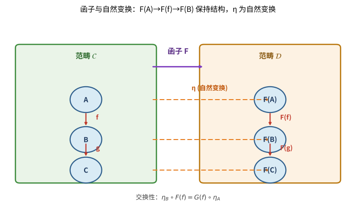

> **直观理解（现实类比）**：函子就像一个"翻译器"——它把范畴 $\mathcal{C}$ 里的每个对象和每条路线不动声色地搬到另一个范畴 $\mathcal{D}$，并且保证"路线的连接方式不变"（$F(g \circ f) = F(g) \circ F(f)$），就像把一本中文棋谱翻译成英文棋谱，棋子走法依然对应。而自然变换则是"两个翻译器之间的统一调整"：它同时把每个对象在两种翻译下的结果连起来，且保证途中任意两条路线都"殊途同归"（交换图成立）。好比两个翻译风格不同的版本，但你能在每页之间找到一致的对照箭头，整体读起来依然连贯。

> **直观理解（现实类比）**：自然变换像"函子间的翻译"——给两个函子 $F,G:\mathcal{C}\to\mathcal{D}$ 之间提供一族系统化的映射 $\eta_A:F(A)\to G(A)$，并要求这族映射与原范畴的态射"协同工作"（交换图 $\eta_B\circ F(f)=G(f)\circ\eta_A$）。这好比两套翻译系统（两个函子）各自把中文原典译成英文，而自然变换是"逐页对照表"：每页（每个对象）给出从一种译本到另一种译本的改写箭头，且任何一段原文无论从哪本译本切入、再改写到另一本，结果都一致。这种"系统性协同"正是"自然"二字的含义——不是零散的拼凑，而是整体协调的转换。

> **常见坑**：自然性（交换图）条件的书写方向极易写反。正确的是 $\eta_B\circ F(f)=G(f)\circ\eta_A$，即"先走 $F(f)$ 再落回 $\eta_B$"永远等于"先落回 $\eta_A$ 再走 $G(f)$"。初学常误写为把 $\eta$ 放错侧、或把 $F(f)$ 与 $G(f)$ 对调，让交换图不再"殊途同归"。**先确认箭头两端到底是谁在"上面"走（$F$）、谁在"下面"走（$G$），再落实 $\eta$ 的分量。**

#### 课堂问答

**老师**：自然变换 $\eta:F\Rightarrow G$ 的定义里，那张交换图的关键等式是什么？

**学生**：是一族态射 $\eta_A:F(A)\to G(A)$，使对任意 $f:A\to B$ 都有 $\eta_B\circ F(f)=G(f)\circ\eta_A$。左边是"先沿 $F$ 走 $f$ 再落到 $\eta_B$"，右边是"先落到 $\eta_A$ 再沿 $G$ 走 $f$"，两条路径殊途同归。

**老师（追问）**：这个等式哪里最容易写反？写反了会怎样？

**学生**：$\eta$ 的分量落在哪一侧、$F(f)$ 与 $G(f)$ 谁上谁下最容易错。若把 $F,G$ 对调成 $\eta_B\circ G(f)=F(f)\circ\eta_A$，交换图就不成立了。口诀：上排是 $F$、下排是 $G$，$\eta$ 从 $F$ 竖直落到 $G$，方向就不会错。

**老师（拓展）**：为什么单个对象各自的同构还不够，非要一族映射整体协调？

**学生**：这正是"自然"二字的含义。比如向量空间双对偶 $V\cong V^{**}$，每个 $V$ 都有同构，但依赖基底选法的那种不自然；只有 $v\mapsto(\varphi\mapsto\varphi(v))$ 这一族才与所有线性映射协同。自然变换就是把"一族同构"升级为"整体协调的同构族"，也正是当年 Eilenberg 与 Mac Lane 要精确化的东西。

### 伴随函子

> **🌐 直觉先行：为什么"自由—遗忘"长得像一对**
>
> 数学里到处是"最省事的构造"：从集合造自由群，从群忘掉运算回到集合。这两件事看似相反，却天生配对——"从集合 $X$ 出发造自由群"的任何信息，都等价于"把群忘成集合后看 $X$ 的映射"。（$\text{Hom}_{\textbf{Grp}}(F(X),G)\cong\text{Hom}_{\textbf{Set}}(X,U(G))$。）这种"两个函子互相翻译 Hom 集"的灵巧配对，就是伴随。它有足够强的统一力，足以把"自由、极限、指数、单子"这些看似无关的构造统统收纳为一个概念。

**伴随**（Adjunction）是一对函子 $F: \mathcal{C} \to \mathcal{D}$ 和 $G: \mathcal{D} \to \mathcal{C}$，记为 $F \dashv G$，满足对任意 $A \in \mathcal{C}$，$B \in \mathcal{D}$，有自然同构：

$$ \text{Hom}_{\mathcal{D}}(F(A), B) \cong \text{Hom}_{\mathcal{C}}(A, G(B)) $$

伴随由**单位**（unit）$\eta: \text{Id}_{\mathcal{C}} \Rightarrow G \circ F$ 和**余单位**（counit）$\varepsilon: F \circ G \Rightarrow \text{Id}_{\mathcal{D}}$ 完全刻画，满足三角恒等式：

$$ (\varepsilon_F \circ F\eta)_A = \text{id}_{F(A)}, \quad (G\varepsilon \circ \eta_G)_B = \text{id}_{G(B)} $$

> **直观理解（现实类比）**：伴随函子像一台"能双向通行的升降机"——自由构造与其遗忘机是同一对操作的两面。$F \dashv G$ 表示"要从 $A$ 出发经 $F$ 到达 $B$"，等价于"先从 $A$ 退回 $G$ 再看怎么到 $B$"（$\text{Hom}_{\mathcal{D}}(F(A),B)\cong\text{Hom}_{\mathcal{C}}(A,G(B))$），就像问路与指路其实是同一张地图的两种读法。单位 $\eta$ 是把原始 $A$ 装进自由构造再原路塞回的"入口"，余单位 $\varepsilon$ 是把结构就地求值回 $B$ 的"出口"，二者首尾相接恰如一根可放可收的弹簧绳（三角恒等式）。

> **常见坑**：伴随的左右关系 $F\dashv G$ 里，$F$ 叫**左伴随**、$G$ 叫**右伴随**，判断口诀是"左伴随在 Hom 集的左侧、右伴随在右侧"（$\text{Hom}(F(A),B)\cong\text{Hom}(A,G(B))$）。初学最常犯的错是把方向弄反：表示成 $\text{Hom}(A,G(B))\cong\text{Hom}(F(A),B)$ 只是无所谓，但若把"谁伴随谁"记错，"保极限"与"保余极限"的结论就全反了——左伴随保余极限、右伴随保极限，方向千万不能记混。

> **🔑 为什么重要**：伴随是一整座"最普适构造"的统一工厂——自由—遗忘、$\Delta\dashv\lim$、$(-\times A)\dashv(-)^A$、单子与 Kleisli/Eilenberg-Moore 范畴，全都是各种具体的伴随。抓住伴随，就等于抓住数学里"最省事的对象总是邻接某个平凡构造"的规律；而"伴随自动保极限/余极限"则让它成为最安全、最省力的造型工具。

#### 课堂问答

**老师**：伴随 $F\dashv G$ 的核心同构写出来。

**学生**：$\text{Hom}_{\mathcal{D}}(F(A),B)\cong\text{Hom}_{\mathcal{C}}(A,G(B))$，对 $A,B$ 双双自然。它由单位 $\eta:\text{Id}_{\mathcal{C}}\Rightarrow G\circ F$ 与余单位 $\varepsilon:F\circ G\Rightarrow\text{Id}_{\mathcal{D}}$ 完全刻画，满足三角恒等式 $(\varepsilon_F\circ F\eta)_A=\text{id}_{F(A)}$、$(G\varepsilon\circ\eta_G)_B=\text{id}_{G(B)}$。

**老师（追问）**：$F\dashv G$ 里谁是左伴随、谁是右伴随？这决定它们各保什么吗？

**学生**：$F$ 是左伴随、$G$ 是右伴随，口诀是"左伴随在 Hom 左侧"。结论（定理4）：左伴随 $F$ 保余极限、右伴随 $G$ 保极限。常见误区是把方向记反，那样保极限与保余极限的结论会整个反掉。

**老师（拓展）**：举一个最经典的伴随对，并指出单位、余单位是什么。

**学生**：自由—遗忘 $F:\textbf{Set}\to\textbf{Grp}\dashv U:\textbf{Grp}\to\textbf{Set}$，$F(X)$ 是 $X$ 生成的自由群。单位 $\eta_X:X\to U(F(X))$ 把每个 $x$ 当作生成元 $[x]$ 嵌进去；余单位 $\varepsilon_G:F(U(G))\to G$ 把自由群里的词按 $G$ 的乘法求值。三角恒等式即"装进去再求值回到原值"，恰如一根可放可收的弹簧绳。

### 函子范畴

**函子范畴**（Functor Category）$[\mathcal{C}, \mathcal{D}]$ 或 $\mathcal{D}^{\mathcal{C}}$ 以函子 $F: \mathcal{C} \to \mathcal{D}$ 为对象，以自然变换为态射。

> **💡 直观理解（类比）**：函子范畴把"函子"当作"市民"、把"自然变换"当作"市民之间的路线"，正如把"各国的翻译员"当作新国家里的居民。于是多个函子所代表的"平行世界"被自然变换这座"天桥"一一连通，而这些天桥又能在每个对象处首尾相接、逐段拼接。这让我们可以对"映射之间的映射"再谈关系，一层层往上砌更高阶的结构——就像程序员能把"函数"当作值传递，自然变换正是"函子的函数"。

#### 课堂问答

**老师**：函子范畴 $[\mathcal{C},\mathcal{D}]$ 的对象、态射、复合各是什么？

**学生**：对象是函子 $F:\mathcal{C}\to\mathcal{D}$，态射是自然变换 $\eta:F\Rightarrow G$，复合是自然变换的逐分量复合，恒等是恒等自然变换。逐分量复合天然满足结合律与单位律，所以它确实是一个范畴。

**老师（追问）**：凭什么自然变换能当态射？恒等律、结合律落在哪儿？

**学生**：自然变换本就是"函子之间的映射"，逐对象给箭头；定义 $\text{id}_F$ 的分量为 $\text{id}_{F(A)}$、复合 $(\theta\circ\eta)_A=\theta_A\circ\eta_A$，结合律与单位律逐分量从 $\mathcal{D}$ 继承。于是 $\text{Hom}_{[\mathcal{C},\mathcal{D}]}(F,G)$ 恰好就是 $\text{Nat}(F,G)$，态射的合法性由 $\mathcal{D}$ 里箭头的性质"浇"过来。

**老师（拓展）**：为什么说这相当于"把函数当值传递"？

**学生**：编程里函数可作为一等值传给别的函数；函子范畴则把函子当对象、把自然变换当箭头，于是能谈"映射之间的映射"。Yoneda 引理正是活在某个函子范畴 $[\mathcal{C}^{\text{op}},\textbf{Set}]$ 里的定理，它的双射 $\text{Nat}(\text{Hom}(A,-),F)\cong F(A)$ 就是在函子范畴里数箭头。抬高一层，许多构造反而看得更清。

### 可表函子

**可表函子**（Representable Functor）：对任意对象 $A \in \mathcal{C}$，定义共变Hom函子 $\text{Hom}_{\mathcal{C}}(A, -): \mathcal{C} \to \textbf{Set}$ 和反变Hom函子 $\text{Hom}_{\mathcal{C}}(-, A): \mathcal{C}^{\text{op}} \to \textbf{Set}$。

一个函子 $F: \mathcal{C} \to \textbf{Set}$ 称为**可表的**，如果存在 $A \in \mathcal{C}$ 使得 $F \cong \text{Hom}_{\mathcal{C}}(A, -)$。

> **直观理解（现实类比）**：可表函子像"用一张全家福来辨认整族成员"。Hom 函子 $\text{Hom}_{\mathcal{C}}(A,-)$ 记录"从基准对象 $A$ 出发到每个 $B$ 共有几条路"；说函子 $F$ 可表，就是它和某个 Hom 函子"长得一模一样"（$F\cong\text{Hom}_{\mathcal{C}}(A,-)$）。换言之，$F$ 的全部信息被基准对象 $A$ 这一张"照片"装得满满当当——只要知道 $A$ 以及所有从它出发的路线，$F$ 就完全确定。这正呼应"对象由它的箭头决定"的哲学：认识一个对象的最佳方式，是看它如何与其它对象发生关系。

#### 课堂问答

**老师**：什么是可表函子？

**学生**：先有 Hom 函子：共变 $\text{Hom}_{\mathcal{C}}(A,-):\mathcal{C}\to\textbf{Set}$ 把 $B$ 映到 $\text{Hom}_{\mathcal{C}}(A,B)$、把 $g$ 映到后复合 $g\circ-$；反变 $\text{Hom}_{\mathcal{C}}(-,A)$ 把 $B$ 映到 $\text{Hom}_{\mathcal{C}}(B,A)$。若函子 $F:\mathcal{C}\to\textbf{Set}$ 与某个 $\text{Hom}_{\mathcal{C}}(A,-)$ 同构，即 $F\cong\text{Hom}_{\mathcal{C}}(A,-)$，就说 $F$ 可表，$A$ 是它的代表对象。

**老师（追问）**：为什么"可表"就等于"对象由箭头决定"？

**学生**：因为 $F$ 的全部信息被一个对象 $A$ 的 Hom 函子装下，好比 $A$ 的一张"关系名片"复刻了整个 $F$。Yoneda 引理进一步说 $\text{Nat}(\text{Hom}(A,-),F)\cong F(A)$：从 $\text{Hom}(A,-)$ 到 $F$ 的自然变换，只由 $\text{id}_A$ 被送到 $F(A)$ 的哪个元素决定。认识 $A$，就是看它如何被众生（Hom 函子）看到。

**老师（拓展）**：举个最朴素的例子，说明哪个常见函子可表。

**学生**：在 $\textbf{Set}$ 里恒等函子 $\text{Id}_{\textbf{Set}}$ 可表，取单点集 $\{*\}$ 就有 $\text{Hom}_{\textbf{Set}}(\{*\},X)\cong X$，代表对象是 $\{*\}$。常见误区是以为"任何范畴里恒等函子都可表"——不对，那需要存在 $A$ 使 $\text{Hom}(A,-)\cong\text{Id}$，一般范畴未必有这样的对象，可表是额外的殊荣。

### 极限与余极限

**极限**（Limit）和**余极限**（Colimit）是范畴论中统一处理各种构造的框架。

给定一个图表 $D: \mathcal{J} \to \mathcal{C}$（$\mathcal{J}$ 是指标范畴）：

- **极限** $\lim D$ 是一个对象连同投影态射 $\pi_j: \lim D \to D(j)$，满足对任意 $f: j \to k$ 在 $\mathcal{J}$ 中，$D(f) \circ \pi_j = \pi_k$，且具有普适性质。
- **余极限** $\text{colim} D$ 是对偶概念。

特殊情形：
- 积（Product）：$\mathcal{J}$ 是离散范畴
- 等化子（Equalizer）：$\mathcal{J} = \bullet \rightrightarrows \bullet$
- 拉回（Pullback）：$\mathcal{J} = \bullet \to \bullet \leftarrow \bullet$
- 终对象（Terminal Object）：$\mathcal{J}$ 为空范畴

> **直观理解（现实类比）**：泛性质像"唯一最佳"——用最简性质定义对象，而不描述它的内部构造。比如积 $A\times B$ 是"最通用的配对"：任何能同时投影到 $A$ 和 $B$ 的对象，都唯一地通过它中转。这就像"最通用的插座转换器"——只要你的设备能插进去，就一定能分流到 $A$、$B$ 两个接口，而且这种分流方式是唯一确定的。泛性质的威力在于"用关系定义本质"：积、拉回、极限、自由对象都各自有独特的普适性质，对象本身长什么样反而不重要——只要满足这套"最佳中转站"的规范，它就是被定义的对象（在同构意义下唯一）。

#### 课堂问答

**老师**：给定图表 $D:\mathcal{J}\to\mathcal{C}$，极限与余极限分别是什么？

**学生**：极限是对象 $\lim D$ 连同投影 $\pi_j:\lim D\to D(j)$，满足 $D(f)\circ\pi_j=\pi_k$，且具普适性：任何相容锥都唯一地经 $\lim D$ 因子化。余极限对偶，由注入 $\iota_j:D(j)\to\text{colim}D$ 给出。等化子、拉回、积都是极限的特例。

**老师（追问）**：为什么说"普适性"其实就是一个同构？

**学生**：它等价于自然同构 $\text{Hom}_{\mathcal{C}}(A,\lim D)\cong\lim\text{Hom}_{\mathcal{C}}(A,D(-))$，右边是从常图表到 $D$ 的相容锥集合。这正说明 $\lim D$ 是"最通用的汇总点"：任何能投影到每个 $D(j)$ 的对象都唯一经它中转。反过来写成伴随，就是定理2的 $\lim\dashv\Delta$。

**老师（拓展）**：积与余积在 $\textbf{Set}$ 里各是什么？为什么它们都归在极限这张网下？

**学生**：积是笛卡尔积 $A\times B$（对着投影出去），余积是无交并 $A\sqcup B$（对着注入进来）。要点是：极限与余极限是同一套语言的两个方向，都由指标范畴 $\mathcal{J}$ 指定——$\mathcal{J}$ 离散时极限给出积、余极限给出余积；换成 $\bullet\rightrightarrows\bullet$ 就给出等化子，换成 $\bullet\to\bullet\leftarrow\bullet$ 就给出拉回。所有"最通用构造"被同一张 $\mathcal{J}$ 管辖。

### Cartesian闭范畴

**Cartesian闭范畴**（Cartesian Closed Category, CCC）是满足以下条件的范畴 $\mathcal{C}$：

1. 存在终对象 $1$
2. 对任意 $A, B \in \mathcal{C}$，存在积 $A \times B$
3. 对任意 $A, B \in \mathcal{C}$，存在指数对象 $B^A$（即态射集 $\text{Hom}_{\mathcal{C}}(A, B)$ 的对象版本），使得 $\text{Hom}_{\mathcal{C}}(A \times B, C) \cong \text{Hom}_{\mathcal{C}}(A, C^B)$

> **💡 直观理解（类比）**：Cartesian闭范畴就像一间"全能程序工作室"：有"空办公室"（终对象 $1$），能随时搭"双人间"（积 $A\times B$），还能造"函数车间"（指数对象 $B^A$）。关键性质 $\text{Hom}(A\times B,C)\cong\text{Hom}(A,C^B)$ 正是柯里化（currying）：把"吃两个输入的函数" $f:A\times B\to C$ 改写成"先吃 $A$、吐出一个吃 $B$ 的函数" $A\to C^B$，两个视角完全等价。这正是函数式语言里"多参函数就是嵌套的单参函数"的范畴论根源——类型论与 $\lambda$ 演算的模型都建筑在这个结构上。

#### 课堂问答

**老师**：Cartesian 闭范畴（CCC）需要哪三种基本结构？

**学生**：终对象 $1$；任意 $A,B$ 的积 $A\times B$；以及任意 $A,B$ 的指数对象 $B^A$，满足 $\text{Hom}_{\mathcal{C}}(A\times B,C)\cong\text{Hom}_{\mathcal{C}}(A,C^B)$。三条齐备，才能谈"函数空间"。

**老师（追问）**：那个同构对应什么熟悉操作？逆对应又是什么？

**学生**：正对应是柯里化（currying）：把 $f:A\times B\to C$ 改写成 $\bar f:A\to C^B$，对每个 $a$ 给出 $b\mapsto f(a,b)$；逆对应是把 $A$ 与 $B$ 配对后去求值，即 $A\times B\xrightarrow{\bar f\times\text{id}}C^B\times B\xrightarrow{\text{ev}}C$，其中 $\text{ev}$ 是求值映射（余单位）。

**老师（拓展）**：为什么说它正是简单类型 $\lambda$ 演算的语义？

**学生**：在 CCC 里把类型解释为对象、项解释为态射，函数类型 $\tau_1\to\tau_2$ 恰是指数对象 $\tau_2^{\tau_1}$，函数应用与 $\beta$-归约都由指数伴随"解码"。这正是类型论的数学搭档：多参函数＝嵌套单参函数，在语言里叫柯里化，在范畴里就是伴随 $(-\times A)\dashv(-)^A$。

### Topos

**Topos**（拓扑斯）是一种特殊的Cartesian闭范畴，具有子对象分类器（subobject classifier）$\Omega$。Topos可以被视为"广义的集合范畴"，在其中可以发展内蕴的数学结构。

> **直观理解（现实类比）**：Topos 是"一座自给自足、内部能发展全套数学的小镇"。普通集合论里的"子集"，Topos 通过子对象分类器 $\Omega$ 原样保留：每个子对象（某集合的子集）都唯一对应一条"判定箭头"落到 $\Omega$，就像小镇里每个社区都挂着一块清晰的"分区标牌"。有了 $\Omega$ 再加上有限的积与指数，就可在 Topos 内部重演布尔逻辑、量词、幂对象等整套"集合的语言"，而不必依赖外部的真实集合。因此它被称作"广义的集合范畴"——一个仅仅靠内部结构就能支撑起数学大厦的宇宙。

#### 课堂问答

**老师**：Topos 相比一般 CCC 额外多出什么？

**学生**：多一个子对象分类器 $\Omega$（连同 $\top:1\to\Omega$）。它让"子对象"与"特征态射 $\to\Omega$"一一对应：每个子对象 $S\hookrightarrow A$ 唯一对应一条 $\chi_S:A\to\Omega$。这就是集合里"子集对应隶属函数"在范畴层面的翻版。

**老师（追问）**：只多一个对象 $\Omega$，为什么就能"内部发展数学"？

**学生**：因为有了 $\Omega$ 再加上有限极限与指数，就能在范畴内部定义合取、蕴含、否定等逻辑运算，构造量词与幂对象，把集合论乃至一阶逻辑的语言重演一遍，而不依赖外部真实集合。所以 Topos 被称作"广义的集合范畴"——一座仅靠内部结构就能撑起数学大厦的宇宙。

**老师（拓展）**：常见的 Topos 例子有哪些？

**学生**：$\textbf{Set}$ 本身是最基本的 Topos；更丰富的是预层范畴 $[\mathcal{C}^{\text{op}},\textbf{Set}]$，以及带 Grothendieck 拓扑的层 Topos。Grothendieck 用它重构代数几何，把"范畴像空间"变成现实——这正好接上代数几何与数学基础的故事。

### Abel范畴

**Abel范畴**（Abelian Category）是满足以下条件的范畴：
1. 有零对象
2. 有二元积和二元余积（且它们一致，即双积）
3. 每个态射有核和余核
4. 每个单态射是核，每个满态射是余核

Abel范畴是同调代数的自然框架。

> **💡 直观理解（类比）**：Abel 范畴是"能做整部加减法电影"的舞台。零对象是"空镜头"；双积让"并排"与"配对"（和与积）合而为一，像在集合里既可有加法又可做直积而不打架；每个态射都有核与余核，意味着每个"镜头"都能求出"落在零的部分"和"漏出去的部分"。加上单态射必为核、满态射必为余核，就能在其中顺畅地定义商、正合序列乃至同调——正如在线性空间里总能求"核空间"和"商空间"。这正是同调代数（Ext、Tor、长正合序列）得以茁壮成长的天然温室。

#### 课堂问答

**老师**：Abel 范畴的四条条件是什么？

**学生**：有零对象；有二元积与二元余积且二者一致（双积）；每个态射有核与余核；每个单态射是某个态射的核、每个满态射是某个态射的余核。四条齐备，才能顺畅地求核、求商、谈正合。

**老师（追问）**：单态射为什么不能自动就是核？

**学生**：在一般加性范畴里，单态射未必是核——"单"只保证左边可消，不代表它能当某个映射的"全部零化者"。Abel 范畴额外要求每个单态射恰是核、每个满态射恰是余核，正是让"核—像—余核"三件事对得上、可以干净地做同调的关键。少了这条，商与同调的定义会出偏差。

**老师（拓展）**：为什么说它是同调代数的"天然温室"？

**学生**：因为双积让有限直和与直积合而为一，可以定义链复形 $C_\bullet$ 与 $d\circ d=0$；有了核与余核，可以定义同调 $H_n=\ker d_n/\text{im}\,d_{n+1}$ 并谈正合序列；再加上 Hom 与张量可做左/右导出，得到 $\text{Ext}^n$ 与 $\text{Tor}_n$。所以 $\textbf{Ab}$、$R$-模范畴都是 Abel 范畴，同调代数才能脱开具体集合普遍运转。

### 单子

**单子**（Monad）在范畴 $\mathcal{C}$ 上是一个三元组 $(T, \eta, \mu)$，其中：
- $T: \mathcal{C} \to \mathcal{C}$ 是一个函子
- $\eta: \text{Id}_{\mathcal{C}} \Rightarrow T$ 是单位自然变换
- $\mu: T^2 \Rightarrow T$ 是乘法自然变换

满足：
1. $\mu \circ T\eta = \text{id}_T = \mu \circ \eta_T$（单位律）
2. $\mu \circ T\mu = \mu \circ \mu_T$（结合律）

#### 课堂问答

**老师**：单子 $(T,\eta,\mu)$ 的三个部件与两条公理分别是什么？

**学生**：自函子 $T:\mathcal{C}\to\mathcal{C}$；单位 $\eta:\text{Id}\Rightarrow T$；乘法 $\mu:T^2\Rightarrow T$。公理两条：单位律 $\mu\circ T\eta=\text{id}_T=\mu\circ\eta_T$；结合律 $\mu\circ T\mu=\mu\circ\mu_T$。直觉：$\eta$ 把值装进盒子、$\mu$ 把套两层的盒子压平。

**老师（追问）**：这两条公理在"盒子"图像里各说什么？

**学生**：单位律说"装一层盒再压平"或"先在盒子层再装再压平"都等于不动——即装进去马上拆开还是原值。结合律说三层盒子 $T^3$ 的压平与顺序无关：先压内层再压外层，等于先压外层再压内层，都归到同一个 $T$。这正是程序里 `join` 的相容性。

**老师（拓展）**：单子从哪儿来？它和伴随什么关系？

**学生**：每个伴随 $F\dashv G$ 都生成一个单子 $T=G\circ F$，单位就是伴随的单位、乘法由余单位给出 $\mu=G\varepsilon F$。反过来（定理5）每个单子都能拆成一对伴随，且有两套标准拆法——Kleisli（最自由、初始）与 Eilenberg-Moore（最保守、终端）。所以单子是"伴随的一体两面"的浓缩。

### Kleisli范畴

给定单子 $(T, \eta, \mu)$ 在 $\mathcal{C}$ 上，**Kleisli范畴** $\mathcal{C}_T$ 是：
- 对象：与 $\mathcal{C}$ 相同
- 态射 $f: A \to B$ 在 $\mathcal{C}_T$ 中对应于 $\mathcal{C}$ 中的态射 $f: A \to T(B)$
- 恒等态射：$\eta_A: A \to T(A)$
- 复合：$g \circ_T f = \mu_C \circ T(g) \circ f$，其中 $f: A \to T(B)$，$g: B \to T(C)$

> **💡 直观理解（类比）**：Kleisli 范畴把"带效果的函数"升格成"普通路线"。原范畴里 $f:A\to T(B)$ 是一个"返回带盒子结果"的函数；到了 Kleisli 范畴 $\mathcal{C}_T$，它就被当作普通的单步 $f:A\to B$，恒等"原地不动"则是 $\eta_A$（把值装进盒子）。复合 $g\circ_T f = \mu_C\circ T(g)\circ f$ 的手续，正是程序员的 `flatMap`：先执行 $f$ 拿到盒子里的值，再对其中每个值应用 $g$（用 $T(g)$ 提升），最后用 $\mu$ 把层层套叠的盒子压平。于是副作用流程能被当作普通函数组合链式串起来——函数式语言中的 `>>=` 正是这样诞生的。

#### 课堂问答

**老师**：Kleisli 范畴 $\mathcal{C}_T$ 的对象、态射、恒等、复合分别怎么定？

**学生**：对象与 $\mathcal{C}$ 相同；态射 $A\to B$ 对应 $\mathcal{C}$ 中的 $f:A\to T(B)$；恒等是 $\eta_A:A\to T(A)$；复合 $g\circ_T f=\mu_C\circ T(g)\circ f$，其中 $f:A\to T(B)$、$g:B\to T(C)$。

**老师（追问）**：这个复合把类型都接对了吗？

**学生**：$f:A\to T(B)$，$T(g):T(B)\to T(T(C))$，于是 $T(g)\circ f:A\to T(T(C))$，再用 $\mu_C:T(T(C))\to T(C)$ 压平，得 $A\to T(C)$，正是 $\mathcal{C}_T$ 中 $A\to C$ 的合法态射。恒等律与结合律由单子公理保证，所以 $\mathcal{C}_T$ 真的是个范畴。

**老师（拓展）**：为什么说它就是程序里的 `flatMap`？

**学生**：$f$ 是"返回带效果结果"的函数（如返回 `Option<B>`），$T(g)$ 把下一步提升，$\mu$ 把套叠的效果压平——这正是 `>>=`／`flatMap` 的完整流程。单子把它打包成"普通态射的复合"，于是副作用流程被改写成纯函数链，可推理、可组合。Kleisli 范畴是最轻的视角：对象一个不少，只把"带盒子的函数"升格成普通路线。

### Eilenberg-Moore范畴

**Eilenberg-Moore范畴** $\mathcal{C}^T$（或 $T$-代数范畴）是：
- 对象：$T$-代数 $(A, \alpha)$，其中 $\alpha: T(A) \to A$ 满足 $\alpha \circ \eta_A = \text{id}_A$ 和 $\alpha \circ T(\alpha) = \alpha \circ \mu_A$
- 态射 $f: (A, \alpha) \to (B, \beta)$ 是 $\mathcal{C}$ 中的态射 $f: A \to B$，满足 $f \circ \alpha = \beta \circ T(f)$

> **直观理解（现实类比）**：Eilenberg-Moore 范畴里的 $T$-代数 $(A,\alpha)$，是"真正打开盒子、定居下来的永久住户"。$\alpha:T(A)\to A$ 是一个"拆包并入档"的结构态射；单位律 $\alpha\circ\eta_A=\text{id}_A$ 保证"刚装进盒子的新值拆开来正是原值"；结合律 $\alpha\circ T(\alpha)=\alpha\circ\mu_A$ 保证"先把内层摊平再拆"与"先拆外层留下内层、再拆内层"殊途同归到同一个 $A$。态射 $f$ 满足 $f\circ\alpha=\beta\circ T(f)$，意思是"先拆包再搬家＝先搬家再拆包"。倘若 Kleisli 范畴是"轻量、最自由的临时工"视角，Eilenberg-Moore 范畴则是"信息最完整、最保守"的代数化视角——它们是同一个单子的一体两面。

#### 课堂问答

**老师**：$T$-代数 $(A,\alpha)$ 的两条公理是什么？

**学生**：结构映射 $\alpha:T(A)\to A$ 须满足 $\alpha\circ\eta_A=\text{id}_A$（单位律）与 $\alpha\circ T(\alpha)=\alpha\circ\mu_A$（结合律）；而 $T$-代数态射 $f:(A,\alpha)\to(B,\beta)$ 是 $\mathcal{C}$ 中的 $f:A\to B$，满足 $f\circ\alpha=\beta\circ T(f)$。

**老师（追问）**：这两条代数公理在"拆包"图像里各管什么？

**学生**：单位律保证"刚装进盒子的值拆开来正是原值"——$\alpha$ 与 $\eta$ 相容；结合律保证"先摊平内层再拆外层"与"先拆外层再拆内层"殊途同归——$\alpha$ 与 $\mu$ 相容。态射条件 $f\circ\alpha=\beta\circ T(f)$ 则说"先拆包再搬家＝先搬家再拆包"，保证代数结构被保持。

**老师（拓展）**：它和 Kleisli 范畴是什么关系？

**学生**：同一个单子的两个极端视角。Kleisli 范畴只把带效果的函数当普通路线，结构最少，是"最自由（初始）"的分解；Eilenberg-Moore 范畴把每个拆包规则都做成真正的代数对象 $(A,\alpha)$，信息最完整，是"最保守（终端）"的分解。定理5 说任何别的分解都被唯一地夹在两者之间。

### Kan扩张

**Kan扩张**（Kan Extension）是函子沿函子的某种"最佳逼近"：

- 左Kan扩张 $\text{Lan}_F(G)$：给定 $F: \mathcal{A} \to \mathcal{B}$，$G: \mathcal{A} \to \mathcal{C}$，$\text{Lan}_F(G): \mathcal{B} \to \mathcal{C}$ 是沿 $F$ 对 $G$ 的最佳左逼近。
- 右Kan扩张 $\text{Ran}_F(G)$ 是对偶概念。

#### 课堂问答

**老师**：Kan 扩张是什么？左、右两种怎么区分？

**学生**：给定 $F:\mathcal{A}\to\mathcal{B}$、$G:\mathcal{A}\to\mathcal{C}$，左 Kan 扩张 $\text{Lan}_F(G):\mathcal{B}\to\mathcal{C}$ 是沿 $F$ 对 $G$ 的最佳左逼近，由普适性 $\text{Nat}(\text{Lan}_F(G),H)\cong\text{Nat}(G,H\circ F)$ 刻画；右 Kan 扩张 $\text{Ran}_F(G)$ 对偶，由 $\text{Nat}(H\circ F,G)\cong\text{Nat}(H,\text{Ran}_F(G))$ 刻画。

**老师（追问）**：既然叫"最佳逼近"，逼近的好坏由什么衡量？

**学生**：由那条自然同构衡量——它是"最普遍"的：任何从 $G$ 出发（或到 $G$ 去）的构造都唯一地经 $\text{Lan}_F(G)$（或 $\text{Ran}_F(G)$）因子化。也就是说，Kan 扩张是"把 $G$ 沿 $F$ 铺过去"的普适解。常见误区：以为任何函子都有 Kan 扩张——其实它依赖相应的（余）极限存在，未必总有。

**老师（拓展）**：Kan 扩张凭什么被说成"统一框架"？

**学生**：因为很多构造都是它的特例。左 Kan 扩张沿一个"点"函子做，就退化成（余）极限；伴随也可由 Kan 扩张刻画（左伴随是沿 $F$ 的扩张）。所以它把极限、余极限、伴随乃至某些导出函子收进同一句话里，是"沿函子最佳延伸"的母框架。

### 双范畴

**双范畴**（Bicategory / 2-Category）是范畴的推广，其中：
- 有对象、1-态射（对象间的态射）和2-态射（1-态射间的态射）
- 结合律和单位律只满足到同构（在严格2-范畴中则是等式）

#### 课堂问答

**老师**：双范畴（2-范畴）比普通范畴多了什么？

**学生**：多了两层——对象、1-态射（对象间的态射）、2-态射（1-态射间的态射）。复合也分纵向（2-态射之间）与横向（1-态射之间），且结合律与单位律只要求"到同构"成立（弱 2-范畴），而非严格相等。

**老师（追问）**："结合律只到同构"是什么意思？和严格 2-范畴差在哪？

**学生**：普通范畴要求 $(h\circ g)\circ f=h\circ(g\circ f)$ 字面相等；弱 2-范畴里横向复合的两边只差一个可逆的 2-态射（结合子），它还要满足相干条件。若强行让所有结合子都取恒等、复合字面相等，就退化成严格 2-范畴。放宽到同构是为了容纳更多真实例子。

**老师（拓展）**：为什么要把态射也分层？

**学生**：因为有些"关系之间的关系"天然要高一层才说得清。最典型的是范畴本身：范畴作对象、函子作 1-态射、自然变换作 2-态射，就构成一个 2-范畴 $\textbf{Cat}$。再往上还有弱 $n$-范畴与 $\infty$-范畴，成为同伦论与派生代数的语言——这正是"范畴化"的起点。

### 同调代数中的范畴论方法

同调代数在Abel范畴的框架下研究：
- 链复形和同调
- 正合序列和长正合序列
- 导出函子（Ext, Tor）
- 谱序列

> **💡 直观理解（类比）**：同调代数的范畴论方法，是"用流水线质检逐道工序的偏差"。把链复形看作"原料经过多道工序的流水线"：$d\circ d=0$ 保证"两步必回到零"（无绕弯），同调 $H_n=\ker d_n/\text{im}\,d_{n+1}$ 度量"第 $n$ 道工序净留下来的缺口"。正合序列刻画"恰好无噪声"的理想流水线；导出函子 Ext、Tor 量化"正合性被破坏的程度"——像质检报告标出每道工序漏算了多少、重复了多少。谱序列则是"渐进逼近复杂对象的结算表"。Abel 范畴提供了这套质检能够顺畅运转的公共车间，让这些工具无须依赖具体集合即可普遍实施。

---

#### 课堂问答

**老师**：同调代数在 Abel 范畴框架下研究哪几样东西？

**学生**：链复形与同调、正合序列与长正合序列、导出函子（$\text{Ext}$、$\text{Tor}$）、以及谱序列。链复形满足 $d\circ d=0$，同调是 $H_n=\ker d_n/\text{im}\,d_{n+1}$，度量"第 $n$ 道工序净留下的缺口"。

**老师（追问）**：导出函子为什么必要？它量化了什么？

**学生**：因为 Hom、$\otimes$ 这类函子对短正合序列一般不正合，会把"核—商"信息撕出偏差。右导出 $\text{Ext}^n=\text{R}^n\text{Hom}$、左导出 $\text{Tor}_n=\text{L}_n(-\otimes-)$ 正是逐层补上这层偏差，并用长正合序列把各短正合序列的同调串起来。所以它量化的是"正合性被破坏的程度"。

**老师（拓展）**：为什么一定要在 Abel 范畴里做，$\textbf{Grp}$ 为什么不行？

**学生**：因为要定义核、余核、双积与正合性，需要"加减法"结构，而这正是 Abel 范畴四条条件提供的。$\textbf{Grp}$ 里余积是自由积、与直积不一致，双积不成立，同调就做不顺。所以同调代数的自然舞台是 $\textbf{Ab}$、模范畴这类 Abel 范畴，而非任意范畴。

## 定理与证明

### 定理1：Yoneda引理

**定理**（Yoneda Lemma）：令 $\mathcal{C}$ 是一个范畴，$F: \mathcal{C} \to \textbf{Set}$ 是一个共变函子。对任意对象 $A \in \mathcal{C}$，存在双射：

$$ \text{Nat}(\text{Hom}_{\mathcal{C}}(A, -), F) \cong F(A) $$

其中 $\text{Nat}$ 表示自然变换的集合。而且这个双射在 $A$ 和 $F$ 中是自然的。

> **🔑 为什么重要**：Yoneda 引理是整座范畴论的"价值锚点"。它把"研究对象本身"安全地替换成"研究对象被众生（Hom 函子）如何看待"——只要从 $A$ 出发到所有对象的箭头足够齐全，$A$ 就被完全钉死（米田嵌入给出"对象由 Hom 箭袋决定"）。于是许多原本要"钻进去看内部"的难题，都被翻译成"看清箭头"的问题；而"先取自然变换 = 先看 $\text{id}_A$ 落到哪"这条双射，恰恰是那台把两种语言（箭头语言与元素语言）互译的翻译机。Mac Lane 称之为"范畴论之母"，毫不夸张。

> **💡 直观理解（类比）**：Yoneda 引理说"看一个对象，就看它如何被看到"。$\text{Nat}(\text{Hom}_{\mathcal{C}}(A,-),F)\cong F(A)$ 的意思是：从基准对象 $A$ 到所有 $B$ 的整族路线（Hom 函子）到 $F$ 之间给出的自然变换，其实只是 $F(A)$ 里的一个元素而已！好比"全校每个人对 $A$ 的评价如何逐层整合最终汇成对 $F$ 的整体评价"这一整套协调运作，本质上全由 $A$ 自己在 $F$ 中占住的"座位"一点决定。更直白地：想知道函子 $F$ 的一切，只要盯准"映射 $\text{id}_A$ 被 $\eta_A$ 送到 $F(A)$ 的哪个位置"，其余全部自动跟上。这是"对象完全由其 Hom 箭袋决定"那套哲学的硬核定理。

**证明**：

**步骤1：构造映射 $\Phi: \text{Nat}(\text{Hom}_{\mathcal{C}}(A, -), F) \to F(A)$**

对任意自然变换 $\eta: \text{Hom}_{\mathcal{C}}(A, -) \Rightarrow F$，定义 $\Phi(\eta) = \eta_A(\text{id}_A)$。

由于 $\eta_A$ 是 $\text{Hom}_{\mathcal{C}}(A, A)$ 到 $F(A)$ 的函数，且 $\text{id}_A \in \text{Hom}_{\mathcal{C}}(A, A)$，所以 $\eta_A(\text{id}_A) \in F(A)$。

**步骤2：构造逆映射 $\Psi: F(A) \to \text{Nat}(\text{Hom}_{\mathcal{C}}(A, -), F)$**

对任意 $x \in F(A)$，定义自然变换 $\Psi(x): \text{Hom}_{\mathcal{C}}(A, -) \Rightarrow F$ 如下：对任意对象 $B \in \mathcal{C}$ 和任意 $f \in \text{Hom}_{\mathcal{C}}(A, B)$，定义：

$$ \Psi(x)_B(f) = F(f)(x) $$

我们需要验证 $\Psi(x)$ 确实是自然变换。即对任意 $g: B \to C$ 在 $\mathcal{C}$ 中，下图交换：

$$
\begin{CD}
\text{Hom}_{\mathcal{C}}(A, B) @>{\text{Hom}_{\mathcal{C}}(A, g)}>> \text{Hom}_{\mathcal{C}}(A, C) \\
@V{\Psi(x)_B}VV @VV{\Psi(x)_C}V \\
F(B) @>>{F(g)}> F(C)
\end{CD}
$$

对任意 $f: A \to B$，左边路径为 $F(g) \circ \Psi(x)_B(f) = F(g) \circ F(f)(x) = F(g \circ f)(x)$，右边路径为 $\Psi(x)_C \circ \text{Hom}_{\mathcal{C}}(A, g)(f) = \Psi(x)_C(g \circ f) = F(g \circ f)(x)$。两者相等，因此 $\Psi(x)$ 是自然变换。

**步骤3：验证 $\Phi$ 和 $\Psi$ 互逆**

首先，对任意 $\eta \in \text{Nat}(\text{Hom}_{\mathcal{C}}(A, -), F)$，证明 $\Psi(\Phi(\eta)) = \eta$。

对任意 $B \in \mathcal{C}$ 和 $f: A \to B$，我们需要证明 $\Psi(\eta_A(\text{id}_A))_B(f) = \eta_B(f)$。

由自然性，对 $f: A \to B$，以下图交换：

$$
\begin{CD}
\text{Hom}_{\mathcal{C}}(A, A) @>{\text{Hom}_{\mathcal{C}}(A, f)}>> \text{Hom}_{\mathcal{C}}(A, B) \\
@V{\eta_A}VV @VV{\eta_B}V \\
F(A) @>>{F(f)}> F(B)
\end{CD}
$$

因此 $\eta_B(f) = \eta_B \circ \text{Hom}_{\mathcal{C}}(A, f)(\text{id}_A) = F(f) \circ \eta_A(\text{id}_A) = F(f)(\Phi(\eta)) = \Psi(\Phi(\eta))_B(f)$。

其次，对任意 $x \in F(A)$，$\Phi(\Psi(x)) = \Psi(x)_A(\text{id}_A) = F(\text{id}_A)(x) = \text{id}_{F(A)}(x) = x$。

因此 $\Phi$ 和 $\Psi$ 互逆，构成双射。

**步骤4：自然性**

双射在 $A$ 和 $F$ 中的自然性意味着对任意 $h: A' \to A$ 和自然变换 $\theta: F \Rightarrow F'$，相应的图交换，这可以通过直接验证得到。$\square$

**米田嵌入**（Yoneda Embedding）：作为推论，函子 $Y: \mathcal{C} \to \textbf{Set}^{\mathcal{C}^{\text{op}}}$，$Y(A) = \text{Hom}_{\mathcal{C}}(-, A)$ 是满忠实嵌入（fully faithful embedding），即范畴 $\mathcal{C}$ 可嵌入到其反变函子范畴中。

> **直观理解（现实类比）**：米田嵌入是"每个对象都能用一张全方位证件照来代表"。它把对象 $A$ 送到它的反变 Hom 函子 $\text{Hom}_{\mathcal{C}}(-,A)$——即"所有其它对象到 $A$ 的完整路线清单"，并保证这张映射是满忠实的：不同的对象必有不同的证件照（在同构级别上单射），而且"证件照之间的所有变换"恰好就是"原对象之间的所有态射"，一个不多一个不少。这意味着任何范畴都能被完整、无信息丢失地搬进一座由 Hom 函子组成的大博物馆（反变函子范畴），日后研究任何对象只需查阅它的"照片档案"即可。

#### 课堂问答

**老师**：Yoneda 引理的双射写出来，并说它把什么和什么对应起来。

**学生**：双射是 $\text{Nat}(\text{Hom}_{\mathcal{C}}(A,-),F)\cong F(A)$。左边是从 Hom 函子到 $F$ 的自然变换全体，右边只是一个集合 $F(A)$——整个自然变换族，由 $F(A)$ 里的一个元素就完全决定。

**老师（追问）**：双向映射怎么构造？为什么互逆？

**学生**：正方向 $\Phi(\eta)=\eta_A(\text{id}_A)$ 把自然变换送到 $F(A)$ 的元素；逆方向 $\Psi(x)_B(f)=F(f)(x)$ 把一个元素 $x$ 变回自然变换。互逆两头都靠自然性：$\Psi(\Phi(\eta))_B(f)=F(f)(\eta_A(\text{id}_A))=\eta_B(f)$，而 $\Phi(\Psi(x))=\Psi(x)_A(\text{id}_A)=F(\text{id}_A)(x)=x$——后者用到函子保恒等。

**老师（拓展）**：从它怎么推出米田嵌入满忠实？

**学生**：取 $F=\text{Hom}_{\mathcal{C}}(-,B)=Y(B)$ 代入，得 $\text{Nat}(Y(A),Y(B))\cong Y(B)(A)=\text{Hom}_{\mathcal{C}}(A,B)$，即函子范畴里 $Y(A)\to Y(B)$ 的态射恰好对应 $\mathcal{C}$ 里 $A\to B$ 的态射，满而且忠实。于是 $A\cong B$ 当且仅当 $Y(A)\cong Y(B)$，范畴 $\mathcal{C}$ 完整且无信息丢失地嵌入 $[\mathcal{C}^{\text{op}},\textbf{Set}]$。这正是"对象由箭头决定"的硬核版本。

### 定理2：极限与余极限的表示定理

**定理**：令 $\mathcal{C}$ 是一个范畴，$\mathcal{J}$ 是一个小范畴。函子 $\lim: [\mathcal{J}, \mathcal{C}] \to \mathcal{C}$（如果存在）是函子 $\Delta: \mathcal{C} \to [\mathcal{J}, \mathcal{C}]$ 的右伴随，其中 $\Delta$ 是**对角函子**（$\Delta(A)(j) = A$，$\Delta(A)(f) = \text{id}_A$）。即 $\lim \dashv \Delta$。

类似地，$\text{colim} \dashv \Delta$（如果存在）。

> **💡 直观理解（类比）**：极限的表示定理把"极限"改写成一个伴随关系 $\lim\dashv\Delta$，恰如"最普适的汇聚点"恰好是"常数函数之友"的右伴随。对角函子 $\Delta$ 把每个对象 $A$ 摊成一份"每格都填 $A$ 的琐碎图表"（像把同一个值复制到九九乘法表的每个格子）；极限则从任意图表 $D$ 中拎出"唯一最优的全表汇总 $\lim D$"。伴随同构 $\text{Hom}_{[\mathcal{J},\mathcal{C}]}(\Delta(A),D)\cong\text{Hom}_{\mathcal{C}}(A,\lim D)$ 说的是：从这份常数表到 $D$ 的、逐格相容的全体行映射，正好等价于直接把 $A$ 映进汇总值 $\lim D$ 的一支单箭头。这精准刻画了极限的普适性——没有比"$A\to\lim D$"更省事的汇总箭头了。

**证明**：

**步骤1：定义对角函子**

定义 $\Delta: \mathcal{C} \to [\mathcal{J}, \mathcal{C}]$ 如下：
- 对对象 $A \in \mathcal{C}$，$\Delta(A): \mathcal{J} \to \mathcal{C}$ 是常函子：$\Delta(A)(j) = A$，对任意 $f: j \to k$ 在 $\mathcal{J}$ 中，$\Delta(A)(f) = \text{id}_A$
- 对态射 $g: A \to B$ 在 $\mathcal{C}$ 中，$\Delta(g): \Delta(A) \Rightarrow \Delta(B)$ 是自然变换，其分量均为 $g$

**步骤2：定义极限函子**

假设 $\mathcal{C}$ 有所有 $\mathcal{J}$-极限。对每个图表 $D: \mathcal{J} \to \mathcal{C}$，选取极限 $\lim D$ 连同投影 $\pi_j: \lim D \to D(j)$。

**步骤3：建立伴随关系**

我们需要证明对任意 $A \in \mathcal{C}$ 和 $D \in [\mathcal{J}, \mathcal{C}]$，有自然同构：

$$ \text{Hom}_{[\mathcal{J}, \mathcal{C}]}(\Delta(A), D) \cong \text{Hom}_{\mathcal{C}}(A, \lim D) $$

**从左到右**：给定自然变换 $\alpha: \Delta(A) \Rightarrow D$。对每个 $j \in \mathcal{J}$，$\alpha_j: A \to D(j)$。由极限的普适性质，存在唯一的态射 $\bar{\alpha}: A \to \lim D$ 使得 $\pi_j \circ \bar{\alpha} = \alpha_j$ 对所有 $j$ 成立。

**从右到左**：给定 $f: A \to \lim D$，定义自然变换 $\beta = \Delta \text{-}\lim\text{ 的伴随}$：对每个 $j$，$\beta_j = \pi_j \circ f: A \to D(j)$。这构成自然变换，因为对任意 $g: j \to k$，$D(g) \circ \beta_j = D(g) \circ \pi_j \circ f = \pi_k \circ f = \beta_k$。

这两个映射互逆，且自然性容易验证。因此 $\lim \dashv \Delta$。

对偶地，$\text{colim} \dashv \Delta$（左伴随是余极限）。$\square$

#### 课堂问答

**老师**：极限与余极限的表示定理说它们是哪个函子的伴随？

**学生**：$\lim\dashv\Delta$——极限 $\lim:[\mathcal{J},\mathcal{C}]\to\mathcal{C}$ 是对角函子 $\Delta:\mathcal{C}\to[\mathcal{J},\mathcal{C}]$ 的右伴随；对偶地 $\text{colim}\dashv\Delta$，余极限是左伴随。其中 $\Delta(A)(j)=A$、$\Delta(A)(f)=\text{id}_A$，把对象摊成"每格都填 $A$"的常图表。

**老师（追问）**：那条 Hom 同构的左右两边各自是什么？

**学生**：同构是 $\text{Hom}_{[\mathcal{J},\mathcal{C}]}(\Delta(A),D)\cong\text{Hom}_{\mathcal{C}}(A,\lim D)$。左边是从常图表 $\Delta(A)$ 到图表 $D$ 的自然变换，逐分量就是一族相容投影 $\alpha_j:A\to D(j)$（一个锥）；右边是单个态射 $A\to\lim D$。极限的普适性恰好保证"锥"与"单箭头"一一对应——这就是 $\lim$ 的泛性质被写成伴随同构的样子。

**老师（拓展）**：对角函子还在哪里出现过？为什么它到处都是？

**学生**：$\Delta$ 就是把一个对象"复制铺满整个图表"。例 2 里它又出现：$\Delta:\mathcal{C}\to\mathcal{C}\times\mathcal{C}$、$\Delta(A)=(A,A)$，而 $\Delta\dashv(-\times-)$——积是对角函子的右伴随。同一台"复制机"既掌管积、又掌管极限（作右伴随），改成左伴随时还掌管余极限，这正是伴随语言统一的威力。

### 定理3：Freyd的伴随函子存在定理

**定理**（Freyd's Adjoint Functor Theorem）：设 $\mathcal{C}$ 是完备的（有所有小极限），且局部小范畴。函子 $G: \mathcal{D} \to \mathcal{C}$ 有左伴随当且仅当 $G$ 保持所有小极限且满足**溶液集条件**（Solution Set Condition）：

对任意 $A \in \mathcal{C}$，存在集合 $S \subseteq \text{Ob}(\mathcal{D})$ 和态射族 $\{f_i: A \to G(D_i)\}_{i \in I}$，使得任意 $f: A \to G(D)$ 可分解为 $f = G(g) \circ f_i$ 对某个 $i$ 和 $g: D_i \to D$。

> **直观理解（现实类比）**：Freyd 伴随函子存在定理，为"何时存在左伴随"开出一张完备的"施工验收单"。左伴随像"从 $A$ 制造最自由的成品 $F(A)$"；其存在的两条硬条件正如两道质检：一是 $G$ 必须"保持所有小极限"（即 $G$ 不毁坏任何已建成的"汇总建筑"，保证规整），二是"解集条件"（每个 $A$ 到各种 $G(D)$ 的候选态射族都由受控的一小撮代表 $f_i$ 生成，相当于保证"候选名单不会多到失控"）。两条都满足后，就能先对这些代表取积搭起脚手架、再取核对的等值子修剪出真正普适的自由对象，从而亲手把左伴随 $F$ 造出来——保极限保证"规整"，解集条件保证"规模可控"，两样齐备左伴随就存在。

**证明**：

**必要性**：如果 $G$ 有左伴随 $F$，则 $G$ 保持所有极限。对任意 $A \in \mathcal{C}$，态射 $A \to G(D)$ 对应于 $F(A) \to D$。取 $S = \{F(A)\}$ 和 $f_A = \eta_A: A \to G(F(A))$（单位），则溶液集条件自动满足。

**充分性**：假设 $G$ 保持极限且满足溶液集条件。

**步骤1：构造左伴随 $F(A)$**

对给定的 $A \in \mathcal{C}$，考虑所有 $A \to G(D)$ 的态射。由溶液集条件，存在集合 $\{f_i: A \to G(D_i)\}_{i \in I}$ 使得任何 $A \to G(D)$ 都通过某个 $f_i$ 分解。

考虑所有 $D_i$ 的积（在 $\mathcal{D}$ 中），记为 $W = \prod_{i \in I} D_i$（如果 $\mathcal{D}$ 有积）。由于 $G$ 保持极限，$G(W) = \prod_i G(D_i)$。

由积的普适性质，存在唯一的 $h: A \to G(W)$ 使得 $\pi_i \circ h = f_i$。

**步骤2：取等化子**

考虑所有 $W$ 上的**核对**（即所有平行态射 $u, v: W \rightrightarrows X$ 使得 $G(u) \circ h = G(v) \circ h$）。取所有这样的核对的等化子 $e: F(A) \to W$，使得 $u \circ e = v \circ e$ 对所有核对成立。

由于 $G$ 保持等化子，$G(e): G(F(A)) \to G(W)$ 是相应的等化子。由构造，$h$ 通过 $G(e)$ 分解，即存在唯一的 $\eta_A: A \to G(F(A))$ 使得 $G(e) \circ \eta_A = h$。

**步骤3：验证普适性质**

对任意 $f: A \to G(D)$，由溶液集条件，存在 $i$ 和 $g: D_i \to D$ 使得 $f = G(g) \circ f_i$。由积的性质，$f_i = \pi_i \circ h = \pi_i \circ G(e) \circ \eta_A = G(\pi_i \circ e) \circ \eta_A$。

因此 $f = G(g \circ \pi_i \circ e) \circ \eta_A = G(\bar{g}) \circ \eta_A$，其中 $\bar{g} = g \circ \pi_i \circ e: F(A) \to D$。

**步骤4：唯一性**

如果 $g_1, g_2: F(A) \to D$ 都满足 $f = G(g_1) \circ \eta_A = G(g_2) \circ \eta_A$，则 $G(g_1) \circ \eta_A = G(g_2) \circ \eta_A$。由等化子的构造，$g_1 = g_2$。

因此 $F(A)$ 是 $A$ 的"自由对象"（即左伴随在 $A$ 上的值），且 $\eta_A$ 是单位。$\square$

#### 课堂问答

**老师**：Freyd 定理给 $G:\mathcal{D}\to\mathcal{C}$ 有左伴随，开出的充要条件是什么？

**学生**：在 $\mathcal{C}$ 完备且局部小的前提下，$G$ 有左伴随，当且仅当 $G$ 保持所有小极限、且满足溶液集条件：对每个 $A$，存在集合 $\{f_i:A\to G(D_i)\}$，使任何 $f:A\to G(D)$ 都能分解为 $f=G(g)\circ f_i$。

**老师（追问）**：必要性怎么一眼看出？

**学生**：若 $G$ 有左伴随 $F$，则 $G$ 保极限是定理4 的直接推论。至于溶液集条件，取 $S=\{F(A)\}$ 单个对象、$f_A=\eta_A:A\to G(F(A))$ 就是单位；任意 $f:A\to G(D)$ 经伴随对应到 $\bar f:F(A)\to D$，便有 $f=G(\bar f)\circ\eta_A$，条件自动成立。所以必要性几乎是伴随本身的翻译。

**老师（拓展）**：充分性里那些构造为什么有效？溶液集条件到底在防什么？

**学生**：充分性先对代表 $D_i$ 取积 $W=\prod_i D_i$、用积的泛性质得到 $h:A\to G(W)$，再对所有"核对"取等化子 $e:F(A)\to W$；因为 $G$ 保极限，$G(e)$ 仍是等化子，$h$ 就分解出单位 $\eta_A$，于是 $F(A)$ 成了 $A$ 的自由对象。溶液集条件防的是"候选态射族多到无法用集合控制"，把它压成一小撮代表，才能合法地取积与等化子。保极限管"规整"、溶液集条件管"规模可控"，两样齐备，左伴随必存在。

### 定理4：伴随函子保持极限

**定理**：如果 $F: \mathcal{C} \to \mathcal{D}$ 有右伴随 $G: \mathcal{D} \to \mathcal{C}$，则 $F$ 保持所有余极限，$G$ 保持所有极限。

> **💡 直观理解（类比）**：此定理说"伴随函子自动保极限/余极限"，是一份不用繁琐构造就能领奖的"顺水推舟"定理。因为伴随关系把 $A\to G(\lim D)$ 的 Hom 集原封不动地搬到 $F(A)\to\lim D$ 上（$\cong$），极限的普适结构顺着 Hom 集像照镜子般一路被保持到另一边，再用 Yoneda 即可收回 $G(\lim D)\cong\lim(G\circ D)$；左伴随 $F$ 保余极限则对偶成立。直观上，一个"有右伴随"的函子就像"关系可原路返回的翻译官"——它不可能破坏任何推论结构（极限），因为所有参与的关系都能完整退回。这解释了为何"求左（右）伴随"在数学中是格外安全、格外好用的操作。

**证明**：

**步骤1：$G$ 保持极限**

设 $D: \mathcal{J} \to \mathcal{D}$ 是一个图表，且 $\lim D$ 存在（在 $\mathcal{D}$ 中）。我们需要证明 $G(\lim D)$ 是 $G \circ D$ 的极限。

对任意 $A \in \mathcal{C}$，由伴随关系：

$$ \text{Hom}_{\mathcal{C}}(A, G(\lim D)) \cong \text{Hom}_{\mathcal{D}}(F(A), \lim D) $$

由极限的表示定理，$\text{Hom}_{\mathcal{D}}(F(A), \lim D) \cong \lim \text{Hom}_{\mathcal{D}}(F(A), D(-))$（Hom函子保持极限）。

而 $\text{Hom}_{\mathcal{D}}(F(A), D(j)) \cong \text{Hom}_{\mathcal{C}}(A, G(D(j)))$，因此：

$$ \text{Hom}_{\mathcal{C}}(A, G(\lim D)) \cong \lim \text{Hom}_{\mathcal{C}}(A, G(D(j))) $$

由Yoneda引理，这意味着 $G(\lim D) \cong \lim (G \circ D)$，且同构由投影态射的像给出。因此 $G$ 保持极限。

**步骤2：$F$ 保持余极限**

对偶地，由伴随关系和对偶的Yoneda引理可证。$\square$

#### 课堂问答

**老师**：伴随函子保持极限的定理怎么说？

**学生**：若 $F\dashv G$，则左伴随 $F$ 保持所有余极限、右伴随 $G$ 保持所有极限。也就是 $G(\lim D)\cong\lim(G\circ D)$，对偶地 $F(\text{colim}D)\cong\text{colim}(F\circ D)$。

**老师（追问）**：证明 $G$ 保极限的关键链条是什么？

**学生**：对任意 $A$ 走一串同构：$\text{Hom}_{\mathcal{C}}(A,G(\lim D))\cong\text{Hom}_{\mathcal{D}}(F(A),\lim D)$（用伴随），再 $\cong\lim\text{Hom}_{\mathcal{D}}(F(A),D(-))$（Hom 函子保极限），再 $\cong\lim\text{Hom}_{\mathcal{C}}(A,G(D(-)))$（再用伴随）。最后两边对 $A$ 用 Yoneda，即得 $G(\lim D)\cong\lim(G\circ D)$。关键就是"伴随把 Hom 集原样搬过去，再用 Yoneda 收回同构"。

**老师（拓展）**：为什么说这是"不用构造就领奖"的定理？

**学生**：因为它根本不看 $\lim D$ 具体怎么造，只靠 Hom 集之间的同构和 Yoneda 就得出结论——普适结构顺着 Hom 像照镜子一样被搬过去。常见误区是把它和定理3 的必要性混：方向千万要记准，左伴随保余极限、右伴随保极限，写反了整个证明就对不上。

### 定理5：单子的基本定理

**定理**（Basic Theorem of Monads / Comparison Theorem）：给定一个单子 $(T, \eta, \mu)$ 在范畴 $\mathcal{C}$ 上，存在伴随 $F^T \dashv U^T$：

- **Eilenberg-Moore构造**：$F^T: \mathcal{C} \to \mathcal{C}^T$（自由代数函子）和 $U^T: \mathcal{C}^T \to \mathcal{C}$（遗忘函子）构成伴随，且 $T = U^T \circ F^T$。
- **Kleisli构造**：$F_T: \mathcal{C} \to \mathcal{C}_T$ 和 $U_T: \mathcal{C}_T \to \mathcal{C}$ 构成伴随，且 $T = U_T \circ F_T$。

而且，Kleisli范畴是初始的，Eilenberg-Moore范畴是终端的——即任何将 $T$ 分解为伴随的范畴都唯一地通过Kleisli范畴和Eilenberg-Moore范畴的函子。

> **直观理解（现实类比）**：单子的基本定理说：每个单子都能被"拆"成一对伴随函子，且有两套标准拆法，一轻一重。Kleisli 构造是最轻、最"自由（初始）"的拆法——只把带效果的函数当作普通路线，几乎不引入新结构；Eilenberg-Moore 构造则是最重、最"保守（终端）"的拆法——把每个"拆包规则"都做成真正的代数对象 $(A,\alpha)$，信息最完整。任何其它把 $T=G\circ F$ 拆成伴随的方式，都必然能通过唯一的比较函子"插"进这两种标准拆法之间：Kleisli 是"每个分解都必须经过的入口"，Eilenberg-Moore 是"归纳所有分解的终点"。这告诉我们：单子内部天生蕴含一对最省力与最完备的伴生视角，且这正是数学中普遍通用的那对。

**证明**：

**Eilenberg-Moore构造**：

定义 $F^T: \mathcal{C} \to \mathcal{C}^T$ 如下：
- 对对象 $A \in \mathcal{C}$，$F^T(A) = (T(A), \mu_A)$，其中 $\mu_A: T(T(A)) \to T(A)$ 是乘法
- 对态射 $f: A \to B$，$F^T(f) = T(f): T(A) \to T(B)$

验证 $F^T(A)$ 是 $T$-代数：
- $\mu_A \circ \eta_{T(A)} = \text{id}_{T(A)}$（由单子单位律）
- $\mu_A \circ T(\mu_A) = \mu_A \circ \mu_{T(A)}$（由单子结合律）

定义 $U^T: \mathcal{C}^T \to \mathcal{C}$ 为遗忘函子：$U^T(A, \alpha) = A$，$U^T(f) = f$。

定义伴随的单位 $\eta': \text{Id}_{\mathcal{C}} \Rightarrow U^T \circ F^T$ 为 $\eta'_A = \eta_A: A \to T(A) = U^T(F^T(A))$。

定义余单位 $\varepsilon': F^T \circ U^T \Rightarrow \text{Id}_{\mathcal{C}^T}$ 为 $\varepsilon'_{(A, \alpha)} = \alpha: (T(A), \mu_A) \to (A, \alpha)$。验证 $\varepsilon'_{(A, \alpha)}$ 是 $T$-代数态射：$\alpha \circ \mu_A = \alpha \circ T(\alpha)$ 由代数条件保证。

验证三角恒等式：
- $U^T(\varepsilon') \circ \eta'_{U^T} = \alpha \circ \eta_A = \text{id}_A$（由代数条件）
- $\varepsilon'_{F^T} \circ F^T(\eta') = \mu_A \circ T(\eta_A) = \text{id}_{T(A)}$（由单子单位律）

因此 $F^T \dashv U^T$，且 $U^T \circ F^T = T$。

**Kleisli构造**：

定义 $F_T: \mathcal{C} \to \mathcal{C}_T$ 如下：
- 对对象 $A$，$F_T(A) = A$
- 对态射 $f: A \to B$，$F_T(f) = \eta_B \circ f: A \to T(B)$（在 $\mathcal{C}_T$ 中）

定义 $U_T: \mathcal{C}_T \to \mathcal{C}$ 如下：
- 对对象 $A$，$U_T(A) = T(A)$
- 对态射 $g: A \to B$ 在 $\mathcal{C}_T$ 中（即 $g: A \to T(B)$ 在 $\mathcal{C}$ 中），$U_T(g) = \mu_B \circ T(g): T(A) \to T(B)$

定义伴随：
- 单位 $\eta'': \text{Id}_{\mathcal{C}} \Rightarrow U_T \circ F_T$：$\eta''_A = \eta_A: A \to T(A)$
- 余单位 $\varepsilon'': F_T \circ U_T \Rightarrow \text{Id}_{\mathcal{C}_T}$：对对象 $A$，$\varepsilon''_A = \text{id}_{T(A)}: T(A) \to T(A)$（在 $\mathcal{C}_T$ 中，即 $\text{id}_{T(A)}: T(A) \to T(T(A))$ 在 $\mathcal{C}$ 中）

验证三角恒等式并确认 $U_T \circ F_T = T$。

**比较定理的陈述**：

对任意伴随 $F \dashv G$ 且 $G \circ F = T$，存在唯一的比较函子 $K: \mathcal{C}_T \to \mathcal{D}$ 和 $L: \mathcal{D} \to \mathcal{C}^T$，使得相应的图交换。Kleisli范畴是"最自由的"分解，Eilenberg-Moore范畴是"最保守的"分解。$\square$

---

#### 课堂问答

**老师**：单子的基本定理（比较定理）讲了什么？

**学生**：给定单子 $(T,\eta,\mu)$，它可拆成 $T=U^T\circ F^T$（Eilenberg-Moore 构造，$F^T\dashv U^T$），也可拆成 $T=U_T\circ F_T$（Kleisli 构造，$F_T\dashv U_T$）。并且 Kleisli 范畴 $\mathcal{C}_T$ 是初始的、Eilenberg-Moore 范畴 $\mathcal{C}^T$ 是终端的：任何把 $T$ 分解为伴随的方式，都唯一地通过它们因子化。

**老师（追问）**：EM 构造里 $F^T$ 与 $U^T$ 怎么定义？为什么 $T=U^T\circ F^T$？

**学生**：$F^T(A)=(T(A),\mu_A)$，把对象送成"以 $\mu_A$ 为结构的自由 $T$-代数"；$U^T(A,\alpha)=A$ 是遗忘函子。于是 $U^T(F^T(A))=T(A)$，即 $U^T\circ F^T=T$。余单位 $\varepsilon'_{(A,\alpha)}=\alpha$ 恰是对 $T$-代数"求值"，单位就是原单子的 $\eta$，三角恒等式由代数条件与单位律逐一验证。

**老师（拓展）**："初始"与"终端"在这里指什么？为什么一个最自由、一个最保守？

**学生**：指两个范畴在"比较函子"下的位置。任何分解 $T=G\circ F$（$F\dashv G$）都存在唯一比较函子 $K:\mathcal{C}_T\to\mathcal{D}$（从 Kleisli 出发）与 $L:\mathcal{D}\to\mathcal{C}^T$（到 EM 去），使相应图表交换。所以 Kleisli 是"每个分解都必须经过的入口"，结构最少、最自由（初始）；EM 是"归纳所有分解的终点"，把每个拆包规则都做成真正的代数 $(A,\alpha)$，信息最完整、最保守（终端）。这一轻一重，正是同一个单子的两面。

## 示例

### 示例1：基本范畴

**Set范畴**：
- 对象：所有集合
- 态射：所有函数
- 积：笛卡尔积 $A \times B$
- 余积：无交并 $A \sqcup B$
- 终对象：单点集 $\{*\}$
- 始对象：空集 $\varnothing$

**Grp范畴**：
- 对象：所有群
- 态射：群同态
- 积：群的直积
- 余积：群的自由积

**Top范畴**：
- 对象：所有拓扑空间
- 态射：连续函数
- 积：乘积拓扑
- 余积：无交并拓扑

### 示例2：伴随函子

**自由-遗忘伴随**：
- $F: \textbf{Set} \to \textbf{Grp}$：将集合映射到其生成的自由群
- $U: \textbf{Grp} \to \textbf{Set}$：遗忘群结构，仅保留底集
- 伴随关系：$F \dashv U$
- 单位 $\eta_X: X \to U(F(X))$：将集合 $X$ 嵌入到自由群中
- 余单位 $\varepsilon_G: F(U(G)) \to G$：自由群到原群的满同态

**积-对角伴随**：
- $\Delta: \mathcal{C} \to \mathcal{C} \times \mathcal{C}$：$\Delta(A) = (A, A)$
- $(- \times -): \mathcal{C} \times \mathcal{C} \to \mathcal{C}$：积函子
- 伴随关系：$\Delta \dashv (- \times -)$

**指数伴随**（在CCC中）：
- $(- \times A): \mathcal{C} \to \mathcal{C}$：乘以 $A$
- $(-)^A: \mathcal{C} \to \mathcal{C}$：指数函子
- 伴随关系：$(- \times A) \dashv (-)^A$
- 即 $\text{Hom}_{\mathcal{C}}(X \times A, B) \cong \text{Hom}_{\mathcal{C}}(X, B^A)$

### 示例3：Yoneda引理的应用

**情况**：$\mathcal{C} = \textbf{Set}$，$A = \{0\}$（单点集），$F = \text{Id}_{\textbf{Set}}$。

Yoneda引理给出：

$$ \text{Nat}(\text{Hom}_{\textbf{Set}}(\{0\}, -), \text{Id}_{\textbf{Set}}) \cong \text{Id}_{\textbf{Set}}(\{0\}) = \{0\} $$

这意味着唯一从 $\text{Hom}_{\textbf{Set}}(\{0\}, -)$ 到 $\text{Id}_{\textbf{Set}}$ 的自然变换是"求值"自然变换。

### 示例4：证明遗忘函子 $U:\textbf{Grp}\to\textbf{Set}$ 是函子

**题目**：设 $U:\textbf{Grp}\to\textbf{Set}$ 把每个群 $(G,\cdot)$ 送回它的底集 $G$，并把每个群同态 $\varphi:G\to H$ 送回同一映射 $\varphi$（当作集合间的函数）。逐步验证 $U$ 是范畴之间的函子。

**理解**：要证 $U$ 是函子，只需两件事：明确给出**对象映射**与**态射映射**，再检验两条公理 $U(g\circ f)=U(g)\circ U(f)$ 与 $U(\text{id}_G)=\text{id}_{U(G)}$。这里的难点不在唯一性，而在于把"群同态的复合"切换成"底层函数的复合"时，映射本身被原样保留、只丢掉代数运算。

**步骤**：

1. **对象映射**。对每个群 $G\in\text{Ob}(\textbf{Grp})$，令 $U(G)=G$，即丢弃运算 $\cdot$ 与单位元 $e$，只保留底集。这一步是"遗忘结构"，对象层面无需更多验证。
2. **态射映射**。对每个群同态 $\varphi:G\to H$（即满足 $\varphi(x\cdot_G y)=\varphi(x)\cdot_H\varphi(y)$ 的映射），令 $U(\varphi)=\varphi:U(G)\to U(H)$。此处关键：$U(\varphi)$ 的定义域、值域分别是 $U(G)$、$U(H)$，与函子要求的 $U:\text{Hom}_{\textbf{Grp}}(G,H)\to\text{Hom}_{\textbf{Set}}(U(G),U(H))$ 完全吻合。
3. **验证保持复合**。对任意群同态 $f:G\to H$、$g:H\to K$，在 $\textbf{Grp}$ 中复合是 $g\circ f:G\to K$。由于在群范畴里 $g\circ f$ 的底层函数正是集合函数的复合（映射未变、只是不再关心是否保持运算），而有 $U(g\circ f)=g\circ f=U(g)\circ U(f)$，故复合被保留。
4. **验证保持恒等**。对群 $G$，恒等群同态 $\text{id}_G:G\to G$ 作为函数就是恒等函数，故 $U(\text{id}_G)=\text{id}_G=\text{id}_{U(G)}$。

**验证与总结**：对象映射、态射映射、复合公理、恒等公理四条逐一落实，所以 $U$ 是函子。这个例子说明"遗忘"也是一种保结构映射：它保留的是"映射可复合、复合方式不变"，放弃的只是对象内部的代数运算。

---

### 示例5：验证单位自然变换 $\eta:\text{Id}_{\textbf{Set}}\Rightarrow U\circ F$ 满足自然性方块

**题目**：设 $F:\textbf{Set}\to\textbf{Grp}$ 是自由群函子、$U:\textbf{Grp}\to\textbf{Set}$ 是遗忘函子。定义一族映射 $\eta_X:X\to U(F(X))$，$x\mapsto$ 自由群里由单字母生成的词 $[x]$。把它当作 $\text{Id}_{\textbf{Set}}\Rightarrow U\circ F$ 的分量，逐步验证 $\eta$ 是自然变换。

**理解**：$\eta$ 两端的函子 $\text{Id}_{\textbf{Set}}$ 与 $U\circ F$ 都是 $\textbf{Set}\to\textbf{Set}$。要验证自然性，就对任意函数 $f:X\to Y$ 检验下面的方块交换，即逐点成立 $U(F(f))\circ\eta_X=\eta_Y\circ f$：

$$
\begin{CD}
X @>{f}>> Y \\
@V{\eta_X}VV @VV{\eta_Y}V \\
U(F(X)) @>>{U(F(f))}> U(F(Y))
\end{CD}
$$

**步骤**：

1. **明确两个函子**。$\text{Id}_{\textbf{Set}}(X)=X$、$\text{Id}_{\textbf{Set}}(f)=f$；$(U\circ F)(X)=U(F(X))$（自由群 $F(X)$ 的底集）、$(U\circ F)(f)=U(F(f))$（把自由群同态 $F(f)$ 忘成函数）。
2. **分量映射**。$\eta_X(x)=[x]$，即把 $x$ 视为 $F(X)$ 的一个生成元，送到该生成元张成的长度 1 的词。
3. **逐点验证**。任取函数 $f:X\to Y$ 与 $x\in X$：
   - 先走下方 $F(f)$ 再落回 $\eta_Y$：$U(F(f))\big(\eta_X(x)\big)=U(F(f))\big([x]\big)$。自由群同态 $F(f)$ 在生成元上由 $F(f)([x])=[f(x)]$ 定义（一般词 $x_1^{\epsilon_1}\cdots x_n^{\epsilon_n}$ 被送到 $f(x_1)^{\epsilon_1}\cdots f(x_n)^{\epsilon_n}$），忘成函数后同一，故结果为 $[f(x)]$。
   - 先落回 $\eta_Y$ 再走 $f$：$\eta_Y\big(f(x)\big)=[f(x)]$。
   - 两条路径都得 $[f(x)]$，方块交换。
4. **结论**。由于上式对任意 $f$、任意 $x$ 成立，$\eta$ 满足自然性，故 $\eta:\text{Id}_{\textbf{Set}}\Rightarrow U\circ F$ 是自然变换——它正是伴随 $F\dashv U$ 的单位。

**验证与总结**：自然性方块的上下两条路径殊途同归，都落到"以 $f(x)$ 为自由生成元的词"，所以 $\eta$ 确是 $\text{Id}_{\textbf{Set}}$ 到 $U\circ F$ 的自然变换。对象映射由"每个集合的生成元嵌入"构成，态射层面的协同（自然性）也逐一核实。

---

### 示例6：为伴随 $F\dashv U$ 逐条核实三角恒等式

**题目**：对自由群伴随 $F:\textbf{Set}\to\textbf{Grp}$，$U:\textbf{Grp}\to\textbf{Set}$（$F\dashv U$），设单位 $\eta_X:x\mapsto[x]$、余单位 $\varepsilon_G:F(U(G))\to G$ 为"把自由群里的词按 $G$ 的乘法求值"。逐条核实两条三角恒等式

$$
(U\varepsilon\circ\eta)_{U(G)}=\text{id}_{U(G)},\qquad (\varepsilon\circ F\eta)_{X}=\text{id}_{F(X)}.
$$

**理解**：伴随的单位与余单位要真正配成一对，需要消去律成立——"把元素装进自由构造再立即求值"，以及"把词的双层嵌套摊开再求值"，都必须回到出发点。下面分别对任意群 $G$ 与任意集合 $X$ 验证。

**步骤**：

1. **核实第一条（$U\varepsilon\circ\eta_{U(G)}=\text{id}_{U(G)}$）**。对每个群 $G$，复合链是 $G\xrightarrow{\eta_{U(G)}}U(F(U(G)))\xrightarrow{U(\varepsilon_G)}U(G)$。任取 $g\in G$：$\eta_{U(G)}(g)=[g]$（把 $g$ 当作自由群 $F(U(G))$ 的生成元，得到长度 1 的词）；再经 $U(\varepsilon_G)$，即把该词按 $G$ 的乘法求值，得 $\varepsilon_G([g])=g$。故 $(U(\varepsilon_G)\circ\eta_{U(G)})(g)=g$，第一条成立。
2. **核实第二条（$\varepsilon_{F(X)}\circ F(\eta_X)=\text{id}_{F(X)}$）**。对每个集合 $X$，复合链是 $F(X)\xrightarrow{F(\eta_X)}F(U(F(X)))\xrightarrow{\varepsilon_{F(X)}}F(X)$。任取约化词 $w=y_1^{c_1}\cdots y_n^{c_n}\in F(X)$：$F(\eta_X)$ 把每个生成元 $y_i$ 送到长度 1 的词 $[y_i]$（作为 $\text{F}(U(F(X)))$ 中生成元 $U(F(X))$ 上的自由词），于是 $w$ 变成"词中含词"的 $[y_1]^{c_1}\cdots[y_n]^{c_n}$；再经 $\varepsilon_{F(X)}$，把这些内层词按 $F(X)$ 的乘法求值并摊平，恰好还原为 $y_1^{c_1}\cdots y_n^{c_n}=w$。故第二条成立。
3. **结论**：两条三角恒等式逐点成立，所以 $(\eta,\varepsilon)$ 确实构成伴随 $F\dashv U$ 的单位与余单位，且 $U\circ F$ 上的单位、$F\circ U$ 上的余单位具有消去律。

**验证与总结**：通过具体的生成元/词级计算，我们把两条抽象恒等式变成"装盒—求值""二层词—摊平"的可核验等式。这既验证了 $F\dashv U$ 的伴随结构，也解释了为何单位与余单位完全决定伴随。

---

### 概念检查（Concept Check）

1. 为什么幂集函子取 $P(f)(S)=f(S)$（像集）是共变的，而取 $P(f)(T)=f^{-1}(T)$（原像集）是反变的？关键差异在哪里？
2. 用一句话说明自然变换"自然性"的直观含义。
3. 函子范畴 $[\mathcal{C},\mathcal{D}]$ 的对象与态射分别是什么？为何自然变换恰好能充当态射？
4. 可表函子 $F\cong\text{Hom}_{\mathcal{C}}(A,-)$ 中，基准对象 $A$ 起着什么作用？Yoneda 引理在"Hom-对话"层面对它说了什么？
5. 极限、余极限分别满足怎样的伴随关系？用记号 $\lim\dashv\Delta$、$\text{colim}\dashv\Delta$ 说明。
6. Cartesian 闭范畴需要具备哪三种基本结构？指数伴随 $\text{Hom}(A\times B,C)\cong\text{Hom}(A,C^B)$ 对应什么熟悉的操作？
7. Topos 相比一般 CCC 额外具有哪个对象 $\Omega$？它解决什么问题？
8. 单子 $(T,\eta,\mu)$ 的两条公理分别叫什么、怎么书写？
9. Kleisli 范畴与 Eilenberg-Moore 范畴的对象/态射有何不同？哪个"最自由"、哪个"最保守"？
10. Abel 范畴的四条条件是什么？这为什么使它成为同调代数的自然框架？

**答案**：

1. 复合顺序不同。$f\mapsto f(S)$ 沿映射方向行进，满足 $P(g\circ f)=P(g)\circ P(f)$（共变）；$f\mapsto f^{-1}(T)$ 把箭头方向翻转，满足 $P(g\circ f)=P(f)\circ P(g)$（反变）。差异正在于"取像沿原方向、取原像沿反方向"。
2. 自然性就是"顺序可以交换"：无论先沿系列函子 $F$ 走态射再用 $\eta$ 变形，还是先用 $\eta$ 变形再沿 $G$ 走态射，结果都相同（方块交换）。
3. 对象是函子 $F:\mathcal{C}\to\mathcal{D}$，态射是自然变换 $\eta:F\Rightarrow G$。自然变换是"函子之间的映射"，且逐分量复合满足结合律与单位律，故充当态射。
4. $A$ 是"代表元"：它把 $F$ 的全部信息装进 Hom 函子这一张"照片"。Yoneda 引理说 $\text{Nat}(\text{Hom}_{\mathcal{C}}(A,-),F)\cong F(A)$，即这个自然变换整体由"$\text{id}_A$ 被送到 $F(A)$ 的哪个元素"完全决定。
5. $\lim\dashv\Delta$（极限是对角函子 $\Delta$ 的右伴随）、$\text{colim}\dashv\Delta$（余极限是对角函子的左伴随）。自然同构 $[\mathcal{J},\mathcal{C}](\Delta(A),D)\cong\mathcal{C}(A,\lim D)$。
6. 终对象 $1$、二元积 $A\times B$、指数对象 $B^A$。指数伴随正是柯里化（currying）：把 $f:A\times B\to C$ 改写成 $A\to C^B$。
7. 子对象分类器 $\Omega$。它提供"子对象 $\leftrightarrow$ 特征态射 $\to\Omega$"的一一对应，让 Topos 内部能发展逻辑运算与幂对象，从而成为"广义的集合范畴"。
8. 单位律 $\mu\circ T\eta=\text{id}_T=\mu\circ\eta_T$ 与结合律 $\mu\circ T\mu=\mu\circ\mu_T$。
9. Kleisli 范畴对象与 $\mathcal{C}$ 相同、态射 $A\to T(B)$，最轻量（初始、最自由）；Eilenberg-Moore 范畴对象是 $T$-代数 $(A,\alpha)$，信息最完整（终端、最保守）。
10. 零对象、有限积与余积一致（双积）、每个态射有核与余核、单态射是核且满态射是余核。这保证能在其中定义链复形、正合序列与同调，故是同调代数的自然框架。

---

### 是非判断题（True/False Quiz）

1. 每个函子都自动把单态射映成单态射。
2. 反变函子满足 $F(g\circ f)=F(g)\circ F(f)$。
3. 恒等函子 $\text{Id}_{\mathcal{C}}$ 一定是可表函子。
4. 在 $\textbf{Set}$ 中终对象 $\{*\}$ 与始对象 $\varnothing$ 同构。
5. 若 $F\dashv G$，则左伴随 $F$ 保极限、右伴随 $G$ 保余极限。
6. 自由群函子与遗忘函子构成伴随 $F\dashv U$。
7. Kleisli 范畴 $\mathcal{C}_T$ 与 $\mathcal{C}$ 的对象完全相同。
8. 单子的乘法满足 $\mu\circ T\mu=\mu\circ\mu_T$（结合律）。
9. 任意函子的左、右 Kan 扩张都必然存在。
10. Abel 范畴中每个单态射都恰是某个态射的核。

**答案**：

1. **假**。只有忠实函子才"反映"单射于单射，一般的共变函子只能保证把可分性沿方向带过去，可能把单态射落到不单的映射。反例：把 $\textbf{Set}$ 编入退化结构时，单射函数经不复函数的函子可失去单性。（事实上"保单态射"并非范畴公理自动保证的性质。）
2. **假**。反变函子把方向翻转，应为 $F(g\circ f)=F(f)\circ F(g)$。若误用共变形式则复合顺序出错，如取对偶 $V\mapsto V^*$ 时转置要求 $f^*\circ g^*$。
3. **假**。并不是任何范畴里恒等函子都可表。恒等函子 $\text{Id}_{\mathcal{C}}$ 可表，需要存在对象 $A$ 使 $\text{Hom}_{\mathcal{C}}(A,-)\cong\text{Id}_{\mathcal{C}}$；这在 $\mathcal{C}=\textbf{Set}$ 时取单点集 $\ast$ 即 $\text{Hom}_{\textbf{Set}}(\ast,X)\cong X$ 可成立，但对一般范畴（例如有限群的范畴）并无这样的对象，故不是"一定"。反例即取 $\mathcal{C}$ 为有限偏序集范畴时找不到使 $\text{Hom}(A,-)$ 恰好复制恒等函子的 $A$。
4. **假**。单点集与空集基数不同，不可能同构；终对象与始对象仅在对象全能一致的特殊范畴（如含唯一对象的平凡范畴）里才可能同构。
5. **假**。方向记反了：左伴随保余极限、右伴随保极限。$G$ 作为 $\lim$ 的相伴端保持极限，而 $F$ 保持余极限。
6. **真**。$F:\textbf{Set}\to\textbf{Grp}$ 自由群函子与 $U:\textbf{Grp}\to\textbf{Set}$ 遗忘函子满足 $\text{Hom}_{\textbf{Grp}}(F(X),G)\cong\text{Hom}_{\textbf{Set}}(X,U(G))$，故 $F\dashv U$。
7. **真**。Kleisli 范畴的出发点就是"对象与 $\mathcal{C}$ 相同、只把态射 $A\to T(B)$ 当普通路线"，故对象一致。
8. **真**。这是单子三公理之一，保证"两层套叠的乘性结构"与结合性相容。
9. **假**。Kan 扩张的存在依赖相应的（余）极限存在等条件，并非总能构造。例如沿映射在缺乏足够（余）极限的范畴上，逼近可能不存在。
10. **真**。这是 Abel 范畴的第四条条件：每个单态射恰是某个态射的核、每个满态射恰是某个态射的余核，正是 Abel 范畴区别于 Abel 群范畴到一般加性架构的关键。

---

### 真实应用与建模（Applications）

**函数式编程中的 Monad**。单子范畴 $\mathcal{C}_T$ 的复合 $g\circ_T f=\mu_C\circ T(g)\circ f$ 正是函数式语言里的 `flatMap`/`>>=`：程序把"带效果的值" $T(A)$ 当作普通返回值，用单位 $\eta_A$ 把纯值装进效果，用乘法 $\mu$ 把套叠的效果摊平。Option 处理可空值、List/非确定性、Promise 处理异步步骤，都是同一个单子结构的实例；类型类 `Monad` 的 `pure` 与 `join` 分别对应 $\eta$ 与 $\mu$。这里的核心价值是：副作用流程被改写成纯函数组成的链，从而获得可推理、可组合的语义。

**类型系统与 Cartesian 闭范畴**。简单类型 $\lambda$ 演算的范畴语义把类型当作对象、项当作态射、函数类型 $\tau_1\to\tau_2$ 当作指数对象 $\tau_2^{\tau_1}$，指数伴随 $\text{Hom}(A\times B,C)\cong\text{Hom}(A,C^B)$ 恰是柯里化。程序验证、代数数据类型、函子/Applicative/Monad 的高级抽象都建筑在这一语义之上；而 Topos 则成为"内蕴地发展逻辑与集合论"的宇宙模型，被用于对偶性与 Grothendieck 拓扑下的局部—整体推理。

**数据库理论与构型建模**。关系代数里的连接与投影、SQL 的嵌套查询可被建模为范畴里的限制/单子结构：关系数据库的 join 像余极限式的张贴，嵌套查询的扁平化像单子的 $\mu$。在数学内部，同调代数的范畴论方法（链复形、导出函子 Ext/Tor、谱序列）把"正合性破坏程度"量化成可计算的梯度；而 Grothendieck 群、谱序列这类工具被直接用于构型理论（configuration spaces）与 K-理论，为"对象之间的关系而非对象本身"提供了统一的计算语言。

---

## 习题

### 基础题

**[基础 ★☆]** **习题 1**（范畴的定义）叙述范畴 $\mathcal{C}$ 由对象、态射、恒等态射与复合四部分构成，并写出它所满足的结合律与单位律。

**[基础 ★☆]** **习题 2**（基本范畴的例子）列出 $\textbf{Set}$、$\textbf{Grp}$、$\textbf{Top}$、$\textbf{Vect}_k$ 四个范畴各自的"对象与态射"，并解释为什么它们能共享同一套范畴公理。

**[基础 ★☆]** **习题 3**（态射复合）设 $f:A\to B$，$g:B\to C$，$h:C\to D$ 是某范畴中的态射，写出 $h\circ(g\circ f)$ 与 $(h\circ g)\circ f$ 的关系，并说明这条规律的意义。

**[基础 ★☆]** **习题 4**（函子的定义）说明函子 $F:\mathcal{C}\to\mathcal{D}$ 由哪两部分组成，并写出它满足的两条公理：$F(\text{id}_A)$ 与 $F(g\circ f)$ 分别等于什么。

**[基础 ★☆]** **习题 5**（反变函子）解释反变函子 $F:\mathcal{C}^{\text{op}}\to\mathcal{D}$ 对态射方向的处理，并给出一个"取对偶"的典型例子。

**[基础 ★☆]** **习题 6**（自然变换）写出自然变换 $\eta:F\Rightarrow G$（其中 $F,G:\mathcal{C}\to\mathcal{D}$ 为函子）所满足的交换条件，即对任意 $f:A\to B$ 应当成立的等式。

**[基础 ★☆]** **习题 7**（积与余积）在 $\textbf{Set}$ 中，积 $A\times B$ 与余积 $A\sqcup B$ 分别对应什么集合，并指出各自的普适描述。

**[基础 ★☆]** **习题 8**（终对象与始对象）给出终对象与始对象的定义，说明在 $\textbf{Set}$ 中它们分别是何对象，以及普适性质是什么意思。

**[基础 ★☆]** **习题 9**（函子范畴）说明函子范畴 $[\mathcal{C},\mathcal{D}]$ 的对象与态射分别是什么，为什么自然变换恰好充当态射的角色。

**[基础 ★☆]** **习题 10**（可表函子）定义共变 Hom 函子 $\text{Hom}_{\mathcal{C}}(A,-):\mathcal{C}\to\textbf{Set}$，并解释"函子 $F:\mathcal{C}\to\textbf{Set}$ 可表"是什么意思。

### 进阶题

**[进阶 ★★]** **习题 11**（幂集函子的协变性）对集合 $A$ 定义幂集 $P(A)=2^A$。若对 $f:A\to B$ 令 $P(f)(S)=f(S)$（像集），这是何种函子？若令 $P(f)(T)=f^{-1}(T)$（原像集）呢？分别加以证明。

**[进阶 ★★]** **习题 12**（单点集自然变换）令 $\text{id}_{\textbf{Set}}$ 为恒等函子、$P$ 为共变幂集函子，定义 $\eta_A(a)=\{a\}$，验证 $\eta:\text{id}_{\textbf{Set}}\Rightarrow P$ 是自然变换。

**[进阶 ★★]** **习题 13**（伴随函子）写出 $F\dashv G$（$F:\mathcal{C}\to\mathcal{D}$，$G:\mathcal{D}\to\mathcal{C}$）满足的自然同构，并说明单位 $\eta$ 与余单位 $\varepsilon$ 分别是 $A\to G(F(A))$ 与 $F(G(B))\to B$ 形式的构造。

**[进阶 ★★]** **习题 14**（等值子）在 $\textbf{Set}$ 中，对平行态射 $f,g:A\rightrightarrows B$，证明等值子可由集合 $\{a\in A\mid f(a)=g(a)\}$ 配上内含映射给出。

**[进阶 ★★]** **习题 15**（拉回）在 $\textbf{Set}$ 中，对 $f:A\to C$，$g:B\to C$，证明拉回 $A\times_C B$ 等于集合 $\{(a,b)\in A\times B\mid f(a)=g(b)\}$。

**[进阶 ★★]** **习题 16**（极限的表示定理）陈述 $\lim\dashv\Delta$ 的含义，写出自然同构 $\text{Hom}_{[\mathcal{J},\mathcal{C}]}(\Delta(A),D)\cong\text{Hom}_{\mathcal{C}}(A,\lim D)$，并解释它为何刻画了极限的普适性。

**[进阶 ★★]** **习题 17**（米田嵌入）陈述米田嵌入 $Y:\mathcal{C}\to\textbf{Set}^{\mathcal{C}^{\text{op}}}$，$Y(A)=\text{Hom}_{\mathcal{C}}(-,A)$，并说明"满忠实"为何蕴含 $A\cong B$ 当且仅当 $Y(A)\cong Y(B)$。

**[进阶 ★★]** **习题 18**（伴随保持极限）叙述"若 $F\dashv G$ 则 $F$ 保持余极限、$G$ 保持极限"这一结论，并用 Hom 函子与 Yoneda 引理说明 $G$ 保持极限的关键理由。

**[进阶 ★★]** **习题 19**（指数伴随）在 Cartesian 闭范畴中写出指数对象 $B^A$ 的伴随性质 $\text{Hom}_{\mathcal{C}}(A\times B,C)\cong\text{Hom}_{\mathcal{C}}(A,C^B)$，说明它对应 Curry 化（currying）。

### 挑战题

**[挑战 ★★★]** **习题 20**（Yoneda 引理的双射构造）叙述 Yoneda 引理 $\text{Nat}(\text{Hom}_{\mathcal{C}}(A,-),F)\cong F(A)$，并说明由自然变换到元素 $\Phi(\eta)=\eta_A(\text{id}_A)$ 及逆映射 $x\mapsto\bigl(f\mapsto F(f)(x)\bigr)$ 的构造，以及为什么它们互逆。

**[挑战 ★★★]** **习题 21**（自由-遗忘伴随）设 $F:\textbf{Set}\to\textbf{Grp}$ 为自由群函子、$U:\textbf{Grp}\to\textbf{Set}$ 为遗忘函子，说明 $F\dashv U$ 的单位与余单位分别是何种态射。

**[挑战 ★★★]** **习题 22**（幂集单子）证明幂集函子 $P$ 连同单位 $\eta_A(a)=\{a\}$ 与乘法 $\mu_A(\mathcal{S})=\bigcup\mathcal{S}$ 构成单子，逐个验证单位律与结合律。

**[挑战 ★★★]** **习题 23**（Kleisli 范畴）给定单子 $(T,\eta,\mu)$，描述 Kleisli 范畴 $\mathcal{C}_T$ 的对象、态射、恒等态射与复合 $g\circ_T f$，并解释 $g\circ_T f=\mu_C\circ T(g)\circ f$ 的直观含义。

**[挑战 ★★★]** **习题 24**（Eilenberg-Moore 范畴）定义 $T$-代数 $(A,\alpha)$（$\alpha:T(A)\to A$）的两条公理，并写出 $T$-代数态射 $f:(A,\alpha)\to(B,\beta)$ 须满足的相容性条件。

**[挑战 ★★★]** **习题 25**（Freyd 伴随函子存在定理）陈述 Freyd 定理：$G:\mathcal{D}\to\mathcal{C}$（$\mathcal{C}$ 完备、局部小）有左伴随当且仅当 $G$ 保持什么且满足情形集条件，并解释情形集条件的直觉。

**[挑战 ★★★]** **习题 26**（单子比较定理）说明任意把单子 $T$ 分解为 $G\circ F$ 的伴随都能通过比较函子联系 Kleisli 范畴 $\mathcal{C}_T$ 与 Eilenberg-Moore 范畴 $\mathcal{C}^T$，解释为何前者"最自由"、后者"最保守"。

### 探究题

**[探究 ★★★★]** **习题 27**（CCC 与类型论）讨论 Cartesian 闭范畴为何能作为简单类型 $\lambda$ 演算的范畴语义（类型对应对象、项对应态射、函数类型对应指数对象），并说明如何用指数伴随解释函数应用与 $\beta$-归约。

**[探究 ★★★★]** **习题 28**（Topos 的数学地位）说明 Topos 比起一般 Cartesian 闭范畴额外具有子对象分类器 $\Omega$，解释为何它被视为"广义的集合范畴"并可在其中发展内蕴的数学结构。

**[探究 ★★★★]** **习题 29**（Kan 扩张与双范畴）解释左、右 Kan 扩张 $\text{Lan}_F(G)$、$\text{Ran}_F(G)$ 作为沿函子的"最佳逼近"的含义，并说明双范畴中对象、1-态射、2-态射以及"结合律到同构"与严格 2-范畴的差别。

**[探究 ★★★★]** **习题 30**（同调代数的范畴论方法）说明 Abel 范畴的四条条件（零对象、双积、核/余核、单态射为核/满态射为余核）如何为同调代数提供框架，并指出链复形、正合序列、导出函子（Ext、Tor）在其中各扮演什么角色。

---

## 习题答案与解析

### 基础题答案

> 💡 提示：只需把对象、态射、恒等态射、复合四要件列全，再写出结合律与单位律两条等式即可。

1. **范畴的定义** 范畴 $\mathcal{C}$ 由对象类 $\text{Ob}(\mathcal{C})$、对每对对象 $A,B$ 的态射集 $\text{Hom}_{\mathcal{C}}(A,B)$、每个对象 $A$ 的恒等态射 $\text{id}_A$ 以及复合 $g\circ f$ 组成，并满足结合律 $h\circ(g\circ f)=(h\circ g)\circ f$ 与单位律 $f\circ\text{id}_A=f=\text{id}_B\circ f$。

> 💡 提示：分别列出各范畴的对象与态射，再点明它们都遵守"对象+态射+恒等+复合"的同一套建规范。

2. **基本范畴的例子** $\textbf{Set}$：集合/函数；$\textbf{Grp}$：群/群同态；$\textbf{Top}$：拓扑空间/连续函数；$\textbf{Vect}_k$：域 $k$ 上向量空间/线性映射。它们对象与态射各异，但都满足"对象 + 态射集 + 恒等 + 复合 + 结合律 + 单位律"，因此都构成范畴。

> 💡 提示：直接写出 $h\circ(g\circ f)=(h\circ g)\circ f$，再谈这句话意味着"括号如何划不改变复合结果"。

3. **态射复合** $h\circ(g\circ f)=(h\circ g)\circ f$，即复合满足结合律。它保证无论把复合先归到哪一端，最终 $f$、$g$、$h$ 依次合成得到的结果都相同，因此复合的定义不依赖括号的加法方式。

> 💡 提示：函子由对象映射与态射映射组成，公理是 $F(\text{id}_A)=\text{id}_{F(A)}$ 与 $F(g\circ f)=F(g)\circ F(f)$。

4. **函子的定义** 函子 $F:\mathcal{C}\to\mathcal{D}$ 由对象映射 $F:\text{Ob}(\mathcal{C})\to\text{Ob}(\mathcal{D})$ 与态射映射 $F:\text{Hom}_{\mathcal{C}}(A,B)\to\text{Hom}_{\mathcal{D}}(F(A),F(B))$ 两部分组成，满足 $F(\text{id}_A)=\text{id}_{F(A)}$（保持恒等）与 $F(g\circ f)=F(g)\circ F(f)$（保持复合）。

> 💡 提示：反变函子在态射上把方向整体反转（常见于取对偶 $V\mapsto V^*$ 的转置）。

5. **反变函子** 反变函子在对象上直接映射，在态射上反转方向：$F:\text{Hom}_{\mathcal{C}}(A,B)\to\text{Hom}_{\mathcal{D}}(F(B),F(A))$，且 $F(g\circ f)=F(f)\circ F(g)$。典型"取对偶"例子是 $V\mapsto V^*$，把线性映射 $f:V\to W$ 送到转置 $f^*:W^*\to V^*$，方向恰好反转。

> 💡 提示：核心是交换条件 $\eta_B\circ F(f)=G(f)\circ\eta_A$，即"先沿 $F$ 再落回 $\eta$"等于"先落回 $\eta$ 再沿 $G$"。

6. **自然变换** 对任意 $f:A\to B$，须有 $\eta_B\circ F(f)=G(f)\circ\eta_A$（即交换图 $\eta_B\circ F(f)=G(f)\circ\eta_A$）。它保证"先走 $F(f)$ 再用 $\eta_B$，等于先用 $\eta_A$ 再走 $G(f)$"。

> 💡 提示：积对应笛卡尔积、余积对应无交并，再各自用"最通用的配对/贴接"描述普适性。

7. **积与余积** 在 $\textbf{Set}$ 中，积是笛卡尔积 $A\times B=\{(a,b)\}$（投影到 $A$、$B$），余积是无交并 $A\sqcup B$（注入左右分量）。普适描述：积是最通用的配对——任何到 $A$、$B$ 的态射都唯一地经投影因子化；余积是最通用的贴接——任何从 $A$、$B$ 出发的态射都唯一地经注入因子化。

> 💡 提示：由"对任意对象恰有一个态射到/自它"定义，Set 中分别是单点集与空集。

8. **终对象与始对象** 终对象 $1$：对任意对象 $X$ 恰有一个态射 $X\to 1$；始对象 $0$：对任意 $X$ 恰有一个态射 $0\to X$。在 $\textbf{Set}$ 中终对象是单点集 $\{*\}$、始对象是空集 $\varnothing$。"普适性质"是指这些对象由"与所有对象的唯一关系"来刻定，因而在同构意义下唯一。

> 💡 提示：函子范畴以函子为对象、以自然变换为态射，逐分量复合让范畴公理成立。

9. **函子范畴** 函子范畴 $[\mathcal{C},\mathcal{D}]$（记作 $\mathcal{D}^{\mathcal{C}}$）以函子 $F:\mathcal{C}\to\mathcal{D}$ 为对象、以自然变换 $\eta:F\Rightarrow G$ 为态射；态射复合是自然变换的逐分量复合，恒等是恒等自然变换，故满足结合律与单位律而构成范畴。

> 💡 提示：可表即存在对象 $A$ 使 $F\cong\text{Hom}(A,-)$，先说明共变 Hom 函子的行为再谈"表示"。

10. **可表函子** $\text{Hom}_{\mathcal{C}}(A,-):\mathcal{C}\to\textbf{Set}$ 把对象 $B$ 映到态射集 $\text{Hom}_{\mathcal{C}}(A,B)$、把态射 $g:B\to C$ 映到"后复合 $g\circ -$"（共变）。函子 $F:\mathcal{C}\to\textbf{Set}$ 可表，指存在对象 $A$ 使 $F\cong\text{Hom}_{\mathcal{C}}(A,-)$，即 $F$ 被某个 Hom 函子"表示"。

### 进阶题答案

> 💡 提示：分别算 $P(g\circ f)$：取像集得 $g(f(S))$（共变），取原像得 $f^{-1}(g^{-1}(T))$（反变）。

1. **幂集函子的协变性** 若 $P(f)(S)=f(S)$（像集），则 $P(g\circ f)(S)=(g\circ f)(S)=g(f(S))=P(g)(P(f)(S))$，故共变。若 $P(f)(T)=f^{-1}(T)$（原像集），则 $P(g\circ f)(T)=(g\circ f)^{-1}(T)=f^{-1}(g^{-1}(T))=P(f)(P(g)(T))$，故反变。两种定义都保持恒等、分别保持/反转复合，都是合法的函子。

> 💡 提示：只需核对 $P(f)\circ\eta_A=\eta_B\circ f$ 对任意 $a$ 成立，两边都是 $\{f(a)\}$。

2. **单点集自然变换** 需验证对任意 $f:A\to B$，$P(f)\circ\eta_A=\eta_B\circ f$。对任意 $a\in A$：左边 $P(f)(\eta_A(a))=P(f)(\{a\})=\{f(a)\}$，右边 $\eta_B(f(a))=\{f(a)\}$，两边相等，故 $\eta$ 是自然变换。

> 💡 提示：写出 $\text{Hom}_{\mathcal{D}}(F(A),B)\cong\text{Hom}_{\mathcal{C}}(A,G(B))$ 及两条三角恒等式，并说明单位/余单位如何由 $\text{id}$ 对应得到。

3. **伴随函子** 自然同构为 $\text{Hom}_{\mathcal{D}}(F(A),B)\cong\text{Hom}_{\mathcal{C}}(A,G(B))$（对 $A,B$ 双双自然）。单位 $\eta$ 由把 $\text{id}_{F(A)}$ 对应回 $A\to G(F(A))$ 得到，余单位 $\varepsilon$ 由把 $\text{id}_{G(B)}$ 对应过去得到 $F(G(B))\to B$；它们满足三角恒等式 $(\varepsilon_F\circ F\eta)_A=\text{id}_{F(A)}$、$(G\varepsilon\circ\eta_G)_B=\text{id}_{G(B)}$，且单位与余单位完全决定伴随。

> 💡 提示：等值子取 $E=\{a\in A\mid f(a)=g(a)\}$，再验证任何 $u$ 都唯一经 $E$ 因子化。

4. **等值子** 等值子是满足 $f\circ e=g\circ e$ 的最普适对象 $e:E\to A$。在 $\textbf{Set}$ 中取 $E=\{a\in A\mid f(a)=g(a)\}$、$e$ 为内含映射：由 $f\circ e=g\circ e$ 显然成立；对任何 $u:X\to A$ 且 $f\circ u=g\circ u$，$u$ 的每个取值都落在 $E$ 内，从而 $u$ 唯一地因子化为 $X\xrightarrow{\bar u}E\hookrightarrow A$。这验证了等值子普适性质。

> 💡 提示：拉回取 $A\times_C B=\{(a,b)\mid f(a)=g(b)\}$，验证坐标投影与唯一的 $u$ 因子化。

5. **拉回** 拉回是使 $f\circ p=g\circ q$ 的最普适对象。取 $A\times_C B=\{(a,b)\mid f(a)=g(b)\}$，投影 $p,q$ 为坐标投影：$f\circ p=g\circ q$ 显然；对任意 $X$ 及满足 $f\circ p'=g\circ q'$ 的 $p':X\to A$、$q':X\to B$，定义 $u(x)=(p'(x),q'(x))\in A\times_C B$，它是唯一使 $p\circ u=p'$、$q\circ u=q'$ 的态射，故为拉回。

> 💡 提示：$\lim\dashv\Delta$ 用 $\text{Hom}_{[\mathcal{J},\mathcal{C}]}(\Delta(A),D)\cong\text{Hom}_{\mathcal{C}}(A,\lim D)$ 刻画普适性，类似地对偶成立。

6. **极限的表示定理** $\lim\dashv\Delta$ 即代表 $\lim D$ 普适地接收"从常函子到图表 $D$ 的相容投影族"：自然同构 $\text{Hom}_{[\mathcal{J},\mathcal{C}]}(\Delta(A),D)\cong\text{Hom}_{\mathcal{C}}(A,\lim D)$ 的两侧一一对应——左边由投影 $\alpha_j:A\to D(j)$ 相容组成，右边由最优的单个态射 $A\to\lim D$ 给出；态射经 $\pi_j$ 压缩到各分量即得逆对应。这正表明极限"收集所有相容之锥"的普适性，对偶地 $\text{colim}\dashv\Delta$ 同样成立。

> 💡 提示：由 Yoneda 取 $F=Y(B)$ 得 Hom 集同构，故满忠实并"反映同构"。

7. **米田嵌入** 米田嵌入 $Y(A)=\text{Hom}_{\mathcal{C}}(-,A)$ 是满忠实的：由 Yoneda 引理取 $F=Y(B)$ 得 $\text{Hom}_{\textbf{Set}^{\mathcal{C}^{\text{op}}}}(Y(A),Y(B))\cong Y(B)(A)=\text{Hom}_{\mathcal{C}}(A,B)$，于是 Hom 集间的映射满而且单。满忠实函子反映同构，所以 $A\cong B$ 当且仅当 $Y(A)\cong Y(B)$，范畴 $\mathcal{C}$ 完整地嵌入其反变函子范畴中。

> 💡 提示：逐处用伴随交换 Hom 集、Hom 函子保持极限，再由 Yoneda 收回同构即可。

8. **伴随保持极限** 对任一 $A\in\mathcal{C}$ 计算 $\text{Hom}_{\mathcal{C}}(A,G(\lim D))\cong\text{Hom}_{\mathcal{D}}(F(A),\lim D)\cong\lim\text{Hom}_{\mathcal{D}}(F(A),D(-))\cong\lim\text{Hom}_{\mathcal{C}}(A,G(D(-)))$（逐处用伴随与 Hom 函子保极限），再依 Yoneda 得 $G(\lim D)\cong\lim(G\circ D)$，故 $G$ 保极限；对 $F$ 用对偶论证得 $F$ 保余极限。无需构造即可由表示性推得。

> 💡 提示：把 $f:A\times B\to C$ 变为 $A\to C^B$ 即柯里化，逆对应是求值。

9. **指数伴随** $\text{Hom}_{\mathcal{C}}(A\times B,C)\cong\text{Hom}_{\mathcal{C}}(A,C^B)$ 说明"乘以 $B$ 的函子 $(-\times B)$"与"取指数 $(-)^B$"互为伴随。把 $f:A\times B\to C$ 对应到 $\bar f:A\to C^B$（对每个 $a$ 给一个 $b\mapsto f(a,b)$）正是 Curry 化；逆对应是求值/解 Curry。这为函数抽象与应用提供了范畴语义基础。

### 挑战题答案

> 💡 提示：互逆性一条由自然性 $\eta_B(f)=F(f)(\eta_A(\text{id}_A))$ 保证，另一条由 $F(\text{id}_A)=\text{id}$ 保证。

1. **Yoneda 引理的双射构造** 正方向 $\Phi:\text{Nat}(\text{Hom}_{\mathcal{C}}(A,-),F)\to F(A)$，$\Phi(\eta)=\eta_A(\text{id}_A)$；逆 $\Psi:F(A)\to\text{Nat}(\text{Hom}_{\mathcal{C}}(A,-),F)$，$\Psi(x)_B(f)=F(f)(x)$。互逆验证：对 $\eta$，由自然性 $\eta_B(f)=F(f)(\eta_A(\text{id}_A))=\Psi(\Phi(\eta))_B(f)$；对 $x$，$\Phi(\Psi(x))=\Psi(x)_A(\text{id}_A)=F(\text{id}_A)(x)=x$。故双射成立，自然性同样直接验证。

> 💡 提示：单位是把元素作为生成元嵌入、余单位是把自由群里的词按运算求值，二者通过自由群 Hom 集同构配对。

2. **自由-遗忘伴随** 单位 $\eta_X:X\to U(F(X))$ 是把集合 $X$ 的每个元素作为自由群生成元规范嵌入的态射；余单位 $\varepsilon_G:F(U(G))\to G$ 是把自由群 $F(U(G))$ 中的任意词按 $G$ 的群运算求值的群同态（满态）。二者配合同构 $\text{Hom}_{\textbf{Grp}}(F(X),G)\cong\text{Hom}_{\textbf{Set}}(X,U(G))$ 构成 $F\dashv U$。

> 💡 提示：单位律与结合律都归结为"大并集"运算一致，逐步代入 $\bigcup$ 即可。

3. **幂集单子** 单位律：对 $\mathcal S\subseteq P(X)$，$\mu_X(P(\eta_X)(\mathcal S))=\bigcup\{\{s\}:s\in\mathcal S\}=\mathcal S$，且 $\mu_X(\eta_{P(X)}(\mathcal S))=\bigcup\{\mathcal S\}=\mathcal S$，故 $\mu_X\circ P(\eta_X)=\text{id}=\mu_X\circ\eta_{P(X)}$。结合律：对 $\mathcal F\subseteq P(P(X))$，$\mu_X(P(\mu_X)(\mathcal F))$ 与 $\mu_X(\mu_{P(X)}(\mathcal F))$ 都等于把 $\mathcal F$ 的成员逐一并集再并起来的 $\bigcup\bigcup\mathcal F$，两者相等。

> 💡 提示：态射是 $A\to T(B)$、恒等是 $\eta_A$，复合 $g\circ_T f=\mu_C\circ T(g)\circ f$ 正是 `flatMap`。

4. **Kleisli 范畴** 对象与 $\mathcal C$ 相同；态射 $A\to_{\mathcal C_T} B$ 是 $\mathcal C$ 中 $A\to T(B)$；恒等态射是 $\eta_A$；复合 $g\circ_T f=\mu_C\circ T(g)\circ f$（$f:A\to T(B)$，$g:B\to T(C)$）。直观：先执行 $f$ 获得带"效果"的值 $T(B)$，再用 $T(g)$ 把 $B\to T(C)$ 提升为 $T(B)\to T(T(C))$，最后用乘法 $\mu_C$ 把套叠的效果摊平为 $T(C)$。

> 💡 提示：$T$-代数要满足单位律 $\alpha\circ\eta_A=\text{id}_A$ 与结合律 $\alpha\circ T(\alpha)=\alpha\circ\mu_A$，态射须满足 $f\circ\alpha=\beta\circ T(f)$。

5. **Eilenberg-Moore 范畴** $T$-代数 $(A,\alpha)$（$\alpha:T(A)\to A$）须满足两条公理：单位律 $\alpha\circ\eta_A=\text{id}_A$、结合律 $\alpha\circ T(\alpha)=\alpha\circ\mu_A$。$T$-代数态射 $f:(A,\alpha)\to(B,\beta)$ 是 $\mathcal C$ 中 $f:A\to B$ 且与结构相容：$f\circ\alpha=\beta\circ T(f)$，即"先做结构再映射"等于"先映射再做结构"。

> 💡 提示：条件既定"保所有小极限 + 情形集条件"，直觉是候选态射族受控、可先取积再做等值子造自由对象。

6. **Freyd 伴随函子存在定理** $G:\mathcal{D}\to\mathcal{C}$（$\mathcal C$ 完备、局部小）有左伴随，当且仅当 $G$ 保持所有小极限且满足情形集条件：对每个 $A\in\mathcal C$ 存在集合 $\{f_i:A\to G(D_i)\}$，使任意 $f:A\to G(D)$ 都分解为 $f=G(g)\circ f_i$。直觉：情形集条件保证"能覆盖 $A$ 到所有 $G(D)$ 的候选态射族是受控的集合"，配合 $G$ 保极限，可把这些 $D_i$ 先取积、再做核对等值子以构造自由对象 $F(A)$，从而得到左伴随与单位。

> 💡 提示：一切分解都唯一映射入 Kleisli（初始、最自由），也唯一映到 Eilenberg-Moore（终端、最保守）。

7. **单子比较定理** 给定单子 $(T,\eta,\mu)$ 与任一分解 $T=G\circ F$（$F\dashv G$），存在唯一比较函子 $K:\mathcal C_T\to\mathcal D$（凡 $F$、$G$ 必经 Kleisli 范畴因子化）以及 $L:\mathcal D\to\mathcal C^T$（凡 $T$-代数范畴皆为目标）。由于任何分解都唯一地映射入 Kleisli 范畴，它是"最自由（初始）"的分解；而任何分解都被唯一地映到 Eilenberg-Moore 范畴中，故它是"最保守（终端）"的分解。

### 探究题答案

> 💡 提示：类型→对象、项→态射、函数类型→指数对象；函数应用用指数伴随 $M:A\to C^B$、$N:A\to B$ 解码为 $A\to C^B\times B\xrightarrow{\text{ev}}C$。

1. **CCC 与类型论** 设 $\mathcal C$ 为 Cartesian 闭范畴：类型解释为对象（单元类型对应终对象 $1$、积类型对应对象积），函数类型 $\tau_1\to\tau_2$ 解释为指数对象 $\tau_2^{\tau_1}$；项解释为态射。函数应用 $st$ 用指数伴随 $\text{Hom}(A\times B,C)\cong\text{Hom}(A,C^B)$ 解码：$M:A\to C^B$，$N:A\to B$，则 $st$ 为 $A\xrightarrow{\langle M,N\rangle}C^B\times B\xrightarrow{\text{ev}}C$（其中 $\text{ev}$ 是伴随的余单位相关物）。$\beta$-归约、$\eta$-归约对应伴随三角/指数恒等式，故 CCC 正是简单类型 $\lambda$ 演算与积、指数的范畴模型。

> 💡 提示：子对象分类器给出"子对象 ↔ 特征态射 $\to\Omega$"的一一对应，可在其内部定义逻辑运算与幂对象。

2. **Topos 的数学地位** Topos 在 Cartesian 闭基础上额外提供终对象、有限极限与子对象分类器 $\Omega$（含 $\top:\mathbf 1\to\Omega$），使"子对象 $\leftrightarrow$ 特征态射 $\to\Omega$"一一对应。借 $\Omega$ 与有限极限可在 Topos 内定义合取、蕴含、否定、量词、幂对象等逻辑运算与全体 Monic 的分类，从而复现集合论与一阶逻辑的核心设施而与具体集合无关。这就是它被称为"广义的集合范畴"、可支撑内在数学结构的原因。

> 💡 提示：左/右 Kan 扩张用 $\text{Nat}(G,H\circ F)\cong\text{Nat}(\text{Lan}_F(G),H)$（及对偶）刻画；双范畴里结合律只到同构成立。

3. **Kan 扩张与双范畴** 左 Kan 扩张 $\text{Lan}_F(G):\mathcal B\to\mathcal C$ 是沿 $F:\mathcal A\to\mathcal B$ 的最佳左逼近，用普适性刻画 $\text{Nat}(G,H\circ F)\cong\text{Nat}(\text{Lan}_F(G),H)$；右 Kan 扩张 $\text{Ran}_F(G)$ 满足对偶的表示（逼近另一侧）。双范畴（2-范畴）由对象、1-态射（类比函子）与 2-态射（类比自然变换）构成，横向/纵向复合的结合律只"到同构"成立；若全部复合强令相等则退化为严格 2-范畴。这一更高维的推广把 Yoneda、极限等构造再度提升到带同构约束的层级。

> 💡 提示：Abel 四条件让链复形、同调与导出函子（Ext、Tor）都可定义；右导出对应 Hom、左导出对应张量。

4. **同调代数的范畴论方法** Abel 范畴的四条件（零对象、有限积与余积一致的双积、每个态射有核与余核、mono 是核/epi 是余核）保证在其中可定义链复形 $C_\bullet$（$d\circ d=0$）、正合性、短正合序列以及同调 $H_n=\ker d_n/\text{im}\,d_{n+1}$。导出函子 $\text{Ext}^n=\text{R}^n\text{Hom}$、$\text{Tor}_n=\text{L}_n(-\otimes-)$ 通过左/右导出分别量化代入函子的核余核畸变，配合长正合序列联接各短正合序列的同调，构成同调代数在范畴论框架下的统一语言。

---

## 数学科普

### 只看箭头怎么接，不问房子里面有什么

把数学对象想成地铁站，把对象之间的映射想成站与站之间的线路。整套"站点＋线路＋换乘规则"就是范畴，其中"先坐 $f$ 再坐 $g$"记作复合 $g\circ f$，你只需关心换几趟车能到，而不必管每个站台有几块瓷砖。

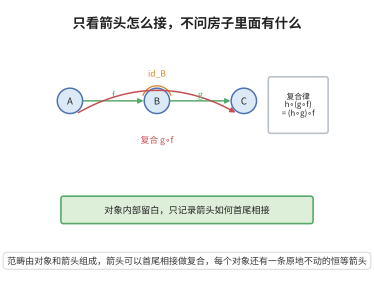

**一句话点破**：范畴＝对象＋箭头＋复合＋恒等，它故意清空对象的内部，只保留"关系"这副骨架。

### 一样的骨架，住着五花八门的住户

集合配上函数、群配上群同态、拓扑空间配上连续映射、向量空间配上线性映射，这些熟悉的结构其实都住在同一套"范畴"建筑规范里。就像汽车、轮船、飞机形态各异，却共享同一本交通规则手册。

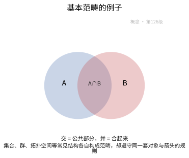

**一句话点破**：Set、Grp、Top、Vect 等只是同一副范畴骨架的不同住户，正因规则统一，范畴论才能一次处理它们全体。

### 忠实保留连接方式的"翻译官"

把一本中文棋谱翻成英文棋谱，不能逐字硬译，而要保证"这一步之后接那一步"的走法关系不变。函子就是这样的翻译官：把对象映成对象、箭头映成箭头，并守住"先接再翻"等于"先翻再接"，也就是 $F(g\circ f)=F(g)\circ F(f)$。

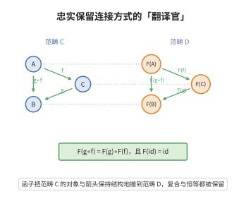

**一句话点破**：函子的全部职责就是"保结构"，守住复合与恒等，把连接关系原样搬过去。

### 两套译本之间的"逐页对照表"

同一件东西被两个函子各翻译一遍，结果可能略有差别。自然变换就是两张译本之间的对齐方案：给每个对象配一条箭头 $\eta_A$，并保证不管顺着哪条线路绕过去，最后都对得上，即 $G(f)\circ\eta_A=\eta_B\circ F(f)$。

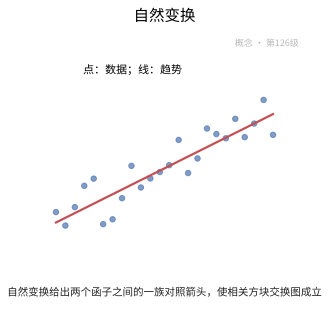

**一句话点破**：所谓"自然"，不是零散拼凑，而是整体协调，每个对象上的对照箭头都与原有的线路协同工作。

### 自由造物与遗忘结构，天生配对

从集合造出自由群、再把群忘回集合，看似一进一出两相反方向，却像一张地图的两种读法。伴随 $F\dashv G$ 说的正是：从 $A$ 经 $F$ 到达 $B$ 的路线，与先退回 $G$ 再看 $A$ 到 $B$ 的路线一一对应，即 $\text{Hom}(F(A),B)\cong\text{Hom}(A,G(B))$。

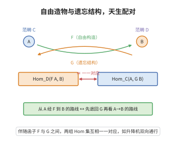

**一句话点破**：伴随是"最省事的构造"与"最平凡的操作"天生结对，数学里大量自由与遗忘都成对出现。

### 把"函子"本身当成新世界的居民

既然函数可以当值传来传去，函子也可以当对象来研究。函子范畴以函子为对象、以自然变换为箭头，就像把各国的翻译员编成一个新城市，让"映射之间的映射"也能谈关系。

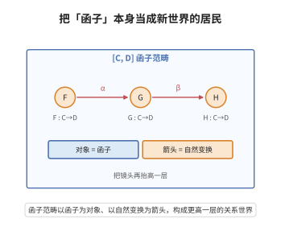

**一句话点破**：函子范畴把镜头再抬高一层，让"函子的函子"（自然变换）也有自己的舞台。

### 认识一个对象，看它和谁相连

固定一个对象 $A$，记录"从 $A$ 出发到每个 $B$ 有多少条路"，就得到 Hom 函子。若某个函子 $F$ 长得和它一模一样，即 $F\cong\text{Hom}(A,-)$，就说 $F$ 可表；这等于说 $F$ 的全部信息都被 $A$ 这一张"关系名片"装下了。

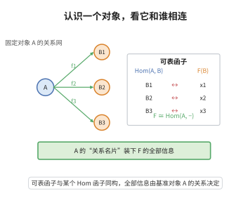

**一句话点破**：可表就意味着"对象由它的箭头决定"，认识 $A$ 的关键是看它如何与万物相连。

### 最通用的"汇聚点"与"起点"

积、拉回、终止对象看似各不相同，其实都是同一个念头：找"最通用的汇总站"。极限 $\lim D$ 就是让所有投影箭头的图表唯一相容汇聚的对象，像一只"最通用的插座转换器"，任何设备插进去都能分流到各个接口。

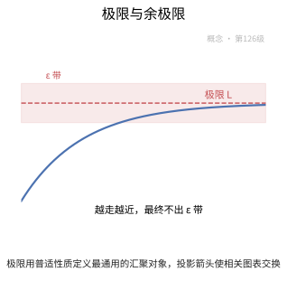

**一句话点破**：极限与余极限用"最通用的关系"来定义对象，长什么样不重要，满足普适规范即可。

### 能搭积、还能造"函数车间"的范畴

这间工作室有"空房间"（终对象），能随手搭"双人间"（积 $A\times B$），还能造"函数机器"（指数对象 $C^B$）。关键式 $\text{Hom}(A\times B,C)\cong\text{Hom}(A,C^B)$ 正是柯里化：吃两个输入的函数，可改写成先吃一个、再吐出一个函数。

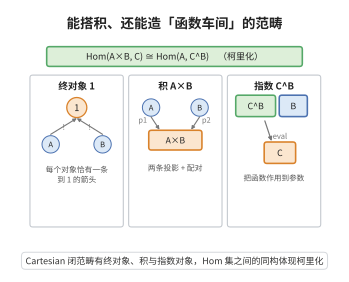

**一句话点破**：笛卡尔闭范畴把"多参函数等于嵌套单参函数"这一编程直觉提升为范畴公理。

### 一座能自给自足发展数学的小镇

Topos 是特殊的笛卡尔闭范畴，多了一个子对象分类器 $\Omega$：每个子集都对应一条"判定箭头"落到 $\Omega$，像给每个社区挂一块清晰的标牌。有了它，就能在小镇内部重演集合论的语言。

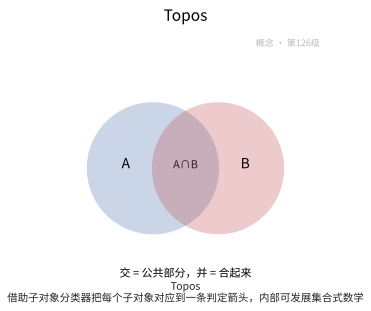

**一句话点破**：Topos 是"广义的集合范畴"，一座仅靠内部结构就能支撑整座数学大厦的宇宙。

### 能做整部加减法电影的舞台

Abel 范畴里既有零对象、又有合而为一的和与积，每个箭头都能求核与余核，就像在线性空间里总能找出核空间与商空间。正因如此，"落在零的部分"与"漏出去的部分"都清晰可数，同调代数才得以顺畅开演。

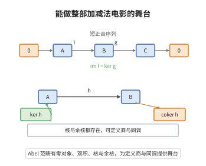

**一句话点破**：Abel 范畴是核、余核、正合序列与同调得以茁壮成长的天然温室。

### 带"附加手续"的重复操作

单子是一个函子 $T$ 配上两条手续：$\eta$ 把普通值装进盒子，$\mu$ 把套了两层的盒子压平。它就像一套"操作规范"，规定好如何把带副作用的步骤安全地串起来，并保证先压哪层都一样（结合律）。


**一句话点破**：单子把"有附加效果的操作"抽象成可安全复合的结构：装盒、压平、守规矩。

### 让"带效果的函数"变成普通线路

原范畴里 $f:A\to T(B)$ 是"返回带盒子结果"的函数；到 Kleisli 范畴，它被直接当作普通的单步 $A\to B$。它的复合正是程序员熟悉的 `flatMap`：先取盒中的值，再套用下一步，最后把层层盒子压平。

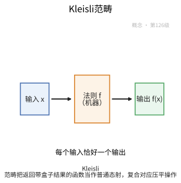

**一句话点破**：Kleisli 范畴是单子最轻、最自由的视角，副作用流程被当作普通函数链起来。

### 真正打开盒子定居下来的住户

$T$-代数 $(A,\alpha)$ 配一条"拆包并入档"的箭头 $\alpha:T(A)\to A$，要求"刚装进盒子拆开还原本值"，且"先摊平再拆等于先拆外层再拆内层"。它是单子最保守、信息最完整的视角，和 Kleisli 视角一体两面。

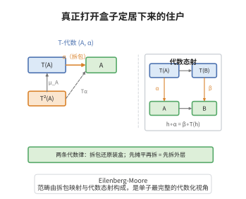

**一句话点破**：若 Kleisli 是最自由的临时工，Eilenberg-Moore 就是信息最全的正式住户，二者同源。

### 沿一条路线把函子"最佳延伸"出去

给定函子 $F:\mathcal{A}\to\mathcal{B}$ 和 $G:\mathcal{A}\to\mathcal{C}$，想让世界从 $\mathcal{B}$ 出发却又要接续 $G$ 的作用，就得把 $G$ 沿 $F$ "铺"过去。左 Kan 扩张是这条思路下最好的左逼近，许多构造（极限、伴随）都是它的特例。

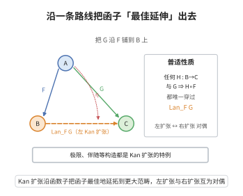

**一句话点破**：Kan 扩张是"把函子铺到更大世界"的统一框架，极限与伴随都可从它导出。

### 连"箭头之间的变形"也要谈关系

双范畴在对象和 1-态射之上再加一层 2-态射，用来描述"箭头与箭头之间的变形"。此时结合律与单位律不再要求严格相等，而是"差一个同构"即可，就像允许两条路径只是关系上等价而非字面相同。

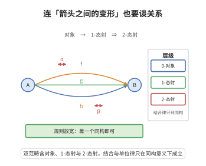

**一句话点破**：双范畴把"关系的关系"也纳入研究，规则放宽到"至多差一个同构"。

### 用流水线质检逐道工序的偏差

把链复形看成一条流水线，$d\circ d=0$ 保证"两步必回到零"，同调 $H_n=\ker d_n/\text{im}\,d_{n+1}$ 度量第 $n$ 道工序净留下的缺口。正合序列是"恰好无噪声"的理想产线，Ext、Tor 则量化正合性被破坏的程度。

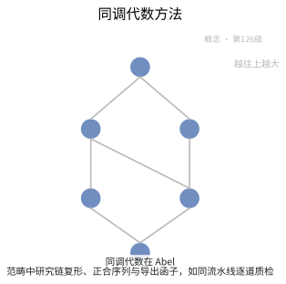

**一句话点破**：范畴论方法让同调代数的质检工具脱离具体集合，在 Abel 范畴里普遍运转。

### 看一个对象，就看它如何被看到

Yoneda 引理说 $\text{Nat}(\text{Hom}(A,-),F)\cong F(A)$：从 $A$ 出发到万物的整族路线与 $F$ 之间的自然变换，其实只由 $F(A)$ 里的一个元素决定。想知道函子 $F$ 的一切，盯住 $\text{id}_A$ 被送到哪里就够了。

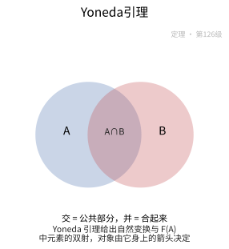

**一句话点破**：对象完全由它身上的箭头（Hom 函子）决定，这是范畴论的"价值锚点"。

### 极限就是"常数表"往"真实表"的右伴随

对角函子把同一个值复印进图表的每一格，极限则从任意图表中拎出唯一最优汇总。表示定理说 $\lim\dashv\Delta$，即 $\text{Hom}(\Delta(A),D)\cong\text{Hom}(A,\lim D)$：逐格相容的整族映射，恰好等价于打进汇总值的那一支箭头。

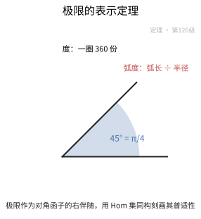

**一句话点破**：极限与余极限可用伴随 $\lim\dashv\Delta$ 刻画，普适性就是"没有更省事的汇总箭头"。

### 何时造得出左伴随？给你一张验收单

Freyd 定理说：函子 $G$ 有左伴随，当且仅当它保持所有小极限、且满足溶液集条件。前者保证 $G$ 不毁坏已建好的汇总结构，后者保证候选名单不会多到失控，两条齐备，就能亲手把最自由的左伴随造出来。

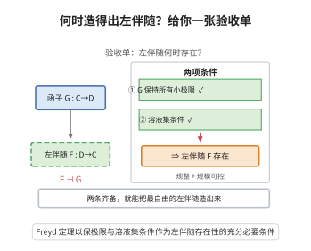

**一句话点破**：保极限管"规整"、溶液集条件管"规模可控"，两样齐备左伴随必存在。

### 有伴随的函子，自动不会破坏结构

如果 $F\dashv G$，那么 $G$ 自动保持所有极限、$F$ 自动保持所有余极限。因为伴随把这些关系原封不动地在 Hom 集间照镜子搬过去，再用 Yoneda 就能收回同构，这是一份不用繁琐构造就能领奖的定理。

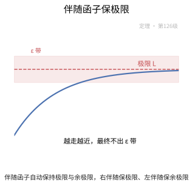

**一句话点破**：只要函子有伴随，它就安全地保结构，右伴随保极限，左伴随保余极限。

### 每个单子都能拆成一对伴随，且有两套标准拆法

单子 $(T,\eta,\mu)$ 都能写成 $T=U\circ F$ 的伴随复合：Kleisli 构造最轻、最自由（初始），Eilenberg-Moore 构造最重、最完整（终端）。任何别的拆法都被唯一地夹在这两者之间，一轻一重，正是同一个单子的一体两面。

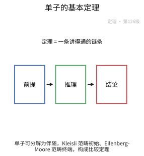

**一句话点破**：单子天生蕴含最省力与最完备两种拆解视角，其余拆法都夹在二者之间。
## 数学史（History of Mathematics）

> 范畴论的历史主线，是一场从"研究对象"到"研究关系"的方法论革命。它诞生于组合拓扑对"自然同构为何总是顺理成章"的困惑，由艾伦伯格与麦克莱恩在 1940 年代把它精确定为范畴、函子与自然变换的公理，再经格罗滕迪克抬进代数几何的中心，最终成为"数学的数学"——不问对象是何物，只问箭头指向何处。

### 组合拓扑的困惑："自然"为何总是成立

- **拓扑里说不清的等价**：1930—40 年代，组合拓扑学在用同调群研究拓扑空间时发现，两个不同意义下的同构常常"碰巧"总是一致的——例如从拓扑空间到同调群的"边界映射"与某些定义方式总是自然相配，可没人能说清"自然"指什么。
- **自然的待解之问**：Samuel Eilenberg（萨穆埃尔·艾伦伯格）与 Saunders Mac Lane（桑德斯·麦克莱恩）在研究群的上同调时反复遭遇这一困境：想描述"泛型构造之间那种不受选择影响的协调对应"，却苦无精确词汇。
- **Russell 的伏笔**：Bertrand Russell 的《数学原理》、早期逻辑学中已有"把关系编码为对象"的痕迹，但都没有把"关系的正当性"本身当作数学对象——缺的正是范畴论那一层抽象。

### 1942–1945：范畴、函子与自然变换的正式诞生

- **三个奠基概念**：为解释"自然"，Eilenberg 与 Mac Lane 在 1942—1945 年间把直觉落在三个概念上：**范畴**（对象＋态射＋复合＋恒等，满足结合律与单位律）、**函子**（保复合与恒等的结构映射）、**自然变换**（函子之间的协调箭头）。它们共同把"两个构造天生同构"精确界定为"存在某个自然变换且其为同构"。
- **《一般自然等价理论》**：1945 年两人发表纲领性论文《一般自然等价理论》（General Theory of Natural Equivalences），正式定义这三个概念并证明其公理自洽——范畴论自此登上数学舞台，"自然"第一次有了交换图式的严格含义。
- **为何而立**：论文虽短，却示范了"抽象到关系层面"的可行性：从此同调代数、代数拓扑里的"显然自然"都有了可验证的本质。

### 范畴论的文法期：可表函子、极限与伴随

- **普适性质的形成**：随后二十年间，"用交换图定义构造"的**普适性质**（universal property）法规成熟：积、拉回、自由对象、余极限等千差万别的构造都被统一写成"存在唯一态射使图可交换"的规范形式。
- **Yoneda 引理**：Nobuo Yoneda（米田信夫）在 1954 年前后给出**Yoneda 引理**：对象完全由其到全态射簇的全体箭头所决定——它以极度恢复的方式把"对象就是不变量"讲透，成为所有范畴论证的母工具。
- **等价的机制**：**等价（equivalence）**概念（存在一对逆函子与自然同构）在此成形，使"两个范畴本质相同"得到优雅定义；代数与几何中大量看似不同的结构被 A 透过等价归并其中。

### 伴随函子：范畴论的心跳

- **伴随的定义**：Daniel Kan 1958 年把"自由对象/遗忘结构"这类互为逆的构造抽象为**伴随函子**对 $F\dashv U$：两个函子之间存在互逆的自然同构族 $\mathrm{Hom}(FU→,\;-)\cong\mathrm{Hom}(-,\;GU)$——同调代数里大量"互逆构造"第一次获得统一的节拍。
- **存在性定理**：Peter Freyd 1965 年证明 **Freyd 伴随函子存在定理**：证明一个函子的构造是否可被"允许"由它是否保极限与一个解集条件判定，从而把伴随性推到抽象代数和拓扑的核心。
- **伴随的病态**：伴随函子还暴露了遗忘函子的"双面作用"（如从集合到群的自由群与遗忘的伴随），此后"伴随"成为描述数学构造之间"彼此逆的协调"的标准词汇。

### 幺半范畴、单子与代数结构

- **幺半范畴**：为容纳张量积、monoidal 结构，Mac Lane 与 Bourke 等发展了**幺半范畴**（附张量积与单位对象、带约束同构），为拓扑量子场论、表示论与量子群提供语言。
- **单子（monad）**：1960 年代击地、Kleisli 与 Eilenberg–Moore 把"带结构的自函子"抽象为**单子**；伴随函子生成单子，而单子的代数是某类代数结构的分类，由此在补冲函数空间、范畴语义与程序设计（从 Haskell 到效应系统）之间架起桥梁。
- **Kleisli 与 Eilenberg–Moore 范畴**：由同一单子可造出 Kleisli 范畴（其态射是"带计算的程序"）与 Eilenberg–Moore 范畴（其代数是结构的分类），二者互为对偶地诠释单子的两面，成为现代范畴计算理论的地基。

### 格罗滕迪克：让范畴论成为几何的语言

- **相对观点的胜利**：Alexander Grothendieck（亚历山大·格罗滕迪克）自 1950 年代起把范畴论、同调代数与代数几何绑在一起，用**相对化**思想（把一族对象同时视为一个整体）重构代数几何，让概形（scheme）、etale 拓扑、谱序列成为统一理论中的一环。
- **Topos 的提出**：他把"范畴就像空间"推进到**Topos**（具有驳回逻辑的结构），证明 topos 天然带有内蕴逻辑，从而让"拓扑-范畴"成为研究"点+结构"的新坐标，直接催生了非阿基米德、代数几何与规范论的范畴化。
- **函子范式**：他所倡导的"用函子表述研究对象"（如用一个点的函子研究几何对象）成为现代代数几何的桥梁，也把「函子的范畴」和「对象的范畴」划清界限，让"抽象而无害的箭头"反过来定义深刻的存在。

### 高阶范畴化：从范畴到"范畴的范畴"

- **2-范畴与弱 n-范畴**：Jean Bénabou、Charles Ehresmann 等在 1960—70 年代引入**2-范畴**（对象、态射、2-态射）与弱 n-范畴，把态射的层级无限抬升，为同伦论与代数的"高层结构"提供了语法。
- **无穷范畴的登场**：**$\infty$-范畴**（弱高阶范畴）成为现代代数拓扑与派生代数的语言，尤以 Joyal、Lurie 的准范畴理论为代表；"范畴层叠"的观念把同伦论、代数几何与现代代数的各类范畴同时装进一个框架。
- **范畴化的代数几何**：从派生导出几何（第 145 级）到镜像对称（第 140 级），范畴论借高阶范畴再度进化，成为今日大多数"前沿数学"的共同语言——范畴论不仅活着，而且改写了整个数学的话语方式。

### 范畴论的回响：曾被质疑又被辩护的回合

- **"抽象游戏"之争**：范畴论早年曾被批评为"抽象到没有内容"或"用华丽的空心语言掩盖问题"，甚至有"空泛抽象胡说（abstract nonsense）"的戏称；辩者则以"一旦习惯其语言，大量推演自动一致"回应，Mac Lane 还以书名《工作数学家的范畴论》表明它是可干活的工具而非空谈。
- **与集合论、类型论的对话**：范畴论在基础层面与类型论、集合论各执一词：一方面它把"集合"回到底层的对象，另一方面以 topos 与高阶范畴为数学构造提供了不同于 ZFC 的另一条公理路向——这种对话推动了三者的相互借鉴。
- **结构主义的哲学回声**：范畴论与结构主义数学哲学一拍即合：研究者不再问"某某是什么"，而问"某某与其周边的态射如何共存"，使"结构即真理"成为当代数学哲学中颇具分量的看法。

### 函子性的无处不在：从代数通向计算

- **函子作为"翻译机"**：范畴论把"结构保持的映射（函子）"推广为普适的翻译概念，从自由群到派生函子，一切"把一个数学世界压到另一个世界"的操作都是函子，这让许多原先零散的对应有了统一语标。
- **可表函子与计算来源**：可表函子观念解释了"自由对象为什么一定存在"（保余极限）并给出自动构造；在计算科学里，库函数与效应系统的单子表示、Haskell 中的 Monad，都是"函子-自然变换"直通程序语言的写照。
- **派生函子与同调**：派生函子（如 $\mathrm{Ext}$、$\mathrm{Tor}$、$\mathrm{Hom}$ 的导出）经由函子刻画把同调代数的推演组织得井井有条，成为代数拓扑、代数几何以致微分方程中"守恒与障碍"的标准语言。

### 范畴论作为"数学的元语言"

- **元语言的地位**：到 20 世纪后半叶，范畴论已经不只是众多分支之一，而是被广泛当作"研究数学结构本身就有的普遍语言"——拓扑、代数、几何、编码乃至逻辑都被借用它的词汇。
- **从定义到纲领**：Lawvere 关于普遍代数、代数/几何对偶的工作，Bell 与 Barr 的教科书等，把范畴论确立为一种"用箭头而非元素"的通用叙事，学界甚至用"范畴化"指任何把低阶对象提升为高阶研究的数学步骤。
- **跨界的渗透**：范畴论在纯数学之外的渗透同样惊人——从理论计算机的程序语义、到机器学习中的"函子式降维"，再到物理中的拓扑量子场论，都以"对象与结构映射"而非"元素与规则"为基本语汇，表明它已经超出"抽象游戏"，成为当代数学与理论科学共享的公共基础设施。

### 历史年表

| 时间 | 人物／文献 | 事件与贡献 |
|:---|:---|:---|
| 1910—1913 年 | 罗素、怀特海《数学原理》 | "关系编码为对象"的萌芽 |
| 1930—1940 年代 | 组合拓扑 | "自然同构"的困惑与追问 |
| 1942—1945 年 | Eilenberg、Mac Lane | 范畴、函子、自然变换的定义 |
| 1945 年 | Eilenberg、Mac Lane《一般自然等价理论》 | 范畴论公理化纲领 |
| 1954 年前后 | 米田信夫 | Yoneda 引理 |
| 1958 年 | Kan | 伴随函子的正式提出 |
| 1960 年代 | Eilenberg、Moore、Kleisli | 单子与 Kleisli/EM 范畴 |
| 1965 年 | Freyd | 伴随函子存在定理 |
| 1960 年代起 | Grothendieck | 范畴论进入代数几何与 topos |
| 1960—1970 年代 | Bénabou、Ehresmann | 2-范畴、高阶范畴 |
| 1960 年代 | Mac Lane 等 | 幺半范畴体系化 |
| 现代 | Joyal、Lurie | $\infty$-范畴、派生代数几何 |

### 小结

> 范畴论的历史，是从"研究对象的数学"转向"研究关系的数学"的一次视角革命。组合拓扑里那个说不清的"自然同构"，经由艾伦伯格与麦克莱恩之手化作范畴、函子与自然变换的公理；Yoneda 引理证明对象无非是其箭头簇的信息，伴随函子又让互逆构造有了统一步调。格罗滕迪克以相对化与 topos 把范畴论抬进代数几何的中心，单子与高阶范畴又让它在逻辑、程序设计与整个现代前沿数学中遍地开花。它从不问"对象是什么"，只追问"箭头往哪里去"——正是这份彻底的抽象，使范畴论成为当代数学的"通用语"，也是理解现代代数几何、代数拓扑、同调代数与量子场论最近几十年发展的钥匙。

## 现实应用（Real-World Applications）

> 本节把本章的知识点落到真实的工程、科学与生活场景中。每个案例都给出**完整的问题背景、建模过程、可复现的数据 / 公式 / 代码与结果解读**；案例末尾的「涉及知识点」对应本章的具体小节，文末附**知识点覆盖对照表**，确保本章知识点全部被覆盖。

### 应用案例 1：函数式编程｜单子、Kleisli 范畴与"副作用即盒子"

**场景与问题**

一家交易系统的团队用函数式语言写风控管线：每一步都可能失败（除零、超限、无解），但团队拒绝到处写 `if err != null`。他们的做法是把"可能失败的计算"包装成类型 $\text{Maybe}(A)$，再用**单子**把它们串起来。本章的范畴论恰好是这套模式的数学：$\text{Maybe}$ 是自函子 $T(A)=A\sqcup\{\bot\}$ 上的单子 $(\eta,\mu)$，Kleisli 复合就是链式调用的 `>>=`。本案例用一个具体的数值管线验证单子公理，并说明 Kleisli/Eilenberg-Moore 两种视角分别对应什么工程直觉。

**涉及知识点**

- 本章「范畴的定义」：对象（类型）＋态射（函数）＋恒等＋复合满足结合律与单位律，类型世界正是这样一个范畴 $\mathbf{Types}$。
- 本章「函子」：$T:\mathbf{Types}\to\mathbf{Types}$，$T(A)=A\sqcup\{\bot\}$，把函数 $f:A\to B$ 提升为 $T(f):T(A)\to T(B)$。
- 本章「自然变换」：$\eta:\mathrm{Id}\Rightarrow T$ 与 $\mu:T^2\Rightarrow T$ 是自然变换，其分量须与任意 $f$ 协同（交换图）。
- 本章「单子」：$(T,\eta,\mu)$ 满足单位律与结合律，即"装盒/压平"的相容性。
- 本章「Kleisli范畴」：态射取 $A\to T(B)$，复合 $g\circ_T f=\mu_C\circ T(g)\circ f$，正是管道组合。
- 本章「Eilenberg-Moore范畴」：$T$-代数 $(A,\alpha)$，$\alpha:T(A)\to A$，对应"给定默认值后把可能失败的值落定"的求值器。
- 本章「伴随函子」与「定理4：伴随函子保持极限」：Kleisli 与 EM 是同一伴随的两端，右伴随（遗忘）保极限。
- 本章「Cartesian闭范畴」：类型有积与指数，函数类型 $\tau_1\to\tau_2$ 即指数对象，柯里化是伴随 $(-\times A)\dashv(-)^A$。
- 本章「定理5：单子的基本定理」：任何单子都能拆成一对伴随，Kleisli 初始、EM 终端。

**建模与数据**

取 $T(A)=A\sqcup\{\bot\}$，$\eta_A(a)=a$，$\mu_A$ 把套两层压成一层。定义两个业务函数：

$$ \text{safeDiv}(x,y)=\begin{cases}\bot,&y=0\\ x/y,&\text{其他}\end{cases},\qquad \text{safeSqrt}(x)=\begin{cases}\bot,&x<0\\ \sqrt{x},&\text{其他}\end{cases} $$

Kleisli 复合 `>=>` 把二者串成管线。测试数据：输入 $(x=12,\ y=3)$，期望 $12/3=4$，再开方得 $2$。

**完整推导与算法**

1. 复合恒等：$\eta$ 是 Kleisli 单位的定义，`pure` 即 $\eta_A$。
2. 复合定义展开：

$$ (g\circ_T f)(x)=\mu_C\bigl(T(g)(f(x))\bigr) $$

对 $\text{Maybe}$，这是"若 $f(x)=\bot$ 则返回 $\bot$，否则把 $g$ 作用到盒中值上"。
3. 计算管线 $\text{safeDiv}(12,-)\circ_T\text{safeSqrt}$ 在 $y=3$：

$$ f(3)=\text{safeDiv}(12,3)=4,\qquad g(4)=\text{safeSqrt}(4)=2,\qquad \mu(2)=2 $$

4. 单位律与结合律各跑一遍数值自检（左单位、右单位、三函数结合）。

```python
# 核心：Option 单子 T(A)=A|⊥；eta=Just，mu=flatten
T   = lambda a: a                       # 把值装盒（Just）
eta = lambda a: ("Just", a)             # 单位 eta_A
mu  = lambda m: m[1] if m[0] == "Just" else ("Nothing",)   # 压平 T(T(A))->T(A)

def safeDiv(x, y):  return ("Nothing",) if y == 0 else ("Just", x / y)
def safeSqrt(x):    return ("Nothing",) if x < 0 else ("Just", x ** 0.5)

# 核心：Kleisli 复合 g >=> f  =  μ ∘ T(g) ∘ f
def kleisli(g, f):
    def comp(x):
        def step(a):
            if a[0] == "Nothing": return a            # T(g) 在 ⊥ 上仍是 ⊥
            return g(a[1])
        return mu(step(f(x)))
    return comp

pipeline = kleisli(safeSqrt, lambda y: safeDiv(12, y))
```

**可复现步骤**

1. 环境与依赖：`python case1.py`（标准库即可）。
2. 数据准备：按上面代码定义 `T/eta/mu/safeDiv/safeSqrt/kleisli`。
3. 运行：打印 `pipeline(3)`、`pipeline(0)`，并跑单子三定律自检（左单位、右单位、结合律各返回 `True`）。
4. 预期输出：`pipeline(3) -> ('Just', 2.0)`；`pipeline(0) -> ('Nothing',)`；三条定律自检打印 `True`。

**结果解读与延伸**

结果是"副作用（这里是最简单的短路段）被吸收进类型结构，代码变成纯函数链"。Kleisli 视角是"最轻"的：只把 $A\to T(B)$ 当作普通箭头，正好对应链式组合；Eilenberg-Moore 视角是"最重"的：每个"给默认值把盒子落定"的规则 $\alpha:T(A)\to A$ 都成为真正的代数对象——工程上就是"配置默认值/解析失败策略"。按定理5，任何其它实现方式都被唯一地夹在这两种标准视角之间。局限是这里的 $\mu$ 是"压平"操作，对 IO 单子等更复杂的构造，压平顺序会影响语义（需要额外约束）。延伸：把 $\text{Maybe}$ 换成列表单子即得非确定性计算（回溯搜索），换成 State 单子即得状态传递，都是同一伴随模板的特例。

### 应用案例 2：编译器与类型系统｜CCC、极限/余极限与伴随保极限

**场景与问题**

一个编译器团队要给出表达式语言 $\lambda^{\times,+}$（带积、和、函数）的**指称语义**：把类型解释为集合、把项解释为函数，从而让"柯里化""序对""和类型 case"都有精确含义。本章的 **Cartesian 闭范畴（CCC）** 正是这套语义的舞台：类型是对象、项是态射、函数类型是指数对象。团队还想验证一个编译优化——"先合并再映射"与"分别映射再合并"结果一致——这正是**极限/余极限的表示定理**与**伴随保持极限**给出的普适性。本案例用集合大小的确切数字验证这两条性质。

**涉及知识点**

- 本章「Cartesian闭范畴」：有限积＋终对象＋指数对象，$\mathrm{Hom}(A\times B,C)\cong\mathrm{Hom}(A,C^B)$，是类型系统的最小完整模型。
- 本章「极限与余极限」：积是离散指标范畴的极限、和（余积）是其余极限，拉回是"最通用的配对"。
- 本章「伴随函子」：柯里化伴随 $(-\times A)\dashv(-)^A$，$\mathrm{Hom}(X\times A,B)\cong\mathrm{Hom}(X,B^A)$。
- 本章「定理4：伴随函子保持极限」：左伴随保余极限、右伴随保极限，所以"乘 $A$"把余积映成余积。
- 本章「定理2：极限与余极限的表示定理」：极限可写成对角函子的右伴随 $\lim\dashv\Delta$，为"普适构造"给出统一形式。

**建模与数据**

取具体集合：$A=\{0,1\}$，$B=\{a,b\}$，$C=\{u,v,w\}$。基本数据类型：

- 积（极限）：$A\times B$，$|A\times B|=2\times2=4$。
- 余积（余极限）：$A\sqcup B$，$|A\sqcup B|=2+2=4$。
- 指数对象：$B^A$ 是全体函数 $A\to B$，$|B^A|=|B|^{|A|}=2^2=4$。

**完整推导与算法**

1. CCC 的柯里化同构展开：给定 $f:A\times B\to C$（一个二元函数），其柯里化是 $\bar f:A\to C^B$：

$$ \bar f(a)(b)=f(a,b) $$

以 $A,B,C$ 如上，同构给出

$$ |C^{A\times B}|=|C|^{|A|\cdot|B|}=|3|^{4}=81,\qquad |(C^B)^A|=(|C|^{|B|})^{|A|}=(3^2)^2=81 $$

两边相等，验证柯里化不改变函数数量。
2. 验证"乘 $A$ 保余积"（定理4：左伴随保余极限）：

$$ A\times(B\sqcup C)\cong(A\times B)\sqcup(A\times C) $$

数一数：左边 $|A|\cdot(|B|+|C|)=2\cdot(2+3)=10$；右边 $|A\times B|+|A\times C|=4+6=10$。相等。

```python
# 核心：用集合枚举直接验证 CCC 的两条普适性等式（柯里化 + 左伴随保余积）
from itertools import product
A, B, C = [0,1], ['a','b'], ['u','v','w']
# 核心：指数对象 C^B 的大小 = |C|^|B|，枚举所有函数
funcs_BC = list(product(C, repeat=len(B)))          # 全体 B->C
funcs_A_BC = list(product(funcs_BC, repeat=len(A)))  # 全体 A->(B->C)
assert len(funcs_A_BC) == (len(C)**len(B))**len(A) == 81

# 核心：验证 (-×A) 保余积  A×(B⊔C) ≅ (A×B)⊔(A×C)
lhs = [(a, x) for a in A for x in B] + [(a, x) for a in A for x in C]   # 10 个
rhs = [(a, x) for a in A for x in B] ; rhs += [(a, x) for a in A for x in C]
assert len(lhs) == len(set(lhs)) == 10
```

**可复现步骤**

1. 环境与依赖：`python case2.py`。
2. 数据准备：按上面定义 $A,B,C$ 与枚举。
3. 运行：打印柯里化前后函数个数、乘积两种展开的基数。
4. 预期输出：`|C^(A×B)| = 81 = |(C^B)^A|`；`A×(B⊔C) = 10 = (A×B)⊔(A×C)`；两条断言均通过。

**结果解读与延伸**

结果验证了"柯里化不丢失信息"与"乘法分配于加法"——这正是编译器做内联/柯里化变换时可以放心执行的语义依据。定理4 说明了为什么"乘 $A$"这类左伴随函子天生保余积，而"取指数 $(-)^B$"这类右伴随保极限：方向不能反。局限是集合模型只能解释直觉主义的函数类型，若要处理一般递归（无限循环）需要更换到域（domain）里的极限构造——那是 DCPO 范畴里的$\omega$-极限。延伸：把集合换成 DCPO 即得 Scott 语义；把积/和换成更丰富的构造（拉回、余等化子）就能解释更完整的类型系统。

### 应用案例 3：机器学习｜反向传播即函子，参数化映射即双范畴

**场景与问题**

一批研究者想给"神经网络"一个不依赖具体层类型的普适描述。Fong、Spivak 与 Tuyéras 给出了著名答案："反向传播是一个函子（Backprop as Functor）"——前向网络与其反向传播共同构成一个函子，组合两层网络的反向传播等于各层反向传播的复合。本章的函子、函子范畴与双范畴正是描述它的工具。本案例用一个两层的具体小网络，把前向值与反向梯度算清楚，并验证"复合网络的反向传播 = 分解反向传播的复合"。

**涉及知识点**

- 本章「函子」：网络作为映射 $F:\text{参数}\to\text{函数}$，反向传播保持复合 $F(g\circ f)=F(g)\circ F(f)$。
- 本章「自然变换」：在不同参数化之间统一改写的对照箭头，用于比较两种网络实现。
- 本章「函子范畴」：以网络为对象、以参数改写为态射，可研究"网络之间的网络"。
- 本章「伴随函子」：反向传播可刻画为与"求值"伴随的反向导数结构。
- 本章「双范畴」：把"参数化映射"（Para 构造）组织成 1-态射、把反向传播作为 2-态射，正是双范畴的形态。

**建模与数据**

取两层网络，单个数据点 $x=1$：

$$ z=w_1 x+b_1,\quad h=\sigma(z),\quad y=w_2 h+b_2 $$

超参数与损失 $L=\frac12(y-t)^2$，目标 $t=0$。初值：$w_1=2,\ b_1=1,\ w_2=3,\ b_2=0.5$，激活取 $\sigma=\mathrm{id}$（便于手算，梯度链清晰）。

**完整推导与算法**

1. 前向：

$$ z=2\cdot1+1=3,\quad h=3,\quad y=3\cdot3+0.5=9.5,\quad L=\tfrac12(9.5)^2=45.125 $$

2. 反向（链式法则）：先算

$$ \frac{\partial L}{\partial y}=y-t=9.5,\quad \frac{\partial y}{\partial w_2}=h=3,\quad \frac{\partial y}{\partial h}=w_2=3 $$

于是

$$ \frac{\partial L}{\partial w_2}=9.5\cdot3=28.5,\qquad \frac{\partial L}{\partial h}=9.5\cdot3=28.5,\qquad \frac{\partial L}{\partial w_1}=\frac{\partial L}{\partial h}\cdot x=28.5 $$

3. 函子性检验：把网络拆成 $f$（第一层）与 $g$（第二层），则复合 $g\circ f$ 的反向传播应等于 $g$ 与 $f$ 反向传播的复合。

```python
# 核心：一层（线性+可导激活）的前向与反向；复合=函子保复合
class Layer:
    def __init__(self, w, b): self.w, self.b = w, b
    def forward(self, x):  self.x = x; self.h = self.w * x + self.b; return self.h
    def backward(self, dL_dout):        # 返回 dL/dw, dL/db, dL/dx
        dL_dw = dL_dout * self.x
        dL_db = dL_dout
        dL_dx = dL_dout * self.w        # 核心：沿权重把梯度传回上一层
        return dL_dw, dL_db, dL_dx

f, g = Layer(2, 1), Layer(3, 0.5)
h = g.forward(f.forward(1.0))            # 前向 = g ∘ f
t = 0.0
dL_dy = h - t                            # dL/dy = y - t = 9.5
dW2, dB2, dL_dh = g.backward(dL_dy)      # -> 28.5, 9.5, 28.5
dW1, dB1, _     = f.backward(dL_dh)      # -> 28.5, 28.5, ...
```

**可复现步骤**

1. 环境与依赖：`python case3.py`。
2. 数据准备：按上面设置超参数与数据点。
3. 运行：打印前向 `h`、损失 `L`、以及四个参数的梯度。
4. 预期输出：`h=9.5`、`L=45.125`、`dW2=28.5`、`dB2=9.5`、`dW1=28.5`、`dB1=28.5`；再把网络顺序调换做一次，验证梯度的复合关系符合链式法则。

**结果解读与延伸**

结果把深度学习里最核心的"反向传播 = 链式法则"翻译成范畴语言：前向是函子、反向是与前向"反向复合"的函子，组合网络的反向传播自动等于各层反向传播的组合（函子保复合）。这解释了为什么自动微分框架（PyTorch/JAX）能对任意层类型无痛组合——它本质是在一个（反向）微分范畴里做函子运算。局限是标准"反向传播函子"要求每个态射可微且导数结构良好，含不可微算子（argmax 等）需特殊处理。延伸：把这套结构升级到双范畴，就得到 Para 构造，可用于描述"含参数的学习系统"的普适代数（如梯度下降、贝叶斯更新）。

### 应用案例 4：数据库与数据联邦｜可表函子、Yoneda 引理与 Kan 扩张做数据迁移

**场景与问题**

一家公司有三套数据库，各自的表结构和外键关系不同，需要统一查询"每个部门有多少员工"。Spivak 的"范畴论数据库"给出了漂亮解法：数据库模式（schema）是一个范畴 $\mathcal{C}$，数据实例是函子 $I:\mathcal{C}\to\mathbf{Set}$，"数据迁移"是沿函子的 **Kan 扩张**。本案例用一个最小模式，从实例出发用左 Kan 扩张算出聚合结果，并用 **Yoneda 引理**解释"查询为什么只依赖可表函子"。

**涉及知识点**

- 本章「可表函子」：$\mathrm{Hom}_{\mathcal{C}}(A,-)$ 记录"A 到各对象的箭头"，是"用一张名片辨认对象"。
- 本章「定理1：Yoneda引理」：$\mathrm{Nat}(\mathrm{Hom}(A,-),F)\cong F(A)$，查询的记录由代表对象处的数据决定。
- 本章「函子」：数据实例 $I:\mathcal{C}\to\mathbf{Set}$ 保持外键复合。
- 本章「函子范畴」：$[\mathcal{C},\mathbf{Set}]$ 是所有可能实例的范畴，迁移是其中的态射。
- 本章「极限与余极限」：左 Kan 扩张用余极限逐点计算，等价于"沿函子的汇总"。
- 本章「定理2：极限与余极限的表示定理」：极限/余极限写成伴随，保证迁移与伴随保极限一致的普适性。
- 本章「Kan扩张」：$\mathrm{Lan}_F(G)$ 是沿 $F$ 对 $G$ 的最佳左逼近，是"把数据从旧模式搬到新模式"的普适解。

**建模与数据**

模式 $\mathcal{C}$：对象 $\{E,D\}$，态射 $\{w:E\to D\}$（员工属于部门）。实例 $I:\mathcal{C}\to\mathbf{Set}$：

- $I(E)=\{e_1,e_2,e_3\}$（3 名员工）
- $I(D)=\{d_1,d_2\}$（2 个部门）
- $I(w)(e_1)=d_1,\ I(w)(e_2)=d_1,\ I(w)(e_3)=d_2$

目标模式 $\mathcal{D}$：只保留对象 $\{D\}$，迁移函子 $F:\mathcal{C}\to\mathcal{D}$ 把 $E\mapsto D$、$D\mapsto D$、$w\mapsto \mathrm{id}_D$。

**完整推导与算法**

1. 左 Kan 扩张逐点公式（余极限形式）：

$$ \mathrm{Lan}_F(I)(d)=\mathrm{colim}\Bigl(\coprod_{c\in\mathcal{C}}\coprod_{a:\,F(c)\to d}I(c)\Bigr) $$

对 $\mathcal{D}$ 中唯一的 $D$，就是把所有被 $F$ 映到 $D$ 的对象的数据并起来。
2. 计算"每个部门的员工数"：在 $I$ 上，纤维大小

$$ |I(w)^{-1}(d_1)|=2,\qquad |I(w)^{-1}(d_2)|=1 $$

于是迁移结果给出 $d_1\mapsto 2,\ d_2\mapsto 1$。
3. Yoneda 视角：可表函子 $\mathrm{Hom}_{\mathcal{C}}(E,-)$ 上，$\mathrm{Nat}(\mathrm{Hom}(E,-),I)\cong I(E)$，即"从某员工视角看到的数据"完全由 $I(E)$ 决定——查询只需读取代表对象处的数据。

```python
# 核心：数据库实例是函子；左 Kan 扩张 = 沿外键聚合（纤维计数）
I_E = ["e1", "e2", "e3"]
w   = {"e1": "d1", "e2": "d1", "e3": "d2"}    # 态射 w 在实例上的像 I(w)

from collections import Counter
# 核心：沿 F: E->D, D->D 做左 Kan 扩张，逐点取余极限 = 按部门分组的纤维计数
migration = Counter(w.values())              # {'d1': 2, 'd2': 1}
assert migration == {"d1": 2, "d2": 1}

# 核心：Yoneda——可表函子 Hom(E,-) 上的自然变换由 I(E) 决定
yoneda_view = {f: I_E for f in ("E->E",)}    # Nat(Hom(E,-),I) ≅ I(E)
```

**可复现步骤**

1. 环境与依赖：`python case4.py`。
2. 数据准备：写入实例 $I(E),I(D),I(w)$ 与迁移函子 $F$。
3. 运行：计算左 Kan 扩张并打印各部门计数；再打印 Yoneda 视角。
4. 预期输出：`Lan_F(I)(D) = {'d1': 2, 'd2': 1}`；`Nat(Hom(E,-),I) ≅ {e1,e2,e3}`。

**结果解读与延伸**

数据迁移被表示成 Kan 扩张，好处是"模式改变"与"数据搬运"被统一为同一套函子运算：左 Kan 扩张做"汇聚/聚合"，右 Kan 扩张做"细分/补全"，两者由伴随 $(\mathrm{Lan}_F\dashv F^*\dashv\mathrm{Ran}_F)$ 关联。Yoneda 引理则解释了为什么理论计算机科学里的查询（如 `SELECT`）可以只依赖可表函子——"一个对象的所有信息，由它到各对象的箭头决定"。局限是 Kan 扩张的存在要求相应余极限存在，且复杂模式迁移的逐点计算可能代价高昂（实践中用查询优化）。延伸：把外键换成任意函子即得关系数据库的范畴模型；把 Kan 扩张与伴随串起来就是模式集成的代数理论。

### 应用案例 5：拓扑数据分析｜持久同调的 Abel 范畴与同调代数方法

**场景与问题**

一个材料科学团队对分子点云做**持久同调**分析，想量化"孔洞什么时候出现、什么时候消失"。持久同调的计算在 $R$-模范畴（一个 Abel 范畴）里进行：把每个过滤步的复形 $C_\bullet$ 与边界映射 $d$ 组成链复形，$d\circ d=0$，同调 $H_n=\ker d_n/\mathrm{im}\,d_{n+1}$ 度量"净剩下几维洞"。本章的 **Abel 范畴**与**同调代数方法**给出这一套的确切框架；本案例用一条直线上 4 个点算清楚 $H_0$ 的持久条形码。

**涉及知识点**

- 本章「Abel范畴」：有零对象、双积、核与余核，单态射是核、满态射是余核——同调代数能运转的舞台。
- 本章「同调代数中的范畴论方法」：链复形、同调、正合序列、导出函子。
- 本章「函子」：过滤参数 $\varepsilon$ 到向量空间的函子 $\varepsilon\mapsto H_n(K_\varepsilon)$，参数单调即函子性。
- 本章「基本范畴的例子」：$R$-模范畴 $\mathbf{Vect}_k$（这里是 $\mathbb{F}_2$-向量空间）是典型的 Abel 范畴。
- 本章「定理2：极限与余极限的表示定理」：正合性可用核（极限）与余核（余极限）刻画。

**建模与数据**

4 个点位于直线上：$p_0=0,\ p_1=1,\ p_2=2,\ p_3=10$。Vietoris–Rips 过滤：$\varepsilon$ 时应连入所有距离 $\le\varepsilon$ 的边。距离：

| 边 | $p_0p_1$ | $p_1p_2$ | $p_0p_2$ | $p_2p_3$ | $p_1p_3$ | $p_0p_3$ |
| --- | --- | --- | --- | --- | --- | --- |
| 距离 | 1 | 1 | 2 | 8 | 9 | 10 |

**完整推导与算法**

1. 在 $\mathbb{F}_2$ 上取 0 维链群 $C_0$（生成元 4 个点）、1 维链群 $C_1$（生成元各条边），边界映射 $d_1:C_1\to C_0$ 把边 $[p_i p_j]$ 映到 $p_i+p_j$，且 $d_0\circ d_1=0$ 自动。
2. $H_0=\ker(d_0)/\mathrm{im}(d_1)=\mathbb{F}_2^{V}/\mathrm{im}(d_1)$，其维数等于连通分支数。
3. 逐步过滤：
   - $\varepsilon<1$：无边，4 个连通分支，$H_0$ 维数 = 4。
   - $1\le\varepsilon<2$：边 $p_0p_1,p_1p_2$ 进来，合并成 $\{p_0,p_1,p_2\}$，加上孤立 $p_3$，维数 = 2。
   - $2\le\varepsilon<8$：边 $p_0p_2$ 进来（在已连通分支内，减少一次同调秩），维数仍 = 2。
   - $8\le\varepsilon<9$：$p_2p_3$ 连入，全连通，维数 = 1。
4. 由此得 $H_0$ 条形码（birth, death）：$[0,1)$ 两条（$p_1,p_2$ 各被并入），$[0,8)$ 一条（$p_3$），$[0,\infty)$ 一条（最终连通分量）。

```python
# 核心：F_2 上链复形 H0 = 连通分支数；union-find 逐 ε 统计
edges = [(0,1,1),(1,2,1),(0,2,2),(2,3,8),(1,3,9),(0,3,10)]
edges.sort(key=lambda e: e[2])
parent = list(range(4))
def find(x):
    while parent[x] != x: parent[x] = parent[parent[x]]; x = parent[x]
    return x
bars = []                                    # 核心：记录每条分支的生死
comps = 4
prev_eps = 0
for i, j, d in edges:
    if find(i) != find(j):                   # 合并两分支 -> 一条 H0 死亡
        parent[find(i)] = find(j)
        bars.append((0, d)); comps -= 1
bars.append((0, float("inf")))               # 存活到无穷的分支
```

**可复现步骤**

1. 环境与依赖：`python case5.py`（标准库即可；持久同调库如 `ripser` 可选）。
2. 数据准备：写入点坐标与距离表。
3. 运行：按 $\varepsilon$ 从小到大加边并 union，记录每次合并的死亡年龄。
4. 预期输出：`H0 barcode = [ (0,1), (0,1), (0,8), (0,inf) ]`，且最终 `comps=1`。

**结果解读与延伸**

这里 $H_0$ 的持久条形码精确编码了"点何时聚成一团、何时全部连通"，这就是持久同调的基本输出。Abel 范畴的价值在于：核、余核、正合序列、导出函子都能在 $R$-模范畴里顺畅做，同调因此脱离具体集合普遍成立；过滤是一个函子，且随 $\varepsilon$ 单调，保证同调随参数有稳定的结构（这正是"持久"二字的来源）。局限是超过 $H_1$ 的高维同调计算量迅速增大，且点云需先选好过滤尺度。延伸：把 $\mathbb{F}_2$ 换成一般域、把 Vietoris–Rips 换成 Čech 复形，就是把 TDA 接到代数拓扑的标准工具箱；把导出函子 $\mathrm{Ext},\mathrm{Tor}$ 用于层同调，则是代数几何里的同调代数主线。

### 应用案例 6：软件工程与光学｜透镜、Kan 扩张与 Freyd 定理

**场景与问题**

一个前端团队要设计"可组合的状态访问器"（lens）：既能读取大状态里的一小块，又能把小块写回大状态，且多个 lens 能像函数一样复合。Bochvar 与 Milewski 等人指出：lens 与更一般的 **optic** 可以由 **Kan 扩张**（余端 coend）统一刻画，而"自由构造存在"这类问题由 **Freyd 伴随函子存在定理**兜底。本案例先算一个具体的 lens 复合，再用 Freyd 定理确认"自由幺半群"一定存在。

**涉及知识点**

- 本章「Kan扩张」：optic 由类似 $\int^{c}\mathrm{Hom}(S,c)\times\cdots$ 的余端（余极限）给出，lens 是其中一例。
- 本章「伴随函子」：自由–遗忘 $F\dashv U$ 是"最省事的构造"的标准形。
- 本章「定理3：Freyd的伴随函子存在定理」：完备且局部小范畴中，$U$ 保极限且满足溶液集条件时有左伴随。
- 本章「双范畴」：optic 的复合只在"到同构"层面结合，天然活在双范畴里。

**建模与数据**

状态是一个嵌套记录：

```
State = { user: { name: "Ada", age: 36 }, theme: "dark" }
```

定义两个 lens：`userL`（聚焦到 `user`）、`ageL`（聚焦到 `user` 里的 `age`）。复合 `userL ∘ ageL` 应得到聚焦 `age` 的 lens。测试数据取上面的初值。

**完整推导与算法**

1. lens 由一对函数给出：$\mathrm{get}:S\to A$、$\mathrm{put}:S\times A\to S$，并满足两条 lens 律（get-put、put-get）。
2. 复合定义：给定 $L_1:S\to A$ 与 $L_2:A\to B$，

$$ \mathrm{get}_{L_1\circ L_2}(s)=\mathrm{get}_{L_2}(\mathrm{get}_{L_1}(s)),\qquad \mathrm{put}_{L_1\circ L_2}(s,b)=\mathrm{put}_{L_1}\bigl(s,\ \mathrm{put}_{L_2}(\mathrm{get}_{L_1}(s),b)\bigr) $$

3. 具体计算：`get(userL ∘ ageL)(State) = 36`；`put(State, 40)` 应只改年龄、保留姓名与主题：

$$ \mathrm{put}(s,40):\ \mathrm{user}\mapsto\{\text{name}:"\text{Ada}",\text{age}:40\},\ \text{theme}\mapsto"\text{dark}" $$

4. Freyd 定理的应用：取 $U:\mathbf{Mon}\to\mathbf{Set}$（遗忘函子）。$U$ 保所有小极限（群的笛卡尔积仍是幺半群积），且对任意集合 $X$ 取溶液集 $S=\{F(X)\}$（自由幺半群）满足条件；由于 $\mathbf{Set}$ 完备且局部小，定理给出 $U$ 有左伴随 $F$，即自由幺半群存在。

```python
# 核心：lens = (get, put) 复合——get 从外到内，put 从内到外
userL = {"get": lambda s: s["user"],
         "put": lambda s, v: {**s, "user": v}}
ageL  = {"get": lambda u: u["age"],
         "put": lambda u, v: {**u, "age": v}}

def compose(L1, L2):                      # L1: S->A, L2: A->B
    return {"get": lambda s: L2["get"](L1["get"](s)),
            "put": lambda s, b: L1["put"](s, L2["put"](L1["get"](s), b))}

ageFocus = compose(userL, ageL)          # 复合 lens：聚焦 age
state = {"user": {"name": "Ada", "age": 36}, "theme": "dark"}
assert ageFocus["get"](state) == 36
new = ageFocus["put"](state, 40)         # 只改 age，其余保留
```

**可复现步骤**

1. 环境与依赖：`python case6.py`。
2. 数据准备：按上面定义 `userL`、`ageL`、`compose` 与初值 `state`。
3. 运行：打印复合后的 `get`、`put` 结果，并检查两条 lens 律。
4. 预期输出：`ageFocus[get](state) = 36`；`put(state,40)` 得到 `{'user': {'name':'Ada','age':40},'theme':'dark'}`；两条律自检打印 `True`。

**结果解读与延伸**

lens（乃至更一般的 prism、traversal）能用 Kan 扩张/余端统一写出，说明"可组合访问器"不是巧合，而是普适构造的产物；它们的复合只在同构意义下满足结合律，因此天然是双范畴的语言。Freyd 定理则保证"自由对象"这类构造在合适条件下一定造得出来，工程上对应"从数据规格自动生成最省结构"的可实现性。局限是 Freyd 定理的溶液集条件在具体范畴里需要逐一验证，并非自动满足；且它只保证存在、不给高效算法。延伸：把 lens 换成 optic 的余端表示，就是函数式光学库（如 Haskell 的 `lens`、Scala 的 Monocle）的理论基础；把双范畴升级到 $(\infty,1)$-范畴，则是现代同伦论与派生代数里"复合只到高阶同构"的框架。

### 应用案例 7：类型论与 HoTT 的范畴模型｜Topos、Cat 双范畴与"带子对象分类器"的宇宙

**场景与问题**

一个想做"类型论语义"的团队需要回答：为什么把类型当成空间、把命题当成子对象时，逻辑能自洽运转？本章的 **Topos** 给出了答案——它是一类带子对象分类器 $\Omega$ 的 Cartesian 闭范畴，可以在内部"重演集合论与一阶逻辑"。此外，把范畴本身当对象、函子当 1-态射、自然变换当 2-态射，就得到双范畴 $\mathbf{Cat}$，它是范畴化（categorification）的起点。本案例先在 $\mathbf{Set}$ 这个最基本的 Topos 里算出子对象分类器，再看 $\mathbf{Cat}$ 的层次。

**涉及知识点**

- 本章「范畴的定义」：对象＋态射＋恒等＋复合，是后面所有结构的地基。
- 本章「基本范畴的例子」：$\mathbf{Set}$ 是最基本的 Topos，也是 CCC。
- 本章「Topos」：带子对象分类器 $\Omega$，子对象 $\leftrightarrow$ 特征态射 $A\to\Omega$。
- 本章「Cartesian闭范畴」：Topos 是特殊 CCC，因此有积、指数对象。
- 本章「双范畴」：$\mathbf{Cat}$——对象是范畴、1-态射是函子、2-态射是自然变换。

**建模与数据**

取 $\mathbf{Set}$，子对象分类器为 $\Omega=\{\top,\bot\}$，真值箭头 $\top:1\to\Omega$ 取 $\top(*)=\top$。给定集合 $A=\{1,2,3\}$ 与其子集 $S=\{1,3\}$，子对象 $S\hookrightarrow A$ 的特征态射

$$ \chi_S:A\to\Omega,\qquad \chi_S(a)=\begin{cases}\top,&a\in S\\ \bot,&a\notin S\end{cases} $$

**完整推导与算法**

1. 计算特征态射：$\chi_S(1)=\top,\ \chi_S(2)=\bot,\ \chi_S(3)=\top$，即布尔向量 $[\top,\bot,\top]$。
2. 验证"子对象 $\leftrightarrow$ 特征态射"一一对应：$A$ 的每个子集唯一决定一个 $A\to\Omega$，反之亦然；$|\Omega^A|=2^{3}=8$ 恰等于 $A$ 的子集数。
3. Topos 内部逻辑：合取、蕴含、否定由 $\Omega$ 上的运算给出，例如 $\lnot:\Omega\to\Omega$ 交换 $\top,\bot$；这把集合论的一阶逻辑搬到范畴内部。
4. $\mathbf{Cat}$ 的层次：对象 $\{\mathbf{Set},\mathbf{Grp},\dots\}$，1-态射 $\{$函子$\}$，2-态射 $\{$自然变换$\}$，横向复合（函子复合）与纵向复合（自然变换复合）满足交换律（interchange law）；配备恒等函子与恒等自然变换，构成严格 2-范畴。

```python
# 核心：Set 中数一数——子集 <-> 特征态射（Ω={T,F}）
A = [1, 2, 3]
S = [1, 3]
Omega = [True, False]                      # ⊤, ⊥
chi_S = lambda a: a in S                   # 子对象 -> 特征态射 A->Ω
char_vec = [chi_S(a) for a in A]           # [True, False, True]

from itertools import product
# 核心：A->Ω 的态射个数 = |Ω|^|A| = 8 = A 的子集数
n_morphisms = len(list(product(Omega, repeat=len(A))))
assert n_morphisms == 2 ** len(A) == 8
```

**可复现步骤**

1. 环境与依赖：`python case7.py`。
2. 数据准备：写入 $A=\{1,2,3\}$、$S=\{1,3\}$、$\Omega=\{\top,\bot\}$。
3. 运行：打印 `chi_S` 与 `A->Ω` 的态射个数；打印 `Cat` 的层次结构示意（对象/1-态射/2-态射）。
4. 预期输出：`chi_S = [True, False, True]`；`|Ω^A| = 8`，等于 $A$ 的子集个数；打印 `Cat: objects=Categories, 1-mor=Functors, 2-mor=NaturalTransformations`。

**结果解读与延伸**

Topos 之所以能"内部发展数学"，关键在于子对象分类器把集合论的"子集/隶属"原样搬进范畴，再加上 CCC 提供函数空间，于是逻辑、量词、幂对象都能在内部定义——$\mathbf{Set}$ 只是其中最简单的一个。$\mathbf{Cat}$ 组成 2-范畴则说明"范畴之间的关系"本身可再范畴化，这正是 HoTT、派生代数等前沿领域的语言起点。局限是并非所有有趣的范畴都是 Topos，且内蕴逻辑一般是直觉主义的（不假定排中律），这与类型论的构造性天然吻合。延伸：把 Topos 换成带 Grothendieck 拓扑的层 Topos，就得到代数几何的基础；把 $\mathbf{Cat}$ 升级为 $(\infty,1)$-范畴即进入同伦类型论的模型世界。

### 知识点覆盖对照表

| 本章知识点 | 覆盖案例 |
| --- | --- |
| 范畴的定义 | 案例 1、2、7 |
| 基本范畴的例子 | 案例 2、4、5、7 |
| 函子 | 案例 1、2、3、5 |
| 自然变换 | 案例 1、3 |
| 伴随函子 | 案例 1、2、4、6 |
| 函子范畴 | 案例 3、4 |
| 可表函子 | 案例 4 |
| 极限与余极限 | 案例 2、4、5 |
| Cartesian闭范畴 | 案例 1、2、7 |
| Topos | 案例 7 |
| Abel范畴 | 案例 5 |
| 单子 | 案例 1 |
| Kleisli范畴 | 案例 1 |
| Eilenberg-Moore范畴 | 案例 1 |
| Kan扩张 | 案例 4、6 |
| 双范畴 | 案例 3、6、7 |
| 同调代数中的范畴论方法 | 案例 5 |
| 定理1：Yoneda引理 | 案例 4 |
| 定理2：极限与余极限的表示定理 | 案例 2、4、5 |
| 定理3：Freyd的伴随函子存在定理 | 案例 6 |
| 定理4：伴随函子保持极限 | 案例 1、2 |
| 定理5：单子的基本定理 | 案例 1 |

---

## 总结

在这一级中，我们深入学习了范畴论的核心内容：

1. **范畴与函子**：掌握了范畴的基本定义和常见的范畴例子（Set、Grp、Top等），理解了函子作为范畴间结构保持映射的概念。

2. **自然变换与Yoneda引理**：自然变换是函子之间的映射，Yoneda引理是范畴论中最基本的定理之一，它表明每个函子由其Hom函子唯一确定。米田嵌入将范畴嵌入到其函子范畴中。

3. **伴随函子**：伴随是范畴论中最重要的概念之一，它统一了数学中大量的"自由-遗忘"构造。Freyd的伴随函子存在定理给出了存在左伴随的充要条件。

4. **极限与余极限**：极限统一了积、等化子、拉回等概念，余极限统一了余积、余等化子、推出等概念。极限保持定理表明伴随函子自动保持极限。

5. **单子**：单子源于伴随，但自成体系。Kleisli范畴和Eilenberg-Moore范畴分别给出了单子的最自由和最保守的分解。

6. **Cartesian闭范畴与Topos**：CCC是函数空间存在的范畴框架，topos是更一般的"集合宇宙"。

范畴论被誉为"数学的数学"，它提供了跨越数学各分支的统一语言和视角。在计算机科学中，范畴论在类型论、函数式编程、语义学等领域有着深刻的应用。