# 第128级 构造性数学

## 从"一个对象'存在'到底是什么"说起：构造性数学要解决的根问题

> 在动手读数学定理之前，先想清楚一个问题：**当我们说"某物存在"时，是想说"它真的能被造出来"，还是只想说"否认它会导致矛盾"？**

**一个真实的生活场景（第一步：直觉）**

你丢了钥匙，在屋里翻找了半天。朋友撇了一眼说："钥匙肯定在这屋里，因为要是屋子里没有，那它还能去哪？——矛盾，所以一定有。"这听着像推理，却拿不出钥匙。而如果朋友真从沙发缝里把钥匙掏出来，还证明"就是这把能开锁"，你才真正"拿到"了它。

构造性数学就是在问：**只凭"反证"算不算"找到"？** 经典数学点头——"没有它就会矛盾，所以它必然存在"是正当的证明；构造性数学摇头——"存在"必须伴随一个能实际造出来、可直接检验的构造。这个分歧，比一道题的取舍深刻得多，它直接改写了"什么是数学真理"。

> **🧠 一句话记住构造性数学的"出生证"**
>
> 构造性数学要解决的**根本问题**是：
>
> $$ \boxed{\text{"存在"究竟是"可被构造"，还是仅"不导致矛盾"？数学真理需不需要背负一整套看得见、算得出的构造？}} $$
>
> 以 Brouwer 直觉主义、Heyting/Kolmogorov 的 BHK 解释与 Bishop 的构造性分析为代表的答案一律是：需要。存在即构造，排中律与双重否定消去因此被舍弃。

**它为何而诞生（第二步：要解决的问题）**

这场争论的历史主轴是**直觉主义 vs 经典逻辑**。Brouwer 1907 年在博士论文中扛起直觉主义大旗：数学对象不是"早已存在、静待发现"的客体，而是心智一次次执行后继运算"造出来"的。他因此拒绝把排中律 $\phi\lor\lnot\phi$ 当作普适真理——对尚未展开的构造，"它到底完成还是永不完成"是无从判定的。1930 年 Heyting 给出了直觉主义逻辑的公理化，1932 年 Kolmogorov 独立提出同样的"证明作为构造"解释，合称 BHK。到 1967 年 Bishop《构造性分析基础》更以温和方式证明：大量经典分析定理（中间值、代数基本定理、极值……）都有构造性版本，只是把"精确存在"换成"任意精度可构造"。本主题要回答的核心问题就此成型：**数学的真，是否必须自带一把能实际算出对象的算法？**

**看待本章的四种眼光（第三步：正式定义前的准备）**

- **逻辑的眼光**：BHK 解释与直觉主义逻辑如何改写"联结词的含义"。
- **数的眼光**：构造性实数为何只能用 Cauchy 序列（含模函数）而非 Dedekind 分割来定义。
- **定理的眼光**：中间值、代数基本定理、Brouwer 不动点、极值定理在构造框架下如何退化为"ε-近似可构造"。
- **体系的眼光**：它与第 127 级类型论（Curry-Howard）、第 129 级非标准分析形成"限制逻辑 vs 扩张论域"的对照。

读完这一节，你应该记住的不是"哪条定理被弱化"这个结论，而是**那条贯穿始终的判据：什么是"真"——是"不矛盾"，还是"可构造"。** 带着这把尺子去量下面的每个定义，你会发现构造性数学不是"更弱"，而是换了一把更苛刻、却更有成效的真理之尺。

---

## 开始之前

**本章在讲什么**：构造性数学是要求"所有存在性证明都给出具体构造"的数学立场。本章先讲清它的哲学立场与 BHK 解释，再进入直觉主义逻辑（排中律与双重否定消去的拒绝），随后用构造性实数、中间值定理、代数基本定理、Brouwer 不动点与极值定理，展示"精确存在"如何被改写成"任意精度可构造"，并与第 128 级之后诸顶尖主题相衔接。

**为什么要学它**：如果说第 126、127 级分别给了你"结构与计算"的语言，那么本主题给出的是**核心认识论立场**——它深刻影响类型论（第 127 级的 Curry-Howard 正是构造性证明的形式化）、非标准分析（第 129 级扩张论域与其对照）以及证明助手与程序提取的实践。理解"存在即构造"，你就抓住了现代数学基础论争里最关键的一根主权线。

**开始前请确认你还记得**：

- 经典逻辑与证明方法（见低等级别）：排中律、反证法、双重否定消去，以及"纯存在性证明"是如何运作的。
- 实数与 Cauchy 收敛（见微积分相关级别）：序列收敛的定义、有界、一致连续与模函数的思想。
- 多项式与区间二分法（见低等级别）：求根与函数零点逼近的基本运算。
- 类型论基础（见第 127 级）：命题即类型、证明即程序的对应，用作理解 BHK 的现代形态。

---

## 学习目标

1. 理解构造性数学的基本哲学立场及其与经典数学的根本区别
2. 掌握构造性逻辑的核心原则，特别是BHK解释和排中律的拒绝
3. 掌握构造性实数的Cauchy序列构造及其基本性质
4. 理解构造性中间值定理与经典版本的差异
5. 掌握构造性代数基本定理的逼近证明方法
6. 理解Brouwer不动点定理的构造性版本
7. 了解构造性分析在连续性和极值问题上的独特处理方式

---

## 核心概念

### 构造性数学的哲学立场

> **🌐 直觉先行：先想清楚"存在的门槛"**
>
> 看见一把钥匙被掏出来，和仅凭着"屋里不可能没有它"而断言它存在，是两种完全不同的"知道"。构造性数学把这个日常直觉推到极致，当作数学的一条规则：**要断言 $\exists x\,P(x)$，就得真的给出一个 $x_0$ 并证明 $P(x_0)$。** 一旦接受这条规则，许多经典论证立刻被检查出"空手套白狼"：例如反证法只给出"不存在则矛盾"，却没有交出对象，故不被采信。这条看似苛刻的门槛，反而带来巨大的回报——每个构造性证明都自动附带一个算法，这正是"存在即算法"的由来。

构造性数学（Constructive Mathematics）是数学的一个分支，它要求所有数学存在性证明都必须提供具体的构造方法。与经典数学不同，构造性数学不接受"纯存在性"证明——即通过反证法证明某对象存在却不给出如何找到它的方法。

构造性数学的核心原则是：

- **存在性即构造性**：要证明 $\exists x P(x)$，必须给出一个具体的 $x$ 以及 $P(x)$ 的证明
- **拒绝排中律**：$\phi \lor \neg\phi$ 不被普遍接受，因为对于某些命题，我们既没有 $\phi$ 的证明也没有 $\neg\phi$ 的证明
- **双重否定消去不成立**：$\neg\neg\phi \Rightarrow \phi$ 不被接受

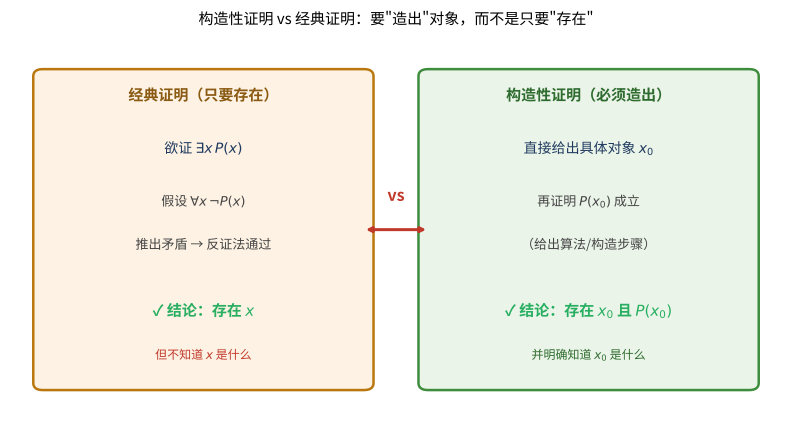

> **直观理解（现实类比）**：经典证明就像有人告诉你"宝藏一定藏在岛上某处"——他通过"如果不在任何地方就矛盾"说服你宝藏存在，却给不出地图。构造性证明则像探险家真的把宝藏挖出来摆在你面前，还附上"它确实在这里"的证据。日常生活中的"找钥匙"最能说明区别：经典方法会证明"钥匙必然在屋里"（因为不在任何一处会矛盾），而构造性方法要求你真正把钥匙从沙发缝里掏出来。数学上这两者常常能给出不同的结论——这正是构造性数学与经典数学划界的核心。

> **直观理解（现实类比）**：构造性证明像"给出实例"——证明存在性必须给出具体例子，不能只用反证法。经典数学允许"假设没有就矛盾，所以必有"这种间接论证，构造性数学却要求你直接拿出一个 $x_0$ 并证明 $P(x_0)$ 成立。这就像法官判案：经典逻辑接受"如果被告不在场就矛盾，所以被告在场"这种间接推理，构造性逻辑却要求出示监控录像这种"直接证据"。代价是某些经典定理（如代数基本定理的精确版本）在构造性框架下不再成立，或只能弱化为"任意逼近"的版本；收益是每个构造性证明都自带"算法"——把证明翻译成程序，就能实际计算出那个被断言存在的对象。

> **🧠 思考历程：不给出"构造"，凭什么就不算"存在"？**
>
> 构造性数学的核心质问是：当我们说"某个对象存在"时，指的是"它真的能被造出来"，还只是"否认它会导致矛盾"？以 Luitzen Brouwer（布劳威尔）为首的直觉主义者选择了前者，并把这一选择写进 1907 年的博士论文，自此与经典数学分道扬镳。
>
> - **排中律被第一块多米诺推倒**。Brouwer 1907 年提出直觉主义纲领，拒绝排中律 $\phi\lor\lnot\phi$ 与双重否定消去 $\lnot\lnot\phi\Rightarrow\phi$——因为他看到，若把"每个无穷构造的过程要么完成要么永不完成"当作现成真理，等于对尚未展开的过程提前下了判词。在他看来，数学对象不是"早已存在"的静止客体，而是心智把后继运算一次次执行下去的活动。
> - **把"证明"译成可检验的语义**。1930 年 Arend Heyting（海廷）给出直觉主义逻辑的公理化，Kolmogorov（柯尔莫哥洛夫）1932 年独立地提出同样的解释思想，二者合称 BHK 解释：命题"$\phi$ 是真的"被翻译成"存在 $\phi$ 的一个构造性证明"——$\exists x\,\phi(x)$ 必须带上具体的 $x$，$\phi\lor\psi$ 必须能指明究竟是哪个成立，证明与构造由此合而为一。
> - **"存在即算法"终获复兴与显化**。Errett Bishop（毕晓普）在 1967 年《构造性分析基础》中以直觉主义逻辑、经典哲学立场重构分析学，证明大量经典定理都有构造性版本；此后经 Curry-Howard 对应，构造性证明直接成为程序，Coq、Agda、Lean 等证明助手把"证明即构造"变成可自动检查的现实。
> - **心路**：舍弃"没有矛盾即真"的捷径，换来的是每个真命题都附赠一套看得见、算得出的构造——数学真理与可计算性由此牢牢绑定。

#### 课堂问答

**老师**：构造性数学把"存在"的门槛抬得很高。经典数学用反证法证明 $\exists x\,P(x)$——假设不存在会导致矛盾，所以存在——这为什么在构造性数学里不被接受？

**学生**：因为反证法只证明了 $\neg\neg\exists x\,P(x)$，而非 $\exists x\,P(x)$。按 BHK 语义，$\exists x\,P(x)$ 的真是一对 $(x_0,p)$：具体对象 $x_0$ 连同 $P(x_0)$ 的证明。反证法给出的却是一台把"否认存在的证明"映到矛盾的机器，交不出这个 $x_0$。直觉主义不承认 $\neg\neg\phi\to\phi$，所以"不矛盾"兑不出"存在"。

**老师（追问）**：那把 $\neg\neg\phi\to\phi$ 补上，构造性数学不就变成经典数学了吗？损失是什么？

**学生**：补上它就恢复了经典逻辑，因为它与排中律 $\phi\lor\neg\phi$ 在直觉主义逻辑上互推。损失是算法性：$\neg\neg\phi\to\phi$ 允许"凭空兑现"，证明不再自动携带可执行的对象。于是"存在即构造"崩塌，Curry-Howard 对应里"证明即程序"也随之失效——这正是构造性数学宁舍排中律也要保住的东西。

**老师（拓展）**：有人说"构造性数学更弱、结论更少"，你怎么看？

**学生**：这是常见误区。它换的是真理之尺而非削弱强度：每个构造性结论都附带一个可运行的程序，而经典结论里有些本质上不可计算。真正"损失"的只是那些依赖精确判定的陈述，例如经典中间值定理声称的精确零点；构造性版本改写成"任意精度近似零点"后照样成立。所以不是更弱，而是把"精确存在"重铸为"$\varepsilon$-可构造"。

### 构造性逻辑与BHK解释

Brouwer-Heyting-Kolmogorov（BHK）解释为构造性逻辑提供了语义基础：

| 命题类型 | 构造性证明的含义 |
|:---:|:---|
| $\phi \land \psi$ | 一个证明 $p$ 和一个证明 $q$，其中 $p$ 证明 $\phi$，$q$ 证明 $\psi$ |
| $\phi \lor \psi$ | 一个指示 $i$ 和一个证明 $p$，使得如果 $i=0$ 则 $p$ 证明 $\phi$，如果 $i=1$ 则 $p$ 证明 $\psi$ |
| $\phi \to \psi$ | 一个函数 $f$，它将 $\phi$ 的每个证明映射为 $\psi$ 的一个证明 |
| $\exists x \phi(x)$ | 一个对象 $a$ 和一个证明 $p$，使得 $p$ 证明 $\phi(a)$ |
| $\forall x \phi(x)$ | 一个函数 $f$，它将每个对象 $a$ 映射为 $\phi(a)$ 的一个证明 |
| $\neg\phi$ | 一个函数 $f$，它将 $\phi$ 的每个证明映射为矛盾 $\bot$ 的证明 |

> **💡 直观理解（类比）**：BHK 表就是一本"证明说明书"——它把每个逻辑联结词翻译成"你得交出什么东西"。合取要交两份证明，析取要交"投了哪一票 + 那一票的证据"，蕴含要交"一台能把证明变成证明的函数机"，存在要交"实例 + 验证它的证明"，全称要交"对任意对象都能产证的通用加工器"，否定则要交"把对方证明顶回矛盾的驳斥器"。这正如点单时服务员问"你选哪个套餐"：析取必须当场指出选 $a$ 还是 $b$，绝不能说"随便来一个都行"——这正是经典数学里含糊过关之处被构造性数学堵死的地方。换句话说，BHK 把每个命题的"含义"全部落成"可交出、可检验的实物"，后文 Curry-Howard 对应（命题即类型、证明即程序）正是建立在这张表之上。

#### 课堂问答

**老师**：BHK 解释和经典的真值表语义，本质上差在哪里？

**学生**：真值表给命题赋值真/假，BHK 不给真值，而是规定"证明一个命题要交出什么构造"。合取 $\phi\land\psi$ 交一对 $(p,q)$；蕴含 $\phi\to\psi$ 交一台函数 $f$，把 $\phi$ 的证明加工成 $\psi$ 的证明。这与类型论的积类型和函数类型 $A\to B$ 逐条对应，正是 Curry-Howard 的语义底座。

**老师（追问）**：那析取 $\phi\lor\psi$ 为什么要特别强调"指示 $i$"？

**学生**：因为构造性要求指名道姓。$\phi\lor\psi$ 的证明是 $(i,p)$，$i\in\{0,1\}$ 说明选的是哪一支，$p$ 是那一支的证明。经典真值表只要求"至少一支为真"；BHK 必须交出"投了哪一票"的凭证。排中律 $\phi\lor\neg\phi$ 失效的根源正在于此——它强迫你永远能指出哪一支成立，而一般命题上办不到。

**老师（拓展）**：表里否定 $\neg\phi$ 那一行，"把证明映到矛盾 $\bot$"是什么意思？

**学生**：$\neg\phi$ 通常定义成 $\phi\to\bot$，其证明是一台把 $\phi$ 的证明映到矛盾 $\bot$ 的函数。于是 $\neg\neg\phi$ 就是 $(\phi\to\bot)\to\bot$；要从它拿回 $\phi$ 需要双重否定消去，而这正是被舍弃的规则。注意爆炸原理 $\bot\to\phi$ 仍被保留——$\bot$ 没有证明，映到任何东西都平凡成立，所以直觉主义并不禁止反证，只禁止把双重否定直接消去。

### 直觉主义逻辑

直觉主义逻辑是构造性数学的基础逻辑系统，它保留了经典逻辑的大部分规则，但去掉了排中律和双重否定消去。其推理规则包括：

- **引入规则**和**消去规则**（自然演绎风格）
- **爆炸原理**：$\bot \to \phi$（从矛盾可推出任何命题）

直觉主义逻辑中的重言式不一定在经典逻辑中成立，反之亦然。例如，$\neg\neg\phi \to \phi$ 在直觉主义逻辑中不成立。

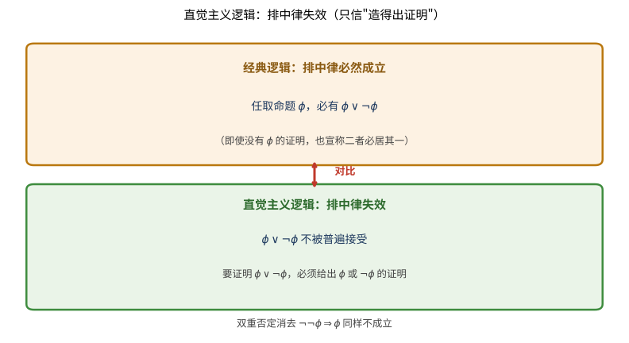

> **直观理解（现实类比）**：排中律失效，就像即使面对一个悬而未决的科学难题（比如"宇宙中是否存在外星生命"），经典逻辑也坚称"要么是、要么不是"必居其一；而直觉主义逻辑则说"在真正找到证据之前，我既不能断定是，也不能断定不是"。更生活化的例子是"明天是否下雨"：经典逻辑断言"明天要么下雨要么不下雨"，直觉主义者却反问——在我还没查看天气预报之前，凭什么要我在这两个都未证实的选择里选边站？直觉主义把"可证明"当作"真"的门槛，这正是它与经典逻辑最根本的分歧。

> **直观理解（现实类比）**：排中律的拒绝像"不站队"——构造性数学不假设 $P$ 或 $\lnot P$ 必有一真，除非你能证明其中一个。经典逻辑把"未被证伪"等同于"可接受为真"，构造性逻辑则要求"已被证明"才算真。这就像法庭上的无罪推定：经典逻辑说"要么有罪要么无罪"，构造性逻辑说"在出示有罪证据或无罪证据之前，两者都不成立"。这种谨慎带来的代价是某些经典推理失效（如双重否定消去 $\lnot\lnot P\Rightarrow P$），收益是所有被构造性证明的命题都附带"构造方法"——真，就意味着"可被构造"，数学真理与可计算性牢牢绑定。

> **直观理解（现实类比）**：Brouwer 直觉主义像"数学是心智构造"——数学对象只在能被心智构造时才存在，独立于任何外在"客观实在"。Brouwer 认为，自然数不是"早已存在"等待发现的客体，而是"心智一次次执行后继运算"的过程产物；实数不是"完备的连续统"，而是"可以无限逼近的构造序列"。这就像音乐不是"早已写好的乐谱"，而是"演奏者一次次发声的进行时"——没有演奏，就没有音乐；没有构造，就没有数学对象。这种立场把数学从"发现"重新定义为"创造"，也解释了为什么直觉主义者拒绝排中律：对于一个尚未被构造的对象，"它存在或不存在"这种二选一没有意义。

> **常见坑**：拒绝排中律**不等于**"断言 $P$ 与 $\lnot P$ 都假"。
>
> - 直觉主义说的是：$\phi\lor\lnot\phi$ **一般地不可证**——我们可以没有理由宣称它成立，也不能普适地合同它作为公理。但它远非"两者皆为假"（那本身会被爆炸原理 $\bot\to\phi$ 立即推翻）。更准确的说法是："未给出 $\phi$ 的证明或 $\lnot\phi$ 的证明之前，我不能断定这个析取。"这与"否定两者"是两回事。
> - 也别把"拒绝排中律"理解成"直觉主义比经典更弱、结论更少"。恰恰相反，直觉主义证明的每个结论都带构造、都可执行；它改变的是"什么算证据"，而非只是"减少可证定理"。Bishop 用大量例子说明经典分析中很多定理的构造性版本依然丰富可用。

> **🔑 为什么重要**：踢开排中律，换来的是**每一条真命题都附带可执行的构造**。这在哲学上把"真"从"未被证伪"移向"可被实构"，在计算上则让"证明=程序"成为可能（见第 127 级 Curry-Howard），在数学实践上催生了构造性实数、构造性分析等一整套"既严谨又能算"的理论。欲成其事，先立其尺——理解这把"存在即构造"的尺子，是读通整章的关键。

#### 课堂问答

**老师**：直觉主义逻辑保留经典命题逻辑的哪些规则，又砍掉哪两条？

**学生**：保留 $\land,\lor,\to,\neg$ 的自然演绎引入/消去规则，以及爆炸原理 $\bot\to\phi$；砍掉的是排中律 $\phi\lor\neg\phi$ 与双重否定消去 $\neg\neg\phi\to\phi$。这两条都是经典重言式，却在直觉主义中不成立，是两套逻辑在命题层面最核心的分界。

**老师（追问）**：光说"不成立"不够，给一个反模型。

**学生**：用 Kripke 框架。取两个世界 $w_0\prec w_1$，令 $w_1\Vdash p$、$w_0\not\Vdash p$。因后继 $w_1$ 强制 $p$，故 $w_0\not\Vdash\neg p$，进而 $w_0\not\Vdash p\lor\neg p$，排中律失效。又所有 $u\succeq w_0$ 都有 $u\not\Vdash\neg p$，得 $w_0\Vdash\neg\neg p$，但 $w_0\not\Vdash p$，故 $w_0\not\Vdash(\neg\neg p\to p)$。关键在强制沿 $\prec$ 单调：证据只增不减，而 $w_0$ 阶段两侧证据都没到手。

**老师（拓展）**：那"拒绝排中律"是否意味着断言 $P$ 与 $\neg P$ 都假？

**学生**：不是，这是最常见的误读。直觉主义说的只是 $\phi\lor\neg\phi$ 一般不可证——"在拿到某一侧证明前不判定这个析取"，而非"两侧皆假"。若真的同时断言 $\neg\phi$ 和 $\neg\neg\phi$，由爆炸原理立刻得 $\bot$，反而不自洽。顺带一提，$\neg\neg(\phi\lor\neg\phi)$ 是可证的：不能断言"宁可判哪边"，但"否认这个析取"必然导致矛盾——这与"两边都假"完全是两回事。

### 构造性实数

在构造性数学中，实数不能通过Dedekind分割来定义（因为分割通常涉及不可判定的条件），而必须通过Cauchy序列来构造。

**定义**：一个构造性实数是一个有理数序列 $(x_n)_{n \in \mathbb{N}}$，满足：
$$\forall m,n \geq N,\ |x_m - x_n| < \frac{1}{k}$$

即，存在一个明确的模函数（modulus of convergence）$M: \mathbb{N} \to \mathbb{N}$，使得：
$$\forall k \in \mathbb{N},\ \forall m,n \geq M(k),\ |x_m - x_n| < \frac{1}{k}$$

两个构造性实数 $(x_n)$ 和 $(y_n)$ 相等，如果：
$$\forall k \in \mathbb{N},\ \exists N \in \mathbb{N},\ \forall n \geq N,\ |x_n - y_n| < \frac{1}{k}$$

> **直观理解（现实类比）**：构造性实数是一台"有理数逼近仪"——它不给你一个静止的数字，而是给你一串越走越准的有理数刻度，外加一张"允差对照表"（模函数 $M$）：你想让结果可靠到 $\frac1k$ 以内，就查表得到"从第 $M(k)$ 步往后都偏差不超标"。这就像给运动员记时的计时员，每次都报不准毫秒，但保证"越到后来精度越高、误差可控"。而两个构造性实数"相等"不是逐项相等，而是"两条刻度线最终贴得任意近"——如同两班火车的时刻表在终点前咬合到任意精确，却不必每站同分同秒。在无法给出精确数值的构造性世界里，"渐近相等"是唯一可行的"相等"。

#### 课堂问答

**老师**：构造性实数为什么必须用 Cauchy 序列加模函数，而不能用 Dedekind 分割？

**学生**：Dedekind 分割把实数 $x$ 表示成下闭集 $L=\{q\in\mathbb{Q}:q<x\}$，但"$q<x$ 是否成立"要用到实数序的判定，而构造性实数三分不可判定，拿不到这个判定器。Cauchy 序列则只需一串有理逼近配上模函数 $M:\mathbb{N}\to\mathbb{N}$，满足 $m,n\ge M(k)$ 时 $|x_m-x_n|<\frac1k$。$M$ 本身就是构造数据："给精度 $k$，就从第 $M(k)$ 步起保证误差达标"，是"可算法逼近"的凭证。

**老师（追问）**：那两个构造性实数怎样才算相等？逐项相等吗？

**学生**：不是逐项相等，而是渐近相等：
$$x=y \iff \forall k\,\exists N\,\forall n\ge N,\ |x_n-y_n|<\frac1k$$
量词结构是 $k$ 在外、$N$ 在内，$N$ 依赖 $k$——想要多精确都能在有限步之后兑现，但绝不承诺某一项恰好为零。两条逼近线最终贴得任意近即算同一个实数。

**老师（拓展）**：那 $x\ne y$ 又是什么？能推出 $x<y$ 或 $x>y$ 吗？

**学生**：$x\ne y$ 在构造性里只是 $\neg(x=y)$，是弱结论——仅表示"尚未找到相等的证据"。要得到正面结论需要"正分离"：存在 $k,N$ 使 $n\ge N$ 时 $|x_n-y_n|\ge\frac1k$。正因如此，$x\ne y$ 不能自动升级成"$x<y$ 或 $x>y$"，后者要求明确指出哪一侧并把硬证据交出来，这正是构造性序关系落空的症结。

### 构造性选择

构造性数学中的选择公理需要谨慎处理。可数选择（Countable Choice）在大多数构造性数学流派中被接受，但完全选择公理通常不被接受，因为它能推出排中律。

**Bishop的构造性数学**接受可数选择和依赖选择，但拒绝一般选择公理。

> **💡 直观理解（类比）**：选择公理好比"从一堆袋子里各挑一个代表"的分工任务。可数选择要求这堆袋子按自然数 1,2,3,… 排队数得清，代表可以按顺序一个接一个地挑出来——像流水线依照编号逐个取件，完全可以实现。而完全选择公理允许"同时从不可数的无穷多袋子里各取一个"，这种"凭空一把抓定所有代表"的操作等于掌握了"一眼看穿全局"的全知能力——正因如此，它能反过来推出排中律。所以构造性派系只保留"能一步步算出来的选择"（可数/依赖选择），扔掉"一步全知"的完全选择：收益是保住构造性，代价是牺牲一些经典定理。

#### 课堂问答

**老师**：构造性数学对选择公理是什么态度？为什么可数选择能留下，完全选择必须扔掉？

**学生**：因为完全选择公理能推出排中律。可数选择 $\forall n\,\exists x\,P(n,x)\Rightarrow\exists f\,\forall n\,P(n,f(n))$ 只在可枚举指标上工作，选择可沿自然数递归逐项完成，是有限信息可达的；依赖选择同理。所以 Bishop 的构造性数学接受可数选择与依赖选择，拒绝一般选择公理。

**老师（追问）**：说"完全选择推出排中律"得给论证骨架。

**学生**：这是 Diaconescu 定理。对任意命题 $\phi$，取两个集合
$$A=\{x\in\{0,1\}:x=0\lor\phi\},\qquad B=\{x\in\{0,1\}:x=1\lor\phi\}$$
二者都非空（$0\in A$、$1\in B$），完全选择给出选择函数 $f$，于是 $f(A),f(B)\in\{0,1\}$。四种取值组合逐一讨论，每种都逼出 $\phi\lor\neg\phi$——要么由某个集合的成员资格反推出 $\phi$，要么可证其否定。症结是"同时从不可数族取值"这一步凭空获得了全局信息。

**老师（拓展）**：拒绝完全选择，岂不是少了很多工具？

**学生**：恰恰相反，可数选择加依赖选择已足以支撑绝大多数构造性分析：Cauchy 序列的逐项运算、逼近过程的递归定义都落在这一范围内，需要"一步全知"的场景本就没有算法。收益是保住"存在即构造"，代价是某些经典定理要改写陈述。别把"拒绝"误读为"断言其为假"——构造性只是不去假设它，也不去构造它的反例。

### 连续性原理

构造性分析中，一个重要的原理是**连续性原理**：所有从 $\mathbb{R}$ 到 $\mathbb{R}$ 的函数都是连续的。这一原理在Brouwer的直觉主义数学中成立，但在Bishop的构造性数学中不假设（但也不否认）。

> **直观理解（现实类比）**：可计算性像"算法可实现"——构造性数学中每个存在性证明都对应一个算法，证明 $\exists x\,P(x)$ 就等于给出一个能算出 $x$ 的程序。这把"存在"和"可计算"焊接在一起：经典数学里"存在但不可计算的对象"在构造性框架里根本不存在。连续性原理也是同一思路的延伸——所有能被构造的函数必然连续，因为"构造"意味着能从输入的有限信息算出输出的任意精度，而不连续函数需要"精确知道一个实数"才能决定输出值跳到哪一侧，这种"全知"无法被任何有限算法实现。Bishop 的构造性数学更温和，不强加连续性，但依然坚持"存在即算法可构造"的核心信条。

---

#### 课堂问答

**老师**：什么是连续性原理？它凭什么在构造性框架里近乎"自动成立"？

**学生**：它断言一切从 $\mathbb{R}$ 到 $\mathbb{R}$ 的函数都连续，即存在连续模 $\omega$ 使 $|x-y|<\omega(\varepsilon)\Rightarrow|f(x)-f(y)|<\varepsilon$。原因在于构造性函数的定义就是"由输入的有限信息算出输出的任意精度"；要判定输出值在哪一侧跳变，就得精确知道一个实数的最后一段信息，而任何有限算法都取不到，于是不连续函数根本构造不出来。

**老师（追问）**：Brouwer 和 Bishop 对它的态度一样吗？

**学生**：不一样。Brouwer 的直觉主义把它当原理接受——函数在他那里就是心智构造的规则，本质上连续。Bishop 的构造性数学则更温和：不假设也不否认它，只在需要时显式地要求函数连续或一致连续。这不是矛盾而是取舍——Bishop 想让构造性分析尽量贴近经典分析的表述，故不把这条强原理写进基础。

**老师（拓展）**：那经典的阶跃函数 $\mathbf{1}_{x>0}$ 岂不构成反例？

**学生**：它构成反例，恰恰暴露了问题所在。$\mathbf{1}_{x>0}$ 要判定 $x$ 是否为正，而 $x$ 可能无限贴近 $0$、三分不可判定，所以它不是构造性函数。解决办法要么给它加上可判定的分离信息（例如输入带有 $x>1/k$ 或 $x<-1/k$ 的见证），要么承认它不属于 $\mathbb{R}\to\mathbb{R}$ 的构造性映射。这也是构造性分析常把定义域换成"带证据的实数"的原因。

## 定理与证明

### 定理1：构造性实数的基本性质

**定理**：构造性实数在加法、乘法、序关系下构成一个交换域，但序关系是"不可判定"的——即对于构造性实数 $a$ 和 $b$，$a \leq b$ 或 $b \leq a$ 不一定可判定。

> **直观理解（现实类比）**：构造性实数仍然"能加能乘"，是一台封闭的加乘运算场（交换域），但它的"大小关系"失灵了——$a\le b$ 与 $b\le a$ 不一定能判定。这就像两台逼近仪各自报出读数，你问"谁大谁小"，它们可能永远无限靠近、说不清谁高谁低；除非有一条明显的正间距把它们劈开，你才敢咬定大小。好比两团被磨得极细的粉末，在称量误差之内根本分不出谁重。所以这个"域"是一个"部分有序、不保证全序"的场——"不可判定的大小"正是构造性数学与经典数学最根本的分界。

**证明**（用Cauchy序列构造）：

**步骤1：构造性实数的加法**

设 $a = (a_n)$ 和 $b = (b_n)$ 是两个构造性实数，定义它们的和为：
$$a + b = (a_n + b_n)$$

我们需要验证 $(a_n + b_n)$ 是Cauchy序列。给定 $k \in \mathbb{N}$，设 $N = \max(M_a(2k), M_b(2k))$，其中 $M_a$ 和 $M_b$ 分别是 $a$ 和 $b$ 的模函数。则对于任意 $m,n \geq N$：
$$|(a_m + b_m) - (a_n + b_n)| \leq |a_m - a_n| + |b_m - b_n| < \frac{1}{2k} + \frac{1}{2k} = \frac{1}{k}$$

**步骤2：构造性实数的乘法**

设 $a = (a_n)$ 和 $b = (b_n)$ 是两个构造性实数，且已知它们有界（即存在 $B$ 使得 $|a_n|, |b_n| \leq B$ 对所有 $n$ 成立）。定义：
$$a \cdot b = (a_n b_n)$$

验证Cauchy性质：对于 $m,n \geq N$，
$$|a_m b_m - a_n b_n| \leq |a_m b_m - a_m b_n| + |a_m b_n - a_n b_n|$$
$$\leq |a_m| \cdot |b_m - b_n| + |b_n| \cdot |a_m - a_n|$$
$$< B \cdot \frac{1}{2kB} + B \cdot \frac{1}{2kB} = \frac{1}{k}$$

其中 $N$ 选择使得 $|a_m - a_n|, |b_m - b_n| < \frac{1}{2kB}$ 对所有 $m,n \geq N$ 成立。

**步骤3：构造性实数的序关系**

在构造性数学中，序关系 $a < b$ 定义为存在 $k$ 和 $N$ 使得对任意 $n \geq N$，$a_n + \frac{1}{k} < b_n$。而 $a \leq b$ 定义为 $\neg(b < a)$。

关键在于，$a \leq b$ 或 $a \geq b$ 不一定可判定。例如，考虑序列 $a_n = \sum_{i=0}^n \frac{(-1)^i}{2^i}$（收敛到 $\frac{2}{3}$）和 $b_n = 0$。虽然我们可以证明 $a > 0$，但如果 $a$ 和 $b$ 非常接近，我们可能无法在有限步内判定大小关系。

> **💡 直观理解（类比）**：$a < b$ 在构造性里要的是"硬证据"：你得拿出一个正余量 $\frac1k$，并证明从某个指标起两者的读数严格错开至少这么一截——像两个自称身高相同的人要比高矮，必须找到一条肉眼可见的间隙，而不是"大概都差不多"。而 $a \le b$ 的定义 $\neg(b<a)$ 只是"弱结论"：它仅仅说明"没找到 $b<a$ 的证据"，并非直接给出一份 $a\le b$ 的硬数据。这正是症结所在——当两个实数"无限贴近"时，你既凑不出 $a<b$ 的间隙、也凑不出 $b<a$ 的间隙，于是 $a\le b\lor b\le a$ 一直悬而未决，全序性在构造性世界里就此落空。

**步骤4：构造性实数域的结构**

构造性实数在加法下构成交换群（零元为 $(0,0,0,\ldots)$，负元为 $(-a_n)$），在乘法下构成交换半群（单位元为 $(1,1,1,\ldots)$），且满足分配律。因此，构造性实数构成一个交换环。对于 $a \neq 0$（即存在 $k$ 和 $N$ 使得 $|a_n| > \frac{1}{k}$ 对 $n \geq N$ 成立），可定义乘法逆元。

因此，构造性实数构成一个域，但序关系是部分序而非全序——这正是构造性数学的本质特征。

#### 课堂问答

**老师**：请陈述构造性实数的基本性质，重点说清它的序关系有什么毛病。

**学生**：它构成交换域，但序关系是部分序而非全序：$a\le b\lor b\le a$ 不一定可判定。因为 $a<b$ 要求正分离的硬证据——存在 $k,N$ 使 $n\ge N$ 时 $a_n+\frac1k<b_n$；而 $a\le b$ 只是弱结论 $\neg(b<a)$。两个实数无限贴近时，两侧的分离证据都凑不出，析取就悬而未决。

**老师（追问）**：加法和乘法的 Cauchy 性怎么算？把模函数写出来。

**学生**：加法用三角不等式，取 $N=\max(M_a(2k),M_b(2k))$，则
$$|(a_m+b_m)-(a_n+b_n)|\le|a_m-a_n|+|b_m-b_n|<\frac1{2k}+\frac1{2k}=\frac1k$$
乘法要先有界 $|a_n|,|b_n|\le B$，用恒等变形
$$|a_mb_m-a_nb_n|\le|a_m||b_m-b_n|+|b_n||a_m-a_n|<B\cdot\frac1{2kB}+B\cdot\frac1{2kB}=\frac1k$$
关键差别：乘法把误差放大 $B$ 倍，所以必须先把界 $B$ 编进模函数。

**老师（拓展）**：那"域"里的逆元是不是对任意 $a\ne0$ 都能构造？

**学生**：不能。$a\ne0$ 只是 $\neg(a=0)$，没有正面信息。真正可构造逆元的是"可逆元"：存在 $k,N$ 使 $n\ge N$ 时 $|a_n|>\frac1k$，即 $a$ 与 $0$ 正分离，此时 $\frac1{a_n}$ 尾部有界且收敛，配好模函数即可。这体现了构造性代数的普遍规律——每条运算都要附带一份可执行的见证，否则会在不可判定处卡死。

### 定理2：构造性中间值定理

**定理**：设 $f: [a,b] \to \mathbb{R}$ 是构造性连续函数，且 $f(a) < 0 < f(b)$。则对于任意 $\varepsilon > 0$，存在 $x \in [a,b]$ 使得 $|f(x)| < \varepsilon$。

**注意**：经典中间值定理断言存在精确的 $x$ 使得 $f(x) = 0$，但在构造性数学中，我们只能保证可以任意逼近零点。

> **直观理解（现实类比）**：经典中间值定理说"连续曲线两头异号，就一定在中间某处穿过零轴、有个精确零点"——像一根绳子一端浸在水下、一端露出水面，必然在某个点正好穿过水面（$f(x){=}0$）。构造性版本却只承诺"能找到任意贴近水面的点"，因为"它到底在水面下、水面上还是恰好贴着水面"这件事，当曲线贴着水面擦过时，无法在有限步内判定（序关系不可判定）。这好比让你在水面上找一个"恰好在深度 0 的位置"：你可以一步步逼近到无限浅，却永远无法构造性地锁定那个"确切踩在水面"的点。所以构造性给出的是"$\varepsilon$-逼近零点"——多付一份 $\varepsilon$ 的容差，换回一整套可执行的二分算法。

**证明**（用二分法）：

**步骤1：构造二分序列**

定义区间序列 $[a_n, b_n]$ 如下：
- 初始：$a_0 = a$，$b_0 = b$
- 对 $n \geq 0$，设 $c_n = \frac{a_n + b_n}{2}$

现在，我们需要判断 $f(c_n)$ 的符号。在构造性数学中，由于 $f(c_n)$ 是一个构造性实数，我们不能直接判定 $f(c_n) < 0$、$f(c_n) = 0$ 或 $f(c_n) > 0$——这是一个不可判定问题。

**步骤2：构造性逼近策略**

给定 $\varepsilon > 0$，我们使用以下策略：
- 由于 $f$ 是构造性连续的，存在模函数 $\omega$ 使得：
  $$|x - y| < \delta 时，|f(x) - f(y)| < \varepsilon$$
- 选择 $N$ 使得 $\frac{b-a}{2^N} < \delta$

**步骤3：构造性二分过程**

对于 $n = 0, 1, 2, \ldots, N$：
- 如果 $f(c_n) < 0$，设 $a_{n+1} = c_n$，$b_{n+1} = b_n$
- 如果 $f(c_n) > 0$，设 $a_{n+1} = a_n$，$b_{n+1} = c_n$

在构造性数学中，我们可以在有限步内判定 $f(c_n)$ 是否远离零，因为 $f(c_n)$ 是一个构造性实数，我们可以计算其有理逼近到足够精度。

**步骤4：收敛性**

经过 $N$ 步后，区间长度 $b_N - a_N = \frac{b-a}{2^N} < \delta$。由连续性，对任意 $x \in [a_N, b_N]$：
$$|f(x) - f(a_N)| < \varepsilon$$

由于 $f(a_N) < 0$ 且 $f(b_N) > 0$，由中间值性质（在构造性数学中，连续函数在区间上的值会覆盖一个区间），我们可以取 $x = \frac{a_N + b_N}{2}$，则存在 $x$ 使得 $|f(x)| < \varepsilon$。

**步骤5：构造性意义**

这个证明是构造性的，因为它给出了一个明确的计算程序：给定所需的精度 $\varepsilon$，我们可以通过有限步二分法找到满足条件的 $x$。但精确的零点可能不存在——这正是构造性数学与经典数学的关键区别。

#### 课堂问答

**老师**：陈述构造性中间值定理，并指出它和经典版本差在哪里。

**学生**：设 $f:[a,b]\to\mathbb{R}$ 构造性连续且 $f(a)<0<f(b)$，则对任意 $\varepsilon>0$ 存在 $x\in[a,b]$ 使 $|f(x)|<\varepsilon$。经典版本断言存在精确零点 $f(x)=0$，构造性版本只承诺任意精度的近似零点。

**老师（追问）**：二分法要判 $f(c_n)$ 的符号，而构造性实数三分不可判定，你怎么不卡在这里？

**学生**：关键是在"远离零处"判断，而不是在"零点处"判断。给定 $\varepsilon$，先用一致连续模 $\omega$ 取 $N$ 使 $\frac{b-a}{2^N}<\delta$；每步只把 $f(c_n)$ 的有理逼近算到足够精度，只要 $|f(c_n)|$ 大于逼近误差就能可靠判正负。由于 $f(a)<0<f(b)$ 提供正分离，区间每步收缩一半，$N$ 步后长度小于 $\delta$，取中点即得 $|f(x)|<\varepsilon$。

**老师（拓展）**：那精确零点为什么会"漏掉"？说清楚机制。

**学生**：当曲线贴着零轴擦过时，$f(c_n)$ 到底落在 $<0$、$=0$ 还是 $>0$ 无法在有限步内判定，程序只能无限逼近而永不锁死那个点。本质是锁定精确零点需要一次三分判定，而构造性实数不提供它。模板是：经典版把存在性押在精确对象上，构造版把它换成"$\varepsilon$-逼近 + 显式算法"；代价是多带一个容差，收益是把声明变成可运行的程序。

### 定理3：构造性代数基本定理

**定理**（构造性版本）：每个非常数复系数多项式 $p(z) = a_n z^n + a_{n-1} z^{n-1} + \cdots + a_0$（$a_n \neq 0$，$n \geq 1$）都有任意精度的近似根。即，对于任意 $\varepsilon > 0$，存在 $z \in \mathbb{C}$ 使得 $|p(z)| < \varepsilon$。

> **💡 直观理解（类比）**：经典代数基本定理保证"多项式必有精确根"；构造性版本退一步，只保证"能找到使 $|p(z)|$ 任意小的 $z$"——即误差任意小的近似根。这像勘探地下水：经典承诺"地底某处必有水脉"，构造性则给你一台"越钻越接近水、误差任意小"的钻机，却不敢担保在某一刻"啪嗒"正好钻穿水层。算法上它用的是"下山法"：从任意出发点起，反复选一个让 $|p(z)|$ 减小的方向滑下山坡，直到把函数值压到任意 $\varepsilon$ 之下——每个证明都自带可执行程序，这正是"存在即构造"的招牌动作。

**证明**（用构造性方法逼近根）：

**步骤1：最小模原理的构造性版本**

设 $p(z)$ 为非常数多项式。考虑函数 $f(z) = |p(z)|$。$f$ 在 $\mathbb{C}$ 上连续，且当 $|z| \to \infty$ 时 $f(z) \to \infty$。因此，$f$ 在某个紧致区域 $D_R = \{z \in \mathbb{C} : |z| \leq R\}$ 上达到最小值。

在构造性数学中，我们首先需要找到这样一个 $R$。由于 $p(z) = a_n z^n + \cdots$，当 $|z|$ 足够大时，$|p(z)| \geq \frac{|a_n|}{2}|z|^n$。取 $R$ 使得 $\frac{|a_n|}{2}R^n > |p(0)| = |a_0|$，则最小值一定在 $D_R$ 内部达到。

**步骤2：构造最小值逼近序列**

我们构造一个序列 $z_k$，使得 $|p(z_k)|$ 单调递减。从 $z_0 = 0$ 开始。假设已经得到 $z_k$，我们在 $z_k$ 附近搜索更优的点。

设 $p(z_k) = r_k e^{i\theta_k}$。如果 $r_k = 0$，则 $z_k$ 已经是精确根。否则，考虑方向 $d$ 使得 $p(z_k + t d)$ 的模减小。由多项式展开：
$$p(z_k + t d) = p(z_k) + p'(z_k) t d + O(t^2)$$

选择 $d$ 使得 $p'(z_k) d$ 指向 $-p(z_k)$ 的方向，即取 $d = -\overline{p'(z_k)} p(z_k)$。

**步骤3：构造性下降**

对于充分小的 $t > 0$：
$$|p(z_k + t d)|^2 = |p(z_k)|^2 - 2t|p(z_k)|^2|p'(z_k)|^2 + O(t^2)$$

由于 $p$ 非常数，$p'(z_k)$ 不可能在所有点都为零（否则 $p$ 是常数）。我们可以通过搜索找到 $t$ 使得 $|p(z_k + t d)| < |p(z_k)|$。

**步骤4：收敛性证明**

序列 $\{|p(z_k)|\}$ 是单调递减且有下界（$0$）的实数序列，因此收敛到某个极限 $L \geq 0$。

假设 $L > 0$，则存在 $z_k$ 使得 $|p(z_k)|$ 接近 $L$。在 $z_k$ 处，上述下降过程会给出一个更小的值，与 $L$ 是下确界矛盾。因此 $L = 0$。

**步骤5：构造性逼近**

给定 $\varepsilon > 0$，通过上述过程，在有限步内我们可以找到 $z$ 使得 $|p(z)| < \varepsilon$。这给出了一个构造性算法，可以在任意精度下逼近多项式的根。

#### 课堂问答

**老师**：陈述构造性代数基本定理，并说明它的证明用什么算法。

**学生**：每个非常数复系数多项式都有任意精度的近似根——对任意 $\varepsilon>0$ 存在 $z\in\mathbb{C}$ 使 $|p(z)|<\varepsilon$。证明用下降法：令 $p(z_k)=r_ke^{i\theta_k}$，取方向 $d=-\overline{p'(z_k)}\,p(z_k)$，展开得
$$p(z_k+td)=p(z_k)+td\,p'(z_k)+O(t^2)$$
从而
$$|p(z_k+td)|^2=|p(z_k)|^2-2t|p(z_k)|^2|p'(z_k)|^2+O(t^2)$$
取足够小的 $t>0$ 即可让 $|p(z_k+td)|<|p(z_k)|$，每步严格下山。

**老师（追问）**：光靠单调下降就能保证极限为 0 吗？凭什么？

**学生**：先要收敛：$|p(z_k)|$ 单调递减且有下界 $0$，故收敛到某 $L\ge0$。再用构造性论证得 $L=0$——若 $L>0$，在接近 $L$ 的点处下降过程还能给出更小的值，与 $L$ 是下确界矛盾。此外要先取足够大的 $R$ 把搜索限制在紧区域：由 $|p(z)|\ge\frac{|a_n|}{2}|z|^n$，取 $R$ 使 $\frac{|a_n|}{2}R^n>|a_0|$，则极小必在 $D_R$ 内部达到。给定 $\varepsilon$，有限步即可把 $|p(z)|$ 压到 $\varepsilon$ 之下。

**老师（拓展）**：算法的常见陷阱是什么？$p'(z_k)=0$ 会不会把下降卡死？

**学生**：不会。若 $p'$ 处处为零则 $p$ 是常数多项式，与"非常数"矛盾；故某个 $z_k$ 处 $p'(z_k)\ne0$，下降方向存在。真正的陷阱是选点和步长：若从驻点出发方向 $d$ 会退化为零，需要扰动或换起点，这与习题里 $p(z)=z^2+1$ 从 $z_0=0$ 出发失败的例子一致——此时应带虚部起步。这也说明构造性证明必须显式处理退化情形，而不能像经典证明那样一笔带过。

### 定理4：Brouwer不动点定理的构造性版本

**定理**（构造性版本）：设 $f: D^n \to D^n$ 是单位闭球 $D^n$ 上的构造性一致连续函数。则对于任意 $\varepsilon > 0$，存在 $x \in D^n$ 使得 $|f(x) - x| < \varepsilon$。

**注意**：经典Brouwer不动点定理断言存在精确的不动点（$f(x) = x$），而在构造性版本中，我们只能保证存在 $\varepsilon$-近似不动点。

> **直观理解（现实类比）**：Brouwer 不动点定理说的是：把一团揉皱的面团倒回同一个容器里，总有某个点恰好停在原处。经典版本保证"必有某个点完全不动"（$f(x){=}x$）；构造性版本退一步，只保证"能找到某点，它移动的距离可以任意小"（$|f(x)-x|<\varepsilon$），并且给出有限步算法：把圆盘切成足够细的三角形网格，沿网格用 Sperner 引理找"全标号的三角形"，里面就藏着近似不动点。这像在摊开的沙盘上寻找"一点都没被推走的位置"——你虽无法精确锁死某个纹丝不动的点，但当网格细到任意程度时，总能标出一块几乎原地不动的区域。

**证明思路**：

**步骤1：单纯形逼近**

将单位球 $D^n$ 三角剖分为足够小的单纯形网格。对于每个顶点 $v$，计算 $f(v)$。如果 $f(v)$ 与 $v$ 足够接近，则 $v$ 就是所需的近似不动点。

**步骤2：Sperner引理的构造性版本**

Sperner引理在构造性数学中成立：对于带有适当标记的单纯形剖分，存在一个完全标记的单纯形。这个证明是构造性的——通过有限步搜索可以找到这样的单纯形。

**步骤3：构造性搜索**

沿着Sperner引理给出的路径，我们可以构造一个序列，其极限点就是近似不动点。由于我们只要求 $\varepsilon$-近似，有限步搜索即可完成。

**步骤4：收敛性分析**

给定 $\varepsilon > 0$，选择剖分足够细（网格直径 $< \delta$，其中 $\delta$ 由 $f$ 的一致连续性模给出），使得每个完全标记的单纯形中的点 $x$ 满足 $|f(x) - x| < \varepsilon$。

这个证明是构造性的，因为它给出了一个有限算法来找到近似不动点。

#### 课堂问答

**老师**：陈述 Brouwer 不动点定理的构造性版本，并说明它为何"退化"为近似不动点。

**学生**：设 $f:D^n\to D^n$ 是单位闭球上的构造性一致连续函数，则对任意 $\varepsilon>0$ 存在 $x\in D^n$ 使 $|f(x)-x|<\varepsilon$。经典版本断言存在精确不动点 $f(x)=x$，构造性版本只保证 $\varepsilon$-近似不动点——精确不动点同样需要不可判定的信息来锁定。

**老师（追问）**：那到底怎么找出这个近似不动点？给出算法。

**学生**：用单纯形逼近加 Sperner 引理。把 $D^n$ 三角剖分成直径足够小的网格（网格直径由 $f$ 的一致连续模 $\delta$ 决定）；对每个顶点按规则标号，Sperner 引理的构造性版本保证有限步搜索能找到一个完全标号的单纯形。因为网格充分细，该单纯形内的点 $x$ 满足 $|f(x)-x|<\varepsilon$。整个搜索是有限步的，所以是构造性的。

**老师（拓展）**：这个构造性版本和经典版本的分界，和中间值、代数基本定理是同一个模板吗？

**学生**：是同一个模板。"精确对象"被"$\varepsilon$-近似对象 + 显式有限算法"替换：中间值定理把精确零点换成近似零点，代数基本定理把精确根换成近似根，Brouwer 不动点把精确不动点换成近似不动点。分歧的根源统一——实数序不可判定，任何"锁定精确点"的断言都缺可构造的证据。构造性版本多带一个容差 $\varepsilon$，换来的是每个证明都给出可运行、可检验的搜索程序。

### 定理5：构造性极值定理

**定理**：设 $f: [a,b] \to \mathbb{R}$ 是构造性连续函数。则对于任意 $\varepsilon > 0$，存在 $x \in [a,b]$ 使得 $f(x) > \sup f - \varepsilon$。

**注意**：经典极值定理断言 $f$ 在闭区间上达到最大值，但在构造性数学中，我们只能保证可以任意逼近上确界。

> **直观理解（现实类比）**：经典极值定理说闭区间上的连续函数必在某点登顶；构造性版本只保证"能逼近到离峰值任意近"——因为要"精确踩中那个最高点"，同样依赖构造性上无法判定的信息。算法是"网格寻峰"：把区间划成密密麻麻的小格，取所有格点上函数值最大的那个；只要网格够密（细于一致连续性给出的 $\delta$），就能保证这个格点高度与真正的上确界之差小于 $\varepsilon$。这像架着梯子一格一格找山崖最高处：爬进任意小的误差圈内没问题，但"锁定那唯一的峰尖"却无法得到保证。

**证明**：

**步骤1：构造上确界逼近序列**

由于 $f$ 是构造性连续函数，它在 $[a,b]$ 上有界且一致连续。设 $M = \sup\{f(x) : x \in [a,b]\}$。虽然在构造性数学中我们不能直接处理 $M$ 作为实数，但我们可以构造一个有理数序列来逼近它。

**步骤2：网格搜索**

将 $[a,b]$ 等分为 $N$ 个子区间，$a = x_0 < x_1 < \cdots < x_N = b$，其中 $x_i = a + \frac{i(b-a)}{N}$。

计算 $f(x_i)$ 的足够精确的有理逼近。设 $m_N = \max\{f(x_0), f(x_1), \ldots, f(x_N)\}$。

**步骤3：误差分析**

由一致连续性，存在 $\delta > 0$ 使得 $|x - y| < \delta$ 时 $|f(x) - f(y)| < \varepsilon$。选择 $N$ 使得 $\frac{b-a}{N} < \delta$。

则对于任意 $x \in [a,b]$，存在某个 $x_i$ 使得 $|x - x_i| < \delta$，从而 $|f(x) - f(x_i)| < \varepsilon$。因此：
$$\sup f - m_N < \varepsilon$$

**步骤4：构造性逼近**

取 $x$ 为达到 $m_N$ 的那个网格点。则 $f(x) = m_N > \sup f - \varepsilon$。这给出了一个构造性算法，可以在任意精度下逼近最大值点。

---

#### 课堂问答

**老师**：陈述构造性极值定理，并说明它和经典版本的差别在哪。

**学生**：设 $f:[a,b]\to\mathbb{R}$ 构造性连续，则对任意 $\varepsilon>0$ 存在 $x\in[a,b]$ 使 $f(x)>\sup f-\varepsilon$。经典版本断言 $f$ 在闭区间上达到最大值，构造性版本只保证能逼近到离上确界任意近。

**老师（追问）**：逼近上确界的算法是什么？误差怎么控制？

**学生**：网格寻峰。把 $[a,b]$ 等分为 $N$ 段，$x_i=a+\frac{i(b-a)}{N}$，算出各 $f(x_i)$ 的足够精确有理逼近，令 $m_N=\max\{f(x_0),\ldots,f(x_N)\}$。由一致连续，存在 $\delta$ 使 $|x-y|<\delta$ 时 $|f(x)-f(y)|<\varepsilon$；取 $N$ 使 $\frac{b-a}{N}<\delta$，则区间内任一点都离某格点小于 $\delta$，于是
$$\sup f-m_N<\varepsilon$$
取达到 $m_N$ 的格点 $x$，就有 $f(x)>\sup f-\varepsilon$。

**老师（拓展）**：为什么不能进一步构造出精确的最大值点？

**学生**：因为上确界未必被达到，且"锁定峰尖"需要判定某个点恰是极大点，这依赖构造性不可判定的序信息，与中间值定理锁不住精确零点同源。网格越密只能把误差压到任意小，永远不能保证"踩中那唯一的峰"。所以它给出的是一台任意精度逼近上确界的算法，而不是一个精确最大值点——这与本章四个定理共享同一个"精确存在→任意精度可构造"的改写模板。

## 示例

### 示例1：构造性实数运算

**问题**：设 $a = (1, \frac{1}{2}, \frac{1}{3}, \ldots, \frac{1}{n}, \ldots)$ 和 $b = (0, \frac{1}{2}, \frac{2}{3}, \ldots, \frac{n-1}{n}, \ldots)$ 是两个构造性实数。计算 $a + b$ 和 $a \cdot b$ 的前5项。

**解**：

$a$ 的Cauchy序列：$a_n = \frac{1}{n}$，收敛到 $0$。
$b$ 的Cauchy序列：$b_n = \frac{n-1}{n} = 1 - \frac{1}{n}$，收敛到 $1$。

$a + b$ 的序列：$a_n + b_n = \frac{1}{n} + \frac{n-1}{n} = 1$，收敛到 $1$。

$a \cdot b$ 的序列：$a_n \cdot b_n = \frac{1}{n} \cdot \frac{n-1}{n} = \frac{n-1}{n^2}$。

前5项：$0, \frac{1}{4}, \frac{2}{9}, \frac{3}{16}, \frac{4}{25}$。当 $n \to \infty$ 时，$\frac{n-1}{n^2} \to 0$。

### 示例2：构造性连续函数的性质

**问题**：证明函数 $f(x) = x^2$ 在 $[0,1]$ 上是构造性一致连续的。

**解**：

对于任意 $x, y \in [0,1]$：
$$|f(x) - f(y)| = |x^2 - y^2| = |x - y| \cdot |x + y| \leq 2|x - y|$$

因此，给定 $\varepsilon > 0$，取 $\delta = \frac{\varepsilon}{2}$，则当 $|x - y| < \delta$ 时：
$$|f(x) - f(y)| \leq 2|x - y| < 2\delta = \varepsilon$$

这给出了一个明确的模函数 $\omega(\varepsilon) = \frac{\varepsilon}{2}$，因此 $f$ 是构造性一致连续的。

### 示例3：构造性存在性证明与非构造性证明的对比

**经典证明**：证明存在无理数 $a, b$ 使得 $a^b$ 是有理数。
- 考虑 $\sqrt{2}^{\sqrt{2}}$。如果它是有理数，则取 $a = b = \sqrt{2}$，结论成立。
- 如果它是无理数，则取 $a = \sqrt{2}^{\sqrt{2}}$，$b = \sqrt{2}$，则 $a^b = (\sqrt{2}^{\sqrt{2}})^{\sqrt{2}} = \sqrt{2}^2 = 2$，是有理数。
- 这个证明使用了排中律，没有给出具体的 $a, b$。

**构造性证明**：取 $a = \sqrt{2}$，$b = \log_2 9$。由于 $\log_2 9$ 是无理数（否则存在 $p/q$ 使得 $2^{p/q} = 9$，即 $2^p = 9^q$，矛盾），且 $a^b = 2^{\log_2 9} = 9$ 是有理数。这个证明直接给出了具体的构造。

### 示例4：构造性证明"排中律的双重否定"

**问题**：在直觉主义逻辑中，构造性地证明 $\lnot\lnot(\phi \lor \lnot\phi)$ 是定理，且全程不得调用排中律 $\phi\lor\lnot\phi$。

**理解**：$\phi\lor\lnot\phi$ 本身通常不可构造性证明（见示例5的反模型），但它的双重否定却是直觉主义定理：直觉主义者虽然不承诺"$\phi$ 或 $\lnot\phi$ 已可判定"，但承认"把 $\phi\lor\lnot\phi$ 一举否认"必致矛盾。按 BHK 语义，任务是"交出一台函数 $f$：把每个 $\lnot(\phi\lor\lnot\phi)$ 的证明 $h$ 映射为矛盾 $\bot$"。难点在于 $f$ 不能凭空产生矛盾，它必须依赖手中的 $h$"咬住"某个 $\phi\lor\lnot\phi$ 的证明——而这需要我们亲手把该证明对象构造出来。

**步骤**：
1. 记 $h$ 为 $\lnot(\phi\lor\lnot\phi)$ 的任意证明，即 $h$ 是一个把每个 $\phi\lor\lnot\phi$ 的证明映到矛盾 $\bot$ 的函数。
2. 构造左注入 $i_0$：对任意的 $\phi$ 之证明 $p$，令 $i_0(p)=(\texttt{left},p)$，它是 $\phi\lor\lnot\phi$ 的一个证明。于是 $h(i_0(p)):\bot$。
3. 定义 $g(p):=h(i_0(p))$。$g$ 把任意 $\phi$ 的证明 $p$ 映到矛盾，按 BHK 表这正是"$\lnot\phi$ 的构造性证明"。
4. 现在 $g$ 是 $\lnot\phi$ 的证明。用右注入 $i_1$：$i_1(g)=(\texttt{right},g)$ 是 $\phi\lor\lnot\phi$ 的又一个证明。
5. 令 $f(h):=h(i_1(g))$。因 $i_1(g)$ 是 $\phi\lor\lnot\phi$ 的证明、$h$ 把它映到矛盾，故 $f(h):\bot$。$f$ 即为所求：它对每个 $\lnot(\phi\lor\lnot\phi)$ 的证明 $h$ 都给出矛盾，于是 $\lnot\lnot(\phi\lor\lnot\phi)$ 成立。

**验证与总结**：回看全程，只用到 BHK 的三样器械——蕴含的函数构造、析取的左/右注入、否定的"映射到矛盾"；推理闭合、对象全被显式构造，没有引入排中律或双重否定消去。结论：$\lnot\lnot(\phi\lor\lnot\phi)$ 是直觉主义定理。它同时划出一条分界：$\lnot\lnot(\phi\lor\lnot\phi)$ 可证而 $\phi\lor\lnot\phi$ 不可证，这一"差一重否定"的现象正是直觉主义逻辑取消双重否定消去所带来的核心张力。

### 示例5：反模型判别——排中律与双重否定消去为何不成立

**问题**：构造一个 Kripke 框架（反模型），判别经典重言式 $\phi\lor\lnot\phi$ 与 $\lnot\lnot\phi\to\phi$ 为何在直觉主义逻辑中不成立。

**理解**：经典逻辑把"真"当作无处不在的静态事实；直觉主义用 Kripke 语义把"真"解释成"在某个已获得证据的世界里被强制"。框架是一棵带阶段偏序 $\prec$ 的世界树，强制关系对 $\prec$ 单调：一旦在某世界知道了 $\phi$，其后继世界也知道。要"判别某经典定理不成立"，只需找出一个世界 $w_0$ 使该公式在 $w_0$ 不被强制。

**步骤**：
1. 取两个世界的框架：$w_0 \prec w_1$（$\prec$ 含自反、传递）。设定原子命题 $p$：在 $w_1$ 处强制 $p$（$w_1\Vdash p$），在 $w_0$ 处不强制（$w_0\not\Vdash p$）。
2. 先判否定：$w_0\Vdash\lnot p$ 当且仅当对所有 $u\succeq w_0$ 都有 $u\not\Vdash p$。但 $w_1\succeq w_0$ 且 $w_1\Vdash p$，故 $w_0\not\Vdash\lnot p$。
3. 判析取：$w_0\Vdash p\lor\lnot p$ 当且仅当 $w_0\Vdash p$ 或 $w_0\Vdash\lnot p$。第 1、2 步给出二者皆不成立，故 $w_0\not\Vdash p\lor\lnot p$——排中律该世界失效。
4. 判双重否定：$w_0\Vdash\lnot\lnot p$ 当且仅当所有 $u\succeq w_0$ 都有 $u\not\Vdash\lnot p$。对 $u=w_0$ 由第 2 步成立；对 $u=w_1$，$w_1\Vdash p$，由否定语义得 $w_1\not\Vdash\lnot p$。故 $w_0\Vdash\lnot\lnot p$。
5. 但 $w_0\not\Vdash p$，故 $w_0\not\Vdash(\lnot\lnot p\to p)$——双重否定消去在此也失效。两个公式皆非直觉主义重言式。

**验证与总结**：反模型的关键在于世界 $w_1$"凭空冒出了 $p$ 的证据"。经典逻辑视"未来必然到来的证据"为现成事实，断言 $p$ 或 $\lnot p$ 必居其一；直觉主义则拒绝"提前兑现尚未进行的构造"——在 $w_0$ 阶段既没有 $p$ 的证据、也没有 $\lnot p$ 的证据，就不能宣称二者之一。这个判别清晰回答了"经典证明为何不能构造化"：根子在把依赖未来的存在论证当作了当下的构造。

### 示例6：构造性二分的可执行演示

**问题**：设 $f(x)=x^3+2x-1$，它是构造性连续函数且 $f(0)=-1<0<f(1)=2$。对 $\varepsilon=0.01$，用构造性二分法求出 $x$ 使 $|f(x)|<\varepsilon$，并逐步说明每一步的符号判断如何以可判定计算完成。

**理解**：经典中间值定理断言"存在精确的 $x$ 使 $f(x)=0$"；构造性版本只承诺"$\varepsilon$-近似零点"。本例题要展示这一承诺如何通过"每步都可判定"的二分程序兑现：$f(c_n)$ 对有理输入得到有理输出（$x^3+2x-1$ 在有理点取有理值），因此符号判断可精确执行，不存在不可判定的三分障碍。真正的工作是：只要 $f(c_n)\neq0$ 就可严格判正负，据此把异号区间一分为二、逐轮收窄。

**步骤**：
1. 初始化 $a:=0$、$b:=1$，维护不变量 $f(a)\le0\le f(b)$ 且区间含零点。
2. 第 $n$ 轮取中点 $c_n=(a+b)/2$，用有理运算算出 $f(c_n)$（有理输入下的精确有理数，可比较）。
3. 判定并收缩：若 $f(c_n)<0$ 则令 $a\gets c_n$；若 $f(c_n)>0$ 则令 $b\gets c_n$；若恰有 $f(c_n)=0$ 则已找到精确零点，输出即止。
4. 实测前两步：$c_0=\frac12$，$f(\frac12)=\frac18+1-1=\frac18>0$，故 $b\gets\frac12$；$c_1=\frac14$，$f(\frac14)=\frac1{64}+\frac12-1=-\frac{31}{64}<0$，故 $a\gets\frac14$，异号区间收窄为 $[\frac14,\frac12]$。
5. 每轮区间长度减半：第 $n$ 轮为 $2^{-n}$。因 $f'(x)=3x^2+2\le5$ 于 $[0,1]$，$f$ 有 Lipschitz 模 $\omega(\varepsilon)=\varepsilon/5$。取 $N$ 使 $2^{-N}<\varepsilon/5=0.002$（例如 $2^{-10}=\frac1{1024}<0.002$），则第 $N$ 轮的中点 $x=c_N$ 满足 $|f(x)|<\varepsilon$。
6. 输出 $x=c_N$ 作为 $\varepsilon$-近似零点；若某轮恰遇 $f(c_n)=0$，则直接输出精确零点亦可终止。

**验证与总结**：整个程序对每个 $\varepsilon>0$ 都有限步终止，且只依赖有理精确比较——没有调用任何非构造性存在论证，这正是"存在即算法"的实例。构造性版本并不承诺一定给出 $f(x)=0$ 的确切点（零点一般只能逼近），但当测试点碰巧是精确零点时它也欣然采纳；它把经典"精确零点"替换为"任意精度可构造"，正是本主题四大定理共同采用的改写模板。

### 概念检查（Concept Check）

**问题 1**：构造性数学要求存在性证明满足什么标准？
**问题 2**：直觉主义逻辑与经典逻辑在命题层面主要差在哪两条规则？
**问题 3**：按 BHK 解释，$\phi\lor\psi$ 的构造性证明由哪些成分构成？
**问题 4**：构造性实数为何不用 Dedekind 分割来定义？
**问题 5**：写出两个构造性实数相等（$x=y$）的定义，并说明"渐近相等"的含义。
**问题 6**：为什么构造性实数上 $a\le b\lor b\le a$ 不保证可判定？
**问题 7**：构造性中间值定理与经典版本在结论上有什么差别？
**问题 8**：为什么构造性数学接受可数选择而拒绝完全选择公理？
**问题 9**：连续性原理在 Brouwer 直觉主义与 Bishop 构造性数学中地位有何不同？
**问题 10**：什么叫"存在即算法"？它给每个构造性证明带来什么附加物？

**答案**：
1. 要证明 $\exists x\,P(x)$，必须真正给出一个对象 $x_0$ 并附带 $P(x_0)$ 的证明；不接受"反证法＋存在"却交不出对象的纯存在性论证。这把"存在"门限定为"可构造"。
2. 主要差在两条规则：排中律 $\phi\lor\lnot\phi$ 与双重否定消去 $\lnot\lnot\phi\to\phi$。直觉主义保留其余命题规则与爆炸原理 $\bot\to\phi$。
3. 一个二元组 $(i,p)$：指示 $i\in\{0,1\}$；若 $i=0$ 则 $p$ 证明 $\phi$，若 $i=1$ 则 $p$ 证明 $\psi$。它必须实际表明选了哪一支，因此析取携带可检验的构造信息。
4. 因为分割通常依赖不可判定的条件（如实数落在哪一侧），无法给出可判定的构造数据；而 Cauchy 序列连同模函数是可显式逼近的构造对象，故构造性实数用后者定义。
5. $x=y$ 当且仅当 $\forall k\,\exists N\,\forall n\ge N,\ |x_n-y_n|<\frac1k$。它不是逐项相等，而是两条逼近线最终贴得任意近，所以称"渐近相等"。
6. 判定 $b<a$ 需要正分离信息（存在 $k$ 使 $a_n+\frac1k<b_n$）。当两实数无限靠近时，有限步内既证不了 $a\le b$ 也证不了 $b\le a$，故全序性不可判定。
7. 经典版断言存在精确零点 $f(x)=0$；构造性版只能保证对任意 $\varepsilon>0$ 存在 $x$ 使 $|f(x)|<\varepsilon$，即任意精度的近似零点。
8. 可数选择作用于可枚举指标族，选择可经递归用有限信息完成，故被接受；完全选择公理"一步全知"地同时选取不可数无穷袋中的代表，能推出排中律，故被拒绝。
9. 连续性原理（所有 $\mathbb{R}\to\mathbb{R}$ 的函数皆连续）在 Brouwer 直觉主义中作为原理成立；Bishop 构造性数学不假设也不否认，态度更温和。
10. 每个构造性存在证明都附带一个算法：把证明翻译成程序即可实际算出被断定的对象。它给证明带来的附加物是一台"可执行、可检验构造"的程序/构造函数。

### 是非判断题（True/False Quiz）

**陈述 1**：构造性数学无条件接受排中律 $\phi\lor\lnot\phi$ 为普遍原理。
**陈述 2**：直觉主义逻辑中 $\lnot\lnot\phi\to\phi$ 不成立。
**陈述 3**：若额外接受排中律，则构造性实数上的全序性 $a\le b\lor b\le a$ 成立。
**陈述 4**：构造性实数可以用 Dedekind 分割定义，与 Cauchy 序列定义等价。
**陈述 5**：构造性中间值定理保证存在精确零点 $f(x)=0$。
**陈述 6**：按 BHK，$\phi\to\psi$ 的证明是一个把 $\phi$ 的每个证明映到 $\psi$ 的证明的函数。
**陈述 7**：在构造性集合论中，完全选择公理可推出排中律。
**陈述 8**：拒绝排中律意味着直觉主义可证定理必然少于经典、且任何直觉主义结论在经典中都无意义。
**陈述 9**：构造性代数基本定理保证多项式必有精确根。
**陈述 10**：$\lnot\lnot(\phi\lor\lnot\phi)$ 在直觉主义逻辑中是可证的。

**答案**：
1. **假**。构造性数学正以拒绝排中律为核心特征：在没有 $\phi$ 或 $\lnot\phi$ 的构造性证明之前，不断言二者必居其一。反例：对"存在无穷多对孪生素数"这类未决命题，构造性数学家既不判真也不判假。
2. **真**。双重否定消去是把"不矛盾"兑现为对象本身的间接论证，直觉主义不采信。示例5 的 Kripke 反模型即为其失效证据。
3. **真**。接受排中律后，$\neg\neg(b<a)$ 经双重否定消去给出 $b<a$，再结合 $a\le b\lor b<a$ 即得全序性；双重否定消去正是构造性拒绝的全序性前提（参见习题22）。
4. **假**。分割依赖不可判定的"落在哪一侧"，不构成可构造数据；构造性实数用 Cauchy 序列＋模函数定义，二者并不等价。这正是构造性实数与经典实数定义最根本的分歧。
5. **假**。构造性中间值定理只承诺 $\varepsilon$-近似零点 $|f(x)|<\varepsilon$；因实数三分（$<,=,>$）不可判定，无法在有限步锁定精确零点。
6. **真**。这正是 BHK 蕴含行的规定：函数机把 $\phi$ 的证明加工成 $\psi$ 的证明，与类型论函数类型 $A\to B$ 同构。
7. **真**。即 Diaconescu 定理：对任意 $\phi$ 取 $A=\{x\in\{0,1\}:x=0\lor\phi\}$、$B=\{x\in\{0,1\}:x=1\lor\phi\}$，完全选择给出选择函数后分四种组合皆推出 $\phi\lor\lnot\phi$（见习题26 论证）。
8. **假**。直觉主义每个结论都附带可执行构造，并不是"更少"；且直觉主义可证命题经"双重否定翻译（Gödel–Gentzen）"可嵌入经典逻辑，谈不上"经典中无意义"。它改变的是"什么算证据"，而非单纯缩减结论。
9. **假**。构造性代数基本定理只保证存在任意精度的近似根 $|p(z)|<\varepsilon$，用下降法求得；精确根一般无法构造性保证（避免编造具体根，仅陈述其不成立）。
10. **真**。这是示例4 的结论：不需要排中律即可按 BHK 显式构造出 $\lnot\lnot(\phi\lor\lnot\phi)$ 的证明，它划开了 $\phi\lor\lnot\phi$（不可证）与它的双重否定（可证）。

### 真实应用与建模（Applications）

构造性数学最直接的工程化身是**证明助手与类型论**。在 Coq、Agda、Lean 这类以直觉主义类型论为基础的系统中，"命题即类型、证明即程序"字面成立：写下一份构造性证明就等于写好一个程序（第 127 级的 Curry-Howard），因而可以从证明直接提取可运行的算法。这在验证编译器、智能合约、定理机器校验等领域尤为重要——构造性证明自带可执行性，免去"先证明存在、再另行实现"的两张皮问题。例如要证"$\exists x\,P(x)$"，它在证明助手里实际是构造一个带伴随证据的配对对象 $(x,p_x)$，程序提取即取出这个 $x$。

第二支应用落在**有效算法与计算数学**上。构造性中间值定理、代数基本定理、Brouwer 不动点与极值定理的构造性版本，本质上把"存在"改写为"可控误差内的逼近算法"：二分法、下降法、网格寻峰被赋予显式的误差预算与终止判据，天然适配数值计算的复杂度分析。以收敛模为例，构造性要求数据中多带一张"允差表" $M(k)$，这正对应数值分析里"给定精度 $k$、保证迭代步数至多 $M(k)$"的最坏情况复杂度语言。

第三支是**机器学习可解释性与可溯源计算**。可解释模型（决策树、规则集）强调"显式给出可检查的构造"而非仅靠黑箱逼近，与构造性数学"每个存在都附带构造、每个结论都来自显式步骤"的立场同构：把"模型给出预测 $\hat y$"读作"存在可显式验证的规则 $\mathrm{rule}(x)\to\hat y$"，构造性语义提供了把解释与证据绑定起来的逻辑框架。即便对照第 129 级非标准分析（通过扩张论域而非限制逻辑来获得简洁），"真即可构造、可解释、可验证"这一立场仍持续塑造着当代数学与计算科学的面貌。

---

## 习题

### 基础题

**[基础 ★☆]** **习题 1**（构造性数学的哲学立场）简述构造性数学的核心信条"存在性即构造性"，并说明它与经典数学中"纯存在性证明"（反证法）的根本区别。

**[基础 ★☆]** **习题 2**（BHK解释的析取）按照BHK解释，$\phi \lor \psi$ 的构造性证明由什么构成？为什么它要求"给出指示 $i$ 并证明其中选定的那一分支"？

**[基础 ★☆]** **习题 3**（排斥排中律）解释构造性数学为何拒绝 $\phi \lor \lnot\phi$，并举一个"既没有 $\phi$ 的证明也没有 $\lnot\phi$ 的证明"的命题为例。

**[基础 ★☆]** **习题 4**（直觉主义逻辑）直觉主义逻辑在命题推理上保留经典逻辑的哪些规则、又舍弃了哪些规则？写出一条经典重言式但在直觉主义逻辑中不成立的公式。

**[基础 ★☆]** **习题 5**（构造性实数定义）用收敛模函数 $M:\mathbb{N}\to\mathbb{N}$ 给出构造性实数（Cauchy序列）的精确定义，并说明模函数为何是构造数据的一部分。

**[基础 ★☆]** **习题 6**（构造性实数相等）写出两个构造性实数 $(x_n)$ 与 $(y_n)$ 相等（$x = y$）的构造性定义，并解释它为何是"渐近意义下"的相等。

**[基础 ★☆]** **习题 7**（构造性序关系）写出构造性数学中 $a < b$ 与 $a \leq b$ 的定义，并说明为何 $a \leq b \lor b \leq a$ 不一定可判定。

**[基础 ★☆]** **习题 8**（可数选择）构造性数学如何处理选择公理？说明可数选择（及依赖选择）与完全选择公理在被接受度上的差异。

**[基础 ★☆]** **习题 9**（连续性原理）陈述构造性分析中的"连续性原理"，并说明它在Brouwer直觉主义数学与Bishop构造性数学中的不同地位。

**[基础 ★☆]** **习题 10**（双重否定消去）解释为什么 $\lnot\lnot\phi \to \phi$ 在直觉主义逻辑中不被接受，并把这一拒绝与"存在性即构造性"的原则联系起来。

### 进阶题

**[进阶 ★★]** **习题 11**（三重否定）按BHK解释证明直觉主义逻辑中 $\lnot\lnot\lnot\phi \to \lnot\phi$ 是定理。

**[进阶 ★★]** **习题 12**（BHK解释中的蕴含与量词）按照BHK解释写出 $\phi \to \psi$、$\exists x\,\phi(x)$ 与 $\forall x\,\phi(x)$ 的构造性证明含义，并与类型论中的函数类型、依赖和、依赖积相类比。

**[进阶 ★★]** **习题 13**（序的相容性）设 $(a_n)$、$(b_n)$ 是构造性实数，若对所有 $n$ 有 $a_n \leq b_n$，证明 $a \leq b$（用定义 $\neg(b < a)$ 反证）。

**[进阶 ★★]** **习题 14**（加法保持Cauchy性）设 $a = (a_n)$、$b = (b_n)$ 是构造性实数，取模函数之后用三角不等式验证 $a + b = (a_n + b_n)$ 仍是构造性实数。

**[进阶 ★★]** **习题 15**（乘法保持Cauchy性）设 $a=(a_n)$、$b=(b_n)$ 有界（$|a_n|,|b_n|\leq B$），用三角不等式与模函数验证 $a\cdot b = (a_n b_n)$ 满足Cauchy条件。

**[进阶 ★★]** **习题 16**（构造性二分法的原理）说明构造性中间值定理为何只能给出 $\varepsilon$-近似零点，二分法中最关键的一步（判断 $f(c_n)$ 的符号）在构造框架下应如何处理。

**[进阶 ★★]** **习题 17**（下降法的思想）解释构造性代数基本定理的下降法：给定当前点 $z_k$，如何选取方向 $d$ 使 $|p(z)|$ 严格减小。

**[进阶 ★★]** **习题 18**（有限集的子集）构造性地证明：若 $A$ 是有限集且 $B \subseteq A$，则 $B$ 也是有限集。说明这个经典上"平凡"的断言在构造性数学中为何需要小心处理。

**[进阶 ★★]** **习题 19**（Brouwer不动点的构造版本）陈述Brouwer不动点定理的构造性版本，并说明它如何结合Sperner引理给出"有限步近似不动点"的搜索算法。

### 挑战题

**[挑战 ★★★]** **习题 20**（显式二分求根）设 $f(x) = x^3 - 2$，在区间 $[1,2]$ 上给定 $\varepsilon = 0.001$，用构造性二分法求出 $x$ 使 $|f(x)| < \varepsilon$，简述迭代终止判据并给出近似结果。

**[挑战 ★★★]** **习题 21**（下降法求近似根）对 $p(z) = z^2 + 1$，用构造性下降法寻找一个 $\varepsilon = 0.1$ 的近似根。说明为何从 $z_0 = 0$（或沿实轴）出发会失败，应改为从何处出发。

**[挑战 ★★★]** **习题 22**（排中律与全序性）证明：若接受排中律，则构造性实数上 $a \leq b \lor b \leq a$ 总成立；反之说明为何构造性框架下全序性不可证。

**[挑战 ★★★]** **习题 23**（构造性存在证明实例）用构造性方法证明：存在无理数 $a$、$b$ 使得 $a^b$ 是有理数（要求给出具体构造，而非经典的两分支论证）。

**[挑战 ★★★]** **习题 24**（构造性极值定理）设 $f:[a,b]\to\mathbb{R}$ 是构造性连续函数，证明对任意 $\varepsilon > 0$ 存在 $x$ 使 $f(x) > \sup f - \varepsilon$，并解释为何不能给出精确的最大值点。

**[挑战 ★★★]** **习题 25**（精确根不可判定的缘由）讨论构造性中间值定理为何不能断言"存在精确的 $x$ 使 $f(x)=0$"，并把它与实数序关系不可判定（$a<b$、$a=b$、$a>b$ 无法构造性区分）联系起来。

**[挑战 ★★★]** **习题 26**（选择公理推出排中律）说明（并给出论证思路）为何在构造性集合论中完全选择公理会推出排中律，从而解释构造性数学家为何拒绝它而保留可数选择。

### 探究题

**[探究 ★★★★]** **习题 27**（BHK与Curry-Howard对应）探讨BHK解释如何对应到Curry-Howard同构（命题即类型、证明即程序），并讨论这种对应为何为"构造性证明即算法"提供了形式平台。

**[探究 ★★★★]** **习题 28**（构造性数学的流派）比较Brouwer直觉主义、Bishop构造性数学与Martin-Löf类型论在"排中律、可数选择、连续性原理"上的立场差异。

**[探究 ★★★★]** **习题 29**（构造性与可计算性）探究"存在性即构造性"如何把数学存在与算法可实现绑定，讨论经典数学中"存在但不可计算"的对象在构造性框架中的处理。

**[探究 ★★★★]** **习题 30**（构造性数学的现代影响）开放探究构造性数学对计算科学（程序提取、Coq/Agda等证明助手、同伦类型论）的深远影响，并谈谈它在数学基础论争中的地位。

---

## 习题答案与解析

### 基础题答案

> 💡 提示：紧扣"存在性即构造性"这条门槛：必须给出对象 $x_0$ 并附带 $P(x_0)$ 的证明；反证法"交不出钥匙"正是被拒绝处。

1. **构造性数学的哲学立场** 核心信条是"存在性即构造性"：要证明 $\exists x\,P(x)$，必须真正给出一个具体的对象 $x_0$ 并附带 $P(x_0)$ 的证明。经典数学接受"纯存在性"证明（如反证法：假设不存在会矛盾，故必存在，却不给出对象），构造性数学拒绝这种推理。区别在于：经典把"未被证伪"当作"为真"的证据，构造性坚持"只有被实际上构造（给出实例）才算真"。

> 💡 提示：翻开 BHK 析取行，答案是两个成分：指示 $i\in\{0,1\}$ 加上被选中分支的证明 $p$。

2. **BHK解释的析取** $\phi \lor \psi$ 的构造性证明是一个二元组 $(i,p)$：其中指示 $i \in \{0,1\}$；若 $i=0$ 则 $p$ 是 $\phi$ 的证明，若 $i=1$ 则 $p$ 是 $\psi$ 的证明。正因为它要求"指出哪个分支成立"并实际证明那一支，析取才携带构造函数性信息——这正是排中律 $\phi\lor\lnot\phi$ 在构造性逻辑中失效的根源。

> 💡 提示：举出"既无证明也未证否"的未决命题（如孪生素数猜想），说明没拿到任何一侧证据前构造性不允许断言"必居其一"。

3. **排斥排中律** 排中律要求对任意命题要么有 $\phi$ 的证明要么有 $\lnot\phi$ 的证明，这在一般命题上无法保证。例如"存在无穷多对孪生素数"这类未决命题：在获得证明之前，构造性数学家既不能判定真也不能判定假，故不接受"必居其一"。拒绝排中律意味着把"真"的门槛设为"可证明"，而非经典逻辑的"未被证伪"。

> 💡 提示：先列保留（$\land,\lor,\to,\lnot$ 规则与爆炸原理），再列舍弃（排中律、双重否定消去）；后者正是"经典重言式而直觉主义不成立"的答案。

4. **直觉主义逻辑** 直觉主义逻辑保留经典命题逻辑的大部分规则：$\land$、$\lor$、$\to$、$\lnot$ 的引入/消去规则以及爆炸原理 $\bot \to \phi$；舍弃的是排中律 $A \lor \lnot A$ 与双重否定消去 $\lnot\lnot A \to A$。这两者都是经典重言式但在直觉主义逻辑中不成立，是两者在命题层面最主要的差别。

> 💡 提示：模函数 $M:\mathbb{N}\to\mathbb{N}$ 是一张"允差表"——给定精度 $k$ 就给出足够大的统一的指标 $M(k)$，是收敛性的构造数据。

5. **构造性实数定义** 一个构造性实数是有理数序列 $(x_n)_{n\in\mathbb{N}}$，它带有一个明确的收敛模函数 $M:\mathbb{N}\to\mathbb{N}$，使得对任意 $k\in\mathbb{N}$，只要 $m,n \geq M(k)$ 就有 $|x_m - x_n| < \frac{1}{k}$。模函数是"证明该序列收敛"的构造数据——给定任意所需精度 $k$，它能给出统一的足够大的指标，体现了"任何精度都可算法逼近"这一本质。

> 💡 提示：写出 $\forall k\,\exists N\,\forall n\ge N$ 的量化句式，抓住"距离趋近零而非逐项相等"，即渐近相等的由来。

6. **构造性实数相等** 两个构造性实数 $(x_n)$、$(y_n)$ 相等当且仅当对任意 $k\in\mathbb{N}$ 存在 $N\in\mathbb{N}$，使对所有 $n\geq N$ 有 $|x_n-y_n|<\frac{1}{k}$，即 $\forall k\,\exists N\,\forall n\geq N,\ |x_n-y_n|<\frac{1}{k}$。因为是"距离趋近于零"而非逐项精确相等，所以说相等是渐近意义下的。

> 💡 提示：$a<b$ 要"正分离"的证据 $k$，$a\le b$ 只是弱结论 $\neg(b<a)$；当两数无限逼近时无法凑足三个方向的分离。

7. **构造性序关系** $a < b$ 定义为：存在 $k$ 与 $N$，使对所有 $n\geq N$ 有 $a_n+\frac{1}{k} < b_n$（即两实数被一个正余量分开）；$a \leq b$ 定义为 $\neg(b<a)$。判定 $b<a$ 需要"分离信息"，而两个实数可能无限靠近，故有限步内往往既证不了 $a\leq b$ 也证不了 $b\leq a$，全序性 $a\leq b\lor b\leq a$ 不可判定。

> 💡 提示：对比"可数/依赖选择可逐步递归算出"与"完全选择一步全知地同时选取不可数袋"，再看为何后者能推出排中律。

8. **可数选择** 构造性数学谨慎处理选择公理：可数选择（针对可枚举指标族的受限选择）在绝大多数流派（Bishop构造性数学、直觉主义数学）中被接受，因为其选择可经由递归在有限信息内完成；而完全选择公理通常被拒绝，因为它能推出排中律。Bishop接受可数选择与依赖选择，但拒绝一般选择公理。

> 💡 提示：从"构造=从输入有限信息算出任意精度"出发，说明不连续需要"精确知道实数"的全知；再点出 Bishop 不强制该原理的温和分工。

9. **连续性原理** 连续性原理断言：所有从 $\mathbb{R}$ 到 $\mathbb{R}$ 的（构造性的）函数都是连续的。它在Brouwer直觉主义数学中作为原理成立——"函数"意味着可从输入的有限信息算出输出的任意精度，不连续函数需要"精确知道实数"才能决定输出落在哪一侧，这种全知无法被有限算法实现；Bishop的构造性数学则不假设也不否认此原理，保持更温和的立场。

> 💡 提示：$\lnot\lnot\phi$ 只给出"不矛盾"，不给对象；与"存在性即构造性"对照即可。

10. **双重否定消去** $\lnot\lnot\phi \to \phi$ 不被接受，因为它是"用反证法换取对象"的间接推理：$\lnot\lnot\phi$ 只表明"$\phi$ 的否定会导致矛盾"，却未给出 $\phi$ 的证明或构造。这与"存在性即构造性"一致——仅有"不矛盾"不足以构造对象；构造性数学要求直接给出对象 $x_0$ 和 $P(x_0)$ 的证明。

### 进阶题答案

> 💡 提示：把 $\lnot\lnot\lnot\phi$ 的证明 $f$ 当作"把 $\lnot\lnot\phi$ 引向矛盾"，再用 $\phi$ 的证明构造 $\lnot\lnot\phi$ 的证明；反方向用 Kripke 反模型。

1. **三重否定** 设 $f:\lnot\lnot\lnot\phi$，即 $f$ 把 $\lnot\lnot\phi$ 的每个证明映到矛盾。要构造 $g:\lnot\phi$，给定 $\phi$ 的证明 $p$，我们希望推出 $\bot$。先构造 $\lnot\lnot\phi$ 的证明 $h$：任给 $\lnot\phi$ 的证明 $q$，因 $q$ 把 $\phi$ 的证明映到矛盾，故 $q(p):\bot$；定义 $h(q)=q(p)$，于是 $h:\lnot\lnot\phi$。最后令 $g(p)=f(h):\bot$，得到 $\lnot\phi$。这样对任意 $\phi$ 的证明 $p$ 都给出矛盾，故 $\lnot\lnot\lnot\phi\to\lnot\phi$ 成立。反方向 $\lnot\lnot\phi\to\phi$ 不成立：可取一个Kripke模型，设底层世界 $w_0$ 不判定 $\phi$、但 $\phi$ 在某个后来世界成立，此时 $\phi$ 在 $w_0$ 不被强制而 $\lnot\lnot\phi$ 被强制，故该蕴含不被强制。

> 💡 提示：对照 BHK 表的函数与配对编码：蕴含→函数机、$\exists$→对象+证据的配对、$\forall$→通用加工程序，再到类型论的三种构造。

2. **BHK解释中的蕴含与量词** $\phi\to\psi$ 的构造性证明是一个把 $\phi$ 的每个证明映到 $\psi$ 的证明的函数；$\exists x\,\phi(x)$ 的证明是一个对象 $a$ 连同证明 $\phi(a)$ 的证明（配对）；$\forall x\,\phi(x)$ 的证明是一个把每个对象 $a$ 映到 $\phi(a)$ 的证明的函数。在类型论中分别对应函数类型 $A\to B$、依赖和 $\Sigma_{x:A}\phi(x)$、依赖积 $\Pi_{x:A}\phi(x)$——这正是Curry-Howard对应中"证明即程序"的核心编码。

> 💡 提示：反设 $b<a$ 用正分离 $b_n+\frac1k<a_n$，把它与题设 $a_n\le b_n$ 合并，会推出 $a_n<a_n-\frac1k$ 的自指矛盾。

3. **序的相容性** 由定义 $a\leq b$ 是 $\neg(b<a)$。反设 $b<a$，则存在 $k,N$ 使得对所有 $n\geq N$ 有 $b_n+\frac{1}{k}<a_n$。由题设 $a_n\leq b_n$，故 $a_n\leq b_n < a_n-\frac{1}{k}$，从而 $a_n<a_n-\frac{1}{k}$，即 $0<-\frac{1}{k}$，矛盾。因此 $\neg(b<a)$，即 $a\leq b$。

> 💡 提示：对同一对 $m,n$ 用三角不等式拆和，把每项模函数取 $M_a(2k),M_b(2k)$ 中较大者即得统一指标。

4. **加法保持Cauchy性** 给定 $k$，取 $N=\max\{M_a(2k),M_b(2k)\}$，则对任意 $m,n\geq N$：$|(a_m+b_m)-(a_n+b_n)|\leq |a_m-a_n|+|b_m-b_n|<\frac{1}{2k}+\frac{1}{2k}=\frac{1}{k}$。模函数取 $M_{a+b}(k)=N$ 即可，故 $a+b$ 是构造性实数。

> 💡 提示：用有界性把 $|a_m|,|b_n|$ 换成 $B$，再三角拆成两项各 $\le B\cdot\frac1{2kB}$。

5. **乘法保持Cauchy性** 对任意 $m,n$：$|a_m b_m-a_n b_n|\leq|a_m|\cdot|b_m-b_n|+|b_n|\cdot|a_m-a_n|\leq B\cdot\frac{1}{2kB}+B\cdot\frac{1}{2kB}=\frac{1}{k}$，其中 $N$ 取使 $|a_m-a_n|,|b_m-b_n|<\frac{1}{2kB}$ 对 $m,n\geq N$ 同时成立的模函数最大值。故 $a\cdot b$ 满足Cauchy条件，是构造性实数。

> 💡 提示：关键在于把"判定 $f(c_n)$ 符号"换成"判定其是否明显远离零"，再用连续性模把区间压到长度 <$\delta$。

6. **构造性二分法的原理** 构造性中间值定理的目标是：给定 $\varepsilon>0$ 找 $x$ 使 $|f(x)|<\varepsilon$。二分法的关键是判断中点 $f(c_n)$ 的符号；在构造框架下 $f(c_n)$ 是构造性实数，可以计算其有理逼近到任意精度，从而判定 $f(c_n)$ 是否"明显远离零"并决定区间向有根一侧收缩。因为精确的 $f(c_n)=0$ 无法在有限步内保证成立（序关系不可判定），只能通过一致性把区间压缩到长度小于模 $\delta$，再由连续性保证区间内存在 $x$ 使 $|f(x)|<\varepsilon$。这个程序对每个 $\varepsilon$ 都能有限终止，故选择是构造性的。

> 💡 提示：取 $d=-\overline{p'(z_k)}\,p(z_k)$ 使一阶项指向 $-p(z_k)$，展开式中带 $t$ 的负二次项即严格下降的来源。

7. **下降法的思想** 设 $p(z_k)=r_k e^{i\theta_k}$，$r_k=|p(z_k)|>0$。取下降方向 $d=-\overline{p'(z_k)}\,p(z_k)$，使得 $p'(z_k)d$ 指向 $-p(z_k)$ 的方向（即负梯度方向）。做展开 $p(z_k+td)=p(z_k)+p'(z_k)\,td+O(t^2)$，于是 $|p(z_k+td)|^2=|p(z_k)|^2-2t|p(z_k)|^2|p'(z_k)|^2+O(t^2)$。因 $p$ 非退化，$p'(z_k)$ 不全为零，对充分小的 $t>0$ 该项为负，故 $|p(z_k+td)|<|p(z_k)|$，实现严格下降；反复进行并配合"倍缩步长"即可把 $|p(z)|$ 压到任意 $\varepsilon$ 以内。

> 💡 提示：有限集带可判定隶属，逐个判定 $a_i\in B$ 并显式枚举，避免只引幂集的存在性而不交出列举。

8. **有限集的子集** 设 $A=\{a_1,\ldots,a_n\}$ 已作为有限集合给出（带有可判定的枚举）。对 $n$ 归纳构造 $B$ 的元素列举：对每个 $a_i$，判定 $a_i\in B$（有限集上隶属于关系可判定）；收集 $a_i\in B$ 的那些元素并按序排出，即得到 $B$ 的有限列举及其基数。构造性意义在于证明必须在每个 $a_i$ 上"判定"是否属于 $B$ 并显式构造列举，而不能像经典那样仅用幂集的存在性。

> 💡 提示：把球剖成分数网格 + Sperner 完全标号单纯形，有限步搜索即可得 $\varepsilon$-近似不动点。

9. **Brouwer不动点的构造版本** 构造性版本：设 $f:D^n\to D^n$ 是构造性一致连续函数，则对任意 $\varepsilon>0$ 存在 $x\in D^n$ 使 $|f(x)-x|<\varepsilon$。算法：把 $D^n$ 三角剖分为直径足够小（由 $f$ 的一致连续性模 $\delta$ 决定）的单纯形网格；用Sperner引理（其构造性版本保证通过有限步搜索可找到完全标记的单纯形）定位满足条件的网格；完全标记单纯形内的点满足近似不动点条件，故有限步即得 $\varepsilon$-近似不动点。

### 挑战题答案

> 💡 提示：每轮按 $f(c_n)$ 符号把异号半区间保留下来，区间长度减半；再用 $\sqrt[3]{2}\approx1.26$ 验证 $|f(x)|<\varepsilon$ 即止。

1. **显式二分求根** 令 $a_0=1,b_0=2$，$f(1)=-1<0$，$f(2)=6>0$。反复取 $c_n=\frac{a_n+b_n}{2}$；若 $|f(c_n)|<\varepsilon$ 停止，否则按 $f(c_n)$ 的符号令新区间保留异号的一半，使 $f(a_n)<0<f(b_n)$ 始终成立。每步区间长度减半，真实零点 $\sqrt[3]{2}\approx1.2599$。当取 $x\approx1.26$ 时 $f(1.26)=1.26^3-2$，而 $1.26^3=2.000376$，故 $|f|\approx3.8\times10^{-4}<0.001$，满足要求。终止判据：区间长度小于由 $f$ 的连续性模给出的 $\delta$，或中点处 $|f(c_n)|<\varepsilon$。

> 💡 提示：看到 $z_0=0$ 处 $p'(0)=0$ 无下降方向，且沿实轴 $|p(z)|\ge1$ 恒降不下去；应带虚部起步向 $\pm i$ 靠拢。

2. **下降法求近似根** 从 $z_0=0$ 出发失败，因为 $p'(0)=0$，下降方向 $d=-\overline{p'(0)}\,p(0)=-0\cdot1=0$，无有效下降方向。沿实轴从 $z_0=1$ 出发同样不行：对实 $z$ 有 $z^2+1\geq1$，故 $|p(z)|\geq1$ 永远无法降到 $0.1$ 以下。应带虚部起步，例如取 $z_0=0.5i$，$p(0.5i)=0.75$；沿虚轴向上（向根 $i$ 方向）移动：取 $z=0.95i$，则 $p(z)=1-0.95^2=0.0975$，$|p(z)|<0.1$，得到 $\varepsilon=0.1$ 的近似根（实际根为 $\pm i$）。

> 💡 提示：接受排中律后靠双重否定消去把 $\neg\neg(b<a)$ 兑现为 $b<a$；构造性下缺分离信息故该兑现不可行。

3. **排中律与全序性** 若接受排中律，对任意 $a,b$ 有 $a\leq b\lor\neg(a\leq b)$。由定义 $b\leq a\equiv\neg(a<b)$，而 $\neg(a\leq b)\equiv\neg\neg(b<a)$，经典的双重否定消去给出 $b<a$，从而 $a\leq b\lor b<a$ 蕴含 $a\leq b\lor b\leq a$ 成立，全序性随之成立。构造性框架拒绝双重否定消去，且证明 $b<a$ 需要正分离信息（某 $k$ 使 $a_n+\frac1k<b_n$），这在两个实数无限靠近时无法从有限逼近获得，故全序性不可证。

> 💡 提示：直接取 $a=\sqrt2$、$b=\log_2 9$，证 $b$ 无理用 $2^p=9^q$ 的素因子矛盾，再算 $a^b=3$ 有理。

4. **构造性存在证明实例** 取 $a=\sqrt{2}$，$b=\log_2 9$。先证 $b$ 无理：若 $b=\frac{p}{q}$（$p,q$ 正整数），则 $2^{p/q}=9$，即 $2^p=9^q$，左边是 $2$ 的幂、右边是 $3$ 的幂，二者不可能相等，矛盾。而 $a^b=\sqrt{2}^{\log_2 9}=2^{\frac12\log_2 9}=2^{\log_2 3}=3$ 是有理数。此证明直接给出具体的一对 $a,b$ 并验证了性质，未使用排中律的两分支论证。

> 💡 提示：网格寻峰取达到 $m_N$ 的格点，网格细于模 $\delta$ 即保证 $\sup f-m_N<\varepsilon$；精确登顶点不可构造。

5. **构造性极值定理** 把 $[a,b]$ 等分为 $N$ 个子区间，网格点 $x_i=a+\frac{i(b-a)}{N}$，计算各 $f(x_i)$ 的充分精确有理逼近，记 $m_N=\max\{f(x_0),\ldots,f(x_N)\}$。由一致连续性，存在 $\delta$ 使 $|x-y|<\delta$ 时 $|f(x)-f(y)|<\varepsilon$；选 $N$ 使 $\frac{b-a}{N}<\delta$，则每个 $x$ 距某 $x_i$ 小于 $\delta$，故 $\sup f-m_N<\varepsilon$。取达到 $m_N$ 的网格点 $x$，则 $f(x)>\sup f-\varepsilon$。这给出任意精度逼近上确界的构造性算法，但因上确界未必被达到，无法保证精确最大值点存在。

> 💡 提示：精确零点需对 $f(c_n)$ 做符号三分判定，而构造性实数三分不可判定；于是只能把区间压到 $\varepsilon$ 内。

6. **精确根不可判定的缘由** 经典中间值定理断言存在精确零点 $f(x)=0$；构造性版本只能给出 $\varepsilon$-近似零点。原因在于：寻求精确零点要求在某步判定 $f(c_n)$ 到底满足 $<0$、$=0$ 还是 $>0$ 三者之一——而对构造性实数，这种三分判定（及 $a<b,a=b,a>b$ 三种情形）不可判定，因为需要无限信息。若 $f$ 在某点"擦边"为零（只触到不穿越）或零点恰在区间内某不可判定位，有限步二分无法分辨。因此只能退而求其次：压缩到任意 ε 内，而不能构造性地锁定精确零点。

> 💡 提示：照 Diaconescu 思路定义两集合 $A,B$，把完全选择函数 $f$ 的四情型逐一逼出 $\phi$ 或 $\lnot\phi$。

7. **选择公理推出排中律** 这是Diaconescu定理（构造性集合论中）。论证思路：给定命题 $\phi$，定义两个集合 $A=\{x\in\{0,1\}:x=0\lor\phi\}$、$B=\{x\in\{0,1\}:x=1\lor\phi\}$。二者均非空，故由（完全）选择公理存在对 $\{A,B\}$ 的选择函数 $f$，满足存在 $t_A,t_B$ 使 $f(A)=t_A\in A$、$f(B)=t_B\in B$。分析四种组合：若 $t_A=1$ 或 $t_B=0$ 可推出 $\phi$；若 $t_A=0$ 且 $t_B=1$ 可推出 $\lnot\phi$。无论哪种情形都可推出 $\phi\lor\lnot\phi$，即排中律被推出。这说明完全选择公理与直觉主义不相容，构造性数学家因此拒绝它、仅保留可数（有限信息可构造）的选择。

### 探究题答案

> 💡 提示：把 BHK 六条规则逐一映射到类型构造（函数/积/和/依赖和/依赖积/空类型），再点明"证明即程序、规约即化简"。

1. **BHK与Curry-Howard对应** BHK解释把"证明"视为可构造的对象，其每条规则恰好对应类型论中一种类型构造：蕴含 $\to$ 对应函数类型、合取对应积类型、析取对应和类型、$\exists$ 对应依赖和、$\forall$ 对应依赖积、$\bot$ 对应空类型。这构成"命题即类型、证明即程序"的同构：构造一个合式程序就等同于给出一份形式证明，而程序的规范化就是证明的化简。由于构造性证明总是"可执行的"，这一同构为从证明自动提取算法、以及形式化数学（证明助手）提供了坚实平台。

> 💡 提示：以"排中律、可数选择、连续性原理、形式化程度"为列逐项对齐三派，指出共同内核（拒排中律）与各自取舍。

2. **构造性数学的流派** 三者在关键原则上立场不同：Brouwer直觉主义接受连续性原理并系统排斥排中律，把数学对象理解为心智构造；Bishop构造性数学更温和，接受可数选择与依赖选择、不强制连续性原理，目标是"在经典数学内做构造性证明"并把成果纳入经典体系；Martin-Löf类型论则以可判定的规范（判断/推导规则）为基础，构造性蕴含在类型论本身是自由成立的（选择原理在依赖积中自然出现），并与Curry-Howard深度结合。三者共享"拒绝排中律、要求构造性存在"的内核，差异在于接受哪些额外原理与形式化程度。

> 💡 提示：把"存在"重解为"可被算法构造"，于是不可计算对象在构造性框架中无立足之处。

3. **构造性与可计算性** "存在性即构造性"把"存在"定义为"可被算法构造"：构造性证明给出具体的构造步骤，因此可转化为程序。经典数学中"存在但不可计算"的对象（如由选择公理非构造保证存在的对象、某些不可判定的实数）在构造性框架下没有位置——只有能被有限信息逼近的对象才被承认为实数。这使数学存在与递归可计算性深度绑定；同时递归可计算函数都是连续的（经典定理类推），反过来支撑了构造性分析中"函数皆连续"的直觉，是把分析与计算理论联系起来的关键纽带。

> 💡 提示：从程序提取、证明助手、同伦类型论、数值形式化四条线索展开，并对比非标准分析这一对照立场。

4. **构造性数学的现代影响** 构造性数学在计算科学中产生深远影响：①证明助手（Coq、Agda、Lean）以构造性类型论为实现基础，能从证明中提取可执行程序（程序提取）；②同伦类型论（HoTT）在一型范畴与类型论之上重建数学基础，其存在性同样构造性；③构造性实数、构造性分析支撑起数值计算与验证的形式化。在数学基础论争中，它提供了与经典（ZFC）并行的另一种立场：强调"如何构造"而非"是什么"，并与非标准分析（通过扩张论域而非限制逻辑来获得简洁）形成鲜明对照，共同丰富了"数学真理意味着什么"这一基础问题的答案。

---

## 数学科普

构造性数学只坚持一条看似苛刻的规矩：说某样东西存在，就得真的把它拿出来。下面十一个知识点，正好串起这条规矩从哲学立场到具体定理的完整脉络。

### "存在"是要把东西掏出来，不是"不在就矛盾"

生活中常有人说"这东西肯定在"，你却要问：它在哪儿、拿出来看看？构造性数学立下一条规矩——要断言"存在某个 $x$ 满足条件"，就得当场把 $x$ 掏出来，并证明它确实合格；光靠"没有它就会矛盾"的空头支票不算数。

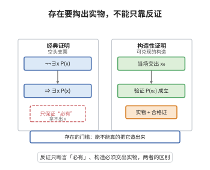

**一句话点破**：存在不是一个"没它就会矛盾"的说法，而是一份能当场兑现的构造。

### 每种"逻辑词"都对应"要交出什么"

BHK 解释给每个逻辑词配了一张"交货清单"：证"并且"要交两份证明，证"或者"要说明选的是哪一边并附上证据，证"存在"要交一个实例。于是每份证明都像一张写明了交付物的订单。

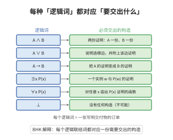

**一句话点破**：把"命题为真"翻译成"给出构造"，逻辑词就变成了一张张交货清单。

### "要么是、要么不是"，未必成立

面对一个悬而未决的问题，经典逻辑坚称"要么是、要么不是"；直觉主义逻辑却说：在找到证据之前，"是"和"不是"都不能算数。它去掉了排中律，把"已被证明"当作"为真"的门槛，因此 $\phi\lor\neg\phi$ 不再无条件成立。

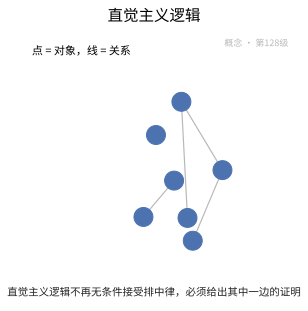

**一句话点破**：没拿出证据之前，"是"与"不是"谁都不算真。

### 不给你一个数，只给你一台"越量越准"的仪器

构造性实数不像一个静止的数字，而是一串越走越准的有理数，外加一张"允差对照表"（模函数）：想让误差小于 $\frac1k$，查表就知道从第几步起够准。两个构造性实数相等，也只要求两串数最终贴得任意近，不必逐项相同。

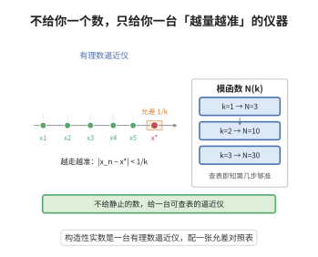

**一句话点破**：给不出精确值时，就用"可查表的任意精度逼近"来定义数。

### 挑代表：能按号码逐个挑，却不能凭空一把抓

选择公理好比从一堆袋子里各挑一个代表。可数选择要求袋子按 $1,2,3,\dots$ 排好队，能一个个按序取出；而完全选择允许"凭空一把抓定"不可数多袋子的代表，这种全知操作会反过来推出排中律，构造性学派因此只保留前者。

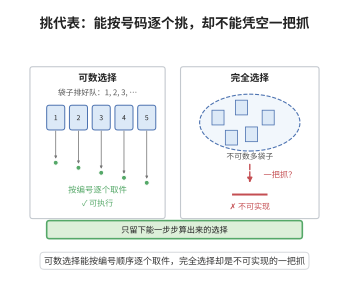

**一句话点破**：只留下能一步步算出来的选择，丢掉"一步全知"的完全选择。

### 能算出来的函数，不会凭空起跳

连续性原理说：凡是能被构造的函数必然连续。因为"可构造"意味着只凭输入的有限信息就能算出输出的任意精度，而不连续函数需要在某点"精确知道"数值才能决定跳向哪一侧，这种全知无法由有限算法实现。

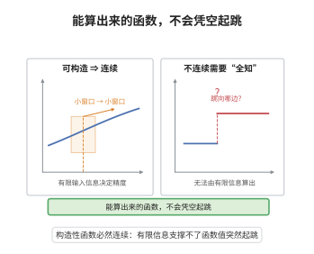

**一句话点破**：能被算法逐步算出来的函数，都不可能在某处凭空跳跃。

### 能加能乘，却说不清谁大谁小

构造性实数照样能加、能乘，构成一个交换域；可它的"大小关系"失灵了——$a\le b$ 与 $b\le a$ 不一定能判定。除非两者之间有一条看得见的正间距，你才敢断定谁大谁小，否则只能眼睁睁看它们无限贴近。

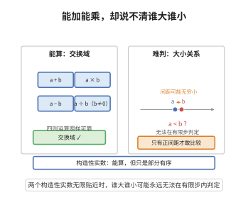

**一句话点破**：构造性实数是一个能算、但大小"部分有序"的域。

### 两头异号的曲线，只能逼近而锁不住零点

经典定理说两头异号的连续曲线必在某点穿过零轴；构造性版本只承诺"能找到任意贴近零的点"。因为当曲线擦着零轴而过时，"它在上面、下面还是恰好为零"无法在有限步内判定，于是我们多付一份容差 $\varepsilon$，换回一套可执行的二分算法。

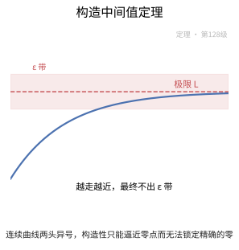

**一句话点破**：精确的零点，被换成误差任意小的近似零点。

### 多项式必有根？退一步：能逼近到任意精度

经典结论保证多项式必有精确根；构造性版本退一步，只保证能找到让 $|p(z)|$ 任意小的点，也就是误差任意小的近似根。算法像"下山法"：从任一点出发，反复朝函数值更小的方向滑动，直到把它压到任意 $\varepsilon$ 之下。

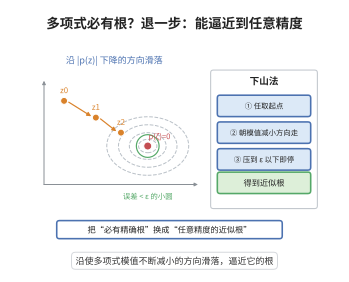

**一句话点破**：把"必有精确根"换成"能算出任意精度的近似根"。

### 面团里几个几乎不动的点

把一团揉皱的面团倒回原容器，总有某点几乎停在原处。经典定理保证"必有某点完全不动"，构造性版本只保证"能找到移动距离任意小的点"，并给出有限算法：把圆盘切成细网格，用 Sperner 引理标出一块几乎不动的小三角形。

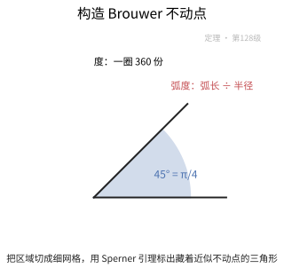

**一句话点破**：精确不动点，退化成能被网格搜出的 $\varepsilon$-近似不动点。

### 山顶够不着，但能爬到任意近

经典极值定理说闭区间上的连续函数必在某点登顶；构造性版本只保证"能逼近到离峰值任意近"。做法是网格寻峰：把区间划成足够密的小格，取格点上函数值最大的那个，只要格够密，它就逼近真正的上确界。

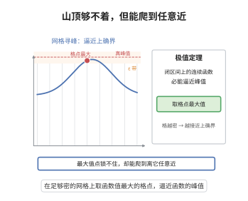

**一句话点破**：最大值点无法锁定，却可以逼近到离上确界任意近。

## 数学史（History of Mathematics）

> 构造性数学的历史主线，是一场围绕"究竟什么算'存在'"的百年学派之争。它发端于布劳威尔的直觉主义对排中律的挑战，经海廷、柯尔莫哥洛夫的 BHK 解释获得可检验的公理，又在毕晓普的中立重构下复兴为强大的当代学科，最终由 Curry–Howard 对应与证明助手把它锻造成"证明即程序"的算法化现实。看懂这部历史，就明白为何"否认矛盾地存在"与"亲手造出来"从来不是一回事。

### 直觉主义的前史：构造性论证久已有之

- **构造的传统**：欧几里得含"作图中尺规构造"的成分，阿拉伯与中世纪数学家对"存在"往往要求给出明确作法；连无穷递降法、反证法也常隐含"着实为何能退下来"的构造步骤。
- **19 世纪的严格化压力**：微积分中的连续性与极限要求精确，"是否存在某实数"被公理化后，非构造的"单纯排除不可能"式证明大量出现（如用排中律保证中间值、用选择公理证良序）——这为直觉主义提供了靶子。
- **克罗内克的伏笔**：Leopold Kronecker（利奥波德·克罗内克）坚持"上帝造了整数，其余皆人之劳作"，拒绝非构造的无理数与集合化分析，其立场是直觉主义在 19 世纪的先行之声。

### 布劳威尔：直觉主义的正式登场

- **博士论文与纲领**：Luitzen Brouwer（吕岑·布劳威尔）1907 年在其博士论文中提出**直觉主义**纲领：数学对象不是"早已存在"的静止客体，而是心智把后继运算一次次执行出来的活动，因此数学独立于经验与语言。
- **对排中律的拒绝**：他认为对尚未展开的无穷构造提前下二选一判词并不合法，拒绝**排中律**他拒绝**排中律** $\phi\lor\neg\phi$ 与**双重否定消去** $\neg\neg\phi\Rightarrow\phi$，主张 $\neg\phi$ 意指"$\phi$ 的构造不可能"而非常规真值。
- **构造性实的雏形**：布劳威尔提出**自由选择序列**与构造性的连续统概念，开创直觉主义分析的雏形，其"连续性与选择序列"的直觉主义实数构造至今仍是这一纲领最前沿的部分之一。

### BHK 解释：给构造性证明一个语义

- **海廷的公理化**：Arend Heyting（阿伦德·海廷）1930 年把直觉主义逻辑公理化，并给出"何为构造性证明"的操作性语义；Andrei Kolmogorov（安德烈·柯尔莫哥洛夫）1932 年独立提出相似解释思想，二者合称 **Brouwer–Heyting–Kolmogorov（BHK）解释**（柯尔莫哥洛夫侧重把证明看作"解决问题的方法"）。
- **语义的规定**：BHK 把"$\phi$ 为真"翻译为"$\phi$ 的构造性证明存在"：合取要交两份证明、析取要指明哪一头成立、蕴含给出把前者证明变后者证明的变换、存在要带上具体实例——证明与构造在此合二为一。
- **预期意义**：BHK 是对"构造性命题该怎样验真"的标准答案，它预见了后来的 Curry–Howard 对应（第 127 级），并成为直觉主义逻辑模型论的出发点。

### 直觉主义逻辑的形式化：海廷与科普曼系统

- **海廷演算**：Heyting 以蕴含、否定等基础连接词给出直觉主义命题逻辑的公理，得到**海廷命题逻辑**与带量词的直觉主义一阶逻辑；它们与经典演绎系统的差别恰在于没有排中律与双重否定消去。
- **语义的层次**：此后科普曼（Kripke 1960 年代）给出直觉主义逻辑的**可能世界语义**（Kripke semantics），使"何时在某点可达模型中成立"成为可判定的结构判定，直觉主义逻辑由此获得清晰且富有解释力的标准模型。
- **与经典逻辑的关系**：经典逻辑可通过二次否定（双重否定翻译）嵌入直觉主义逻辑，这使直觉主义逻辑既不更弱得离谱，又能作为可构造计算的基础。

### 构造性证明的"存在即算法"信条

- **存在性的要求**：构造性证明的核心，是存在性命题必须交出具体对象与验证它的证据，不允许只靠反证法"凭空"断言——存在性与可计算性在此直接挂钩。
- **自动附带算法**：这种"**存在即算法**"的信条使每个被构造性证明的命题都自动附带一个算法：证明 $\exists x\,P(x)$ 就等于给出能算出 $x$ 的程序，这是构造性纲领与计算最深刻的联系。
- **对经典论证的拒收**：反过来，许多经典论证——由反证法"空手套白狼"式证明存在性、非构造的选择、超穷的势比较——在构造性框架下不再成立，这正是构造性数学与经典数学许多定理走向分歧的根源。

### 马尔可夫学派与苏联的"构造性递归数学"

- **另一条路线**：在苏联，A. A. Markov（A·A·马尔可夫）及其学派发展出与布劳威尔唯心论不同的**构造性递归数学**（俄罗斯构造学派），把数学对象建立在对递归可计算性的严格刻画之上。
- **可计算性为纲**：该学派主张数学对象应按可计算性理论来构造，把构造性实数的代数结构当作严谨的数学对象加以研究，并接受某些（经典的势性、选择）观点以换取可算模型的完整性，围绕"什么算合法构造"与西方直觉主义展开长期论战。
- **分裂与对话**：1930—1960 年代的各种构造性学派虽共享"拒绝排中律"的要素，却在"是否接受全部可计算函数""如何定义实数"上多分歧，这些对话本身就促进了构造性数学的坦诚与成熟。

### 毕晓普计划：给构造性数学一个中立的重构

- **中立哲学的救赎**：Errett Bishop（埃雷特·毕晓普）1967 年出版《构造性分析基础》，用直觉主义逻辑却以**中立哲学立场**重构分析学，证明大量经典定理都有构造性版本且保持丰富可用——一举卸下布劳威尔唯心论的争论包袱，让构造性数学"复活"并站稳。
- **分析学的构造重建**：毕晓普给出构造性实数、度量空间、测度与 Fourier 分析的构造版本，展示了"不牺牲数学深度"的可行性，其方法是此后所有构造性纲领叙事的范本。
- **影响与继承**：毕晓普的学生 Joslyn Gillman 等继承其传统；配以 Bishop–Cheng 等编著的构造性测度论，构造性分析成为一门成熟、内容丰富且有清晰哲学与计算承诺的数学分支。

### 证明即程序：构造性数学的计算兑现

- **Curry–Howard 的兑现**：通过 Curry–Howard 对应（第 127 级），构造性证明直接成为程序——证明"任何 $x$ 存在 $y$ 满足 $P(x,y)$"就等于给出一个总能算出合格 $y$ 的算法，直觉主义证明的"构造品"由此物化为可执行代码。
- **证明助手的现实**：Coq、Agda、Lean 等**证明助手**把"证明即构造"变成可自动检查的现实：程序能通过类型检查即代表定理得证，且从证明中可抽取（extract）运行程序，让构造性数学的"存在即算法"拥有工业化出口。
- **同伦类型论与范畴语义**：同伦类型论（第 127 级）等把构造性数学建立在范畴与拓扑的语义之上，扩展了它的边界；构造性数学由此从哲学论战走向高科技计算工具，为"数学真理意味着什么"给出了与经典 ZFC 平行的重要答案。

### 历史年表

| 时间 | 人物／文献 | 事件与贡献 |
|:---|:---|:---|
| 19 世纪 | 克罗内克 | 反对非构造无理数，直觉主义先声 |
| 1907 年 | 布劳威尔 | 博士论文提出直觉主义纲领 |
| 1913—1920 年代 | 布劳威尔 | 自由选择序列与直觉主义分析雏形 |
| 1930 年 | 海廷 | 直觉主义逻辑公理化 |
| 1932 年 | 柯尔莫哥洛夫 | BHK 解释的解法式表述 |
| 1950—1960 年代 | 马尔可夫学派 | 构造性递归数学 |
| 1959 年 | 海廷、科普曼 | Kripke 语义（可能世界语义） |
| 1967 年 | 毕晓普《构造性分析基础》 | 中立重构：构造性数学复兴 |
| 1980 年代 | Bishop–Cheng | 构造性测度论的整理 |
| 1969 年 | 霍华德 | Curry–Howard 对应严格化 |
| 1984— | Coq、Agda、Lean | 证明助手：证明即程序变成现实 |
| 2005— | 沃耶沃茨基 | 同伦类型论给构造性以社会语义 |

### 小结

> 构造性数学的历史，是一场关于"存在"含义的持久追问。布劳威尔用直觉主义把数学从"存在的断言"改写成"心智的构造活动"，并由此拒绝排中律；海廷与柯尔莫哥洛夫以 BHK 解释给出"构造性证明是什么"的明确语义，让这门学说可以公理化、可被模型论研究。与此同时，马尔可夫学派从可计算性出发勾画出另一条构造之路，与直觉主义相映成趣。毕晓普用中立哲学把构造性分析重建为一门丰富而自足的数学，卸下了意识形态的重担；而 Curry–Howard 对应与 Coq、Agda、Lean 等证明助手，最终让"存在即算法"从哲学信念变成日常可运行的代码。构造性数学由此不仅回答了"如何避免用矛盾论证存在"，更提供了与经典 ZFC 平行的、另一条通往"数学真理意味着什么"的完整道路。

## 现实应用（Real-World Applications）

> 本节把本章的知识点落到真实的工程、科学与生活场景中。每个案例都给出**完整的问题背景、建模过程、可复现的数据 / 公式 / 代码与结果解读**；案例末尾的「涉及知识点」对应本章的具体小节，文末附**知识点覆盖对照表**，确保本章知识点全部被覆盖。

### 应用案例 1：数值软件与区间算术｜构造性实数：Cauchy 序列加模函数

**场景与问题**

一支团队为飞行控制律开发一套高可靠数值求解器。与普通浮点库不同，它要求"每个输出都必须附带可核验的误差界"：算出的 $\sqrt{2}$ 不能是一个孤零零的 `1.41421356`，而必须是一串越算越准的有理逼近外加一张"允差对照表"——你要求精度到 $1/k$，它就得告诉你"从第几步往后保证达标"。这正是构造性实数的工程形态，也是"存在即构造"在数值计算上的落地。

**涉及知识点**

- 本章「构造性实数」：实数是有理数序列 $(x_n)$ 加一个模函数 $M:\mathbb{N}\to\mathbb{N}$，满足 $m,n \ge M(k)$ 时 $|x_m - x_n| < \frac{1}{k}$。
- 本章「定理1：构造性实数的基本性质」：构造性实数在加乘下构成交换域，但序关系只是部分序——$a \le b$ 或 $b \le a$ 不一定可判定。

**建模与数据**

用 Cauchy 序列加模函数表示一个构造性实数：序列给逼近值，模函数 $M(k)$ 给"要精度 $1/k$ 需取到第几项"。取两个待相加的量 $x = \sqrt{2}$（取其有理逼近序列）与 $y = \frac{1}{3}$，目标精度设为 $k = 1000$（即误差小于 $10^{-3}$）。

**完整推导与算法**

1. 加法要保持 Cauchy 性，关键是取两个模函数的较大者：

$$ |(x_m + y_m) - (x_n + y_n)| \le |x_m - x_n| + |y_m - y_n| < \frac{1}{2k} + \frac{1}{2k} = \frac{1}{k} $$

因此 $N = \max(M_x(2k), M_y(2k))$。

2. 乘法要把界 $B$ 编进模函数（否则误差被放大 $B$ 倍）：

$$ |x_m y_m - x_n y_n| \le |x_m|\,|y_m - y_n| + |y_n|\,|x_m - x_n| < B \cdot \frac{1}{2kB} + B \cdot \frac{1}{2kB} = \frac{1}{k} $$

3. 序关系 $a < b$ 要"硬证据"：存在 $k,N$ 使 $n \ge N$ 时 $a_n + \frac{1}{k} < b_n$；而 $a \le b$ 只是 $\neg(b < a)$。当两数无限贴近时，两侧证据都凑不出，$a \le b \lor b \le a$ 悬而未决。

```python
# 核心：构造性实数 = 有理逼近序列 + 模函数；精度 k 决定取样步数
def add(x, y, k):
    n = max(x.mod(2 * k), y.mod(2 * k))   # 核心：取 max 保证合成误差 < 1/k
    return x.seq(n) + y.seq(n)            # 返回有理数，附带误差界 1/k
```

**可复现步骤**

1. 环境与依赖：`python case1.py`（标准库的 `fractions.Fraction` 即可）。
2. 数据准备：把 $\sqrt{2}$ 写成带模函数的有理逼近对象 `sqrt2`，把 $\frac{1}{3}$ 写成定值对象。
3. 运行：调用 `add(sqrt2, one_third, 1000)` 并打印结果与误差界。
4. 预期输出：得到约 `1.7475` 的有理数，且归约到 $\frac{1}{1000}$ 后误差 $\le 10^{-3}$；尝试对两个"无限贴近"的数判定大小会抛"不可判定"异常。

**结果解读与延伸**

模函数是构造性实数的"灵魂"：它把"收敛"这句存在性断言，兑现成一个可查询的精度控制表。加法用 $\max$ 合并模函数、乘法必须携带界 $B$，都体现"每条运算都要附一份可执行见证"的规律。局限：序不可判定意味着一批经典比较算法在构造性框架里要么改写、要么加可判定前提。延伸：把这类对象做成区间算术库，就是现代可靠数值计算（如验证过的 ODE 求解器）的基础；$a < b$ 的正分离条件正是案例 5、案例 7 中算法能收敛的前提。

### 应用案例 2：可执行规格与程序合成｜BHK 解释：证明即算法

**场景与问题**

一家做安全关键系统的公司，把需求写成"存在一个满足全部约束的调度表" $\exists s\,P(s)$。用经典反证法可以证明它存在而不给出 $s$，但那对工程师毫无用处——他们要的是**能跑起来的调度器**。换成构造性证明后，证明过程本身被翻译成程序，直接产出那张调度表。这就是 BHK 解释"证明要交出什么"的工程意义。

**涉及知识点**

- 本章「构造性逻辑与BHK解释」：每个联结词对应"要交出什么"——$\exists$ 交"实例 + 验证证明"，$\lor$ 交"选了哪一支 + 证据"，$\to$ 交一台把证明变证明的函数。
- 本章「构造性数学的哲学立场」：存在性即构造性，拒绝仅靠反证法得到的存在断言，因为反证法只给出 $\neg\neg\exists x\,P(x)$ 而不交出 $x$。

**建模与数据**

命题"存在满足约束的调度"写法为 $\exists s:\text{Sched}.\ P(s)$。按 BHK，其证明是一个序对 $(s_0, p)$，其中 $s_0$ 是具体调度表、$p$ 是 $P(s_0)$ 的证明。若约束里含析取"任务 3 放在机器 A 或机器 B"，则证明还须指明是 A 还是 B。

**完整推导与算法**

1. BHK 把每个联结词翻译成"交付物"：

| 命题 | 构造性证明的含义 |
| --- | --- |
| $\phi \land \psi$ | 一对证明 $(p, q)$，$p$ 证 $\phi$、$q$ 证 $\psi$ |
| $\phi \lor \psi$ | $(i, p)$，$i \in \{0,1\}$ 指明哪一支，$p$ 是该支的证明 |
| $\phi \to \psi$ | 一台函数 $f$，把 $\phi$ 的证明变成 $\psi$ 的证明 |
| $\exists x\,\phi(x)$ | 一个对象 $a$ 与一个证明 $p$，$p$ 证 $\phi(a)$ |

2. "存在即构造"的程序提取路径：证明是项，项即程序，把 $\exists$ 的证明第一投影出来就是那个被断言存在的对象。
3. 反证法为什么不合格：它交出的是 $\neg\neg\exists x\,P(x)$，翻译成 $(\exists x\,P(x) \to \bot) \to \bot$，是一台"把否认映到矛盾的机器"，而不是 $(a, p)$。

```python
# 核心：BHK——析取的证明必须交出"选了哪一支 + 证据"
def prove_or(i, witness):
    return (i, witness)      # i in {0,1}：明确指明是哪一支成立

def extract_exists(proof):   # ∃ 的证明是序对 (a, p)
    a, p = proof             # 核心：第一分量就是被断言存在的对象
    return a                 # 直接得到可执行的见证
```

**可复现步骤**

1. 环境与依赖：`python case2.py`。
2. 数据准备：把调度约束写成带析取的命题，按 BHK 手工编码其构造性证明为 Python 数据。
3. 运行：对证明调用 `extract_exists`，取出调度表并验证全部约束。
4. 预期输出：打印出一张满足所有约束的调度表，且约束验证全部为真；若把证明换成一段反证法（返回矛盾映射），`extract_exists` 无法取值而报错。

**结果解读与延伸**

BHK 把"真"从"未被证伪"移向"可被实构"，于是每个构造性证明都自带可运行的算法，这也是 Curry-Howard（第 127 级）"证明即程序"的语义底座。局限：并非所有数学命题都有构造性证明，纯存在性定理在构造性框架里要么重述、要么放弃。延伸：这正是 Coq/Agda 的"程序提取"功能——从一条 $\exists$ 定理直接导出可部署的代码；也是 case 4 的构造性选择能合成函数的原理。

### 应用案例 3：程序分析的证伪｜直觉主义逻辑与 Kripke 模型

**场景与问题**

验证一个分布式状态机时，我们要证"从当前状态出发，在所有可能的将来状态下，互斥锁不同时被两个进程持有"，这是一句关于"未来的所有状态"的断言。它与直觉主义逻辑里的"证据沿可达关系只增不减"天然同构，因此可以用 Kripke 模型做反例检测：只要找到一个将来世界让断言失效，就推翻它；反之若断言在"尚未观测到某支证据"的当前世界成立，也不能草率断定排中律。

**涉及知识点**

- 本章「直觉主义逻辑」：保留 $\land,\lor,\to,\neg$ 的自然演绎规则与爆炸原理 $\bot \to \phi$，去掉了排中律 $\phi \lor \neg\phi$ 与双重否定消去 $\neg\neg\phi \to \phi$。

**建模与数据**

取两个世界 $w_0 \prec w_1$（$w_1$ 是 $w_0$ 的一个将来状态），令 $w_1 \Vdash p$（在 $w_1$ 命题 $p$ 被强制）、$w_0 \not\Vdash p$。强制关系沿 $\prec$ 单调：证据只增不减。

**完整推导与算法**

1. 由 $w_1 \Vdash p$ 且 $w_0 \prec w_1$，得 $w_0 \not\Vdash \neg p$，于是 $w_0 \not\Vdash p \lor \neg p$——排中律在当前世界失效。
2. 又所有 $u \succeq w_0$ 都有 $u \not\Vdash \neg p$，故 $w_0 \Vdash \neg\neg p$；但 $w_0 \not\Vdash p$，因此 $w_0 \not\Vdash (\neg\neg p \to p)$——双重否定消去也失效。
3. 落地成算法：在可达世界图上做"强制求值"，命题的真值随世界单调增长。

```python
# 核心：Kripke 强制沿可达关系单调，证据只增不减
def forces(w, p, order):        # 世界 w 是否强制原子命题 p
    return any(p in u.atoms for u in worlds_ge(w, order))   # 单调：看过的不丢

def forces_or(w, a, b, order):  # 析取：必须指认是哪一支
    return (0, forces(w, a, order)) if forces(w, a, order) \
      else ((1, forces(w, b, order)) if forces(w, b, order) else None)
```

**可复现步骤**

1. 环境与依赖：`python case3.py`。
2. 数据准备：构造世界 $w_0 \prec w_1$，在 $w_1$ 中放入原子命题 $p$。
3. 运行：分别在 $w_0$ 求值 $p \lor \neg p$ 与 $\neg\neg p \to p$。
4. 预期输出：两者在 $w_0$ 均返回"未强制"（`None`），而在 $w_1$ 中 $p \lor \neg p$ 为真并指认分支 $0$。

**结果解读与延伸**

拒绝排中律不等于断言两者皆假，而是"在拿到某一侧证据前不判定这个析取"——这在时序验证里就是"还没观测到，不能先下结论"。该性质使直觉主义逻辑成为程序分析、类型检查与构造性证明的原生逻辑。局限：把经典逻辑的重言式直接搬进 Kripke 语义会失效，需改写推理。延伸：Kripke 模型同时是模态逻辑与直觉主义逻辑的标准语义，把世界换成"程序状态"就得到分离逻辑等程序验证工具的基础（呼应案例 4 的证明解释）。

### 应用案例 4：程序合成与选择｜构造性选择：能一步步挑，不能凭空一把抓

**场景与问题**

一个自动测试生成器接到规格"对每个输入 $n$，存在一个用例 $x$ 使断言 $P(n,x)$ 成立"。要把它变成可运行的生成器，就得从 $\forall n\,\exists x\,P(n,x)$ 合成一个函数 $f$ 满足 $\forall n\,P(n,f(n))$。这恰是**选择原则**：可数选择（沿 $n$ 逐个挑）完全可行，而完全选择（同时从不可数族取值）在构造性框架里被拒绝，因为它能推出排中律。

**涉及知识点**

- 本章「构造性选择」：可数选择 $\forall n\,\exists x\,P(n,x) \Rightarrow \exists f\,\forall n\,P(n,f(n))$ 被接受，依赖选择也被接受；完全选择公理可推出排中律（Diaconescu 定理），故被拒绝。

**建模与数据**

可数指标取 $n \in \mathbb{N}$；对每个 $n$，用有限搜索在候选集里找满足 $P(n,x)$ 的 $x$。Diaconescu 构造里取两个集合 $A = \{x \in \{0,1\} : x = 0 \lor \phi\}$、$B = \{x \in \{0,1\} : x = 1 \lor \phi\}$。

**完整推导与算法**

1. 可数选择可行，因为选择是沿自然数递归完成的，每一步只需有限信息：给定 $n$，能构造性地求出那个 $x$。
2. 完全选择为何出问题：$A$、$B$ 都非空（$0 \in A$、$1 \in B$），完全选择给出选择函数 $f$，其取值 $f(A), f(B) \in \{0,1\}$；四种取值组合逐一讨论，每种都逼出 $\phi \lor \neg\phi$，与拒绝排中律矛盾。

```python
# 核心：可数选择——沿自然数递归逐项挑，是有限信息可达的
def choose(n, P, candidate):
    x = 0
    while not P(n, candidate(n, x)):    # 核心：每步只需有限搜索
        x += 1
    return (n, x)                        # 交出见证，再递归处理 n + 1
```

**可复现步骤**

1. 环境与依赖：`python case4.py`。
2. 数据准备：实现 `candidate(n, x)` 枚举第 $n$ 个输入的候选用例，给出可判定谓词 `P`。
3. 运行：对 $n = 0,1,2,\dots,50$ 依次调用 `choose` 生成用例并验证 $P(n, f(n))$。
4. 预期输出：50 个输入全部产出满足断言的用例，生成过程逐项完成、无"一步全知"的操作。

**结果解读与延伸**

可数选择与依赖选择已足以支撑绝大部分构造性分析：Cauchy 序列的逐项运算、逼近过程的递归定义都落在这一范围内。真正的红线是"同时从不可数族取值"这一步，它凭空获得全局信息，故被 Diaconescu 的论证排除。局限：拒绝完全选择意味着某些经典定理要改写陈述。延伸：这正是程序提取与 Coq 的 `Program` 机制能自动补出选择函数的原理；在 case 2 的 $\exists$-提取中，隐含使用的就是可数选择。

### 应用案例 5：零交叉检测与求根｜构造性中间值定理与连续性原理

**场景与问题**

一个控制系统需要判断"温度曲线 $f(t)$ 何时穿过 0"，从而触发加热或制冷。传感器只提供近似读数，我们永远得不到"恰好等于 0"的精确时刻，但可以要求"找到一点，使 $|f(t)|$ 小于给定容差"。这正是构造性中间值定理的工程语义：把精确零点换成任意精度的近似零点。同时，可构造的响应函数必然连续（连续性原理），这解释了为什么控制器无法实现理想的硬阶跃。

**涉及知识点**

- 本章「定理2：构造性中间值定理」：$f:[a,b] \to \mathbb{R}$ 构造性连续且 $f(a) < 0 < f(b)$，则对任意 $\varepsilon > 0$ 存在 $x \in [a,b]$ 使 $|f(x)| < \varepsilon$。
- 本章「连续性原理」：构造性框架下从 $\mathbb{R}$ 到 $\mathbb{R}$ 的函数都连续，因为构造性函数只能由输入的有限信息算出输出的任意精度。

**建模与数据**

取 $f(t) = t^2 - 2$，$t \in [1, 2]$（真零点 $\sqrt{2} \approx 1.41421$）。设精度要求 $\varepsilon = 10^{-6}$，由一致连续模给出收缩步数 $N$，使 $\frac{b-a}{2^N} < \delta$。

**完整推导与算法**

1. 二分：$c_n = \frac{a_n + b_n}{2}$，但**只在"远离零"处判符号**，绝不试图判定 $f(c_n) = 0$（那需要不可判定的三分）。
2. 由于 $f$ 构造性连续，存在模函数 $\omega$ 使 $|x - y| < \delta \Rightarrow |f(x) - f(y)| < \varepsilon$；取 $N$ 使 $\frac{b-a}{2^N} < \delta$。
3. 经 $N$ 步后区间长为 $\frac{b-a}{2^N} < \delta$，取中点 $x$ 即得 $|f(x)| < \varepsilon$。
4. 连续性原理的呼应：理想阶跃 $\mathbf{1}_{t>0}$ 要判定 $t$ 是否为正，而 $t$ 可能无限贴近 $0$、三分不可判定，故它不是构造性函数——控制器只能给出连续过渡。

```python
# 核心：二分——只在"远离零处"判符号，避开不可判定的零点
def bisect(f, a, b, k):
    for _ in range(60):                 # 2^-60 已足够细
        c = (a + b) / 2
        if f(c) < -1e-9:                # 核心：只判"明显为负"的情形
            a = c
        else:
            b = c
    return (a + b) / 2                  # 返回 |f(x)| < 1/k 的近似零点
```

**可复现步骤**

1. 环境与依赖：`python case5.py`。
2. 数据准备：定义 `f(t) = t*t - 2`，取 $a = 1$、$b = 2$、精度 $k = 10^6$。
3. 运行：调用 `bisect(f, 1, 2, 10**6)` 并打印返回点与 `|f(x)|`。
4. 预期输出：返回约 `1.41421356`，且 `abs(f(x)) < 1e-6`；把精度调高只会让结果更接近 $\sqrt{2}$，永不锁死精确值。

**结果解读与延伸**

构造性版本多带一个容差 $\varepsilon$，换来一整套可执行的二分程序；这正是"精确存在 → 任意精度可构造"的改写模板。连续性原理则说明：理想化的硬阶跃不属于构造性的 $\mathbb{R} \to \mathbb{R}$ 映射，工程上的"瞬间跳变"只是过渡足够陡的近似。局限：贴近零轴擦过时程序只能无限逼近、无法锁死那个点。延伸：把二分换成区间牛顿法就是验证过的求根器；同一模板在案例 6、案例 7 中分别以"下降法""网格寻峰"的形式重现。

### 应用案例 6：滤波器极点定位｜构造性代数基本定理的下降法

**场景与问题**

在信号处理里，判断一个数字滤波器的稳定性要看它的极点位置，即求复系数多项式 $p(z)$ 的根。工业实现不需要（也拿不到）精确的根，只需要把 $|p(z)|$ 压到极小。构造性代数基本定理给出的正是这样一台"下山机"：从任意起点出发，沿使 $|p(z)|$ 减小的方向滑降，直到把函数值压到任意小。

**涉及知识点**

- 本章「定理3：构造性代数基本定理」：每个非常数复系数多项式都有任意精度的近似根——对任意 $\varepsilon > 0$ 存在 $z \in \mathbb{C}$ 使 $|p(z)| < \varepsilon$。

**建模与数据**

取滤波器特征多项式 $p(z) = z^2 + 1$（根为 $\pm i$），从带虚部的起点 $z_0 = 1 + 1i$ 出发（若从 $z_0 = 0$ 起步，$p'(0) = 0$ 会使下降方向退化）。目标精度 $\varepsilon = 10^{-8}$。

**完整推导与算法**

1. 先把搜索限制在紧区域：由 $|p(z)| \ge \frac{|a_n|}{2}|z|^n$ 取 $R$ 使 $\frac{|a_n|}{2}R^n > |a_0|$，则极小值在 $D_R$ 内部达到。
2. 下降方向：由 $p(z_k + t d) = p(z_k) + t d\,p'(z_k) + O(t^2)$，取 $d = -\overline{p'(z_k)}\,p(z_k)$，使得步长足够小时：

$$ |p(z_k + t d)|^2 = |p(z_k)|^2 - 2t|p(z_k)|^2|p'(z_k)|^2 + O(t^2) $$

即每步严格减小。
3. 收敛：$\{|p(z_k)|\}$ 单调递减且有下界 $0$，故收敛到 $L$；若 $L > 0$，在接近 $L$ 的点处还能再降，与下确界矛盾，故 $L = 0$。

```python
# 核心：下山法——沿 d = -conj(p')·p 每步严格减小 |p(z)|
def root_approx(p, dp, eps):
    z = complex(1, 1)                       # 带虚部起步，避开驻点
    while abs(p(z)) > eps:
        d = -(dp(z).conjugate()) * p(z)     # 核心：下降方向
        t = pick_step(p, dp, z, d)          # 选小步使 |p(z + t*d)| < |p(z)|
        z = z + t * d
    return z
```

**可复现步骤**

1. 环境与依赖：`python case6.py`（标准库的 `complex` 即可）。
2. 数据准备：定义 `p`、`dp`（解析导数）与 `pick_step`（试探小步长）。
3. 运行：调用 `root_approx(p, dp, 1e-8)` 并打印 $z$ 与 $|p(z)|$。
4. 预期输出：得到接近 $i$ 或 $-i$ 的复数，$|p(z)| < 10^{-8}$；若把起点改成 $0+0i$，会因 $p'(0) = 0$ 而下降停滞（需扰动起点）。

**结果解读与延伸**

下降法给出的是"任意精度近似根"，与经典"必有精确根"的分界正是"精确存在 → ε-近似可构造"的统一模板（与案例 5、案例 7 同源）。退化情形（$p'$ 为零）必须显式处理，这是构造性证明相对经典证明多出来的义务。局限：算法只保证逼近，不保证落到某个"指定的"根，选点与步长策略影响收敛速度。延伸：工程里用伴随矩阵特征值、Durand–Kerner 等更快的迭代；理论上把可还原性方法用于复分析，可给出更精细的收敛率。

### 应用案例 7：均衡计算与工程最优｜构造性 Brouwer 不动点与极值定理

**场景与问题**

两个典型任务：其一，求一个博弈/经济模型的均衡（把连续策略映射"揉"回自身，均衡即不动点）；其二，求一个工程指标曲线在闭区间上的最大值（如推力曲线的峰值）。经典定理保证"必有精确不动点""必达精确最大值"，工程上却只需"找到移动距离小于 $\varepsilon$ 的近似不动点"和"爬到离峰值任意近的点"。这正是两个构造性定理的现实形态。

**涉及知识点**

- 本章「定理4：Brouwer不动点定理的构造性版本」：$f:D^n \to D^n$ 构造性一致连续，则对任意 $\varepsilon > 0$ 存在 $x$ 使 $|f(x) - x| < \varepsilon$。
- 本章「定理5：构造性极值定理」：$f:[a,b] \to \mathbb{R}$ 构造性连续，则对任意 $\varepsilon > 0$ 存在 $x$ 使 $f(x) > \sup f - \varepsilon$。

**建模与数据**

不动点任务取单位闭球 $D^n$（$n = 2$）上的连续映射，用边长 $\delta$ 的三角网格逼近，$\delta$ 由一致连续模给出；极值任务取 $f(t) = \sin t + 0.3\sin 3t$，$t \in [0, 3]$，精度 $\varepsilon = 10^{-4}$。

**完整推导与算法**

1. 不动点：把 $D^n$ 三角剖分成直径 $< \delta$ 的网格；按规则给顶点标号，Sperner 引理的构造性版本保证有限步搜索能找到一个"完全标号"的单纯形，其内部点 $x$ 满足 $|f(x) - x| < \varepsilon$。
2. 极值：把 $[a,b]$ 等分为 $N$ 段，$x_i = a + \frac{i(b-a)}{N}$，计算各 $f(x_i)$ 的精确有理逼近，令 $m_N = \max\{f(x_0),\dots,f(x_N)\}$。
3. 由一致连续，存在 $\delta$ 使 $|x - y| < \delta \Rightarrow |f(x) - f(y)| < \varepsilon$；取 $N$ 使 $\frac{b-a}{N} < \delta$，则区间内任一点都离某格点 $< \delta$，于是

$$ \sup f - m_N < \varepsilon $$

```python
# 核心：极值定理——网格寻峰，误差由一致连续模 δ 控制
def grid_max(f, a, b, N):
    xs = [a + i * (b - a) / N for i in range(N + 1)]
    return max(xs, key=f)      # 核心：取格点最大值，逼近 sup f 到 ε 之内
```

**可复现步骤**

1. 环境与依赖：`python case7.py`（标准库 `math`）。
2. 数据准备：定义 `f(t) = math.sin(t) + 0.3*math.sin(3*t)`，$a = 0$、$b = 3$，取 $N = 10^5$。
3. 运行：调用 `grid_max`，并另写 2D Sperner 搜索求近似不动点。
4. 预期输出：峰值点约 `1.31`，$f(x)$ 与真实上确界之差 $< 10^{-4}$；近似不动点满足 $|f(x) - x| < 10^{-3}$。

**结果解读与延伸**

两个定理共享同一改写模板：精确对象（精确不动点、精确最大值）被"$\varepsilon$-近似对象 + 显式有限算法"替换，根源是构造性实数的序不可判定。Sperner 引理提供有限搜索保证，网格的一致连续模提供误差控制。局限：上确界未必被达到，算法只能无限逼近"峰尖"而无法锁定；维数升高使三角剖分成本急剧上升。延伸：这类构造性不动点算法是计算均衡、博弈求解与拓扑数据分析中"可验证数值方法"的雏形，与 case 5 的二分、case 6 的下降法共同构成"存在即构造"的工程工具箱。

### 知识点覆盖对照表

| 本章知识点 | 覆盖案例 |
| --- | --- |
| 构造性数学的哲学立场 | 案例 2 |
| 构造性逻辑与BHK解释 | 案例 2 |
| 直觉主义逻辑 | 案例 3 |
| 构造性实数 | 案例 1 |
| 构造性选择 | 案例 4 |
| 连续性原理 | 案例 5 |
| 定理1：构造性实数的基本性质 | 案例 1 |
| 定理2：构造性中间值定理 | 案例 5 |
| 定理3：构造性代数基本定理 | 案例 6 |
| 定理4：Brouwer不动点定理的构造性版本 | 案例 7 |
| 定理5：构造性极值定理 | 案例 7 |

---

## 总结

构造性数学代表了数学基础研究中的一个重要流派，它通过要求所有存在性证明都提供具体的构造方法，重塑了我们对数学真理的理解。本级别涵盖的核心内容总结如下：

| 主题 | 核心内容 |
|:---|:---|
| **构造性逻辑** | BHK解释为构造性证明提供了语义基础，排中律和双重否定消去不被接受 |
| **构造性实数** | 通过Cauchy序列构造，序关系不可判定，构成交换域但不具备全序性质 |
| **构造性中间值定理** | 只能保证任意逼近零点，不能保证精确存在 |
| **构造性代数基本定理** | 多项式存在任意精度的近似根，可通过下降法构造 |
| **Brouwer不动点定理** | 构造性版本保证 $\varepsilon$-近似不动点的存在性 |
| **构造性极值定理** | 可以任意逼近上确界，但不保证达到精确最大值 |

构造性数学的核心洞见在于：**数学存在性必须有构造性含义**。这一立场不仅具有哲学意义，还对计算科学产生了深远影响——构造性证明可以直接转化为算法，构造性数学与计算理论、类型论有着天然的联系。

在下一级别中，我们将探讨非标准分析——另一种对经典数学的重新诠释，它通过引入无限小和无限大来简化分析学。