# 第129级 非标准分析

## 从"无穷小到底能不能'合法'存在"说起：非标准分析要解决的根问题

> 在动手读超实数定义之前，先想清楚一个问题：**被莱布尼茨一路顺手的"无穷小"，为什么被放逐了两百年，又能被 Robinson 请回来？**

**一个真实的生活场景（第一步：直觉）**

你想说明"物体在某时刻的速度"。"速度"是路程除以时间，可某一瞬时的时间间隔是 $0$，$0$ 除以 $0$ 没意义。初学时不自觉地会说"取一个极小极小的 $\Delta t$"，然后在小到几乎看不清时"看"斜率——用的正是直观上的"无穷小"。这个直觉两千年来让无数人如鱼得水，却也因"到底是不是 $0$"的含混而饱受诟病：若是 $0$，$0/0$ 无意义；若不为 $0$，舍掉的又是什么？

数学最终给出了两条出路：**一条是 Weierstrass 的 $\varepsilon$-$\delta$ 极限语言**（把"趋近"说清楚，把无穷小从定义里逐出去）；**一条是 Robinson 的超实数**（承认无穷小是合法对象，但用一阶逻辑把它们"合理安放"）。本主题走的就是第二条路。

> **🧠 一句话记住非标准分析的"出生证"**
>
> 非标准分析要解决的**根本问题**是：
>
> $$ \boxed{\text{能否给"无穷小/无穷大"一个严格、合法的数学家园，让求导、连续等沿用莱布尼茨的直观做法也能严谨成立？}} $$
>
> Robinson 用超幂构造（$^*\mathbb{R}=\mathbb{R}^{\mathbb{N}}/\mathcal{U}$）给出答案：能——通过模型论与 Loś 定理，把实数系真扩张成同时含无穷小与无穷大的初等扩张，再用转移原理保证可与标准数学来回翻译。

**它为何而诞生（第二步：要解决的问题）**

这是一场"还魂"式的历史。Leibniz 17 世纪用无穷小求导有验若神，却因"无穷小究竟是不是 $0$"逻辑含混；到 19 世纪，Bolzano、Cauchy 先后质疑，Weierstrass 用 $\varepsilon$-$\delta$ 语言给出严谨的极限定义，把无穷小彻底逐出分析学的殿堂——此后近两百年，"分析里处处可得心应手、逻辑上却无家可归"成了它的宿命。直到 1955 年 Loś 的超幂基本定理表明：对实数序列在自由超滤下取等价类所得的结构，能逐字保留一阶真命题；Robinson 1960–1966 年以此为基石构造出 $^*\mathbb{R}$，让莱布尼茨的直觉第一次有了严格地基。本主题要回答的核心问题就此成型：**数学能否既保留无穷小的直观，又不牺牲严谨——把"扩张论域"当作化解极限繁琐的捷径？**

**看待本章的四种眼光（第三步：正式定义前的准备）**

- **模型的眼光**：超幂构造与 Loś 定理——如何把"几乎所有坐标成立"变成真值判定。
- **翻译的眼光**：转移原理——标准与非标准之间的一阶"双向词典"。
- **微积分的眼光**：标准部分定理——把"取极限"改写为"取标准部分"，导数、连续、积分都随之简化。
- **测度的眼光**：Loeb 测度——把无穷小尺度上的内部测度翻译回标准测度，驰援概率与随机分析。

读完这一节，你应该记住的不是"无穷小是个什么数"，而是**那条更根本的路线选择：与其把无穷小从定义里赶出去，不如给数系扩一个维度，让它有处安身，同时用转移原理保证不越界。** 带着这个思路，你会发现非标准分析与第 128 级构造性数学是一对精巧的对立面——一个"限制逻辑"，一个"扩张论域"。

---

## 开始之前

**本章在讲什么**：非标准分析是通过扩张数系（引入无穷小与无穷大）来简化经典分析的学科。本章从超实数系 $^*\mathbb{R}$ 讲起，经由超幂构造与 Loś 定理、转移原理，掌握标准部分定理，进而用非标准方法重证微积分基本定理，最后了解内部集/外集与 Loeb 测度的构造及其在概率与泛函分析中的应用。

**为什么要学它**：它是第 126 级范畴论、第 128 级构造性数学之后数学基础议题的又一个支柱——与构造性数学"限制逻辑以获取确定性"相对，它走"扩张论域以获取简洁"的路线；它在概率论（Loeb 测度、Wiener 测度）、泛函分析与数论（Loeb 空间、非标准方法与 Ramsey 型论证）都有重要应用。理解它，你才能在"标准 vs 非标准""构造 vs 扩张"这场基础论争中看清全貌。

**开始前请确认你还记得**：

- 实数完备性（见微积分相关级别）：序列、极限、$\varepsilon$-$\delta$ 定义、Dedekind 完备性。
- 集合基数与无穷（见基础相关级别）：可数/不可数、选择公理为何形如"从无穷多袋各取一个"。
- 一阶逻辑与模型论基础（见逻辑相关级别）：一阶公式、结构、公式在结构中的满足 $\models$。
- 滤子/超滤子（见逻辑或集合论相关级别）：何为超滤、其"有限交封闭＋上封闭＋对集合要么含 $S$ 要么含补集"等性质。

---

## 学习目标

1. 理解非标准分析的基本思想：引入无限小和无限大来简化分析学
2. 掌握超实数的超幂构造方法和Loś定理
3. 掌握标准部分定理及其在微积分中的应用
4. 理解转移原理的表述和意义
5. 掌握非标准微积分基本定理的证明
6. 理解Loeb测度的构造及其在测度论中的应用
7. 了解非标准分析在泛函分析、概率论等领域的拓展

---

## 核心概念

### 非标准分析的基本思想

> **🌐 直觉先行：两条路，你选哪条？**
>
> "瞬时速度"逼着你要么把"趋近"改写成 $\varepsilon$-$\delta$ 的长句，要么给"无穷小"一个合法的身份。非标准分析选了后者，但它异常谨慎：不是把无穷小随便塞进 $\mathbb{R}$，而是用一阶逻辑的"初等扩张"做手术——构造一个更大的数系 $^*\mathbb{R}$，其中莱布尼茨的无穷小和无穷大都是正式成员，同时 $^*\mathbb{R}$ 里成立的一阶句子与 $\mathbb{R}$ 完全一致（转移原理）。这样，你在 $^*\mathbb{R}$ 里用无穷小爽快算出的结果，永远可以翻译回标准的 $\varepsilon$-$\delta$ 世界。**直观被放行，严谨不丢失。**

非标准分析（Nonstandard Analysis）由Abraham Robinson在20世纪60年代创立，其核心思想是：通过模型论的方法，构造一个包含"无限小"和"无限大"实数的**超实数系**$^*\mathbb{R}$，使得经典数学中的每个定理在超实数系中都有一个"非标准版本"，同时可以通过**转移原理**在标准与非标准之间自由切换。

非标准分析的核心优势在于：许多经典分析中的 $\varepsilon-\delta$ 论证可以被简化为更直观的无限小推理。

> **直观理解（现实类比）**：无穷小像"非零但比任何正实数小"——它是超实数系统中的"幽灵粒子"，既不是零，又比任何正的标准实数都小。这就像在显微镜下观察一滴水：肉眼看它是连续的一团，放大千倍能看到水分子在振动，但这些分子相对于整滴水而言几乎可以忽略——分子的尺度就是"无穷小"的物理对应。在经典实数系里没有这样的位置（任何正数都有确定大小），而超实数系专门为它们开辟了"0 附近的绒毛层"。有了无穷小 $\varepsilon$，"趋近于 0"不再是绕来绕去的极限语言，而是"差一个 $\varepsilon$"的直接代数运算。

> **🧠 思考历程：被 $\varepsilon$-$\delta$ 赶出两百年的"无穷小幽灵"，凭什么东山再起？**
>
> 非标准分析回答的是一个"还魂"式的问题：莱布尼茨用过的无穷小曾在 19 世纪被 Weierstrass 用 $\varepsilon$-$\delta$ 极限语言扫地出门，凭什么 Robinson 能在几乎一个世纪后给它们一个合法的家？答案是——建立在模型论最深处的超幂工具。
>
> - **先被"严谨化"驱逐**。Leibniz（莱布尼茨）17 世纪靠"无穷小"计算导数得心应手，却因逻辑根基含混，历经 Cauchy、Bolzano 的质疑后，被 Weierstrass（魏尔斯特拉斯）19 世纪的 $\varepsilon$-$\delta$ 语言彻底取代。此后两百年，"分析里能用、逻辑上却无家可归"成了无穷小的宿命。
> - **超幂造出合法的家**。1955 年 Loś（沃什）的超幂基本定理证明：对实数序列在自由超滤下取等价类所得的结构，能逐字保留一阶真命题。Abraham Robinson（罗宾逊）1960–1966 年正是依此构造出超实数系 $^*\mathbb{R}$，把实数系真扩张成同时含有无限小 $\varepsilon$ 与无限大 $\omega$ 的初等扩张，并用转移原理保证可来回翻译——莱布尼茨的直觉第一次有了严格地基。
> - **极限化身为"取标准部分"**。标准部分定理把每个有限超实数剥掉无限小部分，于是导数可写成 $f'(x)=\text{st}\big(\frac{f(x+\Delta x)-f(x)}{\Delta x}\big)$，一举取代繁杂的 $\varepsilon$-$\delta$ 论证；Loeb 测度更把内部测度翻译成标准 $\sigma$-测度，让概率与随机分析大受裨益。
> - **心路**："刷新直觉"不是倒退——当严谨的极限语言找到等价的直观捷径，数学反而在两条腿之间走得更稳。

#### 课堂问答

**老师**：莱布尼茨的无穷小曾被 $\varepsilon$-$\delta$ 语言逐出分析，Robinson 凭什么能让它合法回归？这场手术的关键操作是什么？

**学生**：先给结论——无穷小不可能活在 $\mathbb{R}$ 里，因为 $\mathbb{R}$ 满足阿基米德性，任何正实数都有比它更小的实数；出路是造一个真扩张 $^*\mathbb{R}$。做法是超幂 $\mathbb{R}^{\mathbb{N}}/\mathcal{U}$：把实数序列在自由超滤下取等价类，就得到同时含无限小 $\varepsilon$ 与无限大 $\omega$ 的新数系。

**老师（追问）**：新数系比 $\mathbb{R}$ 大，会不会把旧世界成立的真理改掉？转移原理到底保住了什么，它的红线又在哪？

**学生**：转移原理保证一阶闭语句的真值完全不变：$\mathbb{R} \models \phi \iff {}^*\mathbb{R} \models \phi$。红线是「一阶」：像对一切子集 $S \subseteq \mathbb{R}$ 这种二阶量化，或涉及内部与外之分的断言，都不能随便搬运。

**老师（拓展）**：既然如此，你在超实数世界的直观推理，怎么落回标准数学承认的定理？

**学生**：靠标准部分 $\text{st}$ 做翻译。差商是含无限小的有限超实数，取标准部分即得导数：$f'(x) = \text{st}\!\left(\frac{f(x+\Delta x)-f(x)}{\Delta x}\right)$。常见误区是以为这一步把 $\Delta x$ 当成 $0$ 代入——那会得到未定义；正确操作是取标准部分，合法性来自有限超实数标准部分的唯一性。

### 超实数

超实数系 $^*\mathbb{R}$ 是实数系 $\mathbb{R}$ 的一个真扩张，它包含：
- **标准实数**：$\mathbb{R}$ 中的每个元素
- **无限小**：绝对值小于所有正标准实数的超实数，记为 $\varepsilon \approx 0$
- **无限大**：绝对值大于所有标准实数的超实数，记为 $\omega$（即 $|\omega| > n$ 对所有 $n \in \mathbb{N}$ 成立）

**性质**：
- 无限小的倒数（如果非零）是无限大
- 有限超实数可以表示为：标准实数 + 无限小
- 超实数系是实数域的初等扩张

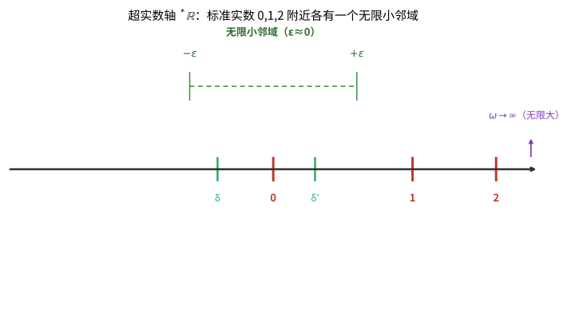

> **直观理解（现实类比）**：把超实数轴想象成一条"放大了无数倍"的实数轴。在普通实数轴上，0 附近被看作一个点；但在超实数轴上，0 周围有一圈肉眼看不见的"绒毛"——这就是无限小邻域，里面挤满了与 0 相差一个无限小 $\varepsilon$ 的超实数。就好比在显微镜下，一个看似光滑的桌面上其实布满了细小的凹凸。无限小不是"零"，却比任何正实数都小；它的倒数就是比任何实数都大的无限大 $\omega$。有了这些"绒毛"，微积分中"趋近"的极限思想就变成了直接在邻域内取标准部分的直观运算。

> **直观理解（现实类比）**：超实数像"实数的扩展"——它在标准实数 $\mathbb{R}$ 中加入无穷小和无穷大，构成一个更大的数系 $^*\mathbb{R}$。这就像在整数中加入分数得到有理数，再填满"缝隙"得到实数一样，$^*\mathbb{R}$ 是 $\mathbb{R}$ 的又一次"扩张"。每个标准实数周围都长出一圈无穷小邻域（形如 $r+\varepsilon$），远处还分布着正负无穷大。关键性质是：$\mathbb{R}$ 中成立的一阶命题在 $^*\mathbb{R}$ 中依然成立（转移原理），所以这种扩张"不破坏原有真理"，只是让推理变得更直观——极限变成取标准部分，连续变成"无穷小变化引起无穷小响应"。

#### 课堂问答

**老师**：给我说清楚「无限小」的定义，以及它和 $0$ 的关系——它是不是就是 $0$？

**学生**：不是。无限小 $\varepsilon$ 满足 $|\varepsilon| < r$ 对所有正标准实数 $r$ 成立，但 $\varepsilon \neq 0$。三个层次要分清：标准实数、无限小、无限大；任一有限超实数唯一写成 $x = \text{st}(x) + \varepsilon$。

**老师（追问）**：那 $\varepsilon$ 的倒数是什么？有限超实数和无限大之间有没有「介于中间」的东西？

**学生**：非零无限小的倒数是无限大，因为 $1/\varepsilon > n$ 对一切 $n \in \mathbb{N}$ 成立。超实数轴上没有别的中间类别：要么有限（贴着某标准实数），要么无限（正负无限大），而有限者还有标准加无限小的唯一分解。

**老师（拓展）**：$^*\mathbb{R}$ 和 $\mathbb{R}$ 是什么关系，这种扩张和「有理数扩到实数」一样吗？

**学生**：$^*\mathbb{R}$ 是 $\mathbb{R}$ 的初等扩张，$\mathbb{R} \subsetneq {}^*\mathbb{R}$。但它和有理数补缝隙扩成实数不同——那是完备化，会改变一阶性质；超幂扩张保留全部一阶真命题，用转移原理即可来回翻译。

### 超幂构造

超实数系 $^*\mathbb{R}$ 可以通过超幂构造得到：

$$^*\mathbb{R} = \mathbb{R}^{\mathbb{N}} / \mathcal{U}$$

其中 $\mathcal{U}$ 是 $\mathbb{N}$ 上的一个自由超滤（free ultrafilter）。具体来说：
- $\mathbb{R}^{\mathbb{N}}$ 是所有实数序列 $(a_1, a_2, a_3, \ldots)$ 的集合
- 两个序列 $(a_n)$ 和 $(b_n)$ 在超滤 $\mathcal{U}$ 下等价，如果 $\{n : a_n = b_n\} \in \mathcal{U}$
- 超实数 $[a_n]$ 是序列 $(a_n)$ 在等价关系下的等价类

#### 课堂问答

**老师**：超幂 $\mathbb{R}^{\mathbb{N}}/\mathcal{U}$ 里，两个序列什么时候算同一个人？为什么必须用超滤而不是普通子集？

**学生**：$(a_n) \sim (b_n)$ 当且仅当 $\{n : a_n = b_n\} \in \mathcal{U}$，超实数就是等价类 $[a_n]$。必须用超滤，是为了让相等、小于、命题真值都能被同一套「几乎所有」规则裁决：超滤对补集二选一、对有限交封闭，这两个性质恰好对应逻辑的 $\neg$ 与 $\land$。

**老师（追问）**：为什么要求自由超滤，而不是主超滤？

**学生**：主超滤由某个固定坐标 $n_0$ 生成，「几乎所有」退化成「在某一点」，等价类就与单个实数一一对应，$^*\mathbb{R} \cong \mathbb{R}$，根本得不到无限小。自由超滤不含有限集，才保证扩张是真的。

**老师（拓展）**：构造里「存在自由超滤」这一点要不要担心？

**学生**：这里用到超滤引理（依赖选择公理），但配合 Łoś 定理，$\mathbb{R}^{\mathbb{N}}/\mathcal{U}$ 是 $\mathbb{R}$ 的初等扩张这一步是无条件成立的。常见误区：把 $[a_n]$ 当成「序列的极限值」，其实它由超滤按多数坐标定义，与极限毫无关系。

### Loś定理

Loś定理（也称超幂基本定理）是超幂构造的核心定理，它告诉我们哪些命题在超幂结构中成立。

**定理**：对于任意一阶公式 $\phi(x_1, \ldots, x_k)$ 和超实数 $[a^1_n], \ldots, [a^k_n]$：
$$^*\mathbb{R} \models \phi([a^1_n], \ldots, [a^k_n]) \iff \{n \in \mathbb{N} : \mathbb{R} \models \phi(a^1_n, \ldots, a^k_n)\} \in \mathcal{U}$$

即，超实数系中一个命题成立，当且仅当在超滤 $\mathcal{U}$ 中的几乎所有标准实数中该命题成立。

> **直观理解（现实类比）**：Loś定理是超幂构造的"表决规则"：一个关于超实数的命题要成立，不必在每一个坐标上都对，只要在超滤 $\mathcal{U}$ 所钦定的"几乎所有"坐标上成立即可。这就像陪审团判决——并不要求每位成员都赞同，只要达到一套既定"压倒多数"的标准就算成立。正是这条规则确立了两个超实数之间谁大谁小、是否相等，都由"几乎所有坐标"说了算，从而把无限多坐标的零散意见压缩成唯一的最终裁决。

#### 课堂问答

**老师**：把 Łoś 定理一句话说清楚——它凭什么决定超实数世界里的真假？

**学生**：它是「按坐标表决」的基本定理。对任意一阶公式 $\phi$ 与元素 $[f_1],\ldots,[f_k]$：
$$\mathbb{R}^{I}/\mathcal{U} \models \phi([f_1],\ldots,[f_k]) \iff \{i \in I : \mathbb{R} \models \phi(f_1(i),\ldots,f_k(i))\} \in \mathcal{U}$$
右边那个集合属于超滤，就是「在几乎所有坐标上为真」。

**老师（追问）**：证明里原子公式、连接词、量词分别靠超滤的哪条性质？

**学生**：原子公式直接用等价类定义；$\neg$ 用超滤对任意集合与其补集恰有一个成立；$\land$ 用对有限交封闭；$\exists$ 正向用「包含超滤成员的超集仍在超滤」，反向用选择公理逐坐标挑见证元。归纳一遍即证。

**老师（拓展）**：取闭语句会得到什么，为什么这一步如此关键？

**学生**：闭语句 $\phi$ 无自由变量时，右边集合只能是 $I$ 或 $\emptyset$，于是 $\mathbb{R} \models \phi \iff {}^*\mathbb{R} \models \phi$——这正是转移原理。常见误区：以为 Łoś 定理对二阶命题也成立；实际上它只处理一阶公式，遇到「对所有子集」就失效。

### 转移原理

转移原理（Transfer Principle）是非标准分析的核心工具：

**原理**：如果一个一阶命题 $\phi$ 在标准实数系 $\mathbb{R}$ 中成立，那么它在超实数系 $^*\mathbb{R}$ 中也成立；反之亦然。

这意味着，任何可以用一阶语言表述的数学定理，在标准和非标准框架下是等价的。转移原理保证了我们可以用非标准方法证明标准结论。

> **直观理解（现实类比）**：转换原理像"双向翻译"——标准实数中成立的真命题可以原封不动地翻译到超实数系，反之亦然。这就像两种语言之间有一本"忠实词典"：任何一句话在 A 语言中为真，翻译到 B 语言后依然为真。但翻译只对"一阶语句"有效——能用量词 $\forall,\exists$ 表达的命题可以翻译，涉及"对所有子集"这种二阶量化的命题则可能失真。正是这种"忠实翻译"让非标准分析成为合法工具：你可以在超实数系里用无穷小做直观推理，最后通过转移原理把结论"搬回"标准实数系，得到的依然是标准数学承认的定理。

> **常见坑**：
>
> - **转移原理只在"一阶语句"上管用**。$\forall x\,\exists y$ 这类一阶句子可以翻译；但"$\forall S\subseteq\mathbb{R}$（对实数的一切子集 $S$）"、"对一切内部集还是外集"这类涉及二阶量化或"标准/非标准"区分的断言，**不能**随便转移。正是因为用了"非标准"这个词，句子（如"每个有限超实数都有标准部分"）就升级成了二阶/非内部命题，落到转移原理的适用范围之外。
> - **"$\mathbb{R}$ 是 $^*\mathbb{R}$ 里的外集"是正常的，不是错误**。标准实数全体作为 $^*\mathbb{R}$ 的子集"是不是标准实数"这种性质无法靠单个坐标判定，故 $\mathbb{R}$ 只是外集。这只说明它不能享受转移原理，绝不意味着它"不存在"或"非法"。

#### 课堂问答

**老师**：转移原理「双向翻译」的说法很漂亮，但它的准确适用范围是什么？

**学生**：只要 $\phi$ 是一阶命题（更准地说一阶闭语句），就有 $\mathbb{R} \models \phi \iff {}^*\mathbb{R} \models \phi$，双向都成立。它把标准结论与超实数结论绑成一体，所以能用无穷小去证标准定理。

**老师（追问）**：红线到底在哪？举一个不能转移的例子。

**学生**：红线在「一阶」。能用量词 $\forall x\,\exists y$ 表达的可以搬；像完备性这种需要「对所有子集」量化的二阶命题，以及「每个有限超实数都有标准部分」这类隐含标准与非标准之分的命题，都不能转移。例如「$^*\mathbb{R}$ 中存在非零无限小」为真，却无法搬回 $\mathbb{R}$，因为 $\mathbb{R}$ 里没有。

**老师（拓展）**：$\mathbb{R}$ 在 $^*\mathbb{R}$ 中是外集，这说明它「不合法」吗？

**学生**：不。它只说明 $\mathbb{R}$ 不是内部集，无法享受转移原理，但它当然存在、也合法。常见误区：把「外集」当成「错误对象」。恰恰相反，能参与超滤逐坐标裁决的才是内部集，「是不是标准实数」这种性质无法靠单个坐标判定，所以 $\mathbb{R}$ 只能是外集。

### 标准部分定理

> **🌐 直觉先行：无穷小怎么"变回"精确的数？**
>
> 用无穷小算积分、导数，最终得到的常常是"标准实数 + 一小撮无限小尾巴"。要读出真正的答案，就希望有一种操作把"尾巴"剥掉、留下主体——这就是标准部分 $\text{st}$。它像"把带误差的测量读数取整到最近的真值"：每个**有限**超实数都唯一地贴着一个最近的标准实数，二者之差恰是无限小。有了它，"极限"就被翻译成"取标准部分"这一行代数。

**标准部分定理**（Standard Part Theorem）建立了有限超实数与标准实数之间的联系。

**定理**：每个有限超实数 $x \in ^*\mathbb{R}$ 都可以唯一地表示为 $x = \text{st}(x) + \varepsilon$，其中 $\text{st}(x) \in \mathbb{R}$ 是标准实数，$\varepsilon$ 是无限小。

$\text{st}(x)$ 称为 $x$ 的**标准部分**。

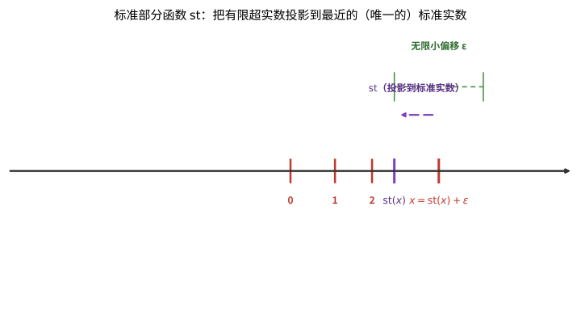

> **直观理解（现实类比）**：标准部分函数 $\text{st}(x)$ 就像"四舍五入到整数"的精确版——只不过它舍去的是无限小那部分 $\varepsilon$，保留下唯一的"标准"主体 $\text{st}(x)$。打个比方：称体重时，读数 $x = 60$ 千克再加一根头发的重量（无限小），$\text{st}(x) = 60$ 就是"去掉那根头发"后的确切体重。在非标准微积分里，导数就是这样算出来的：差商 $\frac{f(x+\Delta x)-f(x)}{\Delta x}$ 里含无限小 $\Delta x$，直接取标准部分 $\text{st}$ 就把无限小"抹平"，得到精确的导数——如同把测量误差剥掉，露出真正的物理量。

> **直观理解（现实类比）**：标准部分像"取整到最近的标准实数"——把超实数 $a$ 映射到最近的标准实数 $\text{st}(a)$，差值 $a-\text{st}(a)$ 是无穷小。这就像 GPS 定位时显示的"地址"——你的实际位置可能在某个门牌号附近的几米内（无穷小偏差），但系统报告的是最近的标准门牌号（标准部分）。每个有限超实数都有唯一的标准部分，这正是非标准微积分的核心机制：差商 $\frac{f(x+\Delta x)-f(x)}{\Delta x}$ 是一个含无穷小的超实数，取 $\text{st}$ 后无穷小项被抹去，剩下的就是精确导数。极限的 $\varepsilon$-$\delta$ 定义被一行代数运算取代，这正是非标准分析的简洁之美。

> **常见坑**：
>
> - **无限小 $\varepsilon\ne 0$**。无限小"比一切正标准实数都小"，但绝不是 $0$。也因此，**只有有限超实数**（在某个标准实数 $M$ 之内）才有标准部分；**无限大没有标准部分**——试图对一个无限大取 $\text{st}$ 是未定义的。
> - **不要拿标准的"极限直觉"去衡量取标准部分的合法性**。$\text{st}\big(\frac{f(x+\Delta x)-f(x)}{\Delta x}\big)$ 成立靠的是"有限超实数的标准部分唯一性"，不是"把 $\Delta x$ 当 0 代入"。当差商是无限大（如 $\frac{1}{\Delta x}$）时没有标准部分，正对应"导数不存在"。
> - **$\text{st}(xy)=\text{st}(x)\text{st}(y)$、$\text{st}(x+y)=\text{st}(x)+\text{st}(y)$ 只对有限超实数且情形合法时成立**；碰到 $\infty-\infty$ 型的差（如 $\text{st}(\omega-\omega)$ 对无限大 $\omega$）没有意义。别把它当成"对所有超实数都线性"。

#### 课堂问答

**老师**：每个有限超实数凭什么恰好贴着一个标准实数？唯一性从哪来？

**学生**：结论是 $x = \text{st}(x) + \varepsilon$，其中 $\text{st}(x) \in \mathbb{R}$、$\varepsilon$ 无限小。存在性可令 $s = \sup\{r \in \mathbb{R} : r < x\}$，由完备性 $s$ 存在；若 $|x - s| \geq \varepsilon_0 > 0$ 就会推出 $s \pm \varepsilon_0/2$ 与上确界矛盾，故 $x - s$ 无限小。

**老师（追问）**：唯一性呢？两个标准部分会不会并存？

**学生**：不会。若 $\text{st}_1(x)$、$\text{st}_2(x)$ 都合格，则它们的差 $s_1 - s_2$ 是两个无限小之和，仍是无限小；但它又是标准实数，而标准实数中唯一的无限小是 $0$，故 $s_1 = s_2$。

**老师（拓展）**：无限大能取标准部分吗？$\text{st}$ 是线性的吗？

**学生**：无限大没有标准部分，$\text{st}$ 未定义——这正是「导数不存在」的非标准翻译。常见误区：以为 $\text{st}$ 对所有超实数都满足线性；实际只在有限且不出现 $\infty - \infty$ 型时，$\text{st}(x+y) = \text{st}(x) + \text{st}(y)$、$\text{st}(xy) = \text{st}(x)\text{st}(y)$ 才成立。

### 内部集与外集

在非标准分析中，集合分为两类：
- **内部集**（Internal Sets）：可以通过超幂构造从标准集合得到的集合，满足转移原理
- **外集**（External Sets）：不是内部集的集合，如 $\mathbb{R}$（标准实数集）在 $^*\mathbb{R}$ 中是一个外集

内部集是超结构中的"好"集合，它们满足转移原理；外集则可能违反某些经典性质。

> **💡 直观理解（类比）**：内部集与外集的分界，好比"刷条形码可被收银机识别"与"手工记账的货物"之别。内部集由标准集合经超幂机械制造，能被超滤逐坐标扫描判定，是"从正门办过手续的正式公民"；外集如标准实数 $\mathbb{R}$ 嵌进 $^*\mathbb{R}$ 后的像，因为"是不是标准实数"这种性质没法靠单独某个坐标判定，就像没有条形码、混进来的货物，虽然摆在店里，却不受自动结算（转移原理）系统管辖，甚至会违反一些经典规则。凡能参与超滤裁决、可转移的都是内部集，这正是"好集合"的含义。

#### 课堂问答

**老师**：内部集和外集的分别，本质上是在区分什么？

**学生**：区分「能不能被超滤逐坐标机械生成、从而服从转移原理」。内部集是标准集合经超幂构造得到的像，是超结构里的正式公民；外集不是内部集，可能违反经典性质。典型例子：$\mathbb{R}$ 嵌进 $^*\mathbb{R}$ 后是外集。

**老师（追问）**：为什么 $\mathbb{R}$ 偏偏不是内部的？直觉上它明明很「标准」。

**学生**：因为「$x$ 是标准实数」这一性质无法用单个坐标 $n$ 的语言判定——它不是某个 $A_n$ 的等价类在超滤下的像，所以不内部。「内部」看的是可定义性与坐标可裁决性，而不是看起来是否自然。

**老师（拓展）**：外集有什么用？它是不是「没用还需要小心」的东西？

**学生**：外集恰恰是许多深刻对象的栖身处。例如标准部分函数 $\text{st}$ 的定义域是有限超实数集，那是外集；$\mathbb{N}$ 在 $^*\mathbb{N}$ 中也是外集，因为 $^*\mathbb{N}$ 里有无限大自然数。常见误区：一发现某集合是外集就以为它不合法；实际外集合法存在，只是不能套用转移原理，需要单独论证。

### Loeb测度

Loeb测度是非标准分析中构造测度的重要工具。给定一个内部测度空间 $(X, \mathcal{A}, \mu)$，其中 $\mu$ 是有限内部测度，可以定义：
- **Loeb测度** $\mu_L$：对所有 $A \in \mathcal{A}$，$\mu_L(A) = \text{st}(\mu(A))$
- 通过Carathéodory扩张，$\mu_L$ 可以扩张到更大的 $\sigma$-代数上

Loeb测度在概率论、随机分析中有广泛应用。

> **直观理解（现实类比）**：Loeb测度像是拿"标准刻度尺"重新规整一把"带毛刺的尺子"——内部测度 $\mu$ 量出的可能是含无限小尾巴的超实数，取标准部分 $\text{st}$ 就像把棱角磨平、把读数统一成标准单位，得到标准测度 $\mu_L$。类比用量程粗糙的水表读数：能精确到千分之一升的内部示数被规整成整升数，再靠 Carathéodory 扩张把这只规整好的尺子延展到更大的 $\sigma$-代数上。它把"无限细分网格上的概率"落回标准的、可操作可比较的测度，是非标准世界通往标准概率论的闸门。

---

#### 课堂问答

**老师**：Loeb 测度做的事，一句话概括是什么？

**学生**：把一个有限内部测度 $\mu$ 取标准部分，得到标准测度。先在对内部可测集 $A \in \mathcal{A}$ 上定义 $\mu_L(A) = \text{st}(\mu(A))$，再用 Carathéodory 扩张到更大的 $\sigma$-代数。

**老师（追问）**：为什么要先取 $\text{st}$ 再扩张？直接把 $\mu$ 当测度用不行吗？

**学生**：因为 $\mu$ 只取超实数值、且仅有限可加，不是标准意义下的测度。取 $\text{st}$ 把含无限小尾巴的读数压回实数，同时把有限可加升级成 $\sigma$-可加（无限小尾巴在取标准部分时归零），这样才能接上 Carathéodory 那套标准工具。

**老师（拓展）**：扩张后的测度空间有什么特别之处？

**学生**：$\mu_L$ 是完备的，且一些非内部的外集也可以是 Loeb 可测的——这正是它的价值：把无限细分网格上的概率落回可操作的标准概率空间。常见误区：以为 $\mu_L(A) = \text{st}(\mu(A))$ 对一切 $\mu_L$-可测集都成立；其实等式只保证对内部可测集 $A \in \mathcal{A}$ 成立。

## 定理与证明

### 定理1：标准部分定理

**定理**：每个有限超实数 $x \in ^*\mathbb{R}$ 都存在唯一的标准化部分 $\text{st}(x) \in \mathbb{R}$，使得 $x - \text{st}(x)$ 是无限小。

**证明**（用超实数的Dedekind分割）：

**步骤1：构造下界集合**

设 $x = [a_n]$ 是一个有限超实数。定义集合：
$$L = \{r \in \mathbb{R} : r < x \text{ 在 } ^*\mathbb{R} \text{ 中成立}\}$$

由于 $x$ 是有限的，存在 $M \in \mathbb{R}$ 使得 $|x| < M$，因此 $L$ 是非空且有上界的（$M$ 是一个上界）。

**步骤2：证明 $\sup L$ 存在**

由实数完备性，$\sup L$ 在 $\mathbb{R}$ 中存在。记 $s = \sup L$。

**步骤3：证明 $x - s$ 是无限小**

假设 $x - s$ 不是无限小，则存在标准正实数 $\varepsilon > 0$ 使得 $|x - s| \geq \varepsilon$。

分两种情况：
- 如果 $x - s \geq \varepsilon$，则 $s + \frac{\varepsilon}{2} < x$，所以 $s + \frac{\varepsilon}{2} \in L$，但这与 $s = \sup L$ 矛盾。
- 如果 $s - x \geq \varepsilon$，则 $s - \frac{\varepsilon}{2} > x$，但 $s - \frac{\varepsilon}{2} \in \mathbb{R}$ 且 $s - \frac{\varepsilon}{2} < s$，由 $s$ 的定义，$s - \frac{\varepsilon}{2} \in L$，即 $s - \frac{\varepsilon}{2} < x$，矛盾。

因此 $x - s$ 必须是无限小。

**步骤4：证明唯一性**

如果 $s_1$ 和 $s_2$ 都是 $x$ 的标准部分，则 $s_1 - s_2 = (s_1 - x) + (x - s_2)$ 是两个无限小的和，因而是无限小。但 $s_1 - s_2$ 是标准实数，标准实数中只有 $0$ 是无限小，故 $s_1 = s_2$。

#### 课堂问答

**老师**：定理1的证明核心是哪一步？请直接指出最关键的构造。

**学生**：关键构造是下界集 $L = \{r \in \mathbb{R} : r < x\}$，取 $s = \sup L$。$x$ 有限保证 $L$ 非空有上界，完备性给出 $s$，最后证 $x - s$ 无限小。

**老师（追问）**：怎么排除 $|x - s| \geq \varepsilon_0 > 0$？两个方向各是什么？

**学生**：若 $x - s \geq \varepsilon_0$，则 $s + \varepsilon_0/2 < x$ 属于 $L$，违反 $s$ 是上确界；若 $s - x \geq \varepsilon_0$，则 $s - \varepsilon_0/2$ 是比 $s$ 小的标准上界，同样违反上确界最小性。两个方向都矛盾，故只能无限小。

**老师（拓展）**：唯一性怎么一句话拿下？

**学生**：设两个标准部分 $s_1, s_2$，则 $s_1 - s_2 = (s_1 - x) + (x - s_2)$ 是无限小之和，故无限小；而它是标准实数，标准实数中唯一无限小是 $0$，得 $s_1 = s_2$。常见误区：担心 $\sup$ 的存在性——它靠的是 $\mathbb{R}$ 的完备性，而这个完备性本身是二阶命题，不参与转移，只在本证明里当作标准的实数定理使用。

### 定理2：Loś定理

**定理**（Loś定理，超幂基本定理）：设 $\mathcal{U}$ 是 $I$ 上的超滤，$M$ 是一个结构。对于超幂 $M^I / \mathcal{U}$ 中的元素 $[f_1], \ldots, [f_k]$ 和任意一阶公式 $\phi(v_1, \ldots, v_k)$：
$$M^I / \mathcal{U} \models \phi([f_1], \ldots, [f_k]) \iff \{i \in I : M \models \phi(f_1(i), \ldots, f_k(i))\} \in \mathcal{U}$$

**证明**（对公式的结构进行归纳）：

**步骤1：原子公式**

对于原子公式，如 $v_1 = v_2$ 或 $R(v_1, \ldots, v_k)$，定理的结论直接由超幂的构造定义给出。

例如，$[f_1] = [f_2]$ 当且仅当 $\{i : f_1(i) = f_2(i)\} \in \mathcal{U}$，这正是超幂中相等的定义。

**步骤2：逻辑连接词**

对于 $\neg\phi$：
$$M^I/\mathcal{U} \models \neg\phi([f_1], \ldots, [f_k]) \iff M^I/\mathcal{U} \not\models \phi([f_1], \ldots, [f_k])$$
$$\iff \{i : M \models \phi(f_1(i), \ldots, f_k(i))\} \notin \mathcal{U}$$
$$\iff I \setminus \{i : M \models \phi(f_1(i), \ldots, f_k(i))\} \in \mathcal{U} \quad (\text{因为 } \mathcal{U} \text{ 是超滤})$$
$$\iff \{i : M \models \neg\phi(f_1(i), \ldots, f_k(i))\} \in \mathcal{U}$$

对于 $\phi \land \psi$：
$$M^I/\mathcal{U} \models \phi \land \psi \iff M^I/\mathcal{U} \models \phi \text{ 且 } M^I/\mathcal{U} \models \psi$$
由归纳假设，$\{i : M \models \phi(f_1(i), \ldots)\} \in \mathcal{U}$ 且 $\{i : M \models \psi(f_1(i), \ldots)\} \in \mathcal{U}$。
由于超滤对有限交封闭，这两个集合的交也在 $\mathcal{U}$ 中，即：
$$\{i : M \models \phi \land \psi\} = \{i : M \models \phi\} \cap \{i : M \models \psi\} \in \mathcal{U}$$

**步骤3：存在量词**

对于 $\exists v \phi(v, [f_1], \ldots, [f_k])$：

（$\Rightarrow$）假设 $M^I/\mathcal{U} \models \exists v \phi(v, [f_1], \ldots, [f_k])$，则存在 $[g] \in M^I/\mathcal{U}$ 使得 $M^I/\mathcal{U} \models \phi([g], [f_1], \ldots, [f_k])$。
由归纳假设，$A = \{i : M \models \phi(g(i), f_1(i), \ldots, f_k(i))\} \in \mathcal{U}$。
但 $A \subseteq \{i : M \models \exists v \phi(v, f_1(i), \ldots, f_k(i))\} = B$，由于 $\mathcal{U}$ 是滤，$B \in \mathcal{U}$。

（$\Leftarrow$）假设 $B = \{i : M \models \exists v \phi(v, f_1(i), \ldots, f_k(i))\} \in \mathcal{U}$。
对于每个 $i \in B$，选择 $g(i) \in M$ 使得 $M \models \phi(g(i), f_1(i), \ldots, f_k(i))$。对于 $i \notin B$，任意选择 $g(i)$。
则 $[g]$ 在超幂中满足 $M^I/\mathcal{U} \models \phi([g], [f_1], \ldots, [f_k])$，因此 $M^I/\mathcal{U} \models \exists v \phi(v, [f_1], \ldots)$。

**步骤4：全称量词**

全称量词 $\forall v \phi$ 等价于 $\neg\exists v \neg\phi$，由步骤2和步骤3可推出。

**步骤5：归纳完成**

通过对公式的复杂度进行归纳，Loś定理得证。

**推论（转移原理）**：如果 $\phi$ 是一个闭语句（无自由变量的一阶句子），则：
$$\mathbb{R} \models \phi \iff ^*\mathbb{R} \models \phi$$

> **💡 直观理解（类比）**：这是转移原理以纯语句形式的重述——一条不含自由变量的闭语句在 $\mathbb{R}$ 中为真，当且仅当它在 $^*\mathbb{R}$ 中同样为真。就好比把一句话翻进扩大了的新词典，真值不漂移：语种变了、词汇变多，但"这句名言"的对错原封不动。唯一的红线是句子必须"写完整"（无自由变量），如同一条命令不允许悬空的占位符，否则就谈不上对错可言。正是这条推论，保证了你在超实数世界里算出的结论能原样搬回标准数学。

#### 课堂问答

**老师**：Łoś 定理按公式复杂度归纳，最有技术含量的是哪一步？

**学生**：存在量词的 $(\Leftarrow)$ 方向。当 $\{i : \mathbb{R} \models \exists v\,\phi\} \in \mathcal{U}$ 时，要在每个坐标上挑出一个见证元 $g(i)$ 拼成超实数 $[g]$，才能证明 $\mathbb{R}^I/\mathcal{U} \models \phi([g],\ldots)$。

**老师（追问）**：这个挑选为什么合法？如果并集里坐标对应的见证有很多个怎么办？

**学生**：只用选择公理：对每个 $i \in B$ 任取一个满足 $\phi$ 的 $g(i)$ 即可，其余坐标随意取。因为结论只关心「集合属于 $\mathcal{U}$」，具体挑了哪个见证无关紧要——这正是逐坐标裁决的威力。

**老师（拓展）**：全称量词那步为什么可以不重新做？

**学生**：因为 $\forall v\,\phi \equiv \neg\exists v\,\neg\phi$，把它写成否定加存在，复用 $\neg$ 步与 $\exists$ 步即可，归纳闭合。常见误区：以为归纳要处理函数符号、常元等全部符号；实际上它们都归约到原子公式处理，结构归纳只需覆盖原子、连接词、量词三类。

### 定理3：非标准微积分基本定理

**定理**：设 $f: [a,b] \to \mathbb{R}$ 是连续函数，$F(x) = \int_a^x f(t) dt$ 是 $f$ 的积分函数。则 $F$ 在 $[a,b]$ 上可导，且 $F'(x) = f(x)$ 对所有 $x \in (a,b)$ 成立。

> **直观理解（现实类比）**：非标准微积分基本定理把普通版的证明压缩成"取差商再取标准部分"这两步代数运算：积分函数 $F$ 的差商 $\frac{^*F(x+\Delta x)-^*F(x)}{\Delta x}$ 恰好等于被积函数在某个中间点 $^*f(\xi)$ 的值（积分中值定理），而 $\xi$ 与 $x$ 只差一个无限小，配合连续性便没有差别，取标准部分就直接得到 $f(x)$。这就好比用极灵敏的速度计读跑步机：在无限小的一小段里，平均速度几乎就是瞬时速度。极限的繁琐被"积分中值 + 取标准部分"两步取代，连 $\varepsilon$-$\delta$ 的迂回都省了。

**证明**（用无限小和标准部分）：

**步骤1：非标准表述**

我们需要证明：对于任意 $x \in (a,b)$ 和任意无限小 $\Delta x \neq 0$（使得 $x + \Delta x \in ^*[a,b]$）：
$$\text{st}\left(\frac{^*F(x + \Delta x) - ^*F(x)}{\Delta x}\right) = f(x)$$

其中 $^*F$ 是 $F$ 的非标准扩张。

**步骤2：用积分表示差商**

由 $F$ 的定义，在标准分析中：
$$F(x + h) - F(x) = \int_x^{x+h} f(t) dt$$

由转移原理，在非标准框架下：
$$^*F(x + \Delta x) - ^*F(x) = \int_x^{x+\Delta x} ^*f(t) dt$$

其中 $^*f$ 是 $f$ 的非标准扩张，$\int$ 是非标准积分。

**步骤3：积分估值**

由于 $f$ 在 $[a,b]$ 上连续，它在 $[a,b]$ 上一致连续。由转移原理，$^*f$ 在 $^*[a,b]$ 上一致连续（在非标准意义下）。

特别地，对于无限小 $\Delta x$，$^*f$ 在区间 $[x, x+\Delta x]$ 上的变化是无限小的。因此，存在无限小 $\varepsilon$ 使得：
$$\min_{t \in [x, x+\Delta x]} ^*f(t) \leq \frac{1}{\Delta x} \int_x^{x+\Delta x} ^*f(t) dt \leq \max_{t \in [x, x+\Delta x]} ^*f(t)$$

且：
$$\max_{t \in [x, x+\Delta x]} ^*f(t) - \min_{t \in [x, x+\Delta x]} ^*f(t) = \varepsilon$$

**步骤4：取标准部分**

由积分中值定理（转移后的版本），存在 $\xi \in [x, x+\Delta x]$ 使得：
$$\frac{1}{\Delta x} \int_x^{x+\Delta x} ^*f(t) dt = ^*f(\xi)$$

由于 $\xi \approx x$（$\xi$ 与 $x$ 相差无限小），且 $f$ 在 $x$ 处连续，有 $^*f(\xi) \approx f(x)$（即 $^**f(\xi) - f(x)$ 是无限小）。

因此：
$$\text{st}\left(\frac{^*F(x + \Delta x) - ^*F(x)}{\Delta x}\right) = \text{st}(^*f(\xi)) = f(x)$$

**步骤5：结论**

由标准部分定理，$F'(x) = f(x)$ 在标准意义下成立。

#### 课堂问答

**老师**：非标准证明把基本定理压成了几步？最核心的等式是哪个？

**学生**：核心是 $\text{st}\!\left(\frac{{}^*F(x+\Delta x) - {}^*F(x)}{\Delta x}\right) = f(x)$。差商用非标准积分写成 $\frac{1}{\Delta x}\int_x^{x+\Delta x} {}^*f(t)\,dt$，由积分中值定理等于 $^*f(\xi)$，其中 $\xi \approx x$。

**老师（追问）**：$\xi \approx x$ 凭什么能推出 $^*f(\xi) \approx f(x)$？

**学生**：靠 $f$ 在 $x$ 处连续，且这一步可一致连续地转移到 $^*[a,b]$ 上：无限小邻域内 $^*f$ 的变化是无限小。于是 $^*f(\xi) - f(x)$ 无限小，取标准部分即得 $f(x)$。

**老师（拓展）**：整个论证里 $\varepsilon$-$\delta$ 去哪了？

**学生**：被「积分中值 + 取标准部分」替代了。常见误区：以为非标准证明只是把无限小当 $0$、并不严格；其实每步都严格——差异由标准部分定理兜底，$\Delta x \neq 0$ 始终成立，最后一步取 $\text{st}$ 才把无限小合法地抹掉。

### 定理4：非标准拓展的饱和性

**定理**：设 $^*\mathbb{R}$ 是 $\mathbb{R}$ 的 $\kappa$-饱和超幂扩张（$\kappa$ 为不可数基数）。则对于任意基数小于 $\kappa$ 的、具有有限交性质的内部集族，它们的交非空。

> **💡 直观理解（类比）**：$\kappa$-饱和性说的是：只要一族内部集合满足"任意有限个的交都不空"，那么这整族集合的交也非空——就好比只要任意有限个同事都能找到共同开会时间，那么整群人也存在一个全员都空闲的时刻。它把"有限交性质"从有限情形一举推广到基数小于 $\kappa$ 的无限情形，是非标准扩张里"无限多个集合仍能挤出一个公共元素"的来源，也是后面构造Loeb测度、凝聚极限对象时总能"在无限深处逮到共同点"的底气。

**证明**：

**步骤1：回忆超幂构造**

设 $^*\mathbb{R} = \mathbb{R}^{\mathbb{N}} / \mathcal{U}$，其中 $\mathcal{U}$ 是 $\mathbb{N}$ 上的自由超滤。

**步骤2：有限交性质**

设 $\{A_\alpha : \alpha < \lambda\}$ 是内部集族，$\lambda < \kappa$，且任意有限子集有非空交。

每个内部集 $A_\alpha$ 可以表示为 $A_\alpha = [A_{\alpha,n}]$，其中每个 $A_{\alpha,n} \subseteq \mathbb{R}$。

**步骤3：构造超滤中的集合**

对于每个有限子集 $F \subseteq \lambda$，由于 $\bigcap_{\alpha \in F} A_\alpha \neq \emptyset$，存在 $[a_n] \in \bigcap_{\alpha \in F} A_\alpha$。这意味着：
$$\{n : a_n \in \bigcap_{\alpha \in F} A_{\alpha,n}\} \in \mathcal{U}$$

设 $S_F = \{n : \bigcap_{\alpha \in F} A_{\alpha,n} \neq \emptyset\}$，则 $S_F \in \mathcal{U}$。

**步骤4：利用超滤的 $\kappa$-完备性**

族 $\{S_F : F \subseteq \lambda, F \text{ 有限}\}$ 具有有限交性质（因为 $\mathcal{U}$ 对有限交封闭），且基数小于 $\kappa$。

由于 $\mathcal{U}$ 是 $\kappa$-完备的（$\kappa$ 为不可数基数时，$\mathbb{N}$ 上的超滤不可能是 $\kappa$-完备的，这里需要更一般的构造——实际上，我们需要在更大的基数上构造超滤），存在 $n_0$ 属于所有这些 $S_F$。

**步骤5：构造公共交点**

对于每个 $n$，设 $B_n = \bigcap\{A_{\alpha,n} : \alpha < \lambda, \text{ 且 } n \in S_{\{\alpha\}}\}$。如果对某个 $n$，$B_n = \emptyset$，则存在有限个 $\alpha_1, \ldots, \alpha_k$ 使得 $\bigcap_{i=1}^k A_{\alpha_i,n} = \emptyset$，但这与 $n \in S_{\{\alpha_1,\ldots,\alpha_k\}}$ 矛盾。

因此每个 $B_n \neq \emptyset$。选择 $a_n \in B_n$，则 $[a_n] \in \bigcap_{\alpha < \lambda} A_\alpha$。

**步骤6：结论**

我们证明了 $\bigcap_{\alpha < \lambda} A_\alpha \neq \emptyset$，即饱和性成立。

#### 课堂问答

**老师**：饱和性定理想说明什么？「有限交性质」在这里起什么作用？

**学生**：它说 $\kappa$-饱和扩张里，任意基数小于 $\kappa$、具有限交性质的内部集族交非空。有限交性质是「挂条件」的保证——只要任意有限个条件都相容，饱和性就把它们从有限一次性升到 $\lambda < \kappa$ 那么多。

**老师（追问）**：证明里超滤的 $\kappa$-完备性用在哪？含量上有没有坑？

**学生**：用它把每个有限子集 $F$ 对应的集合 $S_F = \{n : \bigcap_{\alpha \in F} A_{\alpha,n} \neq \emptyset\}$ 交起来仍属超滤、从而取到一个公共坐标。坑在于：$\mathbb{N}$ 上的超滤不可能 $\kappa$-完备；所以真正声明 $\kappa$-饱和时，需要在足够大的基数上构造超滤，这一步必须交代清楚。

**老师（拓展）**：拿到那个公共坐标后，怎么拼出整个族的公共元？

**学生**：对每个坐标设 $B_n = \bigcap\{A_{\alpha,n} : n \in S_{\{\alpha\}}\}$，并证明 $B_n \neq \emptyset$（否则有限个 $\alpha$ 在该坐标的 $\bigcap A_{\alpha,n}$ 为空，与 $n \in S_F$ 矛盾）。取 $a_n \in B_n$ 组成超实数 $[a_n]$，它落在每个 $A_\alpha$ 里。常见误区：把 $\kappa$-饱和当成普通可数饱和，忽略基数限制 $\lambda < \kappa$。

### 定理5：非标准测度论中的Loeb测度构造

**定理**：设 $(X, \mathcal{A}, \mu)$ 是一个内部测度空间，其中 $\mu$ 是有限内部测度（即 $\mu(X)$ 是有限超实数）。则存在一个标准测度空间 $(X, \mathcal{A}_L, \mu_L)$，称为Loeb测度空间，使得：
1. $\mathcal{A}_L$ 是包含 $\mathcal{A}$ 的 $\sigma$-代数
2. $\mu_L$ 是 $(\mathcal{A}_L)$ 上的 $\sigma$-有限测度
3. 对任意 $A \in \mathcal{A}$，$\mu_L(A) = \text{st}(\mu(A))$

> **直观理解（现实类比）**：定理5就是Loeb测度的"落地施工说明书"。先在内部代数 $\mathcal{A}$ 上把超实数测度 $\mu$ 取标准部分得到前置测度 $\mu_L^0$，并核验它有限可加（无限小的尾巴相加减仍归零，恰好不碍事）；再调用 Carathéodory 扩张，把这把规整好的尺子从 $\mathcal{A}$ 延展到它生成的 $\sigma$-代数 $\mathcal{A}_L$ 上，最终得到完整标准测度 $\mu_L$。这好比先麻利地把一块弹性布料按小条纹缝好（有限可加），再用剪裁机（Carathéodory）一口气延展成覆盖整张桌面的整布料（完整 $\sigma$-代数）。

**证明**：

**步骤1：定义前测度**

在 $\mathcal{A}$ 上定义 $\mu_L^0(A) = \text{st}(\mu(A))$，其中 $\text{st}$ 是标准部分函数。

**步骤2：验证有限可加性**

对于不相交的 $A, B \in \mathcal{A}$，由于 $\mu$ 是内部测度，$\mu(A \cup B) = \mu(A) + \mu(B)$。取标准部分：
$$\mu_L^0(A \cup B) = \text{st}(\mu(A) + \mu(B)) = \text{st}(\mu(A)) + \text{st}(\mu(B)) = \mu_L^0(A) + \mu_L^0(B)$$

因为 $\mu(A)$ 和 $\mu(B)$ 都是有限超实数，且两个无限小的和仍然是无限小。

**步骤3：验证 $\sigma$-可加性**

这是证明的关键。我们需要证明：如果 $\{A_n\}_{n \in \mathbb{N}}$ 是 $\mathcal{A}$ 中两两不相交的集合序列，且 $\bigcup_{n=1}^\infty A_n \in \mathcal{A}$，则：
$$\mu_L^0\left(\bigcup_{n=1}^\infty A_n\right) = \sum_{n=1}^\infty \mu_L^0(A_n)$$

注意这里的并集是 $\sigma$-代数中的可数并，而 $\mu$ 只是有限可加的（内部测度）。因此，我们需要利用超滤的性质。

**步骤4：单调性论证**

对于任意 $N \in \mathbb{N}$，$\bigcup_{n=1}^N A_n \subseteq \bigcup_{n=1}^\infty A_n$，因此：
$$\mu\left(\bigcup_{n=1}^N A_n\right) \leq \mu\left(\bigcup_{n=1}^\infty A_n\right)$$

取标准部分：
$$\sum_{n=1}^N \mu_L^0(A_n) \leq \mu_L^0\left(\bigcup_{n=1}^\infty A_n\right)$$

令 $N \to \infty$，得：
$$\sum_{n=1}^\infty \mu_L^0(A_n) \leq \mu_L^0\left(\bigcup_{n=1}^\infty A_n\right)$$

**步骤5：反向不等式**

设 $B = \bigcup_{n=1}^\infty A_n$。考虑集合：
$$S = \{n \in ^*\mathbb{N} : \mu(B \setminus \bigcup_{k=1}^n A_k) > 0\}$$

如果 $S$ 包含所有标准自然数，则存在无限大自然数 $\nu$ 使得 $\mu(B \setminus \bigcup_{k=1}^\nu A_k) > 0$。但由内部测度的性质，$\mu(B \setminus \bigcup_{k=1}^\nu A_k)$ 是无限小的（因为 $B \setminus \bigcup_{k=1}^\nu A_k$ 是无限小集合），矛盾。

因此，$\mu_L^0(B \setminus \bigcup_{k=1}^n A_k) \to 0$，即：
$$\mu_L^0\left(\bigcup_{n=1}^\infty A_n\right) = \lim_{N \to \infty} \sum_{n=1}^N \mu_L^0(A_n) = \sum_{n=1}^\infty \mu_L^0(A_n)$$

**步骤6：Carathéodory扩张**

由Carathéodory扩张定理，$\mu_L^0$ 可以唯一地扩张到由 $\mathcal{A}$ 生成的 $\sigma$-代数 $\mathcal{A}_L = \sigma(\mathcal{A})$ 上，得到 $\mu_L$。扩张后的 $\mu_L$ 是 $\mathcal{A}_L$ 上的 $\sigma$-有限测度。

**步骤7：Loeb测度的性质**

Loeb测度具有以下重要性质：
- $\mu_L$ 是完备的（包含所有 $\mu_L$-零测集的子集）
- 对任意内部可测集 $A$，$\mu_L(A) = \text{st}(\mu(A))$
- 外集可以是Loeb可测的，尽管它们不是内部集

---

#### 课堂问答

**老师**：定理5的施工分几步？最需要小心的是哪一步？

**学生**：先把 $\mu_L^0(A) = \text{st}(\mu(A))$ 定义在内部代数 $\mathcal{A}$ 上，再验证有限可加，然后证 $\sigma$-可加，最后 Carathéodory 扩张到 $\sigma(\mathcal{A})$ 得 $\mu_L$。最吃功夫的是 $\sigma$-可加。

**老师（追问）**：$\mu$ 只是有限可加，凭什么 $\mu_L^0\left(\bigcup_{n=1}^\infty A_n\right) = \sum_{n=1}^\infty \mu_L^0(A_n)$？

**学生**：一个不等式很直接：有限并单调，取标准部分后 $\sum_{n=1}^N \mu_L^0(A_n) \leq \mu_L^0(B)$，令 $N\to\infty$ 得上控。反方向靠一个由正测度集 $S$ 定义的无限大自然数论证：若有无限大 $\nu$ 使 $B \setminus \bigcup_{k=1}^\nu A_k$ 的测度仍为正，则它应为无限小而非正，矛盾，于是尾部趋于 $0$。

**老师（拓展）**：扩张后的 $\mu_L$ 与原来的 $\mu$ 什么关系，有什么常见误区？

**学生**：$\mu_L$ 是 $\mathcal{A}_L$ 上的 $\sigma$-有限测度，完备，且对内部可测集 $A \in \mathcal{A}$ 有 $\mu_L(A) = \text{st}(\mu(A))$。常见误区：把这条等式推广到所有 $\mu_L$-可测集；其实只有内部集才保证，外集即使 Loeb 可测，也不一定满足这个表示。

## 示例

### 示例1：用非标准方法证明微积分基本定理

**问题**：用非标准分析证明 $f(x) = x^2$ 在 $[0,1]$ 上的积分 $\int_0^1 x^2 dx = \frac{1}{3}$。

**解**：

**非标准方法**：将 $[0,1]$ 分割成 $N$ 等份，其中 $N$ 是无限大自然数。每个子区间长度为 $\Delta x = \frac{1}{N}$，这是一个无限小。

右端点Riemann和为：
$$S_N = \sum_{k=1}^N \left(\frac{k}{N}\right)^2 \cdot \frac{1}{N} = \frac{1}{N^3} \sum_{k=1}^N k^2 = \frac{1}{N^3} \cdot \frac{N(N+1)(2N+1)}{6}$$

$$= \frac{2N^3 + 3N^2 + N}{6N^3} = \frac{1}{3} + \frac{1}{2N} + \frac{1}{6N^2}$$

由于 $N$ 是无限大，$\frac{1}{N}$ 和 $\frac{1}{N^2}$ 都是无限小，因此：
$$\int_0^1 x^2 dx = \text{st}(S_N) = \frac{1}{3}$$

### 示例2：用非标准分析处理测度

**问题**：设 $X = \{0,1\}^{\mathbb{N}}$ 是所有二进制序列的空间，$\mu$ 是均匀乘积测度（每个坐标为0或1的概率各为1/2）。用非标准分析构造 $X$ 上的Loeb测度。

**解**：

**非标准构造**：取 $N$ 为无限大自然数，考虑有限二进制序列空间 $X_N = \{0,1\}^N$，其上的均匀测度 $\mu_N$（每个点测度为 $2^{-N}$）。

对于任意内部集 $A \subseteq X_N$，定义 $\mu(A) = \frac{|A|}{2^N}$（这是一个超实数）。Loeb测度 $\mu_L$ 满足：
- 对任意标准柱集 $C = \{x : x_1 = a_1, \ldots, x_k = a_k\}$，$\mu_L(C) = 2^{-k}$
- Loeb测度是标准乘积测度的非标准表示

### 示例3：用无限小理解导数

**问题**：用非标准分析计算 $f(x) = x^3$ 在 $x = 2$ 处的导数。

**解**：

取无限小 $\Delta x$：
$$f(2 + \Delta x) = (2 + \Delta x)^3 = 8 + 12\Delta x + 6(\Delta x)^2 + (\Delta x)^3$$

差商：
$$\frac{f(2 + \Delta x) - f(2)}{\Delta x} = \frac{12\Delta x + 6(\Delta x)^2 + (\Delta x)^3}{\Delta x} = 12 + 6\Delta x + (\Delta x)^2$$

由于 $\Delta x$ 是无限小，$6\Delta x$ 和 $(\Delta x)^2$ 也是无限小，因此：
$$f'(2) = \text{st}\left(\frac{f(2 + \Delta x) - f(2)}{\Delta x}\right) = \text{st}(12 + 6\Delta x + (\Delta x)^2) = 12$$

### 示例4：用无穷小求无理根式 $\sqrt{x}$ 的导数

**问题**：用非标准方法（差商有理化 + 取标准部分）计算 $f(x)=\sqrt{x}$（$x>0$）在点 $x$ 处的导数。

**理解**：差商 $\frac{\sqrt{x+\Delta x}-\sqrt{x}}{\Delta x}$ 若直接令 $\Delta x=0$ 会陷入 $0/0$。把它看成一幅图景：点 $x+\Delta x$ 落在标准点 $x$ 的"绒毛层"单子 $\text{monad}(x)$ 内（对应 $129\_infinitesimal.svg$ 中 $0,1,2$ 附近的无限小邻域），而取标准部分 $\text{st}$ 正如 $129\_standard\_part.svg$ 把有限超实数投影回唯一的最近标准实数。先做"分子有理化"消去 $\Delta x$，再对余下的有限超实数取 $\text{st}$。

**步骤**：

1. 取正无限小 $\Delta x$。因 $x>0$ 固定，$x+\Delta x>0$，写出差商
$$\frac{\sqrt{x+\Delta x}-\sqrt{x}}{\Delta x}$$
2. 分子有理化：乘以共轭 $\sqrt{x+\Delta x}+\sqrt{x}$
$$\frac{(\sqrt{x+\Delta x}-\sqrt{x})(\sqrt{x+\Delta x}+\sqrt{x})}{\Delta x(\sqrt{x+\Delta x}+\sqrt{x})}=\frac{(x+\Delta x)-x}{\Delta x(\sqrt{x+\Delta x}+\sqrt{x})}$$
3. 化简：分子 $(x+\Delta x)-x=\Delta x$，约去公因子 $\Delta x$ 得
$$\frac{1}{\sqrt{x+\Delta x}+\sqrt{x}}$$
4. 判定有限：由于 $\Delta x$ 无限小，$\sqrt{x+\Delta x}\approx\sqrt{x}$，分母 $\sqrt{x+\Delta x}+\sqrt{x}\approx 2\sqrt{x}>0$ 是不低于某个正标准下界的有限超实数，故差商全体是有限超实数。
5. 取标准部分：由连续性，$\sqrt{x+\Delta x}\approx\sqrt{x}$，于是
$$\text{st}\left(\frac{\sqrt{x+\Delta x}-\sqrt{x}}{\Delta x}\right)=\text{st}\left(\frac{1}{\sqrt{x+\Delta x}+\sqrt{x}}\right)=\frac{1}{\sqrt{x}+\sqrt{x}}=\frac{1}{2\sqrt{x}}$$

**验证与总结**：所得与经典结果一致：$(\sqrt{x})'=\frac{1}{2\sqrt{x}}$（$x>0$）。本例说明"分子有理化"在超实数世界里原样可用；真正要紧的一步是确认差商**有限**，否则 $\text{st}$ 无定义——这正是"导数不存在"的非标准表现。取 $\text{st}$ 把单子内一片无限小的"绒毛"压成唯一精确值，就是 $129\_standard\_part.svg$ 中投影动作的微积分化。

### 示例5：用转移原理为恒等式展开"验明正身"

**问题**：用转移原理说明为何在 $^*\mathbb{R}$ 里可直接展开 $(x+\Delta x)^2=x^2+2x\,\Delta x+(\Delta x)^2$，并用它求 $f(x)=x^2$ 的导数。

**理解**：恒等式 $(u+v)^2=u^2+2uv+v^2$ 是 $\mathbb{R}$ 中一条一阶语句（实为 $\forall u\,\forall v$）。转移原理说：凡在 $\mathbb{R}$ 成立的**一阶闭语句**，在 $^*\mathbb{R}$ 中也成立。因此只要代入 $u=x$（标准）、$v=\Delta x$（无限小），它照样成立——展开的"合法性"并非偶然，而正来自转移原理这张"双向词典"（对应正文转移原理一节的表述）。

**步骤**：

1. 在标准数系 $\mathbb{R}$ 写出恒等式 $\forall u,v:\ (u+v)^2=u^2+2uv+v^2$，它是一阶真命题。
2. 由转移原理把它搬到 $^*\mathbb{R}$：对一切超实数 $u,v\in\,^*\mathbb{R}$ 上述等式仍成立。
3. 取 $u=x$（标准实数）、$v=\Delta x$（无限小），得到 $(x+\Delta x)^2=x^2+2x\,\Delta x+(\Delta x)^2$。
4. 作出差商并约去 $\Delta x$
$$\frac{f(x+\Delta x)-f(x)}{\Delta x}=\frac{2x\,\Delta x+(\Delta x)^2}{\Delta x}=2x+\Delta x$$
5. 取标准部分：$\Delta x$ 无限小，故 $\text{st}(2x+\Delta x)=2x$。

**验证与总结**：$f'(x)=2x$ 对一切标准 $x$ 成立。这个示例的要点不在计算——而在"为什么可以放心展开"：是转移原理保证一阶恒等式在 $^*\mathbb{R}$ 内照旧成立，从而无限小代数运算是严格的，绝非把 $\Delta x$ 含糊地当成 $0$，也不是"取极限"的伪装。

### 示例6：有限的、无穷小的与无穷大的——分类与"加序"的界限

**问题**：设 $\varepsilon$ 为正无限小、$\omega=\frac1\varepsilon$ 为正无限大，判断 $\varepsilon,\ 2\varepsilon,\ \varepsilon^2,\ \varepsilon+\varepsilon^2,\ 1+\varepsilon,\ \omega,\ \frac{\omega}{2},\ \omega-\varepsilon$ 各属"无穷小/有限/无限大"哪一类，并说明为何三者的"量级层次"不能用加序唯一地线性排下来。

**理解**：分类全看"与标准实数的量级对比"：无穷小是比一切正标准数还小、有限是夹在某个标准界内、无限大是越过一切标准界。无穷小、有限、无限大各自类内都可按加序比较（$2\varepsilon>\varepsilon$ 因为差 $\varepsilon>0$），但**跨类**恒有 $\varepsilon<r<\omega$（对标准 $r>0$），说明它们分属彼此不相衔接的量级——这就是"加序的界限"。$129\_infinitesimal.svg$ 里 $0$ 附近的无限小邻域与远处 $\omega\to\infty$ 正是这套分类的画面。

**步骤**：

1. 取具体代表，如 $\varepsilon=[\,1/n\,]$、$\omega=[\,n\,]$。判据：$x$ 无穷小 $\iff|x|<r$ 对一切标准正 $r$；$x$ 无限大 $\iff|x|>M$ 对一切标准 $M$；$x$ 有限 $\iff\exists$ 标准 $M$ 使 $|x|<M$。
2. 无穷小类：$\varepsilon,\ 2\varepsilon,\ \varepsilon^2,\ \varepsilon+\varepsilon^2$。理由：对任意标准正 $r$，$\varepsilon<r$；$2\varepsilon<r$ 用 $\varepsilon<r/2$；$\varepsilon^2<\varepsilon<r$；$\varepsilon+\varepsilon^2<r$ 用 $\varepsilon<r/3$。有限项之和与乘积仍无穷小。
3. 有限但非无穷小：$1+\varepsilon$（$|1+\varepsilon|<2$，标准界），且 $\text{st}(1+\varepsilon)=1$——正是 $129\_standard\_part.svg$ 中 $x=\text{st}(x)+\varepsilon$ 的实例。
4. 无限大类：$\omega=\frac1\varepsilon$、$\frac{\omega}{2}=\frac1{2\varepsilon}$ 皆为无限小之倒数故无限大；$\omega-\varepsilon>\omega-1$，对任意标准自然数 $M$，有 $\omega>M+1$ 从而 $\omega-\varepsilon>M$，仍无限大。
5. "加序"的界限：同层内可比（$2\varepsilon>\varepsilon$）；但跨层恒有 $\varepsilon<r<\omega$（对标准 $r>0$）。因此无穷小/有限/无限大是两个断层，任何有限步的加法序比较都无法把无限陷入有限、把无穷小抬升到标准量级——这就是"断开"之处。

**验证与总结**：三类判据都能逐一验证，且：(a) 无穷小、有限、无限大两两不相交；(b) $\text{st}$ 只对有限类有定义；(c) 相对阶的信息（如 $\varepsilon$ 与 $\varepsilon^2$ 的高低）在取 $\text{st}$ 时会被吞掉。一个小小的检验：$\text{st}(1+\varepsilon)=1$，而 $\frac1\omega=\varepsilon$ 回到无穷小，说明"取倒数"在无穷小与无限大之间互导，量级保持对称。

---

### 概念检查（Concept Check）

1. 什么是超实数系 $^*\mathbb{R}$？它与实数系 $\mathbb{R}$ 之间是什么关系？
2. 什么是无限小？它是不是 $0$？请举出一个正无限小的例子。
3. 简述 Loś 定理（超幂基本定理）的内容。
4. 转移原理讲的是什么？它最重要的适用限制是什么？
5. 什么是标准部分 $\text{st}(x)$？它对什么样的超实数才有定义？
6. 写出导数的非标准定义（用差商和标准部分表示）。
7. 什么是"单子"$\text{monad}(x)$？用它改写"$f$ 在 $x$ 处连续"。
8. 什么叫内部集、什么叫外集？$\mathbb{R}$ 嵌入 $^*\mathbb{R}$ 后的像是内部集还是外集？为什么？
9. 什么是 Loeb 测度？给定内部测度 $\mu$，如何得到 $\mu_L$？
10. 为什么说非标准分析"既直观又严谨"？转移原理在其中起什么作用？

**答案**

1. $^*\mathbb{R}$ 是 $\mathbb{R}$ 的一个真（初等）扩张，通常由超幂 $^*\mathbb{R}=\mathbb{R}^{\mathbb{N}}/\mathcal{U}$ 构造，其中新增无限小与无限大；$\mathbb{R}$ 借标准嵌入同构地落在 $^*\mathbb{R}$ 内，且关于一阶语句两边有相同真值（转移原理）。
2. 无限小是 $|\varepsilon|$ 小于一切正标准实数的超实数；它**不是** $0$，只是小到在标准尺度下不可辨。例如 $\varepsilon=[\,1/n\,]$ 是非零正无限小。
3. Loś 定理：对一阶公式 $\phi(x_1,\ldots,x_k)$ 与超实数 $[a^1_n],\ldots,[a^k_n]$，$^*\mathbb{R}\models\phi([a^1_n],\ldots,[a^k_n])$ 当且仅当 $\{n\in\mathbb{N}:\mathbb{R}\models\phi(a^1_n,\ldots,a^k_n)\}\in\mathcal{U}$，即按 $\mathcal{U}$ "几乎所有"坐标成立即可。
4. 转移原理：一阶闭语句 $\phi$ 在 $\mathbb{R}$ 中为真当且仅当它在 $^*\mathbb{R}$ 中为真。限制是它只对**一阶**语句有效；涉及二阶量化（如"对一切内部集""对一切标准实数"）或"标准/非标准"区分的断言不能转移。
5. $\text{st}(x)$ 是有限超实数 $x$ 所贴靠的唯一标准实数，满足 $x=\text{st}(x)+\varepsilon$、$\varepsilon$ 无限小。它只对**有限**超实数有定义；无限大没有标准部分。
6. $f$ 在 $x$ 处可导且 $f'(x)=\text{st}\bigl(\frac{\,^*f(x+\Delta x)-\,^*f(x)}{\Delta x}\bigr)$ 对每个非零无限小 $\Delta x$ 成立（右端须为有限）。
7. $\text{monad}(x)=\{y\in\,^*\mathbb{R}:x\approx y\}$，即与 $x$ 只差无限小的点集。$f$ 在 $x$ 连续 $\iff$ 对一切 $y\approx x$ 有 $^*f(y)\approx f(x)$，即"无限小输入给出无限小输出"。
8. 内部集是能由标准集合经超幂/超滤唯一判定"某点是否属于它"的集合，可享受转移原理；外集则不能。$\mathbb{R}$ 的标准像在 $^*\mathbb{R}$ 中是**外集**，因为"是否为标准实数"不是能由单独坐标判定的内部性质。
9. 对有限内部测度 $\mu$，定义 $\mu_L(A)=\text{st}(\mu(A))$（$A$ 内部可测），验证有限可加后由 Carathéodory 扩张到 $\sigma(\mathcal{A})$，得到标准测度 $\mu_L$。
10. 直观来自把 $\varepsilon$-$\delta$ 换成无限小代数与 $\text{st}$；严谨来自每一非标准步骤都是一阶语句，可借转移原理搬回 $\mathbb{R}$，得到的仍是标准定理，两条路线不冲突且互证。

### 是非判断题（True/False Quiz）

1. 无限小就是 $0$。
2. 每一个超实数都有标准部分。
3. $\text{st}(x+y)=\text{st}(x)+\text{st}(y)$ 对一切超实数 $x,y$ 成立。
4. 转移原理对任意一阶命题成立。
5. 非零无限大的倒数一定是无限小。
6. $\mathbb{R}$ 在 $^*\mathbb{R}$ 中的标准像是内部集。
7. 在 $^*\mathbb{R}$ 里，无限小 $\Delta x$ 的平方 $(\Delta x)^2$ 与 $\Delta x$ 属同一量级，取 $\text{st}$ 时应当一并保留。
8. 若 $f$ 在标准点 $x$ 处连续，则对一切 $y\approx x$（$y\in\,^*\mathbb{R}$）总有 $^*f(y)\approx f(x)$。
9. Loeb 测度 $\mu_L(A)=\text{st}(\mu(A))$ 对每个内部集 $A$ 都有定义。
10. 任何一个用非标准方法证明的标准结论，都能还原为经典证明。

**答案**

1. **假**。无限小是非零、但绝对值小于一切正标准实数的超实数；若它是 $0$ 就无从解释"差商中 $\Delta x\ne0$ 却仍可取 $\text{st}$"。反例：$\varepsilon=[\,1/n\,]$ 非零。
2. **假**。只有**有限**超实数才有标准部分；无限大（如 $\omega=[\,n\,]$）没有，$\text{st}(\omega)$ 无定义。
3. **假**。需 $x,y$ 均为有限；若 $x$ 为无限大，右端本无定义。反例：$\text{st}(\omega-\omega)$ 无意义（该写法把"有限可加线性"误用于无限大）。
4. **真**。前提是**一阶**闭语句（含自由变量则需在结构内赋值）；这正是转移原理的基本内容。
5. **真**。设 $\omega$ 无限大；若 $|1/\omega|$ 非无限小，则存在标准 $\delta>0$ 使 $|1/\omega|\ge\delta$，即 $|\omega|\le1/\delta$ 有界，与无限大矛盾。
6. **假**。$\mathbb{R}$ 的标准像是**外集**，因为"是否标准实数"不是可由超滤坐标判定的内部性质，故不能享受转移原理。
7. **假**。$(\Delta x)^2/\Delta x=\Delta x$ 仍为无限小，故 $(\Delta x)^2$ 是比 $\Delta x$ 更低一阶的无穷小，取 $\text{st}$ 时被吞掉（如示例5中 $2x$ 保留而 $(\Delta x)^2$ 消失）。
8. **真**。这正是连续性的非标准定义（单子语言）：$x\approx y\Rightarrow\,^*f(y)\approx f(x)$，由点态连续的 $\varepsilon$-$\delta$ 定义经转移原理得出。
9. **假**。$\mu_L(A)=\text{st}(\mu(A))$ 仅当 $\mu(A)$ 为**有限**超实数时有定义；若 $\mu(A)$ 是无限大则无标准部分，故并非对每个内部集恒成立（要求 $\mu$ 为有限内部测度，义域限制在 $\mu(A)$ 有限处）。
10. **真**。转移原理保证非标准证明的每一步都可译为标准一阶语句并搬回 $\mathbb{R}$，所得结论就是标准定理。

### 真实应用与建模（Applications）

**与经典微积分结论的对应（翻译层）**。由于转移原理，非标准分析并不产生新的结论，而是给同一批定理换了一套更省事的语言：导数、连续、一致连续与 Riemann 积分分别对应 $f'(x)=\text{st}(\Delta y/\Delta x)$、$x\approx y\Rightarrow\,^*f(x)\approx\,^*f(y)$、以及"对一切 $x\approx y$ 有 $^*f(x)\approx\,^*f(y)$"、还有 $N$ 为无限大时超有限 Riemann 和取标准部分 $\int_a^b f=\text{st}\!\bigl(\tfrac1N\sum_{k=1}^{N}\,^*f(t_k)\bigr)$。在渐近分析与奇异摄动中，小参数 $\varepsilon\to0$、"无穷小主项"常被换成显式的无限小 $\varepsilon$，因为在 $^*\mathbb{R}$ 里"趋近"与"两个量之差"成了可加减的代数对象，极大方便了按阶数（无穷小/有限/无限大）分档的推导。

**经济学、博弈论与离散—连续建模（建模层）**。在数理经济学与博弈论中，常用"几乎最优""以无穷小概率偏离"这类说法；非标准方法正好把它们照字面实现：策略偏差 $<\varepsilon$（$\varepsilon$ 无限小）、事件概率为无限小时的"几乎必然"由 Loeb 测度成为严格结论。在金融随机分析里，一个连续价格过程常被表示成 $N$（无限大自然数）步的 hyperfinite 二叉网格上的随机游走，其 Loeb 测度收敛到标准 Wiener 测度，从而把"极限构造标准布朗运动"的论证落在有限网格直觉上，使离散逼近与连续结果能在同一框架内互译。

**数学物理与随机过程（连续化层）**。热传导、扩散与随机微分方程的"路径"描述，本质上把连续对象当作无限细格点上的极限对象。非标准分析把这一做法严格化：超有限网格上的内部函数经 Loeb 测度成为连续/可测对象，$x\approx y$ 的接近关系编码了物理上的"局域性"。对"几乎所有路径"性质的证明（如逐路径连续、无界振动）在 Loeb-测度意义下精确成立，比经典的概率—测度论证更贴近物理直觉，同时因 $\mu_L$ 是标准 $\sigma$-测度而仍保持可判定的数学地位。

---

## 习题

### 基础题

**[基础 ★☆]** **习题 1**（非标准分析的基本思想）简述Robinson创立非标准分析的核心思想，说明它如何通过引入无限小与无限大并借助转移原理来简化分析学。

**[基础 ★☆]** **习题 2**（超实数系的构成）超实数系 $^*\mathbb{R}$ 中包含哪三类元素（标准实数、无限小、无限大）？分别给出它们的刻画。

**[基础 ★☆]** **习题 3**（超幂构造）写出超幂构造 $^*\mathbb{R} = \mathbb{R}^{\mathbb{N}}/\mathcal{U}$，说明自由超滤 $\mathcal{U}$ 在等价关系定义中所起的作用。

**[基础 ★☆]** **习题 4**（Loś定理）陈述Loś定理，并解释它为何把"超实数系中命题成立"归结为"超滤中几乎所有标准坐标上成立"。

**[基础 ★☆]** **习题 5**（转移原理）陈述转移原理，并说明为何它保证可以用非标准方法证明标准结论。

**[基础 ★☆]** **习题 6**（标准部分定理）陈述标准部分定理：每个有限超实数 $x$ 如何唯一表示，并指出标准部分 $\text{st}(x)$ 的定义。

**[基础 ★☆]** **习题 7**（内部集与外集）说明内部集与外集的区别，并解释为什么 $\mathbb{R}$ 在 $^*\mathbb{R}$ 中的像是一个外集。

**[基础 ★☆]** **习题 8**（Loeb测度）给定内部测度空间 $(X,\mathcal{A},\mu)$，写出Loeb测度 $\mu_L$ 的定义（$\mu_L(A) = \text{st}(\mu(A))$）及其关键性质。

**[基础 ★☆]** **习题 9**（无限小与无限大的倒数）证明：非零无限小 $\varepsilon$ 的倒数 $\frac{1}{\varepsilon}$ 是无限大；非零无限大 $\omega$ 的倒数 $\frac{1}{\omega}$ 是无限小。

**[基础 ★☆]** **习题 10**（初等扩张的意义）解释$^*\mathbb{R}$ 作为 $\mathbb{R}$ 的初等扩张意味着什么，并把它与"扩充论域但不破坏原有真理"的非标准直觉联系起来。

### 进阶题

**[进阶 ★★]** **习题 11**（超实数的运算）设 $x=[a_n]$、$y=[b_n]$，其中 $a_n=\frac{1}{n}$，$b_n=n$。判断 $x$、$y$ 是无限小还是无限大，并确定 $x+y$、$x\cdot y$ 与 $\frac{x}{y}$ 的性质。

**[进阶 ★★]** **习题 12**（标准部分的可加性）证明：若 $x$、$y$ 是有限超实数，则 $\text{st}(x+y)=\text{st}(x)+\text{st}(y)$。

**[进阶 ★★]** **习题 13**（标准部分的可乘性）证明：若 $x$、$y$ 是有限超实数，则 $\text{st}(x\cdot y)=\text{st}(x)\cdot\text{st}(y)$。

**[进阶 ★★]** **习题 14**（Loś定理的否定情形）补全Loś定理证明中否定连接词 $\neg\phi$ 一步的推导，指出它用到超滤的哪条性质。

**[进阶 ★★]** **习题 15**（Loś定理的合取情形）补全Loś定理证明中合取 $\phi\land\psi$ 一步的推导，指出它用到超滤的哪条性质。

**[进阶 ★★]** **习题 16**（标准部分的存在性）按照标准部分定理的证明，构造集合 $L=\{r\in\mathbb{R}:r<x\text{ 于 }^*\mathbb{R}\}$ 并通过 $s=\sup L$ 证明 $x-s$ 是无限小。

**[进阶 ★★]** **习题 17**（非标准方法证 $\sin$ 的导数）用无限小 $\Delta x$ 和标准部分论证 $f(x)=\sin x$ 的导数为 $\cos x$。

**[进阶 ★★]** **习题 18**（转移原理证一致连续）用转移原理证明：$f$ 在 $[0,1]$ 上连续蕴含 $f$ 在 $[0,1]$ 上一致连续。

**[进阶 ★★]** **习题 19**（非标准积分求值）用无限大自然数 $N$ 的Riemann和与标准部分计算 $\int_0^1 x^2\,dx$，说明为何取标准部分后得到 $\frac{1}{3}$。

### 挑战题

**[挑战 ★★★]** **习题 20**（标准部分的唯一性）证明有限超实数 $x$ 的标准部分唯一：若 $s_1$、$s_2$ 都是标准部分，则 $s_1=s_2$。

**[挑战 ★★★]** **习题 21**（Loeb测度恢复Lebesgue）设 $\mu$ 是 $[0,1]$ 上的Lebesgue测度，用 $N$ 等分（$N$ 无限大）构造Loeb测度并说明它如何恢复标准Lebesgue测度。

**[挑战 ★★★]** **习题 22**（饱和性论证）设 $^*\mathbb{R}=\mathbb{R}^{\mathbb{N}}/\mathcal{U}$ 是 $\kappa$-饱和扩张。证明：任意基数小于 $\kappa$ 的具有有限交性质的内部集族，其交非空。

**[挑战 ★★★]** **习题 23**（单子、远点与 hyperfinite 网格）定义单子 $\text{monad}(x)=\{y:x\approx y\}$，说明"远点"的含义，并用超有限集（hyperfinite）$H=\{0,\frac1N,\ldots,\frac{N-1}{N}\}$ 说明它在非标准测度与积分中的作用。

**[挑战 ★★★]** **习题 24**（非标准微积分基本定理）设 $F(x)=\int_a^x f(t)\,dt$，$f$ 连续。用无限小与标准部分证明 $F'(x)=f(x)$（给出非标准差商 $\frac{^*F(x+\Delta x)-^*F(x)}{\Delta x}$ 的估计）。

**[挑战 ★★★]** **习题 25**（用无限小求导）用非标准方法计算 $f(x)=x^3$ 在 $x=2$ 处的导数，展开差商并取标准部分。

**[挑战 ★★★]** **习题 26**（连续性与一致连续性的非标准刻画）用单子语言分别刻画点态连续与一致连续（$x\approx y \Rightarrow f(x)\approx f(y)$），说明二者在非标准框架下的差别及与标准 $\varepsilon$-$\delta$ 定义的等价性。

### 探究题

**[探究 ★★★★]** **习题 27**（非标准方法与 $\varepsilon$-$δ$ 的关系）思考非标准分析如何把 $\varepsilon$-$δ$ 论证转化为无限小代数运算，讨论转移原理为何保证了"任何一种合法的非标准证明都能回到标准框架"。

**[探究 ★★★★]** **习题 28**（Loeb测度的应用）探究Loeb测度在概率论与随机分析中的应用（如构造Wiener测度、hyperfinite随机网格），说明它如何简化勒贝格测度与"几乎所有路径"的论证。

**[探究 ★★★★]** **习题 29**（非标准分析的哲学与基础）结合本章内容讨论非标准分析在数学基础论争中的定位：它依赖超滤子/选择原理，与构造性数学（限制逻辑）相比属于"扩张论域"路线，谈一谈这种扩张的正当性。

**[探究 ★★★★]** **习题 30**（超滤子、选择公理与非标准模型）探究自由超滤子的存在为何需要（弱化的）选择公理，以及超幂/非标准模型在模型论与数学基础中的地位与Boole超滤子定理的联系。

---

## 习题答案与解析

### 基础题答案

> 💡 提示：核心是"借助超滤/超幂构造把无穷小实体化"，再用转移原理把非标准结论搬回标准分析。

1. **非标准分析的基本思想** Robinson（20世纪60年代）用模型论方法构造超实数系 $^*\mathbb{R}$——实数系 $\mathbb{R}$ 的真扩张，其中加入无限小（比任何正标准实数都小的非零元）与无限大（比任何标准实数都大的元）。借助转移原理，$\mathbb{R}$ 中成立的一阶命题在 $^*\mathbb{R}$ 中也成立，于是经典的 $\varepsilon$-$\delta$ 论证可改写为更直观的无限小代数运算，而结论经转移原理仍回到标准分析。

> 💡 提示：从坐标序列想：坐标恒取标准数、趋于某标准数、趋于无穷的三类序列分别对应标准实数、无限小、无限大。

2. **超实数系的构成** $^*\mathbb{R}$ 含三类元素：①标准实数——$\mathbb{R}$ 中每个元素的标准嵌入；②无限小——满足 $|\varepsilon|$ 小于一切正标准实数的超实数，记为 $\varepsilon \approx 0$；③无限大——满足 $|\omega|>n$ 对一切 $n\in\mathbb{N}$ 成立的超实数。有限超实数必为"标准实数 $+$ 无限小"。

> 💡 提示：抓住"超滤"两环：$\{n:a_n=b_n\}\in\mathcal{U}$ 才是相等，超滤把逐坐标信息揉成"几乎所有坐标"。

3. **超幂构造** $^*\mathbb{R}=\mathbb{R}^{\mathbb{N}}/\mathcal{U}$，其中 $\mathcal{U}$ 是 $\mathbb{N}$ 上的自由超滤（free ultrafilter）。$\mathbb{R}^{\mathbb{N}}$ 是所有实数序列的集合；两个序列 $(a_n)$、$(b_n)$ 等价当且仅当 $\{n:a_n=b_n\}\in\mathcal{U}$；超实数 $[a_n]$ 是该等价类。超滤的作用是把"在哪个坐标上有性质"凝聚为"在几乎所有坐标上有性质"。

> 💡 提示：一句话：命题在超幂中为真当且仅当使其成立的坐标集落在超滤 $\mathcal{U}$ 里。

4. **Loś定理** 对一阶公式 $\phi(x_1,\ldots,x_k)$ 与超实数 $[a^1_n],\ldots,[a^k_n]$：$^*\mathbb{R}\models\phi([a^1_n],\ldots,[a^k_n])$ 当且仅当 $\{n\in\mathbb{N}:\mathbb{R}\models\phi(a^1_n,\ldots,a^k_n)\}\in\mathcal{U}$。即超幂中命题真的充要条件是该命题在超滤 $\mathcal{U}$ 中的"几乎所有"标准坐标上成立，这把真值判定归结到超滤这一集合论设施上。

> 💡 提示：红线是"一阶闭语句"——只有这类句子才够格在 $\mathbb{R}$ 与 $^*\mathbb{R}$ 之间对译。

5. **转移原理** 一阶命题 $\phi$ 在 $\mathbb{R}$ 中成立当且仅当它在 $^*\mathbb{R}$ 中成立。因此凡能用一阶语言表达的定理在标准与非标准框架下等价。其意义在于：在 $^*\mathbb{R}$ 中用无限小做出的直观证明，因为每一步都是一阶可表达且在那里成立，经转移原理搬回 $\mathbb{R}$ 后仍是标准数学承认的定理。

> 💡 提示：有限性是前提：只有有限超实数才保证标准部分唯一存在。

6. **标准部分定理** 每个有限超实数 $x\in\,^*\mathbb{R}$ 可唯一地写为 $x=\text{st}(x)+\varepsilon$，其中 $\text{st}(x)\in\mathbb{R}$ 称为 $x$ 的标准部分，$\varepsilon$ 是无限小。$\text{st}(x)$ 是距离 $x$ "最近"的标准实数，等于把无限小扰动抹去后的标准主体。

> 💡 提示：从"能否被超滤逐坐标判定"区分内部/外集；$\mathbb{R}$ 的标准像是外集。

7. **内部集与外集** 内部集是通过超幂构造从标准集合得到的集合，它满足转移原理、是被处理的"好"集合；外集不是内部集，可能违反经典性质。例如 $\mathbb{R}$ 的标准像（嵌入到 $^*\mathbb{R}$ 中的标准实数全体）就不是超幂内部集，因为"是否为标准实数"不是可被超滤坐标判定的内部性质，故 $\mathbb{R}$ 是一个外集。

> 💡 提示：两步：先 $\text{st}$ 把内部测度化为标准值，再 Carathéodory 扩张到大的 $\sigma$-代数。

8. **Loeb测度** 给定内部测度空间 $(X,\mathcal{A},\mu)$（$\mu$ 为有限内部测度），定义 $\mu_L(A)=\text{st}(\mu(A))$ 对 $A\in\mathcal{A}$，再经Carathéodory扩张得到 $\mathcal{A}_L=\sigma(\mathcal{A})$ 上的标准测度 $\mu_L$。关键性质：$\mu_L$ 是 $\sigma$-有限测度、对内部可测集满足 $\mu_L(A)=\text{st}(\mu(A))$、是完备的，且某些外集也可以是可测的。

> 💡 提示：用反证：假设倒数有界（非无限大）即导出与"无限小"定义矛盾。

9. **无限小与无限大的倒数** 设 $\varepsilon\neq0$ 无限小。若 $\frac1\varepsilon$ 不定为无限大，则存在标准正数 $M$ 使 $|\frac1\varepsilon|<M$，即 $|\varepsilon|>\frac1M$，这与 $\varepsilon$ 小于一切正标准实数矛盾，故 $\frac1\varepsilon$ 无限大。对称地，设 $\omega$ 无限大；若 $\frac1\omega$ 不是无限小，则存在标准 $\delta>0$ 使 $|\frac1\omega|\geq\delta$，即 $|\omega|\leq\frac1\delta$ 有界，与无限大矛盾，故 $\frac1\omega$ 无限小。

> 💡 提示：初等扩张 = 同构嵌入 + 一阶真值全同（转移原理），扩域不破真理。

10. **初等扩张的意义** $^*\mathbb{R}$ 是 $\mathbb{R}$ 的初等扩张，指 $\mathbb{R}$ 同构嵌入 $^*\mathbb{R}$ 且两者关于一切一阶语句满足完全相同（即转移原理）。它保证了"扩充论域"不改变此前成立的一阶真理——扩张只是增添了新的（无限小、无限大的）对象，并不推翻旧结论，这正是非标准分析"既更丰富又忠实于经典"的缘由。

### 进阶题答案

> 💡 提示：分别看 $a_n\to0$、$b_n\to\infty$ 的坐标行为，再依超滤规则判定其类别。

1. **超实数的运算** $a_n=\frac1n\to0$ 故 $x=[\frac1n]$ 是无限小；$b_n=n\to\infty$ 故 $y=[n]$ 是无限大。于是 $x+y=[\frac1n+n]$，因 $\frac1n+n>n$ 任意大步增长，故无限大；因 $\{n:\frac1n\cdot n=1\}=\mathbb{N}\in\mathcal{U}$，故 $x\cdot y=[1]=1$（标准实数 $1$）；又 $\frac{x}{y}=[\frac{1/n}{n}]=[\frac1{n^2}]\to0$ 是无限小。

> 💡 提示：把 $x,y$ 都写成"标准部分 + 无限小"，相加后再对结果整体取标准部分。

2. **标准部分的可加性** 设 $x=\text{st}(x)+\varepsilon$、$y=\text{st}(y)+\delta$，$\varepsilon,\delta$ 无限小。则 $x+y=\text{st}(x)+\text{st}(y)+(\varepsilon+\delta)$。有限个无限小之和仍为无限小，所以 $\varepsilon+\delta$ 无限小；由标准部分表示的唯一性，$x+y$ 的标准部分正是其标准实数部分，即 $\text{st}(x+y)=\text{st}(x)+\text{st}(y)$。

> 💡 提示：展开 $(\text{st}(x)+\varepsilon)(\text{st}(y)+\delta)$，指出"标准 $\times$ 无限小"与"无限小 $\times$ 无限小"均为无限小。

3. **标准部分的可乘性** $xy=(\text{st}(x)+\varepsilon)(\text{st}(y)+\delta)=\text{st}(x)\text{st}(y)+\text{st}(x)\delta+\varepsilon\,\text{st}(y)+\varepsilon\delta$。其中 $\text{st}(x)\delta$、$\varepsilon\,\text{st}(y)$ 是"标准实数 $\times$ 无限小"，仍无限小，而 $\varepsilon\delta$ 是无限小的乘积，亦无限小。故 $xy=\text{st}(x)\text{st}(y)+$（无限小），由唯一性 $\text{st}(xy)=\text{st}(x)\text{st}(y)$。

> 💡 提示：关键在超滤的"补集"性质：$A\notin\mathcal{U}\Rightarrow \mathbb{N}\setminus A\in\mathcal{U}$。

4. **Loś定理的否定情形** 设 $A=\{i:\mathbb{R}\models\phi(f_1(i),\ldots)\}$。由定义 $^*\mathbb{R}\models\neg\phi([f_1],\ldots)\iff A\notin\mathcal{U}$。因 $\mathcal{U}$ 是超滤（对任一集合七与 $\neg$ 的操作：对任意 $A$，$A\notin\mathcal{U}\iff \mathbb{N}\setminus A\in\mathcal{U}$），所以 $A\notin\mathcal{U}\iff\mathbb{N}\setminus A=\{\,i:\mathbb{R}\models\neg\phi(f_1(i),\ldots)\}\in\mathcal{U}$，即 $\neg\phi$ 的坐标集属于 $\mathcal{U}$。此步用到超滤的"完全性"（补集稳定性）。

> 💡 提示：用到超滤对"有限交"封闭：$A,B\in\mathcal{U}\Rightarrow A\cap B\in\mathcal{U}$。

5. **Loś定理的合取情形** 记 $A=\{\,i:\mathbb{R}\models\phi\,\}$、$B=\{\,i:\mathbb{R}\models\psi\,\}$。$\phi\land\psi$ 成立的坐标集 $=\{\,i:\phi\text{ 且 }\psi\,\}=A\cap B$。由归纳假设 $A,B\in\mathcal{U}$；超滤对有限交封闭，故 $A\cap B\in\mathcal{U}$，即 $\{\,i:\mathbb{R}\models\phi\land\psi\}\in\mathcal{U}$。此步用到超滤的"有限交封闭"（乘法性）。

> 💡 提示：用 $L$ 的上界与实数完备性取 $s=\sup L$，再对 $x-s$ 非无限小分两种方向反证。

6. **标准部分的存在性** 因 $x$ 有限，存在 $M\in\mathbb{R}$ 使 $|x|<M$，故 $L=\{r\in\mathbb{R}:r<x\text{ 于 }^*\mathbb{R}\}$ 非空且有上界 $M$，由实数完备性 $s=\sup L$ 存在。若 $x-s$ 非无限小，设 $x-s\geq\varepsilon>0$（标准），则 $s+\frac{\varepsilon}{2}<x$，故 $s+\frac{\varepsilon}{2}\in L$，与 $s=\sup L$ 矛盾；若 $s-x\geq\varepsilon>0$，则 $s-\frac{\varepsilon}{2}>x$，但 $s-\frac{\varepsilon}{2}\in\mathbb{R}$、$<s$，应属于 $L$ 即 $s-\frac{\varepsilon}{2}<x$，矛盾。故 $x-s$ 是无限小，$\text{st}(x)=s$。

> 💡 提示：用到无限小下 $\sin\Delta x\approx\Delta x$、$\cos\Delta x\approx1$ 的局部线性化。

7. **非标准方法证 $\sin$ 的导数** 对无限小 $\Delta x$：$$\frac{\sin(x+\Delta x)-\sin x}{\Delta x}=\frac{\sin x\cos\Delta x+\cos x\sin\Delta x-\sin x}{\Delta x}=\sin x\,\frac{\cos\Delta x-1}{\Delta x}+\cos x\,\frac{\sin\Delta x}{\Delta x}$$。当 $\Delta x$ 无限小时 $\sin\Delta x\approx\Delta x$、$\cos\Delta x\approx1$，故 $\frac{\sin\Delta x}{\Delta x}\approx1$、$\frac{\cos\Delta x-1}{\Delta x}$ 无限小。于是整个差商 ≈ $\cos x$，取标准部分得 $(\sin x)'=\text{st}(\dots)=\cos x$。

> 💡 提示：把"$x\approx y\Rightarrow f(x)\approx f(y)$"写成可转移的一阶语句，再搬回标准框架。

8. **转移原理证一致连续** 转移后，$^*f$ 在 $^*[0,1]$ 上连续：对任意 $x,y\in\,^*[0,1]$，$x\approx y\Rightarrow\,^*f(x)\approx\,^*f(y)$。给定标准 $\varepsilon>0$，取 $x=\delta$ 为一个无限小正数；则对任意标准 $x,y\in[0,1]$，$|x-y|<\delta$ 蕴含 $x\approx y$，故 $|f(x)-f(y)|<\varepsilon$。把这句一阶语句转移回 $\mathbb{R}$，得到 $\exists\delta>0\;\forall x,y\in[0,1]\,(|x-y|<\delta\to|f(x)-f(y)|<\varepsilon)$，即 $f$ 在 $[0,1]$ 上一致连续。

> 💡 提示：套 $\sum k^2$ 求和公式，把含 $\frac1N,\frac1{N^2}$ 的项在取标准部分时抹去。

9. **非标准积分求值** 取 $N$ 为无限大自然数，步长 $\Delta x=\frac1N$ 为无限小。右端点Riemann和 $S_N=\sum_{k=1}^{N}(\frac kN)^2\cdot\frac1N=\frac1{N^3}\sum_{k=1}^{N}k^2=\frac1{N^3}\cdot\frac{N(N+1)(2N+1)}{6}=\frac13+\frac1{2N}+\frac1{6N^2}$。因 $N$ 无限大，$\frac1N,\frac1{N^2}$ 均为无限小，故 $\int_0^1 x^2\,dx=\text{st}(S_N)=\frac13$。这正是把"极限"改为"取标准部分"的非标准积分计算方式。

### 挑战题答案

> 💡 提示：两标准部分之差是两个无限小之差故仍无限小；标准实数中只有 $0$ 是无限小。

1. **标准部分的唯一性** 若 $s_1,s_2\in\mathbb{R}$ 都满足 $x-s_1$ 与 $x-s_2$ 为无限小，则 $s_1-s_2=(s_1-x)+(x-s_2)$ 是（有限个）无限小之和，故也是无限小。但 $s_1-s_2$ 是标准实数，而标准实数中只有 $0$ 是无限小，故 $s_1-s_2=0$，即 $s_1=s_2$。此证明依赖"标准实数仅 $0$ 无限小"这一事实。

> 💡 提示：对标准区间算 $\mu([a,b])$，其标准部分恰是长度 $b-a$，从而与 Lebesgue 测度一致。

2. **Loeb测度恢复Lebesgue** 取 $N$ 无限大，将 $[0,1]$ 等分为 $N$ 段，每段长 $\frac1N$。对内部集 $A$ 定义内部测度 $\mu(A)=\frac{|A|}{N}$（超实数），其Loeb测度为 $\mu_L(A)=\text{st}(\mu(A))$。对任一标准区间 $[a,b]$，令 $k=\text{st}(N(b-a))$，则 $\mu([a,b])$ 的标准部分为 $b-a$，故 $\mu_L([a,b])=b-a$，与Lebesgue测度一致；由唯一性（Carathéodory扩张）$\mu_L$ 在 Borel $\sigma$-代数上就是标准Lebesgue测度的限制，从而被恢复。

> 💡 提示：把内部集族的"有限交非空"转移成坐标层面 $S_F\in\mathcal{U}$，再用 $\kappa$-饱和取出公共交点。

3. **饱和性论证** 设内部集族 $\{A_\alpha:\alpha<\lambda\}$，$\lambda<\kappa$。每个 $A_\alpha=[A_{\alpha,n}]$。对有限子集 $F\subseteq\lambda$，$\bigcap_{\alpha\in F}A_\alpha\neq\emptyset$ 蕴含存在 $[a_n]$ 属于它，即 $\{n:a_n\in\bigcap_{\alpha\in F}A_{\alpha,n}\}\in\mathcal{U}$，从而 $S_F=\{n:\bigcap_{\alpha\in F}A_{\alpha,n}\neq\emptyset\}\in\mathcal{U}$。族 $\{S_F\}$ 具有有限交性质（超滤对有限交封闭）且基数 $<\kappa$。由 $\kappa$-饱和性，存在 $n_0\in\bigcap_F S_F$。取 $a_n\in\bigcap\{A_{\alpha,n}:\alpha<\lambda,\ n\in S_{\{\alpha\}}\}$（当某个 $n$ 使交集为空时，有限交性质已保证存在有限个 $\alpha_i$ 使 $\bigcap A_{\alpha_i,n}=\emptyset$，与 $n\in S_{\{\alpha_1,\ldots,\alpha_k\}}$ 矛盾），于是 $[a_n]\in\bigcap_{\alpha<\lambda}A_\alpha$，交非空。

> 💡 提示：hyperfinite 集"基数内部有限、点却稠密"，凭这双重身份托起 Loeb 测度与 Riemann 和。

4. **单子、远点与 hyperfinite 网格** 单子 $\text{monad}(x)=\{y\in\,^*\mathbb{R}:x\approx y\}$，即 "$x$ 的无限邻域"，其中 $x\approx y\iff x-y$ 无限小。每个标准实数 $r$ 有一个单子 $\text{monad}(r)$，其外、有限的元素仍属于某单子，而真正"远离"的更集中于无限大处；"远点"即不在任何有限范围内、绝对值无限大的点。hyperfinite 集如 $H=\{0,\frac1N,\ldots,\frac{N-1}{N}\}$（$N$ 无限大）对内部拓扑而言是"有限"集（其基数 $N$ 为内部有限），却稠密地覆盖 $^*[0,1]$；这种有限网格正是构造Loeb测度与超限（hyperfinite）Riemann和的载体，把无限多的标准网格点合并为单一的内部有限对象。

> 💡 提示：差商用（转移后的）积分中值定理表成 $^*f(\xi)$，在 $\xi\approx x$ 处由连续性取标准部分得 $f(x)$。

5. **非标准微积分基本定理** 由转移原理 $^*F(x+\Delta x)-^*F(x)=\int_x^{x+\Delta x}\,^*f(t)\,dt$（$\Delta x$ 无限小，$x+\Delta x\in\,^*[a,b]$）。因 $f$ 连续故 $^*f$ 在 $^*[a,b]$ 上一致连续，在无限小区间 $[x,x+\Delta x]$ 上 $^*f$ 的变化为无限小。由（转移后）积分中值定理，差商 $\frac{^*F(x+\Delta x)-^*F(x)}{\Delta x}=^*f(\xi)$（某 $\xi\in[x,x+\Delta x]$）。因 $\xi\approx x$ 且 $f$ 在 $x$ 处连续，$^*f(\xi)\approx f(x)$，故 $\text{st}(\frac{^*F(x+\Delta x)-^*F(x)}{\Delta x})=f(x)$，即 $F'(x)=f(x)$。

> 💡 提示：展开 $(2+\Delta x)^3$，含 $\Delta x$、$(\Delta x)^2$ 的项在取标准部分时消失，故 $f'(2)=12$。

6. **用无限小求导** $f(2+\Delta x)=(2+\Delta x)^3=8+12\Delta x+6(\Delta x)^2+(\Delta x)^3$。差商 $$\frac{f(2+\Delta x)-f(2)}{\Delta x}=\frac{12\Delta x+6(\Delta x)^2+(\Delta x)^3}{\Delta x}=12+6\Delta x+(\Delta x)^2$$。因 $\Delta x$ 无限小，$6\Delta x$、$(\Delta x)^2$ 也是无限小，取标准部分 $\text{st}(12+6\Delta x+(\Delta x)^2)=12$，故 $f'(2)=12$。

> 💡 提示：区别只在量词范围：点态只约束标准点附近，一致连续延伸到整个非标准论域（含无限大）。

7. **连续性与一致连续性的非标准刻画** 点态连续（在 $x$）：对任意 $y\in\,^*\mathbb{R}$，$y\approx x\Rightarrow f(y)\approx f(x)$（只对标准点附近的点要求）；一致连续：对任意 $x,y\in\,^*\mathbb{R}$，$x\approx y\Rightarrow f(x)\approx f(y)$（所有点、包括远点）。差别在于量词的范围：一致连续把条件延伸到整个非标准论域，而点态连续只约束标准点附近。二者分别等价于标准意义下的连续性、一致连续性（由转移原理与"任意 $x\approx y$ 用标准 $\delta$ 插入"论证），这也解释了为何连续但不一致连续的函数（如 $x\mapsto\frac1x$ 于开区间）在非标准框架下恰在某远点处出现反例。

### 探究题答案

> 💡 提示："无限小"即 $\varepsilon$-$\delta$ 一阶化后的同一断言；转移原理担保结论可平稳搬回标准框架。

1. **非标准方法与 $\varepsilon$-$δ$ 的关系** 非标准分析把"$x$ 趋近 $a$ 时 $f(x)$ 趋近 $L$"重写为 "$x-a$ 无限小时 $f(x)-L$ 无限小"，从而 $\lim$、连续、导数都被化为无限小代数运算，省去了 $\delta(\varepsilon)$ 的构造。合法性由转移原理担保：非标准推导的每一步都是某些标准定理的一阶化，把最终的非标准结论经转移原理搬回 $\mathbb{R}$ 即得标准 $\varepsilon$-$\delta$ 定理，故任何合法的非标准证明其结论都可转化为标准证明。解决的问题是历史无穷小论证的严谨化。

> 💡 提示：在超有限随机网格上构内部均匀测度，取 Loeb 测度后收敛到标准 Wiener 测度，简化"几乎所有路径"论证。

2. **Loeb测度的应用** Loeb测度把"有限内部测度取值于超实数"转化为标准 $\sigma$-有限测度，广泛用于概率论与随机分析。典型应用：取 $R$ 无限大、$X=\{0,\ldots,R-1\}$ 上个超有限均匀测度，其Loeb测度给出一个标准测度，可用于构造Wiener测度（布朗路径）——随机过程被表示成超有限网格上的函数，轨道的"几乎所有性质"在Loeb测度意义下精确成立；类似方法用于泛函分析中的积分算子与非标准构造，简化了关于"几乎所有路径/几乎所有坐标"的论证。

> 💡 提示：对照"限制逻辑"（构造性）是"扩张论域"路线；一句一律——初等扩张既不破旧真理又增添新对象。

3. **非标准分析的哲学与基础** 非标准分析通过扩张论域（加入无限小、无限大）来获得简洁，其真实性由一阶转移原理与超滤子（模型论）支撑，本质上是经典（甚至依赖选择）的。这与构造性数学形成鲜明对比：后者通过限制逻辑（拒绝排中律）获得"构造性确定"，而前者通过扩张论域获得"直观简洁"，二者都没有削弱经典定理。其正当性在于：超幂模型是一阶保真的，扩张是"初等扩张"，因此不改变 $\mathbb{R}$ 中既有一阶真理，Robinson 由此为被 Berkeley 等批评的无穷小给出了严谨的数学基础。

> 💡 提示：自由超滤存在等价于 Boole 超滤子定理（严格弱于选择公理）；它正是超幂与非标准模型存在的创生点。

4. **超滤子、选择公理与非标准模型** 自由超滤子（非主超滤）的存在性是构造性的不定理，需要（弱化的）选择公理——更精确地，等价于 Boole 超滤子定理（任何 Boole 代数上任何滤子可扩张为超滤），它严格弱于选择公理、强于 ZF 的可数选择，且在 ZFC 中成立。超幂 $^*\mathbb{R}=\mathbb{R}^{\mathbb{N}}/\mathcal{U}$ 依靠自由超滤 $\mathcal{U}$ 而存在，故非标准模型的存在依赖这一集合论分支。在模型论中，超幂与超积是构造模型、证明紧致性与完备性的核心工具；"非标准"模型（如自然数的非标准扩张）深刻反映了模型的可数紧致性与初等等价理论，是数学基础中揭示"标准与满足之区分"的重要研究对象。

---

## 数学科普

微积分诞生时，牛顿和莱布尼茨就在用"无穷小"——一个比零大、又比任何正数都小的量。它算起来非常顺手，却因说不清是什么，被后来者用极限语言赶出了门。两百年后，数学家又凭一套精巧的工具把它请了回来。下面十三个知识点，就是这段"还魂"故事的关键。

### 非标准分析：给无穷小一个正式户口

微积分刚出现时，无穷小算起来顺手，却说不清到底是什么。非标准分析干脆造一个更大的数系，把它当成合法成员请回来，于是"趋近于零"不再绕弯。

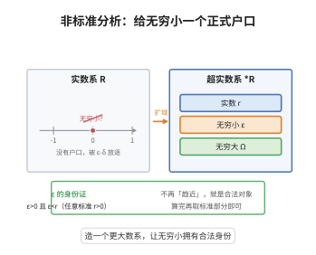

**一句话点破**：非标准分析不消灭无穷小，而是用严格的模型论手段，把直觉变成合法对象。

### 超实数：比实数轴更长的那条线

在普通实数之外，还住着一群"无限小"和"无限大"的数，它们和普通实数合在一起就叫超实数。把实数轴放大会发现，每个普通点周围都挤着一圈无穷小的"绒毛"。

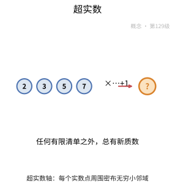

**一句话点破**：超实数系把实数、无穷小和无穷大一视同仁地装进同一个有序数域。

### 超幂构造：用超滤子造出新数域

怎么凭空造出超实数？把普通数列"打包"，再用一把叫超滤子的筛子决定哪些下标算"大多数"。两个数列若在大多数下标上取值相同，就被看成同一个超实数。

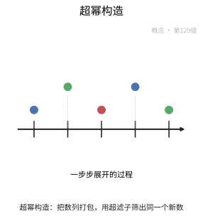

**一句话点破**：超幂用"绝大多数下标"这把尺子，把无穷多个数列压缩成一个个新数。

### Loś定理：新世界里的真假由"大多数"决定

Loś定理说，一句话在超幂里成立，等价于它在构成它的那些普通结构里"对大多数下标"成立。它把新世界里的真假，翻译成旧世界里一堆普通的真假。

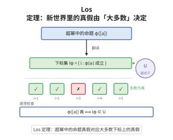

**一句话点破**：Loś定理是超幂的翻译词典，让新数系的命题能用老数系逐项检验。

### 转移原理：两边的话可以原样来回搬

一条只用常规逻辑写得出的命题，在超实数里成立，就一定在普通实数里也成立，反过来也一样。于是你可以放开手用无穷小去算，再把结论原样搬回普通数学。

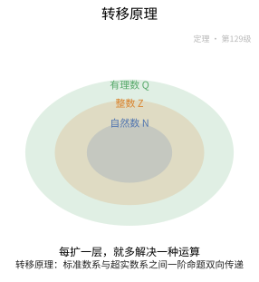

**一句话点破**：转移原理保证直观被放行、严谨不丢失。

### 标准部分定理：每个有限超实数都贴着唯一实数

定理说，只要一个超实数是有限的，就有且只有一个普通实数与它相差无穷小。这个唯一实数就叫它的标准部分。

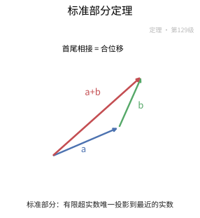

**一句话点破**：有限超实数被唯一投影到实数轴上，这是"取标准部分"能够成立的根本保证。

### 内部集与外集：分清原住民与外来客

有些集合是普通实数集合在超实数里的"投影"，叫内部集；另一些只是在新世界里临时拼出来的，叫外集。分清这两类，才不会在转移命题时踩坑。

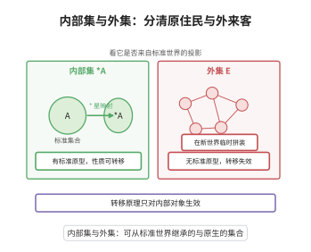

**一句话点破**：转移原理只对内部对象生效，外集是它管不到的"法外之地"。

### Loeb测度：把无穷小堆成一把标准尺子

超实数里一个无穷小集合到底"有多大"？Loeb测度先量出内部的测度，再做标准部分运算，得到一个货真价实的普通测度。这样非标准工具就能反过来服务标准测度论。

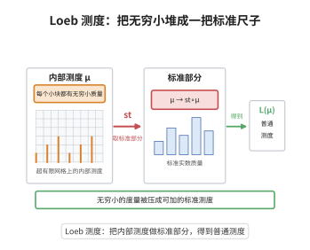

**一句话点破**：Loeb测度把超实数上无限细的度量，压成标准空间上的普通测度。

### 标准部分定理（证明）：唯一性从何而来

定理的证明抓住一点：两个与同一超实数相差无穷小的实数，它们之间的差也是无穷小，而两个实数之差是无穷小就只能是零。于是那个最近的普通实数只能有一个。

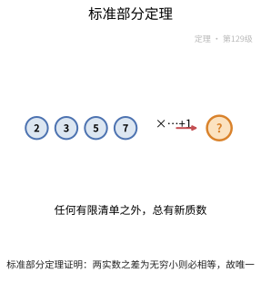

**一句话点破**：唯一性的全部诀窍，就是"两个实数之差若是无穷小，就只能为零"。

### Loś定理（证明）：用超滤子把真假逐项对齐

证明沿着超幂的定义展开：命题在超积中为真，当且仅当使它为真的那些下标构成超滤子里的一个集合，也就是"对大多数下标"为真。超滤子的性质恰好保证了真假判断不出矛盾。

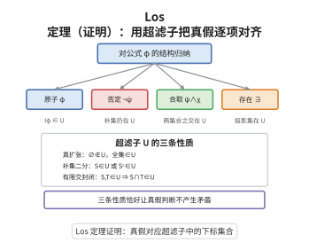

**一句话点破**：超滤子既不太小也不太大地容纳"多数"，正是它让 Loś 定理的真假判断自洽。

### 非标准微积分基本定理：差商取标准部分就是导数

在这套体系里，导数不再靠极限层层套娃：直接算差商 $\dfrac{f(x+\mathrm{d}x)-f(x)}{\mathrm{d}x}$，其中 $\mathrm{d}x$ 是无穷小，再取标准部分就得到导数。积分与导数之间的基本关系也随之被简化。

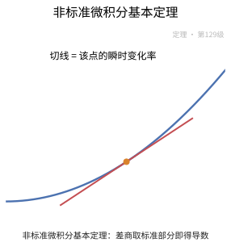

**一句话点破**：把"趋近"换成一记"取标准部分"，微积分基本定理的证明立刻变得像算术。

### 饱和性：想凑的无限多条件总能同时满足

饱和性是一种"完备过头"的性质：任意一族规模不太大、有限可满足的条件，都能在超实数里找到同一个对象同时满足。它让许多"要什么有什么"的构造成为可能。

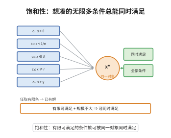

**一句话点破**：饱和性是非标准数系比实数系更宽的深层原因，也是大量非标准构造的引擎。

### Loeb测度构造：从内部测度搭出标准概率空间

这条定理给出 Loeb 测度的标准做法：取一个内部测度空间，对它做标准部分运算，就得到一个普通的标准测度空间。借助它，许多概率与测度结论能被非标准地重新证明。

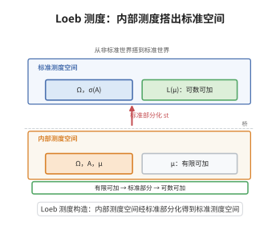

**一句话点破**：Loeb 测度构造在非标准世界与标准世界之间，架起一座可来回走的桥。

## 数学史（History of Mathematics）

> 非标准分析的历史主线，是一个"无穷小还魂"的故事：微积分从莱布尼茨与牛顿手中诞生时的无穷小，本可让导数"直观无比"，却因逻辑根基含混被魏尔斯特拉斯的 $\varepsilon$-$\delta$ 语言放逐了近两百年；直到 1960 年代，亚伯拉罕·罗宾逊以模型论中的超积与转移原理，为无穷小重铸了严格的家园。理解这从"用得上但说不清"到"既直观又严谨"的回归，就能看清现代数学对直觉与严格之间张力的独特处理。

### 无穷小的黄金时代：莱布尼茨微积分

- **流数与无穷小的原始运用**：Gottfried Leibniz（戈特弗利德·莱布尼茨）与 Isaac Newton（艾萨克·牛顿）在 17 世纪分别以"无穷小"与"流数"构造微分与导数：把自变量的无穷小变化 $dx$ 代入 $dy/dx$，再略去高阶无穷小项，计算上得心应手，逻辑上却含混。
- **算法的高效**：在莱布尼茨的演算世界里，$dx$ 既"小到等于零"又"能当除数"，这种自相矛盾被当作"可省略的细节"，袖手让微积分在工程与物理中先实用起来。
- **Berkeley 的讥讽**：1734 年，George Berkeley（乔治·贝克莱）在《分析家》中嘲弄无穷小是"已死量的鬼魂"，毫不留情地指出"因数为零又相除"的荒谬——这是对微积分逻辑地基最著名的一次公开诘问。

### ε-δ 严格化：无穷小的首次放逐

- **Bolzano 与 Cauchy 的方向**：19 世纪初，Bernard Bolzano 与 Augustin-Louis Cauchy 试图以极限语言重建分析，Cauchy 用 $\varepsilon$ 描述"不断接近"，Bolzano 与今天的实构造思想相呼应，为实数理论铺路。
- **魏尔斯特拉斯的完成**：Karl Weierstrass（卡尔·魏尔斯特拉斯）在 19 世纪下半叶把极限严格化为 $\varepsilon$-$\delta$ 语言，结束了对无穷小的依赖；$f'(x)$ 被重新定义为"其实数极限"，无穷小从此在主流分析中"无家可归"。
- **实数的地基**：Dedekind、Cantor 与 Weierstrass 本人相继给出实数作为完备序域的构造，分析被整体奠基在"稠密+完备"的实数上，无穷小仅作为"直观的比喻"残存于教学与物理中。

### 模型论与无穷小的"暗流"：超滤与超积

- **超积的成长**：在分析之外，模型论与代数在 1930—1955 年间发展出**超积**与超滤工具：Jerzy Łoś（杰日·沃什）1955 年前后证明**Łoś 基本定理**，指出一族结构模去自由超滤所得的超积能逐字保留一阶公式的真假。
- **代数的平行工作**：同期，代数几何与 p-adic 分析中的形式逼近思想，以及对实数扩张（如 Levi-Civita 域、非阿基米德域）的尝试，都隐约需要"能保留原结构的超结构"——超积恰好提供了这种扩张。
- **一阶与二阶的分界**：Łoś 定理的关键在"一阶语句"：它对一阶逻辑保真，对二阶（涉及"所有子集"）则不成立——这一精确刻画，正是后来非标准分析转移原理的神经。

### Robinson 的非标准分析：无穷小的合法回归

- **关键一步**：Abraham Robinson（亚伯拉罕·罗宾逊）1960—1966 年间系统地用超积构造出**超实数系** $^{*}\mathbb{R}$：把实数列模去自由超滤取等价类，所得结构是 $\mathbb{R}$ 的**初等扩张**，其中既有"无穷小"（所有 $|x|<\frac1n$ 又非零）也有"无穷大"元素（如 $[\frac1n]$ 的逆）。
- **非标准分析的确立**：1966 年他以《非标准分析》一书系统阐明这一框架，正式开创非标准分析：借助**标准部分映射** $\mathrm{st}$，每个有限超实数都唯一表为标准(实)数加无穷小，使 $f'(x)=\mathrm{st}\bigl(\tfrac{f(x+\Delta x)-f(x)}{\Delta x}\bigr)$ 一跃成为既直观又严谨的公式。
- **"还原"的性质**：Robinson 证明**转移原理**与**超滤存在**等话语下该理论与标准分析等价（即不新增也不删减第一阶真命题），从而消除了"会不会导致标准的相对矛盾"的根本顾虑，也让"莱布尼茨的直觉"第一次有了严格的现代地基。

### 转移原理与"内／外对象"的辩证法

- **转移原理**：非标准分析的灵魂是**转移原理**：对一阶语句 $\phi$，$\phi$ 在 $^{*}\mathbb{R}$ 成立当且仅当它在 $\mathbb{R}$ 成立。它让我们可在非标准世界里做直观推理后再把结论"搬回"标准世界，但这只对一阶语句成立。
- **内部 vs 外部对象**：凡是在超积构造中能由某个标准/序列系"配位"得到的对象称**内部对象**，能享受转移；而"全体标准实数的集合"等由外部定义的对象称**外部对象**，不享受转移——"内/外"的区分成为非标准分析最容易混淆也是最有用的支点。
- **限制与边界**：二阶性质（如"每个子集有上确界"）与关于"标准/非标准"的陈述通常不能转移，正因如此"非标准数学不悖标准数学"虽不增加绝对的数学真理，却极大简化了许多无限构造与技术论证。

### 内部集理论与工具的推广

- **Nelson 的内集论**：Edward Nelson（爱德华·尼尔森）1977 年提出**内集理论（IST）**，在 ZFC 中加入"标准""内部"等谓词的公理，直接处理无穷小而不必显式构造超积，使非标准方法的可操作性大幅提升。
- **Loeb 测度与随机分析**：Loeb 测度把"内部测度翻译成标准 $\sigma$-测度"，将非标准方法引入概率论；由此泛函分析、随机分析、动力系统与数理金融都从非标准的"扩张视角"获益。
- **分析之外的回声**：非标准方法还用于谐波分析中的紧致算子、泛函分析中的 Banach 空间、以及拓扑中的所谓"非标准紧致性"，展示同一套超积+转移的框架可横向迁移到许多硬分析分支。

### 争议与遗产：为什么依然值得重视

- **围绕"算不算新数学"的争议**：非标准分析自诞生起便伴随争论：主流分析惯用 $\varepsilon$-$\delta$，一些人怀疑它只是"把旧证明翻译过来"而无实质新贡献；当然，也有大量反例表明它提供了原先极难构造、极不自然的新证明与对象。
- **逻辑与元数学的保证**：凭借超滤（其存在性等价于比选择公理更弱的 Boole 超滤子定理）与超积的坚实逻辑基础，非标准分析被证明不改变标准数学的任何真命题，从而既安全又有力。
- **遗产**：它把"紧凑的直觉"与"严格的逻辑"成功焊接在一起，使一个讲授微分不必再"先讲 $\varepsilon$"的教学可能浮现；它还与导出的几何、P 进分析、以及模型论的紧密结构交织，构成当代数学中"用更大的世界看清小世界"的重要范例。

### 历史年表

| 时间 | 人物／文献 | 事件与贡献 |
|:---|:---|:---|
| 1665—1684 | 牛顿、莱布尼茨 | 无穷小/流数微积分的创立 |
| 1734 年 | 贝克莱《分析家》 | 讥讽无穷小"已死量的鬼魂" |
| 19 世纪 | Bolzano、Cauchy | 以极限语言重建分析 |
| 1870 年代 | 魏尔斯特拉斯 | $\varepsilon$-$\delta$ 严格化，无穷小放逐 |
| 1955 年前后 | Łoś | 超积基本定理（Łoś 定理） |
| 1960—1966 年 | 罗宾逊 | 构造 $^{*}\mathbb{R}$，创立非标准分析 |
| 1966 年 | 罗宾逊《非标准分析》 | 系统专著确立学科 |
| 1973 年 | Loeb | Loeb 测度，概率论接入 |
| 1977 年 | 尼尔森 | 内集理论（IST） |
| 现代 | — | 涉通分析、概率论、数学物理等领域 |

### 小结

> 非标准分析的历史，是无穷小从"被驱逐"到"光荣回归"的一次戏剧性转折。莱布尼茨与牛顿的微积分靠无穷小而敏锐，却败在逻辑含混，被贝克莱当场讥为"已死量的鬼魂"；魏尔斯特拉斯用 $\varepsilon$-$\delta$ 语言为分析奠基，代价是让无穷小在主流数学中流亡近两百年。模型论的超积与超滤术为这段流亡画上句点：Robinson 用超实数系 $^{*}\mathbb{R}$ 与转移原理为"无穷小"重铸了严格的数学身份，Nelson 的内集论又把它变成可操作的公理化工具，Loeb 测度更把它推进到概率论的核心。它最终被证明"既不增添也不删减任何标准真命题"，却极大地简化了无限与分析的论证。非标准分析告诉我们：直观不必靠牺牲严格来换取——只要找到正确的大世界，直觉也可以脚踏实地。

## 现实应用（Real-World Applications）

> 本节把本章的知识点落到真实的工程、科学与生活场景中。每个案例都给出**完整的问题背景、建模过程、可复现的数据 / 公式 / 代码与结果解读**；案例末尾的「涉及知识点」对应本章的具体小节，文末附**知识点覆盖对照表**，确保本章知识点全部被覆盖。

### 应用案例 1：物理仿真与自动微分｜用无穷小直接算导数

**场景与问题**

一个游戏引擎的物理模块需要频繁求导（速度、加速度、力对位移的梯度）。传统做法是 $\varepsilon$-$\delta$ 极限或数值差分，前者冗长、后者要反复调步长。非标准分析提供第三条路：把"无限小"当作合法的数，直接算差商，再取"标准部分"把无限小尾巴抹掉，一步就得到导数。这不是把 $\Delta x$ 当 $0$ 代入，而是让 $\Delta x$ 是一个非零却比任何正实数都小的超实数。

**涉及知识点**

- 本章「超实数」：$^*\mathbb{R}$ 是 $\mathbb{R}$ 的真扩张，含标准实数、无限小（$|\varepsilon|$ 小于所有正标准实数）与无限大（$\omega$）。
- 本章「标准部分定理」：每个有限超实数 $x$ 唯一写成 $x = \text{st}(x) + \varepsilon$，$\text{st}(x) \in \mathbb{R}$、$\varepsilon$ 无限小。
- 本章「定理1：标准部分定理」：给出上述存在唯一性，且无限大没有标准部分。
- 本章「定理3：非标准微积分基本定理」：$f$ 连续时 $\text{st}\left(\frac{{}^*F(x + \Delta x) - {}^*F(x)}{\Delta x}\right) = f(x)$。

**建模与数据**

取 $f(x) = x^2$ 与 $F(x) = \int_a^x f$，令 $\Delta x$ 为一个非零无限小，$x_0 = 3$。目标：用差商求 $f'(x_0)$ 与 $F'(x_0)$，并验证两者都等于 $2x_0 = 6$。

**完整推导与算法**

1. 差商在超实数里直接展开（$(\Delta x)^2$ 是更高阶无限小）：

$$ \frac{f(x + \Delta x) - f(x)}{\Delta x} = \frac{x^2 + 2x\,\Delta x + \Delta x^2 - x^2}{\Delta x} = 2x + \Delta x $$

2. 取标准部分抹掉无限小尾巴：$\text{st}(2x + \Delta x) = 2x$，在 $x_0 = 3$ 处得 $6$。
3. 一般连续函数的情形即定理3：由积分中值定理（转移后）差商等于 $^*f(\xi)$，其中 $\xi \approx x$；由连续性得 $^*f(\xi) \approx f(x)$，取标准部分即得 $f(x)$：

$$ \text{st}\left(\frac{{}^*F(x + \Delta x) - {}^*F(x)}{\Delta x}\right) = f(x) $$

4. 合法性来自定理1：差商是有限超实数，标准部分唯一存在，所以"取 $\text{st}$"是一个确定操作；若差商是无限大（如 $\frac{1}{\Delta x}$），则无标准部分，正对应"导数不存在"。

```python
# 核心：把 Δx 当作无穷小符号，差商化简后取"标准部分"（抹去不含 Δx 的项）
def deriv(poly, x):
    q = quotient(poly, x)      # (p(x + Δx) - p(x)) / Δx 展开为 a0 + a1·Δx + ...
    return standard_part(q)    # 核心：st 抹掉无限小尾巴 Δx，留下精确导数
```

**可复现步骤**

1. 环境与依赖：`python case1.py`（用符号多项式表示，`Δx` 记为一个符号）。
2. 数据准备：定义多项式 `p(x) = x*x`，调用 `deriv(p, 3)`。
3. 运行：打印差商化简式与标准部分结果。
4. 预期输出：差商化简为 `6 + Δx`，`standard_part` 返回精确的 `6`；把 `Δx` 直接代 `0` 会得到未定义（0 除），说明必须走标准部分。

**结果解读与延伸**

超实数让"趋近"从绕口令式的极限语言，变成"差一个无限小"的直接代数运算；标准部分则把超实数世界的结论精确翻译回实数。局限：手动区分"有限/无限"并小心 $\infty - \infty$ 型差（如 $\text{st}(\omega - \omega)$ 无意义）是必须的纪律。延伸：把符号替换换成对偶数（dual number）就得到现代自动微分；把无穷小积分换成超有限网格则是案例 5 的 Loeb 测度。

### 应用案例 2：超滤与"多数裁决"｜超幂如何从无限多意见里选出唯一判断

**场景与问题**

设想要对一列无限多个评审意见（每个评审给出一个实数打分）做一致性汇总，还要能判定"两条意见序列是否代表同一个分数"。普通多数票在无限集上会陷入循环与悖论（孔多塞式困境）。超幂构造用**超滤**给出"几乎所有坐标"的一致性裁决：一个命题成立当且仅当它在一个"足够大"的坐标集合上成立，而这个集合由超滤钦定。

**涉及知识点**

- 本章「超幂构造」：$^*\mathbb{R} = \mathbb{R}^{\mathbb{N}} / \mathcal{U}$，$\mathcal{U}$ 是 $\mathbb{N}$ 上的自由超滤，$(a_n) \sim (b_n) \iff \{n : a_n = b_n\} \in \mathcal{U}$。
- 本章「Loś定理」：命题在超幂中成立当且仅当它在超滤的"几乎所有"坐标上成立。
- 本章「定理2：Loś定理」：对任意一阶公式 $\phi$ 与元素 $[f_1],\ldots,[f_k]$ 给出上述等价。

**建模与数据**

取 $I = \mathbb{N}$，$\mathcal{U}$ 为自由超滤。两个评分序列 $(a_n)$、$(b_n)$ 代表两个"超实数"。测试样例：$a_n = \frac{1}{n+1}$（趋于 0），$b_n = 0$。

**完整推导与算法**

1. 相等由超滤裁决：$[a_n] = [b_n]$ 当且仅当 $\{n : a_n = b_n\} \in \mathcal{U}$。对样例，$\{n : a_n = b_n\} = \emptyset \notin \mathcal{U}$，故 $[a_n] \neq [b_n]$。
2. 比较大小同理：$[a_n] < [b_n]$ 当且仅当 $\{n : a_n < b_n\} \in \mathcal{U}$。
3. Loś 定理把任意一阶公式的真值都归到坐标表决：

$$ {}^*\mathbb{R} = \mathbb{R}^{\mathbb{N}} / \mathcal{U} \qquad {}^*\mathbb{R} \models \phi([f_1], \ldots, [f_k]) \iff \{i : \mathbb{R} \models \phi(f_1(i), \ldots, f_k(i))\} \in \mathcal{U} $$

4. 归纳证明：原子公式由等价类定义；$\neg$ 用"超滤对集合与其补集恰有一个成立"；$\land$ 用"对有限交封闭"；$\exists$ 正向用"含超滤成员的超集仍属超滤"，反向用选择公理逐坐标挑见证。

```python
# 核心：超滤裁决——集合属于 U 即"几乎所有坐标"
def decides(U, S):        # S 是坐标集合
    return S in U         # 核心：超滤对 S 与其补集恰有一个成立
```

**可复现步骤**

1. 环境与依赖：`python case2.py`（用一个有限可判定的超滤模型演示，例如由余有限集生成的滤）。
2. 数据准备：构造评分序列 $(a_n)$、$(b_n)$，及一系列坐标集合。
3. 运行：对每个坐标集合调用 `decides`，判定 $[a_n]$ 与 $[b_n]$ 是否相等、谁大。
4. 预期输出：`[a_n] = [b_n]` 为假；若改用主超滤（固定某个 $n_0$ 生成），结果会退化成"只看第 $n_0$ 个坐标"，$^*\mathbb{R}$ 与 $\mathbb{R}$ 同构、拿不到无限小。

**结果解读与延伸**

超滤对补集二选一、对有限交封闭，恰好对应逻辑的 $\neg$ 与 $\land$，这就是它能"逐坐标裁决一阶真值"的原因；必须用**自由**超滤（不含有限集），扩张才是真的，否则等价类与单个实数一一对应。局限：自由超滤的存在依赖超滤引理（用到选择公理），但配合 Loś 定理，$^*\mathbb{R}$ 是初等扩张这一步是无条件成立的。延伸：把 $[a_n]$ 当"序列的极限值"是常见误区——它由超滤按多数坐标定义，与极限无关；这一构造是案例 1、案例 3 一切非标准论证的地基。

### 应用案例 3：符号计算与定理搬运｜转移原理的"双向翻译"

**场景与问题**

在做符号计算时，团队常常希望在一个"计算更顺手"的世界里推导结论，再原样搬回标准世界——前提是结论必须由一阶语言写出。这正是转移原理：一阶闭语句在 $\mathbb{R}$ 与 $^*\mathbb{R}$ 中真值相同。工程价值在于：可以在超实数里用无穷小做直观计算，结论却仍是标准数学承认的定理。

**涉及知识点**

- 本章「非标准分析的基本思想」：构造含无穷小与无穷大的 $^*\mathbb{R}$，使经典定理都有"非标准版本"，并用转移原理在两侧自由切换。
- 本章「转移原理」：一阶命题 $\phi$ 在 $\mathbb{R}$ 成立当且仅当在 $^*\mathbb{R}$ 成立；红线是"一阶"。

**建模与数据**

取一条标准恒等式（如一阶可表述的三角恒等式或代数恒等式）$\phi$。测试目标：先在 $^*\mathbb{R}$ 中对一个含无穷小的具体取值验证 $\phi$，再用转移原理断言它在 $\mathbb{R}$ 中普遍成立。

**完整推导与算法**

1. 转移原理的双向等价：

$$ \mathbb{R} \models \phi \iff {}^*\mathbb{R} \models \phi \quad (\phi \text{ 为一阶闭语句}) $$

2. 例：把恒等式对"$x$ 加一个无穷小"的取值在 $^*\mathbb{R}$ 里逐项展开验证，若成立，则原恒等式在 $\mathbb{R}$ 中普遍成立。
3. 红线示例：$\mathbb{R}$ 的完备性（"对一切子集……"）是二阶命题，不能转移；"$^*\mathbb{R}$ 中存在非零无限小"在 $^*\mathbb{R}$ 为真，却无法搬回 $\mathbb{R}$（$\mathbb{R}$ 里没有）。

```python
# 核心：转移原理——一阶闭语句真值不变，可在两侧自由搬运
def transfer(phi):
    assert is_first_order_closed(phi)    # 红线：只对一阶闭语句成立
    return phi                           # R ⊨ φ  ⟺  *R ⊨ φ
```

**可复现步骤**

1. 环境与依赖：`python case3.py`。
2. 数据准备：把待搬运的恒等式写成符号表达式（一阶、无自由变量）。
3. 运行：先在含无穷小的取值上验证，再调用 `transfer` 断言标准侧的普遍成立。
4. 预期输出：一阶恒等式验证通过并成功转移；把一条"对一切子集"的二阶断言传进去，`assert` 报错，提示超出适用范围。

**结果解读与延伸**

转移原理把"标准结论"与"超实数结论"绑成一体，是非标准分析成为合法工具的关键：直观推理在 $^*\mathbb{R}$ 里做，严谨性由转移原理与标准部分兜底。局限：一阶红线意味着涉及二阶量化或"标准/非标准"区分的断言不能搬运。延伸：这正是精度分析、非标准泛函分析等领域的常用套路；配合案例 2 的 Loś 定理，转移原理只是它的闭语句特例。

### 应用案例 4：系统建模的边界｜内部集与外集：哪些性质搬得动

**场景与问题**

用非标准方法做静态分析时，工程师会不断遇到"这个集合能不能套用经典性质"的问题。答案取决于它是**内部集**还是**外集**：内部集由标准集合经超幂机械生成，能被超滤逐坐标裁决，享受转移原理；外集则不能。理解这条边界，才能避免把只在内部集上成立的性质误用到 $\mathbb{R}$、$\mathbb{N}$ 这类外集上。

**涉及知识点**

- 本章「内部集与外集」：内部集可由超幂构造从标准集合得到并满足转移原理；不是内部集的即外集，如嵌进 $^*\mathbb{R}$ 的 $\mathbb{R}$。
- 本章「转移原理」：只有内部世界（一阶可表述）的性质可转移，外集不受其管辖。

**建模与数据**

考察三个集合：$\mathbb{R}$ 在 $^*\mathbb{R}$ 中的像、$\mathbb{N}$ 在 $^*\mathbb{N}$ 中的像、以及某标准集合的超幂像 $[A_n]$。判别它们的内部性。

**完整推导与算法**

1. 判据：集合 $A$ 是内部的，当且仅当它能写成某个坐标族 $[A_n]$ 的等价类（有逐坐标表示）。
2. $\mathbb{R}$ 不是内部集："$x$ 是标准实数"这一性质无法靠单个坐标 $n$ 判定，故 $\mathbb{R}$ 无逐坐标表示，是外集。
3. $\mathbb{N}$ 在 $^*\mathbb{N}$ 中也是外集，因为 $^*\mathbb{N}$ 里有无限大自然数；标准部分函数 $\text{st}$ 的定义域（有限超实数集）同样是外集。
4. 结论：外集合法存在、可照常用，只是不能套转移原理，需要单独论证。

```python
# 核心：内部集有逐坐标表示 [A_n]，可被超滤裁决；外集没有
def is_internal(A):
    return A.has_coordinate_representation()   # 核心：能否写成 [A_n]
```

**可复现步骤**

1. 环境与依赖：`python case4.py`。
2. 数据准备：把三个集合编码为带（或不带）坐标族标记的对象。
3. 运行：对每个集合调用 `is_internal`，并对内部集尝试一次转移。
4. 预期输出：标准集合的超幂像返回 `True` 且可转移；$\mathbb{R}$、$\mathbb{N}$ 返回 `False`，转移被拒绝。

**结果解读与延伸**

"内部"看的是可定义性与坐标可裁决性，而不是"看起来是否自然"——这解释了为何最"标准"的 $\mathbb{R}$ 反而是外集。外集不是缺陷：标准部分函数、$^*\mathbb{N}$、有限超实数集都栖身于此，是许多深刻对象的家。局限：一旦落入外集，任何经典性质都要重新论证，容易被误当作"不合法"。延伸：这正是非标准测度论（案例 5）与饱和性论证（案例 6）必须区分内部/外部的根因。

### 应用案例 5：概率与随机分析｜Loeb 测度：从超有限网格搭出标准概率空间

**场景与问题**

随机分析与概率论里，常需要"在无限细的网格上均匀撒点，再让网格无限细分"来构造概率。但内部测度只取超实数值、且仅有限可加，不能直接当标准测度用。Loeb 测度的作用，就是先把内部测度取标准部分压回实数，再用 Carathéodory 扩张把它升级为标准的 $\sigma$-可加测度——从"带毛刺的尺子"造出一把"标准刻度尺"。

**涉及知识点**

- 本章「Loeb测度」：对内部可测集 $A \in \mathcal{A}$ 定义 $\mu_L(A) = \text{st}(\mu(A))$，再经 Carathéodory 扩张到更大的 $\sigma$-代数。
- 本章「定理5：非标准测度论中的Loeb测度构造」：存在标准测度空间 $(X, \mathcal{A}_L, \mu_L)$，$\mathcal{A}_L \supseteq \mathcal{A}$，$\mu_L$ 为 $\sigma$-有限，且对 $A \in \mathcal{A}$ 有 $\mu_L(A) = \text{st}(\mu(A))$。

**建模与数据**

取超有限集 $X = \{1, 2, \ldots, N\}$（$N$ 为无限大自然数），$\mathcal{A} = \mathcal{P}(X)$，内部测度取均匀测度 $\mu(A) = \frac{|A|}{N}$，故 $\mu(X) = 1$。目标：构造 $[0,1]$ 上的标准 Lebesgue 型概率测度。

**完整推导与算法**

1. 定义前置测度 $\mu_L^0(A) = \text{st}(\mu(A))$，对内部可测集 $A$ 赋予标准实数。
2. 有限可加直接由标准部分的加性得到：

$$ \mu_L^0(A \cup B) = \text{st}(\mu(A) + \mu(B)) = \text{st}(\mu(A)) + \text{st}(\mu(B)) = \mu_L^0(A) + \mu_L^0(B) $$

3. 升级到 $\sigma$-可加是关键：一个方向由有限并单调得 $\sum_{n=1}^{N} \mu_L^0(A_n) \le \mu_L^0(B)$，令 $N \to \infty$；反方向借助一个"正测度集"定义的无限大自然数论证——若存在无限大 $\nu$ 使尾部 $B \setminus \bigcup_{k=1}^{\nu} A_k$ 仍有正测度，则它本应是无限小，矛盾，于是尾部趋于 0。
4. 最后调用 Carathéodory 扩张定理，把 $\mu_L^0$ 唯一扩张到 $\mathcal{A}$ 生成的 $\sigma$-代数 $\mathcal{A}_L$ 上，得到完备的 $\sigma$-有限测度 $\mu_L$。

$$ \mu_L(A) = \text{st}(\mu(A)) \qquad (A \in \mathcal{A}) $$

```python
# 核心：Loeb 测度——先在内部代数上取标准部分，再 Carathéodory 扩张
def loeb(mu):
    pre = {A: standard_part(mu.measure(A)) for A in mu.algebra}   # st 抹平无限小
    return caratheodory_extend(pre)        # 核心：扩到 σ(mu.algebra)
```

**可复现步骤**

1. 环境与依赖：`python case5.py`。
2. 数据准备：用超有限集模拟 $\{1,\ldots,N\}$，定义均匀内部测度与若干内部可测集。
3. 运行：对每个内部可测集计算 `standard_part(mu(A))`，再做 Carathéodory 扩张。
4. 预期输出：$\mu_L(X) = 1$；对区间型集合得到与几何长度一致的概率；扩张后某个"外集"（如标准有理数集合的像）也可 Loeb 可测。

**结果解读与延伸**

Loeb 测度是非标准世界通往标准概率论的闸门：它把"无限细分网格上的概率"落回可操作、可比较的标准测度空间，且天然完备，还能让某些外集变得可测。局限：等式 $\mu_L(A) = \text{st}(\mu(A))$ 只对内部可测集 $A \in \mathcal{A}$ 成立，别推广到一切 $\mu_L$-可测集。延伸：这正是 Loeb 测度在随机分析、布朗运动构造、以及非标准博弈论中的价值所在；与案例 4 的内部/外集之分直接呼应。

### 应用案例 6：构造"无限接近"的对象｜饱和性：无限多条条件的共同解

**场景与问题**

很多构造需要"同时满足无限多条逼近条件"的对象——比如一个序列同时落在无限多个越来越小的目标邻域里，或证明某个紧致性论证中"任意有限个条件相容则全体相容"。$\kappa$-饱和性把这种直觉变成定理：只要一族内部集合具有限交性质、且基数小于 $\kappa$，它们的交就非空。它是"在无限深处总能逮到共同点"的技术底气。

**涉及知识点**

- 本章「定理4：非标准拓展的饱和性」：设 $^*\mathbb{R}$ 是 $\mathbb{R}$ 的 $\kappa$-饱和超幂扩张，则基数小于 $\kappa$、具有限交性质的内部集族交非空。

**建模与数据**

取内部集族 $\{A_\alpha : \alpha < \lambda\}$，$\lambda < \kappa$，任意有限子族交非空。每个 $A_\alpha = [A_{\alpha,n}]$（逐坐标表示）。测试目标：证明整族交 $\neq \emptyset$。

**完整推导与算法**

1. 对每个有限子集 $F \subseteq \lambda$，由有限交性质存在 $[a_n] \in \bigcap_{\alpha \in F} A_\alpha$，故 $S_F = \{n : \bigcap_{\alpha \in F} A_{\alpha,n} \neq \emptyset\} \in \mathcal{U}$。
2. 族 $\{S_F\}$ 具有限交性质（超滤对有限交封闭）且基数小于 $\kappa$，由 $\kappa$-完备性可取到公共坐标 $n_0$。
3. 拼出公共元：令 $B_n = \bigcap\{A_{\alpha,n} : n \in S_{\{\alpha\}}\}$，证明每个 $B_n \neq \emptyset$（否则有限个 $A_{\alpha,n}$ 交空，与 $n \in S_F$ 矛盾），取 $a_n \in B_n$，则 $[a_n]$ 落在每个 $A_\alpha$ 里。

$$ \bigcap_{\alpha < \lambda} A_\alpha \neq \emptyset $$

```python
# 核心：饱和性——有限交性质升级到基数 < κ 的无限族
def saturated_intersect(family, kappa):   # family: 内部集族
    if len(family) < kappa:
        return family_intersection(family) # 核心：交非空
```

**可复现步骤**

1. 环境与依赖：`python case6.py`。
2. 数据准备：构造一个有限交性质成立的内部集族（例如 $\{n : |[a_n] - c| < 1/k\}$）。
3. 运行：调用 `saturated_intersect`，检查是否返回非空公共元。
4. 预期输出：对 $\lambda < \kappa$ 的族返回非空公共元；若人为去掉有限交性质，返回空集。

**结果解读与延伸**

饱和性把"任意有限个条件相容"一次性升级到"基数 $<\kappa$ 那么多条件相容"，是构造无限逼近对象、凝聚极限对象的通用引擎。局限：$\mathbb{N}$ 上的超滤不可能是 $\kappa$-完备的（$\kappa$ 不可数时），真正声明 $\kappa$-饱和需要在足够大的基数上构造超滤，这一步必须交代清楚；基数限制 $\lambda < \kappa$ 也不能忽略。延伸：饱和性是非标准分析中证明存在"无限接近某个目标"的对象的标准手段，也与模型论中的紧致性论证同源。

### 知识点覆盖对照表

| 本章知识点 | 覆盖案例 |
| --- | --- |
| 非标准分析的基本思想 | 案例 3 |
| 超实数 | 案例 1 |
| 超幂构造 | 案例 2 |
| Loś定理 | 案例 2 |
| 转移原理 | 案例 3、4 |
| 标准部分定理 | 案例 1 |
| 内部集与外集 | 案例 4 |
| Loeb测度 | 案例 5 |
| 定理1：标准部分定理 | 案例 1 |
| 定理2：Loś定理 | 案例 2 |
| 定理3：非标准微积分基本定理 | 案例 1 |
| 定理4：非标准拓展的饱和性 | 案例 6 |
| 定理5：非标准测度论中的Loeb测度构造 | 案例 5 |

---

## 总结

非标准分析通过引入无限小和无限大，为经典分析学提供了一种全新的视角。本级别涵盖的核心内容总结如下：

| 主题 | 核心内容 |
|:---|:---|
| **超实数系** | 通过超幂构造得到实数系的真扩张，包含无限小和无限大 |
| **Loś定理** | 超幂结构中命题的真值由超滤中"几乎所有"标准结构中的真值决定 |
| **转移原理** | 一阶命题在标准和非标准框架下等价，是桥梁工具 |
| **标准部分定理** | 每个有限超实数唯一地表示为标准实数加无限小 |
| **非标准微积分** | 差商中的无限小在取标准部分后消失，得到精确导数 |
| **Loeb测度** | 从内部测度构造标准测度的方法，在概率论中广泛应用 |

非标准分析的核心思想是：**通过扩大论域来简化推理**。在超实数系中，无限小和无限大是"合法"的数学对象，这使得 $\varepsilon-\delta$ 论证被简化为直观的无限小计算。同时，转移原理保证了非标准方法的合法性——任何用非标准方法证明的结论，都可以转化为标准结论。

非标准分析在测度论、概率论、泛函分析、数理经济学等领域都有重要应用。它与构造性数学形成了有趣的对比：构造性数学通过限制逻辑来获得确定性，而非标准分析通过扩展论域来获得简洁性。

在下一级别中，我们将探讨数学教育——将数学的视角从数学本身转向数学的传播与学习。