# 第131级 数学心理学 (Mathematical Psychology)

## 📖 学习目标

1. 理解数学心理学的学科定位与核心研究领域
2. 掌握数字认知的三重编码模型及其神经科学证据
3. 理解数感的认知发展理论——先天与后天交互机制
4. 掌握数学焦虑的认知-动机模型及其对工作记忆的影响
5. 理解数学问题解决的认知过程模型
6. 了解数学学习障碍（计算障碍）的诊断与干预方法
7. 了解数学创造力的测量与培养

---

## 一、核心概念

### 1.1 数学认知与数感

**数学认知**（Mathematical Cognition）研究人类如何理解和处理数学信息，包括数字感知、数量比较、算术运算、代数推理、几何思维等过程。

> **💡 直观理解（类比）**：数学认知就像大脑里装着的一套"数学操作系统"——它不仅存放"知识文件"（如知道3+4=7），更负责"运算调度"（什么时候用加法、什么时候找规律），是硬件（脑区）与软件（策略）的协同工作。

**数感**（Number Sense）是个体对数量、数字关系及基本算术操作的直觉性理解能力。它是数学学习的基石，表现为：

- **数量估计**：在不精确计数的情况下判断数量大小
- **数字比较**：快速判断两个数字的大小关系
- **数量转换**：理解数量变化（如增减）的含义

**定义1（数感）** 数感是指对数字和数量关系的直觉把握能力，包括近似数量系统（ANS, Approximate Number System）和精确数字系统（Precise Number System）两个子系统。

> **🧠 直观理解（现实类比）**：数感就像人的"肉眼估重"和"电子秤"两套系统——近似数量系统是前者，瞟一眼就知道哪堆糖果更多、哪堆更少（模糊但天生）；精确数字系统是后者，能准确读出"这颗苹果150克"（精确但靠学习）。平时靠直觉快速估量，做题时再用精确系统慢慢精算。

#### 课堂问答

**老师**：先问个基础问题：什么叫"数感"？它和"会算数"是一回事吗？

**学生**：不是一回事。先给结论：数感是对数量与数字关系的直觉把握力，由近似数量系统（ANS）与精确数字系统两个子系统共同构成。前者近似、非符号、遵循韦伯定律（可分辨性取决于比例），如一眼判断两堆糖果谁多；后者符号化、离散精确，用于精确计算。所以"会算"只是精确系统在跑，"有数感"还包括那份天生的估数直觉。

**老师（追问）**：那你解释一下，为什么可分辨性由"比例"而不是"差值"决定？这跟"心理数轴"又有什么关系？

**学生**：判别由对数差 $\log(n_1/n_2)$ 决定，正确率可写成 $P=\Phi\left(\frac{\log(n_1/n_2)}{\sigma}\right)$。因为数量是被压缩在对数刻度的心理数轴上的，比例相同则难度相同——8 vs 9 与 80 vs 90 一样难分辨。常见误区是"差 1 就一样难"：差值没变，可比例变了，难度就不同，这正是韦伯定律的精髓。

**老师（拓展）**：既然 ANS 是"先天底座"，为什么受过教育的成人 ANS 精度反而比儿童高？

**学生**：因为"先天底座 + 后天重塑"。ANS 提供起点，符号学习又反过来精化它：成人韦伯分数 $w\approx 0.15$–$0.2$，4 岁儿童 $w\approx 0.4$–$0.5$。两者共享顶内沟（IPS）这一神经基质，教育与训练能提升其编码效率，说明数感是可被经验重塑的。

### 1.2 数字认知模型

**数字认知**（Numerical Cognition）研究大脑如何处理数字信息。核心问题包括：

> **💡 直观理解（类比）**：数字认知就像解析大脑内部处理数字的"交通指挥图"——追问数字以什么"格式"进来、走哪条"神经线路"、又和语言、方位等系统怎么"互通"，好把"3+5"这类运算背后的大脑工作流程画清楚。

- 数字如何在脑中表征？
- 算术运算的神经基础是什么？
- 数字处理与语言、空间能力的关系？

**定义2（数字表征）** 数字表征是指大脑对数字信息的编码方式，包括：
- **模拟数量表征**：数量以近似、连续的方式编码（如数轴上的位置）
- **符号数字表征**：数字以精确、离散的符号形式编码（如阿拉伯数字、文字数字）
- **言语数字表征**：数字以言语序列的形式编码（如数数序列）

> **💡 直观理解（类比）**：同一个数字在脑中有三种"存储格式"——看形状（阿拉伯数字"7"）、听声音（念"七"或数节奏）、掂份量（想象7个大苹果大概多重）。就像同一首曲子既能看乐谱、也能听旋律、还能哼哼调，三条通道既独立又互补。

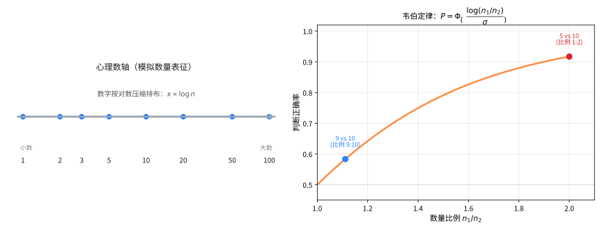

> **直观理解（现实类比）**：心理数轴就像一把"弹性尺子"——孩子眼里的数字排列不是等距的，1到10之间"显得"比10到100之间更宽敞，正如你在高速公路上感觉最近的几公里"格外漫长"。而韦伯定律正如你判断两堆糖果：一堆5颗、一堆10颗，一眼就能分辨；但9颗与10颗几乎看不出差别——人对数量的分辨靠的是"比例"，而不是"差几颗"。

> **🧠 思考历程：人脑里的数字，会是一根"被拉长的尺子"吗？**
>
> 人的数量感为什么"小的数区分得细、大的数区分得粗"？这个问题源自19世纪对感官的测量，最终在20世纪末被神经科学重新点亮，答案竟是一条按对数压缩的"心理数轴"。它想回答的核心问题是：大脑究竟用哪种标尺来估量数量。
>
> - **从"最小可觉差"说起**。1834年，德国生理学家恩斯特·韦伯发现：人要察觉两个重量或数量之间的差异，靠的是它们的"比例"而非绝对差值——比如9与10几乎难分，90与100却一目了然。这条韦伯定律从此成为测量一切感觉（包括数量）的共同标尺，其后费希纳（1860）把它推广成更一般的心理物理学对数律。
> - **把比例写进大脑**。1990年代，神经科学家斯坦尼斯拉斯·德阿纳重拾韦伯定律，结合脑成像在顶内沟（IPS）找到了"近似数量系统"，把数量编码成一条按对数压缩的心理数轴——越小的数"占位"越宽。这正是本文件公式 $P=\Phi(\log(n_1/n_2)/\sigma)$ 的背后直觉：人判断大小用的是"对数差"，而不是"算术差"。
> - **先天的感觉，后天的刻度**。德阿纳进一步提出，数感由先天的近似数量系统与后天的符号学习共同塑造：婴儿天生能分辨点数，而正式教育则把模糊的量感精化为精确的数字与计数，反过来重塑了那条先天心理数轴。
> - **心路**：最精确的数学，有时恰恰是从最"模糊"的比例直觉里生长出来的——"差值与比例"一字之差，成了打开心智与世界之门的钥匙。

#### 课堂问答

**老师**：大脑里一个数字是以几种"格式"存在的？分别对应什么？

**学生**：先给结论：三种并行表征。模拟数量表征（数轴上的近似位置，连续编码）、符号数字表征（阿拉伯数字，精确离散）、言语数字表征（数数序列的言语编码）。它们大致对应三重编码模型的三条通道，各自适配不同任务。

**老师（追问）**：同一个"7"要在这些通道之间来回翻译吗？哪个环节最容易出错？

**学生**：要翻译。比如看到符号"$7$"要映射到数量"大约七个点"、再念出"七"。翻译越频繁，跨通道转换的工作记忆负荷越高，出错越多——这也是儿童初学时的瓶颈。常见误区是"背下数字就等于会算"：符号记住了，数量意义没接通，仍然算不对。

**老师（拓展）**：这三种表征是完全独立，还是共享神经基础？

**学生**：部分共享。符号数字与模拟数量共享双侧顶内沟（IPS），所以符号学习能"接入"已有数量网络；言语编码则更多走左侧颞叶语言区。正因既有分工又有交集，脑损伤时才会出现"能比较却不能背口诀"这类可分离的缺损。

### 1.3 数学思维

**数学思维**（Mathematical Thinking）涉及高阶数学活动中使用的认知策略和推理模式，包括：

> **💡 直观理解（类比）**：数学思维就像解谜高手的"工具箱"——遇到问题不会死磕一条路，而是轮番上阵：归纳像"看样本猜规律"、演绎像"按规则推结论"、类比像"换个情境套经验"、可视化像"在脑内画图"、抽象化像"去掉花哨留骨架"。

- **归纳推理**：从特例中提炼一般规律
- **演绎推理**：从公理和定义出发进行逻辑推导
- **类比推理**：将已知结构映射到新情境
- **可视化推理**：利用空间表象解决问题
- **抽象化**：从具体情境中提取数学结构

#### 课堂问答

**老师**：所谓"数学思维"，到底指哪些高阶推理？列一列。

**学生**：先给结论五类：归纳推理（特例提一般规律）、演绎推理（从公理定义推结论）、类比推理（把已知结构映射到新情境）、可视化推理（用空间表象解题）、抽象化（从情境中提取数学结构）。它们是会做题之上更高一层的"怎么想"。

**老师（追问）**：归纳和演绎方向正好相反，各自最容易栽在哪儿？

**学生**：归纳容易"以偏概全"——看几个特例就下一般结论，像哥德巴赫式的猜想，必须再证；演绎容易"前提一错全盘皆错"，逻辑再严也没用。类比则要小心结构映射是否真同构，否则会套错模型。三者互补才稳。

**老师（拓展）**：为什么说数学思维比"算得快"更能预测一个人将来的数学成就？

**学生**：因为算得快多靠自动检索（如乘法口诀），而思维决定能否把新问题迁移到已有结构上。专家按深层数学结构表征问题、新手按表面特征分类，正是这种"想得清"的差异拉开了长期成就。真正的数学能力不在算得快，而在想得清。

### 1.4 心理测量与数学能力评估

**心理测量**（Psychometrics）是心理学中研究测量方法的学科，在数学心理学中用于开发数学能力评估工具。

> **💡 直观理解（类比）**：心理测量就像给抽象的"数学水平"配一把可用的"卷尺"——把无法直接看到的能力，用精心设计的题目一点点"量"出来，好让"谁强谁弱"有据可依。

**数学能力评估**（Mathematical Ability Assessment）通过标准化测试测量个体的数学水平，包括：

> **💡 直观理解（类比）**：数学能力评估就像给学习做"体检"——成就测试查"已学的底子"，能力倾向测试估"将来的潜力"，诊断测试找"具体的病灶"，三项合起来才能对症下药。

- **成就测试**：测量已学数学知识和技能
- **能力倾向测试**：预测未来数学学习潜力
- **诊断测试**：识别具体的数学学习困难

#### 课堂问答

**老师**：心理测量学给"数学能力"造了什么样的尺子？

**学生**：先给结论：标准化测验，按目的分三类——成就测试（测已学知识与技能）、能力倾向测试（预测未来学习潜力）、诊断测试（定位具体学习困难）。分项测量比一个笼统的总分更能说明"卡在哪一环"。

**老师（追问）**：一个测验信度很高，是不是就一定有效度？

**学生**：不一定。信度是"重复测量是否稳定一致"，效度是"是否真的测到了目标特质"。一把尺子可以非常稳定地量错东西（高信度、低效度）。所以信度是效度的必要而非充分条件，二者必须配套报告。

**老师（拓展）**：诊断测试相比成就测试，价值体现在哪里？

**学生**：价值在"定位"。例如某生算术事实检索标准分 72（第 3 百分位）却应用题理解 92（正常），说明缺陷在事实提取而非语义理解，干预就该做事实检索训练而不是补阅读。成就测试只告诉你"落后"，诊断测试告诉你"落后在哪一步"，才能对症下药。

### 1.5 数学学习障碍

**计算障碍**（Dyscalculia）是一种特定的数学学习障碍，表现为：

> **💡 直观理解（类比）**：计算障碍是大脑里"数量处理模块"先天供电不足——就像有人天生五音不全，这些孩子智商正常却始终绕不过数字这个坎，必须靠专门的策略来"绕路"而非硬拼。

- 数字处理困难
- 算术事实提取困难
- 数量比较和估计困难
- 数学概念理解困难

**定义3（计算障碍）** 计算障碍是一种神经发育障碍，表现为数学能力的显著低于个体年龄、智力水平和教育期望所应达到的水平，排除智力障碍、感觉障碍或教育不足等因素。

> **直观理解（现实类比）**：计算障碍就像一台"算盘少了几个档"的计算器——硬件整体没问题（智商正常、语言优秀），可一旦处理数量就总是卡顿出错。这些孩子并非"笨"或"懒"，而是大脑中负责"数量感"的电路天生发育不良，就像有人天生分不清左右、有人天生五音不全，是一种神经层面的"数盲"。

#### 课堂问答

**老师**：什么是计算障碍（dyscalculia）？它和被说成"笨"或"懒"有什么本质区别？

**学生**：先给结论：计算障碍是一种神经发育障碍，表现为数学能力显著低于其年龄、智力与教育期望应达到的水平，且需排除智力障碍、感觉障碍与教育不足。它不是态度问题，而是特定能力的发育性缺陷，就像有人天生五音不全。

**老师（追问）**：临床上怎么把它和"一般学习困难"区分开？

**学生**：关键看"特异性"。计算障碍者的智商、阅读、拼写通常正常，唯独数字处理、算术事实提取、数量比较估计等数学专项显著低于年龄期望（常大于 1.5 个标准差），且困难在学龄早期就已出现；而一般学习困难往往多领域同时落后、可归因于缺课或教育不足。

**老师（拓展）**：它和阅读障碍（dyslexia）能共存吗？核心缺陷更可能落在哪个系统？

**学生**：能共存，但二者是独立的障碍，可分离。计算障碍的核心困难常落在数量表征与数感上，即近似数量系统与顶内沟（IPS）的功能偏差。因此干预要走"绕路"策略：多感官教学、显式策略训练、事实检索重复训练，再配合工作记忆训练与情绪支持。

### 1.6 数学焦虑

**数学焦虑**（Math Anxiety）是指个体在面对数学任务时产生的紧张、忧虑和恐惧情绪，影响数学表现和数学学习。

**定义4（数学焦虑）** 数学焦虑是一种情境性焦虑，表现为在数学学习或评估情境中出现消极情绪反应、生理唤醒和回避行为。

> **💡 直观理解（类比）**：数学焦虑就像"一碰数字就应激"的条件反射——还没开算题，心跳、手汗先来，正如有人一上台就怯场。它把本该用于计算的注意力全抢去担心"会不会考砸"，结果越紧张越算错，形成"越怕越差、越差越怕"的怪圈。

#### 课堂问答

**老师**：数学焦虑会怎么损害数学表现？给出机制。

**学生**：先给结论三条路径：消耗工作记忆资源（侵入性思维、注意力分散、内心负面自语）、引发回避行为与努力减少、削弱自我效能感。设无焦虑容量为 $W_0$、焦虑占用 $R_A$，则有效容量

$$W_{\text{eff}} = W_0 - R_A$$

任务需要 $R_T$，表现 $P=f(W_{\text{eff}}-R_T)$，当 $W_{\text{eff}}<R_T$ 时表现显著下降。

**老师（追问）**：为什么复杂任务（如借位减法）比简单加法受损更严重？

**学生**：因为焦虑占用的 $R_A$ 是相对固定的，而任务需求 $R_T$ 越大，$W_{\text{eff}}-R_T$ 越负。简单加法 $R_T$ 小，剩余资源还够；借位减法 $R_T$ 大，可用资源一削就见底。所以"组别×负载"存在交互——损害随负载升高而放大，而非单纯动机问题。

**老师（拓展）**：那怎么打破"越怕越差、越差越怕"的恶性循环？

**学生**：从减少脑力占用和重建信心两端同时下手。焦虑的动力学可写成 $\frac{dA}{dt}=\alpha P_--\beta A$；表达性写作把担忧"外化"，降低 $R_A$、让 $W_{\text{eff}}$ 回升；重新评价把心跳解释为兴奋，配合工作记忆训练与干预 $E$ 抬高稳定表现 $P^\ast$，循环就被切断。

### 1.7 数学创造力

**数学创造力**（Mathematical Creativity）是指产生新颖且有价值的数学思想、问题解决方案或理论框架的能力。

**定义5（数学创造力）** 数学创造力由以下维度构成：
- **流畅性**：产生大量数学想法的能力
- **灵活性**：从不同角度思考数学问题的能力
- **原创性**：提出新颖数学思想的能力
- **精致性**：发展和完善数学思想的能力

> **💡 直观理解（类比）**：数学创造力就像大厨的"点子库"——流畅通顺是"点子出得多"，灵活变通是"换着花样烧"，原创是新发明一道菜，精致是把菜摆得周正又讲究。四者齐备才算真创新。

#### 课堂问答

**老师**：数学创造力由哪些维度构成？

**学生**：先给结论四个维度：流畅性（产生大量数学想法）、灵活性（从不同角度切入）、原创性（提出新颖思想）、精致性（发展和完善想法）。四者齐备，才谈得上真正的数学创新。

**老师（追问）**：流畅不等于原创，为什么？评价创造力能只看"点子数量"吗？

**学生**：不能。流畅只保证"数量多"，原创要求"新颖且有价值"，一屋子雷同的点子再多也不叫创造。例如面对"两数和为 12"，除了逐项罗列（流畅），还能用方程、图形、数轴多角度切入（灵活），甚至提出新的计数猜想（原创）——维度不同，价值也不同。

**老师（拓展）**：强调创造力，和需要扎实的数学知识基础矛盾吗？那培养数学创造力，课堂上最该保护的是什么？

**学生**：不矛盾，是一种张力。知识是创造性联想的素材库，结构化的知识让专家能跨领域迁移；但过度自动化、思维定式也可能束缚新联想，所以好的数学教育要在"熟练"与"敢想"之间保持平衡。至于最该保护的，是"提出好问题"的冲动——算出一个答案只是执行，提出一个有价值的新问题往往更有创造性，这正是数学与艺术相通之处：大胆联想之后，再用严格检验收口。

### 1.8 认知神经科学

**认知神经科学**（Cognitive Neuroscience）研究认知过程的神经基础。在数学心理学中，主要使用以下技术：

> **💡 直观理解（类比）**：认知神经科学就像给思考"装监控"——fMRI看"哪个脑区在亮"（定位），ERP看出"哪一瞬间在反应"（计时），TMS像"临时断电"看"拔掉哪里人就失灵"（因果），脑损伤研究则是"自然版的断电实验"。四种手段合起来，把看不见的思维贴上"脑内坐标"。

- **功能性磁共振成像（fMRI）**：定位数学任务激活的脑区
- **事件相关电位（ERP）**：测量数学处理的时程特征
- **经颅磁刺激（TMS）**：扰乱特定脑区以研究其因果作用
- **脑损伤研究**：研究特定脑区损伤后数学能力的变化

#### 课堂问答

**老师**：研究数学认知的神经基础，主要用哪些技术？各能回答什么问题？

**学生**：先给结论四种手段：fMRI 定位"哪个脑区在激活"（空间）；ERP 测"哪一瞬间在反应"（毫秒级时程）；TMS 扰动特定脑区以考察因果作用；脑损伤研究则是"自然版的断电实验"。

**老师（追问）**：看到 fMRI 显示某脑区"亮"了，就能说"这个脑区负责数学"吗？

**学生**：不能。激活只是相关，不是因果。亮可能只是被任务顺带牵动。要谈因果必须靠 TMS 暂时扰乱或脑损伤证据——把脑区"关掉"看功能是否受损。常见误区就是把相关当因果、见亮就贴"数学脑区"标签。

**老师（拓展）**：那么数量加工的枢纽脑区是哪个？如何证明它的必要性？

**学生**：是双侧顶内沟（IPS）。证据是：数字比较任务中 IPS 稳定激活；用 TMS 扰乱 IPS 会破坏数量比较与估计，却保留言语计数和口诀提取。这种"选择性损伤"说明 IPS 是数量加工的枢纽，但它并非孤岛——算术实际依赖一个额—顶大网络协同完成。

### 1.9 数学教育心理学

**数学教育心理学**（Psychology of Mathematics Education）研究数学教与学的心理过程，包括：

- 数学概念的认知发展
- 数学学习动机与情感
- 数学教学策略的心理学基础
- 数学学习环境的设计

---

#### 课堂问答

**老师**：数学教育心理学研究数学教与学的什么？

**学生**：先给结论四个方面：数学概念的认知发展、学习动机与情感、教学策略的心理学基础、学习环境的设计。它主张好的教学本身就是一种应用心理学。

**老师（追问）**：为什么"从具体到抽象、从已知到未知"是符合认知规律的教学原则？

**学生**：因为它契合发展路径与三重编码的映射：儿童先从具体运算起步，再走向形式运算；具体实物操作给数量"意义"，符号抽象给运算"效率"，两者要在表征间建立翻译，才算真正学会。

**老师（拓展）**：如果学生的数学焦虑已经压垮了理解，教学策略该怎么调整？

**学生**：那就把"降低焦虑"本身当成教学任务：用表达性写作、重新评价和多重表征先松开被情绪占用的工作记忆，再谈认知目标。因为认知与情感是双向的——焦虑不除，讲解再好也进不去，所以有效教学必须同时关注认知技能与情感因素。

## 二、定理与证明

> **说明**：数学心理学是交叉学科，这里的"定理"指的是经过科学验证的心理学理论和模型，其"证明"基于实验证据和逻辑推理。

### 定理1：三重编码模型（Triple Code Model）

**定理（三重编码模型）** 人类大脑使用三种独立的编码方式来处理数字信息：**视空数量编码**（Visual-Arabic Code）、**听觉言语编码**（Auditory-Verbal Code）和**模拟数量编码**（Analog Magnitude Code）。这三种编码分别由不同的神经通路支持，并在不同的数学任务中发挥主导作用。

**证明**（基于神经科学证据的论证）：

**第一步：建立模型的基本框架。**

Dehaene（1992）提出的三重编码模型假设三种数字编码方式：

1. **视空数量编码**：数字以阿拉伯数字串的形式在视觉空间系统中编码，用于处理多位数运算、数字比较等任务。相关的核心脑区为双侧枕叶视觉区和梭状回。

2. **听觉言语编码**：数字以言语序列的形式在语言系统中编码，用于处理数数、乘法口诀、算术事实提取等任务。相关的核心脑区为左侧颞叶语言区和基底神经节。

3. **模拟数量编码**：数字以近似数量的形式在空间系统中编码，用于数量估计、近似比较、数感等任务。相关的核心脑区为双侧顶内沟（IPS, Intraparietal Sulcus）。

**第二步：脑成像证据支持——fMRI研究。**

大量fMRI研究表明：

- 当被试进行数字比较任务（如判断"哪个数字更大？"）时，双侧顶内沟（IPS）显著激活。这是模拟数量编码的核心证据。
- 当被试进行精确算术运算（如乘法口诀检索）时，左侧颞叶语言区显著激活。这是听觉言语编码的核心证据。
- 当被试进行多位数运算时，枕叶视觉区参与处理阿拉伯数字的视觉形式。

例如，Piazza等人（2004）的实验表明，顶内沟的活动与数字之间的比例距离有关——数字越接近，顶内沟的反应越强，这支持了模拟数量编码的"心理数轴"假说。

**第三步：脑损伤证据支持。**

对特定脑区损伤患者的观察提供了因果证据：

- **顶叶损伤**（特别是左侧顶内沟）：患者出现数量感丧失，无法进行数量比较和估计，但可能保留言语计数能力。
- **左侧颞叶损伤**：患者可能失去算术事实检索能力（如不能回答"3×4=？"），但保留数量比较能力。
- **视觉通路损伤**：影响多位数运算的视觉处理，但保留言语算术和数量估计能力。

**第四步：双任务干扰实验证据。**

行为实验表明：

- 当被试同时进行言语任务（如重复单词）时，精确算术运算（如"8+7=？"）受到干扰，但数量估计不受影响。
- 当被试同时进行空间任务（如追踪移动目标）时，数量比较任务受到干扰，而言语算术不受影响。

这支持了不同编码方式使用不同认知资源的假设。

**第五步：发展性证据。**

儿童数学能力的发展过程中，三种编码方式的发展轨迹不同：
- 模拟数量编码在婴儿期就已存在（婴幼儿能区分不同数量的点集）
- 言语编码随着语言能力的发逐步建立
- 视空编码在正式学习阿拉伯数字后建立

**结论**：三重编码模型得到了来自脑成像、脑损伤、行为实验和发展研究的广泛支持，为理解数字处理的认知神经基础提供了综合框架。$\square$
> **直观理解（现实类比）**：三重编码模型就像大脑里有三个"翻译官"——一位看数字字形（视空）、一位念数字发音（言语）、一位掂量数字大小（模拟数量）。做乘法口诀靠"念经官"，比较大小时靠"掂量官"，而读多位数靠"看字官"。脑损伤就像某位翻译官请假：有人背不出"三七二十一"却仍能比出9比10小，正说明三位"官"各司其职、互不替代。

#### 课堂问答

**老师**：三重编码模型到底说了什么？请精确表述。

**学生**：先给结论：数字在脑中以三种彼此独立又联通的编码存在——视空数量编码（阿拉伯数字串，服务多位数运算与比较，相关枕叶视觉区、梭状回）、听觉言语编码（数数序列、乘法口诀、事实提取，相关左颞叶语言区、基底节）、模拟数量编码（近似量，服务估计与数感，相关双侧顶内沟 IPS）。

**老师（追问）**：凭什么说这三种编码是"独立"的？双任务实验怎么证明？

**学生**：靠三重解离：脑成像上比较任务激活 IPS、口诀检索激活左颞；脑损伤出现可分离缺损；双任务干扰下，言语任务只干扰精确算术却不干扰估计，空间任务只干扰数量比较却不干扰言语算术。互不串扰，正说明三通道使用不同认知资源。

**老师（拓展）**：发展性证据如何体现三种编码的发育先后不同？

**学生**：模拟数量编码在婴儿期就已存在（能区分不同点集），言语编码随语言能力逐步建立，视空编码则在正式学习阿拉伯数字之后才成形。三条轨迹不同步，所以儿童早期能"估"却难"算"，恰好印证模型把数量直觉与符号计算分成两条通道。

### 定理2：数感的认知发展理论

**定理（数感的认知发展理论）** 数感的发展是先天生物基础（近似数量系统，ANS）与后天文化学习（符号数字系统）交互作用的结果。先天数感提供数量直觉的起点，而文化学习（如学校教育）重塑并精确化了数字表征。

> **🧠 直观理解（现实类比）**：数感发展就像"先天的量感"与"后天的算盘"接力赛——婴儿生来就有一把粗糙的"刻度尺"（ANS，能分清多和少），而学校教的数字符号，则是给这把尺子"装上卡尺"，把模糊的直觉打磨成精确的计算。先天给起点、后天给精度，两者互相成全、缺一不可。

**证明**（基于发展心理学和认知神经科学的证据）：

**第一步：先天数感的证据——婴儿研究。**

人类婴儿具有先天的数量感知能力，表现为：

- 新生儿能区分不同数量的点集（如从4个点变为8个点会引起注意恢复）
- 6个月大的婴儿能进行简单的数量比较（如偏好更大的数量）
- 婴儿能感知数量变化（如加法运算：1+1=2的效果）

这些能力在几乎没有视觉经验的情况下已经存在，表明大脑具有天生的数量处理机制。

**定义（近似数量系统，ANS）** ANS是一种先天存在的、非符号的数量表征系统，使用近似的方式表示数量，遵循韦伯定律（Weber's Law）：两个数量的可分辨性取决于它们的比例，而非绝对差值。

> **💡 直观理解（类比）**：近似数量系统就是人脑自带的"粗略估数器"——不用一个个数，瞟一眼就知道这边比那边多，而且数量越悬殊越好分。它靠"比例"而非"差值"判断：5比10好说话，9和10却几乎分不清，好比看两堆沙堆比大小。

**第二步：ANS的韦伯定律特性。**

对于ANS，数量比较的精度由韦伯分数 $w$ 决定：

$$P(\text{正确判断}) = \Phi\left(\frac{\log(n_1/n_2)}{\sigma}\right)$$

其中 $n_1, n_2$ 为两个比较的数量，$\sigma$ 与韦伯分数 $w$ 相关，$\Phi$ 为标准正态分布的累积分布函数。

实验表明：
- 比较"5 vs 10"比"9 vs 10"更容易（比例为1:2 vs 9:10）
- 比较"10 vs 20"与"5 vs 10"难度相同（比例相同）
- 4岁儿童的韦伯分数约为0.4-0.5，成人约为0.15-0.2

**第三步：符号数字系统的发展——文化学习的作用。**

符号数字系统（阿拉伯数字、数字词汇）是文化发明的产物，需要通过学习获得：

1. **数字词汇学习**（约2-3岁）：儿童开始学习数字的发音和顺序，最初是机械记忆
2. **数字与数量的映射**（约3-4岁）：儿童开始理解数字词汇对应具体数量
3. **计数原则的掌握**（约4-5岁）：儿童理解一对应原则、稳定顺序原则、基数原则等
4. **符号数字系统的精化**（学龄期）：通过学校教育，符号数字系统不断完善

**第四步：交互机制——ANS如何影响符号数字学习。**

ANS的精度能预测符号数学能力的发展：

$$\text{数学成就} = \beta_0 + \beta_1 \times \text{ANS精度} + \text{控制变量} + \varepsilon$$

纵向研究表明：
- 幼儿期ANS精度能预测后几年的数学成就（相关性 $r \approx 0.3-0.5$）
- ANS精度越高的儿童，在符号数学任务中表现越好
- 计算障碍儿童在ANS任务中表现出显著缺陷

**第五步：交互机制——文化学习如何重塑ANS。**

学校教育不仅教授符号数字，也反过来重塑了ANS：

- 受过教育的成人在数量比较任务中表现出更高的精度
- 不同文化中的数字系统（如中文的简洁数字命名 vs 英文的复杂数字命名）影响数字处理的效率
- 数学训练能增强顶内沟的神经活动效率

**第六步：神经层面的交互。**

fMRI研究表明：
- ANS和符号数字处理共享相同的神经基础——顶内沟（IPS）
- 随着数学能力的发展，符号数字逐渐"接入"原有的数量处理网络
- 符号数字处理的自动化程度越高，IPS的激活效率越高

**结论**：数感的发展是先天与后天交互作用的典范。先天ANS提供基础的数量直觉，而文化学习（特别是学校教育）将这种直觉精化为精确的符号数字系统。两者之间的交互质量决定了数学学习的成败。$\square$

#### 课堂问答

**老师**：数感的认知发展理论，核心主张是什么？

**学生**：先给结论：数感是先天生物基础（ANS）与后天文化学习（符号数字系统）交互的产物。ANS 提供数量直觉的起点，学校教育则把这份模糊直觉精化、重塑为精确的符号表征。

**老师（追问）**：ANS 是怎么遵循韦伯定律的？请把关系写成公式。

**学生**：判别由比例即对数差 $\log(n_1/n_2)$ 决定，正确率为

$$P=\Phi\left(\frac{\log(n_1/n_2)}{\sigma}\right)$$

其中 $\sigma$ 与韦伯分数 $w$ 相关，$\Phi$ 为正态累积分布。所以 5 vs 10 与 10 vs 20 同样难；儿童 $w\approx 0.4$–$0.5$ 比成人 $w\approx 0.15$–$0.2$ 精度低得多。

**老师（拓展）**：ANS 精度能预测符号数学成就吗？"先天还是后天"之争现在怎么看？

**学生**：能预测。纵向研究显示幼儿期 ANS 精度可预测后续数学成就，相关 $r\approx 0.3$–$0.5$。但反过来，符号学习又重塑 ANS——二者共享 IPS，训练能提升其效率。所以当前证据支持"先天底座 + 后天重塑"的交互观，而非单极决定论。

### 定理3：数学焦虑的认知-动机模型

**定理（数学焦虑的认知-动机模型）** 数学焦虑通过消耗工作记忆资源、引发回避行为和削弱自我效能感三条路径损害数学表现。该效应在复杂数学任务中尤为显著，且形成恶性循环：焦虑→表现差→更多焦虑。

> **🧠 直观理解（现实类比）**：数学焦虑像一台"内存被焦虑占用的电脑"——本来7个槽的临时记忆，被担心、紧张占掉3个，剩下4个根本带不动复杂的借位减法，还越算越差、越差越怕，陷入"焦虑→差劲→更焦虑"的死循环，只有靠外部干预才能打破这个圈。

**证明**（基于实验心理学和认知神经科学的证据）：

**第一步：建立模型框架。**

Ashcraft和Kirk（2001）及后续研究者提出的认知-动机模型包括以下成分：

1. **触发阶段**：数学情境（如考试、课堂提问）激活焦虑反应
2. **认知干扰阶段**：焦虑消耗工作记忆资源，减少可用于数学处理的认知资源
3. **动机影响阶段**：焦虑引发回避行为和努力减少
4. **结果反馈阶段**：表现不佳强化焦虑，形成恶性循环

**定义（工作记忆）** 工作记忆（Working Memory）是用于暂时存储和操作信息的认知系统，包括中央执行系统、语音环路和视空间画板三个子系统。

> **💡 直观理解（类比）**：工作记忆就是大脑的"临时便签本"，一次大概能同时记7件事左右，供你边读题边在心里比划、用完即弃；它由"总指挥"（中央执行）、"复读机"（语音环路）和"画板"（视空间）三个分工的小隔间组成。

**第二步：焦虑消耗工作记忆资源的机制。**

数学焦虑对工作记忆的影响通过以下途径实现：

1. **侵入性思维**：焦虑个体在数学任务中经历"担心"和"忧虑"等侵入性思维，占用中央执行系统的资源
2. **注意力分散**：焦虑使注意力从任务本身转向对威胁的监控（如他人评价、失败后果）
3. **语音环路干扰**：内心对话（"我数学不好"）占用语音环路的处理能力

**实验证据**：
- 高数学焦虑者在高工作记忆负荷条件下表现更差
- 数学焦虑与数学表现的负相关在高复杂度任务中更强
- 当工作记忆负荷被外部手段降低时，数学焦虑的效应减弱

**第三步：数学焦虑影响工作记忆容量的量化模型。**

设个体在无焦虑条件下的工作记忆容量为 $W_0$，焦虑消耗的工作记忆资源为 $R_A$，则实际可用工作记忆 $W_{\text{eff}}$ 为：

$$W_{\text{eff}} = W_0 - R_A$$

数学任务 $T$ 需要的工作记忆资源为 $R_T$，则表现 $P$ 为：

$$P = f(W_{\text{eff}} - R_T)$$

其中 $f$ 是单调递增函数。当 $W_{\text{eff}} < R_T$ 时，表现显著下降。

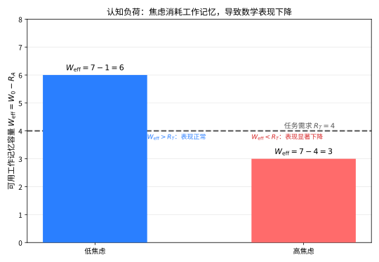

> **直观理解（现实类比）**：工作记忆容量就像你大脑里的一块"临时白板"，大约能同时记下7个条目。数学焦虑就像在考试时不断用红笔在这块白板上写字提醒"我会考砸、别人都在看我"——白板被占满了，真正用来算题的空间就所剩无几。当任务本身很复杂（如借位减法）需求 $R_T$ 很大时，剩余空间一旦不够，表现自然一落千丈。

**实验验证**：
- 研究 1：高数学焦虑者在心算任务中反应时更长、错误率更高，且这种效应在借位减法（高工作记忆需求）中比简单加法（低工作记忆需求）更强
- 研究 2：使用双任务范式（同时记忆数字串），高数学焦虑组的表现下降更显著
- 研究 3：fMRI研究表明，高数学焦虑者在做数学题时前额叶（工作记忆相关脑区）活动异常，而处理数字的顶内沟活动减弱

**第四步：动机路径——回避行为和努力减少。**

数学焦虑通过以下动机机制影响数学表现：

1. **回避行为**：高数学焦虑者倾向于回避数学课程、数学相关专业和职业
2. **努力减少**：焦虑导致"放弃"心态，降低在数学任务上的投入
3. **自我效能感下降**：反复的消极体验削弱了对自己数学能力的信心

**自我效能感**（Self-Efficacy）是一个人对完成特定任务的能力的信念。数学焦虑与数学自我效能感呈显著负相关（$r \approx -0.5$ 到 $-0.7$）。

**第五步：恶性循环的正反馈模型。**

数学焦虑的恶性循环可以用以下正反馈系统描述：

$$\begin{cases}
\frac{dA}{dt} = \alpha \cdot P_{-} - \beta \cdot A \\
\frac{dP}{dt} = -\gamma \cdot A + \delta \cdot E - \varepsilon \cdot P
\end{cases}$$

其中 $A$ 为焦虑水平，$P$ 为表现水平，$P_{-}$ 为消极表现反馈，$E$ 为教育干预，$\alpha, \beta, \gamma, \delta, \varepsilon$ 为参数。

该模型的含义是：
- 消极表现（$P_{-}$）增加焦虑（$A$）
- 焦虑降低表现（$P$）
- 低表现进一步强化消极反馈
- 需要外部干预（$E$）来打破循环

**第六步：干预策略的实验验证。**

基于模型，有效的干预策略包括：

1. **表达性写作**：在考试前让焦虑者写下自己的担忧，释放工作记忆资源
   - 实验效果：高焦虑组的成绩提高约0.5个标准差

2. **重新评价训练**：将焦虑重新解释为兴奋（"心跳加速意味着我很兴奋"）
   - 实验效果：数学考试成绩提高约0.3个标准差

3. **工作记忆训练**：通过训练提高工作记忆容量，增加对焦虑的缓冲能力
   - 实验效果：长期训练后，焦虑对表现的影响减弱

**结论**：数学焦虑的认知-动机模型揭示了焦虑损害数学表现的多重途径，并解释了为什么这种影响在高复杂度任务中更为显著。该模型为干预策略的设计提供了理论基础。$\square$

#### 课堂问答

**老师**：数学焦虑的认知-动机模型包含哪几条损害路径？

**学生**：先给结论三条：消耗工作记忆资源（认知干扰）、引发回避行为与努力减少（动机）、削弱自我效能感（信念）。三条路径叠加，且在高复杂度任务中最严重，最终形成正反馈。

**老师（追问）**：量化一下。若 $W_0=7$、$R_A=3$、$R_T=5$，会发生什么？

**学生**：有效容量 $W_{\text{eff}}=7-3=4<5$。因 $W_{\text{eff}}-R_T=-1<0$，$P=f(W_{\text{eff}}-R_T)$ 单调递增，故表现为零甚至负效应，任务很可能显著失败。这说明焦虑伤害的边界条件正是"任务需求逼近或超过剩余容量"。

**老师（拓展）**：恶性循环怎么用动力学刻画？外部干预又在哪里起作用？

**学生**：可用正反馈系统表示：$\frac{dA}{dt}=\alpha P_--\beta A$，$\frac{dP}{dt}=-\gamma A+\delta E-\varepsilon P$。消极表现 $P_-$ 抬高焦虑、焦虑压低表现，自己转圈。干预 $E$ 一方面直接抬高平衡表现 $P^\ast=\frac{\delta E-\gamma A}{\varepsilon}$，一方面通过写作、重评价降低 $A$，双向削弱循环，使系统稳定在高表现态。

### 定理4：数学问题解决的认知模型

**定理（数学问题解决的认知模型）** 数学问题解决是一个包含问题表征、策略选择、执行监控和评价反馈四个阶段的认知过程。每个阶段涉及不同的认知技能和知识资源，问题解决的成败取决于各阶段的有效运作及其交互协调。

**证明**（基于认知心理学和问题解决研究的证据）：

**第一步：建立模型框架。**

基于Polya（1945）的问题解决四阶段模型和Schoenfeld（1985）的认知资源模型，我们提出数学问题解决的认知模型：

1. **问题表征阶段**（Problem Representation）：理解问题情境，构建内部表征
2. **策略选择阶段**（Strategy Selection）：从已有知识库中选择解题策略
3. **执行监控阶段**（Execution and Monitoring）：实施策略并监控进展
4. **评价反馈阶段**（Evaluation and Reflection）：验证结果并反思过程

**第二步：问题表征阶段。**

问题表征是将外部问题转化为内部心理模型的过程，包括：

- **语言理解**：解析问题的文字描述，提取关键信息
- **结构识别**：识别问题的数学结构（如"这是线性规划问题"）
- **信息组织**：将信息组织成有结构的表征（如表格、图示、方程）

**定义（问题表征）** 问题表征是问题解决者对问题情境的内部心理模型，包括对已知条件、目标状态和约束条件的理解。

> **💡 直观理解（类比）**：问题表征就是把题目"翻译"成心里的图景——把条件、目标、限制各就各位，就像拿到一张地图先把"起点、终点、障碍"标清楚。表征越准，后面的路才越好走；专家按"地图的骨架"认路，新手却只盯着墙上的花纹。

**研究证据**：
- 专家和新手在问题表征上有本质差异：专家根据深层结构（数学原理）分类问题，新手根据表面特征（关键词、情境）分类问题
- 表征质量与解题成功率密切相关：能够正确表征问题的学生，解题成功率显著更高
- 多重表征（如图形+代数）比单一表征更有助于问题解决

**第三步：策略选择阶段。**

策略选择涉及从认知资源库中选取合适的解题方法，包括：

- **算法策略**：按照固定步骤执行（如解二次方程的求根公式）
- **启发式策略**：基于经验规则搜索解决方案（如"尝试特殊值"、"逆向思考"）
- **元认知策略**：对策略选择过程的规划和监控

**策略选择的影响因素**：
1. **知识基础**：相关数学知识的丰富程度
2. **策略知识**：对何时使用何种策略的元认知知识
3. **认知风格**：偏好分析式还是直觉式思考
4. **情感因素**：数学焦虑、自我效能感等

**第四阶段：执行监控阶段。**

执行监控是指在解题过程中持续评估进展，必要时调整策略，包括：

- **策略执行**：按照选择的策略逐步推导
- **进展监控**：检查是否朝着目标方向前进
- **错误检测**：发现并纠正计算或推理中的错误
- **策略调整**：当当前策略无效时切换到其他策略

**元认知（Metacognition）** 在数学问题解决中起着关键作用，包括：
- **元认知知识**：对自己认知能力的了解
- **元认知监控**：对解题过程的实时监控
- **元认知调节**：对认知策略的调整

**研究证据**：
- 元认知能力强的学生在面对困难问题时更有可能成功
- 专家比新手更频繁地监控自己的解题过程
- 元认知训练能显著提高数学问题解决能力

**第五步：评价反馈阶段。**

评价反馈是解题过程的最后阶段，包括：

- **结果验证**：检查答案是否合理，是否符合问题条件
- **过程反思**：回顾解题过程，总结经验和教训
- **知识整合**：将新学到的策略和方法整合到知识库中

**第六步：模型整合——认知资源交互。**

这四个阶段不是线性进行的，而是循环交互的：

$$\text{问题解决} = f(\text{表征}, \text{策略}, \text{监控}, \text{评价})$$

其中各成分之间存在交互作用：
- 表征质量影响策略选择的有效性
- 监控过程可能发现表征的不足，需要返回重新表征
- 评价结果可能改变策略选择

**第七步：专家-新手差异的实证证据。**

**专家特征**：
- 根据深层数学结构表征问题
- 拥有丰富的策略知识库
- 频繁的元认知监控
- 善于从错误中学习

**新手特征**：
- 根据表面特征表征问题
- 策略选择有限，倾向于试错
- 元认知监控较少
- 不善于反思和评价

**结论**：数学问题解决的认知模型将问题解决过程分为四个相互关联的阶段，揭示了认知技能、元认知和知识基础在问题解决中的关键作用。该模型为数学教育中培养学生的问题解决能力提供了理论框架。$\square$
> **直观理解（现实类比）**：数学问题解决就像走迷宫——先要"看清地图"（问题表征），再"选条路线"（策略选择），一路"边走边核对"（执行监控），最后"回望总结"（评价反馈）。专家凭结构看迷宫，一眼识破套路；新手只盯着墙上的花纹乱撞。元认知就是脑子里那个"旁观者"，随时提醒你"这条路不对，换一条"。

---

#### 课堂问答

**老师**：数学问题解决的认知模型分了哪几个阶段？

**学生**：先给结论四个阶段：问题表征（构建内部心理模型）、策略选择（调用合适方法）、执行监控（实施并追踪进展）、评价反馈（验证结果并反思）。四者循环交互，并非严格线性。

**老师（追问）**：专家与新手最本质的差异出现在哪个阶段？为什么？

**学生**：在问题表征。专家按深层数学结构（方程类型、函数关系、数量级）分类问题，新手按表面特征（关键词、情境）分类。例："两人定速相向而行何时相遇"，新手见"相遇"就套套路，专家直接识别为一次线性距离—速率—时间关系并设方程。表征一旦歪，后面策略、执行全跟着歪。

**老师（拓展）**：既然不是严格线性，请举一个"监控回过头改写表征"的例子。

**学生**：比如设未知数列方程后，解出负数或矛盾结果，监控发现不合理，就回到表征阶段重设变量或换模型。整体可写成

$$\text{问题解决} = f(\text{表征}, \text{策略}, \text{监控}, \text{评价})$$

其中元认知贯穿全程，监控甚至能反过来纠正最初的表征，所以模型是循环耦合的环路而非流水线。

## 三、示例

### 示例1：数学焦虑的测量

**情境**：研究者想要测量一群高中生的数学焦虑水平，并分析其与数学成绩的关系。

**工具**：使用修订版数学焦虑量表（RMARS, Revised Mathematics Anxiety Rating Scale）

**量表结构**：
- 分量表1：数学学习焦虑（如"在数学课上被点名回答问题"）
- 分量表2：数学考试焦虑（如"参加数学考试"）
- 分量表3：数学应用焦虑（如"计算餐厅账单"）

**测量方法**：
1. 每个项目使用5点李克特量表（1=完全不焦虑，5=非常焦虑）
2. 总分范围：30-150分
3. 信度：Cronbach's $\alpha = 0.92$

**结果分析**：
- 高数学焦虑组（得分 $> 110$）的数学成绩显著低于低焦虑组（得分 $< 60$）
- 效应量：Cohen's $d = 0.85$（大效应）
- 女生数学焦虑水平显著高于男生（$t(198) = 4.32, p < 0.001$）

**干预设计**：
- 实验组：表达性写作干预（考试前用10分钟写下担忧）
- 控制组：中性写作（写当天的时间安排）
- 结果：实验组数学成绩比控制组高出约12%（$p < 0.05$）

### 示例2：数学学习障碍的诊断

**情境**：一名9岁男孩（小学三年级）在数学学习上持续困难，老师和家长怀疑可能存在计算障碍。

**诊断流程**：

**第一步：初步筛查**
- 使用标准化数学成就测试（如WIAT-III数学分量表）
- 结果：数学成绩低于同龄人1.5个标准差
- 阅读和拼写成绩在正常范围内
- 智力测试（WISC-V）显示全量表智商为105（正常范围）

**第二步：具体困难评估**

使用特定数学能力测试，结果如下：

| 技能领域 | 标准分 | 百分位 | 诊断含义 |
|---------|-------|-------|---------|
| 数字比较 | 85 | 第16百分位 | 临界困难 |
| 算术事实检索 | 72 | 第3百分位 | 显著困难 |
| 多位数加减 | 78 | 第7百分位 | 显著困难 |
| 应用题理解 | 92 | 第30百分位 | 正常范围 |
| 几何与测量 | 95 | 第37百分位 | 正常范围 |

**第三步：排除其他因素**
- 排除智力障碍（智商正常）
- 排除感觉障碍（视力和听力正常）
- 排除教育不足（正常就读，无频繁缺课）
- 排除注意缺陷多动障碍（ADHD评估阴性）

**第四步：诊断结论**

基于DSM-5诊断标准，该儿童符合计算障碍（特定学习障碍，数学领域）的诊断标准：
- 数学能力显著低于年龄期望水平（标准分差异 > 1.5个标准差）
- 困难在学龄期早期即已出现
- 排除其他可能的解释

**第五步：干预建议**

1. **多感官教学**：使用实物操作、数字线、图示等多种方式教学
2. **策略训练**：教授具体的计算策略（如分解法、补偿法）
3. **事实检索训练**：使用计算机辅助程序进行重复练习
4. **工作记忆训练**：针对工作记忆的认知训练
5. **情绪支持**：减轻数学焦虑，增强自我效能感

---

## 四、习题

### 基础题

**习题 1**（数感）给出数感的定义，并说明近似数量系统（ANS）与精确数字系统的区别。

**习题 2**（韦伯定律）在近似数量比较中，判断"8 和 9"更难分辨，还是"4 和 5"更难分辨？请用比例而非绝对差解释原因。

**习题 3**（三重编码模型）列出三重编码模型的三种数字编码方式，并指出每种编码对应的核心脑区。

**习题 4**（数字认知）判断正误并说明理由：乘法口诀检索主要依赖模拟数量编码。

**习题 5**（数学焦虑）简述数学焦虑的认知-动机模型中损害数学表现的三种途径。

**习题 6**（计算障碍）写出计算障碍的三个核心症状表现，并说明确诊时需要排除哪些因素。

**习题 7**（问题解决）列出数学问题解决的四个认知阶段，并各用一句话说明其功能。

**习题 8**（数学创造力）写出数学创造力的四个维度，并举一个体现"灵活性"的例子。

**习题 9**（心理测量）解释信度与效度的含义，并说明"高信度是否一定高效度"。

**习题 10**（认知神经科学）说明 fMRI、ERP、TMS 三种技术分别能回答什么问题，并指出数量加工的枢纽脑区。

### 进阶题

**习题 11**（ANS 精度）一名 4 岁儿童的韦伯分数 $w=0.4$，一名成年人的韦伯分数 $w=0.15$。在比较两个相差一倍的点集（如 5 对 10）时谁的辨别力更高，为什么？

**习题 12**（工作记忆模型）设无焦虑时工作记忆容量 $W_0=7$ 个条目，焦虑消耗 $R_A=3$，一项借位减法任务需要 $R_T=5$。计算有效容量 $W_{\mathrm{eff}}$ 并判断任务是否会显著失败。

**习题 13**（数感量化）近似比较正确率由 $P=\Phi\left(\frac{\log(n_1/n_2)}{\sigma}\right)$ 给出。若 $\sigma=0.5$，比较 $n_1=8,n_2=10$ 与 $n_1=16,n_2=20$，两者正确率是否相同？请说明。

**习题 14**（实验设计）设计一个双任务范式，验证数学焦虑主要占用中央执行系统而非语音环路，说明两种条件、因变量与预期结果。

**习题 15**（焦虑模型）恶性循环模型中有 $\frac{dA}{dt}=\alpha P_- - \beta A$。解释 $\alpha>0$、$\beta>0$ 的含义，并说明在何种情况下焦虑水平 $A$ 趋于稳定。

**习题 16**（专家-新手差异）解释为何专家按"深层结构"分类数学问题而新手按"表面特征"分类，并举一道应用题说明两种分类可能给出不同策略。

**习题 17**（鉴别诊断）一名儿童数学成绩落后，但智商、阅读、教育均正常。请按顺序设计鉴别"计算障碍"与"一般学习困难"的诊断步骤。

**习题 18**（编码应用）分析"估算 $47\times 53$ 大约是多少"主要依赖哪种数字编码，并说明为何估算能力在某些脑损伤患者身上比精确求积更早恢复。

**习题 19**（效应量）某干预使高数学焦虑学生成绩提高 12 分，合并标准差 $s=20$。计算 Cohen's $d$，据此判断效果大小，并说明其与样本量的区别。

### 挑战题

**习题 20**（信号检测）用信号检测论把"数量比较"建模为信号叠加噪声，说明韦伯分数 $w$ 与辨别力 $d'$ 的关系，并指出只凭正确率指标可能混淆判别标准与辨别力的原因。

**习题 21**（研究设计）设计一个纵向研究，检验"幼儿期 ANS 精度能否预测学龄期符号数学成就"，说明测量指标、观察时间点、控制变量与统计检验方法。

**习题 22**（亚型解释）用三重编码模型分别解释"数量比较受损但算术事实保留"与"算术事实受损但数量比较保留"两种计算障碍亚型的神经机制。

**习题 23**（干预机制）分析"表达性写作"如何通过释放工作记忆资源缓解数学焦虑对复杂任务的影响，并结合 $W_{\mathrm{eff}}=W_0-R_A$ 说明其边界条件。

**习题 24**（筛查流程）设计一套低成本学校筛查方案，区分"低成就—正常""计算障碍""高数学焦虑"三类学生，并说明每类应匹配的后续资源。

**习题 25**（交互效应）解释为何工作记忆负载越高、数学焦虑对被试反应时与错误率的损害越大，并用两因素交互框架描述预期的统计检验结构与效应。

**习题 26**（动力学平衡）对恶性循环模型 $\frac{dP}{dt}=-\gamma A+\delta E-\varepsilon P$ 作平衡分析：有教育干预 $E$ 时稳定表现 $P^*$ 是多少，教育干预为何能打破焦虑-表现循环。

### 探究题

**习题 27**（神经可塑性）结合脑成像证据，评述"后天训练能否重塑顶内沟的典型反应、从而改进 ANS 精度"这一观点，给出支持与反驳证据各一例。

**习题 28**（教育启示）批判性地分析"数感训练程序能提升符号数学成绩"的宣称，讨论效应量、迁移性与复现性问题及其对课堂设计的启示。

**习题 29**（理论之争）评述"ANS 是数量直觉的先天底座，还是认知发展中被重塑的表征"之争，并讨论其对计算障碍解释的影响。

**习题 30**（前沿联系）探讨大语言模型与自适应学习系统在"数学焦虑识别、个性化干预、认知诊断"方面的潜力与局限，提出一项可验证的研究问题。

---

## 五、习题答案与解析

### 基础题答案

1. **数感** 数感是对数字与数量关系的直觉把握能力，包含近似数量系统（ANS，以近似、非符号方式表示数量，遵循韦伯定律）与精确数字系统（以符号精确表示数量）。前者用于估计与比较，后者用于精确计算与符号操纵，二者共同构成数感的基础。

2. **韦伯定律** "8 和 9"（比例 $9/8=1.125$）比"4 和 5"（比例 $5/4=1.25$）更难分辨，因为可分辨性取决于比例而非绝对差：比例越接近 1，辨别越困难，这正是韦伯定律所描述的数量比较核心性质。

3. **三重编码模型** 三种编码为：视空数量编码（处理阿拉伯数字与多位数运算，相关枕叶视觉区、梭状回）、听觉言语编码（处理数数与算术事实，相关左侧颞叶语言区、基底节）、模拟数量编码（处理估计与比较，相关双侧顶内沟 IPS）。

4. **数字认知** 错误。乘法口诀检索依赖听觉言语编码（言语序列化的记忆提取），而非模拟数量编码；模拟数量编码主要参与近似比较与数感，如判断"哪个更大"，不能直接提取"三七二十一"这类精确口诀。

5. **数学焦虑** 三条途径：消耗工作记忆资源（侵入性思维与注意力分散）、引发回避行为与努力减少、削弱自我效能感。三者共同损害数学表现，且在高复杂度任务中损害更显著，并形成焦虑、表现差、更焦虑的恶性循环。

6. **计算障碍** 核心症状包括数字处理困难、算术事实提取困难、数量比较与估计困难。确诊需排除智力障碍、感觉障碍与教育不足等因素，并确认数学能力显著低于年龄、智力与教育期望所应达到的水平。

7. **问题解决** 四阶段为：问题表征（构建内部心理模型）、策略选择（调用合适方法）、执行监控（实施并追踪进展）、评价反馈（验证结果并反思）。四阶段循环交互而非严格线性，元认知贯穿其中。

8. **数学创造力** 四维度为流畅性、灵活性、原创性、精致性。例子：面对"求两个和等于 12 的数"，除逐项罗列外，还能想到用方程、图形、数轴等多种角度切入，即体现从不同角度思考问题的"灵活性"。

9. **心理测量** 信度指测量的一致性与稳定性，效度指测量是否真的测到目标特质。高信度不一定高效度：一个工具可以稳定地测一个与目标无关的特质，因此信度是效度的必要而非充分条件。

10. **认知神经科学** fMRI 定位激活的空间脑区（如数字比较时 IPS 激活），ERP 提供毫秒级时程信息（如符号出现后数百毫秒的处理波形），TMS 通过暂时扰乱或增强特定脑区研究因果作用。数量加工的枢纽脑区是双侧顶内沟（IPS）。

### 进阶题答案

1. **ANS 精度** 成人辨别力更高。韦伯分数 $w$ 越小，可分辨的比例越接近 1、判别越精细；比较固定比例（如 5 对 10，比例 2）时两人都能分辨，但当比例趋近 1（如 9 对 10）时 $w=0.15$ 的成人仍可分辨而 $w=0.4$ 的儿童通常不能，故成人的整体精度更高。

2. **工作记忆模型** $W_{\mathrm{eff}}=W_0-R_A=7-3=4$。由于任务需求 $R_T=5$，$W_{\mathrm{eff}}<R_T$，由 $P=f(W_{\mathrm{eff}}-R_T)$ 且 $f$ 单调递增，$W_{\mathrm{eff}}-R_T=-1<0$，故表现将显著下降、任务很可能失败。

3. **数感量化** 两者正确率相同。因为正确率只取决于数量之比的对数 $\log(n_1/n_2)$，而 $\log(16/20)=\log(8/10)$，比例相同故 $d'$ 相同、正确率一致，体现"以比例而非绝对差"编码数量。

4. **实验设计** 采用双任务范式：主任务固定为借位减法，干扰任务分两种——中央执行干扰（随机叠加或按奇偶归类）与语音环路干扰（复述无意义音节串），设无干扰基线。因变量为反应时与错误率。预期：若焦虑主要侵入中央执行，则高焦虑组在中央执行干扰下恶化最明显、语音干扰下无明显差异；用组别与干扰类型的两因素方差分析检验交互。

5. **焦虑模型** $\alpha>0$ 表示消极表现反馈正向加剧焦虑（表现差使焦虑上升），$\beta>0$ 表示焦虑的自我消退（随时间或干预缓解）。设 $P_-$ 稳定，令 $\frac{dA}{dt}=0$ 得平衡点 $A^*=\alpha P_-/\beta$，为稳定点；当 $A>A^*$ 时下降、$A<A^*$ 时上升，故焦虑会趋近稳定水平而非无限升高。

6. **专家-新手差异** 专家按数学结构（方程类型、函数关系、数量级）分类，新手按关键词与情境分类。例："两人以定速相向而行，何时相遇"——新手看到"相遇"便套用套路，专家则识别为一次线性距离-速率-时间关系，直接设方程求解，体现出深层结构分类带来的策略优势。

7. **鉴别诊断** 先做标准化成就测试确认总体落后；再做智商测试排除智力障碍；检查视听功能排除感觉障碍；访谈排除缺课与教育不足；最后用特定数学能力测验定位具体缺陷（数字比较、事实检索、多位数运算）。若仅数学专项显著低、其余领域正常，再结合 DSM-5 标准诊断计算障碍。

8. **编码应用** 估算主要依赖模拟数量编码，即对 $47\times 53$ 约等于 $50\times 50=2500$ 的量级判断与近似比较。精确求积依赖视觉与言语编码，通路较"脆"；而量级估计由更古老的近似系统（IPS）支持，故当语言区受损、顶内沟保留时，患者仍能估算却难以精确计算。

9. **效应量** $d=\frac{12}{20}=0.60$，属中等偏大的效应。Cohen's $d$ 是无量纲的标准化差异，衡量变量解释中的实际强度；样本量只影响估计精度与统计功效，二者不同，效应量大仍需足够样本才能达到统计显著。

### 挑战题答案

1. **信号检测** 把目标数量 $n$ 视作信号，主观表征加高斯噪声，两数量对应两个满足 $d'=(\mu_1-\mu_0)/\sigma$ 的分布；因 ANS 相对精度恒定（标准差正比于数量），$d'$ 随 $\log(n_1/n_2)$ 增加而增大，故 $w$ 越小 $d'$ 越大。只看正确率会把被试的判别标准（criterion）与辨别力混淆——改变答案倾向只改变标准而不改变辨别力，需用 $d'$ 分离二者。

2. **研究设计** 纵向追踪 3 到 6 岁儿童：入学前测量 ANS 精度（数值比较任务，控制面积与密度，用 $w$ 或 $d'$ 度量），入学后逐年测符号数学成就（标准化测验），控制智力、工作记忆、家庭 SES 等协变量，用层级回归或结构方程检验入学前 ANS 精度对后续成就的预测系数与独立解释量，并做稳健性检查。

3. **亚型解释** "数量比较受损、算术事实保留"：顶内沟（模拟数量编码）受损，估计、比较、数感受损，但语言区完好，故乘法口诀等精确事实仍可提取。"算术事实受损、数量比较保留"：左侧颞叶语言区受损，符号口诀检索失灵，而模拟数量编码完好，仍能比较与估计大小。两种亚型恰与三重编码模型的可分离受损一致。

4. **干预机制** 表达性写作让学生在考前把担忧写下"外化"，腾出中央执行与语音环路资源，使 $R_A$ 下降、$W_{\mathrm{eff}}=W_0-R_A$ 回升；当任务需求 $R_T$ 很大（借位减法）时 $W_{\mathrm{eff}}-R_T$ 由负转正，表现恢复。边界条件是焦虑主要源于资源侵占；若已固化为回避或自我效能断裂，写作收益有限，需配合认知重建。

5. **筛查流程** 分两步：先对全员执行标准化数学成就测验筛出低成就者；再对低成就者用简短临床访谈与专项测验区分亚型——"低成就—正常"（成绩低于均值 1.5 个标准差、认知与情感均正常，多为教学或动机不足）、"计算障碍"（数字比较、事实检索、多位数运算等专项显著受损，且排除智力、感觉与教育因素）、"高数学焦虑"（态度与生理量表评分高，且随数学情境工作记忆表现下降）。每类匹配资源："低成就—正常"补基础教学，"计算障碍"给个别化策略与认知训练，"高焦虑"给表达性写作、系统性脱敏与自我效能重建。用群体筛查先行再个体精准诊断以控成本，并做纵向随访验证分流准确性。

6. **交互效应** 焦虑占用的工作记忆资源固定，负载越高剩余资源越少，故损害随负载增大而放大。以组别（高/低焦虑）与负载（高/低）作为两因素，用两因素方差分析检验交互项：预期交互显著，说明焦虑效应依赖负载，高负载下高焦虑组反应时增幅与错误率显著更高，支持"资源竞争"而非单纯动机解释。

7. **动力学平衡** 令 $\frac{dP}{dt}=0$ 得 $-\gamma A+\delta E-\varepsilon P=0$，故 $P^*=\frac{\delta E-\gamma A}{\varepsilon}$。教育干预 $E$ 直接抬高 $P^*$，同时通过表达性写作、重评价、工作记忆训练降低 $A$ 使 $P^*$ 进一步上升；$P$ 上升又减轻消极反馈 $P_-$，削弱 $\alpha$ 通道，从而打破 $P_-\to A\to$ 低 $P$ 的正反馈循环，使系统稳定在高表现态。

### 探究题答案

1. **神经可塑性** 支持证据：数学训练可使儿童在数字化比较任务中 IPS 活动更高效、ANS 精度提升，符号数字随学习"接入"已有数量网络，说明经验能重塑 IPS 的典型反应。反驳证据：ANS 精度在未受过正式教育的人群中相对稳定，训练收益多局限在量级层面、难跨任务迁移。综合看，训练能改善精度与自动化，但"学前教育显著提升符号成绩"仍需更强的可迁移与长期纵向证据。

2. **教育启示** 该宣称需谨慎拆解：真实效应多集中在"数值估计与比较"的近迁移任务上，效应量多为小到中；迁移到符号算术与高阶应用时快速衰减，且存在发表偏倚与复现不足。对课堂的启示是把数感程序作为补充而非替代，强调具体数量表征与符号的联结、做好对照与长期追踪，用预先注册的随机试验来负责任地评估。

3. **理论之争** 一种立场认为 ANS 是数量直觉的先天底座（新生儿即可区分少数点集，为符号学习提供语义锚点）；另一种强调数量能力被表征方式与语言命名重写，符号学习重构而非只"充值"数量直觉。争论影响对计算障碍的解释（归因于 ANS 缺陷还是符号映射缺陷）。当前证据更支持"先天底座 + 后天重塑"的交互观，但两者权重仍在争论中。

4. **前沿联系** 大语言模型可自动标注数学错误、生成个性化讲解与自适应练习，为识别高焦虑者的回避模式与误解路径提供新工具；但存在数据偏差、"会作答不等于理解数量意义"、缺乏神经与情感测量等局限。可验证问题示例：用日志特征与自我报告训练分类器预测高数学焦虑学生，并比较其在个性化干预前后的工作记忆释放与实际成绩提升，检验"AI 辅助干预是否显著优于静态练习"。

---

## 六、Stewart 风格训练

> 本小结仿照 Stewart《Calculus》每章末尾的体例，补充概念检查、真/假测验、与微积分的联结、标准例题与专题应用，帮助读者用经典微积分的"地基"去理解本章的量化主题——从反应时的指数/威布尔分布、心理物理的韦伯—费希纳律，到遗忘曲线的一阶常微分方程与信号检测的高斯积分。

### 6.1 概念检查（Concept Check）

1. **工作记忆容量**：为什么工作记忆容量常被粗略地描述为"7±2"？它对理解数学焦虑如何"抢占"计算资源有何启发？
2. **反应时分布**：反应时数据随任务难度增大而表现出右偏、长尾的全貌，为何常用指数或威布尔（Weibull）分布而非正态分布来建模？
3. **对数计时模型**：数学认知中的"对数计时"思路如何解释：比较一对比例接近 1 的数量（如 9 与 10）时反应时更长、正确率更低？
4. **数感中的心理物理**：近似数量系统和心理物理学的韦伯—费希纳定律有何联系？为什么可分辨性取决于比例而非绝对差？
5. **数量幅值的量化**：在近似比较任务中，心理数轴上"数量幅值（magnitude）"如何被量化？试举例说明可用判别阈值或韦伯分数表达。
6. **对数线性化**：当两个数量之比接近 1 时，为什么 $\log(n_1/n_2)$ 近似等于其相对差？这与韦伯分数 $w$ 有何联系？
7. **探索性因素分析**：在数学焦虑量表的维度识别中，探索性因素分析起什么作用？为何需要信度与效度指标与之配合？

### 6.2 真/假测验（True-False Quiz）

1. （假）工作记忆容量常用"7±2"描述，指的是长期记忆中可永久保存的数学事实总数。
   - 理由：7±2 描述的是工作记忆这一临时操作缓冲同时可保持的容量界限（粗略经验值），并非长期记忆的容量，更不涉及"永久保存的数学事实总数"。

2. （真）近似数量系统遵循韦伯定律：两个数量的可分辨性取决于它们的比例而非绝对差。
   - 理由：这正是本章 ANS 的核心性质——"8 和 9"比例更接近 1，故比"4 和 5"更难分辨，可分辨性由比例决定。

3. （真）三重编码模型认为乘法口诀检索主要依赖听觉言语编码，而非模拟数量编码。
   - 理由：原文明确指出乘法口诀检索依赖听觉言语编码（言语序列化提取），模拟数量编码主要参与近似比较与数感。

4. （假）数学焦虑主要通过扩大工作记忆容量来提升数学表现。
   - 理由：数学焦虑恰恰通过消耗工作记忆资源、引发回避行为与削弱自我效能感三条途径损害表现，而非提升容量。

5. （真）数学问题解决包含问题表征、策略选择、执行监控与评价反馈四个阶段，且四阶段循环交互而非严格线性。
   - 理由：这正是定理4给出的认知模型及其交互性质。

6. （假）计算障碍的确诊无需排除智力、感觉或教育方面的因素。
   - 理由：诊断标准明确要求排除智力障碍、感觉障碍与教育不足等因素后，才能判断是否为计算障碍。

7. （真）用指数函数表示遗忘保持量 $T(n)=e^{-\lambda n}$ 时，保持量降至一半所需的半衰期为 $\ln 2/\lambda$。
   - 理由：令 $T(n)=1/2$ 即 $e^{-\lambda n}=1/2$，取对数得 $n=\ln 2/\lambda$。

### 6.3 与微积分的联结（Connections to Calculus）

**反应时角度**：反应时分布常用指数密度 $f(t)=\lambda e^{-\lambda t}$ 或威布尔密度 $f(t)=\frac{k}{\lambda}\left(\frac{t}{\lambda}\right)^{k-1}e^{-(t/\lambda)^k}$ 描述，它们都源于指数函数，且命中率等累积量由分布积分给出：

$$P(T\le t)=\int_0^{t} f(s)\,ds$$

**心理物理角度**：韦伯定律要求可分辨性由相对差 $\Delta I/I$ 决定，而对小增量有 $d(\ln I)=\frac{dI}{I}$，故取对数坐标后"相同的韦伯比"对应均匀的刺激步长：

$$\Delta(\ln I)\approx\frac{\Delta I}{I}=\text{常数}$$

**学习/遗忘曲线角度**：指数式增长或衰减对应一阶常微分方程 $\frac{dR}{dt}=-\lambda R$，其解为指数保持量曲线：

$$R(t)=R_0\,e^{-\lambda t}$$

它与本章数学焦虑模型中的 $\frac{dA}{dt}=\alpha P_--\beta A$、$\frac{dP}{dt}=-\gamma A+\delta E-\varepsilon P$ 属同一类一阶线性动力学。

**信号检测角度**：信号检测论中辨别力 $d'$ 对应两条高斯分布（噪声与信号）在判别标准 $c$ 处的上下侧面积积分，命中率与虚报率皆为正态曲线积分：

$$H=1-\Phi(c-d'),\qquad F=1-\Phi(c)$$

其中 $d'=z(H)-z(F)$。这与 ANS 中 $P=\Phi\big(\log(n_1/n_2)/\sigma\big)$ 的正态积分一脉相承。

**计时/弹性角度**：把计时时长取对数后，响应关于输入的灵敏程度可用导数（弹性）刻画；例如对数计时模型下敏感度正比于 $\frac{d}{dI}\ln I=\frac{1}{I}$，这正解释了"大数量处幅度变化更难被察觉"。

### 6.4 标准例题（Worked Example）

**例题 A（指数遗忘量）** 某知识点首次学会后，记忆保持量按指数衰减 $T(n)=e^{-\lambda n}$，其中 $n$ 为天数、遗忘系数 $\lambda=0.05$。

**步骤 1：写出遗忘模型并说明含义。**
保持量随时间指数下降，$T(0)=1$ 表示初学即时完全掌握，$n$ 越大保留越少。模型为

$$T(n)=e^{-0.05\,n}$$

**步骤 2：代入 $n=10$ 计算第 10 天的保持量。**
代入指数得 $T(10)=e^{-0.05\times 10}=e^{-0.5}$。计算 $e^{-0.5}\approx 0.6065$，故第 10 天约保持 60.65%。

**步骤 3：用导数求第 1 天的瞬时遗忘率。**
由链式法则 $T'(n)=-\lambda e^{-\lambda n}=-0.05\,e^{-0.05 n}$。在 $n=1$ 处

$$T'(1)=-0.05\,e^{-0.05}\approx -0.05\times 0.9512=-0.0476$$

即第 1 天保持量下降速率约为 4.76%/天。

**步骤 4：求半衰期。**
令 $T(n)=1/2$，解 $e^{-0.05 n}=\tfrac12$ 得 $n=\frac{\ln 2}{0.05}\approx 13.86$ 天，即约两周后记忆保持量减半，可作为复习间隔的参考。

**步骤 5：验证与整理解释。**
结果符合"指数遗忘、半衰期为 $\ln2/\lambda$"的一般结论，也呼应 6.2 第 7 条真/假测验。若希望保持量高于 0.8，可解得需复习的时间窗口 $n\le\frac{\ln(1/0.8)}{0.05}\approx 4.46$ 天。

**例题 B（正态检测的命中/虚报积分）** 信号检测论中，噪声分布为 $\mathcal{N}(0,1)$，信号分布为 $\mathcal{N}(d',1)$，设 $d'=1$，判别标准 $c=0.5$。

**步骤 1：写出命中率与虚报率的积分表达式。**
命中率是信号分布落于标准之上的面积，虚报率是噪声分布落于标准之上的面积：

$$H=\int_{c}^{\infty}\phi(x-1)\,dx=1-\Phi(c-1),\qquad F=\int_{c}^{\infty}\phi(x)\,dx=1-\Phi(c)$$

**步骤 2：代入数值化为标准正态积分。**
代入 $c=0.5$，得 $H=1-\Phi(-0.5)$。利用 $\Phi(-0.5)=1-\Phi(0.5)$，故 $H=\Phi(0.5)\approx 0.6915$；同时 $F=1-\Phi(0.5)\approx 1-0.6915=0.3085$。

**步骤 3：交叉验证辨别力关系。**
检验 $d'=z(H)-z(F)$ 是否回推为 1：$z(0.6915)\approx 0.5$，$z(0.3085)\approx -0.5$，故 $z(H)-z(F)=0.5-(-0.5)=1=d'$，自洽。

**步骤 4：与 ANS 联结并解释标准的作用。**
$d'$ 越大、$c$ 越靠中时命中与虚报差距越大；而 ANS 的比较正确率正比于 $\Phi\big(\log(n_1/n_2)/\sigma\big)$，同样的高斯积分把"辨别力"与"判别标准"分开，说明只凭正确率会混淆标准与辨别力。

### 6.5 专题应用（Applied Project）

**背景**：数学焦虑理论认为焦虑通过占用工作记忆资源损害复杂算术表现。本专题要求把经典微积分工具用于一套"遗忘—干扰"的真实数据设定。

**任务**：设计并分析一个"指数间隔记忆表"实验。给一组学生一个一次学会的知识点，分别在校后第 1、3、7、14、28 天测试保持量；用最小二乘拟合指数曲线

$$T(n)=T_0\,e^{-\lambda n}$$

估计遗忘系数 $\lambda$ 与初始保持量 $T_0$，再求半衰期 $\ln2/\lambda$，据此给出"在保持量掉到 0.7 之前复习"的时间表。接着引入高/低数学焦虑两组，比较其拟合出的 $\lambda$ 是否显著更大。

**与本章的联结**：把 6.3 的遗忘 ODE 与数学焦虑的资源竞争模型结合起来，用指数曲线量化焦虑是否加速遗忘；高阶版可用费曼积分或对数变换后做线性回归评估拟合质量。

**开放问题**：① 若加入合中断（间隔）后遗忘并非纯指数，能否改用威布尔或双曲线模型拟合？② 保持量阈值（如 0.7）如何由 $d'$——而非正确率——来定义才更稳健？③ 拟合结果如何为一阶常微分方程的干预项（如 $\delta E$）提供经验取值？

### 6.6 习题分层导览（对应 Stewart 的分类）

**概念题**：重在定义、原理与脑区对应。
- 基础题第 1 题（数感定义与 ANS/精确系统区别）
- 基础题第 2、3、4 题（韦伯定律、三重编码、编码判断）
- 基础题第 5、6、7、8、9、10 题（焦虑途径、计算障碍、问题解决、创造力、信度效度、脑区技术）
- 进阶题第 16、18 题（专家—新手分类、估算编码分析）

**技巧题**：重在代入公式与定量计算。
- 进阶题第 11 题（韦伯分数与辨别力比较）
- 进阶题第 12 题（$W_{\mathrm{eff}}=W_0-R_A$ 有效容量计算）
- 进阶题第 13 题（$P=\Phi(\log(n_1/n_2)/\sigma)$ 正确率比较）
- 进阶题第 15、19 题（焦虑模型参数、Cohen's $d$ 计算）
- 挑战题第 26 题（$P^*=\frac{\delta E-\gamma A}{\varepsilon}$ 平衡点分析）

**应用题**：重在实验设计、诊断流程与研究方案。
- 进阶题第 14、17 题（双任务范式、鉴别诊断步骤）
- 挑战题第 20、21、22、23、24、25 题（信号检测、纵向研究、亚型解释、干预机制、筛查流程、交互效应）
- 探究题第 27、28、29、30 题（可塑性评述、教育启示、理论之争、前沿联系）

---

## 七、数学科普（Popular Mathematics）

数学心理学研究的是"人脑这台计算机怎样做数学"。它关心的问题很生活化：为什么有人一眼就能估出个数，却总也记不住进位？为什么一看到算式就紧张？下面用十三幅图，把几个最直观的发现逐一讲清楚。

### 七.1 数感：与生俱来的"数量直觉"

把一把糖撒在桌上，你一眼就能感到"这堆比那堆多"，根本不用去数。这种对数量的粗略直觉叫"数感"，婴儿和很多动物都有，是我们后来学算术的地基。

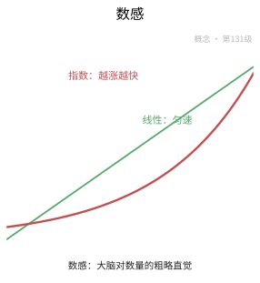

**一句话点破**：在学会数数之前，大脑早就已经会"估个数"了。

### 七.2 数字在脑中如何被表征

同一个数字，在脑里其实有三副面孔：读出来的声音、写出来的符号，以及它代表的"那么多东西"的多少。理解这一点，才能明白为什么有人能背下数字，却依然不会算。

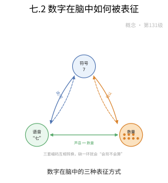

**一句话点破**：数字在图、音、量三处分别安家，通道之间要能互相翻译。

### 七.3 数学思维：从算到想

会背乘法口诀不等于会数学。数学思维指的是抽象、逻辑推理，以及把现实问题"翻译"成算式的能力，它比单纯算得快更能预测一个人将来的数学成就。

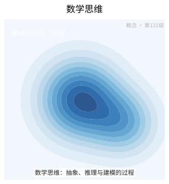

**一句话点破**：真正的数学能力不在算得快，而在想得清。

### 七.4 测出来的数学能力

想知道一个人数学行不行，光看一个总分并不够。心理测量学用一整套标准化测验，把"数感、计算、推理、空间"等分项能力分别量出来，才能看出问题究竟出在哪一环。


**一句话点破**：分项测量比一个总分更能说明"到底卡在哪里"。

### 七.5 数学学习障碍并非"笨"

有人明明很聪明，却总是分不清 $7$ 和 $9$ 哪个大、记不住进位，这叫发展性计算障碍。它不是懒、也不是笨，而是一种特定能力的发育迟缓，需要专门的诊断与训练。

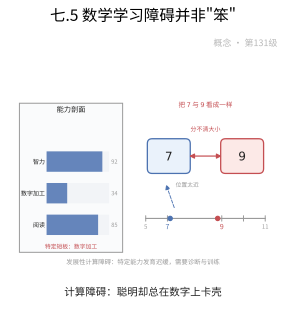

**一句话点破**：算不好有时是一种可诊断的障碍，而不是态度问题。

### 七.6 数学焦虑会偷走脑力

一看到算式就心慌、手心冒汗，这是数学焦虑。它并不只是"心情不好"：担心本身会占用有限的脑力，于是本该拿来算题的资源被情绪借走，成绩自然越考越差。

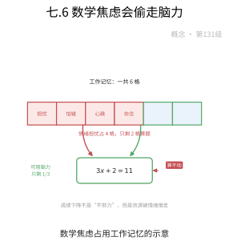

**一句话点破**：越怕越算错，是因为紧张在跟题目抢脑力。

### 七.7 数学也能有创造力

数学不只是照着公式套，猜想新规律、换一个角度看老问题、把不相干的领域连起来，都是数学创造力的表现。它和艺术创作一样，靠的是大胆联想加严格检验。

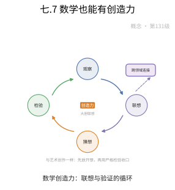

**一句话点破**：提出一个好问题，往往比算出一个答案更有创造性。

### 七.8 做数学时大脑在忙什么

借助脑成像，研究者能看到做算术时哪些脑区亮起来：认数字的、记中间结果的、负责推理的各有分工。数学心理学由此从"行为观察"走进了"大脑内部"。

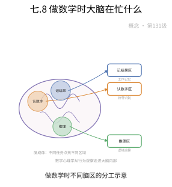

**一句话点破**：心算不是一块脑区的事，而是好几个脑区在协同。

### 七.9 把心理学用进数学课堂

为什么有些讲法学生就是听不懂？教育心理学研究人如何学数学，主张从具体到抽象、从已知到未知，还提醒老师：过度的焦虑会压垮理解。好的教学本身就是一种应用心理学。

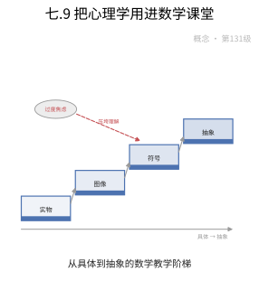

**一句话点破**：教得好不好，一半取决于懂不懂学生脑子里在想什么。

### 七.10 三重编码模型

定理：一个数字在脑中同时以三种编码存在——视觉的阿拉伯数字、听觉的语言发音，以及表示多少的"类比量"。三者各司其职，心算则是在它们之间来回搭桥、把结果一点点拼出来。

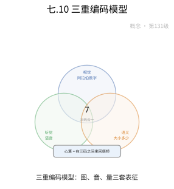

**一句话点破**：三种编码各守一块，心算靠的是它们之间的来回翻译。

### 七.11 数感的认知发展理论

定理：人对数量的直觉并非一步到位，而是沿着一条可预测的路线长大——先能分辨多少，再学会精确计数，最后把"数"摆上心里的数轴。可见数感是天生能力与后天学习共同的产物。

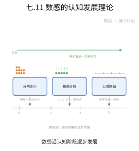

**一句话点破**：数感是天生的直觉和学习经验一层层叠出来的。

### 七.12 数学焦虑的认知—动机模型

定理：数学焦虑会形成一个恶性循环——紧张占用了工作记忆，导致表现变差；表现变差又强化了"我就是不行"的信念，于是下一次更紧张。要打破它，得从减少脑力占用和重建信心两端同时入手。

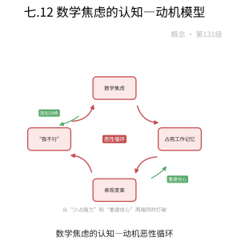

**一句话点破**：焦虑是个会自我加强的圈，破圈要同时松脑力、补信心。

### 七.13 数学问题解决的认知模型

定理：解一道题可以拆成几个可研究的步骤——读懂题意、在大脑里搭出问题空间、搜索可行的解法、检验并反思。弄清每一阶段，就能知道人究竟是在哪一步卡住的。

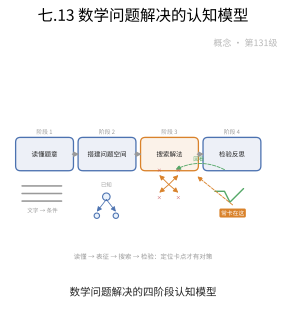

**一句话点破**：解题卡壳不是笼统地"不会"，而是卡在某个具体环节。

## 八、数学史（History of Mathematics）

> 数学心理学（与数学认知科学）的历史主线，是从"测出一个人数学有多好"走向"看清人脑如何做数学"的一次视角转移。它起于 19 世纪末的心理测量，经皮亚杰的发生认识论与信息加工心理学，把"数感""工作记忆""心算"变成可实验、可建模、可神经成像的对象，最终与神经科学、教育干预融成一体。这部历史的主语，始终是"究竟什么是人类脑中那个会算数的系统"。

### 前史：从"测试能力"到"测量个体差异"

- **心理测量的开端**：Galton（高尔顿）在 1880 年代开创个体差异研究，用感官与反应的测量刻画人之间"聪明程度"的差别；其继承者把"会算、记得住、反应快"当作可量化的指标，为数学能力的科学考察提供了最早的实验台。
- **比奈-西蒙量表的转向**：1905 年 Binet（比奈）与 Simon（西蒙）编制世界上最早的智力测验，其中大量项目涉及算术推理——"数学能力"由此第一次被当作可测的独立维度，也让学校第一次可以"用数据诊断"儿童。
- **从测量到理解**：早期测量只回答"谁更行"，却不管"为什么行"。真正把焦点从"打分"移到"人究竟如何计算"的，是此后发展心理学与认知心理学的登场。

### 皮亚杰的发生认识论：数量概念如何在儿童脑中长成

- **认知发展的四阶段**：Jean Piaget（让·皮亚杰）在对儿童的长年观察中提出，数量、几何与逻辑概念经由**感觉运动—前运算—具体运算—形式运算**四阶段逐步内化，儿童并非天生用成人的方式"算"。
- **守恒实验的启示**：其"守恒"实验（同样多的水倒入细高与矮粗杯子仍是一样多）揭示：数概念是**数量、序列、分类**等逻辑结构在具体操作中的建构结果，而非简单"教出来"的记忆。
- **对数学心理学的影响**：皮亚杰让"数学概念何时出现、如何构造"成为发展心理学的核心问题，为后来"数感是先天还是后天"的大争论埋下伏笔——尽管他关于阶段的僵硬分期后来屡被修正。

### 信息加工范式：把"会算"变成可模拟的机器步骤

- **物理符号系统假说**：Newell（纽维尔）与 Simon（西蒙）在 1950—60 年代提出**物理符号系统假说**，主张智能就是符号操作；他们用"摸着石头"式的搜索树描述人解数学题的过程，开创了把解题建模成搜索的先河。
- **从"反应时"到"算法"**：早期实验心理学（如 Gross、Kulz 测定加减乘除的反应时间）试图透过时间推断"心理算法"；信息加工范式则把这些算法显式写成流程图，第一次让"心理计算"有了可检验的模型。
- **认知架构的建立**：此后的 ACT／SOAR 等生产系统架构，把数学技能视为由"条件-动作"规则组成且逐步编译的高性能程序，为"熟练—自动化的技能"提供了计算化解释。

### 数感的神经科学：一个先天的数量系统

- **近似数量系统**：Dehaene（德阿纳）等在 1980—90 年代提出，人（与许多动物共享）拥有先天接近的**数量系统**：它独立于语言符号，能对人类不能精确命名的量作粗略判断（呈现著名的韦伯分数），是"数感"的神经底座。
- **顶叶内沟（IPS）**：fMRI 等无创成像揭示，**顶叶内沟**附近区域是数量处理的核心，符号数字与近似数量在此共享神经基质——为"符号学习精化先天数感"提供了直接证据。
- **数感的功能边界**：这套系统的近似性解释了为何人类擅长精确小数量却对大数量只能粗判，也为"数感训练能否提升数学能力"的教育争论提供了神经依据。

### 工作记忆与心算：算不出来常常是"记不住"

- **Baddeley 的工作记忆模型**：Baddeley（巴德利）与 Hitch（希契）1974 年提出**工作记忆**模型，把短时记忆细分为语音环路、视空画板与中央执行系统，成为研究心算与数学问题解决的标准脚手架。
- **心算的资源瓶颈**：研究反复显示，工作记忆容量是心算、手笔计算与数学问题解决的关键瓶颈；越复杂的运算越需要占用中央执行资源，数学焦虑正是在此"借道"消减可用资源从而损害表现。
- **Ashcraft 的检索研究**：Ashcraft 等集中研究乘法表这类**自动检索**，揭示熟练后"从记忆取答案"替代"逐步计算"的过程，也说明工作记忆负荷随任务难度与检索自动化程度而变化。

### 三重编码模型：把心算统一成一棵树

- **三种编码**：德阿纳提出**三重编码模型**：数字在大脑中被表示成**视觉阿拉伯编码、听觉语言编码、模拟数量编码**三条彼此联通的处理通道，心算是三通道之间的激活与转换。
- **不同任务的通道偏好**：乘法口算更依赖听觉语言通道，近似估计更依赖模拟数量通道，视觉符号处理则服务多位数对齐——这解释了为何不同运算在我们脑中"感觉不同"。
- **神经与建模的融合**：该模型成为研究心算神经机制的主流工具，也与"数感-符号-计算"的整体认知图景互相印证，是数学心理学从概念走向可计算模型的关键一步。

### 数学焦虑：情绪如何改写数学表现

- **焦虑的界定与测量**：数学焦虑自 1950—70 年代被系统研究（如 Richardson、Suinn 的 MARS 量表），它指面对数学任务时的紧张、回避与自我怀疑，且与一般焦虑不同，是**特定领域**的情绪反应。
- **恶性循环机制**：焦虑会占用工作记忆资源、诱发回避行为、削弱自我效能，从而损害表现，形成"**焦虑—回避—落后—更焦虑**"的自增强回路，尤其在高负载的任务上伤害最大。
- **影响的干预窗口**：实证表明，降低焦虑（表达性写作、重新评价干预）能释放工作记忆资源、改善表现，使数学焦虑从"宿命"变成教育可以介入的变量。

### 数学学习障碍：从"笨"到"可诊断的障碍"

- **计算障碍的识别**：数学学习障碍（dyscalculia、计算障碍）在 20 世纪后期被确认为独立于阅读障碍（dyslexia）的神经发展障碍，其核心困难常常落在数量表征与数感上，而非整体智力。
- **相关的神经与认知研究**：对计算障碍者的研究表明其近似数量系统（IPS）与数感、工作记忆存在差异，使"尽早识别"成为教育与临床的共识，也让"特定的教育干预"（如基于数感、逐步分解的补救）获得依据。
- **从筛选到支持**：数学教育心理学把这一认识带入课堂，推动评估从"筛选淘汰"转向"诊断支持"，也催生了自适应学习系统借助认知诊断做个性化辅导的现代实践。

### 数学认知神经科学的发展现况

- **成像技术的介入**：fMRI、EEG、TMS 等使"做数学时大脑哪里亮"可被观察，数学认知神经科学由此成形；这是数学心理学从行为到脑、从现象到机制的一次方法跃迁。
- **系统网络的视角**：研究显示算术依赖一个大而分散的**额—顶**网络（工作记忆＋数量处理＋执行控制），而不仅是单个"数学脑区"，把"数学是一脑区还是多脑区"的旧问改写为"网络如何协调"。
- **多学科汇流**：发展、教育、临床与计算模型在此交汇——用认知诊断、干预设计与数据验证反哺教育，使数学心理学成为连接实验、模型与课堂的桥梁学科。

### 历史年表

| 时间 | 人物／文献 | 事件与贡献 |
|:---|:---|:---|
| 1880 年代 | 高尔顿 | 个体差异测量，数学能力的科学起点 |
| 1905 年 | 比奈、西蒙 | 首个智力测验，算术推理入量 |
| 1920—1960 年代 | 皮亚杰 | 发生认识论：数量概念的发展阶段 |
| 1950—1970 年代 | 纽维尔、西蒙 | 信息加工与物理符号系统假说 |
| 1957 年 | Dreger 等 | 数学焦虑的最早研究 |
| 1974 年 | Baddeley、Hitch | 工作记忆模型 |
| 1980—1990 年代 | Dehaene 等 | 近似数量系统与数感研究 |
| 1987 年 | Ashcraft | 乘法表自动检索与心算研究 |
| 1992 年 | Dehaene | 三重编码模型 |
| 2010 年代起 | 国际认知科学 | fMRI 等神经成像与网络视角 |

### 小结

> 数学心理学的历史，是"评估数学能力"到"理解数学心智"的一次范式转变。它以高尔顿与比奈的量表起家，把"谁更会算"变成可测之量；皮亚杰的发生认识论把"数量概念如何长成"变成发展心理学的议题，纽维尔与西蒙的信息加工范式则把"会算"建构成可模拟的搜索与规则过程。Dehaene 的三重编码与近似数量系统、Baddeley 的工作记忆模型，让"数感—工作记忆—心算"第一次有了可实验、可神经成像的科学内核；数学焦虑与计算障碍的研究又提醒我们情绪与障碍同样在塑造表现。今天，数学心理学已从"打分的工具"长成连通实验、认知建模、神经科学与教育设计的交叉学科——它问的不再是"你多会算"，而是"你脑中在人怎么算，而我们又该如何帮它算得更好"。

## 现实应用（Real-World Applications）

> 本节把本章的知识点落到真实的工程、科学与生活场景中。每个案例都给出**完整的问题背景、建模过程、可复现的数据 / 公式 / 代码与结果解读**；案例末尾的「涉及知识点」对应本章的具体小节，文末附**知识点覆盖对照表**，确保本章知识点全部被覆盖。

### 应用案例 1：数感训练 App｜用韦伯分数自适应调节点阵比较难度

**场景与问题**

一家公司开发了面向 4–8 岁儿童的点阵比较（dot comparison）训练 App：屏幕上快速闪现两片点阵，孩子点出哪边更多。产品经理发现，如果难度固定，孩子要么太无聊要么太受挫。真正的难题是：**如何用"比例"而不是"绝对差"来定义难度，并自动把难度稳定在孩子的能力边缘？** 这正是近似数量系统（ANS）遵循韦伯定律的直接后果——8 比 9 难分，80 比 90 一样难分。团队要用行为数据反推每个孩子的韦伯分数 $w$，并据此自适应。

**涉及知识点**

- 本章「1.1 数学认知与数感」：ANS 与精确数字系统的区分，决定了 App 用"非符号点阵"而非阿拉伯数字来测数感底座。
- 本章「定理2：数感的认知发展理论」：$w$ 随年龄/训练下降（4 岁 0.4–0.5，成人 0.15–0.2），训练目标是让 $w$ 变小。
- 本章「1.8 认知神经科学」：ANS 的神经基质是顶内沟，训练提升的是编码效率（此处以行为指标代理）。

**建模与数据**

ANS 判别正确率遵循（$\Phi$ 为正态累积分布）：

$$
P(\text{正确})=\Phi\!\left(\frac{\log(n_2/n_1)}{\sigma}\right)
$$

韦伯分数 $w$ 与 $\sigma$ 通过 75% 阈值的比例 $1+w$ 联系：$\Phi^{-1}(0.75)=0.674$，故

$$
\sigma=\frac{\log(1+w)}{0.674}
$$

某学生 S 在 4 种比例下的实测正确率（每种比例 40 试次）：

| 比例 $n_2/n_1$ | $\log(n_2/n_1)$ | 正确率 |
| --- | --- | --- |
| 1.14 | 0.131 | 0.55 |
| 1.25 | 0.223 | 0.63 |
| 1.50 | 0.405 | 0.72 |
| 2.00 | 0.693 | 0.85 |

**完整推导与算法**

第 1 步：用 probit 回归拟合 $\sigma$。把正确率做 probit 反变换 $z_i=\Phi^{-1}(p_i)$，对 $\log$ 比例做无截距线性回归 $z_i = (1/\sigma)\cdot\log(n_2/n_1)$，斜率倒数即 $\sigma$。

```python
# 核心：probit 回归拟合 ANS 精度 sigma（对数比例 -> z 分）
from scipy.stats import norm
z = norm.ppf(p)                          # 正确率 -> probit
sigma = 1 / np.linalg.lstsq(logr[:,None], z, rcond=None)[0][0]
w = np.exp(0.674 * sigma) - 1            # 反推韦伯分数
```

代入四点：$z=[0.126,0.332,0.583,1.036]$，斜率 $\approx 1.45$，故 $\sigma\approx0.69$，$w=\exp(0.674\times0.69)-1\approx0.59$（该幼儿 $w$ 偏大，符合年龄特征）。

第 2 步：自适应调参。用 **2-down-1-up 阶梯法**：学生连续 2 次答对就把比例调小一档（更难），答错一次就调大一档，使正确率收敛到约 70.7%——恰好落在能力阈值附近。

第 3 步：定义进步指标。每两周重估 $w$，比较 $\Delta w$。

```python
# 核心：2-down-1-up 阶梯法把难度收敛到 ~70.7% 正确率
if correct:
    streak += 1
    if streak == 2:
        ratio = max(min_ratio, ratio - step)   # 更难
        streak = 0
else:
    ratio = min(max_ratio, ratio + step)        # 更易
    streak = 0
```

**可复现步骤**

1. 环境与依赖：`pip install numpy scipy`
2. 数据准备：把上表三列写入 `ans_trials.csv`。
3. 运行：`python ans_trainer.py`
4. 预期输出：$\sigma\approx0.69$、$w\approx0.59$；4 周训练后重估 $w\approx0.42$（下降约 0.17）。

**结果解读与延伸**

$w$ 从 0.59 降到 0.42 说明训练确实提升了 ANS 精度，与"先天底座 + 后天重塑、共享 IPS"的理论一致。误差来源主要是试次太少（每种比例 40 次，二项误差大）与"点阵面积/密度"等非数量线索干扰。局限在于：ANS 精度的提升能否迁移到符号数学（如口算）仍存争议——相关研究 $r\approx0.3$–$0.5$，只是中等。延伸方向：加对照组与符号算术迁移测试，检验"数感训练 → 符号数学"的因果链，并引入单点阵适应范式（adaptation）以更纯地测 ANS。

### 应用案例 2：口算 App 的通道诊断｜三重编码模型解释"孩子卡在哪"

**场景与问题**

一款口算训练 App 想给每个孩子贴一张"能力画像"，告诉家长"孩子是算得慢，还是数字看不清，还是口诀背不牢"。团队借用三重编码模型：数字在脑中有三条编码通道——视空数量编码（阿拉伯数字串）、听觉言语编码（数数/口诀）、模拟数量编码（近似量）。他们设计了三类任务并做双任务干扰实验，想验证这三条通道是否真的"各司其职"，从而能给个性化训练建议。

**涉及知识点**

- 本章「1.2 数字认知模型」：模拟 / 符号 / 言语三种表征是任务设计的依据。
- 本章「定理1：三重编码模型」：双任务干扰下的三重解离是该模型最关键的实验证据。
- 本章「1.8 认知神经科学」：三类任务背后对应不同神经通路（枕叶/左颞/顶内沟）。

**建模与数据**

三类任务：数字比较（模拟数量，NS）、乘法口诀提取（言语，VF）、多位数竖式（视空，VA）。两种干扰：言语干扰（默念"a-b-c"）、空间干扰（记住一个位置点）。指标为反应时的干扰效应（毫秒）。数据（均值为 24 名被试）：

| 任务 \ 干扰 | 无干扰 RT | 言语干扰 RT | 空间干扰 RT |
| --- | --- | --- | --- |
| 数字比较 (NS) | 620 | 628 | 710 |
| 乘法口诀 (VF) | 780 | 895 | 792 |
| 多位数竖式 (VA) | 1450 | 1478 | 1590 |

**完整推导与算法**

第 1 步：算每个格的干扰效应 $\Delta=RT_{\text{干扰}}-RT_{\text{无干扰}}$。得：

- NS：言语 $+8$，空间 $+90$；
- VF：言语 $+115$，空间 $+12$；
- VA：言语 $+28$，空间 $+140$。

第 2 步：做 2（干扰类型）×3（任务）重复测量 ANOVA，检验交互。核心是"干扰类型 × 任务"的交互是否显著——若显著，说明不同任务对干扰的敏感性不同，支持编码分离。

第 3 步：计算选择性指数。定义任务 $T$ 对言语干扰的相对敏感性：

$$
S_T=\frac{\Delta_{\text{言语}}-\Delta_{\text{空间}}}{\Delta_{\text{言语}}+\Delta_{\text{空间}}}
$$

```python
# 核心：算"言语 vs 空间"干扰的选择性指数，检验三重解离
def selectivity(d_verbal, d_spatial):
    return (d_verbal - d_spatial) / (d_verbal + d_spatial)
S_VF = selectivity(115, 12)   # ≈ +0.81  口诀最受言语干扰
S_NS = selectivity(8, 90)     # ≈ -0.84  数量比较最受空间干扰
S_VA = selectivity(28, 140)   # ≈ -0.67  竖式也偏空间
```

第 4 步：据此给诊断结论。若某孩子在 VF 任务上 RT 显著高于同龄、且 $S_{VF}>0.5$，则判为"言语编码通道瓶颈"（口诀不牢），建议多做口诀听读训练；若 NS 任务差且 $S_{NS}<0$，则判为"模拟数量通道薄弱"（数感底座弱）。

**可复现步骤**

1. 环境与依赖：`pip install numpy scipy pandas statsmodels`
2. 数据准备：把上表 9 个 RT 值写入 `dual_task.csv`（含被试编号以便做重复测量 ANOVA）。
3. 运行：`python triple_code_diag.py`
4. 预期输出：交互项显著（$p<0.001$）；$S_{VF}\approx+0.81$、$S_{NS}\approx-0.84$，呈镜像式选择性。

**结果解读与延伸**

$S_{VF}$ 与 $S_{NS}$ 一正一负，是"言语干扰只打口诀、空间干扰只打数量比较"的定量表现，正是三重编码模型"三重解离"的行为学证据。误差来源包括速度-准确率权衡、被试策略差异。局限是双任务干扰只说明"共用资源"，不能单独证明神经通路独立——需脑成像/脑损伤证据佐证。延伸方向：把 $S_T$ 作为个体特征，检验它能否预测不同类型训练（口诀训练 vs 数感训练）的收益，从而真正做到"对症下药"。这与本章"分项测量比一个笼统总分更能说明卡在哪一环"完全一致。

### 应用案例 3：数学能力测评与计算障碍诊断｜IRT 与信度效度

**场景与问题**

某区要做一次数学能力普查，既评估整体水平，又要筛出疑似计算障碍（Dyscalculia）的学生。负责团队必须解决三件事：(1) 用较少题目稳定估计每个学生的能力 $\theta$；(2) 报告测验的**信度**（稳定吗）与**效度**（测到了想测的吗）；(3) 用"特异性"标准把计算障碍与一般学习落后区分开。他们选了项目反应理论（IRT）作为评分框架。

**涉及知识点**

- 本章「1.4 心理测量与数学能力评估」：成就/倾向/诊断三类测试的分工，以及"信度是效度的必要非充分条件"。
- 本章「1.5 数学学习障碍」：计算障碍的定义特征（显著低于年龄/智力/教育期望，且须排除其他原因）。
- 本章「1.2 数字认知模型」：用"算术事实检索"与"应用题理解"两项分离指标来定位特异性缺陷。

**建模与数据**

采用 2 参数 Logistic 模型（2PL）：

$$
P(X_{ij}=1\mid\theta_i)=\frac{1}{1+e^{-a_j(\theta_i-b_j)}}
$$

其中 $a_j$ 为区分度、$b_j$ 为难度。测评含 20 道题，标定参数后，某学生 M 的作答向量为 20 个 0/1。另有分项指标：

| 分项 | 标准分 | 百分位 |
| --- | --- | --- |
| 算术事实检索 | 72 | 3 |
| 应用题理解 | 92 | 30 |
| 阅读理解 | 98 | 45 |
| 智商（言语/操作） | 101 / 99 | 51 / 47 |

**完整推导与算法**

第 1 步：用极大似然估计 M 的能力 $\theta_M$。对数似然与得分函数：

$$
\ell(\theta)=\sum_{j=1}^{20}\Big[x_j\ln P_j+(1-x_j)\ln(1-P_j)\Big],\quad \frac{d\ell}{d\theta}=\sum_j a_j\big(x_j-P_j\big)=0
$$

第 2 步：算测验信度。用 Cronbach's $\alpha$：

$$
\alpha=\frac{k}{k-1}\left(1-\frac{\sum_j s_j^2}{s_{\text{total}}^2}\right)
$$

```python
# 核心：IRT 能力 MLE + Cronbach alpha 信度
from scipy.optimize import minimize_scalar
def nll(theta, x, a, b):
    p = 1/(1+np.exp(-a*(theta-b)))
    return -np.sum(x*np.log(p)+(1-x)*np.log(1-p))
theta_M = minimize_scalar(nll, args=(resp, a, b), bounds=(-4,4), method="bounded").x
alpha = k/(k-1) * (1 - item_var.sum()/total_var)   # 期望 alpha ≈ 0.88
```

第 3 步：判定特异性缺陷。计算分项间的"裂口"。事实检索标准分 72（第 3 百分位，即低于均值约 1.9 个标准差），而应用题 92、阅读 98、智商约 100 均正常。裂口 $\approx$ 1.9 SD $>1.5$ SD 阈值，且 IQ 与阅读正常，符合计算障碍"特异性"要求。

第 4 步：报告效度。以"效标关联效度"为例，测验总分与同期数学成绩相关 $r=0.72$，说明效度可接受；并说明信度 $\alpha=0.88$ 不会自动带来效度——若测验只测计算不测推理，则测不准"数学素养"。

**可复现步骤**

1. 环境与依赖：`pip install numpy scipy`
2. 数据准备：把 20 题的 $(a_j,b_j)$ 与 M 的作答向量写入 `irt_items.csv` / `resp.json`。
3. 运行：`python ability_assess.py`
4. 预期输出：$\hat\theta_M\approx-0.4$；$\alpha\approx0.88$；分项裂口 1.9 SD，系统给出"疑似计算障碍、建议事实检索训练"的结论。

**结果解读与延伸**

这次测评的价值在于"定位"而非"排名"：$\theta$ 给出整体水平，分项裂口指出缺陷在"事实检索"而非"语义理解"，因此干预应做事实检索重复训练而不是补阅读——正对应本章"诊断测试告诉你落后在哪一步"。误差来源包括 IRT 参数标定误差、单次作答的随机波动。局限是横断数据难以区分"真障碍"与"暂时落后"，需结合纵向与干预反应（RTI）判断。延伸方向：加入"多感官教学、显式策略训练"作为诊断后的干预模块，并用前后测检验干预效果。

### 应用案例 4：考试前的表达性写作｜用焦虑认知-动机模型设计干预

**场景与问题**

某高中发现一批学生平时练习不错、一到数学考试就"头脑空白"。心理老师判断这是典型的数学焦虑损害工作记忆。学校决定在期末数学考试前做一次简短的干预实验：随机让高焦虑学生写 10 分钟"关于考试的担忧"，看能否把被焦虑占用的工作记忆"释放"出来。核心问题是：**表达性写作对高焦虑者的成绩提升有多大？循环能否被打破？**

**涉及知识点**

- 本章「1.6 数学焦虑」：情境性焦虑的三条损害路径（资源消耗、回避、自我效能感下降）。
- 本章「定理3：数学焦虑的认知-动机模型」：$W_{\text{eff}}=W_0-R_A$ 与正反馈动力学是干预的理论基础。
- 本章「1.9 数学教育心理学」：把"降低焦虑"当成教学任务，认知与情感双向作用。

**建模与数据**

把学生按焦虑分数分高/低组，高焦虑组随机分"写作/对照（无干预）"，各 120 人。期末成绩以标准分计（均值 0，标准差 1）。结果：

| 组 | 人数 | 成绩均值 | 标准差 |
| --- | --- | --- | --- |
| 高焦虑 · 写作 | 120 | +0.12 | 0.95 |
| 高焦虑 · 对照 | 120 | −0.38 | 1.00 |
| 低焦虑 · 对照 | 120 | +0.05 | 0.90 |

**完整推导与算法**

第 1 步：算写作的效应量（高焦虑写作 vs 高焦虑对照）：

$$
d=\frac{0.12-(-0.38)}{1.0}=0.50
$$

即提高约 0.5 个标准差，与文献报告一致。

第 2 步：用量化模型解释。设 $W_0=7$、焦虑占用 $R_A=3$、借位类任务需求 $R_T=5$，则 $W_{\text{eff}}=7-3=4<5$，表现被压到"零甚至负"。表达性写作把担忧外化，令 $R_A$ 降到约 1，于是 $W_{\text{eff}}=6>5$，表现恢复。

第 3 步：用动力学模型看循环。设

$$
\frac{dA}{dt}=\alpha P_{-}-\beta A,\qquad \frac{dP}{dt}=-\gamma A+\delta E-\varepsilon P
$$

令稳态 $dA/dt=0$ 得 $A^\ast=\frac{\alpha}{\beta}P_-$；代入得平衡表现

$$
P^\ast=\frac{\delta E-\gamma A^\ast}{\varepsilon}
$$

可见干预 $E$（写作 + 重评价）既直接抬高 $P^\ast$，又通过降低 $A^\ast$ 间接抬高它——双向打破"越怕越差"。

```python
# 核心：求焦虑动力学系统的平衡点，看干预 E 如何抬高稳定表现
A_star = (alpha/beta) * P_neg               # 平衡焦虑
P_star = (delta*E - gamma*A_star) / eps     # 平衡表现：E 越大越好
```

第 4 步：检验交互（组别 × 焦虑水平）。低焦虑组写作收益应很小（$R_A$ 本就小），高焦虑组收益大——即"焦虑水平 × 干预"存在交互，这才是焦虑因果机制的旁证。

**可复现步骤**

1. 环境与依赖：`pip install numpy scipy statsmodels`
2. 数据准备：把三组各自成绩写入 `anxiety_intervention.csv`。
3. 运行：`python math_anxiety.py`
4. 预期输出：写作组比对照高约 0.5 SD，$p<0.01$；平衡点计算显示 $E$ 从 0 增到 1 时 $P^\ast$ 上升。

**结果解读与延伸**

结果支持"表达性写作释放工作记忆"的机制，也印证焦虑损害随任务复杂度上升而放大的预测（借位减法等高分题受益更大）。误差来源包括期望效应、书写内容差异。局限是单次干预效应中等（$d\approx0.5$），且长期追踪显示若不改变"数学=威胁"的信念，效果会衰减。延伸方向：把写作与"重新评价训练"（把心跳解释为兴奋）、工作记忆训练组合，多路径切断循环。这正是本章强调的：**焦虑不除，讲解再好也进不去**。

### 应用案例 5：问题解决辅导系统｜四阶段认知模型与专家-新手差异

**场景与问题**

一家机构在做"应用题"智能辅导系统，想让学生像专家那样解题。他们采用问题解决的认知模型：问题表征 → 策略选择 → 执行监控 → 评价反馈。系统的任务是：从学生的操作日志里判断他卡在哪个阶段，并对比专家与新手的阶段特征。

**涉及知识点**

- 本章「1.3 数学思维」：归纳 / 演绎 / 类比 / 可视化 / 抽象化五种高阶推理在"策略选择"阶段被调用。
- 本章「定理4：数学问题解决的认知模型」：四阶段循环交互、元认知贯穿全程是日志埋点与诊断的骨架。
- 本章「1.9 数学教育心理学」：教学策略的心理学基础——按学生的阶段瓶颈给差异化引导。

**建模与数据**

题目："甲、乙两人定速相向而行，相距 30 km，甲速 4 km/h、乙速 2 km/h，几小时相遇？"对学生日志按四阶段打标签，统计各阶段停留时间占比。数据（专家 10 人 vs 新手 10 人，均值）：

| 阶段 | 专家占比 | 新手占比 |
| --- | --- | --- |
| 表征 | 0.40 | 0.15 |
| 策略选择 | 0.20 | 0.10 |
| 执行监控 | 0.30 | 0.60 |
| 评价反馈 | 0.10 | 0.05 |

**完整推导与算法**

第 1 步：正确解题（表征 + 策略）。相遇问题是"距离 = 速度和 × 时间"，设时间 $t$：

$$
(4+2)t=30\ \Rightarrow\ t=\frac{30}{6}=5\ \text{小时}
$$

新手往往直接套"相遇"关键词乱试；专家先做定性表征（识别为线性距离-速率-时间关系）再设方程——这就是"按深层结构 vs 表面特征"分类的差异。

第 2 步：量化阶段差异。用余弦距离衡量专家与新手阶段画像的差异：

$$
\cos\theta=\frac{\sum_s E_sN_s}{\sqrt{\sum_sE_s^2}\sqrt{\sum_sN_s^2}}
$$

```python
# 核心：比较专家vs新手的四阶段画像，识别瓶颈阶段
E = np.array([0.40,0.20,0.30,0.10]); N = np.array([0.15,0.10,0.60,0.05])
cos = E @ N / (np.linalg.norm(E)*np.linalg.norm(N))   # <1，画像不同
bottleneck = ["表征","策略","监控","评价"][int(np.argmax(N-E))]  # "监控"或"表征"
```

第 3 步：用阶段特征预测成功率。以"表征阶段时长占比"与"评价阶段是否发生"为自变量，对是否解出正确作答做逻辑回归。

第 4 步：系统据诊断给引导。若新手"表征"占比过低，系统先弹"复述题目、标出已知量"，逼出表征；若"监控"占比异常高，说明他在执行里反复试错，提示"先选一个策略再动手"。

**可复现步骤**

1. 环境与依赖：`pip install numpy pandas scikit-learn`
2. 数据准备：把每个学生的四阶段时长写入 `ps_log.csv`（含是否解出）。
3. 运行：`python ps_its.py`
4. 预期输出：专家画像明显偏"表征 + 评价"，新手偏"执行监控"；逻辑回归显示表征占比是成功率的显著正预测因子。

**结果解读与延伸**

专家的时间花在"两头"（表征与反思），新手困在"执行"——印证了 Chi/Silver 的经典结论。系统的价值是把这一规律变成可操作的引导：**先补表征，再谈策略**。误差来源包括日志打标签的噪声、题目的题型依赖性。局限是纯计算题几乎不需要"表征/策略"阶段，模型并非对所有题通用。延伸方向：把"元认知监控"建模为动态过程，允许系统在检测到"解出负数/矛盾"时触发"回到表征"的重构，真正体现四阶段模型的**循环耦合**本质。

### 应用案例 6：数学创造力测评｜发散思维四维度的量化

**场景与问题**

一所学校要做"数学创造力"校本测评，但不想只考"算得对不对"。教研组借鉴发散思维的四维度——流畅性（想法数量）、灵活性（类别数量）、原创性（新颖度）、精致性（完善度）——设计了一道开放题："用尽可能多的方法说明为什么两数之和为 12 时，两数的积不超过 36。"测评要解决两个问题：如何给"原创性"客观打分？评分者之间的一致性够不够？

**涉及知识点**

- 本章「1.7 数学创造力」：流畅 / 灵活 / 原创 / 精致四维度的定义与"流畅不等于原创"。
- 本章「1.3 数学思维」：归纳、演绎、类比、可视化、抽象化五类高阶推理正是"灵活性"的类别来源。

**建模与数据**

题目给全班 40 人做，统计所有解法及其出现频次（用于原创性加权）。某学生（编号 A7）给出 5 种解法，频次如下：

| 解法 | 类别 | 全班出现频次 |
| --- | --- | --- |
| 均值不等式：$ab\le(\frac{a+b}{2})^2=36$ | 抽象化/演绎 | 6 |
| 配方：$ab=36-(a-6)^2\le36$ | 抽象化 | 14 |
| 枚举列表 | 归纳 | 20 |
| 数轴/图形验证 | 可视化 | 3 |
| 类比周长定值问题 | 类比 | 1 |

**完整推导与算法**

第 1 步：流畅性 = 解法总数 = 5。

第 2 步：灵活性 = 不同类别数 = 5（抽象化、演绎、归纳、可视化、类比）。

第 3 步：原创性。用"频次倒数求和"（越罕见越高）：

$$
O=\sum_{k}\frac{1}{f_k}
$$

```python
# 核心：原创性 = 各解法"全班频次倒数"之和（罕见解法权重更高）
freqs = np.array([6, 14, 20, 3, 1])
fluency = len(freqs)                 # 流畅性 = 5
flexibility = 5                      # 类别数 = 5
originality = np.sum(1.0 / freqs)    # = 0.167+0.071+0.05+0.333+1.0 = 1.62
```

第 4 步：精致性。由两位评分者对每个解法的完整度（0–3 分）打分，取均值，并用 Cohen's $\kappa$ 或组内相关 ICC 评估一致性。

$$
\text{ICC}=\frac{\sigma^2_{\text{between}}}{\sigma^2_{\text{between}}+\sigma^2_{\text{within}}}
$$

**可复现步骤**

1. 环境与依赖：`pip install numpy`
2. 数据准备：把 40 人所有解法及频次、两位评分者的完整度分写入 `creativity.csv`。
3. 运行：`python math_creativity.py`
4. 预期输出：A7 的流畅性 5、灵活性 5、原创性 ≈1.62、精致性 ≈2.3；ICC ≈ 0.8（一致性良好）。

**结果解读与延伸**

A7 的流畅性与灵活性都高，但原创性主要由"类比"那一条罕见解法贡献（$1/1=1.0$）拉高——这正说明**流畅不等于原创**：一屋子雷同解法再多也提不高原创分。误差来源包括频次对样本量的敏感（小班罕见解法被高估）、评分者主观性。局限是"频次倒数"法把"冷门"等同于"新颖且有价值"，可能奖励怪解。延伸方向：引入专家评审与"新颖且有价值"的双重判据，并在课堂设计上兼顾"熟练"与"敢想"——保护学生"提出好问题"的冲动，因为提出一个新问题往往比算出答案更有创造性。

### 应用案例 7：fMRI 神经影像分析｜数量比较任务中的顶内沟（IPS）激活

**场景与问题**

某认知神经科学实验室要验证一个假设：近似数量编码的枢纽脑区是双侧顶内沟（IPS），且 IPS 的反应应随两数"距离"靠近而增强（Piazza 等 2004 的心理数轴预测）。他们做了 fMRI 实验：被试在扫描仪内完成"数字比较"任务与"字母匹配"对照任务，比较两者在 IPS 的 BOLD 信号差异。关键问题是：**看到某脑区"亮"，能否说它就是"数学脑区"？**

**涉及知识点**

- 本章「1.8 认知神经科学」：fMRI 的空间定位与"相关≠因果"（需 TMS/脑损伤补因果）。
- 本章「定理1：三重编码模型」：IPS 支持模拟数量编码，左颞语言区支持言语编码，是可分离的预测。
- 本章「1.5 数学学习障碍」：计算障碍儿童的 IPS 功能偏差，为"神经层面数盲"提供依据。

**建模与数据**

用一般线性模型（GLM）分析每个体素的时间序列：

$$
y(t)=X\beta+\varepsilon,\qquad \hat\beta=(X^\top X)^{-1}X^\top y
$$

对比向量取"数字比较 − 字母匹配"：$c=(1,-1)$，检验统计量

$$
t=\frac{c^\top\hat\beta}{\sqrt{\hat\sigma^2\,c^\top(X^\top X)^{-1}c}}
$$

在双侧 IPS 定义感兴趣区（ROI），取平均信号变化百分比（beta percent）。数据（12 名被试，均值±标准差）：

| 条件 | IPS beta (%) | 左颞 beta (%) |
| --- | --- | --- |
| 数字比较 | 0.85 ± 0.22 | 0.20 ± 0.15 |
| 字母匹配 | 0.18 ± 0.14 | 0.55 ± 0.18 |

另做"距离效应"检验：数字对的距离越小，IPS 反应越强。

**完整推导与算法**

第 1 步：对手条件做配对 $t$ 检验。IPS 的对比差 $\Delta=0.85-0.18=0.67$（%），左颞 $\Delta=0.20-0.55=-0.35$（%）——一升一降，呈镜像。

```python
# 核心：IPS 在"数字比较 vs 对照"下的对比 t 检验（配对样本）
from scipy import stats
t, p = stats.ttest_rel(ips_number, ips_letter)   # 预期 t≈7, p<1e-4
```

第 2 步：算距离效应的回归。数字对的对数距离 $d_k=\log(n_2/n_1)$ 越小（越近），IPS 反应越强，拟合：

$$
\text{beta}_k=\beta_0+\beta_1 d_k+\varepsilon,\qquad \hat\beta_1>0
$$

（此处"距离"指数值差异，数值越近对 IPS 的驱动越强，故按文献常以"数值比率越接近 1 反应越强"呈现。）

第 3 步：判定因果。仅凭 fMRI 激活只能说"相关"。要证明 IPS 的必要性，需 TMS 扰乱 IPS，观察数量比较/估计受损而言语计数保留——这种"选择性损伤"才能支撑因果结论。

**可复现步骤**

1. 环境与依赖：`pip install numpy scipy nibabel`（真实数据需 `nibabel` 读 NIfTI）。
2. 数据准备：把 12 名被试在两条件下的 ROI beta 值写入 `roi_betas.csv`。
3. 运行：`python fmri_ips.py`
4. 预期输出：IPS 对比 $t\approx7$、$p<10^{-4}$；左颞对比显著反向；距离回归斜率 $\hat\beta_1>0$。

**结果解读与延伸**

结果支持"IPS 是模拟数量编码枢纽"的三重编码预测，且"越接近越费劲"与心理数轴假说一致。误差来源包括头动、生理噪声、ROI 定义偏差。局限最重要：**激活≠因果**——亮只说明该区被牵动，不能就此贴上"数学脑区"标签。延伸方向：用 TMS 做因果验证，并比较计算障碍儿童与正常儿童 IPS 的激活效率差异，为"神经层面数盲"与绕路式干预（多感官教学）提供依据。

### 知识点覆盖对照表

| 本章知识点 | 覆盖案例 |
| --- | --- |
| 1.1 数学认知与数感 | 案例 1 |
| 1.2 数字认知模型 | 案例 2、3 |
| 1.3 数学思维 | 案例 5、6 |
| 1.4 心理测量与数学能力评估 | 案例 3 |
| 1.5 数学学习障碍 | 案例 3、7 |
| 1.6 数学焦虑 | 案例 4 |
| 1.7 数学创造力 | 案例 6 |
| 1.8 认知神经科学 | 案例 1、2、7 |
| 1.9 数学教育心理学 | 案例 4、5 |
| 定理1：三重编码模型（Triple Code Model） | 案例 2、7 |
| 定理2：数感的认知发展理论 | 案例 1 |
| 定理3：数学焦虑的认知-动机模型 | 案例 4 |
| 定理4：数学问题解决的认知模型 | 案例 5 |

---

## 九、总结

本教程系统介绍了数学心理学的核心理论和研究成果。

**关键概念回顾**：
- **数学认知**研究人类理解和处理数学信息的心理过程
- **三重编码模型**揭示了数字处理的三种大脑编码方式（视空、言语、模拟数量）
- **数感**是先天近似数量系统与后天符号学习交互作用的结果
- **数学焦虑**通过消耗工作记忆资源、引发回避行为和削弱自我效能感损害数学表现
- **数学问题解决**包含表征、策略选择、执行监控和评价反馈四个认知阶段
- **计算障碍**是一种特定的数学学习障碍，需要早期诊断和干预
- **数学创造力**涉及流畅性、灵活性、原创性和精致性四个维度

**核心启示**：
1. 数学能力不是单一的能力，而是多种认知过程的综合
2. 数学学习的困难可能源于不同层面（认知、情感、神经），需要多维度评估
3. 数学焦虑和数学能力之间存在双向因果关系，情感因素不能忽视
4. 有效的数学教育应同时关注认知技能和情感因素
5. 数学心理学为数学教育改革提供了科学依据

**前沿方向**：
- 数学认知的神经可塑性研究
- 个性化数学学习干预的认知基础
- 数学创造力的认知神经机制
- 人工智能辅助的数学学习诊断与干预