# 第132级 金融数学 (Financial Mathematics)

## 📖 学习目标

1. 理解金融数学的基本框架——随机微积分在金融中的应用
2. 掌握资产定价基本定理及其深刻含义
3. 掌握Black-Scholes公式的推导方法与实际应用
4. 理解Feynman-Kac公式在金融中的桥梁作用
5. 掌握Markowitz投资组合优化理论
6. 了解期权定价的二叉树方法及其收敛性
7. 了解风险管理的核心工具（VaR、CVaR）及信用风险模型

---

## 一、核心概念

### 1.1 金融市场与衍生品

**金融市场**（Financial Market）是进行金融资产交易的场所，核心资产包括：

> **💡 直观理解（类比）**：金融市场就像一座"钱货集散地"——股票是"入股分红的凭证"，债券是"借条"，衍生品则是"以某个东西为参照来打赌/投保的合约"。所有金融工具最终都可化约成"把钱在不同时间、不同风险之间换来换去"。

- **股票**（Stock）：代表公司所有权的证券
- **债券**（Bond）：代表债务的证券
- **衍生品**（Derivative）：价值依赖于基础资产（标的资产）的金融合约

**期权**（Option）是最重要的衍生品之一，分为：

> **💡 直观理解（类比）**：期权就像"付定金买的权利"——看涨期权是"我付定金，将来有权按约定价买入"，看跌期权是"我付定金，将来有权按约定价卖出"。它是"权利"而非"义务"：到时行情不利就放弃定金不去执行，所以损失有限、收益上限很高。

- **看涨期权**（Call Option）：赋予持有者在到期日以行权价 $K$ 买入标的资产的权利
- **看跌期权**（Put Option）：赋予持有者在到期日以行权价 $K$ 卖出标的资产的权利

**定义1（欧式期权）** 欧式看涨期权在到期日 $T$ 的收益为 $\max(S_T - K, 0)$，欧式看跌期权在到期日 $T$ 的收益为 $\max(K - S_T, 0)$，其中 $S_T$ 是标的资产在到期日的价格。

> **🧠 直观理解（现实类比）**：欧式期权就像一张"只能到期那天使用"的优惠券——到期时若市价 $S_T$ 高于行权价 $K$，买看涨就赚差价 $\max(S_T-K,0)$；若低于 $K$，就作废拿0，绝不为负。它把"可能亏多少"和"可能赚多少"都封死在数学公式里，是金融里"限量版看涨/看跌凭证"。

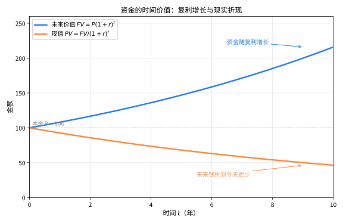

> **直观理解（现实类比）**：钱的"时值"就像放在冰箱里的冰块会慢慢融化——今天的100元比十年后的100元更值钱，因为你可以把它存起来生息。复利让钱像滚雪球一样越滚越大（向上曲线），而折现则是把远期的钱"打折"回今天（向下曲线）。正因如此，期权卖方把行权价 $K$ 的支付折现 $Ke^{-r(T-t)}$，才能与今天的价格公平比较。

> **🧠 思考历程："今天的钱"凭什么比"明天的钱"更值钱？**
>
> 复利、折现这些"钱的时间价值"观念，看似是基础算术，却构成了整座金融数学大厦的地基。它想回答的问题是：为什么同面额的钱放在不同时刻会有不同的身价，又该怎么用公式把这种身价算清楚。
>
> - **时间价值来自"机会成本"**。利率与复利的雏形在古巴比伦和美索不达米亚的借贷中早已存在，连续复利 $e^r$ 也曾被数学家们反复端详。但把"折现"上升为一门理论的是美国经济学家欧文·费雪，他在1930年的《利息理论》中把现价写成"对未来收益按时间偏好贴现"的定价法则，明确了"今天的100元可以生息"这一机会成本。
> - **从存折表格到期权公式**。费雪的思想在20世纪被"随机化"：1973年布莱克、斯科尔斯与默顿用几何布朗运动与连续复利，把期权的价格写成了 $C = S\Phi(d_1) - Ke^{-r(T-t)}\Phi(d_2)$——其中的折现因子 $Ke^{-r(T-t)}$，正是"今天与明天差多少钱"在期权定价里的数学化身。
> - **贴现是整座金融大厦的地基**。无套利原理、等价鞅测度、VaR等看似高深的话题，追根究底都建筑在同一句话上：同一时刻存在时间价值，决定了资产在今天的公平价格。
> - **心路**：把"钱放在不同时间"的生活直觉翻译成一个折现因子，整个现代金融就都有了一个可计算的支点。

#### 课堂问答

**老师**：先别急着背公式。我问你：一张欧式看涨期权，到期日真正收的是什么？

**学生**：收益是 $\max(S_T-K,0)$，看跌是 $\max(K-S_T,0)$。一句话：期权是"权利而非义务"，所以收益被截断在 0 的下方——损失封顶、收益上不封顶，这份不对称正是它值钱的原因。

**老师（追问）**：那我今天愿为这份"权利"付多少？凭什么 $K$ 要折现而 $S_T$ 不必？

**学生**：定价要把所有现金流拉到同一时间刻度。行权时我付出约定的 $K$，它发生在到期日 $T$，故要折成现值 $Ke^{-r(T-t)}$；而标的价格 $S$ 本就是当下可比单位。这也解释了平价关系 $C-P=S-Ke^{-r(T-t)}$：买看涨、卖看跌，到期现金流恒为 $S_T-K$，等价于"持一股 $S$ 并借入 $Ke^{-r(T-t)}$"。

**老师（拓展）**：那常见误区在哪里？

**学生**：误区是把期权费当成保证金——买方付的是不可退的权利金。另一个误区是只看内在价值：深度实值时 $\Delta\to1$、深度虚值时 $\Delta\to0$，但到期前的收益是非线性的，时间价值不能忽略。

### 1.2 Black-Scholes模型

**Black-Scholes模型**（Black-Scholes Model）是期权定价的基石模型，假设：

> **💡 直观理解（类比）**：Black-Scholes模型就像给股价立了一条"理想化的菜谱"——规定股价按"固定增长率+随机抖动"走（几何布朗运动）、利率固定、没有手续费、市场无套利。它把混乱的现实简化成一个能解的框架，虽然理想化，却是所有定价的"基准坐标系"。

1. 标的资产价格服从几何布朗运动：
   $$dS_t = \mu S_t dt + \sigma S_t dW_t$$
   其中 $\mu$ 为漂移率（预期收益率），$\sigma$ 为波动率，$W_t$ 为标准布朗运动

2. 无风险利率 $r$ 为常数
3. 无交易成本、无税收、资产可无限分割
4. 不存在套利机会
5. 允许卖空

> **🧠 思考历程："期权的公平价"，为什么非要一份"随机定价公式"？**
>
> 在 Black-Scholes 之前，期权的"合理价格"是一个悬而未决的问题。它想回答的是：一个权利（不是义务）的合约，凭什么定出一个不亏不赚的"公平价"，而不会让一方专门占另一方便宜。
>
> - **从赌场到股市的第一次科学定价。** 1900年，法国数学家路易·巴舍利耶在博士论文中第一次用"随机游走"描述股价并尝试给期权定价，可惜当时的数学工具（尚未成形的随机分析）撑不起严密的推导，这一洞见被埋没了半个多世纪。
> - **随机微积分补齐了工具。** 1940年代，日本数学家伊藤清发展出伊藤引理，为"带随机扰动的求导"找到了严格法则。
> - **三个人的接力让公式面世。** 1973年，布莱克与斯科尔斯（同年默顿用更严密的对冲论证补充）发表经典论文，用"构造无风险对冲组合"一举推出解析定价公式。同年芝加哥期权交易所开张，公式与应用几乎同步落地，金融学从此有了"精确可算"的定价里程碑。
> - **心路**：一个看似如何"打赌"的问题，要等到"随机微积分+无套利思想"两把钥匙齐备，才真正能算出答案。

#### 课堂问答

**老师**：Black-Scholes 模型最反直觉的一点是什么？

**学生**：公式里没有漂移 $\mu$。结论：期权价 $C=S\Phi(d_1)-Ke^{-r(T-t)}\Phi(d_2)$ 只含 $r,\sigma$，与"股票预期要涨多少"($\mu$) 无关。理由是 $\Delta$ 对冲把随机项 $dW$ 消掉了，剩下的是确定性漂移，无套利下它只能用无风险利率 $r$ 定价。

**老师（追问）**：那它的假设里，最脆弱的是哪条？

**学生**：常数波动率 $\sigma$ 与对数正态。现实收益尖峰厚尾、波动率本身随机，1987 年股灾后浮现的"波动率微笑"直接打脸；无摩擦、可卖空、能连续对冲也都是理想化。

**老师（拓展）**：为什么二叉树能收敛到它？

**学生**：把时间切成 $n$ 份，每步的对数收益独立同分布，由中心极限定理，$n\to\infty$ 时对数收益趋于正态——正是几何布朗运动的对数正态分布，于是期权价格收敛到 Black-Scholes 公式。误区：收敛靠的是分布极限，不是把 $\Delta t$ 简单地"取到 0"。

### 1.3 随机微积分在金融中的应用

> **🧠 来龙去脉（为什么会有这个概念？解决了什么问题？）** 1973年布莱克–斯科尔斯公式要给出期权定价，靠的是一套"对随机过程求导、求积分"的工具，可经典牛顿–莱布尼茨微积分面对布朗运动这类"处处连续却处处不可微"的轨迹无能为力。1940年代日本数学家伊藤清创立**伊藤微积分**并证明伊藤引理：他规定随机项 $dW_t$ 的平方"不为零而是 $dt$"，从而为随机过程的求导建立了严格法则。它要解决的，正是"在充满噪声的金融时间序列上，如何把普通导数换成随机版本"，这也是布莱克–斯科尔斯偏微分方程能够成立的整个分析地基。

**Ito引理**（Ito's Lemma）是随机微积分的核心工具，在金融中用于推导衍生品价格满足的偏微分方程。

> **💡 直观理解（类比）**：Ito引理就是把普通微积分的"链式法则"搬到随机波动领域——因为随机项 $dW$ 的平方不消失（承载随机性的噪声有了起伏就有"面积"），所以导数里会多出一个带 $\frac12\sigma^2$ 的修正项，就像雨天开车转弯要额外多打一点方向。

**引理（Ito引理）** 设 $X_t$ 满足 $dX_t = \mu_t dt + \sigma_t dW_t$，$f(t, x)$ 为二阶连续可微函数，则：

$$df(t, X_t) = \left(\frac{\partial f}{\partial t} + \mu_t \frac{\partial f}{\partial x} + \frac{1}{2}\sigma_t^2 \frac{\partial^2 f}{\partial x^2}\right)dt + \sigma_t \frac{\partial f}{\partial x} dW_t$$

> **🧠 直观理解（现实类比）**：Ito引理说的是"随机波动下如何变换函数"——普通微积分里 $df = f'dx$，可当 $dx$ 里有随机项时，公式里会多出一项 $\frac12\sigma_t^2\frac{\partial^2 f}{\partial x^2}dt$。原因在于布朗运动的"微小抖动平方"不为0（$dW^2=dt$），它总会留下一点"二阶的余料"。这正是随机微积分与普通微积分最根本的分歧点，也是推导期权定价方程的关键钥匙。

#### 课堂问答

**老师**：Itô 引理比普通链式法则多了哪一项？为什么非加不可？

**学生**：多了 $\frac{1}{2}\sigma^2\frac{\partial^2 f}{\partial x^2}$ 项。因为布朗运动的二次变差 $(dW)^2=dt$ 不为零，泰勒展开里的二阶项不能像普通微积分那样丢掉。

**老师（追问）**：那就拿最简单的 $f=x^2$ 当场算一遍。

**学生**：$d(X_t^2)=2X_t\,dX_t+\frac{1}{2}\cdot2(dX_t)^2=2X_t(\mu dt+\sigma dW)+\sigma^2 dt$，即 $d(X_t^2)=2X_t\,dX_t+\sigma^2 dt$。多出来的 $\sigma^2 dt$ 就是那个修正项，普通微积分里它是 0。

**老师（拓展）**：怎么用它得到几何布朗运动的解？

**学生**：对 $\ln S$ 用引理，$f_S=1/S,\ f_{SS}=-1/S^2$，得 $d\ln S=(\mu-\frac{\sigma^2}{2})dt+\sigma dW$，积分即 $S_T=S_0\exp((\mu-\frac{\sigma^2}{2})T+\sigma W_T)$。那个 $-\frac{\sigma^2}{2}$ 是凸性修正，绝不是笔误。

### 1.4 风险中性定价与鞅测度

> **🧠 来龙去脉（为什么会有这个概念？解决了什么问题？）** 早期期权定价总得先"猜投资者的风险偏好"，可1973年布莱克–斯科尔斯公式里竟然不含漂移 $\mu$（风险偏好），这让人们意识到：定价真正的客观依据不是"某人愿意付多少"，而是"市场不存在套利机会"。1979年哈里森与克雷普斯（后由哈里森–普利斯卡补严）把它精确化：市场无套利当且仅当存在一个**等价鞅测度** $\mathbb{Q}$，在此测度下贴现后的资产价格成为鞅。它要解决的正是"为什么期权的公平价可以跟风险偏好无关、只由无套利决定"这一根本问题——期权价格随之可写成 $\mathbb{Q}$ 下的折现期望，这就是风险中性定价。

**风险中性定价**（Risk-Neutral Pricing）是期权定价的核心方法。在风险中性测度 $\mathbb{Q}$ 下，所有资产的价格过程在贴现后成为鞅（Martingale），期权的价格为：

> **🧠 直观理解（现实类比）**：风险中性定价就像给"未来的不确定收益"换了一把"无需赌偏好的标尺"——现实中有人怕险有人爱险，定价很难；但数学证明可以把世界"调整"成一个大家都不关心风险、只按无风险利率折现的平均世界（测度 $\mathbb{Q}$）。于是期权价格 = "把到期收益按无风险利率折现的期望"，把猜涨跌变成了算加权平均。

$$V_t = e^{-r(T-t)} \mathbb{E}^{\mathbb{Q}}[\text{Payoff} \mid \mathcal{F}_t]$$

**鞅测度**（Martingale Measure）是一个使得贴现资产价格过程成为鞅的概率测度。

> **💡 直观理解（类比）**：鞅测度就是"让未来期望等于现在"的那把尺子——在 $\mathbb{Q}$ 下，贴现后的价格就像公平的骰子：今天多少、明天（平均来看）还是多少。它让"猜未来"变成"公平数学期望"，从而让每个合约都有了一个"公平价"。

#### 课堂问答

**老师**：什么叫"风险中性"？它凭什么可以给客观价格定锚？

**学生**：结论：存在等价鞅测度 $\mathbb{Q}$ 使贴现资产价格成为鞅，于是 $V_t=e^{-r(T-t)}\mathbb{E}^{\mathbb{Q}}[\text{Payoff}\mid\mathcal{F}_t]$。它不是假设投资者真的不惧风险，而是无套利逼出来的唯一计价测度，所以价格与真实风险偏好无关。

**老师（追问）**：那 $\mathbb{Q}$ 与真实概率 $\mathbb{P}$ 是什么关系？

**学生**：两者等价（同为零测集），由 Radon-Nikodym 导数 $d\mathbb{Q}/d\mathbb{P}$ 相连。真实世界的漂移 $\mu$ 被换成 $r$，这正是 Girsanov 变换做的事——换测度等价于换漂移。

**老师（拓展）**：这里最常见的误解是什么？

**学生**：把 $\mathbb{E}^{\mathbb{Q}}$ 当成"真实平均"来预测未来。它不是预测，而是定价工具；要谈真实概率就得用 $\mathbb{P}$，两者一般不同，混用就会得出离谱结论。

### 1.5 Delta对冲

> **🧠 来龙去脉（为什么会有这个概念？解决了什么问题？）** "对冲"正是布莱克–斯科尔斯公式的原始引擎：1971年布莱克萌生用股价与期权构造无风险组合的想法，1973年与斯科尔斯（及默顿）用**动态Delta对冲**正式推出了定价方程——只要按敏感度 $\Delta=\partial V/\partial S$ 持有标的资产，就能把源于股价随机波动的风险完全抹平，从而使组合像无风险债一样可定价。它要解决的，既是"如何消灭股价波动风险来推出期权公平价"，也是做市商随后管理手中期权风险的基本动作。

**Delta对冲**（Delta Hedging）是一种风险管理策略，通过持有数量为 $\Delta = \frac{\partial V}{\partial S}$ 的标的资产来对冲期权价格对标的资产价格变动的敏感度。

> **💡 直观理解（类比）**：Delta对冲就像"买保险时搭反向头寸"——期权价格对股价变化有多敏感（$\Delta$），就持有多少份股票来"反向抵消"，把股价波动带来的损益抹平，让组合变得"无风险"，正如雨天提前备好伞、冲走突然的行情冲击。

#### 课堂问答

**老师**：为什么持有 $\Delta=\partial V/\partial S$ 份股票就能消掉随机项？

**学生**：构造组合 $\Pi=V-\Delta S$，有 $d\Pi=dV-\Delta dS$。因为 $dV$ 的 $dW$ 系数是 $\sigma S\,\partial V/\partial S$、$dS$ 的系数是 $\sigma S$，取 $\Delta=\partial V/\partial S$ 恰好相消，得 $d\Pi=(\partial_t V+\frac12\sigma^2S^2\partial_{SS}V)dt$，不含随机项。

**老师（追问）**：无随机项意味着什么？

**学生**：无套利下它只能赚无风险利率：$d\Pi=r\Pi dt=r(V-\Delta S)dt$，与上式联立即得 Black-Scholes 偏微分方程。

**老师（拓展）**：那现实里为什么对冲总是不完美？

**学生**：因为需要连续调仓，而 $\Delta$ 随 $S$ 变化，离散调仓会残留二阶误差；再加上交易成本、跳跃和波动率变动。更根本的是"Delta 中性"只保一阶，股价大幅跨过价平时，二阶项 $\frac12\Gamma(\Delta S)^2$ 就会咬人。

### 1.6 波动率曲面

> **🧠 来龙去脉（为什么会有这个概念？解决了什么问题？）** 布莱克–斯科尔斯公式假定波动率是常数 $\sigma$，可交易员用真实期权价格反推出的隐含波动率却不恒定：不同行权价、不同期限的期权对应不同 $\sigma$，尤其在1987年10月"黑色星期一"股市崩盘后、这种"微笑/撇嘴"式的偏离已无法视而不见。于是人们把"隐含波动率随行权价 $K$ 与到期时间 $T$ 如何变化"整体画出来，便得到**波动率曲面**。它要解决的，正是布莱克–斯科尔斯模型"用一个常数波动率套不住现实期权价格"这一缺陷；曲面既是病灶的直观记录，也是校正定价与对冲的校准依据。

**波动率曲面**（Volatility Surface）是隐含波动率关于行权价 $K$ 和到期时间 $T$ 的三维曲面，反映了市场对Black-Scholes模型的修正——不同行权价和到期时间的期权隐含波动率不同。

> **💡 直观理解（类比）**：波动率曲面就像市场用"实际价格反推出的波动率地图"——如果Black-Scholes全对，所有期权该用同一个波动率；可现实中不同行权价、不同期限的期权"隐含波动"各不相同，摊开铺平就成了一张高低起伏的曲面，恰是市场在说"模型的简并不够用"。

#### 课堂问答

**老师**：如果 Black-Scholes 全对，隐含波动率应该长什么样？

**学生**：应该是一条水平线——所有 $K,T$ 都用同一个 $\sigma$。可市场反推出来的隐波随 $K$ 呈"微笑/偏斜"、又随 $T$ 变化，把这些点摊开就成了波动率曲面，这本身就宣告了常数 $\sigma$ 假设的失效。

**老师（追问）**：那这张曲面有什么用？

**学生**：它是一张"校准表"：给新期权定价时按 $(K,T)$ 在该曲面上插值取 $\sigma$，用来替代那个不存在的常数；它同时也是风险的记录——Vega 对冲时要面对整张曲面平移或扭转带来的敞口。

**老师（拓展）**：曲面的成因，以及一个必须警惕的点？

**学生**：成因包括真实分布非对数正态（尖峰厚尾）、杠杆效应、供需失衡与模型误设；修正手段有随机波动率（Heston）、跳跃扩散、局部波动率。要警惕的是：隐波只是"让 BS 复现市价的约定"，绝不是对真实波动的预测。

### 1.7 利率模型

> **🧠 来龙去脉（为什么会有这个概念？解决了什么问题？）** 布莱克–斯科尔斯假设利率为常数，这对股票期权尚且够用，可一旦要给债券、互换、利率期权定价，利率本身的随机性就成了主角。1977年瓦西塞克（Vasicek）首先用随机微分方程 $dr_t=a(b-r_t)dt+\sigma dW_t$ 刻画短期利率，抓住了"利率围绕长期均值 $b$ 回复、又被随机扰动搅动"的经验事实；1985年考克斯–英格索尔–罗斯（CIR）在其上增添 $\sqrt{r_t}$ 因子，确保利率不为负。它们要解决的，正是"把利率从常数升级为随机过程、从而能为固定收益衍生品定价"这一需求。

**Vasicek模型**：$dr_t = a(b - r_t)dt + \sigma dW_t$，其中 $r_t$ 为短期利率，$a$ 为均值回复速度，$b$ 为长期均值。

> **💡 直观理解（类比）**：Vasicek模型就像一个"拉着橡皮筋回到中心的利率"——利率一旦偏离长期均值 $b$，就会被 $a$ 的拉力拽回来，但拽回途中又有随机扰动（$\sigma dW$），可能偶尔冲过头甚至为负。

**Cox-Ingersoll-Ross（CIR）模型**：$dr_t = a(b - r_t)dt + \sigma \sqrt{r_t} dW_t$，保证利率始终非负。

> **💡 直观理解（类比）**：CIR模型在Vasicek上加了"刹车"——利率越低、随机扰动越小（$\sqrt{r_t}$），因此利率越贴近0就越难"硬闯"到负值，像水温越接近冰点、翻滚越平缓，自然不容易越过0这条线。

#### 课堂问答

**老师**：Vasicek 和 CIR 差在哪一项上？这一项为什么关键？

**学生**：CIR 把扩散项写成 $\sigma\sqrt{r_t}$。Vasicek 的波动率恒定，利率可以跑到负值；CIR 在 $r_t\to0$ 时扩散项消失、漂移 $a(b-r_t)>0$ 把它推回，配合 Feller 条件 $2ab>\sigma^2$ 甚至永不触及 0。

**老师（追问）**：均值回复体现在哪里？

**学生**：在漂移项 $a(b-r_t)$：$r_t$ 高于长期均值 $b$ 就被往下拉、低了就被往上推，$a$ 是回复速度。它刻画的是"利率围绕长期水平晃动"这一经验事实。

**老师（拓展）**：在近零或负利率环境下，谁更合适？

**学生**：要看你想要什么。近年确实出现过负利率，此时 Vasicek 允许负值反而是优点；若建模必须非负，才选 CIR。工程上更常用 HJM/Hull-White 这类框架去拟合整条利率期限结构。

### 1.8 Copula

> **🧠 来龙去脉（为什么会有这个概念？解决了什么问题？）** 风险管理常要刻画"一整篮子资产一起涨跌"的概率，每条腿的边际分布容易估计，多条腿彼此如何"缠斗"（相依结构）却极难直接建模。1959年斯克拉（Sklar）证明：任意联合分布都可拆成一个 **Copula函数** $C$ 与各边缘分布 $F_i$ 的组合，即 $F(x_1,\dots,x_n)=C(F_1(x_1),\dots,F_n(x_n))$，从而"边际分形"与"相依骨架"彻底分离、各管各的一段。它要解决的，正是"如何分别设计每个资产的分布、再单独刻画面资产同时暴跌的尾部关联"这一难题，而2008年金融危机更让人们对其"拖尾对称、处处相同"的乐观假设倍加警惕。

**Copula** 是连接多个随机变量边缘分布的联结函数，用于建模金融资产间的相依结构。Sklar定理指出，对于联合分布函数 $F$，存在Copula $C$ 使得：

> **🧠 直观理解（现实类比）**：Copula就像把"每个人自己的性格"和"大家怎样勾肩搭背"拆开来设计——边缘分布管各自单边长得什么样，Copula则专门负责编排队形。金融里用它可以分别设定每只股票的分布、再单独刻画面资产"一起暴跌"的那层关系，是"分而治之再拼装"的统计工具。

$$F(x_1, \ldots, x_n) = C(F_1(x_1), \ldots, F_n(x_n))$$

#### 课堂问答

**老师**：Sklar 定理到底把什么和什么分开了？

**学生**：把联合分布拆成两块：$F(x_1,\dots,x_n)=C(F_1(x_1),\dots,F_n(x_n))$。各边缘 $F_i$ 只负责自己一维的分布形状，Copula $C$ 专门负责"它们如何一起动"，于是可以分别建模再拼装。

**老师（追问）**：风险管理者为什么偏爱它？

**学生**：因为单条腿的边际分布容易估，难的是"同时暴跌"的联合尾部。Copula 让你先定好各腿分布，再单独设计它们的相依结构，尤其能把尾部相依当作一个可调部件。

**老师（拓展）**：高斯 Copula 的致命缺陷是什么？

**学生**：它的尾部相依系数为 0——极端事件几乎独立，严重低估了危机时一起跌的概率。2008 年 CDO 定价正是栽在这个过分乐观的假设上，属于典型的模型风险。更一般地，Copula 的选择本身就等价于一个强假设。

### 1.9 风险管理

> **🧠 来龙去脉（为什么会有这个概念？解决了什么问题？）** 1990年代金融机构急需一句话说清"我们一天最多可能亏多少"，以便设定风险限额、满足巴塞尔协议等监管要求，1994年摩根大通推出 **VaR（在险价值）**：在给定置信度下划出组合的最大预期损失。可 VaR 只报"最大的那座闸门在哪"，对越过闸门之后的平均水深闭口不谈；**CVaR** 随即补上"一旦损失真的越线，平均要亏多深"。它们要解决的，正是"把一个庞大组合的尾部风险压缩成一个可对外汇报、可设限额的数字"这一风险管理刚需。

**VaR（Value at Risk）**：在给定置信水平 $\alpha$ 和时间区间 $T$ 下，预期的最大损失：

> **💡 直观理解（类比）**：VaR就是"在最坏情况里留一手"——它回答"在95%的情况下，一天最多亏多少个百万"这个问题：α的置信度越高，这个"最坏预算线"就越高。它像一个闸门，却对"越过闸门后到底淹多惨"闭口不谈。

$$\text{VaR}_\alpha = \inf\{x \in \mathbb{R} \mid P(L > x) \leq 1 - \alpha\}$$

其中 $L$ 为损失随机变量。

**CVaR（Conditional VaR）**：损失超过VaR的条件期望：

> **💡 直观理解（类比）**：CVaR补齐了VaR的短板——不仅给出"最坏预算线"，还算出"一旦真出闸门，平均要淹多深"。如果说VaR是问"最坏会到哪"，CVaR就是问"最坏时平均遭多重"，所以风险管理者更爱看它。

$$\text{CVaR}_\alpha = \mathbb{E}[L \mid L > \text{VaR}_\alpha]$$

#### 课堂问答

**老师**：VaR 与 CVaR 各自回答什么问题？

**学生**：$\text{VaR}_\alpha=\inf\{x:P(L>x)\le1-\alpha\}$ 回答"最坏大概亏到哪条线"；$\text{CVaR}_\alpha=\mathbb{E}[L\mid L>\text{VaR}_\alpha]$ 回答"一旦真越线，平均要亏多深"。

**老师（追问）**：既然 VaR 更直观，为什么还要 CVaR？

**学生**：VaR 只给一个分位点，对闸门之后的惨状闭口不谈，而且它不满足次可加性（分散化甚至可能抬高组合 VaR，称不上一致风险度量）；CVaR 是条件期望、满足次可加，是"尾部友好"的一致风险度量。

**老师（拓展）**：这里常见误区是什么？

**学生**：以为 VaR 数值越大越统一。其实置信度越高、覆盖的尾部越极端，VaR 越大（$99\%$ 的 113 万元高于 $95\%$ 的 85.8 万元）。另外 VaR 依赖分布假设，厚尾下会系统性低估风险。

### 1.10 期权希腊字母（Greeks）

**希腊字母**（Greeks）度量期权价格对各个风险因子的敏感度，是 Black-Scholes 定价公式落地为"风险管理语言"的一步。核心希腊字母包括：

> **🧠 思考历程：公式算出了价格，可"价格到底怕什么"怎么办？**
>
> Black-Scholes 给出一个数字 $C$，可交易员更关心这个数字会随什么而变、变多少——这正是"希腊字母"诞生的动机。它想回答的是：期权价格对股价、时间、波动率、利率每种因素各有多"敏感"，从而决定该拿多少股票去对冲。
>
> - **答案就是"导数"本身。** 金融物理学家从 1970 年代起，把 $C(S,t)$ 对各个输入量求偏导：对股价求导（$\Delta$）、对股价再求导（$\Gamma$）、对时间求导（$\Theta$）、对波动率求导（$\mathcal{V}$、Vega）、对利率求导（$\rho$），一个个敏感度用希腊字母命名，形成一整套风险标签。
> - **标题对冲的"零件清单"。** 交易所与做市商在 Delta 对冲（§1.5）之外，还要管住 $\Gamma$（曲率）、$\mathcal{V}$（波动率风险）、$\Theta$（时间衰减），于是"希腊字母组合"成了机构风险管理的标准工具箱。

**定义2（希腊字母）** 设欧式期权的价格为 $V(S,t)$，则各希腊字母定义为：
- **Delta**：$\Delta = \frac{\partial V}{\partial S}$，价格对股价的一阶敏感度（已在 §1.5 用对冲）。
- **Gamma**：$\Gamma = \frac{\partial^2 V}{\partial S^2} = \frac{\partial \Delta}{\partial S}$，Delta 对股价的敏感度（曲率）。
- **Theta**：$\Theta = \frac{\partial V}{\partial t}$，价格对剩余时间的一阶敏感度（时间衰减）。
- **Vega**：$\mathcal{V} = \frac{\partial V}{\partial \sigma}$，价格对波动率的一阶敏感度。
- **Rho**：$\rho = \frac{\partial V}{\partial r}$，价格对利率的一阶敏感度。

> **💡 直观理解（类比）**：希腊字母像"方向盘上一组不同的角度表盘"——Delta 是"方向盘本身转多大"、Gamma 是"方向盘越转越顺溜还是越卡"、Theta 是"车一开动就自动走字儿的倒计时表"、Vega 是"前方路况（颠簸程度）一变化方向盘抖多大"、Rho 是"油价一变每公里成本变多少"。机构盯住这套表盘，才能逐一调准对冲头寸。

#### 课堂问答

**老师**：五个希腊字母，各自是"对谁求导"？

**学生**：$\Delta=\partial V/\partial S$、$\Gamma=\partial^2V/\partial S^2$、$\Theta=\partial V/\partial t$、$\mathcal{V}=\partial V/\partial\sigma$、$\rho=\partial V/\partial r$。一句话：它们把"期权价怕什么"逐个写成导数。

**老师（追问）**：哪种状态的期权最危险？

**学生**：价平附近。$\Gamma$ 与 Vega 都正比于 $\varphi(d_1)$，当 $d_1\approx0$、即 $S\approx K$ 时最大——不确定性最猛、二阶与波动率敞口最高；深度实值或虚值时 $\varphi(d_1)$ 衰减，二者都变小。

**老师（拓展）**：$\Theta$ 的符号说明什么？

**学生**：看涨期权 $\Theta_C<0$，意味着时间每流走一点、期权价值就掉一点，即时间衰减。它的金融含义是：想压低 Gamma（对冲二阶风险）通常得牺牲 Theta，这就是"没有免费午餐"在希腊字母上的具体样子。

### 1.11 蒙特卡洛模拟与有限差分

> **🧠 来龙去脉（为什么会有这个概念？解决了什么问题？）** 布莱克–斯科尔斯公式只对欧式期权有漂亮的解析解，一旦遇到美式、路径依赖（亚式、回望）、多因子或随机波动率，方程便难有闭式答案。**蒙特卡洛模拟**源于1940年代曼哈顿计划中乌拉姆与冯·诺依曼用随机抽样估算积分，金融里用它"沿随机路径模拟成千上万次、再对收益折现取平均"来逼近风险中性期望；**有限差分**则源于求解偏微分方程的数值方法，把布莱克–斯科尔斯方程在时空网格上一格一格逼近。它们要解决的，正是"当解析公式失效时，如何照样把期权价格可靠算出来"这一工程化需求。

当标的演化更复杂（路径依赖、多因子、随机波动率）时，Black-Scholes 的解析公式不适用，需借助**数值方法**：蒙特卡洛模拟与有限差分。

> **💡 直观理解（类比）**：蒙特卡洛就是"让电脑把未来成千上万遍地扔骰子、再取平均"——每次随机挑一条股价路径 $\{S_{t_k}\}$，算到期收益并折现，反复模拟 $N$ 次后取均值，就逼近风险中性期望 $V=e^{-r(T-t)}\mathbb{E}^{\mathbb{Q}}[\text{Payoff}]$。它像"摇了很多次硬币，用出现频率估概率"；而有限差分则是把 Black-Scholes 偏微分方程在时空网格上"一格一格地凑"出解，像"用像素点拼出一幅图"。两者是数值计算期权价格的左右手。

---

#### 课堂问答

**老师**：既然有 Black-Scholes 闭式公式，为什么还需要数值方法？

**学生**：公式只覆盖欧式。美式、亚式、回望、多因子、随机波动率都没有闭式解，只能数值逼近：蒙特卡洛算折现期望，有限差分解偏微分方程。

**老师（追问）**：蒙特卡洛的收敛速度如何？代价是什么？

**学生**：约 $O(1/\sqrt{N})$——误差随 $\sqrt{N}$ 下降，精度翻倍要付出 4 倍样本。它对高维、路径依赖天然友好（维数不惩罚收敛率），但很慢，且处理美式提前行权要另加 Longstaff–Schwartz 之类的回归手段。

**老师（拓展）**：那么有限差分呢？

**学生**：把 $S$ 与 $t$ 离散成网格，直接逼近 Black-Scholes 方程，擅长低维、并能自然处理美式期权的自由边界，但高维会维数爆炸。所以两者互补：高维路径依赖用蒙特卡洛，低维美式用有限差分。

## 二、定理与证明

### 定理1：资产定价第一基本定理

**定理（资产定价第一基本定理，First Fundamental Theorem of Asset Pricing）** 在无摩擦市场中，不存在套利机会（No-Arbitrage）当且仅当存在一个等价鞅测度（Equivalent Martingale Measure），即存在一个与客观概率测度 $\mathbb{P}$ 等价的概率测度 $\mathbb{Q}$，使得所有贴现资产价格过程在 $\mathbb{Q}$ 下为鞅。

**证明**：

**第一步：建立市场模型。**

考虑一个离散时间、有限状态的经济，时间 $t = 0, 1, \ldots, T$。设市场中有 $d+1$ 种资产：

- 第0种资产为无风险资产（债券），价格过程 $B_t$ 满足 $B_0 = 1$，$B_t = (1+r)^t$（$r$ 为无风险利率）
- 第 $i$ 种资产（$i = 1, \ldots, d$）为风险资产，价格过程为 $S_t^i$

设 $\Omega$ 为有限状态空间，$\mathcal{F}_t$ 为信息流，$\mathbb{P}$ 为客观概率测度。

**定义（贴现价格）** 定义贴现价格过程 $\tilde{S}_t^i = S_t^i / B_t$。

> **💡 直观理解（类比）**：贴现价格就是把资产价格"换成今天的可比单位"——如同把不同货币换算成美元再比价：$S_t^i/B_t$ 除以无风险资产的累计价值，让人可以在同一个"时间刻度"上比较明天和今天的钱。

**定义（套利机会）** 一个套利策略是可容许的自融资交易策略 $\phi = (\phi_t^0, \phi_t^1, \ldots, \phi_t^d)$，满足：

> **🧠 直观理解（现实类比）**：套利机会就是"天下掉馅饼，空手套白狼"——不用掏一分钱本金（$V_0=0$），将来不但不亏还有正概率赚钱（$V_T\ge0$ 且可能 $>0$）。这种"稳赚不赔"的机会一旦出现，就会被无数人瞬间抢平，所以成熟市场把它当作"不允许存在"的铁律。

1. 初始财富 $V_0 = 0$
2. 最终财富 $V_T \geq 0$ 且 $\mathbb{P}(V_T > 0) > 0$

其中 $V_t = \phi_t^0 B_t + \sum_{i=1}^d \phi_t^i S_t^i$ 为时刻 $t$ 的财富。

**第二步：证明充分性（等价鞅测度存在 $\Rightarrow$ 无套利）。**

假设存在等价鞅测度 $\mathbb{Q}$。设 $\phi$ 为任意自融资策略，其贴现财富过程为 $\tilde{V}_t = V_t / B_t$。由于 $\tilde{V}_t$ 是贴现金资产组合，在 $\mathbb{Q}$ 下是鞅：

$$\tilde{V}_t = \mathbb{E}^{\mathbb{Q}}[\tilde{V}_T \mid \mathcal{F}_t]$$

特别地，$\tilde{V}_0 = \mathbb{E}^{\mathbb{Q}}[\tilde{V}_T]$。

若 $\phi$ 是套利策略，则 $V_0 = 0$，故 $\tilde{V}_0 = 0$。因此 $\mathbb{E}^{\mathbb{Q}}[\tilde{V}_T] = 0$。

由于 $\tilde{V}_T \geq 0$（因为 $V_T \geq 0$），且 $\mathbb{Q}$ 与 $\mathbb{P}$ 等价（即 $\mathbb{Q}(A) = 0 \iff \mathbb{P}(A) = 0$），由 $\mathbb{E}^{\mathbb{Q}}[\tilde{V}_T] = 0$ 和 $\tilde{V}_T \geq 0$ 可得 $\tilde{V}_T = 0$ $\mathbb{Q}$-a.s.，从而 $\mathbb{P}$-a.s.。因此 $\mathbb{P}(V_T > 0) = 0$，与套利定义矛盾。故不存在套利机会。

**第三步：证明必要性（无套利 $\Rightarrow$ 等价鞅测度存在）。**

这是更困难的方向，需要用到凸分析和分离超平面定理。我们使用线性规划方法。

设 $\Omega = \{\omega_1, \ldots, \omega_m\}$，$\mathbb{P}$ 为客观概率测度，$\mathbb{P}(\omega_j) > 0$ 对所有 $j$。

考虑所有可能的自融资交易策略，其贴现财富的集合为：

$$\mathcal{W} = \{\tilde{V}_T \in \mathbb{R}^m \mid \exists \text{自融资策略使最终贴现财富为 } \tilde{V}_T\}$$

注意 $\mathcal{W}$ 是 $\mathbb{R}^m$ 中的一个线性子空间（因为自融资策略的集合是线性空间）。

**定义（无套利条件）** 无套利意味着 $\mathcal{W} \cap \mathbb{R}^m_+ = \{0\}$，其中 $\mathbb{R}^m_+ = \{x \in \mathbb{R}^m \mid x_j \geq 0, \forall j\}$。

> **💡 直观理解（类比）**：无套利条件就是在说"所有可能的盈利集合里，除了原点(啥都不买卖)之外，不再有整块非负的免费午餐"——任何策略要么有输的可能，要么就老老实实待在原点，堵死了"稳赚不赔"的缝。

**引理** 若 $\mathcal{W} \cap \mathbb{R}^m_+ = \{0\}$，则存在一个向量 $q \in \mathbb{R}^m_{++}$（即所有分量严格为正）使得 $q \perp \mathcal{W}$（即 $q$ 与 $\mathcal{W}$ 中的所有向量正交）。

> **💡 直观理解（类比）**：这个引理用凸分离定理给出了"无免费午餐 ⟹ 能找到一把严格正的概率秤"——既然可盈利集碰不到非负象限，就一定能用一张"斜切面"把它和原点隔开，切面的法向量 $q$ 经过归一化就成了一个严格正的概率测度，也就是后面的等价鞅测度。

**证明**：考虑凸集 $C = \mathcal{W} + \mathbb{R}^m_+ = \{x \in \mathbb{R}^m \mid \text{存在 } w \in \mathcal{W}, y \in \mathbb{R}^m_+ \text{ 使得 } x = w + y\}$。无套利条件意味着 $C$ 是一个尖锥（即 $C \cap (-C) = \{0\}$）。由凸集分离定理，存在一个超平面严格分离 $C$ 和 $-C \setminus \{0\}$，该超平面的法向量即为所需的 $q$。

**第四步：构造等价鞅测度。**

由上述引理，存在严格正向量 $q = (q_1, \ldots, q_m)$ 使得对所有自融资策略，$\sum_{j=1}^m q_j \tilde{V}_T(\omega_j) = 0$。

定义概率测度 $\mathbb{Q}$ 为 $\mathbb{Q}(\omega_j) = \frac{q_j}{\sum_{k=1}^m q_k}$。由于 $q_j > 0$，$\mathbb{Q}$ 与 $\mathbb{P}$ 等价。

现在需要验证 $\mathbb{Q}$ 是鞅测度，即所有贴现资产价格在 $\mathbb{Q}$ 下是鞅。对任意风险资产 $i$，考虑策略：在时刻 $t$ 买入1单位资产 $i$，在时刻 $t+1$ 卖出。该策略的贴现财富变化为 $\tilde{S}_{t+1}^i - \tilde{S}_t^i$。由于该策略的初始财富为0，其最终贴现财富必须正交于 $q$，即：

$$\mathbb{E}^{\mathbb{Q}}[\tilde{S}_{t+1}^i - \tilde{S}_t^i \mid \mathcal{F}_t] = 0$$

因此 $\mathbb{E}^{\mathbb{Q}}[\tilde{S}_{t+1}^i \mid \mathcal{F}_t] = \tilde{S}_t^i$，即 $\tilde{S}_t^i$ 在 $\mathbb{Q}$ 下是鞅。

**第五步：扩展到连续时间。**

在连续时间框架下，需要更复杂的鞅表示定理和Girsanov定理。基本思路相同：

1. 无套利条件等价于存在一个等价局部鞅测度
2. 使用Girsanov定理通过变换漂移项构造等价鞅测度
3. Novikov条件保证变换的良定性

**结论**：资产定价第一基本定理建立了无套利与等价鞅测度存在性之间的等价关系，为金融资产定价提供了理论基础。$\square$
> **直观理解（现实类比）**：无套利原理就像"一价定律"的保安——同一样东西在两个市场卖不同价，套利者就会低买高卖、瞬间抹平差价。资产定价第一基本定理说：只要市场"无套利"，就一定能找到一把"风险中性"的尺子（等价鞅测度），把未来收益按无风险利率折现就得到今天的公平价。于是定价问题从"猜未来"变成了"找尺子"。

#### 课堂问答

**老师**：资产定价第一基本定理的两个方向，分别在说什么？

**学生**：无套利 $\iff$ 存在等价鞅测度 $\mathbb{Q}$。"$\Leftarrow$"方向：若 $\mathbb{Q}$ 存在，自融资策略的贴现财富 $\tilde V_t$ 在 $\mathbb{Q}$ 下是鞅，$V_0=0\Rightarrow\mathbb{E}^{\mathbb{Q}}[\tilde V_T]=0$，再配合 $\tilde V_T\ge0$ 与测度等价，推出 $\tilde V_T=0$ a.s.，从而排除套利。

**老师（追问）**：哪个方向更难？难在哪？

**学生**："无套利 $\Rightarrow\mathbb{Q}$ 存在"更难。要动用凸分析：可复制的贴现财富集 $\mathcal{W}$ 是线性子空间，无套利即 $\mathcal{W}\cap\mathbb{R}^m_+=\{0\}$；由分离超平面定理找到严格正向量 $q\perp\mathcal{W}$，归一化后就是等价鞅测度。

**老师（拓展）**：这套论证的金融含义是什么？误区又在哪？

**学生**：它把"没有免费午餐"翻译成"存在一把公平秤"。连续时间还需补 Girsanov 定理与 Novikov 条件，但骨架相同。误区是误以为它保证了 $\mathbb{Q}$ 唯一——唯一性属于第二基本定理的范畴。

### 定理2：资产定价第二基本定理

**定理（资产定价第二基本定理，Second Fundamental Theorem of Asset Pricing）** 在无套利市场中，市场是完备的（Complete Market）当且仅当等价鞅测度是唯一的。

> **🧠 直观理解（现实类比）**：第二基本定理把"市场能复制一切合约"和"公平尺子唯一"画上了等号——市场像一家"啥都能配齐零件的万能工厂"（完备），那么给所有回合约的定价尺子就只有一把（唯一鞅测度）；反之若有些"配方"配不出来（不完备），就说明公平价不止一个、存在多种合理标价。

**定义**：市场是完备的，如果每个未定权益（Contingent Claim）都可以通过自融资策略复制，即对任意 $\mathcal{F}_T$-可测且满足适当可积性的随机变量 $X$，存在自融资策略 $\phi$ 使得 $V_T(\phi) = X$ a.s.。

> **💡 直观理解（类比）**：市场完备就像"食材超市货色齐全"——无论你想要哪种"到期即付合约"（任意未定权益 $X$），都能用市场上的基础股票和债券现配一份"复制菜谱"出来，想吃什么都能照着配，价格也就跑不掉了。

**证明**：

**第一步：证明完备性 $\Rightarrow$ 唯一性。**

假设市场完备，且 $\mathbb{Q}_1$ 和 $\mathbb{Q}_2$ 是两个等价鞅测度。对任意 $\mathcal{F}_T$-可测的未定权益 $X$，由于市场完备，存在自融资策略 $\phi$ 复制 $X$，即 $V_T(\phi) = X$ a.s.。

由于 $\mathbb{Q}_1$ 和 $\mathbb{Q}_2$ 都是鞅测度，贴现财富过程 $\tilde{V}_t$ 在两者下都是鞅，因此：

$$\mathbb{E}^{\mathbb{Q}_1}[X / B_T] = \tilde{V}_0 = \mathbb{E}^{\mathbb{Q}_2}[X / B_T]$$

其中 $\tilde{V}_0$ 是策略的初始财富（与测度无关）。

由于 $X$ 是任意的 $\mathcal{F}_T$-可测随机变量，由 $\mathbb{E}^{\mathbb{Q}_1}[X/B_T] = \mathbb{E}^{\mathbb{Q}_2}[X/B_T]$ 对所有 $X$ 成立，可得 $\mathbb{Q}_1 = \mathbb{Q}_2$（事实上，取 $X = B_T \cdot \mathbf{1}_A$ 可得 $\mathbb{Q}_1(A) = \mathbb{Q}_2(A)$ 对所有 $A \in \mathcal{F}_T$ 成立）。

**第二步：证明唯一性 $\Rightarrow$ 完备性。**

反证法。假设等价鞅测度唯一但市场不完备。则存在某个未定权益 $X$ 不能被任何自融资策略复制。

定义 $\mathcal{W}$ 为所有可复制未定权益的集合（即 $\mathcal{W} = \{V_T(\phi) \mid \phi \text{ 自融资策略}\}$）。由于 $X \notin \mathcal{W}$，$X$ 在 $L^2$（或适当空间）中与 $\mathcal{W}$ 有非零距离。

由Hahn-Banach定理，存在一个非零线性泛函 $l$ 使得 $l(X) \neq 0$ 但 $l(W) = 0$ 对所有 $W \in \mathcal{W}$。

在离散时间有限状态空间中，这意味着存在一个与 $\mathcal{W}$ 正交的向量，从而可以构造另一个等价鞅测度，与唯一性矛盾。

**连续时间框架下的论证**：

在连续时间框架下，若市场完备，则鞅表示定理成立：任何鞅都可以表示为关于布朗运动的随机积分。等价鞅测度的唯一性源于鞅表示定理的适用性。

具体来说，设 $\mathbb{Q}$ 是一个等价鞅测度。若市场不完备，则存在与 $\mathbb{Q}$ 等价的另一个鞅测度 $\mathbb{Q}'$。通过Radon-Nikodym导数 $\frac{d\mathbb{Q}'}{d\mathbb{Q}}$ 可以构造一个与所有鞅正交的随机变量，从而与鞅表示定理矛盾。

**结论**：资产定价第二基本定理揭示了市场完备性与等价鞅测度唯一性之间的深刻联系。完备市场中，每个未定权益都有唯一的价格（由唯一鞅测度给出）；不完备市场中，存在多个合理价格，需要额外的经济假设来定价。$\square$

#### 课堂问答

**老师**：第二基本定理把哪两件事划上了等号？

**学生**：市场完备 $\iff$ 等价鞅测度唯一。完备指任意未定权益 $X$ 都能被自融资策略复制；此时每个 $\mathcal{F}_T$-可测的 $X$ 都有唯一价格。

**老师（追问）**：两个方向各怎么证？

**学生**："完备 $\Rightarrow$ 唯一"：两个鞅测度 $\mathbb{Q}_1,\mathbb{Q}_2$ 下同一财富初值相等，即 $\mathbb{E}^{\mathbb{Q}_1}[X/B_T]=\mathbb{E}^{\mathbb{Q}_2}[X/B_T]$ 对一切 $X$ 成立，取 $X=B_T\mathbf{1}_A$ 得 $\mathbb{Q}_1=\mathbb{Q}_2$。"唯一 $\Rightarrow$ 完备"用反证：若不完备，由 Hahn-Banach 找与复制集正交的非零泛函，可构造出另一个等价鞅测度，矛盾。

**老师（拓展）**：不完备市场怎么办？

**学生**：那时存在多个合理价格，需要效用函数、风险最小化等额外经济准则才能选一个，或做区间定价。关键认识：价格的唯一性不是凭空掉下来的，而是市场完备性"买"来的。

### 定理3：Black-Scholes公式

**定理（Black-Scholes公式）** 在Black-Scholes模型假设下，到期日为 $T$、行权价为 $K$ 的欧式看涨期权在时刻 $t$ 的价格为：

$$C(S_t, t) = S_t \Phi(d_1) - Ke^{-r(T-t)} \Phi(d_2)$$

其中

$$d_1 = \frac{\ln(S_t/K) + (r + \sigma^2/2)(T-t)}{\sigma\sqrt{T-t}}$$
$$d_2 = d_1 - \sigma\sqrt{T-t} = \frac{\ln(S_t/K) + (r - \sigma^2/2)(T-t)}{\sigma\sqrt{T-t}}$$

$\Phi$ 为标准正态分布的累积分布函数。

**证明**（PDE方法）：

**第一步：建立偏微分方程。**

设 $V(S, t)$ 为期权价格。在Black-Scholes模型 $dS = \mu S dt + \sigma S dW$ 下，由Ito引理：

$$dV = \left(\frac{\partial V}{\partial t} + \mu S \frac{\partial V}{\partial S} + \frac{1}{2}\sigma^2 S^2 \frac{\partial^2 V}{\partial S^2}\right)dt + \sigma S \frac{\partial V}{\partial S} dW$$

构造对冲组合 $\Pi = V - \Delta S$，其中 $\Delta$ 为持有的标的资产数量。选择 $\Delta = \frac{\partial V}{\partial S}$，则：

$$d\Pi = dV - \Delta dS = \left(\frac{\partial V}{\partial t} + \frac{1}{2}\sigma^2 S^2 \frac{\partial^2 V}{\partial S^2}\right)dt$$

由于该组合不含随机项（$dW$ 项被消除），根据无套利原理，其收益率应等于无风险利率：

$$d\Pi = r\Pi dt = r\left(V - \frac{\partial V}{\partial S} S\right)dt$$

联立两式，得到**Black-Scholes偏微分方程**：

$$\frac{\partial V}{\partial t} + rS\frac{\partial V}{\partial S} + \frac{1}{2}\sigma^2 S^2 \frac{\partial^2 V}{\partial S^2} - rV = 0$$

**第二步：边界条件。**

对于欧式看涨期权，终端条件为：

$$V(S, T) = \max(S - K, 0)$$

边界条件：
- 当 $S = 0$ 时，$V(0, t) = 0$
- 当 $S \to \infty$ 时，$V(S, t) \sim S - Ke^{-r(T-t)}$

**第三步：化为热传导方程。**

做变量代换简化。令：

$$\tau = T - t, \quad x = \ln S, \quad V(S, t) = e^{-r\tau} u(x, \tau)$$

计算偏导数：

$$\frac{\partial V}{\partial t} = -\frac{\partial V}{\partial \tau} = -e^{-r\tau}\left(-r u + \frac{\partial u}{\partial \tau}\right)$$
$$\frac{\partial V}{\partial S} = e^{-r\tau} \frac{1}{S} \frac{\partial u}{\partial x}$$
$$\frac{\partial^2 V}{\partial S^2} = e^{-r\tau}\left(-\frac{1}{S^2}\frac{\partial u}{\partial x} + \frac{1}{S^2}\frac{\partial^2 u}{\partial x^2}\right)$$

代入Black-Scholes方程：

$$-e^{-r\tau}\left(-r u + \frac{\partial u}{\partial \tau}\right) + rS \cdot e^{-r\tau}\frac{1}{S}\frac{\partial u}{\partial x} + \frac{1}{2}\sigma^2 S^2 \cdot e^{-r\tau}\left(-\frac{1}{S^2}\frac{\partial u}{\partial x} + \frac{1}{S^2}\frac{\partial^2 u}{\partial x^2}\right) - r e^{-r\tau} u = 0$$

化简：

$$-\frac{\partial u}{\partial \tau} + \left(r - \frac{1}{2}\sigma^2\right)\frac{\partial u}{\partial x} + \frac{1}{2}\sigma^2\frac{\partial^2 u}{\partial x^2} = 0$$

即：

$$\frac{\partial u}{\partial \tau} = \frac{1}{2}\sigma^2\frac{\partial^2 u}{\partial x^2} + \left(r - \frac{1}{2}\sigma^2\right)\frac{\partial u}{\partial x}$$

再做变量代换 $y = x + \left(r - \frac{1}{2}\sigma^2\right)\tau$，$w(y, \tau) = u(x, \tau)$，得到标准热传导方程：

$$\frac{\partial w}{\partial \tau} = \frac{1}{2}\sigma^2 \frac{\partial^2 w}{\partial y^2}$$

初始条件转化为：

$$w(y, 0) = \max(e^y - K, 0)$$

**第四步：求解热传导方程。**

热传导方程的基本解（Green函数）为：

$$G(y, \tau) = \frac{1}{\sqrt{2\pi\sigma^2\tau}} \exp\left(-\frac{y^2}{2\sigma^2\tau}\right)$$

解为初始条件与基本解的卷积：

$$w(y, \tau) = \int_{-\infty}^{\infty} G(y - \xi, \tau) \max(e^\xi - K, 0) d\xi$$

$$= \int_{\ln K}^{\infty} \frac{1}{\sqrt{2\pi\sigma^2\tau}} \exp\left(-\frac{(y - \xi)^2}{2\sigma^2\tau}\right) (e^\xi - K) d\xi$$

**第五步：计算积分。**

将积分分为两部分：

$$w(y, \tau) = I_1 - I_2$$

其中

$$I_1 = \int_{\ln K}^{\infty} \frac{1}{\sqrt{2\pi\sigma^2\tau}} \exp\left(-\frac{(y - \xi)^2}{2\sigma^2\tau}\right) e^\xi d\xi$$
$$I_2 = K \int_{\ln K}^{\infty} \frac{1}{\sqrt{2\pi\sigma^2\tau}} \exp\left(-\frac{(y - \xi)^2}{2\sigma^2\tau}\right) d\xi$$

对于 $I_2$，令 $z = \frac{\xi - y}{\sigma\sqrt{\tau}}$，则：

$$I_2 = K \int_{\frac{\ln K - y}{\sigma\sqrt{\tau}}}^{\infty} \frac{1}{\sqrt{2\pi}} e^{-z^2/2} dz = K \Phi\left(\frac{y - \ln K}{\sigma\sqrt{\tau}}\right)$$

对于 $I_1$，合并指数项：

$$\exp\left(-\frac{(y - \xi)^2}{2\sigma^2\tau} + \xi\right) = \exp\left(-\frac{(\xi - y - \sigma^2\tau)^2}{2\sigma^2\tau} + y + \frac{1}{2}\sigma^2\tau\right)$$

因此：

$$I_1 = e^{y + \frac{1}{2}\sigma^2\tau} \int_{\ln K}^{\infty} \frac{1}{\sqrt{2\pi\sigma^2\tau}} \exp\left(-\frac{(\xi - y - \sigma^2\tau)^2}{2\sigma^2\tau}\right) d\xi$$
$$= e^{y + \frac{1}{2}\sigma^2\tau} \Phi\left(\frac{y + \sigma^2\tau - \ln K}{\sigma\sqrt{\tau}}\right)$$

**第六步：代回原变量。**

回代 $\tau = T - t$，$y = \ln S + \left(r - \frac{1}{2}\sigma^2\right)(T-t)$：

$$e^{y + \frac{1}{2}\sigma^2\tau} = S e^{r(T-t)}$$

$$V(S, t) = e^{-r\tau} w(y, \tau) = S \Phi\left(\frac{y + \sigma^2\tau - \ln K}{\sigma\sqrt{\tau}}\right) - Ke^{-r\tau} \Phi\left(\frac{y - \ln K}{\sigma\sqrt{\tau}}\right)$$

计算：

$$\frac{y + \sigma^2\tau - \ln K}{\sigma\sqrt{\tau}} = \frac{\ln S + (r - \frac{1}{2}\sigma^2)\tau + \sigma^2\tau - \ln K}{\sigma\sqrt{\tau}} = \frac{\ln(S/K) + (r + \frac{1}{2}\sigma^2)\tau}{\sigma\sqrt{\tau}} = d_1$$

$$\frac{y - \ln K}{\sigma\sqrt{\tau}} = \frac{\ln S + (r - \frac{1}{2}\sigma^2)\tau - \ln K}{\sigma\sqrt{\tau}} = \frac{\ln(S/K) + (r - \frac{1}{2}\sigma^2)\tau}{\sigma\sqrt{\tau}} = d_2$$

因此得到Black-Scholes公式：

$$C(S, t) = S\Phi(d_1) - Ke^{-r(T-t)}\Phi(d_2)$$

**第七步：看跌期权定价。**

由看跌-看涨平价关系（Put-Call Parity）：

$$C - P = S - Ke^{-r(T-t)}$$

可得欧式看跌期权价格为：

$$P(S, t) = Ke^{-r(T-t)}\Phi(-d_2) - S\Phi(-d_1)$$

**结论**：Black-Scholes公式给出了欧式期权在连续时间框架下的解析定价公式，是金融数学中最具影响力的成果之一。$\square$
> **直观理解（现实类比）**：Black-Scholes公式就像给期权算一笔"保险费"——你买看跌期权相当于给股票上"跌损险"，保费多少取决于三件事：股价本身有多 shaky（波动率 $\sigma$）、保单还能撑多久（到期 $T$）、约定赔多少（行权价 $K$）。波动越大、时间越长、行权价越"实"，保费越贵。公式把这几个参数一锅炖，给出一个明码标价的"公平保费"。

#### 课堂问答

**老师**：把 Black-Scholes 公式和 $d_1,d_2$ 完整写出来。

**学生**：$C(S,t)=S\Phi(d_1)-Ke^{-r(T-t)}\Phi(d_2)$，其中

$$d_1=\frac{\ln(S/K)+(r+\frac{\sigma^2}{2})(T-t)}{\sigma\sqrt{T-t}},\qquad d_2=d_1-\sigma\sqrt{T-t}$$

第一项 $S\Phi(d_1)$ 是"拿到股票那部分的期望现值"，第二项是"付出行权价那部分的期望现值"。

**老师（追问）**：看跌期权呢，要重推一遍积分吗？

**学生**：不必。用看跌-看涨平价 $C-P=S-Ke^{-r(T-t)}$ 直接得 $P=Ke^{-r(T-t)}\Phi(-d_2)-S\Phi(-d_1)$。

**老师（拓展）**：整个推导的关键链条是什么？

**学生**：Itô 引理 + $\Delta$ 对冲消掉随机项，得到 BS 方程；再换元 $\tau=T-t,\ x=\ln S$ 化为热传导方程 $\partial_\tau w=\frac12\sigma^2\partial_{yy}w$，用高斯核卷积、配方后回代即得 $d_1,d_2$。误区：$d_2\ne d_1$，两者之差恰是 $\sigma\sqrt{T-t}$。

### 定理4：Feynman-Kac公式在金融中的应用

**定理（Feynman-Kac公式）** 设 $X_t$ 满足随机微分方程 $dX_t = \mu(X_t, t)dt + \sigma(X_t, t)dW_t$，$f(x, t)$ 为满足多项式增长条件的函数。则函数

$$V(x, t) = \mathbb{E}\left[e^{-\int_t^T r(X_s, s)ds} f(X_T, T) \;\Big|\; X_t = x\right]$$

满足偏微分方程：

$$\frac{\partial V}{\partial t} + \mu(x, t)\frac{\partial V}{\partial x} + \frac{1}{2}\sigma(x, t)^2\frac{\partial^2 V}{\partial x^2} - r(x, t)V = 0$$

终端条件为 $V(x, T) = f(x, T)$。

> **🧠 直观理解（现实类比）**：Feynman-Kac公式是一座"概率↔微分方程"的往返桥——一头是"想算某个带折扣的期望"，另一头是"解一个关于这个函数的偏微分方程"。它说：随机走出的那个期望值，恰好就是某个PDE的解，反之亦然。期权里"在风险中性世界算期望"和"解Black-Scholes方程"两条路殊途同归，正是靠这座桥相连。

**证明**：

**第一步：建立鞅过程。**

定义过程：

$$M_s = e^{-\int_t^s r(X_u, u)du} V(X_s, s)$$

其中 $t \leq s \leq T$。由风险中性定价理论，在适当的条件下，$M_s$ 是一个鞅。

**第二步：应用Ito引理。**

对 $M_s$ 应用Ito引理。首先计算 $dV$：

$$dV = \left(\frac{\partial V}{\partial s} + \mu\frac{\partial V}{\partial x} + \frac{1}{2}\sigma^2\frac{\partial^2 V}{\partial x^2}\right)ds + \sigma\frac{\partial V}{\partial x} dW_s$$

然后计算 $dM_s$：

$$dM_s = -r e^{-\int_t^s r du} V ds + e^{-\int_t^s r du} dV$$

$$= e^{-\int_t^s r du}\left[\left(\frac{\partial V}{\partial s} + \mu\frac{\partial V}{\partial x} + \frac{1}{2}\sigma^2\frac{\partial^2 V}{\partial x^2} - rV\right)ds + \sigma\frac{\partial V}{\partial x} dW_s\right]$$

**第三步：鞅条件导出PDE。**

由于 $M_s$ 是鞅，其漂移项必须为零：

$$\frac{\partial V}{\partial s} + \mu\frac{\partial V}{\partial x} + \frac{1}{2}\sigma^2\frac{\partial^2 V}{\partial x^2} - rV = 0$$

代入 $s = t$ 即得Feynman-Kac公式中的PDE。

**第四步：验证终端条件。**

当 $s = T$ 时：

$$V(X_T, T) = \mathbb{E}\left[e^{-\int_T^T r du} f(X_T, T) \;\Big|\; \mathcal{F}_T\right] = f(X_T, T)$$

因此 $V(x, T) = f(x, T)$。

**金融应用：**

Feynman-Kac公式建立了PDE与期望值之间的联系，是风险中性定价的数学基础：

1. **期权定价**：到期权价格 $V$ 满足的PDE（Black-Scholes方程）和风险中性期望公式
2. **信用风险**：违约概率可以用PDE方法或蒙特卡洛方法计算
3. **利率衍生品**：债券价格满足的PDE可以从短期利率模型导出

**示例**：在Black-Scholes模型中，$\mu = rS$，$\sigma = \sigma S$，$r$ 为常数，则Feynman-Kac公式给出：

$$V(S, t) = e^{-r(T-t)}\mathbb{E}^{\mathbb{Q}}[f(S_T) \mid S_t = S]$$

这正是风险中性定价公式。$\square$

#### 课堂问答

**老师**：Feynman-Kac 公式是座什么桥？

**学生**：它连接"条件期望"与"偏微分方程"。设 $V(x,t)=\mathbb{E}[e^{-\int_t^T r\,ds}f(X_T)\mid X_t=x]$，则 $V$ 满足 $\partial_t V+\mu\partial_x V+\frac12\sigma^2\partial_{xx}V-rV=0$，终值 $V(x,T)=f(x,T)$。

**老师（追问）**：怎么证明这一点？

**学生**：构造 $M_s=e^{-\int_t^s r\,du}V(X_s,s)$，用 Itô 引理展开得 $dM_s=e^{-\int r\,du}[(\partial_sV+\mu\partial_xV+\frac12\sigma^2\partial_{xx}V-rV)ds+\sigma\partial_xV\,dW_s]$；$M_s$ 是鞅，漂移必须为零，即得那个 PDE。

**老师（拓展）**：它在金融里的意义是什么？

**学生**：它说明"风险中性定价"与"解 Black-Scholes 方程"是同一件事的两面；代入 $\mu=rS,\sigma=\sigma S$ 正好得 BS 方程，其概率解就是折现期望 $V=e^{-r(T-t)}\mathbb{E}^{\mathbb{Q}}[f(S_T)]$。误区：Feynman-Kac 需要多项式增长等正则性，并非任意 $f$ 都适用。

### 定理5：投资组合的Markowitz有效前沿

**定理（Markowitz有效前沿）** 在均值-方差框架下，所有最优投资组合（给定风险水平下预期收益最大，或给定预期收益下风险最小）构成一条曲线，称为有效前沿（Efficient Frontier）。有效前沿上的组合满足：

$$\sigma_p = \sqrt{\frac{(E[R_p] - r_f)^2}{a}}$$

其中 $a = \boldsymbol{\mu}' \Sigma^{-1} \boldsymbol{\mu}$，$\boldsymbol{\mu}$ 为超额收益向量，$\Sigma$ 为协方差矩阵。

**证明**：

**第一步：建立优化问题。**

考虑 $n$ 种风险资产，预期收益向量为 $\mathbf{R} = (R_1, \ldots, R_n)'$，协方差矩阵为 $\Sigma$（正定）。设投资组合权重向量为 $\mathbf{w} = (w_1, \ldots, w_n)'$，满足 $\sum_{i=1}^n w_i = 1$。

组合预期收益为 $E[R_p] = \mathbf{w}' \mathbf{R}$，方差为 $\sigma_p^2 = \mathbf{w}' \Sigma \mathbf{w}$。

Markowitz优化问题：给定目标收益 $\mu_0$，最小化方差：

$$\min_{\mathbf{w}} \frac{1}{2} \mathbf{w}' \Sigma \mathbf{w}$$

约束条件：
1. $\mathbf{w}' \mathbf{R} = \mu_0$（目标收益）
2. $\mathbf{w}' \mathbf{1} = 1$（权重和为1）

其中 $\mathbf{1} = (1, 1, \ldots, 1)'$。

**第二步：Lagrange乘子法。**

构造Lagrange函数：

$$\mathcal{L} = \frac{1}{2}\mathbf{w}' \Sigma \mathbf{w} - \lambda_1(\mathbf{w}' \mathbf{R} - \mu_0) - \lambda_2(\mathbf{w}' \mathbf{1} - 1)$$

一阶条件：

$$\frac{\partial \mathcal{L}}{\partial \mathbf{w}} = \Sigma \mathbf{w} - \lambda_1 \mathbf{R} - \lambda_2 \mathbf{1} = 0$$

解得：

$$\mathbf{w} = \lambda_1 \Sigma^{-1} \mathbf{R} + \lambda_2 \Sigma^{-1} \mathbf{1}$$

**第三步：求解Lagrange乘子。**

将解代入约束条件：

$$\mathbf{w}' \mathbf{R} = \lambda_1 \mathbf{R}' \Sigma^{-1} \mathbf{R} + \lambda_2 \mathbf{1}' \Sigma^{-1} \mathbf{R} = \mu_0$$
$$\mathbf{w}' \mathbf{1} = \lambda_1 \mathbf{R}' \Sigma^{-1} \mathbf{1} + \lambda_2 \mathbf{1}' \Sigma^{-1} \mathbf{1} = 1$$

定义常数：

$$A = \mathbf{R}' \Sigma^{-1} \mathbf{R}, \quad B = \mathbf{R}' \Sigma^{-1} \mathbf{1}, \quad C = \mathbf{1}' \Sigma^{-1} \mathbf{1}$$

则方程组为：

$$\begin{cases}
A\lambda_1 + B\lambda_2 = \mu_0 \\
B\lambda_1 + C\lambda_2 = 1
\end{cases}$$

解得：

$$\lambda_1 = \frac{C\mu_0 - B}{AC - B^2}, \quad \lambda_2 = \frac{A - B\mu_0}{AC - B^2}$$

**第四步：最小方差组合的表达式。**

将 $\lambda_1, \lambda_2$ 代入 $\mathbf{w}$ 的表达式，得到最优权重：

$$\mathbf{w}^* = \frac{C\mu_0 - B}{AC - B^2} \Sigma^{-1} \mathbf{R} + \frac{A - B\mu_0}{AC - B^2} \Sigma^{-1} \mathbf{1}$$

最小方差为：

$$\sigma_p^2 = \mathbf{w}^{*'} \Sigma \mathbf{w}^* = \lambda_1 \mathbf{w}^{*'} \mathbf{R} + \lambda_2 \mathbf{w}^{*'} \mathbf{1} = \lambda_1 \mu_0 + \lambda_2$$

代入 $\lambda_1, \lambda_2$：

$$\sigma_p^2 = \frac{C\mu_0^2 - 2B\mu_0 + A}{AC - B^2}$$

**第五步：有效前沿的解析形式。**

有效前沿是 $\sigma_p^2$ 作为 $\mu_0$ 的函数，在 $\mu_0 \geq \mu_{\text{min}}$ 的部分（$\mu_{\text{min}}$ 为全局最小方差组合的收益）。

整理得：

$$\frac{\sigma_p^2}{1/C} - \frac{(\mu_0 - B/C)^2}{(AC - B^2)/C^2} = 1$$

这是双曲线方程，在 $(\sigma_p, \mu_0)$ 平面上表现为一条抛物线（均值-方差）或双曲线（均值-标准差）。

**第六步：引入无风险资产。**

引入无风险资产后，有效前沿变成一条直线——**资本市场线**（Capital Market Line, CML）：

$$E[R_p] = r_f + \frac{E[R_m] - r_f}{\sigma_m} \sigma_p$$

其中 $R_m$ 为市场组合（切点组合）的收益。

**结论**：Markowitz有效前沿为投资者提供了风险-收益权衡的理论框架，是现代投资组合理论的基石。$\square$
> **直观理解（现实类比）**：Markowitz有效前沿就像一张"风险-收益菜单"——横轴是风险（冒多大险），纵轴是收益（能赚多少）。每道菜是一个投资组合，"有效前沿"就是菜单上那条最靠左上的边：同样冒险它赚最多，同样赚它险最小。理性食客只会在这条边上点菜，至于点哪道，看你胃口的胆量（风险偏好）。

#### 课堂问答

**老师**：Markowitz 有效前沿是什么？为什么是一条曲线？

**学生**：在给定收益下方差最小的组合构成一条边界，$\mu_0$ 与 $\sigma_p$ 满足 $\sigma_p^2=\frac{C\mu_0^2-2B\mu_0+A}{AC-B^2}$，其中 $A=\mathbf{R}'\Sigma^{-1}\mathbf{R}$、$B=\mathbf{R}'\Sigma^{-1}\mathbf{1}$、$C=\mathbf{1}'\Sigma^{-1}\mathbf{1}$。在 $(\sigma_p,\mu_0)$ 平面上它是双曲线。

**老师（追问）**：用什么工具解？

**学生**：Lagrange 乘子。解 $\min\frac12\mathbf{w}'\Sigma\mathbf{w}$ 在 $\mathbf{w}'\mathbf{R}=\mu_0$、$\mathbf{w}'\mathbf{1}=1$ 下的问题，一阶条件 $\Sigma\mathbf{w}=\lambda_1\mathbf{R}+\lambda_2\mathbf{1}$ 给出 $\mathbf{w}^*=\lambda_1\Sigma^{-1}\mathbf{R}+\lambda_2\Sigma^{-1}\mathbf{1}$。

**老师（拓展）**：加入无风险资产后又变成什么？

**学生**：前沿从双曲线变成一条直线——资本市场线 $E[R_p]=r_f+\frac{E[R_m]-r_f}{\sigma_m}\sigma_p$，切点即市场组合。含义是两基金分离：所有人只需按各自风险厌恶在无风险资产与市场组合间分配。误区：有效前沿只由前两阶矩刻画，忽略偏度与厚尾。

### 定理6：Black-Scholes 框架下的希腊字母公式

**定理（希腊字母公式）** 在 Black-Scholes 模型下，欧式看涨期权价格 $C(S,t)=S\Phi(d_1)-Ke^{-r(T-t)}\Phi(d_2)$ 的希腊字母为：

$$\Delta_C = \Phi(d_1), \qquad \Gamma = \frac{\varphi(d_1)}{S\,\sigma\sqrt{T-t}}$$
$$\mathcal{V} = S\varphi(d_1)\sqrt{T-t}, \qquad \Theta_C = -\frac{S\varphi(d_1)\sigma}{2\sqrt{T-t}} - rKe^{-r(T-t)}\Phi(d_2)$$
$$\rho_C = K(T-t)\,e^{-r(T-t)}\Phi(d_2)$$

其中 $\varphi(z)=\frac{1}{\sqrt{2\pi}}e^{-z^2/2}$ 为标准正态密度，$d_1,d_2$ 如定理3所定义。

**证明**（对 $C(S,t)=S\Phi(d_1)-Ke^{-r(T-t)}\Phi(d_2)$ 求导）：

**第一步：Delta。** 由 $\Phi'(d_1)=\varphi(d_1)$，且 $\frac{\partial d_1}{\partial S}=\frac{\partial d_2}{\partial S}=\frac{1}{S\sigma\sqrt{T-t}}$：

$$\frac{\partial C}{\partial S} = \Phi(d_1) + S\varphi(d_1)\frac{\partial d_1}{\partial S} - Ke^{-r(T-t)}\varphi(d_2)\frac{\partial d_2}{\partial S}$$

注意 $\frac{\partial d_1}{\partial S}=\frac{\partial d_2}{\partial S}$，而对数态差 $S\varphi(d_1)=Ke^{-r(T-t)}\varphi(d_2)$ 恒成立（由 $d_2=d_1-\sigma\sqrt{T-t}$ 与 $d_1=\frac{\ln(S/K)+(r+\sigma^2/2)(T-t)}{\sigma\sqrt{T-t}}$ 直接验证），故两项相消，得到 $\Delta_C=\Phi(d_1)$。

**第二步：Gamma。** 对 Delta 再对 $S$ 求导：

$$\Gamma = \frac{\partial \Phi(d_1)}{\partial S} = \varphi(d_1)\frac{1}{S\sigma\sqrt{T-t}}$$

**第三步：Vega。** 对 $\sigma$ 求导。利用 $S\varphi(d_1)=Ke^{-r(T-t)}\varphi(d_2)$ 与 $\frac{\partial d_1}{\partial\sigma}=\frac{\partial d_2}{\partial\sigma}+\sqrt{T-t}$，同样可相消中间项，得到 $\mathcal{V}=S\varphi(d_1)\sqrt{T-t}$。

**第四步：Theta 与 Rho。** 直接对 $t$、$r$ 求导并利用 $\frac{\partial C}{\partial t}$ 满足 Black-Scholes 方程 $\frac{\partial C}{\partial t}+rS\frac{\partial C}{\partial S}+\frac12\sigma^2S^2\frac{\partial^2 C}{\partial S^2}=rC$，整理可得上述 $\Theta_C$ 与 $\rho_C$ 的表达式。$\square$

> **💡 直观理解（类比）**：这些公式把"§1.10 五个表盘"精确标上刻度——Delta 落在 $[0,1]$ 且约等于 $\Phi(d_1)$（深度实值趋近1、深度虚值趋近0）；Gamma 在最接近行权价时最大（像天平最容易晃的中点）；Vega 在价平时最高（对波动率最敏感时赌注最大）；Theta 恒为负（时间收益每时每刻都在流失）。交易员拿这些刻度精确调配对冲量。
> **直观理解（现实类比）**：Gamma 就像"双倍杠杆的油门"——Delta 告诉你"方向盘转几度"，Gamma 则告诉你"方向盘转得越快越难稳住"，所以价平期权的 Gamma 最大、最难对冲；机构常在 $S\approx K$ 处戴上 Gamma 与 Vega 的风险头寸，一不小心就会被来回波动"打脸"。

---

#### 课堂问答

**老师**：把 Black-Scholes 框架下看涨期权的几个希腊字母公式写出来。

**学生**：结论如下，其中 $\varphi$ 为标准正态密度：

$$\Delta_C=\Phi(d_1),\qquad \Gamma=\frac{\varphi(d_1)}{S\sigma\sqrt{T-t}}$$

$$\mathcal{V}=S\varphi(d_1)\sqrt{T-t},\qquad \rho_C=K(T-t)\,e^{-r(T-t)}\Phi(d_2)$$

$$\Theta_C=-\frac{S\varphi(d_1)\sigma}{2\sqrt{T-t}}-rKe^{-r(T-t)}\Phi(d_2)$$

**老师（追问）**：为什么 $\Delta_C$ 恰好等于 $\Phi(d_1)$，而不多出一截？

**学生**：对 $C=S\Phi(d_1)-Ke^{-r(T-t)}\Phi(d_2)$ 求 $\partial_S$ 时，$S\varphi(d_1)\partial_S d_1$ 与 $Ke^{-r(T-t)}\varphi(d_2)\partial_S d_2$ 两项，因 $\partial_S d_1=\partial_S d_2$ 且 $S\varphi(d_1)=Ke^{-r(T-t)}\varphi(d_2)$ 而精确相消，只剩下 $\Phi(d_1)$。

**老师（拓展）**：$\Theta_C<0$、$\Gamma>0$ 各说明了什么？

**学生**：$\Theta$ 是时间流逝带来的衰减，故为负；$\Gamma>0$ 是价格对 $S$ 的凸性，在价平处最大。合起来的金融含义是：想对冲 Gamma 就得付出 Theta 成本。另需注意 $\mathcal{V}$（Vega）其实不是希腊字母，只是业界沿用下来的叫法。

## 三、示例

### 示例1：用Black-Scholes公式计算期权价格

**问题**：假设某股票当前价格 $S = 100$，行权价 $K = 105$，到期时间 $T = 1$ 年，无风险利率 $r = 5\%$，波动率 $\sigma = 20\%$。计算欧式看涨期权和看跌期权的价格。

**计算**：

首先计算 $d_1$ 和 $d_2$：

$$d_1 = \frac{\ln(100/105) + (0.05 + 0.20^2/2) \times 1}{0.20 \times \sqrt{1}} = \frac{-0.04879 + 0.07}{0.20} = 0.10605$$

$$d_2 = d_1 - 0.20 \times 1 = 0.10605 - 0.20 = -0.09395$$

查标准正态分布表：

$$\Phi(d_1) = \Phi(0.10605) \approx 0.5422$$
$$\Phi(d_2) = \Phi(-0.09395) \approx 0.4626$$
$$\Phi(-d_1) = 1 - \Phi(d_1) \approx 0.4578$$
$$\Phi(-d_2) = 1 - \Phi(d_2) \approx 0.5374$$

看涨期权价格：

$$C = 100 \times 0.5422 - 105 \times e^{-0.05 \times 1} \times 0.4626$$
$$= 54.22 - 105 \times 0.9512 \times 0.4626$$
$$= 54.22 - 46.21 = 8.01$$

看跌期权价格：

$$P = 105 \times e^{-0.05 \times 1} \times 0.5374 - 100 \times 0.4578$$
$$= 105 \times 0.9512 \times 0.5374 - 45.78$$
$$= 53.67 - 45.78 = 7.89$$

**验证看跌-看涨平价**：

$$C - P = 8.01 - 7.89 = 0.12$$
$$S - Ke^{-rT} = 100 - 105 \times e^{-0.05} = 100 - 99.88 = 0.12$$

两者相等，验证了公式的正确性。

### 示例2：二叉树期权定价

**问题**：用一步二叉树模型为欧式看涨期权定价。参数：$S = 100$，$K = 105$，$T = 1$ 年，$r = 5\%$，$\sigma = 20\%$。

**第一步：构造二叉树。**

设上涨因子 $u = e^{\sigma\sqrt{\Delta t}} = e^{0.20} = 1.2214$，下跌因子 $d = 1/u = 0.8187$。

风险中性概率：

$$p = \frac{e^{r\Delta t} - d}{u - d} = \frac{e^{0.05} - 0.8187}{1.2214 - 0.8187} = \frac{1.0513 - 0.8187}{0.4027} = 0.5775$$

![一步二叉树期权定价：股价按上涨因子 u=1.2214 与下跌因子 d=0.8187 分支，期权价格 C=e^{-rT}[pC_u+(1-p)C_d]=9.42](images/132_二叉树期权定价.svg)

> **直观理解（现实类比）**：二叉树模型就像一场"石头剪刀布"的猜涨跌——明天股价要么上涨到 $S_u$、要么下跌到 $S_d$，只有两条路。期权定价就像在下注前先在心里给这两条路各"估个价"（$C_u$ 和 $C_d$），再按风险中性概率 $p$ 加权平均并折现回今天。把时间切得越细（步数越多），这个"分叉树"就越接近连续变化的真实股价，最终收敛到 Black-Scholes 公式。

**第二步：计算期末价格和期权收益。**

$$S_u = 100 \times 1.2214 = 122.14$$
$$S_d = 100 \times 0.8187 = 81.87$$

看涨期权收益：
$$C_u = \max(122.14 - 105, 0) = 17.14$$
$$C_d = \max(81.87 - 105, 0) = 0$$

**第三步：计算期权价格。**

$$C = e^{-rT}[p C_u + (1-p) C_d] = e^{-0.05}[0.5775 \times 17.14 + 0.4225 \times 0]$$
$$= 0.9512 \times 9.90 = 9.42$$

**与Black-Scholes公式的比较**：

一步二叉树给出的价格为9.42，而Black-Scholes公式给出的价格为8.01。随着二叉树步数增加，二叉树价格收敛到Black-Scholes价格。当步数 $n \to \infty$ 时，二叉树价格收敛到连续时间价格。

---

## 四、习题

### 基础题

**习题 1**（期权基本概念）分别写出欧式看涨期权与欧式看跌期权在到期日 $T$ 的收益（payoff），并解释行权价 $K$ 与标的资产价格 $S_T$ 的含义。

**习题 2**（复利与折现）若年利率 $r=5\%$ 按年复利，计算 $1000$ 元在 $t=3$ 年后的终值 $FV$；再把这个结果以同样的利率折现回现在，验证现值 $PV$。

**习题 3**（几何布朗运动）写出 Black-Scholes 模型假设下标的资产价格 $S_t$ 满足的随机微分方程，说明 $\mu$、$\sigma$ 与 $W_t$ 各自的含义。

**习题 4**（Ito 引理）设 $dX_t=\mu dt+\sigma dW_t$，$f(t,x)=x^2$。用 Ito 引理写出 $df(t,X_t)$ 的表达式，并解释多出的 $\frac12\sigma^2 f_{xx}$ 项为何出现。

**习题 5**（风险中性定价）写出在风险中性测度 $\mathbb{Q}$ 下，到期收益为 Payoff 的欧式期权在时刻 $t$ 的价格公式，并说明其中折现因子 $e^{-r(T-t)}$ 的作用。

**习题 6**（Delta 对冲）定义期权的 Delta $\Delta=\frac{\partial V}{\partial S}$，并说明持有多头 Delta 份标的资产如何消除组合中的随机（$dW$）项。

**习题 7**（VaR 与 CVaR）写出 $\mathrm{VaR}_\alpha$ 与 $\mathrm{CVaR}_\alpha$ 的定义式，指出 CVaR 相比 VaR 多捕捉了哪种风险信息。

**习题 8**（看跌-看涨平价）写出欧式看涨与看跌期权满足的平价关系，并用"构造两个相同现金流组合"的方式简要说明其必要性。

**习题 9**（Copula 与 Sklar 定理）陈述 Sklar 定理，解释 Copula 在联合分布与边缘分布之间起到的桥梁作用。

**习题 10**（利率模型）写出 Vasicek 模型与 CIR 模型的随机微分方程，说明 CIR 模型如何保证利率始终非负。

### 进阶题

**习题 11**（单期风险中性定价）一个单期经济，两种状态 $\omega_1,\omega_2$（客观概率 $0.6,0.4$），无风险利率 $r=5\%$，股票 $S_0=100$，期末要么 $120$ 要么 $90$。求等价鞅测度 $\mathbb{Q}$ 并用风险中性定价法计算行权价 $K=105$ 的欧式看涨期权价格。

**习题 12**（一步二叉树）用一步二叉树为欧式看涨期权定价，参数 $S=100,K=105,T=1,r=5\%,\sigma=20\%$。取 $u=e^{\sigma\sqrt{T}},d=1/u$，求风险中性概率 $p$ 与期权价格 $C$，并与看跌-看涨平价求得的看跌期权价格 $P$ 核对。

**习题 13**（Black-Scholes 计算）给定 $S=100,K=95,T=0.5,r=5\%,\sigma=25\%$，计算欧式看涨期权的 $d_1,d_2$，并利用 $\Phi(0.48)\approx0.6844$、$\Phi(0.30)\approx0.6179$ 估算期权价格。

**习题 14**（GBM 的解）设 $dS_t=\mu S_t dt+\sigma S_t dW_t$，对 $\ln S_t$ 应用 Ito 引理，推导
$$S_T=S_0\exp\left(\left(\mu-\frac{\sigma^2}{2}\right)T+\sigma W_T\right)$$
并说明 $-\frac{\sigma^2}{2}$ 项的来源。

**习题 15**（希腊字母与对冲）解释 Delta 与 Vega 的含义，并说明同时使用股票与另一种期权（或期货）构造 delta 中性、vega 中性组合的基本思路。

**习题 16**（两资产组合）两只资产预期收益 $\mu_1=0.08,\mu_2=0.12$，方差 $\sigma_1^2=0.04,\sigma_2^2=0.09$，相关系数 $\rho=0.5$。求权重为 $w,1-w$ 的组合方差 $V(w)$ 的最小值点。

**习题 17**（平价关系验证）用 Black-Scholes 公式计算同一标的、同一 $K,T$ 的看涨与看跌期权价格 $C,P$，验证 $C-P=S-Ke^{-rT}$。

**习题 18**（Feynman-Kac 应用）利用 Feynman-Kac 公式，把期权的 Black-Scholes 偏微分方程与其风险中性期望表示 $V(S,t)=e^{-r(T-t)}\mathbb{E}^{\mathbb{Q}}[\text{Payoff}\mid S_t=S]$ 联系起来。

**习题 19**（VaR 计算）某组合日损失 $L$ 服从 $N(20,40^2)$（万元）。计算 $95\%$ 与 $99\%$ 的 $\mathrm{VaR}$（用 $z_{0.95}=1.645,z_{0.99}=2.326$），并解释置信水平提高对 VaR 的影响。

### 挑战题

**习题 20**（BS 方程推导）从 $dS=\mu S dt+\sigma S dW$ 出发，对期权价格 $V(S,t)$ 应用 Ito 引理，构造 Delta 对冲组合 $\Pi=V-\Delta S$ 并令其无风险，推导 Black-Scholes 偏微分方程。

**习题 21**（资产定价第一基本定理）在一个有限状态、离散时间的无套利市场中，说明等价鞅测度存在的核心论证思路：为何贴现资产价格在 $\mathbb{Q}$ 下为鞅，以及反证法如何排除套利。

**习题 22**（二叉树收敛）解释当时间步数 $n\to\infty$ 时，Cox-Ross-Rubinstein 二叉树期权价格如何收敛到 Black-Scholes 价格，指出中心极限定理在其中扮演的角色。

**习题 23**（CIR 非负性）对 CIR 模型 $dr_t=a(b-r_t)dt+\sigma\sqrt{r_t}dW_t$，说明当利率接近 0 时漂移项的作用，论证为何该模型能避免负利率，并讨论与 Vasicek 模型的对比。

**习题 24**（资本市场线）在 Markowitz 框架下加入无风险资产 $r_f$，说明切点组合（市场组合）如何确定，写出资本市场线 $E[R_p]=r_f+\frac{E[R_m]-r_f}{\sigma_m}\sigma_p$ 并解释其经济含义。

**习题 25**（Copula 相依建模）用 Copula $C$ 表示二维正态联合分布 $F(x,y)$，写出 $C(u,v)$ 与参数 $\rho$（相关系数）的关系式，并讨论 Gaussian Copula 在度量尾部相依时的局限。

**习题 26**（风险管理综合）某金融机构持有大量 S 期权，面临 Delta、Gamma、Vega 风险。设计一个同时达到 Delta-Gamma-Vega 中性、并对冲利率 Rho 的标的与期权组合策略，说明所需工具与约束方程数量。

### 探究题

**习题 27**（波动率曲面）Black-Scholes 假设波动率为常数，但市场中的隐含波动率随行权价与到期时间变化（形成波动率曲面，常有"波动率微笑"）。探讨造成这一现象的可能原因及其对定价模型选择的影响。

**习题 28**（模型风险与假设偏离）讨论 Black-Scholes 假设（常数波动率、无摩擦、对数正态）在现实中如何被违背，以及"模型风险"在 2007-2008 金融危机中扮演的角色，谈谈金融数学在风险监管中的边界。

**习题 29**（低利率与负利率利率模型）在近零或负利率环境中，Vasicek 模型允许负利率反而是优点还是缺陷？CIR、以及加入跳跃/多因子的利率期限结构（如 HJM 框架）如何应对？请开放讨论各模型的适用场景。

**习题 30**（前沿与伦理）机器学习和高维随机过程在期权定价、高频交易与合成衍生品中的兴起，带来了能力与伦理风险。请探讨"模型可解释性、过拟合、对真实分布的错误假设"等问题，并提出一项可验证的研究方向。

### 补充习题（对应 §1.10 希腊字母 与 §1.11 数值方法）

**习题 31**（基础·Greeks 定义）写出 Delta、Gamma、Theta、Vega、Rho 五个希腊字母的定义式，并用一句话说明各自度量期权价格对哪个因子的敏感度。

**习题 32**（基础·Greeks 性质）在 Black–Scholes 框架下，对比"价平、深度实值、深度虚值"三种状态的欧式看涨期权：谁的 Gamma 最大，谁的 Vega 最高？说明原因。

**习题 33**（进阶·Delta 估计）设 $S=K$（价平）且 $\sigma\sqrt{T-t}$ 很小，由 $\Delta=\Phi(d_1)\approx \frac12+\frac{\ln(S/K)+(r+\sigma^2/2)(T-t)}{\sigma\sqrt{T-t}}\cdot\frac{1}{\sqrt{2\pi}}$ 推断 $\Delta$ 的近似值；再解释 Delta 随到期临近、$S\approx K$ 时为何剧烈波动。

**习题 34**（进阶·蒙特卡洛）写出用蒙特卡洛模拟欧式看涨期权价格的步骤（参数至少给出 $S,K,r,\sigma,T$），说明其收敛速度约为 $O(1/\sqrt{N})$ 的含义，以及它与有限差分法的主要适用场景差异。

**习题 35**（挑战·Gamma 中性）解释为何"仅 Delta 中性"仍会因股价大幅变动而受损（二阶项），说明如何用与股指反映不同的期权头寸构建"Delta–Gamma 中性"组合，并写出所需求解的线性方程组结构。

**习题 36**（挑战·方差缩减）列出三种常用的蒙特卡洛方差缩减技术（对偶变量、控制变量、重要抽样）并各用一句话说明原理；指出它们为什么能在不改变期望值的情况下降低估计方差。

---

## 五、习题答案与解析

### 基础题答案

1. **期权基本概念** 欧式看涨期权到期收益 $\max(S_T-K,0)$，即在到期日若 $S_T>K$ 则行使权利以 $K$ 买入、赚取 $S_T-K$，否则放弃、收益 0。欧式看跌期权到期收益 $\max(K-S_T,0)$，即若 $S_T<K$ 则以 $K$ 卖出、赚 $K-S_T$。$K$ 为行权价，$S_T$ 为到期日标的资产价格。

2. **复利与折现** 终值 $FV=1000(1+0.05)^3=1000\times1.157625=1157.63$ 元。折现回现在 $PV=\frac{1157.63}{(1.05)^3}=1000$ 元，验证了现值即未来现金流的折现。

3. **几何布朗运动** $$dS_t=\mu S_t dt+\sigma S_t dW_t$$ 其中 $\mu$ 为预期收益率（漂移率），$\sigma$ 为波动率，$W_t$ 为标准布朗运动（维纳过程）。价格以相对速率 $\mu$ 漂移、波动规模正比于当前价 $S_t$。

4. **Ito 引理** $$d(X_t^2)=2X_t dX_t+\frac12\cdot2(dX_t)^2=2X_t\mu dt+2X_t\sigma dW_t+\sigma^2 dt$$ 多出的 $\frac12\sigma^2 f_{xx}=\sigma^2 dt$ 项源于布朗运动的二次变差 $(dW_t)^2=dt$，是随机微积分区别于普通微积分 $d(x^2)=2x\,dx$ 的核心之处。

5. **风险中性定价** $$V_t=e^{-r(T-t)}\mathbb{E}^{\mathbb{Q}}[\text{Payoff}\mid\mathcal{F}_t]$$ 折现因子 $e^{-r(T-t)}$ 把未来期望收益折算到当前，使期望在等价鞅测度 $\mathbb{Q}$ 下计算，从而避开对真实风险溢价的估计，转而在"风险中性世界"中定价。

6. **Delta 对冲** $\Delta=\frac{\partial V}{\partial S}$ 度量期权价格对标的资产价格的一阶敏感度。设组合 $\Pi=V-\Delta S$，则 $d\Pi=dV-\Delta dS$ 中 $dS$ 项系数为零（$\frac{\partial V}{\partial S}$ 与 $\Delta$ 抵消），随机 $dW$ 项被消除，组合瞬时无风险。

7. **VaR 与 CVaR** $$\mathrm{VaR}_\alpha=\inf\{x:P(L>x)\le1-\alpha\},\quad \mathrm{CVaR}_\alpha=\mathbb{E}[L\mid L>\mathrm{VaR}_\alpha]$$ CVaR 取损失超过 VaR 的条件期望，刻画"当最坏情形发生时平均损失多少"，弥补了 VaR 无法反映超出阈值部分损失的尾部分布信息。

8. **看跌-看涨平价** $$C-P=S-Ke^{-r(T-t)}$$ 构造一个组合：买入看涨、卖出看跌，其到期支付恒等于 $S_T-K$；而持有"1 单位股票 + 借入 $Ke^{-rT}$"的组合到期也支付 $S_T-K$。两者现金流相同，故当前价值必须相等，否则出现套利。

9. **Copula 与 Sklar 定理** Sklar 定理：对联合分布 $F$ 及其边缘 $F_1,\dots,F_n$，存在 Copula $C$ 使 $$F(x_1,\dots,x_n)=C(F_1(x_1),\dots,F_n(x_n))$$ 它把边缘分布与它们之间的相依结构（Copula）分离开来，从而可分别建模边际和相关性，再拼合成整体分布。

10. **利率模型** Vasicek：$dr_t=a(b-r_t)dt+\sigma dW_t$（利率可能为负）。CIR：$dr_t=a(b-r_t)dt+\sigma\sqrt{r_t}dW_t$，波动率正比于 $\sqrt{r_t}$，当 $r_t\to0$ 时扩散项消失、漂移项 $a(b-r_t)>0$ 将利率拉回，只要满足 $2ab>\sigma^2$，利率在到达 0 前即被推回，故始终非负。

### 进阶题答案

1. **单期风险中性定价** 风险中性测度满足 $\mathbb{E}^{\mathbb{Q}}[S_1]=S_0(1+r)=105$。设 $q=\mathbb{Q}(\omega_1)$，则 $120q+90(1-q)=105$，解得 $q=0.5$。看涨收益在 $\omega_1$ 为 $120-105=15$、$\omega_2$ 为 0，故 $$C=\frac{1}{1.05}[0.5\times15+0.5\times0]=\frac{7.5}{1.05}\approx7.14$$

2. **一步二叉树** $u=e^{0.20}=1.2214,d=1/u=0.8187$，$S_u=122.14,S_d=81.87$。风险中性概率 $p=\frac{e^{0.05}-d}{u-d}\approx0.5775$。期权收益 $C_u=17.14,C_d=0$，故 $$C=e^{-0.05}[0.5775\times17.14]\approx9.42$$ 由平价 $P=C-S+Ke^{-rT}=9.42-100+105e^{-0.05}\approx9.42-100+99.88=9.30$。

3. **Black-Scholes 计算** $$d_1=\frac{\ln(100/95)+(0.05+0.25^2/2)\times0.5}{0.25\sqrt{0.5}}=\frac{0.05129+0.040625}{0.17678}\approx0.52$$ $$d_2=d_1-0.25\sqrt{0.5}\approx0.52-0.17678=0.34322$$ 利用 $\Phi(0.52)\approx0.6985$、$\Phi(0.34)\approx0.6331$（题目给值附近插值），$$C=S\Phi(d_1)-Ke^{-rT}\Phi(d_2)=100\times0.6985-95e^{-0.025}\times0.6331\approx69.85-95\times0.9753\times0.6331\approx11.16$$

4. **GBM 的解** 对 $f(S,t)=\ln S$ 用 Ito 引理，$f_S=1/S$，$f_{SS}=-1/S^2$，$d\ln S=\frac{dS}{S}-\frac12\frac{\sigma^2S^2}{S^2}dt=(\mu-\frac{\sigma^2}{2})dt+\sigma dW_t$。积分得 $\ln S_T=\ln S_0+(\mu-\frac{\sigma^2}{2})T+\sigma W_T$，指数化即得结果。$-\frac{\sigma^2}{2}$ 项来自对数函数凸性经 Ito 引理的二次项修正。

5. **希腊字母与对冲** Delta 衡量价格敏感度，Vega 衡量对波动率 $\sigma$ 的敏感度。为达 delta 中性，持股数量使 $\Delta_{\Pi}=0$；为达 vega 中性，再用另一种有不同 Vega 的期权（或期货有 delta 无 vega）构造组合，使总 Vega 为零。解一个含两三个未知头寸的线性方程组即可同时满足 delta 与 vega 中性的约束。

6. **两资产组合** 组合方差 $V=w^2(0.04)+(1-w)^2(0.09)+2w(1-w)(0.5)(0.2)(0.3)$。化简 $V=0.04w^2+0.09(1-w)^2+0.06w(1-w)$。求导令 $d/ dw=0$ 解得最小方差权重约 $w\approx0.6923$，即约 69% 配置资产 1。组合能比单只资产降低风险，体现分散化。

7. **平价关系验证** 对同一 $S,K,T,r,\sigma$，Black-Scholes 给出 $C=S\Phi(d_1)-Ke^{-rT}\Phi(d_2)$，$P=Ke^{-rT}\Phi(-d_2)-S\Phi(-d_1)$。利用 $\Phi(-d)=1-\Phi(d)$ 有 $C-P=S[\Phi(d_1)-(1-\Phi(d_1))]-Ke^{-rT}[\Phi(d_2)-(1-\Phi(d_2))]=S-Ke^{-rT}$，正好是平价关系，两定价一致。

8. **Feynman-Kac 应用** Feynman-Kac 定理说：$V(x,t)=\mathbb{E}[e^{-\int_t^T r\,ds}f(X_T)\mid X_t=x]$ 满足终值为 $f(x,T)$ 的偏微分方程 $\frac{\partial V}{\partial t}+\mu\frac{\partial V}{\partial x}+\frac12\sigma^2\frac{\partial^2 V}{\partial x^2}-rV=0$。把 $X=S$、$\mu=rS$、$\sigma=\sigma S$、$r$ 常数代入即得 Black-Scholes 方程；其概率解恰为风险中性折现期望，两者是同一期权价格的两种表示。

9. **VaR 计算** $L\sim N(20,40^2)$。$95\%$ 时 $\mathrm{VaR}_{0.95}=20+1.645\times40=85.8$；$99\%$ 时 $\mathrm{VaR}_{0.99}=20+2.326\times40=113.0$（万元）。置信水平越高，为防范更罕见的大损失，所需覆盖的损失水平越往上移动，VaR 越大。

### 挑战题答案

1. **BS 方程推导** 由 Ito 引理，$$dV=\left(\frac{\partial V}{\partial t}+\mu S\frac{\partial V}{\partial S}+\frac12\sigma^2S^2\frac{\partial^2 V}{\partial S^2}\right)dt+\sigma S\frac{\partial V}{\partial S}dW_t$$ 取组合 $\Pi=V-\Delta S$、令 $\Delta=\frac{\partial V}{\partial S}$，则随机项 $(\sigma S\frac{\partial V}{\partial S}-\Delta\sigma S)dW_t=0$ 消去，$$d\Pi=\left(\frac{\partial V}{\partial t}+\frac12\sigma^2S^2\frac{\partial^2 V}{\partial S^2}\right)dt$$ 无套利要求它按无风险利率增长 $d\Pi=r\Pi dt=r(V-\Delta S)dt$，代入化简即得 $$\frac{\partial V}{\partial t}+rS\frac{\partial V}{\partial S}+\frac12\sigma^2S^2\frac{\partial^2 V}{\partial S^2}-rV=0$$

2. **资产定价第一基本定理** 关键论证：(i) 若存在等价鞅测度 $\mathbb{Q}$，任一自融资组合的贴现财富 $\tilde V_t$ 在 $\mathbb{Q}$ 下为鞅，$V_0=0$ 蕴含 $\mathbb{E}^{\mathbb{Q}}[\tilde V_T]=0$；若 $V_T\ge0$ 且 $\mathbb{P}(V_T>0)>0$，由等价性 $\tilde V_T=0$ a.s.，矛盾于套利定义，故无套利。(ii) 反向用分离超平面定理，从"无套利 $\Rightarrow$ 存在严格正测度使贴现财富期望为零"构造出等价鞅测度，再用单资产交易论证其鞅性。

3. **二叉树收敛** 随 $n$ 增大，$\Delta t=T/n\to0$，二叉树节点价位 $\{S_0u^{k}d^{n-k}\}$ 愈加密、步长越小。由中心极限定理，多步累乘的收益（对数收益的独立增量之和）以 $\Delta t$ 归一化后趋于正态分布，恰收敛到 GBM 的对数正态分布。于是期望值 $C_n=e^{-rT}\mathbb{E}^{\mathbb{Q}}[\max(S_n-K,0)]\to$ 连续情形的 $\int(\cdot)\Phi$ 积分，即 Black-Scholes 价格；收敛速度由步长随机近似误差决定。

4. **CIR 非负性** 当 $r_t\downarrow0$ 时 $\sqrt{r_t}\approx0$，扩散项几乎消失，漂移项 $a(b-r_t)\approx ab>0$ 提供向上的推力防止利息跌破 0。在 Feller 条件 $2ab>\sigma^2$ 下过程甚至永不触碰 0。相比 Vasicek 中波动率恒定、漂移在小扰动下可被冲破而出现负利率，CIR 让波动率随利率收缩，天然排除负值，更适合近零利率环境。

5. **资本市场线** 无风险资产与风险组合的可行集是连接 $r_f$ 与前沿各点的直线，斜率（夏普比率）最大的直线与有效前沿相切于市场组合 $m$，其权重由最大化 $\frac{E[R_p]-r_f}{\sigma_p}$ 解出（切点组合）。资本市场线 $$E[R_p]=r_f+\frac{E[R_m]-r_f}{\sigma_m}\sigma_p$$ 说明在可借款投资于无风险资产的条件下，最优组合是市场组合与无风险资产的线性混合，风险与收益成正比，个体只需按风险厌恶在二者间分配资金。

6. **Copula 相依建模** 二元正态 Copula 为 $C(u,v)=\Phi_2(\Phi^{-1}(u),\Phi^{-1}(v);\rho)$，其中 $\Phi_2$ 是相关系数 $\rho$ 的二元标准正态分布、$\Phi^{-1}$ 为标准正态逆函数。它能编码确定性边缘之间的线性相关，但其尾部相依系数为 0（超阈值极端事件几乎独立），低估了金融资产在危机中的极端共跌倾向，这正是 Gaussian Copula 被批评的局限。

7. **风险管理综合** 设持有多头头寸 $n_0$，引入三种期权（或期权+期货）头寸 $n_1,n_2,n_3$，令
$$n_0\Delta_0+n_1\Delta_1+n_2\Delta_2+n_3\Delta_3=0,\quad n_1\Gamma_1+n_2\Gamma_2+n_3\Gamma_3=-n_0\Gamma_0$$
$$n_1\mathcal V_1+n_2\mathcal V_2+n_3\mathcal V_3=-n_0\mathcal V_0$$
再加 Rho 条件即可在 Delta、Gamma、Vega（和 Rho）上同时中性。求解相应的头部（通常是 3-4 个未知量、3-4 个约束的线性方程组），用足够多的不同行权价/到期期权作为对冲工具以满足方程个数。

### 探究题答案

1. **波动率曲面** 隐含波动率并非常数：同一行权价附近常呈"微笑/偏斜"形状（深度虚值看跌与实值看涨波动率更高），且随到期时间变化成曲面。成因包括真实分布的非对数正态（尖峰厚尾）、杠杆效应与恐慌性偏斜、供给需求失衡、模型设定误差等。这些都说明 Black-Scholes 的常数波动率是"作为复现市场价格的约定"，实务上常用随机波动率（如 Heston）或带跳跃的模型弥补，并在定价时直接插值波动率曲面。

2. **模型风险与假设偏离** 现实存在波动率聚集、跳跃、流动性与交易成本、非对数正态收益，Black-Scholes 假设被系统性违背。2008 年危机中，高斯 Copula 与"风险中性假设下的衍生品庞大"造成对极端尾部风险的集体低估，属于典型的模型风险（模型错用、参数误设、分层传导）。启示是：金融数学给的是在假设下的相对定价基准，真正的风险管理必须用压力测试、尾部指标与生态性情景检验模型的边界，而不是把模型当作精确的现实。

3. **低利率与负利率** 负利率环境中 Vasicek 允许利率为负，反而更贴合现实（近年来负利率确实出现），是优点；但若希望模型约束于非负域、且均值回复要严格，则应选 CIR 或加入吸收边界。跳跃-扩散与多因子模型、无套利期限结构（HJM/Hull-White 扩展）能灵活拟合整条利率曲线并处理近零利率下的凸度与非负约束。选择取决于用途：只定价可沿用 Vasicek 的简单性；做资产负债与失效管理则需负利率可控的框架。

4. **前沿与伦理** 机器学习与深度学习在高维波动率预测、日历价差、高频做市及合成衍生品定价上带来突破，但存在可解释性差、样本外过拟合、对分布的错误假设放大尾部风险等隐患；高频交易还带来公平性与市场稳定问题。金融数学的边界在于：模型永远是对简化假设的测量，须配以验证、监管与可问责性。可研究方向示例：用"模拟-再训练-压力回测"框架比较深度模型在真实尾部事件上的表现与经典随机波动率模型，评估其样本外稳健性与崩溃时的止血能力。

### 补充习题答案

1. **Greeks 定义** $\Delta=\partial V/\partial S$（对股价）、$\Gamma=\partial^2 V/\partial S^2$（对股价的二阶/曲率）、$\Theta=\partial V/\partial t$（对时间）、$\mathcal{V}=\partial V/\partial\sigma$（对波动率）、$\rho=\partial V/\partial r$（对利率）。它们回答"价格对每种风险因子各有多敏感"。

2. **Greeks 性质** 价平期权的 Gamma 与 Vega 最大。因为 Gamma $\propto\varphi(d_1)$ 在 $d_1$ 最接近 0（即 $S\approx K$）时取极大，Vega $=S\varphi(d_1)\sqrt{T-t}$ 也随 $\varphi(d_1)$ 最大而最高——价平时深度不确定性最大，故对"股价二阶变动"与"波动率"都最敏感；深度实/虚值处 $\varphi(d_1)$ 衰减，两者都变小。

3. **Delta 估计** $S=K$ 时 $\ln(S/K)=0$，故 $d_1\approx\frac{(r+\sigma^2/2)(T-t)}{\sigma\sqrt{T-t}}$；当 $\sigma\sqrt{T-t}$ 很小且分子也小，$d_1\approx0$，于是 $\Delta=\Phi(0)=0.5$。到期末临、$S\approx K$ 时 $d_1$ 的分母 $\sigma\sqrt{T-t}\to0$，Delta 在 0 与 1 之间急剧摆动（"钉在行权价附近"），此时对冲最不稳、Gamma 风险最大。

4. **蒙特卡洛** 步骤：① 把 $[t,T]$ 分成小步 $\Delta\tau$；② 对每一步按 $S_{k+1}=S_k e^{(r-\frac12\sigma^2)\Delta\tau+\sigma\sqrt{\Delta\tau}\,Z_k}$（$Z_k$ 标准正态）生成一条样本路径 $S_T$；③ 计算到期收益 $\max(S_T-K,0)$ 并折现 $e^{-r(T-t)}$；④ 重复 $N$ 次取平均。收敛速度约 $O(1/\sqrt{N})$：误差按 $\sqrt{N}$ 降低，即精度翻倍约需 4 倍样本。它擅长高维（多因子、多标的）与路径依赖（障碍、亚式）期权；有限差分擅长低维、时间确定效应的 PDE 情形，二者互补。

5. **Gamma 中性** Delta 中性仅消去一阶项；股价大幅变动时二阶项 $\frac12\Gamma(\Delta S)^2$ 也会产生显著损益（尤其跨过价平时），故还需 $\Gamma=0$。方法是再买入/卖出另一种 Gamma 符号不同的期权：设原头寸 Delta 为 $D_0$、Gamma 为 $G_0$，另配 $n$ 份某期权（每份 $\Delta_1,\Gamma_1$），令 $G_0+n\Gamma_1=0$ 解得 $n=-G_0/\Gamma_1$，再用 $\Delta_0+n\Delta_1$ 份股票把组合 Delta 也归零，即解一个含两个未知量的线性方程。

6. **方差缩减** ① 对偶变量：用 $Z$ 与 $-Z$ 两条成对路径平均，负相关路径抵消方差；② 控制变量：找一个与目标强相关的解析变量（如 $S_T$ 本身），用其误差校正目标估计；③ 重要抽样：把抽样分布偏向"重要结局"（如深度实值路径）再用似然比加权纠正。三者都不改变无偏期望，只降低方差，从而在相同 $N$ 下缩小估计误差、提升蒙特卡洛效率。

---

## 六、Stewart 风格训练

> 本章末尾仿照 Stewart《Calculus》的结构，补充三组"练习语言"：**概念检查（Concept Check）**、**真/假测验（True-False Quiz）** 与 **与微积分的联结（Connections to Calculus）**，并配上分步自学的**标准例题**与一个面向应用的**专题项目**。目的是让黑箱式的金融公式回归到经典微积分（导数、积分、微分方程、级数与正态卷积）的地基上。

### 6.1 概念检查（Concept Check）

1. 期权定价中，为什么漂移项 $\mu$（或等价地投资者的风险偏好）会从 Black-Scholes 公式中消失？请用"对冲"与"风险中性测度"两个角度各解释一次。
2. 风险中性定价公式 $V_t=e^{-r(T-t)}\mathbb{E}^{\mathbb{Q}}[\text{Payoff}\mid\mathcal{F}_t]$ 与普通数学期望的区别是什么？$\mathbb{Q}$ 与真实概率 $\mathbb{P}$ 之间是什么关系？
3. 简述 Itô 引理与普通链式法则的差异，并指出 $\frac12\sigma^2\frac{\partial^2 f}{\partial x^2}$ 这一项从哪里来。
4. 何为完全市场与等价鞅测度的唯一性？两者如何被资产定价第二基本定理联系起来？
5. VaR 与 CVaR 分别刻画损失的哪个方面？为什么风险管理者通常更关注 CVaR？
6. 波动率曲面刻画的是哪个（些）输入量对期权价格的影响？Black-Scholes 中哪些假设被它"修正"？
7. 二叉树模型在步数 $n\to\infty$ 时收敛到什么结果？这个收敛背后的概率论原理是什么？

### 6.2 真/假测验（True-False Quiz）

判断下列陈述是否正确，并说明理由。

1. （真）若存在风险中性测度 $\mathbb{Q}$，则所有贴现资产价格在 $\mathbb{Q}$ 下都是鞅，从而不存在套利机会。
   - 理由：这就是资产定价第一基本定理"等价鞅测度存在 $\Rightarrow$ 无套利"的方向，其依赖贴现财富在 $\mathbb{Q}$ 下为鞅、由 $V_0=0$ 推出 $\mathbb{E}^{\mathbb{Q}}[\tilde V_T]=0$。
2. （假）Black-Scholes 公式成立的前提是股票价格可以取负值。
   - 理由：几何布朗运动 $S_T=S_0e^{(\mu-\sigma^2/2)T+\sigma W_T}$ 的指数结构恒为正，$S_t>0$ 几乎处处成立。
3. （真）给欧式期权价格求 $\partial V/\partial S$（Delta）仍是普通微积分的偏导，不要求随机性特殊处理。
   - 理由：Delta 是对价格函数 $C(S,t)$ 求偏导，尽管 $S_t$ 本身随机，但 $C$ 作为 $S$ 的平滑函数其普通偏导存在且有限。
4. （假）VaR 在置信度 $\alpha$ 下总是随 $\alpha$ 增大而减小。
   - 理由：$\alpha$ 越大需覆盖越极端的尾部，$\mathrm{VaR}_\alpha$ 越大（如示例中 $95\%$ 的 85.8 万元 < $99\%$ 的 113.0 万元）。
5. （真）CIR 模型通过让波动率正比于 $\sqrt{r_t}$ 来防止利率转负。
   - 理由：当 $r_t\to0$ 时扩散项消失，而漂移项 $a(b-r_t)>0$ 把利率拉回，配合 Feller 条件 $2ab>\sigma^2$ 可保证永不触 0。
6. （假）Feynman-Kac 公式仅对偏微分方程成立，与概率期望无关。
   - 理由：Feynman-Kac 恰是把函数 $V$ 的 PDE 与其随机期望表示 $V(x,t)=\mathbb{E}[e^{-\int_t^T r\,ds}f(X_T)\mid X_t=x]$ 联系起来的桥梁。

### 6.3 与微积分的联结（Connections to Calculus）

1. **微分方程视角（PDE）**：Black-Scholes 方程 $\frac{\partial V}{\partial t}+rS\frac{\partial V}{\partial S}+\frac12\sigma^2S^2\frac{\partial^2 V}{\partial S^2}-rV=0$ 经换元可化为标准热传导方程 $\frac{\partial w}{\partial\tau}=\frac12\sigma^2\frac{\partial^2 w}{\partial y^2}$，其解是初始条件与高斯核
   $$G(y,\tau)=\frac{1}{\sqrt{2\pi\sigma^2\tau}}\exp\!\Big(-\frac{y^2}{2\sigma^2\tau}\Big)$$
   的卷积。这正是多元微积分与热方程求解（分离变量/Green 函数）的直接应用，可用含参积分 $u(x,\tau)=\int G\,f\,d\xi$ 计算。
2. **积分项视角（Itô 的二次变差）**：普通微积分中 $(dW)^2=0$ 的一阶近似不再成立，布朗运动的二次变差 $dW^2=dt$ 引入了 $\frac12\sigma^2 f_{xx}$ 项。这类"无穷小之平方不为零"的思想与概率论里 $E[(\Delta W)^2]=\Delta t$ 一致。
3. **级数视角（连续复利）**：年利率 $r$ 的分 $n$ 期复利 $A(1+r/n)^{n}\to Ae^{r}$，对应函数 $e^{x}$ 的幂级数展开与极限定义；贴现因子 $e^{-r(T-t)}$ 正是该极限在连续时间下的自然形式。
4. **最优化视角（Lagrange 乘子）**：Markowitz 最小方差问题 $\min\frac12\mathbf w'\Sigma\mathbf w$ 在约束 $\mathbf w'\mathbf R=\mu_0,\ \mathbf w'\mathbf 1=1$ 下求解，正是多元微积分里 Lagrange 乘子法（$AC-B^2$ 型双曲线前沿）的线性代数版。
5. **概率积分视角（正态卷积）**：期权价格本质是
   $$C=e^{-rT}\int_{\ln K}^{\infty}(e^y-K)\,\varphi\!\Big(\frac{y}{\sigma\sqrt{T}}\Big)\,dy$$
   这类高斯核被有效截断的正态期望积分；误差函数 $\mathrm{erf}$ 与 $\Phi$ 在数值计算中互相纠缠。

### 6.4 标准例题（Worked Example）

**例题 A：用 Itô 引理推导欧式看涨期权的随机微分（Step-by-Step）**

**目标**：在 $dS=\mu S\,dt+\sigma S\,dW$ 下，写出 $V=\max$（不可导）的平滑代理——先取 $V=S^2$ 演示一般方法，再给出期权价格函数的随机微分骨架。

1. **设定**：取 $f(t,x)=x^2$，一阶/二阶偏导 $f_t=0,\ f_x=2x,\ f_{xx}=2$。
2. **套用 Itô 引理**：$df=\big(\tfrac{\partial f}{\partial t}+\mu S\tfrac{\partial f}{\partial x}+\tfrac12\sigma^2S^2\tfrac{\partial^2 f}{\partial x^2}\big)dt+\sigma S\tfrac{\partial f}{\partial x}dW$。
3. **代入偏导**：
   $$d(S^2)=(0+\mu S\cdot2S+\tfrac12\sigma^2 S^2\cdot2)dt+\sigma S\cdot2S\,dW=2S\mu\,dt+2S^2(\mu dt+\sigma dW)+S^2\sigma^2dt$$
   即 $d(S^2)=2S\,dS+\sigma^2S^2\,dt$。
4. **观察二阶项**：多出的 $\sigma^2S^2dt$ 正是普通 $d(x^2)=2x\,dx$ 之外，因 $dW^2=dt$ 产生的"凸性补偿"。
5. **对期权价格推广**：对一般的 $C(S,t)$，同样的公式只需把 $f_x,f_{xx}$ 换成 $\frac{\partial C}{\partial S},\frac{\partial^2 C}{\partial S^2}$，得到 Delta-对冲中消掉 $dW$ 项所需的各项。

**例题 B：用热传导方程基本解验证 Black-Scholes 的 $d_1,d_2$**

1. **设定**：已知 $w(y,0)=\max(e^y-K,0)$，高斯核 $G(y,\tau)=\frac{1}{\sqrt{2\pi\sigma^2\tau}}e^{-y^2/(2\sigma^2\tau)}$。
2. **卷积积分**：$w(y,\tau)=\int_{-\infty}^{\infty}G(y-\xi,\tau)\max(e^\xi-K,0)d\xi=\int_{\ln K}^{\infty}G(y-\xi,\tau)(e^\xi-K)d\xi$。
3. **配方法**：核内指数对 $e^\xi$ 配方，得 $e^{y+\frac12\sigma^2\tau}\Phi(\frac{y+\sigma^2\tau-\ln K}{\sigma\sqrt{\tau}})-K\Phi(\frac{y-\ln K}{\sigma\sqrt{\tau}})$。
4. **回代变量**：$y=\ln S+(r-\frac12\sigma^2)\tau,\ \tau=T-t$，两正态自变量恰化为 $d_1,d_2$，并消去 $e^{-r\tau}$ 后得到 $C=S\Phi(d_1)-Ke^{-r(T-t)}\Phi(d_2)$。
5. **验证**：与看跌-看涨平价 $C-P=S-Ke^{-rT}$ 给出的数值结果一致，说明解析公式与积分表示殊途同归。

### 6.5 专题应用（Applied Project）

**项目：用有限差分 + 热方程把 Black-Scholes 数值解出来**

- **背景**：找一只真实股票 100 个交易日的日收盘价，估计历史波动率 $\hat\sigma$ 与无风险利率 $r$。
- **任务**：(1) 用配合 $r,\hat\sigma,T,K$ 的 Black-Scholes 公式计算一个欧式看涨的标准价格；(2) 把 PDE 离散化为显式/隐式有限差分网格，验证数值解随网格细分收敛到解析解；(3) 画出期权价格曲线，并标出求解过程中 $d_1,d_2$ 处的 $\Phi$ 值。
- **联结**：这一步要求你同时调用"微分方程数值解"与"正态积分/Gauss 误差"两块微积分基本功，把本章的解析公式变成可运行的"计算破折号"。
- **开放问题**：若把 $\sigma$ 改成随 $S$ 变化的"局部波动率"，热方程还会保持线性的形式吗？为什么隐含波动率曲面（§1.6）的存在让"常数 $\sigma$"的假设站不住脚？

### 6.6 习题分层导览（对应 Stewart 的分类）

- **概念题**：考察定义与直观——本章"基础题"的第 1、2、4、5、6、8 题；"概念检查"6.1 的 1–3 题。
- **技巧题**：训练计算与变换技巧——"进阶题"的第 11–17 题；"标准例题"6.4 的 A、B。
- **应用题**：面向真实金融场景——"挑战题"20–26，"探究题"27–30；"专题应用"6.5。

---

## 七、数学科普（Popular Mathematics）

金融数学的核心，是给"未来不确定的现金流"估一个公平价。下面用十七幅小图，从市场、公式到定理，把这一章的关键点各讲一句话。

### 七.1 金融市场与衍生品

金融市场的本质是让资金在时间与风险之间流动；衍生品则是一份"约定未来按某条件交易"的合约，其价值随标的资产价格而起落。

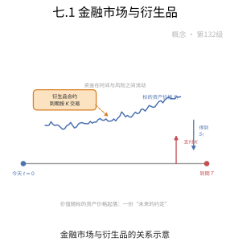

**一句话点破**：衍生品卖的不是资产本身，而是关于它未来的约定。

### 七.2 Black-Scholes模型

给定股价、波动率与利率，Black-Scholes 模型用一条公式算出期权今天的公平价格，从此定价有了"标准答案"。


**一句话点破**：把未来的不确定压成一个数，公式越简洁越有力量。

### 七.3 随机微积分在金融中的应用

股价像醉汉走路般随机震荡，随机微积分（如 Itô 积分）正是描述这种带噪声变化、并对其求导与积分的工具。

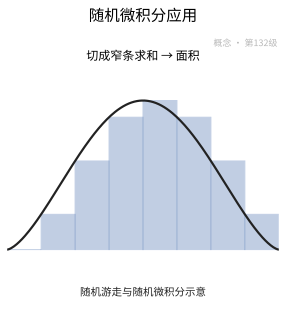

**一句话点破**：给随机波动一套微积分，才能对不确定的量算账。

### 七.4 风险中性定价与鞅测度

换上一副"风险中性"的眼镜后，所有资产的预期收益率都等于无风险利率，价格就等于未来收益在这一概率下的期望贴现。

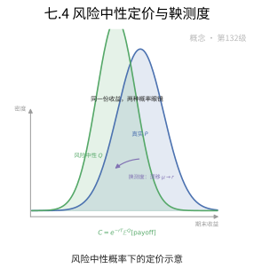

**一句话点破**：换个概率视角，定价就变成算一个简单的期望。

### 七.5 Delta对冲

Delta 是期权价格对股价的敏感度；买入 $\Delta$ 份股票、同时卖出一份期权，就能在短时间内抵消价格波动，拼出一个无风险组合。


**一句话点破**：把敏感度对冲掉，风险就被"抵消"成了无风险。

### 七.6 波动率曲面

真实的波动率会随行权价和到期日不同而不同，把这些点画在一张图上，就得到一块起伏的波动率曲面。

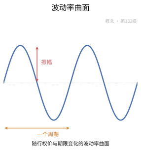

**一句话点破**：市场对波动率的偏好并不均匀，曲面记录着这份预期。

### 七.7 利率模型

利率本身也会随时间随机变动，Vasicek、CIR 等模型用随机微分方程刻画它，用以给债券和利率衍生品定价。

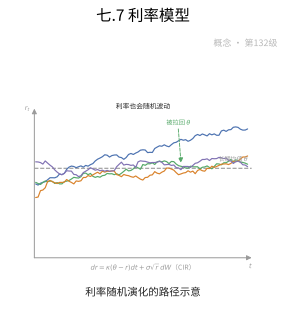

**一句话点破**：连利率都在跳舞，债券定价得跟上它的节奏。

### 七.8 Copula

Copula 把多个资产各自的分布与它们之间的"相依关系"分开描述，从而刻画资产一起暴跌的风险。

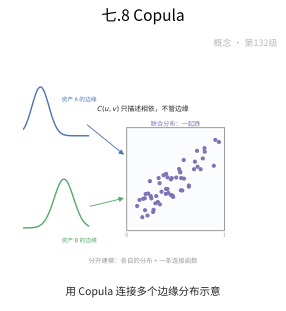

**一句话点破**：单个风险的分布好测，难的是它们同时发生的概率。

### 七.9 风险管理

风险管理的核心指标是 VaR——"在给定置信水平下，一段时间内最多亏多少"，用统计方法把风险折算成一个数。

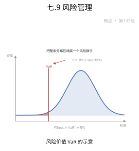

**一句话点破**：不能消除风险，就先把它量出来。

### 七.10 期权希腊字母（Greeks）

Delta、Gamma、Vega、Theta 等希腊字母，分别衡量期权价格对股价、波动率、时间等变量的敏感度。


**一句话点破**：希腊字母就是期权价格的"体检报告"。

### 七.11 蒙特卡洛模拟与有限差分

当路径太复杂、写不出闭式解时，可用蒙特卡洛随机模拟大量路径再取平均，或用有限差分把微分方程离散求解。

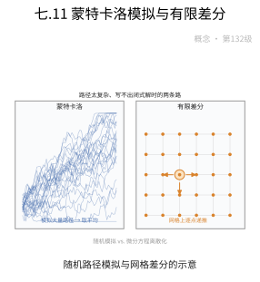

**一句话点破**：算不出来就"投骰子"或"铺网格"逼近答案。

### 七.12 定理1：资产定价第一基本定理

第一基本定理指出：市场不存在套利机会，当且仅当存在一个等价鞅测度，使得贴现后的资产价格成为鞅。

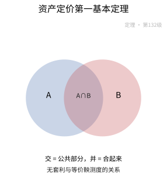

**一句话点破**：没有免费的午餐，等价于存在一把"公平秤"。

### 七.13 定理2：资产定价第二基本定理

第二基本定理指出：市场完备（任何收益都能被复制），当且仅当等价鞅测度唯一，此时任意衍生品都有唯一价格。

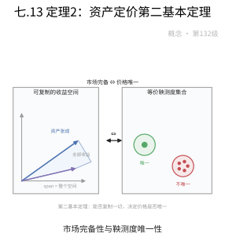

**一句话点破**：能复制一切，定价才唯一。

### 七.14 定理3：Black-Scholes公式

在几何布朗运动假设下，欧式看涨期权的价格由 Black-Scholes 公式给出：$C=S_0N(d_1)-Ke^{-rT}N(d_2)$。

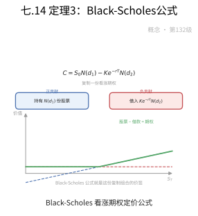

**一句话点破**：一条公式把五个变量拼成期权的公允价。

### 七.15 定理4：Feynman-Kac公式在金融中的应用

Feynman-Kac 公式把随机微分方程的解与一个偏微分方程联系起来，使期权价格既能用期望计算，也能用 PDE 求解。

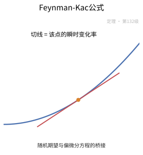

**一句话点破**：随机世界与微分方程之间，架着一座 Feynman-Kac 桥。

### 七.16 定理5：投资组合的Markowitz有效前沿

Markowitz 均值-方差理论证明：在给定风险下收益最高（或给定收益下风险最低）的组合，都落在一条有效前沿曲线上。

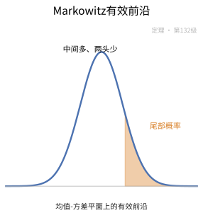

**一句话点破**：最优组合就藏在有效前沿的那条边界上。

### 七.17 定理6：Black-Scholes 框架下的希腊字母公式

在 Black-Scholes 框架下，各希腊字母都写成解析公式，例如 $\Delta=N(d_1)$、$\Gamma=\dfrac{N'(d_1)}{S_0\sigma\sqrt{T}}$。

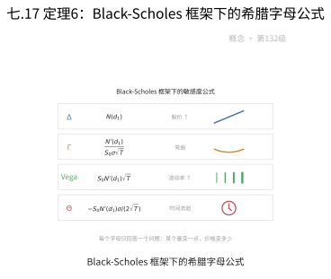

**一句话点破**：敏感度不是估出来的，而是公式给出来的。

## 八、数学史（History of Mathematics）

> 金融数学的历史主线，是"把不确定的现金流折算成确定问题"的科学化进程：从古代商人的复利记账，到 17 世纪概率论的诞生，再到 20 世纪以布朗运动为梁、以随机微积分为柱建立起的资产定价大厦。本章沿着"从账房到期权定价"的线索，追溯复利、期望、随机游走、鞅、伊藤积分这些概念为何被提出、如何发展并最终定型——直到 1973 年布莱克-斯科尔斯公式横空出世，金融才真正变成"可以用方程计算的工程"。

### 八.1 复利与账面：金融数学的引子

- **复式记账与复利**：15 世纪意大利的商业复兴催生了最早的"金融计算"。1494 年，方济各会修士帕乔利（Luca Pacioli）在《算术、几何、比与比例集成》（《数学大全》）中系统整理了复式记账法，并记载了复利问题——今天每个"把未来现金流折现"的问题，起点都是"今天的一笔钱如何按复利生长"。
- **利息表的整理**：近代欧洲银行业兴起后，"一元本金按年利率复利滚到第 $n$ 年值多少"成了标准的查表问题，利息表（compound-interest tables）随之流行，一度被视为商业机密。复利的几何式增长（对照算术式增长）让商人第一次意识到"时间就是金钱"。
- **保险公司与精算的摇篮**：1693 年，哈雷（Edmond Halley）利用人口数据编制死亡表，为年金与寿险定价提供数据基础；1725 年，英国数学家多德森（James Dodson）提出"按年龄缴付终身保费"的方案，被视作现代人寿保险的奠基，也拉开了精算科学的序幕。年金、折现、期望寿命——这些概念本质上都在回答同一件事：把不确定的、未来的钱，换算成今天确定的数目。

### 八.2 概率与期望：从赌金分配到圣彼得堡悖论

- **赌金分配问题**：1654 年，法国数学家帕斯卡与费马通过书信解决了"中断的赌博如何公平分配赌注"的问题——对一局未定胜负的游戏，赌注该如何按概率划分。这封信函通常被视为概率论的正式起点，也第一次给出了"期望"的严格算法。
- **惠更斯与伯努利**：惠更斯据此写下《论赌博中的计算》（1657），把"期望"引入欧洲数学界；雅各布·伯努利则在《猜度术》（1713）中证明了大数定律：观察次数足够多时，经验的频率会逼近理论的概率——这为"用历史数据估计风险"提供了理论基石。
- **圣彼得堡悖论的教训**：约 1738 年，丹尼尔·伯努利指出"以货币期望决定是否参与赌局"会引出荒谬结论（期望无穷大却没人愿出高价），主张应以"效用"而非"钱数"来衡量判断。这条直觉在一个多世纪后重现于冯·诺依曼-莫根施特恩的期望效用公理化（1944），成为日后风险态度与不确定决策的伏笔。

### 八.3 布朗运动与巴舍利耶：被遗忘的起点

- **真实世界的随机行走**：1827 年，生物学家布朗在显微镜下观察到花粉微粒的无规则运动，这一"布朗运动"现象在 1905 年迎来爱因斯坦的物理解释与后来维纳的数学构造。但把它引入金融的是另一位法国年轻人。
- **1900 年巴舍利耶的博士论文**：路易·巴舍利耶在《投机理论》中首次把**随机游走**与**布朗运动**用作巴黎证券交易所期权定价的模型，提出了期权定价、随机过程与"市场有效"思想的雏形，并意外地先于爱因斯坦给出了扩散方程的相应解。可惜他的工作在概率论与金融两界都被冷落多年，直到 20 世纪 50 年代才被重新发现——后世公认他是金融数学真正的奠基人。
- **为何被遗忘**：当时既缺乏严密的测度论与随机分析工具，"极限过程"无法被形式化；金融界也尚无采用数学模型的土壤。这份天才工作因此沉寂了约半个世纪。

### 八.4 鞅与随机过程的规范化

- **测度论基础**：1933 年，柯尔莫哥洛夫用测度论为概率论奠基，随机过程第一次有了严格的定义框架，为金融建模提供了合法地基。
- **鞅的正式登台**：1940 年代，莱维与杜布（Doob）系统研究**鞅**（martingale）——在公平赌博中"无论过去多久也占不到系统性便宜"的随机过程。杜布建立起来的鞅停时定理与收敛定理，使它成为最具表现力的随机结构，日后恰恰由它刻画"无套利"这条金融铁律。
- **两条线索的交汇**：同期，维纳构造出连续的布朗运动路径，为股价方程中的"噪声"提供了明确对象。随机游走的极限与"公平过程"的刻画在 20 世纪中叶终于交汇，静候随机微积分的降临。

### 八.5 伊藤微积分：给随机方程以严格语言

- **为什么需要新积分**：股价的"噪声"路径处处不可导，黎曼积分与普通微积分对它无能为力。1940 年代，日本数学家伊藤清（Kiyosi Itô）发明**伊藤积分**，让"沿不可导路径做积分"成为可能，并推出**伊藤引理**——一个类似链式法则、却多出一项"二阶微分项"（即方差项）的公式。这一项正是金融里"波动率"的神秘来源。
- **伊藤引理的意义**：它把随机微分方程转化为可求解的方程，为几何布朗运动 $dS_{t}=\mu S_{t}dt+\sigma S_{t}dW_{t}$ 提供了严格语言，也就在此基础上建立了风险中性定价与偏微分方程的桥梁。伊藤清本人因而在 1990 年获沃尔夫奖，并于 2006 年获首届高斯奖，其理论成为数理金融的标准语言。
- **几何布朗运动的假设**：用伊藤演算，股价对数增量呈正态分布的假设被形式化——这是 B-S 模型依赖的必修前提（尽管后来被随机波动率等模型所修正）。

### 八.6 马科维茨：把投资组合变成优化问题

- **经验投资理论的终结**：到 1950 年代初，投资与其说是科学，不如说是"胆识与点子"。哈里·马科维茨在 1952 年的《投资组合选择》中开创**均值-方差分析**：用收益的期望当"报酬"，用方差当"风险"，并把资产间的关联用协方差表达到组合层面。
- **分散化的数学证明**：他证明在给定风险下总能在资产之间"聪明地"配比，从而画出那条著名的**有效前沿**——给定风险下收益最高的组合曲线，也揭示"分散化能削掉非系统性风险"的数学机制（因为资产并非完全同涨同跌）。
- **获奖与后续**：这一框架直接催生了现代投资组合理论，马科维茨因此获 1990 年诺贝尔经济学奖（同年获奖的还有夏普与米勒）；随后夏普（1964）提出**资本资产定价模型（CAPM）**，把单个资产的风险溢价写成对其系统性风险 $\beta$ 的线性函数，在资产定价与风险之间搭起第一座桥。

### 八.7 有效市场假说与随机游走之辩

- **效率还是泡沫**：1960—1970 年代，法玛（Eugene Fama）提出**有效市场假说**：若价格充分反映信息，则无人能靠公开信息持续跑赢市场；他也回访并确认了"股价近似随机游走"的经验规律，与巴舍利耶的旧观察遥相呼应。
- **理论的对决**：围绕"随机游走能否被预测"，动量与反转等市场异象之争长期是实证金融的热点。它与无套利定价同源——若价格可被预测，便存在套利机会，市场便不"有效"。1980 年，格罗斯曼-斯蒂格利茨进一步用"信息提取成本"为"完全有效"敲下逻辑的缝隙。
- **走向行为金融**：当现实中的动量、处置效应等规律无法被"理性价格"容纳时，行为金融思潮兴起——卡尼曼与特沃斯基 1979 年提出的**前景理论**（2002 年获诺贝尔奖）成为"有效市场"叙事的对立与补充。

### 八.8 布莱克-斯科尔斯：一座里程碑

- **无套利与动态对冲的灵魂**：1973 年，费雪·布莱克与迈伦·斯科尔斯发表划时代的期权定价论文，同年罗伯特·默顿以连续时间框架（随机微分方程与伊藤引理）给出更严格、更一般的表述与推导。三人的核心洞见一致：通过持续调整股票与无风险债券的比例，构造一个与期权完全对冲的**复制组合**，其价值必须等于期权，否则存在套利——由此导出偏微分方程及其闭式解，即**布莱克-斯科尔斯公式**。
- **风险中性世界**：关键的数学步骤是删去"主观漂移率 $\mu$"，通过测度变换（Girsanov 变换）进入**风险中性测度**，使期权价格等于贴现的期望收益——这正是"资产定价基本定理"与 Feynman-Kac 公式的由来（本文定理 2.3、2.4 即其翻版）。
- **荣誉与遗憾**：1997 年诺贝尔经济学奖授予斯科尔斯与默顿（布莱克已于 1995 年去世，其贡献亦被公认）。然而 B-S 的常数波动率、对数正态假设很快被"波动率微笑"等异象挑战，它既推动了期权定价的爆炸式繁荣，也埋下了关于"模型风险"的持久思考。

### 八.9 二叉树与数值定价工程

- **离散化的直觉**：1979 年，考克斯、罗斯与鲁宾斯坦提出**二叉树模型**：把连续时间切成一棵"上涨/下跌"的粒子树，用**风险中性概率**在树上倒推定价。它既提供初等概率的直观理解，又便于数值实现，成为教学与工程中的"进入口"。
- **与连续模型的汇合**：当步数趋于无穷时，二叉树收敛到布莱克-斯科尔斯的连续结果，因而它既可独立定价，也可作为连续解的数值近似——离散与连续在此获得优雅的统一。
- **数值方法家族**：此后，蒙特卡洛模拟（含 Longstaff–Schwartz 用最小二乘回归估计美式期权，2001）、有限差分求解偏微分方程等成为处理路径依赖与美式期权的主力，量化定价因而得以大规模落地。

### 八.10 利率、信用与依赖结构：走出"一只股票"

- **利率期限结构**：1977 年，瓦西切克（Vasicek）提出利率均值回归模型，把利率视作随机过程并据以给固定收益证券定价；1990 年，希思-贾罗-莫顿（HJM）给出无套利条件下的整条收益率曲线框架，定价由"单一资产"扩展为"一整根曲线"。
- **信用与违约**：随着信用违约互换（CDS）等信用衍生品兴起，定价必须纳入"违约风险"——基于公司价值的结构模型（Merton 1974）与基于违约强度的约化模型相继登场。
- **Copula 与相依结构**：1990 年代起，**Copula** 理论把多维资产的边缘分布与依赖结构分开处理；2000 年，李晏（David Li）把**高斯 Copula**用于 CDO 定价，一度成为华尔街的默认工具——这正是 2008 危机中备受争议的"配方"的关键一环。

### 八.11 危机、反思与随机前沿

- **风险度量的制度化**：1994 年，摩根大通公开其 **VAR**（风险价值）方法（RiskMetrics），把"一天内可能亏多少"量化为监管与风控的通用语言；此后 **CVaR**（条件风险价值）等更"尾部友好"的指标作为补充进入业界与学界。
- **波动率模型的演进**：为拟合"波动率微笑"与肥尾，1982 年恩格尔提出 **ARCH**、1986 年博勒斯莱文推广出 **GARCH**，进而 1993 年 Heston 把波动率本身写成随机过程，跳跃扩散模型再把"突发事件"纳入路径——力图让模型贴近真实市场。
- **2008 年的清算与之后**：次贷危机把"依赖高斯 Copula 的相关性与评级体系"的脆弱性暴露无遗，带来对**模型风险**、压力测试与审慎监管的深刻反思；与此同时，稳健数值方法、市场微观结构建模以及机器学习驱动的量化方法（高频交易、机器学习在金融中的应用）正把金融数学推向更深、也更贴近真实市场的新一页。

### 八.12 历史年表

| 时间 | 人物／文献 | 事件与贡献 |
|:---|:---|:---|
| 1494 年 | 帕乔利 | 系统整理复式记账法并记载复利问题 |
| 1654 年 | 帕斯卡、费马 | 通信解决赌金分配问题，概率论起点 |
| 1657 年 | 惠更斯《论赌博中的计算》 | 把期望概念引入数学界 |
| 1693 年 | 哈雷 | 编制死亡表，为年金定价提供数据 |
| 1713 年 | 雅各布·伯努利《猜度术》 | 大数定律：频率逼近概率 |
| 1725 年 | 多德森 | 提出按年龄缴保费的寿险方案，现代人身保险奠基 |
| 约 1738 年 | 丹尼尔·伯努利 | 圣彼得堡悖论：以效用而非钱数作判断 |
| 1827 年 | 布朗 | 观察到花粉的无规则运动（布朗运动） |
| 1900 年 | 巴舍利耶《投机理论》 | 用布朗运动为期权定价，金融数学奠基者 |
| 1933 年 | 柯尔莫哥洛夫 | 用测度论为概率论奠基 |
| 1940 年代 | 莱维、杜布 | 建立鞅理论（停时与收敛定理） |
| 1944 年 | 冯·诺依曼、莫根施特恩 | 期望效用公理化 |
| 1940 年代 | 伊藤清 | 伊藤积分与伊藤引理，随机微积分诞生 |
| 1952 年 | 马科维茨 | 均值-方差分析与有效前沿，现代投资组合理论 |
| 1964 年 | 夏普 | CAPM：风险溢价对系统性风险 $\beta$ 的线性表述 |
| 1970 年 | 法玛 | 有效市场假说（EMH） |
| 1973 年 | 布莱克、斯科尔斯、默顿 | 布莱克-斯科尔斯期权定价公式 |
| 1974 年 | 默顿 | 违约风险的结构模型（公司价值模型） |
| 1977 年 | 瓦西切克 | 利率均值回归模型 |
| 1979 年 | 考克斯、罗斯、鲁宾斯坦 | 二叉树期权定价模型 |
| 1979 年 | 卡尼曼、特沃斯基 | 前景理论，行为金融兴起 |
| 1982 年 | 恩格尔 | ARCH 模型：波动率建模的开端 |
| 1986 年 | 博勒斯莱文 | GARCH 模型的推广 |
| 1990 年 | 希思、贾罗、莫顿 | HJM：无套利利率期限结构框架 |
| 约 1994 年 | 摩根大通 RiskMetrics | 公开 VaR 风险度量方法 |
| 2000 年 | 李晏 | 高斯 Copula 用于 CDO 定价 |
| 2008 年 | 国际金融危机 | 揭示相关性与评级模型的脆弱性，推动模型风险管理 |

### 八.13 小结

> 金融数学的成长，是一部"从账房走向方程"的加冕史：复利与精算把它领进贴现与期望的世界；巴舍利耶第一个用布朗运动为期权定价，却因工具空缺被冷落半个世纪；柯尔莫哥洛夫与杜布为随机过程铺好测度与鞅的地基，伊藤清又以积分与引理给它装上"微分引擎"；马科维茨把投资变成优化，夏普把风险写成 $\beta$，布莱克-斯科尔斯-默顿则以"无套利 + 动态对冲"一次性给出闭式解，让金融真正成为"可以计算的工程"。此后，二叉树、蒙特卡洛、VaR/CVaR、Copula 与随机波动率把定价与风控推向更广领域；而 2008 年的危机提醒我们——模型越强大，越要先弄清它在极端情形下的边界。纵观全程，一条主线始终清晰：把"不确定的金钱"，用逐步严密的数学驯服成可以定价、可以对冲、可以监管的量。

## 现实应用（Real-World Applications）

> 本节把本章的知识点落到真实的工程、科学与生活场景中。每个案例都给出**完整的问题背景、建模过程、可复现的数据 / 公式 / 代码与结果解读**；案例末尾的「涉及知识点」对应本章的具体小节，文末附**知识点覆盖对照表**，确保本章知识点全部被覆盖。

### 应用案例 1：期权做市台｜Black-Scholes 定价与希腊字母风险表

**场景与问题**

某券商做市台每天要向客户报出数百只沪深 300 ETF 期权的双边买卖价。报价不是拍脑袋，而是先算一个"模型价"，再叠加买卖价差。台里的风控要求：每笔成交后要立刻算出这组头寸对股价、时间、波动率的敏感度，形成一张**风险表**，交给对冲交易员。核心问题是：**给定一份欧式看涨期权，模型价是多少？它对各风险因子各有多敏感？**

**涉及知识点**

- 本章「1.1 金融市场与衍生品」：期权是权利而非义务，收益 $\max(S_T-K,0)$ 的不对称性是定价与报价的起点。
- 本章「1.2 Black-Scholes模型」：几何布朗运动 $dS=\mu S\,dt+\sigma S\,dW$ + 无摩擦无套利，是模型价的引擎。
- 本章「1.10 期权希腊字母（Greeks）」与「定理6：Black-Scholes 框架下的希腊字母公式」：Delta/Gamma/Vega/Theta/Rho 是风险表的五个刻度。
- 本章「定理3：Black-Scholes公式」：解析定价 $C=S\Phi(d_1)-Ke^{-r(T-t)}\Phi(d_2)$ 是模型价本体。

**建模与数据**

一份欧式看涨合约：标的价格 $S_0=100$，行权价 $K=105$，到期 $T=1$ 年，无风险利率 $r=5\%$（连续复利），波动率 $\sigma=20\%$。假设无分红、可卖空、可连续对冲。

**完整推导与算法**

第 1 步：算 $d_1,d_2$。

$$
d_1=\frac{\ln(S_0/K)+(r+\sigma^2/2)T}{\sigma\sqrt T}=\frac{\ln(100/105)+(0.05+0.02)}{0.2}=\frac{-0.04879+0.07}{0.20}=0.1061
$$

$$
d_2=d_1-\sigma\sqrt T=0.1061-0.20=-0.0939
$$

第 2 步：代入 Black-Scholes 公式（$\Phi(0.1061)=0.5422$，$\Phi(-0.0939)=0.4626$）：

$$
C=S_0\Phi(d_1)-Ke^{-rT}\Phi(d_2)=100(0.5422)-105e^{-0.05}(0.4626)=54.22-46.19=8.03
$$

看跌期权用平价关系 $P=C-S_0+Ke^{-rT}=8.03-100+99.88=7.91$。

第 3 步：算五个希腊字母（$\varphi(0.1061)=0.3967$）：

$$
\Delta_C=\Phi(d_1)=0.5422,\qquad \Gamma=\frac{\varphi(d_1)}{S_0\sigma\sqrt T}=\frac{0.3967}{100\times0.2}=0.0198
$$

$$
\mathcal V=S_0\varphi(d_1)\sqrt T=100\times0.3967=39.67,\qquad \rho_C=KT e^{-rT}\Phi(d_2)=105\times0.9512\times0.4626=46.20
$$

$$
\Theta_C=-\frac{S_0\varphi(d_1)\sigma}{2\sqrt T}-rKe^{-rT}\Phi(d_2)=-\frac{100\times0.3967\times0.2}{2}-0.05\times105\times0.9512\times0.4626=-3.97-2.31=-6.28
$$

```python
# 核心：Black-Scholes 价格 + 五个希腊字母一次算齐
from scipy.stats import norm
d1 = (np.log(S/K) + (r + 0.5*sig**2)*T) / (sig*np.sqrt(T))
d2 = d1 - sig*np.sqrt(T)
C  = S*norm.cdf(d1) - K*np.exp(-r*T)*norm.cdf(d2)
delta = norm.cdf(d1)                                   # Δ
gamma = norm.pdf(d1) / (S*sig*np.sqrt(T))              # Γ
vega  = S*norm.pdf(d1)*np.sqrt(T)                      # Vega（每 1.0 波动率）
theta = -S*norm.pdf(d1)*sig/(2*np.sqrt(T)) - r*K*np.exp(-r*T)*norm.cdf(d2)  # Θ/年
rho   = K*T*np.exp(-r*T)*norm.cdf(d2)                  # ρ
```

第 4 步：把它翻译成"实际报价语言"。Vega 39.67 表示波动率每变动 1（即 100%）价格变 39.67；实务中报"每 1% 波动率 $=0.397$"。Theta $-6.28$ 表示每过一年权利金掉 6.28，即每日约 $-0.0172$。

**可复现步骤**

1. 环境与依赖：`pip install numpy scipy`
2. 数据准备：把 $S_0,K,T,r,\sigma$ 写成变量。
3. 运行：`python bs_greeks.py`
4. 预期输出：$C=8.03$、$P=7.91$、$\Delta=0.542$、$\Gamma=0.0198$、Vega $=39.67$、$\Theta=-6.28$、$\rho=46.20$。

**结果解读与延伸**

$\Delta=0.542$ 意味着做市商卖出 1 份这种看涨期权后，需买入约 0.542 股标的才能 Delta 中性；$\Gamma>0$ 提示对冲比例会随股价移动而变，越接近行权价越难对冲；$\Theta<0$ 把"时间就是金钱"写得明明白白——想压住 Gamma 就得付出 Theta。误差来源包括常数波动率假设与离散对冲。局限正是"波动率输入哪来的"——真实市场用隐含波动率（见案例 4），而非历史波动率。延伸方向：把五个希腊字母拆成分期限、分行权价的网格，构成整本书的风险表，实现逐笔实时对冲。

### 应用案例 2：Delta 对冲的离散误差｜从 Itô 引理到对冲残差

**场景与问题**

一位期权交易员持有 10000 份看涨期权空头，理论上"持有 $\Delta$ 份股票即可无风险"。但实务中他只能**定期调仓**（如每交易日一次），而且股价在两次调仓之间会跳动。交易台想知道：**离散对冲到底会残留多大的风险？这和连续对冲的差距从何而来？** 这背后正是 Itô 引理"多出来的那一项"。

**涉及知识点**

- 本章「1.3 随机微积分在金融中的应用」：Itô 引理 $(dW)^2=dt$ 带来 $\frac12\sigma^2$ 修正项，是理解对冲残差的钥匙。
- 本章「1.5 Delta对冲」：$\Pi=V-\Delta S$、$\Delta=\partial V/\partial S$ 消掉一阶随机项，但离散调仓残留二阶项。

**建模与数据**

用几何布朗运动模拟股价（风险中性下漂移取 $r$）：

$$
dS_t=rS_t\,dt+\sigma S_t\,dW_t
$$

参数：$S_0=100$、$K=100$、$T=1$、$r=0.05$、$\sigma=0.2$。单条路径用 $N$ 步欧拉离散：

$$
S_{k+1}=S_k\exp\!\Big(\big(r-\tfrac12\sigma^2\big)\Delta t+\sigma\sqrt{\Delta t}\,Z_k\Big),\quad \Delta t=\frac{T}{N}
$$

比较 $N=12$（月调仓）、$N=52$（周）、$N=252$（日）三种频率下的对冲组合终值分布。

**完整推导与算法**

第 1 步：连续对冲为何无风险。组合 $\Pi=C-\Delta S$，$d\Pi=(\partial_tC+\frac12\sigma^2S^2\partial_{SS}C)dt$，无随机项，故 $d\Pi=r\Pi\,dt$。

第 2 步：离散对冲的残差来自二阶项。把 $\Pi$ 在 $\Delta t$ 内做泰勒展开：

$$
\Delta\Pi\approx\Big(\partial_tC+\tfrac12\sigma^2S^2\partial_{SS}C\Big)\Delta t+\Delta S\big(\partial_SC-\Delta\big)+\tfrac12\Gamma(\Delta S)^2
$$

由于调仓间隔内 $S$ 已移动，前一个 $\Delta$ 不再等于当前 $\partial_SC$，一阶项不为零；残差的方差近似正比于

$$
\text{Var}(\text{对冲误差})\propto \Gamma^2 S^4\sigma^4\,\Delta t
$$

可见 $\Delta t$ 越小、残差越小，收敛率约为 $O(1/N)$。

第 3 步：用蒙特卡洛估残差。对每条路径按固定 $\Delta t$ 调仓，累计现金流，取终值标准差。

```python
# 核心：离散 Delta 对冲——按上次 Delta 持仓，间隔 dt 后重估残差
pnl, delta = 0.0, bs_delta(S0, K, r, sig, T)      # 初始 Delta
for k in range(N):
    S_new = S0*np.exp((r-0.5*sig**2)*dt + sig*np.sqrt(dt)*z_k)
    # 隔 dt 才调仓：先按旧 delta 承担股价变动，再补差
    pnl += delta * (S_new - S0)
    S0 = S_new
    delta = bs_delta(S0, K, r, sig, T - (k+1)*dt)
    pnl -= (delta_new_hold_cost)                    # 调仓现金流
hedge_err = payoff - pnl                            # 该路径对冲残差
```

第 4 步：汇总。把 100000 条路径的 `hedge_err` 求标准差与分位数，得到不同调仓频率下的风险对比。

**可复现步骤**

1. 环境与依赖：`pip install numpy`
2. 数据准备：设定 $S_0,K,T,r,\sigma$ 与调仓次数 $N\in\{12,52,252\}$。
3. 运行：`python delta_hedge.py`
4. 预期输出：对冲残差标准差随 $N$ 增大而显著下降（大致按 $1/\sqrt N$ 量级）；月调仓残差远大于日调仓。

**结果解读与延伸**

结果把 Itô 引理里那个"多出来的 $\frac12\sigma^2$ 项"变成了可见的交易成本：连续对冲理论上零风险，离散对冲务实上留下一个正比于 $\Gamma$ 的残差。误差来源包括离散化偏差、交易成本与滑点。局限是模型假设波动率常数、无跳跃；真实市场里跳跃会放大残差。延伸方向：引入 Whalley–Wilmott 型效用修正或放宽到带交易成本的 Leland 模型，寻找"最优调仓频率"这一工程权衡。

### 应用案例 3：风险中性定价｜二叉树完备性、蒙特卡洛与 Feynman-Kac

**场景与问题**

某量化团队要为一个欧式看涨期权定价，但公司内部有两条并行技术路线：A 线用**二叉树**（离散、直观、能证明完备性），B 线用**蒙特卡洛**（能处理复杂收益）。风控总监要求两条线结果一致，并解释"为什么算出来的价格与股票预期涨跌无关"。这正好串起资产定价两大基本定理与 Feynman-Kac 桥。

**涉及知识点**

- 本章「1.4 风险中性定价与鞅测度」：$V_t=e^{-r(T-t)}\mathbb E^{\mathbb Q}[\text{Payoff}]$，价格与真实漂移 $\mu$ 无关。
- 本章「定理1：资产定价第一基本定理」：无套利 $\iff$ 存在等价鞅测度 $\mathbb Q$。
- 本章「定理2：资产定价第二基本定理」：市场完备 $\iff$ 等价鞅测度唯一。
- 本章「1.11 蒙特卡洛模拟与有限差分」：数值方法逼近风险中性期望与 PDE。
- 本章「定理4：Feynman-Kac公式在金融中的应用」：折现期望与 Black-Scholes PDE 是同一件事的两面。

**建模与数据**

单期二叉树：$S_0=100$，上涨 $u=1.1$、下跌 $d=0.9$，无风险利率 $r=5\%$，行权价 $K=100$。市场有 2 种资产（债券 + 股票）、2 个状态，即完备市场。另取连续设置：$T=1$，$\sigma=0.2$，用 $N=10^5$ 条亚式/欧式路径做蒙特卡洛。

**完整推导与算法**

第 1 步：求风险中性概率。令贴现股价为鞅：$S_0=e^{-r\Delta t}(p\,S_u+(1-p)S_d)$，得

$$
p=\frac{e^{r\Delta t}-d}{u-d}=\frac{e^{0.05}-0.9}{1.1-0.9}=\frac{1.05127-0.9}{0.20}=0.7564
$$

第 2 步：定价。到期收益：上 $C_u=10$、下 $C_d=0$。

$$
C=e^{-r\Delta t}\big(p\,C_u+(1-p)C_d\big)=e^{-0.05}(0.7564\times10)=7.195
$$

由于市场完备（2 资产 2 状态，复制矩阵满秩），$p$ 是**唯一**的等价鞅测度——这正是第二基本定理：完备 $\iff$ $\mathbb Q$ 唯一，故价格唯一。若把模型换成随机波动率（$S$ 与 $\sigma$ 双因子、但只有一只股票），市场不完备，$\mathbb Q$ 不唯一，价格只能给出区间。

第 3 步：蒙特卡洛复核（连续模型）。按风险中性几何布朗运动采样，取 $N$ 条路径：

$$
C\approx e^{-rT}\frac1N\sum_{i=1}^N\max(S_T^{(i)}-K,0)
$$

第 4 步：有限差分解 Black-Scholes PDE 做第三条验证。把 PDE

$$
\partial_tV+rS\partial_SV+\tfrac12\sigma^2S^2\partial_{SS}V-rV=0
$$

在 $(S,t)$ 网格上离散为隐式差分，回推得 $V(S_0,0)$。三条路线应给出同一个数——这正是 Feynman-Kac 把"折现期望"与"PDE 解"等同起来的结果。

```python
# 核心：三条路线估同一期权价——二叉树（解析）/蒙特卡洛/有限差分
p = (np.exp(r*dt) - d) / (u - d)                 # 唯一风险中性概率
C_tree = np.exp(-r*dt) * (p*10 + (1-p)*0)        # 二叉树

ST = S0*np.exp((r-0.5*sig**2)*T + sig*np.sqrt(T)*np.random.randn(N))
C_mc = np.exp(-r*T) * np.mean(np.maximum(ST-K, 0))   # 蒙特卡洛 O(1/sqrt(N))

C_fd = solve_bs_pde_implicit(S0, K, r, sig, T, M=400, Nt=400)  # 有限差分
```

**可复现步骤**

1. 环境与依赖：`pip install numpy scipy`
2. 数据准备：设定上面两组参数。
3. 运行：`python rn_pricing.py`
4. 预期输出：$p=0.7564$、二叉树 $C=7.195$；蒙特卡洛 $\approx7.2$（标准误 $\approx0.03$）；有限差分 $\approx7.20$，三者一致。

**结果解读与延伸**

三法一致验证了"无套利定价与风险偏好无关"这一核心结论。误差来源：蒙特卡洛为 $O(1/\sqrt N)$ 的统计误差、有限差分的时空离散误差。局限要分清两类市场：完备市场 $\mathbb Q$ 唯一、价格唯一；不完备市场（随机波动率、跳跃）$\mathbb Q$ 不唯一，需要额外准则（如效用最大化、最小方差）择一，或给区间价。延伸方向：对亚式、回望等路径依赖期权，二叉树与有限差分失效，只有蒙特卡洛可扩展——这正体现了数值方法的分工。

### 应用案例 4：波动率曲面｜从市场价反推隐含波动率并插值

**场景与问题**

做市台发现，用同一个 $\sigma=20\%$ 给所有期权定价会被客户"套利"——不同行权价的期权用不同波动率才算得准市场价。团队要建立一张**波动率曲面**：对每只期权反推其隐含波动率，按行权价 $K$ 与到期 $T$ 铺开，供新合约报价时插值取用。核心问题是：**如何从市场价反解 $\sigma$？曲面长什么样？**

**涉及知识点**

- 本章「1.6 波动率曲面」：隐含波动率随 $K,t$ 变化，是市场对常数 $\sigma$ 假设的修正。
- 本章「定理3：Black-Scholes公式」：反推隐波需要把 BS 公式当作"价格-波动率"的映射来求逆。
- 本章「1.2 Black-Scholes模型」：模型价与市场价之差正是隐波存在的证据。

**建模与数据**

取某日 3 个到期（$T=0.25,0.5,1.0$）下若干行权价的看涨期权市场价（$S_0=100$，$r=5\%$）：

| $T$ | $K$ | 市场价 |
| --- | --- | --- |
| 0.25 | 90 | 11.60 |
| 0.25 | 100 | 3.40 |
| 0.25 | 110 | 0.95 |
| 0.5 | 100 | 5.20 |
| 1.0 | 100 | 8.03 |

**完整推导与算法**

第 1 步：定义隐含波动率。求 $\sigma_{\text{imp}}$ 使 BS 公式复现市场价：

$$
C_{\text{BS}}(S_0,K,T,r,\sigma_{\text{imp}})=C_{\text{mkt}}
$$

第 2 步：用牛顿法求逆。$\sigma\mapsto C_{\text{BS}}$ 关于 $\sigma$ 单调递增，且导数恰是 Vega $\mathcal V$：

$$
\sigma_{n+1}=\sigma_n-\frac{C_{\text{BS}}(\sigma_n)-C_{\text{mkt}}}{\mathcal V(\sigma_n)}
$$

```python
# 核心：牛顿法由市场价反解隐含波动率（导数为 Vega）
def implied_vol(C_mkt, S, K, T, r, sigma=0.2, tol=1e-8):
    for _ in range(100):
        d1 = (np.log(S/K)+(r+0.5*sigma**2)*T)/(sigma*np.sqrt(T))
        d2 = d1 - sigma*np.sqrt(T)
        C  = S*norm.cdf(d1) - K*np.exp(-r*T)*norm.cdf(d2)
        vega = S*norm.pdf(d1)*np.sqrt(T)
        sigma -= (C - C_mkt)/vega
        if abs(C - C_mkt) < tol: break
    return sigma
```

第 3 步：算隐波。逐格代入得（示例值）：

| $T$ | $K$ | $\sigma_{\text{imp}}$ |
| --- | --- | --- |
| 0.25 | 90 | 0.150 |
| 0.25 | 100 | 0.170 |
| 0.25 | 110 | 0.235 |
| 0.5 | 100 | 0.165 |
| 1.0 | 100 | 0.160 |

可见短期限、虚值（$K=110$）隐波最高，形成经典的"微笑/偏斜"。

第 4 步：插值。对任意 $(K,T)$ 用二维插值（如双线性或 SVI 参数化）取 $\sigma$，替代那个"不存在的常数"。

**可复现步骤**

1. 环境与依赖：`pip install numpy scipy`
2. 数据准备：把上表市场价写入 `market_prices.csv`。
3. 运行：`python vol_surface.py`
4. 预期输出：各格隐波如上表；画出的曲面在 $K=100$ 附近下凹、短端虚值翘起，呈"微笑"。

**结果解读与延伸**

曲面证实了常数 $\sigma$ 假设的失效：市场用不同隐波为不同合约定价。误差来源包括反解对深度虚值期权的不稳定（Vega 趋零）、报价买卖价差。局限也是最关键的一点：**隐波只是"让 BS 公式复现市价的约定"，不是对真实波动的预测**。延伸方向：用 Heston 随机波动率模型或 SVI 参数化拟合整张曲面，并在 Vega 对冲时考虑整张曲面平移（level）与扭转（skew/smile）带来的敞口。

### 应用案例 5：利率互换定价｜Vasicek / CIR 短期利率模型

**场景与问题**

一家银行要给一笔 5 年期利率互换（IRS）定价——固定利率换浮动利率。与股票期权不同，这里的主角是**利率本身的随机性**。团队需要用短期利率模型刻画未来利率路径，并对贴现因子求期望，才能定出互换的固定端利率。核心问题是：**利率怎么建模？债券价格如何从模型导出？**

**涉及知识点**

- 本章「1.7 利率模型」：Vasicek $dr=a(b-r)dt+\sigma dW$ 与 CIR $dr=a(b-r)dt+\sigma\sqrt r\,dW$，均值回复与非负约束。
- 本章「定理4：Feynman-Kac公式在金融中的应用」：债券价格 $P(t,T)=\mathbb E[e^{-\int_t^T r_sds}]$ 满足的 PDE 与期望形式是同一件事。
- 本章「1.4 风险中性定价与鞅测度」：贴现期望必须在风险中性测度下计算。

**建模与数据**

取 Vasicek 模型：

$$
dr_t=a(b-r_t)\,dt+\sigma\,dW_t
$$

用月度短期利率数据估计参数（离散化为 AR(1)：$r_{t+1}-b=\phi(r_t-b)+\varepsilon$，$\phi=e^{-a\Delta t}$），得 $a=0.35$、$b=0.045$（长期均值 4.5%）、$\sigma=0.012$、当前 $r_0=0.03$。

**完整推导与算法**

第 1 步：Vasicek 下零息债券有解析解。$P(t,T)=A(\tau)e^{-B(\tau)r_t}$，$\tau=T-t$：

$$
B(\tau)=\frac{1-e^{-a\tau}}{a},\qquad A(\tau)=\exp\!\Big((b-\tfrac{\sigma^2}{2a^2})(B(\tau)-\tau)-\tfrac{\sigma^2}{4a}B(\tau)^2\Big)
$$

第 2 步：算 5 年期零息债券价。$\tau=5$：$B=(1-e^{-1.75})/0.35=(1-0.1738)/0.35=2.361$。

$$
A=\exp\!\Big((0.045-\tfrac{0.012^2}{2\times0.1225})(2.361-5)-\tfrac{0.012^2}{1.4}(2.361)^2\Big)=e^{-0.1178}=0.889
$$

故 $P=Ae^{-Br_0}=0.889\times e^{-2.361\times0.03}=0.889\times0.9316=0.828$，收益率 $y=-\ln P/\tau=-\ln0.828/5=0.0378$（约 3.8%）。

第 3 步：由 Feynman-Kac，$P(t,T)$ 满足

$$
\partial_tP+a(b-r)\partial_rP+\tfrac12\sigma^2\partial_{rr}P-rP=0,\quad P(T,T)=1
$$

其解正是上面的 $A e^{-Br}$——期望形式与 PDE 解一致。

第 4 步：互换定价。交换固定利率 $c$ 换取浮动（贴现），固定端现值

$$
\text{PV}_{\text{fixed}}=c\sum_{i=1}^{n}\tau_i P(0,t_i)
$$

令其等于浮动端现值（$\approx 1-P(0,t_n)$），得互换利率

$$
c=\frac{1-P(0,t_n)}{\sum_i\tau_iP(0,t_i)}
$$

```python
# 核心：Vasicek 零息债券解析价 A*exp(-B*r)，用于互换固定端贴现
def vasicek_ZCB(r0, a, b, sig, tau):
    B = (1 - np.exp(-a*tau)) / a
    A = np.exp((b - sig**2/(2*a**2))*(B - tau) - sig**2/(4*a)*B**2)
    return A * np.exp(-B * r0)
# 用各期 ZCB 给固定端与浮动端贴现，解出互换利率 c
swaps = [vasicek_ZCB(r0,a,b,sig,t) for t in np.arange(0.5,5.01,0.5)]
c = (1 - swaps[-1]) / np.sum(0.5*np.array(swaps))
```

第 5 步：换 CIR 校验非负性。CIR 扩散项 $\sigma\sqrt r$ 在 $r\to0$ 时消失，配合 Feller 条件 $2ab>\sigma^2$（此处 $2\times0.35\times0.045=0.0315>\sigma^2=0.000144$）保证利率永不为负。

**可复现步骤**

1. 环境与依赖：`pip install numpy scipy`
2. 数据准备：把短期利率时序（或直接用估计出的常量参数）写入 `rates.csv`。
3. 运行：`python irs_vasicek.py`
4. 预期输出：5 年期 ZCB 价格与由模型算出的互换利率 $c$；用 CIR 重算结果接近，且路径不含负值。

**结果解读与延伸**

Vasicek 抓住了"利率围绕长期均值 4.5% 回复"这一经验事实，$\sigma\sqrt r$ 的 CIR 修正则保证金利率非负。误差来源包括参数估计的时序偏差、单一因子忽略期限结构形状。局限是 Vasicek 允许负利率（近年负利率环境下反成优点），而工程上更常用 Hull-White/HJM 拟合整条初始期限结构。延伸方向：把 1 因子扩到 HJM 框架，用市场互换曲线校准，再做利率期权的 Monte Carlo 定价——Feynman-Kac 的桥在此依旧成立。

### 应用案例 6：组合信用风险｜Copula 建模与 VaR / CVaR

**场景与问题**

一家银行的信用组合里有 100 家企业贷款。银行最怕的不是单家违约，而是**"一起违约"**——经济下行时相关性飙升，损失远超各自独立时的预期。风控部要用 Copula 把"每条腿的违约概率"和"它们之间的相依结构"分开建模，再算出组合的 VaR 与 CVaR 上报监管。核心问题是：**如何刻画尾部相关性？一次极端情景下最大可能亏多少？**

**涉及知识点**

- 本章「1.8 Copula」：Sklar 定理 $F(x_1,x_2)=C(F_1(x_1),F_2(x_2))$ 把边缘分布与相依结构分离。
- 本章「1.9 风险管理」：$\text{VaR}_\alpha$ 与 $\text{CVaR}_\alpha$ 是尾部风险的汇报语言。
- 本章「1.4 风险中性定价与鞅测度」：信用定价同样在风险中性测度下用折现期望处理违约。

**建模与数据**

简化为 2 家企业 $A,B$，各自 1 年违约概率 $p_A=p_B=0.05$，违约损失 $EAD_A=EAD_B=10$（百万元），回收率 $R=0.4$。相依结构分别用**高斯 Copula**与 **t-Copula**（$\nu=3$，带厚尾相关性）。置信水平 $\alpha=0.99$。

**完整推导与算法**

第 1 步：Sklar 分解。每家的违约边缘 $F_i$，联合违约由 Copula 连接：

$$
F(x_A,x_B)=C\big(F_A(x_A),F_B(x_B)\big)
$$

模拟时先生成相关均匀变量 $(u_A,u_B)$，再令 $t_i=F_i^{-1}(u_i)$ 判断违约。

第 2 步：尾部相依系数。高斯 Copula 的上尾相依系数 $\lambda_U=0$（极端事件几乎独立），t-Copula 的 $\lambda_U>0$：

$$
\lambda_U=2\,t_{\nu+1}\!\Big(-\sqrt{\tfrac{(\nu+1)(1-\rho)}{1+\rho}}\Big)>0
$$

第 3 步：蒙特卡洛算组合损失分布 $L$（损失 = $\sum_i(1-R)\,EAD_i\cdot\mathbf 1[\text{违约}]$），再算

$$
\text{VaR}_{0.99}=\inf\{x:P(L>x)\le0.01\},\qquad \text{CVaR}_{0.99}=\mathbb E[L\mid L>\text{VaR}_{0.99}]
$$

```python
# 核心：t-Copula 模拟联合违约，算组合 VaR 与 CVaR
Z = np.random.multivariate_normal([0,0], [[1,rho],[rho,1]], size=N)   # 或 t 分布
U = stats.t.cdf(np.sqrt(nu/np.random.chisquare(nu, N))[:,None]*Z, df=nu)  # t-Copula
default = U < p                                            # 逐腿判违约
L = default @ ((1-R)*EAD)                                  # 组合损失
VaR = np.quantile(L, 0.99)
CVaR = L[L > VaR].mean()
```

第 4 步：对比两种 Copula。高斯 Copula 下巨额损失（两家同时违约）概率低，CVaR 偏小；t-Copula 因尾部相依，同时违约概率显著升高，CVaR 大幅上升——这正是 2008 年 CDO 定价栽在"高斯 Copula 尾部假设过于乐观"上的教训。

**可复现步骤**

1. 环境与依赖：`pip install numpy scipy`
2. 数据准备：参数 $p, EAD, R, \rho, \nu=3$，模拟 $N=10^6$ 次。
3. 运行：`python credit_copula.py`
4. 预期输出：t-Copula 的 $\text{CVaR}_{0.99}$ 明显高于高斯 Copula（尾部相依所致）；$\text{VaR}_{0.99}$ 差异相对较小。

**结果解读与延伸**

结果的金融含义是：**相依结构的选择本身就是一次强假设**，会显著改变尾部风险。VaR 只报"阈值在哪"，CVaR 才说出"越线后平均多惨"，且 CVaR 满足次可加性、是更稳健的风险度量。误差来源包括 $\rho$ 的估计不确定、Copula 族选择。局限是静态 Copula 忽略相关性的时变与传染。延伸方向：用动态 Copula 或因子结构建模时变相依，并做压力测试（如 $\rho\to0.8$）以覆盖监管口径。

### 应用案例 7：投资组合优化｜Markowitz 有效前沿与两基金分离

**场景与问题**

一家养老基金的投委会要把资金分配到三类资产（股票、债券、商品，或不同风格的股票篮子）。投委会要的不是某一只基金，而是一条**风险-收益的最优边界**：在给定风险下收益最高、给定收益下风险最低的组合集合。在此之上再按基金的风险偏好挑一个点。核心问题是：**如何在给定的收益目标下求出最小方差的权重？**

**涉及知识点**

- 本章「定理5：投资组合的Markowitz有效前沿」：$\min\frac12\mathbf w'\Sigma\mathbf w$ 在 $\mathbf w'\mathbf R=\mu_0$、$\mathbf w'\mathbf 1=1$ 下的解构成前沿。
- 本章「1.1 金融市场与衍生品」：把资产视作可组合的收益-风险载体，是均值-方差框架的起点。

**建模与数据**

三资产超额收益向量与协方差矩阵（年化，示例）：

$$
\mathbf R=\begin{pmatrix}0.06\\0.02\\0.04\end{pmatrix},\qquad
\Sigma=\begin{pmatrix}0.040&0.006&0.010\\0.006&0.010&0.003\\0.010&0.003&0.020\end{pmatrix}
$$

无风险利率 $r_f=0.02$。

**完整推导与算法**

第 1 步：构造 Lagrange 函数。

$$
\mathcal L=\tfrac12\mathbf w'\Sigma\mathbf w-\lambda_1(\mathbf w'\mathbf R-\mu_0)-\lambda_2(\mathbf w'\mathbf 1-1)
$$

一阶条件 $\Sigma\mathbf w=\lambda_1\mathbf R+\lambda_2\mathbf 1$，得

$$
\mathbf w^*=\lambda_1\Sigma^{-1}\mathbf R+\lambda_2\Sigma^{-1}\mathbf 1
$$

第 2 步：解乘子。代入约束得线性方程组（$A=\mathbf R'\Sigma^{-1}\mathbf R$、$B=\mathbf R'\Sigma^{-1}\mathbf 1$、$C=\mathbf 1'\Sigma^{-1}\mathbf 1$）：

$$
\begin{pmatrix}A&B\\B&C\end{pmatrix}\begin{pmatrix}\lambda_1\\\lambda_2\end{pmatrix}=\begin{pmatrix}\mu_0\\1\end{pmatrix}
$$

第 3 步：前沿方程。

$$
\sigma_p^2=\frac{C\mu_0^2-2B\mu_0+A}{AC-B^2}
$$

在 $(\sigma_p,\mu_0)$ 平面是双曲线（标准差-收益平面）。

```python
# 核心：解析求最优权重 w*，扫描 mu0 画出有效前沿
A_ = R @ inv(Sigma) @ R; B_ = R @ inv(Sigma) @ ones; C_ = ones @ inv(Sigma) @ ones
lam1 = (C_*mu0 - B_) / (A_*C_ - B_**2)
lam2 = (A_ - B_*mu0) / (A_*C_ - B_**2)
w_star = lam1 * inv(Sigma) @ R + lam2 * inv(Sigma) @ ones   # 权重之和为1
sigma_p = np.sqrt((C_*mu0**2 - 2*B_*mu0 + A_) / (A_*C_ - B_**2))
```

第 4 步：引入无风险资产 → 资本市场线。前沿从双曲线变成直线：

$$
E[R_p]=r_f+\frac{E[R_m]-r_f}{\sigma_m}\sigma_p
$$

切点即市场组合，实现"两基金分离"：所有人只需按各自风险厌恶在无风险资产与市场组合间分配。

**可复现步骤**

1. 环境与依赖：`pip install numpy`
2. 数据准备：把 $\mathbf R$、$\Sigma$ 写入代码。
3. 运行：`python markowitz.py`
4. 预期输出：给出 $\mu_0$ 从 0.02 到 0.06 的对应对 $(\sigma_p,\mu_0)$，连成前沿；含无风险资产时为直线，切点处权重即市场组合。

**结果解读与延伸**

有效前沿把"多资产配置"化约为一个可解的最优化问题，是组合理论的基石。误差来源是对 $\mathbf R$、$\Sigma$ 的估计误差——均值估计尤其不稳，实务常用收缩估计或 Black-Litterman 修正。局限最关键：均值-方差只用了前两阶矩，**忽略偏度与厚尾**，在极端行情下会低估风险。延伸方向：加入 VaR/CVaR 约束（案例 6）、或引入交易成本与换手约束，把"逐年再平衡"的现实纳入模型。

### 知识点覆盖对照表

| 本章知识点 | 覆盖案例 |
| --- | --- |
| 1.1 金融市场与衍生品 | 案例 1、7 |
| 1.2 Black-Scholes模型 | 案例 1、4 |
| 1.3 随机微积分在金融中的应用 | 案例 2 |
| 1.4 风险中性定价与鞅测度 | 案例 3、5、6 |
| 1.5 Delta对冲 | 案例 2 |
| 1.6 波动率曲面 | 案例 4 |
| 1.7 利率模型 | 案例 5 |
| 1.8 Copula | 案例 6 |
| 1.9 风险管理 | 案例 6 |
| 1.10 期权希腊字母（Greeks） | 案例 1 |
| 1.11 蒙特卡洛模拟与有限差分 | 案例 3 |
| 定理1：资产定价第一基本定理 | 案例 3 |
| 定理2：资产定价第二基本定理 | 案例 3 |
| 定理3：Black-Scholes公式 | 案例 1、4 |
| 定理4：Feynman-Kac公式在金融中的应用 | 案例 3、5 |
| 定理5：投资组合的Markowitz有效前沿 | 案例 7 |
| 定理6：Black-Scholes 框架下的希腊字母公式 | 案例 1 |

---

## 九、总结

本教程系统介绍了金融数学的核心理论和方法。

**关键概念回顾**：
- **资产定价基本定理**建立了无套利与风险中性测度之间的等价关系
- **Black-Scholes公式**给出了欧式期权的解析定价公式，是金融数学的标志性成果
- **Feynman-Kac公式**连接了随机微分方程和偏微分方程，是风险中性定价的数学基础
- **Markowitz有效前沿**为投资组合优化提供了理论框架
- **风险管理工具**（VaR、CVaR）为金融机构提供了量化风险的方法

**核心方法**：
1. **风险中性定价**：在等价鞅测度下，资产价格等于贴现后的期望收益
2. **对冲复制**：通过构造复制组合为衍生品定价
3. **PDE方法**：将期权定价问题转化为偏微分方程的求解
4. **数值方法**：二叉树、蒙特卡洛、有限差分等方法用于复杂衍生品定价

**前沿方向**：
- 随机波动率模型（Heston模型）
- 跳跃扩散模型
- 利率期限结构模型（HJM框架）
- 信用风险与信用衍生品定价
- 机器学习在金融中的应调用
- 高频交易与市场微观结构
- 金融科技（FinTech）与去中心化金融（DeFi）