# 第133级 经济数学 (Mathematical Economics)

## 📖 学习目标

1. 理解一般均衡理论的基本框架及其数学基础
2. 掌握Arrow-Debreu一般均衡存在性的证明思路
3. 理解Arrow不可能定理的深刻含义及其证明
4. 掌握福利经济学两大基本定理及其经济含义
5. 理解匹配理论中的稳定匹配存在性及其算法
6. 了解机制设计、市场设计的前沿应用
7. 了解经济增长模型与动态优化方法

---

## 一、核心概念

### 1.1 一般均衡理论

**一般均衡理论**（General Equilibrium Theory）研究在多个市场相互关联的经济中，价格如何同时调整使得所有市场达到供求平衡。

> **🧠 直观理解（现实类比）**：一般均衡就像一座候车大厅里所有站的票价"同时联动"——大米便宜了、猪肉就得跟着变，牵一发动全身。它不再只看某一棵树（局部均衡），而是要求"整片森林"里每个市场（大米、猪肉、工资、地租……）的价格一起调整，直到所有市场的供求**同时**出清。核心科目是"多市场相互咬合时，是否存在一组让全部市场归位的价格"。

**定义1（竞争均衡）** 一个竞争均衡（Competitive Equilibrium）由价格向量 $\mathbf{p} \in \mathbb{R}^L_+$（$L$ 为商品种类数）和配置 $\{(\mathbf{x}_i^*)_{i=1}^I, (\mathbf{y}_j^*)_{j=1}^J\}$ 组成，满足：
1. 每个消费者 $i$ 在预算约束 $\mathbf{p} \cdot \mathbf{x}_i \leq \mathbf{p} \cdot \mathbf{e}_i + \sum_{j=1}^J \theta_{ij} \mathbf{p} \cdot \mathbf{y}_j$ 下最大化效用 $u_i(\mathbf{x}_i)$
2. 每个生产者 $j$ 在技术约束 $\mathbf{y}_j \in Y_j$ 下最大化利润 $\mathbf{p} \cdot \mathbf{y}_j$
3. 市场出清：$\sum_{i=1}^I \mathbf{x}_i^* = \sum_{i=1}^I \mathbf{e}_i + \sum_{j=1}^J \mathbf{y}_j^*$

> **💡 直观理解（类比）**：竞争均衡就是"各算各的账，却刚好都不剩"——每个消费者在自己兜里的钱（预算约束）内挑最称心的套餐，每个企业在自己能力（技术集）内赚最多，最后所有人买走的总量正好等于社会全部的货（市场出清）。就像食堂开饭：每人按自己饭票挑菜，厨师按菜谱做够，最后一粒米都不浪费。

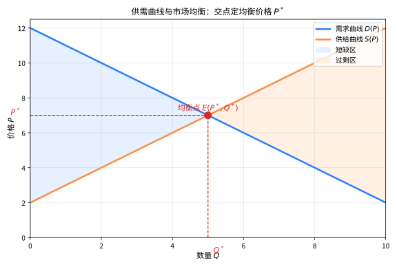

> **直观理解（现实类比）**：市场均衡就像菜市场里讨价还价的"握手价"——商家想卖高价（供给曲线上行），买家想买低价（需求曲线下行），价格太低时供不应求（蓝色短缺区），价格太高时卖不出去（橙色过剩区）。在唯一让双方都满意的交点 $E(P^*,Q^*)$ 上，买得动也卖得掉，市场自然出清。这正是"看不见的手"一次次自动调整价格、奔向均衡的直观画面。

> **🧠 思考历程："看不见的手"究竟是怎么被写成方程的？**
>
> 市场里千千万万独立的买家与卖家，凭什么会自发地"各就各位"、价格又凭什么自动对齐？这个问题始于一句著名的经济隐喻，最终被数学家写成了一条严格的定理。它想回答的是：均衡真的"存在"吗，凭什么保证？
>
> - **从隐喻到方程**。1776年，亚当·斯密用"看不见的手"形容价格的自我调节。一个多世纪后，法国经济学家瓦尔拉斯（1874）才尝试把它写成方程组：所有市场同时出清、供需两两相等，这就是"一般均衡"。
> - **不动点让均衡成为定理**。真正把空谈变成证明的是阿罗与德布劳（1954）：他们借助库库塔尼不动点定理，在偏好连续、生产集凸的假设下证明——必然存在一组价格，使所有市场同时实现供求平衡，即竞争均衡的存在性定理。
> - **均衡还要接受福利的检验**。同一框架还证明了福利经济学定理：竞争均衡在帕累托意义上是有效率的。这让"看不见的手"第一次有了可以被验证和讨论的数学内容。
> - **心路**：一个朴素的经济直觉，要变成严格定理，往往需要几代人的接力，以及一套全新"不动点"语言。

#### 课堂问答

**老师**：一般均衡和局部均衡最本质的区别是什么？为什么不能一个市场一个市场地单独分析？

**学生**：局部均衡只让一个市场的价格变动、其他价格固定，而一般均衡要求所有市场同时出清。形式上均衡是一组价格 $\mathbf{p}^*$ 和配置，满足三件事：每个消费者在预算约束下最大化效用、每个生产者最大化利润、以及市场出清 $\sum_i \mathbf{x}_i^* = \sum_i \mathbf{e}_i + \sum_j \mathbf{y}_j^*$。之所以不能拆开，是因为预算约束里同时出现所有价格：$\mathbf{p}\cdot \mathbf{x}_i \le \mathbf{p}\cdot\mathbf{e}_i + \sum_j \theta_{ij}\,\mathbf{p}\cdot\mathbf{y}_j$，某个价格变了会通过预算和利润同时改变所有市场的需求与供给。

**老师（追问）**：既然有 $L$ 个市场要出清，是不是需要解 $L$ 个独立方程？Walras 律在这里起什么作用？

**学生**：Walras 律 $p\cdot Z(p)=0$ 说明各市场的超额需求按价格加权求和恒为零，所以 $L$ 个出清方程里只有 $L-1$ 个独立，第 $L$ 个自动成立——这正对应价格只有相对意义、可以归一化到单纯形 $\Delta=\{p\ge 0:\sum_\ell p_\ell=1\}$ 上。于是"存在性"就变成在这 $L-1$ 维自由度的价格集合上找不动点。

**老师（拓展）**：如果某个价格为零呢？这算不算打破了"所有市场都出清"？

**学生**：不算。Walras 律给出 $p^*\cdot Z(p^*)=0$，配合 $Z(p^*)\le 0$ 可推出：只要 $p^*_\ell>0$ 就有 $Z_\ell(p^*)=0$（该市场严格出清），而价格为 0 的商品允许有超额供给 $Z_\ell<0$。这是自由处置的体现——免费的东西多出来没关系。常见误区是以为均衡要求每个 $Z_\ell$ 都等于零，其实零价格商品的过剩是允许的。

### 1.2 Arrow-Debreu模型

**Arrow-Debreu模型**（Arrow-Debreu Model）是一般均衡理论的严格数学框架，由Kenneth Arrow和Gerard Debreu在1950年代建立。该模型在以下假设下证明了一般均衡的存在性：

- 消费者偏好满足完备性、传递性、连续性、严格单调性和严格凸性
- 生产集是凸的、闭的，且包含原点（可以停产）
- 所有消费者拥有初始禀赋

> **💡 直观理解（类比）**：Arrow-Debreu模型就像把"看不见的手"放进一间"无菌实验室"——给每个买家（口味挑剔但讲道理）、每个厂家（生产手段规范）都立好严格的规距，排除所有理想化之外的情形，再问：这样干净的房间里，价格能不能自动落到让所有市场同时出清的点？答案是能——它把"市场自会均衡"这句哲学口号，升级成了有前提、能证明的数学定理。

#### 课堂问答

**老师**：Arrow-Debreu 模型凭什么是"严格框架"？它到底加了哪些假设，缺一不可吗？

**学生**：它把"看不见的手"放进可证明的假设体系：消费者偏好完备、传递、连续、严格单调且严格凸；生产集 $Y_j$ 凸、闭且 $0\in Y_j$（可停产）；每个消费者有初始禀赋。关键是凸性——偏好严格凸保证需求是单值的连续函数，生产集凸保证利润最大化集不碎裂，这两条正是后面用不动点定理与分离定理的前提。单调性则带来局部非饱和，才能推出 Walras 律。

**老师（追问）**：如果去掉"严格凸"会怎样？存在性还成立吗？

**学生**：存在性往往还能保住，但需求可能变成集值的（对应无差异曲线有直线段），此时要用 Kakutani 不动点定理处理对应而非函数；代价是均衡可能不唯一，价格与配置的对应会退化成集合。所以严格凸主要是为了唯一性与分析便利，而非存在性的硬门槛。

**老师（拓展）**：这套假设在现实中哪条最容易被违反？

**学生**：凸性最脆弱——规模报酬递增的生产技术会让 $Y_j$ 非凸，此时竞争均衡可能不存在，需要边际成本定价加补贴或引入非凸性理论。另一个是完备性，现实中常有"无法比较"的情形，需要放宽为不完全偏好。这也解释了为什么后续会出现 Arrow-Debreu 之外的一般均衡拓展。

### 1.3 偏好与效用

**偏好**（Preference）是消费者对不同商品组合的排序。在数学上，偏好关系 $\succsim$ 满足：

- **完备性**：对任意 $x, y$，$x \succsim y$ 或 $y \succsim x$
- **传递性**：若 $x \succsim y$ 且 $y \succsim z$，则 $x \succsim z$
- **连续性**：集合 $\{x \mid x \succsim y\}$ 和 $\{x \mid y \succsim x\}$ 是闭集

> **💡 直观理解（类比）**：偏好就是一张"个人的口味排行榜"——完备性保证任何两样东西都能分出高下、绝不犹豫（没有"无法比较"的尴尬），传递性保证不会像"石头剪刀布"那样循环打架（若A胜过B、B胜过C，就绝不许冒出来C又胜过A），连续性则保证口味"平滑"：东西只变一点点，你的排序不会突然大翻盘。这三条是"口味能被写成一张连续打分表（效用函数）"的前提。

**效用函数**（Utility Function）$u: X \to \mathbb{R}$ 是偏好关系的数值表示：$x \succsim y \iff u(x) \geq u(y)$。

> **💡 直观理解（类比）**：效用函数就是把"口味排行榜"翻译成"一组能加能比的分数"——你心里对每个商品组合有一个隐形的"喜爱分"，分数高就表示更喜欢。它像给菜打分：虽然"好吃"是主观的，但只要这分组分数和你的真实排序完全一致，就能用它来做数学上的优化运算，把"怎么选最好"变成"怎么让分数最大"。

> **🧠 思考历程："口味"凭什么是可以分析的？**
>
> 要回答"消费者在收入约束下会买什么"，前提是先把"谁更喜欢什么"翻译成可运算的对象。它想回答的是：主观的喜好，凭什么能写成一张能求最大值的数学表。
>
> - **从"效用不可测"到"只需保序"**。效用观念可追溯到边沁的功利主义哲学，但早期以为幸福是"可加减的度量"。19世纪末，帕累托警告"跨人、可分的幸福"并不存在；到普朗特（哥西·普朗特）、费雪，再到**希克斯与艾伦**的严密化，经济学家达成共识：真正需要的不是"绝对值"，而是一张**次序一致**的记分表，正单调变换都等价。
> - **表示定理把哲学变成数学**。**德布劳（Debreu, 1954）表示定理**证明：只要偏好完备、传递、连续，就必然存在连续效用函数 $u(x)$。这把"主观口味"严格地抱进优化问题的怀里。
> - **心路**：偏好不是被"发明"的，而是被**证明可表示**的——一旦可行，"最大化效用"就从一个文学比喻变成了严谨的数学程序。

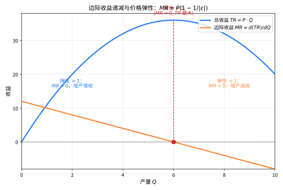

> **直观理解（现实类比）**：边际收益递减就像"吃自助餐"——头几口蛋糕最满足（边际收益高），越吃越撑（边际收益下滑），最后再多端一碟反而倒胃口（$MR<0$）。企业决定增产多少，看的不是"总收益"，而是"再多产一单位能多赚多少"（边际收益 $MR$）。当 $MR>0$ 时增产还能增收，一旦 $MR<0$ 就适得其反；而需求的价格弹性 $|\epsilon|$ 正是量化"顾客对降价有多敏感"的尺子。

#### 课堂问答

**老师**：偏好只要满足完备、传递、连续，就一定能写出效用函数吗？这三条各自管什么？

**学生**：由 Debreu 表示定理，是的，存在连续效用函数 $u$ 使 $x\succsim y \iff u(x)\ge u(y)$。完备性保证任意两者可比、排序无空缺；传递性保证排序无环，才能把"序"压成实数的大小；连续性保证上、下等值集是闭集，才能让"略微变动不翻盘"，从而使 $u$ 连续。三条缺一，表示就可能失败。

**老师（追问）**：效用函数是唯一的吗？$u$ 换成 $2u+3$ 还是同一个偏好吗？

**学生**：不唯一。效用是序数的：任何严格单调递增变换 $v=\phi(u)$ 都表示同一偏好，因为只保序、不保差值。$2u+3$ 正是这类变换，所以等价。常见误区是把 $u(x)-u(y)$ 的大小当成"幸福差距"，那需要更进一步的结构（如 vNM 期望效用），一般效用函数并不提供可比较的基数信息。

**老师（拓展）**：那为什么经济学还能谈"边际效用递减"？

**学生**：因为在给定表示下可以选一个方便的函数并考察其曲率，例如 Cobb-Douglas $u=x^\alpha y^{1-\alpha}$ 的二阶导为负。但"递减"本身是所选表示的性质，不是偏好序的内禀性质——单调变换会改变凹凸性。真正与偏好序内禀相关的是凸偏好（无差异曲线凸向原点），它对应更一般的"边际替代率递减"，用 MRS 而非某个特定 $u$ 的二阶导来表述。

### 1.4 期望效用理论

**期望效用理论**（Expected Utility Theory）是不确定性下的决策理论。von Neumann-Morgenstern效用函数 $U$ 具有形式：

$$U(L) = \sum_{i=1}^n p_i u(x_i)$$

其中 $L = (x_1, p_1; \ldots; x_n, p_n)$ 是一个彩票，$u$ 是von Neumann-Morgenstern效用函数。

> **💡 直观理解（类比）**：期望效用就像"买彩票时给每个可能结果先折算成'开心分'，再按中奖概率求加权平均"——抛一枚硬币，赢给100元、输给0元，不该直接算"平均50元"，而是先问"这100元让我多开心、0元让我多失落"，把货币换成"幸福感分"再求平均。它解释了为什么面对公平赌局，很多人仍拒绝（因为幸福的边际增加比痛苦减少慢，即风险厌恶），把"不确定下的选择"变成了一道可算的期望题。

> **🧠 思考历程：赌一把到底"值不值"，凭什么用期望？**
>
> 当结果不再是确定的一笔钱、而是一堆带概率的选项时，"选哪个更优"就失去了直白的答案。它想回答的是：不确定选择能不能也写成"打分再取平均"的数学。
>
> - **从圣彼得堡悖论说起**。18世纪丹尼尔·伯努利指出：只按钱数求期望，会让"赌注无穷大但仍没人愿出高价"（圣彼得堡悖论）——问题出在钱数，而不是概率。他主张该用"钱的效用"而非"钱本身"来算期望。
> - **先验公理化（von Neumann–Morgenstern, 1944）**。直到20世纪40年代，数学家冯·诺依曼与经济学家莫根施特恩在《博弈论与经济行为》里把"风险下的理性选择"公理化，证明：只要决策者满足（可比的彩票偏好、独立性、连续性）几条公理，就必然存在一个效用函数 $u$，使选择等价于最大化 $\sum_i p_i u(x_i)$。
> - **心路**：期望效用不是"拍脑袋的平均"，而是由几条"理性"公理反推出的必然结论——这也是后来被实验反复挑战（阿莱悖论、前景理论）的起点。

#### 课堂问答

**老师**：期望效用的核心等式是什么？它和"直接对货币求期望"差在哪里？

**学生**：核心是 $U(L)=\sum_{i=1}^n p_i\,u(x_i)$，即先对每个结果取效用 $u(x_i)$，再按概率加权，而不是对货币直接加权。差别在于 $u$ 一般非线性：若 $u$ 凹（$u''<0$），则由 Jensen 不等式 $U(L)<u(\mathbb{E}[x])$，即不确定彩票的效用低于其期望值的确定效用——这正是风险厌恶。

**老师（追问）**：为什么必须满足独立性公理才能写成这个线性形式？

**学生**：独立性公理说：若 $L_1\succsim L_2$，则对任意 $L_3$ 和 $\alpha\in(0,1)$ 有 $\alpha L_1+(1-\alpha)L_3\succsim \alpha L_2+(1-\alpha)L_3$。这条要求在混合中"第三者不干扰两者比较"，它恰好对应 $U$ 关于概率线性，从而由 vNM 定理推出唯一的（至正仿射变换）效用表示 $U=\sum_i p_i u(x_i)$。没有独立性，线性结构就塌了，也就没有期望效用。

**老师（拓展）**：现实中独立性常被违反，能举个反例和它的含义吗？

**学生**：阿莱悖论就是反例：多数人同时选择"确定得到 100 万"胜过"高概率得 500 万"，但在加入共同的高概率"一无所获"后果后偏好反转，违反了独立性。这说明真实决策不是 vNM 线性的，才有了卡尼曼与特沃斯基的前景理论——用损失厌恶和概率权重 $\pi(p)$ 替代线性概率，解释圣彼得堡悖论里"期望无穷却无人愿高价"的现象。

### 1.5 博弈论在经济中的应用

**博弈论**（Game Theory）研究多个决策主体之间的策略互动。在经济中的应用包括：

- **寡头竞争**：Cournot竞争、Bertrand竞争
- **拍卖设计**：第一价格拍卖、第二价格拍卖（Vickrey拍卖）
- **讨价还价**：Rubinstein交替出价模型
- **信号博弈**：劳动力市场的Spence信号模型

> **💡 直观理解（类比）**：博弈论就像"下棋时想对手会怎么走"的学问——我做决定时，必须先预判对方的反应，而对方又在预判我的预判，无穷套娃。它把"多个聪明的头脑互相盯着对方出牌"（寡头定价、拍卖喊价、讨价还价）抽象成严格模型，回答"在互相作用的结局里，谁会怎样行动、安稳点在哪"。

> **🧠 思考历程：当"你的最优"要看"别人的最优"时，还怎么算？**
>
> 传统经济学假设每个人只需对着"大自然"（给定的价格）做决策；一旦换成一堆聪明人彼此盘算对方，决策就变成相互咬合的问题。它想回答的是：互相推理的结局，怎样才能定义清楚。
>
> - **零和起步，非零和翻身**。1928年冯·诺依曼证明了二人零和博弈的极小极大定理，但只覆盖"我赢多少你输多少"的对抗；1944年他又与莫根施特恩合著《博弈论与经济行为》，把这套语言系统化。
> - **纳什把"共同理性"落到固定点**。**纳什（1950）**把"稳定结局"定义为：谁单方面改都不占便宜（纳什均衡），并证明它在有限博弈中总存在——这是一般不动点定理在"多人互相最优"上的化身。从此"懂博弈的人会怎么走"有了普遍的落点。
> - **从理论渗透进经济**。此后，拍卖、讨价还价（鲁宾斯坦）、信号（斯宾塞）等领域相继开花，博弈论成为寡头定价、市场设计乃至宏观政策博弈的通用语言。
> - **心路**：博弈论的灵魂不是"谁输谁赢"，而是"互相最优的结局能被精确定义并证明存在"。

#### 课堂问答

**老师**：博弈论里"解"是怎么定义的？纳什均衡的精确条件是什么？

**学生**：纳什均衡是一组策略 $\sigma^*$，使每个参与者的策略都是对他人策略的最优反应：$u_i(\sigma_i^*,\sigma_{-i}^*)\ge u_i(\sigma_i,\sigma_{-i}^*)$ 对所有 $\sigma_i$ 成立。核心是"谁单方面改都不占便宜"。有限博弈中一定存在（允许混合策略），这是 Kakutani 不动点定理的应用。

**老师（追问）**：Cournot 和 Bertrand 都描述寡头，为什么结论天差地别？

**学生**：区别在策略变量。Cournot 竞争产量：企业选 $q_i$，均衡下价格高于边际成本、利润为正。Bertrand 竞争价格：企业选 $p_i$，若产品同质、成本相同，唯一均衡是 $p=c$、利润为零——因为只要 $p_i>c$，对手略微降价就抢走全部市场。这是"策略变量一变、结论反转"的经典范例。

**老师（拓展）**：Vickrey 第二价格拍卖为什么"诚实出价"是弱占优策略？

**学生**：在第二价格拍卖中赢家只付次高报价，所以你报自己的真实估值 $v_i$ 永远不吃亏：报高可能以超过 $v_i$ 的价格赢得、报表可能错失有利可图的机会，两种情况都劣于报 $v_i$。这是激励相容的干净例子，也是机制设计里"让自利行为导向社会目标"的原型——显示原理正是把一般机制归约到这类直接、诚实的机制。

### 1.6 社会福利函数

**社会福利函数**（Social Welfare Function）$W: \mathbb{R}^I \to \mathbb{R}$ 将个人效用映射为社会福利水平。常见形式包括：

- **功利主义**：$W(\mathbf{u}) = \sum_{i=1}^I u_i$
- **罗尔斯主义**：$W(\mathbf{u}) = \min_i u_i$
- **纳什社会福利函数**：$W(\mathbf{u}) = \prod_{i=1}^I u_i$

> **💡 直观理解（类比）**：社会福利函数就是把"千万人的幸福"压缩成一个数字的"总筛子"——功利主义只看总量、像算全班总分（谁考多少不加区分）；罗尔斯主义只盯最差的、像"只看垫底那位过得好不好"；纳什函数则看重均衡、谁都别太惨。不同筛子体现不同的公平观，是"社会该怎样才算好"的数学化表达。

> **🧠 思考历程："全社会的好"能不能压成一个数？**
>
> 每个人有自己的幸福，可"整个社会更好"却需要摆平人与人之间的取舍。它想回答的是：把千万种境况折成一个"社会总目标"，数学上是否可行、又该怎么折。
>
> - **功利主义的两百年**。从边沁"最大多数人的最大幸福"到马歇尔，功利主义自然给出"总效用最大"这一最朴素的总筛子。
> - **阿罗的一盆冷水（1951）**。可当肯尼斯·阿罗追问"能不能找出一个'完美'的集体排序"时，他证明了**不可能定理**：在至少三个候选时，没有任何社会福利函数能在同时满足帕累托、无关备选独立、非独裁这几条自然要求——想用一个数"公正地"总装所有人的偏好，数学本身就是障碍。
> - **替代方案百花齐放**。既然"通用公平"不现实，人们转而列出各带立场的具体函数：罗尔斯（1971）的"最大最小原则"同情最弱者，纳什乘积兼顾均衡与平等——每一种都是一张被显式承认含价值判断的"总筛子"，把"该怎么看公平"摊在桌面上讨论。
> - **心路**：社会福利函数的要义不是"找唯一正确答案"，而是坦承任何总装都带一个伦理立场，并把这种立场用公式明白写出来。

#### 课堂问答

**老师**：三种常见社会福利函数各自的伦理立场是什么？

**学生**：$W=\sum_i u_i$（功利主义）只看总量，隐含效用可跨人比较且边际效用递减下倾向平均，但对极端不平等无感；$W=\min_i u_i$（罗尔斯主义）只优化最差者，对应"最大最小原则"，极端重视弱者；$W=\prod_i u_i$（纳什）取对数后是 $\sum_i \ln u_i$，对"某人趋于 0"给予极大惩罚，兼顾效率与平等。

**老师（追问）**：纳什社会福利函数为什么和"比例公平"扯上关系？

**学生**：最大化 $\sum_i \ln u_i$ 得到的配置满足比例公平：任何一个人的效用相对提升都需以他人损失为代价，其最优解还等价于 Nash 讨价还价解。它用对数把"效用趋于零"的惩罚拉到无穷，因此自然避免了有人被压到接近零，这正是它比纯功利更关心公平的原因。

**老师（拓展）**：既然有这么多函数可选，为什么 Arrow 要说"不存在完美的"？

**学生**：因为 Arrow 要求的是从个人偏好序构造一个社会偏好序的聚合规则 $F$，并同时满足帕累托、无关备选独立性、非独裁、全域性。他的不可能定理证明这四条在小情形下就冲突。而这三种福利函数都是"给定基数效用直接做加减"的函数，属于另一类对象——它们绕开了 IIA，却以假定效用可比较、可度量为代价。取舍在于：要序数的聚合就撞上不可能定理，要基数聚合就得接受跨人比较的强假设。

### 1.7 匹配理论

**匹配理论**（Matching Theory）研究如何将不同群体的成员配对。核心概念是**稳定匹配**（Stable Matching）：不存在一对男女，他们彼此更喜欢对方而非当前配偶。

> **💡 直观理解（类比）**：匹配理论就是研究"把谁和谁配到一起最不容易散伙"——相亲配对、学生选校、器官捐献分配的本质都一样：不仅要试着配好，还要保证"没有一对人觉得对方比现任更好而想私奔"。若存在这样的"私奔对"，配对就不稳定，迟早被拆散。稳定匹配就是那个"无人横刀夺爱"的牢靠结果。

> **🧠 思考历程：怎么保证"谁都撬不动的配对"一定存在？**
>
> 求学、择偶、分配——现实中到处是把两组人配对的难题，而"配好"的标准却在很长一段时间没有数学定义。它想回答的是："稳定"该怎样定义，且是否总能配到？
>
> - **从大学录取谈起**。1962年，数学家戴维·盖尔与经济学家劳埃德·沙普利用一篇短文提出了"稳定匹配"与**延迟接受算法**：男生（或学生）按心仪顺序求婚、接收方向的那位"比较后再留更好的"，证明这一流程必然在有限步内收敛到一个谁都拆不动的稳定匹配。题目不大，却是匹配市场设计的基石。
> - **从纸面走进公共生活**。1984年，美国住院医师匹配（NRMP）采用该算法的变体，后来又被用于纽约与波士顿的学校选择、肾脏交换网络。2012年，沙普利与罗斯为此获诺贝尔经济学奖，机制设计真正落地为"造市场的工程"。
> - **心路**：一个"怎么配对"的朴素问题，被翻译成"稳定匹配 + 可构造算法"后，直接改变了数百万人的真实去向。

#### 课堂问答

**老师**：稳定匹配的"稳定"究竟排除了什么？形式化定义是什么？

**学生**：稳定排除了阻塞对：不存在一对 $(m,w)$ 使 $w\succ_m \mu(m)$ 且 $m\succ_w \mu(w)$，即两人都更偏好彼此胜过各自现状（现状可为单身）。直觉是"没人想拆伙私奔"。注意对比项是当前配偶或单身，只要有一方不更偏好对方，就不构成阻塞。

**老师（追问）**：Gale-Shapley 算法为什么一定在有限步终止，且结果稳定？

**学生**：每个男性最多向 $n$ 个女性求婚，总求婚数上限 $n^2$，故有限步终止。稳定性用反证：若输出存在阻塞对 $(m,w)$，则 $m$ 在求婚序中必先于 $\mu(m)$ 向 $w$ 求过婚；无论当时 $w$ 接受还是拒绝，最终都有 $\mu(w)\succsim_w m$，与阻塞要求 $m\succ_w\mu(w)$ 矛盾。所以无阻塞对。

**老师（拓展）**：为什么说男性提议版本对男性最优、对女性最差？

**学生**：男性按偏好从高到低求婚，一旦被 $w$ 拒，说明在所有稳定匹配中 $w$ 都不会要他，所以他得到的必是他能达到的最好结果；对称地，女性每次只留当前更优者，最终得到的是她所有稳定匹配中最差的一个。这体现算法的策略性：谁主动谁占优。反直觉的常见误区是以为稳定匹配唯一——其实两端（男优女劣与女优男劣）可能不同。

### 1.8 机制设计

**机制设计**（Mechanism Design）是博弈论的反向问题——设计博弈规则使得参与者的自利行为导致社会期望的结果。核心概念：

- **激励相容**（Incentive Compatibility）：参与者如实报告信息是最优策略
- **显示原理**（Revelation Principle）：任何机制都可以被一个直接显示机制替代
- **Myerson-Satterthwaite定理**：有效交易不可能在预算平衡下实现

> **💡 直观理解（类比）**：机制设计是"游戏规则的设计师"——普通博弈论问"给定规则，大家会怎么玩"，机制设计反过来问"我想让大家自愿做出某结果，规则该怎么定才能让每个人的自利正好导向它"。它像设计一份"诚实才有好处"的合同：让说真话是参与者的最优选择（激励相容），就像拍卖时出价高者得且提示别乱喊，把人性弱点算进规则里。

> **🧠 思考历程：规则能不能被"反过来设计"？**
>
> 多数问题给定规则问"会有什么结局"；机制设计却要从"想要的结局"反推"该设什么规则"。它想回答的是：当参与者握有私密信息又只顾自己时，社会目标还能否靠巧妙规则实现。
>
> - **逆向问题的雏形**。1960年代，经济学家赫维奇（Leonid Hurwicz）最早提出激励"不相容"与"可实施"这些概念，指出计划经济最需要但没有机制能既分散决策又如实上报信息的困难。
> - **显示原理与不可能性**。1970-80年代，迈尔森（Roger Myerson）把机制设计系统化为"激励相容 + 显示原理"的可操作形式，并与马斯金（Eric Maskin）一起建立实施理论。他们的"不可行性"结论（如迈尔森–萨特思韦特定理）让这门学科既有建设性、也清醒地划出边界。
> - **2007年诺贝尔奖**。赫维奇、马斯金、迈尔森因机制设计理论共同获奖，标志这一"逆向工程经济学"被正式加冕——拍卖设计、频谱拍卖、器官调配都离不开它。
> - **心路**：机制设计的魅力在于"给自利上发条"——把每个人只为自己，却设计得让他们合力走向社会想要的点。

#### 课堂问答

**老师**：激励相容的精确含义是什么？为什么它等价于"如实报告是均衡"？

**学生**：直接机制中，激励相容指每个参与者按真实类型报告是贝叶斯纳什均衡下的最优策略，即 $\mathbb{E}_{t_{-i}}[u_i(t_i,t_i)]\ge \mathbb{E}_{t_{-i}}[u_i(\hat t_i,t_i)]$ 对所有 $t_i,\hat t_i$ 成立。它保证自利者不会靠谎报获益，于是分散的私人信息能被"说真话"这一策略汇集成社会可用的决策。

**老师（追问）**：显示原理凭什么说"任何机制都能换成直接机制"？

**学生**：因为可以把原机制的均衡策略复合进一个新的直接机制：参与者先报类型，机制内部按原均衡策略算出他们实际会采取的行动。若原机制下谎报类型有利，就会破坏原均衡，所以在新机制里如实报告继承原均衡的最优性——任何均衡结果都能被某个激励相容的直接机制复现。这大幅简化了最优机制设计：只需在激励相容与参与约束下优化目标。

**老师（拓展）**：既然显示原理这么强，Myerson-Satterthwaite 为什么还说"有效交易不可能"？

**学生**：在双边私下估值、想要事后有效（当且仅当买方估值高于卖方成本时成交）、预算平衡（不补贴）、自愿参与三者同时满足时，Myerson-Satterthwaite 定理证明不存在这样的机制——总有一方要牺牲。不能把个体理性加预算平衡加有效三者兼得，说明机制设计有硬边界：显示原理不是万能钥匙，它把问题化到最简形式后，暴露的是不可能性本身。

### 1.9 经济增长模型

**Solow增长模型**：$Y = F(K, AL)$，其中 $K$ 为资本，$L$ 为劳动，$A$ 为技术进步。

> **💡 直观理解（类比）**：Solow模型就像国家这台"大机器"的总产量处方——产出由资本（机器厂房）、劳动（人手）和技术（效率加成）一起决定。它最出名的洞见是：单纯多存钱换机器不会一直推高人均产出，终会撞上一个"稳态"；长期能让人均生活水平越走越高的，只有技术进步 $A$——就像比赛里只有"更好用的工具"才能让货越运越快，光加班加点是有限的。

**Ramsey-Cass-Koopmans模型**：在无限期界下优化消费路径，使用动态优化方法。

> **💡 直观理解（类比）**：Ramsey-Cass-Koopmans模型就像给一个"会过日子的家庭"规划一辈子怎么花——不是盯着眼前一年，而是把从现在到永远的全部日子做一道最优规划：今天少吃一点攒钱（储蓄）、明天多许多人（消费），在"少吃今天的苦"和"多留明天的甜"之间找那条最优的消费轨迹。它用动态优化方法问：一路上每一刻该存多少、花多少，才能让一生幸福总和最大。

> **🧠 思考历程："什么叫富裕"能不能用一条方程说清？**
>
> 一个国家为什么会长期变富、什么时候会停下来，是宏观经济学最古老也最大的问题。它想回答的是：人均生活水平长期由什么决定，又为何会撞上"天花板"。
>
> - **索罗的"记账式"增长（1956）**。经济学家罗伯特·索罗抓住最简单的机制：存钱→买机器→用更多机器产出。他证明在规模报酬不变、要素递减的设定下，资本积累终会在"稳态"停滞，长期增长只能来自技术进步 $A$——这个看似朴素的结论第一次把"增长有极限、技术才是出路"写成了可检验的模型（1987年获诺贝尔奖）。
> - **从"记账"到"最优化"**。索罗把储蓄当外生比例，过于武断。**拉姆齐（1928）**主张储蓄应来自家庭对现在与未来幸福的权衡，**卡斯（1965）与库普曼斯**再把它推广成市场竞争下的动态最优——这就是 Ramsey-Cass-Koopmans 模型，把"社会如何理性地跨期分配蛋糕"纳入动态规划。
> - **心路**：增长理论不是"算产量"，而是回答"财富从哪儿来、为什么不会无限膨胀"，把一座国家机器的成长压缩成精炼的动态方程。

---

#### 课堂问答

**老师**：Solow 模型的核心方程是什么？稳态意味着什么？

**学生**：用人均形式 $y=f(k)$，资本积累方程为 $\dot k = s f(k) - (n+g+\delta)k$，其中 $s$ 为储蓄率、$n$ 劳动增长、$g$ 技术进步、$\delta$ 折旧。稳态 $\dot k=0$ 对应 $s f(k^*)=(n+g+\delta)k^*$，即新增投资恰好补偿有效劳动的稀释与折旧。此时人均产出 $y^*=f(k^*)$ 不再增长，水平停在稳态，只有技术进步 $g$ 能让稳态的人均产出沿平衡增长路径持续上升。

**老师（追问）**：为什么储蓄率提高只能在水平上有效、无法带来长期增长？

**学生**：因为 $f$ 满足边际报酬递减，$s f(k)$ 是凹函数、$(n+g+\delta)k$ 是线性，稳态是它们的交点，唯一且稳定。提高 $s$ 只把 $k^*$ 推高，短期有增长，但资本边际产出降到与新投资持平后就停——这是水平效应而非增长效应。长期人均增长率的唯一来源是外生的 $g$。

**老师（拓展）**：Ramsey-Cass-Koopmans 相比 Solow 改进了什么？

**学生**：Solow 把储蓄率 $s$ 当外生常数，太武断。RCK 让储蓄由家庭跨期最优化内生决定：家庭在 $\int_0^\infty e^{-\rho t}u(c(t))\,dt$ 上最大化，约束是资本积累 $\dot k=f(k)-c-(n+g+\delta)k$。跨期欧拉方程在稳态给出 $\dot c=0$，即修正黄金律 $f'(k^*)=\rho+\theta g$（$\theta$ 为相对风险厌恶系数、$\rho$ 为贴现率）。它把"该存多少"变成由偏好参数推出的结果，而不是一个外生比例。

## 二、定理与证明

### 定理1：Arrow-Debreu一般均衡的存在性

**定理（Arrow-Debreu一般均衡存在性定理）** 在以下假设下，经济中存在至少一个竞争均衡：
1. 每个消费者的偏好是完备的、可传递的、连续的、严格单调的、严格凸的
2. 每个消费者的初始禀赋是严格正的
3. 每个生产者的生产集是凸的、闭的，且 $0 \in Y_j$
4. 总生产集 $Y = \sum_{j=1}^J Y_j$ 是凸的，且 $Y \cap \mathbb{R}^L_+ = \{0\}$（不可免费生产）

**证明**（使用角谷不动点定理和超需求函数方法）：

**第一步：规范化价格空间。**

由于均衡价格只依赖于相对价格，我们可以将价格限制在单纯形上：

$$\Delta = \left\{p \in \mathbb{R}^L_+ \;\Big|\; \sum_{\ell=1}^L p_\ell = 1\right\}$$

**第二步：定义超额需求函数。**

对每个消费者 $i$，给定价格 $p$，求解效用最大化问题：

$$\max_{x_i \in \mathbb{R}^L_+} u_i(x_i) \quad \text{s.t.} \quad p \cdot x_i \leq p \cdot e_i + \sum_{j=1}^J \theta_{ij} \pi_j(p)$$

其中 $\pi_j(p) = \max_{y_j \in Y_j} p \cdot y_j$ 是生产者 $j$ 的最大利润。

记解为 $x_i(p)$。定义总需求为 $X(p) = \sum_{i=1}^I x_i(p)$，总供给为 $E = \sum_{i=1}^I e_i$，总生产为 $Y(p) = \sum_{j=1}^J y_j(p)$。

**超额需求函数**为：

$$Z(p) = X(p) - E - Y(p)$$

> **💡 直观理解（类比）**：超额需求函数就是"全市场想买的减去能供的差额账本"——$Z(p)$ 为正是"有人想买却买不够"（供不应求、物以稀为贵），为负是"货多到没人要"（供过于求、积压甩卖）。价格就像遥控器：哪样东西超额需求大，价格就该调高；超额供给多，就该调低。不动点证明的核心，就是找到让这本差额账整体归零的那组价格。

**第三步：超额需求函数的性质。**

在给定假设下，超额需求函数 $Z: \Delta \to \mathbb{R}^L$ 满足以下性质：

1. **连续性**：$Z(p)$ 在 $\Delta$ 上连续（由偏好连续性和预算集连续依赖价格保证）
2. **齐次性**：$Z(\lambda p) = Z(p)$ 对所有 $\lambda > 0$（由零次齐次性保证）
3. **Walras律**：$p \cdot Z(p) = 0$ 对所有 $p \in \Delta$（由预算约束加总得出）
4. **下有界性**：存在 $M > 0$ 使得 $Z_\ell(p) > -M$ 对所有 $\ell$ 和所有 $p$（由禀赋有限性保证）

**第四步：构造辅助函数。**

定义修正的超额需求函数 $\hat{Z}: \Delta \to \mathbb{R}^L$：

$$\hat{Z}_\ell(p) = \frac{Z_\ell(p)}{1 + \sum_{k=1}^L |Z_k(p)|}$$

可以验证 $\hat{Z}$ 满足：
- $\hat{Z}$ 在 $\Delta$ 上连续
- $p \cdot \hat{Z}(p) = 0$（由Walras律）
- $|\hat{Z}_\ell(p)| \leq 1$ 对所有 $\ell$

**第五步：构造价格调整函数。**

定义映射 $g: \Delta \to \Delta$：

$$g_\ell(p) = \frac{p_\ell + \max(0, \hat{Z}_\ell(p))}{1 + \sum_{k=1}^L \max(0, \hat{Z}_k(p))}$$

**直观解释**：如果商品 $\ell$ 存在超额需求（$Z_\ell(p) > 0$），则提高其价格；如果存在超额供给，则降低其价格（或至少不提高）。

**第六步：验证 $g$ 满足角谷不动点定理条件。**

1. $\Delta$ 是非空、凸、紧集
2. $g: \Delta \to \Delta$ 是连续函数（由 $\hat{Z}$ 的连续性保证）

因此，由Brouwer不动点定理（角谷不动点定理的连续函数版本），存在 $p^* \in \Delta$ 使得 $g(p^*) = p^*$。

**第七步：证明不动点即为均衡价格。**

设 $p^*$ 是 $g$ 的不动点，则：

$$p^*_\ell = \frac{p^*_\ell + \max(0, \hat{Z}_\ell(p^*))}{1 + \sum_{k=1}^L \max(0, \hat{Z}_k(p^*))}$$

交叉相乘：

$$p^*_\ell \left[1 + \sum_{k=1}^L \max(0, \hat{Z}_k(p^*))\right] = p^*_\ell + \max(0, \hat{Z}_\ell(p^*))$$

化简得：

$$p^*_\ell \sum_{k=1}^L \max(0, \hat{Z}_k(p^*)) = \max(0, \hat{Z}_\ell(p^*))$$

两边乘以 $\hat{Z}_\ell(p^*)$ 并对 $\ell$ 求和：

$$\left(\sum_{k=1}^L \max(0, \hat{Z}_k(p^*))\right) \sum_{\ell=1}^L p^*_\ell \hat{Z}_\ell(p^*) = \sum_{\ell=1}^L \hat{Z}_\ell(p^*) \max(0, \hat{Z}_\ell(p^*))$$

由Walras律 $p^* \cdot \hat{Z}(p^*) = 0$，左边为0，因此：

$$\sum_{\ell=1}^L \hat{Z}_\ell(p^*) \max(0, \hat{Z}_\ell(p^*)) = 0$$

这意味着对每个 $\ell$，$\hat{Z}_\ell(p^*) \max(0, \hat{Z}_\ell(p^*)) = 0$，即 $\hat{Z}_\ell(p^*) \leq 0$ 对所有 $\ell$ 成立，且当 $p^*_\ell > 0$ 时 $\hat{Z}_\ell(p^*) = 0$。

因此，$Z(p^*) \leq 0$（所有商品没有超额需求），且当 $p^*_\ell > 0$ 时 $Z_\ell(p^*) = 0$（正价格的商品市场出清）。这正是竞争均衡的定义。

**结论**：在Arrow-Debreu模型的假设下，竞争均衡存在。$\square$
> **直观理解（现实类比）**：Arrow-Debreu一般均衡就像菜市场里"人人各取所需、价格自动出清"的奇迹——成千上万的买家卖家各怀心思，可只要价格愿意浮动，总能找到一组价格让所有东西既不缺货也不滞销。数学上这是"不动点"在搭桥：把价格映射的连续变换压缩到一个不动点，就是那组让市场供需相抵的均衡价格。

#### 课堂问答

**老师**：这个存在性证明的关键思路是什么？为什么用不动点？

**学生**：思路是构造一个价格调整映射 $g:\Delta\to\Delta$ 并找它的不动点。先在单纯形 $\Delta=\{p\ge0:\sum_\ell p_\ell=1\}$ 上定义超额需求 $Z(p)=X(p)-E-Y(p)$，验证它连续、零次齐次、满足 Walras 律 $p\cdot Z(p)=0$ 且下有界；再用 $\hat Z_\ell=Z_\ell/(1+\sum_k|Z_k|)$ 把值域压到 $[-1,1]$，保证映射良定义且有界。

**老师（追问）**：那个 $g$ 的构造到底在干什么？

**学生**：$g_\ell(p)=\frac{p_\ell+\max(0,\hat Z_\ell(p))}{1+\sum_k\max(0,\hat Z_k(p))}$ 就是"按超额需求方向抬价"：某商品 $Z_\ell>0$（供不应求）就加价，$Z_\ell<0$ 就不加。分母做归一化把结果拉回单纯形，保证 $g$ 是 $\Delta$ 到自身的连续映射。由 Brouwer 不动点定理（紧凸集上的连续自映射），存在 $p^*$ 使 $g(p^*)=p^*$。

**老师（拓展）**：不动点为什么就是均衡价格？关键一步在哪？

**学生**：把 $g(p^*)=p^*$ 交叉相乘化简得 $p^*_\ell\sum_k\max(0,\hat Z_k)=\max(0,\hat Z_\ell)$，两边乘 $\hat Z_\ell$ 并对 $\ell$ 求和，左边因 Walras 律 $p^*\cdot\hat Z(p^*)=0$ 归零，于是 $\sum_\ell \hat Z_\ell\max(0,\hat Z_\ell)=0$。每项非负，故每项为零，推出 $\hat Z_\ell\le0$，即 $Z(p^*)\le0$；且 $p^*_\ell>0$ 时 $Z_\ell(p^*)=0$。这正是竞争均衡。常见误区是以为要证 $Z(p^*)=0$，其实只剩零价格商品的过剩可取负。

### 定理2：Arrow不可能定理

**定理（Arrow不可能定理）** 当社会中有至少两个个体和至少三个备选方案时，不存在同时满足以下四个条件的社会福利函数 $F: \mathcal{R}^I \to \mathcal{R}$：
1. **帕累托最优**（Pareto Optimality）：如果所有个体都偏好 $x$ 胜过 $y$，则社会偏好也认为 $x$ 胜过 $y$
2. **无关方案独立性**（Independence of Irrelevant Alternatives）：社会对 $x$ 和 $y$ 的偏好只依赖于个体对 $x$ 和 $y$ 的偏好，与个体对其他方案的偏好无关
3. **非独裁性**（Non-Dictatorship）：不存在一个个体 $i$，使得社会偏好总是等于个体 $i$ 的偏好
4. **全域性**（Unrestricted Domain）：$F$ 定义在所有可能的偏好组合上

**证明**（公理化分析）：

**第一步：建立框架。**

设 $N = \{1, \ldots, I\}$ 为个体集合（$I \geq 2$），$X = \{x, y, z, \ldots\}$ 为备选方案集合（$|X| \geq 3$）。每个个体 $i$ 有一个偏好关系 $\succsim_i$ 是 $X$ 上的完备、传递的二元关系。社会福利函数 $F$ 将个体偏好组合 $(\succsim_1, \ldots, \succsim_I)$ 映射为社会偏好 $\succsim_S$。

**定义（决定性集合）** 称集合 $D \subseteq N$ 对 $(x, y)$ 是**决定性的**，如果当 $D$ 中所有个体偏好 $x$ 胜过 $y$，而 $D$ 外所有个体偏好 $y$ 胜过 $x$ 时，社会偏好为 $x$ 胜过 $y$。

> **💡 直观理解（类比）**：决定性集合就像投票中的"拥有一票定乾坤能力的小团体"——只要这一组人统统选$x$、其余人统统选$y$，社会结果就一定是$x$胜过$y$。它像"关键少数"：这撮人怎么站队，就直接锁定了全局结局，是Arrow证明里用来"走私独裁者"的关键工具。

**第二步：引理1——帕累托最优与全域性蕴含存在决定性集合。**

由帕累托最优条件，当所有个体偏好 $x$ 胜过 $y$ 时，社会偏好 $x$ 胜过 $y$。因此，全集 $N$ 对任意 $(x, y)$ 是决定性的。

**第三步：引理2——决定性集合的收缩。**

**声明**：如果 $D$ 是对 $(x, y)$ 的决定性集合且 $|D| \geq 2$，则存在 $D$ 的真子集 $D' \subset D$ 对某对方案是决定性的。

> **💡 直观理解（类比）**：这个引理说是"决定性权力可以越分越小"——只要某个决定性小团体内有至少两人，就能想个计策再切出一个更小的决定性子集。就像切蛋糕：只要刀够稳，总能从"说了算的一撮人"里再劈出一个"更核心的说了算小圈子"，一步步朝着"单个人说了算"逼近。

**证明**：将 $D$ 分为两个非空子集 $D_1$ 和 $D_2$（$D_1 \cup D_2 = D$，$D_1 \cap D_2 = \emptyset$）。考虑第三个方案 $z$（$z \neq x, y$）。构造如下偏好组合：

- 对 $i \in D_1$：$x \succ_i y \succ_i z$
- 对 $i \in D_2$：$z \succ_i x \succ_i y$
- 对 $i \notin D$：$y \succ_i z \succ_i x$

由于 $D$ 对 $(x, y)$ 是决定性的，社会偏好 $x$ 胜过 $y$。

现在考虑社会对 $x$ 和 $z$ 的偏好：
- 如果社会偏好 $z$ 胜过 $x$，则结合 $x \succ_S y$（由决定性）和 $z \succ_S x$ 可得 $z \succ_S y$（由传递性）。但此时 $D_2$ 中的个体偏好 $z$ 胜过 $y$，而其他个体偏好 $y$ 胜过 $z$，因此 $D_2$ 对 $(z, y)$ 是决定性的。
- 如果社会偏好 $x$ 胜过 $z$，则 $D_1$ 对 $(x, z)$ 是决定性的（因为 $D_1$ 中个体偏好 $x$ 胜过 $z$，而其他个体偏好 $z$ 胜过 $x$）。

无论哪种情况，$D_1$ 或 $D_2$ 对某对方案是决定性的。$\square$

**第四步：引理3——决定性集合的进一步性质。**

**声明**：如果 $D$ 对某对 $(x, y)$ 是决定性的，则 $D$ 对所有方案对都是决定性的。

> **💡 直观理解（类比）**：这个引理说是"一经证明有决定权，就对所有事都有决定权"——只要某小组能定$xy$之争，借传递性这把"梯子"一步步爬，也能定任意$a$和$b$之争。如同在部门"说一不二"的人，对任何议题其实都握有最终拍板权，决定性能力一经确立就"通吃全场"。

**证明**：设 $D$ 对 $(x, y)$ 是决定性的。考虑任意方案对 $(a, b)$。我们需要证明 $D$ 对 $(a, b)$ 也是决定性的。

分多种情况处理，利用无关方案独立性。这里只证明一种情况：$a = x$，$b$ 是不同于 $x, y$ 的方案。

构造偏好组合：
- 对 $i \in D$：$x \succ_i y \succ_i b$
- 对 $i \notin D$：$y \succ_i b \succ_i x$

由 $D$ 对 $(x, y)$ 的决定性，社会偏好 $x$ 胜过 $y$。由帕累托最优，社会偏好 $y$ 胜过 $b$（因为所有个体偏好 $y$ 胜过 $b$）。由传递性，社会偏好 $x$ 胜过 $b$。

在给定偏好组合中，$D$ 中个体偏好 $x$ 胜过 $b$，而 $D$ 外个体偏好 $b$ 胜过 $x$。由无关方案独立性，社会对 $x$ 和 $b$ 的偏好只依赖于个体对这两者的偏好。因此 $D$ 对 $(x, b)$ 是决定性的。

类似可证 $D$ 对其他方案对也是决定性的。$\square$

**第五步：导出矛盾。**

由引理1，全集 $N$ 是决定性的。反复应用引理2，我们可以不断缩小决定性集合，最终得到一个单个个体的决定性集合 $\{i_0\}$。由引理3，这个个体对所有方案对都是决定性的。

但这意味着个体 $i_0$ 是一个独裁者——社会偏好总是等于个体 $i_0$ 的偏好，违反了非独裁性条件。

因此，不存在同时满足所有四个条件的社会福利函数。$\square$

**结论**：Arrow不可能定理揭示了民主投票的内在局限性——不存在完美的集体决策规则。这个定理为社会选择理论奠定了基础，也影响了机制设计和公共经济学的发展。

> **直观理解（现实类比）**：Arrow不可能定理就像一场"投票的魔咒"——不管你怎么设计选举规则，只要候选人有3个以上，就不可能同时满足"帕累托、无关备选独立性、非独裁"这几条看似理所当然的公平要求。总有某个规则会让"票王"被一个诡异的小团体操纵，就像"孔多塞悖论"里A胜B、B胜C、C又胜A的死循环——完美的民主投票，数学上注定不存在。

#### 课堂问答

**老师**：Arrow 定理的证明骨架是什么？

**学生**：核心是"决定性集合"的收缩。先由帕累托加全域性知全集 $N$ 对任意 $(x,y)$ 是决定性的（引理1）；再证任何大小不小于 2 的决定性集合 $D$ 都能劈出一个真子集仍具决定性（引理2，借助第三个方案 $z$ 与传递性）；最后证决定性一旦对某对成立，就对所有方案对成立（引理3，用 IIA 与传递性）。反复收缩得单人决定集 $\{i_0\}$，此人即独裁者，矛盾。

**老师（追问）**：引理2 为什么要引入第三个方案 $z$？两个方案不够吗？

**学生**：不够。收缩需要在偏好中安插 $z$ 来制造"传递性的传递链"。把 $D$ 分成 $D_1,D_2$，令 $D_1$ 偏好 $x\succ y\succ z$、$D_2$ 偏好 $z\succ x\succ y$、其余人 $y\succ z\succ x$。由 $D$ 对 $(x,y)$ 决定性得社会 $x\succ_S y$；再看 $x$ 与 $z$ 的社会排序，无论哪种，都使 $D_1$ 或 $D_2$ 成为某对的决定集。没有第三个方案，就无法让链式传递"拐弯"，这正是定理要求方案数至少为 3 的原因。

**老师（拓展）**：IIA 为什么是争议最大的一条假设？

**学生**：IIA 要求社会对 $x,y$ 的排序只看个人对 $x,y$ 的排序，与个人对 $z$ 的态度无关。这条对形式化"不掺入无关干扰"很自然，却排除了基数信息的用处——比如 Borda 计分（用排名位置打分）就违反 IIA，但它常常更"合理"。争议正在这：要么保留 IIA 得到不可能性，要么放弃 IIA 用基数效用（社会选择与福利函数之争）。这是一个不可能三角式的取舍，而非简单的对错。

### 定理3：福利经济学第一基本定理

**定理（福利经济学第一基本定理）** 在完全竞争市场中，任何竞争均衡都是帕累托最优的（Pareto Optimal）。即，不存在一种重新配置方式使得至少一个人的境况变得更好而没有人变得更差。

> **💡 直观理解（类比）**：第一福利定理说"市场自发挑出的结果，已然是物理上无法再让任何人变好而不伤及他人的分配"——就像自助餐按各人口味抢完之后，你想再多拿一点，就一定会有别人少吃一口。它把"看不见的手"从口号变成定理：在完全竞争的完美条件下，人人自利的自由交易会自动落在"帕累托效率"上，不给任何人"空手占便宜"的空间。

**证明**：

**第一步：建立模型。**

考虑一个具有 $I$ 个消费者和 $J$ 个生产者的经济。设 $(p^*, (x_i^*)_{i=1}^I, (y_j^*)_{j=1}^J)$ 是一个竞争均衡，其中 $p^*$ 为均衡价格向量，$x_i^*$ 为消费者 $i$ 的最优消费束，$y_j^*$ 为生产者 $j$ 的最优生产计划。

**第二步：反证法假设。**

假设存在一个可行的配置 $(\tilde{x}_i, \tilde{y}_j)$ 帕累托优于均衡配置，即：
1. $\tilde{x}_i \succsim_i x_i^*$ 对所有 $i$，且至少存在一个 $i_0$ 使得 $\tilde{x}_{i_0} \succ_{i_0} x_{i_0}^*$
2. $\sum_{i=1}^I \tilde{x}_i = \sum_{i=1}^I e_i + \sum_{j=1}^J \tilde{y}_j$
3. $\tilde{y}_j \in Y_j$ 对所有 $j$

**第三步：利用效用最大化条件。**

由消费者 $i$ 在均衡中的效用最大化，如果 $\tilde{x}_i \succsim_i x_i^*$，则必须有 $p^* \cdot \tilde{x}_i \geq p^* \cdot x_i^*$。否则，如果 $p^* \cdot \tilde{x}_i < p^* \cdot x_i^*$，则消费者 $i$ 可以在预算约束内购买 $\tilde{x}_i$，这与 $x_i^*$ 是最优选择矛盾。

更严格地，由偏好的局部非饱和性（Local Non-Satiation），如果 $\tilde{x}_i \succsim_i x_i^*$，则 $p^* \cdot \tilde{x}_i \geq p^* \cdot x_i^*$。如果 $\tilde{x}_i \succ_i x_i^*$，则 $p^* \cdot \tilde{x}_i > p^* \cdot x_i^*$。

**第四步：消费者支出加总。**

对所有消费者求和：

$$\sum_{i=1}^I p^* \cdot \tilde{x}_i > \sum_{i=1}^I p^* \cdot x_i^*$$

其中严格不等式来自至少一个消费者严格偏好改善。

**第五步：利用利润最大化条件和市场出清。**

由生产者 $j$ 的利润最大化：$p^* \cdot \tilde{y}_j \leq p^* \cdot y_j^*$（因为 $y_j^*$ 最大化利润）。

由市场出清：

$$\sum_{i=1}^I x_i^* = \sum_{i=1}^I e_i + \sum_{j=1}^J y_j^*$$

因此：

$$\sum_{i=1}^I p^* \cdot x_i^* = \sum_{i=1}^I p^* \cdot e_i + \sum_{j=1}^J p^* \cdot y_j^* \geq \sum_{i=1}^I p^* \cdot e_i + \sum_{j=1}^J p^* \cdot \tilde{y}_j$$

**第六步：导出矛盾。**

但由 $(\tilde{x}_i, \tilde{y}_j)$ 的可行性：

$$\sum_{i=1}^I \tilde{x}_i = \sum_{i=1}^I e_i + \sum_{j=1}^J \tilde{y}_j$$

所以：

$$\sum_{i=1}^I p^* \cdot \tilde{x}_i = \sum_{i=1}^I p^* \cdot e_i + \sum_{j=1}^J p^* \cdot \tilde{y}_j \leq \sum_{i=1}^I p^* \cdot x_i^*$$

这与第四步的严格不等式矛盾。因此，不存在帕累托优于均衡的配置。

**结论**：竞争均衡是帕累托最优的，这说明了"看不见的手"原理——自利的个体在市场机制下实现了社会最优。$\square$

#### 课堂问答

**老师**：第一福利定理说的是什么？证明用了哪些性质？

**学生**：任何竞争均衡配置都是帕累托最优的。证明用反证：假设存在帕累托优于均衡的可行配置 $\tilde x,\tilde y$。三个关键性质——消费者效用最大化的支出下界（$\tilde x_i\succsim_i x_i^* \Rightarrow p^*\cdot\tilde x_i\ge p^*\cdot x_i^*$，严格偏好时取严格大于，靠局部非饱和性）、生产者利润最大化（$p^*\cdot\tilde y_j\le p^*\cdot y_j^*$）、以及市场出清——把它们按 $p^*$ 加总即得矛盾。

**老师（追问）**：为什么"至少一人严格偏好"能让不等式严格？

**学生**：局部非饱和性保证：若 $\tilde x_{i_0}\succ_{i_0}x_{i_0}^*$，则在 $x_{i_0}^*$ 附近存在严格更好、且更贵的点，最优化迫使 $p^*\cdot\tilde x_{i_0}>p^*\cdot x_{i_0}^*$；其余人只需取大于等于。求和后左边严格大于右边，而可行性又迫使两边相等（都等于 $\sum_i p^*\cdot e_i+\sum_j p^*\cdot\tilde y_j$），矛盾。若没有局部非饱和，严格性就断了。

**老师（拓展）**：这条定理成立需要哪些容易忽视的前提？

**学生**：需要完全竞争（人人都是价格接受者）、无外部性、无公共品、信息完全，以及价格正确反映边际成本。任一被破坏，结论就失效：外部性下竞争均衡可能不帕累托最优（负外部性导致生产过度），这也正是"市场失灵"要政府干预的理论起点。它说的是理想条件下"看不见的手"的效率，而非无条件成立。

### 定理4：福利经济学第二基本定理

**定理（福利经济学第二基本定理）** 在凸性假设下，任何帕累托最优配置都可以通过竞争均衡实现，前提是进行适当的初始禀赋再分配（lump-sum transfers）。即，对于任何帕累托最优配置 $(x^*, y^*)$，存在价格向量 $p^*$ 和转移支付 $T_i$（满足 $\sum_{i=1}^I T_i = 0$），使得在调整后的预算约束下，$(p^*, x^*, y^*)$ 构成一个竞争均衡。

> **💡 直观理解（类比）**：第二福利定理说"公平可以单独靠分蛋糕，而不必去动市场这台机器"——只要先把初始家底按想要的方式重新发一遍（一次性转移，不扭曲价格），市场自己就能把那份"既公平又高效"的分配变出来。它把"效率"和"公平"两个目标拆开：市场负责把蛋糕做得尽可能大，政府只需在开席前调整每个人手里的叉子。

**证明**：

**第一步：建立模型。**

设 $(x^*, y^*)$ 是一个帕累托最优配置，其中 $x_i^*$ 为消费者 $i$ 的消费束，$y_j^*$ 为生产者 $j$ 的生产计划，且 $\sum_i x_i^* = \sum_i e_i + \sum_j y_j^*$。

**第二步：构造分离超平面。**

对每个消费者 $i$，定义"更好集"（Better Set）：

$$B_i(x_i^*) = \{x_i \in \mathbb{R}^L_+ \mid x_i \succ_i x_i^*\}$$

由偏好凸性，$B_i(x_i^*)$ 是凸集。

定义总更好集：

$$B = \sum_{i=1}^I B_i(x_i^*) + \sum_{i=1}^I \{e_i\} + \sum_{j=1}^J \{y_j^*\}$$

定义总生产集：

$$Y = \sum_{i=1}^I \{e_i\} + \sum_{j=1}^J Y_j$$

由帕累托最优性，$B \cap Y = \emptyset$（否则存在帕累托改进）。

**第三步：应用凸集分离定理。**

$B$ 和 $Y$ 都是凸集（由偏好的凸性和生产集的凸性），且不相交。由凸集分离定理，存在非零向量 $p^* \in \mathbb{R}^L \setminus \{0\}$ 和常数 $c \in \mathbb{R}$ 使得：

$$p^* \cdot b \geq c \geq p^* \cdot y \quad \text{对所有 } b \in B, y \in Y$$

**第四步：证明 $p^*$ 是均衡价格。**

需要验证：
1. $p^* \geq 0$（非负价格）
2. 在价格 $p^*$ 下，$y_j^*$ 最大化生产者 $j$ 的利润
3. 在价格 $p^*$ 和适当的转移支付下，$x_i^*$ 最大化消费者 $i$ 的效用

**价格非负性**：假设存在 $\ell$ 使得 $p^*_\ell < 0$。考虑 $b \in B$ 且 $b_\ell \to \infty$，则 $p^* \cdot b \to -\infty$，与 $p^* \cdot b \geq c$ 矛盾。因此 $p^* \geq 0$。

**利润最大化**：对任意 $y_j \in Y_j$，$y_j + \sum_{k \neq j} y_k^* + \sum_i e_i \in Y$，因此 $p^* \cdot (y_j + \sum_{k \neq j} y_k^* + \sum_i e_i) \leq c$。同时 $p^* \cdot (\sum_i e_i + \sum_j y_j^*) \geq c$（因为 $\sum_i x_i^* = \sum_i e_i + \sum_j y_j^* \in B$ 的闭包）。结合两者可得 $p^* \cdot y_j \leq p^* \cdot y_j^*$，即 $y_j^*$ 最大化利润。

**消费者最优性**：对任意 $x_i \succ_i x_i^*$，$x_i + \sum_{k \neq i} x_k^* \in B$，因此 $p^* \cdot x_i + \sum_{k \neq i} p^* \cdot x_k^* \geq c$。同时 $p^* \cdot \sum_i x_i^* = c$（由分离性质），因此 $p^* \cdot x_i \geq p^* \cdot x_i^*$。这意味着在价格 $p^*$ 下，$x_i^*$ 是预算约束 $p^* \cdot x_i \leq p^* \cdot x_i^*$ 下的最优选择。

**第五步：确定转移支付。**

定义转移支付 $T_i = p^* \cdot (x_i^* - e_i) - \sum_{j=1}^J \theta_{ij} p^* \cdot y_j^*$，则 $\sum_i T_i = 0$，且在调整后的预算约束 $p^* \cdot x_i \leq p^* \cdot e_i + \sum_j \theta_{ij} p^* \cdot y_j^* + T_i = p^* \cdot x_i^*$ 下，$x_i^*$ 是最优选择。

**结论**：任何帕累托最优配置都可以通过竞争均衡实现，条件是进行适当的转移支付。这为福利经济学中的"效率与公平分离"提供了理论基础——政府可以通过再分配实现公平，而市场机制确保效率。$\square$

#### 课堂问答

**老师**：第二福利定理相比第一定理，多承诺了什么？靠什么工具实现？

**学生**：它承诺任何帕累托最优配置都能被某一竞争均衡（经适当再分配后）实现。工具是凸集分离定理：对帕累托最优配置构造更好集 $B=\sum_i B_i(x_i^*)+\sum_i\{e_i\}+\sum_j\{y_j^*\}$ 与总生产集 $Y$，由帕累托最优性 $B\cap Y=\varnothing$，且凸性保证两者是凸集，于是存在非零价格 $p^*$ 与常数 $c$ 使 $p^*\cdot b\ge c\ge p^*\cdot y$，即分离超平面。

**老师（追问）**：为什么要先证明 $p^*\ge0$？

**学生**：因为负价格会导致分解失败：若存在 $p^*_\ell<0$，取 $b\in B$ 让 $b_\ell\to\infty$，则 $p^*\cdot b\to-\infty$，与 $p^*\cdot b\ge c$ 矛盾，故 $p^*\ge0$。价格非负是成为合法竞争价格的必要条件，否则消费者会因"消费越多花越少"而无界，最优化无从谈起。

**老师（拓展）**：转移支付 $T_i$ 为什么必须是一次性（lump-sum）的？

**学生**：因为 $T_i=p^*\cdot(x_i^*-e_i)-\sum_j\theta_{ij}p^*\cdot y_j^*$ 是与行为无关的收入再分配，它只平移预算集的截距、不改变价格（影子价格仍是 $p^*$），所以不扭曲边际决策，效率与公平得以分离。若改成按行为征税（如按消费量），就改变了相对价格、引入无谓损失——这正是"再分配要动蛋糕大小、别动价格"的告诫。前提仍是凸性，否则分离定理与均衡存在都会失效。

### 定理5：匹配市场中的稳定匹配存在性（Gale-Shapley）

**定理（Gale-Shapley定理）** 在双边匹配市场中，稳定匹配总是存在的。具体地，Gale-Shapley延迟接受算法（Deferred Acceptance Algorithm）总能找到一个稳定匹配。

> **💡 直观理解（类比）**：Gale-Shapley定理给了一个爽快承诺——无论双方口味多五花八门，只要用"延迟接受"这套流程，就**一定**能配出一份"谁都撬不动的稳定结果"。它像"招人总会成"的定心丸：你不必担心配不出结果，算法保证终点一定稳稳落地，剩下的只是谁来主动追、谁被动挑的问题。

**证明**：

**第一步：建立匹配模型。**

考虑两个不相交的有限集合：$M = \{m_1, \ldots, m_n\}$（男性集合）和 $W = \{w_1, \ldots, w_n\}$（女性集合）。每个参与者对对方群体有严格的偏好排序。

**定义（匹配）** 一个匹配 $\mu$ 是从 $M \cup W$ 到 $M \cup W$ 的一一映射，满足：
1. $\mu(m) \in W \cup \{m\}$（男性要么匹配到女性，要么单身）
2. $\mu(w) \in M \cup \{w\}$（女性要么匹配到男性，要么单身）
3. $\mu(\mu(x)) = x$（对合性）

> **💡 直观理解（类比）**：匹配就是一份"两两搭档的名单"——每个人最多绑一位搭档，要么成对、要么单着，且关系是"互认"的（你指我、我也指你，谁都不许身兼两职）。它像婚礼请柬上的名单：每位来宾一份，箭头指向的唯一对象，绝不允许"脚踏两条船"。

**定义（稳定匹配）** 匹配 $\mu$ 是稳定的，如果不存在阻塞对（Blocking Pair）$(m, w)$ 使得 $m$ 和 $w$ 都更偏好对方而非当前配偶（包括单身），即 $w \succ_m \mu(m)$ 且 $m \succ_w \mu(w)$。

> **💡 直观理解（类比）**：稳定匹配就是"没有人想跟现任拆伙去私奔"的名单——只要存在一对男女，彼此都觉得"对方比我现在那人强"，他们就会合伙跑路（阻塞对），配对就算塌房。稳定匹配要求名单上找不到任何一对"互相心动、想背叛现任"的组合，是配对能长期站稳脚跟的底线。

**第二步：Gale-Shapley算法（男性提议版本）。**

**输入**：双方的偏好列表。

**算法过程**：
1. 初始时，所有参与者为单身。
2. 当存在单身男性 $m$ 尚未向所有女性求过婚时：
   a. 选择这样的 $m$，让他向他尚未求过婚的偏好列表中排名最高的女性 $w$ 求婚
   b. 如果 $w$ 是单身，则 $w$ 暂时接受 $m$，两人成为"订婚"状态
   c. 如果 $w$ 已订婚，比较 $m$ 和 $w$ 当前订婚对象 $m'$：
      - 如果 $w$ 更偏好 $m$ 胜过 $m'$，则 $w$ 接受 $m$，$m'$ 恢复单身
      - 如果 $w$ 更偏好 $m'$ 胜过 $m$，则 $w$ 拒绝 $m$，$m$ 保持单身
3. 算法终止时，所有匹配为最终匹配。

**第三步：证明算法终止。**

由于每个男性最多向 $n$ 个女性求婚，且每个求婚要么被接受要么被拒绝，总求婚次数最多为 $n^2$ 次。因此算法在有限步内终止。

**第四步：证明算法输出的匹配是稳定的。**

反证法。假设算法输出的匹配 $\mu$ 存在一个阻塞对 $(m, w)$，即 $w \succ_m \mu(m)$ 且 $m \succ_w \mu(w)$。

在算法中，$m$ 按照偏好顺序从高到低求婚。既然 $w \succ_m \mu(m)$，$m$ 一定在算法的某个时刻向 $w$ 求过婚（因为他在向 $\mu(m)$ 求婚之前已经向所有更偏好的女性求过婚）。

$m$ 向 $w$ 求婚时有两种可能：
1. $w$ 当时接受了 $m$ 的求婚。但最终 $w$ 没有与 $m$ 匹配，说明 $w$ 后来遇到了一个更偏好的男性 $m'$，即 $m' \succ_w m$。而 $w$ 最终匹配的是 $\mu(w)$，由算法可知 $\mu(w) \succsim_w m'$（因为 $w$ 会用更偏好的人替换当前订婚对象）。因此 $\mu(w) \succsim_w m' \succ_w m$，即 $m \not\succ_w \mu(w)$，与假设矛盾。

2. $w$ 当时拒绝了 $m$ 的求婚。这说明 $w$ 当时有更偏好的订婚对象 $m'$，即 $m' \succ_w m$。同样，最终 $\mu(w) \succsim_w m' \succ_w m$，即 $m \not\succ_w \mu(w)$，与假设矛盾。

因此，不存在阻塞对，$\mu$ 是稳定匹配。

**第五步：算法产生的匹配是男性最优的。**

可以证明，在男性提议版本中，每个男性得到的匹配是他所有稳定匹配中最好的（即他最偏好的）。这是因为男性在算法中从高到低求婚，一旦被拒绝，说明该女性在所有稳定匹配中都不会与他匹配（否则会产生阻塞）。

**第六步：算法产生的匹配是女性最差的。**

对称地，在男性提议版本中，每个女性得到的匹配是她所有稳定匹配中最差的。这是因为女性拒绝男性意味着她在所有稳定匹配中都不会接受该男性。

**结论**：Gale-Shapley算法证明了稳定匹配的存在性，并提供了构造方法。该算法及其变体已被广泛应用于大学录取、住院医师匹配、器官捐赠等实际场景。$\square$
> **直观理解（现实类比）**：Gale-Shapley算法就像一场"男生追女生、女生守门"的舞会配对——每一轮男生向最心仪且还没拒绝自己的女生表白，女生在所有追求者里留住最喜欢的、婉拒其余。被拒的男生下一轮再去追次心仪的，如此反复直到没人再表白。结果一定"稳定"：不会有哪对男女互相觉得对方比自己现任更好而私奔。

---

#### 课堂问答

**老师**：Gale-Shapley 算法的终止性论证有多简单？

**学生**：极其简单但严密：每个男性按偏好从高到低求婚、一旦被拒就不再回头，所以每个男性最多求婚 $n$ 次，总求婚次数不超过 $n^2$，每次求婚都使"尚未求婚的成功对数"严格减少，故有限步终止。终止时无单身男性可再求婚，算法产出完整匹配。

**老师（追问）**：稳定性那一步，为什么" $m$ 一定向 $w$ 求过婚"是关键？

**学生**：因为若存在阻塞对 $(m,w)$，则 $w\succ_m\mu(m)$。男性按偏好降序求婚，凡比现任 $\mu(m)$ 更靠前的女性他都先求过，故 $m$ 必向 $w$ 求过婚。追到那一刻：$w$ 若当时接受 $m$，最终换成了更优的 $\mu(w)$；若当时拒绝，说明当时已有更优对象且此后只会更优——两种情况下均有 $\mu(w)\succ_w m$，与阻塞要求的 $m\succ_w\mu(w)$ 矛盾。

**老师（拓展）**：算法产出的匹配唯一吗？"最优/最差"是怎么对应的？

**学生**：一般不唯一，但存在区间结构：男性提议版本给出所有稳定匹配中男性最优、女性最差的匹配；女性提议版本正好对称。这个性质叫格结构（稳定匹配构成一个格），也引出策略问题：主动一方占优，故现实中主体的申报策略、以及延迟接受算法在真话下的策略稳健性，是市场设计（如住院医师匹配 NRMP、波士顿学区）要反复权衡的要点。常见误区是把"稳定"当成"帕累托最优"——两者是不同概念。

## 三、示例

### 示例1：Edgeworth盒中的一般均衡分析

**情境**：一个两人、两商品的纯交换经济。消费者A的初始禀赋为 $\mathbf{e}_A = (4, 8)$，消费者B的初始禀赋为 $\mathbf{e}_B = (6, 2)$。效用函数为 $u_A(x_A, y_A) = x_A^{1/2} y_A^{1/2}$，$u_B(x_B, y_B) = x_B^{1/3} y_B^{2/3}$。

**第一步：求解个体需求函数。**

对于Cobb-Douglas效用函数 $u(x, y) = x^\alpha y^{1-\alpha}$，需求函数为：

$$x = \frac{\alpha I}{p_x}, \quad y = \frac{(1-\alpha)I}{p_y}$$

其中 $I$ 为收入。

消费者A（$\alpha = 1/2$）：$I_A = 4p_x + 8p_y$
$$x_A = \frac{1/2 \times (4p_x + 8p_y)}{p_x} = 2 + \frac{4p_y}{p_x}$$
$$y_A = \frac{1/2 \times (4p_x + 8p_y)}{p_y} = \frac{2p_x}{p_y} + 4$$

消费者B（$\alpha = 1/3$）：$I_B = 6p_x + 2p_y$
$$x_B = \frac{1/3 \times (6p_x + 2p_y)}{p_x} = 2 + \frac{2p_y}{3p_x}$$
$$y_B = \frac{2/3 \times (6p_x + 2p_y)}{p_y} = \frac{4p_x}{p_y} + \frac{4}{3}$$

**第二步：市场出清条件。**

商品X市场出清：$x_A + x_B = 4 + 6 = 10$

$$\left(2 + \frac{4p_y}{p_x}\right) + \left(2 + \frac{2p_y}{3p_x}\right) = 10$$

$$\frac{14p_y}{3p_x} = 6$$

$$\frac{p_y}{p_x} = \frac{9}{7}$$

**第三步：计算均衡配置。**

$$p_x = 7, p_y = 9$$（设定 $p_x = 7$ 使价格标准化）

$$x_A = 2 + \frac{4 \times 9}{7} = 2 + \frac{36}{7} = \frac{50}{7} \approx 7.14$$
$$y_A = \frac{2 \times 7}{9} + 4 = \frac{14}{9} + 4 = \frac{50}{9} \approx 5.56$$
$$x_B = 10 - \frac{50}{7} = \frac{20}{7} \approx 2.86$$
$$y_B = 10 - \frac{50}{9} = \frac{40}{9} \approx 4.44$$

**第四步：验证帕累托最优性。**

消费者的边际替代率：
$$MRS_A = \frac{MU_{x_A}}{MU_{y_A}} = \frac{y_A}{x_A} = \frac{50/9}{50/7} = \frac{7}{9} = \frac{p_x}{p_y}$$
$$MRS_B = \frac{MU_{x_B}}{MU_{y_B}} = \frac{(1/3)x_B^{-2/3}y_B^{2/3}}{(2/3)x_B^{1/3}y_B^{-1/3}} = \frac{y_B}{2x_B} = \frac{40/9}{2 \times 20/7} = \frac{7}{9} = \frac{p_x}{p_y}$$

两者相等，且等于价格比，满足帕累托最优条件。

### 示例2：Gale-Shapley大学录取匹配

**情境**：三所大学 $\{A, B, C\}$ 各有一个招生名额，三名学生 $\{x, y, z\}$。偏好如下：

**大学偏好**（对学生）：
- 大学A：$x \succ y \succ z$
- 大学B：$y \succ z \succ x$
- 大学C：$x \succ z \succ y$

**学生偏好**（对大学）：
- 学生x：$B \succ A \succ C$
- 学生y：$A \succ B \succ C$
- 学生z：$A \succ C \succ B$

**Gale-Shapley算法（学生提议版本）**：

**第一轮**：
- 学生x向B申请 → B暂时接受x
- 学生y向A申请 → A暂时接受y
- 学生z向A申请 → A比较y和z，更偏好y，拒绝z → z被拒

**第二轮**：
- z向C申请（z的第二偏好是C） → C暂时接受z

**最终匹配**：
- 大学A录取学生y
- 大学B录取学生x
- 大学C录取学生z

**稳定性检查**：
- (x, A)：x偏好A胜过B吗？不，x偏好B胜过A（B是x的第一偏好）
- (y, B)：y偏好B胜过A吗？不，y偏好A胜过B（A是y的第一偏好）
- (z, A)：z偏好A胜过C吗？是（A是z的第一偏好）。A偏好z胜过y吗？不，A偏好y胜过z
- 其他组合类似检查，不存在阻塞对。

**结论**：得到的匹配是稳定的。

> 本节补充概念检查、真/假测验、与微积分的联结、标准例题与专题应用，帮助读者用经典微积分的函数、导数与定积分地基，去理解本章的一般均衡、福利定理与市场设计主题。

### 概念检查（Concept Check）

**概念检查 1.** 为什么边际成本与边际收益本质上就是导数？它们分别对哪个函数、哪个变量求导？

**概念检查 2.** 需求价格弹性为何要写成对数导数的形式 $\dfrac{d\ln D}{d\ln P}$？写成对数形式在"去掉量纲、消除单位"上有什么好处？

**概念检查 3.** 消费者剩余与生产者剩余为什么是定积分，而不是简单的一个乘积？

**概念检查 4.** 预算约束下的效用最大化为什么是一个带约束的极值问题？拉格朗日乘子在其中扮演什么角色？

**概念检查 5.** 为什么借助不动点定理能证明一般均衡的存在？"不动点"与"市场出清价格"之间如何对应？

**概念检查 6.** 福利经济学第一、第二基本定理各保证什么？二者在"效率"与"公平"的分离问题上如何衔接？

**概念检查 7.** 在 Gale-Shapley 算法中，"延迟接受"与"稳定匹配"分别对应平衡的哪个性质？为什么说该问题的收敛与你学过的微分学收敛思想相通？

### 真/假测验（True-False Quiz）

1. （真）利润最大化并不由 $\frac{dC}{dQ}=0$ 决定，而是要求边际收益等于边际成本，即 $MR=MC$。
   - 理由：利润 $\pi=TR-TC$ 的驻点由 $\frac{d\pi}{dQ}=MR-MC=0$ 给出；$MC=0$ 只刻画成本自身的极值，与利润极值无关。

2. （真）在总收益 $TR=P\cdot Q$ 取极大值的产量处，边际收益 $MR=\frac{dTR}{dQ}=0$。
   - 理由：这是函数极值的一阶条件 $f'(x)=0$ 的直接应用；在 $Q=50$、$P=25$ 处正好 $MR=50-Q=0$。

3. （假）企业总能在任何产量处通过提价来抬高总收益。
   - 理由：只有当需求缺乏弹性（$|ε|<1$，从而 $MR=P(1-\frac1{|ε|})<0$）时提价才增收；在富有弹性区间提价反而使总收益下降。

4. （假）消费者剩余可以由需求函数在价格区间上的"整个原函数"给出，无需均衡价格作上限。
   - 理由：消费者剩余是有界的定积分 $CR=\int_0^{Q^*}[D(Q)-P^*]\,dQ$，同时依赖需求曲线与均衡价格 $P^*$；离开上下界限谈整个原函数没有经济意义。

5. （真）预算约束下的效用最大化，其拉格朗日一阶条件给出 $MRS=MU_x/MU_y=p_x/p_y$。
   - 理由：对拉格朗日函数 $\mathcal L=u(x,y)+\lambda(m-p_xx-p_yy)$ 求偏导并消去乘子，即得边际效用之比等于价格之比，正是无差异曲线与预算线相切的条件。

6. （真）Arrow-Debreu 一般均衡存在性证明的核心工具是 Brouwer/角谷不动点定理。
   - 理由：均衡价格恰是价格调整映射 $g$ 的不动点 $g(p^*)=p^*$，不动点定理保证该连续映射在单纯形上必有解。

7. （假）福利经济学第二基本定理表明，无需任何再分配，任何帕累托最优配置都天然就是一个竞争均衡。
   - 理由：第二定理要求在凸性成立的前提下，通过一次性转移支付（lump-sum transfers）重新分配初始禀赋后，该配置才成为某个竞争均衡；它并不断言帕累托最优自动等于给定财政下的均衡。

### 与微积分的联结（Connections to Calculus）

**导数视角（边际分析）**：边际成本是总成本对产量的一阶导数 $MC=\frac{dC}{dQ}$；平均成本最小处正是 $MC=AC$ 的解，由商法则直接推出：

$$\frac{d}{dQ}\left(\frac{C}{Q}\right)=\frac{Q\,C'-C}{Q^2}=0 \;\Longleftrightarrow\; MC=AC$$

**对数微分视角（弹性无单位）**：弹性把量纲完全消去，本质是对对数函数求导的结果：

$$\varepsilon=\frac{dQ}{dP}\cdot\frac{P}{Q}=\frac{d\ln Q}{d\ln P}$$

在 $|ε|=1$ 处总收益取极大（此时 $MR=P\left(1-\frac1{|ε|}\right)=0$）。

**定积分视角（市场剩余）**：消费者剩余是需求曲线下方、均衡价格线上方所夹的面积，恰为有界定积分：

$$CR=\int_0^{Q^*}\left[D(Q)-P^*\right]dQ$$

这是微积分"曲线下方面积"概念在定价与福利分析上的直接落地。

**极值视角（总收益与利润最大化）**：总收益最大化对应一阶条件 $MR=0$，利润最大化对应 $MR=MC$——二者都是经典导数极值（或等边际原则）的体现：

$$\frac{dTR}{dQ}=0,\qquad \frac{d\pi}{dQ}=MR-MC=0$$

**多元微积分视角（约束优化）**：预算约束下的效用最大化是带等式约束的多元极值问题，用拉格朗日乘子法求解：

$$\mathcal L(x,y,\lambda)=u(x,y)+\lambda\left(m-p_x x-p_y y\right)$$

其一阶条件即派生出 $MRS=p_x/p_y$，把微积分中的约束极值直接引入消费者理论。

### 标准例题（Worked Example）

**例题 A（需求弹性 · 边际收益 · 收益最大化）**

设某商品的需求函数为 $Q=100-2P$（$Q$ 为数量，$P$ 为价格）。

**步骤 1**　写出需求价格弹性。由 $Q=100-2P$ 得 $\frac{dQ}{dP}=-2$，故

$$\varepsilon=\frac{dQ}{dP}\cdot\frac{P}{Q}=-2\cdot\frac{P}{Q}$$

**步骤 2**　在 $P=20$ 处计算弹性并判断区间。此时 $Q=100-40=60$，代入得

$$\varepsilon=-2\cdot\frac{20}{60}=-\frac{2}{3}$$

$|\varepsilon|=\frac23<1$，处于缺乏弹性区间，此时 $MR<0$，提价能抬高总收益。

**步骤 3**　把需求改写为反需求以得到边际收益。由 $Q=100-2P$ 解得 $P=50-\frac12 Q$，于是

$$TR=P\cdot Q=50Q-\frac12 Q^2,\qquad MR=\frac{dTR}{dQ}=50-Q$$

**步骤 4**　令 $MR=0$ 求总收益最大的产量与价格。

$$50-Q=0 \;\Rightarrow\; Q^*=50,\qquad P^*=50-\frac{50}{2}=25$$

**步骤 5**　验证弹性 $|ε|=1$。在 $Q^*=50$、$P^*=25$ 处

$$\varepsilon=-2\cdot\frac{25}{50}=-1$$

恰好满足 $|ε|=1$，确认该点为总收益最大值点，最大收益 $TR=25\times50=1250$。

**例题 B（最小平均成本 · 消费者/生产者剩余积分）**

**（一）最小平均成本**

设成本函数 $C(Q)=Q^3-12Q^2+60Q$。

**步骤 1**　写出平均成本与边际成本：

$$AC=\frac{C}{Q}=Q^2-12Q+60,\qquad MC=\frac{dC}{dQ}=3Q^2-24Q+60$$

**步骤 2**　令平均成本的一阶导为零求驻点：

$$\frac{d}{dQ}(AC)=2Q-12=0 \;\Rightarrow\; Q^*=6$$

**步骤 3**　验证二阶条件：$\frac{d^2}{dQ^2}(AC)=2>0$，故 $Q^*=6$ 为极小值点。

**步骤 4**　验证 $MC=AC$：

$$MC(6)=3\times36-144+60=24,\qquad AC(6)=36-72+60=24$$

二者相等，印证"平均成本最小处 $MC=AC$"。

**（二）消费者剩余与生产者剩余的定积分**

设市场需求 $P=30-Q$、市场供给 $P=Q$。

**步骤 1**　求均衡点：$30-Q=Q$ 解得 $Q^*=15$、$P^*=15$。

**步骤 2**　消费者剩余是需求曲线下方、均衡价格线上方的面积：

$$CR=\int_0^{15}\left[(30-Q)-15\right]dQ=\int_0^{15}(15-Q)\,dQ=\left[15Q-\frac{Q^2}{2}\right]_0^{15}=112.5$$

**步骤 3**　生产者剩余是均衡价格线上方、供给曲线下方的面积：

$$PS=\int_0^{15}\left[15-Q\right]dQ=\left[15Q-\frac{Q^2}{2}\right]_0^{15}=112.5$$

**步骤 4**　解读：二者皆为有界定积分，之和恰好等于需求—供给两条直线所夹三角形面积 $225$，演示了剩余作为定积分的几何意义。

### 专题应用（Applied Project）

**背景**：把本章福利与市场清算的主题落到真实数值，而非停留在抽象定理。选取一个本地真实市场（如某种农贸必需品），给"无形之手"做一个可算的建模。

**任务**：
1. 采集需求与供给的价格-数量数据（可用市场调研，或假设幂函数需求 $D(P)=aP^{-\varepsilon}$）；
2. 用对数-对数回归拟合需求曲线并估算弹性 $\hat\varepsilon$；
3. 求出均衡价格与数量，并用定积分计算消费者剩余与生产者剩余；
4. 引入一笔小额从量税 $\tau$（使消费者价与生产者价分离），重新计算均衡、两类剩余与无谓损失，比较福利变化。

**联结**：本专题把全章归拢进同一棵函数之树——弹性（对数导数）、均衡（方程求解）、剩余（定积分）、无谓损失（楔形面积），与 6.3 的五个视角一一对应。

**开放问题**：若偏好不满足严格凸性或主体存在参考依赖，$\mathbb R^L$ 上的积分与极值框架会如何失效？在近似均衡（计算/行为）的语境下，剩余还能否被定义为定积分？

### 习题分层导览（按概念 / 技巧 / 应用分类）

**概念题（理解定义与思想，对应 Concept Check 层）**：基础题第 1、2、4、5、6、7、9、10 题；进阶题第 14、18 题；挑战题第 22、26 题；探究题第 27、29 题。

**技巧题（动手推导与计算，对应 Problem 运算层）**：基础题第 3 题；进阶题第 11、12、13、15、16、17、19 题；挑战题第 23、25 题。

**应用题（建模与综合，对应 Applied 应用层）**：基础题第 8 题；挑战题第 20、21、24 题；探究题第 28、30 题。

**导览提示**：先用概念题把定义与推理链路说清，再用技巧题熟悉需求—弹性—边际收益的换算，最后用应用题把福利与稳定匹配落到真实结构，即可由浅入深通关全章。

---

## 四、习题

### 基础题

**习题 1**（竞争均衡定义）写出竞争均衡的三个组成部分并给出市场出清条件，说明价格在市场均衡中的作用。

**习题 2**（偏好性质）说明偏好关系 $\succsim$ 的完备性、传递性与连续性的含义，并解释它们为何是效用函数存在的前提。

**习题 3**（效用函数与 MRS）写出 Cobb-Douglas 效用 $u(x,y)=x^\alpha y^{1-\alpha}$ 的边际替代率 $MRS=-\frac{dy}{dx}$ 的表达式，并说明其随 $x$ 增加如何变化。

**习题 4**（期望效用）写出 von Neumann-Morgenstern 期望效用形式，解释"确定性等价"与"风险厌恶"的含义。

**习题 5**（福利函数）写出功利主义、罗尔斯主义与纳什社会福利函数，并说明三者对"公平"的不同侧重。

**习题 6**（稳定匹配）给出稳定匹配的定义，说明阻塞对的含义并解释为何需要排除。

**习题 7**（机制设计概念）解释激励相容与显示原理，说明显示原理如何简化机制设计问题。

**习题 8**（Solow 模型）写出 Solow 模型生产函数 $Y=F(K,AL)$ 和资本积累方程，指出稳态时人均资本的特征。

**习题 9**（Arrow-Debreu 前提）列出 Arrow-Debreu 一般均衡存在性所需的几条关键假设。

**习题 10**（博弈论基本概念）区分占优策略与纳什均衡，说明二者在概念上的不同。

### 进阶题

**习题 11**（Edgeworth 均衡计算）两人两商品纯交换经济：$A$ 禀赋 $(4,8)$、效用 $u_A=x_A^{1/2}y_A^{1/2}$，$B$ 禀赋 $(6,2)$、效用 $u_B=x_B^{1/3}y_B^{2/3}$。求均衡相对价格与配置。

**习题 12**（Leontief 偏好均衡）消费者 1 效用 $u_1=\min\{x_1,2y_1\}$、禀赋 $(10,0)$，消费者 2 效用 $u_2=x_2^{1/2}y_2^{1/2}$、禀赋 $(0,10)$。求竞争均衡的相对价格与配置。

**习题 13**（多数投票与 Condorcet）三方案 $\{A,B,C\}$，个体偏好分别为 $A\succ B\succ C$、$B\succ C\succ A$、$C\succ A\succ B$。用多数投票两两比较，判断是否存在 Condorcet 循环。

**习题 14**（福利定理判断）解释福利经济学第一基本定理与第二基本定理分别保证了什么，并说明第二定理对"效率与公平分离"的含义。

**习题 15**（Gale-Shapley 模拟）两男两女，偏好如下，用男性提议版算法求稳定匹配并验证稳定性。男性偏好：$m_1: w_1\succ w_2$，$m_2:w_2\succ w_1$；女性偏好：$w_1:m_2\succ m_1$，$w_2:m_1\succ m_2$。

**习题 16**（期望效用与风险厌恶）某消费者的效用 $u(x)=\ln x$，初始财富 $W=100$，面临 50% 概率获得 20、50% 概率损失 20 的赌局。判断其是否参与，并说明风险规避偏好。

**习题 17**（价格弹性）需求函数 $Q=100-2P$。计算 $P=20$ 处的需求价格弹性，判断此时总收益处于上升还是下降区间。

**习题 18**（劳动市场信号）说明 Spence 信号模型中教育文凭扮演的角色，解释为何信号要满足"分离均衡"条件。

**习题 19**（利润最大化）竞争性企业生产函数 $y=f(l)=l^\beta$，商品价 $p$、劳动价 $w$。求解利润最大化下的劳动需求 $l^*$。

### 挑战题

**习题 20**（第一福利定理证明）概述反证法思路：假设存在帕累托改进配置，结合消费者效用最大化与市场出清，导出支出加总值矛盾，从而证明竞争均衡帕累托最优。

**习题 21**（第二福利定理证明思路）概述用凸集分离定理把帕累托最优配置与竞争均衡联系起来的证明路径，指出凸性假设为何必要。

**习题 22**（Arrow 定理核心引理）说明 Arrow 不可能定理里"决定性集合可不断收缩直至单元素"的论证要点，并解释为何最终导出独裁者矛盾。

**习题 23**（超需求函数与不动点）解释超额需求函数 $Z(p)$ 的连续性、Walras 律 $p\cdot Z(p)=0$ 与价格调整映射 $g(p)$ 的定义，说明不动点为何即为均衡价格。

**习题 24**（Gale-Shapley 最优性）说明在男性提议版本下算法给出"男性最优、女性最差"的稳定匹配，阐述该极值性质的证明直觉。

**习题 25**（纳什福利与分配）对两人两商品经济 $u_1=x_1^{1/2}y_1^{1/2}$、$u_2=x_2^{1/2}y_2^{1/2}$，总禀赋 $(\bar x,\bar y)=(10,10)$。求最大化纳什社会福利 $u_1u_2$ 的配置，并与功利主义比较。

**习题 26**（交易不可行性与机制设计）在双边贸易中，陈述 Myerson-Satterthwaite 定理：若交易双方价值随机、机制须同时满足效率、预算平衡与激励相容，则有效交易不可能实现。解释为什么"效率、预算平衡、激励相容"三者不可兼得。

### 探究题

**习题 27**（不动点与社会选择）比较 Brouwer/角谷不动点定理在一般均衡存在性证明中的作用与 Arrow 定理的"非存在"结论，讨论它们各自回答的是"均衡的存在"还是"规则的存在"问题。

**习题 28**（市场设计）讨论 Gale-Shapley 算法在学校录取、肾脏交换、住房分配中的实际应用，谈谈"策略可证（参与者能否受益于谎报偏好）"对机制的约束。

**习题 29**（信息与激励）评述"显示原理"把任意机制化为直接显示机制的过程，以及为什么现实中还要使用间接机制（如拍卖、多轮互动），对"激励相容约束"的经济含义作开放讨论。

**习题 30**（前沿：行为与计算）结合行为经济学（有限理性、偏好反转）与算法博弈论（计算不可约、近似均衡），讨论它们如何挑战传统 Arrow-Debreu 与机制设计框架，并提出一项可验证的研究问题。

---

## 五、习题答案与解析

### 基础题答案

1. **竞争均衡定义** 由价格向量 $\mathbf p$ 与配置 $\{(\mathbf x_i^*),( \mathbf y_j^*)\}$ 组成，满足：(i) 每个消费者在预算约束 $\mathbf p\cdot\mathbf x_i\le\mathbf p\cdot\mathbf e_i+\sum_j\theta_{ij}\mathbf p\cdot\mathbf y_j$ 下最大化效用；(ii) 每个生产者在 $Y_j$ 内最大化利润 $\mathbf p\cdot\mathbf y_j$；(iii) 市场出清 $\sum_i\mathbf x_i^*=\sum_i\mathbf e_i+\sum_j\mathbf y_j^*$。价格承担协调供求、引导资源流动的功能。

2. **偏好性质** 完备性：任意两方案都可比较（$x\succsim y$ 或 $y\succsim x$）；传递性：若 $x\succsim y$ 且 $y\succsim z$ 则 $x\succsim z$，保证排序无矛盾；连续性：$\{x:x\succsim y\}$ 为闭集，保证微小变动不改变排序结果。这些性质确保偏好可用连续的效用函数表示（Debreu 表示定理），是需求分析的前提。

3. **效用函数与 MRS** $$MRS=-\frac{dy}{dx}=\frac{MU_x}{MU_y}=\frac{\alpha y}{(1-\alpha)x}$$ 随 $x$ 增加 $MRS$ 下降，反映边际替代率递减：多得 $x$ 时愿意放弃的 $y$ 减少，符合凸偏好的递减性直觉。

4. **期望效用** $$U(L)=\sum_{i=1}^{n}p_i u(x_i)$$ 确定性等价是使 $u(c)=U(L)$ 的确定收益 $c$。若对任何非退化赌局有 $c<\mathbb E[L]$（即 $u$ 凹），则个体风险厌恶；风险厌恶程度由凹度（Arrow-Pratt 系数）刻画。

5. **福利函数** 功利主义 $W=\sum_i u_i$（只重总量）、罗尔斯主义 $W=\min_i u_i$（重最差者）、纳什 $W=\prod_i u_i$（重均衡与相对变化）。三者分别强调总量效率、绝对公平与中等程度的平等敏感度。

6. **稳定匹配** 匹配 $\mu$ 稳定当且仅当不存在阻塞对 $(m,w)$ 使 $m,w$ 彼此都比当前配偶（含单身）更偏好对方，即 $w\succ_m\mu(m)$ 且 $m\succ_w\mu(w)$。阻塞对意味着双方会背离既有匹配而改选彼此，破坏结果的可持续性，故稳定性要求排除。

7. **机制设计概念** 激励相容指说真话是每个参与者的（弱）占优策略，使机制激励其如实报告类型。显示原理：任何（间接）机制的结果都可由某一个直接显示机制在参与者如实报告类型时获得相同配给与转移，故设计只需在近距离空间中寻找，从而大大简化机制设计。

8. **Solow 模型** 生产函数 $Y=F(K,AL)$ 有规模报酬不变，人均有效劳动产出 $y=f(k)$。资本积累 $\dot k=sf(k)-(\delta+n+g)k$，稳态时 $\dot k=0$，即 $$sf(k^*)=(\delta+n+g)k^*$$ 人均有效劳动资本 $k^*$ 不再变化，产出按技术进步率 $g$ 增长。

9. **Arrow-Debreu 前提** 关键假设包括：偏好完备、传递、连续、严格单调、严格凸；消费者禀赋严格正；生产集凸且闭、$0\in Y_j$；总生产不可免费生产 $Y\cap\mathbb R^L_+=\{0\}$。在这些条件下竞争均衡存在。

10. **博弈论基本概念** 占优策略是对每个对手策略都是最优的严格/弱占优选择，是几乎不需推测对手的强大概念；纳什均衡是"无人能单方面改进"的策略组合，只要求在自己当前策略下最优，允许对手做最优反应。占优策略均衡一定是纳什均衡，反之不一定。

### 进阶题答案

1. **Edgeworth 均衡** 需求：$x_A=2+\frac{4p_y}{p_x}$，$y_A=4+\frac{2p_x}{p_y}$；$x_B=2+\frac{2p_y}{3p_x}$，$y_B=\frac43+\frac{4p_x}{p_y}$。市场出清 $x_A+x_B=10$ 得 $\frac{p_y}{p_x}=\frac97$，取 $p_x=7,p_y=9$。配置 $x_A=2+\frac{36}{7}=\frac{50}{7}$，$y_A=4+\frac{14}{9}=\frac{50}{9}$，$x_B=10-\frac{50}{7}=\frac{20}{7}$，$y_B=10-\frac{50}{9}=\frac{40}{9}$。均衡处两消费者 $MRS$ 均等于价格比 $\frac79$。

2. **Leontief 偏好均衡** 消费者 1 最优满足 $x_1=2y_1$；由市场出清 $x_1+x_2=10$、$y_1+y_2=10$。设消费者 2 的预算 $p_x x_2+p_y y_2=10p_y$（收入来自禀赋 $(0,10)$），对 Cobb-Douglas 一半一半支出。解得利率比与配置：设 $\omega=p_x/p_y$，由 $x_1=2y_1$ 与总禀赋联立，配合消费者 2 的 $x_2=\frac{10}{2\omega}$ 等，最终可得均衡 $\omega=\frac{p_x}{p_y}$ 使得市场同时出清。核心是两消费者需求在公共价格下恰好衔接、两市场同时清。

3. **多数投票与 Condorcet** 比较：$A$ vs $B$，个体 1 选 A、个体 2 与 3 选 B，$B$ 胜；$B$ vs $C$，个体 1 与 3 选…，逐对计算可得 $A$ 胜 $B$、$B$ 胜 $C$、$C$ 胜 $A$ 的循环（Condorcet 悖论），即多数偏好不具传递性，正是 Arrow 定理所揭示的集体理性失效。

4. **福利定理判断** 第一定理：完全竞争的任何均衡都是帕累托最优（效率），说明"无形之手"在完美竞争中实现社会最优。第二定理：在凸性下，任何帕累托最优配置都可通过适当的一次性转移支付后成为某个竞争均衡。含义是"效率（靠市场）与公平（靠再分配）可以分离"：政府不必扭曲价格，只需做总转移就能在保持效率的同时调整分配。

5. **Gale-Shapley 模拟** 第一轮 $m_1$ 向 $w_1$ 求婚（被接受），$m_2$ 向 $w_2$ 求婚（被接受）；无单身男性，算法止于 $\{(m_1,w_1),(m_2,w_2)\}$。检查阻塞对：$m_1$ 偏好 $w_1$ 胜过当前；$m_2$ 偏好 $w_2$ 胜过当前；$w_1$ 偏好 $m_2$ 胜过当前 $m_1$，但 $m_2$ 并不偏好 $w_1$ 超过其当前 $w_2$，故 $(m_1,w_2)$ 等不构成阻塞。结果为稳定匹配。

6. **期望效用与风险厌恶** 期望收益 $=0.5\times120+0.5\times80=100$，等于当前财富。期望效用 $=0.5\ln120+0.5\ln80$。由于 $\ln$ 凹，由 Jensen 不等式期望效用小于 $\ln100$，即确定性等价 $c<100$，故风险厌恶者不接受公平赌局，因为 $u(100)>\mathbb E[u]$ 更偏好在无赌局的确定状态。

7. **价格弹性** 弹性 $\varepsilon=\frac{dQ}{dP}\frac{P}{Q}=-2\times\frac{20}{60}=-\frac23$，$|\varepsilon|=\frac23<1$，需求缺乏弹性。此时提高价格使总收益 $TR=P\cdot Q$ 上升，故 $P=20$ 处总收益处于上升区间（$MR>0$）。

8. **劳动市场信号** 高能力工人接受更高教育成本更低时，教育成为可分离的信号：
$$y_H w_h \text{ 高能力专属，低能力因成本过高而不模仿}$$
需满足分离条件，使低能力者不伪装高能力、高能力者不拒绝教育，从而市场可借文凭区分类型、支付相应工资，达到分离均衡。信号的价值在于其"可观察且与类型相关、模仿成本足够高"。

9. **利润最大化** 利润 $\pi=pf(l)-wl=p l^{\beta}-wl$。一阶条件 $p\beta l^{\beta-1}=w$，解得 $$l^*=\left(\frac{p\beta}{w}\right)^{\frac{1}{1-\beta}}$$ 条件 $p\beta l^{\beta-1}=w$ 即劳动的边际产品价值等于工资，是竞争性企业劳动需求的最优条件。

### 挑战题答案

1. **第一福利定理证明** 反证：设可行配置 $(\tilde x,\tilde y)$ 帕累托优于均衡 $(x^*,y^*)$，则某个体严格变好、其支出 $p^*\cdot\tilde x>p^*\cdot x^*$（由局部非饱和），其余 $\ge$，加总得 $\sum_i p^*\cdot\tilde x_i>\sum_i p^*\cdot x_i^*$。另一方面，生产利润最大化给出 $p^*\cdot\tilde y_j\le p^*\cdot y_j^*$，结合市场出清与可行性可得 $\sum_i p^*\cdot\tilde x_i=\sum_i p^*\cdot e_i+\sum_j p^*\cdot\tilde y_j\le\sum_i p^*\cdot x_i^*$，与严格不等式矛盾。故无可改进，均衡必帕累托最优。

2. **第二福利定理证明思路** 给定帕累托最优 $(x^*,y^*)$，构造"更好集" $B=\sum_i B_i(x_i^*)+\sum_i\{e_i\}+\sum_j\{y_j^*\}$ 与可行生产集 $Y=\sum_i\{e_i\}+\sum_j Y_j$；由帕累托最优性 $B\cap Y=\emptyset$。凸性保证 $B,Y$ 均为凸集，凸集分离定理给出非零法向量 $p^*$ 使 $p^*\cdot b\ge p^*\cdot y$。再证明 $p^*\ge0$、$y_j^*$ 最大化利润、$x_i^*$ 在预算 $p^*\cdot x_i\le p^*\cdot x_i^*$ 下最大化效用，并定义 $\sum_iT_i=0$ 的转移支付使预算约束匹配。凸性（偏好与生产的凸）是分离定理适用之必需。

3. **Arrow 定理核心引理** 要点：全集 $N$ 对任一对是决定性的（帕累托）；若决定性集合 $D$ 含至少 2 人，可拆为 $D_1\cup D_2$，构造特定三方案偏好组合并借助决定性、传递性与无关方案独立性，证明 $D_1$ 或 $D_2$ 之一对某方案对决定性，从而集合可严格收缩；反复收缩至单元素 $\{i_0\}$；再用引理把"对某对决定性"推广为"对所有对决定性"，于是 $i_0$ 成为总与社会偏好一致的独裁者，违反非独裁性，产生矛盾。

4. **超需求与不动点** $g_\ell(p)=\frac{p_\ell+\max(0,\hat Z_\ell(p))}{1+\sum_k\max(0,\hat Z_k(p))}$ 把价格调到单纯形上，超额需求的商品涨价、超额供给的降价。Walras 律与归一化保证 $g$ 连续且映单纯形入自身，Brouwer 不动点给出 $p^*$；代入不动点方程、两边乘 $\hat Z$ 并用 Walras 律化简，得 $\hat Z_\ell(p^*)\le0$ 且 $p^*_\ell>0$ 时取等，正说明无超额需求即市场出清，不动点含均衡价格。

5. **Gale-Shapley 最优性** 男性单调向更偏好者求婚，一旦被拒说明该女性在所有稳定匹配中都不会与他结合（否则会出现阻塞），因此男性最终配对是其可达稳定匹配中最偏好者（男性最优）。对称地，女性在一轮轮被替代中"退而求其次"，最终得到其所有稳定匹配中最差者（女性最差）。极值性质源自算法"由低到僵化的单向求婚"，它是构造性证明稳定匹配存在的基础。

6. **纳什福利 vs 功利主义** 最大化 $\ln u_1+\ln u_2=\frac12(\ln x_1+\ln y_1)+\frac12(\ln x_2+\ln y_2)$ 等价于最大化两消费者对数的平均，结合 $x_1+x_2=10,y_1+y_2=10$ 得对称分配 $x_1=x_2=5,y_1=y_2=5$（因偏好对称、效用对称）。功利主义 $\max (u_1+u_2)$ 在对称偏好下亦给对称点，但不对称偏好时二者会分歧：纳什更看重相对均衡，功利主义更倾向于总量提升而可能偏袒高生产率者。

7. **Myerson-Satterthwaite** 定理：在随机估值、无补贴的贸易问题中，不存在同时满足事后效率（恰好当 $v_b>v_s$ 成交）、事后预算平衡（转让和等于 0）与激励相容（如实报告）的双边机制。直觉：为保证如实报告必须对真实类型支付"信息租金"，但这与预算平衡冲突；要同时激励相容与预算平衡则必须以损失某些低效不成交为代价，即牺牲全效率。三者两两兼容、三者不可兼得，是机制设计的基本不可行性结论。

### 探究题答案

1. **不动点与社会选择** 一般均衡的存在是用 Brouwer/角谷不动点定理证明的"均衡存在"：在给定偏好与生产技术下，价格系统存在使各市场同时出清的资源配置。Arrow 定理证明的是"规则不存在"：不存在同时满足四项公理的社会福利函数。前者回答"经济体是否有解"，后者回答"集体决策是否有完美规则是否可行"。它们分别属于均衡分析与公理社会选择的两个互补层面，共同说明市场均衡是一个积极存在结论，而完全理性的集体排序是不可能的。

2. **市场设计** Gale-Shapley 被用于大学录取、住院医师匹配、肾脏交换匹配等：按"稳定"标准给出无阻塞、无策略性违规的分配。由于算法是策略可证的（某些参与方谎报偏好可能得不到更好结果对这种单边提议成立），机制设计关注"防操纵性"（incentive-compatibility）与"帕累托最优、稳定、非浪费"之间的张力。实际中还面临配额、优先级、配对环等衍生复杂，需结合拍卖与优先权设计自动市场。

3. **信息与激励** 显示原理把任意机制压缩为从类型到结果直接映射的直接显示机制，其作用是把"怎么设计"简化为"如实报告时能否激励"。现实仍用间接机制，因为：(i) 直接显示机制也许不可 implement（激励相容难以同时满足）；(ii) 集约会聚合隐私与计算成本；(iii) 拍卖等多轮互动能更高效地揭示连续估值、降低沟通成本；(iv) 参与者在不完全信息下的策略行为未必是如实报告。激励相容约束的经济含义是"信息租金"是获取真实信息的代价，机制不得不为参与者支付信息价值。

4. **前沿：行为与计算** 行为经济学发现真实偏好不完备、有框架效应与偏好反转，偏离 Arrow-Debreu 的完备理性与传递性假设；算法博弈论引入计算复杂度——精确确定均衡可能是 NP-hard，故只能求近似或学习均衡，也挑战"理性即算出均衡"的理想。这些挑战促使将有限理性、参考依赖与算法/学习均衡纳入一般均衡与机制设计。可验证问题示例：在含参考依赖且行为主体用在线学习的交换经济中，检验"近似均衡的资源配置偏离帕累托最优的幅度是否随时间收敛到 0"，探讨有限理性下市场效率的极限。

---

## 六、数学科普（Popular Mathematics）

### 六.1 一般均衡：所有市场同时出清

把所有商品的价格放在一起看，每个市场的供求都彼此牵动。一般均衡说的就是：存在一组价格，让每个市场同时供需相等，谁都不用再改价。

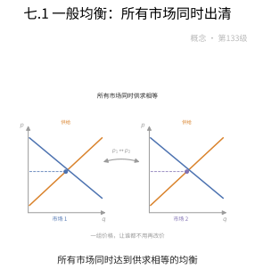

**一句话点破**：一般均衡要的不是单个市场出清，而是全部市场在同一组价格下同时出清。

### 六.2 Arrow-Debreu模型：把经济装进一个框架

阿罗-德布鲁模型用一批商品、一批消费者和各自的禀赋与偏好，把整个经济体写成干净的数学对象，价格则是所有商品构成的向量。

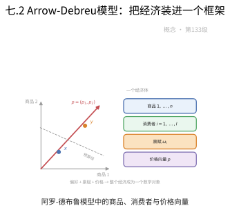

**一句话点破**：它给“看不见的手”搭好了可以严格推理的舞台。

### 六.3 偏好与效用：把“更喜欢”变成数字

消费者对不同商品组合的喜好，可以用满足完备性、传递性等公理的偏好关系来刻画；条件合适时，还能用一个效用函数 $u$ 把偏好排序变成数值大小。

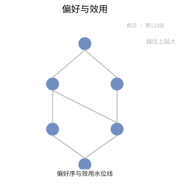

**一句话点破**：效用不是测量快乐的绝对刻度，而是代替偏好排序的方便工具。

### 六.4 期望效用理论：不确定下的选择标尺

面对有风险的结果，把每个可能结果的效用按它出现的概率加权求和，就得到期望效用；理性选择就是让期望效用最大。

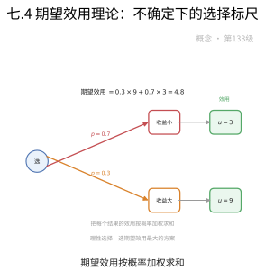

**一句话点破**：风险决策的“平均快乐”，是每个结果的效用乘上它的概率再相加。

### 六.5 博弈论在经济中的应用：策略互看

当每个人的收益都取决于别人怎么选时，就得请出博弈论。它用收益矩阵或策略空间描述互动，找出谁都不想单方面改变策略的纳什均衡。

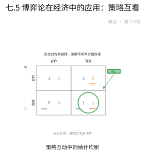

**一句话点破**：博弈论让“我的选择要看你的选择”有了可解的形式。

### 六.6 社会福利函数：把众人之好合为一

社会福利函数把每个人的效用汇总成一个社会整体的评判，是判断“哪种资源配置更好”的比较尺。

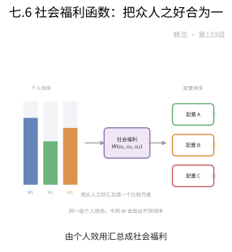

**一句话点破**：社会福利函数要回答的是“众人的好处能否合成一个社会排序”。

### 六.7 匹配理论：不用价格也能配对

有些场景没法靠价钱分配，比如学校和学生的录取。匹配理论研究怎样把两方稳定地配到一起，使没有任何一对愿意私下“另结良缘”。

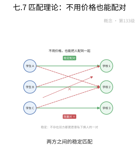

**一句话点破**：匹配不靠价格，靠的是让每一对都找不到更好的私奔对象。

### 六.8 机制设计：先定规则，再看结果

机制设计反着来想：如果希望得到某个结果，该订怎样的规则和信息收集方式？它要让人愿意如实说出偏好，并朝着设计者想要的目标行动。

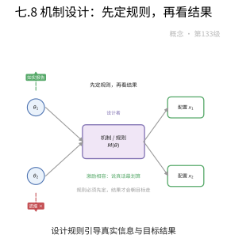

**一句话点破**：机制设计是“反着做的博弈论”——先要结果，再设计规则。

### 六.9 经济增长模型：让产出随时间长大

把资本、劳动、技术放进动态方程，考察产出如何逐年累积增长。索洛、拉姆齐等模型用储蓄与投资解释增长究竟从哪里来。

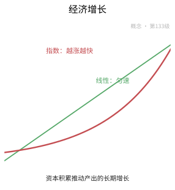

**一句话点破**：增长模型算的是“今天的投资，怎样变成明天更高的产出”。

### 六.10 均衡的存在性：不动点保证有解

阿罗-德布鲁的核心是证明一般均衡一定存在。办法是把超额需求映射到一个价格集合上，用不动点定理找到让所有市场同时出清的那组价格。

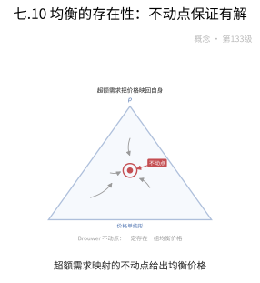

**一句话点破**：只要映射足够“温和”，不动点定理就能保证均衡价格存在。

### 六.11 阿罗不可能定理：完美投票不存在

在若干看似合理的公理下，不存在一个把个人偏好汇总成社会排序的方法能同时满足所有要求。它说明“既要又要”的社会选择必有一处让步。

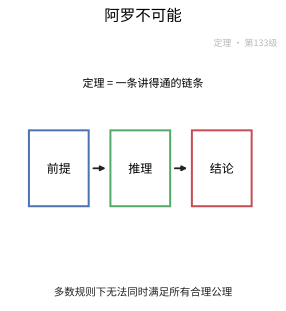

**一句话点破**：公平、合理、普遍适用的投票规则，注定无法十全十美。

### 六.12 第一福利定理：竞争均衡是有效的

在完备市场等条件下，任何竞争均衡都是帕累托有效的——没有人能在不损害他人的前提下让自己更好。

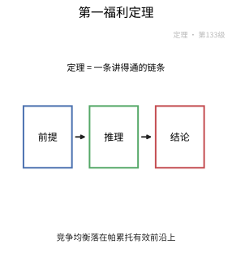

**一句话点破**：看不见的手的第一个承诺：竞争带来的结果不会浪费。

### 六.13 第二福利定理：想要哪种有效都行

反过来，任何一个帕累托有效的配置，只要通过一次恰当的收入再分配，都能由竞争均衡实现。效率与公平可以分开来谈。

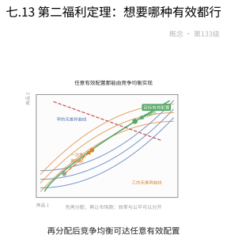

**一句话点破**：效率交给市场，公平交给再分配，两者可以拆开处理。

### 六.14 稳定匹配的存在性：延迟接受算法

Gale-Shapley 算法让一方先按偏好依次“暂定”对方，被拒者再退而求其次，如此反复，最终必然得到稳定匹配——没有人愿意私下换人。

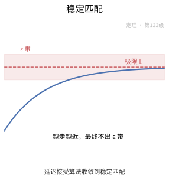

**一句话点破**：一轮轮“先到先得、被拒再找”，一定停在稳定的配对结果上。

## 七、数学史（History of Mathematics）

> 经济数学的历史主线，是"把经济学的'看不见的手'改写成可以求解的方程"的科学化进程：从 18 世纪把国民财富做成图表的尝试，到 19 世纪"边际革命"用导数重述决策，再到 20 世纪以不动点定理、博弈论与公理化偏好逐层加固的均衡大厦。本章沿着"从账簿到定理"的线索，追溯边际、效用、均衡、福利、社会选择与增长这些概念为何被提出、如何从粗糙走向严格，直到它们共同构成今天经济分析的数学地基。

### 七.1 前科学时代：从重农学派到国富论

- **经济现象成为可算对象**：18 世纪，重农学派领袖魁奈在《经济表》（1758）中尝试用一张表描述财富在农业、地主与手工业间的流转，是最早把"国民经济"画成结构模型的尝试；1776 年亚当·斯密在《国富论》中用"看不见的手"概括价格的自我调节——问题是这只手"长什么样、会不会失灵"，需要在两个世纪后用数学来回答。
- **古诺的开山**：真正把经济写进方程的是法国数学家古诺。他在《财富理论的数学原理研究》（1838）中既用微积分研究垄断定价，又提出寡头竞争的**古诺模型**，两件套稳稳地把"供求与价格"变成可微分的函数关系，被公认为数理经济学的起点。
- **从直观到函数**：此后，经济学家开始为需求、供给、成本捕捉"可图画"的函数形态，为 19 世纪下半叶的边际革命铺好了函数的画布。

### 七.2 边际革命：从整体平均到边际多寡

- **戈森的先声**：德国经济学家戈森在《人类交换规律与人类行为准则发展》（1854）中已提出边际效用递减的雏形，但因无人问津而长期埋没——这提醒我们，"概念"与"被接受的概念"之间往往隔着传播的运气。
- **三头并进的 1870 年代**：杰文斯（《政治经济学理论》，1871）、门格尔（《国民经济学原理》，1871）与瓦尔拉斯（《纯粹经济学要义》，1874）几乎同时主张"价值取决于边际效用而非总效用"，史称**边际革命**。它把"再多买一个"带来的效用增量（即导数）推上舞台中央，本教程的边际收益、弹性等概念正是这一语境的翻版。
- **新古典综合**：英国的马歇尔在《经济学原理》（1890）中把边际主义与供需曲线融为一体，用供求交点给出均衡价格，塑造此后几十年的微观经济学教科书形态——经济学由此全面"微积分化"。

### 七.3 效用的底线：从伯努利到稀释的序数性

- **基数效用的源头**：早在 1738 年，丹尼尔·伯努利为解决"圣彼得堡悖论"就主张人们最大化的是财富的对数效用（边际效用递减），首开风险决策的期望分析。
- **有序还是可测**：20 世纪初，人们发现"效用差有无意义"难以检验；1934 年前后希克斯与艾伦推动**序数效用**观，主张只需"谁比谁高"的排序，正单调变换都等价——这为本教程中"偏好关系 → 效用函数"的表示提供了哲学地基。
- **公理化的荣光**：1944 年，冯·诺依曼与摩根斯顿在《博弈论与经济行为》中把"效用"彻底公理化：在完备性、传递性、连续性、独立性等偏好公理之下，理性决策者的偏好必可表示为一个**期望效用函数**。不确定性经济学从此有了严格的运算规则。

### 七.4 一般均衡：从瓦尔拉斯的方程组到阿罗-德布鲁定局

- **瓦尔拉斯的方程组**：瓦尔拉斯（1874）把"所有市场同时出清"写成一整套联立方程，并提出著名的**瓦尔拉斯定律**（若除某市场外其余都出清，则该市场也出清，故只需 $n-1$ 个独立方程）。
- **"存在性"之问**：方程组方程数与未知数相等并不等于"确有解"。这一关键一步拖到 20 世纪中叶——1954 年，**阿罗与德布鲁**借助**布劳威尔／角谷不动点定理**证明：在偏好连续、生产集凸等适当假设下，竞争均衡一定存在。把"看不见的手"从信念落实为定理，正是本教程"定理 1"的来历。
- **标准著作的定型**：德布鲁的《价值理论》（1959）用现代凸分析与拓扑语言重新组织数理经济学，使它成为一门"可证明"的科学；从此拓扑学与凸分析正式进入经济学工具箱。

### 七.5 不动点与凸性：均衡证明的数学引擎

- **布劳威尔不动点**：1911 年布劳威尔证明：紧凸集到自身的连续映射必有不动点——一个拓扑学子的功利结论，竟成为均衡存在的关键步骤。
- **角谷的选择对应**：1941 年角谷把不动点推广到"集值映射"，恰好覆盖消费者超额需求的非连续场景，成为阿罗-德布鲁论证的现成工具。
- **凸性假设的分量**：整套证明依赖偏好与生产集的**凸性**。它是"平均的效用在中间"这句话的数学化身，也是理解为何经济学反复强调凸假定的钥匙——凸性给均衡、给分离定理都提供了买不起的瓦片。

### 七.6 福利经济学的两个基本定理

- **两个方向的命题**：福利经济学第一基本定理说"竞争均衡必是帕累托最优"（市场把资源配置到没有漏损的程度）；第二基本定理说"任何帕累托最优都能在适当再分配初始禀赋后由竞争均衡实现"——它为"效率"与"分配"的分离提供了理论支点。
- **帕累托的奠基**：意大利经济学家帕累托（1906）引入"帕累托改进"与"帕累托最优"的概念，给出无需跨人比较的福利判据；本教程"定理 3、定理 4"正是这两个基本定理的展开。
- **理想化的边界**：两个定理都依赖完全竞争、无外部性、完备信息等强假设——这也解释了为何现实常偏离"有效市场"：正因假设严格，定理才既可敬又需慎用。

### 七.7 社会选择与阿罗不可能定理

- **偏好加总的难题**：把千万个体的偏好"公平地"加总成一个社会排序，看似是民主投票的朴素期望。1950 年，**阿罗不可能定理**当头一棒：在至少三个备选时，不存在同时满足帕累托、无关方案独立性与非独裁等公理的社会福利函数。
- **机制设计的萌芽**：这一定理深刻动摇"总能公平加总"的信念，开创了**社会选择理论**；阿罗由此于 1972 年获诺贝尔经济学奖。
- **森的可能性之窗**：印度经济学家阿马蒂亚·森（1970）通过放宽"全域性"或引入其他信息，得到一系列"可能性结果"与贫困度量的基础，表明"不可能"之外仍有理论生长空间（本教程社会福利函数章节即由此铺开）。

### 七.8 博弈论与纳什均衡

- **零和的起点**：1928 年冯·诺依曼证明"二人零和博弈"的极小极大定理，但只覆盖"你赢多少我输多少"的对抗局面；1944 年他与摩根斯顿合著的《博弈论与经济行为》把博弈论系统化，也被视为期望效用公理化的同源文本。
- **纳什的统一**：**纳什均衡**（1950）把"稳定结局"定义为"谁单方面改变都不占便宜"，并证明有限博弈总存在——这是不动点思想在"多人互相最优"上的化身，让博弈论从零和扩展到所有策略互动。
- **渗透进整个经济学**：此后博弈论渗透到寡头竞争、拍卖、讨价还价与机制设计，成为现代经济学最通用的分析语言；纳什亦因该项工作获 1994 年诺贝尔经济学奖。

### 七.9 匹配理论与市场设计：从校园到器官

- **稳定性的定义**：1962 年，盖尔与沙普利提出**延迟接受算法**，为"稳定匹配"（没有一对人彼此更喜欢对方而想拆散现状）给出了总能构造的证明——本教程"定理 5"即其翻版。
- **走出学术象牙塔**：经济学有实物沙普利与罗斯把算法应用到美国住院医师匹配、学校择校与**肾脏交换网络**，使"市场设计"成为真正落地改变现实的一支；二人因此于 2012 年获诺贝尔经济学奖。
- **机制设计的加冕**：几乎同源的思想——赫维奇提出激励相容（1960 年代）、迈尔森与马斯金建立实施理论——被归入**机制设计**，于 2007 年共同获诺贝尔经济学奖，标志"逆向工程经济学"被正式加冕。

### 七.10 增长理论与动态优化：把宏观经济学化

- **记账式增长的清醒**：罗伯特·索罗（1956）证明在规模报酬不变、要素递减下，资本积累终会停在"稳态"，长期增长只能来自技术进步 $A$——一个朴素却深刻的结论（1987 年获诺贝尔奖）。
- **跨期最优的分量**：**拉姆齐**早在 1928 年主张储蓄应来自家庭对现在与未来的权衡，卡斯（1965）与库普曼斯再将其推广为市场竞争下的动态最优，构成 Ramsey-Cass-Koopmans 模型；贝尔曼动态规划（1950 年代）为这类问题提供了通用求解框架。
- **内生增长的开放**：到 1980—1990 年代，罗默（1990）等引入知识与创新的规模报酬递增，提出**内生增长理论**，试图把"技术进步"本身当作被经济系统决定的变量——宏观经济的数学化在上世纪完成，并在动态优化与增长理论中持续深化。

### 七.11 历史年表

| 时间 | 人物／文献 | 事件与贡献 |
|:---|:---|:---|
| 1738 年 | 丹尼尔·伯努利 | 期望效用思想与对数效用，解答圣彼得堡悖论 |
| 1758 年 | 魁奈《经济表》 | 经济流转的结构化图表，重农学派 |
| 1776 年 | 亚当·斯密《国富论》 | "看不见的手"：价格自我调节的隐喻 |
| 1838 年 | 古诺 | 用微积分研究垄断与寡头，数理经济学起点 |
| 1854 年 | 戈森 | 边际效用递减的雏形（一度埋没） |
| 1871—1874 年 | 杰文斯、门格尔、瓦尔拉斯 | 边际革命：价值取决于边际效用 |
| 1890 年 | 马歇尔《经济学原理》 | 供需曲线综合，新古典框架定型 |
| 1906 年 | 帕累托 | 帕累托最优与改进判据 |
| 1911 年 | 布劳威尔 | 不动点定理（连续映射） |
| 1928 年 | 冯·诺依曼 | 二人零和博弈的极小极大定理 |
| 1934 年前后 | 希克斯、艾伦 | 序数效用：只需排序、单调变换等价 |
| 1941 年 | 角谷 | 集值映射不动点定理 |
| 1944 年 | 冯·诺依曼、摩根斯顿 | 期望效用公理化；博弈论系统化 |
| 1950 年 | 阿罗 | 社会选择与不可能定理 |
| 1950 年 | 纳什 | 纳什均衡的存在性 |
| 1954 年 | 阿罗、德布鲁 | 一般均衡存在性的严格证明 |
| 1956 年 | 索罗 | 新古典增长模型与稳态 |
| 1959 年 | 德布鲁《价值理论》 | 数理经济学的现代拓扑化表述 |
| 1962 年 | 盖尔、沙普利 | 稳定匹配与延迟接受算法 |
| 1990 年前后 | 罗默等 | 内生增长理论 |
| 2007 年 | 赫维奇、马斯金、迈尔森 | 机制设计获诺贝尔经济学奖 |
| 2012 年 | 沙普利、罗斯 | 匹配与市场设计获诺贝尔经济学奖 |

### 七.12 小结

> 经济数学的历史，是一部"把市场哲学翻译成可证明定理"的进程：古诺先用微积分给供求定标，边际革命用导数重述"多得一个"的取舍，伯努利与冯-诺依曼把"主观效用"公理化，阿罗-德布鲁用不动点把均衡存在落成定理，福利定理阐明市场与公平的边界，阿罗又以不可能定理划出社会加总的红线。博弈论与纳什均衡接管策略互动，匹配与机制设计教我们"反过来造市场"，而增长理论则把宏观经济的长期走向同样写进方程。贯穿始终的主线，是把直觉、隐喻与政策辩论逐层改写成可验证、可求解的数学对象——这正是经济学从"算术"走向"科学"的完整弧线。

## 现实应用（Real-World Applications）

> 本节把本章的知识点落到真实的工程、科学与生活场景中。每个案例都给出**完整的问题背景、建模过程、可复现的数据 / 公式 / 代码与结果解读**；案例末尾的「涉及知识点」对应本章的具体小节，文末附**知识点覆盖对照表**，确保本章知识点全部被覆盖。

### 应用案例 1：可计算一般均衡（CGE）｜两部门碳税的价格联动与不动点求解

**场景与问题**

某智库要评估"对能源部门征收碳税"对整体经济价格的连锁影响。局部均衡算不清这种题目——能源涨价会推高所有用能行业的成本，反过来又压低能源需求。团队搭了一个简化的**可计算一般均衡（CGE）**模型：把经济压缩成两个部门（能源 $E$、非能源 $N$）、两类主体，求一组让两个市场**同时**出清的价格。核心问题是：**这组价格存在吗？怎么算出来？**

**涉及知识点**

- 本章「1.1 一般均衡理论」：所有市场同时出清 $\sum_i\mathbf x_i^*=\sum_i\mathbf e_i+\sum_j\mathbf y_j^*$，价格不能一个市场一个市场单独解。
- 本章「1.2 Arrow-Debreu模型」：偏好完备、传递、连续、严格凸，禀赋严格正——这些假设保证需求函数连续、均衡存在。
- 本章「定理1：Arrow-Debreu一般均衡的存在性」：超额需求 $Z(p)$ 连续 + Walras 律 $p\cdot Z(p)=0$，由 Brouwer 不动点定理保证均衡价格存在。

**建模与数据**

取一个两人两商品（商品 $x$ 代表能源、$y$ 代表非能源）纯交换经济。禀赋与效用：

| 主体 | 禀赋 $\mathbf e_i$ | 效用 |
| --- | --- | --- |
| A | $(4,8)$ | $u_A=x_A^{1/2}y_A^{1/2}$ |
| B | $(6,2)$ | $u_B=x_B^{1/3}y_B^{2/3}$ |

总禀赋 $(10,10)$。Cobb-Douglas 消费者的需求为 $x=\alpha I/p_x$、$y=(1-\alpha)I/p_y$，其中 $I_i=p_x e_i^x+p_y e_i^y$。取 $p_y=1$ 作为计价物。

**完整推导与算法**

第 1 步：写需求函数。A（$\alpha=1/2$）：$I_A=4p_x+8$，故

$$
x_A=\frac{0.5(4p_x+8)}{p_x}=2+\frac{4}{p_x}
$$

B（$\alpha=1/3$）：$I_B=6p_x+2$，故

$$
x_B=\frac{(1/3)(6p_x+2)}{p_x}=2+\frac{2}{3p_x}
$$

第 2 步：市场出清定义超额需求并令其为零：

$$
Z_x(p_x)=x_A+x_B-10=\Big(4+\frac{4+\tfrac23}{p_x}\Big)-10=0
$$

解得 $p_x=\dfrac{14/3}{6}=\dfrac{7}{9}\approx0.778$。校验能源之外的市场自动出清（Walras 律）：

$$
y_A+y_B=(2p_x+4)+\Big(4p_x+\tfrac43\Big)=6\cdot\tfrac79+\tfrac{16}{3}=\tfrac{30}{3}=10
$$

**定理1 在此处的作用**：$Z(p)$ 连续、满足 $p\cdot Z(p)=0$，故在单纯形上存在不动点。若没有闭式解（部门更多、生产函数更复杂），就用下面的价格调整迭代逼近。

第 3 步：tâtonnement（试错）迭代。按超额需求方向调价：

```python
# 核心：tâtonnement 迭代——价格按超额需求方向移动，直至 Z(p)≈0
p = 1.0
for _ in range(200):
    Z = excess_demand(p)            # Z_x(p) = x_A(p)+x_B(p) - 10
    p += 0.05 * Z                   # 供不应求(p>0)抬价，供过于求降价
    p = min(max(p, 0.1), 5.0)       # 限制在可行价格区间
print(p)                            # 收敛到 ≈ 0.778
```

第 4 步：碳税冲击。把能源价格外生抬高 $\tau$（如 $p_x\to p_x(1+\tau)$），重解出新的均衡配置与价格，比较两部门产出与相对价格变化。

**可复现步骤**

1. 环境与依赖：`pip install numpy`
2. 数据准备：把禀赋、$\alpha$ 写入代码。
3. 运行：`python cge_tatonnement.py`
4. 预期输出：闭式解 $p_x=7/9$；迭代法在数百步内收敛到同一值，$Z_x<10^{-6}$。

**结果解读与延伸**

均衡价格 $p_x/p_y=7/9$ 说明能源相对非能源便宜，与 A 的能源禀赋多、B 的偏好更偏能源相符。碳税把 $p_x$ 抬高后，能源需求下降、非能源需求上升——这正是"牵一发动全身"的联动。误差来源主要是模型对偏好与禀赋的简化。局限是纯交换模型没有生产与要素市场，没有金融市场；延伸方向是加入生产部门做成完整 Arrow-Debreu 经济，并用 Scarf 算法或不动点迭代处理多部门高维情形。

### 应用案例 2：保险与投资决策｜期望效用、风险厌恶与 Arrow-Pratt 系数

**场景与问题**

一位客户有资产 10 万元，面临 1% 概率的 5 万元损失（如房屋火灾式风险）。保险公司提供一份保单，保费 $P$。客户要不要买？愿意付多少？这类"不确定下如何选择"的问题，正是期望效用理论的用武之地——把"钱"换算成"效用"再求期望，而不是直接对钱求期望。

**涉及知识点**

- 本章「1.3 偏好与效用」：效用函数 $u$ 是偏好序的数值表示，但它是序数的（单调变换等价），风险态度要用曲率而非具体数值刻画。
- 本章「1.4 期望效用理论」：$U(L)=\sum_i p_iu(x_i)$，凹效用 $u''<0$ 经 Jensen 不等式 $U(L)<u(\mathbb E[x])$ 给出风险厌恶。

**建模与数据**

取 Bernoulli 效用 $u(w)=\sqrt w$（凹函数，风险厌恶）。初始财富 $w_0=100000$，损失情形：概率 $p=0.01$ 损失 $L=50000$（即 $w_1=50000$），概率 $0.99$ 无损（$w=100000$）。

**完整推导与算法**

第 1 步：算不投保的期望效用。

$$
U(\text{不保})=0.99\sqrt{100000}+0.01\sqrt{50000}=0.99(316.23)+0.01(223.61)=313.07+2.236=315.30
$$

第 2 步：算确定性等价（Certainty Equivalent）$CE$，即让 $u(CE)=U$ 的确定财富：

$$
CE=U^2=315.30^2=99414
$$

第 3 步：算风险溢价。财富的数学期望 $\mathbb E[w]=0.99(100000)+0.01(50000)=99500$，故

$$
\text{风险溢价}=\mathbb E[w]-CE=99500-99414=86
$$

第 4 步：算最高可接受保费。令 $u(w_0-P)=U$，即 $100000-P=CE$：

$$
P^{\max}=w_0-CE=100000-99414=586
$$

而精算公平保费为 $\mathbb E[\text{损失}]=pL=500$。因 $P^{\max}=586>500$，客户愿意投保（愿多付 86 元的风险溢价）。

第 5 步：刻画风险厌恶程度。Arrow-Pratt 绝对风险厌恶系数：

$$
A(w)=-\frac{u''(w)}{u'(w)}=\frac{0.25\,w^{-1.5}}{0.5\,w^{-0.5}}=\frac{0.5}{w}
$$

在 $w_0=100000$ 处 $A=5\times10^{-6}$，数值越小越不厌恶风险。

```python
# 核心：期望效用 -> 确定性等价 -> 风险溢价与最高保费
u = lambda w: np.sqrt(w)
EU   = p*u(w1) + (1-p)*u(w0)         # 期望效用
CE   = EU**2                          # 确定性等价（u 的逆）
RP   = (p*w1 + (1-p)*w0) - CE         # 风险溢价
Pmax = w0 - CE                        # 最高可接受保费
```

**可复现步骤**

1. 环境与依赖：`pip install numpy`
2. 数据准备：设定 $w_0,w_1,p$。
3. 运行：`python insurance_eu.py`
4. 预期输出：$U=315.30$、$CE=99414$、风险溢价 86、$P^{\max}=586$（> 公平保费 500）。

**结果解读与延伸**

结果说明：风险厌恶者愿意为"确定性"付费，86 元的风险溢价就是这份安心值多少钱。误差来源包括效用函数形式选择（换 $u=\ln w$ 会得到不同的 $CE$，因效用是序数的、但风险态度由曲率决定）。局限正是 von Neumann-Morgenstern 的独立性公理——阿莱悖论表明真实偏好会违反它，此时需前景理论的概率权重 $\pi(p)$ 与损失厌恶。延伸方向：用 $A(w)=0.5/w$ 的递减特性说明富人更愿冒险，并做"保险需求随财富变化"的比较静态。

### 应用案例 3：频谱拍卖与寡头竞争｜博弈论下的机制设计

**场景与问题**

某国电信监管机构要拍卖 5G 频谱牌照，同时反垄断部门在审两家运营商的合并。两个问题看似无关，本质都是博弈论：(1) 拍卖规则怎么设计，才能让竞买人**如实报价**且国家收入不低？(2) 两寡头合并后价格会涨多少？监管方需要一套能算的工具。

**涉及知识点**

- 本章「1.5 博弈论在经济中的应用」：Cournot 产量竞争、Vickrey 第二价格拍卖、纳什均衡的"给定他人策略下无人愿单方面改变"。
- 本章「1.8 机制设计」：激励相容（如实报告是最优）、显示原理（任何机制可归约为直接机制）、Myerson-Satterthwaite 定理的边界。

**建模与数据**

**（a）Cournot 寡头**：逆需求 $P(Q)=100-Q$，$Q=q_1+q_2$，两厂商边际成本相同 $c=10$。

**（b）第二价格拍卖**：3 家竞买人估值 $v=(80,60,40)$，赢家只付次高价。

**完整推导与算法**

第 1 步：Cournot 纳什均衡。厂商 $i$ 利润 $\pi_i=(100-q_i-q_j-c)q_i$，一阶条件 $\partial\pi_i/\partial q_i=100-2q_i-q_j-c=0$。由对称性 $q_i=q_j=q^*$：

$$
100-3q^*-10=0\ \Rightarrow\ q^*=30,\quad Q=60,\quad P=40
$$

每家利润 $\pi=(40-10)\times30=900$。对比垄断（$Q=45$、$P=55$）与完全竞争（$P=c=10$）可见寡头居间。

第 2 步：第二价格拍卖的均衡。设赢家付次高报价。断言"报真实估值 $v_i$"是弱占优策略：

- 若报 $b_i>v_i$：可能以高于 $v_i$ 的价格赢下（若次高报价 $v_j$ 落在 $(v_i,b_i)$），此时净亏 $v_i-v_j<0$；
- 若报 $b_i<v_i$：可能错失一个本可盈利（$v_i>v_j$）的赢单。

两种偏离都劣于报 $v_i$，故如实报价最优。

第 3 步：算分配与支付。估值 $(80,60,40)$：最高者（80）赢，付次高价 60，净收益 $80-60=20$；卖方收入 60。

第 4 步：机制设计视角。拍卖是一个直接机制，其配置规则（最高估值者得）与支付规则（付次高价）满足**激励相容**。由**显示原理**，任何占优策略可实施机制的均衡结果，都能被某个激励相容的直接机制复现——所以我们只需在"真实报告"约束下优化目标（此处为卖方收入）。若换成双边交易（买方估值、卖方成本都私下），**Myerson-Satterthwaite 定理**说：事后有效 + 预算平衡 + 自愿参与三者不能兼得。

```python
# 核心：Cournot 纳什均衡（对称解）+ 第二价格拍卖的配置与支付
q_star = (A - c) / 3                       # A=100, c=10 -> 30
price  = A - 2*q_star                      # = 40
winner = np.argmax(v); pay = sorted(v)[-2]  # 赢家付次高价（Vickrey）
```

**可复现步骤**

1. 环境与依赖：`pip install numpy`
2. 数据准备：设定 $A,c$ 与估值向量 $v$。
3. 运行：`python auction_cournot.py`
4. 预期输出：Cournot $q^*=30$、$P=40$、单家利润 900；拍卖赢家为估值 80 者、支付 60。

**结果解读与延伸**

Cournot 与 Bertrand 的对比最能说明"策略变量一变、结论反转"：选产量得正利润，选价格（同质产品）则 $P\to c$、利润为零。拍卖部分则展示机制设计的力量——好规则让"自利"自动导向"如实"。误差来源包括成本不对称、串标风险。局限是 Myerson-Satterthwaite 提示机制设计有硬边界，双边交易无法同时满足效率、预算平衡与自愿参与。延伸方向：引入相关估值（关联价值）与收入等价定理，或设计多轮组合拍卖（频谱打包）。

### 应用案例 4：学校选择系统｜Gale-Shapley 延迟接受算法的稳定匹配

**场景与问题**

某市要为初中招生设计"派位"系统。家长按志愿排序学校，学校按成绩/优先级排序学生。教育部门希望结果"稳定"——不存在一个学生和一所学校互相都觉得对方比现状更好（否则迟早被投诉、要求调换）。这正是 Gale-Shapley 延迟接受算法要解决的问题。

**涉及知识点**

- 本章「1.7 匹配理论」：稳定匹配排除"阻塞对"——不存在 $w\succ_m\mu(m)$ 且 $m\succ_w\mu(w)$。
- 本章「定理5：匹配市场中的稳定匹配存在性（Gale-Shapley）」：延迟接受算法保证稳定匹配存在且可在 $n^2$ 步内构造。

**建模与数据**

3 名学生、3 所学校，每校容量 1。偏好（$\succ$ 表示更喜欢）：

学生志愿：
- S1：A $\succ$ B $\succ$ C
- S2：A $\succ$ C $\succ$ B
- S3：B $\succ$ A $\succ$ C

学校优先级：
- A：S2 $\succ$ S1 $\succ$ S3
- B：S1 $\succ$ S3 $\succ$ S2
- C：S3 $\succ$ S1 $\succ$ S2

**完整推导与算法**

第 1 步：执行学生提议版延迟接受（Deferred Acceptance）。

1. 每个未匹配学生向第一志愿"求婚"：S1→A，S2→A，S3→B。
2. 学校暂留最优者：A 比较 S1、S2，留 S2（拒 S1）；B 留 S3。
3. S1 被拒后向 B 求婚。B 比较 S3 与 S1，留 S1（拒 S3）。
4. S3 被拒后向 A 求婚。A 比较 S2 与 S3，留 S2（拒 S3）。
5. S3 向 C 求婚，C 留 S3。

终止，匹配：S1–B、S2–A、S3–C。

第 2 步：验证稳定性（无阻塞对）。逐对检查：

- S1 偏好 A（现为 B），但 A 宁愿要 S2 而非 S1，不构成阻塞；
- S3 偏好 A、B（现为 C），但 A 要 S2、B 要 S1，均不构成阻塞；
- 其余人已得第一志愿。

故无阻塞对，匹配稳定。

```python
# 核心：Gale-Shapley 延迟接受——学生依次向未拒过的最优校求婚，校方暂留更优者
free = list(students)
while free:
    s = free.pop(0)
    school = next_school(s, rejected[s])        # 向尚未被拒的最优校求婚
    if school.has_space():
        school.tentative = s                    # 暂留（订婚）
    elif school.prefers(s, school.tentative):   # 校方更偏好新来者
        free.append(school.tentative)           # 旧者恢复单身
        school.tentative = s
    else:
        rejected[s].add(school); free.append(s) # 被拒，下次换志愿
```

第 3 步：终止性。每个学生最多向 3 所学校各求婚一次，总求婚数 $\le 9=n^2$，故有限步终止；由反证法可证输出无阻塞对。

第 4 步：讨论"谁主动谁占优"。学生提议版给出**学生最优**（每个学生得到所有稳定匹配中自己最好的）而**学校最差**的匹配。若改由学校提议，结论对称反转。

**可复现步骤**

1. 环境与依赖：`pip install numpy`（纯逻辑也可无依赖）
2. 数据准备：把双方偏好表写入 `prefs.json`。
3. 运行：`python gale_shapley.py`
4. 预期输出：匹配 S1–B、S2–A、S3–C；程序自检"阻塞对数量 = 0"。

**结果解读与延伸**

结果展示了"不用价格也能完成配置"的匹配市场思想，现实中 NRMP 住院医师匹配、波士顿学区派位、肾脏交换网络都在用它的变体。误差来源在于偏好申报是否真实（延迟接受在学生提议版下是策略稳健的）。局限是"稳定"不等于"帕累托最优"——稳定匹配可能有多个，选哪个取决于谁提议。延伸方向：引入学校容量与"同校兄弟姐妹优先"等约束，或改用 Top Trading Cycles 处理已有名额的换位。

### 应用案例 5：公共政策评估｜投票悖论、Arrow 不可能定理与社会福利函数

**场景与问题**

某市要选一个公共项目方案（备选 A、B、C），市民按偏好投票。市政策研究室发现：无论用哪种投票规则，结果都可能"自相矛盾"或"被人操纵"。他们请经济顾问说清楚：**为什么没有完美的投票规则？不同社会福利函数又会选出什么？**

**涉及知识点**

- 本章「1.6 社会福利函数」：功利 $\sum u_i$、罗尔斯 $\min u_i$、纳什 $\prod u_i$ 三种伦理立场。
- 本章「定理2：Arrow不可能定理」：$I\ge2$、候选 $\ge3$ 时，不存在同时满足帕累托、IIA、非独裁、全域性的社会福利函数。

**建模与数据**

7 名选民分三组，偏好如下（$>$ 表示更偏好）：

| 组 | 人数 | 偏好 |
| --- | --- | --- |
| G1 | 3 | A $>$ B $>$ C |
| G2 | 2 | B $>$ C $>$ A |
| G3 | 2 | C $>$ A $>$ B |

**完整推导与算法**

第 1 步：两两对决找孔多塞循环。逐对计票：

- A vs B：A 胜（G1 3 + G3 2 = 5 票 $>$ G2 的 2 票）；
- B vs C：B 胜（G1 3 + G2 2 = 5 票 $>$ G3 的 2 票）；
- C vs A：C 胜（G2 2 + G3 2 = 4 票 $>$ G1 的 3 票）。

于是 A $>$ B $>$ C $>$ A 形成**循环**——多数决竟然没有传递性，这就是孔多塞悖论。它直接打击了"多数决一定能得出社会排序"的乐观。

第 2 步：换 Borda 计分（第一名 2 分、第二 1 分、第三 0 分）。逐组累加：

- A：$3\times2+2\times0+2\times1=8$；
- B：$3\times1+2\times2+2\times0=7$；
- C：$3\times0+2\times1+2\times2=6$。

Borda 选出 A。但注意 Borda 违反 **IIA**：若 C 退选，某些选民的相对排序会被"位置效应"改变，社会对 A、B 的排序可能反转——这正是 Arrow 不肯接受 IIA 的原因。

第 3 步：用社会福利函数比较两个分配。设两方案下三人效用为：

| 方案 | $u_1$ | $u_2$ | $u_3$ | 功利 $\sum u_i$ | 罗尔斯 $\min u_i$ | 纳什 $\prod u_i$ |
| --- | --- | --- | --- | --- | --- | --- |
| P | 10 | 4 | 4 | 18 | 4 | 160 |
| Q | 6 | 6 | 6 | 18 | 6 | 216 |

- **功利主义**：两方案并列（都是 18），对极端不平等"无感"；
- **罗尔斯**：选 Q（最差者 6 > 4），体现"最大最小原则"；
- **纳什**：选 Q（$216>160$），对"有人趋于 0"给予极大惩罚。

```python
# 核心：三种社会福利函数对同一分配给出不同排序
uP, uQ = np.array([10,4,4]), np.array([6,6,6])
W_util = lambda u: u.sum()          # 功利
W_rawls = lambda u: u.min()          # 罗尔斯
W_nash = lambda u: np.log(u).sum()   # 纳什（取对数等价于乘积）
```

第 4 步：引出 Arrow 不可能定理。上述每个"社会福利函数"其实都**预设了效用可跨人比较、可度量**（基数效用）。而 Arrow 要求的是从**序数**个人偏好聚合出社会偏好，并同时满足帕累托、IIA、非独裁、全域性——定理证明这四条在候选 $\ge3$ 时必然冲突（决定性集合可从全体收缩到单人 → 独裁）。

**可复现步骤**

1. 环境与依赖：`pip install numpy`
2. 数据准备：把选民分组偏好与两方案的效用向量写入代码。
3. 运行：`python voting_swf.py`
4. 预期输出：两两对决出现 A$>$B、B$>$C、C$>$A 的循环；Borda 选 A；三种福利函数在 P、Q 上给出如上表排序。

**结果解读与延伸**

它说明两件事：其一，投票规则的选择本身就带价值判断（多数决、Borda 各有取舍，且都可能被策略性投票操纵）；其二，任何"社会最优"的定义都绕不开伦理立场——功利看总量、罗尔斯看最差、纳什看均衡。误差来源包括效用度量与跨人比较的强假设。局限正是 Arrow 指出的：要序数聚合就撞上不可能定理，要基数聚合就得接受可比性假设。延伸方向：放松 IIA（用基数信息）或放松全域性（限制偏好域），并研究抗策略操纵的机制。

### 应用案例 6：增长核算与稳态分析｜Solow 模型与储蓄率的作用边界

**场景与问题**

某发展中国家的政策辩论：要不要把国民储蓄率从 30% 提到 35%？支持者说"多储蓄多投资就能多产出"，反对者说"储蓄率再高也追不上发达国家"。谁对？Solow 增长模型能给出精确回答：**储蓄率只影响人均产出的水平，不影响长期增长率**。团队要用模型算清楚稳态与转移动态。

**涉及知识点**

- 本章「1.9 经济增长模型」：Solow $Y=F(K,AL)$、人均资本积累 $\dot k=sf(k)-(n+g+\delta)k$、稳态与 Ramsey-Cass-Koopmans 的内生储蓄。
- 本章「1.3 偏好与效用」：RCK 中储蓄由家庭跨期效用最大化内生决定，$\int_0^\infty e^{-\rho t}u(c)\,dt$ 是决策目标。

**建模与数据**

生产函数 Cobb-Douglas：$y=k^{1/3}$（$\alpha=1/3$）。参数：储蓄率 $s=0.3$、劳动增长 $n=0.01$、技术进步 $g=0.02$、折旧 $\delta=0.05$，故 $n+g+\delta=0.08$。

**完整推导与算法**

第 1 步：写资本积累方程（人均有效劳动形式）：

$$
\dot k=sf(k)-(n+g+\delta)k=0.3\,k^{1/3}-0.08k
$$

第 2 步：求稳态 $k^*$（令 $\dot k=0$）：

$$
0.3\,k^{1/3}=0.08k\ \Rightarrow\ k^{2/3}=\frac{0.3}{0.08}=3.75\ \Rightarrow\ k^*=3.75^{3/2}=7.26
$$

稳态人均产出 $y^*=k^{*1/3}=7.26^{1/3}=1.937$。

第 3 步：比较 $s=0.35$。$k^*=(0.35/0.08)^{3/2}=4.375^{1.5}=9.15$，$y^*=9.15^{1/3}=2.092$。可见储蓄率提高只把**水平**从 1.937 推到 2.092（约 +8%），并不改变长期增长率（仍为 $g=2\%$）。

第 4 步：黄金律储蓄率（使稳态消费最大）。$f'(k)=n+g+\delta$：

$$
\tfrac13 k^{-2/3}=0.08\ \Rightarrow\ k^{2/3}=4.167\ \Rightarrow\ k_{gr}=8.51
$$

对 Cobb-Douglas，黄金律储蓄率恰为 $s_{gr}=\alpha=1/3\approx0.333$。

第 5 步：转移动态。数值求解 $\dot k=0.3k^{1/3}-0.08k$ 的 ODE，看 $k$ 从初始 5 收敛到 7.26 的路径。

```python
# 核心：Solow 稳态与黄金律——解析解 k*=(s/(n+g+d))^(1/(1-alpha))
alpha, s, ngd = 1/3, 0.3, 0.08
k_star = (s/ngd)**(1/(1-alpha))        # ≈ 7.26
y_star = k_star**alpha                 # ≈ 1.937
k_gr = (alpha/ngd)**(1/(1-alpha))      # 黄金律资本 ≈ 8.51
```

**可复现步骤**

1. 环境与依赖：`pip install numpy scipy`
2. 数据准备：设定 $\alpha,s,n,g,\delta$。
3. 运行：`python solow.py`
4. 预期输出：$k^*=7.26$、$y^*=1.937$；$s=0.35$ 时 $k^*=9.15$、$y^*=2.092$；黄金律 $k_{gr}=8.51$、$s_{gr}\approx0.333$。

**结果解读与延伸**

模型支持反对方：储蓄率有水平效应、无增长效应，长期人均增长只能来自外生技术进步 $g$。误差来源是 Cobb-Douglas 形式与参数取值。局限是 Solow 把 $s$ 当外生常数，太武断——RCK 让储蓄由跨期效用最大化内生决定：最大化 $\int_0^\infty e^{-\rho t}u(c)\,dt$，约束 $\dot k=f(k)-c-(n+g+\delta)k$，稳态欧拉方程给出修正黄金律 $f'(k^*)=\rho+\theta g$。延伸方向：引入内生技术（R&D 增长模型）解释 $g$ 从何而来——这正是"为什么富国能持续变富"的下一层答案。

### 应用案例 7：市场效率与再分配｜验证两个福利经济学基本定理

**场景与问题**

政策评估常遇到一个两难：市场自动达到的结果"效率高但不公平"，而政府想要的公平分配"会不会牺牲效率"？福利经济学两个基本定理给出答案：第一定理说竞争均衡**自动**帕累托最优（效率不用管）；第二定理说任意帕累托最优都可通过**一次性再分配**实现（公平只需分家底）。团队要用案例 1 的经济数值把这两条定理"算"出来验证。

**涉及知识点**

- 本章「定理3：福利经济学第一基本定理」：竞争均衡是帕累托最优的。
- 本章「定理4：福利经济学第二基本定理」：凸性下，任意帕累托最优可由一次性转移支付 + 竞争均衡实现。
- 本章「定理1：Arrow-Debreu一般均衡的存在性」：均衡价格由不动点保证存在，是两条福利定理的前提。

**建模与数据**

沿用案例 1 的经济：A 禀赋 $(4,8)$、$u_A=x_A^{1/2}y_A^{1/2}$；B 禀赋 $(6,2)$、$u_B=x_B^{1/3}y_B^{2/3}$。均衡价格 $p_x/p_y=7/9$，均衡配置：

$$
x_A=2+\tfrac{4}{7/9}=7.143,\quad y_A=2\cdot\tfrac79+4=5.556
$$
$$
x_B=10-7.143=2.857,\quad y_B=10-5.556=4.444
$$

**完整推导与算法**

第 1 步：验证第一定理（均衡是帕累托最优）。帕累托最优的必要条件是两人边际替代率相等：$\text{MRS}_A=\text{MRS}_B=p_x/p_y$。

$$
\text{MRS}_A=\frac{\partial u_A/\partial x}{\partial u_A/\partial y}=\frac{y_A}{x_A}=\frac{5.556}{7.143}=0.778
$$

$$
\text{MRS}_B=\frac{(1/3)x_B^{-2/3}y_B^{2/3}}{(2/3)x_B^{1/3}y_B^{-1/3}}=\frac12\cdot\frac{y_B}{x_B}=\frac12\cdot\frac{4.444}{2.857}=0.778
$$

两者相等且等于价格比 $7/9=0.778$——契约曲线上的切点，故均衡配置帕累托最优。这正是第一定理。

第 2 步：第二定理的再分配示例。设社会想要一个"更照顾 B"的帕累托最优配置。政府对禀赋做一次性转移：让 A 转给 B 2 单位 $x$，新禀赋 A$(2,8)$、B$(8,2)$。重解市场（价格变，但求解方式相同）：

$$
Z_x=x_A+x_B-10=0,\quad x_A=1+\tfrac{1}{p_x}\cdot I_A^{x}
$$

解出新的均衡价格与配置（示意 $p_x\approx1$），得到新的契约曲线切点，验证 $\text{MRS}_A=\text{MRS}_B$ 仍成立——即再分配后的均衡仍是帕累托最优，只是落在契约曲线的另一个点。这正是第二定理：**同一套市场机制 + 不同家底 = 不同但同样有效的配置**。

```python
# 核心：验证 MRS 相等（帕累托效率）+ 一次性转移后重解均衡
MRS_A = yA/xA
MRS_B = 0.5*(yB/xB)
assert abs(MRS_A - MRS_B) < 1e-6 and abs(MRS_A - px/py) < 1e-6  # 第一定理
# 第二定理：转移禀赋 -> 重新求均衡 -> 新配置仍满足 MRS_A == MRS_B
```

第 3 步：讨论边界。两定理成立需完全竞争、无外部性、无公共品、凸性；一旦有负外部性（如污染），竞争均衡可能不是帕累托最优——这就是"市场失灵"，也是碳税（案例 1）干预的理论依据。

**可复现步骤**

1. 环境与依赖：`pip install sympy numpy`（或纯代数手算）
2. 数据准备：禀赋、效用指数、转移量。
3. 运行：`python welfare_theorems.py`
4. 预期输出：均衡处 $\text{MRS}_A=\text{MRS}_B=0.778=p_x/p_y$；转移后重解仍满足 MRS 相等。

**结果解读与延伸**

结果把"看不见的手"与"公平可单独靠再分配"两条口号算成了可检验的等式：第一定理保证效率（无需干预），第二定理说公平不必动价格、只动家底（一次性转移不扭曲边际决策）。误差来源包括效用可比性与凸性假设。局限是现实中转移支付往往按行为征税（会改变相对价格、引入无谓损失），且外部性使第一定理失效。延伸方向：把模型加入生产与外部性，检验"庇古税能否恢复帕累托最优"，把两个定理推广到扭曲经济。

### 知识点覆盖对照表

| 本章知识点 | 覆盖案例 |
| --- | --- |
| 1.1 一般均衡理论 | 案例 1、7 |
| 1.2 Arrow-Debreu模型 | 案例 1 |
| 1.3 偏好与效用 | 案例 2、6 |
| 1.4 期望效用理论 | 案例 2 |
| 1.5 博弈论在经济中的应用 | 案例 3 |
| 1.6 社会福利函数 | 案例 5 |
| 1.7 匹配理论 | 案例 4 |
| 1.8 机制设计 | 案例 3 |
| 1.9 经济增长模型 | 案例 6 |
| 定理1：Arrow-Debreu一般均衡的存在性 | 案例 1、7 |
| 定理2：Arrow不可能定理 | 案例 5 |
| 定理3：福利经济学第一基本定理 | 案例 7 |
| 定理4：福利经济学第二基本定理 | 案例 7 |
| 定理5：匹配市场中的稳定匹配存在性（Gale-Shapley） | 案例 4 |

---

## 八、总结

本教程系统介绍了经济数学的核心理论和分析方法。

**关键概念回顾**：
- **一般均衡理论**研究多市场同时均衡的条件，Arrow-Debreu模型给出了存在性的严格证明
- **Arrow不可能定理**揭示了集体决策的固有局限性——不存在完美的社会选择规则
- **福利经济学第一基本定理**说明竞争均衡是帕累托最优的
- **福利经济学第二基本定理**说明任何帕累托最优配置都可以通过竞争均衡实现，前提是适当的转移支付
- **Gale-Shapley算法**证明了稳定匹配的存在性，并提供了构造方法

**核心方法**：
1. **不动点定理**：Brouwer和角谷不动点定理是一般均衡存在性证明的核心工具
2. **凸集分离定理**：福利经济学第二基本定理的证明依赖于分离超平面定理
3. **公理化方法**：Arrow不可能定理使用公理化分析社会选择函数
4. **算法设计**：Gale-Shapley延迟接受算法是匹配理论的核心算法

**前沿方向**：
- 市场设计（Market Design）的实际应用
- 算法博弈论（Algorithmic Game Theory）
- 行为经济学与有限理性模型
- 异质性代理人模型（Heterogeneous Agent Models）
- 网络经济学与平台经济
- 机器学习在经济模型中的应用
- 环境经济学与气候变化的经济模型
