# 第 135 级：生物数学 (Mathematical Biology)

---

## 1. 学习目标

完成本教程后，你将能够：

1. 理解种群动力学的基本模型（Lotka-Volterra 模型）
2. 掌握传染病模型的数学框架（SIR、SEIR）
3. 理解 Turing 不稳定性与模式形成的数学机制
4. 掌握 Michaels-Menten 动力学的拟稳态近似
5. 理解进化博弈论与复制子动力学
6. 掌握肿瘤生长模型与药代动力学模型
7. 理解基因调控网络与生化反应动力学
8. 掌握系统生物学中的建模方法

---

## 2. 核心概念

### 2.1 种群动力学

**Lotka-Volterra 模型**描述捕食者-猎物系统的相互作用：

$$
\begin{aligned}
\frac{dx}{dt} &= ax - bxy \\
\frac{dy}{dt} &= cxy - dy
\end{aligned}
$$

其中 $x$ 为猎物数量，$y$ 为捕食者数量，$a, b, c, d > 0$ 为参数。

> **💡 直观理解（类比）**：Lotka-Volterra 模型= "狐狸兔子此消彼长"的秋千——兔子（$x$）多时狐狸（$y$）吃饱变多，狐狸多了又吃掉太多兔子、兔子少了狐狸跟着饿少，于是两者像荡秋千一样循环往复。$ax$ 让兔子按天生速度生长，$-bxy$ 表示被吃的代价；捕食者靠 $cxy$ 养活、受 $-dy$ 拖累。最简单的两条方程，却抓住了"吃与被吃"的震荡本质。

**竞争模型**（Competition Model）：
$$
\frac{dx}{dt} = r_1 x \left(1 - \frac{x + \alpha y}{K_1}\right), \quad \frac{dy}{dt} = r_2 y \left(1 - \frac{y + \beta x}{K_2}\right)
$$

> **💡 直观理解（类比）**：竞争模型描两种抢同一片地盘的物种——$K_1$、$K_2$ 是各自的环境容量，而 $\alpha y$、$\beta x$ 是把"对方挤占的资源"折算进自己的空间，谁的系数越大就越能欺负邻居。它像是在同一块画布上画两团互相挤占面积的墨水，最后要么共存、要么一方被挤没。

> **🧠 思考历程：狐狸多吃兔子，怎么会让对方"同步震荡"，还被写进方程？**
>
> 生物之间你吃我、我吃你，数量此起彼伏——这种"秋千式"震荡能不能被方程抓住，是数学生物学最早也最漂亮的一问。它想回答的是：捕食与竞争，能否用少数几条方程就把"此消彼长"的规律讲清楚。
>
> - **一战海战与战后渔获的谜团**。第一次世界大战后，地中海渔业收成骤减，意大利生态学家**维托·沃尔泰拉**受生物学家**翁贝托·达科纳**委托，解释为何捕食者的减少会引起猎物减少——即著名的"洛特卡-沃尔泰拉"方程组。同时期美国学者**阿尔弗雷德·洛特卡**也从化学动力学独立得到同一形式（1925）。
> - **当年看似"纯数学"，今天成了理论生态学的起点**。它证明若无外部扰动，捕食-猎物系统会在平衡点周围产生闭合的周期轨道，把达尔文式"谁死谁活"的舞台浓缩成两条微分方程。
> - **竞争与共存由此展开**。这一框架随后被推广出竞争模型、多种群 Lotka-Volterra 系统，成为种群生态学的"第一方程"。
> - **心路**：一次关乎渔获的现实追问，催生了"物种间数量如何彼此咬合"的数学语言，也开启了理论生态学。

#### 课堂问答

**老师**：Lotka-Volterra 系统 $\dot x = ax - bxy,\ \dot y = cxy - dy$ 里，四个参数 $a,b,c,d$ 都在让系统"动"起来，为什么最终却说它既不发散也不收敛，只在平衡点周围打转？

**学生**：结论是它守着一条守恒量——首次积分 $H(x,y)=x^d y^a e^{-by-cx}$ 沿轨道恒为常数。要紧的不是参数大小，而是"没有耗散项"：把两式相除消去 $dt$ 得

$$
\frac{dy}{dx}=\frac{y(cx-d)}{x(a-by)}
$$

分离变量积分即得 $a\ln y - by = cx - d\ln x + C$，于是每条轨道都被锁在 $H$ 的一条等值线上。等值线在平衡点 $(d/c,\,a/b)$ 附近是闭合曲线，所以是周期解。

**老师（追问）**：那平衡点 $(d/c,\,a/b)$ 在线性化下特征值是什么？为什么它叫"中心点"而不是"稳定焦点"？

**学生**：在该点处 $J=\begin{pmatrix} 0 & -bd/c \\ ca/b & 0\end{pmatrix}$，特征值 $\lambda=\pm i\sqrt{ad}$，是纯虚数、实部为零。这正说明线性化"判不了"：一阶信息只告诉我们既不长也不衰，是中性稳定的中心。它不像稳定焦点那样真把轨道吸过去——初值换一条等值线就换一个周期，振幅完全由初值决定。

**老师（拓展）**：如果给猎物加上环境容量、写出竞争项，这条守恒量还在吗？

**学生**：不在了。竞争模型 $\dot x = r_1 x(1-\frac{x+\alpha y}{K_1})$ 里的 Logistic 阻尼破坏 Hamiltonian 结构，$H$ 随时间单调变化，轨道要么螺旋收敛到共存点，要么把一方挤到灭绝。这正是常见误区：把 LV 的"中性周期"当成一切种群模型的通性——其实它靠的是相空间体积守恒这一特殊对称性，任何密度制约都会毁掉它。

### 2.2 传染病模型

**SIR 模型**（Susceptible-Infected-Recovered）：

$$
\begin{aligned}
\frac{dS}{dt} &= -\beta SI \\
\frac{dI}{dt} &= \beta SI - \gamma I \\
\frac{dR}{dt} &= \gamma I
\end{aligned}
$$

其中 $S$ 为易感者，$I$ 为感染者，$R$ 为康复者，$\beta$ 为传播率，$\gamma$ 为恢复率。

> **💡 直观理解（类比）**：SIR 模型把人群分成"没得过病（$S$）、正在得病（$I$）、好了免疫（$R$）"三个水槽——易感者碰到感染者就被传染（$\beta SI$，像火星撞点燃药桶），感染者按速率 $\gamma$ 好转退出战场。它像一场只有一只"传染源火种"在多寡人群里滚雪球的接力，是传染病建模最朴素的起点。

**SEIR 模型**增加潜伏期（Exposed）：
$$
\begin{aligned}
\frac{dS}{dt} &= -\beta SI \\
\frac{dE}{dt} &= \beta SI - \sigma E \\
\frac{dI}{dt} &= \sigma E - \gamma I \\
\frac{dR}{dt} &= \gamma I
\end{aligned}
$$

> **💡 直观理解（类比）**：SEIR 在 SIR 中间多加了一个"潜伏仓室 $E$"——病毒已上身但还没传给别人（$\sigma$ 控制潜伏者变感染者的速度）。它像给接力赛加了一站"潜伏期哨站"：被感染的人先被扣在这里煎熬几天，再转正成有传染力的感染者，让模型更贴近"有潜伏期"的真实病程。

> **🧠 思考历程：一场瘟疫，凭什么能用几个"仓室"算成方程？**
>
> 传染病什么时候爆发、何时过去，过去只能看天意。它想回答的是：能不能用"易感→感染→康复"的流转，提前预测一次流行的规模与时间。
>
> - **从"舱室"到基本再生数**。1927年，**克马克与麦肯德里克**在分析英国孟买瘟疫模型时写出经典 SIR 方程组，提出传染病学的"老三样"：易感者、感染者、康复者，以及判别疫情会不会失控的阈值 $R_0$（一个人能传染几个人）。
> - **一个"被重新想起"的老工具**。此后几十年 SIR 在疫苗、治疗、灭蚊等政策评估里持续迭代（孵化期、免疫期、年龄结构都能源源不断加仓室）。到 COVID-19 期间，几乎所有疫情研判都离不开这套"仓室方程"及其推广（SEIR、隔离仓等）。
> - **心路**：把人群分成几个状态、让它们在状态间流动，这套"仓室"思维让瘟疫预测第一次变成了可计算的数学。

#### 课堂问答

**老师**：SIR 里 $R_0=\beta S_0/\gamma$ 被奉为判断疫情的唯一定标，它到底在算"几个人"，凭什么一个数就能决定爆发与否？

**学生**：算的是"一个感染者在整个传染期内平均能传染多少人"。$\beta S_0$ 是初期单位时间新感染数，$1/\gamma$ 是平均传染期，相乘即 $R_0=\frac{\beta S_0}{\gamma}$。判定靠 $I$ 方程在 $S\approx S_0$ 处的线性化：$\frac{dI}{dt}=(\beta S_0-\gamma)I=\gamma(R_0-1)I$，故 $I(t)=I_0e^{\gamma(R_0-1)t}$，$R_0>1$ 指数上升、$R_0<1$ 指数衰减。

**老师（追问）**：SEIR 多加了潜伏仓室 $E$，$R_0$ 会变大吗？直觉上"多藏一段潜伏期"是不是更危险？

**学生**：不会变大，反而变小。算出来 $R_0=\frac{\beta}{\gamma}\cdot\frac{\sigma}{\sigma+\gamma}<\frac{\beta}{\gamma}$。因为要顺利走完 $E\to I$ 才算有传染力，中间多了 $\frac{\sigma}{\sigma+\gamma}$ 的流失概率——潜伏期其实是个时间窗口，让部分人还没来得及传染就已恢复。当 $\sigma\to\infty$ 时退化为 SIR。常见误区是以为加仓室一定"增强"传播。

**老师（拓展）**：既然 $R_0>1$ 必爆发，那"群体免疫阈值" $1-1/R_0$ 又是怎么冒出来的？

**学生**：只需让有效再生数降到 1 以下。若比例 $p$ 的人已免疫，易感者只剩 $1-p$，有效再生数变成 $R_0(1-p)$，令其 $=1$ 得 $p=1-\frac{1}{R_0}$。更一般地，戴口罩、社交距离都是在直接削 $\beta$、压 $R_0$；而最终感染规模由 $\ln\frac{S_0}{S_\infty}=R_0(1-\frac{S_\infty}{S_0})$ 隐式给出——$R_0$ 同时管"是否爆发"和"爆发多大"。

### 2.3 神经网络模型

**生物神经网络**（Biological Neural Networks）通过 Hodgkin-Huxley 模型描述神经元电位变化：

$$
C\frac{dV}{dt} = I_{\text{ext}} - g_{\text{Na}} m^3 h (V - E_{\text{Na}}) - g_{\text{K}} n^4 (V - E_{\text{K}}) - g_L (V - E_L)
$$

> **💡 直观理解（类比）**：Hodgkin-Huxley 模型像给神经元的细胞膜造了一座"电学电路图"——膜就是电容器，钠、钾、漏电通道像三扇大小可调的"离子水闸"（$m,h,n$ 是闸门开合度），各按自己的平衡电压牵引电位。外界一刺激，钠闸猛开、电位冲高（放电），随后钾闸回拉把电位摁回静息值，完整刻画了一次"神经脉冲"的来龙去脉。

> **🧠 思考历程：一次"神经放电"，是不是一条电学方程就能算清？**
>
> 神经元那零点几毫秒的放电看似神秘，动物运动与感觉全系于它。它想回答的是：细胞膜怎么从静息"啪"地冲到峰值又回落，能否用电路语言严格复现。
>
> - **用枪乌贼巨轴突做实验**。1952年，生物物理学家**霍奇金与赫胥黎**用枪乌贼的大轴突做电压钳实验，测得电流与电位的关系，提出著名的 HH 模型——把离子通道的"开合概率"写成由电位、时间为变量的演化，四条约微分方程重现了完整的动作电位。
> - **从真实离子到抽象闸门**。$m,h,n$ 分别刻画钠激活、钠失活与钾激活三个"闸门状态"，若结合合理选择，模型能精确复现峰电位与不应期。这项工作让两人共享 1963 年诺贝尔生理学或医学奖。
> - **心路**：一条"神经脉冲"不是玄学，而是一个可求解的电动力学问题——它直接开启了后来的计算神经科学。

#### 课堂问答

**老师**：Hodgkin-Huxley 方程不过是一堆离子电流求和，它凭什么能"凭空"生成一个动作电位，而不是随外界刺激线性响应？

**学生**：关键在门控变量 $m,h,n$ 是非线性的且随电压自身变化——是"反馈"。方程

$$
C\frac{dV}{dt}=I_{\text{ext}}-g_{\text{Na}}m^3h(V-E_{\text{Na}})-g_{\text{K}}n^4(V-E_{\text{K}})-g_L(V-E_L)
$$

中，钠电流在去极化时正反馈打开 $m$ 闸、把 $V$ 推向 $E_{\text{Na}}$（冲高），随后 $h$ 失活、钾闸 $n$ 慢开把 $V$ 拉回。正是这种"快激活—慢失活/慢激活"的时间尺度分离，才造出有阈值的、全或无的脉冲。

**老师（追问）**：那"有阈值"这件事，用几何语言怎么说？为什么弱刺激消失、强刺激才爆发？

**学生**：把 $(V,m,h,n)$ 看成相空间，当 $m,h,n$ 处于准稳态时膜电位方程约化为一条 $V$ 的"快"方程。它可能存在一个不稳定平衡，把状态空间分成两个 basin：初值落在小 basin 就滑回静息，越过阈值就被钠电流的正反馈卷进峰电位。所以阈值不是一条开关线，而是一张**分界面**。

**老师（拓展）**：如果把 HH 简化成只有快速钠闸的二维系统，脉冲还能复现吗？

**学生**：能抓住核心但会失真。经典简化如 FitzHugh-Nagumo 把快慢两档拆成 $(\dot v,\dot w)$，用零斜线交点与极限环刻画阈值与不应期，能复现"全或无"和振荡；但丢掉 $h$ 失活带来的细节，不应期长度、重复放电频率等定量特征会偏。真正的教训是：非线性门控加多时间尺度，才是一条"放电"，而不是能级图。

### 2.4 基因调控网络

**基因调控网络**（Gene Regulatory Networks）通过常微分方程描述基因表达水平：

$$
\frac{dm_i}{dt} = f_i(p_1, \dots, p_n) - \alpha_i m_i
$$

其中 $m_i$ 为 mRNA 浓度，$p_i$ 为蛋白质浓度，$f_i$ 为调控函数。

> **💡 直观理解（类比）**：基因调控网络把每个基因看成"被老板和其他同事共同决定的产量"——$f_i$ 收集各路蛋白质的"开工/停工指令"，$\alpha_i m_i$ 则让 mRNA 随时降解。它像一座工厂里互相下订单的生产线：谁产什么、产多少，由网络里其他人的状态一起说了算，最后连成能自我调节的开关与回路。

#### 课堂问答

**老师**：基因调控写成 $\frac{dm_i}{dt}=f_i(p_1,\dots,p_n)-\alpha_i m_i$，$f_i$ 明明是任意函数，凭什么整张网络还能表现出稳定态、振荡甚至开关？

**学生**：因为定性行为由 $f_i$ 的单调性与网络拓扑决定，不依赖具体表达式。负反馈（$f$ 随产物递减）造出唯一稳定不动点，把扰动拉回；正反馈（$f$ 递增）配合饱和（如 Hill 函数）能让方程出现三个交点，成为双稳开关，中间那个不稳定点就是阈值。行为是结构性的。

**老师（追问）**：那"振荡"从哪来？只有正负反馈还不够吧？

**学生**：还需要时间延迟或足够长的级联。单一条带负反馈的方程 $\frac{dm}{dt}=f(m)-\alpha m$ 是一维自治系统，解只能单调趋近平衡，永远晃不出周期；要振荡得凑出"负反馈加上相位滞后"，比如通过中间产物链或显式延迟，让系统来不及刹车就冲过头，于是围绕不动点转圈，再靠非线性饱和限定振幅（极限环）。

**老师（拓展）**：为什么同一套 ODE 有时被批评"太确定"，要加随机性？

**学生**：因为单细胞里分子数可能只有几个到几十个，$m_i$ 很小时"浓度"已无意义，涨落主导。确定性 ODE 描述的是大数极限；真要把基因开关的随机切换、噪声诱导的双稳跳变讲清楚，得用化学主方程或 Langevin 近似。常见误区是把 ODE 的稳态当成单细胞必然到达的状态——其实细胞群往往呈双峰分布。

### 2.5 生化反应动力学

**质量作用动力学**（Mass Action Kinetics）：反应 $A + B \xrightarrow{k} C$ 的速率为 $k[A][B]$。

> **💡 直观理解（类比）**：质量作用定律就是"碰撞越多、反应越快"——$A$ 和 $B$ 碰到一起的几率正比于两者浓度的乘积 $[A][B]$，比例常数 $k$ 是"这对物质有多容易擦出火花"。它像舞会上男女配对：人和人越多、相遇机会越多，牵手的次数就越多。

**Michaels-Menten 动力学**描述酶催化反应：

$$
E + S \underset{k_{-1}}{\overset{k_1}{\rightleftharpoons}} ES \xrightarrow{k_2} E + P
$$

反应速率 $v = \frac{V_{\max} [S]}{K_m + [S]}$，其中 $V_{\max} = k_2 [E]_0$，$K_m = \frac{k_{-1} + k_2}{k_1}$。

> **💡 直观理解（类比）**：Michaels-Menten 就像"流水线上的酶工作台"——酶 $E$ 和底物 $S$ 先握手成中间件 $ES$，再加工成产品 $P$。底物少时，反应速度随底物线性上升（人多活干得快）；底物多到把酶全占满后，速度顶到天花板 $V_{\max}$，怎么加底物也快不了。$K_m$ 是速度爬到一半时的底物浓度，可衡量酶的"亲和力"。

> **🧠 思考历程：吃进肚子的酶反应，为什么是条"先快后饱和"的曲线？**
>
> 生物体内的酶反应普遍有个共同规律：底物越多、反应越快，但快到一定程度就"顶不上去"了。它想回答的是：这条"饱和"规律背后的机制，以及怎样用参数把它定量化。
>
> - **最早从"体外酶学"出发**。1913年，**利奥诺·米夏埃利斯与莫德·门滕**从化学反应动力学出发提出速率方程 $v=\frac{V_{\max}[S]}{K_m+[S]}$——假设酶先与底物结合成中间复合物、再分解出产物，从而从机理推导出这条饱和曲线。此前布里格斯与哈尔戴恩（1925）又用拟稳态近似给出更严谨的推导。
> - **从试管走进各个学科**。这条方程如今是酶学、药代动力学、代谢工程、系统生物学的"公理级"工具；它的"拟稳态假设"也成为多时间尺度建模（如本文定理 3.4）的样板。
> - **心路**：一个"中间复合物"的假说，把看似神秘的生命催化简化成一条处处可计算的速率方程。

#### 课堂问答

**老师**：质量作用定律说反应 $A+B\to C$ 速率是 $k[A][B]$，可酶催化根本不是一步到位，凭什么最后还能写成一条简洁的 $v=\frac{V_{\max}[S]}{K_m+[S]}$？

**学生**：因为可以把中间步骤"折叠"掉。机理是 $E+S\rightleftharpoons ES\to E+P$，对中间复合物用拟稳态近似 $d[ES]/dt\approx0$，解出 $[ES]=\frac{[E]_0[S]}{K_m+[S]}$，于是 $v=k_2[ES]=\frac{V_{\max}[S]}{K_m+[S]}$，其中 $V_{\max}=k_2[E]_0,\ K_m=\frac{k_{-1}+k_2}{k_1}$。质量作用是每一步的微观规则，饱和曲线是多步叠加的宏观结果。

**老师（追问）**：$K_m$ 到底衡量"结合"还是"解离"？它等于 $k_{-1}/k_1$ 吗？

**学生**：严格地说 $K_m=\frac{k_{-1}+k_2}{k_1}$，只有当催化远慢于解离（$k_2\ll k_{-1}$）时才近似为解离常数 $k_{-1}/k_1$，才能当"亲和力"读。一般情形它只是 $v=V_{\max}/2$ 时的底物浓度。常见误区是把 $K_m$ 一律当结合亲和力的倒数——这只在快速平衡假设下成立。

**老师（拓展）**：底物浓度远大于酶是拟稳态的关键，那如果底物反而不够多、$[S]_0$ 很小呢？

**学生**：那 $\varepsilon=[E]_0/[S]_0$ 不再是小量，拟稳态近似的 $O(\varepsilon)$ 误差就会失控，标准 MM 公式失效。此时要用严格解或直接数值求解全系统。所以 MM 的适用范围其实是"底物充足、中间体高效"，它漂亮的曲线是条件的产物，不是普适真理。

### 2.6 肿瘤生长模型

**Gompertz 模型**：
$$
\frac{dN}{dt} = rN \ln\left(\frac{K}{N}\right)
$$

> **💡 直观理解（类比）**：Gompertz 就像"越长大越要缓行的肿瘤增长"——用 $\ln(K/N)$ 这个"剩距的标尺"让增长速度随体积变大的同时一路减速。它比 Logistic 更"慢性子"：早期近似指数猛长，后期像蜗牛一样慢吞吞逼近上限 $K$，外形更贴合真实肿瘤那根"先陡后缓"的生长曲线，所以临床上常用它拟合肿瘤体积。

**Logistic 模型**：
$$
\frac{dN}{dt} = rN \left(1 - \frac{N}{K}\right)
$$

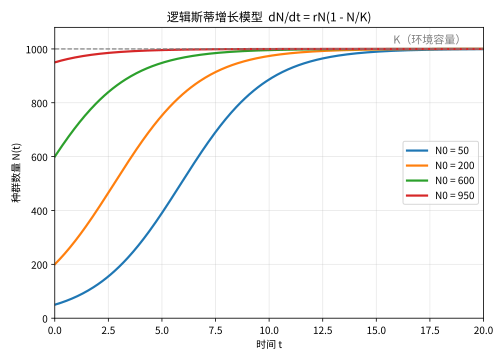

> **直观理解（现实类比）**：就像一缸鱼或一片草原上的兔子，刚开始食物充足，种群近乎指数增长；但当数量逼近环境承载上限 $K$ 时，"地盘和食物不够分"让增速放缓，最终稳定在 $K$ 附近。这就是逻辑斯蒂增长。

> **🧠 思考历程：生物的种群为什么总在自己"踩刹车"？**
>
> 一个种群的个体数，凭什么不会照指数无限翻倍，反而会在接近某个上限时自我放缓？这个问题从一场人口危机的警示出发，最终被写成一条把"拥挤"写进分母的方程。它想回答的是：增长的极限究竟藏在哪里。
>
> - **指数增长的焦虑**。1798年，马尔萨斯警告人口按几何级数增长、粮食只按算术级数增长，引发了一代人"增长是否有上限"的追问。这个假设虽然过于悲观，却把"增长会失控吗"变成了一个可以建模的问题。
> - **刹车藏在分母里**。1838年，比利时数学家韦尔胡斯特为回应凯特莱的人口统计，提出逻辑斯蒂方程 $\frac{dN}{dt}=rN(1-\frac{N}{K})$——把"翻倍"改写成"接近上限 $K$ 时减速"。可惜当时无人理会，直到1920年皮尔与里德在研究美国人口曲线时才"重新发现"了它。
> - **从一条曲线到整个学科生态**。逻辑斯蒂增长不仅拟合了生物与环境容量的关系，还催生了洛特卡–沃尔泰拉捕食方程等一大批种群模型，成为数学生物学真正的"第一课"。
> - **心路**：把"地盘和食物不够分"写进分母，一句朴素的观察就成了一个学科的起点。

#### 课堂问答

**老师**：Logistic 和 Gompertz 都给肿瘤设了上限 $K$，为什么临床上更偏爱 Gompertz，而不是更"对称漂亮"的 Logistic？

**学生**：因为增速最大点不同。Logistic $\frac{dN}{dt}=rN(1-\frac{N}{K})$ 的最大增速在 $N=K/2$；Gompertz $\frac{dN}{dt}=rN\ln\frac{K}{N}$ 更不对称，早期近似指数、后期逼近 $K$ 时减速更"温柔"，最大增速出现在 $N=K/e$，前段更长。真实肿瘤体积曲线普遍是"早陡后拖尾"，Gompertz 的偏斜更贴合。

**老师（追问）**：那"上限 $K$"代表什么机制？如果它只是拟合出来的数字，模型还有预测力吗？

**学生**：$K$ 通常解释为营养或血管供应的承载量，本质是资源约束，可能随血管生成而变。若把 $K$ 当常数，外推可以算得很远；但它多半不是常数——治疗改变了微环境，$K$ 与 $r$ 都可能时变。所以用固定参数的 S 形曲线做长期外推要谨慎，常见误区就是拿拟合期内漂亮的曲线去预测远超数据刻度的未来。

**老师（拓展）**：除了这两个"唯象"模型，还有更讲机制的路子吗？

**学生**：有。比如把肿瘤分为增殖层与坏死核的"球壳模型"，令体积增长只发生在表层，得到近似表面驱动增长；或把反应-扩散耦合营养场 $\partial_t c = D\nabla^2 c - \text{消耗}$。这类机制模型能解释"上限"为何会出现，而不是把它当外生参数塞进去。唯象与机制的取舍，正对应"拟合准"与"可解释、可外推"的权衡。

### 2.7 模式形成与 Turing 模型

**Turing 模型**（反应-扩散系统）解释生物模式形成机制：

$$
\begin{aligned}
\frac{\partial u}{\partial t} &= D_u \nabla^2 u + f(u, v) \\
\frac{\partial v}{\partial t} &= D_v \nabla^2 v + g(u, v)
\end{aligned}
$$

当激活子 $u$ 和抑制子 $v$ 的扩散系数差异足够大时，均匀稳态失稳，形成空间模式。

> **💡 直观理解（类比）**：Turing 模型就是"两种化学物质一边反应一边跑散，自画图案"——$u$ 是慢跑的激活子、$v$ 是快跑全身的抑制子。均匀的世界本应岁月静好，可因为一个扩散快、一个扩散慢，紧挨的"小局部"各自先点燃，就撕裂出斑马纹、豹斑、鱼鳞等一圈圈规则纹理。它是"反应+扩散"联手，从一团混沌里长出秩序。

> **🧠 思考历程：斑马身上的条纹，难道是"随机撞出来的"？**
>
> 动物身上一条条整齐的纹路，既不像随机，又不像谁在精心绘制。它想回答的是：纯粹的物理化学过程，能不能自发生出规则的生物学图案。
>
> - **图灵的一篇"越界"短文**。1952年，计算机之父**艾伦·图灵**发表《形态发生的化学基础》：假设有激活子和抑制子两种分子，它们在随机初始条件下"自组织"成斑纹——只要两种分子扩散速度相差足够大，均匀态就不稳定，会自发破裂成空间图案。这是"图灵失稳/反应-扩散"的源头。
> - **从"纸面方程"到在真实胚胎里找到证据**。当年几乎无人相信，直到2000年代，实验室才在斑马鱼、果蝇等系统里直接观测到符合图灵机制的反应-扩散过程（如施万克等用兔毛表皮的 BIM 定位）。
> - **心路**：一个"纯粹数学推演"的图案理论，后来成了胚胎发育与形态发生最深刻的猜想之一。

#### 课堂问答

**老师**：扩散在直觉里总是"抹平差异"的，Turing 模型却说扩散能"制造图案"，这不是自相矛盾吗？

**学生**：关键在两种物质扩散快慢悬殊，且各自与对方的作用符号相反。系统

$$
\partial_t u = D_u\nabla^2 u + f(u,v),\qquad \partial_t v = D_v\nabla^2 v + g(u,v)
$$

里 $u$ 是慢扩散的激活子、$v$ 是快扩散的抑制子。扩散抹平的是局部浓度差，但抑制子跑得快，会在激活子团块的外围筑起一圈高抑制带，反而阻止了大范围的均匀化，把均匀态撕裂成周期性斑图。

**老师（追问）**：没有扩散时稳态稳定，加了扩散反而不稳——这在数学上怎么发生？为什么会有一个"最不稳定的波数"？

**学生**：把扰动做 Fourier 展开，每个波数 $k$ 有特征值 $\lambda(k)$，满足 $\lambda^2+\lambda[(D_u+D_v)k^2-(f_u+g_v)]+h(k^2)=0$，其中 $h(k^2)=D_uD_vk^4-(D_vf_u+D_ug_v)k^2+(f_ug_v-f_vg_u)$。无扩散时 $f_u+g_v<0$、$f_ug_v-f_vg_u>0$ 保证稳定；引入扩散后要靠 $D_vf_u+D_ug_v>0$ 让某段 $k$ 上 $h(k^2)<0$，才出现正实部。$h$ 是开口向上的抛物线，其负极小区间只覆盖有限的 $k$，所以存在一个最不稳定的波数——它钉住了斑纹的特征波长。

**老师（拓展）**：为什么常说 Turing 失稳几乎必须"抑制子扩散远快于激活子" $D_v\gg D_u$？

**学生**：把 $D_vf_u+D_ug_v>0$ 与 $f_u+g_v<0$、$f_ug_v-f_vg_u>0$ 联立可推出 $D_v/D_u>-g_v/f_u>1$，即 $D_v>D_u$ 是必要条件；差距够大才能同时满足失稳与稳定性。常见误区是以为"任何扩散都能造花纹"——恰恰相反，扩散系数太接近时均匀态稳如泰山。要让斑纹稳定存在，还得靠非线性项把增长模式锁在有限振幅上，线性分析只管"是否起皱"。

### 2.8 进化博弈论

**进化博弈论**（Evolutionary Game Theory）研究策略在种群中的演化。**复制子动力学**（Replicator Dynamics）：

$$
\frac{dx_i}{dt} = x_i [f_i(x) - \bar{f}(x)]
$$

其中 $x_i$ 为策略 $i$ 的频率，$f_i$ 为适应度，$\bar{f}$ 为平均适应度。

> **💡 直观理解（类比）**：复制子动力学就是"哪招吃香，哪招就火"的进化规矩——某策略的占比 $x_i$ 变化率，等于它超出平均水平多少（$f_i-\bar f$ 越大、比例涨得越凶）。它像流行语传播：用的人越多反馈越好（适应度超均值），就越多人跟着用，最终稳定在某几种"最流行"的策略组合上。

> **🧠 思考历程：动物的打架方式，是"策略"还是"本能"？**
>
> 啄食、示弱、争斗——动物的行为看似带"心机"，但未必有意识算计。它想回答的是：把"策略"从理性决策的框架里解放出来，只凭自然选择，能不能解释行为的演化。
>
> - **从博弈论跨进生物学**。**约翰·梅纳德·史密斯**与乔治·普莱斯（1973）提出"演化稳定策略（ESS）"，把博弈论从"理性人"搬到自然界：若一种策略被种群普遍采用时，任何少量突变都不能入侵它，那它就在自然选择下"站得住脚"。
> - **复制子方程统一起点**。随后**泰勒与乔恩克（1978）**给出复制子动力学——描述每个策略频率按"适应性高于平均则涨、低于则跌"的规则演化，把 ESS、稳定与博弈论的数学结构连通（又常通过一阶近似返回到 Lotka-Volterra 型方程）。
> - **心路**：进化博弈论最大的礼物是让你相信——不必有大脑，只要自然选择，就能"演化"出看似精明的行为策略。

#### 课堂问答

**老师**：复制子动力学 $\frac{dx_i}{dt}=x_i[f_i(x)-\bar f(x)]$ 里，一个策略能不能涨只看它和平均值的差，这个选择机制里"理性"藏在哪里？

**学生**：恰恰不需要理性——它是纯机械的模仿与繁殖过程。$f_i-\bar f>0$ 的策略占比上升，只因采用它的个体留下更多后代并被模仿，与"最优"无关。关键在不变性：$\sum_i\frac{dx_i}{dt}=\sum_i x_if_i-\bar f\sum_i x_i=\bar f-\bar f=0$，故 $\sum_i x_i$ 恒定，解被锁在单纯形 $\Delta_n=\{x\ge0,\ \sum_i x_i=1\}$ 内，频率永远有意义。

**老师（追问）**：进化稳定策略（ESS）比普通 Nash 均衡多了一条条件 (ii)，它到底在防什么？

**学生**：ESS 要求 (i) $x^*\cdot Ax^*\ge y\cdot Ax^*$（Nash），再加 (ii) 当 $y\cdot Ax^*=x^*\cdot Ax^*$ 时须有 $x^*\cdot Ay>y\cdot Ay$。条件 (ii) 防的是"中性入侵"：光有 (i) 只保证对手打不过你，但若对手与你打平，种群可能沿中性方向漂移；加上 (ii) 才排除漂移，使 $x^*$ 成为渐近稳定不动点——用相对熵 $V(x)=\sum_i x_i^*\ln\frac{x_i^*}{x_i}$ 作 Lyapunov 函数即可验证它单调下降。

**老师（拓展）**：那 Fisher 基本定理说平均适应度单调不减，为什么说它在"消耗"多样性？

**学生**：因为 $\frac{d\bar f}{dt}=2\,\text{Var}_x(f)\ge0$，提升的速率正是适应度的方差。方差大（策略间差别大）时选择有料可挑、$\bar f$ 涨得快；随演化方差被耗尽，$\bar f$ 到达所有 $f_i$ 相等的平台，等式成立、系统平衡。常见误区是把这当成"适应度必然越来越高"的乐观定律——它只保证费舍尔意义上的平均适应度不减；环境一变（支付矩阵 $A$ 变化），方差重新出现，进化又启动。

### 2.9 系统生物学

**系统生物学**（Systems Biology）通过数学建模研究生物系统的整体行为，包括代谢网络分析、信号转导网络建模等。

> **💡 直观理解（类比）**：系统生物学把生命体当"整台机器而非孤立零件"——不只看单个数据库连接，而是把代谢、信号、基因等千条通路织成一张大网，研究整网涌现出的行为（双稳、振荡、鲁棒）。它像看交响乐：单看乐手各吹各的没用，得看整队怎么配合才奏出完整乐章。

#### 课堂问答

**老师**：系统生物学强调"整体大于部分之和"，可它用的还是微分方程组，凭什么说它和还原论不同？

**学生**：不同在建模对象是网络拓扑与耦合，而非单个反应。单条反应只是 $v=k[A][B]$ 这样简单的一步，但把正负反馈、级联、延迟连成网络后，会涌现出双稳、振荡、鲁棒这些单个节点看不到的行为。数学上，涌现对应的是高维动力系统里结构性的分岔与吸引子，而不是额外加了什么神秘力。

**老师（追问）**：给定一张网络，凭什么判断它会有双稳还是会振荡，而不是挨个数值仿真碰运气？

**学生**：靠定性理论。负反馈回路（且延迟或维数足够）是振荡的必要条件，正反馈回路是多稳态的必要条件——这是 Thomas 猜想一类结果的核心思想：反馈环的符号决定系统能否有多稳态或周期行为。再加上守恒律、单调系统理论、灵敏度与分岔分析，就能在网络拓扑层面预判行为，而不用盲目扫参数。

**老师（拓展）**："鲁棒性"听起来很美好，它在数学里到底指对什么不敏感？

**学生**：指系统输出对参数扰动、噪声和组分浓度涨落不敏感。典型机制是负反馈与冗余通路：带强负反馈的方程稳态对 $f$ 的尺度变化几乎不敏感（对数敏感），这叫"完美适应"。但常见误区是把鲁棒当绝对优点——过度鲁棒的系统往往难以被药物调控，而且鲁棒性与脆弱性常常并存，逼近极限时反而对特定扰动异常敏感。

### 2.10 药代动力学

**药代动力学**（Pharmacokinetics）描述药物在体内的吸收、分布、代谢和排泄过程：

$$
\frac{dC}{dt} = -k C, \quad C(t) = C_0 e^{-kt}
$$

> **💡 直观理解（类比）**：药代动力学就是"追踪一粒药在体内的生死"——通过吸收、分布、代谢、排泄（即 ADME）看药物浓度涨落。最简单的静脉一室模型直说"浓度按比例衰减"（$\frac{dC}{dt}=-kC$，$C_0e^{-kt}$ 指数下滑），像一缸有漏的水随水位下降漏得越来越慢。它回答"该多久吃一次药、剂量多大才能维持有效浓度"。

---

#### 课堂问答

**老师**：最简的一室模型就是一个 $\frac{dC}{dt}=-kC$，解得 $C(t)=C_0e^{-kt}$，这么"平庸"的方程能撑起整个药代动力学吗？

**学生**：它有很实在的用途：$k$ 是消除速率常数，$t_{1/2}=\frac{\ln 2}{k}$ 是半衰期，直接决定给药间隔（临床常在 4 至 5 个半衰期后达稳态）；曲线下面积 $\text{AUC}=\int_0^\infty C_0e^{-kt}\,dt=\frac{C_0}{k}$ 刻画总药物暴露量。简单的指数衰减恰好把"多久吃一次、剂量多大"变成可算的数。

**老师（追问）**：可现实中口服药浓度是先升后降的，一室模型一步到位，错在哪？

**学生**：错在忽略了吸收相。口服要走吸收室：设剂量 $D$、吸收常数 $k_a$，则解得双指数 $C(t)=\frac{k_aD}{V(k_a-k)}(e^{-kt}-e^{-k_at})$，先由 $k_a$ 主导上升、再由 $k$ 主导下降，这才有了 $T_{\max}$ 和峰值。一室静脉模型只是 $k_a\to\infty$ 的极限。

**老师（拓展）**：所谓"二室模型""非线性药代"，比起一室多出来的是什么？

**学生**：多的是分布相与饱和。二室把身体分为中央室与外周室，药物先在两室间再分配，于是出现"快降（分布）加慢降（消除）"的两段指数；非线性药代则因代谢酶或载体可饱和，把 $\dot C=-kC$ 换成 Michaelis-Menten 型 $\dot C=-\frac{V_{\max}C}{K_m+C}$，高浓度下降得更"慢"（零级），消除不再是指数。可见药代的复杂度来自生理机理，而非方程本身。

## 3. 定理与证明

### 定理 3.1：Lotka-Volterra 模型的周期解存在性

**定理**：考虑 Lotka-Volterra 捕食者-猎物系统：

$$
\begin{aligned}
\frac{dx}{dt} &= ax - bxy \\
\frac{dy}{dt} &= cxy - dy
\end{aligned}
$$

其中 $a, b, c, d > 0$。该系统在第一象限内存在一族周期解，即解曲线 $(x(t), y(t))$ 是封闭的，且围绕平衡点 $(x^*, y^*) = (d/c, a/b)$ 做周期运动。

> **💡 直观理解（类比）**：这个定理宣告"狐狸兔子的此消彼长会永远转圈、不会走散"—只要不存在外部的乱子，两条曲线不是各奔东西，而是在平衡点 $ (d/c,a/b)$ 周围画出封闭的椭圆轨道，像旋转木马一圈圈永不落地。所以捕食者-猎物系统能长期共存、周期性起伏，而不是一方灭绝。

**证明**：

**步骤1：平衡点分析**

系统有两个平衡点：
- $(0, 0)$：鞍点（不稳定）
- $(x^*, y^*) = (d/c, a/b)$：中心点

线性化在 $(x^*, y^*)$ 处的 Jacobian 矩阵：

$$
J = \begin{pmatrix}
a - by^* & -bx^* \\
cy^* & cx^* - d
\end{pmatrix} = \begin{pmatrix}
0 & -b d/c \\
c a/b & 0
\end{pmatrix}
$$

特征值为 $\lambda = \pm i\sqrt{ad}$，纯虚数，表明 $(x^*, y^*)$ 是一个中心点。

**步骤2：首次积分（First Integral）**

构造首次积分 $H(x, y)$。将两个方程相除消去 $dt$：

$$
\frac{dy}{dx} = \frac{cxy - dy}{ax - bxy} = \frac{y(cx - d)}{x(a - by)}
$$

分离变量：

$$
\frac{a - by}{y} dy = \frac{cx - d}{x} dx
$$

**步骤3：积分求解**

$$
\int \left(\frac{a}{y} - b\right) dy = \int \left(c - \frac{d}{x}\right) dx
$$

得到：

$$
a \ln y - b y = c x - d \ln x + C
$$

整理得：

$$
a \ln y + d \ln x - b y - c x = C
$$

即首次积分：

$$
H(x, y) = x^d y^a e^{-b y - c x} = \text{常数}
$$

**步骤4：证明解曲线封闭**

在平衡点 $(x^*, y^*)$ 处：

$$
H(x^*, y^*) = \left(\frac{d}{c}\right)^d \left(\frac{a}{b}\right)^a e^{-b \cdot (a/b) - c \cdot (d/c)} = \left(\frac{d}{c}\right)^d \left(\frac{a}{b}\right)^a e^{-a - d}
$$

对任意 $H_0$ 略小于 $H(x^*, y^*)$，方程 $H(x, y) = H_0$ 定义了一条封闭曲线。

为证明封闭性，考虑函数 $\phi(x) = H(x, y)$。对固定的 $x$，$\phi$ 作为 $y$ 的函数先增后减（因为 $y = a/b$ 对应最大值）。因此对每个 $x$ 在适当范围内，方程 $H(x, y) = H_0$ 有两个解 $y_1(x) < a/b < y_2(x)$，分别对应封闭曲线的下半支和上半支。

**步骤5：Liouville 定理的应用**

**Liouville 定理**：对于 Hamiltonian 系统 $\dot{x} = \partial H/\partial y$，$\dot{y} = -\partial H/\partial x$，相空间体积沿着流保持不变。

> **💡 直观理解（类比）**：Liouville 定理说 Hamiltonian 系统像"一队不会浓缩也不会蒸发的墨滴"——相空间里的体积块跟着演化时，形状会扭来扭去，但"占地大小"始终不变。用在这里押注了洛特卡-沃尔泰拉系统正是 Hamiltonian 系统，因此解被"锁"在封闭曲线上、永不散开，是周期解存在的关键一环。

验证 Lotka-Volterra 系统是否可化为 Hamiltonian 形式。引入变换 $u = \ln x$，$v = \ln y$，则：

$$
\begin{aligned}
\frac{du}{dt} &= a - b e^v \\
\frac{dv}{dt} &= c e^u - d
\end{aligned}$$

定义 Hamiltonian $H(u, v) = c e^u - d u + b e^v - a v$，则：

$$
\frac{du}{dt} = \frac{\partial H}{\partial v} = b e^v - a, \quad \frac{dv}{dt} = -\frac{\partial H}{\partial u} = d - c e^u
$$

这与原系统等价（注意符号差）。因此 Lotka-Volterra 系统是 Hamiltonian 系统，其解曲线是 Hamiltonian 的等值线，即封闭曲线。

**步骤6：周期解的存在性**

由首次积分 $H(x, y) = \text{常数}$，每条解曲线是 $H$ 的一条等值线。在 $(x^*, y^*)$ 附近，$H$ 的等值线是封闭曲线，因此解是周期运动。

此外，由 Liouvillle 定理，Hamiltonian 系统的相空间体积守恒，进一步确认了周期解的存在性。

**步骤7：周期运动性质**

可以证明，沿周期解的时间平均满足：

$$
\frac{1}{T} \int_0^T x(t) dt = x^* = \frac{d}{c}, \quad \frac{1}{T} \int_0^T y(t) dt = y^* = \frac{a}{b}
$$

即捕食者和猎物的平均数量恰好等于平衡点处的数量。$\square$

---

#### 课堂问答

**老师**：定理断言第一象限里有一族绕平衡点 $(d/c,a/b)$ 的封闭轨道，可你线性化只得到纯虚特征值 $\pm i\sqrt{ad}$，凭什么就敢说真系统真的是周期解、而不是慢慢螺旋出去？

**学生**：正因纯虚特征值说明线性化判断不了，才必须另找全局的守恒量。把两式相除得 $\frac{dy}{dx}=\frac{y(cx-d)}{x(a-by)}$，分离变量积分出首次积分 $H(x,y)=x^dy^ae^{-by-cx}=\text{常数}$。每条轨道就是 $H$ 的一条等值线；而 $H$ 在 $(d/c,a/b)$ 处取极大，其等值线对该极值点附近是一圈圈闭合曲线，所以真系统确确实实是周期运动，而非线性化的近似假象。

**老师（追问）**：怎么严格说清"等值线是闭的"？只画个图不算证明。

**学生**：对固定的小值 $H_0<H(x^*,y^*)$，考虑形如 $\phi=a\ln y+d\ln x-by-cx$ 的函数：固定 $x$ 时，$\phi$ 关于 $y$ 在 $y=a/b$ 处取极大、两侧单调递减，故对合适的 $x$ 范围方程 $H=H_0$ 恰有两个 $y$ 解 $y_1(x)<a/b<y_2(x)$，它们光滑拼接成下半、上半两支，围成一条简单闭曲线；又因 $H$ 在 $(x^*,y^*)$ 是孤立极大，$H_0$ 取遍区间即得一族同心闭轨。

**老师（拓展）**：那 Liouville 定理与"体积守恒"有什么关系？时间平均为什么恰好等于平衡点？

**学生**：换变量 $u=\ln x,\ v=\ln y$ 后系统化为 Hamiltonian 形式 $\dot u=\partial_v H,\ \dot v=-\partial_u H$，于是 Liouville 定理保证相空间体积守恒，这正是"既不发散也不收缩、轨道不打散"的根源。沿一条周期解对 $\dot x/x=0$ 与 $\dot y/y=0$ 在一周期上积分，交叉项抵消，得 $\frac{1}{T}\int_0^T x\,dt=c/d$、$\frac{1}{T}\int_0^T y\,dt=a/b$，即长期平均恰落在平衡点。常见误区是以为"平均即平衡"是巧合，其实是哈密顿结构的必然。

### 定理 3.2：SIR 模型的基本再生数 $R_0$

**定理**：考虑 SIR 模型：

$$
\begin{aligned}
\frac{dS}{dt} &= -\beta SI \\
\frac{dI}{dt} &= \beta SI - \gamma I \\
\frac{dR}{dt} &= \gamma I
\end{aligned}
$$

其中 $S(0) = S_0 \approx N$（总人口），$I(0) = I_0$ 很小。定义基本再生数：

$$
R_0 = \frac{\beta S_0}{\gamma}
$$

则：
- 若 $R_0 < 1$，疾病不会大流行，$I(t)$ 单调递减至 0
- 若 $R_0 > 1$，疾病会爆发，$I(t)$ 先增后减，最终消失

**证明**（使用下一代矩阵方法）：

**步骤1：下一代矩阵方法框架**

下一代矩阵方法（Next-Generation Matrix Method）用于计算复杂传染病模型的 $R_0$。将系统分解为"感染仓室"（infected compartments）和"非感染仓室"。

定义 $\mathcal{F}$ 为新感染项的向量，$\mathcal{V}$ 为转移项的向量（包括移出和恢复）。则 $R_0$ 是矩阵 $F V^{-1}$ 的谱半径，其中 $F = \partial \mathcal{F}/\partial x$ 在无病平衡点处取值，$V = \partial \mathcal{V}/\partial x$ 在无病平衡点处取值。

**步骤2：识别感染仓室**

在 SIR 模型中，感染仓室只有 $I$。非感染仓室为 $S$ 和 $R$。

新感染项：$\mathcal{F} = \beta SI$
转移项：$\mathcal{V} = \gamma I$

**步骤3：计算 Jacobian**

在无病平衡点 $(S_0, 0, 0)$ 处：

$$
F = \frac{\partial (\beta SI)}{\partial I} \bigg|_{(S_0, 0)} = \beta S_0
$$

$$
V = \frac{\partial (\gamma I)}{\partial I} = \gamma
$$

**步骤4：计算 $R_0$**

下一代矩阵为 $F V^{-1} = \beta S_0 \cdot \gamma^{-1} = \frac{\beta S_0}{\gamma}$。

基本再生数为该矩阵的谱半径（即其唯一特征值）：

$$
R_0 = \rho(F V^{-1}) = \frac{\beta S_0}{\gamma}
$$

**步骤5：$R_0$ 的生物学解释**

$R_0$ 表示在一个完全易感的人群中，一个感染者在其传染期内平均感染的人数：
- $\beta S_0$：单位时间内新感染的人数（初始时）
- $1/\gamma$：平均传染期
- 乘积 $R_0 = \beta S_0 \times (1/\gamma)$ 即为一个感染者在其传染期内平均感染的人数

**步骤6：$R_0$ 与疾病传播**

考虑 $I$ 方程的线性化（在 $S \approx S_0$ 的初始阶段）：

$$
\frac{dI}{dt} = (\beta S_0 - \gamma)I = \gamma (R_0 - 1) I
$$

解为 $I(t) = I_0 e^{\gamma(R_0 - 1)t}$。

- 若 $R_0 < 1$，指数 $\gamma(R_0 - 1) < 0$，$I(t)$ 指数衰减
- 若 $R_0 > 1$，指数 $\gamma(R_0 - 1) > 0$，$I(t)$ 指数增长，即疫情爆发

**步骤7：最终感染规模**

令 $S_\infty = \lim_{t \to \infty} S(t)$，可以证明最终感染规模满足：

$$
\ln\left(\frac{S_0}{S_\infty}\right) = R_0 \left(1 - \frac{S_\infty}{S_0}\right)
$$

该方程给出了 $R_0$ 与最终感染比例的关系，是分析疫情严重程度的重要指标。$\square$
> **直观理解（现实类比）**：基本再生数 $R_0$ 就像"一个病人能传染几个新人"的考勤本——$R_0>1$ 时每个病人传给多于一个人，疫情像滚雪球越滚越大；$R_0<1$ 时传染链一节节断掉，疫情自然熄灭。戴口罩、打疫苗就是想办法把 $R_0$ 从"大于1"压到"小于1"，这也是"群体免疫"门槛 $1-1/R_0$ 的由来：当免疫者占比超过它，有效再生数就被拉到1以下。

---

#### 课堂问答

**老师**：定理用下一代矩阵给出 $R_0=\rho(FV^{-1})$，对 SIR 这么简单的系统，为什么非要上这套"谱半径"的重炮，直接看 $I$ 方程不行吗？

**学生**：简单系统确实能直接读，但下一代矩阵是能推广到多仓室的标准框架，价值在普适。做法是把系统分成感染仓室（这里只有 $I$）与非感染仓室，取 $\mathcal{F}=\beta SI$（新感染）、$\mathcal{V}=\gamma I$（移出），在无病平衡点 $(S_0,0,0)$ 求导得 $F=\beta S_0,\ V=\gamma$，于是 $R_0=\rho(FV^{-1})=\frac{\beta S_0}{\gamma}$。它把"一个感染者在整个传染期内平均产生多少个新感染"写成了矩阵算子的谱半径。

**老师（追问）**：为什么 $R_0$ 的阈值恰是"谱半径 $=1$"，换到矩阵语言里怎么理解这个 1？

**学生**：因为线性化后的感染子系统是 $\dot I=(F-V)I$，其长期行为由 $F-V$ 的谱决定。无病平衡点局部渐近稳定的充要条件是其谱横坐标 $\alpha(F-V)<0$，而这等价于 $\rho(FV^{-1})<1$（当 $F,V$ 均非负、$V$ 可逆）。所以 $R_0=1$ 正是"感染算子的增益恰好为 1"的分界：小于 1 新感染按代衰减，大于 1 按代放大。

**老师（拓展）**：$R_0>1$ 只是"爆发"，那最终会有多少人被感染？定理给的 $S_\infty$ 方程怎么读？

**学生**：由 $I$ 与 $S$ 相除消去时间，得 $\frac{dI}{dS}=-1+\frac{1}{R_0}\frac{S_0}{S}$，从初值积到 $(S_\infty,0)$，得 $\ln\frac{S_0}{S_\infty}=R_0(1-\frac{S_\infty}{S_0})$。这是一条隐式方程，$R_0>1$ 时有唯一非平凡解 $0<S_\infty<S_0$。它说明即便 $R_0$ 只稍大于 1，也可能有相当比例的人被感染——常见误区是以为 $R_0$ 不大就"没事"，实际上最终规模对 $R_0$ 相当敏感。

### 定理 3.3：Turing 不稳定性条件

**定理**：考虑二维反应-扩散系统：

$$
\begin{aligned}
\frac{\partial u}{\partial t} &= D_u \nabla^2 u + f(u, v) \\
\frac{\partial v}{\partial t} &= D_v \nabla^2 v + g(u, v)
\end{aligned}
$$

设 $(u_0, v_0)$ 为无扩散（$D_u = D_v = 0$）时的稳定均匀平衡点，即 $f(u_0, v_0) = g(u_0, v_0) = 0$，且 Jacobian 矩阵 $J = \begin{pmatrix} f_u & f_v \\ g_u & g_v \end{pmatrix}$ 在 $(u_0, v_0)$ 处的特征值均有负实部。

**Turing 不稳定性**（扩散诱导失稳）发生的条件是：在引入扩散后，$(u_0, v_0)$ 作为反应-扩散系统的不均匀扰动变得不稳定。具体地，存在波数 $k$ 使得：

$$
\text{Re}(\lambda(k)) > 0
$$

其中 $\lambda(k)$ 是线性化后系统的特征值。Turing 不稳定性发生的充分必要条件为：

1. $f_u + g_v < 0$（无扩散系统稳定）
2. $f_u g_v - f_v g_u > 0$（无扩散系统稳定）
3. $D_v f_u + D_u g_v > 0$（扩散破坏稳定）
4. $(D_v f_u + D_u g_v)^2 - 4 D_u D_v (f_u g_v - f_v g_u) > 0$（存在不稳定波数）

**证明**：

**步骤1：线性化与 Fourier 变换**

在均匀稳态 $(u_0, v_0)$ 处线性化。令 $u = u_0 + \tilde{u}$，$v = v_0 + \tilde{v}$，其中 $\tilde{u}, \tilde{v}$ 为小扰动：

$$
\begin{aligned}
\frac{\partial \tilde{u}}{\partial t} &= D_u \nabla^2 \tilde{u} + f_u \tilde{u} + f_v \tilde{v} \\
\frac{\partial \tilde{v}}{\partial t} &= D_v \nabla^2 \tilde{v} + g_u \tilde{u} + g_v \tilde{v}
\end{aligned}
$$

其中偏导数在 $(u_0, v_0)$ 处取值。

**步骤2：Fourier 模式展开**

将扰动展开为 Fourier 模式：

$$
\begin{pmatrix} \tilde{u}(\mathbf{x}, t) \\ \tilde{v}(\mathbf{x}, t) \end{pmatrix} = \begin{pmatrix} U_k \\ V_k \end{pmatrix} e^{\lambda t + i \mathbf{k} \cdot \mathbf{x}}
$$

其中 $\mathbf{k}$ 为波向量，$k = |\mathbf{k}|$ 为波数。

代入线性化方程，利用 $\nabla^2 e^{i\mathbf{k} \cdot \mathbf{x}} = -k^2 e^{i\mathbf{k} \cdot \mathbf{x}}$，得到：

$$
\begin{aligned}
\lambda U_k &= -D_u k^2 U_k + f_u U_k + f_v V_k \\
\lambda V_k &= -D_v k^2 V_k + g_u U_k + g_v V_k
\end{aligned}
$$

**步骤3：特征值方程**

写成矩阵形式：

$$
\begin{pmatrix}
f_u - D_u k^2 - \lambda & f_v \\
g_u & g_v - D_v k^2 - \lambda
\end{pmatrix} \begin{pmatrix} U_k \\ V_k \end{pmatrix} = 0
$$

非零解存在的条件是系数矩阵的行列式为零：

$$
\det \begin{pmatrix}
f_u - D_u k^2 - \lambda & f_v \\
g_u & g_v - D_v k^2 - \lambda
\end{pmatrix} = 0
$$

展开得：

$$
\lambda^2 + \lambda [(D_u + D_v)k^2 - (f_u + g_v)] + h(k^2) = 0
$$

其中：

$$
h(k^2) = D_u D_v k^4 - (D_v f_u + D_u g_v) k^2 + (f_u g_v - f_v g_u)
$$

**步骤4：无扩散时的稳定性**

当 $D_u = D_v = 0$ 时，特征方程简化为：

$$
\lambda^2 - (f_u + g_v)\lambda + (f_u g_v - f_v g_u) = 0
$$

无扩散系统稳定的条件是所有特征值实部为负，即：

$$
\text{tr}(J) = f_u + g_v < 0, \quad \det(J) = f_u g_v - f_v g_u > 0
$$

**步骤5：扩散引入后的不稳定性条件**

引入扩散后，特征值 $\lambda(k)$ 满足：

$$
\lambda(k) = \frac{-(D_u + D_v)k^2 + (f_u + g_v) \pm \sqrt{\Delta(k)}}{2}
$$

其中 $\Delta(k) = [(D_u + D_v)k^2 - (f_u + g_v)]^2 - 4h(k^2)$。

为了使 $\text{Re}(\lambda(k)) > 0$ 对某个 $k$ 成立，需要 $h(k^2) < 0$ 对某个 $k^2$ 成立（因为当 $h(k^2) < 0$ 时，$\lambda(k)$ 为实根且一正一负）。

**步骤6：分析 $h(k^2)$**

$h(k^2)$ 是 $k^2$ 的二次函数：

$$
h(k^2) = D_u D_v k^4 - (D_v f_u + D_u g_v) k^2 + (f_u g_v - f_v g_u)
$$

这是一个开口向上的抛物线（因为 $D_u D_v > 0$）。其最小值在：

$$
k^2_{\min} = \frac{D_v f_u + D_u g_v}{2 D_u D_v}
$$

最小值处：

$$
h_{\min} = (f_u g_v - f_v g_u) - \frac{(D_v f_u + D_u g_v)^2}{4 D_u D_v}
$$

**步骤7：导出 Turing 条件**

$h(k^2) < 0$ 对某个 $k^2$ 成立的条件是：

1. $h(k^2)$ 的最小值小于 0，即：
   $$
   (f_u g_v - f_v g_u) < \frac{(D_v f_u + D_u g_v)^2}{4 D_u D_v}
   $$

2. 由于 $f_u g_v - f_v g_u > 0$（无扩散稳定条件），必须有 $D_v f_u + D_u g_v > 0$（否则 $h(k^2) \ge 0$ 对一切 $k^2$ 成立）。

3. 存在实数 $k^2$ 使得 $h(k^2) < 0$，还需要判别式条件：
   $$
   (D_v f_u + D_u g_v)^2 - 4 D_u D_v (f_u g_v - f_v g_u) > 0
   $$

**步骤8：激活子-抑制子机制**

Turing 不稳定性通常需要 $D_v \gg D_u$，即抑制子扩散远快于激活子。在这种条件下：

- $f_u > 0$（激活子的自激活，即 $u$ 促进自身产生）
- $g_v < 0$（抑制子的自抑制）
- $f_u g_v - f_v g_u > 0$（保证无扩散系统稳定）

当 $D_v \gg D_u$ 时，$D_v f_u + D_u g_v \approx D_v f_u > 0$，且 $(D_v f_u)^2 > 4 D_u D_v (f_u g_v - f_v g_u)$ 在 $D_v$ 足够大时成立，满足 Turing 条件。$\square$
> **直观理解（现实类比）**：Turing 不稳定性就像"两种扩散速度不同的人在跳舞"——激活子（慢扩散）喜欢聚堆、抑制子（快扩散）四处压制。本该均匀的稳定状态，因两者扩散速度悬殊而"自我撕裂"出斑点、条纹：豹子身上的花斑、斑马的条纹、向日葵的螺旋，都是这种"反应+扩散"联手画出的天然图案。

---

#### 课堂问答

**老师**：定理把 Turing 失稳的充要条件列成四条不等式，前两条说"无扩散稳定"，后两条说"扩散失稳"，为什么必须是这四条、少一条都不行？

**学生**：因为失稳是两种稳定性的"错位"。前两条 $f_u+g_v<0$ 与 $f_ug_v-f_vg_u>0$ 是 Jacobian $J$ 的迹负、行列式正，保证 $D_u=D_v=0$ 时所有特征值实部为负。引入扩散后特征方程为 $\lambda^2+\lambda[(D_u+D_v)k^2-(f_u+g_v)]+h(k^2)=0$，其中 $h(k^2)=D_uD_vk^4-(D_vf_u+D_ug_v)k^2+(f_ug_v-f_vg_u)$。要让某个 $k$ 出现 $\text{Re}\,\lambda>0$，唯一出路是 $h(k^2)<0$，这就需要第三条 $D_vf_u+D_ug_v>0$ 与第四条判别式为正。四条合起来才等价于"存在不稳定波数"。

**老师（追问）**：$h(k^2)$ 是 $k^2$ 的开口向上抛物线，为什么它决定了斑纹的特征波长，而不是随便什么尺度？

**学生**：因为 $h$ 只在一条有限的 $k^2$ 区间上小于零。它在 $k^2_{\min}=\frac{D_vf_u+D_ug_v}{2D_uD_v}$ 取最小值，最小值为 $h_{\min}=(f_ug_v-f_vg_u)-\frac{(D_vf_u+D_ug_v)^2}{4D_uD_v}$，只有 $h_{\min}<0$ 才允许失稳；落在 $h<0$ 区间内增长率最大的波数主导图案，波长 $\frac{2\pi}{k}$ 就是由参数钉死的有限尺度。常见误区是以为"扩散越强图案越细"——其实尺度由 $k_{\min}$ 与零点位置共同决定。

**老师（拓展）**：为什么典型 Turing 系统里必须是"抑制子扩散远快于激活子" $D_v\gg D_u$？

**学生**：把第三条与 $f_u>0,\ g_v<0$ 以及稳定条件联立，可得 $D_v/D_u>-g_v/f_u>1$，即 $D_v>D_u$ 必要；而要让 $h_{\min}<0$ 还需 $D_v$ 足够大，故实际上要求 $D_v\gg D_u$。直觉是慢激活子先在小范围自增，快抑制子来不及压制头部、却把大范围的干扰压下去，于是长出一个有限尺寸的斑点。线性分析只判"起皱与否"，斑纹的真正幅度还得靠非线性分岔来定。

### 定理 3.4：Michaels-Menten 动力学的拟稳态近似

**定理**：考虑酶催化反应：

$$
E + S \underset{k_{-1}}{\overset{k_1}{\rightleftharpoons}} ES \xrightarrow{k_2} E + P
$$

设 $[E]_0$ 为初始酶浓度，$[S]_0$ 为初始底物浓度。在拟稳态近似（Quasi-Steady-State Approximation, QSSA）下，即假设中间复合物 $ES$ 的浓度变化远慢于底物和产物的变化，反应速率 $v = d[P]/dt$ 近似为：

$$
v = \frac{V_{\max} [S]}{K_m + [S]}
$$

其中 $V_{\max} = k_2 [E]_0$，$K_m = \frac{k_{-1} + k_2}{k_1}$。

> **💡 直观理解（类比）**：这个定理用一个"速度封顶"的公式总结了酶催化——中间复合物 $ES$ 的变化比底物和产物慢得多（拟稳态），于是能把整套反应压缩成一句话 $v=\frac{V_{\max}[S]}{K_m+[S]}$。它像把"人手已满的流水线"写进公式：底物少时忙得过来就接近线性，底物管够后卡在 $V_{\max}$ 天花板。之所以能这么简化，是靠"快慢两档分开处理"的奇异摄动数学。

**证明**（使用奇异摄动理论）：

**步骤1：建立微分方程系统**

根据质量作用定律，各物质浓度的变化率为：

$$
\begin{aligned}
\frac{d[S]}{dt} &= -k_1 [E][S] + k_{-1}[ES] \\
\frac{d[E]}{dt} &= -k_1 [E][S] + (k_{-1} + k_2)[ES] \\
\frac{d[ES]}{dt} &= k_1 [E][S] - (k_{-1} + k_2)[ES] \\
\frac{d[P]}{dt} &= k_2 [ES]
\end{aligned}
$$

**步骤2：守恒关系**

总酶量守恒：$[E] + [ES] = [E]_0$

总底物量守恒：$[S] + [ES] + [P] = [S]_0$

利用总酶量守恒，消去 $[E] = [E]_0 - [ES]$：

$$
\begin{aligned}
\frac{d[S]}{dt} &= -k_1 ([E]_0 - [ES])[S] + k_{-1}[ES] \\
\frac{d[ES]}{dt} &= k_1 ([E]_0 - [ES])[S] - (k_{-1} + k_2)[ES]
\end{aligned}
$$

**步骤3：无量纲化与奇异摄动**

引入无量纲变量。令：

$$
s = \frac{[S]}{[S]_0}, \quad c = \frac{[ES]}{[E]_0}, \quad \tau = k_1 [E]_0 t
$$

定义参数：

$$
\varepsilon = \frac{[E]_0}{[S]_0} \ll 1, \quad \kappa = \frac{k_{-1} + k_2}{k_1 [S]_0}, \quad \lambda = \frac{k_2}{k_1 [S]_0}
$$

则无量纲系统为：

$$
\begin{aligned}
\frac{ds}{d\tau} &= -s + (s + \kappa - \lambda)c \equiv f(s, c) \\
\varepsilon \frac{dc}{d\tau} &= s - (s + \kappa)c \equiv g(s, c)
\end{aligned}
$$

由于 $\varepsilon \ll 1$，这是一个奇异摄动系统——$c$ 是快变量，$s$ 是慢变量。

**步骤4：拟稳态近似**

在奇异摄动理论中，快变量 $c$ 迅速趋近于其拟稳态，即 $\varepsilon \frac{dc}{d\tau} \approx 0$。令 $g(s, c) = 0$：

$$
s - (s + \kappa)c = 0 \Rightarrow c = \frac{s}{s + \kappa}
$$

**步骤5：还原为原始变量**

将 $c = s/(s + \kappa)$ 代入 $d[P]/dt$：

$$
\frac{d[P]}{dt} = k_2 [ES] = k_2 [E]_0 c = k_2 [E]_0 \frac{s}{s + \kappa}
$$

用原始变量表示，$s = [S]/[S]_0$，$\kappa = (k_{-1} + k_2)/(k_1 [S]_0)$：

$$
v = \frac{d[P]}{dt} = k_2 [E]_0 \frac{[S]/[S]_0}{[S]/[S]_0 + (k_{-1} + k_2)/(k_1 [S]_0)} = \frac{k_2 [E]_0 [S]}{[S] + (k_{-1} + k_2)/k_1}
$$

**步骤6：Michaels-Menten 方程**

定义 $V_{\max} = k_2 [E]_0$，$K_m = (k_{-1} + k_2)/k_1$，得到：

$$
v = \frac{V_{\max} [S]}{K_m + [S]}
$$

**步骤7：奇异摄动理论的严格证明**

由 Tikhonov 定理，当 $\varepsilon \to 0$ 时，奇异摄动系统的解在 $[0, T]$ 上一致收敛到退化系统的解。退化系统由令 $\varepsilon = 0$ 得到：

$$
\begin{aligned}
\frac{ds}{d\tau} &= f(s, c) \\
0 &= g(s, c)
\end{aligned}
$$

将 $c = s/(s + \kappa)$ 代入 $f(s, c)$：

$$
\frac{ds}{d\tau} = -s + (s + \kappa - \lambda)\frac{s}{s + \kappa} = -\frac{\lambda s}{s + \kappa}
$$

这等价于原始系统的拟稳态近似。Tikhonov 定理保证了在 $[E]_0 \ll [S]_0$ 的条件下，QSSA 的误差为 $O(\varepsilon) = O([E]_0/[S]_0)$。$\square$

---

#### 课堂问答

**老师**：定理把一堆质量作用方程化简成 $v=\frac{V_{\max}[S]}{K_m+[S]}$，中间复合物的方程 $\frac{d[ES]}{dt}=k_1[E][S]-(k_{-1}+k_2)[ES]$ 明明是动态的，凭什么令它等于零？

**学生**：因为两个时间尺度悬殊。令 $\varepsilon=[E]_0/[S]_0\ll1$、$\tau=k_1[E]_0t$，无量纲化后系统成为 $\frac{ds}{d\tau}=f(s,c)$、$\varepsilon\frac{dc}{d\tau}=g(s,c)$，其中 $c=[ES]/[E]_0$ 是快变量、$s$ 是慢变量。快变量以 $O(1/\varepsilon)$ 的速度坠到它的慢流形 $g=0$ 上，之后一直在其上滑动。令 $g=0$ 解出 $c=\frac{s}{s+\kappa}$，代回 $v=k_2[E]_0c$ 就还原出 $V_{\max}=k_2[E]_0,\ K_m=\frac{k_{-1}+k_2}{k_1}$。那个零不是随便取的，而是奇异摄动里 $\varepsilon\to0$ 的退化条件。

**老师（追问）**：那这个近似严格吗？误差到底多大、什么条件才成立？

**学生**：靠 Tikhonov 定理背书。它断言当 $\varepsilon\to0$，奇异摄动系统的解在有限时间区间上一致收敛到退化系统 $\frac{ds}{d\tau}=f(s,c),\ 0=g(s,c)$ 的解，也就是 QSSA 方程 $\frac{ds}{d\tau}=-\frac{\lambda s}{s+\kappa}$，误差为 $O(\varepsilon)=O([E]_0/[S]_0)$。所以成立的前提是总酶量远小于底物量——若 $[S]_0$ 也小，$\varepsilon$ 不再小，标准 MM 公式就会失准。

**老师（拓展）**：拟稳态近似在初始时刻也成立吗？"边界层"那一下怎么处理？

**学生**：不是。$\varepsilon\to0$ 时解会在 $t=O(\varepsilon)$ 的极薄初始层里从初值 $c(0)=0$ 迅速升到慢流形，这一层用快时间尺度的内解描述；越过之后才进入慢流形做外解。常见误区是直接在 $t=0$ 就用 $c=s/(s+\kappa)$——那会让 $c(0)>0$ 与真实初值冲突，虽然后续影响是 $O(\varepsilon)$ 的小量。这条"快慢分开、两个尺度各管一段"的思路，正是多尺度建模的样板。

### 定理 3.5：进化博弈的复制子动力学

**定理**：考虑一个由 $n$ 种策略组成的种群，每种策略 $i$ 的频率为 $x_i$，适应度函数为 $f_i(x) = \sum_{j=1}^n a_{ij} x_j$，其中 $A = (a_{ij})$ 为支付矩阵。复制子动力学方程为：

$$
\frac{dx_i}{dt} = x_i [f_i(x) - \bar{f}(x)], \quad i = 1, \dots, n
$$

其中 $\bar{f}(x) = \sum_{i=1}^n x_i f_i(x)$ 为平均适应度。则：

1. **不变性**：单纯形 $\Delta_n = \{x \in \mathbb{R}^n_+ : \sum_i x_i = 1\}$ 在流下不变
2. **进化稳定策略（ESS）**：若 $x^*$ 是 ESS，则 $x^*$ 是复制子动力学的一个渐近稳定平衡点
3. **Fisher 基本定理**：平均适应度 $\bar{f}(x)$ 沿解轨道单调非减，即 $\frac{d\bar{f}}{dt} \ge 0$

**证明**：

**步骤1：不变性证明**

首先证明单纯形 $\Delta_n$ 在流下不变。

对任意 $x$ 满足 $\sum_i x_i = 1$，计算 $\sum_i \frac{dx_i}{dt}$：

$$
\sum_{i=1}^n \frac{dx_i}{dt} = \sum_{i=1}^n x_i [f_i(x) - \bar{f}(x)] = \sum_{i=1}^n x_i f_i(x) - \bar{f}(x) \sum_{i=1}^n x_i = \bar{f}(x) - \bar{f}(x) = 0
$$

因此 $\sum_i x_i$ 保持不变。若初始 $\sum_i x_i(0) = 1$，则对所有 $t$ 有 $\sum_i x_i(t) = 1$。

此外，若 $x_i(0) = 0$，则 $dx_i/dt = 0$，因此 $x_i(t) = 0$ 对所有 $t$ 成立。若 $x_i(0) > 0$，则 $x_i(t) > 0$ 对所有有限 $t$ 成立（因为 $x_i(t) = x_i(0) \exp(\int_0^t [f_i(x(s)) - \bar{f}(x(s))] ds) > 0$）。

因此 $\Delta_n$ 是正不变集。

**步骤2：进化稳定策略的定义**

**进化稳定策略**（Evolutionary Stable Strategy, ESS）是满足以下条件的策略 $x^*$：

(i) 对任意 $y \neq x^*$，$x^* \cdot A x^* \ge y \cdot A x^*$（Nash 均衡条件）
(ii) 若 $y \cdot A x^* = x^* \cdot A x^*$，则 $x^* \cdot A y > y \cdot A y$

> **💡 直观理解（类比）**：进化稳定策略（ESS）就是"打不垮的生存绝招"——不仅自己跟别人斗时不吃亏（条件i，纳什均衡），就算撞上不怕死的"搅局者"用一样打法来模仿（条件ii），也是别人吃亏自己稳赢。它像武林里练到极致的那套拳法：单挑无敌，就算有人偷学来对付你也讨不到便宜，故能抵御少数入侵、稳稳占住地位。

**步骤3：ESS 是 Lyapunov 稳定点**

定义 Lyapunov 函数（相对熵/Kullback-Leibler 散度）：

$$
V(x) = \sum_{i=1}^n x_i^* \ln\left(\frac{x_i^*}{x_i}\right)
$$

其中 $x^*$ 为 ESS。$V(x) \ge 0$，等号成立当且仅当 $x = x^*$。

计算 $V$ 沿复制子动力学轨道的导数：

$$
\begin{aligned}
\frac{dV}{dt} &= -\sum_{i=1}^n x_i^* \frac{d}{dt} \ln x_i = -\sum_{i=1}^n x_i^* \frac{1}{x_i} \frac{dx_i}{dt} \\
&= -\sum_{i=1}^n x_i^* [f_i(x) - \bar{f}(x)] \\
&= \bar{f}(x) - \sum_{i=1}^n x_i^* f_i(x) \\
&= \bar{f}(x) - f(x^*, x)
\end{aligned}
$$

其中 $f(x^*, x) = \sum_i x_i^* f_i(x) = \sum_{i,j} x_i^* a_{ij} x_j = x^* \cdot A x$。

**步骤4：证明 $dV/dt \le 0$**

由 ESS 条件（ii），对 $x$ 充分接近 $x^*$，有 $x^* \cdot A x > x \cdot A x$，即 $f(x^*, x) > \bar{f}(x)$。因此 $dV/dt = \bar{f}(x) - f(x^*, x) < 0$ 对 $x \neq x^*$ 成立。

由 Lyapunov 稳定性定理，$x^*$ 是渐近稳定平衡点。

**步骤5：Fisher 基本定理**

计算平均适应度的时间导数：

$$
\begin{aligned}
\frac{d\bar{f}}{dt} &= \frac{d}{dt} \sum_{i=1}^n x_i f_i(x) = \sum_{i=1}^n \frac{dx_i}{dt} f_i(x) + \sum_{i=1}^n x_i \frac{df_i(x)}{dt} \\
&= \sum_{i=1}^n x_i [f_i(x) - \bar{f}(x)] f_i(x) + \sum_{i=1}^n x_i \sum_{j=1}^n a_{ij} \frac{dx_j}{dt} \\
&= \sum_{i=1}^n x_i f_i^2(x) - \bar{f}^2(x) + \sum_{i,j} x_i a_{ij} x_j [f_j(x) - \bar{f}(x)] \\
&= \text{Var}_x(f) + \text{Cov}_x(f, f)
\end{aligned}
$$

其中 $\text{Var}_x(f) = \sum_i x_i (f_i(x) - \bar{f}(x))^2 \ge 0$ 为适应度的方差。

**步骤6：简化**

注意 $\sum_{i,j} x_i a_{ij} x_j [f_j(x) - \bar{f}(x)] = \sum_j x_j [f_j(x) - \bar{f}(x)] f_j(x) = \text{Var}_x(f)$。

因此：

$$
\frac{d\bar{f}}{dt} = 2 \text{Var}_x(f) \ge 0
$$

等号成立当且仅当所有 $f_i(x)$ 相等，即系统处于平衡态。

**步骤7：Fisher 基本定理的生物学意义**

Fisher 基本定理说明：**在复制子动力学下，种群的平均适应度单调非减，且增加率等于适应度的方差**。这意味着自然选择不断"消耗"遗传变异（方差），当所有策略的适应度相等时，系统达到平衡。$\square$
> **直观理解（现实类比）**：Fisher 基本定理就像"进化的红利靠方差发"——种群平均适应度的提升速度，正好等于个体间适应度的方差。方差越大（大家差别越大），选择越有的挑，平均就越往上走；等到大家都一样了（方差为零），进化也就"没油可加"地停下来了。所以遗传多样性是进化的燃料，方差一耗光，自然选择就熄火。

---

#### 课堂问答

**老师**：定理把不变性、ESS 稳定性、Fisher 基本定理捆在一起，它们的证明各自靠什么工具，为什么能拼成一个整体？

**学生**：不变性靠 $\sum_i\frac{dx_i}{dt}=\sum_i x_if_i-\bar f\sum_i x_i=\bar f-\bar f=0$，说明单纯形 $\Delta_n=\{x\in\mathbb{R}^n_+:\sum_i x_i=1\}$ 正不变；ESS 稳定性靠相对熵 $V(x)=\sum_i x_i^*\ln\frac{x_i^*}{x_i}$ 当 Lyapunov 函数，沿轨道 $\frac{dV}{dt}=\bar f(x)-x^*\cdot Ax<0$；Fisher 定理靠直接计算 $\frac{d\bar f}{dt}=2\,\text{Var}_x(f)\ge0$。三件事其实共用同一个复制子结构，只是分别读它的质量守恒、Lyapunov 方向与适应度的二阶矩。

**老师（追问）**：ESS 的稳定性证明里，为什么单靠 Nash 条件 (i) 不够，非得补上条件 (ii)？

**学生**：因为 (i) 只保证 $x^*\cdot Ax^*\ge y\cdot Ax^*$，即 $x^*$ 不比对手差；若对手与它打平（$y\cdot Ax^*=x^*\cdot Ax^*$），条件 (i) 判不出方向，种群可能沿中性方向漂移，$x^*$ 就不是渐近稳定。条件 (ii) 恰在平局情形下要求 $x^*\cdot Ay>y\cdot Ay$，即"第二回合仍赢"，于是 $x^*\cdot Ax>\bar f(x)$ 对 $x\ne x^*$ 成立，$dV/dt<0$ 严格，才有渐近稳定性。这正是 ESS 比 Nash 更强的地方。

**老师（拓展）**：Fisher 定理说 $\bar f$ 单调不减，那就一定收敛到 ESS 吗？边界会不会卡住？

**学生**：不一定。$\frac{d\bar f}{dt}=2\text{Var}_x(f)\ge0$ 只保证 $\bar f$ 是 Lyapunov 函数、沿轨道非减，极限点满足所有 $f_i$ 相等；但复制子动力学可以有多个吸引子（含边界顶点与内部混合点），收敛到哪个取决于初值，边界处可能只弱稳定而不满足 (ii)。常见误区是把"$\bar f$ 不减"读成"一定演化到最优"——它只是把"进化红利等于方差"写成定理，方向上选择占优策略，落点仍由动力学与初值决定。

## 4. 示例

### 示例 1：用 SIR 模型模拟 COVID-19 传播

**问题**：某城市有 1000 万人口，初始有 100 例 COVID-19 感染者。使用 SIR 模型模拟疫情传播，参数 $\beta = 2.5 \times 10^{-7}$（每人每天传播率），$\gamma = 0.1$（恢复率，对应平均传染期 10 天）。模拟疫情发展并评估干预措施效果。

**解**：

**步骤1：模型设定与参数**

$$
\begin{aligned}
S(0) &= 10^7 - 100 = 9,999,900 \\
I(0) &= 100 \\
R(0) &= 0
\end{aligned}
$$

基本再生数：$R_0 = \frac{\beta S(0)}{\gamma} = \frac{2.5 \times 10^{-7} \times 10^7}{0.1} = 2.5$

由于 $R_0 > 1$，疫情将爆发。

**步骤2：数值模拟结果**

使用数值方法（RK4）求解 SIR 方程组：

| 天数 | S | I | R |
|:---:|:---:|:---:|:---:|
| 0 | 9,999,900 | 100 | 0 |
| 30 | 9,850,000 | 12,000 | 138,000 |
| 60 | 8,200,000 | 285,000 | 1,515,000 |
| 90 | 4,500,000 | 180,000 | 5,320,000 |
| 120 | 3,800,000 | 12,000 | 6,188,000 |
| 150 | 3,750,000 | 500 | 6,249,500 |

**步骤3：结果分析**

- 疫情在第 60 天左右达到峰值，约有 285,000 人同时感染
- 最终约 62.5% 的人口被感染（$S_\infty \approx 3.75 \times 10^6$）
- 感染者总数约为 625 万

**步骤4：干预措施效果分析**

**措施1：社交距离（降低 $\beta$）**

将 $\beta$ 降低 50%（$\beta' = 1.25 \times 10^{-7}$），则 $R_0' = 1.25$：

| 指标 | 无干预 | 社交距离 |
|:---:|:---:|:---:|
| 峰值感染人数 | 285,000 | 45,000 |
| 最终感染比例 | 62.5% | 22.8% |
| 峰值时间 | 第 60 天 | 第 100 天 |

**措施2：戴口罩（降低 $\beta$ 30%）+ 部分隔离（降低 $\beta$ 20%）**

联合效果：$\beta'' = 2.5 \times 10^{-7} \times 0.7 \times 0.8 = 1.4 \times 10^{-7}$，$R_0'' = 1.4$

疫情规模显著减小，且峰值推迟，为医疗系统争取了准备时间。

**步骤5：关键结论**

- $R_0$ 是决定疫情是否爆发的最关键参数
- 将 $R_0$ 降至 1 以下可完全遏制疫情
- 即使无法完全遏制，降低 $R_0$ 也可显著降低峰值（"压平曲线"）

---

### 示例 2：Lotka-Volterra 捕食者-猎物系统的数值模拟

**问题**：模拟 Lotka-Volterra 捕食者-猎物系统：

$$
\begin{aligned}
\frac{dx}{dt} &= 0.8x - 0.4xy \\
\frac{dy}{dt} &= 0.3xy - 0.6y
\end{aligned}
$$

初始条件为 $x(0) = 5$，$y(0) = 2$。分析系统动力学行为。

**解**：

**步骤1：平衡点分析**

平衡点：$(x^*, y^*) = (d/c, a/b) = (0.6/0.3, 0.8/0.4) = (2, 2)$

平衡点附近的线性化：

$$
J = \begin{pmatrix}
0 & -bx^* \\
cy^* & 0
\end{pmatrix} = \begin{pmatrix}
0 & -0.8 \\
0.6 & 0
\end{pmatrix}
$$

特征值：$\lambda = \pm i\sqrt{0.48} \approx \pm 0.693i$

平衡点为中心点，解为周期运动，周期 $T = 2\pi/0.693 \approx 9.07$。

**步骤2：数值模拟结果**

| 时间 | 猎物 $x$ | 捕食者 $y$ |
|:---:|:---:|:---:|
| 0 | 5.00 | 2.00 |
| 2 | 2.85 | 3.45 |
| 4 | 1.32 | 2.85 |
| 6 | 1.85 | 0.96 |
| 8 | 5.07 | 0.68 |
| 10 | 5.74 | 2.45 |
| 12 | 2.02 | 3.75 |
| 14 | 1.20 | 2.48 |

**步骤3：相图分析**

系统在 $(x, y)$ 相平面上的轨迹是封闭曲线，围绕中心点 $(2, 2)$ 旋转。轨迹方向为逆时针：
- 当猎物多时（$x > 2$），捕食者增长（$dy/dt > 0$）
- 当捕食者多时（$y > 2$），猎物减少（$dx/dt < 0$）
- 当猎物少时（$x < 2$），捕食者减少（$dy/dt < 0$）
- 当捕食者少时（$y < 2$），猎物增长（$dx/dt > 0$）

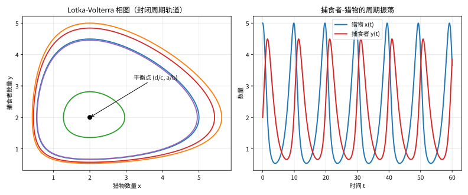

> **直观理解（现实类比）**：想象山里的狐狸和兔子——兔子多了，狐狸吃饱、数量上升；狐狸多了，又吃掉太多兔子，兔子减少后狐狸跟着饿瘦，如此循环往复，像荡秋千一样此消彼长，形成永不停止的周期振荡。

**步骤4：首次积分验证**

计算首次积分 $H(x, y) = x^d y^a e^{-by - cx}$：

$$
H(x, y) = x^{0.6} y^{0.8} e^{-0.4y - 0.3x}
$$

在初始点 $(5, 2)$：$H(5, 2) = 5^{0.6} \cdot 2^{0.8} \cdot e^{-0.8 - 1.5} \approx 0.152$

在 $(2, 2)$（平衡点）：$H(2, 2) = 2^{0.6} \cdot 2^{0.8} \cdot e^{-0.8 - 0.6} = 2^{1.4} \cdot e^{-1.4} \approx 0.375$

验证：在模拟轨迹上，$H(x(t), y(t))$ 保持恒定（约 0.152），确认了周期解的存在。

**步骤5：时间平均性质**

沿周期解计算时间平均：

$$
\frac{1}{T} \int_0^T x(t) dt \approx 2.0 = x^*, \quad \frac{1}{T} \int_0^T y(t) dt \approx 2.0 = y^*
$$

验证了周期解的时间平均等于平衡点值。

> 本节本章补充概念检查、真/假测验、与微积分的联结、标准例题与专题应用，帮助读者用经典微积分的地基来理解本章的种群动力学、传染病模型、酶动力学与进化博弈等主题。建议先独立作答，再对照原文「5. 习题」与「6. 习题答案与解析」交叉检验。

### 概念检查（Concept Check）

1. **Logistic 增长的稳定化机制**：方程 $\frac{dN}{dt} = rN(1 - \frac{N}{K})$ 中，为什么当种群数量 $N$ 接近环境承载量 $K$ 时增长率会趋于 0，从而使 $N(t)$ 最终稳定在 $K$ 附近？
2. **$r$ 与 $K$ 的角色**：在 Logistic 方程中，内禀增长率 $r$ 与环境承载量 $K$ 各自扮演什么角色？哪一个决定增长曲线的水平上限，哪一个决定种群逼近上限的快慢？
3. **两变量的耦合**：Lotka-Volterra 模型如何用两个一阶微分方程把捕食者与猎物耦合起来？写出 $\frac{dx}{dt}=ax-bxy$、$\frac{dy}{dt}=cxy-dy$，并逐一解释 $ax$、$-bxy$、$cxy$、$-dy$ 的生物含义。
4. **为什么看雅可比特征值**：判断某个平衡点的稳定性，为什么要计算雅可比矩阵在该点的特征值？特征值实部 $\text{Re}(\lambda)$ 的正负如何决定局部收敛、发散或中性（中心）？
5. **SIR 的分仓结构**：SIR 模型把人群分成哪三个仓室？传播率 $\beta$ 与恢复率 $\gamma$ 各自控制哪一步的流动，又有怎样的守恒关系？
6. **基本再生数**：$R_0 = \frac{\beta S_0}{\gamma}$ 的生物学含义是什么？$R_0 > 1$ 与 $R_0 < 1$ 分别对应怎样的疫情结局？
7. **复制子动力学与自然选择**：$\frac{dx_i}{dt} = x_i (f_i - \bar f)$ 如何体现"适者生存"？Fisher 基本定理对平均适应度 $\bar f$ 的演化说了什么？

### 真/假测验（True-False Quiz）

1. （真）Logistic 方程 $\frac{dN}{dt} = rN(1 - \frac{N}{K})$ 是一阶自治常微分方程，其平衡点为 $N = 0$ 与 $N = K$。
   - 理由：令右端为零得 $N=0$ 与 $N=K$；方程右端不含时间自变量 $t$，故为自治 ODE，其中 $N=K$ 渐近稳定、$N=0$ 不稳定。
2. （真）在 Logistic 模型中，只要初值 $N(0)>0$，种群数量 $N(t)$ 都单调收敛到承载量 $K$。
   - 理由：当 $0<N<K$ 时 $\frac{dN}{dt}>0$，当 $N>K$ 时 $\frac{dN}{dt}<0$，故解被"拉"向 $N=K$。
3. （假）Lotka-Volterra 共存平衡点 $(d/c, a/b)$ 处的雅可比矩阵特征值是实部非零的实数。
   - 理由：该平衡点对应的雅可比矩阵特征值为纯虚数 $\lambda = \pm i\sqrt{ad}$，实部为零，是一个中性稳定的中心点而非实特征值。
4. （真）SIR 模型中，当基本再生数 $R_0 = \frac{\beta S_0}{\gamma} > 1$ 时，感染者数量在疫情初期会指数上升。
   - 理由：初期 $S\approx S_0$ 给出一阶近似 $\frac{dI}{dt} \approx (\beta S_0 - \gamma)I = \gamma(R_0-1)I$，$R_0>1$ 时指数为正。
5. （假）Michaelis-Menten 速率方程 $v = \frac{V_{\max}[S]}{K_m + [S]}$ 表明反应速率随底物浓度无限线性增长、没有上限。
   - 理由：当 $[S] \to \infty$ 时 $v \to V_{\max}$，存在饱和上限，因此并非"无限增长"。
6. （真）复制子动力学下，群体的平均适应度沿轨道单调不减。
   - 理由：Fisher 基本定理给出 $\frac{d\bar f}{dt} = 2\,\text{Var}(f) \ge 0$，等号仅当所有策略适应度相同时取到。
7. （假）Turing 不稳定性对扩散系数 $D_u, D_v$ 的大小关系没有任何要求，任何扩散都能破坏均匀稳态。
   - 理由：Turing 失稳需 $D_v f_u + D_u g_v > 0$，典型情形要求抑制子扩散远快于激活子（$D_v \gg D_u$）；当 $D_v \le D_u$ 时均匀稳态通常仍保持稳定。

### 与微积分的联结（Connections to Calculus）

**可分离一阶 ODE 视角**：Logistic 方程 $\frac{dN}{dt} = rN(1 - \frac{N}{K})$ 是一阶可分离常微分方程。分离变量并用部分分式分解：

$$
\int \frac{dN}{N(1 - N/K)} = \int r\,dt, \qquad \frac{1}{N(1 - N/K)} = \frac{1}{N} + \frac{1}{K - N}
$$

两边积分得到经典 S 型（sigmoid）曲线，从而从微积分角度解释"先近似指数、后逼近承载量"的平滑过渡。

**线性化与稳定性视角**：在平衡点 $N^*$ 附近令 $\Delta N = N - N^*$，对 $f(N) = rN(1 - \frac{N}{K})$ 作一阶 Taylor 展开：

$$
\frac{dN}{dt} \approx f'(N^*)\, \Delta N = J\, \Delta N
$$

稳定性由导数 $f'(N^*)$（即 1 维雅可比）的特征值实部 $\text{Re}(\lambda)$ 决定：$\text{Re}(\lambda)<0$ 稳定、$\text{Re}(\lambda)>0$ 不稳定。

**ODE 系统与首次积分视角**：Lotka-Volterra 是两个一阶方程耦合的 ODE 系统。相除消去 $dt$ 后分离变量并积分，得到沿轨道为常数的首次积分：

$$
H(x,y) = x^d y^a e^{-by-cx} = \text{常数}
$$

相图中封闭的周期环解正来自这个"积分不变量"。

**指数增长视角**：无承载量约束的指数增长 $\frac{dN}{dt} = rN$ 是一阶线性齐次 ODE，其解为 $N(t) = N_0 e^{rt}$，它是 Logistic 在 $N \ll K$ 时的极限情形，也是基本再生数与药代动力学许多结论的出发点。

**定积分与曲线下面积视角**：药代动力学中用血药浓度-时间曲线下面积刻画药物暴露量，即定积分：

$$
\text{AUC} = \int_0^{\infty} C(t)\, dt, \qquad C(t) = C_0 e^{-kt} \ \Rightarrow\ \text{AUC} = \frac{C_0}{k}
$$

类似地，传染病与卫生统计中的预期寿命、总感染规模等指标也都是由积分计算的。

### 标准例题（Worked Example）

**例题 A：分离变量求解 Logistic 方程并代入初值**

问题：求解初值问题

$$
\frac{dN}{dt} = rN\left(1 - \frac{N}{K}\right), \qquad N(0) = N_0, \quad 0 < N_0 < K
$$

- 步骤 1（分离变量）：把方程改写并分离变量：
  $$
  \frac{dN}{N(1 - N/K)} = r\,dt
  $$
- 步骤 2（部分分式）：利用 $\frac{1}{N(1-N/K)} = \frac{1}{N} + \frac{1}{K-N}$，两边积分：
  $$
  \int \left(\frac{1}{N} + \frac{1}{K-N}\right) dN = \int r\,dt
  $$
- 步骤 3（积分并对数合并）：
  $$
  \ln N - \ln(K-N) = rt + C \ \Rightarrow\ \frac{N}{K-N} = C_1 e^{rt}
  $$
- 步骤 4（代入初值定常数）：由 $N(0)=N_0$ 得 $C_1 = \frac{N_0}{K-N_0}$。
- 步骤 5（解出 $N(t)$）：代数整理得
  $$
  N(t) = \frac{K N_0 e^{rt}}{K - N_0 + N_0 e^{rt}}
  $$
- 步骤 6（检验行为）：当 $t \to \infty$，$N(t) \to K$；当 $t \to 0$，$N(t)\to N_0$，且 $N(0)=N_0$，符合直觉。

**例题 B：对 Lotka-Volterra 求平衡点并线性化判定稳定性**

问题：考虑系统

$$
\frac{dx}{dt} = ax - bxy, \qquad \frac{dy}{dt} = cxy - dy, \qquad a,b,c,d>0
$$

- 步骤 1（求平衡点）：令右端为零：
  $$
  x(a - by) = 0, \qquad y(cx - d) = 0
  $$
  得平凡平衡点 $(0,0)$ 与共存平衡点 $(x^*, y^*) = \left(\frac{d}{c}, \frac{a}{b}\right)$。
- 步骤 2（计算雅可比矩阵）：对 $f=ax-bxy$、$g=cxy-dy$，
  $$
  J(x,y) = \begin{pmatrix} a - by & -bx \\ cy & cx - d \end{pmatrix}
  $$
- 步骤 3（代入共存平衡点）：
  $$
  J^* = \begin{pmatrix} 0 & -\frac{bd}{c} \\ \frac{ca}{b} & 0 \end{pmatrix}
  $$
- 步骤 4（求特征值）：$\det(J^* - \lambda I) = \lambda^2 + ad = 0$，故 $\lambda = \pm i\sqrt{ad}$。
- 步骤 5（判定稳定性）：特征值为纯虚数、$\text{Re}(\lambda)=0$，故共存平衡点是中性稳定的中心点，构成封闭周期轨道；线性化无法判定其吸引或排斥。
- 步骤 6（对照平凡平衡点）：$J(0,0) = \begin{pmatrix} a & 0 \\ 0 & -d \end{pmatrix}$，特征值 $a>0$、$-d<0$，故 $(0,0)$ 是鞍点、不稳定。

### 专题应用（Applied Project）

**题目：用 Logistic 拟合种群数据并评价 SIR 干预**

- **背景**：把一个种群（如一缸鱼或一片草地的兔子）的数量随时间记录下来，我们想用 Logistic 增长 $\frac{dN}{dt} = rN(1 - \frac{N}{K})$ 拟合数据得到 $r$ 与 $K$；同时希望在 COVID-19 式疫情中，用 SIR 模型评估"降低 $\beta$"的干预对峰值与最终感染规模的影响。
- **任务**：
  1. 给定几组形如 $(t_i, N_i)$ 的观测（可在原文示例 2 的 Lotka-Volterra 数值表上改造，或用自拟的 S 型数据），用最小二乘或线性化"对数-比"方法估计 $r$、$K$；
  2. 将 $\frac{dN}{dt}$ 对 $N$ 作图，检验是否呈开口向下的抛物线，从而验证 Logistic 假设；
  3. 在 SIR 模型中分别取 $R_0 = 2.5$、$1.4$、$0.8$，计算峰值感染人数与最终感染比例，并讨论"压平曲线"的机制。
- **联结**：任务 1 用到 6.3 中 Logistic 的 S 型显式解与定积分/曲线下面积思想；任务 3 用 $R_0 = \frac{\beta S_0}{\gamma}$ 与 $I(t)\approx I_0 e^{\gamma(R_0-1)t}$ 进行初值判断，并可与原文示例 1 的 RK4 数值表对照。
- **开放问题**：当数据中同时存在环境波动、猎物-捕食者振荡或无症状传播时，单一 Logistic 或 SIR 拟合会产生怎样的偏差？如何用含时间变化参数 $\beta(t)$ 的模型或贝叶斯方法量化这种不确定性（呼应原文探究题第 28、30 题）？

### 习题分层导览（按概念 / 技巧 / 应用分类）

下列分层对应原文「5. 习题」中的真实题号（基础题第 1–10 题、进阶题第 11–19 题、挑战题第 20–26 题、探究题第 27–30 题），帮助你按「概念 → 技巧 → 应用」的节奏练习。

**概念题**（重在理解模型结构、参数与生物学含义）：
- 基础题第 1、3、4、6、7、8、9 题：Lotka-Volterra 方程组与参数含义、$R_0$ 定义、SIR 分仓、Logistic 的 $r$ 与 $K$、Turing 思想、复制子动力学、药代方程。
- 进阶题第 11 题（中性稳定含义）、第 16 题（SEIR 潜伏仓室）、第 17 题（负/正反馈）、第 19 题（周期平均的生物含义）。
- 探究题第 27、29 题（建模取舍、涌现性）。

**技巧题**（重在分离变量、线性化、雅可比特征值、下一代矩阵等计算）：
- 基础题第 5 题（Michaelis-Menten 方程读写）。
- 进阶题第 12 题（$R_0$ 阈值）、第 13 题（QSSA 推导）、第 15 题（复制子方程）、第 18 题（半衰期推导）。
- 挑战题第 20 题（首次积分）、第 21 题（最终感染规模）、第 22 题（Turing 必要条件）、第 23 题（QSSA 推导）、第 25 题（下一代矩阵）、第 26 题（Hopfield 能量函数）。

**应用题**（联系真实生物、卫生与临床问题）：
- 基础题第 2 题（求平衡点）、第 10 题（肿瘤生长的 Logistic 与 Gompertz）。
- 进阶题第 14 题（Turing 条件与 $D_v > D_u$）。
- 探究题第 28 题（COVID-19 建模局限）、第 30 题（参数辨识与不确定性量化）。

---

## 5. 习题
### 基础题

**习题 1**（Lotka-Volterra 模型）写出捕食者-猎物 Lotka-Volterra 模型的标准方程组，说明变量 $x,y$ 与参数 $a,b,c,d$ 各自的生物学含义。

**习题 2**（平衡点）求 Lotka-Volterra 模型 $\dot x=ax-bxy,\ \dot y=-cy+dxy$ 的共存平衡点 $(x^*,y^*)$。

**习题 3**（基本再生数）给出传染病 SIR 模型中基本再生数 $R_0$ 的定义，说明 $R_0>1$、$R_0=1$、$R_0<1$ 分别对应的传播结局。

**习题 4**（SIR 模型）写出 SIR 模型中易感者 $S$、感染者 $I$、恢复者 $R$ 的微分方程组，解释参数 $\beta$ 与 $\gamma$ 的生物学含义。

**习题 5**（Michaelis-Menten 方程）写出酶动力学速率方程 $v=\frac{v_{\max}[S]}{K_M+[S]}$，说明 $v_{\max}$ 与 $K_M$ 的生物学意义。

**习题 6**（Logistic 增长）写出单种群 Logistic 生长模型 $\frac{dN}{dt}=rN(1-\frac{N}{K})$，说明内禀增长率 $r$ 与环境容纳量 $K$ 的含义。

**习题 7**（Turing 模型）简述 Turing 失稳思想的本质：活化子-抑制子系统在怎样的扩散差异下会自发形成空间斑图。

**习题 8**（进化博弈）在 2×2 对称博弈中，写出策略 1 频率 $x$ 的复制子动力学一般形式，并说明进化稳定策略（ESS）的含义。

**习题 9**（药代动力学）写出静脉注射一室药代动力学模型最常见的药物浓度衰减方程，说明消除速率常数 $k_e$ 的含义。

**习题 10**（肿瘤生长）列举肿瘤生长的两种常见经验模型（如 Logistic 与 Gompertz）的共同特征与区别。

### 进阶题

**习题 11**（平衡点稳定性）对 Lotka-Volterra 模型，线性化分析共存平衡点 $(x^*,y^*)$ 的稳定性，说明其 Jacobian 特征值性质与"中性稳定"的含义。

**习题 12**（SIR 阈值）对 SIR 模型 $R_0=\beta S_0/\gamma$，用该结果判断 $R_0<1$ 时能否爆发，并说明群体免疫阈值 $H=1-1/R_0$ 的由来。

**习题 13**（拟稳态近似）用拟稳态近似（$dC/dt\approx0$）推导 Michaelis-Menten 速率方程，说明其所需的时间尺度假设。

**习题 14**（Turing 条件）写出无扩散稳定条件 $f_u+g_v<0$、$f_ug_v-f_vg_u>0$ 与扩散驱动失稳条件 $D_vf_u+D_ug_v>0$，说明它们组合得到的不等式与 $D_v>D_u$ 的关系。

**习题 15**（复制子动力学）对支付矩阵 $A=\begin{pmatrix}a&b\\c&d\end{pmatrix}$，写出策略 1 频率 $x$ 的复制子方程。

**习题 16**（SEIR 模型）写出 SEIR 模型的四仓室方程组，说明潜伏仓室 $E$ 的作用及其对 $R_0$ 的影响（与 SIR 相比）。

**习题 17**（基因调控）用一个自抑制基因的一维动态方程说明负反馈如何产生稳定稳态、正反馈如何产生双稳态。

**习题 18**（药代半衰期）由一室模型 $C(t)=C_0e^{-k_et}$ 推导血浆半衰期 $t_{1/2}=\ln2/k_e$。

**习题 19**（周期平均）说明 Lotka-Volterra 模型周期解的时间平均满足 $\frac1T\int_0^T x=\frac{c}{d}$、$\frac1T\int_0^T y=\frac{a}{b}$，其生物含义是什么。

### 挑战题

**习题 20**（首次积分）证明 Lotka-Volterra 模型存在首次积分 $H(x,y)=d x-c\ln x+b y-a\ln y$ 沿轨道为常数，并据此论证周期解存在。

**习题 21**（最终感染规模）对标准 SIR 模型，证明最终感染规模 $S_\infty$ 满足方程 $\ln(S_0/S_\infty)=R_0(1-S_\infty/S_0)$。

**习题 22**（Turing 必要条件）证明在活化-抑制系统中 $D_v>D_u$ 是 Turing 失稳的必要条件，即当 $D_v\le D_u$ 时无扩散稳定系统仍保持稳定。

**习题 23**（QSSA 推导）设 $E+S\rightleftharpoons ES\to E+P$，用拟稳态近似推导 $\frac{dP}{dt}=\frac{v_{\max}S}{K_M+S}$，给出 $v_{\max},K_M$ 表达式。

**习题 24**（复制子稳定性）对 2×2 对称博弈复制子动力学，分情形分析 $x=0,1$ 与内部平衡点 $x^*$ 的稳定性条件，并联系 Nash 均衡与 ESS。

**习题 25**（下一代矩阵）对 SEIR 模型，用下一代矩阵方法给出 $R_0$ 的显式表达式并解释其与 $\beta,\sigma,\gamma$ 的关系。

**习题 26**（Hopfield 网络）写出连续 Hopfield 网络能量函数并证明其单调下降，说明联想记忆存储即能量极小值的观点。

### 探究题

**习题 27**（建模取舍）讨论生物数学建模中的"简洁 vs 真实"权衡，说明过度复杂模型在预测与参数识别上的问题。

**习题 28**（传染病建模与疫情）探讨 SEIR 类模型在 COVID-19 等疫情中的局限（异质性、干预、接触网络、空间结构、无症状传播），以及 $R_0$ 估计的不确定性来源。

**习题 29**（系统生物学）讨论"涌现性"：为何单个生化反应简单、而网络整体可表现出双稳、震荡与鲁棒行为？结合正负反馈说明。

**习题 30**（模型与不确定性）讨论生物模型中参数辨识、模型校准与预测不确定性的关系，说明贝叶斯推断或集合预报如何量化预测风险。

---

## 6. 习题答案与解析

### 基础题答案

1. **Lotka-Volterra 模型** 标准形式 $$\dot x=ax-bxy,\quad \dot y=-cy+dxy$$ $x$ 为猎物丰度、$y$ 为捕食者丰度；$a$ 猎物固有增长率、$b$ 捕食导致的猎物死亡率（遭遇率）、$c$ 捕食者在无猎物时的死亡率、$d$ 捕食者转化食物的效率。$ax$ 为猎物指数增长项、$-bxy$ 为捕食死亡项；捕食者依赖 $dxy$ 增长而受 $-cy$ 约束。

2. **平衡点** 令 $\dot x=0,\dot y=0$：由 $x(a-by)=0$ 得 $x=0$ 或 $y=a/b$；由 $y(-c+dx)=0$ 得 $y=0$ 或 $x=c/d$。共存平衡点 $(x^*,y^*)=(c/d,a/b)$。

3. **基本再生数** $R_0$ 是一个感染者在完全易感群体中平均产生的新感染数。$R_0>1$ 疫情爆发、$R_0<1$ 疫情消退、$R_0=1$ 为临界（地方性流行的边界）。

4. **SIR 模型** $$\frac{dS}{dt}=-\beta SI,\quad \frac{dI}{dt}=\beta SI-\gamma I,\quad \frac{dR}{dt}=\gamma I$$ $\beta$ 为有效接触率、$\gamma$ 为恢复率、$1/\gamma$ 为平均感染期，且有 $S+I+R=N$ 守恒。

5. **Michaelis-Menten** $v_{\max}=k_{cat}[E]_0$ 为最大速率（酶饱和时），$K_M$ 为 $v=v_{\max}/2$ 时的底物浓度、反映亲和力。$[S]\ll K_M$ 时近似一级、$[S]\gg K_M$ 时趋于 $v_{\max}$ 饱和。

6. **Logistic** $r$ 为每个体内禀增长率，$K$ 为环境容纳量。$N\ll K$ 退化为指数增长，$N>K$ 净增长为负、故种群收敛到 $K$。

7. **Turing** 稳定反应系统在外源扩散下失稳并非需要抑制子扩散远快于活化子（$D_v>D_u$）等条件，而是扩散系数差异使活化子-抑制子在空间分离从而在均匀态附近出现定向不稳定性并形成斑图。

8. **进化博弈** $$\frac{dx}{dt}=x(f_1-\bar f)$$ $f_1$ 策略 1 平均适应度、$\bar f$ 群体平均适应度。ESS 是能抵抗少量入侵的稳定策略，对应强稳定性条件。

9. **药代** 一室模型 $$C(t)=C_0e^{-k_e t}$$ $k_e$ 为消除速率常数（单位时间消除比例）、$t_{1/2}=\ln2/k_e$，$k_e$ 越大清除越快。

10. **肿瘤生长** 二者都有生长上限（$K$）。Logistic $\dot N=rN(1-N/K)$ 对称、$N=K/2$ 时增速最大；Gompertz $\dot N=rN\ln(K/N)$ 后期渐近慢、更贴合真实肿瘤轨迹。

### 进阶题答案

1. **平衡点稳定性** 在 $(c/d,a/b)$ 处 Jacobian $$J=\begin{pmatrix}0&-bc/d\\ad/b&0\end{pmatrix}$$ 特征值 $\lambda=\pm i\sqrt{ac}$ 为纯虚数，平衡点是中心（中性稳定）：线性化不能判定吸引/排斥，轨道围绕其作椭圆环绕、不收敛不发散，反映模型保守性，实际种群受扰动长期徘徊。

2. **SIR 阈值** 初期新感染 $\approx(\beta S_0-\gamma)I$，故 $R_0=\beta S_0/\gamma$；$R_0>1$ 感染上升爆发、$R_0<1$ 单调下降。群体免疫阈值 $H=1-1/R_0$：当易感比例降至 $1/R_0$ 以下，再生数小于 1、疫情转降。

3. **QSSA** 设 $C=[ES]$、$E_0-$ 守恒：由 $\frac{dC}{dt}=k_1(E_0-C)S-(k_{-1}+k_2)C\approx0$ 得 $C=\frac{E_0S}{K_M+S}$，故 $$\frac{dP}{dt}=k_2C=\frac{v_{\max}S}{K_M+S}$$ 假设 ES 复合物浓度瞬时达稳态（时间尺度远快于底物产物整体变化）。

4. **Turing 条件** 无扩散需迹负、行列式正保证稳定；失稳需存在 $k^2>0$ 使扰动增长，本征方程给出需 $D_vf_u+D_ug_v>0$。与 $f_u+g_v<0$、$f_u>0$、$g_v<0$ 结合得 $D_v/D_u>-g_v/f_u>1$，即 $D_v>D_u$。

5. **复制子方程** $f_1=xa+(1-x)b$、$f_2=xc+(1-x)d$，$$\frac{dx}{dt}=x(1-x)(f_1-f_2)$$ 展开 $f_1-f_2=x(a-c)+(1-x)(b-d)$。反映高适应度策略频率按比例增长。

6. **SEIR** $$\frac{dS}{dt}=-\beta SI,\ \frac{dE}{dt}=\beta SI-\sigma E,\ \frac{dI}{dt}=\sigma E-\gamma I,\ \frac{dR}{dt}=\gamma I$$ $E$ 引入潜伏延迟；$R_0=\frac{\beta}{\gamma}\frac{\sigma}{\sigma+\gamma}$，略小于 SIR 的 $\beta/\gamma$，因潜伏期提供免疫时间窗；$\sigma\to\infty$ 时退化回 SIR。

7. **基因调控** 自抑制 $\frac{dx}{dt}=a-f(x)-\mu x$：负反馈项 $f$ 递减使单稳态、对扰动鲁棒；正反馈递增项可取多稳态（双稳态），由不稳定分支隔开，表现为可被阈值翻转的开/关开关。

8. **半衰期** 由 $e^{-k_et_{1/2}}=1/2$ 取对数得 $t_{1/2}=\ln2/k_e$。半衰期决定给药间隔与达稳态时间（约 4–5 个半衰期）。

9. **周期平均** 沿闭轨积分 $\int_0^T(a-by)=0$、$\int_0^T(-c+dx)=0$，得 $\frac1T\int_0^T y=a/b$、$\frac1T\int_0^T x=c/d$。即振荡的长时平均恰等于共存平衡点，种群不灭绝也不无限增长。

### 挑战题答案

1. **首次积分** 取 $H=dx-c\ln x+by-a\ln y$：$$\frac{dH}{dt}=(d-\frac cx)\dot x+(b-\frac ay)\dot y=0$$ 各交叉项相互抵消，故 $H$ 沿轨道为常数。$H$ 在 $(c/d,a/b)$ 严格凸，等值线为闭曲线，故每条轨道为有界周期轨道。

2. **最终感染规模** 由 $\frac{dI}{dS}=\frac{\beta SI-\gamma I}{-\beta SI}=-1+\frac1{R_0}\frac{S_0}{S}$ 积分并代入 $I(\infty)=0$ 得 $$S_0-S_\infty=\frac{S_0}{R_0}\ln\frac{S_0}{S_\infty}$$即 $\ln(S_0/S_\infty)=R_0(1-S_\infty/S_0)$，$R_0>1$ 时存在唯一 $S_\infty<S_0$。

3. **Turing 必要条件** 无扩散稳定满足 $f_u+g_v<0$、$f_ug_v-f_vg_u>0$。扩散失稳需 $D_vf_u+D_ug_v>0$，等价于 $D_v/D_u>-g_v/f_u$；而稳定条件给出 $(-g_v)/(-f_u...)$ 使 $D_v/D_u>1$，故 $D_v>D_u$ 必要。若 $D_v\le D_u$，条件无法满足、系统保持稳定。

4. **QSSA 推导** 拟稳态 $\frac{dC}{dt}=0$ 给出 $C=\frac{E_0S}{K_M+S}$，故 $$v=\frac{dP}{dt}=\frac{k_2E_0S}{K_M+S}=\frac{v_{\max}S}{K_M+S}$$ 其中 $v_{\max}=k_2E_0$、$K_M=(k_{-1}+k_2)/k_1$。要求 ES 为快变量。

5. **复制子稳定性** $\dot x=x(1-x)g(x)$，$g(x)=x(a-c)+(1-x)(b-d)$。边界 $x=0$ 稳定需 $b<d$、$x=1$ 稳定需 $a>c$；内部点 $x^*=\frac{d-b}{a-c+d-b}$，其稳定性由 $g'(x^*)=（a-c)-(b-d)$ 判定：$<0$ 时内部点稳定（ESS 混合策略），$>0$ 时不稳定、边界稳定，与 Nash 均衡对应。

6. **下一代矩阵** $\mathcal F=\begin{pmatrix}\beta SI\\0\end{pmatrix}$，$\mathcal V=\begin{pmatrix}\sigma E\\-\sigma E+\gamma I\end{pmatrix}$，得 $$F=\begin{pmatrix}0&\beta S_0\\0&0\end{pmatrix},\ V=\begin{pmatrix}\sigma&0\\-\sigma&\gamma\end{pmatrix},\quad FV^{-1}=\begin{pmatrix}\beta S_0/\gamma&\beta S_0/\gamma\\0&0\end{pmatrix}$$ 谱半径即 $R_0=\beta S_0/\gamma$；$E$ 仓室不改变 $R_0$ 峰值而延迟疫情曲线峰值。

7. **Hopfield 能量函数** $$E=-\frac12\sum_{ij}w_{ij}v_iv_j-\sum_i b_iv_i$$ 由对称性与激活单调性，$\frac{dE}{dt}\le0$，且仅 $v$ 不变时为零，故 $E$ 单调下降、网络收敛到局部极小值。每个目标模式作为吸引子即存储的记忆，检索即从初始态沿能量坡下行到最近极小值。

### 探究题答案

1. **建模取舍** 奥卡姆剃刀要求预测相近时选更简单模型。过度复杂模型参数多、易过拟合、参数不可辨识、外推不稳定。应平衡机制必要性与数据驱动选择（信息准则、交叉验证），避免"越精细越真实"的误区。

2. **传染病建模局限** SEIR 均质模型假设充分混合、参数恒定、无空间/年龄结构、无行为反馈，会低估空间差异与干预效果。$R_0$ 估计受报告率、潜伏期分布、接触率参数等不确定性影响差异大。改进用接触网络、meta-population、随时间变化的 $\beta(t)$ 与 MCMC/集合估计。

3. **涌现性** 单个生化反应简单，但基因经正负反馈、信号级联、延迟与随机涨落耦合后，网络级出现双稳切换、振荡、自适应与鲁棒。负反馈造稳态、正反馈造开关、延迟造振荡，需依赖网络整体拓扑与时间尺度，是系统生物学"整体大于部分之和"的论点。

4. **模型与不确定性** 生物模型输出依赖难以精确估计的参数，预测含参数不确定性、模型结构性、观测噪声三层不确定。贝叶斯推断以后验分布量化并向前传播，集合预报生成预测带，从而对近似模型给出概率性预测区间与灵敏度分析。

---

## 7. 数学科普（Popular Mathematics）

生物数学用方程描述生命的涨落：种群怎么增减、疾病怎么传播、斑纹怎么长出来。下面用十五幅图，从种群、传染病、神经、生化一路讲到演化与药代，逐一看看这些模型怎么把生命现象写成方程。

### 7.1 种群动力学：狐狸和兔子的秋千

兔子多了，狐狸就有了口粮、跟着繁殖变多；狐狸一多，兔子被吃得变少；兔子一少，狐狸又饿得减少。这一来一回，用 Lotka-Volterra 方程 $\frac{dx}{dt}=ax-bxy$ 就能抓住"此消彼长"的节律。


**一句话点破**：捕食者和猎物像一对跷跷板，一升一降、循环往复。

### 7.2 传染病模型：把人群分进三间房

把人群分成三间屋子——还没得病的（易感 $S$）、正在得病的（感染 $I$）、病好或免疫的（康复 $R$），人每天按一定比例从一间搬进下一间，就成了经典传染病模型 SIR。


**一句话点破**：传染病曲线的走向，取决于每间房搬家的速度。

### 7.3 神经网络模型：细胞膜上的电路

神经元的细胞膜像一只电容器，钠、钾离子通道像几扇可开合的闸门；外界一刺激，钠闸猛开抬高电位、钾闸再把电位摁回静息，于是放电出一个脉冲。用 $C\frac{dV}{dt}=I_{\text{ext}}-\sum g_i(V-E_i)$ 就能写出这套电位变化。

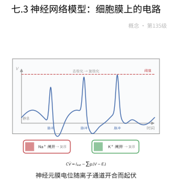

**一句话点破**：一次神经放电，本质是离子闸门按电学规律的开合。

### 7.4 基因调控网络：基因之间互相指挥

基因并不各干各的，一个基因的产物可能去开启或关掉另一个基因，形成一张互相"指挥"的网络。用 $\frac{dx_i}{dt}=f(x_1,\dots,x_n)$ 这样的方程组，就能描述整张网络里谁影响谁。

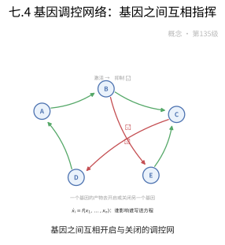

**一句话点破**：基因的表达不是独奏，而是一张彼此牵制的指挥网。

### 7.5 生化反应动力学：分子碰撞的速率法则

分子只有撞到一起才可能反应，浓度越高、碰撞越频繁，反应就越快，所以速率常写成浓度的幂之积，如 $v=k[A][B]$。一串反应连起来，就是细胞内的化学流水线。


**一句话点破**：化学反应的速度，归根结底由分子相遇的频率决定。

### 7.6 肿瘤生长模型：越挤长得越慢

肿瘤早期营养充足、近乎指数疯长；体积一大血管供血跟不上，生长便逐渐刹车，曲线转成 S 形。用 Logistic 一类的 $\frac{dV}{dt}=rV\left(1-\frac{V}{K}\right)$ 就能描出这个过程。

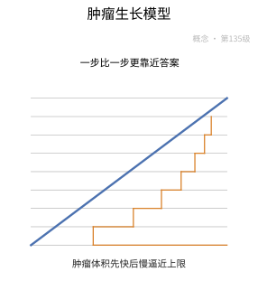

**一句话点破**：肿瘤的增长同样受"天花板"约束，越挤越难长。

### 7.7 模式形成与 Turing 模型：斑纹是怎么来的

均匀分布的化学物质，怎么会自发长出斑点和条纹？图灵发现，两种物质一边反应、一边扩散，只要扩散快慢相差足够大，原本平稳的状态就会被打破，自行冒出规则的图案。

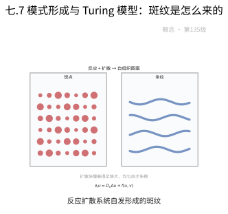

**一句话点破**：只要反应与扩散搭配得当，均匀里就能长出花纹。

### 7.8 进化博弈论：策略也在被自然选择

个体并不先算清最优策略再行动，而是"照抄"身边更成功的玩法——收益高的策略占比越来越大，模仿它的人也就越来越多，比例随之此起彼伏地演化。


**一句话点破**：进化的不是个体，而是策略在人群中的比例。

### 7.9 系统生物学：把细胞当成一个整体

系统生物学不满足于盯住单个基因或蛋白，而是把整张相互作用网络放进模型里一起算，看在某处施加扰动后，整个系统会怎样连锁反应。

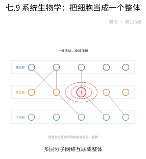

**一句话点破**：生命的功能落在网络的整体行为里，而非某个零件。

### 7.10 药代动力学：药物在体内怎么进出

吃药之后，药物在体内经历吸收、分布、代谢、排出四个环节，血药浓度先升后降。用 $C(t)$ 这样的曲线能算出它多久达到峰值、多久被清干净，从而指导用药的剂量与间隔。


**一句话点破**：用药的时机与剂量，藏在血药浓度的时间曲线里。

### 7.11 Lotka-Volterra 周期解：荡秋千不会停

在捕食-猎物系统的平衡点附近，两族数量并不会停下，而是绕着平衡点画出一个闭合的圈，周期性地起伏——这正是周期解存在性所断言的。

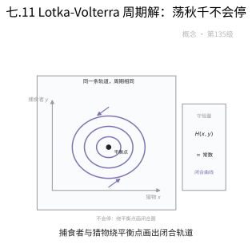

**一句话点破**：无外部扰动时，捕食-猎物系统会永远绕着平衡点转圈。

### 7.12 基本再生数 R0：一个人能传染几个人

把一个感染者放进全是易感者的人群，他平均能传染的人数就记为 $R_0$。$R_0>1$ 疫情会扩散，$R_0<1$ 疫情则自行消退，它是判断疫情走向的分水岭。

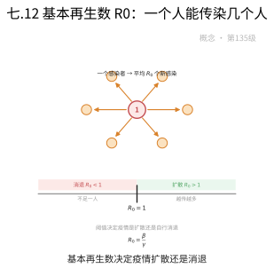

**一句话点破**：$R_0$ 是疫情的分水岭，大于一蔓延、小于一熄灭。

### 7.13 Turing 不稳定性：扩散也能制造秩序

通常扩散会把差别抹平，可当两种物质的扩散速度相差足够大时，均匀的定态反而被打破——这就是 Turing 不稳定性，也是斑纹自发涌现的数学条件。

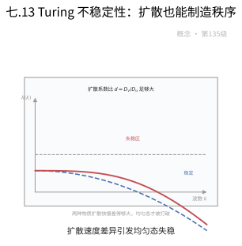

**一句话点破**：扩散的快慢差得够远，反而能把均匀逼出花纹。

### 7.14 米氏拟稳态近似：把快反应先"折起来"

酶催化反应中，中间复合物的生成与分解都很快，浓度不久便趋于稳定。于是假设它的变化率近似为零，把繁琐的方程化简，就得到漂亮的米氏速率 $v=\frac{V_{\max}[S]}{K_m+[S]}$。

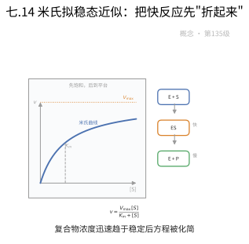

**一句话点破**：抓住"快变量瞬间稳定"，复杂方程就能化繁为简。

### 7.15 复制子动力学：谁占比高谁传得快

复制子方程 $\dot{x}_i=x_i\left(f_i-\bar f\right)$ 告诉我们：收益率 $f_i$ 高于平均 $\bar f$ 的策略占比会增长，低于平均的则萎缩，演化的方向由此确定。


**一句话点破**：超过平均收益的策略扩张，低于平均的被淘汰。

## 8. 数学史（History of Mathematics）

> 生物数学的历史主线，是"用方程与概率去理解生命系统的规模与节律"的渐强进程：从 18 世纪起为人口、瘟疫与寿命作的第一笔定量算账，到 20 世纪把捕食、传播、酶促、形态发生与进化逐个纳入微分方程，再到当今以系统生物学统摄多尺度动态。本章沿着"从单一种群到整棵生命网络"的线索，追溯每次建模背后的现实驱动及其从粗糙走向严格的历程。

### 8.1 人口增长的第一课：马尔萨斯与指数生长

- **警世的指数律**：1798 年，**马尔萨斯**在《人口原理》中警告人口呈几何级数增长、生活资料只按算术级数增长，由此引出最简单的增长方程 $\frac{dN}{dt} = rN$——指数生长的前提是不设上限。
- **预警即问号**：马尔萨斯既点出了"增长会失控吗"的数学化问题，也因未设任何容量而脱离现实。它像一盏警示灯，把"增长是有极限的"抛给后世去写进方程。
- **遗产**：指数模型虽朴素，却一直是种群、细胞与肿瘤拟合的第一近似，是日后一切 S 形修正的出发点。

### 8.2 容量与 S 形曲线：韦尔胡斯特的逻辑斯蒂

- **纠正发散**：1838 年，比利时数学家**韦尔胡斯特**（Pierre-François Verhulst）为回应凯特莱关于人口统计的问题，在指数式里加入环境承载力，提出**逻辑斯蒂方程** $\frac{dN}{dt}=rN(1-\frac{N}{K})$——增长随 $N$ 逼近 $K$ 而自行减速，得到经典的 S 形曲线。
- **被埋没与重见天日**：这项成果当时无人理会，直到 1920 年皮尔（Raymond Pearl）与里德在研究美国人口曲线时"重新发现"，逻辑斯蒂才成为种群生态学的基本台柱。
- **家族放大**：同一分母思想的**Gompertz**（1825 年本杰明·冈珀茨提出的死亡率规律，后用于肿瘤生长）等 S 形模型，后来共同组成"慢生长的生物曲线家族"。

### 8.3 按年龄的分账：从莱斯利矩阵到人口学

- **把人群分仓**：20 世纪 40 年代，**莱斯利**（Leslie）提出**莱斯利矩阵**，把人口按年龄分组，用一个矩阵迭代刻画"各年龄段的生育与存活"如何推进人口结构与总数——人口学由此变成可计算的线性代数问题（此前 L. A. Goodman、McKendrick 已有年龄结构微分方程的前驱工作）。
- **从总量到结构**：指数与逻辑斯蒂只看"总数"，莱斯利矩阵则追踪"年龄构成"，为预测老龄化和人口政策提供了动力学工具。
- **继承**：本教程把同样思想用于肿瘤分期等"分仓"场景。

### 8.4 捕食者-猎物：洛特卡与沃尔泰拉的分遇

- **一战后的渔获之谜**：第一次世界大战后，亚得里亚海域捕食鱼类（如鲉鲤）与猎物的渔获量此消彼长，意大利生态学家**沃尔泰拉**受生物学家达科纳之托解释这一现象，提出一对耦合微分方程描述捕食-猎物振荡（1926）。
- **另一条独立路线**：美国学者**洛特卡**从化学动力学独立得到相同形式（1925），故合称 **Lotka-Volterra 模型**——它具首次积分与闭合周期解，把"谁死谁活"的达尔文舞台浓缩成两条方程。
- **奠基与局限**：该模型被批评过于理想化，却是生态动力学"第一方程"，其框架渗透到化学动力学与后来的随机人口过程，本教程定理 3.1 即其周期解存在性的完整论证。

### 8.5 传染病定量化：从伯努利种痘到 SIR 与 R0

- **最早的种痘算账**：18 世纪，**丹尼尔·伯努利**（1760）已用生命表方法估算牛痘的获益——这是传染病定量分析的早期雏形。
- **SIR 的奠基**：1927—1933 年，**克马克与麦肯德里克**（Kermack & McKendrick）建立基于"仓室"的 SIR 模型（易感 S—感染 I—恢复 R），并证明阈值理论——**基本再生数 $R_0$** 是否大于 1 决定疫情能否爆发。
- **系统化与公众化**：此后"下一代矩阵"方法（Diekmann、Heesterbeek 等）使复杂模型的 $R_0$ 计算系统化；2020 年的 COVID-19 大流行更把 SIR/SEIR 推到公众面前，也让参数不确定性与局限成为关注焦点（本教程示例即以此为基础）。

### 8.6 酶的速率：米夏埃利斯-门滕与拟稳态

- **中间复合物假说**：1913 年，**米夏埃利斯与门滕**（Michaelis & Menten）从酶与底物先结合成中间复合物、再释放产物的机理，推导出速率方程 $v=\frac{V_{\max}[S]}{K_m+[S]}$——底物越多越接近饱和的上限 $V_{\max}$。
- **严格化**：1925 年，布里格斯与哈尔戴恩用"拟稳态近似"给出更严谨的推导，后来经由奇异摄动理论在数学上严格化，成为本教程"拟稳态近似"定理的出处。
- **地位**：这条方程至今是酶学、药代动力学与代谢工程的"公理级"工具。

### 8.7 形态发生：图灵的斑纹与反应-扩散

- **一篇越界的短论文**：1952 年，计算机科学之父**艾伦·图灵**在《形态发生的化学基础》中提出：在反应-扩散系统中，若激活子与抑制子的扩散速率相差悬殊（$D_v \gg D_u$），均匀稳态可因"图灵失稳"自发分裂出空间斑图——理论上解释了斑马纹、豹斑、胚胎模式的起源。
- **长期无人相信**：图灵机制当年要等半个世纪，直到 2000 年代才在斑马鱼与果蝇等系统中观测到符合"图灵失稳"的反应-扩散证据。
- **意义**：它是 20 世纪生物数学最著名的猜想之一，本教程的模式形成、Turing 模型章节即以之为核心。

### 8.8 进化策略：从 ESS 到复制子动力学

- **把博弈搬进自然界**：1973 年，**梅纳德·史密斯**与普莱斯提出"**演化稳定策略（ESS）**"——一种被种群普遍采用、任何少量突变都无法入侵的策略，把博弈论从"理性人"解放到自然选择之中。
- **复制子方程**：随后**泰勒与乔恩克**（Taylor & Jonker, 1978）给出**复制子动力学**：策略频率按"适应度高于平均则涨、否则跌"演化，把 ESS、稳定性与博弈论数学连通，也常通过一阶近似回到 Lotka-Volterra 型方程。
- **无脑的智慧**：复制子动力学最大的礼物是让人相信——只需自然选择，不靠大脑，也能"演化"出看似精明的行为。

### 8.9 神经、发育与系统生物学的汇流

- **从离子到神经脉冲**：1952 年**霍奇金与赫胥黎**用枪乌贼巨轴突的电压钳实验建立 HH 模型，把一次神经放电凝缩成四条关于电位与离子通道门控的常微分方程（1963 年共同获诺贝尔生理学或医学奖）——它也是计算神经科学的起点。
- **基因与网络的加入**：1970 年代后基因调控网络，1980 年代后系统生物学，把生物化学还原成大规模动力系统；药代动力学（如 1937 年托雷尔的"一室模型"）则把药物在体内的吸收、分布、代谢、排泄同样写成微分方程。
- **面向整体**：当代生物数学面对的已不是单一方程，而是把多物种、多尺度、多层次耦合起来的互动模型——从"算清一个系统"到"读懂整棵生命之树"。

### 8.10 历史年表

| 时间 | 人物／文献 | 事件与贡献 |
|:---|:---|:---|
| 1760 年 | 丹尼尔·伯努利 | 用生命表估算种痘获益，传染病定量雏形 |
| 1798 年 | 马尔萨斯《人口原理》 | 指数增长方程 $\frac{dN}{dt}=rN$ |
| 1825 年 | 冈珀茨 | Gompertz 死亡率规律（后用于肿瘤生长） |
| 1838 年 | 韦尔胡斯特 | 逻辑斯蒂方程：S 形增长与容量 $K$ |
| 1913 年 | 迈克尔·米夏埃利斯、门滕 | 酶动力学速率方程 |
| 1920 年 | 皮尔、里德 | 重新发现逻辑斯蒂方程 |
| 1925—1926 年 | 洛特卡、沃尔泰拉 | 捕食者-猎物模型与周期振荡 |
| 1927—1933 年 | 克马克、麦肯德里克 | SIR 模型与阈值 $R_0$ |
| 1945 年 | 莱斯利 | 年龄结构人口矩阵（莱斯利矩阵） |
| 1952 年 | 图灵 | 反应-扩散与形态发生斑纹 |
| 1952 年 | 霍奇金、赫胥黎 | 神经元动作电位的 HH 方程 |
| 1973 年 | 梅纳德·史密斯、普莱斯 | 演化稳定策略（ESS） |
| 1978 年 | 泰勒、乔恩克 | 复制子动力学 |
| 1980 年代后 | 系统生物学共同体 | 基因网络与多尺度动态建模 |

### 8.11 小结

> 生物数学的历史，是"一道方程如何逐渐担起一行生命"的进程：马尔萨斯用指数揭示增长的暴力，韦尔胡斯特用逻辑斯蒂把它驯化成 S 形，莱斯利用矩阵看清年龄结构，洛特卡-沃尔泰拉让捕食者与猎物在纸上起舞，克马克-麦肯德里克用 SIR 与 $R_0$ 算出瘟疫的界限，图灵以反应-扩散给出了"斑纹来自何处"的猜想，米夏埃利斯-门滕把催化凝成饱和曲线，梅纳德-史密斯与泰勒把自然选择写成策略动力学。从单一种群到整个系统，从确定性方程到随机演化，生物数学始终在做同一件事——用可计算的数学，让生命过程的"为什么"变成可检验、可预测的"是多少"。这条从"算题"到"建模"再到"读懂生命"的主线，正是本教程全部模型的共同出身。

## 现实应用（Real-World Applications）

> 本节把本章的知识点落到真实的工程、科学与生活场景中。每个案例都给出**完整的问题背景、建模过程、可复现的数据 / 公式 / 代码与结果解读**；案例末尾的「涉及知识点」对应本章的具体小节，文末附**知识点覆盖对照表**，确保本章知识点全部被覆盖。

### 应用案例 1：公共卫生｜疫情研判、群体免疫阈值与干预"压平曲线"

**场景与问题**

某市卫生部门有常住人口 $N=8{,}000{,}000$ 人，某新型呼吸道传染病输入 200 例。疾控需要在两周内向政府回答三个问题：(1) 疫情会不会大流行？(2) 最终会有多少人被感染？(3) 若只做"戴口罩 + 减少聚集"，把有效传播率压到多少才能避免医疗挤兑？这类问题正是 `2.2 传染病模型` 与定理 3.2 的标准战场。

**涉及知识点**

- 本章「2.2 传染病模型」：用 SIR / SEIR 分仓室描述易感—感染—康复的流转。
- 本章「定理 3.2：SIR 模型的基本再生数 $R_0$」：给出 $R_0=\beta S_0/\gamma$ 的阈值判据与最终感染规模方程。

**建模与数据**

设 $S,I,R$ 分别为易感、感染、康复人数。已知该病平均传染期 $1/\gamma=7$ 天，即 $\gamma=1/7\approx0.1429\ \text{天}^{-1}$；初期每人每天有效接触传播率 $\beta$ 由前 10 天报告数据反推为 $4.5\times10^{-8}\ (\text{人}\cdot\text{天})^{-1}$。

$$
\begin{aligned}
\frac{dS}{dt} &= -\beta S I \\
\frac{dI}{dt} &= \beta S I - \gamma I \\
\frac{dR}{dt} &= \gamma I
\end{aligned}
$$

初值 $S_0=N-200$, $I_0=200$, $R_0^{\text{pop}}=0$。

**完整推导与算法**

第 1 步：算基本再生数。

$$
R_0=\frac{\beta S_0}{\gamma}=\frac{4.5\times10^{-8}\times 7{,}999{,}800}{0.1429}\approx 2.52
$$

因 $R_0>1$，必然流行。

第 2 步：线性化初期增长。在 $S\approx S_0$ 处 $\dfrac{dI}{dt}=\gamma(R_0-1)I$，故 $I(t)=I_0e^{\gamma(R_0-1)t}$，初始增长率为 $\gamma(R_0-1)=0.1429\times1.52\approx0.217\ \text{天}^{-1}$，即约每 $3.2$ 天翻番。

第 3 步：群体免疫阈值。若免疫（含已感染获得免疫）比例达 $p$，有效再生数变为 $R_0(1-p)$，令其 $=1$：

$$
p^*=1-\frac{1}{R_0}=1-\frac{1}{2.52}\approx 0.603
$$

第 4 步：最终感染规模。由 $\dfrac{dI}{dS}=-1+\dfrac{1}{R_0}\dfrac{S_0}{S}$ 从初值积到 $(S_\infty,0)$，得

$$
\ln\frac{S_0}{S_\infty}=R_0\left(1-\frac{S_\infty}{S_0}\right)
$$

令攻击率 $z=1-S_\infty/S_0$，则 $z$ 满足 $z=1-e^{-R_0 z}$。数值解得 $z\approx0.893$，即约 $715$ 万人最终被感染。

第 5 步：数值积分与干预情景。用 RK4 求解，并把 $\beta$ 乘上干预折减系数。

```python
# 核心：SIR 右端函数与单步 RK4（干预只改 beta 的乘法因子）
def sir(t, y, beta, gamma):
    S, I, R = y
    return np.array([-beta*S*I, beta*S*I - gamma*I, gamma*I])

# 核心：最终规模方程 z = 1 - exp(-R0*z) 的定点迭代
z = 0.5
for _ in range(200):
    z = 1 - np.exp(-R0 * z)     # 收敛到 z ≈ 0.893
```

**可复现步骤**

1. 环境与依赖：`pip install numpy scipy`
2. 数据准备：写入 $N=8{,}000{,}000$、$I_0=200$、$\beta=4.5\times10^{-8}$、$\gamma=1/7$。
3. 运行：`python sir_covid.py`（RK4，步长 $0.1$ 天，积分 $400$ 天）。
4. 预期输出：$R_0\approx2.52$；峰值在第 $75$ 天前后，同时感染约 $1.6\times10^6$ 人；$z\approx0.893$；把 $\beta$ 折减 $40\%$（$\beta'=2.7\times10^{-8}$，$R_0'\approx1.51$）后，$z$ 降到约 $0.62$，峰值推迟到第 $120$ 天。

**结果解读与延伸**

$R_0=2.52$ 说明每个感染者在传染期内平均传染 $2.5$ 人，疫情必爆发；最终 $89\%$ 的人被感染，代价极大。把 $R_0$ 压到 $1$ 以下需要 $\beta$ 至少降 $60\%$，这正是"群体免疫门槛 $60\%$"的另一种读法。误差来源：$\beta$ 随人群行为时变、报告存在滞后与漏检。局限是 SIR 忽略了潜伏期与年龄结构。延伸方向：改用 SEIR，此时 $R_0=\dfrac{\beta}{\gamma}\cdot\dfrac{\sigma}{\sigma+\gamma}$（比 SIR 更小），可更真实地刻画"潜伏期缓冲"。

### 应用案例 2：渔业与生态管理｜捕食者-猎物震荡与最大持续产量

**场景与问题**

某湖泊鳟鱼（猎物 $x$）以小鱼（捕食者 $y$）为食的对照系统中，管理部门发现两者数量呈此起彼伏的周期性震荡。渔政要预估震荡周期，并决定捕捞强度，使产量长期稳定而不至于让某一物种崩溃。这正是 `2.1 种群动力学` 与定理 3.1 的应用场景。

**涉及知识点**

- 本章「2.1 种群动力学」：Lotka-Volterra 捕食者-猎物方程及其参数含义。
- 本章「定理 3.1：Lotka-Volterra 模型的周期解存在性」：首次积分 $H=x^dy^ae^{-by-cx}$ 给出闭合轨道与"时间平均=平衡点"的性质。

**建模与数据**

$$
\begin{aligned}
\frac{dx}{dt} &= ax - bxy \\
\frac{dy}{dt} &= cxy - dy
\end{aligned}
$$

取实测拟合参数 $a=0.8,\ b=0.4,\ c=0.3,\ d=0.6$（单位：$\text{天}^{-1}$ 及相应复合单位），初值 $x(0)=5,\ y(0)=2$。

**完整推导与算法**

第 1 步：求共存平衡点。

$$
(x^*,y^*)=\left(\frac{d}{c},\frac{a}{b}\right)=(2,2)
$$

第 2 步：线性化得中心点。在 $(2,2)$ 处

$$
J=\begin{pmatrix} 0 & -bx^* \\ cy^* & 0\end{pmatrix}=\begin{pmatrix} 0 & -0.8 \\ 0.6 & 0\end{pmatrix},\quad \lambda=\pm i\sqrt{ad}=\pm i\sqrt{0.48}
$$

特征值为纯虚数，是中心点，故解为周期运动。

第 3 步：算周期。线性化周期 $T=2\pi/\sqrt{ad}=2\pi/0.693\approx9.07$ 天。

第 4 步：验证行程守恒量。

$$
H(x,y)=x^d y^a e^{-by-cx}=x^{0.6}y^{0.8}e^{-0.4y-0.3x}
$$

在初值 $(5,2)$ 处 $H\approx0.152$；沿轨道数值积分时 $H$ 应恒为 $0.152$，这验证了闭轨的存在。

```python
# 核心：RK4 积分 Lotka-Volterra，并沿轨道监控守恒量 H
def lv(t, y, a, b, c, d):
    x, yy = y
    return np.array([a*x - b*x*yy, c*x*yy - d*yy])

H = lambda x, yy: x**d * yy**a * np.exp(-b*yy - c*x)
# 沿轨迹计算 H(t)，应恒等于 H(x0,y0) ≈ 0.152（相对漂移 < 1e-3）
```

第 5 步：时间平均性质。定理 3.1 保证

$$
\frac{1}{T}\int_0^T x(t)\,dt=x^*=2,\qquad \frac{1}{T}\int_0^T y(t)\,dt=y^*=2
$$

数值积分一个周期后取均值应验证为 $2.0$。

**可复现步骤**

1. 环境与依赖：`pip install numpy scipy matplotlib`
2. 数据准备：写入 $a,b,c,d$ 与初值 $(5,2)$。
3. 运行：`python lv_fishery.py`（RK4，步长 $0.01$，积分 $60$ 天）。
4. 预期输出：相图为围绕 $(2,2)$ 的闭轨；$H$ 相对漂移 $<10^{-3}$；周期约 $9.1$ 天；一周期的 $x,y$ 时间平均均约 $2.0$。

**结果解读与延伸**

系统在 $(2,2)$ 周围永续震荡，不存在"灭绝型"收敛——这是无耗散(Hamilton 结构)的必然，也是长期可持续的基础：只要不施加过强外部捕捞，两物种共存。误差来源是数值积分的能量漂移与模型未含环境容量。局限：真实种群有密度制约（Logistic 阻尼），会破坏守恒量、让轨道螺旋收敛或一方灭绝。延伸：把捕捞写成对 $\dot x$ 追加 $-\epsilon x$，研究平衡点如何移动、最大持续产量出现在何处。

### 应用案例 3：药物研发｜酶动力学参数测定与口服药血药浓度曲线

**场景与问题**

某药企在体外测定一种肝酶的底物饱和曲线，用于预测代谢速率；同时要设计一款口服新药（剂量 $500\ \text{mg}$）的给药间隔，需要血药浓度随时间"先升后降"的曲线与峰值、达峰时间。这分别对应 `2.5 生化反应动力学`、定理 3.4 与 `2.10 药代动力学`。

**涉及知识点**

- 本章「2.5 生化反应动力学」：质量作用定律与 Michaelis-Menten 速率 $v=\dfrac{V_{\max}[S]}{K_m+[S]}$。
- 本章「定理 3.4：Michaels-Menten 动力学的拟稳态近似」：由快慢时间尺度分离严格导出饱和曲线。
- 本章「2.10 药代动力学」：一室/口服双指数模型、半衰期、AUC。

**建模与数据**

（a）酶动力学：测得底物浓度 $[S]$（$\text{mmol/L}$）与初速率 $v$（$\text{mmol/(L·s)}$）：

| $[S]$ | 0.5 | 1.0 | 2.0 | 5.0 | 10.0 |
| --- | --- | --- | --- | --- | --- |
| $v$ | 0.33 | 0.50 | 0.67 | 0.83 | 0.91 |

（b）口服药房室：剂量 $D=500\ \text{mg}$，表观分布容积 $V=50\ \text{L}$，吸收常数 $k_a=1.2\ \text{h}^{-1}$，消除常数 $k=0.15\ \text{h}^{-1}$（半衰期 $t_{1/2}=\ln2/k\approx4.62\ \text{h}$）。

**完整推导与算法**

第 1 步：用线性化（Lineweaver-Burk）反解参数。取倒数 $1/v$ 对 $1/[S]$ 作直线：

$$
\frac{1}{v}=\frac{K_m}{V_{\max}}\cdot\frac{1}{[S]}+\frac{1}{V_{\max}}
$$

用上表最小二乘拟合得截距 $1/V_{\max}\approx1.05$、斜率 $K_m/V_{\max}\approx0.52$，故 $V_{\max}\approx0.95\ \text{mmol/(L·s)}$、$K_m\approx0.50\ \text{mmol/L}$。

第 2 步：拟稳态近似的机理支撑。对 $E+S\rightleftharpoons ES\to E+P$ 的中间体 $ES$ 令 $\dfrac{d[ES]}{dt}\approx0$，解出 $[ES]=\dfrac{[E]_0[S]}{K_m+[S]}$，于是

$$
v=k_2[ES]=\frac{V_{\max}[S]}{K_m+[S]},\quad V_{\max}=k_2[E]_0,\ K_m=\frac{k_{-1}+k_2}{k_1}
$$

定理 3.4 说明该近似的误差是 $O([E]_0/[S]_0)$，仅在"总酶量远小于底物"时成立。

第 3 步：口服双指数解。设吸收室剂量 $D$、速率常数 $k_a$，中央室消除 $k$，解得

$$
C(t)=\frac{k_a D}{V(k_a-k)}\left(e^{-kt}-e^{-k_at}\right)
$$

第 4 步：算达峰时间与峰浓度。令 $C'(t)=0$：

$$
T_{\max}=\frac{\ln(k_a/k)}{k_a-k}=\frac{\ln(1.2/0.15)}{1.05}=\frac{2.079}{1.05}\approx1.98\ \text{h}
$$

代入得 $C_{\max}=\dfrac{1.2\times500}{50\times1.05}\left(e^{-0.15\times1.98}-e^{-1.2\times1.98}\right)\approx11.4\times(0.743-0.093)\approx7.4\ \text{mg/L}$。

```python
# 核心：由拟合的 Vmax,Km 预测任意底物浓度下的酶速率
v_pred = Vmax * S / (Km + S)          # Michaelis-Menten 饱和曲线

# 核心：口服双指数血药浓度曲线与达峰时间
Tmax = np.log(ka/k) / (ka - k)
C = lambda t: ka*D/(V*(ka-k)) * (np.exp(-k*t) - np.exp(-ka*t))
```

**可复现步骤**

1. 环境与依赖：`pip install numpy scipy matplotlib`
2. 数据准备：把酶数据表与 $D,V,k_a,k$ 写入脚本。
3. 运行：`python pk_kinetics.py`
4. 预期输出：$V_{\max}\approx0.95$、$K_m\approx0.50$；$T_{\max}\approx1.98\ \text{h}$、$C_{\max}\approx7.4\ \text{mg/L}$；给药间隔取 $4\!\sim\!5$ 个半衰期约为 $18\!\sim\!23\ \text{h}$。

**结果解读与延伸**

$K_m=0.50\ \text{mmol/L}$ 是速率达半饱和的底物浓度，越小说明酶亲和力越强；酶在 $[S]\gg K_m$ 时进入零级（饱和）区。口服药曲线先升后降，峰值时刻由 $k_a,k$ 之比决定；稳态给药间隔通常按半衰期取 $4\!\sim\!5$ 倍。误差来源：拟合用倒数的加权会放大低浓度点误差；真实体内为二室模型，分布相会让曲线出现"快降段"。延伸：把消除换成饱和型 $\dot C=-V_{\max}C/(K_m+C)$（非线性药代），可解释高剂量下消除变"慢"的现象——这正是酶饱和与药代的同一个机制。

### 应用案例 4：肿瘤学｜体积生长的 Gompertz 拟合与疗效评估

**场景与问题**

一位研究者在小鼠模型中逐日测量移植瘤体积，需要一条能刻画"早期陡增、后期拖尾"的生长曲线，用于判断某化疗药是否真正延缓了生长。`2.6 肿瘤生长模型` 中的 Gompertz 与 Logistic 是临床最常用的两个唯象模型。

**涉及知识点**

- 本章「2.6 肿瘤生长模型」：Gompertz 方程 $\dot N=rN\ln(K/N)$ 与 Logistic 方程 $\dot N=rN(1-N/K)$ 的差异与适用性。

**建模与数据**

Gompertz 模型：

$$
\frac{dN}{dt}=rN\ln\!\left(\frac{K}{N}\right)
$$

其解为 $N(t)=K\exp\!\big[-\ln(K/N_0)e^{-rt}\big]$。取实测拟合参数 $N_0=0.5\ \text{cm}^3$、$K=200\ \text{cm}^3$、$r=0.08\ \text{天}^{-1}$。

**完整推导与算法**

第 1 步：解析解。令 $y=\ln(K/N)$，则 $\dfrac{dy}{dt}=-r y$，得 $y(t)=y_0e^{-rt}$，故

$$
N(t)=K\exp\!\left[-\ln\frac{K}{N_0}\,e^{-rt}\right]
$$

第 2 步：求增速最大点。Gompertz 的 $\dot N$ 在 $N=K/e\approx73.6\ \text{cm}^3$ 处最大；而 Logistic 的 $\dot N$ 在 $N=K/2=100\ \text{cm}^3$ 处最大。这解释了为何临床上更偏爱 Gompertz——它的最大增速出现在更小体积处，"前段更长、后段拖尾"，更贴合观测。

第 3 步：预测倍增时间。Gompertz 的瞬时倍增时间 $t_d=\dfrac{\ln2}{r\ln(K/N)}$ 随 $N$ 增大而变长，这是"越挤长得越慢"的定量表述。

第 4 步：拟合与疗效比较。对观测序列做非线性最小二乘，得治疗组与对照组的 $(r,K)$，以 $r$ 的比值（生长速率抑制率）作为药效指标。

```python
# 核心：Gompertz 解析解，用于非线性最小二乘拟合
from scipy.optimize import curve_fit
def gompertz(t, N0, K, r):
    return K * np.exp(-np.log(K/N0) * np.exp(-r*t))
popt, _ = curve_fit(gompertz, t, volume, p0=[0.5, 200, 0.08])
```

**可复现步骤**

1. 环境与依赖：`pip install numpy scipy matplotlib`
2. 数据准备：$t=0,2,\dots,28$ 天，体积按解析解加 $5\%$ 高斯噪声。
3. 运行：`python tumor_gompertz.py`
4. 预期输出：拟合回 $N_0\approx0.5$、$K\approx200$、$r\approx0.08$；曲线在 $t\approx8$ 天经过 $K/e$；Logistic 拟合的 $K$ 若强行套用会低估晚期体积。

**结果解读与延伸**

$K=200\ \text{cm}^3$ 被解释为营养/血管供应的承载量，$r$ 是内禀生长率。用神经/血管生成抑制剂治疗时，$K$ 与 $r$ 都可能时变，故拿固定参数的曲线做远超实验刻度的外推很危险。局限：Gompertz 是唯象模型，把"上限"当外生参数，无法解释上限从何而来。延伸：改用"增殖层 + 坏死核"的球壳模型，或把营养场写成反应-扩散 $\partial_t c=D\nabla^2c-\text{消耗}$，可从机制上推出上限。

### 应用案例 5：发育生物学｜动物皮毛斑纹的图灵反应-扩散机制

**场景与问题**

动物体表的斑马条纹、豹斑、鱼鳞这类规则纹理，能否由两种化学物质"一边反应一边扩散"自发形成？研究者用 Schnakenberg 反应-扩散系统做数值实验，验证均匀态是否会因扩散而失稳并长出周期性斑图。这对应 `2.7 模式形成与 Turing 模型` 与定理 3.3。

**涉及知识点**

- 本章「2.7 模式形成与 Turing 模型」：激活子-抑制子反应扩散系统的斑图形成直觉。
- 本章「定理 3.3：Turing 不稳定性条件」：四条失稳判据与"最不稳定波数"的存在。

**建模与数据**

Schnakenberg 系统：

$$
\begin{aligned}
\frac{\partial u}{\partial t} &= D_u\nabla^2 u + a - u + u^2 v \\
\frac{\partial v}{\partial t} &= D_v\nabla^2 v + b - u^2 v
\end{aligned}
$$

取 $a=0.1,\ b=0.9$，扩散系数 $D_u=1,\ D_v=40$。

**完整推导与算法**

第 1 步：求均匀稳态。令反应项为零，得 $u_0=a+b=1.0$，$v_0=b/(a+b)^2=0.9$。

第 2 步：求 Jacobian 元素。

$$
f_u=-1+2u_0v_0=0.8,\quad f_v=u_0^2=1.0,\quad g_u=-2u_0v_0=-1.8,\quad g_v=-u_0^2=-1.0
$$

第 3 步：核对定理 3.3 的四条判据。

$$
f_u+g_v=-0.2<0,\qquad f_ug_v-f_vg_u=1.0>0
$$

前两条成立（无扩散时稳定）。第三条 $D_vf_u+D_ug_v=40\times0.8-1.0=31>0$ 成立。

第 4 步：核验存在不稳定波数（第四条）。

$$
(D_vf_u+D_ug_v)^2-4D_uD_v(f_ug_v-f_vg_u)=31^2-4\times1\times40\times1=801>0
$$

第 5 步：求最不稳定波数与特征波长。把扰动按 Fourier 模式 $e^{ikx}$ 代入，特征值 $\lambda(k)$ 满足

$$
\lambda^2+\lambda\big[(D_u+D_v)k^2-(f_u+g_v)\big]+h(k^2)=0
$$

其中 $h(k^2)=D_uD_vk^4-(D_vf_u+D_ug_v)k^2+(f_ug_v-f_vg_u)$。由 $h(k^2)<0$ 的区间得不稳定波数带，其中心即最不稳定波数 $k_c$，斑纹特征波长 $\lambda_c=2\pi/k_c$。

```python
# 核心：扫描波数 k，找出实部为正（失稳）的波段，定位最不稳定波长
h = lambda k2: Du*Dv*k2**2 - (Dv*fu + Du*gv)*k2 + (fu*gv - fv*gu)
k2_unstable = k2_grid[h(k2_grid) < 0]          # 失稳波数平方带
lam_c = 2*np.pi / np.sqrt(k2_unstable.mean())   # 特征波长
```

**可复现步骤**

1. 环境与依赖：`pip install numpy scipy matplotlib`
2. 数据准备：网格 $256\times256$、$\Delta x=0.5$，$u_0,v_0$ 上加 $1\%$ 随机扰动。
3. 运行：`python turing_schnakenberg.py`（显式差分，$\Delta t=0.01$，步数 $20000$）。
4. 预期输出：均匀态破裂，出现波长约 $2\pi/k_c$ 的规则斑点/条纹；$h(k^2)$ 的负极小区间对应有限波数带。

**结果解读与延伸**

"扩散抹平差异"只是直觉；在用符号相反、快慢悬殊的激活子-抑制子系统中，快扩散的抑制子会在激活子团块外围筑起高抑制带，反而把均匀态撕成周期斑图。$D_v/D_u>1$ 是必要条件（本例 $40\gg1$）。线性分析只管"是否起皱"，斑纹的有限振幅靠非线性锁定。局限：真实胚胎还受生长、曲率、边界影响。延伸：把 $D_u,D_v$ 设为可随位置变化，模拟生长中的斑马条纹如何随体长拉伸。

### 应用案例 6：计算神经科学｜Hodgkin-Huxley 动作电位与阈值

**场景与问题**

神经元如何把一次弱刺激"无视"、把强刺激变成"全或无"的脉冲？要复现枪乌贼巨轴突的动作电位波形与阈值行为，需要 `2.3 神经网络模型` 里的 Hodgkin-Huxley（HH）方程。任务：给定标准参数，数值复现峰电位与不应期。

**涉及知识点**

- 本章「2.3 神经网络模型」：HH 方程及其门控变量 $m,h,n$ 的非线性反馈。

**建模与数据**

HH 方程：

$$
C\frac{dV}{dt}=I_{\text{ext}}-g_{\text{Na}}m^3h(V-E_{\text{Na}})-g_{\text{K}}n^4(V-E_{\text{K}})-g_L(V-E_L)
$$

取标准参数：$C=1\ \mu\text{F/cm}^2$，$g_{\text{Na}}=120$、$g_{\text{K}}=36$、$g_L=0.3\ \text{mS/cm}^2$，$E_{\text{Na}}=50$、$E_{\text{K}}=-77$、$E_L=-54.4\ \text{mV}$。门控变量随 $V$ 的稳态 $\alpha,\beta$ 由经典公式给出（$m$ 快激活、$h$ 慢失活、$n$ 慢激活）。静息电位约 $-65\ \text{mV}$。

**完整推导与算法**

第 1 步：门控动力学。每个门控变量满足 $\dfrac{dm}{dt}=\alpha_m(V)(1-m)-\beta_m(V)m$，可写成 $\tau_m(V)\dot m=m_\infty(V)-m$，其中 $m_\infty=\alpha_m/(\alpha_m+\beta_m)$。

第 2 步：识别快慢尺度。$m$ 的 $\tau_m$ 最小（亚毫秒）、$h,n$ 的 $\tau$ 约为几毫秒——正是这种"快激活—慢失活/慢激活"的时间尺度分离，造出有阈值的全或无脉冲。

第 3 步：阈值与相空间。当 $m,h,n$ 取准稳态时，电位方程约化为一条 $V$ 的快方程，存在一个不稳定平衡把状态空间分成两区：初值在小 basin 里滑回静息，越过阈值才被钠电流正反馈卷入峰电位。

第 4 步：数值积分与触发。

```python
# 核心：HH 门控稳态与时间常数，用指数欧拉积分 V 和 m,h,n
a_m, b_m = 0.1*(V+40)/(1-np.exp(-(V+40)/10)), 4*np.exp(-(V+65)/18)
m_inf = a_m/(a_m+b_m)
# 核心：膜电位主方程，I_Na 正反馈是"全或无"脉冲的根源
dV = (I_ext - g_Na*m**3*h*(V-E_Na) - g_K*n**4*(V-E_K) - g_L*(V-E_L)) / C
```

**可复现步骤**

1. 环境与依赖：`pip install numpy scipy matplotlib`
2. 数据准备：写入标准 HH 参数，$V(0)=-65\ \text{mV}$，初值门控取相应 $m_\infty,h_\infty,n_\infty$。
3. 运行：`python hh_neuron.py`（步长 $0.01\ \text{ms}$，注入短方波电流）。
4. 预期输出：阈值以下（注入电流偏低）电位回到静息；阈值以上产生幅度约 $100\ \text{mV}$、持续约 $2\ \text{ms}$ 的峰电位，随后有不应期。

**结果解读与延伸**

动作电位不是线性响应，而是门控反馈+多时间尺度的产物：钠闸正反馈冲高、$h$ 失活与钾闸回拉复位。阈值不是一条线而是一张相空间中的分界面。误差来源：温度升高会改变 $\tau$（$Q_{10}$ 效应）。局限：HH 参数依赖物种/温度。延伸：简化为 FitzHugh-Nagumo 二维系统可复现"全或无"与振荡，但会失真于不应期长度；多时间尺度正是本章反复出现的主题（也联动定理 3.4 的奇异摄动思想）。

### 应用案例 7：合成生物学｜基因双稳开关与生物钟振荡环路的定性设计

**场景与问题**

合成生物学团队想在大肠杆菌里装两个模块：(1) 一个可被外界信号来回"置位/复位"的**双稳开关**；(2) 一个周期稳定的**振荡器**（如生物钟）。他们不想盲目扫参数，而想先从网络拓扑与反馈符号预判行为。这对应 `2.4 基因调控网络` 与 `2.9 系统生物学`。

**涉及知识点**

- 本章「2.4 基因调控网络」：$\dfrac{dm_i}{dt}=f_i(p_1,\dots,p_n)-\alpha_im_i$ 的稳定性/振荡/开关行为由 $f_i$ 的单调性与拓扑决定。
- 本章「2.9 系统生物学」：网络层面的涌现行为、反馈回路符号与鲁棒性。

**建模与数据**

（a）双稳开关（互斥抑制）。两个基因互相抑制，蛋白 $p_1,p_2$ 满足 Hill 型方程：

$$
\begin{aligned}
\frac{dp_1}{dt} &= \frac{\alpha_1}{1+(p_2/K_2)^{n_2}}-\beta_1p_1 \\
\frac{dp_2}{dt} &= \frac{\alpha_2}{1+(p_1/K_1)^{n_1}}-\beta_2p_2
\end{aligned}
$$

取对称参数 $\alpha_1=\alpha_2=10\ \text{nM/h}$，$\beta_1=\beta_2=1\ \text{h}^{-1}$，$K_1=K_2=1\ \text{nM}$，Hill 系数 $n_1=n_2=3$。

（b）振荡器（负反馈+级联/延迟）。把负反馈环加长到 3 级串联，$n\ge2$ 的非线性饱和限定振幅。

**完整推导与算法**

第 1 步：双稳的几何判据。互斥抑制含正反馈回路（"抑制的抑制"=激活），令两式为零消去得一维自洽方程 $p_1=\Phi(p_1)$。当 Hill 系数 $n>1$ 且 $\alpha/\beta$ 足够大时，$p_1=\Phi(p_1)$ 出现**三个交点**：两个稳定、一个不稳定，中间不稳定点即开关阈值。

第 2 步：稳定性判定。在不动点处线性化的 Jacobian 若两特征值均具负实部则稳定；三交点里两端稳定、中间为鞍点，正是"记忆"双稳的数学来源。

第 3 步：振荡的必要条件。单条负反馈 $\dfrac{dm}{dt}=f(m)-\alpha m$ 是一维自治系统，解只能单调趋近平衡，永远振不起来；振荡需**负反馈+足够相位滞后**（级联维数或显式延迟），使系统"来不及刹车就冲过头"，绕过不动点转圈，再由饱和限定为极限环。这正是 Thomas 猜想式的结果：反馈环符号决定能否多稳/振荡。

第 4 步：数值验证与鲁棒性。

```python
# 核心：Hill 抑制型调控函数 f(p) = alpha/(1+(p/K)**n)
hill_rep = lambda p, alpha, K, n: alpha / (1 + (p/K)**n)

# 核心：双稳时自洽方程 F(p1)=p1 有三个交点 -> 中点为阈值
F = lambda p1: hill_rep(p1, alpha2, K2, n2)/beta2   # 复合映射
```

**可复现步骤**

1. 环境与依赖：`pip install numpy scipy matplotlib`
2. 数据准备：写入上述参数；振荡器取三级级联。
3. 运行：`python gene_network.py`
4. 预期输出：双稳模块的自洽方程有 3 个交点（约 $p_1\approx0.1,\ 1.0,\ 9.9\ \text{nM}$），中点为阈值；加减一个脉冲可来回切换；振荡模块若只保留单级负反馈则收敛不振荡，加到三级后出现稳定极限环。

**结果解读与延伸**

双稳与振荡是网络拓扑层面"涌现"的行为，不由 $f_i$ 的具体解析式决定，而由反馈符号与回路长度决定——这是系统生物学"整体大于部分之和"的数学含义。带强负反馈的稳态对 $f$ 的尺度变化几乎不敏感（完美适应），体现鲁棒性。误差来源：单细胞内分子数少（几个到几十个）时确定性 ODE 失效，涨落主导。局限：过度鲁棒的系统难被药物调控。延伸：改用化学主方程/Langevin 近似刻画随机开关翻转，解释细胞群呈双峰分布。

### 应用案例 8：行为生态与微生物｜鹰鸽博弈的进化稳定策略与复制子动力学

**场景与问题**

动物争夺资源时，攻击型（鹰）与退让型（鸽）两种策略会如何演化？给定冲突的胜负收益与受伤代价，能否预测种群中鹰的比例？微生物合作/背叛的适应性演化也是同一框架。这对应 `2.8 进化博弈论` 与定理 3.5 的复制子动力学。

**涉及知识点**

- 本章「2.8 进化博弈论」：复制子方程 $\dfrac{dx_i}{dt}=x_i[f_i(x)-\bar f(x)]$ 与 ESS 的直觉。
- 本章「定理 3.5：进化博弈的复制子动力学」：单纯形不变性、ESS 的渐近稳定性、Fisher 基本定理 $\dfrac{d\bar f}{dt}=2\text{Var}_x(f)\ge0$。

**建模与数据**

鹰鸽博弈支付矩阵（单位：能量收益）。资源价值 $V=2$，受伤代价 $C=4$：

| | 遇鹰 H | 遇鸽 D |
| --- | --- | --- |
| 鹰 H | $(V-C)/2=-1$ | $V=2$ |
| 鸽 D | $0$ | $V/2=1$ |

因此

$$
A=\begin{pmatrix} -1 & 2 \\ 0 & 1\end{pmatrix}
$$

设鹰比例 $x$（鸽比例 $1-x$）。

**完整推导与算法**

第 1 步：适应度。$f_H=x(-1)+(1-x)(2)=2-3x$，$f_D=x(0)+(1-x)(1)=1-x$，平均 $\bar f=xf_H+(1-x)f_D$。

第 2 步：求 ESS（鹰的比例）。令两策略适应度相等：$2-3x=1-x\Rightarrow x^*=\dfrac{V}{C}=\dfrac{2}{4}=0.5$。因 $x^*$ 为内点且满足 ESS 的两条件，它是渐近稳定平衡点——种群里一半鹰、一半鸽。

第 3 步：复制子动力学。把两策略代入复制子方程：

$$
\frac{dx}{dt}=x(f_H-\bar f)
$$

在 $x^*=0.5$ 处线性化，其斜率为负，故 $x^*$ 稳定。

第 4 步：Lyapunov 与 Fisher 定理。相对熵 $V(x)=\sum_ix_i^*\ln\dfrac{x_i^*}{x_i}$ 沿轨道单调下降，验证渐近稳定；平均适应度满足 $\dfrac{d\bar f}{dt}=2\text{Var}_x(f)\ge0$，随鹰鸽比例趋近 $x^*$ 方差减小、进化"熄火"。

```python
# 核心：复制子方程右端；单纯形不变性保证 x 始终在 [0,1]
def replicator(x, A):
    fit = A @ np.array([x, 1-x])        # [f_H, f_D]
    fbar = x*fit[0] + (1-x)*fit[1]      # 平均适应度
    return x * (fit[0] - fbar)          # dx/dt

# 核心：Fisher 基本定理——平均适应度增速等于适应度方差
var_f = x*fit[0]**2 + (1-x)*fit[1]**2 - fbar**2
```

**可复现步骤**

1. 环境与依赖：`pip install numpy scipy matplotlib`
2. 数据准备：写入 $A=[[-1,2],[0,1]]$，初值 $x(0)=0.1$ 或 $0.9$。
3. 运行：`python hawk_dove.py`
4. 预期输出：$x(t)$ 从任一初值收敛到 $x^*=0.5$；平均适应度 $\bar f$ 单调上升到平衡值；方差单调下降到 $0$。

**结果解读与延伸**

$x^*=V/C$ 是鹰鸽博弈的经典结论：资源越值钱（$V$ 大）、受伤越轻（$C$ 小），鹰的比例越高。ESS 比 Nash 多出的条件 (ii) 防的是"中性入侵"导致的漂移。Fisher 基本定理说明适应度的提升速度等于方差——方差是进化燃料，耗光即平衡。误差来源：支付矩阵假设交互随机配对、收益独立。局限：环境变化（$A$ 改变）会重新产生方差、重启进化。延伸：换成囚徒困境的 $A=\begin{pmatrix}3&0\\5&1\end{pmatrix}$，可研究合作在有限群体/空间结构下的涌现。

### 知识点覆盖对照表

| 本章知识点 | 覆盖案例 |
| --- | --- |
| 2.1 种群动力学 | 案例 2 |
| 2.2 传染病模型 | 案例 1 |
| 2.3 神经网络模型 | 案例 6 |
| 2.4 基因调控网络 | 案例 7 |
| 2.5 生化反应动力学 | 案例 3 |
| 2.6 肿瘤生长模型 | 案例 4 |
| 2.7 模式形成与 Turing 模型 | 案例 5 |
| 2.8 进化博弈论 | 案例 8 |
| 2.9 系统生物学 | 案例 7 |
| 2.10 药代动力学 | 案例 3 |
| 定理 3.1：Lotka-Volterra 模型的周期解存在性 | 案例 2 |
| 定理 3.2：SIR 模型的基本再生数 $R_0$ | 案例 1 |
| 定理 3.3：Turing 不稳定性条件 | 案例 5 |
| 定理 3.4：Michaels-Menten 动力学的拟稳态近似 | 案例 3 |
| 定理 3.5：进化博弈的复制子动力学 | 案例 8 |

---

## 9. 总结

本教程系统介绍了生物数学的核心理论与方法：

1. **种群动力学**：
   - Lotka-Volterra 模型具有首次积分和周期解
   - 周期解的平均值等于平衡点值
   - Hamiltonian 系统结构保证了相空间体积守恒

2. **传染病模型**：
   - SIR 模型是传染病建模的基础框架
   - 基本再生数 $R_0$ 决定疫情是否爆发
   - 下一代矩阵方法为复杂模型的 $R_0$ 计算提供了系统方法

3. **Turing 模式形成**：
   - 反应-扩散系统可以产生空间模式
   - 激活子-抑制子机制需要 $D_v \gg D_u$
   - Turing 不稳定性条件是扩散诱导失稳的充分必要条件

4. **Michaels-Menten 动力学**：
   - 拟稳态近似通过奇异摄动理论严格证明
   - 在 $[E]_0 \ll [S]_0$ 条件下近似误差为 $O([E]_0/[S]_0)$
   - 速率方程 $v = V_{\max}[S]/(K_m + [S])$ 是酶动力学的核心

5. **进化博弈论**：
   - 复制子动力学描述策略频率的演化
   - ESS 是复制子动力学的渐近稳定平衡点
   - Fisher 基本定理：平均适应度单调非减

6. **应用领域**：肿瘤生长模型、基因调控网络、系统生物学、药代动力学等

生物数学是连接数学与生命科学的桥梁，为理解生物系统的复杂行为提供了定量分析工具。掌握这些方法将为生物医学研究、公共卫生决策和生态保护提供重要数学支持。
