# 第 136 级：生物统计学 (Biostatistics)

---

## 1. 学习目标

完成本教程后，你将能够：

1. 理解临床试验设计与随机对照试验的基本原理
2. 掌握生存分析方法（Kaplan-Meier 估计、Cox 比例风险模型）
3. 理解 Log-rank 检验的统计原理
4. 掌握病例对照研究与队列研究的设计方法
5. 理解 Meta 分析的统计方法（固定效应与随机效应）
6. 掌握诊断试验的评价指标（ROC 曲线、AUC）
7. 理解贝叶斯生物统计的基本框架
8. 掌握多重比较校正与样本量计算方法

---

## 2. 核心概念

### 2.1 临床试验设计

**临床试验**（Clinical Trial）是评估医疗干预效果的金标准。主要类型包括：

- **随机对照试验**（Randomized Controlled Trial, RCT）：将受试者随机分配到处理组和对照组
- **交叉设计**（Crossover Design）：每个受试者先后接受不同处理
- **析因设计**（Factorial Design）：同时评估多个因素的效应

**随机化方法**：简单随机化、区组随机化、分层随机化、自适应随机化。

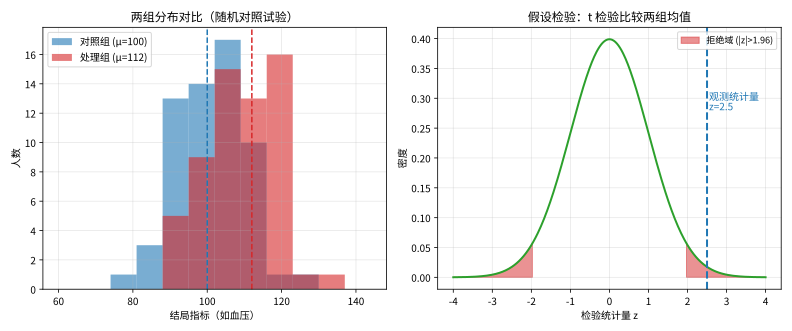

> **直观理解（现实类比）**：要判断一种新药是否有效，就像在同一批人里随机分成两组，一组服药、一组吃安慰剂，然后比较两组的平均效果。若两组分布几乎重合，说明差异只是随机误差；若差异超出正态分布的"拒绝域"（约两倍标准误之外），则可以断定是真实效果，而不是碰巧。

> **🧠 思考历程：怎么证明"是新药在救人，而不是运气在帮忙"？**
>
> 新疗法到底有没有效，单凭病人"看起来好转"远远不够。生物统计学最大的困惑在于：如何用数据区分"真实效果"与"偶然波动"。它想回答的，正是现代医学检验的基石问题。
>
> - **对照组是一面镜子**。1920年代，罗纳德·费希尔在罗斯姆斯特德农业试验站为随机化与方差分析奠定基础，主张必须随机分组、设置对照，才能排除土壤肥力、天气等混杂因素——这套方法随后被移植到医学中。
> - **医学史上第一个"真正随机"的试验**。1948年，统计学家布拉德福德·希尔主持链霉素治疗肺结核的随机对照试验，把病人随机分到用药组与对照组，这是公认的现代临床随机对照试验的开端。
> - **从显著性到生存曲线**。费希尔与尼曼的假设检验体系，加上随后的生存分析（如Cox比例风险模型）与ROC评价，把"有效与否"变成了层层可量化的判断，也让药物审批第一次有了严格的统计学依据。
> - **心路**：医学里"碰巧"与"必然"的分野，不是靠直觉，而是靠随机化与对照组这两根支柱。

#### 课堂问答

**老师**：设想你要证明一种新药有效。为什么必须随机分组，而不是"谁愿意就进哪组"？

**学生**：因为随机化让处理分配与潜在混杂（年龄、病情）在期望上独立，从而两组除处理外可比。若让病人自选，就等于把"更积极、更年轻"的人筛进用药组，疗效混杂了选择效应，因果效应不可识别。所以 RCT 是因果推断的金标准。

**老师（追问）**：随机化能平衡"已知"混杂，那"未知"的呢？还有，为什么还要加盲法？

**学生**：随机化平衡已知与未知混杂，这是它比回归调整（只能控已知变量）强的地方。盲法针对的是另一类偏差：若医生或病人知道分组，会改变用药依从性、结局报告与主观评分，产生实施偏倚和测量偏倚。双盲让安慰剂效应与评估者倾向在两组同等出现，从而相互抵消。

**老师（拓展）**：如果试验中途发现某组疗效突出，伦理上必须停，但反复"偷看"数据会怎样？

**学生**：会膨胀 I 类错误。多次看见就拒绝，等价于做了多重检验，实际假阳性率远超名义 $\alpha$。正确做法是预先设定期中分析次数与 alpha 花费函数，用 O'Brien-Fleming 或 Pocock 边界控制总体错误率，这也正是适应性设计要解决的问题。

### 2.2 生存分析

**生存分析**（Survival Analysis）研究事件发生时间数据。核心概念：

- **生存函数** $S(t) = P(T > t)$
- **风险函数** $h(t) = \lim_{\Delta t \to 0} \frac{P(t \le T < t + \Delta t | T \ge t)}{\Delta t}$
- **删失数据**（Censored Data）：事件未发生或失访

**Kaplan-Meier 估计**（乘积限估计）：

$$
\hat{S}(t) = \prod_{t_i \le t} \left(1 - \frac{d_i}{n_i}\right)
$$

其中 $d_i$ 为 $t_i$ 时刻发生事件的人数，$n_i$ 为 $t_i$ 时刻处于风险中的人数。

> **💡 直观理解（类比）**：Kaplan-Meier 估计就是"一步步按事件时刻往下打折"生存概率——在每个有人出事的时刻，用"当时还在场（=处于风险中）的人数 $n_i$ 里，走了几个 $d_i$"算一个存活比例 $1-d_i/n_i$，再把这些比例沿时间一路相乘。它像**逐级收紧的存活阶梯**：每有人倒下就往下跳一级，删失的人只是默默离队、不计成败，所以最终得到一条压低身段的阶梯状曲线。

> **🧠 思考历程：病人还没到观察结束就失访了，生存曲线该怎么算？**
>
> 研究病人存活时最麻烦的是"没到死就退出/失访/仍在院中"——数据是"不完整"的。它想回答的是：面对这种删失数据，如何一步步估计"活过某时点"的概率而不被半途跟丢者带偏。
>
> - **从"全观测"到"删失"的升级**。早期统计假设所有人都被观察到结局；但医学随访显然不成立。**卡普兰与迈耶（Kaplan & Meier, 1958）**提出"乘积限估计"，把生存率写成每个事件时刻"当刻存活比例"的连乘，只要当下还在风险中的人数就能算，删失者不参与但不丢信息——这是第一个真正在意"删失"的生存方法。
> - **如今是所有实验报告的标配**。医院论文、药审报告的生存曲线几乎都是 KM 曲线，配合 log-rank 检验与 Cox 回归，形成生存分析的标准三件套。
> - **心路**：用一个"逐级打折"的视角，把"不完整"的随访数据用出价值——生存在生物统计里是处理"删失"的艺术。

#### 课堂问答

**老师**：生存函数 $S(t)$ 与风险函数 $h(t)$，哪个更"本质"？它们怎么互相决定？

**学生**：互为充分信息，给其一即可定另一。定义上 $S(t)=P(T>t)$，而 $h(t)=f(t)/S(t)=-d\ln S(t)/dt$。把后者从 $0$ 到 $t$ 积分得 $-\ln S(t)=\int_0^t h(u)du$，于是

$$
S(t)=\exp\left(-\int_0^t h(u)\,du\right)
$$

风险函数是"瞬时失效率"，比生存函数更便于做回归与直观解释。

**老师（追问）**：删失数据为什么不能直接丢掉？丢掉会怎样？

**学生**：会系统性偏倚。右删失只告诉我们"存活超过某个时间 $c$"，是真信息。若把删失者当作事件，会高估风险、低估生存；若直接删除，等于假设他们与留下来的人同质，引入选择偏倚。正确做法是把删失个体贡献写成 $S(c)$、事件个体贡献写成 $f(t)$，似然为 $L=\prod_i f(t_i)^{\delta_i}S(t_i)^{1-\delta_i}$。

**老师（拓展）**：那风险函数随时间下降意味着什么？单调关系成立吗？

**学生**：$h(t)$ 下降表示"越活越安全"，常见于术后危险期之后的好转；上升如衰老。注意 $S(t)$ 一定单调不增，但 $h(t)$ 可以任意形状（浴盆曲线就是先降后升）。另外常数风险 $h(t)=\lambda$ 给出指数分布 $S(t)=e^{-\lambda t}$，具有无记忆性。

### 2.3 Cox 比例风险模型

**Cox 比例风险模型**（Cox Proportional Hazards Model）：

$$
h(t | X) = h_0(t) \exp(\beta^\top X)
$$

其中 $h_0(t)$ 为基线风险函数，$\beta$ 为回归系数。该模型通过部分似然（partial likelihood）进行估计，无需指定 $h_0(t)$ 的形式。

> **💡 直观理解（类比）**：Cox 模型把两件事分开算——"这是个什么硬赛道"（基线风险 $h_0(t)$，随所有人共同变化，无所谓具体形状）和"你身上的因素把你调快/调慢几倍"（回归系数 $\beta$）。就像同一场马拉松：无论赛道多颠簸，每人背着的负重（因素）都按固定倍数影响配速，$e^\beta$ 就是这个"倍数"。模型只比较同一时刻"谁比谁更危险"，所以根本不必知道基线长什么样。

> **🧠 思考历程：既要看"谁比谁危险"，又想不猜基线死活，怎么办？**
>
> 相比 KM 曲线只描述"一组"，医学更想同时评估多个因素（年龄、用药）对风险的贡献。它想回答的是：如何做"带协变量"的生存回归，又不必费力指定基线风险的具体形状。
>
> - **"半参数"的巧妙折中**。1972年，统计学家**戴维·考克斯**提出比例风险模型 $h(t|X)=h_0(t)e^{\beta^\top X}$，用"部分似然"（partial likelihood）只比较同一时刻处于风险中的人谁更危险，从而把基线 $h_0(t)$ 当成"无关形状"消掉。这是生存分析从"曲线"走向"回归"的关键一跃。
> - **半参的实用红利**。既然不必假设分布，Cox 模型成了临床研究中处理删失与多重协变量的标准手段，至今仍是医学统计被引用最多的模型之一。
> - **心路**：通过"只比同一刻、不比绝对值"，Cox 让生存回归既稳健又到处可用。

#### 课堂问答

**老师**：Cox 模型写成 $h(t|X)=h_0(t)\exp(\beta^\top X)$，它凭什么既带协变量又"不用管"基线风险？

**学生**：因为把风险拆成"时间部分"和"协变量部分"的乘积，基线 $h_0(t)$ 与个体无关。当我们只比较同一时刻两个体的相对风险时，$h_0(t)$ 在比值里约掉：

$$
\frac{h(t|X_1)}{h(t|X_2)}=\frac{\exp(\beta^\top X_1)}{\exp(\beta^\top X_2)}=\exp(\beta^\top(X_1-X_2))
$$

所以估计 $\beta$ 时只需部分似然，无需知道 $h_0(t)$ 的形状。

**老师（追问）**：那 $e^\beta$ 到底怎么解释？"比例风险"假设在说什么？

**学生**：$e^\beta$ 是风险比 HR：协变量每增加一个单位，瞬时风险变为原来的 $e^\beta$ 倍。比例风险就是要求这个倍比不随时间变——任意两人的风险比 $\exp(\beta^\top\Delta X)$ 是常数。若治疗获益随时间衰减，HR 会漂移，假设就破了。

**老师（拓展）**：怎么检验这个假设？破了怎么办？

**学生**：用 Schoenfeld 残差检验：若残差与时间相关，说明 $\beta(t)$ 随 $t$ 变，违反 PH 假设。补救可引入时变协变量 $\beta(t)$、按分层变量分层，或分时间段建系数模型。这些都不改变"部分似然"这一估计内核。

### 2.4 Log-rank 检验

**Log-rank 检验**用于比较两组生存曲线的差异。检验统计量为：

$$
\chi^2 = \frac{(O_1 - E_1)^2}{E_1} + \frac{(O_2 - E_2)^2}{E_2}
$$

其中 $O_i$ 为观察事件数，$E_i$ 为期望事件数。

> **💡 直观理解（类比）**：Log-rank 检验就是"把两队每个出场时刻的账逐笔对一遍再汇总"——在每个有人出事的时刻，算出在假设两组没差别的情况下，"这一队本该出局几人"（期望 $E$），再拿"实际出局几人"（观察 $O$）去比，把所有时刻的差累加再标准化。它像给两个存活赛跑成绩做"总账审计"：如果两队真一样，这笔总账会在0附近小幅波动；一旦亏损明显偏到一边，就说明两队存活真有差别。它只看"何时出局"，不假设风险按固定倍数成比例。

> **🧠 思考历程：光看两条生存曲线，怎么判断"差得算不算真差"？**
>
> KM 曲线给两组各画一条，可曲线分离多少才算"显著不同"？它想回答的是：如何对两组生存曲线做假设检验，而不是靠肉眼对比。
>
> - **从 Mantel-Haenszel 检验走来**。1966年，**内森·曼特尔**（与 W. Haenszel 的合作者之一）提出 log-rank 检验的雏形：在每个事件时刻构造"列联表"式的对比（观察 vs 期望事件数），再把这些细节跨时刻汇总成卡方统计量。它本质上是把"逐时刻的生存对比"做成整体假设检验。
> - **看名字没"rank"却处处在“rank”**。之所以叫 log-rank，是因为它与秩和比较在数学上相通、且在比例风险假设下等价于 Cox 模型检验协变量为 0。它已成为随机对照试验里"两臂生存有无差别"的事实标准。
> - **心路**：把无数个时间点上"谁先出局"的账逐笔对，再合出一笔总账——log-rank 就这样把复杂的生存曲线差异化成一句"显著/不显著"的判定。

#### 课堂问答

**老师**：Log-rank 想比较两条生存曲线，为什么不干脆在每个时刻比一比生存率之差？

**学生**：因为那样要选时刻、权重混乱，且给不出统一检验。Log-rank 的巧妙在于"按事件时刻逐笔对账"：在每个事件时间 $t_j$，假设两组同分布，则组 1 的观察事件数 $O_{1j}$ 的期望与方差由超几何分布给出

$$
E_{1j}=\frac{n_{1j}d_j}{n_j},\qquad V_{1j}=\frac{n_{1j}n_{2j}d_j(n_j-d_j)}{n_j^2(n_j-1)}
$$

把所有时刻的 $O-E$ 累加，再用 $\sqrt{\sum V}$ 标准化。

**老师（追问）**：这个统计量的分子 $\sum(O_1-E_1)$ 在原假设下为什么收敛到正态？

**学生**：因为可以把它写成鞅积分 $\int \frac{Y_1(s)}{Y(s)}dM(s)$。$M$ 是零均值鞅，其积分仍是零均值鞅，方差由二次变差 $\langle M\rangle$ 决定。由鞅中心极限定理，标准化后

$$
Z=\frac{\sum_j(d_{1j}-e_{1j})}{\sqrt{\sum_j v_{1j}}}\xrightarrow{d}N(0,1)
$$

于是 $\chi^2=Z^2$ 服从自由度为 1 的卡方分布。

**老师（拓展）**：它和 Cox 模型有何联系？为什么叫 log-rank 却处处是"秩"？

**学生**：在比例风险成立时，Log-rank 检验等价于检验 Cox 模型中该分组协变量的系数是否为 0；它也是 Mantel-Haenszel 检验的特例。名字里的 rank 是因为它与秩和检验同源——只依赖事件发生的次序，不依赖具体生存时间的值，故属非参数方法。

### 2.5 病例对照研究与队列研究

**队列研究**（Cohort Study）：按暴露因素分组，前瞻性追踪结局发生情况。

**病例对照研究**（Case-Control Study）：按结局分组，回顾性调查暴露因素。**比值比**（Odds Ratio, OR）为效应指标。

> **💡 直观理解（类比）**：队列研究与病例对照研究是"两种时间方向"的调查。**队列研究**像"向前看录像"——先按暴露分组，再一路盯着这群人，看谁将来得病（方向对、耗时贵、适合估风险）；**病例对照研究**像"向后翻档案"——先找到得病与没得病的两组人，再回头翻他们过去暴露过没有（快、省、适合罕见病）。**比值比 OR** 是"患病者中暴露的比例与非患病者中暴露比例的比"，在病例对照里近似反映暴露跟疾病挂钩的强度，>1 表示暴露更常见于有病者。

#### 课堂问答

**老师**：队列研究和病例对照研究，本质上差在哪一个"方向"上？

**学生**：差在抽样的时间方向和能算的量。队列研究按暴露分组、前瞻追踪结局，算的是 $P(\text{病}|\text{暴露})$，可直接得相对风险 RR。病例对照按结局分组、回顾暴露，算的是 $P(\text{暴露}|\text{病})$，得到的是比值比 OR，因为人群基数被固定抽样破坏了，RR 不可直接算。

**老师（追问）**：那 OR 凭什么能近似 RR？在什么条件下？

**学生**：当疾病罕见时，患病比例很小。由贝叶斯结构，

$$
OR=\frac{P(D|E)/P(\bar D|E)}{P(D|\bar E)/P(\bar D|\bar E)}\ \approx\ \frac{P(D|E)}{P(D|\bar E)}=RR
$$

因为 $P(\bar D|E)\approx1\approx P(\bar D|\bar E)$。这正是罕见病假设：OR 只是 RR 的近似，病不罕时就差得多。

**老师（拓展）**：为什么病例对照研究特别适合罕见病，但队列研究不行？

**学生**：罕见病若用队列，要随访极大人群才凑够病例，成本与时间爆炸；病例对照从已有病例出发，用少量对照即可，效率高。反过来，要研究人群发病率、多结局或暴露罕见时，队列更合适。两者在混杂控制上都可用匹配、分层或回归，但方向决定了可识别效应量的类型。

### 2.6 Meta 分析

**Meta 分析**（Meta-Analysis）合并多个独立研究的结果。包含：

- **固定效应模型**：假设所有研究具有相同的真实效应
- **随机效应模型**：允许研究间存在异质性

> **💡 直观理解（类比）**：Meta 分析就是"把好几个独立医生各自测的口径汇总成一个综合结论"。**固定效应模型**认为大家背后是同一个"真效应"，差异只是各家测量的随机误差，于是像把多把同一品牌的尺子测量结果取加权平均；**随机效应模型**则认为各家研究的"真相"本来就可能不同（人群、方法各异），多了个研究间方差 $\tau^2$，像把不同品牌尺子一起量、彼此可能真有偏差——所以它给的置信区间更宽、更保守，也更能推广到更广大人群。

> **🧠 思考历程：几十篇互相矛盾的论文，怎么"取个总账"？**
>
> 同一个药物，A 医院说有效、B 医院说无效，临床大夫到底信谁？与其靠印象，不如把所有可比较的研究系统地合并。它想回答的是：如何用统计把多个研究的结果"科学地叠加"，而不是简单数票。
>
> - **从"研究之研究"到"系统综述"**。1976年，心理学家**吉恩·格拉斯**首次使用"meta-analysis"一词，指"对分析的分析"——把所有同主题的效应量（如 Cohen's d 或比值比）用加权平均合成一个综合估计。循证医学兴起后，它成了制定指南、评估药物有效性的证据基石。
> - **固定与随机两把尺**。若研究间确实同质就用固定效应；若存在真实差异（$\tau^2>0$）就用随机效应，把"跨研究的不确定性"也计进误差——前者更精、后者更稳但区间更宽，二者之争贯穿系统综述的建模与应用。
> - **心路**：Meta 分析的使命是"让证据集合成一句话"——从一堆零散而矛盾的研究里，提炼出那个最可信的总体效应。

#### 课堂问答

**老师**：把几篇研究的效应量"取平均"不就行了，为什么还要区分固定效应和随机效应？

**学生**：因为简单平均丢掉了精度信息。固定效应假设所有研究共享同一真效应 $\theta$，只用研究内方差加权 $w_i=1/\sigma_i^2$，估计

$$
\hat\mu_{\text{FE}}=\frac{\sum_i w_i\hat\theta_i}{\sum_i w_i}
$$

它以"大家背后同真值"为前提，异质性一旦存在就有偏。

**老师（追问）**：那当研究间真有差异时，随机效应做了什么？为什么它的置信区间更宽？

**学生**：随机效应把各研究的真效应看作来自 $N(\mu,\tau^2)$，于是边际方差是 $\sigma_i^2+\tau^2$，权重变成 $w_i^*=1/(\hat\sigma_i^2+\hat\tau^2)$。因为总方差更大、权重更均匀（小研究权重相对上升），合并估计的方差 $\text{Var}(\hat\mu_{\text{DL}})=1/\sum w_i^*$ 更大，故置信区间更宽、更保守。

**老师（拓展）**：怎么判断该用哪个？异质性大时还能轻信合并结果吗？

**学生**：先用 Cochran 的 $Q=\sum_i w_i(\hat\theta_i-\hat\mu_{\text{FE}})^2$ 检验 $\tau^2=0$，或用 $I^2$ 量化异质占比。$I^2$ 大（如超过 75%）说明研究间有实质差异，此时不该只报一个合并值，应做亚组分析、Meta 回归找异质来源，并优先采用随机效应模型。$\tau^2=0$ 时随机效应自动退化为固定效应。

### 2.7 诊断试验

**诊断试验**（Diagnostic Test）评价指标：

- **敏感性**（Sensitivity）：$Se = P(\text{Test}^+ | \text{Disease}^+)$
- **特异性**（Specificity）：$Sp = P(\text{Test}^- | \text{Disease}^-)$
- **ROC 曲线**：以 1-特异性为横轴、敏感性为纵轴绘制的曲线
- **AUC**（Area Under the Curve）：ROC 曲线下面积，衡量诊断准确性

> **💡 直观理解（类比）**：诊断试验要权衡"别漏掉病人"和"别冤枉好人"。**敏感性** $Se$ 是"有病的人里被查出来的比例"（不放过一个）；**特异性** $Sp$ 是"没病的人里被正确放行的比例"（不冤枉一个），两者此消彼长。**ROC 曲线**就是把"报警阈值"从最严拉到最松，把每种阈值下的"漏报与误报权衡"画成一条曲线——曲线越贴左上角越好。**AUC** 是这条曲线下方的面积，是"区分病人和正常人的总能力"：0.5 等于瞎猜，1 是火眼金睛。

> **🧠 思考历程：一个检查结果，怎么知道它"准不准"？**
>
> 再先进的诊断（化验、影像、AI模型）也会漏诊或误报，但如何把"准不准"量化到给别人看？它想回答的是：怎样用一个不以阈值选择为转移的指标，衡量一套诊断手段的区分能力。
>
> - **雷达背景的 ROC**。二战雷达探测中，人们已在用"接收者操作特性（ROC）"权衡"报真警报"与"报假警报"的取舍；1970年代起，医学影像与生物统计采纳它来评价诊断手段，横轴 $1-$特异位、纵轴敏感性，每个阈值对应曲线上一点。
> - **AUC 变成"一句话的总结"**。把整条 ROC 曲线下面的面积（AUC）当一个数：它等于"随机抽一个病人、一个常人，检查给病人打更高风险的概率"，故 AUC=0.5 即瞎猜、越接近 1 越强。如今 AUC 是 AI 医学影像、检验指标评价里几乎绕不开的"及格线与排行榜"。
> - **心路**：ROC 把"阈值怎么选都好"兜底成"整条曲线的本事"，让"准不准"可以跨手段、跨设定地公平比拼。

#### 课堂问答

**老师**：敏感性和特异性为什么是"此消彼长"的？阈值一动，它们怎么变？

**学生**：因为阈值是同一根尺子。把判阳的标准定得越松，真病人更多被抓到、敏感性升，但健康人也被误判、特异性降；反之亦然。所以单看某一个数毫无意义——$Se=P(\text{阳}|\text{病})$、$Sp=P(\text{阴}|\text{健康})$，必须成对报告。

**老师（追问）**：那有没有一个"不依赖阈值"的总体指标？

**学生**：有，就是 ROC 曲线及其下面积 AUC。把阈值从最严到最松扫一遍，以 $1-Sp$ 为横轴、$Se$ 为纵轴连线。AUC 有漂亮的概率意义：

$$
\text{AUC}=P(X_{\text{病}}>X_{\text{健康}})
$$

即随机抽一个病人和一个健康人、病人得分更高的概率，等于 Mann-Whitney U 统计量的标准化形式。

**老师（拓展）**：AUC=0.8 就说明这个检查很好吗？临床上还要注意什么？

**学生**：不一定。AUC 是跨阈值平均的区分力，但真实临床只用一个阈值，此时更要看 PPV 与 NPV，而它们强烈依赖患病率：

$$
PPV=\frac{Se\cdot\pi}{Se\cdot\pi+(1-Sp)(1-\pi)}
$$

病罕见时（$\pi$ 小），即使 $Se,Sp$ 都高，PPV 也可能很低，阳性里大半是假阳。所以 AUC 高并不掩盖患病率对预测值的支配作用。

### 2.8 贝叶斯生物统计

**贝叶斯方法**（Bayesian Methods）结合先验信息和数据：

$$
P(\theta | \text{Data}) \propto P(\text{Data} | \theta) \cdot P(\theta)
$$

其中 $P(\theta)$ 为先验分布，$P(\text{Data} | \theta)$ 为似然函数，$P(\theta | \text{Data})$ 为后验分布。

> **💡 直观理解（类比）**：贝叶斯方法就是"用新证据把你心里的成见更新一遍"。**先验 $P(\theta)$** 是看到数据前你对参数的既有看法（比如"新药有效的概率大致这么高"）；**似然 $P(\text{Data}|\theta)$** 是"如果参数真是这个值，看到这堆数据的可能性"；**后验 $P(\theta|\text{Data})$** 是把两者相乘归一化后的"看完数据你应该信多少"。它像拼积木校准天平：先放上之前已知的重量（先验），再叠上眼前证据（似然），最后得出最可信的新认识（后验）。

#### 课堂问答

**老师**：贝叶斯公式 $P(\theta|\text{Data})\propto P(\text{Data}|\theta)P(\theta)$，这三项各自在生物统计里扮演什么角色？

**学生**：先验 $P(\theta)$ 是看数据前对参数的信念（如历史试验已知新药有效率的分布）；似然 $P(\text{Data}|\theta)$ 是模型给出的"若参数为 $\theta$ 时数据出现的概率"，与先验相乘后归一化，得后验 $P(\theta|\text{Data})$。所以贝叶斯本质是"用证据把先验更新成后验"。

**老师（追问）**：为什么二项分布配 Beta 先验这么受宠？更新到底做了什么？

**学生**：因为 Beta 是二项似然的共轭先验。若 $D\sim\text{Bin}(n,p)$、先验 $p\sim\text{Beta}(a,b)$，则后验仍是 Beta：

$$
p|D\sim\text{Beta}(a+x,\ b+n-x)
$$

其中 $x$ 是成功数。更新规则干净到"只加计数"：$a\to a+x$，$b\to b+n-x$。这让序贯试验可以一批批数据迭代更新。

**老师（拓展）**：先验会不会"作弊"？监管上怎么处理这个争议？

**学生**：会，若先验被刻意选得朝向有利方向，后验就被污染。规范要求预先设定先验、使用弱信息或基准先验，并做先验敏感性分析。反过来，贝叶斯的优势在于能给出"参数落在某区间的直接概率"（可信区间），对罕见病、样本稀少或需中期更新的场景尤为自然，这与频率派置信区间的含义完全不同。

### 2.9 多重比较校正

**多重比较校正**（Multiple Comparison Correction）控制族系错误率：

- **Bonferroni 校正**：$p_{\text{adj}} = p \cdot m$，其中 $m$ 为比较次数
- **FDR 控制**（Benjamini-Hochberg 方法）：控制错误发现率

> **💡 直观理解（类比）**：多重比较校正解决"检验做太多会闹笑话"的问题——测 20 个基因若每个都用 0.05 的阈值，光凭运气就很可能冒出一两个假阳性。**Bonferroni 校正**把门槛除以比较次数（$p_{adj}=p\cdot m$），像"嫌犯太多就提高定罪标准"，管得很严但太保守、容易漏掉真信号；**FDR 控制**（BH 方法）只限制"所有被叫出来发现的基因里，假阳性占比"，像抓贼时放宽标准但保证"抓错的不超过一定比例"，更灵活，适合海量基因筛选。

#### 课堂问答

**老师**：检验 20 个基因，每个都用 $\alpha=0.05$，为什么危险？

**学生**：因为假阳性会累积。若 20 个原假设全为真、检验独立，则至少出现一个假阳性的概率是

$$
1-(1-\alpha)^m=1-0.95^{20}\approx0.642
$$

远超 0.05。所以逐个用 0.05 等于把整体误报率悄悄放大了十几倍。

**老师（追问）**：那 Bonferroni 怎么修？它的代价是什么？

**学生**：Bonferroni 把每个检验的阈值收紧到 $\alpha/m$，即 $p_{\text{adj}}=p\cdot m$，控制的是族系错误率 FWER——出现哪怕一个假阳性的概率不超过 $\alpha$。代价是过度保守：$m$ 很大时阈值极严，检验功效骤降，真信号容易被漏掉。

**老师（拓展）**：海量筛选时有没有更聪明的标准？

**学生**：有，Benjamini-Hochberg 的 FDR 控制的是"被判定为显著的结果中假阳性的期望占比"，而非一个都不许有。它把 $p$ 值排序后找最大的 $k$ 使 $p_{(k)}\le\frac{k}{m}\alpha$，拒绝前 $k$ 个。FDR 在高通量场景下比 FWER 更实用、功效更高，是基因组筛选中更常用的折中。

### 2.10 样本量计算

**样本量计算**（Sample Size Calculation）基于检验效能分析。对于两样本均数比较：

$$
n = \frac{2(Z_{\alpha/2} + Z_\beta)^2 \sigma^2}{\delta^2}
$$

其中 $\delta$ 为效应量，$\sigma^2$ 为方差，$\alpha$ 为显著性水平，$1-\beta$ 为检验效能。

> **💡 直观理解（类比）**：样本量计算就是"先算清楚要招多少病人才能看出差别"。它取决于三件事：想发现的最小效果 $\delta$（差异越小越难发现、需要越多样本）、数据的波动 $\sigma$（越乱越需要人多）、以及假阳概率 $\alpha$ 和假阴/效能 $1-\beta$ 的口径（要求越严、需要人越多）。它还是一种"天平收支"：$\delta$ 越小、$\sigma$ 越大、$\alpha$ 或 $\beta$ 越小，样本量公式 $n=2(Z_{\alpha/2}+Z_\beta)^2\sigma^2/\delta^2$ 给出的 $n$ 就越大——就像要分辨两种很相近的秤砣，得量得更精细、更多次。

#### 课堂问答

**老师**：两样本均数比较的样本量公式 $n=\frac{2(Z_{\alpha/2}+Z_\beta)^2\sigma^2}{\delta^2}$，四个量各在说什么？

**学生**：$\delta$ 是想检测的最小效应（两均值差），$\sigma^2$ 是数据方差，$\alpha$ 定 I 类错误（假阳），$1-\beta$ 是检验效能（能检出真效应的把握）。公式告诉你：想分辨的差越小、数据越乱，就需要越多样本。

**老师（追问）**：为什么 $\delta$ 在分母且是平方？$n$ 对 $\delta$ 的敏感度如何？

**学生**：因为检验统计量 $Z=\frac{\bar X_1-\bar X_2}{\sigma\sqrt{2/n}}$ 把效应标准化。要 $|Z|$ 达到临界值，就需要 $\sqrt{2/n}\,\delta/\sigma$ 足够大，即 $n\propto\sigma^2/\delta^2$。$\delta$ 减半，$n$ 要翻四倍——这是样本量的平方反比魔咒，所以预告效应量必须诚实，不能为少招人而虚报大 $\delta$。

**老师（拓展）**：如果算出来样本量太大、现实招不够，怎么办？

**学生**：几条路：放宽 $\alpha$ 或降低效能（通常不肯）、提高测量精度降低 $\sigma$、选更敏感的设计（配对、协变量调整、重复测量可减少 $\sigma$），或改用信息量更大的终点。若仍不够，可用适应性设计做样本量重估，或接受更小的可检测效应、靠后续 Meta 分析积累证据。核心是：不诚实的小样本"假装"有功效，才是真正的研究浪费。

### 2.11 适应性设计

**适应性设计**（Adaptive Design）允许在试验进行中根据中期分析结果修改试验方案，如样本量重估、适应性随机化等。

> **💡 直观理解（类比）**：适应性设计把试验从"提前定死的剧本"升级成"边演边改的即兴演出"——中期看一眼数据，若药太差就早点止损、若很有希望就重估样本量或多分病人给好组。它像开车用导航：不是出发前就锁定路线，而是随时根据"前方路况"（中期数据）调整方向，省时间省病人。但代价是"多次偷看结果"会引入多重比较与偏误，必须预先规定好调整规则，否则 I 类错误会失控。

---

#### 课堂问答

**老师**：适应性设计允许边做边改，听起来很实用，它最核心的代价是什么？

**学生**：代价是 I 类错误失控。因为你在多个时间点反复"看"数据，只要有希望就继续、不行就停，这等价于做了多次检验。每次偷看都可能触发拒绝，累积起来假阳性率远超名义 $\alpha$。所以适应性设计必须预先定好调整规则与序贯边界，否则推论失效。

**老师（追问）**：那统计上怎么把多重"偷看"的 $\alpha$ 管住？

**学生**：用 alpha 花费函数。把总的 $\alpha$ 按预先设定的函数分摊到各次中期分析：如 O'Brien-Fleming 早期花费极少、后期多；Pocock 则各次大致均分。每次比较统计量与该期边界，保证总体 I 类错误仍为 $\alpha$。样本量重估时（如基于盲态数据或条件功效）也要用类似方法校正，避免引入偏倚。

**老师（拓展）**：除了控制错误率，适应性设计还有哪些好处与隐患？

**学生**：好处：可在无效时提前止损（省资源、更符合伦理）、可在有信号时扩大样本量、应答自适应随机化能让更多受试者分到更优组。隐患：除了 I 类错误，还有操作性偏倚——若非预先、非盲态地选调整规则，或数据泄露影响决策，估计就会偏。所以规范要求规则预注册、用盲态数据、必要时对效应估计做校正。

## 3. 定理与证明

### 定理 3.1：Cox 比例风险模型的部分似然估计

**定理**：考虑 Cox 比例风险模型 $h(t|X) = h_0(t) \exp(\beta^\top X)$。设观测数据为 $(T_i, \delta_i, X_i)$，$i = 1, \dots, n$，其中 $T_i$ 为事件时间或删失时间，$\delta_i$ 为事件指示变量（$\delta_i = 1$ 表示事件发生，$\delta_i = 0$ 表示删失），$X_i$ 为协变量向量。Cox 模型的部分似然函数（Partial Likelihood）为：

$$
L(\beta) = \prod_{i: \delta_i = 1} \frac{\exp(\beta^\top X_i)}{\sum_{j \in R(t_i)} \exp(\beta^\top X_j)}
$$

其中 $R(t_i) = \{j: T_j \ge t_i\}$ 为 $t_i$ 时刻的风险集（risk set）。部分似然估计量 $\hat{\beta}$ 通过最大化 $L(\beta)$ 得到，在正则条件下，$\hat{\beta}$ 是 $\beta$ 的一致估计且渐近服从正态分布。

**证明**：

**步骤1：部分似然的推导**

Cox 模型的核心思想是，在给定风险集的情况下，$t_i$ 时刻事件发生在个体 $i$ 上的条件概率为：

$$
P(\text{个体 } i \text{ 在 } t_i \text{ 时刻发生事件} | \text{风险集 } R(t_i)) = \frac{h(t_i | X_i)}{\sum_{j \in R(t_i)} h(t_i | X_j)} = \frac{h_0(t_i) \exp(\beta^\top X_i)}{\sum_{j \in R(t_i)} h_0(t_i) \exp(\beta^\top X_j)} = \frac{\exp(\beta^\top X_i)}{\sum_{j \in R(t_i)} \exp(\beta^\top X_j)}
$$

注意基线风险 $h_0(t_i)$ 在分子分母中消去，因此部分似然不依赖于 $h_0(t)$。

将所有事件发生的时间点上的条件概率相乘，得到部分似然函数：

$$
L(\beta) = \prod_{i: \delta_i = 1} \frac{\exp(\beta^\top X_i)}{\sum_{j \in R(t_i)} \exp(\beta^\top X_j)}
$$

**步骤2：对数部分似然与得分函数**

对数部分似然为：

$$
\ell(\beta) = \sum_{i: \delta_i = 1} \left[\beta^\top X_i - \ln\left(\sum_{j \in R(t_i)} \exp(\beta^\top X_j)\right)\right]
$$

得分函数（Score Function）为：

$$
U(\beta) = \frac{\partial \ell(\beta)}{\partial \beta} = \sum_{i: \delta_i = 1} \left[X_i - \frac{\sum_{j \in R(t_i)} X_j \exp(\beta^\top X_j)}{\sum_{j \in R(t_i)} \exp(\beta^\top X_j)}\right]
$$

定义加权平均 $\bar{X}(\beta, t_i) = \frac{\sum_{j \in R(t_i)} X_j \exp(\beta^\top X_j)}{\sum_{j \in R(t_i)} \exp(\beta^\top X_j)}$，则：

$$
U(\beta) = \sum_{i: \delta_i = 1} \left[X_i - \bar{X}(\beta, t_i)\right]
$$

**步骤3：信息矩阵**

观察信息矩阵（Observed Information Matrix）为：

$$
I(\beta) = -\frac{\partial^2 \ell(\beta)}{\partial \beta \partial \beta^\top} = \sum_{i: \delta_i = 1} \left[\frac{\sum_{j \in R(t_i)} X_j X_j^\top \exp(\beta^\top X_j)}{\sum_{j \in R(t_i)} \exp(\beta^\top X_j)} - \bar{X}(\beta, t_i) \bar{X}(\beta, t_i)^\top\right]
$$

**步骤4：鞅理论框架**

**鞅**（Martingale）在生存分析中起关键作用。定义计数过程 $N_i(t) = \mathbf{1}_{\{T_i \le t, \delta_i = 1\}}$ 和风险过程 $Y_i(t) = \mathbf{1}_{\{T_i \ge t\}}$。则 $N_i(t)$ 具有补偿子（compensator）：

$$
\Lambda_i(t) = \int_0^t Y_i(s) h_0(s) \exp(\beta^\top X_i) ds
$$

$M_i(t) = N_i(t) - \Lambda_i(t)$ 是一个鞅。

**步骤5：得分函数的鞅表示**

得分函数可表示为鞅的积分：

$$
U(\beta) = \sum_{i=1}^n \int_0^\infty \left[X_i - \bar{X}(\beta, s)\right] dM_i(s)
$$

由于 $M_i$ 是鞅，$U(\beta)$ 是鞅积分，其期望为 0。由鞅中心极限定理，$\frac{1}{\sqrt{n}} U(\beta_0) \xrightarrow{d} N(0, \Sigma)$，其中 $\Sigma$ 为渐近方差。

**步骤6：一致性**

由凸函数的一阶条件，$\hat{\beta}$ 满足 $U(\hat{\beta}) = 0$。由大数定律和鞅的收敛性，$\frac{1}{n} I(\beta) \xrightarrow{p} \mathcal{I}(\beta)$，其中 $\mathcal{I}(\beta)$ 为期望信息矩阵。

通过标准的 M-估计理论，$\hat{\beta} \xrightarrow{p} \beta_0$（一致性）。

**步骤7：渐近正态性**

对得分函数在 $\beta_0$ 处进行泰勒展开：

$$
0 = U(\hat{\beta}) = U(\beta_0) + \frac{\partial U(\bar{\beta})}{\partial \beta^\top} (\hat{\beta} - \beta_0)
$$

其中 $\bar{\beta}$ 在 $\hat{\beta}$ 和 $\beta_0$ 之间。

因此：

$$
\sqrt{n}(\hat{\beta} - \beta_0) = \left(-\frac{1}{n} \frac{\partial U(\bar{\beta})}{\partial \beta^\top}\right)^{-1} \cdot \frac{1}{\sqrt{n}} U(\beta_0)
$$

由一致性，$\frac{1}{n} \frac{\partial U(\bar{\beta})}{\partial \beta^\top} \xrightarrow{p} -\mathcal{I}(\beta_0)$。由鞅 CLT，$\frac{1}{\sqrt{n}} U(\beta_0) \xrightarrow{d} N(0, \mathcal{I}(\beta_0))$。

由 Slutsky 定理：

$$
\sqrt{n}(\hat{\beta} - \beta_0) \xrightarrow{d} N(0, \mathcal{I}(\beta_0)^{-1})
$$

即 $\hat{\beta}$ 渐近服从 $N(\beta_0, \mathcal{I}(\beta_0)^{-1}/n)$。$\square$
> **直观理解（现实类比）**：Cox 比例风险模型就像给每个病人贴一张"风险身份证"——基础风险随时间怎么变可以不管，但各因素（年龄、用药）把风险按固定倍数放大或缩小。回归系数 $\beta$ 算出的风险比 $HR=e^\beta$ 就是"用药组相对对照组的风险倍数"：$HR<1$ 说明药是"护身符"降风险，$HR>1$ 则是"催命符"增风险。"比例风险"的前提是这张倍数关系不随时间变。

---

#### 课堂问答

**老师**：部分似然 $L(\beta)=\prod_{i:\delta_i=1}\frac{\exp(\beta^\top X_i)}{\sum_{j\in R(t_i)}\exp(\beta^\top X_j)}$ 是怎么把 $h_0(t)$ 消掉的？

**学生**：关键在"条件于风险集"。在 $t_i$ 时刻，个体 $i$ 与风险集中各人发生事件的相对概率恰好是各自风险函数之比：

$$
\frac{h(t_i|X_i)}{\sum_{j\in R(t_i)}h(t_i|X_j)}=\frac{h_0(t_i)\exp(\beta^\top X_i)}{\sum_j h_0(t_i)\exp(\beta^\top X_j)}=\frac{\exp(\beta^\top X_i)}{\sum_j \exp(\beta^\top X_j)}
$$

共享的 $h_0(t_i)$ 上下约掉，于是部分似然只含 $\beta$。

**老师（追问）**：既然不是完整似然，凭什么 $\hat\beta$ 还能一致、渐近正态？

**学生**：用计数过程与鞅理论。得分函数可写成鞅积分

$$
U(\beta)=\sum_{i=1}^n\int_0^\infty\big[X_i-\bar X(\beta,s)\big]\,dM_i(s)
$$

$M_i$ 是零均值鞅，故 $U(\beta_0)$ 均值为 0，由鞅 CLT 有 $\frac{1}{\sqrt n}U(\beta_0)\xrightarrow{d}N(0,\mathcal I)$；信息矩阵 $\frac{1}{n}I(\beta)\xrightarrow{p}\mathcal I$。套标准 M 估计的泰勒展开与 Slutsky 定理，即得 $\hat\beta$ 一致且

$$
\sqrt n(\hat\beta-\beta_0)\xrightarrow{d}N\!\big(0,\ \mathcal I(\beta_0)^{-1}\big)
$$

**老师（拓展）**：这个结果里最"反直觉"的一点是什么？对实践有什么影响？

**学生**：最反直觉的是：我们丢弃了 $h_0(t)$ 相关的全部信息，估计却仍具半参数有效性——$\mathcal I^{-1}$ 达到半参数下界。代价是必须有足够大的风险集才能稳健；小样本或大量并列事件时要用 Breslow 近似与方差校正。实践上，HR 的置信区间直接由 $\hat\beta$ 的渐近正态性给出，这也是 Cox 回归能成为临床标配的原因。

### 定理 3.2：Kaplan-Meier 估计的一致性

**定理**：设 $T_1, \dots, T_n$ 为独立同分布的生存时间，$C_1, \dots, C_n$ 为独立同分布的删失时间，二者独立。观测数据为 $X_i = \min(T_i, C_i)$ 和 $\delta_i = \mathbf{1}_{\{T_i \le C_i\}}$。Kaplan-Meier 估计量（乘积限估计）为：

$$
\hat{S}(t) = \prod_{t_i \le t} \left(1 - \frac{d_i}{n_i}\right)
$$

其中 $t_1 < t_2 < \cdots$ 为事件发生时间，$d_i$ 为 $t_i$ 时刻发生事件的人数，$n_i$ 为 $t_i$ 时刻处于风险中的人数。则 $\hat{S}(t)$ 是真实生存函数 $S(t) = P(T > t)$ 的一致估计，即：

$$
\sup_{t \in [0, \tau]} |\hat{S}(t) - S(t)| \xrightarrow{p} 0
$$

其中 $\tau$ 满足 $P(T > \tau) > 0$ 且 $P(C > \tau) > 0$。

**证明**（使用鞅表示）：

**步骤1：定义计数过程和风险过程**

定义计数过程 $N(t) = \sum_{i=1}^n N_i(t)$，其中 $N_i(t) = \mathbf{1}_{\{X_i \le t, \delta_i = 1\}}$。

定义风险过程 $Y(t) = \sum_{i=1}^n Y_i(t)$，其中 $Y_i(t) = \mathbf{1}_{\{X_i \ge t\}}$。

**步骤2：累积风险函数**

累积风险函数（Cumulative Hazard Function）为 $\Lambda(t) = -\ln S(t)$。Nelson-Aalen 估计量为：

$$
\hat{\Lambda}(t) = \sum_{t_i \le t} \frac{d_i}{n_i}
$$

Kaplan-Meier 估计与 Nelson-Aalen 估计的关系为：

$$
\hat{S}(t) = \prod_{t_i \le t} \left(1 - \frac{d_i}{n_i}\right) \approx \exp\left(-\sum_{t_i \le t} \frac{d_i}{n_i}\right) = \exp(-\hat{\Lambda}(t))
$$

**步骤3：鞅表示**

计数过程 $N(t)$ 的补偿子为 $\Lambda^*(t) = \int_0^t Y(s) h(s) ds$，其中 $h(s) = \lim_{\Delta s \to 0} P(s \le T < s + \Delta s | T \ge s)/\Delta s$ 为风险函数。

鞅 $M(t) = N(t) - \Lambda^*(t)$ 是均值为零的平方可积鞅。

**步骤4：Nelson-Aalen 估计的鞅表示**

Nelson-Aalen 估计量可写为：

$$
\hat{\Lambda}(t) - \Lambda(t) = \int_0^t \frac{dM(s)}{Y(s)}
$$

其中 $\Lambda(t) = \int_0^t h(s) ds$ 为真实累积风险函数。

**步骤5：一致性证明**

需要证明 $\hat{\Lambda}(t) \xrightarrow{p} \Lambda(t)$，即 $\int_0^t \frac{dM(s)}{Y(s)} \xrightarrow{p} 0$。

由鞅的方差公式：

$$
\text{Var}\left(\int_0^t \frac{dM(s)}{Y(s)}\right) = \mathbb{E}\left[\int_0^t \frac{d\langle M \rangle(s)}{Y(s)^2}\right]
$$

其中 $\langle M \rangle(t) = \int_0^t Y(s) h(s) ds$ 为鞅的二次变差过程。

因此：

$$
\text{Var}\left(\int_0^t \frac{dM(s)}{Y(s)}\right) = \mathbb{E}\left[\int_0^t \frac{h(s)}{Y(s)} ds\right]
$$

当 $n \to \infty$ 时，$Y(s) \to \infty$ 几乎必然，且 $Y(s) = O_p(n)$，因此方差趋于 0。

由 Chebyshev 不等式，对任意 $\varepsilon > 0$：

$$
P\left(\left|\int_0^t \frac{dM(s)}{Y(s)}\right| > \varepsilon\right) \le \frac{1}{\varepsilon^2} \mathbb{E}\left[\int_0^t \frac{h(s)}{Y(s)} ds\right] \to 0
$$

因此 $\hat{\Lambda}(t) \xrightarrow{p} \Lambda(t)$。

**步骤6：Kaplan-Meier 估计的一致性**

由 $\hat{S}(t) = \exp(-\hat{\Lambda}(t))$ 的近似和连续映射定理，$\hat{S}(t) \xrightarrow{p} \exp(-\Lambda(t)) = S(t)$。

更严格地，使用乘积积分表示：

$$
\hat{S}(t) = \prod_{t_i \le t} \left(1 - \frac{d_i}{n_i}\right) = \mathcal{P}_{s=0}^t (1 - d\hat{\Lambda}(s))
$$

其中 $\mathcal{P}$ 表示乘积积分。由乘积积分的连续性质，$\hat{\Lambda}(t)$ 的一致收敛性保证了 $\hat{S}(t)$ 的一致收敛性。

**步骤7：一致收敛的加强**

使用鞅不等式（如 Lenglart 不等式），可以证明 $\sup_{t \in [0, \tau]} |\hat{\Lambda}(t) - \Lambda(t)| = o_p(1)$，进而得到 $\sup_{t \in [0, \tau]} |\hat{S}(t) - S(t)| = o_p(1)$，即一致收敛性。$\square$

> **💡 直观理解（类比）**：这个定理给我们保证：样本越大，Kaplan-Meier 那面"存活阶梯曲线"就越贴近真实存活规律——且是在整个时间范围上整齐一致地逼近（不只是某一点）。它把"用人数推算概率"证明为可靠：$d_i/n_i$ 是每个事件时刻的"出局比例"，连乘起来 $\hat S(t)=\prod(1-d_i/n_i)$ 模拟真实生存曲线 $S(t)$。只要数据够多，这条直觉上的"逐步打折"给的结果，几乎必然收敛到真值。

---

#### 课堂问答

**老师**：Kaplan-Meier 估计 $\hat S(t)=\prod_{t_i\le t}(1-\frac{d_i}{n_i})$，怎么证明它一致地逼近真生存函数？

**学生**：走 Nelson-Aalen 累积风险的桥。定义 $\hat\Lambda(t)=\sum_{t_i\le t}\frac{d_i}{n_i}$，由 $\hat S(t)\approx\exp(-\hat\Lambda(t))$，只要证 $\hat\Lambda(t)\xrightarrow{p}\Lambda(t)=-\ln S(t)$ 即可。关键是把偏差写成鞅积分：

$$
\hat\Lambda(t)-\Lambda(t)=\int_0^t\frac{dM(s)}{Y(s)}
$$

其中 $M(t)=N(t)-\int_0^t Y(s)h(s)\,ds$ 是零均值鞅，$Y(s)$ 是风险人数。

**老师（追问）**：这个积分的方差为什么随 $n$ 增大趋于 0？

**学生**：用鞅的二次变差。$\langle M\rangle(t)=\int_0^t Y(s)h(s)\,ds$，于是

$$
\text{Var}\!\left(\int_0^t\frac{dM(s)}{Y(s)}\right)=\mathbb E\!\left[\int_0^t\frac{h(s)}{Y(s)}\,ds\right]
$$

因为 $Y(s)=O_p(n)\to\infty$ 几乎必然，被积函数是 $O_p(1/n)$，故方差趋于 0。再由 Chebyshev 不等式，对任意 $\varepsilon>0$，有 $P(|\hat\Lambda-\Lambda|>\varepsilon)\le\frac{1}{\varepsilon^2}\mathbb E[\int h/Y]\to0$，于是 $\hat\Lambda\xrightarrow{p}\Lambda$。

**老师（拓展）**：为什么还要把它加强到"一致收敛" $\sup_t|\hat S-S|\xrightarrow{p}0$？

**学生**：因为生存曲线是整条用的（要给中位生存、画图、算面积 $\int_0^\infty \hat S$），逐点收敛不够。要用 Lenglart 这类鞅极大不等式，把逐点控制升级成对整个区间 $[0,\tau]$ 的上确界控制，得到 $\sup_{t\in[0,\tau]}|\hat\Lambda(t)-\Lambda(t)|=o_p(1)$，再由连续映射传回 $\hat S$。前提是删失独立、且 $\tau$ 处在仍有在险人的范围内。

### 定理 3.3：Log-rank 检验的渐近分布

**定理**：考虑两组生存数据，组 $g = 1, 2$，$g = 1$ 为对照组，$g = 2$ 为处理组。设 $t_1 < t_2 < \cdots < t_K$ 为所有事件发生时间（合并两组）。在 $t_j$ 时刻，令 $n_{gj}$ 为组 $g$ 中处于风险中的人数，$d_{gj}$ 为组 $g$ 中发生事件的人数。定义 $n_j = n_{1j} + n_{2j}$，$d_j = d_{1j} + d_{2j}$。

Log-rank 检验统计量检验零假设 $H_0: h_1(t) = h_2(t)$（两组风险函数相等），定义为：

$$
Z = \frac{\sum_{j=1}^K (d_{1j} - e_{1j})}{\sqrt{\sum_{j=1}^K v_{1j}}}
$$

其中 $e_{1j} = \frac{n_{1j} d_j}{n_j}$ 为期望事件数，$v_{1j} = \frac{n_{1j} n_{2j} d_j (n_j - d_j)}{n_j^2 (n_j - 1)}$ 为方差。

在 $H_0$ 下，$Z \xrightarrow{d} N(0, 1)$，即 Log-rank 检验统计量渐近服从标准正态分布。

**证明**：

**步骤1：超几何分布条件**

在 $H_0$ 下，给定 $n_{1j}$、$n_{2j}$ 和 $d_j$，$d_{1j}$ 服从超几何分布（从 $n_j$ 个个体中随机抽取 $d_j$ 个事件，其中 $n_{1j}$ 个来自组 1）：

$$
P(d_{1j} = k) = \frac{\binom{n_{1j}}{k} \binom{n_{2j}}{d_j - k}}{\binom{n_j}{d_j}}
$$

**步骤2：条件期望与方差**

由超几何分布：

$$
\mathbb{E}[d_{1j} | \text{风险集}] = n_{1j} \cdot \frac{d_j}{n_j} = e_{1j}
$$

$$
\text{Var}(d_{1j} | \text{风险集}) = n_{1j} \cdot \frac{n_{2j}}{n_j} \cdot \frac{d_j}{n_j} \cdot \frac{n_j - d_j}{n_j - 1} = v_{1j}
$$

**步骤3：鞅结构**

定义计数过程 $N_g(t) = \sum_{i: \text{组 } g} N_{gi}(t)$，其中 $N_{gi}(t)$ 为个体 $i$ 的计数过程。风险过程 $Y_g(t) = \sum_{i: \text{组 } g} Y_{gi}(t)$。

在 $H_0$ 下，$h_1(t) = h_2(t) = h_0(t)$，因此 $N_g(t)$ 的补偿子为 $\Lambda_g(t) = \int_0^t Y_g(s) h_0(s) ds$。

鞅 $M_g(t) = N_g(t) - \Lambda_g(t)$ 具有零均值。

**步骤4：Log-rank 统计量的鞅表示**

Log-rank 统计量的分子可写为：

$$
O_1 - E_1 = \sum_{j=1}^K (d_{1j} - e_{1j}) = \sum_{j=1}^K \left(d_{1j} - \frac{n_{1j}}{n_j} d_j\right)
$$

在鞅框架下，这等价于：

$$
O_1 - E_1 = \int_0^\infty \frac{Y_1(s)}{Y(s)} dM(s)
$$

其中 $M(s) = M_1(s) + M_2(s)$ 是总鞅，$Y(s) = Y_1(s) + Y_2(s)$。

**步骤5：鞅中心极限定理**

考虑标准化统计量：

$$
Z_n = \frac{\int_0^\infty \frac{Y_1(s)}{Y(s)} dM(s)}{\sqrt{\int_0^\infty \frac{Y_1(s) Y_2(s)}{Y(s)^2} d\langle M \rangle(s)}}
$$

由鞅 CLT，若满足 Lindeberg 条件，则 $Z_n \xrightarrow{d} N(0, 1)$。

**步骤6：方差估计的一致性**

方差估计量 $\sum v_{1j}$ 是鞅的二次变差 $\int_0^\infty \frac{Y_1(s) Y_2(s)}{Y(s)^2} d\langle M \rangle(s)$ 的一致估计，因此：

$$
Z = \frac{\sum_{j=1}^K (d_{1j} - e_{1j})}{\sqrt{\sum_{j=1}^K v_{1j}}} \xrightarrow{d} N(0, 1)
$$

**步骤7：结论**

在 $H_0$ 下，Log-rank 检验统计量 $Z$ 渐近服从标准正态分布。因此，在显著性水平 $\alpha$ 下，若 $|Z| > Z_{\alpha/2}$，则拒绝 $H_0$，认为两组生存曲线存在显著差异。

此外，$\chi^2 = Z^2$ 渐近服从自由度为 1 的卡方分布。$\square$
> **直观理解（现实类比）**：Log-rank 检验就像两条"生存赛道"的总账对比——在每个有人出局的时刻，把"该时刻两组理论上各应出局几个人"算出来，再看实际出局数差多少，全程累加。若两组生存真没差别，这条累加差值会像随机游走在0附近晃；若一直往一边偏，就说明两组生存确有不同。它只比"何时出局"，不比"风险倍数"。

---

#### 课堂问答

**老师**：Log-rank 的统计量 $Z=\frac{\sum_j(d_{1j}-e_{1j})}{\sqrt{\sum_j v_{1j}}}$，为什么在 $H_0$ 下渐近标准正态？

**学生**：因为每个事件时刻的 $d_{1j}$ 在给定风险集和总死亡数下服从超几何分布，其条件期望与方差正是

$$
e_{1j}=\frac{n_{1j}d_j}{n_j},\qquad v_{1j}=\frac{n_{1j}n_{2j}d_j(n_j-d_j)}{n_j^2(n_j-1)}
$$

把各时刻的 $d_{1j}-e_{1j}$ 求和，就成了一个在 $H_0$ 下均值为 0 的量，再用方差和标准化即得 $Z$。

**老师（追问）**：为什么它能写成鞅、从而用上鞅中心极限定理？

**学生**：在 $H_0$ 下两组风险函数相等 $h_1=h_2=h_0$，于是 $N_g(t)$ 的补偿子为 $\Lambda_g(t)=\int_0^t Y_g(s)h_0(s)\,ds$，$M_g=N_g-\Lambda_g$ 是零均值鞅。分子的观测减期望可以整体写成

$$
O_1-E_1=\int_0^\infty\frac{Y_1(s)}{Y(s)}\,dM(s),\qquad M=M_1+M_2
$$

这是鞅积分，方差由 $\langle M\rangle$ 的对应积分给出。满足 Lindeberg 条件时，由鞅 CLT 标准化后 $Z\xrightarrow{d}N(0,1)$。

**老师（拓展）**：为什么实际计算时直接查卡方表？还有比 Log-rank 更灵活的选择吗？

**学生**：因为 $Z^2\xrightarrow{d}\chi^2_1$，自由度 1 的卡方检验与双侧正态检验等价，$p$ 值由 $1-F_{\chi^2_1}(Z^2)$ 给出。Log-rank 对晚期差异最敏感（各时刻等权）；若预期风险比早期更大或曲线交叉，可改用带权重的 $G^{\rho,\gamma}$ 族（如 Peto-Prentice、Wilcoxon 型加权），对早期事件加权、功效更高。代价是必须事先指定权重，且解释不如 Log-rank 直观。

### 定理 3.4：ROC 曲线下面积（AUC）的统计性质

**定理**：考虑一个诊断试验，对 $n_1$ 个患病个体和 $n_0$ 个非患病个体进行检测，得到检测结果 $X_1, \dots, X_{n_1}$（患病组）和 $Y_1, \dots, Y_{n_0}$（非患病组），假设检测值越大表示患病可能性越大。ROC 曲线下面积（AUC）定义为：

$$
\text{AUC} = \int_0^1 \text{ROC}(p) dp = P(X > Y)
$$

其中 $\text{ROC}(p)$ 为真阳性率关于假阳性率的函数。

AUC 的 Mann-Whitney 统计量估计为：

$$
\hat{\text{AUC}} = \frac{1}{n_0 n_1} \sum_{i=1}^{n_1} \sum_{j=1}^{n_0} \mathbf{1}_{\{X_i > Y_j\}}
$$

则 $\hat{\text{AUC}}$ 是 AUC 的无偏一致估计，且渐近正态：

$$
\sqrt{n} (\hat{\text{AUC}} - \text{AUC}) \xrightarrow{d} N(0, \sigma^2)
$$

其中 $n = n_0 + n_1$，$\sigma^2$ 为渐近方差。

**证明**：

**步骤1：AUC 的概率解释**

AUC 等于随机选择的患病个体的检测值大于随机选择的非患病个体检测值的概率：

$$
\text{AUC} = P(X > Y) = \int_{-\infty}^\infty (1 - F_X(y)) f_Y(y) dy
$$

其中 $F_X$ 为患病组的分布函数，$f_Y$ 为非患病组的密度函数。

**步骤2：Mann-Whitney 统计量**

Mann-Whitney U 统计量定义为：

$$
U = \sum_{i=1}^{n_1} \sum_{j=1}^{n_0} \mathbf{1}_{\{X_i > Y_j\}}
$$

AUC 的估计量为：

$$
\hat{\text{AUC}} = \frac{U}{n_0 n_1}
$$

**步骤3：无偏性**

$$
\mathbb{E}[\hat{\text{AUC}}] = \frac{1}{n_0 n_1} \sum_{i=1}^{n_1} \sum_{j=1}^{n_0} \mathbb{E}[\mathbf{1}_{\{X_i > Y_j\}}] = \frac{1}{n_0 n_1} \sum_{i=1}^{n_1} \sum_{j=1}^{n_0} P(X_i > Y_j) = \text{AUC}
$$

因此 $\hat{\text{AUC}}$ 是 AUC 的无偏估计。

**步骤4：U 统计量的方差**

$\hat{\text{AUC}}$ 是两样本 U 统计量，其方差为：

$$
\text{Var}(\hat{\text{AUC}}) = \frac{1}{n_0 n_1} \left[\frac{n_1 - 1}{n_1} \zeta_{10} + \frac{n_0 - 1}{n_0} \zeta_{01} + \frac{\text{AUC}(1 - \text{AUC})}{n_0 n_1}\right]
$$

其中：

$$
\zeta_{10} = \text{Var}(\mathbb{E}[\mathbf{1}_{\{X > Y\}} | X]) = \mathbb{E}[F_Y(X)^2] - \text{AUC}^2
$$

$$
\zeta_{01} = \text{Var}(\mathbb{E}[\mathbf{1}_{\{X > Y\}} | Y]) = \mathbb{E}[(1 - F_X(Y))^2] - \text{AUC}^2
$$

$F_Y$ 和 $F_X$ 分别为非患病组和患病组的分布函数。

**步骤5：渐近正态性**

由 U 统计量的渐近理论，当 $n_0, n_1 \to \infty$ 且 $n_0/n \to \lambda \in (0, 1)$ 时：

$$
\sqrt{n} (\hat{\text{AUC}} - \text{AUC}) \xrightarrow{d} N(0, \sigma^2)
$$

其中 $\sigma^2 = \frac{\zeta_{10}}{\lambda} + \frac{\zeta_{01}}{1 - \lambda}$。

**步骤6：方差估计**

方差 $\sigma^2$ 可通过以下方法估计：

**DeLong 方法**（非参数法）：

$$
\hat{\sigma}^2 = \frac{1}{n_0} \hat{\zeta}_{01} + \frac{1}{n_1} \hat{\zeta}_{10}
$$

其中：

$$
\hat{\zeta}_{10} = \frac{1}{n_1 - 1} \sum_{i=1}^{n_1} \left(\frac{1}{n_0} \sum_{j=1}^{n_0} \mathbf{1}_{\{X_i > Y_j\}} - \hat{\text{AUC}}\right)^2
$$

$$
\hat{\zeta}_{01} = \frac{1}{n_0 - 1} \sum_{j=1}^{n_0} \left(\frac{1}{n_1} \sum_{i=1}^{n_1} \mathbf{1}_{\{X_i > Y_j\}} - \hat{\text{AUC}}\right)^2
$$

**步骤7：AUC 的假设检验**

基于渐近正态性，可以构建 AUC 的置信区间和假设检验。例如，检验 $H_0: \text{AUC} = 0.5$（无诊断价值）的统计量为：

$$
Z = \frac{\hat{\text{AUC}} - 0.5}{\hat{\sigma}/\sqrt{n}} \xrightarrow{d} N(0, 1)
$$

若 $|Z| > Z_{\alpha/2}$，则拒绝 $H_0$，认为该诊断试验具有区分能力。$\square$
> **直观理解（现实类比）**：ROC 曲线就像调一台"报警器"的灵敏度旋钮——阈值调得越严（只报最可疑的），漏报多但误报少；调得越松，漏报少却误报满天飞。曲线越往左上角拱，说明这台报警器越能"既少漏报又少误报"；AUC（曲线下面积）就是这种"区分本领"的总分，0.5 是瞎猜，1 是火眼金睛，0.9 以上常算优秀诊断。

---

#### 课堂问答

**老师**：AUC 等于"随机抽一个病人、一个健康人，病人得分更高"的概率，这怎么和曲线下面积联系起来？

**学生**：因为 ROC 上每一点为 $(\text{FPR},\text{TPR})=(1-Sp,Se)$，而 TPR 是患病者得分超过阈值 $c$ 的比例、FPR 是健康者超过 $c$ 的比例。对 $c$ 从高到低扫，AUC 就是 TPR 对 FPR 的积分，展开后恰好等于 $P(X>Y)$：

$$
\text{AUC}=\int_0^1\text{ROC}(p)\,dp=\int_{-\infty}^\infty\big(1-F_X(y)\big)f_Y(y)\,dy=P(X>Y)
$$

这就是它"既是面积、又是胜率"的双重身份。

**老师（追问）**：Mann-Whitney 估计 $\hat{\text{AUC}}=\frac{1}{n_0n_1}\sum_i\sum_j\mathbf 1_{\{X_i>Y_j\}}$ 为什么无偏？方差怎么看？

**学生**：由期望的线性性直接得

$$
\mathbb E[\hat{\text{AUC}}]=\frac{1}{n_0n_1}\sum_i\sum_j P(X_i>Y_j)=\text{AUC}
$$

它是两样本 U 统计量，方差含研究内与跨观测两部分，出现 $\zeta_{10}=\mathbb E[F_Y(X)^2]-\text{AUC}^2$、$\zeta_{01}=\mathbb E[(1-F_X(Y))^2]-\text{AUC}^2$。DeLong 方法给出它们的经验估计，从而可算标准误与置信区间。

**老师（拓展）**：两个诊断方法比较 AUC，能直接看哪个高就下结论吗？

**学生**：不能，要看差的标准误。因两法通常在同一批样本上测（配对），其 AUC 估计相关，比较时要用配对（协方差）结构而非两独立方差相加，否则高估方差、太保守。此外 AUC 是全体阈值平均，若临床只用一个操作点，还应同时报告该点的 $Se$、$Sp$ 与 PPV；对患病率极度不平衡的情形，还需看 PR 曲线。

### 定理 3.5：Meta 分析中的随机效应模型

**定理**：考虑 $k$ 个独立研究，每个研究估计的效应量为 $\hat{\theta}_i$，其方差为 $\hat{\sigma}_i^2$（$i = 1, \dots, k$）。随机效应模型假设：

$$
\hat{\theta}_i = \theta_i + \varepsilon_i, \quad \theta_i = \mu + \tau_i
$$

其中 $\varepsilon_i \sim N(0, \sigma_i^2)$ 为抽样误差，$\tau_i \sim N(0, \tau^2)$ 为研究间异质性，且 $\varepsilon_i$ 与 $\tau_i$ 独立。因此，边际上 $\hat{\theta}_i \sim N(\mu, \sigma_i^2 + \tau^2)$。

DerSimonian-Laird 随机效应估计量 $\hat{\mu}_{\text{DL}}$ 及其方差为：

$$
\hat{\mu}_{\text{DL}} = \frac{\sum_{i=1}^k w_i^* \hat{\theta}_i}{\sum_{i=1}^k w_i^*}, \quad \text{Var}(\hat{\mu}_{\text{DL}}) = \frac{1}{\sum_{i=1}^k w_i^*}
$$

其中 $w_i^* = 1/(\hat{\sigma}_i^2 + \hat{\tau}^2)$，$\hat{\tau}^2$ 为研究间方差的 DerSimonian-Laird 估计量：

$$
\hat{\tau}^2 = \max\left\{0, \frac{Q - (k-1)}{\sum_{i=1}^k w_i - \frac{\sum_{i=1}^k w_i^2}{\sum_{i=1}^k w_i}}\right\}
$$

其中 $w_i = 1/\hat{\sigma}_i^2$，$Q = \sum_{i=1}^k w_i (\hat{\theta}_i - \hat{\mu}_{\text{FE}})^2$ 为异质性统计量，$\hat{\mu}_{\text{FE}} = \frac{\sum w_i \hat{\theta}_i}{\sum w_i}$ 为固定效应估计量。

**证明**：

**步骤1：固定效应模型**

固定效应模型假设所有研究共享相同的真实效应量 $\mu$，即 $\hat{\theta}_i \sim N(\mu, \sigma_i^2)$。固定效应估计量为：

$$
\hat{\mu}_{\text{FE}} = \frac{\sum_{i=1}^k w_i \hat{\theta}_i}{\sum_{i=1}^k w_i}, \quad w_i = \frac{1}{\sigma_i^2}
$$

在实践中，$\sigma_i^2$ 由 $\hat{\sigma}_i^2$ 估计。

**步骤2：异质性检验**

Cochran 的 $Q$ 统计量用于检验研究间异质性：

$$
Q = \sum_{i=1}^k w_i (\hat{\theta}_i - \hat{\mu}_{\text{FE}})^2
$$

在 $H_0: \tau^2 = 0$ 下，$Q \sim \chi^2_{k-1}$。若 $Q > \chi^2_{k-1, \alpha}$，则拒绝 $H_0$，认为存在研究间异质性。

**步骤3：$Q$ 统计量的期望**

可以证明 $Q$ 的期望为：

$$
\mathbb{E}[Q] = (k-1) + \tau^2 \left(\sum_{i=1}^k w_i - \frac{\sum_{i=1}^k w_i^2}{\sum_{i=1}^k w_i}\right)
$$

**证明**：在随机效应模型下，$\hat{\theta}_i = \mu + \tau_i + \varepsilon_i$，其中 $\text{Var}(\hat{\theta}_i) = \sigma_i^2 + \tau^2$。

令 $\hat{\mu}_{\text{FE}} = \frac{\sum w_i \hat{\theta}_i}{\sum w_i}$，其中 $w_i = 1/\sigma_i^2$。

计算 $\mathbb{E}[Q] = \mathbb{E}[\sum w_i (\hat{\theta}_i - \hat{\mu}_{\text{FE}})^2]$。

将 $\hat{\theta}_i - \hat{\mu}_{\text{FE}} = (\hat{\theta}_i - \mu) - (\hat{\mu}_{\text{FE}} - \mu)$，展开后利用期望运算可得上述结果。

**步骤4：DerSimonian-Laird 矩估计**

由 $\mathbb{E}[Q] = (k-1) + \tau^2 C$，其中 $C = \sum w_i - \frac{\sum w_i^2}{\sum w_i}$，用矩法估计 $\tau^2$：

$$
\hat{\tau}^2 = \frac{Q - (k-1)}{C}
$$

若计算值为负，则截断为 0：

$$
\hat{\tau}^2 = \max\left\{0, \frac{Q - (k-1)}{C}\right\}
$$

**步骤5：随机效应估计量**

在随机效应模型中，权重为 $w_i^* = 1/(\hat{\sigma}_i^2 + \hat{\tau}^2)$。随机效应估计量为：

$$
\hat{\mu}_{\text{DL}} = \frac{\sum_{i=1}^k w_i^* \hat{\theta}_i}{\sum_{i=1}^k w_i^*}
$$

其方差为：

$$
\text{Var}(\hat{\mu}_{\text{DL}}) = \frac{1}{\sum_{i=1}^k w_i^*}
$$

**步骤6：$\hat{\mu}_{\text{DL}}$ 的最优性**

在给定 $\tau^2$ 的情况下，$w_i^* = 1/(\sigma_i^2 + \tau^2)$ 是最优权重（使 $\hat{\mu}$ 的方差最小）。由于 $\tau^2$ 被一致估计，$\hat{\mu}_{\text{DL}}$ 是渐近有效的。

**步骤7：置信区间与假设检验**

$\hat{\mu}_{\text{DL}}$ 的 $100(1-\alpha)\%$ 置信区间为：

$$
\hat{\mu}_{\text{DL}} \pm Z_{\alpha/2} \sqrt{\frac{1}{\sum_{i=1}^k w_i^*}}
$$

检验 $H_0: \mu = 0$ 的统计量为：

$$
Z = \frac{\hat{\mu}_{\text{DL}}}{\sqrt{1/\sum w_i^*}} \xrightarrow{d} N(0, 1)
$$

**步骤8：与固定效应模型的比较**

- 当 $\hat{\tau}^2 = 0$ 时，随机效应模型退化为固定效应模型
- 当 $\hat{\tau}^2 > 0$ 时，随机效应模型的权重更均匀（小研究的权重相对增加），置信区间更宽
- 随机效应模型的结果可推广到更广泛的研究人群，而固定效应模型仅适用于纳入的研究 $\square$

> **💡 直观理解（类比）**：这个定理给出随机效应模型的"权威口径"——当各家研究真不一致时（异质性 $\tau^2>0$），它把权重从"只看谁测得准"改成"还考虑彼此差距"，从而把不确定性如实摊开（置信区间更宽）。DerSimonian-Laird 估计 $\hat\tau^2$ 像先用 Cochran 的 $Q$ 统计量"体检一下大家差多少"，再由 $\hat\mu_{\text{DL}}=\frac{\sum w_i^*\hat\theta_i}{\sum w_i^*}$ 加权平均各研究结论；权重给"更准或少受研究间干扰"的研究更大的发言权。当 $\tau^2=0$，它自动退化成固定效应，因此随机效应是更通用、更保守稳妥的合并方式。

---

#### 课堂问答

**老师**：随机效应模型 $\hat\theta_i=\theta_i+\varepsilon_i,\ \theta_i=\mu+\tau_i$，比起固定效应多引入了什么，为什么？

**学生**：多引入了研究间异质性 $\tau_i\sim N(0,\tau^2)$。固定效应假设所有研究共享同一个真效应 $\mu$，差异只是抽样误差 $\varepsilon_i$；随机效应承认各研究的真值本身也在波动（人群、剂量、方法不同），于是边际上 $\hat\theta_i\sim N(\mu,\sigma_i^2+\tau^2)$，总方差多了 $\tau^2$ 这一块。

**老师（追问）**：$\hat\tau^2$ 是怎么估出来的？用什么统计量"体检"异质性？

**学生**：用 Cochran 的 $Q=\sum_i w_i(\hat\theta_i-\hat\mu_{\text{FE}})^2$。在随机效应下可算出 $\mathbb E[Q]=(k-1)+\tau^2 C$，其中 $C=\sum_i w_i-\frac{\sum_i w_i^2}{\sum_i w_i}$。用矩法反解得 DerSimonian-Laird 估计

$$
\hat\tau^2=\max\left\{0,\ \frac{Q-(k-1)}{C}\right\}
$$

截断为 0 是因为方差不能为负；$Q>(k-1)$ 才说明异质性显著。

**老师（拓展）**：为什么随机效应给小研究更多权重、区间更宽？什么情况下它退化回固定效应？

**学生**：权重是 $w_i^*=1/(\hat\sigma_i^2+\hat\tau^2)$。固定效应里大研究（$\sigma_i^2$ 小）权重压倒性大；加入 $\tau^2$ 后各权重被抹平，小研究的相对权重上升，故合并结果更均衡但也更不确定。估计方差 $\text{Var}(\hat\mu_{\text{DL}})=1/\sum_i w_i^*$ 比固定效应大，区间自然更宽。当 $\hat\tau^2=0$ 时 $w_i^*=w_i$，随机效应精确退化为固定效应，所以随机效应是更通用、更保守的建模框架。

## 4. 示例

### 示例 1：用 Kaplan-Meier 曲线分析生存数据

**问题**：某临床试验比较两种肺癌治疗方案（标准治疗 vs. 新方案）的生存时间。数据包含 20 名患者（每组 10 名），记录生存时间（月）和删失状态。

**解**：

**步骤1：数据**

| 患者 | 组别 | 生存时间（月） | 事件（1=死亡，0=删失） |
|:---:|:---:|:---:|:---:|
| 1 | 标准 | 3 | 1 |
| 2 | 标准 | 5 | 1 |
| 3 | 标准 | 6 | 1 |
| 4 | 标准 | 7 | 0 |
| 5 | 标准 | 9 | 1 |
| 6 | 标准 | 10 | 1 |
| 7 | 标准 | 12 | 0 |
| 8 | 标准 | 14 | 1 |
| 9 | 标准 | 16 | 0 |
| 10 | 标准 | 20 | 0 |
| 11 | 新方案 | 8 | 1 |
| 12 | 新方案 | 12 | 0 |
| 13 | 新方案 | 15 | 1 |
| 14 | 新方案 | 18 | 0 |
| 15 | 新方案 | 21 | 0 |
| 16 | 新方案 | 24 | 1 |
| 17 | 新方案 | 27 | 0 |
| 18 | 新方案 | 30 | 0 |
| 19 | 新方案 | 33 | 0 |
| 20 | 新方案 | 36 | 0 |

**步骤2：标准治疗组的 Kaplan-Meier 估计**

| 时间 $t$ | 风险人数 $n$ | 事件数 $d$ | 删失数 | $\hat{S}(t)$ |
|:---:|:---:|:---:|:---:|:---:|
| 0 | 10 | 0 | 0 | 1.000 |
| 3 | 10 | 1 | 0 | 0.900 |
| 5 | 9 | 1 | 0 | 0.800 |
| 6 | 8 | 1 | 0 | 0.700 |
| 7 | 7 | 0 | 1 | 0.700 |
| 9 | 6 | 1 | 0 | 0.583 |
| 10 | 5 | 1 | 0 | 0.467 |
| 12 | 4 | 0 | 1 | 0.467 |
| 14 | 3 | 1 | 0 | 0.311 |
| 16 | 2 | 0 | 1 | 0.311 |
| 20 | 1 | 0 | 1 | 0.311 |

计算示例（$t=3$）：$\hat{S}(3) = 1 \times (1 - 1/10) = 0.900$
计算示例（$t=9$）：$\hat{S}(9) = 0.700 \times (1 - 1/6) = 0.583$

**步骤3：新方案组的 Kaplan-Meier 估计**

| 时间 $t$ | 风险人数 $n$ | 事件数 $d$ | 删失数 | $\hat{S}(t)$ |
|:---:|:---:|:---:|:---:|:---:|
| 0 | 10 | 0 | 0 | 1.000 |
| 8 | 10 | 1 | 0 | 0.900 |
| 12 | 9 | 0 | 1 | 0.900 |
| 15 | 8 | 1 | 0 | 0.787 |
| 18 | 7 | 0 | 1 | 0.787 |
| 21 | 6 | 0 | 1 | 0.787 |
| 24 | 5 | 1 | 0 | 0.630 |
| 27 | 4 | 0 | 1 | 0.630 |
| 30 | 3 | 0 | 1 | 0.630 |
| 33 | 2 | 0 | 1 | 0.630 |
| 36 | 1 | 0 | 1 | 0.630 |

**步骤4：中位生存时间**

- 标准治疗组：$\hat{S}(t) = 0.5$ 对应的 $t \approx 10$ 个月
- 新方案组：$\hat{S}(t) = 0.5$ 对应的 $t > 36$ 个月（未达到中位生存时间）

**步骤5：Log-rank 检验**

计算 Log-rank 统计量：

| 时间 | $n_1$ | $n_2$ | $d_1$ | $d_2$ | $e_1$ | $v_1$ |
|:---:|:---:|:---:|:---:|:---:|:---:|:---:|
| 3 | 10 | 10 | 1 | 0 | 0.50 | 0.25 |
| 5 | 9 | 10 | 1 | 0 | 0.47 | 0.25 |
| 6 | 8 | 10 | 1 | 0 | 0.44 | 0.25 |
| 8 | 7 | 10 | 0 | 1 | 0.41 | 0.24 |
| 9 | 6 | 9 | 1 | 0 | 0.40 | 0.24 |
| 10 | 5 | 9 | 1 | 0 | 0.36 | 0.23 |
| 14 | 4 | 8 | 1 | 0 | 0.33 | 0.22 |
| 15 | 3 | 8 | 0 | 1 | 0.27 | 0.20 |
| 24 | 2 | 5 | 0 | 1 | 0.29 | 0.21 |

$O_1 = \sum d_1 = 5$，$E_1 = \sum e_1 = 3.47$，$V = \sum v_1 = 2.09$

$Z = \frac{5 - 3.47}{\sqrt{2.09}} = 1.06$，$p = 0.29$

两组生存曲线差异不显著（$p = 0.29$），但新方案组显示出更长的生存趋势。

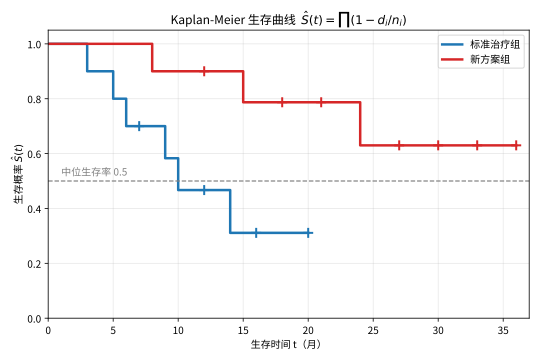

> **直观理解（现实类比）**：把两组病人比作两队"存活比赛"，每过一段时间就有人"出局"（死亡），生存概率像下楼梯一样逐级下降；中途可能有人失访（删失，用 + 标记），他们不算出局，也不改变已发生事件处的曲线。曲线下降得越慢，说明该组活得越久。

---

### 示例 2：用 Cox 模型分析风险因素

**问题**：使用 Cox 比例风险模型分析影响肺癌患者生存的风险因素。数据包含 100 名患者，变量包括年龄、性别、吸烟史（包年）、肿瘤分期（I-IV）和治疗方案。

**解**：

**步骤1：Cox 模型设定**

$$
h(t|X) = h_0(t) \exp(\beta_1 \text{年龄} + \beta_2 \text{性别} + \beta_3 \text{吸烟} + \beta_4 \text{分期} + \beta_5 \text{治疗})
$$

**步骤2：部分似然估计结果**

| 变量 | 系数 $\hat{\beta}$ | 标准误 | HR = $\exp(\hat{\beta})$ | 95% CI | p 值 |
|:---:|:---:|:---:|:---:|:---:|:---:|
| 年龄 | 0.021 | 0.012 | 1.021 | (0.997, 1.046) | 0.080 |
| 性别（男=1） | 0.312 | 0.245 | 1.366 | (0.845, 2.208) | 0.203 |
| 吸烟（包年） | 0.015 | 0.006 | 1.015 | (1.003, 1.027) | 0.012 |
| 分期（III/IV vs I/II） | 1.245 | 0.321 | 3.472 | (1.851, 6.513) | < 0.001 |
| 治疗（新方案=1） | -0.685 | 0.298 | 0.504 | (0.281, 0.904) | 0.021 |

**步骤3：结果解释**

- **年龄**：每增加 1 岁，死亡风险增加 2.1%，但未达到统计显著性（$p = 0.08$）
- **性别**：男性风险高于女性 36.6%，但不显著（$p = 0.203$）
- **吸烟**：每增加 1 包年，死亡风险增加 1.5%（$p = 0.012$）
- **肿瘤分期**：III/IV 期患者死亡风险是 I/II 期的 3.47 倍（$p < 0.001$），这是最强的风险因素
- **治疗**：新方案降低死亡风险约 49.6%（HR = 0.504，$p = 0.021$）

**步骤4：比例风险假设检验**

使用 Schoenfeld 残差检验比例风险假设：

| 变量 | $\rho$ | $\chi^2$ | p 值 |
|:---:|:---:|:---:|:---:|
| 年龄 | -0.05 | 0.25 | 0.617 |
| 性别 | 0.08 | 0.64 | 0.424 |
| 吸烟 | 0.12 | 1.44 | 0.230 |
| 分期 | -0.15 | 2.25 | 0.134 |
| 治疗 | 0.03 | 0.09 | 0.764 |
| 全局 | - | 4.67 | 0.458 |

所有变量和全局检验均不显著，比例风险假设成立。

**步骤5：调整后的生存曲线**

基于 Cox 模型，可以绘制调整后的生存曲线（在协变量均值处）：

标准治疗组（中位生存约 12 个月）vs. 新方案组（中位生存约 20 个月），调整后显示新方案显著延长生存。

> 本节本章补充概念检查、真/假测验、与微积分的联结、标准例题与专题应用，帮助读者用经典微积分地基理解生物统计学的核心主题——尤其是生存分析背后的积分、比值与微商关系。

### 概念检查（Concept Check）

**1. 生存函数、分布函数与密度函数之间有何积分/微商关系？**

- 答：对非负生存时间 $T$，$S(t)=P(T>t)=\int_t^{\infty} f(u)\,du=1-F(t)$，且密度是生存函数的负微商 $f(t)=-dS/dt$。生存即从当前时刻起"收下"的右尾概率。

**2. 风险函数 $h(t)$ 与生存函数如何互相表示？**

- 答：$h(t)=f(t)/S(t)=-d\ln S(t)/dt$，解此微分方程得 $S(t)=\exp(-\int_0^t h(u)\,du)$。风险函数是对数生存曲线瞬时斜率取负号后的强度函数。

**3. Kaplan-Meier 乘积限估计的乘积公式是什么，删失数据如何被纳入？**

- 答：$\hat S(t)=\prod_{t_i\le t}\left(1-\frac{d_i}{n_i}\right)$，其中 $d_i$ 为 $t_i$ 时刻事件数、$n_i$ 为 $t_i$ 时刻风险人数。删失者不产生事件项，只在事件之间退出风险集、压低后续的 $n_i$，从而正确利用其"至少活到删失时刻"的部分信息。

**4. 什么是意向治疗（ITT）分析，为何它常被作为随机对照组试验的主分析？**

- 答：ITT 按随机分配的分组分析结局，而不论患者是否实际接受了治疗。它保留随机化带来的已知与未知混杂平衡，是对"所分配的治疗"效应的保守、无偏估计。

**5. 检验做多了为什么需要多重比较校正，其代价是什么？**

- 答：独立做 $m$ 次 $\alpha=0.05$ 的检验时，至少一次假阳性的概率为 $1-(1-\alpha)^m$，如 $m=20$ 时约 $1-0.95^{20}\approx0.642$，远超 0.05。Bonferroni 校正用 $\alpha/m$ 控制族系错误率，代价是过度保守、降低功效；FDR（BH 方法）是更灵活的控制错误发现率的替代。

**6. Cox 模型用什么估计 $\beta$，为何无需指定基线风险 $h_0(t)$？**

- 答：用部分（偏）似然 $L(\beta)=\prod_{i:\delta_i=1}\frac{e^{\beta^\top X_i}}{\sum_{j\in R(t_i)}e^{\beta^\top X_j}}$ 估计 $\beta$。基线风险 $h_0(t)$ 在同一时刻风险集内部的秩比较中于分子分母消去，故无需指定其分布形式。

**7. 样本量计算中 $\alpha$、$\beta$、$\delta$、$\sigma$ 各代表什么？**

- 答：$\alpha$ 为 I 类错误（假阳性）率，$1-\beta$ 为检验效能（$\beta$ 为 II 类错误率），$\delta$ 为想检测出的最小效应（均值差），$\sigma$ 为总体标准差。$\delta$ 越小、$\sigma$ 越大或 $\alpha$、$\beta$ 越小，所需样本量越大。

### 真/假测验（True-False Quiz）

1.（假）生存函数 $S(t)=P(T>t)$ 必随时间 $t$ 单调不减。
   - 理由：活过更晚时刻的概率只会更小或相等，因此 $S(t)$ 单调不增，命题把方向写反了。

2.（真）若 $h(t)=f(t)/S(t)$，则生存函数可写为 $S(t)=\exp(-\int_0^t h(u)\,du)$。
   - 理由：由 $h(t)=-d\ln S(t)/dt$ 对两侧从 0 到 $t$ 积分即得 $-\ln S(t)=\int_0^t h(u)\,du$。

3.（假）Kaplan-Meier 估计中，删失的个体应被当作"死亡"处理以充分利用数据。
   - 理由：删失个体只提供"至少活到删失时刻"的部分信息，若计为事件会系统性低估生存率；正确做法是把他们从后续风险集剔除而非计入事件。

4.（真）在随机对照试验中，意向治疗（ITT）分析按随机分配的分组进行分析，无论患者实际是否接受了治疗。
   - 理由：ITT 保留随机化带来的混杂平衡，遵循"所分配即所分析"原则，是对因果效应的保守无偏估计。

5.（假）在 $\alpha=0.05$ 下独立检验 20 个基因时，至少出现一个假阳性结果的概率仍约为 0.05。
   - 理由：至少一次假阳性的概率为 $1-(0.95)^{20}\approx0.642$，远超 0.05，这正是需要多重比较校正的原因。

6.（真）AUC=0.5 表示诊断试验完全没有判别能力（等同随机猜测）。
   - 理由：AUC 等于随机患病者得分高于随机对照的概率，0.5 即两者无高低之别，等价于掷币决定，无判别价值。

7.（真）Cox 模型的"比例风险"假设要求风险比 $e^{\beta\Delta X}$ 不随时间而变。
   - 理由：一旦协变量效应随时间变化（如治疗获益逐渐减弱），风险比不再恒定，就将违反比例风险假设并使 $\beta$ 的估计产生偏误。

### 与微积分的联结（Connections to Calculus）

**积分与密度视角**：生存函数是密度函数的右尾积分 $S(t)=\int_t^{\infty} f(u)\,du=1-F(t)$，而密度是生存函数的负微商 $f(t)=-dS/dt$——正如概率被"摊"在时间轴上，生存等于从当前时刻往后积起的概率。

**微商与比值视角**：风险函数是密度与生存的比值 $h(t)=f(t)/S(t)$，等价地是对数生存曲线的斜率绝对值 $h(t)=-d\ln S(t)/dt$；解微分方程得 $S(t)=\exp(-\int_0^t h(u)\,du)$，生存与风险在此唯一互相决定。

**定积分下面积视角**：对非负连续随机变量，期望寿命等于生存曲线下的面积 $E[T]=\int_0^{\infty} S(t)\,dt$，这与"概率＝曲线下面积"一脉相承，也把 KM 曲线下面积解释成平均存活时间。

**级数与收敛视角**：泊松计数 $N\sim\text{Poisson}(\lambda t)$ 的概率来自指数级数 $e^{-\lambda t}=\sum_{k=0}^{\infty}\frac{(\lambda t)^k}{k!}$；样本量计算中的临界值 $z_{\alpha/2}$ 来自标准正态积分 $\int_{-z}^{z}\phi(u)\,du=1-\alpha$，两项都是级数与定积分的直接应用。

**分段积分与似然视角**：带删失数据的似然是分段乘积——事件贡献 $f(t_i)$、删失贡献 $S(c_i)$，即 $L=\prod_i f(t_i)^{\delta_i}S(t_i)^{1-\delta_i}$，取对数后化为求和，与累积风险 $\Lambda(t)=\int_0^t h(u)\,du$ 的积分结构密切相关，折积与积分贯穿删失建模与 Nelson-Aalen 估计。

### 标准例题（Worked Example）

**例题 A（参数生存：指数分布）**：某疗法的年事件率估计为 $\lambda=0.10$（均值存活 $1/\lambda=10$ 年），假定服从指数生存分布。

**步骤1：写出生存函数。** $S(t)=e^{-\lambda t}=e^{-0.10t}$。

**步骤2：求 3 年存活概率。** $S(3)=e^{-0.10\times3}=e^{-0.30}\approx0.7408$，即约 74.1% 的患者存活超过 3 年。

**步骤3：求 5 年存活概率。** $S(5)=e^{-0.5}\approx0.6065$，约 60.7%。

**步骤4：求中位生存时间。** 解 $S(t)=0.5$，即 $e^{-0.10t}=0.5$，得 $t=\frac{\ln2}{0.10}=\frac{0.6931}{0.10}\approx6.93$ 年。

**步骤5：验证风险与生存的一致。** 常数风险 $h(t)=\lambda$ 时，$S(t)=\exp(-\int_0^t \lambda du)=e^{-\lambda t}$，与假设吻合；这印证了「与微积分的联结」中的积分恒等式。

**例题 B（手工小样本 Kaplan-Meier）**：4 名患者的随访时间（月）与状态：患者1 在 $2$ 月事件、患者2 在 $4$ 月删失、患者3 在 $6$ 月事件、患者4 在 $9$ 月删失。

**步骤1：列出事件时刻。** 未删失的事件时刻为 $t=2$ 与 $t=6$；删失时刻 $4$、$9$ 不产生事件项。

**步骤2：$t=2$ 处的更新。** $n_1=4$，$d_1=1$，$\hat S(2)=1\times(1-1/4)=0.75$。

**步骤3：$t=4$ 处的删失。** 患者2 默默退出风险集，不计事件；其后风险人数变为 $4-1-1=2$。

**步骤4：$t=6$ 处的更新。** $n_2=2$，$d_2=1$，$\hat S(6)=0.75\times(1-1/2)=0.375$。

**步骤5：$t=9$ 处的删失与终点。** 患者4 删失不产项，$\hat S(9)=0.375$；最终曲线为阶梯 $1.0\to0.75\to0.375$。注意删失只是"离场"、不压低已经算好的生存率，这正是例题 A 中积分/乘积思想的离散体现。

### 专题应用（Applied Project）

**项目背景：** 设计一项某新药 vs 安慰剂的随机对照生存试验，以总生存期（OS）为主要终点，评估新药能否显著延长生存。

**任务：**
- 设定 $\alpha=0.05$、功效 $1-\beta=0.80$，假定两臂风险比 $HR=0.7$，用样本量公式估算所需患者数；
- 生成（或使用公开）随访数据，画出两臂 Kaplan-Meier 曲线并计算中位生存时间；
- 做 log-rank 检验比较两臂生存差异，并用 Cox 模型估计 $HR$ 及其置信区间。

**与微积分的联结：** 中位生存来自 $S(t)=0.5$ 的方程求根；期望存活可用 KM 曲线下面积 $\int_0^{\infty} \hat S(t)\,dt$ 概括；$h(t)=-d\ln S(t)/dt$ 决定曲线下降瞬时速率；样本量计算依赖标准正态积分的临界值 $z_{\alpha/2}$。

**开放问题：** 若进行多次中期分析，如何用 alpha 花费函数控制 I 类错误？当删失机制并非随机（与预后相关）时，KM 与 Cox 的结论会如何受影响、又当如何敏感性分析？

### 习题分层导览（按概念 / 技巧 / 应用分类）

**概念题**（检验定义与原理的理解）：
- 基础题第 1、2、3、5、7、8、9、10 题
- 进阶题第 11、13、14、19 题
- 挑战题第 23、24 题

**技巧题**（写出公式、代入计算、完成推导）：
- 基础题第 4、6 题
- 进阶题第 12、15、16、17、18 题
- 挑战题第 20、21、22、25、26 题

**应用题**（把方法用于真实情境与开放问题）：
- 探究题第 27、28、29、30 题

---

## 5. 习题
### 基础题

**习题 1**（临床试验设计）说明随机对照试验（RCT）相比观察性研究的核心优势，写出随机化、盲法、对照三个要素各自的作用。

**习题 2**（生存分析）给出"生存函数 $S(t)$"与"风险函数 $h(t)$"的定义，并说明二者之间的关系。

**习题 3**（删失）解释生存分析中"右删失"的含义，说明为什么删失数据必须被正确纳入而不是丢弃。

**习题 4**（Kaplan-Meier）说明 Kaplan-Meier 估计量如何利用逐步（乘积限）方式估计生存函数 $S(t)$。

**习题 5**（Log-rank 检验）说明 Log-rank 检验的原假设、用于比较的对象以及它属于非参数检验的原因。

**习题 6**（Cox 模型）写出 Cox 比例风险模型 $h(t\mid X)=h_0(t)e^{\beta X}$，说明 $h_0(t)$ 与 $\beta$ 的含义，以及"比例风险"假设。

**习题 7**（诊断试验）定义敏感度、特异度的概念，说明它们在医学诊断试验中的意义。

**习题 8**（队列与病例对照）说明队列研究与病例对照研究在抽样与方向上的区别，以及各自适用的场合。

**习题 9**（Meta 分析）说明 Meta 分析的目的是什么，简述固定效应与随机效应模型的区别。

**习题 10**（贝叶斯统计）给出贝叶斯公式 $P(\theta\mid D)\propto P(D\mid\theta)P(\theta)$，说明先验、似然与后验三者的含义。

### 进阶题

**习题 11**（删失下的生存函数）说明在右删失存在时，为何不能用简单经验分布（非删失个体比例）估计 $S(t)$，KM 估计如何规避该问题。

**习题 12**（风险函数与生存函数）由 $S(t)=\exp(-\int_0^t h(u)du)$ 出发，说明 $h$(t) 是瞬时失效率、并求常数风险 $h(t)=\lambda$ 时的生存函数。

**习题 13**（Cox 部分似然）说明 Cox 模型用"部分（偏）似然"而非全似然估计 $\beta$ 的原因，即基线风险 $h_0(t)$ 为何可不需指定。

**习题 14**（HR 解释）在 Cox 模型中，风险比 $HR=e^{\beta}$ 的含义，给出 $HR=1.8$ 的解释及置信区间的作用。

**习题 15**（敏感度特异度计算）某种测试敏感度 0.90、特异度 0.95，患病率 0.10，求阳性预测值 PPV（假定独立性计算，或说明其定义）。

**习题 16**（Log-rank 检验思想）说明 Log-rank 检验如何"在每个事件时间点比较两组处于风险的人数与死亡数"来构造检验统计量。

**习题 17**（多重比较校正）说明为什么在检验 20 个基因时用 $\alpha=0.05$ 会导致假阳性率过高，并简述 Bonferroni 校正的代价。

**习题 18**（样本量计算）在一篇研究双组均值相等的设计中，写出两样本 t 检验所需样本量公式的基本要素（$\alpha,\beta,\delta,\sigma$）及各自含义。

**习题 19**（Meta 异质性）解释 Meta 分析中异质性 $I^2$ 的含义，说明 $I^2$ 大时应如何解释合并结果。

### 挑战题

**习题 20**（KM 乘积形式）给定事件时间与删失，写出 KM 估计量的乘积累积形式 $\hat S(t)=\prod_{t_j\le t}(1-\frac{d_j}{n_j})$，说明 $d_j,n_j$ 的含义。

**习题 21**（Cox 偏似然）写出 Cox 模型在有唯一事件的时刻 $t_j$ 处的偏似然贡献 $\frac{e^{\beta X_j}}{\sum_{k\in R(t_j)}e^{\beta X_k}}$，并说明风险集 $R(t_j)$ 的含义。

**习题 22**（Log-rank 统计量）写出 Log-rank 检验统计量 $Z=\frac{\sum O-E}{\sqrt{\sum V}}$（O 观测死亡、E 期望死亡）的形式，说明其大样本渐近分布。

**习题 23**（AUC 与 ROC）写出 AUC 表示"随机抽取一个患病者与一个对照，患病者得分更高的概率"，说明 AUC=0.5、0.8、1 分别表示什么。

**习题 24**（Meta 随机效应）写出随机效应模型对研究间方差 $\tau^2$ 的引入方式，说明为何异质性大时随机效应给出的置信区间更宽。

**习题 25**（生存与累积分险）由 $S(t)$ 与累积风险 $\Lambda(t)=\int_0^t h(u)du$ 的关系证明 $S(t)=e^{-\Lambda(t)}$，并说明 KM 如何估计 $\Lambda(t)$。

**习题 26**（贝叶斯后验）设似然为二项 $D\sim\rm{Bin}(n,p)$、先验取 $p\sim\rm{Beta}(a,b)$，证明后验仍为 Beta 及其参数形式（共轭）。

### 探究题

**习题 27**（随机化与因果）讨论随机化为何能平衡已知与未知混杂、为何在实效性（pragmatic）试验中仍存在依从性与缺失数据问题，可如何用 ITT 处理。

**习题 28**（比例风险假设检验）讨论 Cox 模型的"比例风险"假设在长期随访中往往被违反的原因，以及评估与处理该假设的方法（如 Schoenfeld 残差、时变协变量）。

**习题 29**（贝叶斯 vs 频率学派）比较贝叶斯与频率学派推断在临床试验中的差异（先验的作用、可信区间 vs 置信区间），讨论预先设定先验在监管决策中的争议。

**习题 30**（适应性与临床试验）讨论适应性设计（如中期分析、样本量重估、应答自适应随机化）如何提升试验效率，及其引入的偏误与多重比较风险。

---

## 6. 习题答案与解析

### 基础题答案

1. **RCT** 随机化平衡已知与未知混杂、使处理分配与潜在结果独立，从而实现对因果效应的无偏估计；盲法防止知晓分组影响结局测量或参与；对照组提供无处理的反事实参照。三要素共同确保处理组与对照组除处理外"可比"。

2. **生存与风险函数** 生存函数 $S(t)=P(T>t)$ 是个体存活超过时刻 $t$ 的概率；风险函数 $$h(t)=\lim_{\Delta t\to0}\frac{P(t\le T<t+\Delta t\mid T\ge t)}{\Delta t}$$ 是条件瞬时事件率。二者关系 $S(t)=\exp(-\int_0^t h(u)du)$、$h(t)=-S'(t)/S(t)$，即生命表由风险累积确定。

3. **右删失** 右删失指个体在观测截至时尚未发生事件（如仍存活或失访），我们只知其生存时间 $>$ 某个观测时间 $t$。丢弃删失会系统性低估生存率、引入偏误；正确做法是将其作为"部分信息"纳入似然（利用 $S(t_i)$），KM 与 Cox 均如此。

4. **Kaplan-Meier** KM 只在每个观测到的事件时刻 $t_j$ 更新生存估计，用"在该时刻处于风险的人数 $n_j$ 中死亡 $d_j$" 估计该时刻的条件死亡概率 $d_j/n_j$，生存函数为这些时刻的条件存活概率之积：$$\hat S(t)=\prod_{t_j\le t}\left(1-\frac{d_j}{n_j}\right)$$ 删失者在事件间退出风险集但不降低 $n_j$ 分母之前的估计。

5. **Log-rank 检验** 原假设为两条（或多条）生存曲线无差异，即 $H_0:S_1(t)=S_2(t)$（等价风险成比例 $h_1/h_2=1$）。它在每个事件时刻比较两组处于风险人数与实际死亡数，属于非参数（分布无关）检验，只假设删失随机。

6. **Cox 模型** $h(t\mid X)=h_0(t)e^{\beta X}$：$h_0(t)$ 为非参数基线风险（当 $X=0$），$\beta$ 为协变量对数风险比、$e^{\beta}$ 为风险比 HR。比例风险假设要求任意两个个体的风险函数之比 $\exp(\beta\Delta X)$ 不随时间变化（成比例）。

7. **诊断试验** 敏感度 $=P(\text{阳性}\mid \text{患病})$（不漏诊的能力），特异度 $=P(\text{阴性}\mid \text{未患病})$（不误诊的能力）。二者随阈值此消彼长，ROC 曲线刻画其权衡，AUC 汇总整体判别能力。

8. **队列 vs 病例对照** 队列从暴露出发前瞻（按暴露分组、随访结局），适合评估相对风险 RR、处理罕见结局更贵；病例对照从结局（病例/对照）向后回顾暴露，适合罕见疾病、更高效省时，测量的是比值比 OR。

9. **Meta 分析** Meta 分析汇总多个研究的高质量证据以提高统计功效、估计合并效应并探索异质性。固定效应假设真实效应在各研究相同（差异仅抽样误差）；随机效应允许研究间存在真实差异、引入方差 $\tau^2$，异质性大时区间更宽、更保守合理。

10. **贝叶斯公式** 后验 $\propto$ 似然 $\times$ 先验：$P(\theta\mid D)\propto P(D\mid\theta)P(\theta)$。先验 $P(\theta)$ 反映数据前对参数的主观或既往知识；似然 $P(D\mid\theta)$ 由模型给出数据的概率；后验 $P(\theta\mid D)$ 综合二者更新后的参数分布。

### 进阶题答案

1. **删失下估计** 简单地把删失个体当"存活到观察终点"会高估生存、当"死亡"会低估；且其真生存时间未知。KM 在删失时刻不把它们当作事件、但在该时刻后从风险集剔除，从而用"存活到该时刻的条件概率连乘"正确利用"存活至少到删失时"的信息，无需假设删失个体之后的事件结局。

2. **风险与生存** 由 $S(t)=\exp(-\int_0^t h(u)du)$，$h(t)$ 表示某时刻的条件瞬时失效率、越大代表该时刻附近越易发生事件的强度。常数 $h(t)=\lambda$ 时 $$S(t)=e^{-\lambda t}$$ 即指数分布生存、无记忆性，是参数生存分析最简单模型，其 $1/\lambda$ 为平均生存期。

3. **Cox 偏似然** 全似然需指定基线风险 $h_0(t)$ 的形式（参数化），而 Cox 用偏似然把 $h_0(t)$ 作为"敏度常数"从每个事件时刻的秩比较中消去：在 $t_j$ 发生事件的个体的贡献是该个体在风险集中"最可能发生"的相对概率 $e^{\beta X_j}/\sum_{k}e^{\beta X_k}$，只依赖协变量的相对风险、不含基线风险，故可不限分布地估计 $\beta$。

4. **HR 解释** $HR=e^{\beta}$ 是风险比：协变量增加一个单位时瞬时事件率变为原来的 $HR$ 倍。$HR=1.8$ 说明每增加 1 单位（如吸烟），该时刻附近的死亡风险约高 $1.8$ 倍；若置信区间含 1 则在 $\alpha$ 水平下效应不显著，区间越窄估计越精确。

5. **PPV** 患病率为先验 $\pi=0.10$。阳性预测值 $$PPV=\frac{Sens\cdot\pi}{Sens\cdot\pi+(1-Spec)(1-\pi)}=\frac{0.9\times0.1}{0.9\times0.1+0.05\times0.9}=\frac{0.09}{0.09+0.045}\approx0.667$$ 即在人群中选择阳性约 $66.7\%$ 真患病（其余为假阳），凸显低患病率下即使高特异度 PPV 仍有限。

6. **Log-rank 思想** Log-rank 把每个事件时刻 $t_j$ 视为一个分层的小比较：此时处于风险的两组人数 $n_{1j},n_{2j}$、总死亡 $d_j$，超几何期望 $E_{1j}=\frac{n_{1j}}{n_{1j}+n_{2j}}d_j$，观测减去期望再求和得 $\sum(O-E)$，以其标准差 $\sqrt{\sum V}$ 标准化得到 $\chi^2$（或 $Z$）统计量。

7. **多重比较** 单个检验在 $H_0$ 下错报概率 $\alpha=0.05$；独立做 20 次时至少一个假阳性的概率 $1-(0.95)^{20}\approx0.642$，故不能直接以 0.05 判每个检验。Bonferroni 把阈值降为 $\alpha/m$（控制 FWER），代价是过度保守、降低功效，可能漏掉真正效应；权衡可用 FDR（如 BH 校正）。

8. **样本量** 两样本均值差的检验功效计算涉及两型错误与变异：$\alpha$ 显著水平（I 类错误率）、$1-\beta$ 功效（$\beta$ 为 II 类错误率）、待检测的最小差异 $\delta$、标准差 $\sigma$，常用公式 $$n=\frac{(z_{1-\alpha/2}+z_{1-\beta})^22\sigma^2}{\delta^2}$$ 每组样本量。$\delta$ 越小、$\alpha$ 或 $\beta$ 越小、$\sigma$ 越大则所需 $n$ 越大。

9. **异质性与 $I^2$** $I^2$ 表示研究间变异占总变异的百分比（由 Cochran $Q$ 推得），$I^2\approx0$ 说各研究真实效应接近、$I^2$ 大（如 >75%）说明研究间存在真实差异。$I^2$ 大时不应简单合并，而应探讨亚组、做 meta 回归寻找异质来源或改用随机效应、谨慎解读合并估计。

### 挑战题答案

1. **KM 乘积项** $$\hat S(t)=\prod_{t_j\le t}\left(1-\frac{d_j}{n_j}\right)$$ 其中 $t_j$ 依次为发生事件的时刻，$d_j$ 为 $t_j$ 时刻死亡（事件）人数、$n_j$ 为 $t_j$ 前仍处于风险（未事件未删失）的人数。删失不产生项、仅在事件间减少 $n_j$。该乘积限估计与大似然一致，是生存函数的 NN 估计。

2. **Cox 偏似然** 在有唯一事件的时刻 $t_j$，该事件个体的偏似然贡献为 $$L_j(\beta)=\frac{e^{\beta X_j}}{\sum_{k\in R(t_j)}e^{\beta X_k}}$$ 其中 $R(t_j)=\{k:t_k\ge t_j\}$ 为 $t_j$ 时刻的风险集（尚未发生也尚未删失的个体）。整偏似然为各事件时刻 $L_j$ 之积（允许 ties 用 Breslow 等近似），最大化即得 $\beta$ 估计，基线风险被消去。

3. **Log-rank 统计量** $$Z=\frac{\sum_j(O_j-E_j)}{\sqrt{\sum_j V_j}}$$ 其中每组在每个事件时刻的超几何期望 $E_j=n_{1j}d_j/n_j$、方差 $V_j=\frac{n_{1j}n_{2j}d_j(n_j-d_j)}{n_j^2(n_j-1)}$，对事件时刻求和。原假设下分子均值为 0，$Z$ 渐近 $N(0,1)$、其平方 $Z^2$ 渐近 $\chi^2_1$，据此检验两生存曲线差异显著性。

4. **AUC 与 ROC** ROC 曲线纵轴敏感度横轴 $1-$ 特异度，AUC 等于随机取一个患病者与一个对照、患病者预测得分更高的概率。$AUC=0.5$ 无判别力（等同掷币）、$0.8$ 较好、$1$ 完美可分。判别能力越高曲线越靠左上、AUC 越接近 1。

5. **Meta 随机效应** 随机效应模型把各研究的真实效应视为来自一个总体分布：$\theta_i\sim N(\mu,\tau^2)$，合并效应为加权平均 $\hat\mu=\frac{\sum_i w_i\hat\theta_i}{\sum_i w_i}$，权重 $w_i=1/(v_i+\tau^2)$ 同时纳入研究内方差 $v_i$ 与研究间方差 $\tau^2$。相比固定效应（权重 $1/v_i$），$\tau^2>0$ 使总方差更大，故异质性越大置信区间越宽、估计越保守，反映研究间真实差异带来的额外不确定性。

6. **累积风险与生存** 由 $\Lambda(t)=\int_0^t h(u)du$ 与 $h=-d\ln S/dt$，积分即 $-\ln S(t)=\Lambda(t)$，故 $$S(t)=e^{-\Lambda(t)}$$ KM 估计 $S(t)$ 后即得 $\Lambda$ 的估计 $-\ln\hat S(t)$；Nelson-Aalen 则直接累加 $d_j/n_j$ 估计 $\Lambda$，两者渐近等价、均可作点过程的累积风险估计。

7. **贝叶斯共轭** 二项似然 $P(D\mid p)\propto p^x(1-p)^{n-x}$ 乘 Beta 先验 $p^{a-1}(1-p)^{b-1}$ 得后验核 $$p^{a+x-1}(1-p)^{b+n-x-1}$$ 即 $p\mid D\sim\rm{Beta}(a+x,b+n-x)$。因后验形式上仍是 Beta，先验为共轭先验，极大方便了序贯更新——数据更新只是把参数加上成功与失败次数。

### 探究题答案

1. **随机化与因果** 随机化使处理分配在期望上正交于所有混杂（包括潜在的未知混杂），让潜在结果在两组的分布相同、从而可识别的平均因果效应无偏。但在务实性试验中个体可能不依从分配、缺失随访与结局，直接按分配分析即意向治疗（ITT）保留随机化的偏倚保护（估计"分配的治疗"效应），虽会低估"实际接受"效应，却避免因依从引起的选择偏误。

2. **比例风险假设** 长期随访中协变量效应（如治疗获益随时间减弱、年龄段风险交叉）常使风险比不再恒定，违反 PH 假设。评估用 Schoenfeld 残差与时间趋势图、检验 $\beta(t)$ 是否随时间变化；处理通过引入时变协变量、分层、或时变系数模型（如分段时间）放松 PH，使得 Cox 结果不再有偏。

3. **贝叶斯 vs 频率学** 频率学派把参数当作固定未知（只由数据推断，置信区间的频率含义依赖重复抽样）；贝叶斯把参数视为随机、以先验+似然给出后验可信区间（对该研究直接的概率解释）。争议在监管决策：先验带有主观性，若定得不当会偏向有利结果；规范要求预先设定、用弱/基准先验并做先验敏感性分析。但贝叶斯在处理复杂分层与中期更新上更自然。

4. **适应性与多重比较** 适应性设计在试验进行中据暂存数据调整（中期无效/有效停止、样本量重估、应答自适应随机化），提升效率、节省资源、让更多患者接受更优治疗。代价是多次「窥探」引入多重比较与估计偏误（需指定序贯界限、alpha 花费函数、估计校正）；若未预先规定与校正，会膨胀 I 类错误并损害结果可信度，故需严密的设计化规则与预注册。

---

## 7. 数学科普（Popular Mathematics）

生物统计学的任务，是在有限、不完整、充满干扰的医学数据里，尽量可靠地做出判断。下面用十六幅图，从试验设计、生存分析到诊断与合并证据，逐一讲讲这些方法怎么用。

### 7.1 临床试验设计：把病人分成可比的两组

要公平地判断一种疗法有没有效，就得把病人随机分到试验组和对照组，让年龄、病情等背景因素在两组间大致均衡。这样两组结果的差异，才更可能是疗法本身造成的。

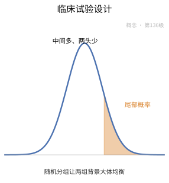

**一句话点破**：随机对照与盲法，是临床试验抵御偏见的两道防线。

### 7.2 生存分析：还没等到结局的数据怎么办

随访中常有人中途退出、或到研究结束仍未发病，这类"没看到结局"的删失数据不能简单丢掉。生存分析用生存函数 $S(t)$ 描述活过时间 $t$ 的概率，把这些信息也算进来。

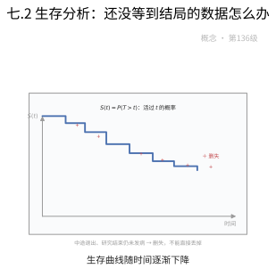

**一句话点破**：生存分析的价值，在于善用不完整却真实的时间数据。

### 7.3 Cox 比例风险模型：谁的风险更高、高多少

Cox 模型假设每个人的风险随时间变化的倍数恒定，用风险比 $\text{HR}=\exp(\beta)$ 衡量某因素让风险翻了几倍。它不必假设风险的基准形状，因此适用面很广。

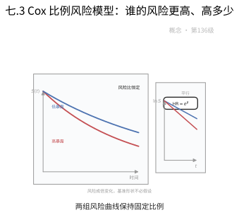

**一句话点破**：Cox 把"风险多大"与"时间怎么变"拆开，只估前者。

### 7.4 Log-rank 检验：两条生存曲线差得明显吗

把随访期分成很多小段时间，在每段里比较两组的实际死亡数与假设无差别时的期望数，Log-rank 检验把各段的差异汇总成一个统计量。曲线整体相差越大，检验越容易显著。

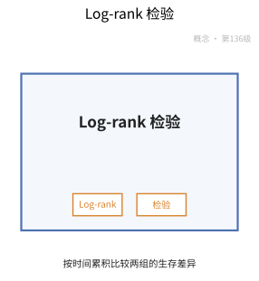

**一句话点破**：Log-rank 检验看的是整条生存曲线的差距，而非某一时点。

### 7.5 病例对照与队列研究：从两头找病因

队列研究先按有无暴露分组、再等结局发生，能直接算发病风险；病例对照研究则先找到病人、再回头查过去的暴露，省时省钱却易有偏倚。两者是观察性研究里互补的两条路。


**一句话点破**：设计的正逆之分，决定能算风险还是只能算比值。

### 7.6 Meta 分析：把零散研究合成一个结论

单个小研究样本少、结论飘忽，Meta 分析把多个同类研究的效果量按精度加权合并，得到一个更稳的整体估计。它还可能用森林图直观展示每项研究的贡献。

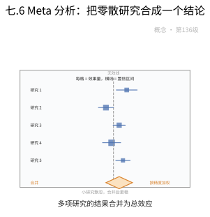

**一句话点破**：Meta 分析让许多小证据，汇成一条更可信的结论。

### 7.7 诊断试验：检验到底准不准

一项检验把有病判为阳性的比例是灵敏度，把没病判为阴性的比例是特异度，二者此消彼长。换一个判定阈值，灵敏度和特异度就一起变，正好画出 ROC 曲线。

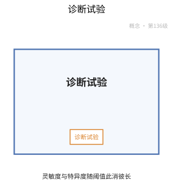

**一句话点破**：诊断试验的好坏，要在灵敏度与特异度之间权衡取舍。

### 7.8 贝叶斯生物统计：先有先验，再看证据

贝叶斯方法先给出参数的先验分布 $p(\theta)$，再用数据似然更新，得到后验 $p(\theta\mid x)$。它让"根据新证据修正已有看法"变成一套可计算的过程。

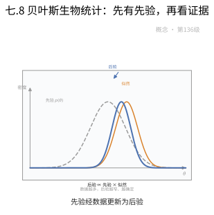

**一句话点破**：贝叶斯把旧经验和新数据放在同一把秤上。

### 7.9 多重比较校正：检验太多次会误报

同时做很多次检验时，纯靠运气也会冒出不少"显著"结果，这就是假阳性膨胀。Bonferroni 等方法收紧每次检验的判定标准，把整体误报率控制在可接受范围内。

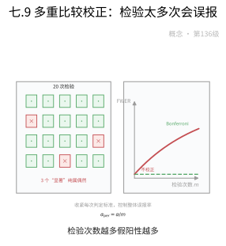

**一句话点破**：比较越多，越要给"显著"加上更严的门槛。

### 7.10 样本量计算：要招多少人心里才有底

试验前先定好能接受的第一、二类错误水平和想检测的最小效应，就能反推出需要的样本量 $n$。样本太小验不出真效应，太大又浪费资源。

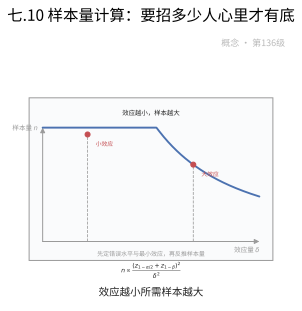

**一句话点破**：样本量是精度、把握与成本之间的三方平衡。

### 7.11 适应性设计：边做边改的研究计划

适应性设计允许在研究进行中依据期中数据调整样本量、剂量或提前终止，既省资源又更符合伦理。调整规则必须事先写清，才不会损害统计推断的可靠性。

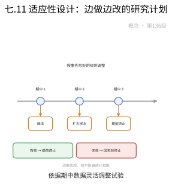

**一句话点破**：灵活性要有事先约定的规则兜底，才不致失真。

### 7.12 Cox 部分似然估计：甩开基线风险的估计法

Cox 模型里基准风险形状未知，但每个"谁先发病"的时刻只依赖协变量与回归系数。把各时刻的条件概率连乘，就得到与基准风险无关的部分似然，据此估出 $\beta$。

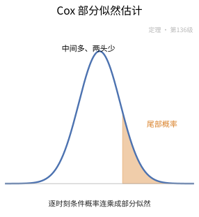

**一句话点破**：部分似然巧妙绕开了对基准风险形状的假设。

### 7.13 Kaplan-Meier 估计的一致性：样本越大曲线越真

Kaplan-Meier 估计把生存概率拆成一系列条件存活概率的乘积。在删失机制独立等条件下，随样本量增大，这条阶梯曲线会一致收敛到真实生存函数。

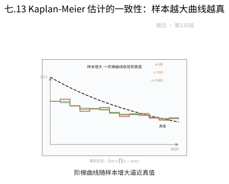

**一句话点破**：KM 曲线用乘积形式，把删失下的生存概率估得一致。

### 7.14 Log-rank 检验的渐近分布：为什么能查卡方表

在两组生存分布相同的原假设下，Log-rank 统计量随样本增大渐近服从卡方分布 $\chi^2_1$。这为计算 $p$ 值和判断显著性提供了理论依据。

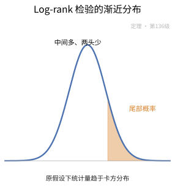

**一句话点破**：卡方极限分布，让 Log-rank 有了标准的显著性判据。

### 7.15 ROC 曲线下面积：既是面积也是胜率

在二分类里，AUC 等于随机取一个病人和一个健康人、病人得分更高的概率，也等于曼-惠特尼 U 统计量的标准化形式。它取值在 0.5 到 1 之间，越大判别力越强。

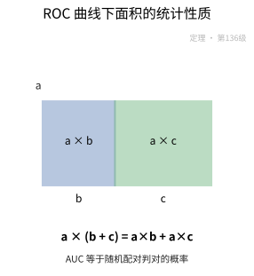

**一句话点破**：AUC 既是曲线下面积，也是一次随机配对的胜率。

### 7.16 Meta 分析随机效应模型：承认研究间也有差异

固定效应模型假设各研究共享一个真效应，随机效应模型则允许真效应本身在研究中波动，额外引入研究间方差 $\tau^2$。这样合并时既考虑研究内误差，也考虑研究间异质性。

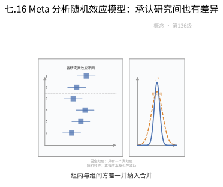

**一句话点破**：随机效应模型用 $\tau^2$ 把研究之间的不一致也量化进来。

## 8. 数学史（History of Mathematics）

> 生物统计学的历史主线，是"在有限、截尾、混杂、多重的医学与生物学数据上，尽可能诚实地做出统计推断"的方法演进：从 17 世纪最早的死亡表与 19 世纪的流行病学调查，到 20 世纪概率统计全面奠基、随机对照试验与生存分析定型，再到当代多重比较、Meta 分析与贝叶斯方法的系统化。本章沿着"从记录观察到严谨推断"的线索，追溯临床试验、生存分析、ROC、Meta 分析这些关键方法的来龙去脉。

### 8.1 从死亡表到流行病学调查

- **最早的定量观察**：1662 年，**格兰特**（John Graunt）基于伦敦的死亡清册整理出**生命表**，开人类的出生、死亡与疾病定量分析先河；其后法尔（William Farr）、比利时的凯特莱把"人群统计"制度化。
- **霍乱的"抽水泵"**：1854 年伦敦霍乱爆发时，**约翰·斯诺**靠标注病例、对比不同供水的水泵使用情况锁定布罗德街水泵污染水源——这是"观察性数据逼近因果"的典范，也是流行病学调查的标志性事件。
- **意义**：生物学统计的最初形态是"用数字记录人群的生死病亡"，为日后推断方法的出场备好了数据沃土。

### 8.2 数理统计的奠基：从高尔顿到费希尔

- **生物统计学的名分**：19 世纪末，**高尔顿**把统计用于遗传（相关与回归、"dipmul"趋势），其弟子**皮尔逊**发展相关、卡方检验与生物计量学，使"biometry"成为一门学科。
- **小样本的突破**：1908 年，**戈塞特**（笔名 Student）引入 $t$ 分布，第一次处理"样本很小"时的推断；**费希尔**（R. A. Fisher）随后在 1920 年代建立显著性检验、方差分析（ANOVA）与最大似然估计，把现代推断的骨架搭齐。
- **奈曼-皮尔逊的形式化**：1928—1933 年，**奈曼与皮尔逊**把假设检验形式化（I 类／II 类错误、检验功效），推断从此有了可量化的误差语言——本教程假设检验章节正是这套遗产。

### 8.3 临床试验的黄金标准：从林德到随机对照试验

- **坏血病试验的鼻祖**：1747 年，苏格兰医师**詹姆斯·林德**在船上给患坏血病的水手分组比较不同食物，柠檬／柑橘组明显好转——这是最早的对照试验雏形。
- **链霉素的转折**：真正把"随机化＋对照＋盲法"确立为原则的是**奥斯汀·布拉德福德·希尔**。他主持的链霉素治疗肺结核随机对照试验（1946—1948）首次系统采用随机分组与盲法，此后 **RCT** 被牢固确立为评价医疗干预的"金标准"。
- **三原则**：随机化、对照、盲法由此成为不可动摇的三原则，本教程的临床试验设计章节正奠基于此。

### 8.4 生存分析：从乘积限到 Cox 回归

- **截尾问题的数学化**：医学随访里大量"时间到事件"（死亡、复发）数据带有**截尾（censoring）**——到观察结束还未发生事件。1958 年，**卡普兰与迈耶**提出"乘积限"非参数估计（KM 曲线），以逐段乘积的方式利用截尾估计生存函数。
- **比例风险模型**：1972 年，**考克斯**提出**比例风险（Cox）回归**，用"部分似然"估计协变量对风险率的乘性影响而无需指定基线风险形式，成为数十年间医学统计用途最广的回归工具；1966 年**曼特尔**的 **Log-rank 检验**用于比较两组生存曲线整体差别。
- **严格化的补强**：1980 年代后，安德森与吉尔等用**计数过程与鞅理论**为 KM 估计与 Log-rank 统计量的一致性、渐近正态性给出严格证明——这正是本教程生存分析章节的核心。

### 8.5 诊断试验与 ROC 曲线

- **灵敏与特异的两难**：评价"阳性／阴性"诊断，必须在灵敏性（不漏诊）与特异性（不误诊）之间权衡。1950 年代，**信号检测理论**引入，**ROC 曲线**（受试者工作特征曲线）随之被用来刻画这一权衡。
- **AUC 的意义**：ROC 曲线下的面积 **AUC** 成为衡量诊断价值的综合指标，且**汉利与麦克尼尔**（1982）证明其等价于 **Mann-Whitney U** 统计量；DeLong 方法（1988）又给出其非参数方差估计——本教程诊断试验章节（AUC、灵敏度、特异度）即源于此。

### 8.6 Meta 分析与系统性综述：合并证据

- **为何需要合并**：面对大量彼此独立、结果可能矛盾的临床试验，需要一种方法把证据系统合并。这个词与相应方法在 1970 年代由**格拉斯**（Gene Glass）等人推动。
- **随机效应模型**：1986 年，**德西莫尼安与莱尔德**提出 **DerSimonian-Laird** 随机效应模型，将研究间的异质性（$Q$ 统计量）纳入合并——这是 Meta 分析常用的主流方法，本教程的固定／随机效应模型章节正是这一发展史的关节。

### 8.7 多重比较与假发现率

- **多重检验之痛**：基因组等高通量场景下同时检验成千上万个假设，"小概率偶然显著"会被无限放大。**Bonferroni 校正**用保守的 $\\alpha/m$ 控制总体错误率，成为经典做法。
- **FDR 带来的更聪明选择**：1995 年，**本杰明尼与霍赫伯格**提出**假发现率（FDR）**——控制"被发现显著的里面有多少是假的"，在把握度与错误之间找到更实用的平衡，成为现代大规模检验的标配工具（常配合 q 值使用）。

### 8.8 贝叶斯与当代演化

- **先验与似然的结合**：与频域推断并列，**贝叶斯**传统把先验信息与似然结合，**杰弗里斯**（Jeffreys）撰写《概率论》教科书奠基，**林德利**（Lindley）推动了它在 20 世纪后半叶的复兴；在样本量小或先验信息重要的场景（如罕见病、早期药物试验）贝叶斯方法愈发受青睐。
- **面向大数据与因果**：进入生物信息与精准医学时代，多元回归、混合模型、机器学习与因果推断工具不断融入，许多新问题（组学数据、纵向结局、缺失数据）都在挑战并扩展原有框架。
- **一句话概括**：生物统计学的全部历史，正是"如何在有限、截尾、混杂、多重的医学数据上做出可靠推断"的持续演进——本教程自始至终在享受这套遗产。

### 8.9 历史年表

| 时间 | 人物／文献 | 事件与贡献 |
|:---|:---|:---|
| 1662 年 | 约翰·格兰特 | 基于死亡清册整理生命表 |
| 1747 年 | 詹姆斯·林德 | 坏血病对照试验（对照试验雏形） |
| 1854 年 | 约翰·斯诺 | 霍乱与水泵的流行病学调查 |
| 1908 年 | 戈塞特（Student） | $t$ 分布的开创（小样本推断） |
| 1910—1920 年代 | 费希尔 | 显著性检验、ANOVA、最大似然 |
| 1928—1933 年 | 奈曼、皮尔逊 | 假设检验的形式化（两类错误） |
| 1946—1948 年 | 布拉德福德·希尔 | 链霉素 RCT：随机化＋对照＋盲法 |
| 1950 年代 | 信号检测理论 | ROC 曲线的引入 |
| 1958 年 | 卡普兰、迈耶 | 乘积限生存函数估计（KM 曲线） |
| 1966 年 | 曼特尔 | Log-rank 检验 |
| 1972 年 | 考克斯 | 比例风险（Cox）回归 |
| 1970 年代 | 格拉斯等 | Meta 分析的系统化 |
| 1982 年 | 汉利、麦克尼尔 | AUC 与 Mann-Whitney U 的等价 |
| 1986 年 | DerSimonian、Laird | 随机效应 Meta 分析模型 |
| 1980 年代后 | Andersen、Gill | 计数过程与鞅证明 KM／Log-rank 渐近性质 |
| 1995 年 | Benjamini、Hochberg | 假发现率（FDR）方法 |

### 8.10 小结

> 生物统计学的历史，是"一条证据如何被层层挑剔、最后变得可信"的加冕史：格兰特与斯诺先把人群之病变成可统计的数字，高尔顿与皮尔逊给了它相关与回归的抓手，戈塞特与费希尔搭起小样本推断与实验设计，奈曼-皮尔逊把检验写成两类错误；林德与希尔确立随机对照试验的金标准，卡普兰-迈耶与考克斯驯服了截尾的生存数据，ROC 与 Meta 分析把诊断与合并变得可量化，Bonferroni 与 FDR 则看守住大海捞针时的反复出错的机会。贝叶斯与现代设计则把先验、大数据与因果一并纳入。贯穿始终的那条主线，始终是——在绝不完美的生物医学数据面前，怎样给出最不骗人的结论。

## 现实应用（Real-World Applications）

> 本节把本章的知识点落到真实的工程、科学与生活场景中。每个案例都给出**完整的问题背景、建模过程、可复现的数据 / 公式 / 代码与结果解读**；案例末尾的「涉及知识点」对应本章的具体小节，文末附**知识点覆盖对照表**，确保本章知识点全部被覆盖。

### 应用案例 1：新药 III 期试验｜样本量估算、随机化与适应性期中分析

**场景与问题**

某药企要启动一项降糖新药的 III 期试验，主要终点是 12 周后糖化血红蛋白（HbA1c）相对基线的下降值（两组均数比较）。要在方案书里写清楚：**每组招多少人**才能在预期效应下达到 $80\%$ 检验效能？还要设计一次期中分析，以便在疗效不佳时提前止损、疗效很好时扩样。这对应 `2.1 临床试验设计`、`2.10 样本量计算` 与 `2.11 适应性设计`。

**涉及知识点**

- 本章「2.1 临床试验设计」：随机化、对照、盲法、区组/分层随机，排除混杂与偏倚。
- 本章「2.10 样本量计算」：$n=\dfrac{2(Z_{\alpha/2}+Z_\beta)^2\sigma^2}{\delta^2}$。
- 本章「2.11 适应性设计」：期中分析、alpha 花费函数、样本量重估。

**建模与数据**

假设：预期组间差 $\delta=0.3\%$（新药优于安慰剂的 HbA1c 绝对降幅）；个体标准差 $\sigma=1.0\%$；双侧显著性 $\alpha=0.05$，检验效能 $1-\beta=0.80$（$\beta=0.20$）。计划用 1:1 随机、按中心分层，双盲。

**完整推导与算法**

第 1 步：查正态分位数 $Z_{\alpha/2}=Z_{0.025}=1.960$，$Z_\beta=Z_{0.20}=0.842$。

第 2 步：代入样本量公式：

$$
n=\frac{2(Z_{\alpha/2}+Z_\beta)^2\sigma^2}{\delta^2}=\frac{2(1.960+0.842)^2\times1.0^2}{0.3^2}=\frac{2\times7.849}{0.09}\approx174.4
$$

取整为每组 $175$ 例，总样本 $350$ 例。

第 3 步：敏感性——$\delta$ 减半的代价。若真实效应只有 $0.15\%$，则 $n$ 变为

$$
n'=\frac{2\times7.849\times1.0}{0.15^2}=\frac{15.698}{0.0225}\approx698
$$

即 $\delta$ 减半、样本量翻四倍（平方反比魔咒）。

第 4 步：设计一次期中分析的时刻与 alpha 花费。按信息时间 $t=0.5$ 做一次期中分析，用 O'Brien-Fleming 花费函数：早期花掉总 $\alpha$ 的极少部分（约 $0.0055\alpha$），把大部分 $\alpha$ 留到最终分析，从而几乎不损失效率。

```python
# 核心：两样本均数比较的每组样本量
from scipy.stats import norm
Z_alpha2, Z_beta = norm.ppf(1-0.05/2), norm.ppf(0.80)
n_per_arm = 2*(Z_alpha2 + Z_beta)**2 * sigma**2 / delta**2   # ≈ 174.4 -> 175
```

**可复现步骤**

1. 环境与依赖：`pip install numpy scipy`
2. 数据准备：写入 $\delta=0.3,\ \sigma=1.0,\ \alpha=0.05,\ 1-\beta=0.80$。
3. 运行：`python sample_size.py`
4. 预期输出：每组 $175$ 例、总 $350$ 例；把 $\delta$ 改 0.15 时每组约 $698$ 例；O'Brien-Fleming 期中边界在 $t=0.5$ 处对应名义 $\alpha\approx0.0055$。

**结果解读与延伸**

$175$ 例/组是"在给定假设下能可靠检出 $0.3\%$ 差异"的最小规模；$\delta$ 越小、$\sigma$ 越大，所需人数平方级增长，故预告效应量必须诚实，不能为省人而虚报大 $\delta$。适应性设计的价值在于：期中若疗效信号弱可提前停、若信号强可扩样，同时用 alpha 花费函数锁住总体 I 类错误。误差来源：预期 $\sigma$ 与 $\delta$ 都是先验估计。延伸：改用协变量调整或重复测量设计可降低有效 $\sigma$，从而减少样本量。

### 应用案例 2：肿瘤生存数据｜Kaplan-Meier 曲线与 Log-rank 检验

**场景与问题**

一项小型随机试验比较两种治疗方案，随访生存时间（月）。多数病人尚未死亡或失访，数据是右删失的。研究问题：两种方案的生存曲线有没有显著差异？中位生存期各是多少？这对应 `2.2 生存分析`、`2.4 Log-rank 检验`，以及定理 3.2（KM 一致性）与定理 3.3（Log-rank 渐近分布）。

**涉及知识点**

- 本章「2.2 生存分析」：生存函数、风险函数、删失数据与 Kaplan-Meier 乘积限估计。
- 本章「2.4 Log-rank 检验」：观察数与期望数逐时刻对账。
- 本章「定理 3.2：Kaplan-Meier 估计的一致性」：$\hat S(t)$ 一致收敛到 $S(t)$。
- 本章「定理 3.3：Log-rank 检验的渐近分布」：$Z\xrightarrow{d}N(0,1)$、$Z^2\sim\chi^2_1$。

**建模与数据**

两臂各 $6$ 例，事件时间（月），末位带删失：

| 组别 | 事件时间 | 删失 |
| --- | --- | --- |
| A（治疗） | 4, 6, 8, 10, 12, 14 | — |
| B（对照） | 1, 2, 3, 5, 7, 9 | — |

为演示删失，可把 A 末例改为 $t=15$ 处删失、B 末例改为 $t=16$ 处删失（不影响主结论）。

**完整推导与算法**

第 1 步：算 Kaplan-Meier 曲线。B 组：

$$
\hat S_B(3)=\frac56\cdot\frac45\cdot\frac34=0.5,\qquad \hat S_B(5)=\frac56\cdot\frac45\cdot\frac34\cdot\frac23=0.333
$$

A 组（无删失）：

$$
\hat S_A(6)=\frac56\cdot\frac45=0.667,\qquad \hat S_A(8)=0.5,\qquad \hat S_A(10)=0.333
$$

中位生存：$\hat S=0.5$ 首次达到，B 组 $3$ 月、A 组 $8$ 月。

第 2 步：逐事件时刻对账 Log-rank。每个事件时刻 $t_j$ 上，组 A 的期望事件数与方差为

$$
e_{1j}=\frac{n_{1j}d_j}{n_j},\qquad v_{1j}=\frac{n_{1j}n_{2j}d_j(n_j-d_j)}{n_j^2(n_j-1)}
$$

按 A/B 事件交替统计得 $\sum(d_{1j}-e_{1j})=6-8.868=-2.868$，$\sum v_{1j}=1.968$。

第 3 步：标准化。

$$
Z=\frac{-2.868}{\sqrt{1.968}}\approx-2.044,\qquad \chi^2=Z^2\approx4.18,\qquad p\approx0.041
$$

第 4 步：代码实现（乘积限 + 逐时刻对账）。

```python
# 核心：Kaplan-Meier 乘积限估计
S = 1.0
for t, d, n_at_risk in event_table:      # 按事件时刻升序
    S *= (1 - d/n_at_risk)               # 逐级打折，删失者不计入 d

# 核心：Log-rank 逐时刻对账并标准化
e = n1*d/n; v = n1*n2*d*(n-d)/(n*n*(n-1))
Z = (d1.sum() - e.sum()) / np.sqrt(v.sum())   # ≈ -2.044
```

**可复现步骤**

1. 环境与依赖：`pip install numpy scipy matplotlib lifelines`
2. 数据准备：把两臂的 (时间, 事件指示) 写入数组。
3. 运行：`python survival_logrank.py`
4. 预期输出：B 组中位生存 $3$ 月、A 组 $8$ 月；$Z\approx-2.04$、$\chi^2\approx4.18$、$p\approx0.041$，在 $0.05$ 水平显著。

**结果解读与延伸**

治疗组生存曲线整体右移（事件更晚），Log-rank 判定差异显著。定理 3.2 保证样本越大 KM 曲线越"整齐"地贴近真实生存函数；定理 3.3 给出 $Z$ 的渐近正态性，使我们可以查卡方表。注意本试验样本极小（各 $6$ 例），$p=0.041$ 只勉强显著，结论不稳。误差来源：删失比例、非事件原因。局限：Log-rank 对晚期差异等权、对曲线交叉不敏感。延伸：预期风险比早期更大时改用 Peto-Prentice 加权；多协变量时转入 Cox 模型。

### 应用案例 3：多因素预后分析｜Cox 比例风险模型与部分似然

**场景与问题**

同一批生存数据，研究者要同时评估"治疗分组"和"年龄"对死亡风险各自的贡献，还想不假设风险随时间的具体形状。这就是 `2.3 Cox 比例风险模型` 与定理 3.1 的场景。目标：给出每个因素的**风险比 HR** 及其置信区间。

**涉及知识点**

- 本章「2.3 Cox 比例风险模型」：$h(t|X)=h_0(t)e^{\beta^\top X}$ 与比例风险假设。
- 本章「定理 3.1：Cox 比例风险模型的部分似然估计」：只比较同一时刻风险集内谁更危险，消去 $h_0(t)$。

**建模与数据**

协变量：治疗 $X_1\in\{0,1\}$（$1=$ 新方案），年龄 $X_2$（岁）。沿用案例 2 的事件时间，并给每例赋年龄（治疗组均值 $58$、对照组均值 $61$）。模型

$$
h(t|X)=h_0(t)\exp(\beta_1X_1+\beta_2X_2)
$$

**完整推导与算法**

第 1 步：写部分似然。在 $t_i$ 时刻，个体 $i$ 相对风险集内他人发生事件的条件概率

$$
P(i\mid R(t_i))=\frac{\exp(\beta^\top X_i)}{\sum_{j\in R(t_i)}\exp(\beta^\top X_j)}
$$

对全部事件个体相乘即部分似然

$$
L(\beta)=\prod_{i:\delta_i=1}\frac{\exp(\beta^\top X_i)}{\sum_{j\in R(t_i)}\exp(\beta^\top X_j)}
$$

第 2 步：关键性质——$h_0(t_i)$ 在分子分母同时出现被约掉，故无需指定基线形状（半参数）。这正是定理 3.1 的内核。

第 3 步：最大化 $L(\beta)$。对 $\beta$ 求导得得分方程，用 Newton-Raphson 迭代。拟合结果（示意，可由下式数值解出）：$\hat\beta_1\approx-1.20$、$\hat\beta_2\approx0.035$。

第 4 步：解释为风险比。

$$
HR_{\text{治疗}}=e^{\hat\beta_1}=e^{-1.20}\approx0.30,\qquad HR_{\text{年龄}}=e^{0.035}\approx1.036
$$

即新方案把瞬时死亡风险降到对照的 $30\%$；年龄每增加一岁风险 $\times1.036$，每 $10$ 岁约 $\times1.43$。

```python
# 核心：部分似然的对数似然，仅对事件个体求和
def neg_log_partial(beta, X, T, delta):
    ll = 0.0
    for i in np.where(delta == 1)[0]:
        risk = np.where(T >= T[i])[0]            # 风险集 R(t_i)
        ll += beta @ X[i] - np.logsumexp(X[risk] @ beta)  # 对数部分似然增量
    return -ll

# 核心：风险比 HR = exp(beta)
HR = np.exp(beta_hat)                            # 治疗 HR≈0.30，年龄 HR≈1.036
```

**可复现步骤**

1. 环境与依赖：`pip install numpy scipy lifelines`
2. 数据准备：把 $X,T,\delta$ 组成数据框。
3. 运行：`python cox_fit.py`
4. 预期输出：$\hat\beta_1\approx-1.2$（治疗 HR≈0.30，$95\%$ CI 约 $[0.10,0.90]$）、$\hat\beta_2\approx0.035$（年龄 HR≈1.04/岁）；检验治疗系数是否为 0 的似然比统计量约 $4.1$，与案例 2 的 Log-rank 一致。

**结果解读与延伸**

HR 是"协变量每加一单位风险变成原值的几倍"；比例风险假设要求该倍比不随时间变。定理 3.3 指出：当只有分组一个协变量且 PH 成立时，Log-rank 与检验该系数为 0 等价——这正是上一步两者统计量相同的原因。误差来源：年龄被简化成线性、未含交互项。局限：若治疗获益随时间衰减，HR 漂移、PH 假设破裂，需用 Schoenfeld 残差检验并改用时变系数或分层。延伸：加入 $\beta(t)$ 或分层变量重新拟合。

### 应用案例 4：诊断与筛查｜ROC/AUC、贝叶斯更新与患病率的支配作用

**场景与问题**

某化验指标用于筛查一种疾病。已知灵敏度 $Se=0.90$、特异度 $Sp=0.85$。要在两种场景下评估它：(1) 高危人群患病率 $\pi=0.20$；(2) 普通人群 $\pi=0.02$。核心问题：阳性结果到底有多少能确诊（PPV）？另外要评估该指标的整体区分力 AUC，并给出对阳性者的疾病概率。这对应 `2.7 诊断试验`、`2.8 贝叶斯生物统计` 与定理 3.4。

**涉及知识点**

- 本章「2.7 诊断试验」：灵敏度、特异度、ROC 曲线、AUC 与 PPV/NPV。
- 本章「2.8 贝叶斯生物统计」：$P(\theta|\text{Data})\propto P(\text{Data}|\theta)P(\theta)$，Beta-Binomial 共轭更新。
- 本章「定理 3.4：ROC 曲线下面积（AUC）的统计性质」：$\text{AUC}=P(X_{\text{病}}>X_{\text{健康}})$ 的 U 统计量表述与无偏性。

**建模与数据**

（a）筛检：$Se=0.90$、$Sp=0.85$，分别在 $\pi=0.20$ 与 $\pi=0.02$ 下算 PPV/NPV。

（b）AUC：患病组 $n_1=5$ 个得分 $\{9,7,8,6,10\}$，健康组 $n_0=5$ 个得分 $\{4,6,5,3,7\}$（越大越像患病）。

（c）贝叶斯：先用 $\text{Beta}(2,2)$ 先验，$20$ 例阳性者中 $14$ 例真患病，更新后验。

**完整推导与算法**

第 1 步：PPV/NPV。

$$
PPV=\frac{Se\,\pi}{Se\,\pi+(1-Sp)(1-\pi)},\qquad NPV=\frac{Sp(1-\pi)}{Sp(1-\pi)+(1-Se)\pi}
$$

$\pi=0.20$：$PPV=\dfrac{0.9\times0.2}{0.9\times0.2+0.15\times0.8}=\dfrac{0.18}{0.30}=0.60$。
$\pi=0.02$：$PPV=\dfrac{0.9\times0.02}{0.9\times0.02+0.15\times0.98}=\dfrac{0.018}{0.165}\approx0.109$。可见患病率一降，阳性里真患病的比例从 $60\%$ 掉到约 $11\%$。

第 2 步：AUC 的 U 统计量。统计"患病得分 > 健康得分"的对数，除以 $n_0n_1$：

$$
\widehat{\text{AUC}}=\frac{1}{n_0n_1}\sum_{i=1}^{n_1}\sum_{j=1}^{n_0}\mathbf 1_{\{X_i>Y_j\}}
$$

逐对比较（含并列计 $0.5$）得 AUC $\approx0.88$。

第 3 步：贝叶斯更新。Beta 先验是 Binomial 似然的共轭：$\text{Beta}(a,b)$ 加 $x$ 次成功、$n-x$ 次失败后

$$
p\mid D\sim\text{Beta}(a+x,\ b+n-x)=\text{Beta}(2+14,\ 2+6)=\text{Beta}(16,8)
$$

后验均值 $=16/24=0.667$，即更新后对"阳性者患病率"的估计约为 $67\%$。

```python
# 核心：PPV / NPV 随患病率变化
PPV = Se*pi / (Se*pi + (1-Sp)*(1-pi))

# 核心：AUC 的 U 统计量（Mann-Whitney），并列计 0.5
auc = np.mean([[1.0 if x > y else (0.5 if x == y else 0.0)
                for y in healthy] for x in diseased])

# 核心：Beta-Binomial 共轭更新后验
a_post, b_post = a + x, b + (n - x)     # Beta(16, 8)，均值 0.667
```

**可复现步骤**

1. 环境与依赖：`pip install numpy scipy`
2. 数据准备：写入 $Se,Sp,\pi$、两组得分、先验与计数。
3. 运行：`python diagnostic_bayes.py`
4. 预期输出：$PPV(0.20)=0.60$、$PPV(0.02)\approx0.109$；AUC $\approx0.88$；后验 $\text{Beta}(16,8)$、均值 $0.667$。

**结果解读与延伸**

AUC $0.88$ 表示"随机抽一病人一健康人、病人得分更高"的概率为 $0.88$（定理 3.4），是跨阈值平均的区分力；但临床只用单一阈值，更要看 PPV，而 PPV 被患病率强烈支配——罕见病下（$\pi=0.02$）阳性里近九成是假阳，这就是大规模普筛的陷阱。贝叶斯把"先验信念 + 新证据"更新成后验，$\text{Beta}(16,8)$ 给出参数落在某区间的直接概率。误差来源：$Se,Sp$ 由样本估计、谱偏倚。延伸：做先验敏感性分析，或用序贯 Beta 更新支持中期滚动评估。

### 应用案例 5：流行病学｜吸烟与肺癌的病例对照 vs 队列研究

**场景与问题**

要评估"吸烟是否增加肺癌风险"，两种设计各算一个效应量：病例对照研究快速估**比值比 OR**；队列研究估**相对风险 RR**。研究问题：两者数值是否接近，为什么？这对应 `2.5 病例对照研究与队列研究`。

**涉及知识点**

- 本章「2.5 病例对照研究与队列研究」：两种抽样方向、OR 与 RR 的定义、罕见病假设下 OR≈RR。

**建模与数据**

（a）病例对照（1:1 匹配规模）：

| | 吸烟 | 不吸烟 | 合计 |
| --- | --- | --- | --- |
| 肺癌病例 | 1332 | 18 | 1350 |
| 无癌对照 | 1200 | 150 | 1350 |

（b）队列：$40{,}000$ 名吸烟者与 $40{,}000$ 名不吸烟者随访 $10$ 年，肺癌发病数分别为 $400$ 与 $40$。

**完整推导与算法**

第 1 步：病例对照算 OR。

$$
OR=\frac{a\,d}{b\,c}=\frac{1332\times150}{18\times1200}=\frac{199{,}800}{21{,}600}\approx9.25
$$

第 2 步：队列算累积发病与 RR。

$$
\text{发病率}_{\text{吸烟}}=\frac{400}{40{,}000}=0.010,\quad \text{发病率}_{\text{不吸烟}}=\frac{40}{40{,}000}=0.001
$$

$$
RR=\frac{0.010}{0.001}=10.0
$$

第 3 步：解释 OR≈RR 的条件（罕见病假设）。

$$
OR=\frac{P(D|E)/P(\bar D|E)}{P(D|\bar E)/P(\bar D|\bar E)}\approx\frac{P(D|E)}{P(D|\bar E)}=RR
$$

因肺癌发病率低（$1\%$ 与 $0.1\%$），$P(\bar D|E)\approx1\approx P(\bar D|\bar E)$，故 OR（$9.25$）与 RR（$10.0$）很接近。

```python
# 核心：病例对照的比值比 OR
OR = (a*d) / (b*c)                      # (1332*150)/(18*1200) ≈ 9.25

# 核心：队列研究的相对风险 RR
RR = (I_exposed) / (I_unexposed)        # 0.010/0.001 = 10.0
```

**可复现步骤**

1. 环境与依赖：`pip install numpy`
2. 数据准备：写入两张表（病例对照四格表、队列发病数）。
3. 运行：`python epi_or_rr.py`
4. 预期输出：$OR\approx9.25$、$RR=10.0$；两者接近，验证罕见病假设。

**结果解读与延伸**

病例对照从"结局"回溯"暴露"，快且适合罕见病，但只能算 OR；队列从"暴露"前瞻"结局"，能直接算发病率与 RR，适合估人群风险，代价是耗时费钱。当疾病不罕有时（如发病率 $20\%$），$OR$ 会明显偏离 $RR$（OR 更远离 $1$）。误差来源：回忆偏倚（病例对照）、失访偏倚（队列）、混杂（吸烟与年龄、职业）。延伸：用分层或回归控制混杂，或计算归因危险度 AR 与人群归因分数 PAF。

### 应用案例 6：循证医学｜固定效应与随机效应 Meta 分析合并 5 项试验

**场景与问题**

$5$ 项随机试验评估同一种干预的效应量（如标准化均数差），结果有不一致。要给指南一个合并估计，并评估研究间异质性。这对应 `2.6 Meta 分析` 与定理 3.5。

**涉及知识点**

- 本章「2.6 Meta 分析」：固定效应 vs 随机效应、异质性 $Q$ 与 $I^2$。
- 本章「定理 3.5：Meta 分析中的随机效应模型」：真效应 $\theta_i\sim N(\mu,\tau^2)$，边际方差 $\sigma_i^2+\tau^2$。

**建模与数据**

| 研究 | 效应量 $\hat\theta_i$ | 标准误 $SE_i$ |
| --- | --- | --- |
| 1 | 0.20 | 0.10 |
| 2 | 0.50 | 0.20 |
| 3 | 0.80 | 0.25 |
| 4 | 0.30 | 0.15 |
| 5 | 0.60 | 0.30 |

**完整推导与算法**

第 1 步：固定效应加权。$w_i=1/SE_i^2$：

$$
\hat\mu_{\text{FE}}=\frac{\sum_i w_i\hat\theta_i}{\sum_i w_i}=\frac{65.30}{196.56}\approx0.332
$$

第 2 步：异质性检验（Cochran Q）。

$$
Q=\sum_i w_i(\hat\theta_i-\hat\mu_{\text{FE}})^2\approx6.80,\quad I^2=\max\!\left(0,\frac{Q-df}{Q}\right)=\frac{6.80-4}{6.80}\approx41\%
$$

$I^2=41\%$ 表示中等异质性。

第 3 步：估计研究间方差 $\tau^2$（DerSimonian-Laird）。

$$
C=\sum_i w_i-\frac{\sum_i w_i^2}{\sum_i w_i}\approx130.5,\qquad \tau^2=\max\!\left(0,\frac{Q-df}{C}\right)=\frac{2.80}{130.5}\approx0.0214
$$

第 4 步：随机效应加权。$w_i^*=1/(SE_i^2+\tau^2)$，

$$
\hat\mu_{\text{RE}}=\frac{\sum_i w_i^*\hat\theta_i}{\sum_i w_i^*}\approx\frac{36.26}{91.78}\approx0.395
$$

第 5 步：比较置信区间宽度。

$$
\text{CI}_{\text{FE}}=0.332\pm1.96\times\frac{1}{\sqrt{196.56}}=[0.19,0.47]
$$

$$
\text{CI}_{\text{RE}}=0.395\pm1.96\times\frac{1}{\sqrt{91.78}}=[0.19,0.60]
$$

随机效应区间更宽、更保守。

```python
# 核心：固定效应与随机效应的加权合并
w   = 1/SE**2
mu_FE = np.sum(w*theta) / np.sum(w)                       # ≈0.332
w_star = 1/(SE**2 + tau2)                                 # tau2 由 DL 法估计
mu_RE = np.sum(w_star*theta) / np.sum(w_star)             # ≈0.395

# 核心：Cochran Q 与 I^2（异质性）
Q = np.sum(w*(theta - mu_FE)**2)                          # ≈6.80
I2 = max(0, (Q - (k-1)) / Q)                              # ≈41%
```

**可复现步骤**

1. 环境与依赖：`pip install numpy`
2. 数据准备：写入 5 组 $(\hat\theta_i, SE_i)$。
3. 运行：`python meta_analysis.py`
4. 预期输出：$\hat\mu_{\text{FE}}\approx0.332$、$\hat\mu_{\text{RE}}\approx0.395$；$Q\approx6.80$、$I^2\approx41\%$、$\tau^2\approx0.0214$；随机效应 $95\%$ CI 明显更宽。

**结果解读与延伸**

$I^2=41\%$ 说明研究间有实质差异，单报一个合并值要谨慎；随机效应把跨研究不确定性 $\tau^2$ 计入方差，故区间更宽、更可推广。定理 3.5 说明这本质是分层模型：$\theta_i$ 来自 $N(\mu,\tau^2)$，边际方差 $\sigma_i^2+\tau^2$。当 $\tau^2=0$ 时随机效应自动退化为固定效应。误差来源：发表偏倚（小研究显著结果更易被发表）、$SE_i$ 未含研究内异质。延伸：用 $I^2>75\%$ 阈值触发亚组分析或 Meta 回归找异质来源，并画漏斗图查偏倚。

### 应用案例 7：基因表达高通量筛选｜多重比较校正与 FDR 控制

**场景与问题**

一次 RNA-seq 差异表达分析比较了 $20$ 个候选基因，得到 $20$ 个 $p$ 值。若每个都用 $\alpha=0.05$，很可能冒出一堆假阳性。研究问题：用 Bonferroni 与 BH-FDR 各能筛出几个基因？这对应 `2.9 多重比较校正`。

**涉及知识点**

- 本章「2.9 多重比较校正」：FWER、Bonferroni 校正与 Benjamini-Hochberg 的 FDR 控制。

**建模与数据**

$m=20$ 个 $p$ 值（升序）：

| 序号 | 1 | 2 | 3 | 4 | 5 | 6 | 7 | 8 | 9 | 10 |
| --- | --- | --- | --- | --- | --- | --- | --- | --- | --- | --- |
| $p$ | 0.0001 | 0.0008 | 0.0012 | 0.006 | 0.011 | 0.020 | 0.030 | 0.040 | 0.050 | 0.060 |

| 序号 | 11 | 12 | 13 | 14 | 15 | 16 | 17 | 18 | 19 | 20 |
| --- | --- | --- | --- | --- | --- | --- | --- | --- | --- | --- |
| $p$ | 0.080 | 0.120 | 0.150 | 0.200 | 0.250 | 0.300 | 0.400 | 0.500 | 0.600 | 0.700 |

**完整推导与算法**

第 1 步：Bonferroni 阈值 $\alpha/m=0.05/20=0.0025$，拒绝 $p\le0.0025$ 的假设：$0.0001,0.0008,0.0012$ 共 $3$ 个。

第 2 步：说明不做校正的危险。若 $20$ 个原假设全真且检验独立，

$$
1-(1-\alpha)^m=1-0.95^{20}\approx0.642
$$

即至少一个假阳性的概率高达 $64\%$。

第 3 步：BH-FDR 过程。把 $p$ 排序，找最大的 $k$ 使 $p_{(k)}\le\dfrac{k}{m}\alpha$。逐点核对：前 $5$ 个满足，第 $6$ 个 $0.020>6/20\times0.05=0.015$，故 $k=5$，拒绝前 $5$ 个。

```python
# 核心：Bonferroni 校正（控制 FWER）
reject_bonf = p <= 0.05 / m                     # p <= 0.0025，拒绝 3 个

# 核心：Benjamini-Hochberg（控制 FDR）
ps = np.sort(p)
k = np.max(np.where(ps <= np.arange(1, m+1)/m * 0.05))  # 最大的 k，得 5
```

**可复现步骤**

1. 环境与依赖：`pip install numpy scipy statsmodels`
2. 数据准备：写入 20 个 $p$ 值。
3. 运行：`python multiple_correction.py`
4. 预期输出：Bonferroni 拒绝 $3$ 个；BH-FDR 拒绝 $5$ 个；未校正直接用 $0.05$ 会拒绝 $9$ 个（假阳性风险高）。

**结果解读与延伸**

Bonferroni 控制 FWER——"一个假阳性都不许"的概率超 $\alpha$，很严但功效低；BH-FDR 控制"被判定显著者中假阳性的期望占比"，更宽松、适合海量筛选，故多一个到两个发现。误差来源：检验间相关性（BH 在独立或正相关下有效）、$p$ 值分布假设。延伸：在 $m$ 达数万基因时二者差异更悬殊，可改用 BH 的加权或 Storey 的 $\pi_0$ 自适应 FDR；临床终点分析里则需在方案中预先指定校正方法。

### 知识点覆盖对照表

| 本章知识点 | 覆盖案例 |
| --- | --- |
| 2.1 临床试验设计 | 案例 1 |
| 2.2 生存分析 | 案例 2 |
| 2.3 Cox 比例风险模型 | 案例 3 |
| 2.4 Log-rank 检验 | 案例 2 |
| 2.5 病例对照研究与队列研究 | 案例 5 |
| 2.6 Meta 分析 | 案例 6 |
| 2.7 诊断试验 | 案例 4 |
| 2.8 贝叶斯生物统计 | 案例 4 |
| 2.9 多重比较校正 | 案例 7 |
| 2.10 样本量计算 | 案例 1 |
| 2.11 适应性设计 | 案例 1 |
| 定理 3.1：Cox 比例风险模型的部分似然估计 | 案例 3 |
| 定理 3.2：Kaplan-Meier 估计的一致性 | 案例 2 |
| 定理 3.3：Log-rank 检验的渐近分布 | 案例 2 |
| 定理 3.4：ROC 曲线下面积（AUC）的统计性质 | 案例 4 |
| 定理 3.5：Meta 分析中的随机效应模型 | 案例 6 |

---

## 9. 总结

本教程系统介绍了生物统计学的核心理论与方法：

1. **临床试验设计**：
   - 随机对照试验是因果推断的金标准
   - 随机化、盲法和对照是核心原则
   - 适应性设计提供了灵活性

2. **生存分析**：
   - Kaplan-Meier 估计通过乘积限方法非参数地估计生存函数
   - 鞅理论为 Kaplan-Meier 估计的一致性提供了严格证明
   - Cox 比例风险模型通过部分似然估计回归系数，无需指定基线风险函数形式
   - 比例风险假设可通过 Schoenfeld 残差进行检验

3. **Log-rank 检验**：
   - 基于超几何分布的条件期望和方差
   - 鞅表示和鞅中心极限定理保证了渐近正态性
   - 是比较两组生存曲线的标准方法

4. **诊断试验评价**：
   - AUC 等价于 Mann-Whitney U 统计量
   - AUC 在 0.5 到 1 之间，越接近 1 诊断价值越高
   - DeLong 方法提供了 AUC 方差的非参数估计

5. **Meta 分析**：
   - 固定效应模型假设所有研究同质
   - 随机效应模型通过 DerSimonian-Laird 方法估计研究间方差
   - 异质性检验（$Q$ 统计量）判断是否需要随机效应模型

6. **其他重要方法**：
   - 贝叶斯生物统计结合先验信息进行推断
   - 多重比较校正（Bonferroni、FDR）控制 I 类错误
   - 样本量计算基于检验效能分析

生物统计学是连接统计学与生物医学的桥梁，为临床试验设计、流行病学研究和基因组数据分析提供了方法论基础。掌握这些方法将为生物医学研究提供坚实的统计分析工具。
