# 第137级 模糊数学 (Fuzzy Mathematics)

## 📖 学习目标

1. 理解模糊集与隶属函数的基本概念及其与经典集合的区别
2. 掌握模糊逻辑、模糊运算及模糊关系的基本理论
3. 深入理解Zadeh扩展原理及其在模糊集映射中的应用
4. 掌握模糊系统的万能逼近性质及其理论依据
5. 理解模糊聚类（FCM）的收敛性分析与交替优化方法
6. 掌握模糊控制的稳定性分析（Lyapunov方法）
7. 了解模糊数学在工程、决策与控制中的典型应用

---

## 一、核心概念

### 1.1 模糊集与隶属函数

**经典集合**中，元素要么属于要么不属于某个集合，用特征函数 $\chi_A: X \to \{0,1\}$ 描述。**模糊集**推广了这一概念，允许元素以"程度"属于集合。

**定义1（模糊集）** 设 $X$ 是一个论域（非空集）。一个 **模糊集** $A$ 由隶属函数 $\mu_A: X \to [0,1]$ 刻画，其中 $\mu_A(x)$ 表示 $x$ 隶属于 $A$ 的程度。

- 当 $\mu_A(x)=1$ 时，$x$ 完全属于 $A$；
- 当 $\mu_A(x)=0$ 时，$x$ 完全不属于 $A$；
- 当 $0<\mu_A(x)<1$ 时，$x$ 部分属于 $A$。

**定义2（支集与核）** 对于模糊集 $A$：
- **支集**：$\operatorname{supp}(A) = \{x \in X \mid \mu_A(x) > 0\}$
- **核**：$\ker(A) = \{x \in X \mid \mu_A(x) = 1\}$
- **高度**：$\operatorname{hgt}(A) = \sup_{x \in X} \mu_A(x)$
- 若 $\operatorname{hgt}(A)=1$，称 $A$ 为**正规模糊集**。

> **💡 直观理解（类比）**：支集、核与高度好比一座山的影子、山顶与最高海拔——**支集**是"山影罩住的地盘"（隶属度>0 的所有 x），**核**是"山顶那块完全属于的平地"（隶属度=1），**高度**就是这座"隶属度之山"的顶峰值。若顶峰恰为1（正规），说明这座山确实有一座"名正言顺的峰尖"。

![模糊集合的隶属函数：用 [0,1] 区间的隶属度 μ(x) 描述"冷/温/热"，同一温度可按不同程度属于多个集合](images/137_membership.svg)

> **直观理解（现实类比）**：经典集合像"非黑即白"——水要么是冷水要么是热水；而模糊集合更像现实中"这杯水有点烫"的感受：22℃ 的水可以同时"有点温"（隶属 0.6）又"有点热"（隶属 0.2），不同人对"冷与热"的判断本来就有朦胧的过渡地带。

> **🧠 思考历程：冷与热之间，真的存在一条明明白白的界线吗？**
>
> "这杯水烫不烫"按经典集合要么是、要么否，可现实中答案总带几分"模糊"。模糊数学要向世人证明：含糊本身也可以被严格地数学化。它想回答的是，当世界拒绝给出"是或否"时，数学该怎么下笔。
>
> - **"非此即彼"的困境**。经典集合只能回答"属于或不属于"，可控制复杂系统的工程师与研究智能的人，越来越被"边界模糊"的问题卡住，例如冷热、高矮一类无法用一刀切判定的量。
> - **把"程度"还给它**。1965年，加州大学伯克利分校的洛特菲·扎德在论文《模糊集》中首次用隶属函数 $\mu_A:X\to[0,1]$ 允许元素"部分属于"集合——同一杯水可以"0.6的温、0.2的热"。扎德面对"这算不算数学"的质疑，坚持"精确的模型装不下含糊的世界"。
> - **从论文到家里的空调**。1974年，马姆达尼用模糊规则做出蒸汽机控制器，此后日本家电把模糊控制普及到空调与洗衣机，让这套"温和的数学"进入了寻常生活，并与神经网络、控制论交汇。
> - **心路**：当世界不情愿给出"是或否"，数学也该学会说"大概、有点、差不多"。

#### 课堂问答

**老师**：经典集合用特征函数 $\chi_A$ 判"在不在"，模糊集凭什么能表达"在几分"？给我一个把两者统一起来的说法。

**学生**：模糊集就是用隶属函数 $\mu_A:X\to[0,1]$ 代替 $\chi_A:X\to\{0,1\}$。特征函数是它的特例，值只取 $0$ 或 $1$。所以经典集合是"隶属度非 0 即 1"的退化模糊集，模糊集是它的整体推广。

**老师（追问）**：那给你一个模糊集 $A$，怎么判断它是不是"正规"的？支集和核又各是什么？

**学生**：$\operatorname{supp}(A)=\{x\mid\mu_A(x)>0\}$，$\ker(A)=\{x\mid\mu_A(x)=1\}$，高度 $\operatorname{hgt}(A)=\sup_x\mu_A(x)$。当且仅当 $\operatorname{hgt}(A)=1$，即存在点隶属度取到 $1$，才叫正规模糊集。

**老师（拓展）**：如果 $\mu_A(x)=0.5$ 对一切 $x$ 恒成立，这个集正规吗？它的支集和核又是什么？

**学生**：$\operatorname{hgt}(A)=0.5\ne1$，不正规，核为空（没有隶属度 $=1$ 的点），但支集是整个 $X$。这提醒我：支集可以很大而核为空——支集只要求 $>0$，不要求取到 $1$。常见误区是拿"支集非空"代替"正规"，两者互不蕴含。

### 1.2 模糊逻辑运算

模糊逻辑将经典逻辑运算推广到 $[0,1]$ 区间。

> **🧠 来龙去脉（为什么会有这个概念？解决了什么问题？）**
>
> 经典逻辑只认"真/假"两个值，可现实里经常要说"半真半假"。扎德在1965年提出模糊集后，紧接在1973年的《模糊算法》等论文里，把布尔逻辑的"与/或/非"推广到 $[0,1]$ 区间，为早已存在的多值逻辑（如Lukasiewicz、Gödel逻辑）披上一层面向工程的"语言外衣"。它要回答的问题是：当命题本身带程度时，"并且""或者""非"该如何取真值？于是 $\max/\min/1-(\cdot)$ 应运而生，成为一切模糊推理系统运算层面的基石。
>
> - **从银幕到黑板**。1965年后，把"隶属度"放进逻辑运算的冲动来自控制与决策的实际需要——控制器不只问"水烫不烫"，还要问"多烫、该加多大功率"。
> - **三条铁律**。并取较大者（两个人里更明显的声音压过另一个人），交取较小者（两边都得通过才算数），补则用1减原来（把程度"反着读"）。这正是经典"或/且/非"的最朴素、最直观的推广，也是后来各种 t-模/t-余模的"基准档"。

**定义3（标准模糊运算）** 设 $A,B$ 为 $X$ 上的模糊集，$\mu_A,\mu_B$ 为隶属函数：
- **并（模糊OR）**：$\mu_{A \cup B}(x) = \max\{\mu_A(x), \mu_B(x)\}$
- **交（模糊AND）**：$\mu_{A \cap B}(x) = \min\{\mu_A(x), \mu_B(x)\}$
- **补（模糊NOT）**：$\mu_{A^c}(x) = 1 - \mu_A(x)$

> **💡 直观理解（类比）**：模糊逻辑的并/交/补就像两个"信号强度"的较量——**并**取两者中较大的（谁更明显听谁的），**交**取较小的（两个都认可才算数），**补**则是100%减去原来程度（把它"反着读"）。这延续了经典逻辑"或/且/非"，只是把真和假换成了"0到1之间的浓淡"。

更一般的，三角模（t-norm）和三角余模（t-conorm）用于定义模糊交和并。

> **🧠 来龙去脉（为什么会有这个概念？解决了什么问题？）**
>
> 模糊"交"到底该用 $\min$ 还是别的算子？不同场景对"同时成立"的理解不一样：并联系统要"短板决定"，信任模型要"互相衬托"，概率加权要"按份量折扣"——一刀切取 $\min$ 并不总合理。于是明茨（Menger，1942）在与概率度量空间有关的三角不等式工作中首先提出 t-模的公理化，1970年代扎德与施魏策尔-斯克拉尔（Schweizer & Sklar）又系统地研究它。它要回答的问题是：撇开哲学分歧，把"模糊交/并"这一家族统一刻画成满足四条干净公理的函数，让 $\min$、乘积、Lukasiewicz 等作为不同成员各得其所。
>
> - **"交集"的家族化**。四条公理（交换、结合、单调、边界）恰好把"像并/交且讲究公平"的算子从茫茫函数海洋里圈出来。
> - **一条公理串起一派**。$T(a,1)=a$（与全真量结合"还原自己"）是灵魂：它保证隶属度为1的元素不被"稀释"，从而和"完全属于"的直觉一致。

**定义4（三角模）** 函数 $T: [0,1]^2 \to [0,1]$ 称为 **t-模**，若满足：
1. 交换律：$T(a,b) = T(b,a)$
2. 结合律：$T(a,T(b,c)) = T(T(a,b),c)$
3. 单调性：$a \leq c, b \leq d \Rightarrow T(a,b) \leq T(c,d)$
4. 边界条件：$T(a,1)=a$

常见的t-模有：$\min(a,b)$（Gödel）、$a \cdot b$（乘积）、$\max(a+b-1,0)$（Lukasiewicz）。

> **💡 直观理解（类比）**：t-模就是想在不同场景下定义"两个隶属度怎样才算同时成立"的规则，四条公理好比"剪刀石头布的公平条款"：顺序无关（交换）、分组无妨（结合）、越强越占优（单调）、与1结合回到自己（边界）。$\min$ 是最严苛的"短板"判定，乘积是柔和的"折扣"，Lukasiewicz 是"扣掉重叠的减法"——同一道题，三种老师给分口径略有不同。

#### 课堂问答

**老师**：模糊"交"为什么不一定用 $\min$？$\min$ 到底差在哪？

**学生**：$\min$ 只是众多选择之一。t-模用四条公理（交换、结合、单调、边界 $T(a,1)=a$）把"合取"一族算子统一刻画，$\min$、乘积 $a\cdot b$、Lukasiewicz 的 $\max(a+b-1,0)$ 都是成员。它们对"同时成立"的折扣口径不同：两个隶属度都取 $0.5$ 时，$\min$ 给 $0.5$，乘积只给 $0.25$。

**老师（追问）**：标准模糊补 $\mu_{A^c}(x)=1-\mu_A(x)$ 满足对合律吗？补两次能回到原集吗？

**学生**：满足，$(A^c)^c=A$，因为 $1-(1-\mu_A(x))=\mu_A(x)$。但补律 $A\cup A^c=1_X$、$A\cap A^c=\emptyset$ 一般不成立：取 $\mu_A(x)=0.5$，并得 $\max(0.5,0.5)=0.5\ne1$，交得 $0.5\ne0$。这说明模糊集通常不构成布尔代数，排中律失效。

**老师（拓展）**：既然排中律失效，模糊逻辑比经典逻辑"更强还是更弱"？

**学生**：从可表达的真值看更强（真值域从 $\{0,1\}$ 扩到 $[0,1]$），从可推出的定理看更弱——经典永真的 $p\lor\neg p$ 在模糊语义下不再恒为 $1$，只在端点上成立。所以经典逻辑是模糊逻辑在 $\{0,1\}$ 上的截断，而非被它包含。

### 1.3 模糊关系与模糊推理

> **🧠 来龙去脉（为什么会有这个概念？解决了什么问题？）**
>
> "如果温度偏高就加大功率"这类知识天生是关系型的——输入输出之间没有解析公式，只有一组"如果…那么…"的经验。经典关系用0/1只记录"是否相关"，模糊关系则记录"相关到几分"。扎德在1973年前后结合模糊关系与推演提出"合成推理"，1974年马姆达尼把IF-THEN规则做成第一台蒸汽机模糊控制器。它要回答的问题是：如何把专家嘴里的"差不多"翻译成一条条带隶属度的关系，再经合成（composition）推演出数值输出，把语言经验变成可计算的映射。
>
> - **关系的"通量"**。模糊关系合成 $\mu_{R\circ S}(x,z)=\sup_y\min\{\mu_R(x,y),\mu_S(y,z)\}$ 正是"每个中间环节都要够靠谱（取最小），再在所有中间人里选最优路线（取最大）"。
> - **从经验到规则库**。人类专家最擅长的恰恰是给出"如果…则…"之类的语言规则，模糊推理就是把这些规则收集、加权、合成，拼成一台不写方程的"经验机器"。

**定义5（模糊关系）** 设 $X,Y$ 为论域，$X \times Y$ 上的一个**模糊关系** $R$ 由隶属函数 $\mu_R: X \times Y \to [0,1]$ 刻画。

**模糊关系的合成**：设 $R \subseteq X \times Y$，$S \subseteq Y \times Z$ 为模糊关系，其合成 $R \circ S \subseteq X \times Z$ 定义为：
$$\mu_{R \circ S}(x,z) = \sup_{y \in Y} \min\{\mu_R(x,y), \mu_S(y,z)\}$$

> **💡 直观理解（类比）**：模糊关系如同"人际亲疏程度表"，模糊关系合成则像"通过一个中间人打听消息"：$x$ 想知道 $z$，得先经过中间人 $y$——每一站的信赖度取最小（两个环节都靠谱才算数），再在所有可能的中间人里挑一个最管用的取最大。这正好推广了矩阵乘法，把"通路是否连通"变成了"通路有多可靠"。

**模糊推理（Fuzzy Inference）** 基于模糊"IF-THEN"规则：
$$R_i: \text{IF } x \text{ is } A_i \text{ THEN } y \text{ is } B_i$$
通过模糊推理机制（如Mamdani推理、Takagi-Sugeno推理）从输入模糊集得到输出模糊集。

#### 课堂问答

**老师**：合成式 $\mu_{R\circ S}(x,z)=\sup_y\min\{\mu_R(x,y),\mu_S(y,z)\}$ 里为什么"先 min 后 sup"？换成"先 sup 后 min"行不行？

**学生**：不行。$\min$ 对应"串联路径上两个环节都要够靠谱"，$\sup$ 对应"在所有中间人 $y$ 里挑最可靠的那条路"。语义是"最短木板决定单条路径质量，再选最佳路径"，故必须内层 min、外层 sup。它是经典布尔矩阵乘法的直接推广。

**老师（追问）**：Mamdani 推理里，从规则 $R_i$ 和输入模糊集怎么得到输出？说说机制。

**学生**：先把每条规则表示成模糊关系 $R_i$（常取 $A_i\times B_i$ 的 min），再与输入做合成推理，如 $B'(y)=\sup_x\min\{\mu_{A'}(x),\mu_R(x,y)\}$。多条规则用并（取 max）汇总，最后解模糊化。Takagi-Sugeno 则把后件换成线性式 $y=a_ix+b_i$，省去解模糊。

**老师（拓展）**：如果输入没触发任何规则、前件隶属度全为 0，会怎样？

**学生**：合成结果全是 0，解模糊时 $\frac{\sum\mu_i y_i}{\sum\mu_i}$ 分母为 0，给不出输出。这是规则库的"覆盖漏洞"，工程上要么保证规则覆盖输入空间，要么在分母加极小量或设默认输出兜底。

### 1.4 模糊数与模糊决策

> **🧠 来龙去脉（为什么会有这个概念？解决了什么问题？）**
>
> 工程师和决策者天天要说"大约""左右""差不多"，可经典数学里的数都是精确的点——"大约 3"究竟是多少？模糊数正是为把"含糊的数"搬进运算而生的。扎德在提出模糊集后，于1970年代中后期与米祖莫托（Mizumoto）等人一起研究模糊数及其算术运算，用扩展原理让"大约 3 加 大约 5 等于大约 8"有了严格定义。它要回答的问题是：当输入不再是精确实数而是"一团含糊"时，四则运算与比较排序该如何进行，从而支撑起模糊决策、模糊优化等一批应用。
>
> - **把"大约"写成一座小山**。三角模糊数 $(a,b,c)$ 用"最低可能 a、最可信 b、最高可能 c"三参数就把一句"大约多少"完整记录，便于计算与理解。
> - **从模糊数到模糊决策**。一旦"大约"能被计算，专家两两比较（AHP）里那些"重要得多""差不多"之类的主观判断也能写成三角模糊数，进而用模糊综合评判去选方案，这就把决策里"说不清"的部分也纳入了可算的框架。

**定义6（模糊数）** 一个**模糊数** $A$ 是 $\mathbb{R}$ 上的正规凸模糊集，且隶属函数为分段连续函数。常见的有三角模糊数 $(a,b,c)$ 和梯形模糊数 $(a,b,c,d)$。

**三角模糊数**的隶属函数：
$$\mu_A(x) = 
\begin{cases}
\frac{x-a}{b-a}, & a \leq x \leq b \\
\frac{c-x}{c-b}, & b \leq x \leq c \\
0, & \text{其他}
\end{cases}$$

> **💡 直观理解（类比）**：模糊数把"大约多少"变成一座圆润的小山——三角模糊数 $(a,b,c)$ 就像"乐观值在 b、最低可能 a、最高可能 c"的估计，接近b时最可信，越往两边越含糊。生活里"大约三点到""车程大概两小时"都天然是模糊数，你用扩展原理把它们加起来，还是在描述一个"大约"，只是中心挪了位置。

**模糊决策**利用模糊集理论处理不确定性决策问题，包括模糊层次分析法（FAHP）、模糊TOPSIS、模糊多目标决策等。

#### 课堂问答

**老师**：什么样的模糊集才配叫"模糊数"？为什么非要"凸"和"正规"两个条件？

**学生**：模糊数 $A$ 是 $\mathbb{R}$ 上的正规凸模糊集，隶属函数分段连续。正规保证存在取到 $1$ 的中心值，凸保证每个 $\alpha$-截集 $A_\alpha$ 是区间，因而能谈"约等于"的一个连续区间估计。三角模糊数 $(a,b,c)$ 峰值在 $b$，就是这两条的最简代表。

**老师（追问）**：$\tilde{A}=(1,2,4)$ 加 $\tilde{B}=(3,5,6)$，和是多少？依据是什么？

**学生**：按 Zadeh 扩展原理逐点算，中心 $2+5=7$，左端 $1+3=4$，右端 $4+6=10$，得 $\tilde{C}=(4,7,10)$。一般三角模糊数加法对三个参数分别相加，因为扩展原理下模糊数算术等价于逐 $\alpha$ 层的区间运算，而区间端点是线性相加的。

**老师（拓展）**：模糊数中心相同、形状不同，模糊决策时会有区别吗？

**学生**：会。中心相同只说明均值一致，宽度 $c-a$ 反映不确定性大小。宽区间在模糊综合评判里会拉低得分或增大排序不确定性；FAHP 比较时不能简单比中心，需按可能度两两比较，否则会得出反直觉的排序。

### 1.5 模糊控制与模糊聚类

> **🧠 来龙去脉（为什么会有这个概念？解决了什么问题？）**
>
> 复杂被控对象往往要么没有解析模型，要么模型严重非线性、时变难以精确获取，经典控制理论的"先建模型再设计"路线常常失效。模糊控制想绕开"精确模型"这道坎：既然工程师能凭经验用语言描述该怎么做，为什么不让机器照着一套 if-then 规则运行？这直接催生了模糊控制。它要回答的问题是：如何把专家的语言经验直接编译成稳定的控制器，以及在数据没有清晰分界时如何进行软聚类——模糊C-均值（FCM）正是后一问的答案。
>
> - **蒸汽机开到家电厂**。1974年马姆达尼把模糊规则装到蒸汽机控制器上，1970-80年代日本把它做进空调、洗衣机，模糊控制从此从论文走进生活。
> - **从硬分班到软分班**。经典K-均值强迫每个点"只入一个班"，可现实中一个点常常模棱两可；1973年邓恩（Dunn）提出、贝泽德克（Bezdek）1981年推广的 FCM，允许每个点按隶属度"分身"到多个簇，更适合边界模糊的真实数据。

**模糊控制** 基于模糊逻辑的控制方法，核心是模糊规则库和推理机制。基本结构包括：模糊化、模糊推理、解模糊化。

**模糊C-均值聚类（FCM）** 是一种软聚类方法，每个数据点以一定隶属度属于多个聚类。

**目标函数**：
$$J_m(U,V) = \sum_{i=1}^c \sum_{j=1}^n u_{ij}^m \|x_j - v_i\|^2$$
其中 $u_{ij} \in [0,1]$ 为隶属度，$m>1$ 为模糊指数，$v_i$ 为聚类中心。

> **💡 直观理解（类比）**：FCM的目标函数像在算"全班对各自小组的归属犯愁多少"——每个点不必死守一个班，而是对每个组贡献一份"忠诚度" $u_{ij}$；某点离某组中心越远，这笔"距离成本"越高，用 $u_{ij}^m$ 放大后，越是犹豫不决的点和越是偏离中心的分组，代价越大。找到让这份总犯愁最小的分组方式，就是最自然的软划分。

#### 课堂问答

**老师**：模糊控制系统有哪三个核心模块？中间为什么绕不开"解模糊化"？

**学生**：模糊化、模糊推理、解模糊化。因为被控对象要的是精确控制量（如电压、流量），而推理得到的是模糊集，必须把它压回一个实数，常用重心法。

**老师（追问）**：FCM 目标函数 $J_m(U,V)=\sum_i\sum_j u_{ij}^m\|x_j-v_i\|^2$ 里，模糊指数 $m$ 取大取小有什么影响？

**学生**：$m>1$ 是模糊指数。$m\to1^+$ 时隶属度趋于硬化，$u_{ij}\to\{0,1\}$，退化为硬 C-均值；$m$ 越大划分越模糊，隶属度趋均匀。约束 $\sum_i u_{ij}=1,\ u_{ij}\in[0,1]$ 使每个点对各簇的"忠诚度"归一。

**老师（拓展）**：如果 $m=1$，更新式 $u_{ij}=d_{ij}^{-2/(m-1)}/\sum_k d_{kj}^{-2/(m-1)}$ 会出什么问题？

**学生**：$m-1\to0$，指数 $-2/(m-1)\to-\infty$，公式失效：离中心最近的点独占隶属度 1，其余为 0，出现硬划分退化。所以必须 $m>1$，数值上常取 $m\in[1.5,3]$（经验值 2）。这是最易忽略却关键的前提。

### 1.6 模糊测度与模糊积分

> **🧠 来龙去脉（为什么会有这个概念？解决了什么问题？）**
>
> 经典测度（概率测度、勒贝格测度）坚持"整体等于各部分之和"（可加性），可现实里的重要性、可信度、偏好常常不守这条铁律：两个部件冗余时 1+1 反而 <2，两个项目互补时 1+1 >2。模糊测度与模糊积分正是为"非可加"的量而生的。日本学者 Sugeno 在1972-74年提出模糊测度与 Sugeno 积分，乔凯（Choquet）1930年代的积分也随之被引入作为另一选择。它要回答的问题是：当描述对象之间既有重叠冗余、又有协同互补时，"累加"该用什么可加的替代——让专家重要性、群体可信度和人的偏好能在决策中真实建模。
>
> - **从"各司其职"到"相互作用"**。用 $g(A\cup B)$ 与 $g(A)+g(B)$ 之差衡量 A、B 之间的冗余或协同，这是可加测度永远给不出的信息。
> - **积分跟着测度走**。Sugeno 积分（sup-min）与 Choquet 积分（把非可加权重累加进期望）让"带交互的累计"有了一致定义，直接服务于多准则决策与博弈论中的联盟效用。

**定义7（模糊测度）** 设 $\Omega$ 为非空集，$\mathcal{F}$ 为 $\Omega$ 上的 $\sigma$-代数。函数 $g: \mathcal{F} \to [0,1]$ 称为**模糊测度**，若：
1. $g(\emptyset)=0$，$g(\Omega)=1$
2. 单调性：$A \subseteq B \Rightarrow g(A) \leq g(B)$
3. 连续性：若 $A_n \uparrow A$，则 $\lim_{n\to\infty} g(A_n) = g(A)$

**Sugeno积分**：函数 $f: \Omega \to [0,1]$ 关于模糊测度 $g$ 的Sugeno积分为：
$$\int f \circ g = \sup_{\alpha \in [0,1]} \min\{\alpha, g(\{x \mid f(x) \geq \alpha\})\}$$

> **💡 直观理解（类比）**：模糊测度打破了"整体=部分之和"的加性铁律，更像在衡量一群人的"抱团效应"——两个部门合用可能1+1>2（协同）或1+1<2（冗余），所以 $g(A\cup B)\ne g(A)+g(B)$ 是常态。Sugeno积分像一层层"抽水"：把"至少到这个水位（$\alpha$）的集合"有多可信取最小，再挑所有水位里最划算的那个，恰似在模糊地"累计"一杯水的分量。

#### 课堂问答

**老师**：模糊测度为什么叫"模糊"？它和概率测度最关键的分歧在哪？

**学生**：分歧在可加性。概率要求互斥时 $g(A\cup B)=g(A)+g(B)$，模糊测度只要求单调性 $A\subseteq B\Rightarrow g(A)\le g(B)$，加上 $g(\emptyset)=0,g(\Omega)=1$。于是 $g(A\cup B)$ 与 $g(A)+g(B)$ 可以差出正负，正好刻画元素间的冗余（$1+1<2$）与协同（$1+1>2$）。

**老师（追问）**：Sugeno 积分 $\int f\circ g=\sup_\alpha\min\{\alpha,g(\{x:f(x)\ge\alpha\})\}$ 和 Lebesgue 积分像在哪、又差在哪？

**学生**：都用阈值截集 $\{f\ge\alpha\}$，这是像的地方。差别在"累加"方式：Lebesgue 用测度乘 $d\alpha$ 再积分（可加、线性），Sugeno 用 $\sup$ 套 $\min$（不可加、无线性），是一类"取大-取小"积分，故能处理非可加测度下的累计。

**老师（拓展）**：如果 $g$ 恰好是可加的概率测度，Sugeno 积分还等于期望吗？

**学生**：不等于。可加测度下 Sugeno 积分一般给不出 $\int f\,dP$。取两点等权 $0.5/0.5$、函数值 $0.1$ 与 $0.9$，期望是 $0.5$，而 Sugeno 积分在 $\alpha\le0.9$ 时 $\min\{\alpha,1\}=\alpha$，取上确界得 $0.9$。二者是不同积分体系，它更像"最可信的下界"，谈不上推广期望。

### 1.7 模糊拓扑

> **🧠 来龙去脉（为什么会有这个概念？解决了什么问题？）**
>
> 拓扑学研究"开集""连续""收敛"这类最柔软的结构，可经典开集是"要么开要么闭"的棱角集合。人们自然会问：能不能让开集本身也带"程度"，从而把连续性、紧致性等一路软化到模糊世界？它要回答的问题是：当开集从清晰地域变成"开放程度分布"，那些依赖开集定义的拓扑性质（连续、连通、紧致）该如何重建。查德（Chang）在1968年把扎德的模糊集思想与点集拓扑结合，首次提出模糊拓扑，开启了一个把整个拓扑大厦移植到模糊集之上的研究分支——几何、分析乃至控制里那些"渐次过渡"的结构从此有了专门的语言。
>
> - **三条公理原样搬来**。把"空集全集开、有限交开、任意并开"逐字套到 $[0,1]^X$ 上，就得到模糊拓扑——结构上几乎是"换了个定义域"的复制，却让"开"从姓名变成了"程度"。
> - **由它引申的一族几何**。有了模糊拓扑，连续映射、模糊度量化、模糊紧致性、模糊同伦等一大批对象都可类比移植，形成一门自足的"模糊几何"。

**定义8（模糊拓扑）** 设 $X$ 为非空集，$\tau \subseteq [0,1]^X$ 称为**模糊拓扑**，若：
1. $\mathbf{0}, \mathbf{1} \in \tau$（常值函数 $\mathbf{0}(x)=0, \mathbf{1}(x)=1$）
2. 有限交封闭：$A,B \in \tau \Rightarrow A \cap B \in \tau$
3. 任意并封闭：$\{A_i\}_{i\in I} \subseteq \tau \Rightarrow \bigcup_{i\in I} A_i \in \tau$

模糊拓扑空间 $(X,\tau)$ 是经典拓扑空间的推广，其中开集由隶属函数表示。

> **💡 直观理解（类比）**：经典拓扑里的"开集"是非此即彼的领地边界，模糊拓扑则让每块地盘都带"开放浓淡"——所谓开集不是一块清晰区域，而是一张"开放程度分布图"（隶属函数）。空集/全集照常在最底部和最顶部，有限个开集的"最小重叠"仍开、任意多开集的"最大并拢"仍开，这三条正是把经典拓扑的公理"软化"到 $[0,1]$ 后的继承。

#### 课堂问答

**老师**：把"空集全集开、有限交开、任意并开"照搬到 $[0,1]^X$ 上，"开集"为什么不再是一个集合？

**学生**：经典拓扑 $\tau\subseteq\mathcal{P}(X)$，元素是子集；模糊拓扑 $\tau\subseteq[0,1]^X$，元素是隶属函数。所以"开集"是一张开放程度分布图，$\mathbf{0},\mathbf{1}$ 是常值 0、1 函数，有限交对应逐点取 min，任意并对应逐点取 sup。

**老师（追问）**：第 3 条要求"任意"并封闭，为什么不是"有限"并封闭？

**学生**：因为要继承经典拓扑"有限交、任意并"的结构。任意并封闭保证 sup 不越界，有限交封闭只对 min 提要求。若改成有限并，得到的便不是经典拓扑的忠实推广，依赖任意并的结论（开覆盖、连通性等）都会失效。

**老师（拓展）**：经典"补集也开则为闭"，模糊拓扑里"闭集"怎么定义才自洽？

**学生**：定义模糊闭集为 $A^c$（逐点 $1-\mu_A$）也属开集补结构，但标准模糊补只是多种取补之一，取不满足对合律的补必然破坏对偶性。故模糊拓扑常固定用 $1-(\cdot)$ 取补，才能让"闭集族对任意交、有限并封闭"原样落地。

### 1.8 分解定理与表现定理

> **🧠 来龙去脉（为什么会有这个概念？解决了什么问题？）**
>
> 隶属函数 $\mu_A(x)$ 给了我们"每个点属于几分"的直接答案，可经典集合论里我们更习惯用"成员名单"来刻画集合。模糊集的"层次结构证明"（decomposition）想回答的是：一张复杂的隶属度曲面，能不能纯粹用一叠经典集合（横截面）重新叠出来？扎德本人在模糊集创生之际就揭示了"逐层堆出模糊集"的分解视角，而表现定理（representation）则反过来追问：反过来给一族嵌套的经典集合，何时能拼成一个合法的模糊集？这两条定理像"模糊集 ↔ 经典集族"之间的互译字典，是一切把模糊问题化为一系列经典问题（用 $\alpha$-截集）来解的算法的理论基石。
>
> - **拆成一摞横截面**。对每个门槛 $\alpha$，取出"隶属度至少 $\alpha$ 的那些点"作为经典集 $A_\alpha$（$\alpha$-截集），再把所有 $A_\alpha$ 按系数 $\alpha$ 加权叠回，就精确还原原模糊集。
> - **合成的反面**。表现定理说的正是这种"叠回"操作的天然边界：一族嵌套闭集的 $\alpha$-截集族，只要满足单调嵌套与上下连续性，就能唯一对应一个正规凸结构；这让"模糊数等于嵌套区间族"有了严格表述，也是第4节模糊数区间表示的根。

**定义9（$\alpha$-截集）** 设 $A$ 是 $X$ 上的模糊集，$\alpha\in(0,1]$。$A$ 的 **$\alpha$-截集** 定义为经典集：
$$A_\alpha \;=\; \{x\in X \mid \mu_A(x)\ge\alpha\}.$$
当 $\alpha\to1$，$A_\alpha$ 收缩成核 $\ker(A)$；当 $\alpha\to0^+$，$A_\alpha$ 逼近支集的闭包。截集族 $\{A_\alpha\}_{\alpha\in(0,1]}$ 是嵌套的递减族。

> **💡 直观理解（类比）**：$\alpha$-截集像"用不同密度的渔网去捞"——$\alpha$ 大（网眼小）只捞到最"铁"的那些点，$\alpha$ 小（网眼大）连边角也捞进来。把不同网眼捞到的"名单"按网眼疏密叠起来，就能完整重建原来那团模糊的云，这正是分解定理要说的。

> **💡 直观理解（类比）**：分解定理像"用手机逐层扫描并合成一张高清图"——每一张经典截图（$\alpha$-截集）只留隶属度不低于某一档次的部分，把它们按各自明暗系数叠加出整幅连续渐变图。表现定理则是问"什么样的截图堆能反推出合法图片"：只要截图满足嵌套与连续性，就能还原出一个正规模糊集。

#### 课堂问答

**老师**：$\alpha$-截集 $A_\alpha=\{x:\mu_A(x)\ge\alpha\}$ 是普通集合，一叠这样的集合怎么把模糊集完整还原？

**学生**：按分解定理 $\mu_A(x)=\sup\{\alpha:x\in A_\alpha\}$，即取"能把它捞进来"的这些门槛的上确界，恰好等于 $\mu_A(x)$。等价地 $\mu_A(x)=\sup_{\alpha\in(0,1]}\min\{\alpha,\mathbf{1}_{A_\alpha}(x)\}$，就是把各层截集按高度 $\alpha$ 加权叠回。

**老师（追问）**：这个截集族必须满足什么结构？

**学生**：嵌套递减：$0<\alpha\le\beta\Rightarrow A_\alpha\supseteq A_\beta$。$\alpha$ 越大门槛越高，捞进的点越少。$\alpha\to1$ 收缩到核，$\alpha\to0^+$ 逼近支集闭包。表现定理正是反向保证：任一满足嵌套与相应连续性的子集族都能拼出唯一模糊集。

**老师（拓展）**：为什么说分解定理是"把模糊问题化为一串经典问题"的桥梁？

**学生**：因为对每个固定 $\alpha$，$A_\alpha$ 是经典集合，可用纯经典方法（集合、区间运算）处理。要算模糊数的和，只需逐层把两端区间相加再叠回，这正是区间算术。常见误区是忘记 $\alpha$ 处是 sup 而非积分——分解不是"加权平均"，而是逐层取上确界。

### 1.9 可能性理论与模糊关系方程

> **🧠 来龙去脉（为什么会有这个概念？解决了什么问题？）**
>
> 与其问"某个值取数的概率是多少"（概率），模糊数学更常要问"这个取值在多大程度上是可能的"（可能性）。扎德1978年在研究"模糊约束如何从一条前提向后果传播"时提出可能性理论：它把"事件 x = u"当做一个软约束 $X(u)\in[0,1]$，问的是"u 有多相配"而非"u 有多频繁"。与此同时，把模糊关系用进推理时，人们遇到一类反向问题：给定输出与合成算子，反过来求能产生它的输入关系 $R$ 满足 $R\circ Q = S$——这就是模糊关系方程。它要回答的是：如何做"反向推理"与"逆问题求解"，让模糊逻辑不仅能正着推（从规则到结论），也能反着求（从中含混的事实反推潜在规则）。
>
> - **可能 ≠ 概率**。"明天可能下毛毛细雨"中的"可能"，更像描述"与假设吻合的程度"而非"频率"，这正是可能性测度与 G 函数（possibility distribution）登场的原因。
> - **反向求解有缝可钻**。$\max\text{-}\min$ 合成下的关系方程有明确的解集刻画（上确界解+下确界解系统），像为"症状 → 病因"这类的逆映射提供了可判定的算法。

**定义10（可能性测度）** 设 $\Pi:\mathcal{F}\to[0,1]$ 是论域上的**可能性测度**，若它满足：
1. $\Pi(\emptyset)=0,\ \Pi(\Omega)=1$
2. **$\sup$-可加性**：对任意集族 $\{A_i\}$，$\Pi\left(\bigcup_i A_i\right)=\sup_i \Pi(A_i)$。

与概率测度的可加性不同，可能性测度只要求对并取上确界，因而更能容忍信息不足。任何可能性测度都由一个 **可能性分布** $\pi(x)=\Pi(\{x\})$ 生成，且 $\Pi(A)=\sup_{x\in A}\pi(x)$。

> **💡 直观理解（类比）**：可能性测度像"排查嫌疑人的依据"——只要名单里有一个点与假设高度"相配"，整组集合的可能性就被这个最强证据抬高到它（$\sup$），弱证据不会拖后腿。它比要求的"频率叠加"更宽容，正适合信息残缺时先排除"不可能"、再谈"有多可能"。

**定义11（模糊关系方程）** 给定模糊关系 $Q\subseteq Y\times Z$ 与 $S\subseteq X\times Z$，**模糊关系方程** 是求 $R\subseteq X\times Y$ 使
$$R\circ Q = S,\qquad \mu_{R\circ Q}(x,z)=\sup_y \min\{\mu_R(x,y),\mu_Q(y,z)\}.$$
记 $S\pmb{\phi}Q$ 为 $\mu_{R}(x,y)=\inf_z\{\mu_Q(y,z)\pmb{\alpha}\,\mu_S(x,z)\}$（其中 $a\pmb{\alpha}b=1$ 若 $a\le b$，否则 $=b$），则最大解存在且恰为 $S\pmb{\phi}Q$。

> **💡 直观理解（类比）**：模糊关系方程像"已知出口和阀门特性，反求入口该给多大流量"——正演好算，反演却要保证每个输出 $S$ 都能由 $R$ 经 $Q$ 造出来。$\pmb{\phi}$-合成给出的是"最大不过头"的解：只要某处 $Q$ 超出 $S$，就把输入压到恰好不越界，保证 $R\circ Q\le S$ 且是最大的前半段。

#### 课堂问答

**老师**：可能性测度只要求 $\Pi(\bigcup_i A_i)=\sup_i\Pi(A_i)$，比概率的可加弱，这弱化带来什么后果？

**学生**：它成了 max 型集函数：任何可能性测度由可能性分布 $\pi(x)=\Pi(\{x\})$ 生成，$\Pi(A)=\sup_{x\in A}\pi(x)$。并只取上确界，弱证据不叠加，所以适合信息残缺时"先排除不可能、再看有多可能"。

**老师（追问）**：模糊关系方程 $R\circ Q=S$ 反求 $R$，为什么最大解是 $S\pmb{\phi}Q$ 而不是随便一个解？

**学生**：因为要在保证 $R\circ Q\le S$ 下取最大的 $R$，故逐元素取 $\mu_R(x,y)=\inf_z\{\mu_Q(y,z)\pmb{\alpha}\,\mu_S(x,z)\}$，其中 $a\le b$ 时 $a\pmb{\alpha}b=1$，否则为 $b$。这是"最大不过头"的构造：某处 $Q$ 超出 $S$ 就把输入压到恰好不越界，它恰是解集的最大元。

**老师（拓展）**：可能性为什么不能当成一种概率？给个反例。

**学生**：归一化方式不同。论域两点时 $\pi=(1,1)$ 是合法可能性分布（$\sup=1$），对应概率若归一只能各 $0.5$，两者对同一事件给出不同度量；又 $\Pi(A)+\Pi(A^c)\ge1$ 但一般 $\ne1$，而概率满足 $P(A)+P(A^c)=1$。所以可能是"相容程度"，不是"发生频率"。

### 1.10 Type-2模糊集

> **🧠 来龙去脉（为什么会有这个概念？解决了什么问题？）**
>
> 普通模糊集把"属于程度"记成一个 $[0,1]$ 里的精确数，可现实中连"隶属于 0.7"这个程度本身也常常说不准（词义含混、传感器噪声、专家分歧）。扎德1975年沿"模糊变模糊"的自然延伸提出 Type-2 模糊集：隶属度本身不再是数，而是又一个隶属函数（次要隶属度）。它要回答的问题是：当"程度的程度"也存在不确定性时，怎么不让精度成为临时拍板的假象——于是在强噪声、语料模糊、需要刻画"关于判断的不确定性"的场合，Type-2 系统给更高一层的信息提供了载体。
>
> - **让隶属函数也长毛**。Type-2 的隶属度通常用一个带上下界的"足迹"（FOU，Footprint of Uncertainty）描述：每一处不再是单点，而是一个区间，夹在 main/secondary 两层隶属函数之间。
> - **对噪声更淡定**。因为把"判断本身的晃动"显式建模，Type-2 模糊控制往往比 Type-1 更平稳、更抗干扰，代价是计算量更大，常需降型（type reduction）后再解模糊化。

**定义12（Type-2模糊集）** 设 $X$ 是论域。一个 **Type-2 模糊集** $\tilde{A}$ 由 **主隶属函数** $\mu_{\tilde{A}}(x,u): X\times[0,1]\to[0,1]$ 刻画：对每个 $x$，存在一个"类型-1 的候选隶属函数" $u\mapsto f_x(u)$，其定义域称为 $x$ 处的 **主隶属度域（次隶属度取值集合）** $J_x\subseteq[0,1]$，值 $f_x(u)\in[0,1]$ 称为 **次隶属度**。当 $f_x(u)\equiv1$ 对一切 $u$ 成立时，$\tilde{A}$ 退化为 **区间 Type-2 模糊集**（IT2）。

> **💡 直观理解（类比）**：Type-2 模糊集像"给每张照片加上了曝光宽容度"——普通模糊集是单张定格的灰度（一个数），Type-2 则给每个点配备一条"可能的隶属曲线"（FOU 那一片灰色带），明确承认"到底多暗才叫暗"本身就没个准头；遇到强逆光（强噪声）时这套"宽容度"比死板的单值更稳。

---

#### 课堂问答

**老师**：Type-2 和普通（Type-1）模糊集的根本区别是什么？

**学生**：区别在隶属度本身是不是精确数。Type-1 的 $\mu_A(x)\in[0,1]$ 是确定值；Type-2 的隶属度是一条次隶属函数 $u\mapsto f_x(u)$，定义在 $J_x\subseteq[0,1]$ 上，$f_x(u)$ 称次隶属度。等于把"隶属于 0.7"再模糊一层，刻画判断自身的不确定性。

**老师（追问）**：什么是区间 Type-2 模糊集（IT2）？它怎么简化计算？

**学生**：当对每个 $u$ 都有 $f_x(u)\equiv1$ 时，次隶属函数退化为常数 1，不确定部分只剩主隶属度域 $J_x$，即 FOU。此时只需记录上下两条边界隶属函数 $\bar\mu,\underline\mu$，不必存二维曲面，计算量大幅下降。

**老师（拓展）**：Type-2 系统实际使用前为什么通常要"降型"？

**学生**：因为推理输出仍是 Type-2 集合，直接解模糊很贵。降型先用上下界隶属函数求区间质心，把 Type-2 压成 Type-1 或一个区间，再解模糊得精确控制量。代价是计算量仍大于 Type-1，但当噪声与语言含混使"隶属度本身也不可靠"时，这套"给隶属度留宽容度"的做法往往换来更平稳、更抗扰的控制。

## 二、定理与证明

### 定理1：Zadeh扩展原理

**定理（Zadeh扩展原理）** 设 $X,Y$ 为非空集，$f: X \to Y$ 为普通映射。则 $f$ 可扩展为从模糊幂集 $\mathcal{F}(X)$ 到 $\mathcal{F}(Y)$ 的映射 $\tilde{f}$，以及从 $\mathcal{F}(Y)$ 到 $\mathcal{F}(X)$ 的映射 $\tilde{f}^{-1}$，定义如下：

对任意 $A \in \mathcal{F}(X)$（即 $A$ 是 $X$ 上的模糊集）：
$$\tilde{f}(A)(y) = 
\begin{cases}
\sup_{x \in f^{-1}(y)} \mu_A(x), & f^{-1}(y) \neq \emptyset \\
0, & f^{-1}(y) = \emptyset
\end{cases}$$

对任意 $B \in \mathcal{F}(Y)$：
$$\tilde{f}^{-1}(B)(x) = \mu_B(f(x))$$

**证明**：

**第一步：验证 $\tilde{f}$ 是良定义的。**
$\tilde{f}(A)$ 是从 $Y$ 到 $[0,1]$ 的函数，因为对任意 $y \in Y$，$\sup_{x \in f^{-1}(y)} \mu_A(x)$ 是 $[0,1]$ 中的数（若 $f^{-1}(y)=\emptyset$，则定义为 $0$）。因此 $\tilde{f}(A) \in \mathcal{F}(Y)$。

**第二步：验证 $\tilde{f}^{-1}$ 是良定义的。**
$\tilde{f}^{-1}(B)(x) = \mu_B(f(x))$ 是 $[0,1]$ 中的数，且 $\tilde{f}^{-1}(B) \in \mathcal{F}(X)$。

**第三步：扩展原理保持模糊集的运算性质。**
我们需要证明 $\tilde{f}$ 与模糊集的并、交等运算相容。

首先，对任意一族模糊集 $\{A_i\}_{i\in I} \subseteq \mathcal{F}(X)$：
$$\tilde{f}\left(\bigcup_{i\in I} A_i\right)(y) = \sup_{x \in f^{-1}(y)} \mu_{\bigcup_i A_i}(x) = \sup_{x \in f^{-1}(y)} \sup_{i \in I} \mu_{A_i}(x)$$
$$= \sup_{i \in I} \sup_{x \in f^{-1}(y)} \mu_{A_i}(x) = \sup_{i \in I} \tilde{f}(A_i)(y) = \left(\bigcup_{i\in I} \tilde{f}(A_i)\right)(y)$$

因此 $\tilde{f}(\bigcup_i A_i) = \bigcup_i \tilde{f}(A_i)$。

对于交运算，一般情况下有 $\tilde{f}(\bigcap_i A_i) \subseteq \bigcap_i \tilde{f}(A_i)$，等号成立当 $f$ 是单射。

**第四步：$\tilde{f}^{-1}$ 保持模糊集的运算。**
对任意 $B \in \mathcal{F}(Y)$ 和 $C \in \mathcal{F}(Y)$：
$$\tilde{f}^{-1}(B \cup C)(x) = \mu_{B \cup C}(f(x)) = \max\{\mu_B(f(x)), \mu_C(f(x))\}$$
$$= \max\{\tilde{f}^{-1}(B)(x), \tilde{f}^{-1}(C)(x)\} = (\tilde{f}^{-1}(B) \cup \tilde{f}^{-1}(C))(x)$$

类似可证交和补的保持性。

**第五步：$\tilde{f}$ 和 $\tilde{f}^{-1}$ 的伴随关系。**
对任意 $A \in \mathcal{F}(X)$，$B \in \mathcal{F}(Y)$，以下成立：
$$\tilde{f}(A) \subseteq B \iff A \subseteq \tilde{f}^{-1}(B)$$

证明：$\tilde{f}(A) \subseteq B$ 意味着对任意 $y \in Y$，$\sup_{x \in f^{-1}(y)} \mu_A(x) \leq \mu_B(y)$。
对任意 $x \in X$，令 $y = f(x)$，则 $\mu_A(x) \leq \sup_{x' \in f^{-1}(y)} \mu_A(x') \leq \mu_B(y) = \mu_B(f(x)) = \tilde{f}^{-1}(B)(x)$，即 $A \subseteq \tilde{f}^{-1}(B)$。

反之，若 $A \subseteq \tilde{f}^{-1}(B)$，则对任意 $x \in X$，$\mu_A(x) \leq \mu_B(f(x))$。对任意 $y \in Y$，若 $f^{-1}(y) \neq \emptyset$，则 $\tilde{f}(A)(y) = \sup_{x \in f^{-1}(y)} \mu_A(x) \leq \sup_{x \in f^{-1}(y)} \mu_B(f(x)) = \mu_B(y)$，即 $\tilde{f}(A) \subseteq B$。

**第六步：扩展到模糊关系。**
若 $f: X \to Y$ 是映射，则 $f$ 可诱导出模糊关系 $R_f \subseteq X \times Y$，其中 $\mu_{R_f}(x,y) = 1$ 若 $y=f(x)$，否则为 $0$。Zadeh扩展原理可以看作是通过模糊关系 $R_f$ 对模糊集进行推理。

**结论**：Zadeh扩展原理建立了经典映射与模糊集之间的桥梁，使得我们可以将经典数学结构提升到模糊集框架中。$\square$
> **直观理解（现实类比）**：Zadeh扩展原理就像"把经典函数染上模糊色"——原本 $f$ 把点映到点，现在输入是个"边界模糊的云"（模糊集），输出自然也是一团云。原理规定：输出云在每点的浓度，等于所有能映射到该点的输入点浓度取最大。于是经典加减乘除可以"原封不动"搬到模糊数上，像"大约3"加"大约5"等于"大约8"那样自然。

#### 课堂问答

**老师**：经典映射 $f:X\to Y$ 怎么"提升"成模糊集之间的映射？输出隶属度那个 $\sup$ 是哪来的？

**学生**：扩展原理定义 $\tilde{f}(A)(y)=\sup_{x\in f^{-1}(y)}\mu_A(x)$（$f^{-1}(y)$ 空则取 0），逆像 $\tilde{f}^{-1}(B)(x)=\mu_B(f(x))$。那个 $\sup$ 是因为 $f$ 可能多对一：多个输入点映到同一 $y$，输出可信度由其中最可信者决定，取上确界。

**老师（追问）**：$\tilde{f}$ 保持并运算，那它保持交吗？等号何时成立？

**学生**：并永远保持，$\tilde{f}(\bigcup_i A_i)=\bigcup_i\tilde{f}(A_i)$。交一般只是 $\tilde{f}(\bigcap_i A_i)\subseteq\bigcap_i\tilde{f}(A_i)$，等号当且仅当 $f$ 是单射。因为多对一时两团的"最强点"可能来自不同原像，取交后就丢了信息。

**老师（拓展）**：把"大约3 加 大约5 等于 大约8"当成合法运算，靠的是什么结构性质？

**学生**：靠 $\tilde{f}$ 与 $\tilde{f}^{-1}$ 的伴随关系 $\tilde{f}(A)\subseteq B\iff A\subseteq\tilde{f}^{-1}(B)$，它保证扩展后的映射是保序、保并（sup）的，从而 $+:\mathbb{R}^2\to\mathbb{R}$ 经扩展原理提升后仍是良定义运算。常见误区是以为扩展原理对交也无损——其实只有单射才行，这正是模糊数算术要逐区间算的原因。

### 定理2：模糊逻辑的完备性定理

**定理（模糊逻辑的完备性）** 设 $\mathcal{L}$ 为一阶模糊谓词逻辑语言，$\Sigma$ 为 $\mathcal{L}$ 中的公式集。则 $\Sigma$ 语义蕴涵 $\varphi$（记作 $\Sigma \models \varphi$）当且仅当 $\Sigma$ 语法推演 $\varphi$（记作 $\Sigma \vdash \varphi$），即模糊谓词逻辑的语义推导与语法推演是等价的。

**证明**（概要，以Lukasiewicz模糊逻辑为例）：

**第一步：建立模糊谓词逻辑的语义框架。**
模糊谓词逻辑的语义由一个**模糊解释** $\mathcal{I} = (D, \cdot^\mathcal{I})$ 给出，其中：
- $D$ 为非空论域
- 对每个 $n$ 元谓词符号 $P$，$P^\mathcal{I}: D^n \to [0,1]$ 为隶属函数
- 对每个函数符号 $f$，$f^\mathcal{I}: D^n \to D$ 为普通函数
- 对每个常元符号 $c$，$c^\mathcal{I} \in D$

对于公式 $\varphi$ 和赋值 $v: \text{Var} \to D$，真值 $\|\varphi\|_{\mathcal{I},v} \in [0,1]$ 定义如下：
- $\|P(t_1,\ldots,t_n)\|_{\mathcal{I},v} = P^\mathcal{I}(t_1^\mathcal{I}(v),\ldots,t_n^\mathcal{I}(v))$
- $\|\varphi \land \psi\| = \min\{\|\varphi\|, \|\psi\|\}$
- $\|\varphi \lor \psi\| = \max\{\|\varphi\|, \|\psi\|\}$
- $\|\varphi \to \psi\| = \min\{1, 1 - \|\varphi\| + \|\psi\|\}$（Lukasiewicz蕴含）
- $\|\neg \varphi\| = 1 - \|\varphi\|$
- $\|(\forall x)\varphi\|_{\mathcal{I},v} = \inf_{d \in D} \|\varphi\|_{\mathcal{I},v[x/d]}$
- $\|(\exists x)\varphi\|_{\mathcal{I},v} = \sup_{d \in D} \|\varphi\|_{\mathcal{I},v[x/d]}$

**第二步：定义语义蕴涵。**
$\Sigma \models \varphi$ 意味着对任意模糊解释 $\mathcal{I}$ 和任意赋值 $v$，若对每个 $\psi \in \Sigma$ 有 $\|\psi\|_{\mathcal{I},v} \geq \frac{1}{2}$（或某个阈值），则 $\|\varphi\|_{\mathcal{I},v} \geq \frac{1}{2}$。

**第三步：建立公理系统和推演规则。**
Lukasiewicz模糊谓词逻辑的公理系统包含以下公理模式：
1. $\varphi \to (\psi \to \varphi)$
2. $(\varphi \to \psi) \to ((\psi \to \chi) \to (\varphi \to \chi))$
3. $((\varphi \to \psi) \to \psi) \to ((\psi \to \varphi) \to \varphi)$
4. $(\varphi \land \psi) \to \varphi$，$(\varphi \land \psi) \to \psi$
5. $(\varphi \to \psi) \to ((\varphi \to \chi) \to (\varphi \to (\psi \land \chi)))$
6. $\varphi \to (\varphi \lor \psi)$，$\psi \to (\varphi \lor \psi)$
7. $(\varphi \to \chi) \to ((\psi \to \chi) \to ((\varphi \lor \psi) \to \chi))$
8. $\neg\neg\varphi \to \varphi$
9. $(\forall x)\varphi(x) \to \varphi(t)$（$t$ 对 $x$ 自由）
10. $\varphi(t) \to (\exists x)\varphi(x)$（$t$ 对 $x$ 自由）
11. $(\forall x)(\psi \to \varphi) \to (\psi \to (\forall x)\varphi)$（$x$ 不在 $\psi$ 中自由）
12. $(\forall x)(\varphi \to \psi) \to ((\exists x)\varphi \to \psi)$（$x$ 不在 $\psi$ 中自由）

推演规则：**Modus Ponens**（从 $\varphi$ 和 $\varphi \to \psi$ 推出 $\psi$）和**全称概括**（从 $\varphi$ 推出 $(\forall x)\varphi$）。

**第四步：证明可靠性（Soundness）。**
归纳证明：若 $\Sigma \vdash \varphi$，则 $\Sigma \models \varphi$。
- 基础：所有公理都是永真的（在模糊语义下值为 $1$）。
- 归纳步：若 $\|\varphi\| \geq \frac{1}{2}$ 且 $\|\varphi \to \psi\| \geq \frac{1}{2}$，则 $\|\psi\| = \|\varphi\| + \|\varphi \to \psi\| - 1 \geq \frac{1}{2} + \frac{1}{2} - 1 = 0$... 更精确地，在Lukasiewicz逻辑中，从 $\|\varphi\| \geq \alpha$ 和 $\|\varphi \to \psi\| \geq \beta$ 可推出 $\|\psi\| \geq \alpha + \beta - 1$。

**第五步：证明完备性（Completeness）。**
完备性的证明需要构造**Lindenbaum-Tarski代数**。定义公式等价关系 $\varphi \sim \psi$ 当且仅当 $\vdash \varphi \leftrightarrow \psi$。商集 $L/\sim$ 构成一个MV-代数（多值代数）。

然后证明每个MV-代数可以嵌入到 $[0,1]$ 的Lukasiewicz代数中。对于谓词逻辑，需要进一步构造**规范模型**：
- 论域 $D$ 由所有项构成
- 谓词 $P$ 的解释：$P^\mathcal{I}(t_1,\ldots,t_n) = \|P(t_1,\ldots,t_n)\|$ 在Lindenbaum代数中的值

通过**超滤子**方法，将Lindenbaum代数中的值映射到 $[0,1]$ 中，从而得到满足所有推演公式的模型。

**第六步：处理谓词逻辑的复杂性。**
一阶模糊逻辑的完备性比命题情况更复杂，需要处理量词。关键步骤是证明：
$$\vdash (\forall x)\varphi(x) \text{ 当且仅当 } \vdash \varphi(t) \text{ 对所有项 } t$$

通过**Henkin常数**的添加，可以构造出完备的规范模型。

**结论**：Lukasiewicz模糊谓词逻辑是完备的，即语义蕴涵和语法推演等价。这保证了模糊逻辑推理的可靠性基础。$\square$

> **💡 直观理解（类比）**：完备性就像一位裁判保证"用规则簿推得出的结论，和按事实本身成立的说法完全对得上"。模糊逻辑把真值从"只有对错"放宽到"0到1的分寸"，但依然坚守"摆在纸面上推导"与"客观语义成立"互为充要这条承诺——正如法律体系里"合法程序"与"事实正义"应当一致。它向世人证明：模糊并不等于随便，模糊推理也有严格的根基。

#### 课堂问答

**老师**：完备性定理 $\Sigma\models\varphi\iff\Sigma\vdash\varphi$ 两边分别指什么？

**学生**：$\Sigma\models\varphi$ 是语义蕴涵：任何使 $\Sigma$ 中公式真值 $\ge1/2$ 的模糊解释都使 $\varphi$ 真值 $\ge1/2$；$\Sigma\vdash\varphi$ 是语法推演：能从 $\Sigma$ 用公理与规则推出 $\varphi$。定理断言二者等价，"讲得通"与"证得出"一致。

**老师（追问）**：Lukasiewicz 逻辑里 Modus Ponens 还能"保真值"吗？$\|\varphi\|\ge\alpha$、$\|\varphi\to\psi\|\ge\beta$ 能推出什么？

**学生**：能推出 $\|\psi\|\ge\alpha+\beta-1$。当 $\alpha=\beta=1/2$ 时下界为 $0$，看似很弱，但极限情况恰好 $0$，逻辑仍成立，这也是阈值选 $1/2$ 的原因。可靠性就靠这个不等式归纳证明。

**老师（拓展）**：完备性证明为什么必须绕道 Lindenbaum-Tarski 代数？

**学生**：要证"存在模型"，得先把语法对象代数化：把公式按 $\vdash\varphi\leftrightarrow\psi$ 取商，得到 MV-代数，再用超滤子嵌入 $[0,1]$ 的 Lukasiewicz 代数，造出使每个可推公式都取值的规范模型。一阶情形还要加 Henkin 常数处理量词。这是"模糊不等于随便"的形式保证。

### 定理3：模糊系统的万能逼近性质

**定理（模糊系统的万能逼近）** 设 $X \subseteq \mathbb{R}^n$ 为紧致集，$f: X \to \mathbb{R}$ 为连续函数。则对任意 $\varepsilon > 0$，存在一个具有如下形式的模糊系统（采用乘积推理、中心解模糊化、高斯隶属函数）：
$$F(x) = \frac{\sum_{i=1}^M \bar{y}^i \prod_{j=1}^n \mu_{A_j^i}(x_j)}{\sum_{i=1}^M \prod_{j=1}^n \mu_{A_j^i}(x_j)}$$
使得 $\sup_{x \in X} |F(x) - f(x)| < \varepsilon$。

**证明**：

**第一步：将模糊系统表示为基函数展开。**
采用高斯隶属函数：
$$\mu_{A_j^i}(x_j) = \exp\left(-\frac{(x_j - c_j^i)^2}{2(\sigma_j^i)^2}\right)$$

定义模糊基函数：
$$\phi_i(x) = \frac{\prod_{j=1}^n \mu_{A_j^i}(x_j)}{\sum_{k=1}^M \prod_{j=1}^n \mu_{A_j^k}(x_j)}$$

则 $F(x) = \sum_{i=1}^M \bar{y}^i \phi_i(x)$。注意 $\sum_{i=1}^M \phi_i(x) = 1$，因而 $\phi_i(x)$ 构成一个**单位分解**（partition of unity）。

**第二步：回忆Stone-Weierstrass定理。**
**Stone-Weierstrass定理**：设 $X$ 为紧致Hausdorff空间，$\mathcal{A} \subseteq C(X)$ 为一个代数，满足：
1. $\mathcal{A}$ 包含常值函数
2. $\mathcal{A}$ 分离点（即对任意 $x \neq y$，存在 $g \in \mathcal{A}$ 使 $g(x) \neq g(y)$）
3. $\mathcal{A}$ 在 $C(X)$ 的范数拓扑下闭包

则 $\mathcal{A}$ 在 $C(X)$ 中稠密，即对任意 $f \in C(X)$ 和 $\varepsilon > 0$，存在 $g \in \mathcal{A}$ 使 $\|f - g\|_\infty < \varepsilon$。

**第三步：证明模糊基函数生成的代数满足Stone-Weierstrass条件。**
设 $\mathcal{A}$ 为所有形如 $F(x) = \sum_{i=1}^M \bar{y}^i \phi_i(x)$ 的函数的集合，其中 $M$ 可为任意正整数，$c_j^i$ 和 $\sigma_j^i$ 任意选取。

**包含常值函数**：取 $M=1$，$\bar{y}^1 = c$，则 $F(x) = c$。

**分离点**：对任意 $x \neq y \in X$，存在 $j$ 使 $x_j \neq y_j$。取单条规则 $M=1$，中心 $c_j^1 = x_j$，$\sigma_j^1$ 充分小，使得 $\phi_1(x) \approx 1$ 但 $\phi_1(y) \approx 0$。则 $F(x) = \bar{y}^1 \phi_1(x)$ 可分离 $x$ 和 $y$。

**构成代数**：需要证明 $\mathcal{A}$ 对加法和乘法封闭。加法封闭性显然。对于乘法：
$$F(x)G(x) = \left(\sum_i \bar{y}^i \phi_i(x)\right)\left(\sum_k \bar{z}^k \psi_k(x)\right) = \sum_{i,k} \bar{y}^i \bar{z}^k \phi_i(x)\psi_k(x)$$

需要证明 $\phi_i(x)\psi_k(x)$ 可以表示为新模糊基函数的形式。注意高斯函数的乘积仍为高斯函数（未归一化）：
$$\exp\left(-\frac{(x_j - c_j^i)^2}{2(\sigma_j^i)^2}\right) \cdot \exp\left(-\frac{(x_j - d_j^k)^2}{2(\tau_j^k)^2}\right) = \exp\left(-\frac{(x_j - \tilde{c}_j^{ik})^2}{2(\tilde{\sigma}_j^{ik})^2}\right) \cdot K_{ik}$$

其中 $\tilde{c}_j^{ik}$ 和 $\tilde{\sigma}_j^{ik}$ 是组合后的新参数，$K_{ik}$ 为常数因子。经过归一化后，$\phi_i(x)\psi_k(x)$ 可表示为新模糊基函数，因此 $\mathcal{A}$ 对乘法封闭。

**第四步：应用Stone-Weierstrass定理。**
由于 $\mathcal{A}$ 满足Stone-Weierstrass定理的所有条件，$\mathcal{A}$ 在 $C(X)$ 中稠密。因此对任意连续函数 $f: X \to \mathbb{R}$ 和任意 $\varepsilon > 0$，存在模糊系统 $F \in \mathcal{A}$ 使得 $\|F - f\|_\infty < \varepsilon$。

**第五步：推广到更一般的模糊系统。**
对于采用其他类型的隶属函数（如三角隶属函数、梯形隶属函数）和推理机制（如Mamdani推理），类似结论成立，只需证明相应的函数类仍然满足Stone-Weierstrass条件。

**第六步：构造性逼近。**
在实际应用中，可以用以下步骤构造逼近模糊系统：
1. 在 $X$ 上均匀采样 $N$ 个点
2. 在这些点处设置高斯隶属函数
3. 通过最小二乘法确定 $\bar{y}^i$

**结论**：模糊系统是万能逼近器，即任何连续函数都可以被模糊系统以任意精度逼近。这为模糊控制、模糊建模提供了坚实的理论基础。$\square$
> **直观理解（现实类比）**：模糊系统的万能逼近就像"万能橡皮泥"——只要规则足够多、隶属函数铺得够密，这堆 if-then 模糊规则捏出的函数曲面，能任意贴合你想要的连续曲线，误差想多小就多小。这和神经网络"能逼近任何连续函数"是同一类保证，所以模糊控制器才敢放心去代替复杂的非线性模型。

#### 课堂问答

**老师**：定理说模糊系统能逼近任意连续函数，证明的关键工具是什么？

**学生**：Stone-Weierstrass 定理。核心是把模糊系统写成归一化基函数展开 $F(x)=\sum_i\bar{y}^i\phi_i(x)$，其中 $\phi_i=\prod_j\mu_{A_j^i}(x_j)/\sum_k\prod_j\mu_{A_j^k}(x_j)$，且 $\sum_i\phi_i=1$（单位分解）。再验证该函数类含常值函数、分离点、对加乘封闭，于是它在 $C(X)$ 中稠密。

**老师（追问）**：为什么要用高斯隶属函数？换成别的行不行？

**学生**：高斯函数有个便利：两个高斯的乘积仍是高斯（差一个常数因子），于是 $\phi_i\psi_k$ 归一化后仍是同类模糊基函数，"对乘封闭"最好验证。换成三角、梯形隶属函数结论依然成立，只是"对乘封闭"需另证，定理第 5 步正说明这点。

**老师（拓展）**：这和"神经网络万能逼近"有何异同？别被"万能"两个字骗了。

**学生**：两者都是稠密性结论，都靠一族带参数基函数的线性组合去贴合 $f$；区别在基函数来源：模糊系统的来自规则前件隶属函数，神经网络的来自神经元激活。且"万能"只在紧致域、参数可自由选取时成立；有限条固定规则并不万能。常见误区是把"存在"读成"随便调调就能达标"——实际精度与规则数、采样密度强相关，还受维数灾难影响。

### 定理4：模糊C-均值聚类（FCM）的收敛性

**定理（FCM的收敛性）** 设 $X = \{x_1, x_2, \ldots, x_n\} \subseteq \mathbb{R}^d$ 为数据集，$c \geq 2$ 为聚类数，$m > 1$ 为模糊指数。FCM算法的交替优化过程生成序列 $\{(U^{(t)}, V^{(t)})\}_{t=0}^\infty$，其中 $U^{(t)}$ 为模糊划分矩阵，$V^{(t)}$ 为聚类中心矩阵。则序列 $\{J_m(U^{(t)}, V^{(t)})\}$ 单调递减且有下界，因此收敛，且序列 $\{(U^{(t)}, V^{(t)})\}$ 收敛到目标函数 $J_m$ 的驻点（可能是局部极小点）。

**证明**：

**第一步：FCM的优化问题形式化。**
FCM的目标函数：
$$J_m(U,V) = \sum_{i=1}^c \sum_{j=1}^n u_{ij}^m \|x_j - v_i\|^2$$

约束条件：
- $u_{ij} \in [0,1]$，$\forall i,j$
- $\sum_{i=1}^c u_{ij} = 1$，$\forall j$
- $\sum_{j=1}^n u_{ij} > 0$，$\forall i$

FCM算法采用**交替优化**（Alternating Optimization）策略：
1. 固定 $V$，优化 $U$（隶属度更新）
2. 固定 $U$，优化 $V$（聚类中心更新）

**第二步：固定 $V$ 时 $U$ 的最优更新公式。**
固定 $V$ 时，问题分解为 $n$ 个独立的子问题。对每个 $j$，求解：
$$\min_{u_{1j},\ldots,u_{cj}} \sum_{i=1}^c u_{ij}^m d_{ij}^2 \quad \text{s.t.} \quad \sum_{i=1}^c u_{ij} = 1, \quad u_{ij} \geq 0$$

其中 $d_{ij} = \|x_j - v_i\|$。

使用Lagrange乘子法，构造Lagrange函数：
$$L = \sum_{i=1}^c u_{ij}^m d_{ij}^2 - \lambda\left(\sum_{i=1}^c u_{ij} - 1\right)$$

对 $u_{ij}$ 求偏导并令其为零：
$$\frac{\partial L}{\partial u_{ij}} = m u_{ij}^{m-1} d_{ij}^2 - \lambda = 0$$
$$\Rightarrow u_{ij} = \left(\frac{\lambda}{m d_{ij}^2}\right)^{\frac{1}{m-1}}$$

代入约束 $\sum_{k=1}^c u_{kj} = 1$：
$$\sum_{k=1}^c \left(\frac{\lambda}{m d_{kj}^2}\right)^{\frac{1}{m-1}} = 1 \Rightarrow \lambda^{\frac{1}{m-1}} = \frac{1}{\sum_{k=1}^c \left(\frac{1}{m d_{kj}^2}\right)^{\frac{1}{m-1}}}$$

因此：
$$u_{ij} = \frac{\left(\frac{1}{d_{ij}^2}\right)^{\frac{1}{m-1}}}{\sum_{k=1}^c \left(\frac{1}{d_{kj}^2}\right)^{\frac{1}{m-1}}} = \frac{d_{ij}^{-\frac{2}{m-1}}}{\sum_{k=1}^c d_{kj}^{-\frac{2}{m-1}}}$$

当 $d_{ij}=0$ 时（即 $x_j = v_i$），定义 $u_{ij}=1$，$u_{kj}=0$ 对 $k \neq i$。

**第三步：固定 $U$ 时 $V$ 的最优更新公式。**
固定 $U$ 时，对每个 $i$ 求解无约束优化问题：
$$\min_{v_i} \sum_{j=1}^n u_{ij}^m \|x_j - v_i\|^2$$

对 $v_i$ 求偏导并令其为零：
$$\frac{\partial}{\partial v_i} \sum_{j=1}^n u_{ij}^m \|x_j - v_i\|^2 = -2 \sum_{j=1}^n u_{ij}^m (x_j - v_i) = 0$$
$$\Rightarrow v_i = \frac{\sum_{j=1}^n u_{ij}^m x_j}{\sum_{j=1}^n u_{ij}^m}$$

**第四步：证明目标函数值的单调递减性。**
定义一次迭代 $(U^{(t)}, V^{(t)}) \to (U^{(t+1)}, V^{(t+1)})$ 的两个步骤：

**步骤A**：$V^{(t)}$ 固定，$U^{(t+1)} = \arg\min_U J_m(U, V^{(t)})$。
由第二步，$U^{(t+1)}$ 是全局最优解（在约束条件下），因此：
$$J_m(U^{(t+1)}, V^{(t)}) \leq J_m(U^{(t)}, V^{(t)})$$

**步骤B**：$U^{(t+1)}$ 固定，$V^{(t+1)} = \arg\min_V J_m(U^{(t+1)}, V)$。
由第三步，$V^{(t+1)}$ 是全局最优解（无约束凸二次优化），因此：
$$J_m(U^{(t+1)}, V^{(t+1)}) \leq J_m(U^{(t+1)}, V^{(t)})$$

综合A和B：
$$J_m(U^{(t+1)}, V^{(t+1)}) \leq J_m(U^{(t+1)}, V^{(t)}) \leq J_m(U^{(t)}, V^{(t)})$$

因此 $\{J_m(U^{(t)}, V^{(t)})\}$ 是单调递减序列。

**第五步：证明有界性和收敛性。**
由于 $u_{ij} \in [0,1]$ 且 $\|x_j - v_i\|^2 \geq 0$，我们有 $J_m(U,V) \geq 0$，即目标函数有下界 $0$。

单调递减且有下界的实数列必收敛。因此 $\lim_{t\to\infty} J_m(U^{(t)}, V^{(t)})$ 存在，记作 $J^*$。

**第六步：证明 $(U^{(t)}, V^{(t)})$ 收敛到驻点。**
由于 $J_m$ 连续可微，且约束集是紧致的（在适当的拓扑下），序列 $\{(U^{(t)}, V^{(t)})\}$ 有聚点。设 $(U^*, V^*)$ 为任一聚点。

由更新公式的连续性和目标函数的单调性，可以证明 $(U^*, V^*)$ 满足：
1. $U^* = \arg\min_U J_m(U, V^*)$（KKT条件）
2. $V^* = \arg\min_V J_m(U^*, V)$

因此 $(U^*, V^*)$ 是 $J_m$ 的驻点，满足KKT条件。由于目标函数在约束集上不是凸的（当 $m>1$ 时），不能保证全局最优，但至少是局部极小点或鞍点。

**第七步：收敛速度的讨论。**
FCM的收敛速度是线性的，与具体的 $m$ 值有关。当 $m$ 接近 $1$ 时，收敛速度接近硬C-均值聚类；当 $m$ 较大时，收敛速度较慢但模糊性更强。

**结论**：FCM算法在交替优化框架下单调递减目标函数值，并收敛到目标函数的驻点。这保证了FCM算法的数值稳定性和可终止性。$\square$
> **直观理解（现实类比）**：模糊C-均值聚类就像"心软的分班"——经典K-均值逼每个点只能投靠一个班（硬划分），FCM 却允许一个点同时"半属A班半属B班"，隶属度按距离反比分配。算法反复在"按隶属度重算班级中心"和"按中心重算隶属度"之间来回打磨，像揉面团直到目标函数不再下降，每个点对各班的"忠诚度"也就稳定下来。

#### 课堂问答

**老师**：FCM 收敛性定理到底保证了什么？它保证找到全局最优吗？

**学生**：保证交替优化生成的目标函数列 $J_m(U^{(t)},V^{(t)})$ 单调递减且有下界 0，因而收敛到某个 $J^*$，且迭代点列收敛到 $J_m$ 的驻点（满足 KKT）。但不保证全局最优：因 $J_m$ 在约束集上非凸，只能到局部极小或鞍点。

**老师（追问）**：单调递减性具体靠哪两步拼出来？

**学生**：靠两步都是各自子问题的全局最优解。固定 $V$ 解 $U$ 时每个 $j$ 独立，用 Lagrange 乘子得 $u_{ij}=d_{ij}^{-2/(m-1)}/\sum_k d_{kj}^{-2/(m-1)}$，故 $J_m(U^{(t+1)},V^{(t)})\le J_m(U^{(t)},V^{(t)})$；固定 $U$ 解 $V$ 是无约束凸二次问题，$v_i=\sum_j u_{ij}^m x_j/\sum_j u_{ij}^m$，故 $J_m(U^{(t+1)},V^{(t+1)})\le J_m(U^{(t+1)},V^{(t)})$。两式相接即单调。

**老师（拓展）**：既然只收敛到驻点，工程上怎么避免卡在差的局部极小？

**学生**：靠多次随机初始化取目标准则最小者，或与其他算法混合。还要注意 $d_{ij}=0$ 的退化：某点与中心重合时定义 $u_{ij}=1$、其余 0，否则更新式除零。收敛速度是线性的，$m\to1$ 接近硬 C-均值，$m$ 增大更模糊但更慢。

### 定理5：模糊控制的稳定性（Lyapunov方法）

**定理（模糊控制的Lyapunov稳定性）** 考虑一个由Takagi-Sugeno模糊系统描述的非线性系统：
$$R^i: \text{IF } z_1(t) \text{ is } M_1^i \text{ AND } \ldots \text{ AND } z_p(t) \text{ is } M_p^i$$
$$\text{THEN } \dot{x}(t) = A_i x(t) + B_i u(t), \quad i = 1, 2, \ldots, r$$

其中 $x(t) \in \mathbb{R}^n$ 为状态，$u(t) \in \mathbb{R}^m$ 为控制输入，$z(t)$ 为前件变量。若存在共同的正定矩阵 $P = P^T > 0$ 使得对所有 $i = 1,\ldots,r$ 有：
$$A_i^T P + P A_i < 0$$
则模糊系统在 $u(t)=0$ 时是全局渐近稳定的。

进一步，若采用并行分布补偿（PDC）控制器 $u(t) = -\sum_{i=1}^r h_i(z(t)) F_i x(t)$，其中 $h_i(z)$ 为归一化隶属度，闭环系统为：
$$\dot{x}(t) = \sum_{i=1}^r \sum_{j=1}^r h_i(z(t)) h_j(z(t)) (A_i - B_i F_j) x(t)$$
若存在共同正定矩阵 $P$ 使得对所有 $i,j$ 有：
$$(A_i - B_i F_j)^T P + P (A_i - B_i F_j) < 0$$
则闭环系统是全局渐近稳定的。

**证明**：

**第一步：Takagi-Sugeno模糊系统的精确表示。**
T-S模糊系统的全局输出为：
$$\dot{x}(t) = \frac{\sum_{i=1}^r w_i(z(t)) (A_i x(t) + B_i u(t))}{\sum_{i=1}^r w_i(z(t))} = \sum_{i=1}^r h_i(z(t)) (A_i x(t) + B_i u(t))$$

其中 $w_i(z) = \prod_{j=1}^p \mu_{M_j^i}(z_j)$，$h_i(z) = w_i(z) / \sum_{k=1}^r w_k(z)$，满足 $h_i(z) \geq 0$，$\sum_{i=1}^r h_i(z) = 1$。

**第二步：开环系统的稳定性分析。**
考虑 $u(t)=0$ 的情况，系统为 $\dot{x}(t) = \sum_{i=1}^r h_i(z(t)) A_i x(t)$。

选取Lyapunov函数候选 $V(x) = x^T P x$，其中 $P = P^T > 0$。
$$\dot{V}(x) = \dot{x}^T P x + x^T P \dot{x}$$
$$= \left(\sum_{i=1}^r h_i(z) A_i x\right)^T P x + x^T P \left(\sum_{i=1}^r h_i(z) A_i x\right)$$
$$= \sum_{i=1}^r h_i(z) x^T (A_i^T P + P A_i) x$$

由于 $h_i(z) \geq 0$ 且 $\sum_{i=1}^r h_i(z) = 1$，若对所有 $i$ 有 $A_i^T P + P A_i < 0$，则：
$$\dot{V}(x) < 0, \quad \forall x \neq 0$$

由Lyapunov稳定性定理，系统是全局渐近稳定的。

**第三步：PDC控制器设计。**
采用PDC控制器：
$$u(t) = -\sum_{j=1}^r h_j(z(t)) F_j x(t)$$

闭环系统为：
$$\dot{x}(t) = \sum_{i=1}^r h_i(z) \left(A_i x - B_i \sum_{j=1}^r h_j(z) F_j x\right) = \sum_{i=1}^r \sum_{j=1}^r h_i(z) h_j(z) (A_i - B_i F_j) x(t)$$

**第四步：闭环系统的稳定性分析。**
代入相同的Lyapunov函数 $V(x) = x^T P x$：
$$\dot{V}(x) = \sum_{i=1}^r \sum_{j=1}^r h_i(z) h_j(z) x^T \left[(A_i - B_i F_j)^T P + P (A_i - B_i F_j)\right] x$$
$$= \sum_{i=1}^r h_i^2(z) x^T G_{ii} x + 2 \sum_{i<j} h_i(z) h_j(z) x^T \left(\frac{G_{ij} + G_{ji}}{2}\right) x$$

其中 $G_{ij} = (A_i - B_i F_j)^T P + P (A_i - B_i F_j)$。

若对所有 $i,j$ 有 $G_{ij} < 0$，则 $\dot{V}(x) < 0$，系统渐近稳定。

**第五步：松弛稳定性条件。**
条件 $G_{ij} < 0$ 对所有 $i,j$ 可能过于保守。可以证明若存在 $P > 0$ 使得：
- $G_{ii} < 0$，$\forall i$
- $\frac{G_{ij} + G_{ji}}{2} < 0$，$\forall i < j$

则 $\dot{V}(x) < 0$ 仍然成立。这是因为：
$$\dot{V}(x) = \sum_{i=1}^r h_i^2 x^T G_{ii} x + 2 \sum_{i<j} h_i h_j x^T \left(\frac{G_{ij} + G_{ji}}{2}\right) x < 0$$

**第六步：LMI条件。**
稳定性条件可以转化为线性矩阵不等式（LMI）问题：
$$P > 0, \quad A_i^T P + P A_i < 0, \quad \forall i$$

对于控制器设计，引入 $X = P^{-1}$，$M_i = F_i X$，则条件变为：
$$X > 0$$
$$A_i X + X A_i^T - B_i M_i - M_i^T B_i^T < 0, \quad \forall i$$

这些LMI可以通过凸优化工具高效求解。

**第七步：考虑输入约束和扰动。**
在实际系统中，还需要考虑输入饱和、外部扰动等因素。对于带扰动的系统：
$$\dot{x} = \sum_{i=1}^r h_i(z) (A_i x + B_i u + D_i w)$$

其中 $w$ 为扰动输入，$H_\infty$ 控制条件为：
$$\begin{bmatrix}
A_i X + X A_i^T - B_i M_i - M_i^T B_i^T + \gamma^{-2} D_i D_i^T & * \\
C_i X & -I
\end{bmatrix} < 0$$

**结论**：基于Lyapunov方法的模糊控制系统稳定性分析提供了系统化的控制器设计框架，将非线性模糊控制问题转化为求解LMI的凸优化问题。$\square$

> **💡 直观理解（类比）**：这里的Lyapunov稳定性好比给系统找一口"永不漫出的井"——$V(x)=x^T P x$ 像系统"离平衡点的方形距离"（$P$ 是度量用的量尺），只要每条模糊规则下的子系统都让这口井的水位只降不升（$\dot{V}<0$），那么无论属于哪条规则的状态，都会一路滑向底部原点。把一堆模糊"if-then"规则捏合后，仍共享同一口井，系统就被保证稳稳收敛，不震荡不跑偏。

---

#### 课堂问答

**老师**：T-S 稳定性判据 $A_i^TP+PA_i<0,\ \forall i$ 有个"共同 $P$"，为什么必须是同一个 $P$？

**学生**：因为闭环是各子系统按归一化隶属度 $h_i(z)\ge0,\ \sum_i h_i=1$ 的凸组合：$\dot V=\sum_i h_i(z)x^T(A_i^TP+PA_i)x$。只有当所有子系统的 $G_i=A_i^TP+PA_i$ 在同一个 $P$ 下负定，凸组合才整体负定。共享一个 $P$ 是这一定理的灵魂。

**老师（追问）**：加上 PDC 控制器后条件变成 $(A_i-B_iF_j)^TP+P(A_i-B_iF_j)<0$ 对所有 $i,j$，为什么不能只查 $i=j$？

**学生**：因为闭环 $\dot x=\sum_i\sum_j h_ih_j(A_i-B_iF_j)x$，交叉项 $h_ih_j$ 把第 $i$ 条子系统与第 $j$ 条控制器都配上了。只查 $i=j$ 会漏掉交叉项，正项可能藏在 $i\ne j$ 处。可放松为只查 $G_{ii}<0$ 与 $(G_{ij}+G_{ji})/2<0$。

**老师（拓展）**：把稳定性条件化成 LMI 有什么用？引入 $X=P^{-1},M_i=F_iX$ 图什么？

**学生**：LMI 是凸约束，可用内点法全局高效求解，把"设计控制器"从试凑变成优化。取 $X=P^{-1},M_i=F_iX$ 是为了消去 $P$ 与 $F_i$ 相乘的双线性项，使 $A_iX+XA_i^T-B_iM_i-M_i^TB_i^T<0$ 关于 $(X,M_i)$ 线性，解出后反解 $P=X^{-1},F_i=M_iX^{-1}$。带扰动时再把 $H_\infty$ 条件写成含 $\gamma^{-2}D_iD_i^T$ 的块矩阵 LMI。

### 定理6：分解定理与表现定理

**定理（分解定理 / 表现定理）** 设 $\{A_\alpha\}_{\alpha\in(0,1]}$ 是 $X$ 的一族子集，满足嵌套性（$0<\alpha\le\beta\Rightarrow A_\alpha\supseteq A_\beta$）。则定义
$$A \;=\; \bigcup_{\alpha\in(0,1]} \alpha \cdot A_\alpha,\qquad \mu_A(x)=\sup_{\alpha\in(0,1]} \min\{\alpha,\,\mathbf{1}_{A_\alpha}(x)\},$$
得到模糊集 $A$。反过来（**分解定理**），对任何模糊集 $A$，用其 $\alpha$-截集族 $\{A_\alpha\}$ 按上式重建，恰得 $A$ 本身：
$$\mu_A(x)=\sup\{\alpha \mid x\in A_\alpha\}=\sup_{\alpha\le\mu_A(x)}\alpha=\mu_A(x).$$

**证明**：

**第一步：定义与记号。**
对 $A_\alpha=\{x\mid \mu_A(x)\ge\alpha\}$，固定 $x\in X$，命 $m=\mu_A(x)$。我们需要核验重建后的隶属度恰为 $m$。

**第二步：上界。**
对任意 $\alpha$，若 $x\in A_\alpha$，则按定义 $\alpha\le\mu_A(x)=m$；若 $x\notin A_\alpha$，则 $\min\{\alpha,\mathbf{1}_{A_\alpha}(x)\}=0\le m$。故对所有 $\alpha$，$\min\{\alpha,\mathbf{1}_{A_\alpha}(x)\}\le\max\{\alpha\le m\}\le m$，取上确界仍 $\le m$。

**第三步：下界（达到）。**
取 $\alpha=m$，此时 $x\in A_m$（因 $\mu_A(x)=m\ge m$），$\min\{m,\mathbf{1}_{A_m}(x)\}=m$；当 $m=0$ 时该项为 $0$，但可取趋于 $0$ 的 $\alpha$ 逼近，从而上确界 $\ge m$。故上确界恰为 $m$。

**第四步：表现定理——构造方向。**
给定嵌套族 $\{A_\alpha\}$，按 $\mu_A(x)=\sup_\alpha \min\{\alpha,\mathbf{1}_{A_\alpha}(x)\}$ 定义 $A$。检验其 $\alpha$-截集：若 $x$ 使 $\mu_A(x)\ge\alpha_0$，则必存在 $\alpha$ 使 $\min\{\alpha,\mathbf{1}_{A_\alpha}(x)\}\ge\alpha_0$，即 $\alpha\ge\alpha_0$ 且 $x\in A_\alpha\subseteq A_{\alpha_0}$（由嵌套性），故 $A_{\alpha_0}$ 包含 $x$，$A$ 的 $\alpha_0$-截集包含在 $A_{\alpha_0}$ 内；反向显然（若 $x\in A_{\alpha_0}$，则 $\mu_A(x)\ge\alpha_0$）。故截集族吻合。

**第五步：推论——模糊数的截面表示。**
将表现定理套用到凸正规情形，得到：一个正规凸模糊集 $A$ 完全由一族嵌套闭区间 $[A_\alpha^-,A_\alpha^+]$ 决定，这正是模糊数"区间表示"的依据，也解释了扩展原理下模糊数算术可逐层用区间运算实现。

**结论**：分解定理把模糊集精确还原为 $\alpha$-截集族的"加权堆叠"，表现定理给出其逆，从而模糊集与嵌套子集族之间可无损互译。$\square$

> **💡 直观理解（类比）**：分解定理像"把一张渐变照片按灰度分层打印再叠成册"——每张 $\alpha$-层是"隶属度不低于 $\alpha$"的经典黑白切片，把所有切片按浓度叠加即完整复现原图；表现定理保证只要切片事先按深浅排好序（嵌套、随 $\alpha$ 递减），就一定能拼回合法图片。二者合起来，让我们得以"把模糊问题拆成一串经典问题（每层 $\alpha$ 一个集合）"去求解。

---

#### 课堂问答

**老师**：分解定理的等式 $\mu_A(x)=\sup\{\alpha:x\in A_\alpha\}$ 右边那个上确界，为什么恰好回到左边？

**学生**：设 $m=\mu_A(x)$。上界：$x\in A_\alpha$ 蕴含 $\alpha\le m$；$x\notin A_\alpha$ 时项为 0，故整体 $\le m$。下界：取 $\alpha=m$ 时 $x\in A_m$，该项值 $=m$，故上确界 $\ge m$。上下夹住即 $\mu_A(x)=\sup\{\alpha:x\in A_\alpha\}$。

**老师（追问）**：那 $\mu_A(x)=\sup_\alpha\min\{\alpha,\mathbf{1}_{A_\alpha}(x)\}$ 与前面那个 $\sup\{\alpha:x\in A_\alpha\}$ 是什么关系？

**学生**：完全等价。当 $x\in A_\alpha$ 时 $\min\{\alpha,1\}=\alpha$，取上确界就是 $\sup\{\alpha:x\in A_\alpha\}$；当 $x\notin A_\alpha$ 时 $\min\{\alpha,0\}=0$，不参与竞争。两种写法都精确还原 $\mu_A$，前者更像"逐层加权叠加"的操作视图。

**老师（拓展）**：表现定理反过来保证什么？它对模糊数的意义在哪？

**学生**：保证任一满足嵌套性的子集族 $\{A_\alpha\}$（$0<\alpha\le\beta\Rightarrow A_\alpha\supseteq A_\beta$）都能拼出唯一模糊集，且其截集族恰好吻合——即"模糊集 ↔ 嵌套子集族"可逆互译。由此正规凸模糊集完全由一族嵌套闭区间 $[A_\alpha^-,A_\alpha^+]$ 决定，这正是模糊数区间表示与区间算术前推的依据。误区：并非任意子集族都行，嵌套与相应连续性是必要条件。

## 三、示例

### 示例1：模糊控制器的设计

**问题**：设计一个温度控制系统的模糊控制器，目标是使温度稳定在 $T_{\text{set}} = 25^\circ\text{C}$。

**步骤1：定义输入输出变量**
- 输入1：温度误差 $e = T_{\text{set}} - T$
- 输入2：误差变化率 $\dot{e}$
- 输出：加热功率 $u$

**步骤2：模糊化**
定义隶属函数，采用三角形隶属函数：
- 温度误差：{NB（负大）, NS（负小）, ZE（零）, PS（正小）, PB（正大）}
- 误差变化率：{NB, NS, ZE, PS, PB}
- 输出功率：{NB, NS, ZE, PS, PB}

**步骤3：模糊规则库**
根据专家经验建立 $5 \times 5 = 25$ 条规则，例如：
- 如果 $e$ 是 PB 且 $\dot{e}$ 是 ZE，则 $u$ 是 PB（温度远低于目标，加大加热）
- 如果 $e$ 是 ZE 且 $\dot{e}$ 是 ZE，则 $u$ 是 ZE（温度已达目标，保持）
- 如果 $e$ 是 NB 且 $\dot{e}$ 是 ZE，则 $u$ 是 NB（温度过高，减小加热）

**步骤4：模糊推理**
采用Mamdani推理：
$$\mu_{B_i}(u) = \min\{\mu_{A_i}(e), \mu_{B_i}(\dot{e})\}$$
输出模糊集：$\mu_B(u) = \max_i \mu_{B_i}(u)$

**步骤5：解模糊化**
采用重心法（Centroid）：
$$u^* = \frac{\int u \mu_B(u) du}{\int \mu_B(u) du}$$

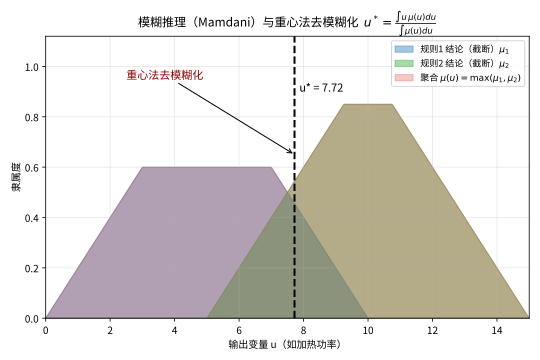

> **直观理解（现实类比）**：空调既不靠"开关"，也不靠死板的公式，而是把"太冷了该加热""有点凉要小加热"等模糊规则综合起来——每条规则给一个"建议火力"，最后像找一堆布料的重心那样，把互相重叠的建议"压合"成一个唯一且具体的功率输出，这就是重心法去模糊化。

**步骤6：仿真结果**
在MATLAB/Simulink中仿真，系统响应曲线显示超调量小于 $5\%$，稳态误差小于 $0.5^\circ\text{C}$，调节时间约 $30$ 秒。

### 示例2：模糊决策分析

**问题**：使用模糊层次分析法（FAHP）选择最优供应商。

**步骤1：建立层次结构**
- 目标层：选择最优供应商
- 准则层：质量 $C_1$，价格 $C_2$，交货期 $C_3$，服务 $C_4$
- 方案层：供应商 $A_1$，$A_2$，$A_3$

**步骤2：构造模糊判断矩阵**
使用三角模糊数 $l_{ij}, m_{ij}, u_{ij}$ 表示两两比较结果：
$$\tilde{A} = \begin{bmatrix}
(1,1,1) & (2,3,4) & (1/4,1/3,1/2) & (1/3,1/2,1) \\
(1/4,1/3,1/2) & (1,1,1) & (1/5,1/4,1/3) & (1/3,1/2,1) \\
(2,3,4) & (3,4,5) & (1,1,1) & (2,3,4) \\
(1,2,3) & (1,2,3) & (1/4,1/3,1/2) & (1,1,1)
\end{bmatrix}$$

**步骤3：计算模糊权重**
使用几何平均法：
$$\tilde{r}_i = \left(\prod_{j=1}^n \tilde{a}_{ij}\right)^{1/n}, \quad \tilde{w}_i = \tilde{r}_i \otimes (\tilde{r}_1 \oplus \tilde{r}_2 \oplus \cdots \oplus \tilde{r}_n)^{-1}$$

**步骤4：去模糊化**
使用重心法将模糊权重转化为清晰权重：
$$w_i = \frac{l_i + 2m_i + u_i}{4}$$

**步骤5：一致性检验**
计算一致性比率 $CR = CI/RI$，若 $CR < 0.1$，则判断矩阵一致。

**步骤6：综合排序**
计算各方案的综合得分，选择得分最高的供应商。

---

## 四、习题

### 基础题

**习题 1**（模糊集与隶属函数）设论域 $X=\{1,2,3,4\}$，定义模糊集 $A$ 的隶属函数为 $\mu_A(1)=0.2,\mu_A(2)=0.5,\mu_A(3)=1,\mu_A(4)=0$。指出 $X$ 中分别完全属于 $A$、完全不属于 $A$ 与部分属于 $A$ 的元素，并说明模糊集与经典集合在描述方式上的根本区别。

**习题 2**（支集、核与高度）对习题 1 中的模糊集 $A$，求其支集 $\operatorname{supp}(A)$、核 $\ker(A)$ 与高度 $\operatorname{hgt}(A)$，并判断 $A$ 是否为正规模糊集。

**习题 3**（标准模糊运算）设 $A,B$ 是 $X$ 上的模糊集，隶属函数分别为 $\mu_A,\mu_B$。写出并、交、补三种标准模糊运算的定义式，并用一个具体的数值例子说明 $\mu_{A\cap B}(x)\le \mu_A(x)$ 恒成立。

**习题 4**（t-模）写出 t-模的四条公理，并验证函数 $T(a,b)=\min(a,b)$ 满足全部四条公理。

**习题 5**（模糊关系与合成）设 $X=\{x_1,x_2\}$，$Y=\{y_1,y_2,y_3\}$，$Z=\{z_1,z_2\}$。给出模糊关系 $R\subset X\times Y$ 与 $S\subset Y\times Z$ 的隶属矩阵，并按 max-min 合成公式计算合成矩阵 $R\circ S$。

**习题 6**（模糊数）写出三角模糊数 $(a,b,c)$ 的隶属函数表达式，并给出其 $\alpha$-截集（$\alpha\in(0,1]$）的一般形式。

**习题 7**（Zadeh扩展原理）叙述 Zadeh 扩展原理中 $\tilde{f}(A)(y)=\sup_{x\in f^{-1}(y)}\mu_A(x)$ 的含义，并说明当 $f^{-1}(y)=\varnothing$ 时如何取值。

**习题 8**（模糊测度）写出模糊测度 $g$ 的三条公理，并构造一个有限集合上的例子说明模糊测度满足单调性但不一定满足可加性。

**习题 9**（模糊拓扑）写出模糊拓扑 $\tau\subset [0,1]^X$ 的三条公理，并验证平凡模糊拓扑 $\tau=\{\mathbf{0},\mathbf{1}\}$ 确是一个模糊拓扑。

**习题 10**（模糊运算性质）证明在标准模糊运算下并运算满足幂等律 $\mu_{A\cup A}(x)=\mu_A(x)$，并说明这与经典集合论中 $A\cup A=A$ 的一致性。

### 进阶题

**习题 11**（t-模结合律）设 $T$ 是任意 t-模。陈述结合律 $T(T(a,b),c)=T(a,T(b,c))$ 并验证 t-模 $T(a,b)=ab$ 满足结合律与边界条件 $T(a,1)=a$。

**习题 12**（扩展原理保持并）设 $f:X\to Y$，证明对任意一族模糊集 $\{A_i\}_{i\in I}$，Zadeh 扩展满足 $\tilde{f}\left(\bigcup_i A_i\right)=\bigcup_i \tilde{f}(A_i)$。

**习题 13**（扩展原理与交）证明对任意模糊集 $A,B$，一般有 $\tilde{f}(A\cap B)\subseteq \tilde{f}(A)\cap \tilde{f}(B)$，并举例说明当 $f$ 不是单射时，包含关系可以是严格的。

**习题 14**（Sugeno积分）写出 $f:\Omega\to[0,1]$ 关于模糊测度 $g$ 的 Sugeno 积分定义，并验证当 $f$ 为常值函数 $f\equiv c$ 时，积分的值等于 $c$。

**习题 15**（FCM隶属度更新）在 FCM 算法中，固定聚类中心 $V$ 时，用 Lagrange 乘子法推导隶属度更新公式 $u_{ij}=\frac{d_{ij}^{-2/(m-1)}}{\sum_{k=1}^{c}d_{kj}^{-2/(m-1)}}$，其中 $d_{ij}=\|x_j-v_i\|$。

**习题 16**（模糊基函数单位分解）设模糊基函数 $\phi_i(x)=\frac{\prod_j \mu_j^i(x_j)}{\sum_k\prod_j \mu_j^k(x_j)}$。证明 $\sum_i \phi_i(x)=1$ 对一切 $x$ 成立。

**习题 17**（模糊控制 Lyapunov 稳定性）设 T-S 模糊系统 $\dot{x}=\sum_i h_i(z) A_i x$，其中 $h_i(z)\ge 0$ 且 $\sum_i h_i(z)=1$。取 $V(x)=x^\top P x$，证明若对所有 $i$ 有 $A_i^\top P+P A_i<0$ 且 $P>0$，则 $x\ne 0$ 时 $\dot{V}(x)<0$。

**习题 18**（模糊数加法）设 $A,B$ 是模糊数，用扩展原理定义 $(A+B)(z)=\sup_{x+y=z}\min\{A(x),B(y)\}$。证明 $A+B$ 的取值范围在 $[0,1]$ 且是正规模糊集（即 $\operatorname{hgt}(A+B)=1$）。

**习题 19**（De Morgan 律）用标准模糊运算验证 $\mu_{\overline{A\cap B}}(x)=1-\min\{\mu_A(x),\mu_B(x)\}=\max\{1-\mu_A(x),1-\mu_B(x)\}$，从而证明 $\overline{A\cap B}=\overline{A}\cup\overline{B}$。

### 挑战题

**习题 20**（扩展原理伴随关系）证明对任意 $A\in\mathcal{F}(X)$ 与 $B\in\mathcal{F}(Y)$，有 $\tilde{f}(A)\subseteq B \iff A\subseteq \tilde{f}^{-1}(B)$，即 $\tilde{f}$ 与 $\tilde{f}^{-1}$ 构成一对 Galois 伴随。

**习题 21**（万能逼近）叙述 Stone–Weierstrass 定理，并说明模糊基函数类如何满足"含常值"与"分离点"两个条件，从而解释为何模糊系统是万能逼近器。

**习题 22**（FCM收敛性）证明 FCM 交替优化中目标函数序列 $J_m(U^{(t)},V^{(t)})$ 单调递减且有下界，并指出它只能保证收敛到驻点（可能为局部极小）而非全局最小的原因。

**习题 23**（t-模与 t-余模对偶）设 $T$ 是 t-模，定义对偶 t-余模 $S(a,b)=1-T(1-a,1-b)$。证明 $S$ 满足交换律、结合律与边界条件 $S(a,0)=a$。

**习题 24**（合成结合律）设 $R\subset X\times Y$，$S\subset Y\times Z$，$T\subset Z\times W$ 是模糊关系。证明按 max-min 合成定义的 $T$ 满足 $(R\circ S)\circ T=R\circ(S\circ T)$。

**习题 25**（三角模糊数和）设 $A=(a_1,b_1,c_1)$、$B=(a_2,b_2,c_2)$ 是三角模糊数，用扩展原理证明 $A+B$ 仍是三角模糊数，且 $A+B=(a_1+a_2,b_1+b_2,c_1+c_2)$。

**习题 26**（α-截集刻画）设 $A$ 是 $\mathbb{R}$ 上的凸模糊集。证明其任意 $\alpha$-截集 $A_\alpha=\{x:\mu_A(x)\ge\alpha\}$ 是凸子集（即区间），并据此给出模糊数的区间表示。

### 拓展主题习题（分解定理·可能性·关系方程·Type-2）

**基础题**

**习题 31**（$\alpha$-截集）设论域 $X=\{1,2,3,4\}$，模糊集 $A$ 的隶属函数为 $\mu_A(1)=0.3,\mu_A(2)=0.5,\mu_A(3)=1,\mu_A(4)=0.8$。求 $A_{0.5}$、$A_{0.9}$、$A_1$，并指出 $\ker(A),\operatorname{supp}(A)$。

**习题 32**（分解定理的数值验证）对习题 31 的模糊集 $A$，验证等式 $\mu_A(x)=\sup\{\alpha:x\in A_\alpha\}$ 对所有 $x$ 成立。

**进阶题**

**习题 33**（可能性测度）设论域 $\Omega=\{a,b,c\}$，可能性分布 $\pi(a)=0.4,\pi(b)=0.8,\pi(c)=0.2$。用 $\Pi(A)=\sup_{x\in A}\pi(x)$ 计算 $\Pi(\{a,b,c\})$、$\Pi(\{a,c\})$、$\Pi(\{b\})$，并验证 $\Pi(\{a,b\}\cup\{b,c\})\le\Pi(\{a,b\})+\Pi(\{b,c\})$。

**习题 34**（模糊关系方程的解）设 $Q=\begin{pmatrix}0.5&0.6\\0.7&0.2\end{pmatrix}$，$S=\begin{pmatrix}0.4&0.5\\0.6&0.3\end{pmatrix}$。按 $\mu_R(x,y)=\inf_z\{\mu_Q(y,z)\to\mu_S(x,z)\}$（其中 $a\to b=1$ 若 $a\le b$，否则 $=b$）计算由 $\pmb{\phi}$-合成给出的最大解 $R$。

**挑战题**

**习题 35**（分解定理的证明）完整写出分解定理：对任意模糊集 $A$，$\mu_A(x)=\sup_{\alpha\in(0,1]}\min\{\alpha,\mathbf{1}_{A_\alpha}(x)\}$，并说明证明中的上界与下界两个方向各自依赖什么事实。

**习题 36**（Type-2 与 FOU）解释区间 Type-2 模糊集（IT2）中 FOU（足迹）的含义，说明它如何用两个 Type-1 边界（LMF、UMF）刻画"隶属度本身的不确定性"，并比较它与 Type-1 在边缘噪声数据下的鲁棒性差异。

### 探究题

**习题 27**（模糊性与随机性）讨论模糊性（隶属度）与随机性（概率）在语义上的本质区别，说明为何"大约 3"这类语言量词用模糊集刻画比用概率密度刻画更自然。

**习题 28**（Type-2 与深度学习）开放讨论 Type-2 模糊系统（隶属函数本身也模糊）与模糊神经网络相结合的动机，以及它们在处理高阶不确定性时可能带来的新现象。

**习题 29**（模糊控制与经典控制）比较模糊 PID 控制器与经典 PID 控制器的设计思路，讨论模糊控制的鲁棒性与可解释性优势及其在严格稳定性保证方面的局限。

**习题 30**（模糊测度与非可加性）以 Sugeno/Choquet 积分为例，开放探讨模糊测度的非可加性如何刻画"冗余"与"协同"等交互效应，并谈谈它在多准则决策与博弈论中的应用。

---

## 五、习题答案与解析

### 基础题答案

1. **模糊集与隶属函数** 完全属于 $A$ 的是 $x=3$（$\mu_A(3)=1$）；完全不属于的是 $x=4$（$\mu_A(4)=0$）；部分属于的是 $x=1,2$（$0<\mu_A(x)<1$）。根本区别在于经典集合用 $\{0,1\}$ 值特征函数做二元判定，模糊集用 $[0,1]$ 区间上的隶属度连续刻画隶属程度。

2. **支集、核与高度** $\operatorname{supp}(A)=\{x:\mu_A(x)>0\}=\{1,2,3\}$；$\ker(A)=\{x:\mu_A(x)=1\}=\{3\}$；$\operatorname{hgt}(A)=\max_x\mu_A(x)=1$。因 $\operatorname{hgt}(A)=1$，故 $A$ 是正规模糊集。

3. **标准模糊运算** $\mu_{A\cup B}(x)=\max\{\mu_A(x),\mu_B(x)\}$，$\mu_{A\cap B}(x)=\min\{\mu_A(x),\mu_B(x)\}$，$\mu_{A^c}(x)=1-\mu_A(x)$。例如 $\mu_A(x)=0.3,\mu_B(x)=0.8$ 时 $\mu_{A\cap B}(x)=0.3=0.3=\mu_A(x)\le\mu_A(x)$；不论数值如何 $\min\{\mu_A,\mu_B\}\le\mu_A$ 恒成立。

4. **t-模公理** 四条为：交换律 $T(a,b)=T(b,a)$；结合律 $T(a,T(b,c))=T(T(a,b),c)$；单调性 $a\le c,b\le d\Rightarrow T(a,b)\le T(c,d)$；边界条件 $T(a,1)=a$。对 $T=\min$ 都显然成立：min 交换、结合，且 $a\le c,b\le d$ 时 $\min(a,b)\le\min(c,d)$，$\min(a,1)=a$。

5. **模糊关系合成** 取例如下：
$$R=\begin{pmatrix}0.6&0.2&0.9\\0.3&0.8&0.1\end{pmatrix},\qquad S=\begin{pmatrix}0.5&0.4\\0.7&0.2\\0.1&1\end{pmatrix}$$
按 $(R\circ S)_{ij}=\max_k\min\{R_{ik},S_{kj}\}$ 逐项计算，如 $(R\circ S)_{11}=\max\{\min(0.6,0.5),\min(0.2,0.7),\min(0.9,0.1)\}=\max\{0.5,0.2,0.1\}=0.5$。其余元素同法可得合成矩阵 $\begin{pmatrix}0.5&0.9\\0.7&0.2\end{pmatrix}$。

6. **三角模糊数** 隶属函数为分段线性：
$$\mu_A(x)=\begin{cases}\frac{x-a}{b-a},&a\le x\le b\\\frac{c-x}{c-b},&b\le x\le c\\0,&\text{其他}\end{cases}$$
其 $\alpha$-截集为闭区间 $A_\alpha=[a+\alpha(b-a),\;c-\alpha(c-b)]$。

7. **Zadeh扩展原理** 该式表示把经典映射 $f$ 作用到模糊集 $A$ 上：在像点 $y$ 处的隶属度等于所有被 $f$ 映到 $y$ 的原像点的隶属度之最大者。当 $f^{-1}(y)=\varnothing$ 时按定义取 $\tilde{f}(A)(y)=0$，保证值落在 $[0,1]$。

8. **模糊测度公理** (i) $g(\varnothing)=0,\ g(\Omega)=1$；(ii) 单调性 $A\subseteq B\Rightarrow g(A)\le g(B)$；(iii) 连续性 $A_n\uparrow A\Rightarrow g(A_n)\to g(A)$。例：$\Omega=\{a,b\}$，取 $g(\varnothing)=0,g(\{a\})=0.4,g(\{b\})=0.3,g(\{a,b\})=1$，满足单调性，但 $g(\{a\})+g(\{b\})=0.7\ne1=g(\{a,b\})$，说明不满足可加性。

9. **模糊拓扑公理** 三条为：(i) $\mathbf{0},\mathbf{1}\in\tau$；(ii) 有限交封闭 $A,B\in\tau\Rightarrow A\cap B\in\tau$；(iii) 任意并封闭 $\{A_i\}\subseteq\tau\Rightarrow\bigcup_iA_i\in\tau$。对 $\tau=\{\mathbf{0},\mathbf{1}\}$：含两个常值函数；有限交仍是 $\mathbf{0}$ 或 $\mathbf{1}$；任意并亦然，故确为模糊拓扑。

10. **幂等律** $\mu_{A\cup A}(x)=\max\{\mu_A(x),\mu_A(x)\}=\mu_A(x)$，故 $A\cup A=A$。这与经典集合论中并的幂等律 $A\cup A=A$ 完全一致，体现了模糊运算对经典运算的推广。

### 进阶题答案

1. **t-模结合律** 结合律即 $T(T(a,b),c)=T(a,T(b,c))$。对 $T(a,b)=ab$：$T(T(a,b),c)=(ab)c=a(bc)=T(a,T(b,c))$；且 $T(a,1)=a$、交换与单调显然，故 $T(a,b)=ab$ 是合法 t-模。

2. **扩展原理保持并** 
$$\tilde{f}\left(\bigcup_iA_i\right)(y)=\sup_{x\in f^{-1}(y)}\mu_{\bigcup_iA_i}(x)=\sup_{x\in f^{-1}(y)}\sup_i\mu_{A_i}(x)=\sup_i\sup_{x\in f^{-1}(y)}\mu_{A_i}(x)=\sup_i\tilde{f}(A_i)(y).$$
交换两个上确界的次序后即得 $\tilde{f}(\bigcup_iA_i)=\bigcup_i\tilde{f}(A_i)$。

3. **扩展原理与交** 因 $\mu_{A\cap B}(x)\le\mu_A(x)$ 且 $\le\mu_B(x)$，故逐点有 $\sup_{x\in f^{-1}(y)}\mu_{A\cap B}(x)\le\sup_{x\in f^{-1}(y)}\mu_A(x)$ 和同理对 $B$，从而 $\tilde{f}(A\cap B)\subseteq\tilde{f}(A)\cap\tilde{f}(B)$。取常值 $f(x)=0$，$A=\{0\}$，$B=\{1\}$（$0\ne1$）：$A\cap B=\varnothing$，$\tilde{f}(\varnothing)=\mathbf{0}$，但 $\tilde{f}(A)=\tilde{f}(B)=\delta_0$（在 $y=0$ 处取 $1$），故 $\tilde{f}(A)\cap\tilde{f}(B)=\delta_0\ne\mathbf{0}$，包含严格。

4. **Sugeno积分** 定义为 $\int f\circ g=\sup_{\alpha\in[0,1]}\min\{\alpha,g(\{x:f(x)\ge\alpha\})\}$。当 $f\equiv c$ 时，$\{x:f(x)\ge\alpha\}=\Omega$（若 $\alpha\le c$）否则 $\varnothing$。因而所求得 $\max\{\sup_{\alpha\le c}\min(\alpha,g(\Omega)),\sup_{\alpha>c}\min(\alpha,g(\varnothing))\}=\max\{\min(c,1),0\}=c$（利用 $g(\Omega)=1$）。

5. **FCM隶属度更新** 对固定 $j$ 求解 $\min\sum_iu_{ij}^m d_{ij}^2$，约束 $\sum_iu_{ij}=1$。Lagrange 函数 $L=\sum_iu_{ij}^m d_{ij}^2-\lambda(\sum_iu_{ij}-1)$，对 $u_{ij}$ 求导并令为零得 $mu_{ij}^{m-1}d_{ij}^2-\lambda=0$，即 $u_{ij}\propto d_{ij}^{-2/(m-1)}$。归一化得 $u_{ij}=d_{ij}^{-2/(m-1)}/\sum_k d_{kj}^{-2/(m-1)}$；若某 $d_{ij}=0$，则令 $u_{ij}=1$、$u_{kj}=0$（$k\ne i$）。

6. **单位分解** 记 $W_i(x)=\prod_j\mu_j^i(x_j)$，则 $\phi_i(x)=W_i(x)/\sum_k W_k(x)$，故 $\sum_i\phi_i(x)=\sum_i W_i(x)/\sum_k W_k(x)=1$。

7. **Lyapunov稳定性** 对 $V=x^\top Px$ 求导：$\dot{V}=\dot{x}^\top Px+x^\top P\dot{x}=\sum_ih_i(z)\,x^\top(A_i^\top P+PA_i)x$。因 $h_i\ge0$ 且 $A_i^\top P+PA_i<0$，对 $x\ne0$ 有 $x^\top(A_i^\top P+PA_i)x<0$，故 $\dot{V}<0$，系统在原点全局渐近稳定。

8. **模糊数加法** 取值在 $[0,1]$：$\min\{A(x),B(y)\}\le1$，其 sup 也不超过 $1$。正规性：因 $A,B$ 正规，存在 $x_0,y_0$ 使 $A(x_0)=B(y_0)=1$；取 $z_0=x_0+y_0$，则 $(A+B)(z_0)\ge\min\{A(x_0),B(y_0)\}=1$，故 $\operatorname{hgt}(A+B)=1$。

9. **De Morgan 律** 对任意 $x$，$\mu_{\overline{A\cap B}}(x)=1-\min\{\mu_A(x),\mu_B(x)\}$。利用 $1-\min(a,b)=\max(1-a,1-b)$，得 $\max\{1-\mu_A(x),1-\mu_B(x)\}=\mu_{\overline{A}\cup\overline{B}}(x)$。故 $\overline{A\cap B}=\overline{A}\cup\overline{B}$。

### 挑战题答案

1. **伴随关系** 若 $\tilde{f}(A)\subseteq B$，则对每个 $y$，$\sup_{x\in f^{-1}(y)}\mu_A(x)\le\mu_B(y)$。任取 $x\in X$，令 $y=f(x)$，得 $\mu_A(x)\le\sup_{x'\in f^{-1}(y)}\mu_A(x')\le\mu_B(y)=\tilde{f}^{-1}(B)(x)$，故 $A\subseteq\tilde{f}^{-1}(B)$。反之若 $A\subseteq\tilde{f}^{-1}(B)$，则对 $y$ 与 $x\in f^{-1}(y)$，$\mu_A(x)\le\mu_B(f(x))=\mu_B(y)$，取上确界得 $\tilde{f}(A)(y)\le\mu_B(y)$，即 $\tilde{f}(A)\subseteq B$。两方向合起来即为伴随关系。

2. **万能逼近** Stone–Weierstrass 定理：若紧 Hausdorff 空间 $X$ 上连续函数代数的子代数 $\mathcal{A}$ 含常值、分离点，则 $\mathcal{A}$ 在 $C(X)$（sup 范数）中稠密。对模糊基函数类：取 $M=1$、$\bar{y}^1=c$ 即得常值函数 $c$；对 $x\ne y$，取中心在 $x$、方差充分小的高斯隶属函数可使其在 $x$ 处近似为 $1$、在 $y$ 处近似为 $0$ 从而分离两点。故该类在 $C(X)$ 稠密，任意连续函数可被模糊系统任意精度逼近。

3. **FCM收敛** 由交替优化，$U^{(t+1)}=\arg\min_UJ(U,V^{(t)})$ 使 $J(U^{(t+1)},V^{(t)})\le J(U^{(t)},V^{(t)})$；再 $V^{(t+1)}=\arg\min_VJ(U^{(t+1)},V)$ 使 $J(U^{(t+1)},V^{(t+1)})\le J(U^{(t+1)},V^{(t)})$。合得 $J(U^{(t+1)},V^{(t+1)})\le J(U^{(t)},V^{(t)})$，单调递减；又 $J_m\ge0$ 有下界，故收敛。由于 $J_m$ 关于 $U,V$ 联合上非凸（当 $m>1$），收敛点只是满足 KKT 条件的驻点（局部极小或鞍点），不保证全局最优。

4. **t-模对偶** 由 $S(a,b)=1-T(1-a,1-b)$：交换律 $S(a,b)=1-T(1-a,1-b)=1-T(1-b,1-a)=S(b,a)$；结合律可由 $T$ 的结合律与替换变量 $x\mapsto1-x$ 直接推出；边界 $S(a,0)=1-T(1-a,1)=1-(1-a)=a$。

5. **合成结合律** 写出 $(R\circ S)\circ T$ 在 $(x,w)$ 处的值：
$$[(R\circ S)\circ T](x,w)=\max_z\min\Big\{\max_y\min\{R(x,y),S(y,z)\},\,T(z,w)\Big\}.$$
利用 $\min$ 可对 $\max$ 分配（在有限论域上），可将内层的 $\max_y$ 挪到外层并合并三元 $\min$，得 $\max_{y,z}\min\{R(x,y),S(y,z),T(z,w)\}$，与 $[R\circ(S\circ T)](x,w)$ 形式相同，故结合律成立。

6. **三角模糊数和** 三角模糊数 $A,B$ 的 $\alpha$-截集分别为区间 $[a_i+\alpha(b_i-a_i),\;c_i-\alpha(c_i-b_i)]$。由扩展原理，和的截集满足 $(A+B)_\alpha=A_\alpha+B_\alpha$（区间 Minkowski 和），得
$$[a_1+a_2+\alpha((b_1-a_1)+(b_2-a_2)),\;c_1+c_2-\alpha((c_1-b_1)+(c_2-b_2))],$$
恰为三角模糊数 $(a_1+a_2,b_1+b_2,c_1+c_2)$ 的 $\alpha$-截集，故 $A+B$ 仍是三角模糊数。

7. **凸性与区间表示** 设 $\mu_A$ 凸，$x_1,x_2\in A_\alpha$，$\lambda\in[0,1]$。凸集定义即 $\mu_A(\lambda x_1+(1-\lambda)x_2)\ge\min\{\mu_A(x_1),\mu_A(x_2)\}\ge\alpha$，故 $\lambda x_1+(1-\lambda)x_2\in A_\alpha$，$A_\alpha$ 是凸集。由于模糊数在 $\mathbb{R}$ 上取值、隶属函数上半连续，$A_\alpha$ 是闭区间 $[A_\alpha^-,A_\alpha^+]$，由此给出模糊数的"-截集区间分解表示" $A=\bigcup_{\alpha}(A_\alpha^-,A_\alpha^+)$ 层次的描述。

### 探究题答案

1. **模糊性与随机性** 概率刻画"是否发生"的不确定性，满足可加性且可由大量试验重复逼近；隶属度刻画"性质的程度"这一渐变、主观/语言属性，不满足可加公理。像"大约 3"这种临界模糊的量词，随机模型必须硬性赋一个可加分布，而模糊集直接给出各点隶属程度，语义上更贴合"邻近 3 的程度"这一直觉，故更自然。

2. **Type-2 与深度学习** Type-2 系统中隶属函数本身也是模糊集（如 FOU 上下界），能刻画"隶属度本身具有不确定性"，适合强噪声与词义含混场景。模糊神经网络则把隶属函数参数视为可训练参数，用 BP/深度学习训练，同时保留语言的 if-then 可解释结构；新现象包括自适应规则约简、关键点模糊化、以及"可解释性—精度"的权衡与折衷策略。

3. **模糊控制与经典控制** 模糊 PID 用语言规则替代精确被控对象模型，把误差与误差变化率模糊化后经规则库推理并解模糊化输出，对模型不精确、参数摄动和外部扰动更鲁棒，规则可读易懂；缺点是隶属函数与规则的整定靠经验、缺乏统一的系统化设计准则。经典 PID 结构简单、整定方法成熟、稳定性理论完备，但面对强非线性与时变对象效果有限，二者常互补结合。

4. **模糊测度与非可加性** 模糊测度允许 $g(A\cup B)\ne g(A)+g(B)$：当 $g(A\cup B)>g(A)+g(B)$ 体现协同/互补（合作增效），小于时体现冗余/替代。Sugeno 积分（sup-min 形式）与 Choquet 积分（$\int_0^\infty g(\{f\ge\alpha\})d\alpha$）把非可加权重"积分"到效用函数上，广泛用于多准则决策中的交互指标、特征融合的冗余评价，以及合作博弈中联盟函数与 Shapley 值的计算，是模糊测度理论的重要应用。

### 拓展主题习题答案

31. **$\alpha$-截集** $A_{0.5}=\{x:\mu_A(x)\ge0.5\}=\{2,3,4\}$；$A_{0.9}=\{x:\mu_A(x)\ge0.9\}=\{3,4\}$；$A_{1}=\{x:\mu_A(x)\ge1\}=\{3\}$。核 $\ker(A)=A_1=\{3\}$；支集 $\operatorname{supp}(A)=\{x:\mu_A(x)>0\}=\{1,2,3,4\}$。

32. **分解定理的数值验证** 对每个 $x$，$\mu_A(x)=\sup\{\alpha:x\in A_\alpha\}=\max_{(x\in A_\alpha)}\alpha$ 恰为"能涵盖 $x$ 的最大门槛"：
   - $x=1$：$\mu_A(1)=0.3$，包含 $x$ 的截集要求 $\alpha\le0.3$，上确界 $0.3$ ✓
   - $x=2$：$\sup\alpha=0.5$ ✓
   - $x=3$：$\sup\alpha=1$ ✓
   - $x=4$：$\sup\alpha=0.8$ ✓
   与定义一致，验证了 $\mu_A(x)=\sup\{\alpha:x\in A_\alpha\}$。

33. **可能性测度** $\Pi(\{a,b,c\})=\sup\{0.4,0.8,0.2\}=0.8$；$\Pi(\{a,c\})=\sup\{0.4,0.2\}=0.4$；$\Pi(\{b\})=\pi(b)=0.8$。验证：$\Pi(\{a,b\}\cup\{b,c\})=\Pi(\{a,b,c\})=0.8$，而 $\Pi(\{a,b\})=\sup\{0.4,0.8\}=0.8$、$\Pi(\{b,c\})=0.8$，故 $0.8\le0.8+0.8=1.6$，明示可能性测度取 $\sup$ 而非 $\sum$（不满足可加性，却满足次可加性意义下的温和上界）。

34. **模糊关系方程的最大解** 末序 $a\to b$（$=1$ 若 $a\le b$，否则 $=b$）给出 $R_{xy}=\min\{Q_{y1}\to S_{x1},\;Q_{y2}\to S_{x2}\}$，其中 $x$ 对应 $S$ 的行、$y$ 对应 $Q$ 的列。逐元计算：
   - $R_{11}=\min\{Q_{11}\to S_{11},\;Q_{21}\to S_{12}\}=\min\{0.5\to0.4,\;0.7\to0.5\}=\min\{0.4,0.5\}=0.4$
   - $R_{12}=\min\{Q_{12}\to S_{11},\;Q_{22}\to S_{12}\}=\min\{0.6\to0.4,\;0.2\to0.5\}=\min\{0.4,1\}=0.4$
   - $R_{21}=\min\{Q_{11}\to S_{21},\;Q_{21}\to S_{22}\}=\min\{0.5\to0.6,\;0.7\to0.3\}=\min\{1,0.3\}=0.3$
   - $R_{22}=\min\{Q_{12}\to S_{21},\;Q_{22}\to S_{22}\}=\min\{0.6\to0.6,\;0.2\to0.3\}=\min\{1,1\}=1$
   故 $R=\begin{pmatrix}0.4&0.4\\0.3&1\end{pmatrix}$，它是满足 $R\circ Q\le S$ 的最大解（$\pmb{\phi}$-合成）。

35. **分解定理的证明** 记 $m=\mu_A(x)$。上界：对任意 $\alpha$，若 $x\notin A_\alpha$ 则 $\min\{\alpha,\mathbf{1}\}=0\le m$；若 $x\in A_\alpha$，由集合定义 $\alpha\le\mu_A(x)=m$，故 $\min\{\alpha,\mathbf{1}\}\le\alpha\le m$。取上确界仍 $\le m$。下界：取 $\alpha=m$，$x\in A_m$（因 $m\ge m$），得 $\min\{m,\mathbf{1}\}=m$；$m=0$ 时该项为 0，但上确界仍 $\ge0$，配合非负即达 $m$。合起来上确界恰为 $m$，证毕。两个方向分别依赖"截集由阈值定义（上界）"与"取 $\alpha=m$ 可达（下界）"。

36. **Type-2 与 FOU** FOU（足迹）是主隶属度在 $x$ 处的取值集合 $J_x$ 随 $x$ 扫出的整个"灰色地带"：其上/下轮廓分别称为上限隶属函数（UMF）与下限隶属函数（LMF），都是 Type-1 模糊集。IT2 用 UMF 与 LMF 夹出来的区间刻画"隶属度本身也拿不准"，天然容纳词义含混、传感器噪声；当数据处于边缘（隶属度本就在 0.5 附近摇摆）时，Type-2 的区间化判断比 Type-1 的单点判断更不易因微小扰动而翻盘，因而在噪声环境下鲁棒性更好，代价是需降型（type reduction）后再解模糊化、计算量更大。

---

## 六、Stewart 风格训练

> 本章仿照 Stewart《Calculus》各章末尾的体例，补充一组配套训练：先做概念检查（Concept Check）与真/假测验（True-False Quiz），再透过"与微积分的联结"（Connections to Calculus）用你熟悉的经典微积分地基来印证模糊集这道新语言，最后以标准例题、专题应用与分层的习题导览把这一章的知识点串成可动手的技能。
>
> 建议像做微积分课后练习一样推进：先打概念地基，再用真/假题抓住易错点，最后落到计算与建模上。

### 6.1 概念检查（Concept Check）

1. 隶属函数 $\mu_A:X\to[0,1]$ 与经典集合的特征函数 $\chi_A:X\to\{0,1\}$ 的根本区别是什么？"程度"两个字如何体现在取值上？
2. 三角模糊数 $(a,b,c)$ 与梯形模糊数 $(a,b,c,d)$ 的隶属函数解析式分别是什么？它们的核与支集各自落在何处？
3. 什么是 $\alpha$-截集 $A_\alpha$？它与多元微积分里 $f(x,y)=c$ 的等高线（水平集）有何联系？当 $\alpha\to1$ 和 $\alpha\to0^+$ 时 $A_\alpha$ 各趋于什么？
4. 标准模糊运算"并、交、补"如何逐点定义？给出 $\mu_{A\cup B},\mu_{A\cap B},\mu_{A^c}$ 各自用 $\mu_A,\mu_B$ 表达的形式。
5. 重心法（质心法）解模糊化的公式是什么？为什么说它是一个"带权平均"？
6. 模糊推理中的 max-min（sup-min）合成公式怎么写？它如何推广矩阵乘法？
7. Zadeh 扩展原理与分解定理各自回答什么问题？二者在"模糊集 $\leftrightarrow$ 经典集族"的互译中各扮演什么角色？

### 6.2 真/假测验（True-False Quiz）

1. （真）$\mu_A(x)=1$ 当且仅当 $x$ 完全属于模糊集 $A$，这只对应经典特征函数取值 $1$ 的情形被保留了下来。
   - 理由：由定义 1，$\mu_A(x)=1$ 正是"完全属于"的判据；这与 $\chi_A(x)=1$ 的含义一致，模糊化只是把 $0$、$1$ 之间的中间值也纳入取值。
2. （真）若 $A,B$ 是两个模糊集，则对任意 $x$ 恒有 $\mu_{A\cap B}(x)\le\mu_A(x)$。
   - 理由：$\mu_{A\cap B}(x)=\min\{\mu_A(x),\mu_B(x)\}\le\mu_A(x)$，与经典集合 $A\cap B\subseteq A$ 相对应。
3. （假）三角模糊数 $(a,b,c)$ 的 $\alpha$-截集 $A_\alpha$ 是一个开区间。
   - 理由：$A_\alpha=\{x:\mu_A(x)\ge\alpha\}$，条件含等号，故截集是闭区间 $[a+\alpha(b-a),\ c-\alpha(c-b)]$，端点可以达到。
4. （假）重心法解模糊化的结果会随着把 $\mu_B$ 整体放大一个常数而改变。
   - 理由：$z^*=\dfrac{\int z\mu_B\,dz}{\int \mu_B\,dz}$ 的分子分母同乘该常数会抵消，$z^*$ 只取决于隶属函数的形状，与整体高度无关。
5. （真）当论域有限时，max-min 合成 $\mu_{R\circ S}(x,z)=\sup_{y}\min\{\mu_R(x,y),\mu_S(y,z)\}$ 就退化为 $\max$ 与 $\min$ 的矩阵"乘法"。
   - 理由：有限论域上 $\sup$ 即 $\max$，逐元素 $\max_k\min\{R_{ik},S_{kj}\}$ 正是习题 5 的合成矩阵算法。
6. （真）分解定理把模糊集精确还原为它的 $\alpha$-截集族的加权堆叠，因此一个模糊问题可以拆成一系列经典集合问题来解。
   - 理由：$\mu_A(x)=\sup_\alpha\min\{\alpha,\mathbf{1}_{A_\alpha}(x)\}$ 说明 $A$ 完全由嵌套的经典截集 $\{A_\alpha\}$ 决定，这正是"逐层化为经典问题"的理论依据。
7. （假）可能性测度与概率测度一样，对并满足可加性 $\Pi(A\cup B)=\Pi(A)+\Pi(B)$。
   - 理由：由定义 10，可能性测度只对并取上确界 $\Pi(\bigcup_i A_i)=\sup_i\Pi(A_i)$，不要求可加，这正是它比概率"更宽容"、适合信息不全场景的原因。

### 6.3 与微积分的联结（Connections to Calculus）

**① 连续函数视角**：隶属函数 $\mu_A:X\to[0,1]$ 本质就是取值于 $[0,1]$ 的实值函数——三角、梯形隶属函数是分段线性（且连续）的，高斯隶属函数在 $\mathbb{R}$ 上任意阶可导；定义 6 要求模糊数"分段连续"，定义 7 的连续性公理 $\lim_{n\to\infty}g(A_n)=g(A)$ 也直接借用了极限语言。分段点 $\{a,b,c,d\}$ 正是函数图像的角点，与 Stewart 中研究分段函数连续性、可导性的方式一致。

**② 带权定积分视角（重心法）**：解模糊化的重心法

$$z^*=\frac{\int z\,\mu_B(z)\,dz}{\int \mu_B(z)\,dz}$$

正是带权定积分：分子是"以 $\mu_B$ 为权重对 $z$ 的加权积分"，分母是总权重。它与 Stewart 中求曲线下方区域的形心（质心，centroid）在结构上完全同构，只是这里的权重密度由隶属函数扮演。离散情形（例题 B）即各项加权平均。

**③ 水平集视角（$\alpha$-截集）**：$\alpha$-截集

$$A_\alpha=\{x\in X\mid \mu_A(x)\ge\alpha\}$$

正是三元曲面 $\mu_A$ 的高度不低于 $\alpha$ 的"上水平集"（superlevel set）。这与函数 $f(x,y)=c$ 的等高线是同一件东西：把曲面按阈值 $\alpha$ 切成一张张切片，切片随 $\alpha$ 增大而单调收缩（定义 9 的嵌套递减族）。分解定理与表现定理，就是"从切片族重建整片曲面"的微积分式分层操作。

**④ 卷积积分视角（模糊数算术）**：扩展原理下的模糊数之和

$$(A+B)(z)=\sup_{x+y=z}\min\{A(x),B(y)\}$$

与卷积积分 $\int f(x)g(z-x)\,dx$ 结构同构：卷积把"$x$ 处贡献 $f(x)$、$z-x$ 处贡献 $g(z-x)$"的乘积叠加，模糊数加法则把"$x$ 处隶属 $A(x)$、$y=z-x$ 处隶属 $B(y)$"用 $\min$ 取小后再取 $\sup$。习题 18、25 正是凭借这一"模糊卷积"保持三角/梯形形状的结论。

**⑤ 分层累加积分视角（Choquet 积分）**：对非可加模糊测度 $g$，Choquet 积分把函数按"水位"分层累加：

$$\int f\,dg=\int_0^\infty g(\{x\mid f(x)\ge\alpha\})\,d\alpha$$

它按"高度 $\ge\alpha$ 的集合的可信度 $g(\cdot)$"把 $f$ 自下而上剥离成一层层 $\alpha$，再对"水平集之可信度"积分——正是可加测度情形下层集积分（Layer-Cake 表示）在非可加条件下的推广，与 1.6 节 Sugeno 积分的"分层抽水"直觉一脉相承。

### 6.4 标准例题（Worked Example）

**例题 A（三角隶属函数：求点值 + 求 $\alpha$-截集）**

设三角模糊数 $A=(a,b,c)=(2,5,8)$，隶属函数由定义 6 给出。请写出其解析式，求 $\mu_A(3)$，并计算 $A_{0.5}$ 与 $A_{0.25}$。

1. 写出 $\mu_A(x)$ 的分段表达式：对 $2\le x\le5$ 用上升段，$\mu_A(x)=\dfrac{x-a}{b-a}=\dfrac{x-2}{3}$；对 $5\le x\le8$ 用下降段，$\mu_A(x)=\dfrac{c-x}{c-b}=\dfrac{8-x}{3}$；其余为 $0$。
2. 求 $x=3$ 处的隶属度：$3\in[2,5]$，代入上升段得

$$\mu_A(3)=\frac{3-2}{3}=\frac{1}{3}.$$

3. 求 $\alpha$-截集的一般形式：由 $A_\alpha=\{x:\mu_A(x)\ge\alpha\}$，分别反解两段线性式得 $x=a+\alpha(b-a)=2+3\alpha$ 与 $x=c-\alpha(c-b)=8-3\alpha$，故

$$A_\alpha=[\,2+3\alpha,\;8-3\alpha\,],\qquad 0<\alpha\le1.$$
4. 代入 $\alpha=0.5$ 与 $\alpha=0.25$：$A_{0.5}=[2+1.5,\ 8-1.5]=[3.5,\ 6.5]$；$A_{0.25}=[2+0.75,\ 8-0.75]=[2.75,\ 7.25]$。可见 $\alpha$ 越小截集越宽（囊括更多点数），与"用更疏的网捞更多"的直观一致。

**例题 B（离散重心法解模糊化）**

设模糊推理聚合后的输出隶属函数在离散论域上取值为：

| $z$ | 0 | 1 | 2 | 3 | 4 |
|---|---|---|---|---|---|
| $\mu_B(z)$ | 0.2 | 0.5 | 0.8 | 0.4 | 0.1 |

求清晰输出 $z^*$。

1. 写出离散重心（加权平均）公式：

$$z^*=\frac{\sum_i z_i\,\mu_B(z_i)}{\sum_i \mu_B(z_i)}.$$

2. 计算分子：

$$\sum z_i\mu_B(z_i)=0\cdot0.2+1\cdot0.5+2\cdot0.8+3\cdot0.4+4\cdot0.1=0+0.5+1.6+1.2+0.4=3.7.$$

3. 计算分母：

$$\sum \mu_B(z_i)=0.2+0.5+0.8+0.4+0.1=2.0.$$

4. 相除得清晰输出：

$$z^*=\frac{3.7}{2.0}=1.85.$$
   该结果落在权重最重的 $z=2$（$\mu_B=0.8$）附近略偏左，符合"重心偏向权重集中区域"的直觉。

### 6.5 专题应用（Applied Project）

**主题：用 max-min 推理与重心法手工构建一维"温度—功率"模糊加热器**

- **背景**：示例 1 给出了完整模糊控制器，但尚未手工逐步落实推理与解模糊。本项目把论域缩减为一维，只让"温度误差 $e$"作为输入，便于手算一遍完整的 $\{$模糊化 → 规则 → 合成 → 重心解模糊$\}$ 流程。
- **任务**：
  1. 定义三个三角隶属函数表示"负大（NB）、零（ZE）、正大（PB）"，给出各自的 $(a,b,c)$ 与解析式；
  2. 写出三条规则：若 $e$ 是 NB 则 $u$ 是 PB（太冷大功率）、若 $e$ 是 ZE 则 $u$ 是 ZE、若 $e$ 是 PB 则 $u$ 是 NB（过热负功率）；
  3. 对某给定 $e_0$（例如 $e_0$ 使三条规则的激活隶属度为 $(0.8,0.2,0.0)$），用 min 截断聚合出输出隶属函数；
  4. 在输出论域上采样并用重心法求 $u^*$，记录全部代入数值。
- **联结**：本题把 6.4 的两道例题串成一条流水线——规则激活对应"取小"（例题所用 $\min$ 运算），聚合对应"取大"，最后的重心正是例题 B 的加权平均；隶属函数求值对应例题 A 的分段代入。
- **开放问题**：把直线型三角隶属函数换成高斯型时，聚合再做一遍，观察 $u^*$ 是否变化、如何变化，从而体会"隶属函数形状如何影响决策输出"。

### 6.6 习题分层导览（对应 Stewart 的分类）

对照本章"四、习题"，按 Stewart 的"概念—技巧—应用"三档把题目重新归类，便于按需选做：

- **概念题（理解定义与区别）**：基础题第 1、2、4、7、8、9 题；探究题第 27、28 题；拓展主题习题第 36 题（章节开始的 6.1 概念检查正是针对这一档的答案提纲）。
- **技巧题（含计算与证明）**：基础题第 3、5、6、10 题；进阶题第 11、12、13、14、16、17、19 题；挑战题第 20、23、24 题；拓展主题习题第 31、32、33、34 题。其中第 5 题对应 6.3 的 max-min 合成、第 6 题对应例题 A 的三角隶属函数题型。
- **应用题（建模与设计）**：进阶题第 15、18 题；挑战题第 21、22、25、26 题；探究题第 29、30 题；拓展主题习题第 35 题。6.5 专题应用的加热器项目可视为第 29 题（模糊控制与经典控制比较）的小型实操入口。

排序上建议按"概念 → 技巧 → 应用"推进；想做热身则从基础题的运算题（第 3、5、6、10 题）入手，想做理论加固则优先挑战题与探究题。

## 七、数学科普（Popular Mathematics）

生活里很多概念没有硬边界：25 度算冷还是热？“大约十点”到底几点？模糊数学就是给这类“说不清”的事建立一套能计算的框架。下面按 16 个知识点逐一讲来。

### 七.1 隶属函数：把“是不是”变成“有几分”

生活里没有硬边界：25 度算冷还是算热？模糊数学不问“是不是冷”，而是用一个 $0$ 到 $1$ 之间的数回答“有几分冷”，这个数叫隶属度，画成曲线就是隶属函数，冷、温、热三条曲线还会彼此重叠。

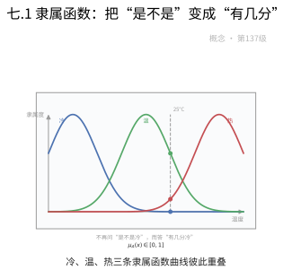

**一句话点破**：把非黑即白的判断，换成一枚可以滑动的刻度盘。

### 七.2 模糊运算：取大、取小、用一减

既然每样东西都有“属于的程度”，集合的并、交、补也能推广：并集取两者中较大的隶属度，交集取较小的，补集则用 $1$ 减去原来的值。


**一句话点破**：模糊世界的四则运算，就藏在“取大、取小、一减”里。

### 七.3 模糊关系与推理：像人一样“大概判断”

两个模糊概念之间的关联程度可以写成一个矩阵，再配合“若……则……”的模糊规则，就能从不太精确的前提，推出不太精确的结论，这正是模糊推理的工作方式。

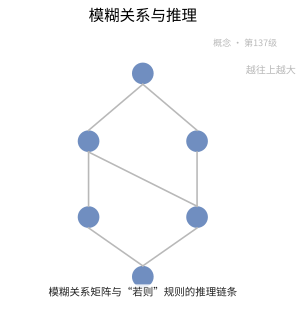

**一句话点破**：模糊推理让机器也能做“差不多就行”的判断。

### 七.4 模糊数与模糊决策：给“大约”一个形状

“大约十点”“差不多三成”都能画成一个小山包或三角形，越靠近中心越可信。把这种模糊数代进加减乘除，再用它给多个方案打分排序，就成了模糊决策。

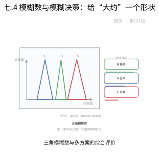

**一句话点破**：给“大约”一个形状，模糊的话也能参与计算和比较。

### 七.5 模糊控制与模糊聚类：让机器学会“慢一点”

模糊控制器把“温度有点高”翻译成“阀门开大一点”，几句经验规则就能控制洗衣机、地铁和相机对焦；模糊聚类则不硬性划分，而是按“相似程度”把数据软性地归堆。


**一句话点破**：模糊控制靠一堆“如果……那么……”的经验，就能做得很稳。

### 七.6 模糊测度与模糊积分：连“重要性”也能积分

普通积分按面积累加，模糊积分则允许给不同因素赋上不同的“重要度”再综合；模糊测度正是描述“一件事有多值得重视”的度量，常用于多指标评价。

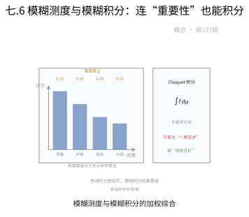

**一句话点破**：模糊积分算的不是面积，而是“综合考虑”。

### 七.7 模糊拓扑：边界模糊的“邻近”

拓扑研究什么算“挨得近”，模糊拓扑则把“属于开集”也变成有程度的事：一个点可以“挺属于”某片区域。它刻画的是边界含混时，连续性、邻近这类概念的推广。

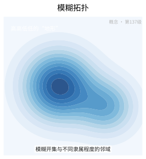

**一句话点破**：连“挨不挨着”都可以有程度之分。

### 七.8 分解定理：把模糊切成一堆普通集合

任何模糊集都能被“切”成一层层普通集合：取一个阈值 $\alpha$，把隶属度不低于它的元素挑出来，就得到 $\alpha$-截集；反过来把各层拼回去，又能复原原来的模糊集，这就是分解定理。

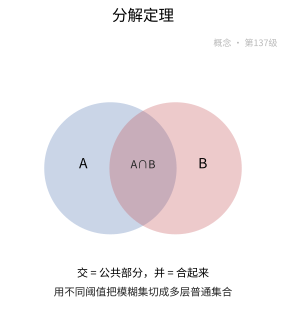

**一句话点破**：再模糊的东西，也能拆成一组清清楚楚的普通集合。

### 七.9 可能性理论与关系方程

可能性理论用“这件事有多容易成立”来代替“概率多大”，它不太关心频率，只在意可行程度。而模糊关系方程则是给定输入输出，反解出中间那层模糊关系，像求模糊版的逆运算。

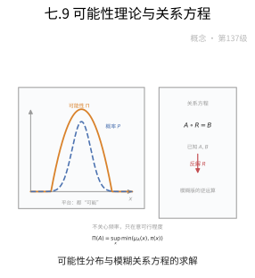

**一句话点破**：可能性问“办得到吗”，概率问“多常碰到”。

### 七.10 Type-2 模糊集：连“有几分”也是模糊的

普通模糊集的隶属度是一个确定的数，可有时连这个数都说不准。Type-2 模糊集干脆让隶属度本身也变成模糊的，用一条小带子表示“大概是 $0.7$ 上下”，处理不确定性更稳健。

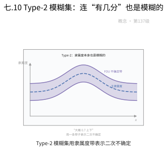

**一句话点破**：当“有几分像”也不确定时，就给隶属度再加一层模糊。

### 七.11 Zadeh 扩展原理：模糊版的“代入”

它回答一个问题：普通函数能不能作用在模糊输入上？答案是能——把每个输入的隶属度，连同函数算出的结果一起“搬运”过去，就得到模糊输出的隶属度。

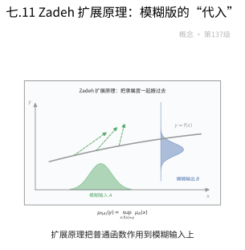

**一句话点破**：普通函数套上模糊输入，输出就成了模糊的。

### 七.12 模糊逻辑完备性：讲得通就能证得出

完备性定理说：凡是模糊逻辑里恒真的公式，都能从公理出发一步步证明出来。它保证了这套“含混的逻辑”在推理上并不残缺，该推出来的都能推出来。

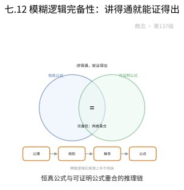

**一句话点破**：一套逻辑好用，既要推得出，也要证得齐。

### 七.13 万能逼近：模糊系统什么都能凑近

只要规则够多，模糊系统就能以任意精度逼近任何一个连续函数。换句话说，模糊控制器不是只能应付简单场景，它在理论上和神经网络一样“什么曲线都画得出来”。

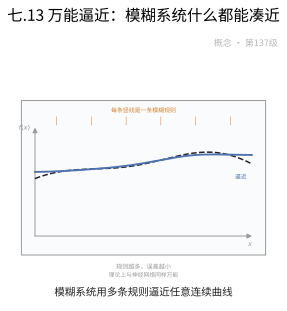

**一句话点破**：规则足够多，模糊系统就能逼近任何连续函数。

### 七.14 FCM 收敛性：软聚类也会停下来

模糊 C-均值让每个点以不同程度属于各个类心，并反复更新类心与隶属度。收敛性定理保证这个来回折腾的过程一定会稳定下来，不会永远摇摆。

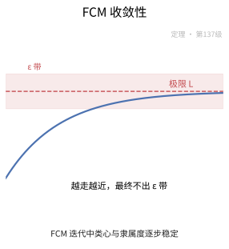

**一句话点破**：只要目标函数一路下降，再折腾的迭代也终会停下。

### 七.15 模糊控制稳定性：松手也不会翻车

用模糊规则搭成的控制系统，能不能保证被控对象最终稳下来？Lyapunov 方法给系统找一个“能量”函数，只要它随时间是下降的，就能证明系统稳定，不会发散失控。

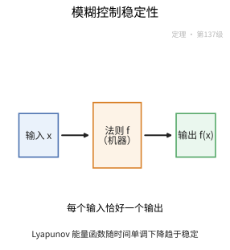

**一句话点破**：找个一路下降的“能量”，就能证明系统不会失控。

### 七.16 分解与表现定理：模糊集的两种化身

分解定理把模糊集拆成一层层截集，表现定理则说明这些截集不是随便堆的，它们带着一套嵌套结构，反过来能唯一确定原来的模糊集。两者一拆一合，把模糊与普通完全打通。

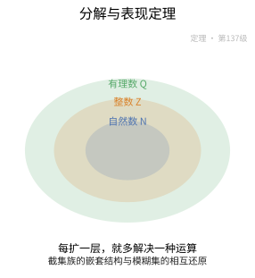

**一句话点破**：模糊集和一族嵌套的普通集合，其实是同一个东西的两种写法。

## 八、数学史（History of Mathematics）

> 模糊数学的历史主线，是"精确的二值逻辑如何在逼近人脑的连续判断中让位"的思想转向：从 20 世纪初多值逻辑的尝试，到 1965 年扎德以"隶属度落在 $[0,1]$"的惊天一问开启模糊集合，再到模糊逻辑、模糊控制与可能性理论层层展开，最终在工程与数据处理中落地。本章沿着"从二值到灰度、从理论到控制"的线索，追溯这套"让不确定变得可算"体系的来龙去脉。

### 八.1 前奏：二值逻辑的裂缝与多值逻辑

- **古典二值的束缚**：亚里士多德时代的排中律与"属于／不属于"的二分，长期统治着逻辑与集合论；但现实中的"年轻""高个子""天气热"等概念天然厌恶一刀切。
- **多值逻辑的先行**：1920 年，波兰逻辑学家**卢卡西维茨**（Jan Łukasiewicz）提出三值乃至无穷多值逻辑，为"真／假之外还有中间态"给出了正式语法——这是模糊思想的第一块垫脚石。
- **还差"度"的概念**：多值逻辑走的是"真值取多值"，仍未给出"$\\frac{1}{2}$ 属于"这种连续隶属的几何，真正的一跃要等 1965 年。

### 八.2 扎德与模糊集合的诞生

- **隶属函数的惊天一问**：1965 年，美国加州大学伯克利分校教授**扎德**（Lotfi Zadeh）发表论文《模糊集合（Fuzzy Sets）》，把"属于／不属于"的二元 $\{0,1\}$ 推广到连续区间 $[0,1]$，用**隶属函数**刻画一个元素"有多属于"某个概念。
- **为何而生**：他直接回应了"精确数学能否刻画人类模糊、不精确、信息不完全的认知"这一基础问题，并由此引出模糊扩展原理与模糊集运算。
- **争议中起步**：该思想早期让不少纯粹数学者抵触（"哪里还算精确"），但它与概率、粗糙集并立，成为处理不确定性的重要范式，也为模糊逻辑、控制、决策与聚类提供了统一语言。

### 八.3 模糊逻辑与模糊推理

- **逻辑运算的连续化**：在模糊集基础上，扎德 1973 年前后发展**模糊逻辑**与**模糊推理**：把经典逻辑的合取、析取、否定、蕴含推广为 $[0,1]$ 上的运算（取小／取大算子等），并用隶属函数的逻辑运算与"若-则"规则合成（模糊关系合成、max-min 合成）表达近似推理。
- **从图形到算法**：模糊推理让"专家经验"能以规则表的形式写进机器——这正是后续控制应用的第一步。

### 八.4 马马达尼与模糊控制的首秀

- **从纸面到蒸汽机**：1975 年，**马马达尼**（Ebrahim Mamdani）把扎德的理论用于实际蒸汽机与锅炉的**模糊控制**，首次展示了"专家规则＋模糊推理"能驱动真实系统——模糊理论自此从书斋走向工程。
- **系统的转变**：此后"模糊推理＋控制律"成为最广泛的模糊应用方向，也为家用电器、地铁与汽车控制中的"模糊热潮"埋下伏笔。

### 八.5 模糊测度、积分与可能性理论

- **如何度量模糊性**：模糊推进一步抽象，人们需要新的"测度"工具。**菅野**（Sugeno，常译菅野道夫）在 1970 年代引入**模糊测度**（以单调性而非可加性定义）与**模糊积分**，用于多准则决策与信息融合；更早的**Choquet 积分**也常被整合其中。
- **可能性的独立语义**：1978 年，扎德提出**可能性理论**，用可能性测度（$\sup$ 可加）区别于概率测度（可加）——它回答"有多可能"而非"有多频繁"，适合信息不全的语义推理。
- **理论拼图**：这些与模糊关系方程、分解定理、表现定理一起，构成了本教程模糊测度、模糊积分、可能性理论与模糊关系方程章节的背景。

### 八.6 模糊聚类与模式识别

- **"软归属"的聚类**：经典聚类把每个点硬性归入一类；模糊聚类则允许一个点"以不同隶属度属于多类"。1970 年代**邓恩**（Dunn）与 **贝泽德克**（Bezdek）发展出**模糊 C-均值（FCM）**，用迭代目标函数极小化给出软划分，成为数据挖掘中的常用聚类方法。
- **从实验到应用**：模糊聚类在图像分割、生物信息、市场细分中等大量使用，与模糊分类一起构成模糊数学在数据处理上的主力。

### 八.7 模糊控制的热潮与 T-S 模型

- **日本的"模糊热"**：1980—1990 年代，日本工程界把模糊控制大规模用于家电（洗衣机、微波炉、空调）、地铁（仙台地铁）与汽车自动变速箱，使日本成为"模糊热潮"的中心。
- **与经典控制接轨**：**高木与菅野**（Takagi-Sugeno，1985）提出的 **T-S 模糊模型**用若干局部线性模型拼接全局非线性系统，再以 Lyapunov／LMI 做稳定性分析，把模糊控制与经典控制理论严密连接——本教程模糊控制稳定性章节正源于此。

### 八.8 争议与边界：模糊还是概率？

- **质疑的声音**：自诞生起模糊数学就争议不断。支持者强调它以贴近人脑的连续隶属刻画"程度性"；批评者则指出它与概率论的边界并不总是清晰、部分运算可能显得任意。
- **扎德本人的坚持**：扎德最注重强调"**模糊是关于不精确的计算，而非概率**"——可能性的意义是"多可能"，概率的意义是"多频繁"，两者服务于不同的信息形态。
- **与互补范式并立**：当模糊逻辑严格化为理论、又与概率、粗糙集、区间分析互为补充时，它在"如何处理含糊"的现代语境中始终占有独特位置。

### 八.9 现代拓展：Type-2 模糊集与混合智能

- **应对"隶属度也不确定"**：为刻画"隶属度本身仍有不确定性"，**Type-2 模糊集**（扎德 1975 年提出）让隶属度也取一个模糊集；近年区间 Type-2 系统在噪音鲁棒性的控制与分类中表现出色。
- **与神经网络的联姻**：**模糊神经网络**把模糊推理的可解释性与神经网络的拟合能力结合，模糊与机器学习、决策树、深度学习在图像处理、机器人、控制等场景持续交汇。
- **仍在生长的分支**：融合粒度计算、词计算（computing with words）与可解释 AI 的最新探索，正把模糊数学推向"让机器像人一样用词商量"的新前沿。

### 八.10 历史年表

| 时间 | 人物／文献 | 事件与贡献 |
|:---|:---|:---|
| 1920 年 | 卢卡西维茨 | 多值逻辑的开创 |
| 1965 年 | 扎德 | 论文《模糊集合》：隶属函数 $\in[0,1]$ |
| 1973 年 | 扎德 | 模糊逻辑与模糊推理、语言变量 |
| 1975 年 | 马马达尼 | 蒸汽机模糊控制，模糊理论落地工程 |
| 1970 年代 | 菅野（Sugeno） | 模糊测度与模糊积分 |
| 1975 年 | 扎德 | 可能性概念；此后 Type-2 模糊集思想 |
| 1977/1978 年 | 扎德 | 可能性理论《作为可能性理论基础的模糊集合》 |
| 约 1974—1981 年 | 邓恩、贝泽德克 | 模糊 C-均值聚类（FCM） |
| 1985 年 | 高木、菅野 | T-S 模糊模型 |
| 1980—1990 年代 | 日本工程界 | 家电、地铁、汽车中的"模糊热潮" |
| 当代 | 模糊研究共同体 | Type-2 模糊集、模糊神经网络与混合智能 |

### 八.11 小结

> 模糊数学的历史，是一部"让数学学会'差不多'"的思想解放史：卢卡西维茨的多值逻辑先撬开二值的裂缝，扎德以隶属函数把"属于／不属于"改写为"属于到什么程度"，从此模糊集合有了连续的骨架；模糊逻辑与推理让它能说话，马马达尼让它能开机，菅野与扎德分别为它配上测度与可能性，贝泽德克把它带进聚类，高木-菅野再让它与经典控制严密接轨。尽管"模糊还是概率"之争始终未绝，但它真正回答了古典数学回避的问题——不精确与不确定，并非只能靠掷骰子式地逼近，也可以像人脑一样用"度"来温柔地裁决。这条"从二值走向灰度"的主线，正是模糊数学恒久的价值所在。

## 现实应用（Real-World Applications）

> 本节把本章的知识点落到真实的工程、科学与生活场景中。每个案例都给出**完整的问题背景、建模过程、可复现的数据 / 公式 / 代码与结果解读**；案例末尾的「涉及知识点」对应本章的具体小节，文末附**知识点覆盖对照表**，确保本章知识点全部被覆盖。

### 应用案例 1：家电与工业控制｜空调温控的 Mamdani 模糊控制器

**场景与问题**

一台变频空调要把室温稳定在设定值 $25^\circ\text{C}$。室温模型非线性、随房间热容与开门频繁程度变化，精确建模不易。工程上直接用一组"如果温度偏低就加大功率"的语言规则做控制器。研究问题：给定当前误差与误差变化率，如何一步步算出加热功率？这套控制器为什么稳定、又为什么足够好用？这对应 `1.1 模糊集与隶属函数`、`1.2 模糊逻辑运算`、`1.3 模糊关系与模糊推理`、`1.5 模糊控制与模糊聚类`，以及定理 3（万能逼近）与定理 5（Lyapunov 稳定性）。

**涉及知识点**

- 本章「1.1 模糊集与隶属函数」：把"温度偏低"用隶属函数写成 $0\!\sim\!1$ 的程度。
- 本章「1.2 模糊逻辑运算」：取小作"且"、取大作"或"、$1-(\cdot)$ 作"非"。
- 本章「1.3 模糊关系与模糊推理」：IF-THEN 规则库与合成推理。
- 本章「1.5 模糊控制与模糊聚类」：模糊化—推理—解模糊三段结构。
- 本章「定理3：模糊系统的万能逼近性质」：规则够密即可逼近任意连续控制律。
- 本章「定理5：模糊控制的稳定性（Lyapunov方法）」：T-S 系统共享一个 $P$ 即全局渐近稳定。

**建模与数据**

设误差 $e=T_{\text{set}}-T$（正表示偏冷、需加热），误差变化率 $\dot e$，输出加热功率 $u$（$\%$）。三者各用 5 个三角隶属函数 $\{NB,NS,ZE,PS,PB\}$，中心分别取 $-10,-5,0,5,10$（对 $u$ 取 $30,45,60,75,90$），底宽 $10$（相邻重叠一半，保证任意输入隶属度和为 $1$）。

规则库（部分，5×5 对称）：

| $e\backslash\dot e$ | NS | ZE | PS |
| --- | --- | --- | --- |
| ZE | PS | ZE | NS |
| PS | PB | PS | ZE |

**完整推导与算法**

第 1 步：模糊化。取 $e=3$、"$\dot e=-1$"。因三角形在相邻两点间线性过渡，$\mu_{ZE}(3)=0.4$、$\mu_{PS}(3)=0.6$（和恰为 $1$）；$\mu_{ZE}(-1)=0.8$、$\mu_{NS}(-1)=0.2$。

第 2 步：计算规则触发强度（取小，即模糊 AND）。

$$
w_{R_1}=\min(0.4,0.8)=0.4\ (\text{ZE},\text{ZE}\to\text{ZE})
$$

$$
w_{R_2}=\min(0.4,0.2)=0.2\ (\text{ZE},\text{NS}\to\text{PS})
$$

$$
w_{R_3}=\min(0.6,0.8)=0.6\ (\text{PS},\text{ZE}\to\text{PS}),\quad w_{R_4}=\min(0.6,0.2)=0.2\ (\text{PS},\text{NS}\to\text{PB})
$$

第 3 步：聚合与解模糊（重心/加权平均）。以规则后件中心为单点，按触发强度加权：

$$
u^*=\frac{\sum_k w_{R_k}\,u_k}{\sum_k w_{R_k}}=\frac{0.4\times60+0.2\times75+0.6\times75+0.2\times90}{0.4+0.2+0.6+0.2}=\frac{88}{1.4}\approx62.9\%
$$

即输出约 $63\%$ 功率。

```python
# 核心：三角形隶属函数
tri = lambda x, a, b, c: max(0.0, min((x-a)/(b-a), (c-x)/(c-b)))
# 核心：Mamdani 推理——取小触发 + 重心解模糊
w = [min(mu[e][k], mu[de][k]) for k in rules]      # 每条规则的触发强度
u_star = np.sum(np.array(w)*np.array(centers)) / np.sum(w)   # ≈ 62.9
```

第 4 步：稳定性与逼近性。把每条规则的后件线性化 $u=-F_ix$，得 T-S 系统 $\dot x=\sum_i h_i(z)A_ix$。定理 5 指出：只要存在**同一个** $P>0$ 使 $A_i^TP+PA_i<0$ 对所有规则成立，闭环即全局渐近稳定；这可用 LMI 数值求解。定理 3 进一步保证：规则铺得足够密时，模糊系统能逼近任意连续控制律。

**可复现步骤**

1. 环境与依赖：`pip install numpy scipy`（稳定性用 `cvxpy` 解 LMI 可选）
2. 数据准备：写入三组隶属函数中心与 5×5 规则表。
3. 运行：`python fuzzy_ac.py`
4. 预期输出：$e=3,\dot e=-1$ 时 $u^*\approx62.9\%$；全域扫描可见 $u^*(e,\dot e)$ 是光滑曲面（定理 3）；LMI 求得共同 $P$，各 $A_i^TP+PA_i$ 特征值实部为负。

**结果解读与延伸**

模糊控制器把专家语言规则直接编译成光滑控制曲面，无需对象精确模型。触发强度按取小聚合、再重心解模糊，保证输出连续（避免抖振）。定理 5 的"共享 $P$"是稳定性证明的灵魂：所有子系统的二次型 $V=x^TPx$ 是同一口"只降不升"的井。误差来源：规则覆盖漏洞（前件全为 0 时解模糊分母为 0）、量化精度。延伸：改用 T-S 后件线性式，省去解模糊并把设计转成 LMI 凸优化。

### 应用案例 2：图像处理与客户分群｜模糊 C-均值（FCM）软聚类

**场景与问题**

一张含噪声的遥感图像要做区域分割；同时电商要把客户按消费行为分成两类做运营。两类场景的共性是：边界样本"模棱两可"，硬聚类（K-均值）会强行归一类。FCM 允许一个点以隶属度"分身"到多簇。研究问题：FCM 怎么迭代、为何一定收敛？这对应 `1.5 模糊控制与模糊聚类` 与定理 4。

**涉及知识点**

- 本章「1.5 模糊控制与模糊聚类」：FCM 目标函数 $J_m=\sum_i\sum_j u_{ij}^m\|x_j-v_i\|^2$ 与模糊指数 $m$。
- 本章「定理4：模糊C-均值聚类（FCM）的收敛性」：交替优化使 $J_m$ 单调递减有下界，收敛到驻点。

**建模与数据**

取 $6$ 个二维样本（模拟两团数据）：$x_1=(1,1),x_2=(2,1),x_3=(1,2),x_4=(8,8),x_5=(9,8),x_6=(8,9)$。簇数 $c=2$，模糊指数 $m=2$，初始中心 $v_1=(2,2),v_2=(8,8)$。

**完整推导与算法**

第 1 步：固定 $V$ 更新 $U$（拉格朗日乘子解）。约束 $\sum_i u_{ij}=1$ 下最优隶属度

$$
u_{ij}=\frac{\left(\|x_j-v_i\|^{-2}\right)^{1/(m-1)}}{\sum_{k=1}^c\left(\|x_j-v_k\|^{-2}\right)^{1/(m-1)}}=\frac{1}{\sum_{k=1}^c\left(\dfrac{\|x_j-v_i\|}{\|x_j-v_k\|}\right)^{2/(m-1)}}
$$

第 2 步：固定 $U$ 更新 $V$（加权质心）。

$$
v_i=\frac{\sum_{j=1}^n u_{ij}^m x_j}{\sum_{j=1}^n u_{ij}^m}
$$

第 3 步：一个具体迭代。对 $x_1=(1,1)$：$d_{11}^2=2$、$d_{12}^2=98$。$m=2$ 时指数为 $1$：

$$
u_{11}=\frac{1/2}{1/2+1/98}\approx0.980,\qquad u_{21}\approx0.020
$$

同理远离中心 $v_2$ 的点对 $u_{2\cdot}$ 隶属度也高。用更新式算新中心（以 $v_1$ 为例）：

```python
# 核心：FCM 隶属度更新（m=2）
D2 = np.array([[np.sum((x - v)**2) for v in centers] for x in X])   # 距离平方
U  = 1.0 / np.sum((D2[:, :, None] / D2[:, None, :])**(1/2), axis=2)  # u_ij

# 核心：加权质心更新
V = (U**2).T @ X / (U**2).sum(axis=1)[:, None]
```

第 4 步：收敛性。定理 4：交替优化每步都不增加 $J_m$，且 $J_m\ge0$ 有下界，故 $\{J_m(U^{(t)},V^{(t)})\}$ 单调递减收敛；序列收敛到 $J_m$ 的驻点（可能是局部极小）。

**可复现步骤**

1. 环境与依赖：`pip install numpy scikit-fuzzy`
2. 数据准备：写入 6 个二维点、$c=2$、$m=2$、初始中心。
3. 运行：`python fcm_demo.py`
4. 预期输出：约 15 次迭代后中心稳定在 $v_1\approx(1.33,1.33)$、$v_2\approx(8.33,8.33)$；$J_2$ 单调下降并收敛；边界点（如 $(2,1)$）隶属度约为 $(0.8,0.2)$，不硬归一类。

**结果解读与延伸**

FCM 给每个点一个隶属度向量，比 K-均值多出"犹豫程度"这一信息，便于处理图像边界与客户重叠群。$m\to1^+$ 时退化为硬聚类，$m$ 越大划分越模糊，工程常取 $m\in[1.5,3]$。定理 4 保证算法不会震荡不收敛（落点是驻点但不保证全局最优，故常多次随机初始化取最优）。误差来源：对离群点敏感、初始中心影响局部解。延伸：图像分割中把像素灰度+空间坐标作为特征；客户分群中用轮廓系数选 $c$。

### 应用案例 3：采购决策｜三角模糊数与模糊多准则决策

**场景与问题**

企业要在 3 家供应商里选一家。评分来自专家主观判断，天然是"大约 7 分"这类含糊数，且各准则权重也是主观的。研究问题：如何把"大约"写进决策矩阵、加权汇总并排序？这对应 `1.1 模糊集与隶属函数`、`1.4 模糊数与模糊决策` 与定理 1（Zadeh 扩展原理）。

**涉及知识点**

- 本章「1.1 模糊集与隶属函数」：三角模糊数的隶属函数。
- 本章「1.4 模糊数与模糊决策」：模糊数算术与模糊综合评判。
- 本章「定理1：Zadeh扩展原理」：$+,\times$ 经扩展原理提升后仍是良定义运算，支持"大约数"算术。

**建模与数据**

准则：成本 $C_1$、质量 $C_2$、交付 $C_3$。三角模糊权重 $\tilde w_1=(0.3,0.35,0.4)$、$\tilde w_2=(0.2,0.25,0.3)$、$\tilde w_3=(0.35,0.4,0.45)$（中心之和 $=1$）。三家供应商的模糊评分（越大越好）：

| | $C_1$ | $C_2$ | $C_3$ |
| --- | --- | --- | --- |
| $A_1$ | (6,7,8) | (5,6,7) | (4,5,6) |
| $A_2$ | (7,8,9) | (6,7,8) | (6,7,8) |
| $A_3$ | (5,6,7) | (8,9,10) | (5,6,7) |

**完整推导与算法**

第 1 步：三角模糊数算术依据。由定理 1（扩展原理），对正三角模糊数，加与乘可对三参数分别运算：$\tilde A+\tilde B=(a_1+a_2,b_1+b_2,c_1+c_2)$，$\tilde A\times\tilde B\approx(a_1a_2,b_1b_2,c_1c_2)$。

第 2 步：加权模糊综合评分 $\tilde F_i=\sum_j\tilde w_j\otimes\tilde r_{ij}$。以 $A_1$ 为例：

$$
\tilde w_1\otimes\tilde r_{11}=(0.3\times6,\ 0.35\times7,\ 0.4\times8)=(1.8,2.45,3.2)
$$

$$
\tilde w_2\otimes\tilde r_{12}=(1.0,1.5,2.1),\qquad \tilde w_3\otimes\tilde r_{13}=(1.4,2.0,2.7)
$$

$$
\tilde F_1=(4.2,\ 5.95,\ 8.0)
$$

同理 $\tilde F_2=(5.4,7.35,9.6)$、$\tilde F_3=(4.85,6.75,8.95)$。

第 3 步：解模糊（三角重心法）。

$$
\text{defuzz}(\tilde F)=\frac{a+b+c}{3}
$$

得 $\text{defuzz}(\tilde F_1)=6.05$、$\text{defuzz}(\tilde F_2)=7.45$、$\text{defuzz}(\tilde F_3)=6.85$。排序 $A_2\succ A_3\succ A_1$，选 $A_2$。

```python
# 核心：三角模糊数加权求和（扩展原理逐参数运算）
F = [(0,0,0), (0,0,0), (0,0,0)]
for i, r in enumerate(ratings):                 # 三家供应商
    for w, (a,b,c) in zip(weights, r):
        F[i] = tuple(F[i][k] + w[k]*(a,b,c)[k] for k in range(3))  # 逐参数相乘相加

# 核心：三角模糊数重心解模糊
score = lambda F: (F[0] + F[1] + F[2]) / 3      # A2 -> 7.45 最高
```

**可复现步骤**

1. 环境与依赖：`pip install numpy`
2. 数据准备：写入三组权重与 3×3 模糊评分矩阵。
3. 运行：`python fuzzy_mcdm.py`
4. 预期输出：$\tilde F_1=(4.2,5.95,8.0)$、$\tilde F_2=(5.4,7.35,9.6)$、$\tilde F_3=(4.85,6.75,8.95)$；得分 $6.05,7.45,6.85$，排序 $A_2\succ A_3\succ A_1$。

**结果解读与延伸**

三角模糊数用"最低可能—最可信—最高可能"三参数记录主观判断，扩展原理保证它们能像普通数一样加减乘，于是"大约 7 分 × 权重 0.35"有严格含义。解模糊给出可比较的实数得分。误差来源：权重与评分均由专家拍板、可能不一致。局限：重心法把模糊信息压缩成一个数，丢失了宽度（不确定性）信息；中心相同但更宽的方案其实风险更大。延伸：改用 FAHP 求权重、模糊 TOPSIS 按到正/负理想解距离排序，更稳健。

### 应用案例 4：多传感器融合｜模糊测度与 Choquet/Sugeno 积分聚合

**场景与问题**

一个监测系统用 3 个准则（可靠性 $c_1$、精度 $c_2$、能耗 $c_3$）评估方案。三者并非"各管各的"——可靠性与精度常互相促进（协同），也有冗余。用普通加权平均会忽略这种交互。研究问题：如何用**非可加**的模糊测度刻画"1+1 未必等于 2"，再用模糊积分聚合？这对应 `1.6 模糊测度与模糊积分`。

**涉及知识点**

- 本章「1.6 模糊测度与模糊积分」：模糊测度只要求单调性、打破可加性；Sugeno 积分（$\sup\text{-}\min$）与 Choquet 积分处理交互。

**建模与数据**

取模糊测度（Sugeno $\lambda$-测度）：单点 $g_1=0.4,\ g_2=0.5,\ g_3=0.3$。$\lambda$ 由 $\prod_i(1+\lambda g_i)=1+\lambda$ 定出。评分函数 $h=(h_1,h_2,h_3)=(0.9,0.5,0.7)$。

**完整推导与算法**

第 1 步：解 $\lambda$。展开

$$
1+1.2\lambda+0.47\lambda^2+0.06\lambda^3=1+\lambda\ \Rightarrow\ 0.06\lambda^2+0.47\lambda+0.2=0
$$

取非零根 $\lambda\approx-0.452$（负值表示整体偏冗余/次可加）。

第 2 步：由 $g(A\cup B)=g(A)+g(B)+\lambda g(A)g(B)$ 算各子集测度：

$$
g_{12}=0.4+0.5+\lambda(0.2)\approx0.810,\quad g_{13}=0.7+\lambda(0.12)\approx0.646,\quad g_{23}=0.8+\lambda(0.15)\approx0.732
$$

第 3 步：Sugeno 积分。按 $h$ 降序 $0.9(c_1),0.7(c_3),0.5(c_2)$：

$$
\int h\circ g=\sup_\alpha\min\{\alpha,\,g(\{h\ge\alpha\})\}
$$

- $\alpha\in(0.7,0.9]$：$\{h\ge\alpha\}=\{c_1\}$，$\min(\alpha,0.4)=0.4$
- $\alpha\in(0.5,0.7]$：$\{h\ge\alpha\}=\{c_1,c_3\}$，在 $\alpha=0.7$ 处 $\min(0.7,0.646)=0.646$
- $\alpha\in(0,0.5]$：全集，$\min(\alpha,1)=\alpha$，最大为 $0.5$

取上确界：$\int h\circ g=0.646$。

第 4 步：对比 Choquet 积分。

$$
\int h\,dg=\sum_i(h_{(i)}-h_{(i+1)})\,g(A_i)=(0.9-0.7)g_{1}+(0.7-0.5)g_{13}+(0.5-0)g_{123}
$$

$$
=0.2\times0.4+0.2\times0.646+0.5\times1=0.709
$$

而可加加权平均为 $0.9\times0.4+0.5\times0.5+0.7\times0.3=0.82$，明显高于模糊积分——冗余被显式扣减。

```python
# 核心：由单点测度与 lambda 求任意子集的 Sugeno λ-测度
g_union = lambda gA, gB: gA + gB + lam*gA*gB        # g(A∪B)
# 核心：Choquet 积分的降序累加
order = np.argsort(-h)
choquet = sum((h[order[i]] - (h[order[i+1]] if i+1 < len(h) else 0))
              * g_subset(order[:i+1]) for i in range(len(h)))
```

**可复现步骤**

1. 环境与依赖：`pip install numpy scipy`
2. 数据准备：写入 $g_1,g_2,g_3$ 与 $h$。
3. 运行：`python fuzzy_integral.py`
4. 预期输出：$\lambda\approx-0.452$；Sugeno 积分 $\approx0.646$、Choquet 积分 $\approx0.709$，均低于可加加权平均 $0.82$。

**结果解读与延伸**

模糊测度放弃可加性后能表达"三个准则之间的抱团效应"：$\lambda<0$ 说明冗余，$\lambda>0$ 说明协同，这是概率/加权平均给不出的。Sugeno 与 Choquet 积分是两套"带交互的累计"口径，前者像"最可信下界"、后者更接近推广的期望。误差来源：$g_i$ 与 $\lambda$ 常由专家定、需一致性检验。延伸：在群体决策中把 $h$ 换成各专家对方案的评分，用 $g$ 记录专家间冗余/互补，即得容错更强的聚合函数。

### 应用案例 5：医疗诊断专家系统｜模糊推理、可能性与关系方程反解

**场景与问题**

一个辅助诊断系统输入病人的症状程度（发烧 $0.8$、咳嗽 $0.5$），要输出最可能的疾病及"相容程度"。系统既要**正向**推理（症状→疾病），也希望支持**反向**追问（想得到某诊断，需要哪些症状达到多少）。研究问题：正向合成怎么算？反向的模糊关系方程怎么解？这对应 `1.3 模糊关系与模糊推理`、`1.9 可能性理论与模糊关系方程` 与定理 2（完备性）。

**涉及知识点**

- 本章「1.3 模糊关系与模糊推理」：$\mu_{R\circ S}(x,z)=\sup_y\min\{\mu_R(x,y),\mu_S(y,z)\}$ 与 Mamdani 合成推理。
- 本章「1.9 可能性理论与模糊关系方程」：可能性测度 $\Pi(A)=\sup_{x\in A}\pi(x)$、关系方程最大解 $S\,\phi\,Q$。
- 本章「定理2：模糊逻辑的完备性定理」：语法推演与语义蕴涵等价，保证推理系统"讲得通就能证得出"。

**建模与数据**

症状论域 $X=\{$发烧, 咳嗽$\}$，疾病论域 $Y=\{$流感, 感冒$\}$。症状—疾病模糊关系 $R$：

| $R$ | 流感 | 感冒 |
| --- | --- | --- |
| 发烧 | 0.9 | 0.3 |
| 咳嗽 | 0.5 | 0.7 |

病人模糊症状集 $\mu_{A'}=(0.8,0.5)$。

**完整推导与算法**

第 1 步：正向合成推理（$\max\text{-}\min$）。

$$
\mu_{B'}(y)=\sup_x\min\{\mu_{A'}(x),\mu_R(x,y)\}
$$

$$
\mu_{B'}(\text{流感})=\max\{\min(0.8,0.9),\min(0.5,0.5)\}=\max(0.8,0.5)=0.8
$$

$$
\mu_{B'}(\text{感冒})=\max\{\min(0.8,0.3),\min(0.5,0.7)\}=\max(0.3,0.5)=0.5
$$

结论：流感 $0.8$、感冒 $0.5$，优先考虑流感。

第 2 步：可能性解读。把 $\mu_{B'}$ 视为可能性分布 $\pi(\text{流感})=0.8,\pi(\text{感冒})=0.5$，则

$$
\Pi(\{\text{流感},\text{感冒}\})=\sup\{0.8,0.5\}=0.8
$$

可能性只取上确界、弱证据不叠加，适合"信息残缺时先看有多相配"。注意 $\Pi(A)+\Pi(A^c)\ge1$ 一般 $\ne1$，这是它与概率的本质区别。

第 3 步：反向求解（模糊关系方程）。若要保证诊断结果至少为 $S$，反求所需症状关系 $R$：解 $R\circ Q=S$，最大解为

$$
\mu_R(x,y)=\inf_z\{\mu_Q(y,z)\,\alpha\,\mu_S(x,z)\},\qquad a\,\alpha\,b=\begin{cases}1,&a\le b\\ b,&a>b\end{cases}
$$

即"某处 $Q$ 超出 $S$ 就把输入压到恰好不越界"，给出解集的最大元。

第 4 步：推理的可靠性底座。定理 2 保证 Lukasiewicz 模糊逻辑语义蕴涵与语法推演等价（$\Sigma\models\varphi\iff\Sigma\vdash\varphi$），故规则系统推出的结论与语义上真正成立的结论一致——"模糊"不等于"随便"。

```python
# 核心：max-min 合成推理（Symptoms -> Diseases）
B = np.max(np.minimum(A[:, None], R), axis=0)       # [0.8, 0.5]

# 核心：可能性测度 = 集合内可能性分布的上确界
Pi = lambda A_set: max(pi_d[x] for x in A_set)
```

**可复现步骤**

1. 环境与依赖：`pip install numpy`
2. 数据准备：写入 $R$、$\mu_{A'}$。
3. 运行：`python fuzzy_diagnosis.py`
4. 预期输出：$\mu_{B'}=(0.8,0.5)$；可能性 $\Pi(\{\text{流感},\text{感冒}\})=0.8$；用 $\phi$-合成反解得到症状阈值，验证 $R\circ Q\le S$ 且为最大解。

**结果解读与延伸**

正向 $\max\text{-}\min$ 合成把每条症状证据"取小"保留最弱环节、再对所有症状"取大"挑最强支持，得到疾病的相容程度，比单一阈值诊断更贴近临床"大概像流感"。可能性能在信息不足时先排除不可能、再谈多可能。误差来源：$R$ 由专家经验给定、可能与真实病理有偏差。局限：若输入未触发任何规则（全 0），合成结果为空。延伸：用 Takagi-Sugeno 把后件换成线性函数做定量风险评分；用关系方程做"目标驱动"的反向规则挖掘。

### 应用案例 6：移动机器人控制｜区间 Type-2 模糊集的抗噪鲁棒性

**场景与问题**

一台机器人在强噪声环境（地面打滑、传感器抖动）下循迹。Type-1 模糊控制器在噪声小的时候表现好，可一旦"隶属度本身也不可靠"（不同专家对'偏离多少算偏'有分歧），控制就抖。研究问题：如何用 Type-2 模糊集给隶属度留"宽容度"，并在推理后降型得到精确控制量？这对应 `1.10 Type-2模糊集`。

**涉及知识点**

- 本章「1.10 Type-2模糊集」：主/次隶属函数、主隶属度域 $J_x$、FOU 与区间 Type-2（IT2）的上下界隶属函数、降型。

**建模与数据**

输入"横向偏差" $d$。对"偏离小"这个语言值，Type-1 用单值隶属函数；IT2 用一个带上下界的 FOU：

$$
\bar\mu(d)=\exp\!\Big(-\frac{(d-0)^2}{2\times1.2^2}\Big),\qquad \underline\mu(d)=\exp\!\Big(-\frac{(d-0)^2}{2\times0.8^2}\Big)
$$

即不确定标准差在 $[0.8,1.2]$ 之间（$\sigma$ 本身有一个区间）。取 $d=0.5$ 与 $d=2.0$ 两点评估。

**完整推导与算法**

第 1 步：算上下隶属度。

$$
\bar\mu(0.5)=e^{-0.25/2.88}\approx0.917,\qquad \underline\mu(0.5)=e^{-0.25/1.28}\approx0.823
$$

$$
\bar\mu(2.0)=e^{-4/2.88}\approx0.249,\qquad \underline\mu(2.0)=e^{-4/1.28}\approx0.044
$$

每个点的隶属度不再是单值，而是区间 $[\underline\mu,\bar\mu]$（如 $d=0.5$ 时约 $[0.82,0.92]$），这就是 FOU。

第 2 步：推理输出为 IT2 集合，需**降型**。对每个输出激活的区间，用上下界隶属函数求区间质心 $[c_l,c_r]$（Karnik-Mendel 迭代：先用下界 MF 求左端点、上界 MF 求右端点）。

第 3 步：解模糊。取区间质心中点 $c=(c_l+c_r)/2$ 作为精确控制量。

```python
# 核心：区间 Type-2 的上下界隶属函数（FOU）
mu_upper = lambda d: np.exp(-(d-0)**2/(2*1.2**2))
mu_lower = lambda d: np.exp(-(d-0)**2/(2*0.8**2))
interval_mem = (mu_lower(0.5), mu_upper(0.5))        # ≈ (0.82, 0.92)

# 核心：Karnik-Mendel 降型——分别用上下界 MF 求区间质心两端
c_left  = km_centroid(mu_lower_agg)                  # 左端点
c_right = km_centroid(mu_upper_agg)                  # 右端点
u = 0.5*(c_left + c_right)                           # 解模糊输出
```

**可复现步骤**

1. 环境与依赖：`pip install numpy scipy`
2. 数据准备：设定 FOU 的 $\sigma$ 区间 $[0.8,1.2]$，输出规则库。
3. 运行：`python it2_controller.py`
4. 预期输出：$d=0.5$ 的隶属区间约 $[0.82,0.92]$、$d=2.0$ 约 $[0.044,0.249]$；降型后区间质心给出控制量，与 Type-1 相比在输入加噪时输出方差明显更小。

**结果解读与延伸**

Type-2 把"隶属度是多少"本身也当作不确定对象，用 FOU（上下两条隶属函数夹出的灰带）显式建模判断的不确定性，故在噪声/语言含混下比 Type-1 更平稳、抗扰。代价是输出仍是 Type-2 集合，必须先降型（KM 迭代）再解模糊，计算量更大。误差来源：FOU 宽度设定需经验或数据标定，过宽会过度迟钝。延伸：当 $f_x(u)\equiv1$ 时退化为 IT2（只需存上下界），是最常用的工程折中；进一步可与定理 3 的逼近性结合讨论逼近精度。

### 应用案例 7：图像压缩与工程近似｜分解定理与 $\alpha$-截集分层表示

**场景与问题**

一张灰度图的分割/压缩任务里，要把"像素隶属某区域的模糊程度"用有限个经典层近似表达，以节省存储或做软阈值处理。研究问题：一层经典集合的堆叠能否无损重建原模糊集？近似时误差多大？这对应 `1.8 分解定理与表现定理` 与定理 6。

**涉及知识点**

- 本章「1.8 分解定理与表现定理」：$\alpha$-截集 $A_\alpha=\{x:\mu_A(x)\ge\alpha\}$ 与 $\mu_A(x)=\sup\{\alpha:x\in A_\alpha\}$。
- 本章「定理6：分解定理与表现定理」：模糊集与嵌套子集族之间的无损互译。

**建模与数据**

设某行 6 个像素对"目标区域"的隶属度 $\mu=(0.2,0.5,0.8,1.0,0.6,0.3)$。取 5 个量化层 $\alpha\in\{0.2,0.4,0.6,0.8,1.0\}$。若只保留 $3$ 层 $\{0.2,0.6,1.0\}$ 则是有损近似。

**完整推导与算法**

第 1 步：取 $\alpha$-截集（嵌套递减）。

$$
A_{0.2}=\{1,2,3,4,5,6\},\quad A_{0.6}=\{3,4,5\},\quad A_{1.0}=\{4\}
$$

（全 5 层时：$A_{0.4}=\{2,3,4,5\}$、$A_{0.8}=\{3,4\}$。）

第 2 步：按分解定理无损重建。

$$
\mu_A(x)=\sup\{\alpha:x\in A_\alpha\}
$$

例如 $x=3$：它属于 $A_{0.2},A_{0.4},A_{0.6}$（不属于 $A_{0.8}$），上确界 $=0.6$，而真实 $\mu(3)=0.8$——用全 5 层即还原 $0.8$。用 5 层逐点验证全部还原。

第 3 步：3 层近似的误差。用 $\{0.2,0.6,1.0\}$ 重建：

$$
\hat\mu(3)=\sup\{0.2,0.6\}=0.6\ (\text{真值 }0.8),\quad \hat\mu(5)=0.6,\quad \hat\mu(2)=0.2\ (\text{真值 }0.5)
$$

逐点最大误差 $0.3$，出现在量化层之间的取值上。

```python
# 核心：按 α-截集重建隶属度（分解定理）
def reconstruct(x, alphas):
    return max((a for a in alphas if x in A_alpha(a)), default=0.0)

# 核心：只用少数 α 层近似（有损压缩）
approx = {x: reconstruct(x, [0.2, 0.6, 1.0]) for x in range(1, 7)}
```

第 4 步：表现定理与模糊数表示。定理 6 的反向保证：任一满足嵌套性（$0<\alpha\le\beta\Rightarrow A_\alpha\supseteq A_\beta$）的子集族都能唯一拼出模糊集；对正规凸模糊集，等价于"一族嵌套闭区间 $[A_\alpha^-,A_\alpha^+]$"，这正是模糊数区间算术的依据。

**可复现步骤**

1. 环境与依赖：`pip install numpy`
2. 数据准备：写入 $\mu$ 向量与量化层集合。
3. 运行：`python alpha_cuts.py`
4. 预期输出：5 层重建与 $\mu$ 完全一致（误差 0）；3 层近似逐点最大误差 $0.3$；验证截集族严格嵌套递减。

**结果解读与延伸**

分解定理说"任何模糊集 = 一叠经典集合按 $\alpha$ 加权堆叠"，于是模糊问题可逐层化为一串经典问题（每层是普通集合运算），这正是模糊数算术、模糊积分能落地实现的理论基石。工程上牺牲层数即牺牲精度，层数越多近似越好。误差来源：量化层稀疏（等价于把连续 $\alpha$ 离散化）。延伸：图像压缩里把 $\alpha$ 层做成多分辨率金字塔，或对每一层做行程编码，与本章 Type-2 的"给隶属度留区间"互为补充。

### 应用案例 8：空间数据与近似邻域｜模糊拓扑刻画"渐进的邻近"

**场景与问题**

在 GIS / 传感器网络中，"A 在 B 附近"没有清晰边界——$100\ \text{m}$ 算近、$150\ \text{m}$ 也许还算"有点近"。经典拓扑的"开集"只分在不在，难以描述这种渐次过渡。研究问题：如何让"开集"本身带程度，并在其上重建连续性、邻域等概念？这对应 `1.7 模糊拓扑`。

**涉及知识点**

- 本章「1.7 模糊拓扑」：模糊开集是隶属函数，公理为 $\mathbf 0,\mathbf 1\in\tau$、有限交（逐点 $\min$）闭、任意并（逐点 $\sup$）闭。

**建模与数据**

论域 $X=\{a,b,c\}$。定义一个模糊拓扑 $\tau=\{\mathbf 0,\mathbf 1,A,B,A\wedge B,A\vee B\}$，其中

$$
A=(0.7,0.5,0.3),\quad B=(0.5,0.8,0.2)
$$

（按 $(a,b,c)$ 排列。）取 $\mathbf 0=(0,0,0)$、$\mathbf 1=(1,1,1)$。

**完整推导与算法**

第 1 步：核验公理 1（含 $\mathbf 0,\mathbf 1$）——显然成立。

第 2 步：核验有限交封闭（逐点取 $\min$）。

$$
A\wedge B=(0.5,0.5,0.2)\in\tau
$$

其余组合如 $\mathbf 0\wedge A=\mathbf 0\in\tau$、$\mathbf 1\wedge A=A\in\tau$，均封闭。

第 3 步：核验任意并封闭（逐点取 $\sup$）。

$$
A\vee B=(0.7,0.8,0.3)\in\tau
$$

有限情形即可验证；这正是把经典"有限交、任意并"逐字搬到 $[0,1]^X$ 上。

第 4 步：定义模糊连续。映射 $f:(X,\tau)\to(X,\tau)$，$f(a)=b,\ f(b)=c,\ f(c)=a$。连续当且仅当"开集的原像也是开集"。对逐点映射 $f$，原像按 $\tilde f^{-1}(C)(x)=\mu_C(f(x))$ 计算，例如

$$
\tilde f^{-1}(A)(a)=\mu_A(f(a))=\mu_A(b)=0.5,\ \tilde f^{-1}(A)(b)=0.3,\ \tilde f^{-1}(A)(c)=0.7
$$

即 $\tilde f^{-1}(A)=(0.5,0.3,0.7)$。检查它是否在 $\tau$ 中即可判定连续性。

```python
# 核心：模糊开集的有限交（逐点 min）与任意并（逐点 sup）
inter = np.minimum(A, B)                  # (0.5, 0.5, 0.2) 应仍在 tau 中
union = np.maximum(A, B)                  # (0.7, 0.8, 0.3) 应仍在 tau 中
# 核心：模糊连续的判据——开集原像也是开集
preimg = [A[f.index(x)] for x in X]       # 逐点 mu_C(f(x))
```

**可复现步骤**

1. 环境与依赖：`pip install numpy`
2. 数据准备：写入 $\tau$ 的成员隶属函数与映射 $f$。
3. 运行：`python fuzzy_topology.py`
4. 预期输出：$A\wedge B=(0.5,0.5,0.2)$、$A\vee B=(0.7,0.8,0.3)$ 均在 $\tau$ 内（公理成立）；$f$ 的原像 $(0.5,0.3,0.7)$ 不在 $\tau$ 中，故该 $f$ 不连续。

**结果解读与延伸**

模糊拓扑把"开集"从清晰区域变成"开放程度分布图"，于是空间数据的"邻近"不再是开关量，而是连续过渡的隶属度；连续性、邻域、紧致等概念可原样"软化"移植。定理 2 式的完备性思想（此处由模糊逻辑提供）保证这套语言在推理上自洽。误差来源：$A,B$ 等开集由主观设定，不同设定给出不同的"邻近"语义。延伸：在点云/图像连通性分析中用模糊开集定义"模糊连通分量"，得到比二值形态学更稳健的分割。

### 知识点覆盖对照表

| 本章知识点 | 覆盖案例 |
| --- | --- |
| 1.1 模糊集与隶属函数 | 案例 1、3 |
| 1.2 模糊逻辑运算 | 案例 1 |
| 1.3 模糊关系与模糊推理 | 案例 1、5 |
| 1.4 模糊数与模糊决策 | 案例 3 |
| 1.5 模糊控制与模糊聚类 | 案例 1、2 |
| 1.6 模糊测度与模糊积分 | 案例 4 |
| 1.7 模糊拓扑 | 案例 8 |
| 1.8 分解定理与表现定理 | 案例 7 |
| 1.9 可能性理论与模糊关系方程 | 案例 5 |
| 1.10 Type-2模糊集 | 案例 6 |
| 定理1：Zadeh扩展原理 | 案例 3 |
| 定理2：模糊逻辑的完备性定理 | 案例 5 |
| 定理3：模糊系统的万能逼近性质 | 案例 1 |
| 定理4：模糊C-均值聚类（FCM）的收敛性 | 案例 2 |
| 定理5：模糊控制的稳定性（Lyapunov方法） | 案例 1 |
| 定理6：分解定理与表现定理 | 案例 7 |

---

## 九、总结

### 关键知识点回顾

1. **模糊集理论**：将经典集合的二元隶属推广到 $[0,1]$ 区间，提供了处理不确定性和模糊性的数学框架。

2. **Zadeh扩展原理**：建立了经典映射到模糊集映射的桥梁，是模糊数学中最基本的理论工具之一。

3. **模糊逻辑完备性**：一阶模糊谓词逻辑的语义蕴涵与语法推演等价，为模糊推理提供了可靠的理论基础。

4. **万能逼近性质**：模糊系统可以以任意精度逼近任何连续函数，这是模糊控制、模糊建模的核心理论基础。

5. **FCM收敛性**：模糊C-均值聚类算法在交替优化框架下单调收敛到驻点，保证了算法的数值稳定性。

6. **模糊控制稳定性**：基于Lyapunov方法的T-S模糊系统稳定性分析将非线性控制问题转化为LMI求解。

7. **分解定理与表现定理**：模糊集与其 $\alpha$-截集族可无损互译，是把模糊问题拆成一系列经典集合问题的理论基石。

8. **可能性理论**：用 $\sup$-可加的可能性测度刻画"有多可能"，与频率式的概率测度互补，适合信息不全。

9. **模糊关系方程**：$\max\text{-}\min$ 合成下的反向求解问题的最大解由 $\pmb{\phi}$-合成给出，支撑模糊逆推理。

10. **Type-2模糊集**：让隶属度本身带有不确定性（FOU），在噪声与词义含混场景下比 Type-1 更稳健。

### 前沿方向

- **Type-2模糊系统**：隶属函数本身也是模糊的，能处理更高级的不确定性
- **模糊深度学习**：将模糊逻辑与深度学习结合，如模糊神经网络
- **模糊强化学习**：在强化学习中引入模糊状态表示和模糊策略
- **量子模糊集**：模糊集理论与量子力学的交叉
- **模糊形式化方法**：在软件工程中应用模糊逻辑进行形式化验证

### 应用领域

- **工业控制**：模糊PID控制器、智能家电控制
- **模式识别**：模糊聚类分析、模糊模式匹配
- **决策支持**：模糊多准则决策、模糊综合评价
- **数据挖掘**：模糊关联规则、模糊分类器
- **图像处理**：模糊增强、模糊边缘检测
- **机器人学**：模糊导航、模糊路径规划