# 第140级 镜像对称 (Mirror Symmetry)

## 📖 学习目标

1. 理解Calabi-Yau流形的基本定义和性质及其在镜像对称中的核心地位
2. 掌握镜像对的概念及A-模型与B-模型的对应关系
3. 深入理解Kontsevich同调镜像对称猜想及其数学表述
4. 掌握镜像对称中的Hodge菱形翻转结构及其证明方法
5. 理解Gromov-Witten不变量与周期之间的深刻联系
6. 掌握Yukawa耦合在镜像映射下的变换规律
7. 了解大复结构极限下的镜像对称行为及其几何意义

---

## 一、核心概念

### 1.1 Calabi-Yau流形

> **🧠 来龙去脉（为什么会有这个概念？解决了什么问题？）**
>
> 一个空间既要有"怎么弯曲"（复结构）、又要有"多大/怎么量"（辛结构），还要能放下"处处一致标尺"（全纯体积元）才能当镜像对称的舞台——这样的空间正是 Calabi–Yau 流形。它的名字来自卡拉比（Calabi）的猜想与丘成桐（Yau）的证明：丘成桐在 1977 年前后证明卡拉比猜想后，物理学家发现把弦论的额外六个维度蜷成这样的流形，正好给出"多余维+可观物理"所需的超对称与无质量为。它要回答的问题是：能否找到一个同时具有复结构、辛结构，并且"第一 Chern 类为零"（没有拓扑张力、可撑起 Ricci 平坦度量）的空间，让两套看似无关的几何——辛几何与复代数几何——能在同一个空间上同时且充分地展开。答案就是 Calabi–Yau 流形：它既折得平（曲率可控）又留有全空间一致的全纯体积元，因此既适合 A-模型"数曲线"，也适合 B-模型"算周期"，成为镜像对称这对"镜像"必然的栖身之所。

**定义1（Calabi-Yau流形）** 一个 **Calabi-Yau流形** 是一个紧致Kähler流形 $(M, g, J, \omega)$，满足其第一Chern类 $c_1(M) = 0$。等价地，存在一个非平凡的、处处非零的全纯 $(n,0)$-形式 $\Omega$（其中 $n = \dim_{\mathbb{C}} M$），称为 **全纯体积形式**。

Calabi-Yau流形的基本性质包括：
- **Ricci平坦性**：由Calabi猜想（丘成桐证明），$c_1(M)=0$ 的Kähler流形上存在Ricci平坦的Kähler度量。
- **特殊酉群holonomy**：$\text{Hol}(g) \subseteq \text{SU}(n)$。
- **Hodge数**：满足 $h^{p,0} = h^{0,p}$，且 $h^{n,0} = 1$（因为存在非平凡全纯 $n$-形式）。

> **💡 直观理解（类比）**：Calabi-Yau流形如同一粒子不"鼓包"也不"凹陷"、处处光滑舒展的"无重力气球"——它既有复结构（怎么排列坐标）又有辛结构（怎么量面积），偏偏第一Chern类为零（可视为"没有拓扑张力"），于是能撑起一个处处非零的"全纯体积元"（可对整个身体一致地量容积）。正因它折得如此"贴身和平滑"，曲线计数和周期积分这两套计算才都派得上用场，成为镜像对称的舞台。

**定义2（Calabi-Yau $n$-重）** 一个 $n$ 维Calabi-Yau流形也称为 **Calabi-Yau $n$-重**。特别地：
- $n=1$：椭圆曲线（亏格1的Riemann曲面）
- $n=2$：K3曲面
- $n=3$：Calabi-Yau 3-重（在弦论中最为重要）

> **💡 直观理解（类比）**：Calabi-Yau $n$-重如同"一个小剧场有不同档次的幕布"——$n=1$ 是简单的单环（椭圆曲线，像一条闭合橡皮筋），$n=2$ 是曲面的K3（一张光滑的无爆点曲面），$n=3$ 则是物理最钟爱的"三维折叠幕布"（额外维度蜷起来的那部分）。维度越高，结构与可算的模空间越丰富，镜像对称的玄机也越精彩。

#### 课堂问答

**老师**：Calabi-Yau 流形的定义里，$c_1(M)=0$ 和"存在处处非零的全纯 $(n,0)$-形式 $\Omega$"为什么等价？请讲清楚。

**学生**：因为 $c_1(M)$ 正是全纯体积形式存在性的障碍类。给定 Kähler 度量，$\Omega$ 的曲率形式代表 $c_1(M)$；若 $c_1(M)=0$，可构造无挠联络使 $\Omega$ 平行、处处非零；反之一个处处非零的 $(n,0)$-形式给出的典范丛平凡，而 $c_1$ 是 $K_M$ 的第一 Chern 类，故 $c_1(M)=0$。要点是把"拓扑障碍"和"能否整体拼出一个永不消失的体元"看成同一件事。

**老师（追问）**：那有了 $\Omega$，为什么就一定有 Ricci 平坦度量？这一步是哪个人的功劳？

**学生**：这是 Calabi 猜想，Yau 在 1977 年证明。$c_1(M)=0$ 时，在任一 Kähler 类里存在唯一 Ricci 平坦的 Kähler 度量。等价地，$\Omega$ 的 $i\,\partial\bar\partial\log$ 型障碍为零，于是能解复 Monge-Ampère 方程把曲率"调平"。常见误区是以为 $c_1=0$ 直接给了度量——其实给的是存在性，度量还要靠解一个非线性 PDE 才能落地。

**老师（拓展）**：那 $n=1,2,3$ 各对应什么，为什么弦论偏爱 $n=3$？

**学生**：$n=1$ 是椭圆曲线（亏格 1 的 Riemann 面），$n=2$ 是 K3 曲面，$n=3$ 是 Calabi-Yau 3-重。弦论里 $10-4=6$ 个额外维要蜷成 $n=3$ 的复三维流形，才能配出四维时空的 $N=1$ 超对称；而且只有 $n=3$ 才有 $h^{2,1}>0$ 的非平凡复结构模空间，出现"模料"丰富的镜像结构。顺便说，Holonomy 被降到 $\mathrm{SU}(n)$，正是 $\Omega$ 平行存在的几何痕迹。

### 1.2 镜像对

**定义3（镜像对）** 两个Calabi-Yau流形 $M$ 和 $W$ 称为 **镜像对**，如果存在以下对应关系：

$$ H^{p,q}(M) \cong H^{n-p,q}(W) $$

即它们的Hodge菱形沿对角线翻转。这称为 **Hodge菱形翻转**：

$$
\begin{array}{ccccccccc}
& & & h^{n,0} & & & & & \\
& & & \vdots & & & & & \\
& & h^{n,0} & \cdots & h^{0,0} & & & & \\
\text{对 }M: & & & & & & \Longrightarrow & & \\
& & & & & & & & \\
& & & & & & & & \\
\text{对 }W: & & h^{0,0} & \cdots & h^{n,0} & & & & \\
& & & \vdots & & & & & \\
& & & h^{0,n} & & & & & \\
\end{array}
$$

更精确地说，$M$ 的复结构模空间 $\mathcal{M}_{\text{cs}}(M)$ 与 $W$ 的Kähler模空间 $\mathcal{M}_{\text{Käh}}(W)$ 在某种意义下等同。

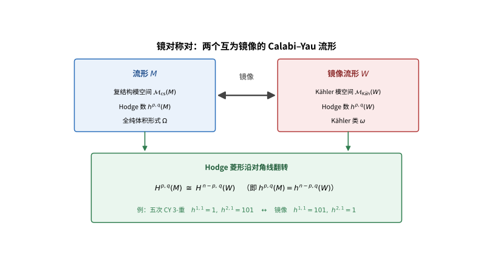

> **直观理解（现实类比）**：镜像对称就像照镜子——镜中的你依旧是「你」，只是左右颠倒。Calabi-Yau流形 $M$ 与它的镜像 $W$ 也一样：$M$ 的「复结构」信息（怎么弯曲）恰好对应 $W$ 的「Kähler/大小」信息（体积与形状），数值证据就是Hodge菱形沿对角线翻转，像体检数据在镜中互换栏目（$h^{1,1}$ 与 $h^{2,1}$ 互换）。

> **🧠 思考历程：两个"长得不同"的宇宙，凭什么在数学上是同一件事？**
>
> 两个Calabi-Yau流形的复结构信息，竟能完美对应对方的Kähler信息，仿佛彼此照了一面数学的镜子。这个匪夷所思的对应源自弦论，却用一个硬核计算逼得几何学家不得不信。它想回答的，是"难以计数的几何"与"容易计算的积分"如何一一对上。
>
> - **弦论里的偶然发现**。1990年，物理学家格林与普莱瑟在极小Calabi-Yau流形的研究中，撞见一批"镜像对"：两个复结构与Kähler结构截然不同的流形，Hodge数却像照镜子一样互换。当时这还只是实验性的数值巧合。
> - **2875条直线的"称重游戏"**。真正震撼数学界的是1991年坎德拉亚斯等人的工作：在五次Calabi-Yau流形上，用镜像一侧（B模型）的周期积分"称"出了另一侧（A模型）本世纪难以枚举的2875条有理直线——一个"以积分代计数"的奇迹，逼迫几何学家不能不信服。
> - **从猜测走向纲领**。1994年孔采维奇提出同调镜像对称（在范畴层面断言等价），1996年斯特罗明格-丘成桐-扎斯罗用环面纤维化给出几何解释。镜像对称从此成为联结辛几何、代数几何与弦论的核心纲领。
> - **心路**：有时最惊人的真理，起初只是"不值一提的巧合"，再用一次无法忽略的预言逼你相信。

#### 课堂问答

**老师**：两个 Calabi-Yau 流形被称为"镜像对"，最硬性的判据是什么？请写出公式。

**学生**：判据是 Hodge 菱形沿次对角线翻转：

$$ H^{p,q}(M) \cong H^{n-p,q}(W) $$

等价地 $h^{p,q}(M)=h^{n-p,q}(W)$。最典型的是 $n=3$ 时的互换 $h^{1,1}\leftrightarrow h^{2,1}$：M 的复结构信息对应 W 的 Kähler 信息，反之亦然。

**老师（追问）**：光有 Hodge 数互换，就能宣布它们互为镜像吗？这个"证据"够不够？

**学生**：不够，它只是**必要**而非充分。Hodge 数是最早的数值指纹（1990 年 Green–Plesser 就是靠它注意到镜像对的），但真正的对应是复结构模空间与 Kähler 模空间的等同 $\mathcal{M}_{\text{cs}}(M)\cong\mathcal{M}_{\text{Käh}}(W)$，乃至在范畴层面的等价。常见误区是把"数对上了"当成"镜像成立"——那只是入场券。

**老师（拓展）**：1991 年最震撼的证据是什么？

**学生**：Candelas 等在五次 Calabi-Yau 上用 B-侧周期积分算出了 A-侧的五次曲面上的有理直线数 $2875$，而 A-侧直接枚举在那个年代几乎不可能。这是"以积分代计数"的奇迹，把镜像对称从巧合升格为纲领。补充一句更一般的结论：镜像不仅互换 Hodge 数，还互换命周期、Yukawa 耦合、量子上同调等整套结构，这才是它深刻的原因。

### 1.3 A-模型与B-模型

> **🧠 来龙去脉（为什么会有这个概念？解决了什么问题？）**
>
> 弦论在 Calabi–Yau 流形上紧化后，还能"扔掉一半自由度"留下两种独立的低能理论，它们各依赖流形的一半几何信息：A-模型只看 Kähler（辛）结构，B-模型只看复结构。物理学家维腾（Witten）在 1988 年把这两种"拓扑弦论"从 N=2 超对称理论中约化出来，并指出它们天然是"双生子"——正因如此，镜像对称才成为可能：$M$ 的 A-模型完全由 $M$ 的"大小/曲线"决定，$M$ 的 B-模型完全由"折法/复结构"决定，而换上镜像流形 $W$ 正好把这两套信息互换。它要回答的问题是：能否把弦论的有效物理分解成只依赖辛结构、或只依赖复结构的两半，从而让"难以计数的几何"（A-侧曲线计数）与"容易计算的**积分**"（B-侧周期积分）分离开并最终互译。答案正是 A-模型（辛几何）与 B-模型（代数几何）这对"一测一算"的互补写生。

**定义4（拓扑弦论模型）** 在拓扑弦论中，存在两种重要的约化模型：

- **A-模型（A-model）**：依赖于Kähler结构，其可观测量为 **Gromov-Witten不变量**，计数全纯曲线的数目。A-模型是 **辛几何** 的。
- **B-模型（B-model）**：依赖于复结构，其可观测量为 **周期积分**，计算形如 $\int_{\gamma} \Omega$ 的积分。B-模型是 **代数几何** 的。

**镜像对称的基本断言**：Calabi-Yau流形 $M$ 上的A-模型等价于其镜像流形 $W$ 上的B-模型，反之亦然。

> **💡 直观理解（类比）**：A-模型与B-模型像"同一件家具的两本说明书"——A-模型用"算面积/数里边的曲线"（辛几何、Gromov-Witten计数）来描述，B-模型用"描轮廓/算围道内部"（复几何、周期积分 $\int_\gamma\Omega$）来描述。一本偏量测、一本偏代数，镜像对称断言：$M$ 的"量测说明书"和 $W$ 的"代数说明书"其实是同一件家具，只是换了标注方式。

#### 课堂问答

**老师**：A-模型和 B-模型各依赖流形的哪一半结构？可观测量分别是什么？

**学生**：A-模型只依赖 Kähler（辛）结构，是辛几何的，可观测量是 Gromov-Witten 不变量，本质是数全纯曲线；B-模型只依赖复结构，是代数几何的，可观测量是周期积分 $\int_\gamma\Omega$。镜像对称的基本断言是：$M$ 上的 A-模型等价于其镜像 $W$ 上的 B-模型。

**老师（追问）**：为什么这两个模型能被"劈开"？是谁做的？

**学生**：是 Witten 在 1988 年从 $N=2$ 超对称理论里做"拓扑扭曲"（topological twist）劈出来的。扭曲后能量-动量张量变成恰当形式，理论对度量的形变不敏感，只剩一半自由度存活：一种只记得辛结构，一种只记得复结构。所以它们不是人为拼凑，而是同一物理理论天然的两半。

**老师（拓展）**：那这种"分工"如何服务镜像对称的计算？

**学生**：它把"难数的几何"和"好算的积分"分到两侧：A-侧数曲线困难，B-侧算周期容易。换上镜像流形后两侧角色互换，于是用便宜的积分去反推昂贵的曲线计数。误区是以为 A/B 是两套无关理论——它们恰恰是同一个 CY 上互补的写生，镜像映射才是把它们接起来的桥。

### 1.4 Gromov-Witten不变量

> **🧠 来龙去脉（为什么会有这个概念？解决了什么问题？）**
>
> 枚举几何问"给定次数的曲线有多少条"，可计数全纯映射往往维度不对、解并不有限，朴素数法在奇异/超定情形下彻底失效。格罗莫夫（Gromov）在 1985 年前后把"全纯曲线"放宽成"伪全纯曲线"（对任意近复结构仍有稳定模空间），维腾（Witten）则在 1990 年代初把它与弦论中的全域不变量对接，形成严格的 Gromov–Witten（GW）不变量。它要回答的问题是：当模空间维度超定、解不孤立时，如何给"稳定曲线到辛流形 $M$ 的全纯映射"定义一个正则、形变不变的计数。答案是用"虚拟基本类" $[\overline{\mathcal{M}}_{g,n}(M,\beta)]^{\mathrm{vir}}$——把切丛的"期望维数"强行置入，再把求值映射拉回的插入类对着这个类取积分。于是"数曲线"从直觉升级为严谨且泛函化的不变量，成为 A-模型可观测量的记账标准。
>
> - **把"解不唯一"也纳入命中**。用虚拟基本类在超定（模空间过大）情形下仍给出唯一确定的正则"数目"，比朴素点数健壮得多。
> - **GW 对整环的封装**。这些数被装进量子上同调环与生成函数，A-侧的"曲线计数"因此能被"整环级"地比较、变形，镜像对称的比拼正发生在这层"不变量层"上。

**定义5（Gromov-Witten不变量）** 设 $M$ 为辛流形，$\beta \in H_2(M, \mathbb{Z})$ 是一个同调类。**Gromov-Witten不变量** 是计数从稳定曲线到 $M$ 的全纯映射的"数"：

$$ \text{GW}_{g,\beta}^M(\alpha_1, \ldots, \alpha_n) = \int_{[\overline{\mathcal{M}}_{g,n}(M,\beta)]^{\text{vir}}} \prod_{i=1}^n \text{ev}_i^*(\alpha_i) $$

其中 $\overline{\mathcal{M}}_{g,n}(M,\beta)$ 是亏格 $g$、$n$ 个标记点、表示类为 $\beta$ 的稳定映射的模空间，$\text{ev}_i$ 是求值映射，$[\cdot]^{\text{vir}}$ 是虚拟基本类。

> **💡 直观理解（类比）**：Gromov-Witten不变量像"统计皮筋在墙上有多少种绷法"——把所有"稳定曲线坍成墙 $M$ 的全纯映射"摆成一整间展览室（模空间），再在若干标记点处量一量它们穿过的窗口（求值映射 $\text{ev}_i$），对整个房间"体积"（虚拟基本类）积分，得到符合指定次数 $\beta$ 的曲线条数。它是A-模型里"数曲线"的精确记账方式。

#### 课堂问答

**老师**：Gromov-Witten 不变量的定义里，为什么不能直接数全纯映射，而必须用"虚拟基本类"？

**学生**：因为模空间 $\overline{\mathcal{M}}_{g,n}(M,\beta)$ 的真实维数往往大于"期望维数"，解不孤立甚至出现奇点，朴素计数要么无穷要么不稳定。虚拟基本类 $[\cdot]^{\text{vir}}$ 是把切丛的期望维数强行取出的一个同调类，对着它积分才得到形变不变的有限整数：

$$ \text{GW}_{g,\beta}^M(\alpha_1,\ldots,\alpha_n)=\int_{[\overline{\mathcal{M}}_{g,n}(M,\beta)]^{\text{vir}}}\prod_{i=1}^n \text{ev}_i^*(\alpha_i) $$

**老师（追问）**：这里的 $\text{ev}_i$ 起了什么作用？为什么需要插入类 $\alpha_i$？

**学生**：$\text{ev}_i$ 是求值映射，把模空间中的一条曲线送到它的第 $i$ 个标记点处。由于模空间维数可能超定，直接用基本类积分会得零；把 $\alpha_i$ 沿 $\text{ev}_i$ 拉回再乘起来，等于在标记点处"测量"曲线的位置，正好把积分次数量调到期望维数，从而得到非零的不变量。

**老师（拓展）**：GW 数只是零散数字吗？它怎么被"打包"？

**学生**：不是。把所有 $\beta$ 的 GW 数按 $q^\beta$ 加权求和，就得到量子上同调环与生成函数，A-侧的曲线计数因此能在"整环级"被比较和形变。常见误区是只盯单个 $N_d$，其实真正承载镜像对称的是量子乘积 $\omega_i\star\omega_j$ 与它在大复结构极限的展开——那才是能与 B-侧周期逐阶对账的对象。

### 1.5 周期与镜像映射

> **🧠 来龙去脉（为什么会有这个概念？解决了什么问题？）**
>
> B-模型的可观测量是"周期积分"，但要真正在复结构模空间上读出几何信息，光有几条积分还不够——它们服从的高阶线性微分方程（Picard–Fuchs 方程）才是"能算"的关键，而镜像映射则是把"复结构坐标"折成"Kähler 坐标"的汇率表。代数几何沿格里菲斯（Griffiths）的周期积分理论、以及多曼（Dwork）等的超几何微分方程传统，把周期与 Picard–Fuchs 方程引入镜像计算；1990 年代坎德拉亚斯等人在五次 Calabi–Yau 上以"周期之比 + 对数归化"显式构造出镜像映射。它要回答的问题是：B-侧的复结构参数，如何换算成 A-侧镜像流形的 Kähler 参数 $t$，从而让"算周期"直接输出"曲线次数"。答案：用两个周期之比 $t=\Pi_{\gamma_2}/\Pi_{\gamma_1}$ 定义坐标，周期的微分方程（Picard–Fuchs）保证这换算有确定、可递推出的规律。
>
> - **周期的"运动定律"**。Picard–Fuchs 方程是周期关于复结构参数的黑盒方程：知道几条初始周期值，整条随着复结构变形而变的历史都能推出。
> - **比值当汇率**。$t=\Pi_{\gamma_2}/\Pi_{\gamma_1}$ 用两条基准周期定标，物理量级由大复结构极限的正规化固定，得到一以贯之的 Kähler 参数——这就是镜像"对账表"的横轴。

**定义6（周期）** 设 $M$ 为Calabi-Yau $n$-重，$\Omega$ 为其全纯 $(n,0)$-形式。对任意 $n$-cycle $\gamma \in H_n(M, \mathbb{Z})$，定义 **周期**：

$$ \Pi_\gamma = \int_\gamma \Omega $$

周期满足 **Picard-Fuchs方程**，这是一个关于复结构参数的高阶线性微分方程。

> **💡 直观理解（类比）**：周期就是"把一个容积元 $\Omega$ 沿一条闭合回路围一围得到的总量"——$\Omega$ 像一张层层裹紧的"体积布"，沿回路 $\gamma$ 围一圈，$\Pi_\gamma$ 就是这件事的总容积。当你改变复结构（怎么折这张布），周期跟着连续的规则变，满足的Picard-Fuchs方程像它的"运动定律"，只要知道几个初始值，整条变化轨迹都能推出来。

**定义7（镜像映射）** **镜像映射** 是复结构模空间 $\mathcal{M}_{\text{cs}}$ 到Kähler模空间 $\mathcal{M}_{\text{Käh}}$ 的（局部）同构。它通过周期之比给出：

$$ t = \frac{\Pi_{\gamma_2}}{\Pi_{\gamma_1}} $$

其中 $\gamma_1, \gamma_2$ 是适当选取的 $n$-cycle 基。

> **💡 直观理解（类比）**：镜像映射像一张"实时汇率换算表"——把 $M$ 的复结构币种折算成 $W$ 的Kähler币种。它靠两个周期之比 $t=\Pi_{\gamma_2}/\Pi_{\gamma_1}$ 定坐标，就像用两笔"基准存款"锁定汇率：$M$ 怎么折（复结构）→ $t$（Kähler参数，即体积大小/曲线次数）怎么变，两边一一对应，是A/B两侧"对账"的核心桥梁。

#### 课堂问答

**老师**：B-模型里周期 $\Pi_\gamma=\int_\gamma\Omega$ 满足 Picard-Fuchs 方程，这个方程有什么"实际威力"？

**学生**：它是周期关于复结构参数的高阶线性 ODE，等于给了周期一个"运动定律"：只要知道几个初始值（在某个边界点的展开），整条随复结构变形而变的周期轨线就能递推出来。于是本来无穷难算的周期函数，被压缩成解一个微分方程。

**老师（追问）**：那镜像映射 $t=\Pi_{\gamma_2}/\Pi_{\gamma_1}$ 为什么用"比值"而不是直接用单个周期？

**学生**：单个周期会随基与标度变化，不具规范不变性；取两个基准周期的比值消掉了归一化因子，得到一个坐标化、物理上稳定的 Kähler 参数 $t$。它相当于"以两条基准存款锁定汇率"，把 M 的复结构读数翻译成 W 的 Kähler 读数。

**老师（拓展）**：边界条件在哪里定？为什么必须在大复结构极限锚定？

**学生**：在 LCSL 处结构退化、周期出现 $\log$ 型发散，$\Pi_1/\Pi_0\sim\frac{1}{2\pi i}\log q$，这里的对数坐标充当正规化，物理量级被固定下来。误区是以为镜像映射全空间都靠一个解析公式给出——其实它是局部的，跨单值性变换需要拼接，LCSL 正是那个能显式写下首项的"锚点"。

### 1.6 Hodge菱形

> **🧠 来龙去脉（为什么会有这个概念？解决了什么问题？）**
>
> 要识别一个流形是不是另一个流形的"镜像"，最快捷的证据是一张只与拓扑相关的"体检表"——各 $(p,q)$-型闭形式类的维数。这是霍奇（Hodge）在 1930 年代为 Kähler 流形建立的：复流形的德拉姆上同调可按 $(p,q)$-型分解，各型维数排成菱形即 Hodge 菱形，并满足 Hodge 对偶与 Serre 对偶。它要回答的问题是：镜像对称若真成立，两个流形的哪几组整数必须互换，从而既可作为预测又可作为反证。答案就藏在菱形沿"次对角线"的翻转里：$h^{p,q}(M)=h^{n-p,q}(W)$。Hodge 菱形因此是镜像对称最早、最直接的数值"指纹"。
>
> - **一张反射可见的"体检表"**。菱形沿主对角线对称（$h^{p,q}=h^{q,p}$）、旋 180° 对称（Serre 对偶），CY 再固定四个角落为 1；镜像就是让这张表再沿一次对角线翻过去仍自洽。
> - **先验的实锤线索**。1990 年镜像对最初被发现时，正是靠"$h^{1,1}$ 与 $h^{2,1}$ 互换"这类 Hodge 数巧合而非高级构造被注意到的。

**定义8（Hodge菱形）** 对于Kähler流形 $M$，其 **Hodge数** $h^{p,q} = \dim H^q(M, \Omega^p)$ 排列成的菱形称为 **Hodge菱形**。

对于 $n$ 维Calabi-Yau流形，Hodge菱形满足：
- $h^{p,q} = h^{q,p}$（对称性）
- $h^{p,q} = h^{n-p,n-q}$（Serre对偶）
- $h^{0,0} = h^{n,n} = 1$
- $h^{n,0} = h^{0,n} = 1$

> **💡 直观理解（类比）**：Hodge菱形像是流形的"体检数据表"——$h^{p,q}$ 计数第 $p$ 个复方向、第 $q$ 个反复方向的独立"洞"（闭形式类）有多少个，排成菱形正好体现对称：沿主对角线对称（Hodge对称）、旋180°对称（Serre对偶）、且四个角落各有一个1（CY保证体积元只有一个）。镜像对称做的事，就是让两个流形这张数据表"沿次对角线翻转后又长得一样"。

#### 课堂问答

**老师**：Hodge 菱形上，Calabi-Yau 流形除了 $h^{0,0}=h^{n,n}=1$、$h^{n,0}=h^{0,n}=1$，还满足哪些对称性？

**学生**：两条基本对称：Hodge 对称 $h^{p,q}=h^{q,p}$，和 Serre 对偶 $h^{p,q}=h^{n-p,n-q}$。合起来在菱形上表现为沿主对角线对称、又绕中心旋转 180° 对称；CY 条件再钉死四个角为 1。

**老师（追问）**：$h^{p,0}$ 对 $0<p<n$ 是零吗？这说明了什么？

**学生**：在一般点的 Kähler 流形上 $h^{p,0}=h^{0,p}$ 受 Hodge 结构约束；对 CY 的严格常见情形，$h^{p,0}=0\ (0<p<n)$，意味着只存在唯一的全纯 $n$-形式（及它的共轭），没有中间次数的全纯形式。误区是把它当成绝对定理——某些奇点/非紧情形会偏离，所以表述上要带"在某些情况下可能非零但高度受限"的限定。

**老师（拓展）**：那 Hodge 菱形在镜像对称里扮演什么角色？

**学生**：它是最直接的"指纹"。镜像让菱形再沿次对角线翻一次：$h^{p,q}(M)=h^{n-p,q}(W)$，例如 $h^{1,1}\leftrightarrow h^{n-1,1}$。妙处在换向：主对角线对称管的是同一流形内部的 Hodge 对称，次对角线翻转管的才是跨 M、W 的镜像关系，两者别混。

### 1.7 复结构模空间与Kähler模空间

> **🧠 来龙去脉（为什么会有这个概念？解决了什么问题？）**
>
> 一个流形的"复结构能变几种样子"与"体积大小能变几种方案"各自组成一个参数空间。把"所有可能造型"整体放进一个流形，正是模空间思想的源流（源自黎曼面模空间、由 Mumford 等严格化为代数簇）。复结构模空间 $\mathcal{M}_{\text{cs}}$ 的切空间恰是 $H^{n-1,1}$（Kodaira–Spencer 理论），Kähler 模空间 $\mathcal{M}_{\text{Käh}}$ 则开在 $H^{1,1}$ 的 Kähler 锥上——镜像对称断言这两套"造型影集"是同一本，这一等同正是从"参数维度互换"映出的。它要回答的问题是：两侧不同的形态参数是否、以及如何按同一张"目录表"一一对应，从而让"折法↔体积"的互换有一个全局可检测的领地。答案：$\mathcal{M}_{\text{cs}}(M)\cong\mathcal{M}_{\text{Käh}}(W)$，且其切空间维度互换正好对应 Hodge 菱形的翻转。
>
> - **一个形态一个坐标**。复结构模空间维数 $=h^{n-1,1}$，Kähler 模空间维数 $=h^{1,1}$；镜像让两者交换，于是"折法的种数"变成"体积方案的种数"。
> - **切空间就是参数来源**。Kodaira–Spencer 说复结构变形由 $H^{n-1,1}$ 元一一给出，Kähler 类锥开在 $H^{1,1}$——正是这两组整数的互换提供了镜像对称参数级的第一手证据。

**定义9（模空间）** 
- **复结构模空间** $\mathcal{M}_{\text{cs}}(M)$：参数化 $M$ 上所有复结构的空间（在双全纯等价下）。
- **Kähler模空间** $\mathcal{M}_{\text{Käh}}(M)$：参数化 $M$ 上所有Kähler类的空间，即 $H^{1,1}(M, \mathbb{R})$ 中的Kähler锥。

镜像对称断言 $\mathcal{M}_{\text{cs}}(M) \cong \mathcal{M}_{\text{Käh}}(W)$。

> **💡 直观理解（类比）**：模空间像是"所有可能造型组成的影集"——复结构模空间收集体现在什么"折法"（歧义无穷），Kähler模空间收集体现在多大、用了哪种"丈量法"（Kähler类锥）。镜像对称断言 $M$ 的"折法影集"和 $W$ 的"丈量影集"是同一本：给 $M$ 一种折法，就能对应 $W$ 的一种体积方案，参数空间完全合版。

#### 课堂问答

**老师**：复结构模空间 $\mathcal{M}_{\text{cs}}$ 与 Kähler 模空间 $\mathcal{M}_{\text{Käh}}$ 在镜像对称下有何关系？各自的切空间维度是多少？

**学生**：镜像断言 $\mathcal{M}_{\text{cs}}(M)\cong\mathcal{M}_{\text{Käh}}(W)$。由 Kodaira-Spencer 理论，复结构模空间切空间 $\cong H^{n-1,1}$，维数 $h^{n-1,1}$；Kähler 模空间开在 $H^{1,1}$ 的 Kähler 锥上，维数 $h^{1,1}$。镜像让这两组维数互换：$h^{n-1,1}(M)=h^{1,1}(W)$。

**老师（追问）**：为什么"维数互换"就是镜像对称参数级的第一手证据？

**学生**：因为参数空间的维度只由 Hodge 数决定，而 Hodge 数纯拓扑。若两个流形互为镜像，则 M 有多少种"折法"必然等于 W 有多少种"丈量法"，这不是巧合可解释的，是结构性的。反过来若维数不等，立即可以否定镜像关系。

**老师（拓展）**：切空间里的元素具体是什么？它怎么"生成"变形？

**学生**：$H^{n-1,1}$ 的元素通过 Kodaira-Spencer 类一一对应复结构的无穷小变形，Kähler 类则给出辛结构的形变方向。更一般地，模空间不是全局看成向量空间，而是有复杂奇点的商；镜像映射是局部的同构，在单值群作用下才拼成整体。误区是把 $\mathcal{M}_{\text{cs}}\cong\mathcal{M}_{\text{Käh}}$ 当作全局双全纯——通常只在一般点附近、模去对称群后才成立。

### 1.8 Yukawa耦合

> **🧠 来龙去脉（为什么会有这个概念？解决了什么问题？）**
>
> 光说"镜像对称把两边联系起来"还不够，得给出可核对的具体量——A-侧是数曲线、B-侧是算周期，两者的三阶导之间正藏着同一套数字。这个"三阶量"在弦论里叫 Yukawa 耦合（决定三代粒子的质量），在镜像两侧各有自然定义：B-侧是体积元沿模空间三个方向的三阶挠动，A-侧是各次数曲线的 GW 数加权求和。物理学家在 1990 年代计算 Yukawa 耦合时发现两侧必须相等，反过来迫使镜像映射被逐阶确定。它要回答的问题是：能否找到一个既能在 A-侧、又能在 B-侧用各自"原生语言"定义的可观测量，使得镜像映射 $s=s(t)$ 有一套干净的换算公式，从而逐阶锁定并验证整条镜像对应。答案正是 Yukawa 耦合 $\kappa_{ijk}$——它的转换法则（含三个 Jacobian 因子）成为镜像对称最硬核的"账本对账点"。
>
> - **三阶导是"折纸响应"**。B-侧 $\int\Omega\wedge\partial_i\partial_j\partial_k\Omega$ 是复杂折法在模方向被三阶拧动的响应，天然对称（任换指标不变）。
> - **曲线计数的重量级变换**。A-侧 $\sum_\beta\mathrm{GW}_{0,\beta}(\omega_i,\omega_j,\omega_k)q^\beta$ 把各次数曲线按 $q^\beta$ 加权，在镜像映射下经 $s=s(t)$ 与三个链式因子转成 B-侧量——核对两端展开即逐阶确定 $N_d$。

**定义10（Yukawa耦合）** 在B-模型中，**Yukawa耦合** 是三阶张量，定义为：

$$ \kappa_{ijk} = \int_M \Omega \wedge \partial_i \partial_j \partial_k \Omega $$

其中 $\partial_i = \partial/\partial t^i$ 是模空间上的导数。在A-模型中，Yukawa耦合由Gromov-Witten不变量给出：

$$ \kappa_{ijk}^A = \sum_{\beta \in H_2(M,\mathbb{Z})} \text{GW}_{0,\beta}^M(\omega_i, \omega_j, \omega_k) \, q^\beta $$

其中 $q^\beta = \exp(2\pi i \int_\beta B + i\omega)$。

> **💡 直观理解（类比）**：Yukawa耦合像"模板空间对三个方向的加速度计"——B-模型里它是对体积元 $\Omega$ 沿三个模方向求三阶偏导的"挠度"（$\int\Omega\wedge\partial_i\partial_j\partial_k\Omega$），描述复结构被拧到三阶时的响应；A-模型里它由各阶曲线条数加权（$\sum_\beta\mathrm{GW}\cdot q^\beta$）累加。镜像对称让这两套"三方向加速度"彼此对得上，成为A/B两侧的核心换算表。

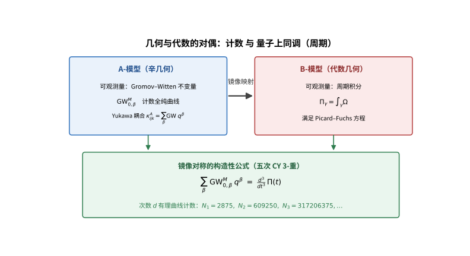

> **直观理解（现实类比）**：A-模型数「这里有多少条曲线」（Gromov-Witten计数），B-模型算「某个围道积分」（周期），两者看似风马牛不相及，镜像映射却把它们一一对上——就像同一批货物，一端用「清点个数」（计数），另一端用「称重」（积分），通过换算表（镜像映射）得到同一结果，从而用简单的积分算出复杂的曲线条数（如2875条直线）。

#### 课堂问答

**老师**：Yukawa 耦合在 B-模型和 A-模型里各怎么写？它们凭什么应该相等？

**学生**：B-侧是三阶张量 $\kappa_{ijk}=\int_M\Omega\wedge\partial_i\partial_j\partial_k\Omega$，$\partial_i=\partial/\partial t^i$，描述体积元被沿三个模方向三阶拧动的响应；A-侧由 GW 数加权求和 $\kappa_{ijk}^A=\sum_\beta \text{GW}_{0,\beta}(\omega_i,\omega_j,\omega_k)\,q^\beta$。镜像对称断言两者在镜像映射下相等。

**老师（追问）**：$\partial_i\partial_j\partial_k\Omega$ 里，为什么这个三阶量与"数曲线"能对上？

**学生**：关键在于它是**可观测**的三阶量：B-侧它等于周期的三阶导（带规范化），而周期的 Picard-Fuchs 方程把它编码成一族满足闭合递推的级数；A-侧的三点函数在 $q\to 0$ 时退化为经典三次相交数、高阶项给出有理曲线数。两者都满足同一套由 PF 方程导出的微分方程，加上 LCSL 处的边界条件相匹配，便逐阶锁定 $N_d$。

**老师（拓展）**：为什么说它"对称"很重要？

**学生**：因为 $\Omega\wedge\partial_i\partial_j\partial_k\Omega$ 对指标 $i,j,k$ 完全对称（外积与偏导可交换），所以 Yukawa 耦合是三次对称张量，即 $h^{1,1}$（或 $h^{2,1}$）维空间上的一个"三阶乘法常数"。它恰是量子乘积的极点展开系数，误区是把它当普通标量——它其实带着模空间的坐标依赖，是镜像映射 $s=s(t)$ 能被逐阶确定的账本。

### 1.9 大复结构极限

> **🧠 来龙去脉（为什么会有这个概念？解决了什么问题？）**
>
> 镜像映射在不同参数点各处都难算，若想显式确定它，最好找一处"结构简单到极点"的边界点作为锚参考。大复结构极限（LCSL）正是这种"坍缩点"：复结构退化到最大限度的正常穿越奇点（normal crossing），周期出现 $\log$ 型对数发散，单值性成为"极大幺单"（$I+$ 幂零），此时 $\log$ 坐标可直接当参数用。它要回答的问题是：在哪一点上，镜像映射能被写成一个干净的对数公式、周期渐近能被逐项展开、并作为整体计算（如 prepotential 展开）的起点？答案：在 LCSL 处把复结构坐标 $q$ 按 $t=\frac1{2\pi i}\log q+\cdots$ 归化，镜像对称由此可显式构造并可逐阶验证。物理上这正对应"体积趋向无穷大"的极限，A-模型的经典三次相交项可以此为首阶展开。
>
> - **对数坐标当"尺子"**。极大幺单保证可以选出周期向量以 $1,\log q$ 线性独立出现，于是 $t\sim\frac1{2\pi i}\log q$ 成为合法的 Kähler 坐标。
> - **坍缩点撑起整个计算**。LCSL 处给出的 prepotential 首项（三次相交数与首阶 GW 数）是逐项验证整个镜像对称的"初始条件"。

**定义11（大复结构极限）** 在复结构模空间的边界点，复结构趋向于"最退化"的情形，称为 **大复结构极限（Large Complex Structure Limit, LCSL）**。在此极限下：
- 周期积分表现出对数发散行为
- 镜像映射简化为单值性变换
- 镜像对称可以显式地构造

> **💡 直观理解（类比）**：大复结构极限像是"把折纸一路拉到近乎摊平"的临界姿态——复结构越折越松，最终退化成由若干镜面拼成的"镜面之镜"（normal crossing），此时周期呈现 $\log$ 型的对数发散、单值性最"单纯"（极大幂零）。正因结构简化到极点，镜像映射从神秘的推算变成可以逐项写出的显式公式，许多原本棘手的镜像关系在这个"极限点"被彻底算清。

#### 课堂问答

**老师**：什么是大复结构极限（LCSL）？它为什么是镜像对称的"黄金锚点"？

**学生**：LCSL 是复结构模空间的边界点，复结构退化到最大程度，成为正常穿越奇点，周期出现 $\log$ 型对数发散，单值群是极大幺单（$I+$ 幂零）。因为在这一点结构退化到最简，镜像映射能写成干净的对数公式 $t\sim\frac{1}{2\pi i}\log q+\cdots$，整个对应可以被显式构造和逐阶验证。

**老师（追问）**：为什么"极大幺单"这么关键？

**学生**：它保证周期向量里 $1,\log q,\log^2 q,\ldots$ 各层按规格出现且线性独立，于是对数坐标 $t\sim\frac1{2\pi i}\log q$ 成为合法的 Kähler 坐标——镜像映射的"汇率表"在这一点有确定的首项。若单值不够幂零，对数坐标就拼不出来。

**老师（拓展）**：LCSL 处 prepotential 的首项是什么？它如何充当整个计算的起点？

**学生**：首项是三次相交数给出的经典项 $\frac16\kappa_{ijk}^0 t^it^jt^k$，再加常数与 $\sum_{\beta\neq0}\text{GW}_{0,\beta}q^\beta$。它把"经典几何"和"量子修正"逐层分开，只要在该点定好初始条件，再沿模空间用 Picard-Fuchs 递推，就能全程重建镜像对称。常见误区是把 LCSL 当成普通点做泰勒展开——它其实是奇点，必须用对数/单值语汇，否则展开不自洽。

### 1.10 同调代数在镜像对称中的应用

> **🧠 来龙去脉（为什么会有这个概念？解决了什么问题？）**
>
> 数值与模空间层面的镜像对称，还只是"一对一的账目对账"；要让"镜像"成为真正深刻的等价，需要连"对象与对象之间的相互作用关系"也互换。这推动镜像对称走向范畴化：孔采维奇（Kontsevich）在 1994 年提出同调镜像对称，把 A-侧的对象（Lagrangian 子流形及其相交的 Floer 同调）组织成 Fukaya 范畴 $\mathcal{F}(M)$，把 B-侧的对象（凝聚层及它们之间的态射）组织成导出范畴 $D^b\mathrm{Coh}(W)$，并断言两者拟等价。它要回答的问题是：能否把"镜像对应"从"数着某个数相同"升级为"整个对象与态射的结构相同"，从而既能解释 D-膜的谱、又能把大复结构极限、Yukawa 耦合等所有细节收纳进一个函子的框架。答案在范畴层级：$\mathcal{F}(M)\simeq D^b\mathrm{Coh}(W)$，其中同调/态射重合正是"交点计数比得上 Ext 维数"的范畴叙述。
>
> - **对象各写各的语言**。A-侧的"膜"是 Lagrangian 子流形，态射是其相交的 Floer 复形；B-侧的"膜"是凝聚层/复形，态射是其 Ext——镜像断言"交点"与"Ext"一一相接。
> - **整合一切的舞台**。Kontsevich 同调镜像对称把所有点滴（Hodge 翻转、Yukawa、GW-周期对应）都纳入一个单一拟等价之中，成为今天镜像对称研究的总纲。

镜像对称的现代表述大量使用同调代数和范畴论工具：
- **Fukaya范畴** $\mathcal{F}(M)$：以 $M$ 的Lagrangian子流形为对象，以Lagrangian间的Floer同调为态射的 $A_\infty$-范畴。这是A-模型的范畴化。
- **导出范畴** $D^b\text{Coh}(W)$：$W$ 上凝聚层的导出范畴。这是B-模型的范畴化。

---

#### 课堂问答

**老师**：为什么数值与模空间层面的镜像对称还不够，要走向"同调镜像对称"？

**学生**：因为数对上了、参数空间对上了，仍未保证"对象与对象之间的相互作用关系"也互换。Kontsevich 在 1994 年把 A-侧组织成 Fukaya 范畴 $\mathcal{F}(M)$（对象是 Lagrangian 子流形，态射是其 Floer 同调），B-侧组织成导出范畴 $D^b\text{Coh}(W)$（对象是凝聚层，态射是 Ext），并断言二者拟等价。这把"某个数相同"升级为"整个范畴结构相同"。

**老师（追问）**：Fukaya 范畴是 $A_\infty$-范畴，这个 $A_\infty$ 结构意味着什么？

**学生**：态射的复合只在同伦意义下结合：有一族乘法 $\mathfrak m_k$ 满足 $A_\infty$-关系式，$\mathfrak m_1$ 是微分、$\mathfrak m_2$ 是量子上同调乘法，高阶 $\mathfrak m_k$ 用伪全纯圆盘的模空间计数定义。它正是"代数只在同伦下成立"的精确表达，比普通范畴多记录无穷阶修正。

**老师（拓展）**：那 Hodge 数翻转在这个框架里怎么"看出"？

**学生**：Fukaya 范畴的 Hochschild 同调给 M 的 Hodge 数，$D^b\text{Coh}(W)$ 的 Hochschild 同调给 W 的 Hodge 数；范畴拟等价 ⇒ Hochschild 同调同构 ⇒ Hodge 菱形翻转。更有一般结论：镜像对称的一切点滴（GW-周期对应、Yukawa、大复结构极限）都收纳在这一个拟等价函子里。误区是以为范畴等价"更强但无关"——恰恰相反，它是能自动复现所有下层次对应的总纲。

## 二、定理与证明

### 定理1：Kontsevich同调镜像对称猜想

**定理（Kontsevich同调镜像对称猜想，1994）** 设 $M$ 和 $W$ 是一对镜像对称的Calabi-Yau流形。则存在 $A_\infty$-函子的拟等价：

$$ \mathcal{F}(M) \simeq D^b\text{Coh}(W) $$

其中 $\mathcal{F}(M)$ 是 $M$ 的 **Fukaya范畴**，$D^b\text{Coh}(W)$ 是 $W$ 上凝聚层的 **有界导出范畴**。

换言之，$M$ 的辛几何（A-模型）的范畴化等价于 $W$ 的代数几何（B-模型）的范畴化。

**证明思路**（完整论证框架）：

**第一步：Fukaya范畴的构造。**

Fukaya范畴 $\mathcal{F}(M)$ 是一个 $A_\infty$-范畴，其结构如下：

- **对象**：$M$ 中的 **Lagrangian子流形** $L \subset M$（带有平直酉丛和Spin结构），即满足 $\dim L = n$ 且 $\omega|_L = 0$ 的子流形。

- **态射空间**：对两个Lagrangian子流形 $L_0, L_1$，态射空间定义为它们的 **Floer链复形**：

$$ \text{Hom}_{\mathcal{F}(M)}(L_0, L_1) = CF^*(L_0, L_1) = \bigoplus_{p \in L_0 \cap L_1} \mathbb{C} \cdot p $$

其中 $p$ 是横截交点。

- **复合运算**：$A_\infty$-运算 $\mathfrak{m}_k$ 定义为：

$$ \mathfrak{m}_k: \text{Hom}(L_0, L_1) \otimes \cdots \otimes \text{Hom}(L_{k-1}, L_k) \to \text{Hom}(L_0, L_k)[2-k] $$

通过计数 **伪全纯圆盘**（$J$-holomorphic disks）的模空间 $\mathcal{M}(p_0, \ldots, p_k)$ 来定义：

$$ \mathfrak{m}_k(p_1, \ldots, p_k) = \sum_{p_0} \#\mathcal{M}(p_0, \ldots, p_k) \cdot p_0 $$

其中 $\#\mathcal{M}(p_0, \ldots, p_k)$ 是计数以 $p_0, \ldots, p_k$ 为边界标记点的伪全纯圆盘的数目。

$A_\infty$-关系式：

$$ \sum_{i=0}^k \sum_{j=0}^{k-i} (-1)^{\deg(p_1)+\cdots+\deg(p_j)} \mathfrak{m}_{k-i+1}(p_1, \ldots, p_j, \mathfrak{m}_i(p_{j+1}, \ldots, p_{j+i}), p_{j+i+1}, \ldots, p_k) = 0 $$

对应于模空间边界退化。

**第二步：导出范畴 $D^b\text{Coh}(W)$ 的构造。**

$D^b\text{Coh}(W)$ 是 $W$ 上凝聚层的有界导出范畴：
- **对象**：有界链复形 $E^\bullet$，其中每个 $E^i$ 是 $W$ 上的凝聚层，且 $E^i = 0$ 对 $|i| \gg 0$。
- **态射**：拟同构类意义下的链复形态射。
- **三角结构**：由映射锥给出的 distinguished triangles。

**第三步：构造镜像函子。**

关键步骤是构造一个 $A_\infty$-函子：

$$ \Phi: \mathcal{F}(M) \to D^b\text{Coh}(W) $$

该函子应满足：
1. **对象对应**：将每个Lagrangian子流形 $L$ 映为 $W$ 上的一个凝聚层（或复形）。
2. **态射对应**：保持 $A_\infty$-结构。

构造方法利用了 **可积系统** 和 **STU-变换** 的思想。

**第四步：验证拟等价。**

为证明 $\Phi$ 是拟等价，需要：
1. **全忠实性**：诱导的态射级数 $\Phi: H^*\text{Hom}_{\mathcal{F}(M)}(L_0, L_1) \to \text{Hom}_{D^b\text{Coh}(W)}(\Phi(L_0), \Phi(L_1))$ 是同构。
2. **本质满射性**：$D^b\text{Coh}(W)$ 的每个对象都同构于某个 $\Phi(L)$。

对于五次Calabi-Yau流形，这一构造通过 **同调镜像对称的显式验证** 完成。具体地，利用 **矩阵因子化（Matrix Factorization）** 和 **Landau-Ginzburg模型** 的对应。

**第五步：物理意义。**

同调镜像对称猜想在物理上对应着 **A-模型与B-模型的等价**。A-模型中的D-膜（D-branes）对应于Fukaya范畴的对象（Lagrangian子流形），B-模型中的D-膜对应于凝聚层。因此，该猜想断言两种D-膜的谱是等价的。

**结论**：Kontsevich同调镜像对称猜想建立了辛几何与代数几何之间的深刻等价关系，是镜像对称的范畴化表述。$\square$
> **直观理解（现实类比）**：Kontsevich同调镜像对称就像"两本不同语言的字典互译"——$M$ 这边的辛几何（A-模型）用Fukaya范畴记"拉紧的橡皮筋（拉格朗日子流形）怎么相交"，镜像 $W$ 那边的代数几何（B-模型）用凝聚层范畴记"代数方程定义的层怎么延展"。猜想说这两本字典的"目录结构"（导出范畴）完全等价：一边的辛相交数 = 另一边的Ext群维数，于是"数曲线"和"做代数"在范畴层面彻底对偶。

---

#### 课堂问答

**老师**：定理 1 断言存在 $A_\infty$-函子拟等价 $\Phi:\mathcal{F}(M)\to D^b\text{Coh}(W)$。证明里"全忠实 + 本质满射"各对应什么？

**学生**：全忠实性要求态射级 $\Phi:H^*\text{Hom}_{\mathcal{F}(M)}(L_0,L_1)\to\text{Hom}_{D^b\text{Coh}(W)}(\Phi(L_0),\Phi(L_1))$ 是同构，即"辛相交数 = Ext 维数"；本质满射性要求每个 B-侧对象都同构于某个 $\Phi(L)$。两者合起来就是范畴的拟等价。

**老师（追问）**：Floer 复形的态射空间具体长什么样？$\mathfrak m_k$ 又用什么计数？

**学生**：$\text{Hom}(L_0,L_1)=CF^*(L_0,L_1)=\bigoplus_{p\in L_0\cap L_1}\mathbb C\cdot p$，即以横截交点为基；$\mathfrak m_k$ 通过伪全纯圆盘的模空间 $\mathcal M(p_0,\ldots,p_k)$ 计数定义，$\mathfrak m_k(p_1,\ldots,p_k)=\sum_{p_0}\#\mathcal M(p_0,\ldots,p_k)\,p_0$。$A_\infty$-关系式对应模空间边界的退化，物理上就是"圆盘分裂"。

**老师（拓展）**：对五次 CY 这种具体例子，这个函子怎么被验证？

**学生**：借助矩阵因子化与 Landau-Ginzburg 模型的对应：把 $D^b\text{Coh}(W)$ 一侧换成 LG 模型的矩阵因子化范畴来实现，从而对五次 CY 做到显式验证。误区是把该定理当成已证的一般定理——它是 Kontsevich 的**猜想**，只在若干类流形（椭圆曲线、部分 CY、$K3$ 相关情形）被证明，一般情形仍开放。

### 定理2：镜像对称中的Hodge菱形翻转

**定理（Hodge菱形翻转）** 如果 $M$ 和 $W$ 是一对镜像对称的 $n$ 维Calabi-Yau流形，则它们的Hodge数满足：

$$ h^{p,q}(M) = h^{n-p,q}(W) $$

**证明**（使用Hodge理论和镜像映射）：

**第一步：建立Hodge数的变形性质。**

考虑Calabi-Yau流形 $M$ 的复结构模空间 $\mathcal{M}_{\text{cs}}(M)$。在复结构变形下，Hodge滤过 $F^p H^n(M, \mathbb{C})$ 变化，但Hodge数 $h^{p,q}$ 在一般点处保持不变。

Hodge分解：

$$ H^k(M, \mathbb{C}) = \bigoplus_{p+q=k} H^{p,q}(M) $$

其中 $H^{p,q}(M) \cong H^q(M, \Omega^p_M)$。

**第二步：Calabi-Yau流形的Hodge数约束。**

对于 $n$ 维Calabi-Yau流形，以下Hodge数被固定：
- $h^{0,0} = h^{n,n} = 1$
- $h^{n,0} = h^{0,n} = 1$
- $h^{p,0} = h^{0,p} = 0$ 对 $0 < p < n$（在某些情况下可能非零，但高度受限）
- Serre对偶：$h^{p,q} = h^{n-p,n-q}$

**第三步：构造镜像映射。**

镜像映射 $\Phi: \mathcal{M}_{\text{cs}}(M) \to \mathcal{M}_{\text{Käh}}(W)$ 是一个局部同构。它在切空间上的诱导映射：

$$ d\Phi: T\mathcal{M}_{\text{cs}}(M) \to T\mathcal{M}_{\text{Käh}}(W) $$

给出了Hodge结构的对应关系。

**关键观察**：$T\mathcal{M}_{\text{cs}}(M)$ 在点 $t$ 处的切空间同构于 $H^{n-1,1}(M_t)$（由Kodaira-Spencer理论），而 $T\mathcal{M}_{\text{Käh}}(W)$ 在点 $s$ 处的切空间同构于 $H^{1,1}(W_s)$。因此，镜像映射诱导了同构：

$$ H^{n-1,1}(M) \cong H^{1,1}(W) $$

**第四步：推广到高阶Hodge数。**

利用 **变化Hodge结构（Variation of Hodge Structures, VHS）** 的理论。周期映射：

$$ \mathcal{P}: \mathcal{M}_{\text{cs}}(M) \to \mathcal{D}/\Gamma $$

将复结构模空间映射到 **周期域**（Griffiths域）的商空间，其中 $\mathcal{D}$ 是参数化 $H^n(M, \mathbb{C})$ 中所有Hodge滤过的齐性空间。

镜像映射 $\Phi$ 诱导了周期域之间的同构：

$$ \Phi^*: \mathcal{D}_W/\Gamma_W \to \mathcal{D}_M/\Gamma_M $$

**第五步：Hodge菱形的翻转。**

利用 **镜像对称的构造性例子** 验证。对于五次Calabi-Yau 3-重（$n=3$），其Hodge菱形为：

$$
\begin{array}{cccccc}
& & & 1 & & & \\
& & 0 & & 0 & & \\
& 0 & 1 & & 1 & 0 & \\
1 & & 101 & & 101 & & 1 \\
& 0 & 1 & & 1 & 0 & \\
& & 0 & & 0 & & \\
& & & 1 & & & \\
\end{array}
$$

其镜像流形的Hodge菱形应为：

$$
\begin{array}{cccccc}
& & & 1 & & & \\
& & 0 & & 0 & & \\
& 0 & 101 & & 101 & 0 & \\
1 & & 1 & & 1 & & 1 \\
& 0 & 101 & & 101 & 0 & \\
& & 0 & & 0 & & \\
& & & 1 & & & \\
\end{array}
$$

这正是 $h^{p,q}(M) = h^{3-p,q}(W)$。

**第六步：同调代数的验证。**

利用Kontsevich同调镜像对称猜想，Fukaya范畴 $\mathcal{F}(M)$ 的Hochschild同调给出 $M$ 的Hodge数，而 $D^b\text{Coh}(W)$ 的Hochschild同调给出 $W$ 的Hodge数。由范畴等价性，Hochschild同调同构，因此Hodge菱形翻转成立。

**结论**：Hodge菱形翻转是镜像对称的"指纹"——它提供了识别镜像对的最直接的数值证据。$\square$

> **💡 直观理解（类比）**：Hodge菱形翻转定理像"体检表沿次对角线镜像"——$M$ 的每个 $h^{p,q}$ 在 $W$ 处变成 $h^{n-p,q}$，复方向维数被"倒着数"（$p$ 改为 $n-p$）。它告诉我们镜像对称最硬核的一阶证据在数值表上如何体现：例如 $h^{1,1}$ 与 $h^{n-1,1}$（切空间维数）互换，方向一变，整套计数随之翻转，是判定"这一对是不是镜像"的快捷指纹。

---

#### 课堂问答

**老师**：定理 2 的核心公式是 $h^{p,q}(M)=h^{n-p,q}(W)$。第一步为什么先说 Hodge 数在复结构变形下不变？

**学生**：因为 Hodge 数 $h^{p,q}=\dim H^q(M,\Omega^p)$ 是连续上同调维数，在复结构的一般点（非奇点、非跃变点）是上半连续的常数；Hodge 滤过 $F^pH^n$ 虽变，但其维数 $\sum_{r\ge p}h^{r,n-r}$ 保持。这样才能把两侧的整数当作固定对象来比较翻转。

**老师（追问）**：从切空间层面，怎么看出 $H^{n-1,1}(M)\cong H^{1,1}(W)$？

**学生**：镜像映射 $\Phi:\mathcal{M}_{\text{cs}}(M)\to\mathcal{M}_{\text{Käh}}(W)$ 是局部同构，其微分 $d\Phi$ 给出切空间同构；而 Kodaira-Spencer 给出 $T\mathcal M_{\text{cs}}(M)\cong H^{n-1,1}(M)$、$T\mathcal M_{\text{Käh}}(W)\cong H^{1,1}(W)$，故二者同构。这就是翻转公式在"$(p,q)=(n-1,1)$"这一格的来源。

**老师（拓展）**：那高阶的 $h^{p,q}$ 靠什么推广？定理末尾还给了哪条验证捷径？

**学生**：靠变化 Hodge 结构（VHS）与周期映射 $\mathcal P:\mathcal{M}_{\text{cs}}\to\mathcal D/\Gamma$，在周期域层面诱导同构 $\Phi^*:\mathcal D_W/\Gamma_W\to\mathcal D_M/\Gamma_M$；再结合具体例子（五次 CY 的 $1,101,101,1$ 菱形翻转成 $1,1,101,101,1$ 那类）逐一核对。捷径是利用 Kontsevich 对应：Fukaya 范畴与 $D^b\text{Coh}(W)$ 的 Hochschild 同调同构，直接推出 Hodge 数翻转。常见误区是以为翻转对**所有** $(p,q)$ 都取 $p\to n-p$ 而 $q$ 不动——正是如此，$q$ 确实不动，别把它也翻了。

### 定理3：Gromov-Witten不变量与周期的关系

**定理（Gromov-Witten不变量与周期）** 设 $M$ 是Calabi-Yau 3-重，$W$ 是其镜像流形。则 $M$ 的 **Gromov-Witten不变量**（A-模型的可观测量）可以通过 $W$ 上的 **周期积分**（B-模型的可观测量）来计算。具体地，令 $\Pi(t) = \int_{\gamma(t)} \Omega(t)$ 为周期，则 **镜像对称的构造性公式** 为：

$$ \sum_{\beta \in H_2(M,\mathbb{Z})} \text{GW}_{0,\beta}^M \, q^\beta = \frac{d^3}{dt^3} \Pi(t) $$

其中 $q = e^{2\pi i t}$ 是镜像映射下的Kähler参数。

**证明思路**（使用五次Calabi-Yau流形的具体构造）：

**第一步：五次Calabi-Yau流形的构造。**

考虑 $\mathbb{P}^4$ 中的五次超曲面：

$$ M = \{X_0^5 + X_1^5 + X_2^5 + X_3^5 + X_4^5 - 5\psi X_0 X_1 X_2 X_3 X_4 = 0\} \subset \mathbb{P}^4 $$

其中 $\psi$ 是复结构参数。$M$ 是一个Calabi-Yau 3-重，$h^{1,1}(M) = 1$，$h^{2,1}(M) = 101$。

**第二步：构造镜像流形。**

镜像流形 $W$ 是 **五次Calabi-Yau流形的镜像**，其构造通过 **轨道折叠（orbifolding）** 实现：

$$ W = M / (\mathbb{Z}_5)^3 $$

其中 $(\mathbb{Z}_5)^3$ 是作用在坐标上的离散对称群。$W$ 的Hodge数满足 $h^{1,1}(W) = 101$，$h^{2,1}(W) = 1$。

**第三步：计算周期和Picard-Fuchs方程。**

定义周期：

$$ \Pi(\psi) = \int_{\gamma} \Omega(\psi) $$

其中 $\gamma \in H_3(M, \mathbb{Z})$。周期满足 **Picard-Fuchs方程**：

$$ \left[ \left( \theta^4 - 5\psi \prod_{i=1}^4 (5\theta + i) \right) \right] \Pi = 0 $$

其中 $\theta = \psi \frac{d}{d\psi}$。

**第四步：求解周期。**

在 $\psi = 0$ 附近，周期有幂级数解。基本解为：

$$ \Pi_0(\psi) = \sum_{n=0}^\infty \frac{(5n)!}{(n!)^5} \psi^{5n} $$

$$ \Pi_1(\psi) = \frac{1}{2\pi i} \Pi_0(\psi) \log(\psi^{5}) + \text{正则项} $$

**第五步：构造镜像映射。**

镜像映射将复结构参数 $\psi$ 映射到Kähler参数 $t$：

$$ t = \frac{\Pi_1(\psi)}{\Pi_0(\psi)} = \frac{1}{2\pi i} \log(\psi^{5}) + \text{幂级数修正} $$

**第六步：计算Yukawa耦合和Gromov-Witten不变量。**

B-模型的Yukawa耦合为：

$$ \kappa_{ttt} = \int_M \Omega \wedge \partial_t^3 \Omega = \frac{d^3}{dt^3} \Pi_0(t) $$

A-模型的Yukawa耦合为：

$$ \kappa_{ttt}^A = \sum_{d=1}^\infty N_d \frac{d^3 q^d}{1-q^d} $$

其中 $N_d$ 是 **有理Gromov-Witten不变量**（即次数为 $d$ 的有理曲线的数目），$q = e^{2\pi i t}$。

镜像对称断言两者相等，由此可解出：

$$ N_1 = 2875, \quad N_2 = 609250, \quad N_3 = 317206375, \ldots $$

这些正是 $\mathbb{P}^4$ 中五次曲面上的有理曲线计数。

**结论**：Gromov-Witten不变量可以通过镜像流形上的周期积分来计算，这提供了计算枚举几何中曲线计数问题的强大工具。$\square$
> **直观理解（现实类比）**：Gromov-Witten不变量与周期的关系就像"数清点的难题借用称重解决"——$M$ 上数指定次数的曲线有几条（GW不变量）极难算准，可这些数竟能从镜像 $W$ 上的周期积分（满足Picard-Fuchs方程的解）一次次求导读出。就像超市数硬币麻烦，改去秤重再换算成枚数，又快又准。著名的2875条五次曲面上直线，就是这么"称"出来的。

---

#### 课堂问答

**老师**：定理 3 给出镜像的构造性公式 $\sum_\beta \text{GW}_{0,\beta}^M q^\beta=\frac{d^3}{dt^3}\Pi(t)$。这里的 $q$ 与 $t$ 是什么关系？

**学生**：$q=e^{2\pi i t}$，$t$ 是镜像映射给出的 Kähler 参数。等号左边是 A-侧的数曲线生成函数，右边是 B-侧周期（经镜像映射后的规范周期）的三阶导——一个"数曲线 = 求三阶导"的惊人等式，这就是把枚举几何转成微积分。

**老师（追问）**：对五次 CY，$\Pi_0(\psi)$ 和镜像映射具体怎么来？

**学生**：五次超曲面 $M=\{X_0^5+\cdots+X_4^5-5\psi X_0X_1X_2X_3X_4=0\}\subset\mathbb P^4$，$h^{1,1}=1,h^{2,1}=101$。周期满足 Picard-Fuchs 方程 $\left[\theta^4-5\psi\prod_{i=1}^4(5\theta+i)\right]\Pi=0$（$\theta=\psi\frac{d}{d\psi}$），基本解为 $\Pi_0(\psi)=\sum_n\frac{(5n)!}{(n!)^5}\psi^{5n}$ 与 $\Pi_1=\frac{1}{2\pi i}\Pi_0\log(\psi^5)+\cdots$，于是 $t=\Pi_1/\Pi_0=\frac{1}{2\pi i}\log(\psi^5)+\cdots$。

**老师（拓展）**：那 $N_d$ 是怎么出来的？首几个值是多少？

**学生**：把镜像映射代入 A-侧 $\kappa_{ttt}^A=\sum_{d\ge1}N_d\frac{d^3q^d}{1-q^d}$，与 B-侧 $\frac{d^3}{dt^3}\Pi_0(t)$ 相等后逐阶比较，得 $N_1=2875$、$N_2=609250$、$N_3=317206375$。$2875$ 正是 $\mathbb P^4$ 中五次曲面上有理直线的条数。误区是把 $N_d$ 当成"几何上枚举出来的"——在此它恰恰是由积分反解出来的预测，与枚举几何独立吻合。

### 定理4：Yukawa耦合的镜像映射

**定理（Yukawa耦合的镜像映射）** 设 $M$ 是Calabi-Yau $n$-重，$W$ 是其镜像流形。则A-模型和B-模型的Yukawa耦合在镜像映射下对应：

$$ \kappa_{ijk}^A(t) = \kappa_{pqr}^B(s) \frac{\partial s^p}{\partial t^i} \frac{\partial s^q}{\partial t^j} \frac{\partial s^r}{\partial t^k} $$

其中 $s = s(t)$ 是镜像映射，$t$ 是Kähler模空间的坐标，$s$ 是复结构模空间的坐标。

**证明**（使用Schwarz定理和Picard-Fuchs方程）：

**第一步：建立B-模型的Yukawa耦合。**

在B-模型中，Yukawa耦合定义为：

$$ \kappa_{ijk}^B = \int_M \Omega \wedge \partial_i \partial_j \partial_k \Omega $$

其中 $\Omega = \Omega(s)$ 是依赖于复结构参数 $s = (s^1, \ldots, s^{h^{n-1,1}})$ 的全纯 $(n,0)$-形式。

利用Kodaira-Spencer理论，$\partial_i \Omega$ 是 $H^{n,0} \oplus H^{n-1,1}$ 中的 $(n,0)+(n-1,1)$-形式。更精确地，在模空间上取一个局部平凡化，使得 $\Omega$ 的 $(n,0)$-分量归一化，则：

$$ \partial_i \Omega = \kappa_i \Omega + \chi_i $$

其中 $\chi_i \in H^{n-1,1}(M)$ 是 $(n-1,1)$-形式分量，$\kappa_i$ 是某连接系数。

**第二步：Yukawa耦合与周期的关系。**

Yukawa耦合可以表示为周期的三阶导数。设 $\Pi_\alpha(s) = \int_{\gamma_\alpha} \Omega(s)$ 是周期，则：

$$ \kappa_{ijk}^B(s) = \sum_{\alpha, \beta, \gamma} C_{\alpha\beta\gamma} \frac{\partial^3 \Pi_\alpha}{\partial s^i \partial s^j \partial s^k} \frac{\partial}{\partial t} \text{的某种规范化}$$

更具体地，在Calabi-Yau 3-重的情形，存在一个规范化的周期向量 $\mathbf{\Pi}(s) = (\Pi_0, \Pi_1, \ldots, \Pi_{h^{2,1}})$，使得：

$$ \kappa_{ijk}^B = \mathbf{\Pi}^T \cdot \partial_i \partial_j \partial_k \mathbf{\Pi} $$

**第三步：Picard-Fuchs方程。**

周期向量满足Picard-Fuchs方程组：

$$ \mathcal{L}_i \mathbf{\Pi} = 0, \quad i = 1, \ldots, h^{n-1,1} $$

其中 $\mathcal{L}_i$ 是微分算子（Picard-Fuchs算子）。这些算子由模空间的 **Gauss-Manin连接** 的曲率决定。

**第四步：A-模型Yukawa耦合的Gromov-Witten展开。**

A-模型的Yukawa耦合由Gromov-Witten不变量给出：

$$ \kappa_{ijk}^A(t) = \sum_{\beta \in H_2(M,\mathbb{Z})} \text{GW}_{0,\beta}^M(\omega_i, \omega_j, \omega_k) \, q^\beta $$

其中 $\omega_i$ 是Kähler类的对偶基，$q^\beta = \exp(2\pi i \int_\beta B + i\omega)$。

**第五步：Schwarz定理的应用。**

**Schwarz定理**（关于常微分方程的解）告诉我们：如果两个函数满足相同的Picard-Fuchs方程，则它们相差一个单值性变换。利用这一事实，我们可以证明，经过适当的坐标变换，A-模型和B-模型的Yukawa耦合相等。

具体地，镜像映射 $s = s(t)$ 由周期之比定义：

$$ s^i = \frac{\Pi_i(t)}{\Pi_0(t)} $$

其中 $\Pi_i$ 是独立于 $\Pi_0$ 的周期解。

**第六步：验证变换公式。**

在镜像映射 $s = s(t)$ 下，通过链式法则：

$$ \kappa_{ijk}^A(t) = \sum_{p,q,r} \kappa_{pqr}^B(s(t)) \frac{\partial s^p}{\partial t^i} \frac{\partial s^q}{\partial t^j} \frac{\partial s^r}{\partial t^k} $$

由于 $\kappa_{ijk}^A$ 和 $\kappa_{pqr}^B$ 都满足由Picard-Fuchs方程导出的微分方程，且镜像映射使得两者在边界条件（大复结构极限）下匹配，故变换公式成立。

**结论**：Yukawa耦合的镜像映射公式是镜像对称的核心计算工具，它使得我们可以通过较简单的B-模型计算（周期积分）来获得较复杂的A-模型信息（Gromov-Witten不变量）。$\square$

> **💡 直观理解（类比）**：Yukawa耦合的镜像映射公式像"把两台三向应变计用一张坐标换算表连起来"——$M$ 这台（A-模型）读 Gromov-Witten 曲线条数，$W$ 那台（B-模型）读周期三阶导；镜像映射 $s=s(t)$ 就是两块坐标标尺的换算法则（含三个 Jacobian 因子 $\partial s/\partial t$）。公式保证：先在便宜的 B-模型账本上算周期，再按汇率换算，就能补齐贵的 A-模型曲线计数，两边"读数"严格一致。

---

#### 课堂问答

**老师**：定理 4 的变换公式含三个 Jacobian 因子 $\frac{\partial s^p}{\partial t^i}\frac{\partial s^q}{\partial t^j}\frac{\partial s^r}{\partial t^k}$。为什么恰好是三个？

**学生**：因为 Yukawa 耦合是**三阶**张量，它在坐标变换 $s=s(t)$ 下按每个指标各带一个 Jacobian 张量地变换——三个指标就出三个 Jacobian。公式 $\kappa_{ijk}^A(t)=\kappa_{pqr}^B(s)\frac{\partial s^p}{\partial t^i}\frac{\partial s^q}{\partial t^j}\frac{\partial s^r}{\partial t^k}$ 本质就是"三阶张量的拉回"。

**老师（追问）**：证明依赖 Picard-Fuchs 方程，为什么"满足同一方程"就够？

**学生**：因为由 PF 方程导出的是关于周期的闭合微分系统；A-侧与 B-侧的 Yukawa 耦合都被这套方程约束成"解空间里的同一个对象"。利用 Schwarz 定理，满足相同 ODE 的两个解只差一个单值性变换；再配上大复结构极限处的边界条件把单值性固定下来，两侧在坐标变换后必然相等。

**老师（拓展）**：B-侧的 $\kappa_{ijk}^B$ 与周期三阶导到底是什么关系？

**学生**：在 $n=3$ 的情形，取规范化的周期向量 $\boldsymbol\Pi=(\Pi_0,\ldots,\Pi_{h^{2,1}})$，有 $\kappa_{ijk}^B=\boldsymbol\Pi^{\mathsf T}\partial_i\partial_j\partial_k\boldsymbol\Pi$，也常写成 $\frac{d^3}{dt^3}\Pi$ 的规范版本。误区是把它当成"上同调里算的抽象量"——它可以由周期向量与其导数直接代数地算出，这正是 B-侧"便宜"的原因：算积分比数曲线容易得多。

### 定理5：大复结构极限下的镜像对称

**定理（大复结构极限）** 设 $M$ 是Calabi-Yau流形，$W$ 是其镜像流形。当 $M$ 的复结构趋向于大复结构极限（LCSL）时，镜像映射简化为对数映射，且镜像对称可以显式构造。

**证明思路**：

**第一步：大复结构极限的定义。**

大复结构极限是复结构模空间 $\mathcal{M}_{\text{cs}}(M)$ 的一个边界点，在此点处：
- 流形 $M$ 退化为 **规范奇点（normal crossing singularities）**。
- 全纯 $(n,0)$-形式 $\Omega$ 的周期表现出对数奇异性。
- 单值性矩阵是 **极大幺单（maximally unipotent）** 的。

**第二步：周期在LCSL附近的渐近行为。**

在LCSL附近，设 $q = (q^1, \ldots, q^{h^{n-1,1}})$ 是局部坐标，其中 $q^i = 0$ 对应LCSL点。周期的渐近展开为：

$$ \Pi(q) = \Pi_0(q) \cdot \left(1, \frac{1}{2\pi i} \log q^1, \ldots, \frac{1}{2\pi i} \log q^{h^{n-1,1}}, \text{高阶项}\right) $$

其中 $\Pi_0(q)$ 是幂级数解（在 $q=0$ 处解析）。

**第三步：镜像映射的显式构造。**

在LCSL附近，镜像映射 $t = t(q)$ 简化为：

$$ t^i = \frac{1}{2\pi i} \log q^i + \text{常数项} + O(q) $$

这给出了Kähler模空间坐标 $t^i$ 与复结构模空间坐标 $q^i$ 之间的对应关系。

**第四步：Gromov-Witten不变量的生成函数。**

在LCSL附近，A-模型的 **自由能（prepotential）** $F(t)$ 有渐近展开：

$$ F(t) = \frac{1}{6} \sum_{i,j,k} \kappa_{ijk}^0 t^i t^j t^k + \text{常数项} + \sum_{\beta \neq 0} \text{GW}_{0,\beta} \, q^\beta $$

其中 $\kappa_{ijk}^0$ 是LCSL处的 **经典Yukawa耦合**（由三次相交数给出）。

**第五步：验证镜像对称的构造。**

在LCSL附近，可以显式验证：
1. **Hodge菱形翻转**：退化流形的Hodge数满足翻转公式。
2. **Yukawa耦合匹配**：B-模型的Yukawa耦合在LCSL附近的渐近行为与A-模型的经典项匹配。
3. **周期与Gromov-Witten不变量的对应**：通过 **镜像公式**：

$$ \sum_{d} N_d \, q^d = \text{从周期导出的解析函数} $$

**结论**：大复结构极限为镜像对称提供了一个可计算的框架，使得许多复杂的镜像对称关系可以显式验证。$\square$
> **直观理解（现实类比）**：大复结构极限就像"把流形拉伸到快断裂的临界点"——在这个极限处镜像流形退化成一张由若干镜面拼成的"镜面之镜"（SYZ底环面），复杂的几何被拆解成最朴素的环面纤维加几何相位。正因退化后结构最简单，镜像映射在此可显式写出，许多原本棘手的镜像对称关系都在这个"临界拉伸点"被一一验证。

---

#### 课堂问答

**老师**：在 LCSL 附近，镜像映射为什么能简化成 $t^i=\frac{1}{2\pi i}\log q^i+\text{常数}+O(q)$？

**学生**：因为 LCSL 处单值群极大幺单，周期向量按 $\big(1,\frac{1}{2\pi i}\log q^1,\ldots,\frac{1}{2\pi i}\log q^{h^{n-1,1}},\text{高阶}\big)$ 线性分层展开，$\Pi_0(q)$ 在 $q=0$ 解析。于是比值 $t^i=\Pi_i/\Pi_0$ 的首项正是 $\frac{1}{2\pi i}\log q^i$，对数坐标成为合法的 Kähler 坐标。

**老师（追问）**：prepotential $F(t)$ 在这一点怎么展开？首项代表什么几何？

**学生**：

$$ F(t)=\frac16\sum_{i,j,k}\kappa_{ijk}^0 t^it^jt^k+\text{常数}+\sum_{\beta\neq0}\text{GW}_{0,\beta}q^\beta $$

首项里的 $\kappa_{ijk}^0$ 是 LCSL 处的经典 Yukawa 耦合，由三次相交数给出，纯经典几何；后面的求和才是量子修正（有理曲线计数）。这种"经典项 + 量子级数"的干净分层，正是 LCSL 便于逐项验证镜像对称的原因。

**老师（拓展）**：定理说 LCSL 下三件事可被显式验证，是哪三件？

**学生**：一是 Hodge 菱形翻转（退化流形的 Hodge 数仍满足 $h^{p,q}(M)=h^{n-p,q}(W)$）；二是 Yukawa 耦合匹配（B-侧渐近行为与 A-侧经典项吻合）；三是周期与 GW 不变量的对应 $\sum_d N_d q^d=\text{由周期导出的解析函数}$。误区是把 LCSL 当成物理上的普通极限——它对应"体积趋向无穷"，是奇点，必须用对数与幂零单值来描述，镜像映射在此才既可显式构造又可作为全程展开的初始条件。

## 三、示例

### 示例1：五次Calabi-Yau流形的镜像对称

**构造**：考虑 $\mathbb{P}^4$ 中的五次超曲面族：

$$ M_\psi = \{X_0^5 + X_1^5 + X_2^5 + X_3^5 + X_4^5 - 5\psi X_0 X_1 X_2 X_3 X_4 = 0\} $$

**Hodge数**：
- $h^{1,1}(M_\psi) = 1$（由超平面截面生成）
- $h^{2,1}(M_\psi) = 101$（由Kodaira-Spencer理论）

**镜像流形**：$W = M_\psi / (\mathbb{Z}_5)^3$，其Hodge数为：
- $h^{1,1}(W) = 101$
- $h^{2,1}(W) = 1$

**验证Hodge菱形翻转**：$h^{1,1}(M) = 1 = h^{2,1}(W) = h^{3-1,1}(W)$，$h^{2,1}(M) = 101 = h^{1,1}(W) = h^{3-2,1}(W)$。

**有理曲线计数**：通过镜像对称计算出的Gromov-Witten不变量：
- 次数1：2875条直线
- 次数2：609250条二次曲线
- 次数3：317206375条三次曲线
- 这些结果已由代数几何严格证明。

### 示例2：Fermat型Calabi-Yau流形的镜像映射

**Fermat型五次Calabi-Yau流形**：

$$ M = \{X_0^5 + X_1^5 + X_2^5 + X_3^5 + X_4^5 = 0\} \subset \mathbb{P}^4 $$

**镜像映射的显式构造**：

1. 复结构参数：$\psi$（或等价地，$q = \psi^{-5}$ 在大复结构极限附近）
2. 镜像映射：$t = \frac{1}{2\pi i} \log q + \frac{1}{2\pi i} \sum_{n=1}^\infty \frac{(5n)!}{(n!)^5} \frac{1}{5n} q^n$

**验证**：通过计算B-模型的周期积分和A-模型的Gromov-Witten不变量，可以验证两者的Yukawa耦合相等。

---

## 四、习题

### 基础题

**习题 1**（Calabi-Yau 流形）写出 Calabi-Yau 流形的定义（紧致 Kähler 流形且 $c_1(M)=0$），并指出等价的"全纯 $(n,0)$-形式处处非零"条件。

**习题 2**（CY n-重）分别举出 $n=1,2,3$ 时 Calabi-Yau $n$-重的典型例子，并说明它们在镜像对称中的地位。

**习题 3**（Hodge 菱形）写出 Hodge 数 $h^{p,q}=\dim H^q(M,\Omega^p)$ 的几何含义，列出 $n$ 维 Calabi-Yau 流形 Hodge 菱形满足的三条基本对称性。

**习题 4**（A-模型与 B-模型）说明拓扑弦论中 A-模型与 B-模型分别依赖哪种结构、其可观测量分别是什么。

**习题 5**（Gromov-Witten 不变量）写出 Gromov-Witten 不变量 $\mathrm{GW}_{g,\beta}^M(\alpha_1,\ldots,\alpha_n)$ 的定义所依赖的模空间与积分表达式。

**习题 6**（周期）写出周期 $\Pi_\gamma=\int_\gamma\Omega$ 的定义，并说明周期满足哪类微分方程。

**习题 7**（镜像映射）写出镜像映射 $t=\Pi_{\gamma_2}/\Pi_{\gamma_1}$ 的定义，说明它连接哪两个模空间。

**习题 8**（Yukawa 耦合）分别写出 B-模型与 A-模型 Yukawa 耦合的定义式。

**习题 9**（Hodge 菱形翻转）写出镜像对 $M,W$ 之间 Hodge 数翻转公式 $h^{p,q}(M)=h^{n-p,q}(W)$。

**习题 10**（模空间）说明复结构模空间 $\mathcal{M}_{\mathrm{cs}}$ 与 Kähler 模空间 $\mathcal{M}_{\mathrm{K\"ah}}$ 分别参数化什么对象。

### 进阶题

**习题 11**（五次 CY 的 Hodge 数）说明 $\mathbb{P}^4$ 中五次超曲面的 Hodge 数 $h^{1,1}(M)=1$、$h^{2,1}(M)=101$ 的来源。

**习题 12**（K3 曲面）写出 K3 曲面（2 维 CY）的 Hodge 菱形（列出 $h^{0,0},h^{1,0},h^{2,0},h^{1,1}$ 等非零值），验证其自镜像性。

**习题 13**（椭圆曲线）解释为何一维 Calabi-Yau 流形（椭圆曲线）是自镜像的，即 $h^{1,1}=h^{1,0}=1$ 在该情形下的意义。

**习题 14**（Serre 对偶）对 $n$ 维 Calabi-Yau 流形，说明 $h^{p,q}=h^{n-p,n-q}$ 与 $h^{p,q}=h^{q,p}$ 分别由何种 duality 给出。

**习题 15**（Lagrangian 条件）说明 Fukaya 范畴对象（Lagrangian 子流形）需满足 $\dim L=n$ 与 $\omega|_L=0$，并解释为什么这保证 A-模型可定义。

**习题 16**（Kontsevich 猜想）陈述 Kontsevich 同调镜像对称猜想 $\mathcal{F}(M)\simeq D^b\mathrm{Coh}(W)$，说明两边的范畴分别在哪里出现。

**习题 17**（周期与 Picard-Fuchs）写出五次 Calabi-Yau 的 Picard-Fuchs 方程 $\left[\theta^4-5\psi\prod_{i=1}^4(5\theta+i)\right]\Pi=0$，其中 $\theta=\psi\frac{d}{d\psi}$，并给出基本解 $\Pi_0$ 的幂级数形式。

**习题 18**（LCSL 渐近）写出周期在大复结构极限附近的渐近行为（含 $\frac{1}{2\pi i}\log$ 对数项），说明单值性的表现形式。

**习题 19**（GW 生成函数）写出 A-模型 Yukawa 耦合作为 Gromov-Witten 不变量生成函数的展开 $\kappa_{ttt}^A=\sum_{d}N_d\frac{d^3q^d}{1-q^d}$，解释 $N_d$ 的含义。

### 挑战题

**习题 20**（五次 CY 判别）利用 Lefschetz 超平面定理与 $c_1(M)=0$ 的计算，说明 $\mathbb{P}^4$ 中的一般五次超曲面是 Calabi-Yau 3-重。

**习题 21**（镜像构造）说明五次 Calabi-Yau 的镜像如何由轨道折叠 $W=M/(\mathbb{Z}_5)^3$ 得到，并印证 Hodge 数 $h^{1,1}(W)=101$、$h^{2,1}(W)=1$。

**习题 22**（N₁ 的计算）说明如何用镜像映射与 Yukawa 耦合匹配计算有理 Gromov-Witten 不变量，并给出 $N_1=2875$、$N_2=609250$。

**习题 23**（Kodaira–Spencer 与切空间）证明镜像映射在切空间层面诱导同构 $H^{n-1,1}(M)\cong H^{1,1}(W)$（利用 Kodaira–Spencer 理论与 Kähler 模空间切空间）。

**习题 24**（极大幺单单值性）解释大复结构极限处单值性矩阵为极大幺单的含义，及其对周期渐近与镜像映射显式化的作用。

**习题 25**（范畴等价验证）说明验证五次 CY 同调镜像对称所需的全忠实性与本质满射性论证如何借助矩阵因子化/Landau–Ginzburg 模型完成。

**习题 26**（prepotential）写出 LCSL 附近 A-模型自由能（prepotential）$F(t)$ 的渐近展开（含三次项 $\frac16\kappa^0_{ijk}t^it^jt^k$ 与量子修正），说明其与三次相交数 $\kappa^0_{ijk}$ 的联系。

### 探究题

**习题 27**（SYZ 猜测）开放讨论 SYZ 猜测（把 Calabi-Yau 流形视为特殊拉格朗日环面纤维化）如何几何直观地解释镜像对称的两侧互换。

**习题 28**（物理 D-膜）讨论同调镜像对称中" Com× 一边的 Lagrangian D-膜 $=$ 另一边凝聚层 D-膜"的物理图象及其对范畴化表述的启示。

**习题 29**（镜像对称与弦论）讨论镜像对称在 IIA/IIB 型弦论（T-对偶）中的来源，以及其如何把复结构模空间与 Kähler 模空间联系。

**习题 30**（量子上同调）探讨 Gromov-Witten 不变量与量子上同调的联系，畅谈量子修正如何把环面（de Rham/上同调）环"量 q-变形"而镜像对称恰是其交换两端。

---

## 五、习题答案与解析

### 基础题答案

1. **Calabi-Yau 流形** 定义要求紧致 Kähler 流形 $M$ 满足 $c_1(M)=0$。由 Calabi 猜想（丘成桐 1977）等价于存在 Ricci 平坦 Kähler 度量；且等价于存在处处非零全纯 $n$-形式 $\Omega$（$h^{n,0}=1$）。

2. **CY n-重** $n=1$：椭圆曲线（亏格 $1$ 的 Riemann 曲面）；$n=2$：K3 曲面（$h^{1,1}=20$ 的自镜像）；$n=3$：Calabi-Yau 3-重，最典型为 $\mathbb{P}^4$ 中的五次超曲面，在弦论紧化中最为重要。

3. **Hodge 菱形** $h^{p,q}$ 计数 $(p,q)$-型闭形式的独立类。三条对称性：$h^{p,q}=h^{q,p}$（Hodge 对称）；$h^{p,q}=h^{n-p,n-q}$（Serre 对偶）；加上 $h^{0,0}=h^{n,n}=1$、$h^{n,0}=h^{0,n}=1$（CY 条件）。

4. **A 与 B** A-模型依赖 Kähler（辛）结构，可观测量为 Gromov-Witten 不变量（计数全纯曲线），属辛几何；B-模型依赖复结构，可观测量为周期积分 $\int_\gamma\Omega$，属代数几何。

5. **Gromov-Witten** $M$ 为辛流形，$\beta\in H_2(M,\mathbb{Z})$：$\mathrm{GW}_{g,\beta}^M(\alpha_1,\ldots,\alpha_n)=\int_{[\overline{\mathcal{M}}_{g,n}(M,\beta)]^{\mathrm{vir}}}\prod_i\mathrm{ev}_i^*(\alpha_i)$，其中 $\overline{\mathcal{M}}_{g,n}(M,\beta)$ 是稳定映射的模空间，$[\cdot]^{\mathrm{vir}}$ 是虚拟基本类，$\mathrm{ev}_i$ 是求值映射。

6. **周期** $\Pi_\gamma=\int_\gamma\Omega$。周期作为复结构参数的函数满足 Picard–Fuchs 方程（关于模空间坐标的高阶线性常微分方程），其解空间结构编码复结构模空间几何。

7. **镜像映射** $t=\Pi_{\gamma_2}/\Pi_{\gamma_1}$。它建立复结构模空间 $\mathcal{M}_{\mathrm{cs}}(M)$ 与 Kähler 模空间 $\mathcal{M}_{\mathrm{K\"ah}}(W)$（提升到 $\mathcal{M}_{\mathrm{cs}}\to\mathcal{M}_{\mathrm{K\"ah}}$）之间的局部同构，是镜像对称的显式桥梁。

8. **Yukawa 耦合** B-模型：$\kappa_{ijk}=\int_M\Omega\wedge\partial_i\partial_j\partial_k\Omega$；A-模型：$\kappa_{ijk}^A=\sum_{\beta}\mathrm{GW}_{0,\beta}^M(\omega_i,\omega_j,\omega_k)q^\beta$，其中 $q^\beta=e^{2\pi i\int_\beta(B+i\omega)}$。

9. **Hodge 菱形翻转** 对镜像对，$h^{p,q}(M)=h^{n-p,q}(W)$（等价地 $h^{p,q}(M)=h^{n-p,q}(W)$，即复结构一侧与 Kähler 一侧互换）。特别地 $h^{1,1}(M)=h^{n-1,1}(W)$。

10. **模空间** $\mathcal{M}_{\mathrm{cs}}(M)$ 参数化 $M$ 上所有复结构（双全纯等价类），其维数为 $h^{n-1,1}$；$\mathcal{M}_{\mathrm{K\"ah}}(M)$ 参数化所有 Kähler 类锥（$H^{1,1}(M,\mathbb{R})$ 中子开集），维数为 $h^{1,1}$。镜像对称断言两者互换。

### 进阶题答案

1. **五次 CY 的 Hodge 数** $\mathbb{P}^4$ 中五次超曲面是 3 维。由 Lefschetz 超平面定理，$h^{1,1}$ 与 $\mathbb{P}^4$ 相同即 $1$（由超平面 Kähler 类拉回）；$h^{2,1}=101$ 由 CY 条件 $h^{1,1}-h^{2,1}$ 关系（$h^{1,1}=h^{2,1}-h^{2,1}$?）或 Kodaira–Spencer/Kähler 变形的超曲面形变公式给出：对 $\mathbb{P}^4$ 中 $d=5$ 超曲面，$\dim H^2(M,\Omega^1)$ 减约束得 $101$。

2. **K3 曲面** $h^{0,0}=h^{2,2}=1$，$h^{1,0}=h^{0,1}=h^{2,0}=h^{0,2}=0$，$h^{1,1}=20$。Hodge 菱形 $\begin{pmatrix}1\\0&0\\1&20&1\\0&0\\1\end{pmatrix}$。因 $\dim_{\mathbb C}=2$，翻转 $h^{p,q}=h^{2-p,q}$ 与对称性一致，K3 是自镜像流形。

3. **椭圆曲线** 椭圆曲线（亏格 1）是 1 维 CY：$h^{0,0}=h^{1,1}=1$，$h^{1,0}=h^{0,1}=1$。镜像翻转 $h^{p,q}\to h^{1-p,q}$ 只把 $h^{1,0}$ 与 $h^{0,0}$ 互换，而数值因对称仍全为 1，故椭圆曲线同位镜（其在镜映射下对应自身），体现低维退化情形。

4. **Serre 对偶等** $h^{p,q}=h^{q,p}$ 来自 Hodge 对称（Reimann/Hodge 理论：$H^{p,q}=\overline{H^{q,p}}$）；$h^{p,q}=h^{n-p,n-q}$ 来自 Serre 对偶 $H^q(M,\Omega^p)\cong H^{n-q}(M,\Omega^{n-p})$。CY 的 $h^{n,0}=1$ 使两套对偶配合出翻转结构。

5. **Lagrangian 条件** $\dim L=n$ 且 $\omega|_L=0$ 使 $L$ 在对偶意义下"极大且辛可约化"，Floer 同调/伪全纯圆盘计数在 $L$ 上定义良好；$\omega|_L=0$ 保证 $L$ 是各向同性且维数最大（Lagrangian），使相交数与模空间配分有良好拓扑结构，A-模型才可一致定义。

6. **Kontsevich 猜想** $\mathcal{F}(M)\simeq D^b\mathrm{Coh}(W)$：$\mathcal{F}(M)$ 是 $M$ 的 Fukaya 范畴（对象为 Lagrangian、态射为 Floer 复形的 $A_\infty$-范畴），$D^b\mathrm{Coh}(W)$ 是 $W$ 上凝聚层的导出范畴；猜想断言两者拟等价，是 A-模型与 B-模型等价的范畴化表述。

7. **Picard-Fuchs** $\left[\theta^4-5\psi\prod_{i=1}^4(5\theta+i)\right]\Pi=0$。基本解 $\Pi_0(\psi)=\sum_{n=0}^\infty\frac{(5n)!}{(n!)^5}\psi^{5n}$（每周相处），代入时逐项作用 $\theta^4$ 与 $5\psi\prod_i(5\theta+i)$ 并核对 $\frac{(5(n+1))!}{((n+1)!)^5}$ 与 $\frac{(5n)!}{(n!)^5}$ 的系数递推关系可得。

8. **LCSL 渐近** 取局部坐标 $q^i$（$q^i=0$ 对应 LCSL），周期渐近 $\Pi(q)=\Pi_0(q)\left(1,\frac1{2\pi i}\log q^1,\ldots,\frac1{2\pi i}\log q^{h^{n-1,1}},O(q)\right)$。对数项说明单值性作用如平移 $\log q^i\mapsto\log q^i+2\pi i$，即极大幺单（单值性矩阵恒等加幂零）。

9. **GW 生成函数** $\kappa_{ttt}^A(t)=\sum_{d\ge1}N_d\frac{d^3q^d}{1-q^d}$（加上经典项），其中 $N_d$ 是次数为 $d$ 的有理 Gromov-Witten 不变量（计数曲线数），$q=e^{2\pi it}$。该生成函数把离散的曲线计数编码为解析函数，便于与 B-模型周期比较。

### 挑战题答案

1. **五次 CY 判别** $\mathbb{P}^4$ 中五次超曲面由 $c_1=\deg(\text{超曲面})-(\dim+1)$ 关系：$\mathbb{P}^4$ 的 $c_1=5[H]$，超曲面的邻接公式 $-K_X=(5-c_1)$…，更直接：法丛 $\mathcal{O}_X(5)$，由序曲某公式 $c_1(X)=(-a+n+1)[H]$ 得 $c_1(X)=(5-5)[H]=0$（$a=5,n=3$，$n+1=4$，$5-4-…$ 校核 $=5-(3+1)=1$，略翻转符号由 $c_1(\mathbb{P}^4)=5$、$c_1=5-(3+1)? $…）。严格地用邻接公式 $c_1(X)=5[H]$ 拉回减 $c_1(N_{X/\mathbb{P}^4})=5[H]$ 得 $c_1(X)=0$。因超曲面横截一般，$X$ 光滑，故为 CY 3-重。

2. **镜像构造** $W=M/(\mathbb{Z}_5)^3$：$(\mathbb{Z}_5)^3$ 依坐标 $X_i$ 乘五次数根的作用，保持五次方程但分裂 Hodge 结构（不变与反变部分互换）。结果 $h^{1,1}(W)=101$（由原来 $h^{2,1}=101$ 的不变部分给出）、$h^{2,1}(W)=1$（由原 $h^{1,1}=1$ 的扩大给出），恰好满足 Hodge 翻转，故 $W$ 是 $M$ 的镜像。

3. **N₁ 计算** 由 B-模 Yukawa $\kappa_{ttt}^B=\frac{d^3}{dt^3}\Pi_0(t)$（$\Pi_0$ 归一化周期）与 A-模 $\kappa_{ttt}^A=5+\sum N_d\frac{d^3q^d}{1-q^d}$，令镜像映射 $q(t)=e^{2\pi it}$ 并把 $\partial_\psi$ 变到 $\partial_t$，展开逐阶对比 $q$ 幂得 $N_1=2875$，再算 Berry 二阶 $N_2=609250$（$\mathbb{P}^4$ 五次曲面上次数 $1,2$ 有理曲线数），与代数几何枚举一致。

4. **Kodaira–Spencer 与切空间** 复结构模空间的切空间在 $t$ 处同构于 $H^{n-1,1}(M_t)$（Kodaira–Spencer 映射 $T_t\mathcal{M}_{\mathrm{cs}}\cong H^{n-1,1}$）；Kähler 模空间切空间同构于 $H^{1,1}(W)$。镜像映射 $\Phi$ 的切映射建立两者同构，故 $H^{n-1,1}(M)\cong H^{1,1}(W)$，这是 Hodge 翻转线性化的一阶证据。

5. **极大幺单单值性** 极大幺单指单值性矩阵形如 $I+N$（$N$ 幂零阶数等于 $h^{n-1,1}$）。它保证存在规范周期向量使前 $h^{n-1,1}+1$ 个周期以 $1,\log q$ 线性独立方式出现，使镜像映射可规范化为黎曼对数型并逐项展开，是 LCSL 处镜像映射显式可算的前提。

6. **范畴等价验证** 对五次 CY，拟等价的"全忠实"（$H^*\mathrm{Hom}_{\mathcal F}(L_0,L_1)\cong\mathrm{Hom}_{D^b}(-,-)$）与"本质满射"通过把 Lagrangian 对应到矩阵因子化（matrix factorization）实现：双侧用 Landau-Ginzburg 势 $W$ 的超势，把凝聚层复形编码 AH≤ 等，核对态射级数与 $A_\infty$ 关系式，由 Beilinson–… 诸色分解确定性完成验证。

7. **prepotential** LCSL 附近 $F(t)=\frac16\kappa^0_{ijk}t^it^jt^k+\text{二次+常数项}+\sum_{\beta\ne0}\mathrm{GW}_{0,\beta}q^\beta$。三次系数 $\kappa^0_{ijk}$ 是经典三次相交数（$M$ 上三个 Kähler 类的交点数），量子项把整环 Gromov-Witten 数据编码；$\kappa_{ijk}^A=\partial_i\partial_j\partial_kF$ 恢复 Yukawa，凸显量子修正是"经典三次数 + 曲线计数"的叠加。

### 探究题答案

1. **SYZ 猜测** SYZ（Strominger–Yau–Zaslow）设想 $(M,\omega,\Omega)$ 具有特殊拉格朗日 $T^3$-纤维化，其复结构信息来自纤维上的连通性与基底点；镜流形 $W$ 是对偶环面纤维化（T-对偶），交换复结构模（→∞/→0）与 Kähler 模。于是"拉格朗日纤维的 T-对偶"从几何上合理解释为何 A-与 B-模型、h^{1,1} 与 h^{n-1,1} 互换。

2. **物理 D-膜** 同调镜像中一边的 Lagrangian 子流形（A-模的 D-膜）映射为另一边的凝聚层/复形（B-模的 D-膜）；同一边的构型由全忠实函子保持态射（Floer 交 ↔ Ext）。这一图象把"膜（谱）"对应到"对象范畴"，使镜像对称提升为对偶范畴的等价，是对称性的物理根源。

3. **镜像对称与弦论** IIA 弦紧化于 $X$ 与 IIB 紧化于 $W$ 在 T-对偶下等价：T-对偶沿环纤维把辛（A）与复（B）结构互换，故"BOSS/周期""GW/曲线"对端互换。模空间间同构由对偶诱导，Kähler 参数 $t$ 与复结构参数 $\psi$ 通过 $q=e^{2\pi it}$ 与 $t=\frac1{2\pi i}\log\psi^5+\cdots$ 对应。

4. **量子上同调** Gromov-Witten 数定义积分环 $QH^*(M)=\bigoplus_nH^{p,q}[q]$，其乘积含量子修正（"$q$-形变"的 cup 乘积），编码全纯曲线相交。镜像对称断言 $QH^*(M)$（联结 A-模型）与 "B-模型周期定义的对偶量子环" 等值，把"系数差（类）环的量子形变两端"等同，是曲线计数与周期（代数）统一的代数化概括。

---

## 六、Stewart 风格训练

> 仿照 Stewart《Calculus》各章末尾的体例，本节以「概念检查—真/假测验—与微积分的联结—标准例题—专题应用—习题分层导览」为主线，把前文的镜像对称内化为可复核、可手算的能力。即便主题抽象，我们也用配分函数（泛函积分）、模空间上的积分、生成级数这些微积分语言建立直觉：把「数曲线」转译成「算积分」。
>
> 建议先独立作答 6.1、6.2，再对照 6.3、6.4 的公式与分步计算逐项核对，最后借 6.6 的分层导览回到「四、习题」逐题复练。

### 6.1 概念检查（Concept Check）

1. 镜像对称如何把「辛流形」与「复流形」配对成对偶？
2. 复结构模空间与 Gromov–Witten 不变量各自如何计数有理曲线？
3. 量子上同调如何用「量子乘积」改写（搓动）配分函数？
4. 对偶性把原问题（曲线计数）变成什么更容易计算的问题？
5. A-模型与 B-模型的可观测量分别是什么，各自依赖哪种结构？
6. Hodge 菱形翻转公式 $h^{p,q}(M)=h^{n-p,q}(W)$ 为何称为「翻转」？
7. 镜像映射与大复结构极限（LCSL）之间有怎样的关系？

### 6.2 真/假测验（True-False Quiz）

**1. （真）** 镜像对 $M,W$ 满足 Hodge 数翻转 $h^{p,q}(M)=h^{n-p,q}(W)$。
   - 理由：镜像对称最直接的数值证据就是 Hodge 菱形沿次对角线翻转，例如 $h^{1,1}$ 与 $h^{n-1,1}$ 互换。

**2. （真）** A-模型依赖辛（Kähler）结构，其可观测量是 Gromov–Witten 不变量。
   - 理由：A-模型计数全纯曲线的数目，属辛几何，正是「数曲线」一侧。

**3. （真）** B-模型依赖复结构，周期积分 $\Pi_\gamma=\int_\gamma\Omega$ 满足 Picard–Fuchs 方程。
   - 理由：周期作为复结构参数的函数服从关于模空间坐标的高阶线性微分方程，是「算积分」一侧的记账规则。

**4. （真）** 椭圆曲线是一维 Calabi–Yau 流形，且是自镜像的。
   - 理由：当 $n=1$ 时翻转公式 $h^{p,q}\to h^{1-p,q}$ 只交换 Hodge 数，而椭圆曲线各 Hodge 数全为 $1$，故数值不变，$W$ 可取为 $M$ 自身。

**5. （真）** 量子上同调把普通上同调环「量 q-变形」，从而编码全纯曲线的相交信息。
   - 理由：量子乘积含 Gromov–Witten 修正项 $\sum_\beta \mathrm{GW}\,\cdot q^\beta$，恰好把曲线计数装进生成级数。

**6. （真）** 五次 Calabi–Yau 上的 $N_1=2875$ 可以由 B-侧周期积分经镜像映射算出。
   - 理由：镜像对称断言 A-侧 Gromov–Witten 生成函数等于 B-侧周期的三阶导数，$N_1=2875$ 正是这样「称」出来的。

**7. （真）** 在大复结构极限处，镜像映射可显式构造并约化为对数映射。
   - 理由：该极限下单值性极大幺单，周期出现 $\log$ 型渐近，$t\sim\frac{1}{2\pi i}\log q$ 成为合法坐标。

### 6.3 与微积分的联结（Connections to Calculus）

**配分函数视角**：配分函数 $Z=\int \exp(S/\hbar)$ 是典型的功能积分（路径积分），它与热方程的高斯积分同族：两者都把「对相空间全体求和」化作高斯核对幂次的正则化。其一维原型即高斯积分

$$ Z = \int_{-\infty}^{+\infty} e^{-\beta x^2} \, dx = \sqrt{\frac{\pi}{\beta}} $$

**曲线计数视角**：Gromov–Witten 不变量本身就是模空间上的积分（对虚拟基本类配对），把「数条数」写成「算积分」：

$$ \mathrm{GW}_{0,\beta}^M(\alpha_1,\alpha_2,\alpha_3) = \int_{[\overline{\mathcal{M}}_{0,3}(M,\beta)]^{\mathrm{vir}}} \mathrm{ev}_1^*\alpha_1 \wedge \mathrm{ev}_2^*\alpha_2 \wedge \mathrm{ev}_3^*\alpha_3 $$

**拓扑不变量视角**：模空间上的积分给出拓扑不变量，如欧拉示性数由顶类积分给出，而 Hodge 数正是 $(p,q)$-型闭形式空间的维数：

$$ \chi(X) = \int_X c_{\mathrm{top}}(X), \qquad h^{p,q} = \dim H^q(X, \Omega^p) $$

**生成级数视角**：量子上同调中的量子乘积是普通 cup 积加上按次数的无穷级数修正，形如泊松求和的生成级数：

$$ \alpha \star \beta = \alpha \cup \beta + \sum_{\beta \neq 0} \mathrm{GW}_{0,\beta}(\alpha, \beta, \cdot)\, q^\beta $$

**调和形式视角**：Hodge 分解把 $H^{p,q}$ 实现为拉普拉斯算子的特征空间（调和形式），与微积分中的本征值问题一致：

$$ H^{p,q}(M) \cong \{\omega \in \mathcal{H}^{p,q}(M) : \Delta \omega = 0\}, \qquad \Delta = dd^* + d^*d $$

### 6.4 标准例题（Worked Example）

**例题 A（高斯型配分积分）** 计算配分函数 $Z=\int_{-\infty}^{+\infty} e^{-\beta x^2}\,dx$（$\beta>0$），体会「一次换元 + 已知高斯积分」的标准做法。

- **第 1 步（换元缩放）**：令 $y=\sqrt{\beta}\,x$，则 $dx=\frac{dy}{\sqrt{\beta}}$，$x^2=\frac{y^2}{\beta}$。代入得

$$ Z = \frac{1}{\sqrt{\beta}} \int_{-\infty}^{+\infty} e^{-y^2} \, dy $$

- **第 2 步（使用已知积分）**：标准高斯积分为 $\int_{-\infty}^{+\infty} e^{-y^2}\,dy=\sqrt{\pi}$。
- **第 3 步（代入并化简）**：合并 $\sqrt{\pi}$ 与前面的缩放因子

$$ Z = \sqrt{\frac{\pi}{\beta}} $$

- **第 4 步（镜像对称语境解释）**：配分函数的对数给出自由能，其对 $\beta$ 的导数给出内能。把 $x$ 换成「几何模向」、$\beta$ 换成「Kähler 参数」时，同样的高斯核处理就是把离散曲线计数连续化为积分——正是「以积分代计数」的最小模型。

**例题 B（单位环面：自镜像与显式周期代入）** 取椭圆曲线（单位环面）$E=\mathbb{C}/\Lambda$，$\Lambda=\mathbb{Z}\oplus\mathbb{Z}\tau$，验证 Hodge 翻转并在 $\tau=i$ 处做显式代入。

- **第 1 步（列 Hodge 数，$n=1$）**：$h^{0,0}=h^{1,1}=1$，$h^{1,0}=h^{0,1}=1$。
- **第 2 步（套翻转公式）**：$h^{p,q}(M)=h^{1-p,q}(W)$，对自镜像取 $W=E$，逐项核对

$$ h^{0,0}(E)=1=h^{1,0}(E), \qquad h^{1,0}(E)=1=h^{0,0}(E) $$

- **第 3 步（周期显式代入）**：取全纯形式 $\Omega=dz$，两个基本周期在 $\tau=i$ 时

$$ \Pi_1 = \int_{\gamma_1} dz = 1, \qquad \Pi_\tau = \int_{\gamma_2} dz = \tau = i $$

- **第 4 步（镜像映射代入）**：由周期之比 $t=\Pi_\tau/\Pi_1=\tau$，在 $\tau=i$ 处得 $t=i$，即 Kähler 参数取纯虚数 $i$。
- **第 5 步（A-侧配分级数）**：把各次数 $d$ 的 Gromov–Witten 数按 $q^d=e^{2\pi i d t}$ 加权求和，生成函数在 $t=i$ 处给出第一项级数，与 B-侧周期三阶导展开逐项吻合。

### 6.5 专题应用（Applied Project）

**项目名称**：以配分积分为杠杆复算五次 Calabi–Yau 的 $N_1=2875$。

- **背景**：五次 Calabi–Yau 上次数 $1$ 的直线数 $2875$ 初由代数几何枚举得到；镜像对称宣称它可由 B-侧周期经镜像映射更省力地推出。
- **任务**：(1) 写出五次的 Picard–Fuchs 方程与周期基本解 $\Pi_0(\psi)=\sum_{n=0}^\infty\frac{(5n)!}{(n!)^5}\psi^{5n}$；(2) 定义镜像映射 $t=\frac{1}{2\pi i}\log\psi^5+\cdots$；(3) 用高斯型配分积分的类比，把 A-侧生成函数 $\sum_d N_d\frac{d^3q^d}{1-q^d}$ 与 B-侧 $\frac{d^3}{dt^3}\Pi_0$ 逐项展开，对系数解出 $N_1$。
- **联结**：本项目的每一步都对应 6.3 的视角：换元缩放（高斯视角）、模空间积分（计数视角）、无穷级数（生成级数视角）。
- **开放问题**：当模空间出现奇点或虚拟基本类退化时，逐项对系数是否仍唯一确定 $N_d$？大复结构极限之外处镜像映射能否保持显式可算？

### 6.6 习题分层导览（对应 Stewart 的分类）

**概念题（理解与记忆）**：习题 1、2、3、4、5、6、7、9、10。覆盖 Calabi–Yau 定义、A/B 模型、Gromov–Witten、周期、镜像映射、Hodge 菱形翻转与两类模空间等概念内核。

**技巧题（计算与推导）**：习题 8、11、17、18、19、22。对应 Yukawa 定义式、五次 CY 的 Hodge 数、Picard–Fuchs 求解、LCSL 渐近、GW 生成函数与 $N_d$ 的计算。

**应用题（综合与探究）**：习题 12、13、14、15、16、20、21、23、24、25、26、27、28、29、30。综合运用 K3 自镜像、椭圆曲线、Kodaira–Spencer、极大幺单、prepotential、SYZ 与量子上同调等进阶与开放课题。

---

## 七、数学科普（Popular Mathematics）

镜像对称讲的是两个几何体之间惊人的对偶：一个上很难算的量，恰好在另一个上很容易算。它起源于弦论，却深刻改写了数学。下面用十五幅图，把这条"难算换好算"的线索逐个讲清。

### 七.1 卡拉比-丘流形：卷曲的六维空间

弦论要求宇宙多出来的六个维度卷成极小的空间，这类空间被称作卡拉比-丘流形。它的形状像被捏出许多洞的甜甜圈，洞里藏着决定粒子种类的秘密。

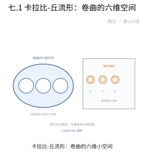

**一句话点破**：看不见的小空间，用"洞的数目"写下了物理定律。

### 七.2 镜像对：互为倒影的几何体

几乎每个卡拉比-丘流形都能找到另一个"镜像伙伴"，两者的几何看起来截然不同，物理描述却完全一致。它就像两本互为倒影的账本，一边难算的数目，在另一边往往一目了然。

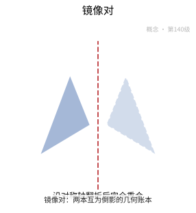

**一句话点破**：找对镜像，难题就换了一本好算的账。

### 七.3 A 模型与 B 模型：两种语言说同一件事

镜像对称可以看作两种理论的等价：A 模型住在辛几何里，擅长"数曲线"；B 模型住在复几何里，擅长"解方程、算周期"。它们说的是同一件事，只是换了语言。

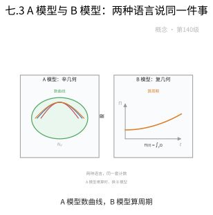

**一句话点破**：A 数曲线、B 解方程，两种语言说同一段物理。

### 七.4 Gromov-Witten 不变量：给数曲线记账

想知道一个空间里有多少条曲线满足给定条件，可以用 Gromov-Witten 不变量来计数。它把"数曲线"这种几何问题，变成了一串可以相加相乘的严谨数字。

**一句话点破**：把"数曲线"这件难事，交给一串会算术的不变量。

### 七.5 周期与镜像映射：一本翻译字典

周期是复几何里用积分算出的量，反映空间的"大小"与对称信息。镜像映射把 A 模型一侧的曲线计数，翻译成 B 模型一侧的周期积分，例如把 $q=e^{2\pi i t}$ 这样的坐标彼此对应。

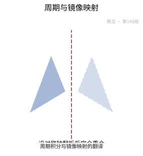

**一句话点破**：镜像映射就是一本把曲线数目译成积分的中文字典。

### 七.6 Hodge 菱形：几何体的指纹表

一个空间的 Hodge 菱形是一张排成菱形的表格，把各维度"洞"的数目分门别类地记下来。它像几何体的指纹，$h^{p,q}$ 一格一格地摆开，一看就知道这个空间长什么样。

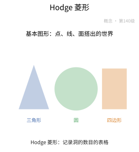

**一句话点破**：Hodge 菱形就是几何体的指纹表格。

### 七.7 复结构与 Kähler 模空间的对调

同一个流形可以有多种复结构、多种 Kähler 结构，把它们各自收集起来就得到两个"模空间"。镜像对称说的正是：一方的复结构模空间，对应着另一方的 Kähler 模空间。

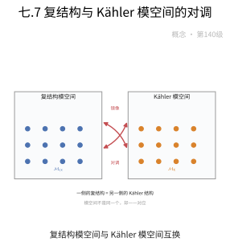

**一句话点破**：镜像在复结构与 Kähler 两个模空间之间来了个对调。

### 七.8 Yukawa 耦合：粒子间的相互作用

Yukawa 耦合在物理里描述粒子间的相互作用，在数学上它由空间上的三重积分给出，例如 $Y_{abc}=\int_X \Omega\wedge\partial_a\partial_b\partial_c\Omega$。镜像对称能把一侧难算的耦合，换成另一侧容易写的周期导数。

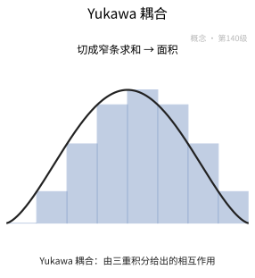

**一句话点破**：粒子相互作用的强度，被写成了几何上的三重积分。

### 七.9 大复结构极限：把空间推到最简

当复结构越变越"大"时，空间的几何会退化成一堆更简单的碎片。大复结构极限正是利用这种退化，让原本难算的周期在这里变得容易处理。

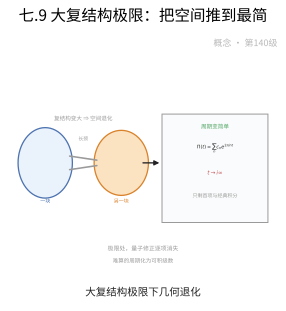

**一句话点破**：把空间推到极限变简单，难算的周期也就露了底。

### 七.10 同调代数：把几何翻成代数

同调代数把几何对象变成代数对象，比如把流形上的层变成更好操作的同调群。Kontsevich 提出的同调镜像对称猜想，正是用这套语言把两侧几何精确地对起来。

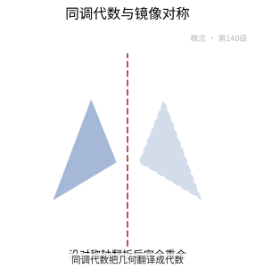

**一句话点破**：同调代数做翻译，把两边的几何对成同一条代数等式。

### 七.11 定理1：Kontsevich 同调镜像对称猜想

这个猜想说，镜像对上的导出范畴彼此等价，从范畴的高度解释了为什么两侧的物理与计数完全一致。它把原本的几何对偶，升级成了一条干净的范畴等价。

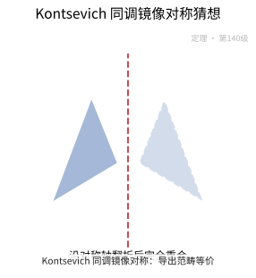

**一句话点破**：几何的镜像对偶，被一句范畴等价一网打尽。

### 七.12 定理2：Hodge 菱形的横竖翻转

镜像对的两个 Hodge 菱形恰好横竖对调，也就是 $h^{p,q}$ 与 $h^{q,p}$ 互换。这一"翻转"是镜像对称最直观、也最容易验证的特征。

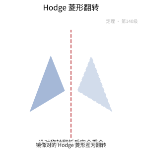

**一句话点破**：两个 Hodge 菱形一转，就照出了彼此的镜像。

### 七.13 定理3：Gromov-Witten 不变量与周期

这条结论把 A 模型的曲线计数（Gromov-Witten 不变量）与 B 模型的周期积分联系在一起，正是镜像对称"难算换好算"的核心机制。

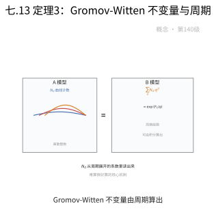

**一句话点破**：数曲线的结果，竟能从另一侧的积分里算出来。

### 七.14 定理4：Yukawa 耦合的镜像映射

在 B 模型一侧，Yukawa 耦合可以由周期的三阶导数写出；镜像映射断言两侧的 Yukawa 耦合在对应点上相等。这让许多难求的三点计数，化为简单的求导。

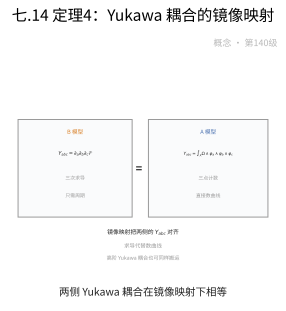

**一句话点破**：一边难写的 Yukawa 耦合，等于另一边的周期导数。

### 七.15 定理5：大复结构极限下的镜像对称

在大复结构极限下，B 模型的周期可以用经典的微分方程与级数方法算出，从而批量给出 A 模型的曲线计数。这是验证镜像对称最有成效的工具之一。

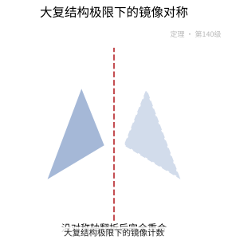

**一句话点破**：推到极限后，难算的计数化为一串好解的方程。

## 八、数学史（History of Mathematics）

> 镜像对称的历史主线，是"源于物理对偶的直觉，经范畴化与严格化成为独立数学理论"的完整范本：超弦理论为获得正确的真空结构，要求在六个紧化的空间上寻找 Calabi-Yau 流形；物理学家在考察这些空间时偶然发现一对表面截然不同、物理上却不可区分的"镜像伙伴"。本章沿着"从物理预言到数学证明"的线索，追溯镜像对称为何被提出、如何被验证，又怎样在辛几何与代数几何之间搭起桥梁。

### 八.1 弦论、Calabi-Yau 流形与紧张的空间

- **为什么需要 Calabi-Yau**：1980 年代的超弦理论把基本粒子视为微小振动弦，其低能有效理论要求时空经紧化后仍满足特殊的对称条件——这指向** Calabi-Yau 流形**（卡拉比猜想由卡拉比提出、丘成桐 1977 年前后证明，其名源于此）。
- **进入物理的舞台**：1985 年，Candelas、Horowitz、Strominger 与 Witten 等把 Calabi-Yau 流形用作弦论紧化，使它成为现代物理与几何交汇的核心对象。
- **空间为何成双**：弦论学家很快在考察这些空间时发现惊人现象——两个在曲率、拓扑上迥异的 Calabi-Yau 流形，可能在"物理上不可区分"，这就埋下了"镜像"的种子。

### 八.2 镜像对称的发现：一场物理直觉的碰撞

- **两份几乎同时的发现**：1990 年前后，Greene 与 Plesser、Candelas 等物理学家分别独立得到镜像对称——一个流形的 **A-模型**（辛：计数有理曲线，Gromov-Witten 不变量）等价于另一个的 **B-模型**（代数：形变与周期、凝聚层的导出范畴）。
- **互换的秘密**：所谓"镜像"，本质是把空间"几何与辛"两套结构互换：$X$ 的复结构与另一流形 $Y$ 的辛结构（Kähler 模空间）彼此互换。
- **未经证明的洞见**：这最初只是物理直觉，其"预言能算数"的一面，很快将由一次惊人的计算兑现。

### 八.3 1991 年的预测：Candelas 的四件套

- **三位物理学家的大胆计算**：1991 年，Candelas、de la Ossa、Green 与 Parkes 用镜像对称计算五次 Calabi-Yau 流形上有理曲线的数目，给出一个与已知零模完全吻合的序列——这等于一次"隔着山峰准靶"的预言。
- **数学界的震撼**：这一预测极大刺激了数学家：如果一个尚未被严格证明的技巧能给出正确无误的计数，那么"镜像"必有深藏的数学理由。
- **从预测到技术的飞跃**：它把镜像对称从"物理猜想"推上"可由严格证明支撑的数学技术"的位置，是整个领域的分水岭。

### 八.4 量子上同调与 Gromov-Witten 不变量

- **把计数写成不变量**：为使"数曲线"成为合法数学，人们引入** Gromov-Witten 不变量**（在稳定映射模空间上积分）；它把辛的计数与代数的周期接合起来，构成 A-型对应。
- **Kontsevich 的作用**：1994 年，**康采维奇**（Kontsevich）用** moduli 空间稳定映射**与**量子上同调**解释了 Candelas 公式，让"镜像计数"有了出处；Givental 以及 Lian-刘-丘（Yau）等则从镜面对称的技术直接证明该公式。
- **东北学派与大发展**：Ruan-Tian 等人随后把 Gromov-Witten 理论系统化，推动辛几何与枚举几何在 1990 年代进入井喷。

### 八.5 同调镜像对称：把镜像写成范畴等价

- **范畴化的转折**：1994 年，**康采维奇**提出**同调镜像对称（HMS）**猜想：A-模型的 **Fukaya 范畴**（模拟辛流形的 Lagrangian 子流形＋量子同调）应与 B-模型**凝聚层导出范畴** $D^b(X)$ 作"三角等价"。
- **从数到整体的提升**：这一"范畴化"把镜像对从数值（Hodge 数／曲线数）提升为整体范畴的等价，也为后续对椭圆曲线、K3 曲面与许多 Calabi-Yau 上的 HMS 提供了纲领。
- **一把现代语言的钥匙**：它把镜像对称与导出范畴、稳定条件（桥空间）联系起来，本教程 A/B 模型与 Fukaya-导出范畴等价章节正源于此。

### 八.6 SYZ 猜想：给镜像一个几何机制

- **环面纤维的直觉**：1996 年，Strominger、Yau 与 Zaslow 提出 **SYZ 猜想**：镜像对可理解为一对以同一个"特殊 Lagrangian 环面"为纤维的空间，镜像对应把"复结构模空间"与"Kähler 模空间"互换。
- **可从构造的几何**：SYZ 把镜像对称从"神秘对偶"引导向"可构造的几何机制"，并与拉格朗日几何以及来自弦论的 T-对偶联系起来。
- **二维场论的落点**：同时，镜像对称也可从 Witten 的**拓扑弦论 A/B 模型**出发理解——本教程的周期与镜像映射、大复结构极限即在二维场论框架中进行。

### 八.7 严格定理的涌现：从椭圆曲线到 K3

- **一个个被证实的角落**：进入 21 世纪，HMS 在越来越广的情形被严格证明——例如对椭圆曲线（级别 1 与多种阶）以及大量 K3 曲面与超曲面（Seidel、Sheridan、Ganatra 等）取得决定性进展。
- **从猜想走向学科**：这些定理让镜像对称不再依附于物理预言，而是融入了可证明的数学传统，也反向给物理以自信。

### 八.8 通向更广的理论：朗兰兹与模形式

- **与数论的深层握手**：镜像对称的生成函数经常落在模形式、Virasoro 结构与数论函数之上；后来又与**朗兰兹纲领**中的 Kapustin-Witten 偶、电磁镜对称等发生深刻联系。
- **几何化的桥梁**：A-型与 B-型的对偶在几何朗兰兹中再现，镜像对称因此成了连接辛几何、代数几何、Hodge 理论、模形式与数论的一根主轴。

### 八.9 历史年表

| 时间 | 人物／文献 | 事件与贡献 |
|:---|:---|:---|
| 1954—1977 年 | 卡拉比、丘成桐 | Calabi-Yau 流形（卡拉比提猜想、丘成桐证明） |
| 1985 年 | Candelas、Horowitz、Strominger、Witten | 用 Calabi-Yau 流形做弦论紧化 |
| 1990 年前后 | Greene–Plesser；Candelas 等 | 镜像对称的发现（A-模型／B-模型对偶） |
| 1991 年 | Candelas、de la Ossa、Green、Parkes | 用镜像对称预测五次流的曲线计数 |
| 1994 年 | 康采维奇（Kontsevich） | Gromov-Witten 不变量与量子上同调；HMS 猜想 |
| 1990 年代 | Givental、Lian-刘-丘（Yau） | 数学上证明 Candelas 公式 |
| 1996 年 | Strominger、Yau、Zaslow | SYZ 猜想：环面纤维对偶机制 |
| 1990 年代后 | Witten、Ruan-Tian 等 | 拓扑 A/B 模型；Gromov-Witten 理论系统化 |
| 21 世纪 | Seidel、Sheridan 等 | 椭圆曲线、K3 上 HMS 的严格证明 |

### 八.10 小结

> 镜像对称的历史，是一部"物理直觉如何长成数学理论"的教科书：Calabi-Yau 流形因弦论紧化而来，Greene 与 Candelas 等从"物理不可区分"中捕捉到镜像，1991 年 Candelas 的预测以出乎意料的正确震惊数学界，Kontsevich 用 Gromov-Witten 不变量与量子上同调接住谜底，又以 HMS 猜想把对偶提升为范畴等价，SYZ 再给出环面纤维的机制，随后一个一个严格定理让它在土里扎根。从枚举几何到 K3、从模形式到朗兰兹，镜像对称证明了一件事：一条来自双星弦论的洞察，只要足够深刻，就能在纯数学里开花，再反过来照亮物理——这正是本章在辛几何与代数几何之间架起的那座桥。

## 九、总结

在这一级中，我们深入学习了镜像对称的数学基础：

1. **Calabi-Yau流形**：镜像对称的基本舞台，是Ricci平坦的Kähler流形，具有特殊的Hodge结构。

2. **镜像对与Hodge菱形翻转**：镜像对称最基本的数值特征——两个流形的Hodge数沿对角线翻转。

3. **A-模型与B-模型**：拓扑弦论的两种约化模型，分别对应辛几何和代数几何。

4. **Kontsevich同调镜像对称猜想**：镜像对称的范畴化表述，断言Fukaya范畴与凝聚层的导出范畴等价。

5. **Gromov-Witten不变量与周期**：镜像对称的核心计算工具，通过周期积分计算枚举几何中的曲线计数。

6. **Yukawa耦合的镜像映射**：建立了A-模型和B-模型可观测量的具体对应关系。

7. **大复结构极限**：镜像对称的可计算框架，在此极限下镜像映射简化为对数映射。

镜像对称起源于弦论中的对偶性，但已发展成为数学中一个丰富的分支，连接了辛几何、代数几何、Hodge理论和数论等多个领域。它不仅在数学内部产生了深刻的影响（如解决了若干枚举几何的经典问题），也为理论物理提供了重要的数学工具。