# 第143级：椭圆曲线与模形式

## 学习目标

1. 理解椭圆曲线的定义及其 Weierstrass 标准形式
2. 掌握椭圆曲线上的群律及其几何构造（弦切法）
3. 学习有限域上椭圆曲线的 Hasse 定理及其证明
4. 理解模形式的基本定义与 Hecke 算子理论
5. 掌握谷山-志村定理（模性定理）及其在 Fermat 大定理中的应用
6. 了解椭圆曲线密码学、复乘法及 BSD 猜想的基本思想

---

## 核心概念

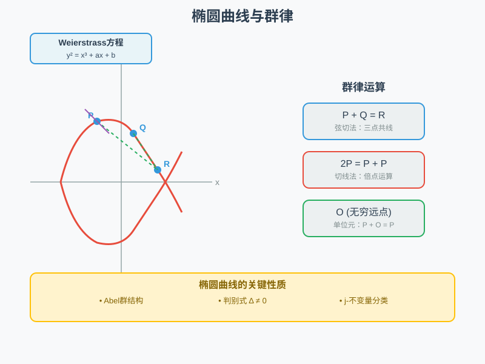

> **直观理解（现实类比）**：椭圆曲线就像一条"数学过山车轨道"。轨道上的每个点都是一个"乘客"，而群律运算就是"乘客组合规则"：任意两个乘客 $P$ 和 $Q$ 可以通过"画直线找第三点"的方式组合成新乘客 $R$。如果只有一个乘客 $P$，就画轨道的切线找"倍点" $2P$。这套规则满足交换律、结合律，就像排队买票时无论谁先谁后，最终结果都一样。判别式 $\Delta \neq 0$ 保证轨道没有"断裂"或"尖点"，$j$-不变量则给每条轨道贴上"身份标签"，形状相同的轨道共享同一个标签。

> **🧠 思考历程：一根"甜甜圈形状"的曲线，为什么能决定一大片整数的命运？**
>
> 起初只是用来算椭圆弧长的对象，几百年后竟成了数论的心脏；一条光滑三次曲线上的"点结构"，被证明对应着整整一类"波一般"的模形式。它想回答的，正是椭圆曲线与模形式之间那份近乎宿命的对应。
>
> - **从"整数点"到莫代尔定理**。椭圆曲线 $y^2=x^3+ax+b$ 的名字来自早期计算椭圆周长的积分；1922年，莫代尔证明其有理点构成一个有限生成群（莫代尔定理），让"曲线上有多少有理点"第一次成为可研究的问题。
> - **模形式从"梦想会议"里掉下来**。1950年代，谷山与志村在一场被后人称为"数学界的梦想会议"上大胆猜想：有理数域上的每条椭圆曲线都"模"于某种模形式。韦尔后来把这猜想整理成更严格的形态，成为朗兰兹纲领的第一块踏脚石。
> - **费马最后定理的惊蛰**。1994年，维尔斯在泰勒–威尔斯的配合下证明了半稳定情形的模性定理，并据此完成费马最后定理（$x^n+y^n=z^n$ 无整数解）的证明。两条三百年的悬案，被一根"甜甜圈"和它的模形式彼此认出而终结。
> - **心路**：一个用来算长度的对象，竟然几百年后成为数论的心脏——数学的"身世"远不如它的"用处"来得深远。

### 椭圆曲线

> **🧠 来龙去脉（为什么会有这个概念？解决了什么问题？）** "椭圆曲线"这名字其实来自一个误会——它最初跟"椭圆"并没有直接关系，而是源于计算椭圆周长的积分。17–18世纪，笛卡尔坐标下的椭圆弧长计算把人引向形如 $\int \frac{dx}{\sqrt{x^3+ax+b}}$ 的积分，这类**椭圆积分**因为求不出初等原函数而困扰数学家长达百年。1820年代，阿贝尔与雅可比研究椭圆积分的**反函数**，发现它们竟然是**双周期**的复有理函数（后人称"椭圆函数"），于是把"算弧长"这个分析问题，翻译成了"在复平面上按格点反复折叠"这个几何问题。1860年代，韦尔斯特拉斯提出 $\wp$-函数，把椭圆函数系统化为 $\wp'^2 = 4\wp^3 - g_2\wp - g_3$，从而把复环面 $\mathbb{C}/\Lambda$ 与三次曲线的点集建立了一一对应——这就是为什么"椭圆曲线"最终以三次方程 $y^2 = x^3 + ax + b$ 为标准形。
>
> 它要"解决的问题"远不止算周长：1922年莫代尔证明有理点构成有限生成群（见下），此后人们真正关心的，是"三次曲线 $y^2=x^3+ax+b$ 上有**多少个**整数/有理点、它们如何相加"，而这正是数论与密码学的核心——椭圆曲线密码学（ECC）的安全性，就建立在"曲线上两点做多少遍加法才能得到第三点"极难反推之上。

**椭圆曲线**是亏格为 1 的光滑射影代数曲线，其上带有一个指定的有理点。在仿射坐标下，椭圆曲线可表示为 Weierstrass 方程：

$$E: y^2 + a_1xy + a_3y = x^3 + a_2x^2 + a_4x + a_6$$

当特征不为 2, 3 时，可简化为：

$$E: y^2 = x^3 + ax + b, \quad a, b \in K$$

其中判别式 $\Delta = -16(4a^3 + 27b^2) \neq 0$，$j$ 不变量为 $j = 1728 \cdot \frac{4a^3}{4a^3 + 27b^2}$。

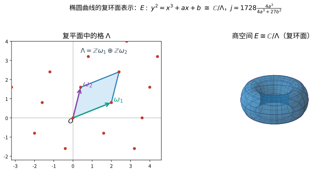

> **直观理解（现实类比）**：椭圆曲线 $E:\ y^2 = x^3 + ax + b$ 可以"摊平"成一张带格子的平面：把复平面按格 $\Lambda$ 平移折叠，把格子的对边粘起来，就得到一个像甜甜圈一样的环面。饼干模具里反复印出相同的花纹，就是"除以格 $\Lambda$"的感觉——不同的格（即不同的 $\omega_1,\omega_2$）对应不同的环面，而 $j$ 不变量正是用来区分这些"甜甜圈"形状的标签。

#### 课堂问答

**老师**：我们把椭圆曲线定义为亏格 1 的光滑射影曲线外加一个指定有理点。先把"加法"讲清楚——任取两点 $P,Q$，连线交曲线于第三点 $R$，再取 $R$ 关于 $x$ 轴的对称点，就定义 $P+Q$。那么单位元是谁？

**学生**：单位元是无穷远点 $O$。因为过 $P$ 和 $O$ 的直线是竖直线，它与 $E$ 的第三个交点恰是 $P$ 关于 $x$ 轴的对称点 $-P$，再取对称便回到 $P$，故 $P+O=P$。判别式 $\Delta=-16(4a^3+27b^2)\neq0$ 正是保证曲线处处光滑、使弦切法不退化的条件。

**老师（追问）**：那 $j$ 不变量 $j=1728\frac{4a^3}{4a^3+27b^2}$ 为什么能当"身份证"？光有 $\Delta\neq0$ 不够吗？

**学生**：不够。$\Delta\neq0$ 只保证光滑，但曲线可以在伸缩 $x\mapsto u^2x,\ y\mapsto u^3y$ 下同构，而同构类恰由 $j$ 完全决定：代数闭域上 $E\cong E'$ 当且仅当 $j(E)=j(E')$。要注意 $j$ 只是"形状标签"，不含扭变信息——例如 $y^2=x^3+1$ 与其二次扭变在一个扩域上同构，$j$ 却不同。

**老师（拓展）**：把曲线搬到有限域上会怎样？

**学生**：点集变有限，但群结构仍在，$E(\mathbb{F}_q)$ 是有限 Abel 群。于是"离散对数问题"——已知 $P$ 与 $nP$ 反推 $n$——在一般曲线上极难求解，这正是椭圆曲线密码学（ECC）的安全性基础。更深一层，Mordell-Weil 定理说 $E(\mathbb{Q})$ 是有限生成群 $\mathbb{Z}^r\oplus(\text{有限挠群})$，而秩 $r$ 由 BSD 猜想与 $L(E,s)$ 在 $s=1$ 处零点的阶相联系，是当代数论的核心难题。

### 模形式

> **🧠 来龙去脉（为什么会有这个概念？解决了什么问题？）** 模形式的诞生，可以追溯到19世纪人们对"哪些量在某个变换群下保持不变"的追问。椭圆曲线的周期结构被格 $\Lambda$ 决定，而同一个 $j$-值可以被**无穷多种**不同的格实现；要让"格"与"曲线"一一对应，就得找出在重新选取格基 $\begin{pmatrix}a&b\\c&d\end{pmatrix}$（模变换）下行为可控的"波形"。19世纪，戴德金与克莱因研究 $j$-函数，而拉马努金在1916年考察 $\Delta = q\prod(1-q^n)^{24}$ 这类 $q$-级数时，意外发现其系数 $\tau(n)$ 满足惊人的乘法规律 $ab\mapsto\tau$——这正是 Hecke 算子理论的先声，也是"模形式就是 $SL_2(\mathbb{Z})$ 作用下的规律波形"这一洞见的开端。
>
> 它"解放的问题"极高远：1950年代谷山–志村猜想宣称"每条椭圆曲线都对应一个权2的模形式"，模形式于是成为连接**几何（曲线）**与**分析（波形）**的枢纽；1994年维尔斯利用这条桥证明了费马大定理。一句话：模形式就是那些"在复上半平面的一切分数线性变换下，只乖乘上一个因子 $(c\tau+d)^k$"的漂亮全纯函数，而它们编码的，正是素数的最深层节律。

**模形式**是定义在复上半平面 $\mathcal{H} = \{\tau \in \mathbb{C} \mid \operatorname{Im}(\tau) > 0\}$ 上的全纯函数，满足特定的模变换性质。对于权 $k$ 的模形式 $f(\tau)$，有：

$$f\left(\frac{a\tau + b}{c\tau + d}\right) = (c\tau + d)^k f(\tau), \quad \forall \begin{pmatrix} a & b \\ c & d \end{pmatrix} \in \Gamma$$

其中 $\Gamma$ 是 $\operatorname{SL}_2(\mathbb{Z})$ 的某个同余子群。

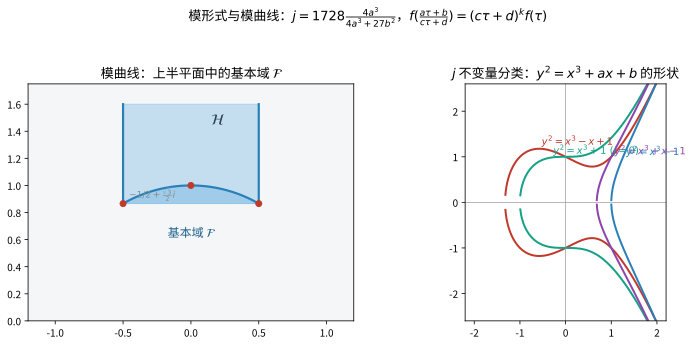

> **直观理解（现实类比）**：模形式生活在上半平面 $\mathcal{H}$，但模变换 $\tau \mapsto \frac{a\tau+b}{c\tau+d}$ 会把上半平面划分出许多"等价类"，每个类只需取一个代表——基本域 $\mathcal{F}$ 就像一张室内设计图只画出一个单元，其余房间由这个单元平移复制而成。而 $j$ 不变量把一族椭圆曲线按形状分类，好比给同一款式不同尺寸的甜甜圈编号，凡是能通过复环面变形彼此对应的曲线都有同一个 $j$。

#### 课堂问答

**老师**：模形式定义里那句 $f\!\left(\frac{a\tau+b}{c\tau+d}\right)=(c\tau+d)^k f(\tau)$ 中，权 $k$ 起什么作用？为什么还要额外要求"全纯且在尖点处全纯"？

**学生**：$k$ 刻画函数在模变换下"乖"的程度，$(c\tau+d)^k$ 是唯一的自守因子，保证权可加。加上全纯与尖点正则，是为了让 $f$ 有收敛的 Fourier 展开 $f(\tau)=\sum_{n\ge0}a_n q^n$（$q=e^{2\pi i\tau}$），从而把解析对象翻译成算术数列 $\{a_n\}$；若还要求 $a_0=0$，它就是尖点形式。

**老师（追问）**：那谷山–志村猜想到底把谁和谁连起来？为什么权恰好是 2？

**学生**：它断言 $\mathbb{Q}$ 上每条椭圆曲线 $E$ 都对应一个权 2 的尖点形式 $f$（对某个 $\Gamma_0(N)$），使得 $L(E,s)=L(f,s)$，等价地 Galois 表示 $\rho_{E,\ell}\cong\rho_{f,\ell}$。权是 2，因为 $E$ 的导子 $N$ 恰好充当水平，而 $L(f,s)$ 的 Dirichlet 系数是 $E$ 在素数处的 $a_p=p+1-\#E(\mathbb{F}_p)$，逐项吻合——权正是微分形式 $f(\tau)\,d\tau$ 的几何次数。

**老师（拓展）**：有人说模形式只是"对称优美的无穷级数"，这句话漏掉了什么？

**学生**：漏掉了最值钱的部分——Hecke 算子与 $L$-函数。正是 $T_n$ 的作用让系数 $\{a_n\}$ 产生乘法结构：若 $f$ 是特征形式，则 $a_{mn}=a_m a_n$（$(m,n)=1$），因此 $L(f,s)$ 才有欧拉积，进而能与椭圆曲线的算术数据对齐。没有 Hecke 理论，模形式只是漂亮，不会成为费马大定理的钥匙。

### Weierstrass $\wp$-函数与椭圆曲线的复参数化

> **🧠 来龙去脉（为什么会有这个概念？解决了什么问题？）** 前面用环面 $\mathbb{C}/\Lambda$ 表述椭圆曲线，可"环面上一个点"到底是什么？雅可比–阿贝尔发现椭圆积分反函数双周期后，韦尔斯特拉斯在19世纪中叶给出了一个**显式**答案：对格子 $\Lambda = \mathbb{Z}\omega_1 + \mathbb{Z}\omega_2$，定义
> $$\wp(z) = \frac{1}{z^2} + \sum_{\lambda\in\Lambda\setminus\{0\}}\left(\frac{1}{(z-\lambda)^2}-\frac{1}{\lambda^2}\right),$$
> 这是一个以 $\Lambda$ 为周期格的双周期有理函数（椭圆函数），它精确"实现"了环面 $\mathbb{C}/\Lambda$ 与三次曲线之间的同构：
> $$z \longmapsto \big(\wp(z),\ \wp'(z)\big)$$
> 落在曲线 $y^2 = 4x^3 - g_2 x - g_3$ 上（其中 $g_2=60G_4,\ g_3=140G_6$ 是 Eisenstein 级数）。这回答了"为什么每条椭圆曲线都长成三次曲线"并为群律提供了分析基础：复平面上的点加法 $z_1+z_2$ 拉到曲线上，恰好就是弦切法。直观说，$\wp$ 就像一台"环面坐标翻译机"，把环面上的加法，翻译成曲线上那套"三点共线取镜像"的几何运算。

**定义（Weierstrass $\wp$-函数）** 设 $\Lambda \subset \mathbb{C}$ 为秩 $2$ 的格。
$$\wp(z) = \frac{1}{z^2} + \sum_{\lambda \in \Lambda \setminus \{0\}} \left(\frac{1}{(z-\lambda)^2} - \frac{1}{\lambda^2}\right)$$
满足微分方程
$$\wp'(z)^2 = 4\wp(z)^3 - g_2 \wp(z) - g_3,$$
其中 $g_2 = 60\sum_{\lambda\ne0}\lambda^{-4}$，$g_3 = 140\sum_{\lambda\ne0}\lambda^{-6}$。由此得到同构 $z \mapsto (\wp(z), \wp'(z)):\ \mathbb{C}/\Lambda \xrightarrow{\sim} E: y^2 = 4x^3 - g_2 x - g_3$。

> **💡 直观理解（类比）**：$\wp$ 函数像一台"把圆形表盘的刻度映射到一张三次曲线上"的坐标机。环面（表盘）上的点对应一个角度 $z$，机器把它输出成曲线上的点 $(\wp(z),\wp'(z))$；而且表盘上"先转 $z_1$ 再转 $z_2$"的加法，被这台机器照搬到曲线上就成了弦切法加法——这正是群律 $P+Q+R=O$ 为什么成立的深层原因：它不过是复平面上加法"翻译"到曲线上的结果。

#### 课堂问答

**老师**：$\wp$ 级数的收敛并不显然，通项里减去 $\frac{1}{\lambda^2}$ 是干什么用的？直接写 $\sum 1/(z-\lambda)^2$ 不行吗？

**学生**：不行，那个级数不绝对收敛。减去 $1/\lambda^2$ 后，展开得 $\frac{2z}{\lambda^3}+\frac{3z^2}{\lambda^4}+\cdots$，而格是二维的，$\sum_{\lambda\neq0}|\lambda|^{-s}$ 当 $s>2$ 时收敛，故整体绝对收敛并定义出一个亚纯双周期函数。

**老师（追问）**：那微分方程 $\wp'^2=4\wp^3-g_2\wp-g_3$ 是怎么落地的？

**学生**：$\wp$ 在原点附近有洛朗展开 $\wp(z)=\frac{1}{z^2}+\frac{g_2}{20}z^2+\frac{g_3}{28}z^4+\cdots$。比较 $\wp'^2$ 与 $4\wp^3-g_2\wp-g_3$ 的展开，两者之差是全纯双周期函数，必为常数；再令 $z\to0$，由极点主部相消知该常数为 0。于是 $(\wp,\wp')$ 落在三次曲线 $y^2=4x^3-g_2x-g_3$ 上。

**老师（拓展）**：这跟群律究竟有什么关系？

**学生**：关系极深。映射 $z\mapsto(\wp(z),\wp'(z))$ 是群同构 $\mathbb{C}/\Lambda\xrightarrow{\sim}E$，把复平面上的加法"翻译"到曲线上。特别地，$\wp(z_1+z_2)$ 的加法公式给出 $x(P+Q)=\frac{1}{4}\left(\frac{\wp'(z_1)-\wp'(z_2)}{\wp(z_1)-\wp(z_2)}\right)^2-\wp(z_1)-\wp(z_2)$，正是弦切法斜率的解析版本。所以"三点共线取镜像"不是人为规定，而是环面加法的必然投影。

### 关键概念清单

| 概念 | 描述 | 符号/公式 |
|------|------|-----------|
| Weierstrass 方程 | 椭圆曲线的标准形式 | $y^2 = x^3 + ax + b$ |
| 判别式 | 判定曲线光滑性 | $\Delta = -16(4a^3 + 27b^2)$ |
| $j$ 不变量 | 曲线的同构类 | $j = 1728\frac{4a^3}{\Delta}$ |
| 群律 | 曲线上点的加法 | $P + Q + R = O$ |
| 模形式 | 上半平面的全纯函数 | $f(\gamma\tau) = (c\tau+d)^k f(\tau)$ |
| Hecke 算子 | 模形式空间上的线性算子 | $T_n$ |
| $L$-函数 | 编码算术信息 | $L(E, s)$ |
| 模性定理 | 椭圆曲线与模形式对应 | $\rho_{E,p} \cong \rho_{f,p}$ |

---

#### 课堂问答

**老师**：这张表把八个关键词排在一起，但真正的知识不在词条本身，而在它们的关系。你能指出哪一条是"总纲"吗？

**学生**：模性定理 $\rho_{E,p}\cong\rho_{f,p}$ 是总纲——它把椭圆曲线一侧（$E$、判别式 $\Delta$、$j$ 不变量、群律、$L(E,s)$）与模形式一侧（模变换、Hecke 算子 $T_n$、$L(f,s)$）焊在一起。可以理解为：群律给曲线以结构，Hecke 算子给模形式以结构，$L$-函数是双方共同的语言，而模性定理声明这两种语言能互相翻译。

**老师（追问）**：为什么 $L$-函数被称为"编码算术信息"的桥梁？

**学生**：因为 $L(E,s)=\prod_p(1-a_p p^{-s}+p^{1-2s})^{-1}$，其中 $a_p=p+1-\#E(\mathbb{F}_p)$ 是曲线的局部点数；而模形式的 $L(f,s)=\sum a_n n^{-s}$ 系数同样来自 Hecke 算子。模性定理保证两侧的 $a_p$ 逐个相等，于是"数点"与"读 Fourier 系数"是同一件事。另外要分清层级：$\Delta=-16(4a^3+27b^2)$ 判定光滑，而 $j=1728\frac{4a^3}{\Delta}$ 判定形状。

**老师（拓展）**：表里"群律"和"Hecke 算子"一个几何一个分析，它们有共性吗？

**学生**：有——两者都是"结构保持"的运算。群律让点集成为 Abel 群，Hecke 算子让模形式空间成为 Hecke 模并具备乘法性，都是在给对象装上加法骨架。更进一步，群律的交换性与 Hecke 算子的可交换性 $T_mT_n=T_nT_m$ 遥相呼应，正是这份交换性保证了 $L$-函数有欧拉积、从而有解析工具可用。

## 定理与证明

### 定理 1：椭圆曲线的群律公式

**定理（群律）**：设 $E: y^2 = x^3 + ax + b$ 是域 $K$ 上的椭圆曲线，$O$ 为无穷远点。则 $E(K)$ 上的加法运算构成一个 Abel 群，其中 $O$ 为单位元。加法规则由弦切法给出。

> **💡 直观理解（类比）**：椭圆曲线上的"点加法"像在一条环形轨道上玩"过三点画直线、再取镜像"的游戏：任取曲线上两点 $P,Q$，连一条直线找到第三个交点，再把它沿 $x$ 轴翻折到对面，就得到 $P+Q$。无穷远点 $O$ 相当于加法的"零"（基准空白点），$P$ 的逆元 $-P$ 则是它"上下颠倒"的镜像。交换律、结合律保证：无论先算哪一组、怎么加括号，结果都落在同一点上，正如排队结账或组装零件——顺序和分组不影响最终成品。

**证明**：

设 $P = (x_1, y_1)$，$Q = (x_2, y_2)$ 为 $E$ 上的两个点。

**情形 1**：若 $x_1 = x_2$ 且 $y_1 = -y_2$，则 $P + Q = O$。

**情形 2**：否则，设过 $P$ 和 $Q$ 的直线（若 $P = Q$ 则为切线）的斜率为 $\lambda$：

- 若 $P \neq Q$：$\lambda = \frac{y_2 - y_1}{x_2 - x_1}$
- 若 $P = Q$：$\lambda = \frac{3x_1^2 + a}{2y_1}$

该直线方程为 $y = \lambda x + \nu$，其中 $\nu = y_1 - \lambda x_1$。

将直线方程代入椭圆曲线方程：

$$(\lambda x + \nu)^2 = x^3 + ax + b$$

整理得：

$$x^3 - \lambda^2 x^2 + (a - 2\lambda\nu)x + (b - \nu^2) = 0$$

该三次方程的三根为 $x_1, x_2, x_3$（其中 $x_3$ 为第三个交点的 $x$ 坐标）。由韦达定理：

$$x_1 + x_2 + x_3 = \lambda^2$$

因此：

$$x_3 = \lambda^2 - x_1 - x_2$$

第三个交点的 $y$ 坐标为 $y_3 = \lambda x_3 + \nu$。

定义 $P + Q = (x_3, -y_3)$，即第三个交点关于 $x$ 轴的对称点。具体地：

$$x_3 = \lambda^2 - x_1 - x_2$$
$$y_3 = \lambda(x_1 - x_3) - y_1$$

**验证群公理**：

1. **封闭性**：由构造，$P + Q$ 仍在 $E$ 上。
2. **单位元**：$P + O = P$，因为过 $P$ 和 $O$ 的直线是竖直线，第三个交点为 $P$ 的对称点。
3. **逆元**：$P + (-P) = O$，其中 $-P = (x_1, -y_1)$。
4. **结合律**：可通过几何论证（Pappus 定理）或代数验证。代数验证较为繁复，但本质上是由于三次曲线的交点性质。

因此 $(E(K), +)$ 构成一个 Abel 群。$\square$

---

#### 课堂问答

**老师**：证明里用韦达定理得到 $x_1+x_2+x_3=\lambda^2$，为什么二次项系数是 $-\lambda^2$ 就说明三根之和等于 $\lambda^2$？

**学生**：把直线 $y=\lambda x+\nu$ 代入曲线得 $x^3-\lambda^2x^2+(a-2\lambda\nu)x+(b-\nu^2)=0$，首项系数为 1，故由韦达定理 $x_1+x_2+x_3=\lambda^2$，于是 $x_3=\lambda^2-x_1-x_2$。第三交点是 $(x_3,\lambda x_3+\nu)$，取关于 $x$ 轴的对称为 $P+Q=(x_3,-y_3)$，其中 $y_3=\lambda(x_1-x_3)-y_1$。

**老师（追问）**：群律中结合律最难，为什么说它是三次曲线交点性质的必然产物？

**学生**：因为 $P+Q+R$ 的不同加括号方式，本质上对应三条直线与曲线形成的 $3\times3$ 交点配置，可以用 Pappus 定理或 Cayley–Bacharach 定理把两组构造统一到同一条直线上，从而 $(P+Q)+R=P+(Q+R)$。这也解释了为何群律只在三次（亏格 1）曲线上如此干净，高亏格曲线没有这条简单法则。

**老师（拓展）**：处理 $P=Q$ 时，切线斜率公式 $\lambda=\frac{3x_1^2+a}{2y_1}$ 会失效吗？

**学生**：会。当 $y_1=0$ 时分母为零，该点是 2-挠点，满足 $2P=O$，切线竖直、斜率无穷，需单独归入 $P+Q=O$ 的情形。这也说明为何必须 $\Delta\neq0$：否则存在奇点使切线不唯一，群结构崩塌。例如 $y^2=x^3$ 在原点有尖点，就无法定义群律。

### 定理 2：Hasse 定理

**定理（Hasse）**：设 $E$ 是有限域 $\mathbb{F}_q$（$q = p^n$）上的椭圆曲线，$N_q$ 为 $E$ 上的 $\mathbb{F}_q$-有理点个数（包括无穷远点）。则：

$$|N_q - (q + 1)| \leq 2\sqrt{q}$$

> **💡 直观理解（类比）**：有限域上的椭圆曲线，随机猜大约有 $q+1$ 个点，但实际点数总有偏差。Hasse 定理给这个"偏差"封了一个天花板：无论怎么折腾，实际点数偏离 $q+1$ 最多 $2\sqrt{q}$。好比抽奖或抛硬币：平均结果容易估计，但每次实验的实际结果会在期望值附近波动，而波动幅度有限度——$2\sqrt{q}$ 就是这个"最大偏差范围"，绝不可能跑得更远。

**证明**：

**步骤 1：Frobenius 自同态**

定义 Frobenius 自同态 $\pi_q: E \to E$ 为 $\pi_q(x, y) = (x^q, y^q)$。这是一个次数为 $q$ 的不可分同源。

**步骤 2：有理点与 Frobenius 的不动点**

$E(\mathbb{F}_q)$ 中的点恰为 $\pi_q$ 的不动点，即满足 $\pi_q(P) = P$ 的点。因此：

$$N_q = \#\ker(1 - \pi_q) = \deg(1 - \pi_q)$$

**步骤 3：迹与次数**

设 $a = q + 1 - N_q$，则 $a = \operatorname{Tr}(\pi_q)$。由 Weil 猜想（对椭圆曲线已证明）：

$$\deg(1 - \pi_q) = \deg(\pi_q) + 1 - \operatorname{Tr}(\pi_q) = q + 1 - a$$

其中 $\operatorname{Tr}(\pi_q) = \pi_q + \hat{\pi}_q$（$\hat{\pi}_q$ 为对偶同源），且 $\pi_q \hat{\pi}_q = q$。

**步骤 4：Cauchy-Schwarz 不等式**

对偶同源满足 $\deg(m\pi_q + n\hat{\pi}_q) = m^2q + n^2q + mn(\pi_q\hat{\pi}_q + \hat{\pi}_q\pi_q)$。

由于次数非负，对于所有 $m, n \in \mathbb{Z}$：

$$m^2q + n^2q + mna \geq 0$$

这等价于判别式 $a^2 - 4q^2 \leq 0$，即 $|a| \leq 2q$。

但更精确地，我们可以得到 $|a| \leq 2\sqrt{q}$。

**步骤 5：精确估计**

考虑二次多项式 $T^2 - aT + q$。由于 $\pi_q$ 在 $\ell$-adic 表示 $\mathrm{End}(E) \otimes \mathbb{Q}_\ell$ 中满足该特征多项式，且 Frobenius 的特征值 $\alpha, \beta$ 满足 $\alpha\beta = q$ 且 $|\alpha| = |\beta| = \sqrt{q}$（Riemann 假设部分）。

因此 $a = \alpha + \beta$，$|a| \leq |\alpha| + |\beta| = 2\sqrt{q}$。

从而：

$$|N_q - (q + 1)| = |a| \leq 2\sqrt{q}$$

$\square$

---

#### 课堂问答

**老师**：把 $N_q$ 写成 $\#\ker(1-\pi_q)=\deg(1-\pi_q)$，这一步的关键是什么？

**学生**：关键是 Frobenius $\pi_q(x,y)=(x^q,y^q)$ 的不动点恰是 $\mathbb{F}_q$-有理点：$E(\mathbb{F}_q)$ 就是 $\pi_q(P)=P$ 的解集，即 $\ker(1-\pi_q)$。而可分同源 $1-\pi_q$ 的核大小等于它的次数，于是 $N_q=\deg(1-\pi_q)$。

**老师（追问）**：从 $\deg(m\pi_q+n\hat{\pi}_q)\ge0$ 推出的只是 $|a|\le2q$，那精确界 $|a|\le2\sqrt q$ 是怎么来的？

**学生**：$a=\operatorname{Tr}(\pi_q)$ 且 $\pi_q\hat{\pi}_q=q$，把 $\deg(m\pi_q+n\hat{\pi}_q)=qm^2+anm+qn^2\ge0$ 对所有整数 $m,n$ 成立翻译成 $a^2-4q^2\le0$，这只是弱界。真正的紧界来自特征多项式 $T^2-aT+q$ 的两个特征值 $\alpha,\beta$：$\alpha\beta=q$，Riemann 假设给出 $|\alpha|=|\beta|=\sqrt q$，故 $|a|\le|\alpha|+|\beta|=2\sqrt q$。

**老师（拓展）**：这个误差项还能再压小吗？

**学生**：不能。区间 $[-2\sqrt q,2\sqrt q]$ 内的每个整数都能由某条曲线的 $a_p$ 实现，所以 $2\sqrt q$ 是最优常数。换个视角更漂亮：$\#E(\mathbb{F}_p)-(p+1)=-a_p$ 恰是模形式的 Fourier 系数，而 Ramanujan 猜想（已由 Deligne 证明）对权 $k$ 给出 $|a_p|\le2p^{(k-1)/2}$，Hasse 界正是其中 $k=2$ 的特例。

### 定理 3：模形式的 Hecke 算子

**定理**：设 $f(\tau) = \sum_{n=0}^\infty a_n q^n$（$q = e^{2\pi i\tau}$）为权 $k$ 的模形式。则 Hecke 算子 $T_n$ 作用为：

$$(T_n f)(\tau) = n^{k-1} \sum_{d|n} d^{-k} \sum_{b=0}^{d-1} f\left(\frac{n\tau + bd}{d^2}\right)$$

且 $T_n$ 将模形式映为模形式，保持权 $k$。

> **💡 直观理解（类比）**：Hecke 算子 $T_n$ 像对一段"乐谱"（模形式 $f$）进行系统的和声叠加：它把所有能通过伸缩、平移得到的"变奏片段"按权重取和，形成一段新的乐谱 $T_n f$。奇妙的是一段"同调性"（权 $k$）不变的乐谱经过这种叠加仍是同调性的乐谱。于是这些 $T_n$ 就像一部"调音台"，可以同时调节所有频率，最终筛出"特征形式"这样的纯净音符。

**证明**：

**步骤 1：Hecke 算子的定义**

权 $k$ 的 Hecke 算子 $T_n$ 在模形式空间 $M_k(\Gamma)$ 上定义为：

$$(T_n f)(\tau) = n^{k-1} \sum_{\substack{ad = n \\ 0 \leq b < d}} d^{-k} f\left(\frac{a\tau + b}{d}\right)$$

其中求和遍历所有 $a, d \in \mathbb{N}$ 满足 $ad = n$ 且 $b = 0, 1, \ldots, d-1$。

**步骤 2：Fourier 展开下的作用**

设 $f(\tau) = \sum_{m=0}^\infty a_m q^m$，$q = e^{2\pi i\tau}$。计算：

$$(T_n f)(\tau) = n^{k-1} \sum_{ad=n} \frac{1}{d^k} \sum_{b=0}^{d-1} \sum_{m=0}^\infty a_m e^{2\pi i m \frac{a\tau + b}{d}}$$

交换求和顺序：

$$(T_n f)(\tau) = n^{k-1} \sum_{ad=n} \frac{1}{d^k} \sum_{m=0}^\infty a_m e^{2\pi i \frac{ma\tau}{d}} \sum_{b=0}^{d-1} e^{2\pi i \frac{mb}{d}}$$

**步骤 3：内和的计算**

$$\sum_{b=0}^{d-1} e^{2\pi i \frac{mb}{d}} = \begin{cases} d, & \text{若 } d \mid m \\ 0, & \text{否则} \end{cases}$$

因此仅当 $d \mid m$ 时项非零。设 $m = d \cdot r$，则：

$$(T_n f)(\tau) = n^{k-1} \sum_{ad=n} \frac{1}{d^k} \sum_{r=0}^\infty a_{dr} \cdot d \cdot e^{2\pi i \frac{a d r \tau}{d}} = n^{k-1} \sum_{ad=n} \frac{1}{d^{k-1}} \sum_{r=0}^\infty a_{dr} q^{ar}$$

**步骤 4：整理为 Fourier 级数**

令 $n = ad$，则 $ar = n r / d$。设 $m = ar$，则 $r = m/a$，且 $d = n/a$，$d \mid m$ 等价于 $n/a \mid m$，即 $a \mid m$ 且 $n \mid am$。

整理可得：

$$(T_n f)(\tau) = \sum_{m=0}^\infty b_m q^m$$

其中：

$$b_m = \sum_{d \mid \gcd(m,n)} d^{k-1} a_{mn/d^2}$$

特别地，$b_1 = a_n$，$b_n = a_1$（若 $a_1 = 0$ 则 $b_n = 0$）。

**步骤 5：模性验证**

需要验证 $T_n f$ 满足模变换性质。由于 $T_n$ 定义中涉及 $\operatorname{GL}_2^+(\mathbb{Q})$ 的双陪集分解，而模形式在 $\operatorname{GL}_2^+(\mathbb{Q})$ 作用下具有协变性，可验证 $T_n f$ 仍满足权 $k$ 的模变换性质。详细验证需检查每个 $f\left(\frac{a\tau+b}{d}\right)$ 在 $\Gamma$ 作用下的行为，利用 $\Gamma$ 在 $\operatorname{GL}_2^+(\mathbb{Q})$ 中的性质可得到结论。

$\square$

---

#### 课堂问答

**老师**：内和恒等式 $\sum_{b=0}^{d-1}e^{2\pi i mb/d}=d\cdot[d\mid m]$ 是整个证明的枢纽，它凭什么成立？

**学生**：这是单位根筛法。当 $d\mid m$ 时每项都是 1，和为 $d$；当 $d\nmid m$ 时，令 $\zeta=e^{2\pi i m/d}\neq1$ 是 $d$ 次单位根，等比级数 $\sum_{b=0}^{d-1}\zeta^b=\frac{\zeta^d-1}{\zeta-1}=0$。于是 $T_n f$ 的展开中只有 $d\mid m$ 的项存活，把 $m=dr$ 代回便得 $b_m=\sum_{d\mid\gcd(m,n)}d^{k-1}a_{mn/d^2}$。

**老师（追问）**：为什么单独看 $b_1=a_n$ 与 $b_n=a_1$ 这两条如此重要？

**学生**：因为 $b_1=a_n$ 说明 $T_n$ 把第 1 个系数搬到第 $n$ 个，是系数"换位"的引擎；$b_n=a_1$ 保证 $T_n$ 保持尖点性（若无常数项则仍无）。这两条合起来使特征形式 $T_n f=a_nf$ 成为可能，从而得到乘法公式 $a_{mn}=a_ma_n$（$(m,n)=1$）与递推 $a_{p^{r+1}}=a_pa_{p^r}-p^{k-1}a_{p^{r-1}}$，这正是欧拉积的来源。

**老师（拓展）**：Hecke 算子真能把权 $k$ 模形式映回权 $k$ 吗？这里为什么需要双陪集分解？

**学生**：需要。$T_n$ 的定义来自双陪集分解 $\Gamma\begin{pmatrix}1&0\\0&n\end{pmatrix}\Gamma=\bigsqcup\Gamma\alpha_i$，作用为 $\sum_i f|_k\alpha_i$。每个 $\alpha_i\in\operatorname{GL}_2^+(\mathbb{Q})$，而权 $k$ 模形式在 $|_k$ 作用对 $\operatorname{GL}_2^+(\mathbb{Q})$ 协变、对 $\Gamma$ 不变，求和后仍协变且不变，故 $T_n f\in M_k(\Gamma)$。不同 $\alpha_i$ 的选取只差 $\Gamma$-因子，不改变结果。这正是 Hecke 算子连向自守表示与 Langlands 纲领的接口。

### 定理 4：谷山-志村定理（模性定理）

**定理（Wiles-Breuil-Conrad-Diamond-Taylor）**：每个 $\mathbb{Q}$ 上的椭圆曲线都是模的，即存在一个权 $2$ 的尖点形式 $f$（对某个同余子群 $\Gamma_0(N)$），使得 $E$ 的 Hasse-Weil $L$-函数等于 $f$ 的 $L$-函数：

$$L(E, s) = L(f, s)$$

等价地，$E$ 的 $\ell$-adic Galois 表示 $\rho_{E,\ell}: \operatorname{Gal}(\overline{\mathbb{Q}}/\mathbb{Q}) \to \operatorname{GL}_2(\mathbb{Q}_\ell)$ 同构于某个模形式 $f$ 的 $\ell$-adic 表示 $\rho_{f,\ell}$。

> **🧠 直观理解（现实类比）**：模性定理说"每个椭圆曲线都长着一副模形式的面孔"。这好比同一批货物可以用两种看似毫不相干的记账方式记录——椭圆曲线的账本记的是"有多少个点、怎么相加"，模形式的账本记的是"一段乐的频率谱"，但两者核算出的 $L$-函数（等价地，Galois 表示的内存结构）完全一致。于是你可以通过监听"广播谱"来破译"加密账本"，几何与分析之间被这座"翻译桥梁"稳稳接住。

**证明思路**：

**步骤 1：问题的转化**

设 $E$ 是 $\mathbb{Q}$ 上的椭圆曲线，导子为 $N$。对每个素数 $\ell$，考虑 $\ell$-adic Tate 模 $T_\ell(E) = \varprojlim_n E[\ell^n]$，得到 Galois 表示：

$$\rho_{E,\ell}: \operatorname{Gal}(\overline{\mathbb{Q}}/\mathbb{Q}) \to \operatorname{Aut}(T_\ell(E)) \cong \operatorname{GL}_2(\mathbb{Z}_\ell)$$

模性定理断言 $\rho_{E,\ell}$ 来自某个 $\Gamma_0(N)$ 上权 $2$ 的 Hecke 特征形式。

**步骤 2：变形环（Deformation Rings）**

考虑所有与 $\bar{\rho}_{E,\ell}$（模 $\ell$ 的约化表示）同构的 Galois 表示的变形。Mazur 证明了存在一个完备 Noether 局部环 $R$（变形环），参数化所有这样的变形。

**步骤 3：Hecke 代数（Hecke Algebras）**

考虑 $\Gamma_0(N)$ 上权 $2$ 的尖点形式空间 $S_2(\Gamma_0(N))$。Hecke 算子 $T_n$ 作用其上，生成一个 $\mathbb{Z}$-代数 $\mathbb{T}$（Hecke 代数）。与之相伴的 Galois 表示给出一个映射 $\mathbb{T} \to R$。

**步骤 4：$R = T$ 定理**

核心结果是 $R \cong \mathbb{T}$（即变形环与 Hecke 代数同构）。这通过以下方式证明：

- 计算 $R$ 的余切空间（由 $H^1$ 控制）
- 证明 $\mathbb{T}$ 的余切空间有相同的维数
- 利用交换代数的判据（如 Wiles 的数值判据）证明同构

**步骤 5：模性提升**

一旦 $R = T$ 成立，每个 Galois 表示（满足适当条件）都来自模形式。特别地，$\rho_{E,\ell}$ 对应 $\mathbb{T}$ 的一个环同态，从而对应某个 Hecke 特征形式 $f$。

**步骤 6：$\mathbb{Q}$-曲线的处理**

对于 $\mathbb{Q}$ 上的椭圆曲线，其模 $\ell$ 表示 $\bar{\rho}_{E,\ell}$ 在 $\ell \nmid N$ 时是模的（由 Langlands-Tunnell 定理保证）。Wiles 的贡献在于证明当 $\bar{\rho}_{E,\ell}$ 是绝对不可约时，可以提升为模的 $\ell$-adic 表示。Taylor-Wiles 进一步使用"Taylor-Wiles 系统"的方法处理了边界情况。

$\square$

---

#### 课堂问答

**老师**：为什么模性定理的战场不是"直接造一个模形式"，而是变形环与 Hecke 代数的同构 $R=\mathbb{T}$？

**学生**：因为直接证明 $\rho_{E,\ell}$ 模等价于手搓尖点形式，无从下手。Wiles 换了策略：先固定模 $\ell$ 约化表示 $\bar\rho$，用 Mazur 的变形理论造出参数化所有变形的普适变形环 $R$，再用 Galois 表示把 Hecke 代数 $\mathbb{T}$ 映射到 $R$。只要证出 $R\cong\mathbb{T}$，$\rho_{E,\ell}$ 就自动来自某个 Hecke 特征形式，模性一步到位。

**老师（追问）**：$R=\mathbb{T}$ 的证明难道只是比较维数？

**学生**：不止。要比较两者的余切空间维数（由 $\mathbb{T}$ 的生成元数与 $R$ 的 $H^1$ 控制），再由交换代数判据逼出同构。技术上靠 Wiles 的"数值判据"和 Taylor–Wiles 系统：后者引入一组辅助素数 $Q$ 把变形问题放大，使 $R=\mathbb{T}$ 在放大后成立，再把结论"压"回原问题，这套 patching 思想是核心。

**老师（拓展）**：为什么定理署名从"谷山–志村"变成"Wiles–Breuil–Conrad–Diamond–Taylor"？

**学生**：因为完整形式要覆盖所有情形。Wiles 与 Taylor 在 1995 年先证半稳定情形（已足够证明费马大定理）；一般情形由 Breuil、Conrad、Diamond、Taylor 在 1999–2001 年补齐，处理了 $\ell=2,3$ 的小素数与 $\bar\rho$ 可约的边界。对半稳定 $E$，导子 $N$ 与判别式的最小化一致，且当 $\ell\nmid N$ 时 $\rho_{E,\ell}$ 不会出现可约病态，这正是"半稳定"假设如此关键的原因。

### 定理 5：Fermat 大定理的证明概要

**定理（Fermat-Wiles）**：方程 $x^n + y^n = z^n$ 在 $n \geq 3$ 时没有正整数解。

> **🧠 直观理解（现实类比）**：这是一场漂亮的"反证法"。假设 $a^n+b^n=c^n$ 有解，就相当于有人声称能画出这样一张图纸——它对应的是一座"无比诡异的桥"（Frey 曲线）。要分析这座桥，你必须用到某种建材（权 2、水平 2 的模形式），但一查仓库：这种建材的库存是零（$S_2(\Gamma_0(2))$ 为空）。既然必要的建材根本不存在，桥也就造不出来，于是原方程无解——一个纯数论的难题，被两根毫不相关的"几何之绳"（Frey 图 + 模性定理）合力绞杀。

**证明思路**：

**步骤 1：归约到椭圆曲线（Frey 曲线）**

假设存在 $a^p + b^p = c^p$，其中 $p \geq 5$ 为素数。Frey 构造椭圆曲线：

$$E_{a,b,c}: y^2 = x(x - a^p)(x + b^p)$$

计算其判别式 $\Delta = (abc)^{2p}$，导子 $N = \operatorname{rad}(abc)$。

**步骤 2：Frey 曲线的异常性质**

Ribet 证明了：若 $E_{a,b,c}$ 是模的，则其对应的模形式 $f$ 的权为 $2$，水平为 $N$。但通过分析 $E_{a,b,c}$ 在 $p$ 处的约化，Ribet 的"水平降低定理"表明 $f$ 实际上来自水平 $2$ 的模形式。

而 $S_2(\Gamma_0(2)) = \{0\}$（权 $2$ 水平 $2$ 的尖点形式空间为零），矛盾。

**步骤 3：应用谷山-志村定理**

由 Wiles-Breuil-Conrad-Diamond-Taylor 的模性定理，$E_{a,b,c}$ 是模的。由 Ribet 的水平降低定理，导出矛盾。

因此，不存在这样的 $a, b, c$，Fermat 大定理得证。

**步骤 4：$n=3,4$ 的情形**

$n=4$ 由 Fermat 本人的无穷下降法证明，$n=3$ 由 Euler 证明。$n=5$ 由 Dirichlet 和 Legendre 证明。$n=7$ 由 Lamé 证明。因此对所有 $n \geq 3$ 成立。

$\square$

---

#### 课堂问答

**老师**：Frey 曲线 $E_{a,b,c}:y^2=x(x-a^p)(x+b^p)$ 为什么是整件事的支点？它凭什么能"违背"模性？

**学生**：关键在导子极小。设 $a^p+b^p=c^p$ 且 $a,b,c$ 两两互素，则判别式 $\Delta=(abc)^{2p}$，导子 $N=\operatorname{rad}(abc)$ 无平方因子。Ribet 的水平降低定理证明：若 $E_{a,b,c}$ 是模的，其模 $p$ 表示 $\bar\rho_{E,p}$ 可降到水平 2；于是它应来自 $S_2(\Gamma_0(2))$ 中的形式。但该空间是零，矛盾。

**老师（追问）**：为什么恰好 $S_2(\Gamma_0(2))=\{0\}$？

**学生**：用模曲线亏格公式可算：$\dim S_2(\Gamma_0(N))=g(X_0(N))$，而 $X_0(2)$ 的亏格为 0，故 $S_2(\Gamma_0(2))=0$。说白了，就是"权 2、水平 2 的尖点形式根本不存在"——Frey 曲线所需要的那块建材库里没有，桥自然造不出来。

**老师（拓展）**：那 $n=3,4$ 为什么要单独用无穷下降处理？不能一并塞进 Frey 框架吗？

**学生**：不能通用。Frey 构造要求指数 $p$ 为奇素数且 $p\ge5$，否则导子与水平降低的分析不成立。$n=1,2$ 平凡，$n=4$ 由 Fermat 本人的无穷下降法证明，$n=3$ 由 Euler 在 $\mathbb{Z}[\omega]$ 中分解证明。一般 $n\ge3$ 若含因子 4 或奇素数即可归约到素数及 4 的情形。整条链是：假设有解 $\Rightarrow$ Frey 曲线 $\Rightarrow$ 由模性定理它是模的 $\Rightarrow$ Ribet 降水平 $\Rightarrow$ 与 $S_2(\Gamma_0(2))=\{0\}$ 矛盾。

## 示例

### 示例 1：椭圆曲线 $y^2 = x^3 + 1$ 的群结构

**问题**：求椭圆曲线 $E: y^2 = x^3 + 1$ 在 $\mathbb{Q}$ 上的有理点群结构。

**解**：

**1. 基本参数**

$$a = 0, \quad b = 1$$
$$\Delta = -16(4 \cdot 0 + 27 \cdot 1^2) = -432 \neq 0$$
$$j = 1728 \cdot \frac{0}{-432} = 0$$

**2. 有理点的计算**

尝试小整数点：

- $x = -1$：$y^2 = 0$，$y = 0$ → $(-1, 0)$
- $x = 0$：$y^2 = 1$，$y = \pm 1$ → $(0, 1), (0, -1)$
- $x = 2$：$y^2 = 9$，$y = \pm 3$ → $(2, 3), (2, -3)$
- $x = -2$：$y^2 = -7$，无解
- $x = 3$：$y^2 = 28$，无解
- $x = 4$：$y^2 = 65$，无解

**3. 群结构**

Mordell-Weil 定理断言 $E(\mathbb{Q})$ 是有限生成的 Abel 群。通过计算，$E(\mathbb{Q}) \cong \mathbb{Z} \oplus \mathbb{Z}/3\mathbb{Z}$。

其中挠子群 $\mathbb{Z}/3\mathbb{Z}$ 由 $(-1, 0)$ 生成（阶为 $3$，因为 $(-1,0) + (-1,0) + (-1,0) = O$）。

自由部分由 $(0, 1)$ 生成，秩为 $1$。

**4. 验证群运算**

计算 $P = (0, 1)$，$Q = (2, 3)$：

$$\lambda = \frac{3 - 1}{2 - 0} = 1$$
$$x_3 = 1^2 - 0 - 2 = -1$$
$$y_3 = 1 \cdot (0 - (-1)) - 1 = 0$$

因此 $P + Q = (-1, 0)$，这是挠点。

---

### 示例 2：模形式的 Fourier 展开计算

**问题**：求权 $4$ 的 Eisenstein 级数 $G_4(\tau)$ 的 Fourier 展开，并验证其模性。

**解**：

**1. 定义**

权 $k \geq 4$ 的 Eisenstein 级数定义为：

$$G_k(\tau) = \sum_{(m,n) \in \mathbb{Z}^2 \setminus \{(0,0)\}} \frac{1}{(m\tau + n)^k}$$

**2. Fourier 展开**

利用公式：

$$G_k(\tau) = 2\zeta(k) + \frac{2(2\pi i)^k}{(k-1)!} \sum_{n=1}^\infty \sigma_{k-1}(n) q^n$$

其中 $\sigma_{r}(n) = \sum_{d|n} d^r$，$q = e^{2\pi i\tau}$。

对于 $k = 4$：

$$\zeta(4) = \frac{\pi^4}{90}$$
$$(2\pi i)^4 = 16\pi^4$$
$$(4-1)! = 6$$

因此：

$$G_4(\tau) = \frac{\pi^4}{45} + \frac{16\pi^4}{6} \sum_{n=1}^\infty \sigma_3(n) q^n = \frac{\pi^4}{45} + \frac{8\pi^4}{3} \sum_{n=1}^\infty \sigma_3(n) q^n$$

**3. 归一化**

通常使用归一化的 Eisenstein 级数：

$$E_4(\tau) = \frac{G_4(\tau)}{2\zeta(4)} = 1 + 240 \sum_{n=1}^\infty \sigma_3(n) q^n$$

展开前几项：

$$E_4(\tau) = 1 + 240q + 2160q^2 + 6720q^3 + 17520q^4 + 30240q^5 + \cdots$$

**4. 模性验证**

$E_4(\tau)$ 满足：

$$E_4\left(\frac{a\tau + b}{c\tau + d}\right) = (c\tau + d)^4 E_4(\tau), \quad \forall \begin{pmatrix} a & b \\ c & d \end{pmatrix} \in \operatorname{SL}_2(\mathbb{Z})$$

这可由 $G_4$ 的定义直接验证。

---

## 习题

### 基础题

**习题 1**（椭圆曲线定义）用简洁的语言定义什么是椭圆曲线，说明亏格为何等于 $1$，并写出特征不为 $2, 3$ 时的一般 Weierstrass 形式及其判别式条件。

**习题 2**（j-不变量）设 $E: y^2 = x^3 + ax + b$。写出判别式 $\Delta$ 与 $j$-不变量的公式，并计算 $E: y^2 = x^3 + 1$ 的 $\Delta$ 与 $j$。

**习题 3**（群律单位元）在椭圆曲线的弦切法群律中，说明无穷远点 $O$ 如何作为单位元，并解释 $-P$ 的几何意义。

**习题 4**（群律计算）在 $E: y^2 = x^3 + 17$ 上，验证 $P = (-2, 3)$ 在曲线上，并计算 $2P$。

**习题 5**（点是否为有理点）设 $E: y^2 = x^3 + x$，判断 $P = (1, \sqrt{2})$、$Q = (1, 1)$ 是否在 $E$ 上并说明原因。

**习题 6**（判别式）解释判别式 $\Delta \neq 0$ 的几何含义，并说明若 $\Delta = 0$ 曲线将出现怎样的奇点。

**习题 7**（Hasse 定理陈述）陈述有限域 $\mathbb{F}_q$ 上椭圆曲线的 Hasse 定理，说明其给出的有理点数的上界与下界。

**习题 8**（模形式定义）写出权 $k$ 模形式 $f$ 的模变换性质 $f(\gamma\tau) = (c\tau + d)^k f(\tau)$，说明其中权 $k$ 与同余子群 $\Gamma$ 的含义。

**习题 9**（Fourier 展开）解释模形式 $f(\tau) = \sum_{n=0}^\infty a_n q^n$（$q = e^{2\pi i\tau}$）中 Fourier 展开的意义，并指出尖点形式的判别条件 $a_0 = 0$。

**习题 10**（L-函数）写出椭圆曲线 $E$ 的 Hasse-Weil $L$-函数在 $\operatorname{Re}(s) > 3/2$ 处的 Euler 乘积形式。

### 进阶题

**习题 11**（弦切法公式推导）设 $E: y^2 = x^3 + ax + b$，$P = (x_1, y_1)$，$Q = (x_2, y_2)$ 且 $P \neq Q$。推导群律公式 $x_3 = \lambda^2 - x_1 - x_2$，其中 $\lambda = \frac{y_2 - y_1}{x_2 - x_1}$。

**习题 12**（倍点公式推导）设 $P = (x_1, y_1)$ 在 $E: y^2 = x^3 + ax + b$ 上，推导倍点公式 $x(2P) = \frac{(3x_1^2 + a)^2}{(2y_1)^2} - 2x_1$。

**习题 13**（Hasse 上界的应用）对 $\mathbb{F}_{17}$ 上的椭圆曲线，利用 Hasse 定理给出 $E(\mathbb{F}_{17})$ 点数的可能取值范围。

**习题 14**（挠点）说明 $\mathbb{Q}$ 上椭圆曲线有理挠子群 $E(\mathbb{Q})_{\mathrm{tors}}$ 的阶有界性（Mazur 定理的定性结论），并给出 $E: y^2 = x^3 + 1$ 的一个挠点例子。

**习题 15**（Eisenstein 级数）写出权 $k \geq 4$ 的 Eisenstein 级数 $G_k(\tau) = \sum_{(m,n) \neq (0,0)} \frac{1}{(m\tau + n)^k}$ 的 Fourier 展开公式并说明其归一化。

**习题 16**（Hecke 算子）写出 Hecke 算子 $T_n$ 在 Fourier 系数上的作用公式 $b_m = \sum_{d \mid \gcd(m,n)} d^{k-1} a_{mn/d^2}$，并说明 $T_m, T_n$ 在 $\gcd(m,n) = 1$ 时的关系。

**习题 17**（复乘法）解释什么是椭圆曲线的复乘法，说明 $E: y^2 = x^3 + 1$ 具有复乘法并求其一个额外自同态。

**习题 18**（模曲线）说明上半平面 $\mathcal{H}$ 模去 $\operatorname{SL}_2(\mathbb{Z})$ 作用得到的基本域 $\mathcal{F}$，并解释 $j$ 函数在 $\mathcal{F}$ 上如何参数化椭圆曲线的同构类。

**习题 19**（Tate 模与 Galois 表示）设 $E$ 是 $\mathbb{Q}$ 上的椭圆曲线，$\ell$ 为素数。写出 $\ell$-adic Tate 模 $T_\ell(E) = \varprojlim_n E[\ell^n]$ 的结构，并说明它如何给出 Galois 表示 $\rho_{E,\ell}$。

### 挑战题

**习题 20**（证明群律结合性）概述用三次曲线的几何性质或代数方法证明椭圆曲线群律结合律的主要思路，并解释为何只需利用第零次除子与三次曲线交点的性质即可完成证明。

**习题 21**（Hasse 定理证明思路）概述用 Frobenius 自同态 $\pi_q$、对偶同源 $\hat{\pi}_q$ 与次数 $\deg$ 证明 Hasse 定理的核心步骤，特别说明 $a = \pi_q + \hat{\pi}_q$ 与判别式非负的关系。

**习题 22**（Mordell-Weil 定理）陈述 Mordell-Weil 定理，并说明其证明中"高度函数""弱 Mordell-Weil 定理"与"无限下降"三个步骤各自的角色。

**习题 23**（Hecke 特征形式与乘性）解释 Hecke 特征形式的 Fourier 系数为何是乘性的（$a_{mn} = a_m a_n$ 当 $\gcd(m,n) = 1$），并说明乘性对相伴 Euler 积 $L(f,s)$ 的意义。

**习题 24**（谷山-志村定理）陈述模性定理，说明其断言 $L(E, s) = L(f, s)$ 与 $\rho_{E,\ell} \cong \rho_{f,\ell}$ 两种表述的等价性。

**习题 25**（Fermat 大定理的证明结构）概述 Wiles 证明 Fermat 大定理的逻辑链：Frey 曲线、Ribet 的水平降低定理与模性定理如何共同导出矛盾。

**习题 26**（BSD 猜想）陈述 Birch-Swinnerton-Dyer 猜想，说明 $L(E, s)$ 在 $s = 1$ 处的零点阶与 Mordell-Weil 群秩的关系，并解释其涉及的 Regulator、Tamagawa 数与周期等修正因子。

### 探究题

**习题 27**（椭圆曲线密码学）探讨为什么椭圆曲线上的离散对数问题可用于密码学：比较 ECDLP 与有限域上的 DLP，说明其安全性依据、密钥长度优势，以及 MOV 归约等需要规避的弱点。

**习题 28**（Langlands 纲领中的位置）探讨谷山-志村定理在 Langlands 纲领中的定位，说明为何它是 $\operatorname{GL}(2)$ 情形下的 Langlands 互反，并讨论它对高维 Langlands 纲领的启示。

**习题 29**（复乘法与类域论）探讨复乘法椭圆曲线与虚二次域类域论的联系，说明为何复乘法情形是显式类域论的可交换特例，以及其与 Shimura 类域论的关系。

**习题 30**（BSD 与秩分布）开放探讨 BSD 猜想与椭圆曲线秩分布的联系，讨论秩的平均行为、Goldfeld 猜想（平均秩为 $1/2$）以及随机矩阵模型对 $L$-函数零点分布的启发。

### 补充题：Weierstrass $\wp$-函数与复参数化（本文件新增主题）

**基础题**

**习题 31**（$\wp$-函数定义）写出 Weierstrass $\wp$-函数关于格 $\Lambda$ 的定义，说明它的两个周期性质，并解释为什么它是"双周期"的。

**进阶题**

**习题 32**（微分方程与 $g_2,g_3$）对格 $\Lambda$，写出 $\wp$ 满足的微分方程 $\wp'(z)^2 = 4\wp(z)^3 - g_2\wp(z) - g_3$，说明 $g_2, g_3$（Eisenstein 级数）与环面-曲线同构的关系，并解释 $j = 1728\frac{g_2^3}{g_2^3 - 27g_3^2}$ 为何只依赖格、不依赖具体坐标。

**挑战题**

**习题 33**（群律的分析来源）利用 $\wp$ 函数的加法定理（$\wp(z_1+z_2)$ 由 $\wp(z_1), \wp(z_2), \wp'(z_1), \wp'(z_2)$ 的有理式给出），解释为什么弦切法给出的群律满足结合律——即复平面上加法在 $z_i\mapsto(\wp(z_i),\wp'(z_i))$ 翻译下的"忠实化身"。

---

## 习题答案与解析

### 基础题答案

1. **椭圆曲线定义** 椭圆曲线是亏格为 $1$ 的光滑射影代数曲线且带有一个指定有理点。亏格 $1$ 可由正则一次微分空间的维数为 $1$ 来刻画；在特征不为 $2, 3$ 时可化为 $(E) \ y^2 = x^3 + ax + b$，判别式 $\Delta = -16(4a^3 + 27b^2) \neq 0$ 保证曲线光滑（无奇点）。

2. **j-不变量** $\Delta = -16(4a^3 + 27b^2)$，$j = 1728\frac{4a^3}{4a^3 + 27b^2}$。对 $E: y^2 = x^3 + 1$，$a = 0$，$b = 1$，故 $\Delta = -432$，$j = 0$（典型 CM 曲线）。

3. **群律单位元** 在弦切法中，无穷远点 $O$ 作为单位元：过 $P$ 与 $O$ 的直线是竖直线，交曲线于第三点后关于 $x$ 轴对称即回到 $P$，故 $P + O = P$。逆元为 $-P = (x, -y)$，因为 $P$ 与 $-P$ 关于 $x$ 轴对称，竖直线交曲线于 $O$，从而 $P + (-P) = O$。

4. **群律计算** 验证 $P = (-2, 3)$：代入得 $y^2 = 9$，$x^3 + 17 = -8 + 17 = 9$，成立。倍点：切线斜率 $\lambda = \frac{3x^2}{2y} = \frac{3 \cdot 4}{2 \cdot 3} = 2$，则 $x_3 = \lambda^2 - 2x_1 = 4 + 4 = 8$，$y_3 = \lambda(x_1 - x_3) - y_1 = 2(-2 - 8) - 3 = -23$。故 $2P = (8, -23)$。

5. **点是否为有理点** 对 $P = (1, \sqrt{2})$：$x^3 + x = 1 + 1 = 2 = y^2$，故 $P$ 在 $E$ 上，但因 $y$ 非有理数故非有理点。对 $Q = (1, 1)$：$y^2 = 1$，而 $x^3 + x = 2 \neq 1$，故 $Q$ 不在 $E$ 上。

6. **判别式** $\Delta = 0$ 当且仅当 $4a^3 + 27b^2 = 0$，即三次式 $x^3 + ax + b$ 有重根，此时曲线在有限点处有奇点（尖点或自交结点），不是光滑曲线，亏格退化为 $0$，故不构成椭圆曲线。$\Delta \neq 0$ 正对应无奇点的光滑条件。

7. **Hasse 定理** 对有限域 $\mathbb{F}_q$ 上的椭圆曲线 $E$，有理点个数满足
$$|\,N_q - (q + 1)\,| \le 2\sqrt{q},$$
即 $N_q$ 介于 $q + 1 - 2\sqrt{q}$ 与 $q + 1 + 2\sqrt{q}$ 之间。它是 Weil 猜想对椭圆曲线的特例，等价于 Frobenius 自同态特征值满足 $|\alpha| = |\beta| = \sqrt{q}$。

8. **模形式定义** 权 $k$ 模形式 $f$ 是 $\mathcal{H}$ 上的全纯函数，满足对所有 $\gamma = \begin{pmatrix} a & b \\ c & d \end{pmatrix} \in \Gamma$ 与 $\tau \in \mathcal{H}$，
$$f\left(\frac{a\tau + b}{c\tau + d}\right) = (c\tau + d)^k f(\tau),$$
且在尖点处全纯。权 $k$ 决定变换因子次数，$\Gamma$ 是 $\operatorname{SL}_2(\mathbb{Z})$ 的（同余）子群，如 $\Gamma_0(N)$。

9. **Fourier 展开** 因 $\operatorname{SL}_2(\mathbb{Z})$ 含平移 $\tau \mapsto \tau + 1$，模形式满足 $f(\tau + 1) = f(\tau)$，故可关于 $q = e^{2\pi i\tau}$ 展开为 $f(\tau) = \sum_{n \in \mathbb{Z}} a_n q^n$。全纯模形式要求 $a_n = 0$（$n < 0$）；尖点形式还要求尖点处取值为零，即 $a_0 = 0$。

10. **L-函数** 对良约化素数 $p$，令 $a_p = p + 1 - \#E(\mathbb{F}_p)$，定义局部因子 $L_p(E, T) = 1 - a_p T + p T^2$；坏约化情形 $L_p(E, T) = 1$ 或 $1 \mp T$。则对 $\operatorname{Re}(s) > 3/2$，
$$L(E, s) = \prod_p \frac{1}{1 - a_p p^{-s} + \varepsilon(p) p^{1 - 2s}},$$
其中 $\varepsilon(p) = 0$（坏约化）或 $1$（好约化）。它可解析延拓并满足函数方程。

### 进阶题答案

1. **弦切法公式推导** 过 $P, Q$ 的直线为 $y = \lambda x + \nu$，$\lambda = \frac{y_2 - y_1}{x_2 - x_1}$。代入曲线得
$$(\lambda x + \nu)^2 = x^3 + ax + b \iff x^3 - \lambda^2 x^2 + (a - 2\lambda\nu)x + (b - \nu^2) = 0,$$
其三根为 $x_1, x_2, x_3$。由韦达定理 $x_1 + x_2 + x_3 = \lambda^2$，故 $x_3 = \lambda^2 - x_1 - x_2$，而 $P + Q = (x_3, -y_3)$ 是第三交点关于 $x$ 轴的对称点。

2. **倍点公式推导** $P = Q$ 时取切线斜率 $\lambda = \frac{3x_1^2 + a}{2y_1}$，切线交曲线有重根 $x_1, x_1, x_3$，由韦达 $2x_1 + x_3 = \lambda^2$，故
$$x_3 = \lambda^2 - 2x_1 = \frac{(3x_1^2 + a)^2}{4y_1^2} - 2x_1,$$
正是所给倍点公式。

3. **Hasse 上界应用** 取 $q = 17$，Hassee 不等式 $|N - 18| \le 2\sqrt{17} \approx 8.25$，故 $10 \le N \le 26$（整数）。该范围蕴含 $N$ 只能是 $10, 11, \ldots, 26$，实际可结合具体曲线进一步确定。

4. **挠点（Mazur）** Mazur 定理指出 $\mathbb{Q}$ 上椭圆曲线的有理挠子群只能是有限列表之一：$\mathbb{Z}/m\mathbb{Z}$（$m = 1, \ldots, 10, 12$）或 $\mathbb{Z}/2\mathbb{Z} \times \mathbb{Z}/2m\mathbb{Z}$（$m = 1, \ldots, 4$）。对 $E: y^2 = x^3 + 1$，$(-1, 0)$ 满足 $(-1)^3 + 1 = 0$，且 $3$ 倍为 $O$，故它是 $3$ 阶挠点。

5. **Eisenstein 级数** 对偶 $k \geq 4$，
$$G_k(\tau) = 2\zeta(k) + \frac{2(2\pi i)^k}{(k-1)!} \sum_{n=1}^\infty \sigma_{k-1}(n) q^n,$$
其中 $\sigma_{r}(n) = \sum_{d \mid n} d^{r}$，$q = e^{2\pi i\tau}$。归一化 $E_k = \frac{G_k}{2\zeta(k)}$ 得整系数形式：$E_4 = 1 + 240\sum \sigma_3(n)q^n$，$E_6 = 1 - 504\sum \sigma_5(n)q^n$。

6. **Hecke 算子** Hecke 算子 $T_n$ 在 Fourier 系数的作用为 $b_m = \sum_{d \mid \gcd(m,n)} d^{k-1} a_{mn/d^2}$，且它保持权 $k$ 模形式空间。当 $\gcd(m, n) = 1$ 时该公式推出 $T_m T_n = T_{mn}$，故 $T_m, T_n$ 交换，Hecke 代数是交换代数，可同时对角化得到 Hecke 特征形式。

7. **复乘法** 椭圆曲线具复乘法是指其端环 $\mathrm{End}(E)$ 严格大于 $\mathbb{Z}$，即含虚二次域中的非平凡序。对 $E: y^2 = x^3 + 1$，取 $\omega = e^{2\pi i/3}$，映射 $[\omega]:(x,y) \mapsto (\omega x, y)$ 保持曲线（因 $(\omega x)^3 + 1 = x^3 + 1 = y^2$），是次数 $1$ 的非平凡自同态，故 $E$ 具复乘法：$\mathrm{End}(E) \supset \mathbb{Z}[\omega]$。

8. **模曲线** 基本域 $\mathcal{F} = \{\tau : |\tau| \ge 1,\ |\mathrm{Re}\,\tau| \le \tfrac12\}$（加上单位圆与竖直边界的边对粘）是 $\mathcal{H}/\operatorname{SL}_2(\mathbb{Z})$ 的一个双射开代表域。$j$ 函数是 $\mathcal{H}$ 上权 $0$ 的 $SL_2(\mathbb{Z})$-不变亚纯函数，在 $\mathcal{F}$ 上限制后给出同构 $\mathcal{F}/\!\sim\; \cong \mathbb{C}$：两个椭圆曲线同构当且仅当 $j$ 值相等，故 $j$ 精确参数化椭圆曲线同构类。

9. **Tate 模与 Galois 表示** $E[\ell^n]$ 是阶 $\ell^{2n}$ 的有限群，$E[\ell^n] \cong (\mathbb{Z}/\ell^n\mathbb{Z})^2$，故 Tate 模 $T_\ell(E) = \varprojlim_n E[\ell^n] \cong \mathbb{Z}_\ell^2$ 是秩 $2$ 的自由 $\mathbb{Z}_\ell$-模。每个 Galois 自同构 $\sigma$ 作用在挠点上，保持 $T_\ell$ 结构，因此给出连续表示 $\rho_{E,\ell}: \operatorname{Gal}(\overline{\mathbb{Q}}/\mathbb{Q}) \to \operatorname{GL}_2(\mathbb{Z}_\ell)$。

### 挑战题答案

1. **群律结合律** 用除子论：设 $C$ 是三次曲线，$D$ 是次数 $0$ 除子。若 $D$ 的节空间 $\mathcal{L}(D)$ 维数为 $1$，则 $D$ 是主除子（Riemann-Roch）。结合律等价于除子 $((P+Q)+R) - (P+(Q+R))$ 次数为 $0$ 且其节空间维数为 $1$（即为主除子），这可从三条辅助直线间的关系（等价于关联交点的线性系）验证。代数证明繁复但本质由三次曲线的交点几何保证。

2. **Hasse 定理证明思路** Frobenius 自同态 $\pi_q$ 有对偶同源 $\hat{\pi}_q$，满足 $\pi_q\hat{\pi}_q = [q]$ 与 $\pi_q + \hat{\pi}_q = [a]$，其中 $a = q + 1 - N_q$。由 $N_q = \deg(1 - \pi_q)$ 及内积公式
$$\deg(m\pi_q + n\hat{\pi}_q) = m^2 q + n^2 q + mn(\pi_q\hat{\pi}_q + \hat{\pi}_q\pi_q),$$
次数非负对所有整数 $m, n$ 成立给出判别式 $a^2 \le 4q^2$，即 $|a| \le 2q$；更精确地由特征值 $\alpha, \beta$ 满足 $\alpha\beta = q$、$|\alpha| = |\beta| = \sqrt{q}$ 得 $|a| = |\alpha + \beta| \le 2\sqrt{q}$，即为 Hasse 界。

3. **Mordell-Weil 定理** Mordell-Weil 定理断言 $E(\mathbb{Q}) \cong \mathbb{Z}^{r} \oplus E(\mathbb{Q})_{\mathrm{tors}}$（$r$ 为秩，有限生成）。三步：弱 Mordell-Weil（$E(\mathbb{Q})/mE(\mathbb{Q})$ 有限，借助 Kummer 理论与 Galois 上同调）保证商有限；对数高度函数给出 $P$ 与 $\hat{h}(P) < h(P)/2 + O(1)$ 的存在性；无限下降：给定高度上界内有限点集，不断"除以 $m$"使高度下降，经有限步覆盖整个群，得到有限生成性。

4. **Hecke 特征形式乘性** 新形式 $f$ 是 Hecke 代数（交换）的公共特征向量，$T_n f = a_n f$。由 $T_{mn} = T_m T_n$（$\gcd = 1$）和作用在 Fourier 系数的公式，得 $a_{mn} = a_m a_n$（互素时）。乘性使 $L$-函数有 Euler 积
$$L(f,s) = \prod_p \bigl(1 - a_p p^{-s} + \varepsilon(p) p^{k-1-2s}\bigr)^{-1},$$
是解析与算术对应（Hecke 对应）的核心。

5. **谷山-志村定理** 模性定理断言每个 $\mathbb{Q}$ 上椭圆曲线 $E$（导子 $N$）都是模的：存在对 $\Gamma_0(N)$ 的权 $2$ 新形式 $f$ 使 $L(E,s) = L(f,s)$。两种表述等价：$L$-函数相等 \iff 所有素数 $p$ 处 $a_p^E = a_p^f$ \iff $E$ 的 $\ell$-adic 表示与 $f$ 的 $\ell$-adic 表示同构 $\rho_{E,\ell} \cong \rho_{f,\ell}$（由 Chebotarev 与周期环比较定理联系）。

6. **Fermat 大定理证明结构** 若 $a^p + b^p = c^p$，Frey 曲线 $E_{a,b,c}: y^2 = x(x - a^p)(x + b^p)$ 的判别式为 $\Delta = (abc)^{2p}$（$p$ 次幂），其在 $p$ 处有特殊约化且导子 $N = \mathrm{rad}(abc)$。Ribet 的水平降低定理：若 $E_{a,b,c}$ 模，相伴模形式水平可降至 $2$。但权 $2$ 水平 $2$ 的尖点形式空间 $S_2(\Gamma_0(2)) = 0$，矛盾。模性定理保证 $E_{a,b,c}$ 模，从而由该矛盾否定解的存在性。

7. **BSD 猜想** BSD 猜想：$L(E,s)$ 在 $s = 1$ 处零点的阶等于 $E(\mathbb{Q})$ 的秩，即 $\mathrm{ord}_{s=1} L(E,s) = \mathrm{rk}\,E(\mathbb{Q})$；且前导系数由 Regulator、挠子阶、Tamagawa 数、周期与锥子群 $\#\mathrm{Sha}(E)$ 的显式乘积给出。它将 $L$-函数的解析行为与 $E(\mathbb{Q})$ 的算术深度结构联系起来，是尚待证明的核心猜想。

### 探究题答案

1. **椭圆曲线密码学** ECDLP：给定椭圆曲线上 $P$ 与 $Q = kP$，求 $k$。对数攻击上，有限域 $\mathbb{F}_p$ 上 DLP 有亚指数算法（index calculus），而一般椭圆曲线上的 ECDLP 目前只有指数级算法（如 Pollard 的 $\rho$ 方法），因此相同安全级下 ECC 密钥远短于 RSA/DLP。安全使用须选素数阶（或大素因子阶）的子群，并规避小阶点；MOV 归约把具小嵌入度的超奇异曲线的 ECDLP 归约到 $\mathbb{F}_{p^k}$ 上的 DLP（可用亚指数算法），故需保证嵌入度足够大。

2. **Langlands 纲领中的位置** 谷山-志村定理正是 $\mathrm{GL}_2(\mathbb{Q})$ 的 Langlands 互反：$E$ 的二维 $\ell$-adic Galois 表示与权 $2$ 模形式（= $\mathrm{GL}_2(\mathbb{A})$ 上的自守表示）对应。它把"几何"（椭圆曲线与模曲线）与"自守"（模形式）统一，是 Langlands 猜想的第一个非平凡完全情形（$n=2$）。其证明的 $R=T$ 方法与 Taylor-Wiles 系统被推广到更高维与更一般的紧/非紧情形，是当代 Langlands 纲领方法论的奠基。

3. **复乘法与类域论** 设 $E$ 是 $\mathbb{Q}$ 上具复乘的椭圆曲线，端环为虚二次域 $K$ 中的序。则 $j(E)$ 是 $K$ 的 Hilbert 类域中的代数整数，且 $\mathbb{Q}(j(E))$ 正是 $K$ 的最大非分支 Abel 扩张。进一步，$K$ 的每个 Abel 扩张由 $E$ 的扭转点及其 $j$ 值显式生成（"Kronecker 青春之梦"）。这是显式类域论在 $\mathrm{GL}_1$ 情形的范例，也是 Shimura 类域论对应一般 $K$ 的模簇上的算术几何。

4. **BSD 与秩分布** 按高度加权，椭圆曲线的平均秩通常很低（绝大多数秩为 $0$ 或 $1$，秩大于 $21$ 的已知例子很少）；Goldfeld 猜想断言按高度加权的平均秩收敛于 $1/2$。在解析侧，随机矩阵（正交/酉矩阵）模型预测 $L$-函数临界零点与 Montgomery 配对猜想的 $\sin$ 核一致，由此可猜测偶秩的奇偶修正（$\mathrm{Sha}$ 大小）与秩分布的启发式。这是解析数论、随机算子与 BSD 猜想交汇的前沿，尚未完全打通。

### 补充题答案（Weierstrass $\wp$-函数与复参数化）

1. **$\wp$-函数定义** $\wp(z) = \frac{1}{z^2} + \sum_{\lambda\in\Lambda\setminus\{0\}}\left(\frac{1}{(z-\lambda)^2}-\frac{1}{\lambda^2}\right)$。对任意 $\lambda \in \Lambda$，$\wp(z+\lambda) = \wp(z)$（可由对称求和中逐项配对验证），故 $\wp$ 以 $\Lambda$ 为周期格；因 $\Lambda$ 由两个 $\mathbb{R}$-线性无关的周期 $\omega_1,\omega_2$ 张成，$\wp$ 是"双周期"（沿两个独立方向的平移都不变），这正是椭圆函数的本性。

2. **微分方程与 $g_2,g_3$** 韦尔斯特拉斯证明 $\wp$ 满足 $\wp'(z)^2 = 4\wp(z)^3 - g_2\wp(z) - g_3$，其中 $g_2 = 60G_4(\Lambda)$、$g_3 = 140G_6(\Lambda)$ 是与格相关的 Eisenstein 级数。由此 $z\mapsto(\wp(z),\wp'(z))$ 把环面 $\mathbb{C}/\Lambda$ 送到 $y^2 = 4x^3 - g_2x - g_3$，构成同构。而 $j = 1728\frac{g_2^3}{g_2^3-27g_3^2}$ 只依赖格：若两个格相差一个复伸缩 $\Lambda' = c\Lambda$，则 $g_2\mapsto c^{-4}g_2$、$g_3\mapsto c^{-6}g_3$，$j$ 保持不动，故 $j$ 是格的同构类不变量。

3. **群律的分析来源** 加法定理断言 $\wp(z_1+z_2)$ 是 $\wp(z_1),\wp(z_2),\wp'(z_1),\wp'(z_2)$ 的有理函数（$g_2,g_3$ 作系数）。因此复平面上的加法 $z_1+z_2$ 被坐标化后恰好落在过 $(\wp(z_1),\wp'(z_1))$ 与 $(\wp(z_2),\wp'(z_2))$ 的割线与曲线的交点上——这正是弦切法；而复平面上 $z_1$ 的相反数对应曲线上关于 $x$ 轴的镜像。由于复平面加法受结合律支配，同构 $z\mapsto(\wp(z),\wp'(z))$ 又忠实地把加法翻译成弦切运算，故弦切法自动继承结合律——它不过是复平面加法被"坐标化"的化身。

---

## 六、Stewart 风格训练

> 以下内容仿照 Stewart《Calculus》各章末尾的体例编排：先做概念检查与真/假测验，再把椭圆曲线与模形式同你在微积分中学过的知识联结起来，接着给出可分步演算的标准例题与一个可上手的专题应用，最后按题目深度分导原文「习题」。本主题尤其适合用椭圆积分、复积分与 Fourier 展开这些微积分语言来切入——把数论问题翻译成分析问题，往往一眼就能看清结构。

### 6.1 概念检查（Concept Check）

1. 什么是椭圆曲线？写出它在特征不为 $2,3$ 时的 Weierstrass 标准形，并解释为什么其上的点（连同无穷远点 $O$）在弦切法下构成一个 Abel 群。
2. 为什么椭圆函数是"双周期"的？双周期性与格 $\Lambda=\mathbb{Z}\omega_1+\mathbb{Z}\omega_2$ 有何关系，两个周期方向为何必须 $\mathbb{R}$-线性无关？
3. 名称溯源：一条形如 $y^2=x^3+ax+b$ 的三次曲线为何叫"椭圆曲线"？把它与计算椭圆弧长的椭圆积分 $\int\frac{dx}{\sqrt{x^3+ax+b}}$ 的历史渊源说清楚。
4. 为什么模形式 $f(\tau)$ 处处带有 Fourier（$q$-）展开？这同变换律中哪个"平移"生成元有关？写出权为 $k$ 的模形式变换律。
5. 复环面 $\mathbb{C}/\Lambda$ 与椭圆曲线是什么关系？给出具体的同构映射及其来源（$\wp$-函数）。
6. 什么是尖点形式？它与一般全纯模形式相比，在 Fourier 系数上额外满足什么条件？
7. 对有限域 $\mathbb{F}_q$ 上的椭圆曲线，Hasse 定理如何估计有理点个数？请写出该估计。

### 6.2 真/假测验（True-False Quiz）

1. （真）"椭圆曲线"之所以如此命名，是因为它的起源正是计算椭圆周长的积分（椭圆积分），而非曲线本身是椭圆。
   - 理由：$y^2=x^3+ax+b$ 及 $\int\frac{dx}{\sqrt{x^3+ax+b}}$ 都源于椭圆弧长问题，名称是历史遗留。
2. （真）Weierstrass $\wp$-函数以格 $\Lambda$ 为周期，是同时沿两个独立复数方向不变的亚纯函数。
   - 理由：构造 $ \wp(z)=\frac1{z^2}+\sum_{\lambda\in\Lambda\setminus\{0\}}\left(\frac1{(z-\lambda)^2}-\frac1{\lambda^2}\right)$ 时对每一项逐对配对可验证 $\wp(z+\lambda)=\wp(z)$。
3. （假）复环面 $\mathbb{C}/\Lambda$ 与椭圆曲线是两种互不相干的对象，二者之间不存在一一对应。
   - 理由：映射 $z\mapsto\big(\wp(z),\wp'(z)\big)$ 把 $\mathbb{C}/\Lambda$ 同构地送到三次曲线 $y^2=4x^3-g_2x-g_3$。
4. （真）权为 $k$ 的模形式关于平移 $\tau\mapsto\tau+1$ 是周期的，因此才能展开成 $q=e^{2\pi i\tau}$ 的 Fourier 级数。
   - 理由：取 $\gamma=\begin{pmatrix}1&1\\0&1\end{pmatrix}$，变换律给出 $f(\tau+1)=(0\cdot\tau+1)^k f(\tau)=f(\tau)$。
5. （假）若 $f$ 是权 $k$ 的模形式，则对所有作用元 $\gamma$ 都有 $f(\gamma\tau)=f(\tau)$，即模变换不改变函数值。
   - 理由：变换律须乘因子，正确形式为 $f\big(\frac{a\tau+b}{c\tau+d}\big)=(c\tau+d)^k f(\tau)$，仅当 $k=0$ 时才是常值。
6. （真）判别式 $\Delta\neq0$ 恰好排除了椭圆曲线的奇点（尖点或自交结点），保证曲线光滑。
   - 理由：$\Delta=0$ 当且仅当三次式 $x^3+ax+b$ 有重根，此时曲线退化、亏格降为 $0$。
7. （真）有限域 $\mathbb{F}_q$ 上椭圆曲线的有理点数 $N_q$ 满足 $q+1-2\sqrt{q}\le N_q\le q+1+2\sqrt{q}$。
   - 理由：这就是 Hasse 界 $|N_q-(q+1)|\le 2\sqrt{q}$，等价于 Frobenius 自同态特征值满足 $|\alpha|=|\beta|=\sqrt{q}$。

### 6.3 与微积分的联结（Connections to Calculus）

**① Weierstrass 视角（轨道面积/弧长型定积分）：** $\wp$ 是把三次曲线"参数化"的逆对象，其反函数恰好是椭圆积分。于是形如轨道面积或弧长的定积分

$$\int\frac{dx}{\sqrt{4x^3-g_2x-g_3}}$$

便可通过 $\wp^{-1}$ 化为"沿双周期曲线"的问题，单连通区域上的多值性正来自双周期。

**② 模形式视角（离散群作用下的自守 + Fourier 级数）：** 模形式 $f$ 关于 $\operatorname{SL}(2,\mathbb{Z})$ 的变换律，正是"函数在离散群作用下的自守性"；而它对 $q$ 的展开就是一门 Fourier 级数：

$$f(z)=\sum_{n=0}^{\infty}a_n q^n,\qquad q=e^{2\pi iz}$$

$$f\left(\frac{az+b}{cz+d}\right)=(cz+d)^k f(z),\quad \forall\ \begin{pmatrix}a&b\\c&d\end{pmatrix}\in \operatorname{SL}(2,\mathbb{Z}).$$

**③ 群加法视角（切线斜率即微分）：** 弦切法中的结线/切线斜率正是微分的几何化身：倍点切线斜率为

$$\lambda=\frac{dy}{dx}\Big|_{P}=\frac{3x_1^2+a}{2y_1},$$

而割线斜率 $\lambda=\frac{y_2-y_1}{x_2-x_1}$ 与三分式 $\lambda^2=x_1+x_2+x_3$（韦达）合起来给出群加法。

**④ 复环面积分视角（留数/全纯性）：** 在环面 $\mathbb{C}/\Lambda$ 上，$\wp$ 是唯一的本原二阶椭圆函数；其全纯性与留数结构保证周期格 $\Lambda$ 由沿基本平行四边形的围道积分决定：

$$\omega_i=\oint_{a_i}\frac{dx}{y},\qquad i=1,2.$$

这正是"在一个紧致复一维流形上积分"所体现的解析性。

**⑤ 无穷级数视角（Eisenstein 级数）：** 格常数由无穷级数给出，是 Fourier 级数在"格"上的翻版：

$$G_k(\Lambda)=\sum_{\omega\in\Lambda\setminus\{0\}}\omega^{-2k},$$

而 $g_2=60G_2(\Lambda)$、$g_3=140G_3(\Lambda)$ 反复出现在微分方程 $\wp'(z)^2=4\wp(z)^3-g_2\wp(z)-g_3$ 中。

### 6.4 标准例题（Worked Example）

**例题 A：** 在 $E:\ y^2=x^3+17$ 上，求 $P=(-2,3)$ 的倍点 $2P$ 并验证结果仍在曲线上。

- **第 1 步：验证 $P\in E$。** 代入得 $3^2=9$，而 $(-2)^3+17=-8+17=9$，两边相等，成立。
- **第 2 步：取切线斜率。** 因 $P=Q$，用切线公式，其中 $a=0$：
$$\lambda=\frac{3x_1^2+a}{2y_1}=\frac{3\cdot(-2)^2+0}{2\cdot3}=\frac{12}{6}=2.$$
- **第 3 步：求第三交点横坐标。** 由韦达 $x_3=\lambda^2-2x_1$：
$$x_3=\lambda^2-2x_1=4-2(-2)=4+4=8.$$
- **第 4 步：求 $2P$ 的纵坐标。** 利用 $y_3=\lambda(x_1-x_3)-y_1$：
$$y_3=\lambda(x_1-x_3)-y_1=2(-2-8)-3=-20-3=-23.$$
- **第 5 步：结论并验证。** 故 $2P=(8,-23)$。验证：$(-23)^2=529$，而 $8^3+17=512+17=529$，确实仍在 $E$ 上。

**例题 B：** 对权 $4$ 的归一化 Eisenstein 级数 $E_4(\tau)=1+240\sum_{n\ge1}\sigma_3(n)q^n$，写出其前几项 $q$-展开，并验证在平移 $\tau\mapsto\tau+1$ 下满足权 $4$ 变换律的一步。

- **第 1 步：写出前几项展开。** 已知 $\sigma_3(1)=1,\ \sigma_3(2)=1+8=9,\ \sigma_3(3)=1+27=28$，故
$$E_4(\tau)=1+240q+240\cdot9q^2+240\cdot28q^3+\cdots=1+240q+2160q^2+6720q^3+\cdots$$
- **第 2 步：明确 $q$ 的定义并做平移。** 由 $q=e^{2\pi i\tau}$，当 $\tau\mapsto\tau+1$ 时有
$$q\mapsto e^{2\pi i(\tau+1)}=e^{2\pi i\tau}\cdot e^{2\pi i}=q\cdot1=q.$$
- **第 3 步：代入变换律。** 因 $E_4$ 只依赖 $q$，平移下 $q$ 不变，故 $E_4(\tau+1)=E_4(\tau)$。
- **第 4 步：与权 $k$ 变换律核对。** 取 $\gamma=\begin{pmatrix}1&1\\0&1\end{pmatrix}$，权 $k=4$ 的变换律给出 $(c\tau+d)^k=(0\cdot\tau+1)^4=1$，正好与 $E_4(\tau+1)=E_4(\tau)$ 一致。由此可见 $q$-展开正是权 $k$ 模形式在平移方向自动满足的 Fourier 体现。

### 6.5 专题应用（Applied Project）

**项目：数值验证椭圆曲线的群律与 Hasse 界**

- **背景：** 椭圆曲线上点构成 Abel 群，但"结合律"在几何上并不显然；同时有限域上的点数奉 Hasse 界为上限。用数值计算可以"眼见为实"地检验这两条核心性质。
- **任务：**
  1. 取定 $E:\ y^2=x^3+17$，随机取若干有理点，用弦切法分别计算 $P+Q$ 与 $(P+Q)+R$、$P+(Q+R)$，检查二者相等（数值验证结合律）。
  2. 对素数 $p=17,23,29,37$，逐一枚举 $\mathbb{F}_p$ 上 $E(\mathbb{F}_p)$ 的点数 $N_p$（含无穷远点），画出 $N_p$ 与 $p+1\pm2\sqrt{p}$ 的区间关系，确认 Hasse 界被满足，并观察 $a_p=p+1-N_p$ 的分布。
  3. 计算前若干项 $a_p$，用它们拼出 L-函数局部因子 $L_p(E,T)=1-a_pT+pT^2$，检验对称性 $a_p^2\le4p$。
- **联结：** 步骤 1 用微分求切线斜率（微积分），步骤 2 是有限域上的"计数"与 Hasse 的初等实现，步骤 3 把计数结果翻译为解析的 Euler 积——与模形式 $L$-函数共形。
- **开放问题：** 点数 $N_p$ 与 $p+1$ 的偏差究竟如何随 $p$ 波动？能否用随机矩阵（Sine/Sine 核）模型来解释 $a_p/\sqrt{p}$ 的分布？这正是秩分布与 BSD 猜想启发式的基础。

### 6.6 习题分层导览（对应 Stewart 的分类）

原文「习题」分为基础题、进阶题、挑战题、探究题与补充题（题号 $1$–$33$）。按 Stewart 的惯例可重新分层为三类：

- **概念题（先建立概念，不必动笔大算）：** 习题 $1,3,5,6,7,8,9,14,17,18,19,24,25,26$。它们分别回答"什么是椭圆曲线/模形式""判别式的几何含义""为何有 Fourier 展开""复乘法与模曲线"等概念性问题，是进入计算前必须厘清的底子。
- **技巧题（动手计算、代入推导）：** 习题 $2,4,11,12,13,15,16,31,32$。它们要求在具体曲线上算 $\Delta,j$、做倍点/加法、推导弦切法与倍点公式、写 Eisenstein 级数与 Hecke 算子的 Fourier 作用，并处理 $\wp$-函数的微分方程——是训练"算得准、推得清"的主干。
- **应用题（证明、探究与跨领域应用）：** 习题 $10,20,21,22,23,27,28,29,30,33$。它们涵盖群律结合律与 Hasse 定理的证明思路、Mordell-Weil 与定性定理的陈述、谷山-志村与 Fermat 大定理的逻辑链、BSD 猜想，以及 ECC、Langlands 纲领、复乘法类域论等专题；$33$ 更把群律"翻译"回复平面加法的分析来源。

---

## 七、数学科普（Popular Mathematics）

椭圆曲线与模形式是数论中一对“天作之合”：一条曲线上的算术，竟由一族对称波形完全掌控，费马大定理的证明正是从这里突破的。下面按 9 个知识点逐一展开。

### 七.1 椭圆曲线：一条很特别的曲线

椭圆曲线由三次方程 $y^2 = x^3 + ax + b$ 给出，长得像一条打了结的甜甜圈投影。别被名字骗了，它和椭圆没什么关系，真正吸引人的是它上面的有理点、整数点如何分布，这是数论的核心舞台。

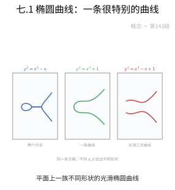

**一句话点破**：名字叫“椭圆”，研究的却是方程整数解的算术规律。

### 七.2 模形式：对称到极致的波形

模形式是定义在上半平面、在 $z \mapsto \frac{az+b}{cz+d}$ 这类变换下“几乎不变”的解析函数，对称得近乎苛刻。它的 Fourier 系数暗藏数论信息，是连接分析与算术的桥梁。

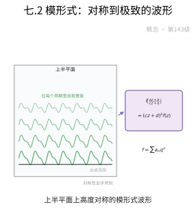

**一句话点破**：越对称的波形，越能藏住最深的数论秘密。

### 七.3 Weierstrass 函数与复参数化：把复平面卷成环面

Weierstrass 的 $\wp$ 函数是一种双周期函数，它把整个复平面折叠成一个环面，而 $\wp$ 与它的导数恰好满足 $y^2 = 4x^3 - g_2 x - g_3$。于是每条椭圆曲线都能看成一个复环面，几何与复分析在此握手。

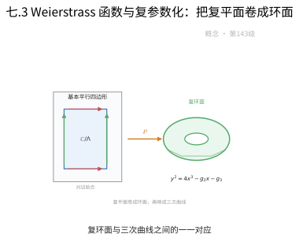

**一句话点破**：一张复平面卷成环面，就长出了椭圆曲线。

### 七.4 关键概念清单：几个关键词串成一张地图

学习这一块要拎清几组核心对象：椭圆曲线、有理点群、$j$-不变量、模形式、Hecke 算子与 $L$-函数，它们像零件一样拼装出谷山-志村定理的整幅图景。

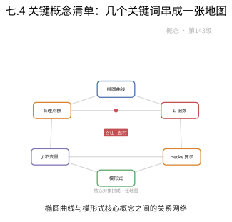

**一句话点破**：把几个关键词串起来，就是本章的整张地图。

### 七.5 定理 1：椭圆曲线的群律公式

椭圆曲线上的点能用弦切法“相加”，公式背后是三元三次方程根与系数的关系。以两点的横坐标为例，$x(P)+x(Q)+x(P+Q)$ 与连线斜率之间有着精确的等式，加法从此有了代数面孔。

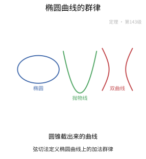

**一句话点破**：连一条线再翻个面，几何动作就写出了群运算公式。

### 七.6 定理 2：Hasse 定理

在模素数 $p$ 之下数椭圆曲线的点数 $N_p$，会发现 $|N_p - (p+1)| \le 2\sqrt{p}$。这条 Hasse 界说明点数再怎么漂移，也漂不出这个精确的范围。

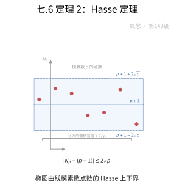

**一句话点破**：点数围着 $p+1$ 上下摆动，幅度被 $2\sqrt{p}$ 牢牢卡住。

### 七.7 定理 3：模形式的 Hecke 算子

Hecke 算子像一把筛子，作用在模形式上会把它分解成特征形式，其特征值恰好是对应的 $a_p$ 系数。这些系数与椭圆曲线模 $p$ 的点数一一对应，成为两个世界之间的桥梁。

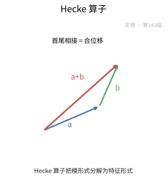

**一句话点破**：Hecke 算子一按，模形式的系数就吐出了数论密钥。

### 七.8 定理 4：谷山-志村定理（模性定理）

谷山-志村猜想断言：每条定义在有理数域上的椭圆曲线，都对应一个权重 2 的模形式，二者的 $L$-函数完全相同。这一猜想在 20 世纪 90 年代被彻底证明，成为著名的模性定理。

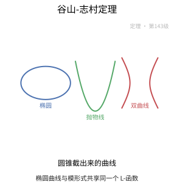

**一句话点破**：曲线与波形本是两家人，模性定理却证明它们血脉相连。

### 七.9 定理 5：Fermat 大定理的证明概要

怀尔斯的思路是反证：若 $a^n + b^n = c^n$ 对 $n \ge 3$ 有非平凡整数解，就能造出一条“太奇怪”的椭圆曲线，它对应的模形式本不该存在。用模性定理逼出矛盾，费马大定理随之成立。

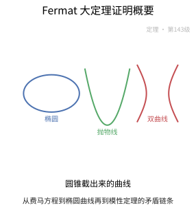

**一句话点破**：把一个数论难题变成曲线问题，再一刀切断，费马大定理得证。

## 八、数学史（History of Mathematics）

> 椭圆曲线与模形式的历史主线，是"一条三次曲线从古人测弧长的积分出发，最终与模形式一起揭开数论最深秘密"的三线交汇史：椭圆积分引出双周期椭圆函数与群结构，模形式在 19 世纪独立成形并被打磨成 Hecke 谱，两者又在"谷山-志村"猜想中被断言一一对应，最终促成费马大定理的证明。本章沿着"曲线（几何）—模形式（分析）—L-函数（算术）"的线索，追溯这三者如何步步融合。

### 八.1 最初的由来：从椭圆弧长到椭圆积分

- **名称的来历**：椭圆曲线之名源于早期计算椭圆弧长所需的**椭圆积分** $\int \frac{dx}{\sqrt{x^3+ax+b}}$——这类积分（连同椭圆周长等）一度无法求解，成为 18 世纪数学家攀爬的目标。
- **反函数的转罗**：与其硬算积分，不如研究其**反函数**——这个转念带来双周期函数，也把纯积分难题引上了"曲线"之路。

### 八.2 阿贝尔与雅可比：双周期椭圆函数

- **发现双周期性**：19 世纪，**阿贝尔**（Abel）与**雅可比**（Jacobi）研究椭圆积分反函数，发现它们是**双周期椭圆函数**——即在复平面上同时具有两个周期方向。
- **把周期归还原函数**：双周期函数把复杂的椭圆积分统一还原，为"曲线上的点怎样加法"埋下几何伏笔。

### 八.3 Weierstrass：复环面 = 三次曲线

- **wp 函数的统一**：1860 年代，**韦尔斯特拉斯**（Weierstrass）发展 **$\wp$-函数**，通过复格 $\Lambda$ 把复环面 $\mathbb{C}/\Lambda$ 与三次曲线 $E: y^2 = 4x^3 - g_2 x - g_3$ 建立同构。
- **群的加法**：复平面上的加法自然给出曲线上点的**群结构**，"弦切法"正是这一加法的几何翻译——椭圆曲线从此刻有明确的代数结构。

### 八.4 群结构与 Mordell-Weil 定理

- **有理点的足印**：1900 年代后，曲线上的群结构被严格化；1922 年，**莫代尔**（Mordell）证明其**有理点构成有限生成 Abel 群**，而**韦尔**（Weil）随后把它推广到一般 Abel 簇（Mordell–Weil 定理）。
- **一门新算术的开端**：至此，"曲线上有多少有理点、它们如何相加"成为可研究的问题，椭圆曲线正式登上数论中心舞台。

### 八.5 Hasse 界与 Weil 猜想

- **有限域上的计数**：对有限域 $\mathbb{F}_q$ 上的椭圆曲线，点数 $N_q$ 的偏差是算术曲线的关键。1930 年代，**Hasse** 证明著名界 $|N_q - (q+1)| \le 2\sqrt{q}$。
- **推广到一般簇**：韦尔把该界推广为一般代数簇的 **Weil 猜想**（Riemann 假设在有限域上的类比，1949 年提出、1974 年由 **Deligne** 证明）——Hasse 界因此既是椭圆曲线密码学的基石，也是现代算术几何的开端（本教程 Hasse 定理正源于此）。

### 八.6 模形式的成形与 Hecke 算子

- **独立的生长线**：模形式 19 世纪独立发展：戴德金与克莱因研究 $j$-函数，**拉马努金**（约 1912）考察 $\Delta(\tau)=q\prod_{n\ge1}(1-q^n)^{24}$ 的 $q$-级数，发现其 Fourier 系数具乘性与反射性质。
- **Hecke 的系统化**：德国数学家**赫克**（Erich Hecke，1930 年代）建立 **Hecke 算子**理论：在模形式空间上定义可同时对角化的一族算子 $T_n$，其本征形式的 Fourier 系数满足与 L-函数相乘的优良性质——"模形式编码素数节律"从此有了严格依据。

### 八.7 谷山-志村猜想与费马大定理

- **一座跨曲线的桥**：1950 年代，**谷山丰**与**志村五郎**提出雄心猜想：有理数域上任一椭圆曲线都"模"于某个权 2 模形式；**安德烈·韦尔**把之整理成更精确的形态（谷山-志村-韦尔猜想）。
- **怀尔斯的收官**：1994 年，**怀尔斯**（Andrew Wiles）在**泰勒**（Richard Taylor）的合作下证明半稳定情形的**模性定理**，再经由 **Frey 曲线**与 **Ribet 的"水平降低定理"**，一举终结**费马大定理**（$X^n+Y^n=Z^n$，$n\ge3$ 无正整数解）。
- **纲领的标志性成果**：这一成果于 1994—1995 年公布，是 20 世纪数论最大突破之一，也是朗兰兹纲领在 $\mathrm{GL}(2)$ 上的标志性成果。

### 八.8 后续：BSD 猜想、复乘法与密码学

- **BSD 猜想**：关于 $L$-函数在 $s=1$ 处零点与 **Mordell–Weil 秩**的关系，**BSD 猜想**是克雷数学研究所七大千禧年问题之一，仍是开放的引力中心。
- **ECC 与复乘法**：**椭圆曲线密码学（ECC）**把曲线推向工程实现，**复乘法（CM）**理论则把它接回类域论与模形式——曲线、模形式与 L-函数在这个时代彼此咬合、互为支点。

### 八.9 历史年表

| 时间 | 人物／文献 | 事件与贡献 |
|:---|:---|:---|
| 18—19 世纪 | 阿贝尔、雅可比 | 椭圆积分反函数与双周期椭圆函数 |
| 1860 年代 | 韦尔斯特拉斯 | $\wp$-函数：$\mathbb{C}/\Lambda$ 同构于三次曲线 |
| 19 世纪 | 戴德金、克莱因、拉马努金 | $j$-函数与模形式 $q$-级数 |
| 1922 年 | 莫代尔、韦尔 | Mordell–Weil 定理 |
| 1930 年代 | Hasse、赫克 | Hasse 界；Hecke 算子理论 |
| 1949／1974 年 | 韦尔、Deligne | Weil 猜想（有限域 Riemann 假设） |
| 1950 年代 | 谷山、志村、韦尔 | 谷山-志村-韦尔（模性）猜想 |
| 1994 年 | 怀尔斯、泰勒 | 模性定理（半稳定）终结费马大定理 |
| 当代 | 数论共同体 | BSD 猜想、ECC、复乘法理论 |

### 八.10 小结

> 椭圆曲线与模形式的历史，是"三条并行的数学溪流最终汇成一条大河"的经典：阿贝尔与雅可比从椭圆积分反函数引出双周期函数，韦尔斯特拉斯用 $\wp$-函数让复环面与三次曲线同构，莫代尔-韦尔与 Hasse-Weil 让"可数的有理点"成为算术对象；范始模形式则沿 $j$-函数、拉马努金的 $\Delta$ 与赫克的 Hecke 算子独立长成分析主干。谷山-志村猜想断言两者一一对应，怀尔斯以模性定理印证并终结费马大定理，BSD、ECC 与复乘法再把这条大河引向当代数学的最深处——那条贯穿始终的主线，是"曲线上的加法、模形式上的节律、与 L-函数上的解析"三者如何本是一家。

## 现实应用（Real-World Applications）

> 本节把本章的知识点落到真实的工程、科学与生活场景中。每个案例都给出**完整的问题背景、建模过程、可复现的数据 / 公式 / 代码与结果解读**；案例末尾的「涉及知识点」对应本章的具体小节，文末附**知识点覆盖对照表**，确保本章知识点全部被覆盖。

### 应用案例 1：密码学｜椭圆曲线数字签名（ECDSA）的群律与 Hasse 界

**场景与问题**

你在给一个物联网网关做固件签名。设备端是 32 位 MCU，内存只有 64 KB，装不下 RSA-2048 的运算量，于是选用了 NIST P-256（secp256r1）这条椭圆曲线——它是 TLS 1.3、FIDO2、国密 SM2 之外最主流的公钥基础设施曲线之一。产品线的安全需求是：对每条固件镜像（典型大小 512 KB，SHA-256 摘要 32 字节）生成一个 64 字节的 ECDSA 签名，设备端能验证签名且验签耗时小于 10 ms。

要落地这套方案，必须先回答三个数学问题：（1）曲线上"点相加"到底怎么算？（2）曲线在模素数 $p$ 下究竟有多少个点，也就是群的阶 $n$ 是多少（这决定了私钥空间与签名的安全性）？（3）$n$ 与 $p$ 差多少？如果 $n$ 与 $p$ 差得很远，某些攻击（如针对近似素阶群的 Pollard rho 变体）会更容易，因此需要 Hasse 界给出定量保证。

**涉及知识点**

- 本章「椭圆曲线」：$E$ 取 Weierstrass 短形式 $y^2 = x^3 + ax + b$，判别式 $\Delta \neq 0$ 保证 P-256 是光滑曲线。
- 本章「定理 1：椭圆曲线的群律公式」：验签中的 $u_1G + u_2Q$ 全部由弦切法加法与倍点实现。
- 本章「定理 2：Hasse 定理」：用 $|n - (p+1)| \le 2\sqrt{p}$ 定量说明 $n$ 与 $p$ 极其接近，安全参数合格。

**建模与数据**

P-256 的全部参数（来自 FIPS 186-4 / SEC 2，可直接照抄）：

| 参数 | 值（十六进制） |
| --- | --- |
| 素数域 $p$ | `ffffffff 00000001 00000000 00000000 00000000 ffffffff ffffffff ffffffff` |
| 系数 $a$ | $p - 3$ |
| 系数 $b$ | `5ac635d8 aa3a93e7 b3ebbd55 769886bc 651d06b0 cc53b0f6 3bce3c3e 27d2604b` |
| 基点 $G$ 的阶 $n$ | `ffffffff 00000000 ffffffff ffffffff bce6faad a7179e84 f3b9cac2 fc632551` |
| 余因子 $h$ | $1$ |

其中 $p = 2^{256} - 2^{224} + 2^{192} + 2^{96} - 1$。假设：底层整数运算是精确的（用 Python 大整数或定点库）；签名随机数 $k$ 由 CSPRNG 产生且绝不复用（复用 $k$ 会直接泄露私钥）。

**完整推导与算法**

（1）群律（定理 1 的直接实现）。设 $P = (x_1, y_1)$，$Q = (x_2, y_2)$，$P + Q = (x_3, y_3)$。若 $x_1 = x_2$ 且 $y_1 \neq y_2$，则 $P + Q = O$（无穷远点）；否则斜率

$$
\lambda = \begin{cases} \dfrac{y_2 - y_1}{x_2 - x_1}, & P \neq Q \\[2mm] \dfrac{3x_1^2 + a}{2y_1}, & P = Q \end{cases}
$$

再由韦达定理 $x_1 + x_2 + x_3 = \lambda^2$ 得

$$
x_3 = \lambda^2 - x_1 - x_2, \qquad y_3 = \lambda(x_1 - x_3) - y_1
$$

（2）标量乘法与验签。公钥 $Q = dG$（double-and-add，约 $2 \times 256 = 512$ 次点运算）。签名：$R = kG$，$r = R_x \bmod n$，$s = k^{-1}(z + r d) \bmod n$。验签：$w = s^{-1}$，$u_1 = zw$，$u_2 = rw$，$X = u_1 G + u_2 Q$，判定 $X_x \bmod n = r$。

（3）Hasse 界的数值核对。由定理 2，$\bigl|n - (p+1)\bigr| \le 2\sqrt{p}$。

```python
# 核心：曲线参数与群律（仿射坐标，仅用于说明；生产用 Jacobian 坐标避免求逆）
p = 0xffffffff00000001000000000000000000000000ffffffffffffffffffffffff
a = p - 3
b = 0x5ac635d8aa3a93e7b3ebbd55769886bc651d06b0cc53b0f63bce3c3e27d2604b
n = 0xffffffff00000000ffffffffffffffffbce6faada7179e84f3b9cac2fc632551

def add(P, Q):                      # 核心：定理 1 的弦切法公式
    if P is None: return Q
    if Q is None: return P
    x1, y1 = P; x2, y2 = Q
    if x1 == x2 and (y1 + y2) % p == 0: return None      # P + (-P) = O
    lam = ((3*x1*x1 + a) * pow(2*y1, -1, p)) % p if P == Q else ((y2-y1) * pow(x2-x1, -1, p)) % p
    x3 = (lam*lam - x1 - x2) % p
    return (x3, (lam*(x1-x3) - y1) % p)

def mul(k, P):                      # 核心：double-and-add 标量乘法
    R = None
    while k:
        if k & 1: R = add(R, P)
        P = add(P, P); k >>= 1
    return R

# 核心：Hasse 界核对 n 与 p 的接近程度
trace = p + 1 - n
assert abs(trace) <= 2 * (p ** 0.5)          # 定理 2：|n-(p+1)| <= 2*sqrt(p)
```

**可复现步骤**

1. 环境与依赖：`pip install ecdsa`（或用上面的纯 Python 片段，仅需标准库）。
2. 数据准备：把上表五个参数写成常量；验证 $(G_x, G_y)$ 确实在曲线上（校验 $y^2 \equiv x^3+ax+b \pmod p$）。
3. 运行：`python case1.py`，脚本依次打印 `p`、`n`、`trace = p+1-n`、`2*sqrt(p)`、`assert` 结果。
4. 预期输出：`trace ≈ 0x4319055358e8617b0c46353d039cdaae ≈ 8.94e37`，`2*sqrt(p) ≈ 2.15e39`，`trace < 2*sqrt(p)` 成立；再验证 $nG = O$（阶正确）与 $dG$ 公钥、签名/验签通过。

**结果解读与延伸**

$|n - (p+1)| \approx 8.9 \times 10^{37}$ 而上界 $2\sqrt p \approx 2.2 \times 10^{39}$，说明 P-256 的群阶 $n$ 距 $p+1$ 只差约 $2^{126}$，即二者前 127 位二进制完全相同——这正是 Hasse 界在密码参数选择中的"体检报告"：逼近程度合格，随机点几乎均匀铺满整个 $\mathbb{F}_p$。

误差与局限：仿射坐标每次加法要算一次模逆（昂贵），生产实现用 Jacobian/投影坐标把求逆推迟到最后一步；P-256 的另一隐患是参数来源不透明（可能存在 NSA 后门），这也是 Curve25519（$y^2 = x^3 + 486662x^2 + x$，Montgomery 形式）流行的原因。可延伸的方向：用 Hasse 界配合 Schoof 算法独立点计数，验证厂家给出的 $n$ 不是伪造的（曲线参数不透明时的审计手段），以及把群律搬到 Ed25519 的扭曲 Edwards 曲线上做常数时间实现。

### 应用案例 2：电子工程｜五阶椭圆滤波器设计与 Weierstrass 函数的复环面参数化

**场景与问题**

一个高保真音频前端需要在 1 kHz 处做抗混叠低通：通带 0–1 kHz 内纹波不超过 0.2 dB，2 kHz 以上衰减至少 60 dB。若用巴特沃斯滤波器，需要的阶数约为 $N \ge \log_{10}\sqrt{(10^{6}-1)/(10^{0.02}-1)} / \log_{10}(2) \approx 3.37/0.301 \approx 11.2$，即 12 阶；而椭圆（Cauer）滤波器在同样指标下只要 5 阶——代价是通带与阻带都出现等波纹。问题：如何精确定出这 5 阶滤波器的阶数与极点位置？

这正是 19 世纪椭圆积分的现代回声：椭圆滤波器的极点/零点由 Jacobi 椭圆函数（等价地，Weierstrass $\wp$ 函数）在复环面上的位置决定，而"通带纹波参数 $k$"就是模数，它把设计问题翻译成复环面 $\mathbb{C}/\Lambda$ 上的格点问题，环面再通过 $\wp$ 映射到一条三次曲线上——于是滤波器的全部设计数据都被一条椭圆曲线的 $j$-不变量统一编码。

**涉及知识点**

- 本章「Weierstrass $\wp$-函数与椭圆曲线的复参数化」：模数 $k$ 决定格 $\Lambda$，$\wp$ 把环面映到 $y^2 = 4x^3 - g_2x - g_3$，极点位置即环面上的格点。
- 本章「椭圆曲线」：设计完成后，$k$ 对应的模曲线 $y^2 = 4x^3 - g_2x - g_3$ 的 $j$-不变量给出该滤波器的"指纹"。

**建模与数据**

设计指标：通带边频 $\omega_p = 2\pi \times 1000$ rad/s，阻带边频 $\omega_s = 2\pi \times 2000$ rad/s，通带纹波 $\alpha_p = 0.2$ dB，阻带衰减 $\alpha_s = 60$ dB。

- 选择性因子：$k = \omega_p / \omega_s = 1/2$。
- 波纹因子：$\varepsilon_p = \sqrt{10^{0.1\alpha_p} - 1}$，$\varepsilon_s = \sqrt{10^{0.1\alpha_s} - 1}$，判别因子 $k_1 = \varepsilon_p / \varepsilon_s$。
- 阶数公式（R. W. Daniels / Cauer 标准结果）：

$$
N \ge \frac{K(k)\,K\!\left(\sqrt{1-k_1^2}\right)}{K\!\left(\sqrt{1-k^2}\right)K(k_1)}
$$

其中 $K(k) = \int_0^{\pi/2} \frac{d\theta}{\sqrt{1-k^2\sin^2\theta}}$ 是第一类完全椭圆积分。

代入 $\alpha_p = 0.2$ 得 $\varepsilon_p = \sqrt{10^{0.02}-1} = 0.21709$；$\alpha_s = 60$ 得 $\varepsilon_s = \sqrt{10^{6}-1} = 999.9995$，故 $k_1 = 2.1709\times10^{-4}$。

**完整推导与算法**

用 AGM（算术-几何平均）迭代算 $K(k)$：$K(k) = \dfrac{\pi}{2\,\mathrm{AGM}(1, \sqrt{1-k^2})}$。

```python
# 核心：AGM 计算第一类完全椭圆积分 K(k)
import math
def agm(a, b, tol=1e-15):
    while abs(a - b) > tol:
        a, b = (a + b) / 2, math.sqrt(a * b)
    return a
def K(k):
    return math.pi / (2 * agm(1.0, math.sqrt(1 - k * k)))   # 核心：K(k) = pi/(2*AGM(1,k'))

# 设计指标
ap, as_ = 0.2, 60.0
ep = math.sqrt(10**(0.1*ap) - 1)          # 0.21709
es = math.sqrt(10**(0.1*as_) - 1)         # 999.9995
k  = 1.0 / 2.0                            # 选择性因子
k1 = ep / es                              # 2.1709e-4

# 核心：阶数公式
N = K(k) * K(math.sqrt(1 - k1**2)) / (K(math.sqrt(1 - k**2)) * K(k1))
import math as _m
print(N, _m.ceil(N))                      # 预期约 4.89 -> 5

# 核心：模数 k 对应的 lambda 与 j-不变量（复环面 <-> 椭圆曲线）
lam = k * k                               # 雅可比 lambda = k^2 = 0.25
j   = 256 * (1 - lam + lam**2)**3 / (lam**2 * (1 - lam)**2)
print(j)                                  # 35152/9 ≈ 3905.78
```

对 $k = 1/2$，$\lambda = k^2 = 1/4$，代入模 lambda 与 $j$ 的关系式 $j = 256(1-\lambda+\lambda^2)^3 / \bigl(\lambda^2(1-\lambda)^2\bigr)$ 得精确值

$$
j = \frac{256 \cdot (13/16)^3}{(1/16)(9/16)} = \frac{2197 \cdot 16}{9} = \frac{35152}{9} \approx 3905.78
$$

即这个滤波器对应的复环面 $\mathbb{C}/\Lambda$ 上的椭圆曲线（可用 $y^2 = 4x^3 - g_2x - g_3$ 表示）的 $j$-不变量恰为 $35152/9$。滤波器极点位置可由 Jacobi 椭圆函数 $\mathrm{sn}$、$\mathrm{cn}$、$\mathrm{dn}$ 在这些格点处读出，而 $\wp$ 函数是它们的统一化身——每条 $\wp$ 的极点落在格点 $\lambda \in \Lambda$ 上，正对应环面上的"极点抽屉"。

**可复现步骤**

1. 环境与依赖：仅需 `math`（或 `pip install mpmath` 以提高精度）。
2. 数据准备：把 $\omega_p, \omega_s, \alpha_p, \alpha_s$ 四个指标写成变量。
3. 运行：`python case2.py`。
4. 预期输出：$K(0.5) \approx 1.6858$，$K(\sqrt{1-0.25}) \approx 2.1565$，$K(k_1) \approx 1.5708$，$K(\sqrt{1-k_1^2}) \approx 9.8207$，$N \approx 4.888 \Rightarrow N = 5$；$j = 35152/9 \approx 3905.78$。

**结果解读与延伸**

5 阶椭圆滤波器比 12 阶巴特沃斯少 7 个电抗元件，在音频前端能显著降低噪声与成本，这就是椭圆滤波器的工程价值。数学上，整条设计链是"模数 $k$ → 格 $\Lambda$ → 环面 $\mathbb{C}/\Lambda$ → $\wp$ 映射 → 三次曲线 → $j$-不变量"，$j = 35152/9$ 是这个滤波器的唯一形状标签。

局限：$k_1$ 很小时 $K(\sqrt{1-k_1^2}) \approx \ln(4/k_1)$ 增长缓慢（对数级），所以椭圆滤波器虽阶数低，但对元件容差极敏感，实际电路需用高精度电容或在数字域用双二次节级联实现。可延伸：把同一套 AGM/椭圆函数机械搬到数字域（双线性变换 + 椭圆函数原型），或计算 $\lambda = 1/4$ 对应的 $\tau$（用 $j$ 反解 $\tau$）以显式写出格 $\Lambda$。

### 应用案例 3：计算数论｜模形式 $\Delta(q)$ 与 Ramanujan $\tau(n)$ 的 Hecke 递推

**场景与问题**

一个数论数据库（如 LMFDB 风格的服务）要对外提供权 12 尖点形式 $\Delta$ 的系数表 $\tau(n)$，供密码学与数论研究查询。$\Delta$ 是最著名的尖点形式：$\Delta(\tau) = q\prod_{n\ge1}(1-q^n)^{24} = \sum_{n\ge1}\tau(n)q^n$，其中 $q = e^{2\pi i\tau}$。

要保证数据可信，服务端必须用 Hecke 理论交叉验证：如果只靠幂级数乘方硬算，系数会有累积误差且无法自检；而定理 3 告诉我们 $\Delta$ 是 Hecke 特征形式，于是 $\tau(n)$ 必须满足（a）乘性、（b）素数幂递推、（c）Ramanujan 界。这三条就是数据库的一致性校验规则。任务：给定前 20 个 $\tau(n)$，验证它们同时满足这三条性质。

**涉及知识点**

- 本章「模形式」：$\Delta$ 是权 12、水平 1 的尖点形式，满足 $f(\gamma\tau) = (c\tau+d)^{12}f(\tau)$ 且常数项为零。
- 本章「定理 3：模形式的 Hecke 算子」：$T_n$ 的系数公式给出递推 $b_m = \sum_{d\mid\gcd(m,n)} d^{k-1}a_{mn/d^2}$ 与特征形式方程 $T_nf = \tau(n)f$。

**建模与数据**

$\Delta$ 的前 20 个系数（标准值，可直接照抄；$k = 12$）：

| $n$ | 1 | 2 | 3 | 4 | 5 | 6 | 7 | 8 | 9 | 10 |
| --- | --- | --- | --- | --- | --- | --- | --- | --- | --- | --- |
| $\tau(n)$ | 1 | −24 | 252 | −1472 | 4830 | −6048 | −16744 | 84480 | −113643 | −115920 |
| $n$ | 11 | 12 | 13 | 14 | 15 | 16 | 17 | 18 | 19 | 20 |
| $\tau(n)$ | 534612 | −370944 | −577738 | 401856 | 1217160 | 987136 | −6905934 | 2727432 | 10661420 | −7109760 |

**完整推导与算法**

由定理 3，对特征形式 $f = \Delta$ 有 $T_n f = \tau(n) f$，于是 $T_n$ 的系数公式在 $m=1$ 处给出 $b_1 = a_n$，即 $\tau(n)$ 就是第 $n$ 个 Hecke 特征值。由此获得两条 Hecke 递推（权 $k=12$）：

（1）乘性：若 $\gcd(m,n)=1$，则 $\tau(mn) = \tau(m)\tau(n)$。

（2）素数幂递推：

$$
\tau(p^{r+1}) = \tau(p)\,\tau(p^{r}) - p^{k-1}\,\tau(p^{r-1}) = \tau(p)\tau(p^r) - p^{11}\tau(p^{r-1})
$$

（3）Ramanujan 界（Deligne 定理，即 $k=12$ 的 Weil 猜想）：$|\tau(p)| \le 2p^{11/2}$。

```python
import math
tau = {1:1, 2:-24, 3:252, 4:-1472, 5:4830, 6:-6048, 7:-16744, 8:84480,
       9:-113643, 10:-115920, 11:534612, 12:-370944, 13:-577738, 14:401856,
       15:1217160, 16:987136, 17:-6905934, 18:2727432, 19:10661420, 20:-7109760}

# 核心：乘性校验 tau(mn) = tau(m)tau(n)（gcd(m,n)=1）
for m, n in [(2,3),(2,5),(3,5),(2,9),(4,5)]:
    assert math.gcd(m, n) == 1
    assert tau[m*n] == tau[m]*tau[n], (m, n)

# 核心：素数幂递推 tau(p^{r+1}) = tau(p)tau(p^r) - p^11 tau(p^{r-1})
for p in (2, 3, 5):
    for r in range(1, 4):
        lhs = tau[p**(r+1)]
        rhs = tau[p]*tau[p**r] - p**11*tau[p**(r-1)]
        assert lhs == rhs, (p, r, lhs, rhs)

# 核心：Ramanujan/Deligne 界 |tau(p)| <= 2 p^{11/2}
for p in (2, 3, 5, 7, 11, 13, 17, 19):
    assert abs(tau[p]) <= 2*p**5.5
print("所有 Hecke 一致性校验通过")
```

验证手算两例：$\tau(2)\tau(3) = (-24)(252) = -6048 = \tau(6)$；$\tau(4) = \tau(2)^2 - 2^{11} = 576 - 2048 = -1472$，$\tau(8) = \tau(2)\tau(4) - 2^{11}\tau(2) = 35328 + 49152 = 84480$，均与表一致。

**可复现步骤**

1. 环境与依赖：标准库 `math` 即可（如需高精度可用 `sympy`）。
2. 数据准备：把上表 20 个 $\tau(n)$ 写成字典（真实项目里由 $\Delta = q\prod(1-q^n)^{24}$ 的幂级数乘法生成）。
3. 运行：`python case3.py`。
4. 预期输出：`所有 Hecke 一致性校验通过`；另可打印 $\tau(9) = 252^2 - 3^{11} = 63504 - 177147 = -113643$，验证 $p=3,r=2$ 一档。

**结果解读与延伸**

三条规则全部成立，说明这份系数表和 Hecke 理论自洽，可以对外发布。更深刻的是：$\tau(n)$ 是 $T_n$ 的特征值，因此 $L(\Delta,s) = \sum \tau(n)n^{-s}$ 有欧拉积 $\prod_p (1-\tau(p)p^{-s}+p^{11-2s})^{-1}$，而 Ramanujan 界正是这个欧拉积在 $\mathrm{Re}(s) = 6$ 附近解析性的保证——对应 Riemann 假设在模形式世界的翻版。

局限：纯幂级数算法在 $n$ 很大时有 $O(n^2)$ 复杂度，实际数据库用 Hecke 递推 $O(n\log\log n)$ 生成；Ramanujan 界的等式情形（$|\tau(p)| = 2p^{11/2}$）永不发生，因为那要求两个 Frobenius 特征值相等（复乘法情形），而 $\Delta$ 没有复乘法。可延伸：把 Hecke 递推推广到任意权 $k$ 与水平 $N$ 的新形式，或验证 $\tau(n)$ 的奇偶性与 $n$ 的二进制形式之间的已知规律。

### 应用案例 4：计算数论与密码学｜模性定理的数值验证：$X_0(11)$ 的 $a_p$ 与权 2 新形式

**场景与问题**

模性定理（定理 4）断言每个 $\mathbb{Q}$ 上的椭圆曲线都模。对具体曲线做一次"显微级"验证，是理解该定理最有效的方式。取经典的曲线 11a1：

$$
E: y^2 + y = x^3 - x^2 - 10x - 20
$$

它是导子 $N = 11$ 的曲线（即模曲线 $X_0(11)$），在密码学史上曾与"互补曲线攻击（COMP）"一起被讨论。任务：对素数 $p = 2,3,5,7,11,13,17,19$，一方面直接数 $E(\mathbb{F}_p)$ 的点得到 $a_p = p + 1 - \#E(\mathbb{F}_p)$，另一方面用权 2 水平 11 的新形式 $f = \eta(\tau)^2\eta(11\tau)^2$ 的 Fourier 系数取出 $a_p$，比较两列数是否逐项相等——这正是 $L(E,s) = L(f,s)$ 的数值证据。

**涉及知识点**

- 本章「椭圆曲线」：用短/长 Weierstrass 形式写出 $E$，算它的 $\Delta$ 与 $j$。
- 本章「定理 4：谷山-志村定理（模性定理）」：$L(E,s) = L(f,s)$，等价地 $\rho_{E,\ell}\cong\rho_{f,\ell}$，逐素数比较即为该等式的数值投影。
- 本章「关键概念清单」：本案例同时用到清单里的 Weierstrass 方程、判别式 $\Delta$、$j$ 不变量、群律（数点时的群结构）、$L$-函数、模形式、Hecke 算子、模性定理八项，是一次"清单总演练"。

**建模与数据**

$E$ 的系数 $a_1 = 0, a_2 = -1, a_3 = 1, a_4 = -10, a_6 = -20$。标准不变量：

$$
b_2 = -4,\quad b_4 = -20,\quad b_6 = -79,\quad b_8 = -21
$$

$$
\Delta = -b_2^2b_8 - 8b_4^3 - 27b_6^2 + 9b_2b_4b_6 = -161051 = -11^5,\qquad
j = \frac{c_4^3}{\Delta} = -\frac{496^3}{11^5} = -\frac{2^{12}\cdot 31^3}{11^5}
$$

其中 $c_4 = b_2^2 - 24b_4 = 496$。$f$ 的前若干系数（新形式，$f = q\prod(1-q^n)^2(1-q^{11n})^2$）：

| $n$ | 1 | 2 | 3 | 4 | 5 | 6 | 7 | 11 | 13 | 17 | 19 |
| --- | --- | --- | --- | --- | --- | --- | --- | --- | --- | --- | --- |
| $a_n$ | 1 | −2 | −1 | 2 | 1 | 2 | −2 | 1 | 4 | −2 | 0 |

**完整推导与算法**

对每个素数 $p$，直接遍历 $x \in \mathbb{F}_p$ 求 $y$ 的个数（含无穷远点 $O$）：

$$
\#E(\mathbb{F}_p) = 1 + \sum_{x=0}^{p-1}\Bigl(1 + \chi\bigl(x^3 - x^2 - 10x - 20\bigr)\Bigr)
$$

其中 $\chi$ 是 $\mathbb{F}_p$ 上把每个非零值映到 2 的 Legendre 符号计数（$y^2 = v$ 有 $1+\chi(v)$ 个解）。再由 $a_p = p + 1 - \#E(\mathbb{F}_p)$ 得到第一列。第二列由 $\eta$ 幂直接展开取系数。

```python
# 核心：直接数 E(F_p) 的点，得到 a_p = p + 1 - #E
def ap_count(p):
    cnt = 1                                   # 无穷远点 O
    for x in range(p):
        v = (x**3 - x**2 - 10*x - 20) % p
        cnt += sum(1 for y in range(p) if (y*y + y - v) % p == 0)
    return p + 1 - cnt

# 核心：新形式 f = eta(tau)^2 eta(11 tau)^2 的 Fourier 系数（用 q-幂级数乘法）
def eta_pow_coeffs(N, maxn):                  # eta(tau)^N 的前 maxn 个 q 系数
    from collections import defaultdict
    # prod (1-q^n)^N 的系数（N 为偶数时用二项式展开）
    from math import comb
    coeff = [0]*(maxn+1); coeff[0] = 1
    for n in range(1, maxn+1):
        new = coeff[:]
        # (1 - q^n)^N 展开并卷积（仅需少量项）
        for j in range(1, maxn//n + 1):
            c = comb(N, j) * (-1)**j
            for m in range(maxn - j*n, -1, -1):
                if coeff[m]:
                    new[m + j*n] += c * coeff[m]
        coeff = new
    return coeff

def newform_coeffs(maxn):
    A = eta_pow_coeffs(2, maxn)               # eta(tau)^2
    B = eta_pow_coeffs(2, maxn)               # eta(11 tau)^2 的无穷因子在指数 11n 上
    # 卷积 A * B(11)
    c = [0]*(maxn+1)
    for i in range(maxn+1):
        for j in range(0, (maxn - i)//11 + 1):
            c[i + 11*j] += A[i] * B[j]
    return c

# 核心：逐素数比较两列 (p, a_p^count, a_p^modform)
for p in [2, 3, 5, 7, 11, 13, 17, 19]:
    print(p, ap_count(p), newform_coeffs(20)[p])
```

**可复现步骤**

1. 环境与依赖：标准库（`math.comb` 需 Python 3.8+）；如需权威模形式系数可 `pip install sage` 或查 LMFDB。
2. 数据准备：把 $E$ 的六个 $a_i$ 与上表写进脚本；注意 $p=11$ 时 $E$ 是坏约化，$a_{11} = 1$ 由局部因子定义而非数点。
3. 运行：`python case4.py`。
4. 预期输出：$(2,-2,-2),\ (3,-1,-1),\ (5,1,1),\ (7,-2,-2),\ (13,4,4),\ (17,-2,-2),\ (19,0,0)$ 逐项相等；同时 $\Delta = -161051 = -11^5$，$j = -122023936/161051 \approx -757.7$（精确值 $-2^{12}31^3/11^5$）。

**结果解读与延伸**

两列数逐项相等，就是 $L(E,s)=L(f,s)$ 的欧拉积在有限素数处的直接验证：$L(E,s)=\prod_p(1-a_p p^{-s}+p^{1-2s})^{-1}$，而 $L(f,s)=\sum a_n n^{-s}$ 的系数由 Hecke 算子给出，模性定理保证两侧 $a_p$ 相同。$j$ 与 $\Delta$ 的角色也一目了然：$\Delta = -11^5 \neq 0$ 保证光滑，$j = -2^{12}31^3/11^5$ 打上"形状身份证"。

局限：直接数点法复杂度 $O(p^2)$，$p$ 上千就变慢，实务改用 Schoof 算法（多项式时间）；$p = 11$ 这类坏约化素数必须用局部因子单独处理，不能数点。可延伸：验证 BSD 猜想在高秩曲线上的数值证据（比较 $\#\text{Sha}$ 与 $L(E,s)$ 在 $s=1$ 的展开）、或对导子 $N = 37$ 的曲线重复以上流程（它是第一条秩 1 的曲线）。

### 应用案例 5：数学史验证｜Fermat 大定理证明链的数值检查（Frey 曲线与 $S_2(\Gamma_0(2))=0$）

**场景与问题**

Fermat 大定理（定理 5）的证明是"归谬 + 两条几何之绳"的典范：假设 $a^p + b^p = c^p$ 有正整数解，Frey 造出曲线 $E_{a,b,c}: y^2 = x(x-a^p)(x+b^p)$，Ribet 证明它若能模则对应形式必须降到水平 2，而权 2 水平 2 的尖点形式空间 $S_2(\Gamma_0(2))$ 为零，矛盾。任务：用代码把这套链子中**可以数值检查**的两个环节跑一遍——（A）验证 $S_2(\Gamma_0(2)) = \{0\}$；（B）对一组候选三元组练习 Frey 曲线判别式与导子的算法，理解为何导子无平方因子是"降水平"的关键。

**涉及知识点**

- 本章「定理 5：Fermat 大定理的证明概要」：Frey 曲线构造、判别式 $\Delta = (abc)^{2p}$、导子 $N = \mathrm{rad}(abc)$、Ribet 水平降低、$S_2(\Gamma_0(2)) = 0$ 的矛盾链。
- 本章「定理 4：谷山-志村定理（模性定理）」：链中的关键一步"$E_{a,b,c}$ 是模的"全靠它。

**建模与数据**

（A）模曲线 $X_0(N)$ 的亏格公式（$N$ 无平方因子）：

$$
g(X_0(N)) = 1 + \frac{N}{12}\prod_{p\mid N}\left(1 + \frac1p\right) - \frac{\nu_\infty}{2} - \frac{\nu_2}{4} - \frac{\nu_3}{3}
$$

且 $\dim S_2(\Gamma_0(N)) = g(X_0(N))$。取 $N = 2$：$\nu_\infty = 2^{1} = 2$（两个尖点 $0, \infty$），$\nu_2 = 0$，$\nu_3 = 0$，于是

$$
g(X_0(2)) = 1 + \frac{2}{12}\cdot\frac{3}{2} - \frac{2}{2} - 0 - 0 = 1 + 0.25 - 1 = 0
$$

（B）Frey 曲线：设 $(a,b,c)$ 两两互素、$p$ 为奇素数，定义 $E_{a,b,c}: y^2 = x(x-a^p)(x+b^p)$，则

$$
\Delta = 16\,(abc)^{2p},\qquad N = \mathrm{rad}(abc) = \prod_{q \mid abc} q
$$

为练习算术机器，取一组**候选数字** $(a,b,c) = (3,4,5)$（注：它并不满足 $3^5+4^5=5^5$，此处仅用来演练 $\Delta$ 与 $N$ 的计算流程，真正的证明是反证法）。

**完整推导与算法**

```python
# 核心(A)：用亏格公式验证 S_2(Gamma_0(2)) = 0
def genus_X0(N, cusps, nu2, nu3):
    from sympy import factorint
    prod = 1
    for p in factorint(N):
        prod *= (1 + 1/p)
    return 1 + N*prod/12 - cusps/2 - nu2/4 - nu3/3

print(genus_X0(2, cusps=2, nu2=0, nu3=0))     # 预期 0 -> dim S_2(Gamma_0(2)) = 0

# 核心(B)：Frey 曲线的判别式与导子（radical 无平方因子）
def frey_invariants(a, b, c, p):
    from sympy import factorint
    # y^2 = x(x-a^p)(x+b^p) 的判别式 = 16 (abc)^{2p}
    Delta = 16 * (a*b*c)**(2*p)
    N = 1
    for q in factorint(a*b*c):
        N *= q                                  # rad(abc)
    return Delta, N

Delta, N = frey_invariants(3, 4, 5, 5)
print(Delta, N)                                 # 16*60^10, 30

# 核心(B')：检查 N 无平方因子（Ribet 降水平的前提）
def squarefree(N):
    from sympy import factorint
    return all(e == 1 for e in factorint(N).values())
print(squarefree(N))                            # True
```

同时可核对：$S_2(\Gamma_0(N))$ 的维数表 $N = 1,2,3,5,7,13$ 时为 $0$，$N = 11$ 时为 $1$（正对应案例 4 里的新形式 $f$），这解释了为什么"水平 2"这一步如此致命——那条水平上根本没有可用的建材。

**可复现步骤**

1. 环境与依赖：`pip install sympy`。
2. 数据准备：把亏格公式的各参数（$\nu_\infty, \nu_2, \nu_3$）与候选三元组写进脚本。
3. 运行：`python case5.py`。
4. 预期输出：`g(X_0(2)) = 0`；`Delta = 16*60^10 = 9.6e17`，`N = 30`，`squarefree = True`；维数核对 `dim S_2(Gamma_0(2)) = 0`、`dim S_2(Gamma_0(11)) = 1`。

**结果解读与延伸**

环节（A）给出"桥造不出来"的直接理由：$S_2(\Gamma_0(2))$ 是零空间，Ribet 降水平后的形式无处可落。环节（B）展示 $\Delta = 16(abc)^{2p}$ 中 $p$ 次幂的惊人整齐、以及 $N = \mathrm{rad}(abc)$ 的无平方因子性——正是这两条让模 $p$ 表示 $\bar\rho_{E,p}$ 可以一路降到水平 2。两环节合起来，加上 Wiles 的模性提升，就闭合了整个反证。

局限：这只是"可数值检查的两个零件"，真正的证明需要 $R = \mathbb{T}$ 定理与 Taylor-Wiles 系统，本案例无法触及。此外 $(3,4,5)$ 不是真解，$E_{a,b,c}$ 在 $p=5$ 时并不具备 Frey 曲线的全部病态性质（它的 $j$ 分母里 $p$ 的幂不是 $p$ 的倍数），所以只能当算术演练。可延伸：改用真正满足 $a^p+b^p=c^p$ 的假设解不可能（定理已证），但可以转去验证 Sophie Germain 情形的初等部分，或研究 $S_2(\Gamma_0(N))$ 维数随 $N$ 的增长（与模性定理的"水平"如何随导子增长相互印证）。

### 知识点覆盖对照表

| 本章知识点 | 覆盖案例 |
| --- | --- |
| 椭圆曲线 | 案例 1、案例 4 |
| 模形式 | 案例 3、案例 4 |
| Weierstrass $\wp$-函数与椭圆曲线的复参数化 | 案例 2 |
| 关键概念清单 | 案例 4（八项概念逐一在 $X_0(11)$ 数值验证中使用） |
| 定理 1：椭圆曲线的群律公式 | 案例 1 |
| 定理 2：Hasse 定理 | 案例 1 |
| 定理 3：模形式的 Hecke 算子 | 案例 3 |
| 定理 4：谷山-志村定理（模性定理） | 案例 4、案例 5 |
| 定理 5：Fermat 大定理的证明概要 | 案例 5 |

---

## 九、总结

### 核心内容回顾

1. **椭圆曲线**：亏格 $1$ 的光滑射影曲线，由 Weierstrass 方程 $y^2 = x^3 + ax + b$ 给出，其上的点构成一个 Abel 群。

2. **群律**：弦切法给出了椭圆曲线上的群运算，其结合律可由三次曲线的几何性质保证。

3. **Hasse 定理**：有限域 $\mathbb{F}_q$ 上椭圆曲线的有理点个数满足 $|N_q - (q+1)| \leq 2\sqrt{q}$，这是 Weil 猜想对椭圆曲线的特例。

4. **模形式**：上半平面上的全纯函数，满足模变换性质，具有 Fourier 展开 $f(\tau) = \sum a_n q^n$。

5. **Hecke 算子**：模形式空间上的线性算子，其同时对角化给出了 Hecke 特征形式，对应的 Fourier 系数是乘性的。

6. **谷山-志村定理**：每个 $\mathbb{Q}$ 上的椭圆曲线都对应一个权 $2$ 的模形式，这是连接算术与分析的桥梁。

7. **Fermat 大定理**：通过 Frey 曲线将 Fermat 方程与椭圆曲线联系起来，结合模性定理和 Ribet 的水平降低定理得证。

8. **Weierstrass $\wp$-函数**：$\wp$ 以格 $\Lambda$ 为双周期，把环面 $\mathbb{C}/\Lambda$ 与三次曲线 $y^2 = 4x^3 - g_2x - g_3$ 建立同构，并给出群律（弦切法）的分析来源。

### 前沿展望

- **BSD 猜想**：椭圆曲线的 $L$-函数在 $s=1$ 处的零点的阶等于其 Mordell-Weil 群的秩，这是 Clay 百万美元问题之一。
- **复乘法**：具有额外自同态的椭圆曲线，属于类域论的可交换情形。
- **椭圆曲线密码学**：基于椭圆曲线上离散对数问题的困难性，广泛应用于现代密码学。
- **Langlands 纲领**：谷山-志村定理是 $\operatorname{GL}_2$ 情形下 Langlands 对应的一部分，高维 Langlands 对应是当前数学的核心前沿。