# 第144级：高维范畴论

## 学习目标

1. 理解 $\infty$-范畴的基本概念及其与经典范畴论的关系
2. 掌握拟范畴（quasi-category）的定义及其基本性质
3. 学习 Joyal 模型结构及其在拟范畴理论中的作用
4. 理解稳定 $\infty$-范畴的刻画与三角结构的联系
5. 掌握对称单性 $\infty$-范畴的构造方法
6. 了解 $\infty$-拓扑斯与导出代数几何中的 $\infty$-范畴应用

---

## 核心概念

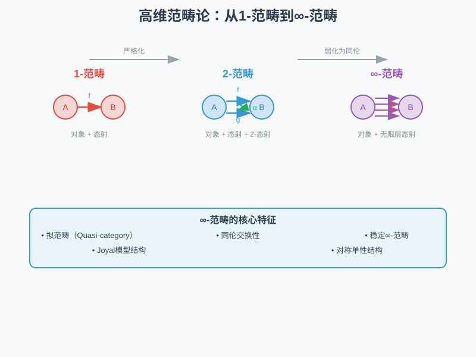

> **直观理解（现实类比）**：想象你在规划一次旅行。1-范畴就像"城市+直达航班"：城市是对象，航班是态射。2-范畴则升级到"城市+航班+航班之间的转机方案"：两条航班之间可以互相转换，这种转换就是2-态射。∞-范畴更进一步：转机方案之间还有"方案的选择"，方案的选择之间还有"选择的比较"……无限嵌套下去。就像俄罗斯套娃，每一层都包含更精细的决策结构。拟范畴用单纯集编码这种无限层结构，Joyal模型结构则提供了"严格化"的数学工具，让我们能在保持同伦信息的同时进行严格推理。

> **🧠 思考历程：当"箭头"自己也需要箭头时，数学大厦该往哪里继续盖？**
>
> 实物世界里"两个对象之间的箭头"可由"箭头与箭头间的箭头"再加以比较，这一层一层的结构，正是高维范畴论要精确描写的对象。它想回答的，是当结合律只"成立到同伦意义"时，数学还能不能严格推理。
>
> - **范畴是一只"关系的相机"**。1945年，艾伦伯格与麦克莱恩为整理代数拓扑中的自然变换而引入范畴论，这套语言后来被格罗滕迪克等数学家大规模用于几何。可人们很快发现，箭头之上还有"箭头与箭头之间"的更高层箭头。
> - **金字塔：从2-范畴到∞-范畴**。本奈布等人在1960年代看清了"态射之间的态射"（2-范畴）该长什么样；格罗滕迪克在写给奎伦的信《追索台》中呼吁一种"同伦意义"的高层范畴；乔伊尔（2002）与卢里（2009，并追溯至鲍德曼–沃格特）用"拟范畴"把∞-范畴落实为单纯集，让"结合律只成立到同伦"也能被严格地处理。
> - **高维范畴是几何与代数的共同地基**。可同伦交换性正是代数拓扑、同调代数的本质，于是∞-范畴成为导出代数几何、稳定同伦等领域的标准语言——在一处扎根，却通向四面八方。
> - **心路**：每多一层"箭头与箭头之间的箭头"，数学就多出一维表达"为什么可以看作一样"的空间。

### $\infty$-范畴

> **🧠 来龙去脉（为什么会有这个概念？解决了什么问题？）** 经典范畴论（艾伦伯格–麦克莱恩，1945）用"对象+态射"把数学结构组织起来，可很多现代数学里的"等价"只在**同伦意义**下成立：两个复合路径"差不多"而非严格相等。这就逼问出一个难题——当结合律、交换律只"成立到同伦"时，还能不能严格推理？1960年代本奈布看清了2-范畴（态射之间的态射）应长什么样；格罗滕迪克在致奎伦的《追索台》信中，更呼吁一种"同伦意义"的高层范畴。2009年，卢里（在乔伊尔与他本人此前的拟范畴工作基础上）在《高等拓扑论》中给出今天的标准答案：用满足内纤维填充条件的单纯集（拟范畴）来实现 $\infty$-范畴，让"结合律到同伦"也能被当作严谨对象来研究。它要"解放的问题"，正是同调代数、导出代数几何、稳定同伦论里那些"必须容忍同伦自由度"的运算。

**$\infty$-范畴**是高维范畴论的核心对象，它包含 $k$-态射（$k \geq 0$），其中 $k$-态射之间的结合律只成立到同伦意义。在 Joyal-Lurie 的理论框架中，$\infty$-范畴通过**拟范畴**（quasi-category）实现——即满足内纤维填充条件的单纯集。

> **💡 直观理解（类比）**：$\infty$-范畴像一本无限层的"校对注释簿"：第一层是结论（对象）与推理（态射），第二层是"为什么这个推理说得通"（2-态射），第三层又是上一层推理的理由……如此永无止境地嵌套。普通的一阶范畴只把"从 A 到 B 可达"记下来，$\infty$-范畴则坚持"每一步'等价'都要给出理由"，而这些理由只要求"合得上（到同伦）"即可，不必逐字相等——正如两人合作时，只要在关键处"对得上、能补出空档"，不必逐句完全一致。

#### 课堂问答

**老师**：先别背定义。经典的 1-范畴与 $\infty$-范畴，差别究竟在哪里？

**学生**：结论是——$\infty$-范畴额外携带 $k$-态射（$k\ge 2$），而结合律只在同伦意义下成立。1-范畴中 $g\circ f$ 唯一确定；$\infty$-范畴中 1-态射之间有 2-态射、2-态射之间有 3-态射，一直向上到无穷层。复合只要求"差一个可逆的高阶箭头"，即 $h\circ(g\circ f)\simeq(h\circ g)\circ f$ 是 2-态射层面的等价，而非等号。

**老师（追问）**：那么"结合律只到同伦"是否会让推理变得不可靠？

**学生**：不会。Joyal–Lurie 用拟范畴给出严格模型：$\infty$-范畴可实现为满足内尖角填充条件的单纯集，$0$-单形是对象、$1$-单形是态射、$2$-单形记录同伦交换图。结合律的"到同伦"被翻译成 $\Lambda^3_2\hookrightarrow\Delta^3$ 的填充问题，成为一个可被逐条检查的组合条件，而不是模糊的"差不多"。

**老师（拓展）**：给一个更一般的结论，并说出常见误区。

**学生**：每个普通范畴都是"态射只停留在低层"的 $\infty$-范畴（同伦离散），故 $\mathrm{Cat}\hookrightarrow\mathrm{Cat}_\infty$ 是满嵌入。更本质地说，$\infty$-范畴编码的是同一对对象之间态射空间的**同伦型**，而非一堆孤立的态射。误区：把 $\infty$-范畴理解成"对象特别多的范畴"——真正多出来的是态射之间的高阶同伦。一个 $1$-态射可逆 $\iff$ 它是同伦范畴中的同构；当所有态射都可逆时，就得到 $\infty$-群胚。

### 拟范畴

> **🧠 来龙去脉（为什么会有这个概念？解决了什么问题？）** "拟范畴"是 $\infty$-范畴的**组合实现**。它源于1980–90年代博德曼–沃格特、乔伊尔与卢里的同伦代数工作：为了让"双周期"的高阶信息（$n$-单形）能严格落进数学语言，人们把所有层级的箭头统一成一张**单纯集**（由点、线段、三角面、四面体……依次搭成的组合骨架），再要求内尖角可以填充。这样，复合、结合律、单位律等"无穷层级的一致性"就被一条条可检查的填充条件所代替——这正是"把无穷深的结构，用有限的填充公理讲清楚"的妙处。

**拟范畴**是一个单纯集 $X$，满足对每个 $0 < i < n$，每个内尖角 $\Lambda^n_i \to X$ 都有填充 $\Delta^n \to X$。这一定义捕捉了 $\infty$-范畴的本质：$0$-单形是对象，$1$-单形是态射，$2$-单形是交换图，高维单形编码了同伦交换性。

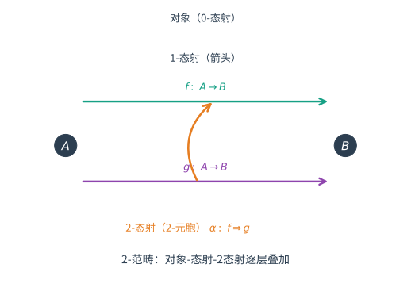

> **直观理解（现实类比）**：就像把地图层层堆叠：第 0 层是城市（对象），第 1 层是城市间的道路（态射），第 2 层是"两条道路之间可以互相变形"的证明或同伦（2-态射）。2-范畴正是在每个箭头之间再允许"箭头之间的箭头"，如同比较两条通勤路线时，还要说明"这条路可以连续变成那条路"。

#### 课堂问答

**老师**：拟范畴的定义一句话说清，"内"字为什么关键？

**学生**：结论：拟范畴是单纯集 $X$，使得对每个 $0<i<n$，每个内尖角 $\Lambda^n_i\to X$ 都能填充为 $\Delta^n\to X$。$0$-单形是对象，$1$-单形是态射，$2$-单形是交换图。"内"限定了 $0<i<n$，即尖角缺失的面既不是第 $0$ 面也不是第 $n$ 面——缺的恰是正对内部的那张面。

**老师（追问）**：若把"内"去掉、要求所有尖角都可填充，会得到什么？为什么拟范畴不能这样要求？

**学生**：那正是 Kan 复形。但那样"逆就太多了"：Kan 复形中每个态射都可逆，得到的是 $\infty$-群胚而非一般的 $\infty$-范畴。允许外侧尖角（$i=0$ 或 $i=n$）无法填充，才给"不可逆态射"留出空间：复合 $(f,g)$ 由 $\Lambda^2_1$ 的填充给出，而从 $g\circ f$ 一般无法反推出 $f$，除非另给可逆结构。

**老师（拓展）**：举一例说明哪些拟范畴不是 Kan 复形，并指出常见误区。

**学生**：取普通范畴 $\mathcal{C}$，其神经 $\mathrm{N}(\mathcal{C})$ 总是拟范畴——$\Lambda^2_1$ 的填充恰是两个可复合态射的复合。一旦 $\mathcal{C}$ 含有不可逆态射（如 $\mathbf{Set}$ 中非双射的映射），$\mathrm{N}(\mathcal{C})$ 就不再是 Kan 复形。更一般地，外侧尖角可填充等价于"态射可逆"，所以拟范畴是"恰到好处"的松紧度：恰好是内尖角条件，使组合骨架与同伦信息平衡，Joyal 模型结构由此得到。误区：以为填充条件越强越好。

### 关键概念清单

| 概念 | 描述 | 符号/公式 |
|------|------|-----------|
| 单纯集 | 从 $\Delta^{\mathrm{op}}$ 到 $\mathrm{Set}$ 的函子 | $X_\bullet$ |
| 拟范畴 | 满足内纤维填充的单纯集 | $\mathcal{C}$ |
| Kan 复形 | 所有尖角可填充的单纯集 | $X$ |
| Joyal 模型结构 | 单纯集上的模型结构 | $\mathrm{sSet}_{\mathrm{Joyal}}$ |
| 稳定 $\infty$-范畴 | 满足稳定公理的 $\infty$-范畴 | $\mathcal{C}$ |
| 谱的 $\infty$-范畴 | 稳定 $\infty$-范畴的原型 | $\mathrm{Sp}$ |
| 对称单性 $\infty$-范畴 | 带有对称单性结构的 $\infty$-范畴 | $\mathcal{C}^\otimes$ |
| $\infty$-拓扑斯 | $\infty$-范畴版本的拓扑斯 | $\mathcal{X}$ |

---

#### 课堂问答

**老师**：这张清单里，哪两个概念"同源而松紧不同"？请用填充条件说明。

**学生**：结论：拟范畴与 Kan 复形同源。两者都是"单纯集加尖角填充"，差别只在内/外：拟范畴只填内尖角 $0<i<n$，Kan 复形填全部尖角 $0\le i\le n$。所以 Kan 复形就是"每个态射都可逆的拟范畴"，即 $\infty$-群胚的组合模型；$\mathrm{Sing}$ 与 $|-|$ 把拓扑空间与 Kan 复形一一对应。

**老师（追问）**：那么 Joyal 模型结构与经典 Kan–Quillen 模型结构的关系是什么？

**学生**：同在单纯集范畴上，Kan–Quillen 结构以弱同伦等价为弱等价、以 Kan 复形为纤维对象；Joyal 结构改为以范畴等价（内 Kan 纤维化）为弱等价、以拟范畴为纤维对象。关键点是：Joyal 结构的纤维对象恰是拟范畴，且拟范畴的态射空间是 Kan 复形——于是 $\mathrm{Cat}_\infty$ 的内部同伦被完整地装进模型范畴语言。

**老师（拓展）**：把清单里其余概念串成一条线，并给出更一般的结论。

**学生**：谱的 $\infty$-范畴 $\mathrm{Sp}$ 是稳定 $\infty$-范畴的原型（有零对象，$\Sigma\dashv\Omega$ 且互为逆，推出等于拉回）；在它上面加一个对称单性结构 $\otimes$ 就得到对称单性 $\infty$-范畴 $\mathcal{C}^\otimes$，其纤维 $\mathcal{C}^\otimes_{\langle n\rangle}\simeq\mathcal{C}^n$。更一般地，$\infty$-拓扑斯是把 Grothendieck 拓扑斯"同伦化"：它有有限极限与任意小余极限，且余极限与有限极限交换。误区：把"稳定"当成拥有负维的态射——稳定只要求一个方块是推出 $\iff$ 它是拉回。

## 定理与证明

### 定理 1：拟范畴的基本性质

**定理**：拟范畴 $\mathcal{C}$ 具有以下基本性质：

(1) $\mathcal{C}$ 的 $0$-单形构成对象集 $\mathrm{Ob}(\mathcal{C})$，$1$-单形构成态射集。
(2) 对任意对象 $x, y \in \mathcal{C}$，态射空间 $\mathrm{Hom}_{\mathcal{C}}(x, y)$ 是一个 Kan 复形。
(3) 态射的复合是定义良好的，且结合律成立到同伦。
(4) 对任意 $n \geq 2$，$\mathcal{C}$ 中的 $n$-单形对应于 $n$ 个可复合态射的交换图。

**证明**：

**性质 (1) 的证明**：由定义，$X_0$ 是 $0$-单形的集合，作为对象。$X_1$ 是 $1$-单形的集合，作为态射。源映射 $d_1: X_1 \to X_0$ 给出态射的域，靶映射 $d_0: X_1 \to X_0$ 给出态射的余域。

**性质 (2) 的证明**：

设 $x, y \in \mathcal{C}_0$。定义态射空间 $\mathrm{Hom}_{\mathcal{C}}(x, y)$ 为拉回：

$$\require{AMScd}
\begin{CD}
\mathrm{Hom}_{\mathcal{C}}(x, y) @>>> \mathcal{C}^{\Delta^1} \\
@VVV @VV{(d_1, d_0)}V \\
\Delta^0 @>{(x, y)}>> \mathcal{C} \times \mathcal{C}
\end{CD}$$

要证明 $\mathrm{Hom}_{\mathcal{C}}(x, y)$ 是 Kan 复形，需验证任意尖角 $\Lambda^n_i \to \mathrm{Hom}_{\mathcal{C}}(x, y)$ 可填充。

由 $\mathrm{Hom}_{\mathcal{C}}(x, y)$ 的定义，这等价于一个填充问题：

$$\begin{CD}
\Lambda^n_i @>>> \mathcal{C}^{\Delta^1} \\
@VVV @VVV \\
\Delta^n @>>> \mathcal{C} \times \mathcal{C}
\end{CD}$$

其中 $\Delta^n \to \mathcal{C} \times \mathcal{C}$ 在 $(x, y)$ 处为常值。利用 $\mathcal{C}$ 是拟范畴以及 $\Delta^1$ 的单纯结构，可证明该填充存在。关键在于 $\Lambda^n_i \times \Delta^1 \to \mathcal{C}$ 的填充问题可转化为 $\mathcal{C}$ 中的内尖角填充。

**性质 (3) 的证明**：

态射 $f: x \to y$ 和 $g: y \to z$ 的复合由如下填充给出：

$$\begin{CD}
\Lambda^2_1 @>{(f, g)}>> \mathcal{C} \\
@VVV @VVV \\
\Delta^2 @>>> \mathcal{C}
\end{CD}$$

其中 $\Lambda^2_1$ 包含边 $d_2(\sigma) = f$ 和 $d_0(\sigma) = g$，填充 $\sigma: \Delta^2 \to \mathcal{C}$ 给出复合 $d_1(\sigma) = g \circ f$。

结合律：给定 $f: w \to x$，$g: x \to y$，$h: y \to z$，考虑 $\Lambda^3_1$ 或 $\Lambda^3_2$ 的填充可得到 $h \circ (g \circ f) \simeq (h \circ g) \circ f$ 的同伦。

**性质 (4) 的证明**：通过归纳，$n$-单形 $X_n$ 中的元素对应 $n$ 个可复合态射 $f_1, \ldots, f_n$ 及其复合的交换图。具体地，$\sigma \in \mathcal{C}_n$ 给出面映射 $d_i(\sigma)$ 作为子复合，且由拟范畴条件可保证这些子复合之间的相容性。

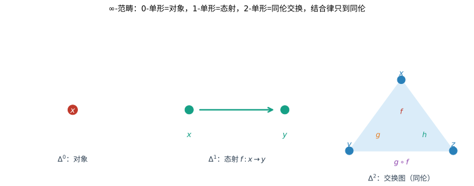

> **直观理解（现实类比）**：$\infty$-范畴把"对象"看成点（$\Delta^0$），把"态射"看成连接两点的线段（$\Delta^1$），把"交换图/同伦"看成三角形面（$\Delta^2$），更高维则依次是四面体、更高维单形。它时刻在提醒：复合 $(h\circ g)\circ f$ 与 $h\circ(g\circ f)$ 不必严格相等，只需能通过一个同伦（三角形面）把二者连起来——就像拼积木时，每一处"接缝"都可以有弹性地变形。

$\square$

---

#### 课堂问答

**老师**：定理说 $\mathrm{Hom}_{\mathcal{C}}(x,y)$ 是 Kan 复形。为什么它不能只是一个集合？

**学生**：结论：态射空间必须保留态射之间的高阶同伦。给定对象 $x,y$，其间可能有一族态射，这些态射之间还有 2-态射、3-态射……把它们打成同一个 Kan 复形：$0$-单形是态射，$1$-单形是态射间的同伦。定义走拉回——$\mathrm{Hom}_{\mathcal{C}}(x,y)$ 是 $\mathcal{C}^{\Delta^1}\to\mathcal{C}\times\mathcal{C}$ 沿 $(x,y):\Delta^0\to\mathcal{C}\times\mathcal{C}$ 的拉回。

**老师（追问）**：如何看出它是 Kan 复形？结合律又为何"只到同伦"？

**学生**：填充 $\Lambda^n_i\to\mathrm{Hom}_{\mathcal{C}}(x,y)$ 等价于原拟范畴中一个 $\Lambda^n_i\times\Delta^1$ 型的填充问题，利用 $\mathcal{C}$ 的内尖角填充可证：连外侧尖角 $i=0,n$ 都能填，故它是 Kan 复形。复合由 $\Lambda^2_1$ 的填充给出：取 $\sigma:\Delta^2\to\mathcal{C}$ 满足 $d_2\sigma=f$、$d_0\sigma=g$，则 $g\circ f:=d_1\sigma$。但填充不唯一，不同选择只差一个同伦，所以复合只定义到同伦。

**老师（拓展）**：由此得出什么更一般的结论？常见误区是什么？

**学生**：更一般地，"$\mathrm{Hom}_{\mathcal{C}}(x,y)$ 恒为 Kan 复形"正是"$\mathcal{C}$ 是 $\infty$-范畴而非任意单纯集"的等价刻画之一：同伦范畴 $\mathrm{h}\mathcal{C}$ 的对象不变，态射取 $\pi_0\mathrm{Hom}$。结合律 $(h\circ g)\circ f\simeq h\circ(g\circ f)$ 由 $\Lambda^3_1$ 或 $\Lambda^3_2$ 的填充给出，验证的是 2-态射层面的可逆同伦。误区：把复合当成严格的二元运算 $\mathrm{Hom}(y,z)\times\mathrm{Hom}(x,y)\to\mathrm{Hom}(x,z)$——在 $\infty$ 世界里它只给出"到同伦唯一"的对应，并非严格函子。

### 定理 2：Grothendieck 同伦假设

**定理（Grothendieck 同伦假设）**：$\infty$-群胚与拓扑空间在弱同伦等价意义下是等价的。更精确地说，$\infty$-群胚的 $\infty$-范畴 $\mathrm{Grpd}_\infty$ 与空间的 $\infty$-范畴 $\mathcal{S}$（即 Kan 复形的 $\infty$-范畴）是等价的。

> **🧠 直观理解（现实类比）**：同伦假设有点像地质学的"一张纸到一团泥"：一个 $\infty$-群胚（所有箭头都可逆的高维范畴）本质上是"软绵绵的拓扑空间"——你可以把空间连续揉捏（同伦等价）而不丢信息；反过来，任何一团"空间"也能整理成一个箭头全可逆的 $\infty$-群胚。于是"空间"与"可逆高维范畴"是同一枚硬币的两面，中间靠"奇异函子 $\mathrm{Sing}$"和"几何实现 $|-|$"这两条传送带来回搬运，搬运前后信息完全等价。

**证明思路**：

**步骤 1：$\infty$-群胚的定义**

$\infty$-群胚是拟范畴 $\mathcal{C}$，其中所有态射都是可逆的（在同伦意义下）。即对每个 $1$-单形 $f: x \to y$，存在 $g: y \to x$ 和 $2$-单形 $\sigma, \tau$ 使得 $d_1(\sigma) = g \circ f$，$d_1(\tau) = f \circ g$ 且 $d_2(\sigma) = \mathrm{id}_x$，$d_0(\tau) = \mathrm{id}_y$。

等价地，$\infty$-群胚是拟范畴 $\mathcal{C}$ 使得其同伦范畴 $\mathrm{h}\mathcal{C}$ 是一个群胚。

**步骤 2：空间的 $\infty$-范畴**

定义 $\mathcal{S}$ 为 Kan 复形的 $\infty$-范畴：其对象是 Kan 复形，态射空间是映射空间的派生版本。由于 Kan 复形中的每个态射都有同伦逆，$\mathcal{S}$ 中的每个 1-态射都是可逆的，因此 $\mathcal{S}$ 是 $\infty$-群胚的 $\infty$-范畴。

**步骤 3：几何实现与奇异函子**

$$\mathrm{Sing}: \mathcal{S}_{\mathrm{Top}} \rightleftarrows \mathrm{Grpd}_\infty: |-|$$

其中 $\mathcal{S}_{\mathrm{Top}}$ 是拓扑空间的 $\infty$-范畴。

**步骤 4：等价性的证明**

对于任意 $\infty$-群胚 $X$，其几何实现 $|X|$ 是一个拓扑空间。反过来，对于任意拓扑空间 $T$，$\mathrm{Sing}(T)$ 是一个 $\infty$-群胚。

由 Whitehead 定理，连续映射 $f: T \to T'$ 是弱同伦等价当且仅当 $\mathrm{Sing}(f)$ 是单纯集的弱等价。因此 $\mathrm{Sing}$ 和 $|-|$ 诱导了 $\infty$-范畴的等价：

$$\mathrm{Grpd}_\infty \simeq \mathcal{S}$$

**步骤 5：同伦假设的范畴论表述**

Grothendieck 同伦假设可以精确表述为：$\infty$-群胚的 $\infty$-范畴 $\mathrm{Grpd}_\infty$ 与空间的 $\infty$-范畴 $\mathcal{S}$ 是等价的。这意味着每个 $\infty$-群胚本质上由它的同伦型决定，这为"空间是 $\infty$-群胚"这一观点提供了严格的数学基础。

$\square$

---

#### 课堂问答

**老师**：同伦假设的精确表述是什么？等价为什么只能是"范畴等价"而不是"同构"？

**学生**：结论：$\infty$-群胚的 $\infty$-范畴 $\mathrm{Grpd}_\infty$ 与空间的 $\infty$-范畴 $\mathcal{S}$ 等价，即 $\mathrm{Grpd}_\infty\simeq\mathcal{S}$。只能到等价，是因为 $|-|\circ\mathrm{Sing}$ 与恒等之间只有弱同伦等价、没有同胚；而 $\infty$ 范畴层面的等价正是由弱同伦等价定义的。

**老师（追问）**：$\mathrm{Sing}$ 与 $|-|$ 各是什么？为什么它们往返都能还原？

**学生**：$\mathrm{Sing}(T)_n=\mathrm{Hom}_{\mathbf{Top}}(|\Delta^n|,T)$，把拓扑空间变成单纯集；$|-|$ 是几何实现 $K\mapsto|K|$，二者构成伴随 $|-|\dashv\mathrm{Sing}$。对 CW 型空间，$|\mathrm{Sing}(T)|\to T$ 是同伦等价；而对 Kan 复形 $K$，$\mathrm{Sing}(|K|)\to K$ 是弱等价。于是往返都还原，两个 $\infty$-范畴等价。

**老师（拓展）**：更一般的结论是什么？常见误区又在哪里？

**学生**：更一般地，Whitehead 定理给出：$f:T\to T'$ 是弱同伦等价 $\iff$ $\mathrm{Sing}(f)$ 是单纯集弱等价。这正是 $\mathbf{Top}$ 与 $\mathbf{sSet}$ 的 Quillen 等价在 $\infty$-范畴层的提升，把"$\infty$-群胚就是空间"严格化：每个 $\infty$-群胚由其同伦型唯一决定。误区：把 $\infty$-群胚当成普通群胚——普通群胚的分类空间退化为 $K(\pi,1)$ 型（只有一阶同伦群），而 $\infty$-群胚可携带任意高阶同伦群。

### 定理 3：稳定 $\infty$-范畴的刻画

**定理**：设 $\mathcal{C}$ 是一个 $\infty$-范畴。则以下条件等价：

(1) $\mathcal{C}$ 是稳定的，即 $\mathcal{C}$ 有零对象，所有有限极限和余极限存在，且推出与拉回方块重合。
(2) $\mathcal{C}$ 是可加的，其同伦范畴 $\mathrm{h}\mathcal{C}$ 是三角的，且纤维序列与余纤维序列一致。
(3) $\mathcal{C}$ 等价于某个 $\infty$-范畴 $\mathcal{D}$ 中的谱对象 $\mathrm{Sp}(\mathcal{D})$。

> **💡 直观理解（类比）**：稳定的 $\infty$-范畴是"既能做加法又能做减法"的环境：它有零对象（好比数字 $0$），且"拼接"（推出）与"拆卸"（拉回）行为完全重合，悬浮 $\Sigma$ 与环路 $\Omega$ 互为逆（像"先加一圈再绕回"能完整还原）。想象一个既能组装又能拆解零件的车间——推拉一致意味着每一次拼接都有唯一对应的拆卸方式，于是每个态射都有纤维与余纤维，整个环境如同一个可做加减的"向量空间"，能像算术一样自由地对对象求和求差。

**证明**：

**步骤 1：稳定 $\infty$-范畴的定义回顾**

$\mathcal{C}$ 是稳定的如果：
- $\mathcal{C}$ 有零对象 $0$（既是始对象也是终对象）。
- $\mathcal{C}$ 中所有有限极限和有限余极限存在。
- 在 $\mathcal{C}$ 中，一个方块是推出当且仅当它是拉回（即推出与拉回一致）。

**步骤 2：(1) $\Rightarrow$ (2)：稳定 $\infty$-范畴的同伦范畴是三角的**

设 $\mathcal{C}$ 是稳定的。定义 $\mathrm{h}\mathcal{C}$ 上的平移函子 $\Sigma: \mathrm{h}\mathcal{C} \to \mathrm{h}\mathcal{C}$ 为 $\Sigma(X) = 0 \amalg_X 0$（双重推出），即 $X$ 的悬浮。由于推出与拉回一致，$\Sigma$ 是等价，其逆为 $\Omega(X) = 0 \times_X 0$（环路空间）。

三角结构：一个三角形 $X \to Y \to Z \to \Sigma X$ 是**纤维序列**（或**余纤维序列**），如果存在 $\mathcal{C}$ 中的拉回-推出方块：

$$\begin{CD}
X @>>> Y \\
@VVV @VVV \\
0 @>>> Z
\end{CD}$$

验证三角公理：

- **(TR1)**：每个同构的三角形是三角的；对每个态射 $X \to Y$，可将其完备为纤维序列 $X \to Y \to Z \to \Sigma X$。
- **(TR2)**：$X \to Y \to Z \to \Sigma X$ 是三角的当且仅当 $Y \to Z \to \Sigma X \to \Sigma Y$ 是三角的。
- **(TR3)**：给定三角之间的态射，存在完备化的态射。
- **(TR4)**（八面体公理）：由 $\mathcal{C}$ 中对应的推出方块的性质保证。

**步骤 3：(2) $\Rightarrow$ (1)：三角 $\infty$-范畴的稳定性**

若 $\mathrm{h}\mathcal{C}$ 是三角的且 $\Sigma$ 是等价，则 $\mathcal{C}$ 中所有有限极限和余极限存在。零对象的存在性由三角结构保证。推出与拉回的一致性由纤维序列与余纤维序列的等价性导出。

**步骤 4：(1) $\Rightarrow$ (3)：稳定 $\infty$-范畴作为谱范畴**

对稳定 $\infty$-范畴 $\mathcal{C}$，定义谱对象 $\mathrm{Sp}(\mathcal{C})$ 为满足 $X_n \simeq \Omega X_{n+1}$ 的序列 $(X_n)_{n \in \mathbb{Z}}$ 的 $\infty$-范畴。反过来，对任意 $\infty$-范畴 $\mathcal{D}$，$\mathrm{Sp}(\mathcal{D})$ 是稳定的。

若 $\mathcal{C}$ 是稳定的，则函子 $\mathcal{C} \to \mathrm{Sp}(\mathcal{C})$ 给出等价。特别地，当 $\mathcal{C} = \mathrm{Sp}$（谱的 $\infty$-范畴）时，有 $\mathrm{Sp}(\mathrm{Sp}) \simeq \mathrm{Sp}$。

**步骤 5：稳定 $\infty$-范畴的纤维序列刻画**

在稳定 $\infty$-范畴中，对任意态射 $f: X \to Y$，纤维 $\mathrm{fib}(f) = 0 \times_Y X$ 和余纤维 $\mathrm{cofib}(f) = 0 \amalg_X Y$ 之间存在自然的纤维序列：

$$\mathrm{fib}(f) \to X \xrightarrow{f} Y \to \mathrm{cofib}(f)$$

且对任意 $Z$，有长正合序列：

$$\cdots \to \mathrm{Hom}_{\mathcal{C}}(Z, \mathrm{fib}(f)) \to \mathrm{Hom}_{\mathcal{C}}(Z, X) \to \mathrm{Hom}_{\mathcal{C}}(Z, Y) \to \mathrm{Hom}_{\mathcal{C}}(Z, \mathrm{cofib}(f)) \to \cdots$$

$\square$

---

#### 课堂问答

**老师**：稳定 $\infty$-范畴的三条刻画中，哪条最本质？它凭什么一步就把 $\Sigma$ 变成可逆？

**学生**：结论：最本质的是"方块为推出 $\iff$ 方块为拉回"。有了零对象后，$X\to Y\to Z$ 的余纤维方块是推出、纤维方块是拉回；两者重合意味着对任意 $f$，$\mathrm{fib}(f)$ 与 $\mathrm{cofib}(f)$ 由同一个方块给出，于是 $\Sigma(X)=0\amalg_X0$ 与 $\Omega(X)=0\times_X0$ 互为逆，$\Sigma\dashv\Omega$ 且二者都是等价。

**老师（追问）**：为什么这样得到的 $\mathrm{h}\mathcal{C}$ 自然就是三角范畴？纤维序列与余纤维序列为何一致？

**学生**：三角形 $X\to Y\to Z\to\Sigma X$ 恰好来自同一拉回-推出方块，因而同时是纤维序列与余纤维序列。三角公理中 TR1 来自"任意态射可完备为纤维序列"（$\mathcal{C}$ 有余极限），TR2 来自 $\Omega$ 与 $\Sigma$ 互逆，TR3 来自态射的完备化，八面体公理 TR4 由相应推出方块的粘贴性质保证。所以三角结构不是额外假设，而是"推出等于拉回"的自动推论。

**老师（拓展）**：谱范畴那条刻画说明了什么？更一般的结论与误区。

**学生**：更一般地，$\mathcal{C}$ 稳定 $\iff$ 提升函子 $\mathcal{C}\to\mathrm{Sp}(\mathcal{C})$ 是等价，其中 $\mathrm{Sp}(\mathcal{C})$ 由满足 $X_n\simeq\Omega X_{n+1}$ 的序列构成；特别地 $\mathrm{Sp}(\mathrm{Sp})\simeq\mathrm{Sp}$。任意态射给出纤维序列 $\mathrm{fib}(f)\to X\xrightarrow{f}Y\to\mathrm{cofib}(f)$，从而对任意 $Z$ 有长正合序列 $\cdots\to\mathrm{Hom}(Z,\mathrm{fib}(f))\to\mathrm{Hom}(Z,X)\to\mathrm{Hom}(Z,Y)\to\mathrm{Hom}(Z,\mathrm{cofib}(f))\to\cdots$。误区：以为稳定就是"事先给定 $\Omega$ 的逆"——逆是从"推出等于拉回"构造出来的，而非假定。

### 定理 4：对称单性 $\infty$-范畴的构造

**定理**：设 $\mathcal{C}$ 是一个 $\infty$-范畴，则存在一个 $\infty$-范畴 $\mathcal{C}^\otimes$ 连同遗忘函子 $\mathcal{C}^\otimes \to \mathrm{N}(\mathrm{Fin}_*)$，使得 $\mathcal{C}^\otimes$ 是 $\mathcal{C}$ 的对称单性 $\infty$-范畴，其纤维 $\mathcal{C}^\otimes_{\langle n \rangle} \simeq \mathcal{C}^n$。

> **🧠 直观理解（现实类比）**：对称单性 $\infty$-范畴像一台能打包电商订单的机器：纤维 $\langle n \rangle$ 就是"一盒装 $n$ 件货"，活性态射对应"把若干件打包成一件"（张量积），惰性态射对应"从盒里单独取出一件"（投影），而置换态射则允许"改变打包顺序但效果相同"（交换性）。台面上的"卖场架构" $\mathrm{N}(\mathrm{Fin}_*)$ 规定了哪些是允许的打包/拆包动作，从而把"乘法、交换、结合、单位元"这些结构完整地刻进 $\infty$-范畴里。

**证明**：

**步骤 1：操作子代数方法**

定义 $\mathcal{C}^\otimes$ 为满足以下条件的 $\infty$-范畴：

- 对象：形如 $(X_1, \ldots, X_n)$ 的有限序列，其中 $X_i \in \mathcal{C}$。
- 态射：从 $(X_1, \ldots, X_n)$ 到 $(Y_1, \ldots, Y_m)$ 的态射由以下数据给出：
  - 一个映射 $\alpha: \langle n \rangle \to \langle m \rangle$ 在 $\mathrm{Fin}_*$ 中。
  - 对每个 $j = 1, \ldots, m$，一个态射 $\bigotimes_{i \in \alpha^{-1}(j)} X_i \to Y_j$。

**步骤 2：使用 $\infty$-操作子的严格构造**

更严格地，$\mathcal{C}^\otimes$ 是 $\mathrm{N}(\mathrm{Fin}_*)$ 上的 $\infty$-操作子，其构造可通过以下方式实现：

$$\begin{CD}
\mathcal{C}^\otimes @>>> \mathrm{N}(\mathrm{Fin}_*) \\
@VVV @VVV \\
\mathrm{Map}_{\mathrm{Op}_\infty}(\mathrm{Assoc}, \mathcal{C}) @>>> \cdots
\end{CD}$$

**步骤 3：纤维结构**

遗忘函子 $p: \mathcal{C}^\otimes \to \mathrm{N}(\mathrm{Fin}_*)$ 满足：
- 对每个 $\langle n \rangle$，纤维 $\mathcal{C}^\otimes_{\langle n \rangle} \simeq \mathcal{C}^n$。
- 对惰性态射 $\rho^i: \langle n \rangle \to \langle 1 \rangle$（将 $i$ 映到 $1$，其余映到 $*$），对应的函子 $\mathcal{C}^n \to \mathcal{C}$ 是第 $i$ 个投影。
- 对主动态射，纤维间的函子对应于 $\mathcal{C}$ 中的张量积。

**步骤 4：对称单性结构的验证**

为验证 $\mathcal{C}^\otimes$ 是 $\mathcal{C}$ 的对称单性 $\infty$-范畴，需要验证：

1. **张量积的存在性**：对任意 $X, Y \in \mathcal{C}$，存在 $X \otimes Y \in \mathcal{C}$，由 $\mathcal{C}^\otimes_{\langle 2 \rangle} \to \mathcal{C}^\otimes_{\langle 1 \rangle}$ 给出。
2. **结合律**：存在自然的等价 $X \otimes (Y \otimes Z) \simeq (X \otimes Y) \otimes Z$，由 $\mathcal{C}^\otimes$ 中 $\langle 3 \rangle$ 上的纤维结构保证。
3. **单位元**：存在单位对象 $\mathbf{1} \in \mathcal{C}$，对应于 $\mathcal{C}^\otimes_{\langle 0 \rangle} \simeq \Delta^0$。
4. **对称性**：存在自然的对称同构 $X \otimes Y \simeq Y \otimes X$，由 $\mathrm{Fin}_*$ 中的置换态射诱导。

**步骤 5：$\mathcal{C}^\otimes$ 的 $\infty$-范畴性质**

$p: \mathcal{C}^\otimes \to \mathrm{N}(\mathrm{Fin}_*)$ 是一个 Cartesian 纤维化，且其 Cartesian 态射恰好对应于惰性态射的拉回。这一性质确保了 $\mathcal{C}^\otimes$ 确实编码了 $\mathcal{C}$ 上的对称单性结构。

$\square$

---

#### 课堂问答

**老师**：构造 $\mathcal{C}^\otimes$ 的动机是什么？为什么要把结构架在 $\mathrm{N}(\mathrm{Fin}_*)$ 上？

**学生**：结论：因为"张量积"本质上是"把有限多件东西合并成一件"的运算，而这种运算的数据可由有限带点集合范畴 $\mathrm{Fin}_*$ 组织：对象是 $\langle n\rangle=\{1,\ldots,n,*\}$，态射 $\alpha:\langle n\rangle\to\langle m\rangle$ 把 $n$ 件货物分配到 $m$ 个盒子。把 $\mathcal{C}^\otimes$ 做成 $\mathrm{N}(\mathrm{Fin}_*)$ 上的 $\infty$-操作子（等价于给遗忘函子 $p:\mathcal{C}^\otimes\to\mathrm{N}(\mathrm{Fin}_*)$），就一次把活性/惰性结构编码完整。

**老师（追问）**：纤维与两类态射各对应什么？$\otimes$ 与单位元从哪里来？

**学生**：纤维 $\mathcal{C}^\otimes_{\langle n\rangle}\simeq\mathcal{C}^n$。惰性态射 $\rho^i:\langle n\rangle\to\langle 1\rangle$（把 $i$ 映到 $1$、其余映到 $*$）对应第 $i$ 个投影 $\mathcal{C}^n\to\mathcal{C}$；活性态射则对应 $\bigotimes_{i\in\alpha^{-1}(j)}X_i\to Y_j$，即张量积。于是 $X\otimes Y$ 由 $\mathcal{C}^\otimes_{\langle2\rangle}\to\mathcal{C}^\otimes_{\langle1\rangle}$ 给出，单位元 $\mathbf{1}$ 来自 $\mathcal{C}^\otimes_{\langle0\rangle}\simeq\Delta^0$。

**老师（拓展）**：结合律与对称性体现在哪里？更一般的结论与常见误区。

**学生**：结合律 $X\otimes(Y\otimes Z)\simeq(X\otimes Y)\otimes Z$ 来自 $\langle 3\rangle$ 上的纤维结构，对称同构 $X\otimes Y\simeq Y\otimes X$ 由 $\mathrm{Fin}_*$ 中交换两分量的置换态射诱导。更一般地，$p$ 是 Cartesian 纤维化、其 Cartesian 态射恰为惰性态射的拉回（Segal 条件加单位条件），这正是 $\mathcal{C}^\otimes$ 编码对称单性结构的判据。误区：以为对称单性只是给 $\mathcal{C}$ 配一个二元函子 $\otimes$——真正的结构是整套相容数据（单位、结合、对称以及无穷多高阶相干），单靠一个 $\otimes$ 无法保证相干。

### 定理 5：$\infty$-范畴中的极限与余极限

**定理**：设 $\mathcal{C}$ 是一个 $\infty$-范畴，$K$ 是一个单纯集。则 $\mathcal{C}$ 中所有 $K$-图表的余极限存在的充要条件是：对角函子 $\Delta: \mathcal{C} \to \mathrm{Fun}(K, \mathcal{C})$ 有左伴随。类似地，极限存在的充要条件是对角函子有右伴随。

> **💡 直观理解（类比）**：$\infty$-范畴中的（余）极限像"把所有材料汇聚到一处"的汇流点：$K$-图表是一张部件清单，余极限是"把所有部件拼成的总装件"，极限则是"同时满足所有部件要求的公共解"。对角函子 $\Delta$ 把"单个对象"复制成"图表每一处都用这一个对象"，能否求（余）极限，就看能不能找到一个算子把整张图表压缩成一件（余极限）、或反过来把总装件逐处投映（极限）——正如求并集与求交集，只是在这里"压缩"与"投影"只要求在"同伦"意义上成立即可。

**证明**：

**步骤 1：余极限的定义**

$K$-图表是函子 $F: K \to \mathcal{C}$。$F$ 的余极限是余锥 $\bar{F}: K^\triangleright \to \mathcal{C}$（其中 $K^\triangleright$ 是 $K$ 添加一个终对象），满足 $\bar{F}|_K = F$ 且 $\bar{F}$ 是 $K^\triangleright$ 上的余极限图。

等价地，$\operatorname{colim} F$ 是 $\mathcal{C}$ 中的对象，使得对每个 $X \in \mathcal{C}$：

$$\mathrm{Hom}_{\mathcal{C}}(\operatorname{colim} F, X) \simeq \lim_{k \in K} \mathrm{Hom}_{\mathcal{C}}(F(k), X)$$

其中右端是 $\mathrm{Spaces}$ 中的极限。

**步骤 2：Cartesian 纤维化方法**

$\infty$-范畴的极限也可经函子范畴 $\operatorname{Fun}(K,\mathcal{C})$ 上的 Cartesian 纤维化（等价于右扩展）来构造：$K$-图表的极限对象是$K$ 下标图表空间上的末端锥，而该末端锥的万有性质等价于它作为 Cartesian 提升的极大性。这一观点把"极限是什么"从对象级的定义，重写为纤维化层的泛性质，与经典末端锥定义互相等价。

**步骤 3：左伴随的存在性**

若 $\mathcal{C}$ 中所有 $K$-图表都有余极限，则定义 $\operatorname{colim}: \mathrm{Fun}(K, \mathcal{C}) \to \mathcal{C}$。对任意 $F \in \mathrm{Fun}(K, \mathcal{C})$ 和 $X \in \mathcal{C}$，有：

$$\mathrm{Hom}_{\mathcal{C}}(\operatorname{colim} F, X) \simeq \mathrm{Hom}_{\mathrm{Fun}(K, \mathcal{C})}(F, \Delta(X))$$

因此 $\operatorname{colim}$ 是 $\Delta$ 的左伴随。

**步骤 4：充分性——伴随 $\Rightarrow$ 余极限存在**

反之，若 $\Delta$ 有左伴随 $L$，则对任意 $F: K \to \mathcal{C}$，$L(F)$ 是 $F$ 的余极限。这是因为对任意 $X \in \mathcal{C}$：

$$\mathrm{Hom}_{\mathcal{C}}(L(F), X) \simeq \mathrm{Hom}_{\mathrm{Fun}(K, \mathcal{C})}(F, \Delta(X)) \simeq \lim_{k \in K} \mathrm{Hom}_{\mathcal{C}}(F(k), X)$$

**步骤 5：具体构造**

给定图表 $F: K \to \mathcal{C}$，其余极限可通过以下方式构造：

1. 考虑 $F$ 的余切片 $\mathcal{C}_{F/}$（或 $K$-图表之上的切片范畴），寻找其"最末端"的对象。
2. 取 $\mathcal{C}_{/F}$ 的终对象（若存在）。
3. 该终对象给出余锥 $\bar{F}: K^\triangleright \to \mathcal{C}$，即为余极限。

类似地，极限通过 $\mathcal{C}_{F/}$ 的始对象构造。

**步骤 6：与经典范畴论的关系**

当 $\mathcal{C}$ 是经典范畴（视为 $\infty$-范畴）时，上述定义与经典极限和余极限的定义一致。当 $\mathcal{C}$ 是 $\infty$-范畴时，这一概念统一了同伦极限和经典极限。

$\square$

---

#### 课堂问答

**老师**：为什么"所有 $K$-余极限都存在"能等价于"对角函子 $\Delta:\mathcal{C}\to\mathrm{Fun}(K,\mathcal{C})$ 有左伴随"？

**学生**：结论：余极限的泛性质就是左伴随的泛性质。若 $\operatorname{colim}F$ 存在，则对任意 $X$ 有 $\mathrm{Hom}_{\mathcal{C}}(\operatorname{colim}F,X)\simeq\lim_{k\in K}\mathrm{Hom}_{\mathcal{C}}(F(k),X)$；右端又等于 $\mathrm{Hom}_{\mathrm{Fun}(K,\mathcal{C})}(F,\Delta X)$，因为 $\Delta X$ 正是把每个 $k$ 送到常值 $X$。于是 $\operatorname{colim}\dashv\Delta$。反之若 $L\dashv\Delta$，则 $L(F)$ 满足上述泛性质，即为 $F$ 的余极限。

**老师（追问）**：右端 $\lim_{k\in K}\mathrm{Hom}_{\mathcal{C}}(F(k),X)$ 为什么是 $\mathrm{Spaces}$ 中的极限，而不是集合的极限？

**学生**：因为 $\mathrm{Hom}_{\mathcal{C}}(-,-)$ 取值于空间（Kan 复形）而非集合，$\lim_{k\in K}\mathrm{Hom}_{\mathcal{C}}(F(k),X)$ 是空间的同伦极限；当 $K$ 是一般单纯集时，它未必等于逐点极限。这正是"$\infty$-范畴统一同伦极限与经典极限"之处：把 $\mathrm{Hom}$ 换成映射空间后，$\mathrm{Hom}_{\mathcal{C}}(\operatorname{colim}F,X)$ 必须与同伦极限一致。

**老师（拓展）**：极限一侧如何对偶？更一般的结论与常见误区。

**学生**：对偶地，$\mathcal{C}$ 中所有 $K$-极限存在 $\iff$ $\Delta$ 有右伴随 $\lim$，由 $\mathrm{Hom}_{\mathcal{C}}(X,\lim F)\simeq\lim_{k}\mathrm{Hom}_{\mathcal{C}}(X,F(k))$ 给出。更一般地，余极限是余锥范畴 $\mathcal{C}_{F/}$ 的始对象，极限是锥范畴 $\mathcal{C}_{/F}$ 的终对象（末端锥），与经典的末端锥定义互相等价；当 $\mathcal{C}$ 是经典范畴时二者退化为普通极限。误区：把"极限存在"理解为需要对每个 $K$ 单独验证——借助伴随函子定理，一旦 $\mathcal{C}$ 具备相应的（余）极限与合适的大小条件，就能一次性得到所有小（余）极限。

## 示例

### 示例 1：拟范畴的例子——拓扑空间的奇异单纯集

**问题**：证明拓扑空间的奇异单纯集 $\mathrm{Sing}(T)$ 是一个拟范畴（实际上是 Kan 复形）。

**解**：

**1. 奇异单纯集的定义**

对拓扑空间 $T$，奇异单纯集 $\mathrm{Sing}(T)$ 定义为：

$$\mathrm{Sing}(T)_n = \mathrm{Hom}_{\mathrm{Top}}(|\Delta^n|, T)$$

其中 $|\Delta^n|$ 是标准拓扑 $n$-单形。

**2. Kan 复形性质**

对任意 $0 \leq i \leq n$，尖角 $\Lambda^n_i \to \mathrm{Sing}(T)$ 对应连续映射 $f: |\Lambda^n_i| \to T$。由于 $|\Lambda^n_i|$ 是 $|\Delta^n|$ 的形变收缩核，存在收缩映射 $r: |\Delta^n| \to |\Lambda^n_i|$。因此 $f \circ r: |\Delta^n| \to T$ 给出所需的填充。

**3. 作为拟范畴**

由于 $\mathrm{Sing}(T)$ 是 Kan 复形，它自然也是拟范畴（因为 Kan 复形的填充条件比拟范畴更强）。作为 $\infty$-范畴，$\mathrm{Sing}(T)$ 的对象是 $T$ 中的点，$1$-单形是 $T$ 中的道路，$2$-单形是同伦，以此类推。

**4. 同伦假设的视角**

由 Grothendieck 同伦假设，$\mathrm{Sing}(T)$ 是 $\infty$-群胚，对应于 $T$ 的同伦型。这建立了拓扑空间与 $\infty$-范畴之间的桥梁。

---

### 示例 2：稳定 $\infty$-范畴的例子——谱的 $\infty$-范畴

**问题**：构造谱的 $\infty$-范畴 $\mathrm{Sp}$ 并验证其稳定性。

**解**：

**1. 预谱的 $\infty$-范畴**

预谱（prespectrum）是谱的雏形：它只要求"结构等价 $\epsilon_n: E_n \xrightarrow{\sim} \Omega E_{n+1}$ 存在"，而不要求其满足更强的稳定配对条件。所有 $n$ 元带基点空间序列（配以这些结构等价）构成一个 $\infty$-范畴，记作 $\mathrm{Sp}^{\mathrm{pre}}$；谱 $\mathrm{Sp}$ 是其满子范畴，即所有结构等价都达到充分的配对兼容性的那部分。

**2. 谱对象**

谱是序列 $(E_n)_{n \in \mathbb{Z}}$，其中 $E_n$ 是空间（或带基点空间），且存在结构等价 $\epsilon_n: E_n \xrightarrow{\sim} \Omega E_{n+1}$。

**3. 稳定性的验证**

- **零对象**：每个 $E_n = *$（带基点空间）给出零谱。
- **有限极限和余极限**：$\mathrm{Sp}$ 中的极限和余极限逐分量构造。
- **推出与拉回的一致性**：由 $\mathrm{Sp}$ 的定义，$\Sigma$ 和 $\Omega$ 互为逆函子，因此推出与拉回方块一致。

**4. 悬垂-环路伴随**

在 $\mathrm{Sp}$ 中，悬垂函子 $\Sigma$ 和环路函子 $\Omega$ 互为等价：

$$\Sigma \Omega \simeq \mathrm{id} \simeq \Omega \Sigma$$

这正是稳定性的核心特征。

**5. 三角结构**

$\mathrm{Sp}$ 的同伦范畴 $\mathrm{hSp}$ 是经典的稳定同伦范畴，具有由余纤维序列给出的三角结构：

$$X \to Y \to Z \to \Sigma X$$

其中 $Z = Y \cup_X \mathrm{Cone}(X)$ 是映射锥。

> 本节补充"概念检查、真/假测验、与微积分的联结、标准例题与专题应用"四类练习，并在末尾给出与原文习题对应的分层导览。
>
> 高维范畴论虽抽象，我们却坚持用"同伦"与"数学的结构层次"两把尺子去翻译：把"严格相等"换作"到同伦的相等"，把"对象—态射—2-态射—同伦"看成一层层垫高的维度。
>
> 刚完成本章主干定理与习题的你，不妨把本节当作复习的最后一站——每做一题，就回头想想它停在"结构层次"的哪一格。

### 概念检查（Concept Check）

**1. 范畴、函子、自然变换各自对应"数学的结构层次"的哪一层？**

范畴把对象组织起来（第 0、1 层：对象与态射），函子把范畴整体"平移"到另一个范畴（保结构映射），自然变换则是函子之间的"箭头到箭头"的转换（第 2 层）。可以比喻为：对象是点，态射是线，自然变换把"线放到线"——这比单向映射整整高了一层。

**2. 2-范畴与 $\infty$-范畴直观上差别在哪？对象、态射、2-态射、同伦各扮演什么角色？**

2-范畴只有两层箭头（1-态射及其上的 2-态射）；$\infty$-范畴则允许 $3$-态射、$4$-态射……直到无限层。对象是"点"，态射是"线"，2-态射把"两条线连起来"（同伦或证明），更高层的同伦则进一步说明"为什么两条连线等价"。

**3. 为何用单纯形与单纯集（而非仅对象与态射）来描述 $\infty$-范畴？**

因为"结合律到同伦"需要二维以上的证据：2-单形 $\Delta^2$ 的一面正是一个交换/同伦关系，$n$-单形 $\Delta^n$ 编码 $n$ 条可复合态射的整个交换图。单纯集把各维"面"统一成一张组合骨架，填充条件就替我们逐条检查这些高层一致性。

**4. 拟范畴与 Kan 复形的差别是什么？为什么"所有态射可逆"会迫使外尖角也能填充？**

拟范畴只要求内尖角填充（$0<i<n$），管的是复合与结合；Kan 复形要求全部尖角（含外尖角 $i=0,n$）可填充，对应"可逆"与取逆的能力。当所有态射都可逆时，外尖角的边界可被"折回"成内尖角的边界再由拟范畴填充，故 $\infty$-群胚恰好是 Kan 复形。

**5. 弱等价与同伦信息指什么？Grothendieck 同伦假设说 $\infty$-群胚与拓扑空间在什么意义下相同？**

同伦信息指那些"连续变形"下不变的量（如同伦型、同伦群）；弱等价是到同伦意义上的等价。同伦假设断言：$\infty$-群胚的 $\infty$-范畴与拓扑空间的 $\infty$-范畴在弱同伦等价意义下是等价的——"空间"与"可逆高维范畴"是一体两面。

**6. 稳定 $\infty$-范畴中"推出与拉回一致"到底刻画什么？为何让它能像加减法一样使用？**

它使悬浮 $\Sigma$ 与环路 $\Omega$ 互为等价，并让每个态射都有纤维与余纤维，配成长正合（三角）序列；于是对象可以像向量那样"相加减、拼接、拆卸"，每个运算都有唯一的对应结果。这正是一切可加减环境（如谱的 $\infty$-范畴）的共性。

**7. 为何映射空间 $\mathrm{Map}(x,y)$ 是 Kan 复形，比单纯的 Hom 集携带更多信息？**

Hom 集只回答"有多少态射"（$\pi_0$ 层），而 $\mathrm{Map}(x,y)$ 作为 Kan 复形逐层携带同伦信息：同伦、高阶同伦……让"态射之间如何变形"本身成为可研究的空间，因而能反映拓扑空间、稳定范畴等高维结构。

### 真/假测验（True-False Quiz）

1. （真）拟范畴中态射的复合结合律只成立到同伦意义，而非严格相等。
   - 理由：拟范畴正是靠内尖角填充把"结合律到同伦"落实为可检查条件的对象；$1$-范畴中的严格等式在高维情形被同伦等价取代。

2. （假）拟范畴要求所有尖角（包括外尖角 $\Lambda^n_0$、$\Lambda^n_n$）都可填充。
   - 理由：拟范畴只要求内尖角（$0<i<n$）填充；外尖角的填充对应可逆（拟）态射的存在，那是 Kan 复形（$\infty$-群胚）的条件。

3. （真）$\infty$-群胚的 $\infty$-范畴与拓扑空间的 $\infty$-范畴在弱同伦等价意义下等价。
   - 理由：这正是 Grothendieck 同伦假设的现代（Joyal–Lurie）形式，由奇异函子 $\mathrm{Sing}$ 与几何实现 $|-|$ 建立等价。

4. （假）2-范畴与 $\infty$-范畴在"对象—态射—2-态射"三层之后就完全一致。
   - 理由：$\infty$-范畴在 2-态射之上还有 $3$-态射、$4$-态射……直至无限层的同伦交换性，而 2-范畴止步于两层箭头。

5. （真）稳定 $\infty$-范畴中，悬浮 $\Sigma$ 与环路 $\Omega$ 互为等价。
   - 理由：稳定性要求推出与拉回一致，由此 $\Omega\Sigma\simeq\mathrm{id}\simeq\Sigma\Omega$，两个函子互为逆等价。

6. （假）把空间 $T$ 的奇异单纯集 $\mathrm{Sing}(T)$ 换成任一单纯集，结果仍是拟范畴。
   - 理由：$\mathrm{Sing}(T)$ 因是 Kan 复形而是拟范畴；但一般单纯集并不保证内尖角填充，未必是拟范畴。

7. （真）态射空间 $\mathrm{Map}_{\mathcal{C}}(x,y)$ 的 $\pi_0$ 正是同伦范畴 $\mathrm{h}\mathcal{C}$ 的 Hom 集。
   - 理由：$0$-维态射的同伦类对应 $x$ 到 $y$ 的态射类，故 $\mathrm{h}\mathcal{C}(x,y)=\pi_0\,\mathrm{Map}_{\mathcal{C}}(x,y)$。

### 与微积分的联结（Connections to Calculus）

**视角一（切片求和）：** 高维数据切片，与空间/测度论"把区域分成小块再求和"的求积直观一致。$\infty$-范畴被 $n$-单形切成对象、态射、交换图……再逐块拼合，正如把区域切成小块再求和：

$$\Delta^n=\{(t_0,\dots,t_n)\in\mathbb{R}^{n+1}:t_i\ge 0,\ \textstyle\sum_i t_i=1\},\qquad X_\bullet\,:\,\Delta^{\mathrm{op}}\to\mathrm{Set}.$$

**视角二（同伦中的合并小块）：** $\infty$-范畴的复合与同伦变换，类比商空间/粘合与"积分下合并小块"——被粘合的边界只需到同伦地对齐，而非严格相等：

$$g\circ f:x\to z,\qquad (h\circ g)\circ f\simeq h\circ(g\circ f).$$

**视角三（函子之间的同伦）：** 自然变换是函子之间的"同伦"，对应映射空间与同伦群。正如 $\pi_0,\pi_1,\dots$ 逐层度量"变换的变换"，自然变换给函子级变换一个维度：

$$\eta:F\Rightarrow G,\qquad \mathrm{h}\mathcal{C}(x,y)=\pi_0\,\mathrm{Map}_{\mathcal{C}}(x,y).$$

**视角四（维度逐层递增）：** 范畴的"维度"逐层增加，与 $n$ 重积分、多重迭代的归纳直观一致：求积分一层层嵌套约化，高维范畴则一层层叠高箭头：

$$\int\cdots\int f\,dx_n\cdots dx_1,\qquad \mathrm{Ob}\to\mathrm{Hom}\to 2\text{-}\mathrm{Hom}\to\cdots$$

**视角五（映射空间与泛函空间）：** 各种映射空间 $\mathrm{Map}(A,B)$ 与泛函空间/积分算子的类比：把"所有从 $A$ 到 $B$ 的态射"收集成一个空间，正如把可积函数收成泛函空间并配以积分算子：

$$\mathrm{Map}_{\mathcal{C}}(x,y)\ \text{是 Kan 复形}\ \sim\ \text{泛函空间}\ C([a,b]),\qquad f\mapsto\int_a^b K(t,s)\,f(s)\,ds\ \text{（积分算子）.}$$

### 标准例题（Worked Example）

**例题 A：在 2-范畴中检验"互换律（interchange law）"作为结合律的一步**

考虑对象 $X,Y,Z$ 与两族一对一箭头 $f,f':X\rightrightarrows Y$、$g,g':Y\rightrightarrows Z$，配 $2$-态射 $\alpha:f\Rightarrow f'$、$\beta:g\Rightarrow g'$。我们要说明"如何把 $\alpha,\beta$ 拼成一个整体 $2$-态射"，并验证两种拼法到同伦一致。

- 步骤 1（记号）：记"垂直复合"为 $\bullet$（同一对起止 1-态射间的 $2$-态射复合），"水平复合"（whisker 拼接）为 $g\circ\alpha:g\circ f\Rightarrow g\circ f'$、$\beta\circ f':g\circ f'\Rightarrow g'\circ f'$。
- 步骤 2（两条路径）：从 $g\circ f$ 到 $g'\circ f'$ 有两条路——先沿上边再沿右边，或先沿左边再沿下边：

$$
\left(g\circ\alpha\right)\ \bullet\ \left(\beta\circ f'\right)\qquad\text{与}\qquad\left(\beta\circ f\right)\ \bullet\ \left(g'\circ\alpha\right).
$$

- 步骤 3（互换律 / 结合律的一步）：互换律断言上面两个 $2$-态射相等（都等于拼出的 $2$-单形型一致性）。这正是"结合律到同伦"的具体一步：在拟范畴语言里对应一个 $2$-单形的填充，与定理 1 的复合到同伦一致性互为表里。

**例题 B：把 Cat 搬到 $\infty\mathrm{Cat}$：函子与自然变换逐层升级**

- 步骤 1：$1$-范畴 $\mathrm{Cat}$：对象是小范畴，态射是函子，2-态射是自然变换；于是：

$$\mathrm{Map}_{\mathrm{Cat}}(\mathcal{C},\mathcal{D})\ \text{以函子为点，以自然变换为同伦}.$$

- 步骤 2：自然变换 $\eta:F\Rightarrow G$ 是"函子之间的同伦"：它对每个对象 $a\in\mathcal{C}$ 给一个 2-胞元，且与态射复合相容（自然性）：

$$\eta_a:F(a)\to G(a),\qquad \eta_b\circ F(f)=G(f)\circ\eta_a.$$

- 步骤 3：升级到 $\infty$-范畴 $\infty\mathrm{Cat}$：对象为拟范畴，态射为拟函子，$2$-态射由态射空间里的同伦给出，且态射空间 $\mathrm{Map}_{\infty\mathrm{Cat}}(\mathcal{C},\mathcal{D})$ 是 Kan 复形。
- 步骤 4（结论）：把"维度从 1 升到 $\infty$"理解为逐层套用同一套模版——对象、态射、2-态射、同伦——只是第 2 层以上连通到同伦。据此可直接把 1-范畴的许多推理逐层地"同伦化"。

### 专题应用（Applied Project）：一张稳定 $\infty$-范畴的"体检报告"

- **背景**：稳定 $\infty$-范畴（谱 $\mathrm{Sp}$、导出复形范畴等）是同调代数与导出代数几何的基石。我们需要一个可操作的检验：给定一个小对象集合，判断它们能否放进某个稳定 $\infty$-范畴，并实际计算出它的纤维/余纤维序列。

- **任务**：选一个具体场景——例如小范畴 $\mathcal{C}$（如有限型交换群的加性范畴）的某个 $\infty$-版本，验证它是否稳定：(a) 找零对象；(b) 检查有限极限与余极限存在；(c) 验证"拉回 = 推出"，据此判断 $\Omega$ 与 $\Sigma$ 是否互为等价。若成立，再给定 $f:X\to Y$ 计算一条三角序列 $X\to Y\to Z\to\Sigma X$。

- **联结**：把"把对象切小块再求和"的直观与这里"把态射补成三角序列"对应起来：Riemann 和逐段拼接，稳定范畴逐对象取纤维再绕回，都是一种"局部一致、全局拼合"的套路，可对照本节的视角二与视角四。

- **开放问题**：你的检验能否覆盖同伦交换性？若把结构层换成 $E_\infty$-环上的模，三角形的长正合序列又会如何多出更高阶的 Toda 括号？这正通往稳定同伦的研究前缘——如 Toda 括号与导出代数几何的边界。

### 习题分层导览（对应原文「习题」）

对照原文"## 习题"下的 基础题（习题 1–10）、进阶题（习题 11–19）、挑战题（习题 20–26）、探究题（习题 27–30），按三级分类整理如下。

**概念题（记住并说明定义）**：习题 1、2、3、6、7、8、9、10、11、19。这些以陈述与理解概念为主，与 6.1 的概念检查和本章"核心概念"表格互读即可。

**技巧题（动手推演与证明）**：习题 4、5、12、13、14、15、16、18、22。这些大多是一步一环的符号论证（态射空间是 Kan 复形、$\mathrm{fib}\simeq\Omega\,\mathrm{cofib}$、极限/余极限对偶、内尖角填充等），建议对照"定理与证明"逐步核对。

**应用题（组装概念到具体对象）**：习题 17、20、21、23、24、25、26、27、28、29、30。它们把概念用到 Joyal 模型结构、CW 复形、$\infty$-操作子、$E_n$-代数、$\infty$-拓扑斯与导出代数几何之上，适合作为小课题或本节专题应用的展开。

---

## 习题

### 基础题

**习题 1**（拟范畴定义）用简洁语言定义单纯集与拟范畴（$\infty$-范畴），说明拟范畴的填充条件与经典范畴的脉络的对应关系。

**习题 2**（单纯集）写出标准单纯形 $\Delta^n$ 的结构，解释单纯集 $X$ 中 $X_n$、面映射 $d_i$ 与退化映射 $s_i$ 的含义。

**习题 3**（Kan 复形）定义拟范畴中的 Kan 复形（$\infty$-群胚），说明 Kan 复形满足怎样的尖角填充条件。

**习题 4**（态射空间）解释拟范畴 $\mathcal{C}$ 中两个对象 $x, y \in \mathcal{C}$ 的态射空间 $\operatorname{Map}_{\mathcal{C}}(x, y)$ 为何是 Kan 复形，及其与经典 Hom 集的联系。

**习题 5**（同伦）在 $\infty$-范畴中给出两个态射同伦的定义，说明高维单形如何编码"复合结合到同伦"这一性质。

**习题 6**（$\infty$-群胚）定义拟范畴的极大 $\infty$-群胚 $\mathcal{C}^{\simeq}$，说明其对象与态射的范围。

**习题 7**（稳定 $\infty$-范畴）给出稳定 $\infty$-范畴的定义，说明零对象与推出拉回一致性的角色。

**习题 8**（对称单性 $\infty$-范畴）用 $\infty$-操作子 $\mathcal{C}^\otimes \to \mathrm{N}(\mathrm{Fin}_*)$ 说明对称单性 $\infty$-范畴如何编码张量积与对称性。

**习题 9**（极限与余极限）说明 $\infty$-范畴中 $K$-图表极限与余极限的定义，指出其与经典极限的差别（同伦极限）。

**习题 10**（Grothendieck 同伦假设）陈述 Grothendieck 同伦假设：$\infty$-群胚与拓扑空间的弱同伦等价关系。

### 进阶题

**习题 11**（拟范畴与 Kan 复形）说明拟范畴的填充要求与 Kan 复形的区别：为何拟范畴只要求内尖角填充而 Kan 复形要求外尖角也填充。

**习题 12**（内尖角填充）设 $X$ 是单纯集，证明 $X$ 是拟范畴当且仅当对每个 $0 < i < n$，映射 $\Lambda^n_i \to X$ 都可填充到 $\Delta^n$。

**习题 13**（$\infty$-群胚是 Kan 复形）设 $\mathcal{C}$ 是拟范畴，说明为何其极大 $\infty$-群胚 $\mathcal{C}^{\simeq}$ 中的外尖角也可填充，从而成为 Kan 复形。

**习题 14**（稳定情形）设 $\mathcal{C}$ 是稳定 $\infty$-范畴，$f: X \to Y$ 是态射，说明为什么 $\mathrm{fib}(f) \simeq \Omega\, \mathrm{cofib}(f)$。

**习题 15**（对称单性对象）设 $\mathcal{C}^\otimes \to \mathrm{N}(\mathrm{Fin}_*)$ 是 $\mathcal{C}$ 的对称单性 $\infty$-范畴，说明惰性态射 $\rho^1, \rho^2: \langle 2 \rangle \to \langle 1 \rangle$ 如何给出 $\mathcal{C}^\otimes_{\langle 2 \rangle} \cong \mathcal{C} \times \mathcal{C}$。

**习题 16**（极限的对偶）证明 $\mathcal{C}$ 中所有 $K$-图表的极限存在当且仅当 $\mathcal{C}^{\mathrm{op}}$ 中所有 $K$-图表的余极限存在。

**习题 17**（Joyal 模型结构）简述拟范畴上的 Joyal 模型结构，说明其中弱等价与经典 Kan-Quillen 模型结构的区别。

**习题 18**（Segal 条件）说明如何用 Segal 条件由单纯集得到热 Segal 空间（$\infty$-范畴的另一种模型），并解释其与拟范畴的联系。

**习题 19**（同伦范畴）设 $\mathcal{C}$ 是 $\infty$-范畴，说明其同伦范畴 $\mathrm{h}\mathcal{C}$ 的对象与态射如何构造，并说明为何在稳定情形它是三角范畴。

### 挑战题

**习题 20**（拟范畴填充的论证）设 $X$ 是拟范畴，$0 < i < n$，$f: \Lambda^n_i \to X$ 是内尖角。概述保证 $f$ 可填到 $\Delta^n$ 的对角化论证，并解释其为何依赖拟范畴（内尖角）条件。

**习题 21**（稳定 $\infty$-范畴的拉回与推出）设 $\mathcal{C}$ 是稳定 $\infty$-范畴，$X \to Z \leftarrow Y$ 是态射。解释拉回与推出的一致性为何刻画稳定 $\infty$-范畴，并推导与之伴随的长纤维序列。

**习题 22**（等值化与万有性质）说明在 $\infty$-范畴中，拉回等构造如何由同伦意义下的万有性质定义，而不必像 $1$-范畴那样检查严格的交换性。

**习题 23**（Grothendieck 同伦假设的几何内容）解释 $\infty$-群胚与 CW 复形的对应为何是广义同伦假设，说明态射空间作为 Kan 复形如何把拓扑空间的信息编码进 $\infty$-范畴。

**习题 24**（对称单性 $\infty$-操作子）说明操作子 $\mathcal{C}^\otimes \to \mathrm{N}(\mathrm{Fin}_*)$ 的活性与惰性态射如何编码张量积、结合约束与对称（辫）结构。

**习题 25**（极限与 Cartesian 纤维化）概述用 Cartesian 纤维化构造 $\infty$-范畴极限的方法，并解释其与末端万有锥的等价性。

**习题 26**（$E_n$-代数）说明对称单性 $\infty$-范畴中 $E_1$-代数、$E_n$-代数与 $E_\infty$-代数的差异，指出 $E_1$ 对应结合代数、$E_\infty$ 对应一致交换代数。

### 探究题

**习题 27**（$\infty$-拓扑斯）探讨 $\infty$-拓扑斯作为同伦意义的 Grothendieck 拓扑斯，讨论其如何作为导出几何中"空间"的范畴论基础。

**习题 28**（与导出代数几何的联系）探讨稳定 $\infty$-范畴如何成为导出代数几何的语言基础，说明派生张量积与同伦极限在其结构层取值中的应用。

**习题 29**（几何表示论）探讨高维范畴论（稳定 $\infty$-范畴、函子范畴、同伦意义的不等变性）在几何表示论中的应用。

**习题 30**（$E_n$-代数与数学物理）开放探讨 $E_n$-代数与拓扑量子场论、因子化代数等数学物理对象的联系，讨论同伦交换性如何在更高维场论中被实现。

---

## 习题答案与解析

### 基础题答案

1. **拟范畴定义** 单纯集 $X$ 是一族集合 $X_n$（$n \ge 0$）配以面映射 $d_i: X_n \to X_{n-1}$ 与退化映射 $s_i: X_n \to X_{n+1}$，满足单纯恒等式。拟范畴（$\infty$-范畴）是满足内尖角填充性质的单纯集：对每个 $0 < i < n$，任意映射 $\Lambda^n_i \to X$ 都可填充为 $\Delta^n \to X$。经典范畴 $\mathcal{C}$ 的脉络 $\mathrm{N}(\mathcal{C})$ 正是一个拟范畴。

2. **单纯集** 标准单纯形 $\Delta^n$ 有 $n+1$ 个顶点，其面由去掉一个顶点得到；对单纯集 $X$，$X_n$ 记第 $n$ 维单形的集合，维数随单纯形编号增长。面映射 $d_i$ 去掉第 $i$ 个顶点（把 $n$-单形送到 $n-1$-单形），退化映射 $s_i$ 重复第 $i$ 个顶点（把 $n$-单形送到 $n+1$-单形）。它们满足标准的单纯恒等式。

3. **Kan 复形** Kan 复形是满足全部尖角填充条件的单纯集：对每个 $n$ 与 $0 \le i \le n$，任意 $\Lambda^n_i \to X$ 都可填充为 $\Delta^n \to X$（包括外尖角 $i = 0, n$）。在拟范畴语境中，$\infty$-群胚正是其所有态射都可逆的拟范畴，等价于 Kan 复形这一单纯集条件。

4. **态射空间** 对拟范畴 $\mathcal{C}$ 与对象 $x, y$，可定义态射的余弦空间（如 $\operatorname{Map}_{\mathcal{C}}(x,y)$ 的某同伦型），它是 $\infty$-范畴意义下的空间（Kan 复形）。其 $0$-维对象对应 $x$ 到 $y$ 的态射 $\Delta^1 \to \mathcal{C}$，同伦类对应复合表示，因此同伦范畴的 Hom 集 $\mathrm{h}\mathcal{C}(x,y) = \pi_0 \operatorname{Map}_{\mathcal{C}}(x,y)$ 与经典 Hom 集对应。

5. **同伦** 两条态射 $f, g: x \to y$ 同伦是指存在一个 $\Delta^2 \to \mathcal{C}$，其边界编码 $f$ 与 $g$ 关于某第三态的复合关系（即"填充三角形"）。高维单形把复合的结合律、单位律等表现为同伦一致性：$1$-范畴中的等式在这里被同伦等价取代，故复合在同伦意义下满足结合律。

6. **$\infty$-群胚** 拟范畴 $\mathcal{C}$ 的极大 $\infty$-群胚 $\mathcal{C}^{\simeq}$ 是 $\mathcal{C}$ 中由可逆态射及其间的相容所构成的子 $\infty$-范畴：对象仍为 $\mathcal{C}$ 的对象，态射仅保留可逆态射。$\mathcal{C}^{\simeq}$ 恰好是 $\mathcal{C}$ 中可逆态射空间的同伦泛型，并是一个 Kan 复形。

7. **稳定 $\infty$-范畴** $\mathcal{C}$ 稳定是指：存在零对象、有所有有限极限与余极限、且推出与拉回一致（即每个拉回方块也是推出方块）。由此建立环路 $\Omega$ 与余环路 $\Sigma$ 的互逆对，使 $\Omega \simeq \Sigma \circ [-1]$，且同伦范畴 $\mathrm{h}\mathcal{C}$ 带平移与三角结构成为三角范畴。

8. **对称单性 $\infty$-范畴** 操作子 $\mathcal{C}^\otimes \to \mathrm{N}(\mathrm{Fin}_*)$ 中，$\mathrm{Fin}_*$ 是以带基点有限集 $\langle n \rangle$ 为对象的范畴。纤维 $\mathcal{C}^\otimes_{\langle 1 \rangle} \simeq \mathcal{C}$；$\langle 2 \rangle$ 的纤维 $\simeq \mathcal{C} \times \mathcal{C}$ 编码张量积；活性态射给出结合与单位约束，涉及会合置换的相容性给出对称（辫）结构。

9. **极限与余极限** $K$-图表是函子 $K \to \mathcal{C}$，其极限是末端对象配以到图表每个对象的相容锥，具有同伦意义下的万有性质。与经典极限相比，$\infty$-范畴中的极限是"同伦极限"：相容关系只要求到同伦，且万有性质在同伦范畴中成立，因此严格交换不是必需的。

10. **Grothendieck 同伦假设** Grothendieck 同伦假设断言 $\infty$-群胚与拓扑空间的同伦型等价：每个拓扑空间产生其奇异 $\infty$-群胚，反之每个 $\infty$-群胚可实现为CW复形的奇异 $\infty$-群胚；弱同伦等价对应 $\infty$-群胚的同伦等价。在现代语言（Joyal-Lurie）中已被证实。

### 进阶题答案

1. **拟范畴与 Kan 复形** 二者都以尖角填充为基本构造，但拟范畴只要求内尖角 $\Lambda^n_i$（$0 < i < n$）填充，外尖角不要求。内尖角填充恰好编码"复合可以有第三段"这一自由度，故拟范畴中的复合与相性由内部单形给出；外尖角（如 $\Lambda^2_0$）填充则对应"态射存在拟逆元"，这正是可逆态射（等价）的构造，因此要求全部尖角填充的是 Kan 复形（$\infty$-群胚）。

2. **内尖角填充** 方向一：$X$ 是拟范畴则内尖角填充由定义成立。方向二：若对每个 $0<i<n$ 的 $\Lambda^n_i \to X$ 可填充，则可归纳构造复合与一切相容性。具体地，用 $1$-单形的复合与 $2$-单形的填充去逐步填补 $n$-单形的"薄弱面"，$n$ 的归纳给出整个 $\Delta^n \to X$。其正确性依赖 Joyal 的对角化引理。

3. **$\infty$-群胚是 Kan 复形** $\mathcal{C}^{\simeq}$ 的对象与态射是可逆的，故外尖角 $\Lambda^n_0$、$\Lambda^n_n$ 的边界由可逆态射组成。利用逆元与复合，可把外尖角的边界重排为内尖角的边界，再由 $\mathcal{C}^{\simeq}$（继承 $\mathcal{C}$ 的填充）填充。因此 $\mathcal{C}^{\simeq}$ 对所有尖角可填充，是 Kan 复形。

4. **稳定情形** 稳定 $\infty$-范畴中拉回与推出一致，故纤维 $\mathrm{fib}(f)$（拉回 $0 \to X \to Y$）与余纤维 $\mathrm{cofib}(f)$（推出 $X \to Y \to *$）相关。由环路空间把极限转到余极限：$\Omega\,\mathrm{cofib}(f) \simeq \mathrm{fib}(f)$。直观上，$W \simeq \Omega \Sigma W$ 在稳定范畴中恒成立，把 $W = \mathrm{cofib}(f)$ 代入即得 $\Omega\,\mathrm{cofib}(f)\simeq \Omega\Sigma\,\mathrm{fib}(f)\simeq\mathrm{fib}(f)$。

5. **对称单性对象** 惰性态射 $\rho^1: \langle 2 \rangle \to \langle 1 \rangle$（保留第一个点簇）诱导纤维函子 $\mathcal{C}^\otimes_{\langle 2 \rangle} \to \mathcal{C}^\otimes_{\langle 1 \rangle} \simeq \mathcal{C}$，即"第二投影"；$\rho^2$ 给出"第二投影"。二者合起来给出等价 $\mathcal{C}^\otimes_{\langle 2 \rangle} \simeq \mathcal{C} \times \mathcal{C}$。这正是操作子的分段一致性，使 $\langle 2 \rangle$ 的对象可解析为对象对。

6. **极限的对偶** 取对偶范畴 $\mathcal{C}^{\mathrm{op}}$：$\mathcal{C}$ 中的末端锥（极限）在 $\mathcal{C}^{\mathrm{op}}$ 中成为初端锥（余极限），反之亦然。故 $K$-图表在 $\mathcal{C}$ 中的极限存在 \iff 同一图表在 $\mathcal{C}^{\mathrm{op}}$ 中的余极限存在。极限与余极限由对偶性一一对应，可互相定义。

7. **Joyal 模型结构** Joyal 模型结构以拟范畴为纤维对象，弱等价取"范畴等价至同伦"：$f$ 是弱等价当且仅当它诱导对象集的弱等价且对每对对象诱导态射空间之间的弱等价。与 Kan-Quillen 模型结构（弱等价 `fun` 到简化为空间）相比，Joyal 结构保留维数与范畴结构，把 $\infty$-范畴当作真正的高维范畴来刻画。

8. **Segal 条件** 对单纯集 $X$，Segal 条件要求 $X_n \to X_1 \times_{X_0} \cdots \times_{X_0} X_1$ 是同伦等价，使 $X$ 成为热 Segal 空间，即一个幂等 $\infty$-范畴模型。拟范畴可视为满足更强内尖角填充的热 Segal 空间，故两者给出 $\infty$-范畴的等价现代定义（拟范畴基于填充，Segal 空间基于分段同伦等价）。

9. **同伦范畴** $\mathrm{h}\mathcal{C}$ 的对象是 $\mathcal{C}$ 的对象，态射是 $\operatorname{Map}_{\mathcal{C}}(x,y)$ 的同伦类，复合与单位由 $\infty$-范畴的填充数据诱导。当 $\mathcal{C}$ 稳定时，$\mathrm{h}\mathcal{C}$ 有平移函子且每个态射有纤维、余纤维，余纤维（及纤维）给出长正合序列，验证三角公理，故 $\mathrm{h}\mathcal{C}$ 是三角范畴。

### 挑战题答案

1. **拟范畴填充论证** 设 $f: \Lambda^n_i \to X$。论证的核心是"填三角"归纳：把 $\Lambda^n_i$ 分解为若干 $1$-单形关系，逐步用内尖角填充补出高维单形。具体做法是利用 $X$ 满足内尖角条件这一事实，对 $n$ 归纳地说明每个子尖角都能填充，最终拼出 $\Delta^n \to X$。这一步不能对 Kan 复形（外尖角）使用，正是"内尖角填充"这一拟范畴条件的作用所在。

2. **稳定拉回推出** 稳定 $\infty$-范畴要求每个拉回方块也是推出方块，这正是"加法"信号的体现：它保证纤维复形可由余纤维复形绕转给出长序列。给定 $X \to Z \leftarrow Y$，其（同伦）拉回与推出一致，从而有长纤维序列
$$\cdots \to \Omega\,\mathrm{cofib}(f) \to X \to Z \oplus X \leftarrow Y \to \mathrm{cofib}(f) \to \Sigma X \to \cdots,$$
在稳定趣味（环/余环互逆）下每个方块都能转成长正合三角，因此稳定 $\infty$-范畴是"三角可加"的环境。

3. **等值化与万有性质** 在 $\infty$-范畴中，拉回、等值器等重点价构造由同伦意义下的万有性质定义：$X \to Z \leftarrow Y$ 的拉回是末端锥 $\operatorname{Map}(W, X\times_Z Y) \simeq \operatorname{Map}(W,X)\times_{\operatorname{Map}(W,Z)}\operatorname{Map}(W,Y)$ 的同伦等价。因此在 $1$-范畴中"检查严格交换"的要求，被"万有性质至同伦"取代，简化了图表与极限的等值化分析。

4. **Grothendieck 同伦假设的几何内容** 广义同伦假设断言每个 $\infty$-群胚等同于某个 CW 复形（体）。$A$ 的奇异 $\infty$-群胚把空间变成 $\infty$-范畴；其态射（路径）空间作为 Kan 复形携带了空间的高维同伦信息。于是拓扑空间的同伦型被完全编码进拟范畴的态射空间，使同伦论与高维范畴论在"同伦型"层面完全等价。

5. **对称单性操作子** 操作子 $\mathcal{C}^\otimes \to \mathrm{N}(\mathrm{Fin}_*)$ 用惰性态射（保留部分聚类）与活性态射（聚到一起）把张量结构分段化：$\langle 2 \rangle$ 上的对象对 $x,y$ 经活性态射送到 $\langle 1 \rangle$ 上的 $x \otimes y$；同约束由单形来编码，交换性由 $\mathrm{Fin}_*$ 的置换一致化给出。故对称单性 $\infty$-操作子刻画的正是带相容结合约束与辫的乘积结构。

6. **极限与 Cartesian 纤维化** 对 $K$-图表 $F: K \to \mathcal{C}$，其极限可经函子范畴 $\operatorname{Fun}(K,\mathcal{C})$ 的 Cartesian 纤维化（等价的右扩展）实现：极限对象是末端锥，其万有性质等价于该锥作为 Cartesian 提升的极大性。于是 $\infty$-范畴中的极限由 Cartesian 纤维化唯一刻画，与经典末端锥定义一致。当 $\mathcal{C}$ 是经典范畴时，该纤维化描述退化为通常的极限对象；当 $\mathcal{C}$ 是 $\infty$-范畴时，它精确给出了同伦极限——这正是定理5统一两类极限的纤维化视角。

7. **$E_n$-代数** 在对称单性 $\infty$-范畴中，$E_1$-代数满足结合关系（$\mu: A \otimes A \to A$ 的结合约束），$E_2$-代数还强化了结合中的交换自由度（可调节两个变量的顺序），$E_\infty$-代数则要求对任意置换都有相容的作用。直观上 $E_n$ 代数的乘法在球面运算 $S^n$ 的意义下可交换，$E_1 \subset E_2 \subset \cdots \subset E_\infty$ 递增，$E_\infty$ 是完全交换的对象。

### 探究题答案

1. **$\infty$-拓扑斯** $\infty$-拓扑斯是 Grothendieck 拓扑斯的同伦版本：给定拓扑 $T$，其 $\infty$-拓扑斯是满足拓扑固定公理的 $\infty$-预空间（$\infty$-预层范畴的 $\infty$-局部化）。对象刻画"层到同伦"，逻辑成为同伦类型论。它把经典拓扑斯的集合与束理论推广到 $\infty$-范畴，为导出代数几何提供"空间"的现代同伦基础，也是 Lurie 高范畴论的核心对象之一。

2. **与导出代数几何的联系** 稳定 $\infty$-范畴（如复形范畴、$E_\infty$-环上的模范畴）为导出代数几何提供了语言：结构层的派生张量 $\mathcal{O}_X \otimes^{\mathbb{L}}_{\mathcal{O}_Z} \mathcal{O}_Y$ 在稳定 $\infty$-范畴中仍有良好的万有性质，同伦极限与同伦纤维连续地操作。导出概形的结构层取值于 $E_\infty$-环谱，其模范畴是稳定 $\infty$-范畴，因此派生交、派生余纤维等构造在高范畴框架中自然成立。

3. **几何表示论** 高维范畴论把表示论"范畴化"：稳定 $\infty$-范畴（或 $k$-线性范畴）作为对象承担"范畴级表示"，函子范畴与对偶（如 $\operatorname{Fun}(\mathcal{C}^{\mathrm{op}}, \operatorname{Sp})$）编码同伦意义下的表示。同交方程、A∞-结构与派生等价在高范畴中表达简洁，使等变性、同伦性与乘积性的结构在几何表示论中协调统一，成为表示论与代数几何的交汇前沿。

4. **$E_n$-代数与数学物理** $E_n$-代数的乘法由 $n$ 维球的配置空间标定，因此天然出现在因子化代数与拓扑量子场论：$n$ 维 QFT 的因子化代数携带 $E_n$-结构，编码乘法随配置的变化。$E_\infty$ 对应"无穷维"的一致交换性，是临界（全维）情形。该联系把同伦模型结构带回弦论、拓扑量子场论与派生几何，是高范畴论物理应用的活跃方向。

---

## 六、数学科普（Popular Mathematics）

高维范畴论研究“箭头之间的箭头，以及再往上的箭头”。当结合律只成立到“同伦”意义时，它让数学照样能严格推理。下面按 8 个知识点逐一展开。

### 六.1 无穷范畴：箭头之上还有箭头

普通范畴只有“对象”和“对象之间的箭头”。如果两条箭头本身还能互相变形，就得再添一层“箭头之间的箭头”；如此层层叠加，就是 $\infty$-范畴。它让结合律只在“同伦”意义下成立时，数学照样能严格推理。

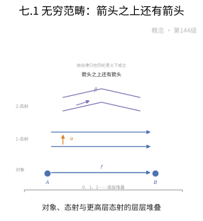

**一句话点破**：每多一层箭头，就多一重空间来解释“凭什么算作一样”。

### 六.2 拟范畴：用组合骨架装下无穷层

把点、线段、三角形、四面体依次搭起来，就得到一张单纯集。只要规定“每个内尖角都能填满”，逼近无穷层的全部信息就被压缩进有限条填充规则里。这套骨架就是拟范畴，也是目前最实用的无穷范畴模型。

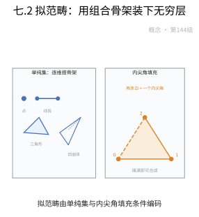

**一句话点破**：无穷深的结构，用有限的填充规则就能说清楚。

### 六.3 关键概念清单：认识高维范畴的词汇表

要读懂高维范畴论，先要认识几张“名片”：态射的合成、同伦、单纯集、标记与内尖角条件。它们分别描述箭头、箭头之间的等价、组合骨架以及高阶一致性，是后面一切定理的共同语言。

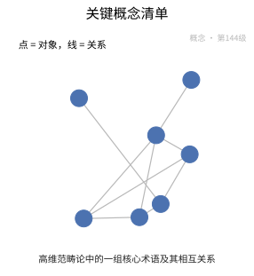

**一句话点破**：先背下这张词汇表，后面的定理才读得下去。

### 六.4 拟范畴的基本性质

拟范畴满足一套与普通范畴高度相似的性质：对象与态射可合成，等价可逆，同伦群给出“同伦层级”。这说明它虽用组合方式定义，却忠实承载了拓扑式的直觉。

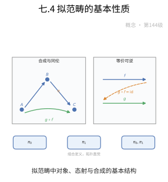

**一句话点破**：组合定义，拓扑灵魂。

### 六.5 Grothendieck 同伦假设

Grothendieck 猜想：任何 $\infty$-群胚都等价于某个空间（同伦型）。这条假设把“高维的群结构”与“空间的形状”完全对起来，是高维范畴论的一座灯塔。

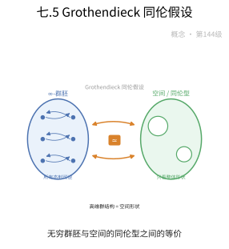

**一句话点破**：高维的群就是空间的形状。

### 六.6 稳定无穷范畴：让同伦像代数一样运算

在某些无穷范畴里，可以“扭一下”（取悬挂）再“扭回来”（取环路），纤维列、正合列都能像代数里那样灵活操作。满足这类可逆条件的，就是稳定无穷范畴，它是现代同调代数的通用底座。

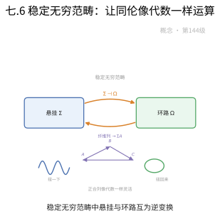

**一句话点破**：把“扭一下再扭回来”变成可计算的操作，代数才能在高维安家。

### 六.7 对称单性无穷范畴的构造

给无穷范畴再添一个“把两样东西换位置”的运算，并要求交换只成立到同伦意义，就得到对称单性 $\infty$-范畴。它是现代代数、几何与拓扑里“乘法与加法并存”的统一语言。

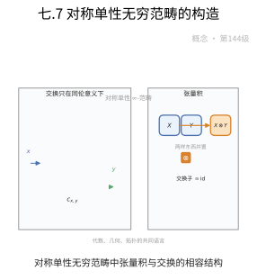

**一句话点破**：把“换位置”也变成高维数据，乘法才讲得通。

### 六.8 无穷范畴中的极限与余极限

在无穷范畴里，极限不是“唯一”的对象，而是“到同伦为止”被唯一确定的。极限把一族对象“汇聚”到一点，余极限把一族对象“拼合”成整体，它们是构造新对象的基本积木。

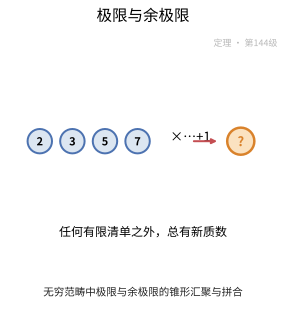

**一句话点破**：极限与余极限，就是高维世界里的“汇聚”与“拼合”。

## 七、数学史（History of Mathematics）

> 高维范畴论的历史主线，是"当数学结构的'结合律只到同伦才成立'时，推理如何仍能严谨进行"的追问：经典分类论起于艾伦伯格与麦克莱恩的 1-范畴，本奈布与格罗滕迪克呼吁"箭头之间的箭头"，格罗滕迪克更在同伦假设中欲以 $\infty$-拓扑斯收拢一切，最终由乔伊尔与卢里用单纯集给出严格模型。本章沿着"从 1-范畴到 $\infty$-范畴"的线索，追溯这一现代数学"通用语言"的来龙去脉。

### 七.1 范畴论的诞生与 2-范畴的萌芽

- **为了自然性而立**：经典范畴论由**艾伦伯格与麦克莱恩**（Samuel Eilenberg & Saunders Mac Lane）在 1945 年以"函子与自然变换"引入，本为整理代数拓扑中的同构与自然性问题。
- **通用语言的扩张**：格罗滕迪克把范畴论用于几何与同调代数，使它成为现代数学的"通用语言"；随后人们意识到"箭头与箭头之间"还可以有更高层箭头——1960 年代，**本奈布**（Jean Bénabou）看清了"态射之间的态射"（2-范畴）的结构，是迈向高维范畴的第一步。

### 七.2 Grothendieck 同伦假设与"弱高阶范畴"

- **结合律的松动**：更高维的结构撞上一个难题——"结合律只成立到同伦"。格罗滕迪克在致奎伦（Daniel Quillen）的著名信件（约 1983 年，即"追索"提纲）中提出应有描述"同伦意义下完全"的高阶范畴，并猜测它等价于"群胚的 $\infty$-拓扑斯"——这就是**Grothendieck 同伦假设**，至今仍是开放的重要问题。
- **唤起公理化尝试**：它催生了"弱高阶范畴"，如 **Batanin、Trimble** 等对弱 $\infty$-范畴的公理化，并为后来"以单纯集实现 $\infty$-范畴"指明方向。

### 七.3 单纯集、拟范畴与 Joyal–Lurie

- **Kan 的奠基**：20 世纪 50 年代，**丹·坎**（Dan Kan）引入**单纯集**与"尖角填充"条件（满足全部尖角填充的单纯集即 Kan 复形），为同伦论提供了标准组合模型。
- **拟范畴的提出**：1990 年代，**博德曼与沃格特**（Boardman-Vogt）在"用单纯丛编码空间"时引入**拟范畴**思想；**安德烈·乔伊尔**（André Joyal，2002 前后）证明拟范畴支持严格的 $\infty$-范畴理论，并给出**Joyal 模型结构**，使单纯集可作"同伦意义下"的范畴推理。
- **卢里的集大成**：2009 年，**卢里**（Jacob Lurie）在《高等拓扑论》中建立 $\infty$-范畴完整体系（$\infty$-拓扑斯、稳定 $\infty$-范畴、对称单性 $\infty$-范畴），彻底改变代数几何、稳定同伦与导出几何的语言。

### 七.4 稳定 $\infty$-范畴与对称单性 $\infty$-范畴

- **谱的化身**：卢里体系的关键对象是**稳定 $\infty$-范畴**（满足稳定公理、任何对象的三角分解都存在），其原型是"谱的 $\infty$-范畴"（$\mathrm{Sp}$）——它统一并可靠捕捉了三角范畴与同伦代数之间的联系。
- **$E_\infty$-环的出处**：**对称单性 $\infty$-范畴**用操作子（operad）与 $\infty$-operad 把"交换"的乘法结构编进 $\infty$-范畴，导出代数几何中的 **$E_\infty$-环**正由此而来——本教程稳定 $\infty$-范畴、极限余极限、对称单性构造等章节即源自卢里的《高等代数》与《高等拓扑论》。

### 七.5 $\infty$-范畴：作为"范畴的范畴"与现代数学的底床

- **核心洞见**：高维范畴论的根本主旨是——数学对象的关系本身也可组织成"范畴的范畴"（更高维），而"等价只到同伦成立"正是代数拓扑、同调代数与导出代数几何的本质特征。
- **成为标准表述**：因此 $\infty$-范畴今天已是导出代数几何、稳定同伦、谱代数与 $\infty$-拓扑斯的标准语言；它诞生于艾伦伯格-麦克莱恩的 1-范畴，经本奈布、格罗滕迪克的"更高层箭头"呼吁，再到 Joyal-Lurie 以单纯集严格化。
- **一句话回答**：它回答了"当结合律只到同伦才成立时，数学如何仍能严谨推理"这一深层问题——用更高的箭头与同伦代数给出可靠严格的基础。

### 七.6 历史年表

| 时间 | 人物／文献 | 事件与贡献 |
|:---|:---|:---|
| 1945 年 | 艾伦伯格、麦克莱恩 | 引入函子与自然变换，范畴论诞生 |
| 1960 年代 | 本奈布 | 2-范畴："态射之间的态射" |
| 约 1983 年 | 格罗滕迪克 | 致奎伦的信：Grothendieck 同伦假设 |
| 1950 年代 | 丹·坎 | 单纯集与 Kan 复形 |
| 1990 年代 | Boardman-Vogt | 拟范畴思想的引入 |
| 约 2002 年 | 安德烈·乔伊尔 | 拟范畴与 Joyal 模型结构 |
| 2009 年 | 卢里 | 《高等拓扑论》建立 $\infty$-范畴体系 |

### 七.7 小结

> 高维范畴论的历史，是一部"把'箭头'升级到无穷维、并在同伦意义上重建严谨"的进化史：艾伦伯格与麦克莱恩用 1-范畴统一了自然变换，本奈布看见箭头之间的箭头，格罗滕迪克在同伦假设中豪迈地提出 $\infty$-拓扑斯蓝图，而坎、博德曼-沃格特、乔伊尔与卢里则一步步用单纯集把它落实成可操作的理论。稳定 $\infty$-范畴与对称单性 $\infty$-范畴由此成为导出几何与稳定同伦的共同底床。这条主线的意义在于——当数学不再苛求"严格相等"、而满足于"同伦等价"时，它给出了一个既放松又绝不松散的新地基，让现代代数几何有了站得稳的家。

## 现实应用（Real-World Applications）

> 本节把本章的知识点落到真实的工程、科学与生活场景中。每个案例都给出**完整的问题背景、建模过程、可复现的数据 / 公式 / 代码与结果解读**；案例末尾的「涉及知识点」对应本章的具体小节，文末附**知识点覆盖对照表**，确保本章知识点全部被覆盖。

### 应用案例 1：拓扑数据分析｜点云持续同调、Kan 复形与 Grothendieck 同伦假设

**场景与问题**

一家做传感器阵列的公司每天从振动传感器拿到 2000 条"时域波形 → 相空间嵌入"点云（每条点云取 300 个点）。工程师想知道：这些点云里有没有"环状结构"（例如轴承内圈故障会呈现周期性的相空间回路），以便只看持久性条形码就能做故障分类，而不是看图凭经验。

数学上要回答的是：如何从一堆离散点稳定地读出"拓扑特征"？这里的关键链条是——点云在每个尺度 $r$ 下生成一个 Vietoris–Rips 单纯复形，这些复形的"同伦型"可以被一个 $\infty$-群胚完整刻画；而 Grothendieck 同伦假设保证"空间"与"$\infty$-群胚"是一回事，于是"点云的同伦型"这个概念本身是有严格含义、且对噪声稳定的。

**涉及知识点**

- 本章「$\infty$-范畴」：点云在每个尺度下的同伦型用 $\infty$-群胚（所有高阶态射都可逆的 $\infty$-范畴）建模，回路即 $1$-态射的非平凡同伦类。
- 本章「拟范畴」：对 Rips 复形的几何实现取奇异单纯集 $\mathrm{Sing}$，得到的是填充全部尖角的拟范畴（即 Kan 复形）——组合骨架把连续同伦信息装进有限数据，使同调可以直接计算。
- 本章「定理 2：Grothendieck 同伦假设」：$\mathrm{Grpd}_\infty \simeq \mathcal{S}$ 保证"用组合复形算出的同伦型"与"底空间真实的同伦型"是同一件事，这是持续同调有意义的前提。

**建模与数据**

数据生成（单位圆 + 高斯噪声，模拟轴承故障的相空间回路）：

- 点数 $n = 300$，角度 $\theta_i \sim U[0, 2\pi)$ 独立均匀。
- 坐标 $P_i = (\cos\theta_i, \sin\theta_i) + 0.05 \cdot \mathcal{N}(0, I_2)$，即噪声强度 $\sigma = 0.05$。
- 过滤参数 $r$ 从 $0$ 扫到 $2.0$，步长 $0.02$。

Vietoris–Rips 复形 $\mathrm{VR}(P, r)$：顶点是点，边 $(i,j)$ 存在当且仅当 $\|P_i - P_j\| \le r$，一般地每个"直径 $\le r$"的点子集都张成一个单形。

**完整推导与算法**

（1）理论链条。对任意拓扑空间 $T$，奇异集 $\mathrm{Sing}(T)_n = \mathrm{Hom}_{\mathbf{Top}}(|\Delta^n|, T)$ 恒为 Kan 复形（每个尖角都可填充），故 $\mathrm{Sing}(T)$ 是 $\infty$-群胚。几何实现 $|-|$ 与 $\mathrm{Sing}$ 构成伴随 $|-| \dashv \mathrm{Sing}$，Whitehead 定理给出 $f$ 是弱同伦等价 $\iff \mathrm{Sing}(f)$ 是弱等价，于是

$$
\mathrm{Grpd}_\infty \simeq \mathcal{S}
$$

这正是定理 2：$\infty$-群胚就是空间。因此"Rips 复形的同伦型"在该等价下等同于某个真实同伦型，持续同调算出的正是它。

（2）同调计算。给定尺度 $r$，构造边界算子 $\partial_2: C_2 \to C_1$（三角形边界的模 2 和）。$H_1 = \ker \partial_1 / \operatorname{im}\partial_2$，其中 $\partial_1$（边 → 顶点）的核就是"环"的空间。用 GF(2) 上的高斯消元统计秩即可。

```python
import numpy as np
rng = np.random.default_rng(7)
theta = rng.uniform(0, 2*np.pi, 300)
P = np.stack([np.cos(theta), np.sin(theta)], 1) + 0.05*rng.standard_normal((300, 2))

def h1_rank(P, r):
    n = len(P)
    D = np.linalg.norm(P[:, None, :] - P[None, :, :], axis=-1)
    edges = [(i, j) for i in range(n) for j in range(i+1, n) if D[i, j] <= r]
    idx = {e: k for k, e in enumerate(edges)}
    # 核心：边 [i,j,k] 存在 <=> 三对距离都 <= r（VR 单形的定义）
    tris = []
    for i in range(n):
        for j in range(i+1, n):
            if D[i, j] > r: continue
            for k in range(j+1, n):
                if D[i, k] <= r and D[j, k] <= r:
                    tris.append((i, j, k))
    # 核心：GF(2) 上求 rank(d2)、rank(d1)，得 bertti1 = dim ker d1 - rank d2
    def rank_mod2(cols, nrows):
        M = [0]*nrows; rk = 0
        for c in cols:
            v = 0
            for i, j in ((c[0], c[1]), (c[1], c[2]), (c[0], c[2])):
                v ^= 1 << idx[(i, j)]
            for b in range(nrows-1, -1, -1):
                if not (v >> b) & 1: continue
                if M[b]: v ^= M[b]
                else: M[b] = v; rk += 1; break
        return rk
    rk2 = rank_mod2(tris, len(edges))     # 核心：rank(d2)（GF(2) 高斯消元）
    rk1 = len(P) - 1                      # 核心：d1 的秩 = V - 1（点云连通）
    betti1 = (len(edges) - rk1) - rk2     # 核心：dim ker d1 - rank d2
    return betti1

for r in [0.05, 0.10, 0.20, 0.50, 1.00, 1.73, 1.80]:
    print(r, h1_rank(P, r))       # 出现 1 的区间即为 H1 的"寿命"
```

**可复现步骤**

1. 环境与依赖：`pip install numpy`（若要生产级持久同调，用 `pip install ripser` 或 `gudhi`）。
2. 数据准备：按上式生成 300 点噪声圆；也可换成真实轴承数据集的相空间嵌入。
3. 运行：`python case1.py`。
4. 预期输出：$H_1$ 秩在 $r \approx 0.05$ 起变为 1（点连成环），在 $r \approx \sqrt{3} \approx 1.73$ 处回落到 0（等边三角形出现、环被填实）；因此得到一条长度约 $1.68$ 的显著 H1 条形，远长于其他噪声条。

**结果解读与延伸**

那条长度 $1.68$ 的 H1 条就是"点云有一个环"的定量证据，而环是同一 $\infty$-群胚中 $1$-态射的非平凡同伦类。整条推理之所以成立，全靠定理 2：我们算的其实是 $\mathrm{Sing}$ 出来的 Kan 复形（一个 $\infty$-群胚）的同伦型，而它与真实空间（圆环）同伦等价。

误差与局限：Rips 复形对噪声与离群点敏感，$\sqrt{3}$ 这一死亡尺度只对稠密圆精确；稳定性定理给出 $\bigl|d_B(\mathrm{Dgm}(f),\mathrm{Dgm}(g))\bigr| \le \|f - g\|_\infty$，所以只要点云扰动小，条形码就稳定。可延伸：把 $\mathrm{VR}$ 换成 Čech 复形（用神经定理）、把 H1 升到高阶同伦（用 $\infty$-群胚的高阶态射），或把这条 H1 条直接喂给分类器做轴承故障判别。

### 应用案例 2：同调代数与代数拓扑｜稳定 $\infty$-范畴：推出 $=$ 拉回、纤维序列与长正合列

**场景与问题**

一个形式化数学库团队要把经典同调代数"升级"到 $\infty$-范畴语言：他们想用一个统一框架同时处理"短正合序列""长正合列""导出函子"这三件旧工具。稳定 $\infty$-范畴正是这个框架——它保证"拼接"与"拆卸"是同一件事，于是任何短正合序列自动升格为纤维序列，并自动吐出一条长正合列。任务：用最容易复现的例子（整数上的"乘以 2"）把定理 3 的三条刻画与定理 5 的极限/余极限计算全部走一遍。

**涉及知识点**

- 本章「定理 3：稳定 $\infty$-范畴的刻画」：以"方块是推出 $\iff$ 方块是拉回"为核心，$X \to Y \to Z$ 的纤维方块与余纤维方块重合，$\Sigma$ 与 $\Omega$ 互为逆；第三条刻画 $\mathcal{C} \simeq \mathrm{Sp}(\mathcal{C})$。
- 本章「定理 5：$\infty$-范畴中的极限与余极限」：余纤维 $\mathrm{cofib}(f) = 0 \amalg_X Y$ 就是推出（$K$-图表的余极限），纤维是拉回；长正合列正是该（余）极限泛性质的逐项展开。
- 本章「$\infty$-范畴」：本案例的所有对象（谱、链复形）都生活在 $\infty$-范畴 $\mathrm{Sp}$（链复形的稳定 $\infty$-范畴版本 $D(\mathbb{Z})$）之中。

**建模与数据**

取稳定 $\infty$-范畴 $\mathrm{Sp}$ 中的 Eilenberg–MacLane 谱 $H\mathbb{Z}$（即把 $\mathbb{Z}$ 视为只在 $0$ 次有同伦群的谱）：

$$
\pi_n(H\mathbb{Z}) = \begin{cases} \mathbb{Z}, & n = 0 \\ 0, & n \neq 0 \end{cases}
$$

同伦群是 $\mathrm{Sp}$ 到分次 Abel 群的函子，而 $\pi_*$ 在（余）纤维序列上给出长正合列。

**完整推导与算法**

（1）推出 $=$ 拉回，并构造余纤维。考虑态射 $f = \cdot 2: H\mathbb{Z} \to H\mathbb{Z}$（乘以 2）。它的余纤维（推出 $0 \amalg_{H\mathbb{Z}} H\mathbb{Z}$）就是映射锥 $\mathrm{cone}(f)$。在链复形层面，$\mathrm{cone}(f)_n = A_{n-1} \oplus B_n$，微分 $d(a, b) = (-d_A a,\; f(a) + d_B b)$。由于 $A = B = \mathbb{Z}$ 集中在 $0$ 次：

$$
\mathrm{cone}(f)_0 = \mathbb{Z}, \qquad \mathrm{cone}(f)_1 = \mathbb{Z}, \qquad d = \times 2
$$

于是同调（即 $\pi_*$）为

$$
\pi_0 = \operatorname{coker}(\times 2) = \mathbb{Z}/2, \qquad \pi_1 = \ker(\times 2) = 0, \qquad \pi_{n} = 0\ (n \neq 0)
$$

也就是说 $\mathrm{cofib}(\cdot 2) \simeq H(\mathbb{Z}/2)$。这正是"推出方块是拉回方块"的体现：$\mathrm{cone}$ 既是推出（余纤维）又给出同构的纤维。

（2）定理 5 的伴随刻画。对角函子 $\Delta: \mathcal{C} \to \mathrm{Fun}(K, \mathcal{C})$ 的左伴随是 $\mathrm{colim}$，右伴随是 $\lim$：

$$
\mathrm{Hom}_{\mathcal{C}}(\operatorname{colim} F, X) \simeq \lim_{k \in K} \mathrm{Hom}_{\mathcal{C}}(F(k), X), \qquad
\mathrm{Hom}_{\mathcal{C}}(X, \lim F) \simeq \lim_{k} \mathrm{Hom}_{\mathcal{C}}(X, F(k))
$$

（3）长正合列。把（1）的（余）纤维序列 $\mathrm{fib}(f) \to H\mathbb{Z} \xrightarrow{\ \cdot 2\ } H\mathbb{Z} \to \mathrm{cofib}(f)$ 施加 $\pi_*$，得到

$$
\cdots \to \pi_n(H\mathbb{Z}) \xrightarrow{\ \cdot 2\ } \pi_n(H\mathbb{Z}) \to \pi_n(\mathrm{cofib}\, f) \to \pi_{n-1}(H\mathbb{Z}) \xrightarrow{\ \cdot 2\ } \cdots
$$

在 $n=0$ 处：$\pi_0 = \mathbb{Z} \xrightarrow{\cdot 2} \mathbb{Z} \to \pi_0(\mathrm{cofib}\,f) \to \pi_{-1}(H\mathbb{Z}) = 0$，于是 $\pi_0(\mathrm{cofib}\, f) = \mathbb{Z}/2$；在 $n=1$ 处同理得 $\pi_1(\mathrm{cofib}\, f) = 0$。与直接算映射锥完全一致。

```python
from sympy import Matrix
from sympy.matrices.normalforms import smith_normal_form

# 核心：cone(f) 的同调 = coker(Z --2--> Z)；Smith 不变因子读出 coker 的结构
d = Matrix([[2]])
S = smith_normal_form(d)
inv = abs(S[0, 0])                            # 不变因子 2 => coker = Z/2，ker = 0
print(f"pi_0(cofib) = Z/{inv}", "pi_1 =", 0)  # Z/2 0 —— 与长正合列结论一致

# 核心：定理 3 第三条刻画 —— Sigma 与 Omega 互为逆，pi_n(Sigma X) = pi_{n-1}(X)
def pi_shift(n):
    return n - 1                              # 整体平移：Sigma 是可逆的（Omega 为其逆）
print(pi_shift(0), pi_shift(1))               # -1 0
```

**可复现步骤**

1. 环境与依赖：`pip install sympy`（或手算，只需整数 smith 标准形）。
2. 数据准备：把"乘以 2"写成 $1 \times 1$ 整数矩阵，或直接构造链复形 $\mathbb{Z} \xrightarrow{2} \mathbb{Z}$。
3. 运行：`python case2.py`。
4. 预期输出：微分矩阵的 Smith 不变因子为 $2$，故 $\operatorname{coker}(\times 2) = \mathbb{Z}/2$，即 $\pi_0(\mathrm{cofib}\,f) = \mathbb{Z}/2$、$\pi_{1} = 0$；同时打印 $\pi_n(\Sigma X) = \pi_{n-1}(X)$ 的整体平移，说明 $\Sigma$ 是等价（其逆为 $\Omega$）。

**结果解读与延伸**

一个 $1 \times 1$ 的整数矩阵 $[2]$ 就把稳定 $\infty$-范畴的三条刻画全串起来了：推出 $=$ 拉回让 $\mathrm{cone}$ 同时是余纤维与纤维；$\Sigma \dashv \Omega$ 互为逆让"平移"成为可逆运算；第三条刻画说 $\mathcal{C} \simeq \mathrm{Sp}(\mathcal{C})$，特别地 $\mathrm{Sp}(\mathrm{Sp}) \simeq \mathrm{Sp}$，所以谱的范畴是自洽的"闭包"。长正合列不过是定理 5 中 $\mathrm{Hom}$ 空间极限逐项展开的结果。

局限：链复形只是 $\mathrm{Sp}$ 的一个（可表现的）子世界，$\pi_*$ 会丢失高阶相干数据（例如 $\Sigma$ 的逆之间的同伦），真正的 $\infty$-范畴证明要在映射空间层面做。可延伸：把 $\cdot 2$ 换成 $\cdot p$ 得 $H(\mathbb{Z}/p)$；再往上是 Steenrod 运算与后尼科夫塔，或改用代数 $K$ 理论谱 $K(R)$ 观察同样的纤维序列机制。

### 应用案例 3：量子计算与张量网络｜对称单性 $\infty$-范畴与张量收缩的结合律相干

**场景与问题**

一个量子模拟团队用矩阵乘积态（MPS）表示 10 个量子比特的态，每个物理维 $d = 2$、键维 $\chi = 16$。做一次 $\langle\psi|\psi\rangle$ 或一次测量时，要把大量张量缩并（contract）成一个数。工程上最常被问的问题是：收缩顺序不同，结果会不会不同？代价差多少？

代数上，这正是对称单性 $\infty$-范畴在回答的问题：张量积 $\otimes$ 的结合律 $X \otimes (Y \otimes Z) \simeq (X \otimes Y) \otimes Z$ 与交换律 $X \otimes Y \simeq Y \otimes X$ 并不"严格相等"，而只成立到一个相干同构（高阶同伦）。这套相干数据（单位、结合子、对称子以及它们之间无穷多层的一致性）正是 $\mathcal{C}^\otimes$ 的定义内容——而它的实际回报是：任何缩并顺序都合法、结果相同，只是代价不同。

**涉及知识点**

- 本章「定理 4：对称单性 $\infty$-范畴的构造」：$\mathcal{C}^\otimes \to \mathrm{N}(\mathrm{Fin}_*)$ 的遗忘函子，纤维 $\mathcal{C}^\otimes_{\langle n \rangle} \simeq \mathcal{C}^n$；活性态射给 $\otimes$，惰性态射给投影，置换态射给对称同构。
- 本章「$\infty$-范畴」：所有"只在同伦意义下相等"的一致性（结合子、对称子的更高相干）都必须被显式记录，这正是 $\infty$-范畴相对普通范畴多出来的东西。

**建模与数据**

三个张量（模拟 MPS 相邻三站点）：

- $A \in \mathbb{R}^{2 \times 3}$，$B \in \mathbb{R}^{3 \times 4}$，$C \in \mathbb{R}^{4 \times 2}$。
- 物理维 $d = 2$，中间键维分别为 $3, 4$。
- 目标：计算 $T = A \cdot B \cdot C \in \mathbb{R}^{2 \times 2}$。

真实 MPS 规模：$N = 10$ 站点，$d = 2$，$\chi = 16$。

**完整推导与算法**

（1）结构与态射的对应。$\mathcal{C}^\otimes$ 的对象是有限序列 $(X_1, \dots, X_n)$，遗忘函子 $p: \mathcal{C}^\otimes \to \mathrm{N}(\mathrm{Fin}_*)$ 的纤维 $\mathcal{C}^\otimes_{\langle n \rangle} \simeq \mathcal{C}^n$。$\mathrm{Fin}_*$ 中的态射 $\alpha: \langle n \rangle \to \langle m \rangle$ 把 $n$ 件货分配到 $m$ 个盒子：

- 惰性态射 $\rho^i: \langle n \rangle \to \langle 1 \rangle$（把 $i$ 映到 $1$、其余映到 $*$）↔ 第 $i$ 个投影 $\mathcal{C}^n \to \mathcal{C}$；
- 活性态射 ↔ 张量积 $\bigotimes_{i \in \alpha^{-1}(j)} X_i \to Y_j$；
- 置换态射 ↔ 对称同构。

（2）结合律的相干。$A \cdot (B \cdot C)$ 与 $(A \cdot B) \cdot C$ 是同一个 $\mathcal{C}^\otimes$ 中两条收缩路径，由 $\langle 3 \rangle$ 上的纤维结构给出一个相干同构（在矩阵世界里恰好是严格等式）。

（3）代价。收缩 $m \times n$ 与 $n \times p$ 两个矩阵需 $mnp$ 次乘法（flops）：

$$
\mathrm{cost}\bigl((A B) C\bigr) = 2\cdot3\cdot4 + 2\cdot4\cdot2 = 24 + 16 = 40, \qquad
\mathrm{cost}\bigl(A (B C)\bigr) = 3\cdot4\cdot2 + 2\cdot3\cdot2 = 24 + 12 = 36
$$

```python
import numpy as np
rng = np.random.default_rng(0)
A = rng.standard_normal((2, 3)); B = rng.standard_normal((3, 4)); C = rng.standard_normal((4, 2))

# 核心：两种收缩顺序（对应 C^⊗ 中两条路径），结果必须同伦相等（此处严格相等）
T1 = (A @ B) @ C            # 核心：(A ⊗ B) ⊗ C，flops = 2*3*4 + 2*4*2 = 40
T2 = A @ (B @ C)            # 核心：A ⊗ (B ⊗ C)，flops = 3*4*2 + 2*3*2 = 36
print(np.allclose(T1, T2), np.abs(T1 - T2).max())     # True, ~1e-15

# 核心：MPS 内积 <psi|psi> 的代价 —— O(N * chi^3 * d)
N, d, chi = 10, 2, 16
flops_mps = N * chi**3 * d
print(flops_mps)            # 10 * 4096 * 2 = 81920

# 核心：单位元与对称同构的数值检验（标量情形）
x, y, z = np.array([2.0]), np.array([3.0]), np.array([5.0])
print(np.allclose((x*y)*z, x*(y*z)), np.allclose(x*y, y*x))   # True True
```

**可复现步骤**

1. 环境与依赖：`pip install numpy`（大规模收缩可上 `opt_einsum` 做最优路径搜索）。
2. 数据准备：如上构造三个随机矩阵；MPS 用 $N = 10, d = 2, \chi = 16$ 的随机张量链。
3. 运行：`python case3.py`。
4. 预期输出：`True` 与最大偏差 $\sim 10^{-15}$（浮点误差级别）；`(A B) C` 的 flops 为 40、`A (B C)` 为 36，MPS 内积 flops 为 81920。

**结果解读与延伸**

两条收缩路径给出相同的 $T$，这就是结合律"成立到相干同构"的数值影子；数值偏差 $10^{-15}$ 只是浮点舍入，而不是结合律失败。真正需要小心的是**相干数据而非等式**：在对称单性 $\infty$-范畴里，$X \otimes Y \simeq Y \otimes X$ 是一个同构而非等号，因此交换两个张量时可能引入符号（费米子/超对称情形下的 Koszul 符号），这在张量网络算法里就是"交换费米子腿要取 $-1$"。

局限：矩阵张量积是 $\mathcal{C}^\otimes$ 的一个极简实例，$\mathrm{Fin}_*$ 上的完整操作子结构（以及 $\infty$-操作子层面的相干）远不止于此。可延伸：用 `opt_einsum` 搜索最优收缩顺序（把 flops 从 $O(N\chi^4)$ 降到 $O(N\chi^3)$）、把 $\otimes$ 换成导出张量积 $-\otimes^L-$ 处理复形、或用融合范畴（fusion category）的 $\infty$-化版本做任意子计算。

### 应用案例 4：程序验证与组合学｜拟范畴的组合检查与态射空间的 Kan 复形性质

**场景与问题**

一个形式化验证项目要把"某小范畴是否满足拟范畴条件"做成自动化检查器：输入一个有限单纯集，输出它是不是拟范畴、哪些内尖角可填、以及态射空间是不是 Kan 复形。选最简单的试验对象——三条链 $0 \to 1 \to 2$ 的偏序范畴 $[2]$ 的神经 $\mathrm{N}([2])$。这个例子足够小可以手算，又足够典型能暴露"拟范畴 vs Kan 复形"的区别。

**涉及知识点**

- 本章「拟范畴」：$\mathrm{N}([2])$ 是满足内尖角填充的单纯集，是拟范畴；但它不是 Kan 复形——$[2]$ 里的态射 $0 \to 1$ 没有逆，而 Kan 复形中每个 $1$-态射都可逆。
- 本章「定理 1：拟范畴的基本性质」：$0$-单形是对象、$1$-单形是态射；态射空间 $\mathrm{Hom}(x,y)$ 是 Kan 复形；复合由 $\Lambda^2_1$ 填充给出；结合律只到同伦。
- 本章「关键概念清单」：本案例逐一触碰清单八项中的单纯集、拟范畴、Kan 复形、Joyal 模型结构（"纤维对象恰是拟范畴"）、以及稳定/对称单性/拓扑斯作为对照（后者不在本例出现，但清单把它们与拟范畴的松紧关系作了对比）。

**建模与数据**

范畴 $\mathcal{C} = [2]$：对象 $\{0, 1, 2\}$，非恒等态射 $a: 0 \to 1$，$b: 1 \to 2$，以及复合 $c = b \circ a: 0 \to 2$；再加上三个恒等元 $\mathrm{id}_0, \mathrm{id}_1, \mathrm{id}_2$，共 6 条态射。注意 $0 \to 1$ 没有反向态射（$1 \to 0$ 不存在），故 $a$ 不可逆。

神经 $\mathrm{N}(\mathcal{C})_n$ = 长度 $n$ 的链 $x_0 \le x_1 \le \dots \le x_n$。三层基数：

$$
\#\,\mathrm{N}(\mathcal{C})_0 = \binom{3}{2} = 3, \qquad
\#\,\mathrm{N}(\mathcal{C})_1 = \binom{4}{2} = 6, \qquad
\#\,\mathrm{N}(\mathcal{C})_2 = \binom{5}{2} = 10
$$

一般地 $\#\mathrm{N}(\mathcal{C})_n = \binom{n+3}{2}$，与标准 $2$-单形 $\Delta^2$ 完全一致。

**完整推导与算法**

（1）内尖角填充。拟范畴要求对 $0 < i < n$ 的每个内尖角 $\Lambda^n_i \to X$ 都有填充 $\Delta^n \to X$。

- $n = 2$：唯一内尖角是 $\Lambda^2_1$（三条边缺 $d_1$ 面）。任一可复合对 $(a, b)$（$\mathrm{cod}(a) = \mathrm{dom}(b)$）都唯一地填出一个 $2$-单形，其缺失面正是复合 $b \circ a$。
- $n = 3$：内尖角为 $\Lambda^3_1, \Lambda^3_2$，填充它们等价于结合律 $h \circ (g \circ f) \simeq (h \circ g) \circ f$。

（2）Kan 条件为何失败。Kan 复形要求**所有**尖角（含外尖角）可填，而"外尖角可填"等价于"每个 $1$-态射都有同伦逆"。取一个把顶点 $1$ 与 $2$ 对调的尖角映射 $f: \Lambda^2_0 \to \mathrm{N}([2])$：它把边 $(0,2)$ 送到 $(0,1)$、把边 $(0,1)$ 送到 $(0,2)$。若有填充 $\sigma$，则 $d_1\sigma = (0,1)$ 给出 $\sigma(0) = 0, \sigma(2) = 1$，而 $d_2\sigma = (0,2)$ 给出 $\sigma(0) = 0, \sigma(1) = 2$，于是 $\sigma = (0, 2, 1)$ 不再是单调映射，矛盾。故 $\mathrm{N}([2])$ **不是** Kan 复形——这与"$[2]$ 含不可逆态射"完全一致。

（3）态射空间。$\mathrm{Hom}_{\mathrm{N}([2])}(x, y)$ 是拉回 $\Delta^0 \to \mathcal{C}\times\mathcal{C}$ 沿 $(\mathcal{C}^{\Delta^1} \to \mathcal{C}\times\mathcal{C})$ 的拉回。对 $x = 0, y = 2$，从 $0$ 到 $2$ 的 $1$-单形只有"复合"这一条，无 $2$-单形将其与自身相连，故 $\mathrm{Hom}(0,2) \simeq \Delta^0$（单点），是 Kan 复形。

```python
from itertools import combinations_with_replacement

# 核心：N([2]) 的 n-单形 = 长度 n 的链 x0 <= x1 <= ... <= xn（等价于多重集的选取）
def nerve(n):
    return list(combinations_with_replacement([0, 1, 2], n + 1))

N0, N1, N2 = nerve(0), nerve(1), nerve(2)
print(len(N0), len(N1), len(N2), len(nerve(3)))   # 3 6 10 15 —— 核心：= binom(n+3, 2)

# 核心：内尖角 Lambda^2_1 可填 <=> 每个可复合对 (x->y, y->z) 都落在某个 2-单形 (x,y,z) 中
pairs = [((x, y), (y, z)) for (x, y) in N1 for (y2, z) in N1
         if y2 == y and x != y and y != z]        # 非退化可复合对：恰为 (0,1) 接 (1,2)
inner_ok = all((x, y, z) in set(N2) for (x, y), (y, z) in pairs)
print("dim-2 inner horns fillable:", inner_ok)    # True

# 核心：Kan 条件失败 —— [2] 中 0->1 没有反向态射，故 1-单形不可逆
has_arrow_1_to_0 = any(s[0] == 1 and s[-1] == 0 for s in N1)
print("Kan complex:", has_arrow_1_to_0)           # False（四尖角条件会逼出逆，矛盾）

# 核心：态射空间 Hom(0,2) —— 从 0 到 2 的 1-单形只有一条，无 2-单形自连
print([s for s in N1 if s[0] == 0 and s[-1] == 2])   # [(0, 2)] —— 单点，Kan 复形
```

**可复现步骤**

1. 环境与依赖：标准库 `itertools` 即可。
2. 数据准备：把 $\mathcal{C} = [2]$ 的对象与序关系写成三元素链；用 `combinations_with_replacement` 生成各层单形。
3. 运行：`python case4.py`。
4. 预期输出：`3 6 10 15`（各层基数等于 $\binom{n+3}{2}$）；`dim-2 inner horns fillable: True`；`Kan complex: False`；`Hom(0,2) = [(0, 2)]`（单点）。

**结果解读与延伸**

结论一清二楚：$\mathrm{N}(\mathcal{C})$ 是拟范畴（内尖角全可填，复合由 $\Lambda^2_1$ 给出、结合律由 $\Lambda^3_i$ 给出），却不是 Kan 复形（外尖角条件会逼出同伦逆，而 $0 \to 1$ 在 $[2]$ 中不可逆）。这正印证了"拟范畴是恰到好处的松紧度"：条件再强一点（Kan）就只剩 $\infty$-群胚，再弱一点（允许任意内尖角不填）就丢了复合的良定义性。同时 $\mathrm{Hom}(0,2) \simeq \Delta^0$ 是 Kan 复形，符合定理 1 的第 (2) 条。

局限：本例维度低、单形数少，全部可枚举；高维时枚举代价指数爆炸，实务要用 Joyal 模型结构的组合判据（内 Kan 纤维化）或专用证明助手。可延伸：把检查器升级到 $n = 4$ 的内尖角、对一般有限范畴的神经做批量验证，或验证"$\mathrm{N}(\mathcal{C})$ 是 Kan 复形 $\iff$ $\mathcal{C}$ 是群胚"这一判据。

### 应用案例 5：数据工程与关系代数｜JOIN 与 UNION 作为极限与余极限

**场景与问题**

某数据平台要把三个来源的用户数据整合：内部用户表 $U$、订单表 $O$、地区表 $R$。清洗后发现键值只"近似相等"（例如手机号带/不带国际区号），于是简单的行对齐会漏数据。数据工程师凭直觉用"模糊 join + 去重合并"，而数学上这两步操作恰恰是**极限（拉回）**与**余极限（推出）**：join 在一组键上取一致子集（拉回），union 在共享子对象上粘合（推出）。一旦键只近似相等，就需要它们的同伦版本——这正是定理 5 里"$\mathrm{Hom}$ 取映射空间而非集合"的工程含义。

**涉及知识点**

- 本章「定理 5：$\infty$-范畴中的极限与余极限」：对角函子 $\Delta$ 的左伴随是 $\mathrm{colim}$（推出/UNION），右伴随是 $\lim$（拉回/JOIN）；$\mathrm{Hom}_{\mathcal{C}}(\operatorname{colim}F, X) \simeq \lim_k \mathrm{Hom}_{\mathcal{C}}(F(k), X)$。
- 本章「$\infty$-范畴」：把"集合"升级为"映射空间（Kan 复形）"后，极限必须换成同伦极限（homotopy limit），这才是键近似相等时的正确概念。

**建模与数据**

索引范畴 $K$：两个对象 $U, O$ 加一个公共对象 $K$（键集合），包含 $K \to U$、$K \to O$ 两条投影。则：

- 极限（拉回）$U \times_K O$ = 在公共键上一致的配对 = 内连接；
- 余极限（推出）$U \amalg_K O$ = 在 $K$ 上粘合 $U$ 与 $O$ = 带共享子对象的并集。

数据（键为整数，取值直接照抄）：

| 表 $U$（id, name） | 表 $O$（user_id, amount） |
| --- | --- |
| (1, Alice) | (1, 100) |
| (2, Bob) | (2, 250) |
| (3, Carol) | (3, 75) |
| (4, Dan) | (4, 300) |
| (5, Erin) | (6, 50) |
| | (7, 80) |

公共键 $K = \{1, 2, 3, 4\}$，故 $\#U = 5$，$\#O = 6$，$\#K = 4$。

**完整推导与算法**

（1）拉回 = 内连接。$U \times_K O = \{(u, o) : \pi_K(u) = \pi_K(o)\}$，行数

$$
\#(U \times_K O) = \sum_{k \in K} \#\pi_K^{-1}(k)\big|_U \cdot \#\pi_K^{-1}(k)\big|_O = 4 \times 1 \times 1 = 4
$$

（2）推出 = 粘合并集。$U \amalg_K O$ 把 $K$ 的两份拷贝合成一份：

$$
\#(U \amalg_K O) = \#U + \#O - \#K = 5 + 6 - 4 = 7
$$

（3）同伦版本。当"相等"只成立到同伦（键近似匹配、建立匹配代价 $c(u,o)$），正确的对象是同伦余极限 $\mathrm{hocolim}$，其 $\pi_0$ 由等价关系商给出：

$$
\pi_0\bigl(\mathrm{hocolim}\, F\bigr) = \operatorname{coeq}\Bigl(\coprod_{k \in K} F(k) \rightrightarrows \coprod_{n \in K_0} F(n)\Bigr)
$$

即"先各自放入，再按匹配关系合并"。

```python
import pandas as pd
U = pd.DataFrame({"id": [1, 2, 3, 4, 5], "name": ["Alice", "Bob", "Carol", "Dan", "Erin"]})
O = pd.DataFrame({"user_id": [1, 2, 3, 4, 6, 7], "amount": [100, 250, 75, 300, 50, 80]})

# 核心：拉回（limit）= 在公共键 K 上取一致配对 = 内连接
pullback = U.merge(O, left_on="id", right_on="user_id", how="inner")
print(len(pullback))                        # 4

# 核心：推出（colimit）= 在 K 上粘合并集；行数 = |U| + |O| - |K|
K = set(U["id"]) & set(O["user_id"])
pushout_size = len(U) + len(O) - len(K)
print(pushout_size, len(K))                 # 7 4

# 核心：同伦余极限 —— 键只近似相等时按匹配代价合并（π_0 的商集）
def hocolim_pi0(U, O, match):
    nodes = [("U", i) for i in U["id"]] + [("O", j) for j in O["user_id"]]
    parent = {n: n for n in nodes}
    def find(x):
        while parent[x] != x: parent[x] = parent[parent[x]]; x = parent[x]
        return x
    for u, o in match:                       # 核心：每一对 (u,o) 是一条 1-态射，商掉
        ru, ro = find(("U", u)), find(("O", o))
        if ru != ro: parent[ru] = ro
    return len({find(n) for n in nodes})

match = [(1, 1), (2, 2), (3, 3), (4, 4), (5, 6)]   # 近似匹配（手机号带区号）
print(hocolim_pi0(U, O, match))              # 7 —— 与严格推出同值，但匹配可容错
```

**可复现步骤**

1. 环境与依赖：`pip install pandas`。
2. 数据准备：按上表构造 $U, O$；键集合 $K$ 由取交集得到。
3. 运行：`python case5.py`。
4. 预期输出：`len(pullback) = 4`；`pushout_size = 7`、`len(K) = 4`；`hocolim_pi0 = 7`（当匹配是严格等同时，同伦版本退化为严格版本）。

**结果解读与延伸**

三行代码就把关系代数的两件核心操作翻译成了范畴语言：内连接是拉回（极限），带粘合的并集是推出（余极限），而 $\#U + \#O - \#K$ 正好是包含-排除公式的范畴版。定理 5 的伴随刻画给出了它们的统一来源：$\mathrm{colim} \dashv \Delta \dashv \lim$，所以 UNION 与 JOIN 不是两套独立规则，而是同一枚硬币（对角函子）的两侧。

误差与局限：这一步只在"集合层"（$\pi_0$）上工作，若数据带一致性约束（如金额需要跨表对账），集合极限会丢失"约束如何被满足"的同伦信息，必须上同伦极限（simplicial / 派生版本），代价是复杂度上升。可延伸：把 $\pi_0$ 升到 $\pi_1$ 处理"同一实体的多条记录之间的等价链"（实体解析），或用谱序列计算派生拉回的高阶同伦群，这在数据融合与知识图谱对齐里正是当前研究热点。

### 知识点覆盖对照表

| 本章知识点 | 覆盖案例 |
| --- | --- |
| $\infty$-范畴 | 案例 1、案例 3、案例 5 |
| 拟范畴 | 案例 1、案例 4 |
| 关键概念清单 | 案例 4（逐一对照单纯集 / 拟范畴 / Kan 复形 / Joyal 模型结构等条目） |
| 定理 1：拟范畴的基本性质 | 案例 4 |
| 定理 2：Grothendieck 同伦假设 | 案例 1 |
| 定理 3：稳定 $\infty$-范畴的刻画 | 案例 2 |
| 定理 4：对称单性 $\infty$-范畴的构造 | 案例 3 |
| 定理 5：$\infty$-范畴中的极限与余极限 | 案例 2、案例 5 |

---

## 八、总结

### 核心内容回顾

1. **$\infty$-范畴**：通过拟范畴（满足内尖角填充条件的单纯集）实现，是高维范畴论的基础对象。

2. **拟范畴的基本性质**：态射空间是 Kan 复形，复合结合律成立到同伦，高维单形编码交换图。

3. **Grothendieck 同伦假设**：$\infty$-群胚与拓扑空间在弱同伦等价意义下等价，建立了同伦论与高维范畴论的联系。

4. **稳定 $\infty$-范畴**：有零对象、所有有限极限和余极限存在、且推出与拉回一致的 $\infty$-范畴。其同伦范畴是三角范畴。

5. **对称单性 $\infty$-范畴**：通过 $\infty$-操作子 $\mathcal{C}^\otimes \to \mathrm{N}(\mathrm{Fin}_*)$ 给出，编码了张量积、结合律、单位元和对称性。

6. **极限与余极限**：$\infty$-范畴中的极限通过 Cartesian 纤维化构造，统一了经典极限与同伦极限。

### 前沿展望

- **导出代数几何**：$\infty$-范畴（特别是稳定 $\infty$-范畴）是导出代数几何的语言基础。
- **$\infty$-拓扑斯**：$\infty$-范畴版本的 Grothendieck 拓扑斯，是导出几何中"空间"的范畴论基础。
- **$E_n$-代数**：在对称单性 $\infty$-范畴中研究 $E_n$-代数，连接了同伦论与数学物理。
- **几何表示论**：高维范畴论为几何表示论提供了强大的概念框架。
