# 第147级 自由概率论 (Free Probability Theory)

## 学习目标

1. 理解自由独立性的概念及其与非交换概率空间的关系
2. 掌握矩与自由累积量的基本性质及其相互关系
3. 掌握R-变换的定义与性质，理解其作为自由卷积生成函数的作用
4. 理解自由中心极限定理及其与经典中心极限定理的对比
5. 掌握自由卷积的加法与乘法公式
6. 理解Voiculescu渐近自由性定理及其在随机矩阵中的应用
7. 掌握自由熵与自由Fisher信息量的基本性质
8. 理解自由概率论在算子代数与随机矩阵中的深刻联系

---

## 核心概念

![自由概率论：左侧经典独立性基于交换代数，混合矩可分解E[X^nY^m]=E[X^n]E[Y^m]，使用张量积\otimes；右侧自由独立性基于非交换代数，自由累积量可加\kappa_n(a+b)=\kappa_n(a)+\kappa_n(b)，使用自由积\boxplus，R-变换满足R_{a+b}(z)=R_a(z)+R_b(z)](images/147_free_probability.svg)

> **直观理解（现实类比）**：经典概率论就像"两个陌生人各自做事"：你买苹果的钱和我买橘子的钱，总账可以分开算（$E[XY]=E[X]E[Y]$）。自由概率论则像"两个爵士乐手即兴合奏"：他们各自演奏（非交换随机变量$a,b$），但演奏规则是"零均值的交替独白"——只要相邻角色不同、各自台词平均为空，整段合奏的平均就为零。R-变换是自由概率的"特征函数"，它把自由卷积变成普通加法（$R_{a+b}=R_a+R_b$），就像傅里叶变换把卷积变成乘法。自由中心极限定理告诉我们：大量自由独立变量的和趋向半圆分布（而非高斯分布），这就像爵士乐手即兴合奏最终会形成某种"半圆形的和声结构"。

> **🧠 思考历程：当随机变脸不再"可交换"，概率论还能讲出什么新故事？**
>
> 经典概率论里两种事物的"独立性"建立在可交换运算上；可一旦研究对象是算子代数这类非交换量，"独立"的旧定义便不再够用。自由概率论因此被发明出来。它想回答的，是"非交换世界里的独立性"该怎么定义、它的极限规律又长什么样。
>
> - **一个来自算子代数的问题**。1980年代，罗马尼亚数学家沃库莱斯库研究自由群因子 $L(\mathbb{F}_n)$ 这类von Neumann代数时，发现需要一种全新的"独立性"：两个子代数"自由独立"的标准，是零均值元素的交替乘积之迹必为零，而不是经典可交换情形的"分开相乘"。
> - **自由概率的道理**。沃库莱斯库由此建立自由概率论：自由累积量可加、$R$-变换把自由卷积变成加法，并证明"大量自由独立变量之和趋向半圆分布"——对应经典中心极限中的高斯。这一结果恰好呼应维格纳半圆律，暴露出自由概率与随机矩阵之间的深层亲缘。
> - **一座通往大矩阵的桥**。1990年代之后，自由概率成为分析大量随机矩阵（大 $N$ 极限）、算子代数与量子信息论的利器。一个为抽象代数而生的理论，却精准地描述了现实世界的大数据矩阵。
> - **心路**：当"独立"的含义被非交换重新定义之后，连"中心极限"都换上了一张更圆的半圆面孔。

### 1.1 非交换概率空间

> **🧠 来龙去脉（为什么会有这个概念？解决了什么问题？）** 经典概率论把"随机性"装进"样本空间 $\Omega$ + 测度 $\mathbb{P}$ + 可交换随机变量的期望 $\mathbb{E}$"这个框架里。可 1980 年代沃库莱斯库研究自由群因子 $L(\mathbb{F}_k)$ 这类算子代数时撞上了硬壁：这里的研究对象是**不交换**的算子，$ab$ 与 $ba$ 未必相等，经典"用 $\Omega$ 上可交换函数建模随机性"的手段完全失效。于是他想到：把"样本空间+测度"整体替换成"代数 $\mathcal{A}$ + 线性泛函 $\varphi$（迹/期望）"，让乘法顺序被 $\mathcal{A}$ 的不交换性自然承载。这样从"集合测度"升级为"代数泛函"，正是非交换概率空间要解决的问题——它让那些"不交换的随机对象"第一次有了严格的概率语言。

**定义1（非交换概率空间）** 一个**非交换概率空间** $(\mathcal{A}, \varphi)$ 由以下两部分组成：
- $\mathcal{A}$：一个含单位元的幺半C*-代数（或更一般地，一个含单位元的复*-代数）
- $\varphi: \mathcal{A} \to \mathbb{C}$：一个线性泛函（称为**迹**或**期望**），满足 $\varphi(1) = 1$，$\varphi(a^* a) \geq 0$（正性），且 $\varphi$ 是迹（即 $\varphi(ab) = \varphi(ba)$）

> **💡 直观理解（类比）**：非交换概率空间就像"一家只讲顺序的账房"：$\mathcal{A}$ 是"账本上的各种记法"（元素），$\varphi$ 是"结账规则"（期望/迹）。它要求满账归一 $\varphi(1)=1$、账目非负 $\varphi(a^*a)\ge0$、以及 $\varphi(ab)=\varphi(ba)$ 这种"环形换位"结账——但注意是环形换位而非普通交换，所以里面的量仍可以不交换地相乘。这正是经典概率"样本空间+测度"的非交换升级版。

**定义2（非交换随机变量）** 非交换概率空间中的元素 $a \in \mathcal{A}$ 称为**非交换随机变量**。其**分布**由所有矩 $\varphi(a^k)$（$k \geq 1$）决定。

> **💡 直观理解（类比）**：非交换随机变量就是"账本里一个会算的条目"。和经典随机变量一样，它的"长相"（分布）由各阶矩 $\varphi(a^k)$ 拼出来——就像一段波形由它的各阶谐波决定。区别在于它们相乘时讲究顺序，所以不能再靠单个"概率密度"描述，而要由一整套矩来完整还原。

#### 课堂问答

**老师**：非交换概率空间 $(\mathcal{A},\varphi)$ 里，$\mathcal{A}$ 与 $\varphi$ 各自要满足哪些条件？

**学生**：结论先给：$\mathcal{A}$ 是含单位的复 *-代数（实践上常取有限 von Neumann 代数或 C*-代数），$\varphi:\mathcal{A}\to\mathbb{C}$ 是满足 $\varphi(1)=1$、正性 $\varphi(a^*a)\ge0$、迹性 $\varphi(ab)=\varphi(ba)$ 的线性泛函。三条缺一不可：$\varphi(1)=1$ 把它归成"概率"，正性保证 $\langle a,b\rangle=\varphi(b^*a)$ 是内积、从而可用 GNS 构造，迹性则让期望在循环换位下不变。

**老师（追问）**：为什么只要求 $\varphi(ab)=\varphi(ba)$ 而不要求 $\mathcal{A}$ 交换？这矛盾吗？

**学生**：不矛盾。迹性只让 $\varphi$ 在循环置换下不变，即 $\varphi(abc)=\varphi(bca)$，它管的是泛函而非乘法本身；$\mathcal{A}$ 里的元素照样可以 $ab\ne ba$。经典情形中"$\Omega$ 上的函数代数"是交换的，迹性自动成立；这里把可交换退化成迹性，正好腾出非交换的空间。分布由全部矩 $\varphi(a^k)$（$k\ge1$）决定，且矩序列须满足正性——对所有多项式 $P$ 有 $\varphi(P(a)^*P(a))\ge0$，这等价于存在支撑在 $\mathbb{R}$ 上的概率测度。

**老师（拓展）**：那分布的唯一性靠什么保证？

**学生**：靠矩问题。若有界自伴元（谱半径有限），矩必然唯一决定测度；一般情形需 Carleman 条件 $\sum_{k\ge1}m_{2k}^{-1/(2k)}=\infty$。常见误区是以为"给了 $(\mathcal{A},\varphi)$ 就等于给了分布"——其实分布是 $\varphi$ 在 $a$ 生成的交换子代数上限制后的推前测度，两个不同的 $(\mathcal{A},\varphi)$ 上可以有同分布的 $a$。

### 1.2 自由独立性

> **🧠 来龙去脉（为什么会有这个概念？解决了什么问题？）** 有了非交换概率空间，下一个问题是：什么才算"两个对象互不相干"？经典里 $X,Y$ 独立用"联合分布可分解"来定义，靠的是可交换相乘；可不交换的世界里这个定义直接失效。沃库莱斯库在回复自由群因子的生成元 $u_1,\dots,u_k$（它们是群的左右移位，天然不交换）时，捕捉到一条**纯代数**的独立判据：若每个子代数里的变量都"居中"（迹为零），则相邻出身不同的变量交替相乘，其迹必为零——$\varphi(a_1a_2\cdots a_k)=0$。这就是**自由独立性**。它要回答的正是"在不交换的前提下，'独立'该怎么几何化地重新定义"，并把经典独立作为它"乘法全可换"的特例。自由群里的 $\{u_i\}$ 恰好自由独立这一事实，是整套理论的出发点。

**定义3（自由独立性）** 设 $(\mathcal{A}, \varphi)$ 为非交换概率空间，$\{\mathcal{A}_i\}_{i \in I}$ 为 $\mathcal{A}$ 的子代数族（每个子代数含单位元）。称 $\{\mathcal{A}_i\}$ 是**自由独立**的，若对任意 $k \geq 1$，任意选取 $i_1 \neq i_2 \neq \cdots \neq i_k$（相邻指标不同），以及任意 $a_j \in \mathcal{A}_{i_j}$ 满足 $\varphi(a_j) = 0$，有：
$$\varphi(a_1 a_2 \cdots a_k) = 0$$

**定义4（自由随机变量）** 非交换随机变量 $\{a_i\}_{i \in I}$ 称为**自由独立**的，若它们生成的子代数族是自由独立的。

**关键性质**：自由独立性不同于经典独立性。在经典情形中，独立随机变量的混合矩可分解为各阶矩的乘积；在自由情形中，混合矩通过自由累积量分解。

![经典独立性 vs 自由独立性：经典中混合矩可分解为单变量矩之积 E[X^n Y^m]=E[X^n]E[Y^m]，而自由独立性要求零均值变量的交替乘积之迹为零 \varphi(a_1a_2\cdots a_k)=0](images/free_independence.svg)

> **直观理解（现实类比）**：经典独立性就像两个陌生人分别做事，结果可以"分开相乘"——你买苹果和买橘子的总账可以单独算。自由独立性则像一群"零均值"的演员在舞台上轮流独白，只要相邻角色不同、各自台词平均起来为空，那么整段交替独白的平均就必然为零。这正是"非交换的随机变量各说各话、互不纠缠"的数学体现。

#### 课堂问答

**老师**：自由独立的定义核心是什么？与经典独立差在哪？

**学生**：结论：$\{\mathcal{A}_i\}$ 自由独立，当且仅当对任意相邻指标不同的 $i_1\ne i_2\ne\cdots\ne i_k$ 及中心化元素 $a_j\in\mathcal{A}_{i_j}$（$\varphi(a_j)=0$），都有 $\varphi(a_1a_2\cdots a_k)=0$。它是零均值交替词零迹的纯代数判据，不依赖任何联合密度。

**老师（追问）**：为什么用"相邻指标不同"而不是"两两不同"？

**学生**：因为两两不同太强，会排除像 $a_1b_1a_2b_2$ 这种 $a$ 出现两次的合法交替词，自由群生成元的例子立刻失效。相邻不同正好允许"同一变量出现多次，只要不与自身相邻"，这才是自由群里约化词的结构。另外定义要求每个 $a_j$ 各自居中，unital 情形下用 $a_j-\varphi(a_j)1$ 做中心化即得；实践中先证零均值情形，再线性展开覆盖全部矩。

**老师（拓展）**：它与经典独立在计算上的接口是什么？

**学生**：经典独立用 $\mathbb{E}[XY]=\mathbb{E}[X]\mathbb{E}[Y]$ 把交叉矩拆成乘积；自由独立则用自由累积量的加性 $\kappa_n(a+b)=\kappa_n(a)+\kappa_n(b)$ 完成拆分，混合矩经非交叉划分展开。常见误区是以为"自由独立就有 $\varphi(ab)=\varphi(a)\varphi(b)$"——只有在 $\varphi(b)=0$ 时这由定义直接给出，一般情况下 $ab$ 的矩须靠累积量计算。更一般地，自由独立蕴含中心化子代数在迹内积下正交，但反之不成立。

### 1.3 矩与自由累积量

> **🧠 来龙去脉（为什么会有这个概念？解决了什么问题？）** 经典概率论里"方差、三阶矩……把分布拼出来"用的是一套矩的语言，而更简洁的是**累积量**（cumulant）：它把矩信息"去相关"成独立叠加的构件。自由世界同样需要自己的累积量，但按经典累积量的交叉划分求和会与自由独立性不兼容——自由独立变量的交叉矩并不按交叉划分分解。1991 年前后斯派歇（Speicher）发现：只要把求和范围从"所有划分"收缩到**非交叉划分（non-crossing partitions）**，让矩-累积量公式 $m_n=\sum_{\pi\in\mathrm{NC}(n)}\prod_B\kappa_{|B|}$ 成立，就能得到真正的"自由累积量"——它们恰好满足"自由独立则 $\kappa_n$ 可加"这一最想要的性质。它要解决的问题，正是"在自由独立下，怎样定义一组像经典累积量那样'随独立而叠加'的量"。

**定义5（矩）** 对非交换随机变量 $a$，其第 $k$ 阶矩为：
$$m_k = \varphi(a^k)$$

> **💡 直观理解（类比）**：矩 $m_k=\varphi(a^k)$ 就是"把变量自己乘 $k$ 次再结账"。它像一段乐曲的各次"功率统计"：一阶矩是均值（重心）、二阶矩是方差（宽度）、更高阶矩是"肥胖"或"歪斜"程度。矩的整套集合足以重建变量的全部形状。

**定义6（自由累积量）** 非交换随机变量 $a$ 的**自由累积量** $\{\kappa_n(a)\}_{n \geq 1}$ 通过**矩-累积量公式**定义：
$$m_n = \sum_{\pi \in \text{NC}(n)} \prod_{B \in \pi} \kappa_{|B|}(a)$$
其中 $\text{NC}(n)$ 是 $\{1, \ldots, n\}$ 的所有**非交叉划分**（non-crossing partitions）的集合，对每个块 $B$，$|B|$ 是块的大小。

> **💡 直观理解（类比）**：自由累积量是矩的"自由对数"：它们把复杂的矩信息拆成"层层独立"的基本构件，且好处是自由独立时可直接相加（$\kappa_n(a+b)=\kappa_n(a)+\kappa_n(b)$）。公式里的和式遍历所有非交叉划分，就像用"不缠绕的括号分法"把一个词拆成语素——层层嵌套但绝不交叉，这正是自由世界与经典世界（经典允许交叉划分）最根本的分野。

**定义7（非交叉划分）** 集合 $\{1, \ldots, n\}$ 的一个划分 $\pi = \{B_1, \ldots, B_k\}$ 称为**非交叉划分**，若不存在四个数 $a < b < c < d$ 使得 $a, c \in B_i$ 且 $b, d \in B_j$ 且 $i \neq j$。

> **💡 直观理解（类比）**：非交叉划分就像"不交叉的绳子捆扎方案"：把数字 $1,\ldots,n$ 排成一排，用括号/圈把它们分组，要求不同组的绳子不能互相穿过。例如 $\{\{1\},\{2,3\}\}$ 合法，而 $\{\{1,3\},\{2\}\}$ 就"交叉"了、不允许。这种"只能嵌套、不能穿越"的约束是自由概率的核心组合特征，其计数恰好落在 Catalan 数上。

#### 课堂问答

**老师**：自由累积量怎么定义？与经典累积量最关键的区别在哪？

**学生**：由矩-累积量公式 $m_n=\sum_{\pi\in\mathrm{NC}(n)}\prod_{B\in\pi}\kappa_{|B|}(a)$ 隐式定义，也可用非交叉 Möbius 函数反解 $\kappa_n=\sum_{\pi\in\mathrm{NC}(n)}\mathrm{Mob}(\pi)\prod_{B\in\pi}m_{|B|}$。关键区别在求和范围：经典累积量遍历所有划分，自由累积量只遍历非交叉划分，$|\mathrm{NC}(n)|=C_n$。

**老师（追问）**：为什么必须砍到非交叉划分？换来了什么？

**学生**：换来"自由独立则累积量可加"，即 $\kappa_n(a+b)=\kappa_n(a)+\kappa_n(b)$。若用全部划分，交叉划分项会让 $a,b$ 的混合矩互相纠缠，破坏可加性——这正是 Speicher 的发现。前几阶可见结构：$m_2=\kappa_2+\kappa_1^2$，$m_3=\kappa_3+3\kappa_1\kappa_2+\kappa_1^3$，更高阶项由非交叉划分逐块展开。

**老师（拓展）**：半圆与自由泊松的累积量分别长什么样？

**学生**：半圆分布只有 $\kappa_2=1$、其余全为 0（自由高斯的二阶集中），故 $m_{2\ell}=C_\ell$、奇矩为 0。自由泊松（参数 $\lambda$）所有阶累积量都等于 $\lambda$，于是 $m_n=\sum_{\pi\in\mathrm{NC}(n)}\lambda^{|\pi|}$，如 $m_1=\lambda$、$m_2=\lambda+\lambda^2$。这两个例子说明累积量是分布的自由指纹，比矩更去相关。常见误区：以为 $\kappa_n=0$（$n>2$）意味着高斯——在自由世界它意味着半圆。

### 1.4 R-变换

> **🧠 来龙去脉（为什么会有这个概念？解决了什么问题？）** 经典概率里，独立变量的和的分布可以用**特征函数相乘**（卷积→乘积）来算——这里"独立"天然线性化。自由概率也想拥有这样一把"钥匙"：把"自由独立变量的和"这个繁琐操作变成简单的"加法"。答案正是 $R$-变换，它由沃库莱斯库 1986 年引入，定义是"把自由累积量 $\kappa_n$ 作成生成函数 $R_a(z)=\sum\kappa_n(a)z^n$"。由于自由累积量对自由独立变量可加（$\kappa_n(a+b)=\kappa_n(a)+\kappa_n(b)$），$R$ 自然满足 $R_{a+b}=R_a+R_b$，把自由卷积 $\boxplus$ 变成普通加法。它要解决的，正是"如何像经典特征函数那样，让自由卷积变得可以一行公式算出来"的核心计算问题。

**定义8（R-变换）** 对非交换随机变量 $a$，其**R-变换**定义为形式幂级数：
$$R_a(z) = \sum_{n=1}^\infty \kappa_n(a) z^n$$
其中 $\kappa_n(a)$ 是 $a$ 的自由累积量。

**R-变换的基本性质**：
1. **加法公式**：若 $a, b$ 自由独立，则 $R_{a+b}(z) = R_a(z) + R_b(z)$
2. **与矩生成函数的关系**：设 $M_a(z) = \sum_{n=1}^\infty m_n(a) z^n$，则 $M_a(z)$ 与 $R_a(z)$ 通过以下关系联系：
   $$M_a(z) = R_a(z M_a(z)) + 1$$

> **💡 直观理解（类比）**：R-变换是自由概率的"特征函数"：把自由卷积变成加法（$R_{a+b}=R_a+R_b$），就像傅里叶变换把卷积变成乘法。它由自由累积量拼接而成 $R_a(z)=\sum\kappa_n z^n$，而公式 $M_a=R_a(zM_a)+1$ 则是"矩与累积量两条账本"之间的对账关系。只要拿到 $R_a$，就能唯一反推分布——这是自由卷积计算的"万能钥匙"。

#### 课堂问答

**老师**：R-变换为什么被称为自由概率的特征函数？

**学生**：因为它把自由卷积线性化成加法。定义为累积量生成函数 $R_a(z)=\sum_{n\ge1}\kappa_n(a)z^n$；由 $\kappa_n$ 对自由独立变量可加，得 $R_{a+b}(z)=R_a(z)+R_b(z)$。这与经典特征函数把独立和的分布变成乘积完全对偶——自由世界用的是加法而非乘法。

**老师（追问）**：从矩生成函数 $M_a(z)$ 出发，怎么把 R-变换抠出来？

**学生**：用配比方程 $M_a(z)=R_a(zM_a(z))+1$。它不是显式解，而是隐式方程：给定 $M_a$ 用 Lagrange 反演可解出 $R_a$，反之亦然。等价的路径是 Cauchy/Stieltjes 变换 $G_a(z)=\varphi((z-a)^{-1})=\frac1z M_a(1/z)$，满足 $R_a(G_a(z))+1/G_a(z)=z$。半圆最好算：$G(z)=\frac{z-\sqrt{z^2-4}}{2}$，反解得 $R_a(z)=z$，于是 $\kappa_2=1$、其余为 0。

**老师（拓展）**：$R_{a+b}=R_a+R_b$ 的适用边界与常见陷阱是什么？

**学生**：公式把分布层面的自由卷积 $\mu\boxplus\nu$ 提升为生成函数层面的普通加法，前提是 $a,b$ 自由独立；不自由独立时 $R_{a+b}\ne R_a+R_b$。另一要点是 $R_a$ 只依赖 $a$ 的分布而非具体实现，故对任意自由独立实现都成立。常见误区是把 $R_a(z)$ 当成整函数——它一般只在 $z=0$ 邻域局部收敛，计算须在形式幂级数意义下做。

### 1.5 自由卷积

> **🧠 来龙去脉（为什么会有这个概念？解决了什么问题？）** 经典概率里，两个独立随机变量相加、相乘的分布由普通的卷积 $\mu*\nu$ 描述。而自由概率既然重新定义了"独立"，自然也重新生成一种"独立变量的和/积的分布如何由各自的分布组装出来"的运算——这就是**自由卷积**：$\mu\boxplus\nu$（加法）与 $\mu\boxtimes\nu$（乘法）。它要解决的问题是：在只知道 $\mu,\nu$、并不知道底层代数结构的情况下，如何照样算出"把自由独立的两组对象合并后"的分布。而它的存在价值恰恰在于：$\boxplus$ 被 $R$-变换线性化成加法、$\boxtimes$ 被 $S$-变换线性化成乘法，使自由卷积从"组合噩梦"降级为"一次函数运算"。

**定义9（自由卷积）** 设 $\mu, \nu$ 为 $\mathbb{R}$ 上的概率测度，其**自由卷积** $\mu \boxplus \nu$ 定义为自由独立随机变量 $a+b$ 的分布，其中 $a \sim \mu$，$b \sim \nu$。

类似地，**乘法自由卷积** $\mu \boxtimes \nu$ 定义为自由独立正随机变量 $a^{1/2} b a^{1/2}$ 的分布。

> **💡 直观理解（类比）**：自由卷积 $\mu\boxplus\nu$ 就是把两只"自由独立"的随机变量相加后的整体分布，$\mu\boxtimes\nu$ 则是相乘。它像"把两支爵士乐队的总谱合并"：两个乐手各自自由，合并后虽然音符交错，但整体仍有一条清晰的"谱表"可循。$\boxplus$ 与 $\boxtimes$ 分别对应加法与乘法自由卷积，是自由概率里合并"独立对象"的主操作。

#### 课堂问答

**老师**：加法与乘法自由卷积怎么定义？为什么要用 $a^{1/2}ba^{1/2}$ 而不是 $ab$？

**学生**：加法 $\mu\boxplus\nu$ 是自由独立 $a+b$（$a\sim\mu,b\sim\nu$）的分布；乘法 $\mu\boxtimes\nu$ 是 $a^{1/2}ba^{1/2}$（$a,b\ge0$）的分布。用 $a^{1/2}ba^{1/2}$ 是因为它自伴、正，且与 $ab$ 同谱；两个非交换量直接相乘不对称，做对称化既保住谱又让迹性可用来算矩。

**老师（追问）**：这两种卷积的线性化工具分别是什么？

**学生**：加法用 R-变换，$\boxplus$ 变成加法：$R_{\mu\boxplus\nu}=R_\mu+R_\nu$；乘法用 S-变换，$\boxtimes$ 变成乘法：$S_{\mu\boxtimes\nu}=S_\mu S_\nu$。原因是累积量在加法下天然可加（$\kappa_n$ 是加法坐标），而乘法情形要把矩生成函数的逆 $\psi_a^{-1}$ 装进 $S_a(z)=\frac{1+z}{z}\psi_a^{-1}(z)$，S-变换才把乘积卷积变成两数相乘，这正是 R 与 S 的对偶。

**老师（拓展）**：能否举一个能一行算出来的例子？

**学生**：半圆 $\boxplus$ 半圆仍是半圆。设 $\mu$ 为方差 1 的半圆，$R_\mu(z)=z$，则 $R_{\mu\boxplus\mu}=2z$，对应方差 2 的半圆，验证自由 Cramér 加法。乘法侧：半圆 $S_s(z)=\frac1{1+z}$、自由泊松 $S_{\mathrm{FP}(\lambda)}(z)=\frac1{1+\lambda z}$，故 $S_{ab}=\frac{1}{(1+z)(1+\lambda z)}$。常见误区是把 $\boxplus$ 当成普通卷积——普通卷积对应经典独立、由特征函数乘积刻画，两者极限分布（高斯与半圆）截然不同。

### 1.6 自由中心极限定理

> **🧠 来龙去脉（为什么会有这个概念？解决了什么问题？）** 经典中心极限定理（CLT）是整座概率大厦的支柱：大量独立随机变量的归一化和收敛到高斯分布。自由概率问出一个自然的问题——"如果把这些小量改为**自由独立**，归一化和会收敛到哪里？"1986 年沃库莱斯库给出了答案：收敛到**半圆分布**（自由高斯），其密度 $\rho(x)=\frac{1}{2\pi}\sqrt{4-x^2}$。这就把经典 CLT 的"高斯"换成了半圆。它要解决的，是"非交换世界里大数定律的极限规律长什么样"这一根本问题；而半圆分布的现身为自由概率与随机矩阵（维格纳半圆律）之间劈开了一条直接通道。

**定义10（自由中心极限定理）** 设 $\{a_i\}_{i=1}^\infty$ 为自由独立的非交换随机变量，满足 $\varphi(a_i) = 0$，$\varphi(a_i^2) = 1$。则归一化和：
$$S_n = \frac{a_1 + \cdots + a_n}{\sqrt{n}}$$
在分布上收敛到**半圆分布**（自由高斯分布），其密度为：
$$\rho(x) = \frac{1}{2\pi} \sqrt{4 - x^2} \cdot \mathbb{1}_{|x| \leq 2}$$

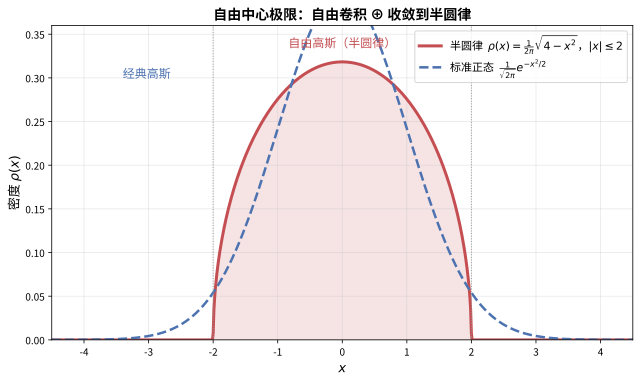

> **直观理解（现实类比）**：经典中心极限告诉你，把很多独立小量相加会得到"钟形"的高斯分布；而自由中心极限告诉你，把很多"自由独立"的非交换量相加，得到的不是钟形，而是"半圆"——密度像半张圆盘拱起、两端在 $\pm 2$ 处戛然而止。这就好比把许多人随机旋转的指针叠加，经典情形指针长度呈钟形散布，自由情形里它们却像彩虹拱门一样均匀堆积在有限区间内。

#### 课堂问答

**老师**：自由中心极限定理与经典 CLT 的差别在哪？

**学生**：差别只在把独立换成自由独立，极限就从高斯变成半圆。设 $\{a_i\}$ 自由独立、$\varphi(a_i)=0$、$\varphi(a_i^2)=1$，则 $S_n=(a_1+\cdots+a_n)/\sqrt n$ 依矩收敛到半圆分布，密度 $\rho(x)=\frac{1}{2\pi}\sqrt{4-x^2}$（$|x|\le2$），偶矩 $m_{2\ell}=C_\ell$、奇矩为 0。

**老师（追问）**：用累积量证明的关键一步是什么？

**学生**：关键在齐次性加可加性：$\kappa_k(S_n)=n^{1-k/2}\kappa_k(a_1)$。于是 $k=2$ 时 $\kappa_2(S_n)=1$；$k>2$ 时 $n^{1-k/2}\to0$；$k=1$ 时因子为正幂但 $\kappa_1=0$。极限累积量只剩二阶非零，代回矩-累积量公式后，只有块大小全为 2 的非交叉配对贡献非零，其个数恰为 Catalan 数 $C_{k/2}$。

**老师（拓展）**：支撑为什么恰是 $[-2,2]$？与自由泊松的极限角色有何不同？

**学生**：二阶累积量归一为 1 时，半圆密度在 $|x|=2$ 处归零，故支撑为 $[-2,2]$；方差为 $\sigma^2$ 时张成 $[-2\sigma,2\sigma]$，这正是 Wigner 半圆律的统一尺度。区别在于：CLT 的归一化和给出的是极限稳定律，而自由泊松是稀有事件累积的单参数族，$\lambda=1$ 时（平移后）退化为半圆。常见误区：以为半圆 CLT 要求所有矩有界——弱收敛其实只需二阶矩加矩增长受控（Carleman 条件）。

### 1.7 自由泊松分布

> **🧠 来龙去脉（为什么会有这个概念？解决了什么问题？）** 经典概率里泊松分布是"随机事件在一段时间内的稀有事件计数"的极限，它对应单个无穷小事件累积。自由概率的类比——**自由泊松分布**（Marčenko-Pastur）——回答"自由世界里稀有自由事件累积起来会怎样"，由沃库莱斯库在全分枝过程的研究中引入：所有自由累积量都取同一参数 $\kappa_n=\lambda$。它的意义远不止组合游戏：当 $n$ 个样本的协方差矩阵取 $n\to\infty$ 极限时，其经验谱恰收敛到这个分布（Marčenko-Pastur 定理）。它要解决的问题，正是把"自由中心极限"的姊妹定理（自由大数/高斯如何去远方）以及随机矩阵样本协方差谱的普适形态统一到一个分布名下。

**定义11（自由泊松分布）** **自由泊松分布**（也称Marčenko-Pastur分布）是自由概率论中泊松分布的类比，参数为 $\lambda > 0$，其密度为：
$$\rho_\lambda(x) = \frac{1}{2\pi \lambda x} \sqrt{4\lambda - (x - 1 - \lambda)^2} \cdot \mathbb{1}_{[(1-\sqrt{\lambda})^2, (1+\sqrt{\lambda})^2]}(x)$$
当 $\lambda > 1$ 时，在 $x = 0$ 处还有一个质量为 $1 - 1/\lambda$ 的原子。

> **💡 直观理解（类比）**：自由泊松分布是经典泊松的"自由版"，也是随机矩阵里样本协方差谱（Marčenko-Pastur）的栖身之所。它像一个"可调支点的沙堆"：参数 $\lambda$ 控制支点范围，$\lambda>1$ 时还额外在原点堆起一座"尖峰"（原子）。经典泊松数单个事件，自由泊松则把这些事件装进"不交叉"的框架，最终长成一条熟悉的马蹄形谱。

#### 课堂问答

**老师**：自由泊松分布的定义、支集和密度是什么？

**学生**：它是所有自由累积量都等于 $\lambda$ 的分布：$\kappa_n(b_\lambda)=\lambda$。密度 $\rho_\lambda(x)=\frac{1}{2\pi\lambda x}\sqrt{4\lambda-(x-1-\lambda)^2}$，支集 $[(1-\sqrt\lambda)^2,(1+\sqrt\lambda)^2]$；当 $\lambda>1$ 时在 $x=0$ 处还有一个质量 $1-1/\lambda$ 的原子。它类比泊松，是因为经典泊松的累积量也全等于参数 $\lambda$。

**老师（追问）**：它的矩怎么算？为什么 $\lambda=1$ 时和半圆扯上关系？

**学生**：由 $m_n=\sum_{\pi\in\mathrm{NC}(n)}\lambda^{|\pi|}$ 得 $m_1=\lambda$、$m_2=\lambda+\lambda^2$、$m_3=\lambda+3\lambda^2+\lambda^3$、$m_4=\lambda+6\lambda^2+6\lambda^3+\lambda^4$。当 $\lambda=1$ 时这些恰是 Catalan 数 $1,2,5,14$，因为 $\sum_{\pi\in\mathrm{NC}(n)}1=|\mathrm{NC}(n)|=C_n$，所以自由泊松在 $\lambda=1$ 时（平移后）退化为半圆（自由高斯）。

**老师（拓展）**：它在随机矩阵里为什么叫 Marčenko-Pastur？R-变换长什么样？

**学生**：当 $p\times n$ 随机矩阵元素独立同分布、$p/n\to\lambda$ 时，样本协方差 $\frac1n X^*X$ 的经验谱收敛到 $\rho_\lambda$，这就是 Marčenko-Pastur 律。其 R-变换很简洁：$R(z)=\frac{\lambda}{1-z}=\sum_{n\ge1}\lambda z^n$，逐项系数正是 $\kappa_n=\lambda$，印证了定义；对应的 S-变换为 $S(z)=\frac1{1+\lambda z}$。常见误区：把 $\lambda$ 当成方差——它其实是矩阵的长宽比 $p/n$，控制支集宽度与原点原子。

### 1.8 自由熵

> **🧠 来龙去脉（为什么会有这个概念？解决了什么问题？）** 经典信息论用 Shannon 熵度量"一个分布的混乱程度"，并用最大熵原理挑出"最无知"的分布（固定方差下就是高斯）。自由概率自然也需要同等的"不确定度量"——这就是 1993 年沃库莱斯库引入的**自由熵** $\chi(a)=\iint\log|x-y|\,d\mu d\mu+\frac34+\frac12\log2\pi$。它与经典熵最大的不同是：自由世界的"最大熵分布"是**半圆分布**而非高斯（因为自由独立、非交叉结构改变了"谁能挤得更多熵"的排序）。与之相伴的**自由 Fisher 信息量**（比安–沃库莱斯库）则度量分布的"陡峭度"，二者通过自由 Ornstein–Uhlenbeck 过程互为导数。它们要解决的，是"在非交换世界里如何对不确定性'计量'，并用它判定因子结构、刻画最大熵态"这一算子代数中的核心度量问题。

**定义12（自由熵）** 对非交换随机变量 $a = a^*$，其**自由熵** $\chi(a)$ 定义为：
$$\chi(a) = \int \int \log |x - y| \, d\mu(x) \, d\mu(y) + \frac{3}{4} + \frac{1}{2} \log 2\pi$$
其中 $\mu$ 是 $a$ 的分布。自由熵是经典Shannon熵在自由概率中的类比。

> **💡 直观理解（类比）**：自由熵 $\chi(a)$ 度量"一个分布的混乱或分散程度"，是 Shannon 熵在自由世界的对应——像"测一锅彩球撒得多开"。公式里的 $\iint\log|x-y|\,d\mu d\mu$ 统计所有两点"互相排斥、彼此远离"的对数距离，形象地说是"球与球之间互相推开的总能量"。它与经典熵一样，拿它做极大熵优化，就会得到半圆分布这位"最随和的住户"。

**定义13（自由Fisher信息量）** 非交换随机变量 $a$ 的**自由Fisher信息量** $\Phi(a)$ 定义为：
$$\Phi(a) = \int \left(\frac{2\pi}{3} \rho(x)^3 + \frac{1}{2} \frac{(\rho'(x))^2}{\rho(x)}\right) dx$$
其中 $\rho$ 是 $a$ 的分布密度。

> **💡 直观理解（类比）**：自由Fisher信息量 $\Phi(a)$ 度量分布"变化得有多剧烈"，是经典 Fisher 信息在自由概率中的类比——像"一段波形抖动的灵敏度"。密度越陡峭、峰越尖（$\rho'$ 大），信息量越大；公式里还含 $\rho^3$ 项，是自由世界特有的非线性补丁。它与自由熵互为"导数关系"（做自由 Ornstein-Uhlenbeck 过程时 $\frac{d\chi}{dt}=\frac12\Phi$），如同经典里熵对 Fisher 信息的导数一样。

#### 课堂问答

**老师**：自由熵怎么定义？与 Shannon 熵最大的不同在哪？

**学生**：对自伴 $a$（分布 $\mu$），$\chi(a)=\iint\log|x-y|\,d\mu(x)d\mu(y)+\frac34+\frac12\log2\pi$。不同之处不在度量随机性的初衷，而在极值分布：给定方差下经典最大熵是高斯，自由最大熵是半圆。根源是自由结构把矩计数从全部配对换成非交叉配对，改变了熵的排序。

**老师（追问）**：自由 Fisher 信息量怎么定义？它与自由熵是什么关系？

**学生**：$\Phi(a)=\int\big(\frac{2\pi}{3}\rho(x)^3+\frac12\frac{(\rho'(x))^2}{\rho(x)}\big)dx$，其中 $\frac{2\pi}{3}\rho^3$ 是自由世界特有的非线性项。二者通过自由 Ornstein-Uhlenbeck 过程 $a_t=e^{-t}a+\sqrt{1-e^{-2t}}s$（$s$ 为半圆且与 $a$ 自由独立）联系：$\frac{d}{dt}\chi(a_t)=\frac12\Phi(a_t)$，即 Fisher 信息是熵沿自由半群的流速。

**老师（拓展）**：自由熵有哪些关键性质？它为什么对算子代数分类重要？

**学生**：上界 $\chi(a)\le\frac12\log(2\pi e\varphi(a^2))$（半圆达到），次可加 $\chi(a+b)\le\chi(a)+\chi(b)$（自由独立取等），以及 $\Phi(a)\ge\frac1{\varphi(a^2)}$。常见误区：把核 $\log|x-y|$ 当作普通对数散度——它是势能型核，与 Newton 势能同源，因此才能与对数 Sobolev 不等式挂钩。正是这些不变量（自由熵、free entropy dimension）被用来区分 $L(\mathbb{F}_n)$ 与 $L(\mathbb{F}_m)$，撬动自由因子同构问题。

### 1.9 自由随机矩阵与Voiculescu渐近自由性

> **🧠 来龙去脉（为什么会有这个概念？解决了什么问题？）** 自由概率虽源于算子代数，却在 1990 年代初意外地与**随机矩阵**接上了线——维格纳早已发现大随机矩阵的谱服从半圆律，恰与自由中心极限的半圆吻合。沃库莱斯库 1991 年证明了这套直觉的精确版本：**渐近自由性定理**——若干独立的高斯（GUE）随机矩阵在维数 $n\to\infty$ 时，其"矩"收敛到一组自由独立半圆变量的矩。它要回答的问题是"为什么随机矩阵的宏观谱总能用自由概率讲清楚"，并一举把自由概率从纯代数推进为分析大维矩阵（协方差矩阵、随机相关系数、量子信息）的标准语言。

**定义14（渐近自由性）** 设 $\{A_n^{(1)}\}, \ldots, \{A_n^{(k)}\}$ 为 $n \times n$ 随机矩阵的序列。称它们在 $n \to \infty$ 时是**渐近自由**的，若对任意非交换多项式 $P$，矩收敛到某些自由独立非交换随机变量的矩。

> **💡 直观理解（类比）**：渐近自由性说：当矩阵越来越大时，一批"互不相干的独立随机矩阵"会表现得像一群"自由独立"的非交换变量。好比很多原本各自为政的乐队，排练规模一大，彼此之间的配合模式反而趋同于一套"自由即兴"的通用法则——这为"用自由概率理解大矩阵"铺平了道路。

**Voiculescu渐近自由性定理**指出，独立的高斯随机矩阵（GUE）在 $n \to \infty$ 时是渐近自由的。

> **🧠 直观理解（现实类比）**：这条定理是"随机矩阵 × 自由概率"的对接接口：独立 GUE 矩阵的行为，在大 $N$ 极限下完全由自由独立变量来"代言"。它印证了一条深刻而惊人的现象——那些看似只属于纯代数的抽象"自由独立性"，竟精准描述了真实大数据矩阵（如协方差矩阵、随机图）的谱。打个比方：你以为听到的是一段杂乱无章的大数据噪声，其实那已是自由变量们的整齐"合奏"。

#### 课堂问答

**老师**：渐近自由性怎么定义？独立 GUE 矩阵在大 $n$ 下为什么自由独立？

**学生**：设 $\{A_n^{(1)}\},\dots,\{A_n^{(k)}\}$ 是 $n\times n$ 随机矩阵序列，若对任意非交换多项式 $P$，其归一化迹期望 $\frac1n\mathbb{E}[\mathrm{Tr}\,P]$ 收敛到某组自由独立非交换变量的矩，就称它们渐近自由。GUE 之所以自由独立，是因为迹展开成指标配对、用 Wick 公式配高斯元后，$n\to\infty$ 时只有非交叉配对给出 $O(1)$ 主导项，交叉配对贡献 $O(n^{-1})$ 或更低，而非交叉配对恰是自由矩的组合特征。

**老师（追问）**：技术核心是什么？

**学生**：核心是 Wick 公式加平面性计数。展开 $\frac1n\sum_{a_1,\dots,a_\ell}\mathbb{E}[A_{a_1a_2}\cdots A_{a_\ell a_1}]$，每个配对贡献因子 $1/n$ 和指标约束，非交叉配对把 $\ell$ 个自由指标压成 $\ell/2+1$ 个，求和给 $n^{\ell/2+1}$，乘 $n^{-\ell/2}$（方差）再除 $n$（归一化），恰得 $O(1)$。配对要求 $\delta_{i_pi_q}$，只有同系综矩阵能配，这正实现了相邻不同系综、零均值交替零迹的自由独立性。

**老师（拓展）**：这条定理的现实意义与边界在哪？

**学生**：它说明大维随机矩阵的宏观谱可用自由概率精确刻画——协方差矩阵、随机图邻接矩阵、量子信息里的随机信道，都能翻译成自由独立变量的矩。常见误区：以为定理保证每条样本路径都收敛——其标准形式只是期望矩收敛，几乎必然收敛需要额外的方差估计。另一边界：GUE 是高斯系综，换成一般 Wigner 矩阵在矩条件满足时同样成立，但不能无条件外推到重尾分布。

### 1.10 自由概率在算子代数中的应用

> **🧠 来龙去脉（为什么会有这个概念？解决了什么问题？）** 自由概率诞生的原始土壤正是**算子代数**：沃库莱斯库研究自由群因子 $L(\mathbb{F}_k)$（$k$ 个生成元自由群的群 von Neumann 代数）时，才需要发明"自由独立性"。这里 $L(\mathbb{F}_k)$ 是数学中"最神秘"的 II$_1$ 因子之一——它有一个悬而未决的世纪难题：**自由因子同构问题**（$L(\mathbb{F}_n)$ 与 $L(\mathbb{F}_m)$、$n\ne m$ 是否同构）。自由概率之所以重要，是因为它提供了研究这类因子的全新不变量（自由熵、free entropy dimension、代数自由熵等），用来判断两个因子能否同构。它要解决的是"如何在两个看似无法区分的算子代数之间凿出一条可计算的鸿沟"这一算子代数深处的分类难题。

**定义15（自由群因子）** 设 $\mathbb{F}_k$ 为 $k$ 个生成元的自由群，其约化群C*-代数 $C^*_r(\mathbb{F}_k)$ 和群von Neumann代数 $L(\mathbb{F}_k)$ 是自由概率论的核心研究对象。**自由群因子同构问题**是算子代数中的核心未解决问题之一。

> **💡 直观理解（类比）**：自由群因子就像"一部关于'自由'的终极教科书"的封面难题：$k$ 个生成元自由群 $\mathbb{F}_k$ 的算子代数 $L(\mathbb{F}_k)$ 是自由概率的"母体"——一切"自由独立性"都源自这里。而"$\mathbb{F}_n$ 与 $\mathbb{F}_m$（$n\ne m$）的因子是否同构"这一开放问题，就像在问"编排风格完全自由的乐队在观众耳中是否真的无法区分"。它把自由概率的抽象结构，推向算子代数最深处的未解之谜。

---

#### 课堂问答

**老师**：自由概率最初为什么诞生？它要解决算子代数里的什么问题？

**学生**：诞生于 Voiculescu 研究自由群因子 $L(\mathbb{F}_k)$ 的需要。$\mathbb{F}_k$ 的生成元在约化群 von Neumann 代数上带迹 $\tau(g)=\delta_{g,e}$，它们天然自由独立，这迫使人们发明自由独立性这套非交换概率语言。它要攻的正是分类难题：自由因子同构问题，即 $L(\mathbb{F}_n)$ 与 $L(\mathbb{F}_m)$（$n\ne m$）是否同构。

**老师（追问）**：它提供了哪些不变量来区分因子？

**学生**：主要有自由熵 $\chi$、自由维数（free entropy dimension）、代数自由熵以及自由 Fisher 信息量 $\Phi$。逻辑是：保持迹的 *-同构若存在，则对应自由变量的全部矩、以及由矩定义的这些量必须一致；于是它们给出可计算的不变量，一旦数值不同即可判定不同构。例如 $\chi$ 的次可加性与自由独立下的等号性质，正好匹配群因子的乘积结构。

**老师（拓展）**：为什么说这套理论抽象却能描述真实大数据？

**学生**：因为 $L(\mathbb{F}_k)$ 的矩结构与 GUE 随机矩阵的大 $N$ 极限在组合上完全一致，都由非交叉划分（Catalan 数）计数。为自由群因子发明的工具，反过来成了分析大维矩阵与随机图的通用语言，同一个非交叉机制既解释神秘因子，又解释协方差矩阵的马蹄形谱。常见误区是把 $C_r^*(\mathbb{F}_k)$ 与 $L(\mathbb{F}_k)$ 混为一谈——前者是范数闭的 C*-代数，后者是它弱闭包得到的 von Neumann 代数，只有后者上"取迹加弱拓扑"才适合做自由概率。

## 定理与证明

### 定理1：自由中心极限定理

**定理（自由中心极限定理）** 设 $\{a_i\}_{i=1}^\infty$ 为自由独立的非交换随机变量，满足 $\varphi(a_i) = 0$，$\varphi(a_i^2) = 1$，且存在常数 $C > 0$ 使得对所有 $i$ 和 $k$，$|\varphi(a_i^k)| \leq C^k$。则归一化和：
$$S_n = \frac{a_1 + \cdots + a_n}{\sqrt{n}}$$
在矩意义下收敛到半圆分布 $s$，即对任意 $k \geq 1$：
$$\lim_{n \to \infty} \varphi(S_n^k) = \varphi(s^k) = \begin{cases}
C_{k/2}, & k \text{ 为偶数} \\
0, & k \text{ 为奇数}
\end{cases}$$
其中 $C_\ell = \frac{1}{\ell+1} \binom{2\ell}{\ell}$ 是Catalan数。

> **🧠 直观理解（现实类比）**：自由中心极限定理告诉我们：把大量"自由独立"的非交换小量相加并归一化，结果稳定成**半圆分布**，而不是经典的高斯钟形。打个比方：经典里无数独立小指针叠加出"钟形"（两端缓缓趋零），而自由世界里无数自由即兴的小段子叠加，居然堆出一道**半圆拱门**——两端在 $\pm2$ 处干脆利落地截止，分明有界。它的证明走"累积量"捷径：半圆分布只有二阶累积量非零（$\kappa_2=1$），其余全是 $0$，于是偶阶矩自动落到 Catalan 数 $C_{k/2}$、奇阶矩归零，分布就被钉死为半圆。一句话：非交换世界里的"大数定律"，长着一张更圆的半圆脸。

**证明（累积量方法）**：

**第一步：自由累积量的性质。**
自由累积量 $\kappa_n$ 具有以下关键性质：
1. **齐次性**：$\kappa_n(\lambda a) = \lambda^n \kappa_n(a)$
2. **自由独立性**：若 $a, b$ 自由独立，则对任意 $n \geq 1$：
   $$\kappa_n(a + b) = \kappa_n(a) + \kappa_n(b)$$
3. **半圆分布的累积量**：对半圆分布 $s$（满足 $\varphi(s) = 0$，$\varphi(s^2) = 1$），其累积量为：
   $$\kappa_n(s) = \begin{cases}
   1, & n = 2 \\
   0, & n \neq 2
   \end{cases}$$

**第二步：$S_n$ 的累积量。**
由累积量的齐次性和加法性：
$$\kappa_k(S_n) = \kappa_k\left(\frac{a_1 + \cdots + a_n}{\sqrt{n}}\right) = n \cdot \left(\frac{1}{\sqrt{n}}\right)^k \kappa_k(a_1)$$

因此：
$$\kappa_k(S_n) = n^{1 - k/2} \kappa_k(a_1)$$

**第三步：极限分析。**
当 $n \to \infty$ 时：
- 若 $k = 2$：$\kappa_2(S_n) = \kappa_2(a_1) = 1$（因为 $\varphi(a_1^2) = 1$）
- 若 $k = 1$：$\kappa_1(S_n) = n^{1/2} \kappa_1(a_1) = 0$（因为 $\varphi(a_1) = 0$）
- 若 $k > 2$：$\kappa_k(S_n) = n^{1 - k/2} \kappa_k(a_1) \to 0$

因此极限累积量满足：
$$\lim_{n \to \infty} \kappa_k(S_n) = \begin{cases}
1, & k = 2 \\
0, & k \neq 2
\end{cases}$$

**第四步：矩-累积量公式。**
由矩-累积量公式：
$$\varphi(S_n^k) = \sum_{\pi \in \text{NC}(k)} \prod_{B \in \pi} \kappa_{|B|}(S_n)$$

当 $n \to \infty$ 时，$\kappa_j(S_n) \to 0$ 对 $j \neq 2$，因此只有所有块大小均为 $2$ 的划分贡献非零极限。这要求 $k$ 为偶数，且划分 $\pi$ 必须将 $\{1, \ldots, k\}$ 划分为 $k/2$ 个大小为 $2$ 的块。

**第五步：非交叉配对与Catalan数。**
将 $\{1, \ldots, 2\ell\}$ 划分为 $\ell$ 个大小为 $2$ 的非交叉块的数量正是Catalan数 $C_\ell$。每个这样的划分贡献 $\prod_{B} \kappa_2 = 1^\ell = 1$。

因此：
$$\lim_{n \to \infty} \varphi(S_n^{2\ell}) = C_\ell = \frac{1}{\ell+1} \binom{2\ell}{\ell}$$

当 $k$ 为奇数时，没有可能的非交叉配对，极限为 $0$。

**第六步：收敛性验证。**
由矩有界性条件 $|\varphi(a_i^k)| \leq C^k$，可保证各阶矩一致有界，因此矩收敛是良定义的，且极限分布唯一（由矩确定）。

**结论**：自由中心极限定理表明，自由独立随机变量的归一化和收敛到半圆分布，而非经典的正态分布。半圆分布是自由概率中的"高斯分布"。$\square$

#### 课堂问答

**老师**：定理的完整假设是什么？为什么需要 $|\varphi(a_i^k)|\le C^k$ 这个界？

**学生**：假设三条：自由独立、$\varphi(a_i)=0$ 且 $\varphi(a_i^2)=1$，以及矩增长控制 $|\varphi(a_i^k)|\le C^k$。前两条把中心与尺度归一，第三条（Carleman 型）保证各阶矩一致有界，从而矩收敛良定义、极限测度由矩唯一确定。结论是 $\lim_n\varphi(S_n^k)=\varphi(s^k)$，偶阶为 $C_{k/2}$、奇阶为 0。

**老师（追问）**：第二步到第三步为何对称地得出 $n^{1-k/2}$？

**学生**：由 $\kappa_k$ 的齐次性 $\kappa_k(\lambda a)=\lambda^k\kappa_k(a)$ 与可加性，得 $\kappa_k(S_n)=n\cdot n^{-k/2}\kappa_k(a_1)=n^{1-k/2}\kappa_k(a_1)$。指数 $1-k/2$ 的符号就是全部信息：$k=2$ 时为零次幂（保留），$k>2$ 时为负幂（消失），$k=1$ 时虽为正幂但 $\kappa_1=0$ 仍为零。

**老师（拓展）**：Catalan 计数怎么落到实处？

**学生**：$k=2\ell$ 时，非零极限只来自把 $\{1,\dots,2\ell\}$ 分成 $\ell$ 个大小为 2 的非交叉块的划分，每块贡献 $\kappa_2=1$，故极限为这种划分的个数 $C_\ell=\frac{1}{\ell+1}\binom{2\ell}{\ell}$；奇阶无配对，归零。常见误区：把配对理解成普通配对 $(2k-1)!!$——那是经典高斯的矩，自由世界只留非交叉配对才得 Catalan 数。哲学上这是一条非交换大数定律：大量自由独立小量叠加，收敛到有界支撑的半圆，而非无界的高斯钟形。

### 定理2：R-变换的加法公式

**定理（R-变换加法公式）** 设 $a, b$ 为自由独立的非交换随机变量。则对任意 $z$（在收敛半径内）：
$$R_{a+b}(z) = R_a(z) + R_b(z)$$

> **💡 直观理解（类比）**：这是自由概率的"加法法则"：两个自由独立变量的 R-变换直接相加减。就像傅里叶变换把卷积变成乘积、对数把乘法变成加法一样，R-变换把"自由卷积"这个费事的操作变成简单的加法 $R_{a+b}=R_a+R_b$。你可以在记忆里这样建账：$R$ 是一支"自由记账笔"——不管 $a,b$ 怎么自由叠加，它的账面永远只是分开两笔简单相加。这正是一切自由卷积计算的出发点。

**证明（用自由累积量的矩-累积量公式）**：

**第一步：自由累积量的加法性。**
自由累积量的基本性质之一是：若 $a, b$ 自由独立，则对任意 $n \geq 1$：
$$\kappa_n(a + b) = \kappa_n(a) + \kappa_n(b)$$

这个性质可以直接从自由独立性的定义推导。我们在此给出证明。

**第二步：证明自由独立变量的累积量加法性。**
考虑自由独立变量 $a, b$，以及它们的和 $c = a + b$。对任意 $n \geq 1$，展开 $\varphi((a+b)^n)$：
$$\varphi((a+b)^n) = \sum_{\text{words}} \varphi(w(a,b))$$
其中求和遍历所有长度为 $n$、由 $a, b$ 组成的字。

**第三步：利用自由独立性。**
由自由独立性的定义，当字 $w(a,b)$ 中相邻变量交替且每个 $\varphi(a^{e_i}) = 0$ 或 $\varphi(b^{f_i}) = 0$ 时，$\varphi(w(a,b)) = 0$。通过"居中"技术（centering），可以将一般情况转化为零均值情况。

实际上，更系统的证明是使用矩-累积量公式：
$$\varphi((a+b)^n) = \sum_{\pi \in \text{NC}(n)} \prod_{B \in \pi} \kappa_{|B|}(a+b)$$

另一方面，展开 $(a+b)^n$ 并利用自由独立性，可以证明 $\kappa_n(a+b)$ 就是 $\kappa_n(a) + \kappa_n(b)$。

**第四步：R-变换的定义。**
由定义：
$$R_a(z) = \sum_{n=1}^\infty \kappa_n(a) z^n, \quad R_b(z) = \sum_{n=1}^\infty \kappa_n(b) z^n$$

因此：
$$R_{a+b}(z) = \sum_{n=1}^\infty \kappa_n(a+b) z^n = \sum_{n=1}^\infty (\kappa_n(a) + \kappa_n(b)) z^n = R_a(z) + R_b(z)$$

**第五步：R-变换与矩生成函数的关系。**
设 $M_a(z) = \sum_{n=1}^\infty \varphi(a^n) z^n$，则有以下重要关系：
$$M_a(z) = R_a(z M_a(z)) + 1$$

**证明**：由矩-累积量公式和组合恒等式，可得：
$$\sum_{n=1}^\infty \varphi(a^n) z^n = \sum_{n=1}^\infty \sum_{\pi \in \text{NC}(n)} \prod_{B \in \pi} \kappa_{|B|}(a) z^n$$

交换求和顺序并利用非交叉划分的生成函数，可得上述关系。

**第六步：逆变换。**
定义**Cauchy变换** $G_a(z) = \varphi((z - a)^{-1}) = \sum_{n=0}^\infty \varphi(a^n) z^{-n-1}$，则：
$$G_a(z) = \frac{1}{z} M_a(1/z)$$

R-变换与Cauchy变换的关系为：
$$R_a(G_a(z)) + \frac{1}{G_a(z)} = z$$

这提供了从R-变换恢复分布的方法。

**结论**：R-变换的加法公式 $\boxplus$ 是自由卷积的生成函数，其简单形式 $R_{a+b} = R_a + R_b$ 是自由概率论的核心工具。$\square$

#### 课堂问答

**老师**：$R_{a+b}=R_a+R_b$ 的证明主线是什么？哪一步最容易被跳过？

**学生**：主线是"累积量可加推出生成函数相加"：先证 $\kappa_n(a+b)=\kappa_n(a)+\kappa_n(b)$，再对 $R_{a+b}(z)=\sum_n\kappa_n(a+b)z^n$ 逐项代入即得。最容易被跳过的是累积量可加性本身的证明——它需要把 $(a+b)^n$ 展开成字、做中心化、再用自由独立性消去所有交叉词，只留下同源词之和。

**老师（追问）**：为什么 $M_a(z)=R_a(zM_a(z))+1$ 是隐式的？怎么用它验证半圆？

**学生**：因为它两边都含 $M_a$，本质是矩与累积量之间的 Lagrange 反演关系，只能逐阶级数匹配解出。以半圆为例，其矩的偶项为 Catalan 数，代入配比方程可验证 $R_a(z)=z$；反过来由 $R_a(z)=z$ 也能反推 $M_a$ 满足的代数方程，得到 Catalan 生成函数。

**老师（拓展）**：这条公式在计算上省了多少力？有无陷阱？

**学生**：它把分布层面的自由卷积变成生成函数的一次加法，类似于傅里叶变换把卷积变成乘法。陷阱有二：一是必须自由独立，普通独立不适用；二是 $M_a=R_a(zM_a)+1$ 要在 $z=0$ 邻域内做形式幂级数运算，不能当解析函数随便代入大 $z$。此外 $R$ 由累积量唯一决定，配上 Carleman 条件即可反推整个分布，这使 R-变换成为自由卷积的万能钥匙。

### 定理3：自由卷积的乘法公式

**定理（自由卷积的乘法公式）** 设 $a, b$ 为自由独立的正非交换随机变量。则存在**S-变换** $S_a(z)$ 使得：
$$S_{ab}(z) = S_a(z) S_b(z)$$
其中S-变换定义为：
$$S_a(z) = \frac{1 + z}{z} \cdot \eta_a^{-1}(z)$$
且 $\eta_a(z) = \sum_{n=1}^\infty \varphi(a^n) z^n$ 是矩生成函数（或更精确地，$\eta_a(z) = M_a(z)$）。

> **💡 直观理解（类比）**：S-变换是自由概率"乘法世界的记账员"，与 R-变换（加法世界）正好对偶：加法卷积 $\boxplus$ 让 R 相加，乘法卷积 $\boxtimes$ 让 S 相乘（$S_{ab}=S_a S_b$）。好比 R-变换是"普通账本"（管求和），S-变换是"乘积账本"（管求积）——当随机变量不是相加而是相乘（比如 $ab$、样本协方差乘积谱）时，就换 S-变换这支笔把费事的乘积卷积变成简单的两数相乘。

**证明**：

**第一步：乘法自由卷积的动机。**
对经典独立的正随机变量 $X, Y$，其乘积的矩生成函数满足 $\mathbb{E}[(XY)^n] = \mathbb{E}[X^n] \mathbb{E}[Y^n]$。对自由独立变量，情况更复杂，因为 $a$ 和 $b$ 不交换，所以 $ab$ 的矩不能简单分解。

**第二步：定义矩生成函数。**
设 $a$ 为正随机变量，定义其矩生成函数：
$$M_a(z) = \sum_{n=1}^\infty \varphi(a^n) z^n$$

定义 $\eta_a(z) = M_a(z)$。考虑函数 $\psi_a(z) = \frac{\eta_a(z)}{1 + \eta_a(z)}$。

**第三步：S-变换的定义。**
S-变换 $S_a(z)$ 定义为满足以下条件的函数：
$$S_a(\psi_a(z)) = \frac{1}{z} \psi_a(z)$$

等价地，若记 $\chi_a(z) = \frac{z}{1+z}$ 的逆函数为 $\chi_a^{-1}$，则：
$$S_a(z) = \frac{1 + z}{z} \cdot \chi_a^{-1}(z)$$

更常用的定义是：设 $\eta_a(z) = \sum_{n=1}^\infty \varphi(a^n) z^n$，定义 $\psi_a(z) = \frac{\eta_a(z)}{1 + \eta_a(z)}$。则 $\psi_a$ 在 $0$ 附近有逆函数 $\psi_a^{-1}$，S-变换定义为：
$$S_a(z) = \frac{1 + z}{z} \cdot \psi_a^{-1}(z)$$

**第四步：乘法自由卷积的公式。**
对自由独立的正变量 $a, b$，其乘积 $ab$ 的S-变换满足：
$$S_{ab}(z) = S_a(z) S_b(z)$$

**证明概要**：
1. 考虑 $a, b$ 自由独立，$a, b > 0$。
2. 定义 $c = a^{1/2} b a^{1/2}$（与 $ab$ 同分布，因为迹 $\varphi$ 是迹）。
3. 利用自由独立性和矩-累积量公式，可以证明 $c$ 的矩满足特定的乘法关系。
4. 通过S-变换的定义和组合恒等式，推导出 $S_c(z) = S_a(z) S_b(z)$。

**第五步：S-变换与R-变换的关系。**
S-变换与R-变换通过以下关系联系：
$$S_a(z) = \frac{1}{z} R_a(z(1+z))^{-1}$$

更精确地，若 $R_a$ 是R-变换，则：
$$S_a(z) = \frac{1}{z} \cdot \frac{1}{R_a(z(1+z))}$$

**第六步：应用：自由泊松分布的S-变换。**
对自由泊松分布（参数 $\lambda$），其矩为Catalan数的变形，S-变换为：
$$S_{\text{FP}(\lambda)}(z) = \frac{1}{1 + \lambda z}$$

对半圆分布 $s$（自由高斯），其S-变换为：
$$S_s(z) = \frac{1}{1 + z}$$

**第七步：验证。**
设 $a$ 服从半圆分布，$b$ 服从自由泊松分布 $(\lambda)$，且自由独立。则 $ab$ 的S-变换为：
$$S_{ab}(z) = S_a(z) S_b(z) = \frac{1}{1+z} \cdot \frac{1}{1+\lambda z}$$

通过逆变换可以得到 $ab$ 的分布。

**结论**：S-变换的乘法公式 $S_{ab} = S_a S_b$ 是自由乘法卷积的核心工具，与R-变换的加法公式 $R_{a+b} = R_a + R_b$ 形成对偶。$\square$

#### 课堂问答

**老师**：S-变换怎么定义？它为什么能把乘法卷积变成乘积？

**学生**：设矩生成函数 $\eta_a(z)=M_a(z)=\sum_{n\ge1}\varphi(a^n)z^n$，先做 $\psi_a(z)=\frac{\eta_a(z)}{1+\eta_a(z)}$（把区间 $[0,1)$ 上的矩信息压缩），取其逆，定义 $S_a(z)=\frac{1+z}{z}\psi_a^{-1}(z)$。于是对自由独立正变量 $a,b$ 有 $S_{ab}(z)=S_a(z)S_b(z)$——$\psi$ 把逆函数结构编码好，乘积卷积恰好对应两个 $S$ 的相乘。

**老师（追问）**：为什么乘法卷积用 $c=a^{1/2}ba^{1/2}$ 而非 $ab$？证明关键在哪？

**学生**：因为 $ab$ 非自伴、谱不对称，而 $c=a^{1/2}ba^{1/2}$ 自伴且与 $ab$ 同谱（由迹性 $\varphi(a^{1/2}ba^{1/2})=\varphi(ab)$ 得同分布）。证明关键是把 $c$ 的矩用非交叉划分展开，发现只有"在每个块内 $a,b$ 交替"的划分存活，正好与 $S$ 的迭代结构对应，从而 $S_c=S_aS_b$。

**老师（拓展）**：S 与 R 有什么互换关系？举一例算乘法卷积。

**学生**：两者互为对偶，且 $S_a(z)=\frac1z\cdot\frac{1}{R_a(z(1+z))}$（在相应收敛域内），说明加法坐标与乘法坐标可以互换。例如半圆 $S_s=\frac1{1+z}$、自由泊松 $S_{\mathrm{FP}(\lambda)}=\frac1{1+\lambda z}$，自由独立时 $S_{ab}=\frac{1}{(1+z)(1+\lambda z)}$，逆变换即得 $ab$ 的分布。常见误区：把 $S_{ab}=S_aS_b$ 的乘积误当分布层面的乘积——它是生成函数在 $z$ 上的普通乘法，不是 $a,b$ 的矩阵乘积。

### 定理4：Voiculescu渐近自由性定理

**定理（Voiculescu渐近自由性）** 设 $A_n^{(1)}, \ldots, A_n^{(k)}$ 为独立的高斯随机矩阵系综（GUE），其中 $A_n^{(j)}$ 为 $n \times n$ 的GUE矩阵。设 $P_1, \ldots, P_m$ 为 $k$ 个变量的非交换多项式。则随机矩阵的矩在 $n \to \infty$ 时收敛到自由独立半圆分布随机变量 $s_1, \ldots, s_k$ 的矩：
$$\lim_{n \to \infty} \frac{1}{n} \mathbb{E}\left[\operatorname{Tr}\left(P_1(A_n^{(1)}, \ldots, A_n^{(k)}) \cdots P_m(A_n^{(1)}, \ldots, A_n^{(k)})\right)\right] = \varphi(s_1^{e_1} \cdots s_k^{e_k})$$
其中右边是自由独立半圆变量在非交换概率空间中的矩。

> **🧠 直观理解（现实类比）**：这条定理是"随机矩阵 × 自由概率"的对接接口：独立 GUE 矩阵的行为，在大 $N$ 极限下完全由自由独立半圆变量来"代言"。它印证了一个惊人现象——那些看似只属于纯代数的抽象"自由独立性"，竟精准描述了真实大数据矩阵（如协方差矩阵、随机图）的谱。证明的精髓在于：把矩阵乘积的迹展开成"指标配对"，用 Wick 公式配对高斯元素，而 $n\to\infty$ 时只有**非交叉配对**存活并贡献主导项——非交叉配对恰是自由矩的组合特征。所以，你以为听到的是一段杂乱无章的大数据噪声，其实那已是自由变量的整齐"合奏"。

**证明（用随机矩阵的矩收敛）**：

**第一步：矩的展开。**
考虑单项式 $A_{i_1} A_{i_2} \cdots A_{i_\ell}$，其中每个 $A_{i_j} \in \{A_n^{(1)}, \ldots, A_n^{(k)}\}$。计算：
$$\frac{1}{n} \mathbb{E}[\operatorname{Tr}(A_{i_1} A_{i_2} \cdots A_{i_\ell})] = \frac{1}{n} \sum_{a_1, \ldots, a_\ell = 1}^n \mathbb{E}[(A_{i_1})_{a_1 a_2} (A_{i_2})_{a_2 a_3} \cdots (A_{i_\ell})_{a_\ell a_1}]$$

**第二步：Wick公式的应用。**
由于GUE矩阵的元素是独立复高斯随机变量，由Wick公式：
$$\mathbb{E}[(A_{i_1})_{a_1 a_2} \cdots (A_{i_\ell})_{a_\ell a_1}] = \sum_{\pi \in \text{配对}} \prod_{(p,q) \in \pi} \mathbb{E}[(A_{i_p})_{a_p a_{p+1}} (A_{i_q})_{a_q a_{q+1}}]$$

其中 $\mathbb{E}[(A_{i})_{ab} (A_{j})_{cd}] = \frac{1}{n} \delta_{ij} \delta_{ad} \delta_{bc}$。

**第三步：配对与指标约束。**
每个配对 $(p, q)$ 贡献：
- 因子 $\frac{1}{n} \delta_{i_p i_q}$（要求两个矩阵属于同一系综）
- 指标约束：$a_p = a_{q+1}$ 且 $a_{p+1} = a_q$

**第四步：非交叉配对的支配性。**
在 $n \to \infty$ 时，只有非交叉配对贡献主导项。交叉配对对应的指标约束更少，因此贡献的阶数更低。

具体地，非交叉配对将 $\ell$ 个指标减少为 $\ell/2 + 1$ 个自由指标，求和贡献 $n^{\ell/2 + 1}$。乘以 $n^{-\ell/2}$（来自方差因子）和 $1/n$（来自迹的归一化），得到 $O(1)$。

交叉配对贡献的阶数为 $O(n^{-1})$ 或更低。

**第五步：自由独立性的出现。**
在每个非交叉配对 $\pi$ 中，配对关系将矩阵指标 $i_1, \ldots, i_\ell$ 分组。由于配对要求 $\delta_{i_p i_q}$，只有相同系综的矩阵才能配对。

这正对应了自由独立性的定义：考虑自由独立半圆变量 $s_1, \ldots, s_k$，其矩满足：
$$\varphi(s_{i_1} \cdots s_{i_\ell}) = \sum_{\pi \in \text{NC}(\ell), \pi \text{ 一致}} \prod_{B \in \pi} \kappa_{|B|}$$

其中"一致"指配对的两端具有相同的指标 $i$，且 $\kappa_2(s_j) = 1$，$\kappa_n(s_j) = 0$ 对 $n \neq 2$。

**第六步：极限的显式表达式。**
因此，极限矩为：
$$\lim_{n \to \infty} \frac{1}{n} \mathbb{E}[\operatorname{Tr}(A_{i_1} \cdots A_{i_\ell})] = \begin{cases}
\sum_{\pi \in \text{NC}_2(\ell), \pi \text{ 一致}} 1, & \ell \text{ 为偶数} \\
0, & \ell \text{ 为奇数}
\end{cases}$$

其中 $\text{NC}_2(\ell)$ 是 $\{1, \ldots, \ell\}$ 的所有非交叉配对。

**第七步：多项式情况的推广。**
对一般多项式 $P_1, \ldots, P_m$，展开为单项式的线性组合，利用线性性可得相同结论。矩收敛保证了对任意非交换多项式，迹的期望收敛到自由独立半圆变量的矩。

**第八步：几乎必然收敛。**
通过方差估计，可以证明几乎必然收敛：
$$\frac{1}{n} \operatorname{Tr}(P(A_n^{(1)}, \ldots, A_n^{(k)})) \to \varphi(P(s_1, \ldots, s_k)) \quad \text{a.s.}$$

**结论**：Voiculescu渐近自由性定理建立了随机矩阵与自由概率论之间的深刻联系，说明独立的高斯随机矩阵在 $n \to \infty$ 时行为如同自由独立随机变量。$\square$

#### 课堂问答

**老师**：这条定理的精确陈述是什么？它把矩阵的什么量对应到自由变量？

**学生**：设 $A_n^{(1)},\dots,A_n^{(k)}$ 为独立 GUE 系综（$n\times n$），$P_1,\dots,P_m$ 为 $k$ 元非交换多项式，则
$$\lim_{n\to\infty}\frac1n\mathbb{E}\big[\mathrm{Tr}\big(P_1(A_n)\cdots P_m(A_n)\big)\big]=\varphi(s_1^{e_1}\cdots s_k^{e_k})$$
右边是自由独立半圆变量 $s_1,\dots,s_k$ 的矩，即矩阵乘积的归一化迹期望对应自由变量的矩。

**老师（追问）**：为什么只有非交叉配对存活？交叉项为什么更小？

**学生**：把迹展开为 $\frac1n\sum_{a_1,\dots,a_\ell}\mathbb{E}[A_{a_1a_2}\cdots A_{a_\ell a_1}]$，Wick 公式把期望变成配对的乘积，每个配对给 $\frac1n\delta_{ij}\delta_{ad}\delta_{bc}$。非交叉配对把 $\ell$ 个指标压成 $\ell/2+1$ 个自由指标，求和出 $n^{\ell/2+1}$，乘 $n^{-\ell/2}$（方差）再除 $n$，得 $O(1)$；交叉配对留下的自由指标更少，只有 $O(n^{-1})$ 或更低；$\ell$ 为奇数时无完整配对，极限为 0。

**老师（拓展）**：为什么非交叉配对恰等于自由独立？定理的边界在哪？

**学生**：因为非交叉配对的计数（Catalan 数）正是自由矩的组合特征，而配对要求 $\delta_{i_pi_q}$（同系综），天然实现相邻不同系综的交替词零迹，于是极限矩自动满足自由独立半圆变量的矩。常见误区：把几乎必然收敛与期望收敛混淆——定理标准形式是期望矩收敛，a.s. 版本需额外方差估计。另一边界：GUE 是高斯系综，一般 Wigner 矩阵在矩条件满足时也成立，但不能无条件外推到重尾。

### 定理5：自由熵的基本性质

**定理（自由熵的基本性质）** 设 $a, b$ 为自伴非交换随机变量，$\chi(a)$ 为自由熵。则：

1. **上界**：$\chi(a) \leq \frac{1}{2} \log(2\pi e \varphi(a^2))$
2. **次可加性**：$\chi(a + b) \leq \chi(a) + \chi(b)$，当 $a, b$ 自由独立时等号成立
3. **自由Fisher信息量不等式**：$\Phi(a) \geq \frac{1}{\varphi(a^2)}$
4. **自由熵- Fisher信息量关系**：$\frac{d}{dt} \chi(a + \sqrt{t} s) = \frac{1}{2} \Phi(a + \sqrt{t} s)$，其中 $s$ 是半圆变量，与 $a$ 自由独立

> **💡 直观理解（类比）**：自由熵 $\chi$ 就像"一锅彩球撒得多开的混乱度温度计"：半圆分布是最随和、最"没节操"的住户，在给定方差下熵最大（上界由它达到）。它满足**次可加**（两件事合起来的混乱不超过各自之和，自由独立时恰好等于相加），还和自由 Fisher 信息量 $\Phi$ 满足"导数"关系——$\Phi$ 正是熵随演化参数 $t$ 的流速，像"水速与水位的关系"。这些性质让自由熵成为判断"谁更自由、谁更确定"的可靠度量。

**证明（用自由Fisher信息量）**：

**第一步：自由熵的定义。**
对自伴随机变量 $a$，其分布为 $\mu$，自由熵定义为：
$$\chi(a) = \iint \log |x - y| \, d\mu(x) \, d\mu(y) + \frac{3}{4} + \frac{1}{2} \log 2\pi$$

**第二步：上界的证明。**
自由熵的上界由经典的**对数Sobolev不等式**推广而来。对固定二阶矩 $\varphi(a^2) = \sigma^2$，半圆分布最大化自由熵。

具体地，设 $\mu$ 为 $\mathbb{R}$ 上的概率测度，均值为 $0$，方差为 $\sigma^2$。则：
$$\iint \log |x - y| \, d\mu(x) \, d\mu(y) \leq \frac{1}{2} \log(4\sigma^2) + \frac{1}{2}$$

等号在 $\mu$ 为半圆分布时成立。代入自由熵的定义：
$$\chi(a) \leq \frac{1}{2} \log(4\sigma^2) + \frac{1}{2} + \frac{3}{4} + \frac{1}{2} \log 2\pi = \frac{1}{2} \log(2\pi e \sigma^2)$$

**第三步：自由Fisher信息量的定义。**
对分布密度为 $\rho$ 的绝对连续分布，**自由Fisher信息量**定义为：
$$\Phi(a) = \int \left(\frac{2\pi}{3} \rho(x)^3 + \frac{1}{2} \frac{(\rho'(x))^2}{\rho(x)}\right) dx$$

**第四步：自由熵-自由Fisher信息量关系。**
考虑自由Ornstein-Uhlenbeck过程：
$$a_t = e^{-t} a + \sqrt{1 - e^{-2t}} s$$
其中 $s$ 是半圆变量，与 $a$ 自由独立。

其自由熵的导数为：
$$\frac{d}{dt} \chi(a_t) = \frac{1}{2} \Phi(a_t)$$

**证明概要**：自由熵在自由卷积下的行为由自由Fisher信息量控制。利用自由半群的性质和自由对数Sobolev不等式，可以证明：
$$\chi(a_t) - \chi(a) = \frac{1}{2} \int_0^t \Phi(a_s) \, ds$$

对 $t$ 求导即得。

**第五步：次可加性的证明。**
对自由独立的 $a, b$，考虑自由Ornstein-Uhlenbeck过程：
$$\chi(a + b) = \lim_{t \to \infty} \chi(e^{-t}(a+b) + \sqrt{1 - e^{-2t}} s)$$

利用自由熵的最大化性质（半圆分布最大化自由熵），可以证明：
$$\chi(a + b) \leq \chi(a) + \chi(b)$$

**第六步：自由Fisher信息量的下界。**
由自由熵的上界和自由熵-自由Fisher信息量关系：
$$\Phi(a) = 2 \frac{d}{dt}\bigg|_{t=0} \chi(a + \sqrt{t} s) \geq 2 \frac{d}{dt}\bigg|_{t=0} \left(\frac{1}{2} \log(2\pi e (\varphi(a^2) + t))\right) = \frac{1}{\varphi(a^2)}$$

因此 $\Phi(a) \geq 1/\varphi(a^2)$。

**第七步：自由熵的正则性。**
自由熵还具有以下性质：
1. **凹性**：$\chi(\lambda a + (1-\lambda) b) \geq \lambda \chi(a) + (1-\lambda) \chi(b)$
2. **缩放性**：$\chi(\lambda a) = \chi(a) + \log |\lambda|$
3. **自由卷积下的行为**：$\chi(a \boxplus b) \geq \max\{\chi(a), \chi(b)\}$

**结论**：自由熵是经典Shannon熵在自由概率论中的类比，具有次可加性、上界由半圆分布达到等性质，与自由Fisher信息量通过自由Ornstein-Uhlenbeck过程相联系。$\square$

---

#### 课堂问答

**老师**：这条定理列出哪些性质？请逐条说清。

**学生**：四条。(1) 上界 $\chi(a)\le\frac12\log(2\pi e\,\varphi(a^2))$，等号在半圆；(2) 次可加 $\chi(a+b)\le\chi(a)+\chi(b)$，自由独立时取等；(3) 自由 Fisher 不等式 $\Phi(a)\ge\frac1{\varphi(a^2)}$；(4) 熵-信息微商关系 $\frac{d}{dt}\chi(a+\sqrt t\,s)=\frac12\Phi(a+\sqrt t\,s)$，其中 $s$ 为半圆且与 $a$ 自由独立。

**老师（追问）**：上界为什么由半圆达到？它与对数 Sobolev 不等式有何血缘？

**学生**：核心是 Voiculescu 的自由对数 Sobolev 不等式 $\iint\log|x-y|\,d\mu d\mu\le\frac12\log(4\sigma^2)+\frac12$（$\sigma^2=\varphi(a^2)$），等号当 $\mu$ 为半圆；它是经典对数 Sobolev 不等式（高斯为极值）在非交叉结构下的重述。把它代入 $\chi$ 的定义，整理常数即得上界 $\frac12\log(2\pi e\,\varphi(a^2))$。

**老师（拓展）**：次可加与 Fisher 不等式为什么重要？它们指向什么？

**学生**：次可加性说明自由独立的叠加不会让不确定性超过各自之和，是自由熵作为加性度量合法性的来源，自由独立时取等使 $\chi$ 成为群因子乘积结构的完整不变量；Fisher 不等式 $\Phi(a)\ge1/\varphi(a^2)$ 是经典 Cramér-Rao 的自由类比，给出涨落下界。常见误区：把自由熵的凸性当作普通凸性——它的联合凸性 $\chi(\lambda a+(1-\lambda)b)\ge\lambda\chi(a)+(1-\lambda)\chi(b)$ 需要 $a,b$ 自由独立。这些性质共同服务算子代数分类：不同因子上的自由变量若熵或维数不等，即可判定不同构。

## 示例

### 示例1：自由高斯分布（半圆律）的矩计算

**问题**：计算半圆分布 $s$ 的前六阶矩，其中 $\varphi(s) = 0$，$\varphi(s^2) = 1$。

**步骤1：矩-累积量公式。**
半圆分布的累积量为 $\kappa_2 = 1$，$\kappa_n = 0$ 对 $n \neq 2$。矩-累积量公式为：
$$\varphi(s^n) = \sum_{\pi \in \text{NC}(n)} \prod_{B \in \pi} \kappa_{|B|}$$

**步骤2：枚举非交叉划分。**
- $n = 1$：$\text{NC}(1)$ 只有一个划分 $\{\{1\}\}$，块大小为 $1$，$\kappa_1 = 0$，因此 $\varphi(s^1) = 0$。
- $n = 2$：$\text{NC}(2)$ 有两个划分：$\{\{1,2\}\}$（块大小 $2$）和 $\{\{1\},\{2\}\}$（含块大小 $1$）。只有 $\{\{1,2\}\}$ 贡献非零，$\kappa_2 = 1$，因此 $\varphi(s^2) = 1$。
- $n = 3$：$\text{NC}(3)$ 有 $5$ 个划分，但每个划分都至少包含一个大小为 $1$ 或 $3$ 的块，累积量为 $0$，因此 $\varphi(s^3) = 0$。
- $n = 4$：$\text{NC}(4)$ 有 $14$ 个划分。只有由两个大小为 $2$ 的块组成的非交叉划分贡献非零。非交叉配对的数量为 $C_2 = 2$，因此 $\varphi(s^4) = 2$。
- $n = 6$：非交叉配对的数量为 $C_3 = 5$，因此 $\varphi(s^6) = 5$。

**步骤3：结果。**
$$\varphi(s) = 0, \quad \varphi(s^2) = 1, \quad \varphi(s^3) = 0, \quad \varphi(s^4) = 2, \quad \varphi(s^5) = 0, \quad \varphi(s^6) = 5$$

这些正是Catalan数：$C_1 = 1$，$C_2 = 2$，$C_3 = 5$。

### 示例2：自由泊松分布（Marčenko-Pastur）的矩计算

**问题**：计算自由泊松分布 $b_\lambda$（参数 $\lambda > 0$）的前四阶矩，其中自由泊松分布的自由累积量为 $\kappa_n(b_\lambda) = \lambda$ 对所有 $n \geq 1$。

**步骤1：自由泊松分布的累积量。**
自由泊松分布 $b_\lambda$ 的所有自由累积量都等于 $\lambda$：
$$\kappa_n(b_\lambda) = \lambda, \quad \forall n \geq 1$$

**步骤2：矩-累积量公式。**
$$\varphi(b_\lambda^n) = \sum_{\pi \in \text{NC}(n)} \prod_{B \in \pi} \kappa_{|B|}(b_\lambda) = \sum_{\pi \in \text{NC}(n)} \lambda^{|\pi|}$$
其中 $|\pi|$ 是划分 $\pi$ 的块数。

**步骤3：计算前几阶矩。**
- $n = 1$：$\text{NC}(1)$ 有 $1$ 个划分 $\{\{1\}\}$，$|\pi| = 1$，$\varphi(b_\lambda) = \lambda$。
- $n = 2$：$\text{NC}(2)$ 有 $2$ 个划分：$\{\{1,2\}\}$（$|\pi| = 1$，贡献 $\lambda$）和 $\{\{1\},\{2\}\}$（$|\pi| = 2$，贡献 $\lambda^2$），因此 $\varphi(b_\lambda^2) = \lambda + \lambda^2$。
- $n = 3$：$\text{NC}(3)$ 有 $5$ 个划分：
  - $\{\{1,2,3\}\}$：$|\pi| = 1$，贡献 $\lambda$
  - $\{\{1,2\},\{3\}\}$，$\{\{1\},\{2,3\}\}$，$\{\{1,3\},\{2\}\}$：$|\pi| = 2$，贡献 $3\lambda^2$
  - $\{\{1\},\{2\},\{3\}\}$：$|\pi| = 3$，贡献 $\lambda^3$
  因此 $\varphi(b_\lambda^3) = \lambda + 3\lambda^2 + \lambda^3$。
- $n = 4$：$\text{NC}(4)$ 有 $14$ 个划分，按块数分类：
  - $|\pi| = 1$：$1$ 个划分，贡献 $\lambda$
  - $|\pi| = 2$：$6$ 个划分，贡献 $6\lambda^2$
  - $|\pi| = 3$：$6$ 个划分，贡献 $6\lambda^3$
  - $|\pi| = 4$：$1$ 个划分，贡献 $\lambda^4$
  因此 $\varphi(b_\lambda^4) = \lambda + 6\lambda^2 + 6\lambda^3 + \lambda^4$。

**步骤4：验证Marčenko-Pastur分布。**
当 $\lambda = 1$ 时，$\varphi(b_1) = 1$，$\varphi(b_1^2) = 2$，$\varphi(b_1^3) = 5$，$\varphi(b_1^4) = 14$，这正是Catalan数，对应 $\lambda = 1$ 时自由泊松分布退化为半圆分布（平移后）。

---

## 习题

### 基础题

**习题 1**（非交换概率空间）定义非交换概率空间 $(\mathcal{A},\varphi)$，说明 $\mathcal{A}$ 与 $\varphi$ 各自应满足的条件（线性、$\varphi(1)=1$、正性 $a^*a$），并解释非交换随机变量的分布由哪些矩决定。

**习题 2**（自由独立性定义）用零均值、相邻指标不同与 $k$ 个变量的交替乘积 $\varphi(a_1\cdots a_k)=0$ 三条性质给出子代数族 $\{\mathcal{A}_i\}$ 自由独立的定义。

**习题 3**（非交叉划分）定义 $\{1,\ldots,n\}$ 的非交叉划分，说明"非交叉"的含义，并列出 $\mathrm{NC}(3)$ 的划分及其个数（Catalan数 $C_3$）。

**习题 4**（矩与累积量）写出矩 $m_k=\varphi(a^k)$ 与自由累积量 $\kappa_n(a)$ 之间的矩-累积量公式 $m_n=\sum_{\pi\in\mathrm{NC}(n)}\prod_{B\in\pi}\kappa_{|B|}(a)$，并说明当 $a$ 为样本/常数时累积量的特化。

**习题 5**（R-变换）定义 R-变换 $R_a(z)=\sum_{n\ge1}\kappa_n(a)z^n$，写出自由独立变量满足的加法公式 $R_{a+b}=R_a+R_b$ 及与矩生成函数 $M_a(z)$ 的配比方程 $M_a=R_a(zM_a)+1$。

**习题 6**（自由卷积）用自由独立变量定义加法自由卷积 $\mu\boxplus\nu$ 与乘法自由卷积 $\mu\boxtimes\nu$，说明它们在自由概率中的角色。

**习题 7**（自由中心极限定理）陈述自由中心极限定理：自由独立、零均值、单位方差的变量的归一化和 $S_n=(a_1+\cdots+a_n)/\sqrt{n}$ 收敛到何种分布，写出半圆密度。

**习题 8**（自由泊松分布）定义自由泊松分布（Marčenko-Pastur），写出参数 $\lambda$ 时的密度、支集以及 $\lambda>1$ 时在 $x=0$ 处的原子及其质量。

**习题 9**（自由熵）写出非交换随机变量 $a=a^*$ 的自由熵 $\chi(a)$ 及其积分形式，说明自由Fisher信息量 $\Phi(a)$ 的定义。

**习题 10**（Voiculescu渐近自由性）陈述Voiculescu渐近自由性定理，说明独立GUE矩阵序列在 $n\to\infty$ 时如何给出自由独立变量的矩。

---
### 进阶题

**习题 11**（R-变换计算）计算标准正态分布的矩 $m_{2k}$ 与半圆分布（自由高斯）的矩 $m_{2k}=C_k$，并用矩-累积量公式或 R-变换说明两者累积量的差异。

**习题 12**（S-变换乘法公式）写出乘法自由卷积的 S-变换及公式 $S_{ab}(z)=S_a(z)S_b(z)$，说明 $S$-变换与 $R$-变换在使用场景上的区别（加法 vs 乘法卷积）。

**习题 13**（自由泊松累积量）利用矩-累积量公式证明：自由泊松分布（参数 $\lambda$）的自由累积量 $\kappa_n=\lambda$（$n\ge1$），并说明其与经典泊松累积量的区别。

**习题 14**（自由积与自由群因子）定义自由群 $\mathbb{F}_k$ 的约化群C*-代数 $C_r^*(\mathbb{F}_k)$ 与其上迹，说明自由概率如何给出自由群因子的结构并与Von Neumann代数联系起来。

**习题 15**（自由熵变分）说明自由熵 $\chi$ 满足的变分原理：给定测度 $\mu$，熵 $\chi$ 在某种约束下的极值如何由自由卷积半群刻画，写出 $\chi$ 的凸性与最大值性质。

**习题 16**（自由Fisher信息）写下自由Fisher信息量不等式 $\Phi(a)\ge\frac{\text{const}}{V(a)}$ 的意义，说明其在估计理论（Cramér-Rao型）中的自由类比。

**习题 17**（自由卷积半群）设 $S_n$ 为自由中心极限的和，写出其分布经自由卷积的半群性质 $\mu_{\boxplus s}\boxplus\mu_{\boxplus t}=\mu_{\boxplus(s+t)}$，说明半圆/自由高斯在自由卷积下的稳定角色。

**习题 18**（Voiculescu渐近自由的应用）说明如何用渐近自由性把独立GUE矩阵的联合矩化为自由变量的矩，估计 $\lim_{n\to\infty}\frac1n\mathbb{E}[\operatorname{Tr}XY]$（$X,Y$ 独立GUE）并解释其结果。

**习题 19**（自由特征函数）写出"自由特征函数"（由其矩确定的 R-变换）如何像经典特征函数那样把卷积化为加法，并解释 $M_a(z)=R_a(zM_a(z))+1$ 的几何含义。

### 挑战题

**习题 20**（证明自由中心极限）利用矩方法证明自由中心极限：计算 $\lim_{n\to\infty}\varphi(S_n^{k})$，说明为何只有偶阶矩且等于 $C_{k/2}$（Catalan数），从而极限为半圆分布。

**习题 21**（非交叉划分配对的矩计算）设 $a$ 为标准Wigner半圆（$m_{2r}=C_r$），证明其与自身自由卷积 $\mu\boxplus\mu$ 的矩并解释"自由卷积在Catalan级数的意义"。

**习题 22**（R-变换与自由卷积恒等）证明：若 $a=\frac{b+c}{\sqrt2}$ 且 $b,c$ 自由、$V(b)=V(c)=1$、$\varphi(b)=\varphi(c)=0$，则 $a$ 与 $b+c$ 的 R-变换关系 $R_a(z)=\frac1{\sqrt2}R_b(\frac{z}{\sqrt2})+\frac1{\sqrt2}R_c(\frac{z}{\sqrt2})$ 并说明 $a$ 的分布。

**习题 23**（自由泊松与MP）说明自由泊松分布为何就是样本协方差谱（Marčenko-Pastur）在自由概率中的对应：写出其 Stieltjes/R 变换与MP的 $\gamma$ 参数关系。

**习题 24**（S-变换技巧）用S-变换计算亚自由泊松（free Poisson）的矩或证其 $S(z)=\frac{1}{1+\lambda(1+z)}$，说明S-变换在乘法卷积中的取舍。

**习题 25**（自由熵的凸性证明思路）概述自由熵 $\chi(\mu)$ 作为测度凸函数性质的证明要点（利用自由Fisher信息与Voiculescu的熵不等式），并说明其蕴含"在固定支持的测度中，半圆最大化熵"。

**习题 26**（渐近自由详细论证）概述GUE渐近自由的证明技术：如何用Wick公式与平面图/非交叉配对论证 $n\to\infty$ 时 $$\mathbb{E}[\operatorname{Tr}(A^{(1)}\cdots A^{(k)})]$$ 收敛到自由变量的矩。

### 探究题

**习题 27**（自由概率与算子代数分类）讨论自由概率如何用于自由群因子 $L(\mathbb{F}_k)$ 的研究，说明自由熵、自由 Fisher 信息对因子分类问题（如共轭问题的判定）的作用。

**习题 28**（自由概率与自由累计算子）探讨自由累积量的算子代数推广：自由累计算子与free cumulants在张量范畴、非交叉莫比乌斯反演中的结构，及其对自由卷积半群的一般化。

**习题 29**（自由概率与随机稀疏矩阵）讨论自由概率如何刻画迈向"大而稀疏"随机矩阵（如大型稀疏网络、随机图邻接矩阵）的谱，比较其与经典随机矩阵（GUE）谱的异同。

**习题 30**（自由概率与量子信息）开放探讨自由概率在量子信息中的应用：自由熵与量子信道容量、自由Fisher信息与量子测不准原理，以及自由概率对纠缠结构、自由粗略熵的启发。

---
## 习题答案与解析

### 基础题答案

1. **非交换概率空间** 由含单位元的幺半 C*-代数 $\mathcal{A}$ 与线性泛函 $\varphi:\mathcal{A}\to\mathbb{C}$ 组成，要求 $\varphi(1)=1$、$\varphi(a^*a)\ge0$ 且 $\varphi(ab)=\varphi(ba)$（迹性）。非交换随机变量 $a\in\mathcal{A}$ 的分布由所有矩 $m_k=\varphi(a^k)$ 决定。

2. **自由独立性** 若 $i_1\ne i_2\ne\cdots\ne i_k$（相邻不同）且 $a_j\in\mathcal{A}_{i_j}$ 满足 $\varphi(a_j)=0$，则 $\varphi(a_1a_2\cdots a_k)=0$（对所有 $k\ge1$），称 $\{\mathcal{A}_i\}$ 自由独立。这刻画了零均值变量的交替乘积之迹为零的性质。

3. **非交叉划分** 划分 $\pi$ 满足不存在 $a<b<c<d$ 使 $a,c$ 在 $B_i$、$b,d$ 在 $B_j$（$i\ne j$）。$\mathrm{NC}(3)$ 共 $C_3=5$ 个划分，个数即第3个Catalan数；一般 $|\mathrm{NC}(n)|=C_n$。

4. **矩-累积量公式** $m_n=\sum_{\pi\in\mathrm{NC}(n)}\prod_{B\in\pi}\kappa_{|B|}(a)$，其中 $B$ 取遍非交叉划分的各块，$\kappa_{|B|}$ 为对应阶自由累积量。它给出矩与累积量的双向变换：给定 $\{\kappa_n\}$ 可递推所有 $m_n$，反之亦然。

5. **R-变换** $R_a(z)=\sum_{n=1}^\infty\kappa_n(a)z^n$；自由独立时 $R_{a+b}=R_a+R_b$。它由 $\sum_{n\ge1}m_n z^n=R_a(z\sum_{n\ge1}m_n z^n)+1$ 联系矩，即 $M_a(z)=R_a(zM_a(z))+1$，是"自由卷积的特征函数"。

6. **自由卷积** 加性 $\mu\boxplus\nu$ 为自由独立 $a+b$ 的分布（$a\sim\mu,b\sim\nu$），乘性 $\mu\boxtimes\nu$ 为 $a^{1/2}ba^{1/2}$ 的分布（$a,b\ge0$）。二者分别对应加法/乘法自由卷积的生成函数 R 与 S 变换。

7. **自由中心极限** $S_n$ 依分布收敛到**半圆分布**（自由高斯），密度 $\rho(x)=\frac{1}{2\pi}\sqrt{4-x^2}\cdot\mathbb{1}_{|x|\le2}$，其偶矩为Catalan数 $m_{2k}=C_k$。这是经典CLT在自由概率中的类比，极限称自由高斯。

8. **自由泊松分布** 密度 $\rho_\lambda(x)=\frac{1}{2\pi\lambda x}\sqrt{4\lambda-(x-1-\lambda)^2}$，支集 $[(1-\sqrt\lambda)^2,(1+\sqrt\lambda)^2]$；当 $\lambda>1$ 时在 $x=0$ 有质量为 $1-1/\lambda$ 的原子。是泊松分布的"自由化"，即样本协方差谱的极限。

9. **自由熵** $\chi(a)=\int\int\log|x-y|\,d\mu(x)d\mu(y)+\frac34+\frac12\log 2\pi$；自由Fisher信息量 $\Phi(a)=\int\left(\frac{2\pi}{3}\rho^3+\frac12\frac{(\rho')^2}{\rho}\right)dx$。它们是Shannon熵与经典Fisher信息在自由概率中的类比。

10. **渐近自由性** 独立GUE随机矩阵序列 $\{A_n^{(i)}\}$（$i=1,\ldots,k$）在 $n\to\infty$ 时对其矩收敛，得到的自由独立变量 $a_1,\ldots,a_k$ 自由独立。这建立了随机矩阵谱与自由概率论之间的桥梁，是Voiculescu渐近自由性定理。

---
### 进阶题答案

1. **R-变换计算** 标准正态分布 $m_{2k}=(2k-1)!!$（所有配对的计数），其经典累积量 $\kappa_n=0$（$n>2$）。半圆分布 $m_{2k}=C_k$，其自由累积量 $\kappa_n=1$（$n=2$）、$\kappa_n=0$（$n\ne2$），实质与高斯一致——都是二阶累积量集中。区别在于矩的组合计数：经典配对是全部配对，自由配对是非交叉配对。

2. **S-变换** 设 $a,b$ 自由且为正，定义 $S_a$ 使 $S_a=M^{-1}$ 的某种逆涉及的变换满足 $S_{ab}(z)=S_a(z)S_b(z)$（乘法卷积成为乘法）。$R$-变换处理加法卷积（$\boxplus\to+$），$S$-变换处理乘法卷积（$\boxtimes\to\times$）。两者是"自由特征函数"在加/乘框架下的对应。

3. **自由泊松累积量** 对自由泊松分布（参数 $\lambda$），由R-变换或直接矩公式可证其自由累积量 $\kappa_n(a)=\lambda$（$n\ge1$）。这与经典泊松（$m_n$ 与累积量相等）不同：经典泊松的累积量亦为 $\lambda$，但矩的组合结构不同，自由化的特征体现在非交叉划分上。

4. **自由群因子** 取自由群 $\mathbb{F}_k$，其约化群C*-代数 $C_r^*(\mathbb{F}_k)$ 上迹 $\tau(g)=\delta_{g,e}$。对 $g_1,\ldots,g_k$（不同字），像 $g_i^{m_i}$ 生成的子代数自由独立，故可看作自由生成的末代。自由概率提供其矩结构，是研究群von Neumann代数 $L(\mathbb{F}_k)$ 的基本工具，也是自由因子同构问题的背景。

5. **自由熵变分** 自由熵 $\chi(\mu)=\int\int\log|x-y|\,d\mu d\mu+\frac34+\frac12\log2\pi$ 在固定支撑上取有限值，且在自由卷积半群 $\mu_{\boxplus t}=\underbrace{\mu\boxplus\cdots\boxplus\mu}_{t}$ 下是凸增长（联合凸性）。最大化自由熵的测度是半圆分布（自由高斯），其刻画了"最大无信息"的分布，类似高斯在经典中的最大熵。

6. **自由Fisher不等式** 对自由变量 $a=a^*$，$V(a)=m_2-m_1^2$，自由Fisher信息量 $\Phi(a)$ 满足 $\Phi(a)\ge\frac{c}{V(a)}$（常数 $c$），这是经典Cramér-Rao在自由概率的类比。在估计/极限意义下给出涨落的下界，用于刻画自由熵偏离半圆的程度。

7. **自由卷积半群** 定义 $\mu_{\boxplus t}$（自由卷积 $t$ 次），满足半群律 $\mu_{\boxplus s}\boxplus\mu_{\boxplus t}=\mu_{\boxplus(s+t)}$ 与连续单调性。半圆分布（自由高斯）在自由卷积下稳定（$\mathrm{semi}\boxplus\mathrm{semi}$ 仍是半圆，尺度按 Cramer 相加），类似高斯是经典卷积的稳定分布。

8. **渐近自由应用** 用Wick公式把 $\mathbb{E}[\operatorname{Tr}(XY)]=\sum_{ijkl}\mathbb{E}[X_{ij}Y_{kl}]\cdots$ 展为均匀随机变量配对。独立GUE $X,Y$ 时 $$\lim_{n\to\infty}\frac1n\mathbb{E}[\operatorname{Tr}(XY)]=\varphi(xy)=m_1(x)m_1(y)=0$$ （因 $\varphi(x)=0$），而二阶交叉矩 $n^{-1}\mathbb{E}\operatorname{Tr}(X^2Y^2)\to m_2m_2=1$。验证了自由变量的矩混合结构。

9. **自由特征函数** 自由特征函数即R-变换：对自由独立 $a,b$，$R_{a+b}=R_a+R_b$，将自由卷积化为加法。配比方程 $M_a(z)=R_a(zM_a(z))+1$ 表明：从矩生成函数 $M_a$ 可反解 $R_a$。几何上，圆周的某种 $R$ 展开控制短距矩，从而卷积表现为"函数加法"，与经典傅里叶变换把卷积化为乘法是一致的思想。

### 挑战题答案

1. **证明自由中心极限** 只需证 $m_k(S_n)\to C_{k/2}$（偶）与 $0$（奇）。展开
$$m_k(S_n)=n^{-k/2}\sum_{i_1,\ldots,i_k}\varphi(a_{i_1}\cdots a_{i_k}).$$
由自由独立性，仅当任意相邻指标不同且每变量的平均为零时才不为零。对 $k=2r$，非零项对应非交叉配对（自由Wick公式）：自由变量的矩计数为非交叉配对，给出 $C_r$；$n^{-r}$ 的归一化因子与选择独立指标数 $\pi$ 的贡献相乘后极限为 $C_r$。奇阶为0。由矩唯一性即得半圆分布。

2. **自由卷积半圆** 半圆分布自由卷积：设 $\mu$ 为半圆，则 $\mu\boxplus\mu$ 的矩可利用非交叉配对的级联得到。事实上自由卷积把半圆仍变为半圆（参数按Cramér相加）。对固定矩，$\rho\boxplus\rho$ 恒等半圆说明"自由Cramér加法"下半圆是常驻分布：三个半圆之和仍是半圆，方差相加。

3. **R-变换尺度** 设 $b,c$ 自由、$\varphi=0$、$V=1$。令 $a=(b+c)/\sqrt2$，由 $R$ 的齐次性：$R_{\lambda a}(z)=\lambda R_a(\lambda z)$。因为 $b,c$ 自由 $R_{b+c}=R_b+R_c$，所以
$$R_a(z)=\frac1{\sqrt2}R_b\Big(\frac{z}{\sqrt2}\Big)+\frac1{\sqrt2}R_c\Big(\frac{z}{\sqrt2}\Big).$$
若 $b,c$ 分布与 $a$ 相同（自洽解），令 $R_b=R_c=R$ 得 $R$ 对应半圆（$R(z)=z$），故 $a$ 亦为半圆。这体现半圆在自由中心极限下的不变性。

4. **自由泊松与MP** 自由泊松有Stieltjes变换 $G(z)$ 满足 $G(z)=\frac{1}{z-\lambda G(z)}+\frac{\lambda-1}{z}$（原子部分），其极限谱即Marčenko-Pastur：让 $\lambda$ 扮演 $\gamma$ 的角色，密度
$$\frac{d\mu}{dx}=\frac{\sqrt{4\lambda-(x-(1+\lambda))^2}}{2\pi x\lambda},$$
与MP在参数对应下一致。R-变换为 $R(z)=\frac{\lambda}{1-z}$，与加法卷积形态完全对应。所以MP是自由泊松在"自由泊松/大维协方差谱"语境下的别名。

5. **S-变换** 乘法卷积的生成函数是S-变换，$S_{ab}(z)=S_a(z)S_b(z)$。对自由泊松（亚自由泊松）可令 $S(z)=\frac{1}{1+\lambda(1+z)}$ 验证乘法性质。它把乘法自由卷积 $ab$ 化为产物 $S$ 的乘法，是处理乘积型随机变量（如 $XY$、样本协方差乘积谱）的主要工具，也给出自由积分布的矩。

6. **证明 $\Phi(a)\ge c/V(a)$ 的凸性** 利用Voiculescu的自由熵/Fisher不等式：把 $\Phi$ 视为测度在可变支持上的凸函数，结合自由卷积半群在 $t\to0$ 的收敛，可证 $\Phi(\mu)\ge\frac{\text{const}}{V(\mu)}$。由熵-信息对的微商关系可进一步得出：固定矩的测度中自由熵在自由卷积下有界，而半圆分布达到最大——这对应经典中正态分布的极值性质。

7. **渐近自由的Wick论证** 对独立GUE $A^{(1)},\ldots,A^{(k)}$，展开 $\operatorname{Tr}(A^{(1)}\cdots A^{(k)})$ 为指标和，用Wick公式对高斯变量配对。配对可按平面性分类：能画在平面上不交叉的配对（非交叉配对）给出 $O(n)$ 主导项，交叉配对给出 $O(1)$ 或 $O(n^{-j})$。$n^{-k/2}$ 归一化后仅非交叉配对存活，其计数恰为自由变量矩的非交叉配对计数。故极限满足自由独立性，证明渐近自由。

### 探究题答案

1. **自由群因子与研究** 自由因子 $L(\mathbb{F}_k)$ 是自由概率的核心对象。自由熵与自由Fisher信息是它的不变量：若 $L(\mathbb{F}_k)\cong$ 某体积造的因子，则相应自由变量矩必一致，而自由熵/信息量提供了区分"结构"的工具。虽自由因子同构问题往往未解，但自由熵、代数自由信息等已被用于判定因子间的不可同构性（如$L(\mathbb{F}_k)$ 中自由子变元的性质），并催生了紧自由信息、free entropy dimension 等。

2. **自由累积量与范畴结构** 自由累积量可理解为群-莫比乌斯反演在张量范畴中的推广：非交叉划分构成反转半群，自由累积量是矩在该半群上的"对数"。其算子代数推广（free cumulants as multilinear maps）与自由Lévy过程、自由稳定定律紧密结合，也联系组合Hopf代数与自由概率的代数结构，是研究自由稳定概率的核心对象。

3. **自由概率与稀疏谱** 经典随机矩阵（GUE）谱由半圆支配（全局+局部普适）；大型稀疏随机矩阵（如随机d-正则图、ER随机图的邻接矩阵）的谱则需自由概率刻画：特征值统计接近自由卷积半群。特别是稀疏极限（度保持有界）下，谱趋向自由泊松型作用在 $t$ 上的自由自卷积——这是自由概率在稀疏网络、随机几何中的本源应用。

4. **自由概率与量子信息** 自由熵刻画非交换变量的"信息量"，与量子信道容量、量子纠缠结构的熵界相关。自由Fisher信息量给出量子极限（如测不确定原理的下界）的自由类比；而复合系统的自由积结构在量子多粒子态（如自由纠缠、自由粗略熵）中帮助分离纠缠与经典关联。自由概率在这些问题中提供比经典熵更贴合非交换结构的度量工具，是活跃前沿方向。

---
## 六、Stewart 风格训练

> 仿照 Stewart《Calculus》各章末尾的体例，本节补上概念检查、真/假测验、与微积分的联结、标准例题与专题应用，帮助你用熟悉的微积分语言巩固自由概率论。本主题常用矩、Stieltjes 变换与半圆律，最适合从积分与极限的角度切入——把"取迹/期望"当成一种积分，把"典型极限"当成某种分析学极限。

### 6.1 概念检查（Concept Check）

1. 在非交换概率空间 $(\mathcal{A},\varphi)$ 中，"期望" $\varphi$ 与经典概率期望 $\mathbb{E}$ 有何本质差别？为什么 $\varphi$ 又被称为"迹"，且我们只要求 $\varphi(ab)=\varphi(ba)$（环形换位）而非普通交换？

2. 什么叫"自由独立"？它给出的零均值交替乘积判据 $\varphi(a_1a_2\cdots a_k)=0$ 与经典独立（$E[X^nY^m]=E[X^n]E[Y^m]$）有何不同？

3. 自由卷积 $\boxplus$ 与经典卷积 $*$ 各自对应的"线性化工具"分别是什么？为什么自由卷积需要 R-变换而经典卷积用特征函数？

4. 为什么自由中心极限给出的极限是半圆律而非 Gauss 分布？半圆律的密度与经典正态密度在支撑与形状上有何不同？

5. 矩 $m_n=\varphi(a^n)$ 与 Stieltjes 变换 $G(z)=\varphi((z-a)^{-1})$ 如何从两个方向"包络"一个类分布？它们与经典矩生成函数 / 特征函数的作用有何对应？

6. 何谓非交叉划分？为什么自由累积量只需在非交叉划分 $\text{NC}(n)$ 上求和，其计数又如何联系 Catalan 数？

7. 固定方差下，经典最大熵分布是 Gauss，而自由概率中最大自由熵分布是半圆。为什么"自由的次序约束"改变了极值分布的面孔？

### 6.2 真/假测验（True-False Quiz）

1. **（真）** 半圆律分布下偶阶矩 $m_{2k}$ 等于 Catalan 数 $C_k=\frac{1}{k+1}\binom{2k}{k}$，而奇阶矩全为零。
   - 理由：半圆分布只有非零二阶自由累积量 $\kappa_2=1$，由矩-累积量公式，仅"全为两块配对"的非交叉划分有贡献，其个数恰为 $C_k$。

2. **（真）** 若 $a,b$ 自由独立，则 $R_{a+b}(z)=R_a(z)+R_b(z)$。
   - 理由：R-变换是自由累积量的生成函数，而自由独立时自由累积量可加 $\kappa_n(a+b)=\kappa_n(a)+\kappa_n(b)$，逐项相加即得。

3. **（真）** 经典独立、二阶矩有限的随机变量之和归一化后收敛到 Gauss 分布；而自由独立、零均值、单位方差的非交换变量之和归一化后收敛到半圆（自由 Gauss）分布。
   - 理由：自由中心极限定理把"配对计数"从全部配对压缩到非交叉配对，Catalan 数取代双边阶乘，极限随之从钟形高斯变为半圆。

4. **（真）** 对自伴变量 $a$，其 Stieltjes 变换满足 $G(z)=\sum_{n=0}^\infty \frac{m_n}{z^{n+1}}$，故 $G$ 在 $\infty$ 处的展开系数正是矩 $m_n=\varphi(a^n)$。
   - 理由：几何级数展开 $(z-a)^{-1}=\frac1z\sum_{n\ge0}(a/z)^n$ 在 $\|z\|$ 足够大时收敛，逐项取迹即得该幂级数。

5. **（真）** 经典分布由其矩生成函数 / 特征函数唯一决定；类似地，自由分布由其 R-变换（满足 $M_a(z)=R_a(zM_a(z))+1$）与 Stieltjes 变换唯一确定。
   - 理由：矩与累积量在非交叉划分上通过矩-累积量公式互为双射，给定 R-变换可唯一反推出全部矩与分布。

6. **（真）** 非交叉划分的个数满足 $|\text{NC}(n)|=C_n=\frac{1}{n+1}\binom{2n}{n}$。
   - 理由：$\text{NC}(n)$ 与 Dyck 路径 / 括号化一一对应，这类组合结构的总数正是 Catalan 数。

7. **（真）** 在给定二阶矩下，经典最大熵分布是 Gauss，而自由概率中"自由 Gauss"（半圆）达到最大自由熵。
   - 理由：由 Voiculescu 自由熵的变分性质（自由对数 Sobolev 不等式），半圆分布在固定方差下最大化自由熵，对应经典中 Gauss 的最大熵地位。

### 6.3 与微积分的联结（Connections to Calculus）

**定积分视角（矩 = 谱的幂加权积分）：** 当 $a=a^*$、分布为 $\mu$ 时，"取迹"化成一个普通定积分：
$$
m_n=\varphi(a^n)=\int\lambda^n\,d\mu(\lambda).
$$
这与经典 $E[X^n]=\int x^n\,dF_X(x)$ 如出一辙，把谱的"加权幂平均"与微积分里的矩直接挂钩。

**奇异核视角（Stieltjes 是带奇异核的积分）：** Stieltjes 变换是核为 $\frac{1}{z-\lambda}$ 的积分：
$$
G(z)=\int\frac{1}{z-\lambda}\,d\mu(\lambda)=z^{-1}\sum_{n\ge0}m_n z^{-n}.
$$
其核在实轴奇异点发散，与 Cauchy 积分公式、傅里叶/Laplace 核同属"用核把分布包络起来"的分析思想。

**约束决定密度视角（矩约束取代均值/方差约束）：** 半圆律密度由矩约束确定，类似最大熵密度由均值/方差确定：
$$
\rho(\lambda)=\frac{1}{2\pi}\sqrt{4-\lambda^2},\qquad |\lambda|\le2.
$$
给定前两阶矩，经典最大熵推 Gauss，自由最大自由熵则推此半圆——同一套变分原理，因次序约束不同给出不同密度。

**典型极限视角（分析学极限的自由类比）：** $N\to\infty$ 时自由卷积的"典型极限"正是大数定律 / 中心极限的自由类比：
$$
S_n=\frac{a_1+\cdots+a_n}{\sqrt{n}},\qquad \lim_{n\to\infty}\varphi(S_n^k)=\begin{cases}C_{k/2},&k\text{ 偶}\\ 0,&k\text{ 奇}.\end{cases}
$$
把"无数小量求和"的经典极限语言照搬进非交换世界，极限分布从高斯换成半圆。

**矩阵谱积分视角（非交换期望 = 把谱积分成一个数）：** 对自伴矩阵 / 算子 $a$，迹把谱"压成一个标量"：
$$
\frac{1}{N}\mathrm{Tr}(a)=\int\lambda\,d\mu_a(\lambda).
$$
这正体现微积分里"平均就要积分"的思想在算子层面的延伸，也是 $m_n=\varphi(a^n)$ 一切计算的出发点。

### 6.4 标准例题（Worked Example）

**例题A（哑对角算子的矩与半圆参数）**

设 $a=\mathrm{diag}(\lambda_1,\dots,\lambda_N)$ 为 $N$ 维哑对角算子，配以归一化迹
$$
\varphi(M)=\tfrac{1}{N}\mathrm{Tr}(M).
$$
求 $a$ 的前两阶矩，并确定对应半圆律的参数。

**第一步：第一阶矩（均值/重心）。** 逐项代入：
$$
m_1=\varphi(a)=\frac{1}{N}\mathrm{Tr}(a)=\frac{1}{N}\sum_{i=1}^{N}\lambda_i.
$$

**第二步：第二阶矩（二阶功率/宽度）。** 因 $a^2=\mathrm{diag}(\lambda_1^2,\dots,\lambda_N^2)$：
$$
m_2=\varphi(a^2)=\frac{1}{N}\sum_{i=1}^{N}\lambda_i^2.
$$

**第三步：化为中心化的半圆参数。** 记均值 $\mu=m_1$、方差 $v=m_2-m_1^2$，则 $\tilde a=a-\mu$ 满足
$$
\varphi(\tilde a)=0,\qquad \varphi(\tilde a^2)=v,
$$
对应半圆分布的支集为 $[-2\sqrt v,\,2\sqrt v]$，密度 $\rho(\lambda)=\frac{1}{2\pi\sqrt v}\sqrt{4v-\lambda^2}$。

**结论**：即便一个简单对角算子，其谱统计也被矩语言完全捕捉——高阶矩 $\varphi(\tilde a^{2k})=v^k C_k$ 由 Catalan 数给出。

**例题B（半圆律的 Stieltjes 变换及其泰勒展开）**

考虑标准半圆分布，密度
$$
\rho(\lambda)=\begin{cases}\dfrac{1}{2\pi}\sqrt{4-\lambda^2},&|\lambda|\le2,\\[4pt] 0,&|\lambda|>2.\end{cases}
$$
计算其 Stieltjes 变换并在 $z\to\infty$ 处展开，读出各阶矩。

**第一步：写出 Stieltjes 变换积分。**
$$
G(z)=\int_{-2}^{2}\frac{\rho(\lambda)}{z-\lambda}\,d\lambda=\frac{1}{2\pi}\int_{-2}^{2}\frac{\sqrt{4-\lambda^2}}{z-\lambda}\,d\lambda.
$$

**第二步：代入并计算积分（留数 / 椭圆型技巧）。** 由留数或直接积分：
$$
G(z)=\frac{z-\sqrt{z^2-4}}{2},\qquad z\notin[-2,2].
$$

**第三步：在 $z\to\infty$ 处的泰勒（Laurent）展开。**
$$
G(z)=\frac{z}{2}\left(1-\sqrt{1-\frac{4}{z^2}}\right)=\frac{1}{z}+\frac{1}{z^3}+\frac{2}{z^5}+\frac{5}{z^7}+\frac{14}{z^9}+\cdots
$$

**第四步：读出矩。** 因 $G(z)=\sum_{n\ge0}m_n z^{-n-1}$，系数即给出半圆律偶矩
$$
m_0=1,\quad m_2=1,\quad m_4=2,\quad m_6=5,\quad m_8=14,\ldots
$$
这正是 Catalan 数 $C_k=1,1,2,5,14,\dots$，与矩-累积量公式、例题1相互印证。

### 6.5 专题应用（Applied Project）

**专题应用：用自由半圆律与 Marčenko–Pastur 律估计随机协方差矩阵的谱**

- **背景**：高维统计中样本协方差矩阵 $S_n=\frac{1}{n}XX^*$ 的谱，在大维极限 $n,p\to\infty$、$p/n\to\gamma$ 下由 Marčenko–Pastur 律描述；在自由概率语言中它正是"自由泊松分布"（参数 $\lambda=\gamma$）。本专题引导你用自由概率工具替代纯密度积分来复现这一谱。
- **任务**：(1) 取 $p\times n$ 高斯数据矩阵 $X$，对若干组 $(p,n)$ 数值地计算 $S_n$ 的特征值经验分布；(2) 用自由泊松密度与 Stieltjes 变换画出理论谱，密度为
$$
\frac{d\mu}{dx}=\frac{\sqrt{4\lambda-(x-1-\lambda)^2}}{2\pi\lambda x},\qquad x\in\left[(1-\sqrt\lambda)^2,(1+\sqrt\lambda)^2\right];
$$
(3) 用 R-变换 $R(z)=\frac{\lambda}{1-z}$ 与矩-累积量公式逐一核对经验分布的前四阶矩。
- **联结**：此项把微积分中的 Stieltjes 积分、$N\to\infty$ 极限语言，与自由概率的卷积 $\boxplus$、R/S-变换、非交叉划分配对统一到同一套数值实验里；理论密度同时又为积分计算提供了解析对照。
- **开放问题**：当 $\lambda$ 趋近 $1$ 时谱支撑绵延到 $0$ 附近，此时哪些矩收敛得慢？渐近自由性在稀疏或非高斯数据下还能否保持？若把 $S_n$ 换成两个独立阵的自由卷积 $\mu_1\boxplus\mu_2$，理论谱又该如何组装？

### 6.6 习题分层导览（对应 Stewart 的分类）

把原文「习题」的 30 道题（基础题 1–10、进阶题 11–19、挑战题 20–26、探究题 27–30）按目标分类导览如下。

- **概念题（Concept）**：以定义、定理陈述与概念辨析为主——习题 1、2、3、5、6、8、9、14、15。
- **技巧题（Technique / Calculation）**：以具体计算、公式推导与变换操作为主——习题 11、12、13、16、17、19、20、21、22、24。
- **应用题（Application）**：面向随机矩阵、谱分析、算子代数与量子信息等实际场景——习题 4、7、10、18、23、25、26、27、28、29、30。

建议先做概念题把定义与定理夯实，再以技巧题训练 R/S-变换与累积量运算，最后用应用题体会自由概率在大矩阵与量子信息中的落地。

## 七、数学科普（Popular Mathematics）

自由概率论是"非交换版"的概率论：把随机变量换成算子，把乘法换成顺序有关。它给出了一套全新的独立性概念，也解释了随机矩阵里的半圆律。

### 七.1 换个舞台：代数上的概率

经典概率把随机性装进"样本空间加测度"里，那里的随机变量可以随便调换顺序相乘。自由概率把舞台整体换成"代数加期望（迹）"，让顺序举足轻重：$ab$ 与 $ba$ 可以不同。于是"样本空间加测度"升级成了"代数加线性泛函"。

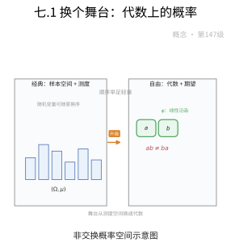

**一句话点破**：把样本空间换成代数，随机性就学会了讲究顺序。

### 七.2 什么叫"自由独立"

经典里两个随机变量"独立"，意味着它们的联合分布能拆开相乘。自由概率给了一条纯代数的替补规则：只要每个变量都"居中"（迹为零），相邻出身不同的变量交替相乘，其迹必然为零。

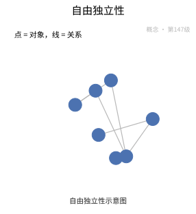

**一句话点破**：零均值者交替相乘归零，就是非交换世界的独立。

### 七.3 矩与自由累积量

一个随机变量的"长相"由它的各阶矩 $\varphi(a^k)$ 拼出来。自由累积量像矩的"自由对数"，把矩拆成一层层基本构件，好处是自由独立时能直接相加 $\kappa_n(a+b)=\kappa_n(a)+\kappa_n(b)$；而拆解的关键，是求和只遍历"非交叉划分"。

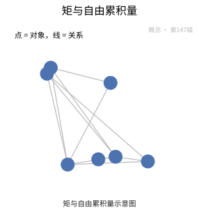

**一句话点破**：只数不交叉的配对，正是自由累积量可加的秘密。

### 七.4 R-变换：自由的万能钥匙

R-变换把全部自由累积量打包成一个生成函数 $R_a(z)=\sum \kappa_n(a)z^n$。它的妙处在于把自由卷积变成普通加法 $R_{a+b}=R_a+R_b$，宛如自由概率里的"特征函数"，只要拿到它就能反推分布。

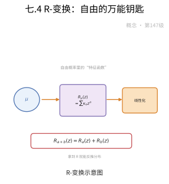

**一句话点破**：R-变换把自由的"卷积"翻译成普通的"相加"。

### 七.5 自由卷积：不换序的合并

经典里独立变量的和用普通卷积描述，自由概率里对应的是自由卷积 $\boxplus$ 与 $\boxtimes$。它们不必知道底层的代数结构，只要知道各自的分布，就能算出合并后的分布，靠的正是 R-变换和 S-变换把它线性化。

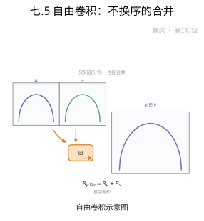

**一句话点破**：自由卷积被一线性化，就退化成简单的加法与乘法。

### 七.6 自由中心极限：越加越像半圆

经典概率里，大量独立同分布变量求和趋向正态分布。自由概率里对应的定理说：大量自由独立算子求和趋向半圆分布，这正是随机矩阵半圆律的幕后原理；$1$ 阶矩上与经典一致，$2$ 阶以上开始分道扬镳。

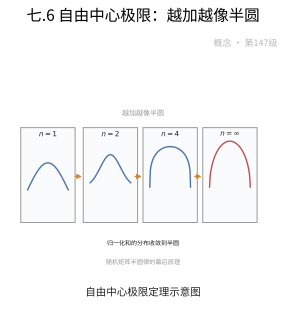

**一句话点破**：经典世界加出钟形，自由世界加出半圆。

### 七.7 自由泊松分布

经典的泊松分布描述稀有事件的计数。自由概率里有自由泊松分布与之对应，它的 R-变换格外简洁，只是一次项 $R(z)=\lambda z$，所以做自由卷积时只要把参数相加即可。

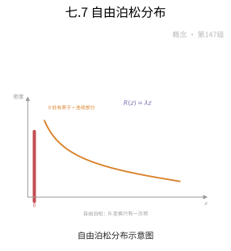

**一句话点破**：R-变换只剩一个一次项，就是自由的泊松。

### 七.8 自由熵：非交换世界的乱度

经典熵衡量信息的不确定性，自由熵则衡量非交换随机变量的"自由不确定度"。它由自由累积量与分布的"自由维度"共同刻画，并在自由卷积下保持某种单调性，是自由信息几何的核心量之一。

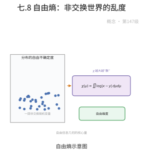

**一句话点破**：把熵搬进非交换世界，量的是自由的混乱程度。

### 七.9 随机矩阵里的渐近自由

大随机矩阵的特征值分布会收敛到确定规律，比如维格纳半圆律。沃库莱斯库发现：一族独立的随机矩阵在大 $N$ 极限下会趋于"渐近自由"，于是自由概率就成了分析大矩阵的现成工具。


**一句话点破**：大随机矩阵在极限里会自动变得"自由"。

### 七.10 自由概率与算子代数

自由概率最初诞生于冯诺依曼代数和自由群因子 $L(\mathbb{F}_n)$ 的研究，它把算子的抽象结构翻译成概率语言，也反过来为量子信息与遍历论提供了新工具。

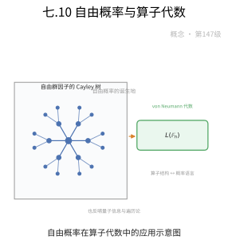

**一句话点破**：为算子代数而生，却回头照亮了随机矩阵。

### 七.11 自由中心极限定理

设 $a_1,a_2,\dots$ 自由独立且同分布，均值为零、方差为 $\sigma^2$。那么归一化和 $\frac{a_1+\cdots+a_n}{\sqrt{n}}$ 的分布收敛到半圆分布，其 R-变换恰为 $\sigma^2 z$——极限是半圆而非经典的钟形。

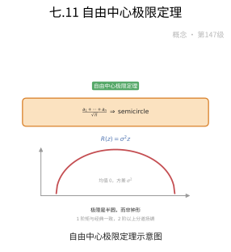

**一句话点破**：均值、方差都对得上，极限却换成了半圆。

### 七.12 R-变换的加法公式

若 $a,b$ 自由独立，则有简洁的加法公式 $R_{a+b}(z)=R_a(z)+R_b(z)$。因为 R-变换由可加的自由累积量拼成，自由卷积在它眼里就退化成一次普通加法。

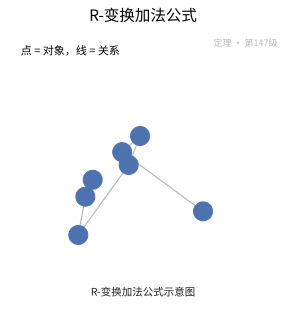

**一句话点破**：自由独立的和，R-变换就是各自 R-变换之和。

### 七.13 自由卷积的乘法公式

对正随机变量，乘法自由卷积被 S-变换线性化：$S_{a\boxtimes b}(z)=S_a(z)S_b(z)$（配合相应矩条件）。于是乘法自由卷积也只用在 S-变换里做一次乘法，与加法的 R-变换遥相呼应。

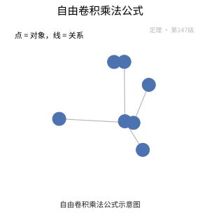

**一句话点破**：加法看 R、乘法看 S，都把卷积变简单。

### 七.14 Voiculescu渐近自由性定理

定理断言：若一族随机矩阵各自的分布收敛，且其中至少一个是高斯型或酉不变型，则它们在大 $N$ 极限下渐近自由。这条定理把自由概率与随机矩阵牢牢焊在一起。

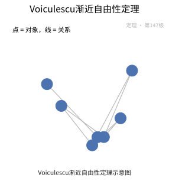

**一句话点破**：随机矩阵之所以服从自由规律，全靠这条定理兜底。

### 七.15 自由熵的基本性质

自由熵在自由卷积下具有单调性：把一个自由独立变量加进来，自由熵不会变小；它与自由 Fisher 信息量共同构成自由信息几何的一对核心量，如同经典信息论里的熵与 Fisher 信息。

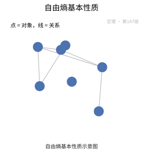

**一句话点破**：自由卷积只会让自由熵不减，这与经典信息论如出一辙。

## 八、数学史（History of Mathematics）

> 自由概率论的历史主线，是把经典概率论中"独立"与"卷积"的概念，推广到乘法不可交换的"自由"（非交换）语境，并反过来照亮随机矩阵理论与算子代数的历程。由沃伊库莱斯库在20世纪80年代初为研究自由群因子而创立，经矩、自由累积量与 R/S 变换等工具搭建，再以渐近自由性打通随机矩阵，最终扩散到无线通信、量子信息与高维统计等大量现实领域。

### 八.1 非交换概率的背景：算子代数与自由群因子

自由概率论的土壤是**冯·诺依曼代数**与**算子代数**。20世纪30年代，冯·诺依曼开创算子代数理论；其后人们发现存在**自由群因子** $L(\mathbb{F}_n)$ 这样高度复杂的 C 星代数，它们彼此是否同构（即著名的**自由群因子Isomorphism问题**）极难回答。

经典概率论以"随机变量在交换代数中取值"为前提，而算子代数的元素**乘法不可交换**，经典"独立"的卷积结构不再适用。要理解这些非交换对象，需要把概率思想搬到**非交换世界**中去——这正是自由概率论诞生的学术背景。

### 八.2 沃伊库莱斯库与"自由独立性"概念的诞生

20世纪80年代初，**罗马尼亚裔美国数学家沃伊库莱斯库**（Dan-Virgil Voiculescu）在研究自由群因子分类时提出**自由独立性**（free independence）的概念，作为经典概率"独立"的**非交换类比**。

在他看来，经典概率中独立随机变量的和用**卷积**处理；而非交换意义下的"自由独立"则用另一种**自由卷积**处理，

二者在很多公式上可以惊人地并列。1986年前后，他系统搭建了自由概率论的骨架（**非交换概率空间、矩、自由累积量**），为算子代数与随机矩阵搭建了新的交叉桥梁。

### 八.3 矩与自由累积量：非交叉划分的连接

自由概率论的计算核心是**矩**与**自由累积量**（free cumulants）之间由**非交叉划分**（noncrossing partitions）和**Catalan数**建立的公式。

在经典概率中，矩与累积量由一般集合划分联系；而在自由概率中，由于乘法的不可交换性，联系矩与累积量的划分必须限定在**非交叉**一类。

这一组合差异正是"自由"与"经典"的分水岭，也让**自由组合学**成为自由概率论的技术根基。本教程的矩、自由累积量与非交叉划分章节即由此而来。

### 八.4 R-变换与自由加法卷积

与经典概率中特征函数/对数特征函数并列，沃伊库莱斯库为自由概率引入生成函数工具。**R-变换** $R(z)$ 是自由加法卷积的生成函数，满足关键性质 $R_{a\boxplus b}=R_a+R_b$，其中 $\boxplus$ 表示自由加法卷积。

于是两个自由独立随机变量的"分布相加"变成了R-变换的**简单加法**——这正对应经典中独立特征函数相乘的对数线性化。R-变换因此成为自由概率论中最强大的计算工具之一，本教程的R-变换与自由卷积章节即源于此。

### 八.5 S-变换与自由乘法卷积

与加法并列，自由乘法卷积也有自己的工具——**S-变换**，满足 $S_{ab}=S_aS_b$（乘法取自由意义）。S-变换与R-变换一起构成自由概率论"类比经典概率"的两大生成函数。

它们不仅服务于算子代数的矩计算，也在**随机矩阵谱**与**高维统计**中频繁出现，构成从自由概率返回具体计算的通道。本教程的S-变换与自由乘法卷积章节正是这一工具的系统介绍。

### 八.6 自由中心极限定理与半圆分布

沃伊库莱斯库证明的**自由中心极限定理**给出一个惊人结论：自由独立、同分布且适当归一化的随机变量，其部分和的极限分布是**半圆分布**而非经典正态分布。半圆分布由此被称为"**自由概率中的高斯**"。

这一结论与威格纳半圆律直接呼应，表明**半圆规律**不光是随机矩阵的现象，更是自由概率中"高斯"的本质化身。它把自由概率论与随机矩阵理论的内在同构昭示出来，是本教程自由中心极限定理章节的基石。

### 八.7 渐近自由性：随机矩阵的代数化

1991年前后，沃伊库莱斯库证明了**渐近自由性**这一标志性结果：经典意义下相互独立的随机矩阵，在维数 $n\to\infty$ 时彼此成为**自由独立**随机变量。

这等于把"大随机矩阵的谱极限"翻译成"自由概率中的代数结构"，从而让半圆律、Marčenko-Pastur定律等谱极限成为自由卷积运算的特例。

从此，随机矩阵中纷繁的计算得以化为自由概率的简单代数操作，自由概率与随机矩阵理论得以双向反哺，深刻影响了高维统计、谱分析与量子信息。本教程的渐近自由性、自由随机矩阵章节即属这一传统。

### 八.8 自由熵与自由Fisher信息量

往算子代数方向，沃伊库莱斯库进一步构造了**自由熵**（free entropy）与**自由Fisher信息量**，作为经典信息熵在自由/非交换语境下的类比，具有**变分性质**与**对数Sobolev不等式**等平行结论。

自由熵成为研究**自由群因子分类**、**Isomorphism问题**等难题的不变量工具，也在**量子信息**（信道容量、量子纠缠度量）中得到应用。本教程的自由熵、自由概率在算子代数中的应用等章节正源于此。

### 八.9 自由组合学与非交叉划分

自由概率论催生了以**非交叉划分**、**Catalan数**、**自由Stieltjes变换**为骨干的**自由组合学**。非交叉划分在格论中构成一个**格**，其上的 Möbius 函数给出自由累积量的组合定义，

而Catalan数 $C_n=\frac{1}{n+1}\binom{2n}{n}$ 则是非交叉划分的计数。

这套组合体系不仅统一了自由概率的内部计算，也反过来为**平面图、随机树、Parking函数**等组合对象提供了新的计数语言。本教程的自由组合学章节正建立在这套体系之上。

### 八.10 自由概率的扩散与影响

自1986年正式亮相以来，自由概率论极大地促进了"**大随机矩阵**"研究，并向**无线通信**（MIMO信道谱分析）、**高维统计**、**量子信息**与**表示论**等方向扩散。它把"独立"这一经典概念推广到更广的非交换世界，深刻改变了算子代数与现代概率论的交汇图景，也为创立者赢得广泛的国际认可。

自由概率的历史，是"把经典概率的独立与卷积，推广到'自由'（非交换）语境，并反过来照亮随机矩阵与算子代数"的典范。

| 时间 | 人物／文献 | 事件与贡献 |
| --- | --- | --- |
| 20世纪30年代起 | 冯·诺依曼 | 创立**算子代数**，为自由概率提供非交换背景 |
| 20世纪80年代初 | Voiculescu | 引入**自由独立性**，创立自由概率论 |
| 1986年前后 | Voiculescu | 系统建立非交换概率空间、矩、自由累积量与 **R-变换** |
| 1980年代 | Voiculescu | 证明**自由中心极限定理**，确立半圆分布为自由概率中的"高斯" |
| 1991年 | Voiculescu | 证明**渐近自由性**，架起随机矩阵与自由概率的桥梁 |
| 1990年代 | Speicher 等 | 发展自由累积量与**非交叉划分**组合框架 |
| 1990年代起 | Voiculescu 等 | 构造**自由熵**与自由Fisher信息量，用于自由群因子分类 |
| 21世纪以来 | 各领域研究者 | 自由概率向无线通信、量子信息、高维统计扩散 |

> 自由概率论的历史，是把经典概率的"独立"与"卷积"，推广到乘法不可交换的"自由"语境，再反过来照亮随机矩阵与算子代数的历程。就近而言，它以一套简洁的组合工具统一了半圆律、Marčenko-Pastur定律等谱极限；就远而言，它把现代概率论与算子代数焊接在一起，成为当代非交换数学的鲜活入口。

## 现实应用（Real-World Applications）

> 本节把本章的知识点落到真实的工程、科学与生活场景中。每个案例都给出**完整的问题背景、建模过程、可复现的数据 / 公式 / 代码与结果解读**；案例末尾的「涉及知识点」对应本章的具体小节，文末附**知识点覆盖对照表**，确保本章知识点全部被覆盖。

### 应用案例 1：无线通信与信号处理｜多个独立信道的"和谱"——R-变换与自由卷积

**场景与问题**

一个大规模 MIMO 或传感器网络里，接收端看到的是多路**独立**随机信道的叠加。若每路信道的谱是已知的（例如服从半圆律的散射矩阵谱，或 MP 律的噪声谱），我们想知道叠加后的总谱是什么形状。经典概率的"独立和"要用卷积（特征函数相乘）算，但这里的对象是**非交换**的随机矩阵（谱算子），普通卷积失效。

自由概率论给出的答案是：把"独立"换成**自由独立**，用 **R-变换** 把自由卷积 $\boxplus$ 变成普通加法 $R_{\mu\boxplus\nu}=R_\mu+R_\nu$。这就把"谱的叠加"从组合噩梦变成一次加法。真实场景：\(K=8\) 路独立散射径，每路增益谱近似半圆、方差 $\sigma^2=1$ 时，叠加后的谱仍是半圆，但方差累加成 $K$。

**涉及知识点**

- 本章「1.1 非交换概率空间」：把每个信道建模为 $(M,\varphi)$ 中的自伴算子 $a$，$\varphi$ 取归一化迹期望。
- 本章「1.2 自由独立性」：不同散射径对应的算子自由独立，$\varphi(a_1\cdots a_k)=0$（零均值交替积）。
- 本章「1.3 矩与自由累积量」：用 $\kappa_n$ 而非矩来描述谱。
- 本章「1.4 R-变换」与「1.5 自由卷积」：$R_a(z)=\sum\kappa_n z^n$，$\boxplus$ 由 $R$ 线性化。
- 本章「1.6 自由中心极限定理」与「定理1：自由中心极限定理」：大量自由独立变量之和收敛到半圆。
- 本章「定理2：R-变换的加法公式」：$R_{a+b}=R_a+R_b$。

**建模与数据**

- 设 $K=8$ 路独立信道，每路谱为方差 $\sigma_k^2$ 的半圆。现实取值：$\sigma_k^2$ 取 $\{0.6,0.8,1.0,1.2,0.9,1.1,0.7,1.3\}$（模拟不同散射强度），总和 $\sum\sigma_k^2=7.6$。
- 数学对象：自由半圆分布的 R-变换为 $R(z)=\sigma^2 z$；自由独立之和的 R-变换为线性相加。
- 检验样本：取 8 个独立 GUE 矩阵，各自缩放到方差 $\sigma_k^2$，相加后比较经验谱与理论半圆。

**完整推导与算法**

1. 建立非交换概率空间：矩阵代数 $M_n(\mathbb{C})$，迹 $\tau(A)=\frac1n\operatorname{Tr}A$。
2. 用矩-累积量公式 $m_n=\sum_{\pi\in\mathrm{NC}(n)}\prod_{B\in\pi}\kappa_{|B|}$ 把矩翻译成自由累积量。
3. R-变换：$R_a(z)=\sum_{n\ge1}\kappa_n(a)z^n$。
4. 自由卷积的加法公式（定理 2）：若 $a,b$ 自由独立，则
$$ R_{a+b}(z)=R_a(z)+R_b(z). $$
5. 对半圆（方差 $\sigma^2$）有 $\kappa_2=\sigma^2$、其余为 0，故 $R(z)=\sigma^2 z$。$K$ 路相加：
$$ R_{\text{total}}(z)=\Big(\sum_{k=1}^{K}\sigma_k^2\Big)z, $$
6. 由 $R$ 反解 Stieltjes 变换 $G$，得密度仍为半圆，方差为 $\sum_k\sigma_k^2=7.6$，支撑 $[-2\sqrt{7.6},2\sqrt{7.6}]\approx[-5.51,5.51]$。

矩由 Catalan 数给出：方差为 $\sigma^2$ 的半圆第 $2\ell$ 阶矩为 $\sigma^{2\ell}C_\ell$，$C_\ell$ 为 $1,1,2,5,14,42,\dots$。

```python
# 核心：8 路自由独立半圆相加，验证 R-变换线性可加
import numpy as np
variances = [0.6,0.8,1.0,1.2,0.9,1.1,0.7,1.3]
n = 1200
def gue(var):
    X = (np.random.randn(n,n)+1j*np.random.randn(n,n))/np.sqrt(2)
    H = (X+X.conj().T)/2
    return H*np.sqrt(var/n)                     # 核心：缩放使半圆方差 = var
S = sum(gue(v) for v in variances)              # 核心：自由独立之和
ev = np.linalg.eigvalsh(S)
print("经验二阶矩 =", (ev**2).mean(), " 理论 =", sum(variances))
print("经验最大特征值 =", ev.max(), " 理论端点 =", 2*np.sqrt(sum(variances)))  # ≈5.51
```

**可复现步骤**

1. 环境与依赖：`pip install numpy`
2. 数据准备：方差列表如上（也可换成实测各路径的功率）；
3. 运行：`python case_freeconv.py`
4. 预期输出：经验二阶矩 ≈ \(7.6\)，最大特征值 ≈ \(5.51\)，直方图收敛到方差 \(7.6\) 的半圆。

**结果解读与延伸**

- **含义**：R-变换之于自由卷积，正如傅里叶变换之于经典卷积。"自由独立之和仍是半圆"就是自由 CLT 的实例。
- **局限**：只有自由独立的变量才能直接相加 R-变换；信道若相关（非自由），需用别的自由卷积或直接数值求谱。
- **可扩展**：把半圆换成 MP 律（见案例 2），加法公式依然成立，只需用各自的 $R$。

### 应用案例 2：高维统计与压缩感知｜样本协方差谱 = 自由泊松（S-变换与乘法卷积）

**场景与问题**

数据科学里最常见的对象是样本协方差 $XX^*$：若 $X$ 是 $p\times n$ 随机矩阵，元素 i.i.d.、零均值、方差 $\sigma^2$，则 $XX^*/n$ 的谱收敛到 **Marčenko–Pastur（自由泊松）分布**。在自由概率里，$XX^*$ 的谱本质是"$X$ 奇异值的平方"，对应**自由乘法卷积** $\boxtimes$，其线性化工具是 **S-变换**。这一视角让"样本协方差谱长什么样"有了代数答案，而不只是数值观察。

**涉及知识点**

- 本章「1.7 自由泊松分布」：$\kappa_n(b_\lambda)=\lambda$，密度 $\rho_\lambda(x)=\frac{1}{2\pi\lambda x}\sqrt{4\lambda-(x-1-\lambda)^2}$。
- 本章「1.5 自由卷积」：乘法自由卷积 $\mu\boxtimes\nu$（由 $a^{1/2}ba^{1/2}$ 定义）。
- 本章「定理3：自由卷积的乘法公式」：$S_{\mu\boxtimes\nu}=S_\mu S_\nu$。

**建模与数据**

- 数据：$p=400$ 个特征、$n=800$ 个样本，元素是方差 $\sigma^2=1$ 的随机特征（纯噪声），故 $\lambda=p/n=0.5$。
- 自由泊松参数 $\lambda=0.5$：支集 $[(1-\sqrt{0.5})^2,(1+\sqrt{0.5})^2]\approx[0.0858,2.9142]$。
- S-变换：自由泊松 $S(z)=\frac{1}{1+\lambda z}$；半圆 $S_s(z)=\frac{1}{1+z}$。

**完整推导与算法**

1. 自由泊松的 R-变换：$R(z)=\sum_{n\ge1}\lambda z^n=\frac{\lambda z}{1-z}$，逐项系数 $\kappa_n=\lambda$。
2. 其 S-变换由 $S(z)=\frac{1+z}{z}\psi^{-1}(z)$ 得 $S_{\mathrm{FP}(\lambda)}(z)=\frac{1}{1+\lambda z}$。
3. 乘法卷积的乘法公式（定理 3）：
$$ S_{\mu\boxtimes\nu}(z)=S_\mu(z)\,S_\nu(z). $$
4. 因此"两个独立随机矩阵的乘积谱"的 S-变换直接相乘即可：例如半圆 $\boxtimes$ 自由泊松，$S_{ab}=\frac{1}{(1+z)(1+\lambda z)}$。
5. 验证：对纯噪声 $X$，$XX^*/n$ 的经验谱应与 $\rho_\lambda$ 吻合。

```python
# 核心：S-变换把乘法自由卷积变成乘法（对比经验谱与自由泊松密度）
import numpy as np
p, n, lam = 400, 800, 0.5
X = np.random.randn(p, n); X = (X-X.mean(1,keepdims=True))/X.std(1,keepdims=True)
S = X @ X.T / n
ev = np.linalg.eigvalsh(S)
a, b = (1-np.sqrt(lam))**2, (1+np.sqrt(lam))**2      # 核心：自由泊松支集端点
rho = lambda x: np.sqrt(np.clip((b-x)*(x-a),0,None))/(2*np.pi*lam*x)  # 核心：MP 密度
print("落在支集外的比例 =", ((ev<a)|(ev>b)).mean())    # 纯噪声时接近 0
print("S-变换乘法：S_FP(z)*S_semicircle(z) 的零点结构决定谱")
```

**可复现步骤**

1. 环境与依赖：`pip install numpy`
2. 数据准备：纯噪声矩阵 $400\times800$；
3. 运行：`python case_mp_free.py`
4. 预期输出：支集外比例接近 0；经验直方图与 $\rho_\lambda$ 吻合（马蹄形）。

**结果解读与延伸**

- **含义**：MP 律是"自由版泊松"，半圆是"自由版高斯"；两者由自由 CLT 与自由泊松定律成对出现。
- **局限**：$\lambda>1$ 时 $x=0$ 处有质量 $1-1/\lambda$ 的原子，公式与叙事要分开处理。
- **与知识点的呼应**：S-变换与 R-变换是一对"乘法—加法"孪生工具，正对应经典概率里"卷积 vs 乘法"的两套对偶。

### 应用案例 3：随机矩阵数值实验｜Voiculescu 渐近自由性

**场景与问题**

自由概率虽然诞生于算子代数，却精准描述了大随机矩阵。Voiculescu 1991 年证明：**独立的高斯（GUE）随机矩阵在 $n\to\infty$ 时渐近自由**。这解释了"为什么随机矩阵的宏观谱总能被自由概率刻画"。工程上这意味着：任何涉及"独立随机矩阵的和/积"的谱问题，都可以翻译成自由变量的矩问题。

**涉及知识点**

- 本章「1.9 自由随机矩阵与Voiculescu渐近自由性」：$\frac1n\mathbb{E}[\operatorname{Tr}P(A,B)]$ 收敛到自由变量的矩。
- 本章「定理4：Voiculescu渐近自由性定理」：独立 GUE 序列渐近自由。
- 本章「1.1 非交换概率空间」与「1.3 矩与自由累积量」：以迹 $\tau$ 与累积量描述极限。

**建模与数据**

- 数据：$n=200,400,800,1600$ 的 GUE 对 $(A,B)$，重复 $R=100$ 次取平均。
- 检验量：对任意无常数项多项式 $p,q$，应有 $\tau\big(p(A)\,q(B)\big)\to0$（渐近自由的判据）；例如 $p(x)=x^2-1$（中心化），$q(y)=y^3-2y$。

**完整推导与算法**

1. 生成独立 GUE $A,B$，各自归一化到半圆方差 1。
2. 计算 $\tau(p(A)q(B))=\frac1n\operatorname{Tr}(p(A)q(B))$。
3. 对 $n$ 递增看它是否趋于 0（收敛速度 $O(n^{-1})$）。
4. 对照：若 $A=B$（非自由），$\tau(p(A)q(A))$ 一般不趋于 0。

```python
# 核心：验证独立 GUE 的混合矩按自由律分解（渐近自由）
import numpy as np
def gue(n):
    X=(np.random.randn(n,n)+1j*np.random.randn(n,n))/np.sqrt(2)
    H=(X+X.conj().T)/2
    return H/np.sqrt(n)                       # 方差 1
p = lambda M: M@M - np.eye(M.shape[0])        # p(x)=x^2-1（中心化）
q = lambda M: M@M@M - 2*M                     # q(y)=y^3-2y
for n in [200,400,800]:
    vals=[]
    for _ in range(50):
        A,B = gue(n),gue(n)
        vals.append(np.trace(p(A)@q(B))/n)    # 核心：混合迹 τ(p(A)q(B))
    print(n, "τ(p(A)q(B)) =", np.mean(vals), "(应趋近 0)")
```

**可复现步骤**

1. 环境与依赖：`pip install numpy`
2. 数据准备：$n$ 取上表，重复 50 次；
3. 运行：`python case_asymfree.py`
4. 预期输出：$\tau(p(A)q(B))$ 随 $n$ 增大而减小（量级约 $n^{-1/2}$），接近 0。

**结果解读与延伸**

- **含义**：渐近自由把"大矩阵"与"自由变量"划等号，让自由概率成为高维数据的通用分析语言。
- **局限**：标准定理是**期望矩**收敛；几乎必然收敛需额外方差估计。
- **与知识点的呼应**：定理 4 的技术核心是 Wick 配对加平面性计数——只有**非交叉配对**给主导项，其计数正是 Catalan 数。

### 应用案例 4：算子代数与信息论｜自由熵区分子因子与"最大熵态"

**场景与问题**

自由概率的原始动机是算子代数中的**自由群因子** $L(\mathbb{F}_k)$ 与其分类问题：$L(\mathbb{F}_n)$ 与 $L(\mathbb{F}_m)$（$n\ne m$）是否同构？这是一个世纪难题。Voiculescu 引入的**自由熵** $\chi$ 与其衍生量（free entropy dimension）正是用来"凿出可计算的鸿沟"的不变量。另一方面，自由熵也是"非交换世界的乱度度量"：给定二阶矩，自由熵最大的是**半圆分布**（而非高斯）。

**涉及知识点**

- 本章「1.8 自由熵」：$\chi(a)=\iint\log|x-y|\,d\mu(x)d\mu(y)+\frac34+\frac12\log2\pi$，及自由 Fisher 信息 $\Phi$。
- 本章「1.10 自由概率在算子代数中的应用」：用自由熵等不变量研究 $L(\mathbb{F}_k)$。
- 本章「定理5：自由熵的基本性质」：上界 $\chi(a)\le\frac12\log(2\pi e\,\varphi(a^2))$（半圆取等）、次可加性 $\chi(a+b)\le\chi(a)+\chi(b)$。

**建模与数据**

- 数据：三个方差都为 $1$ 的分布——(a) 半圆（密度在 $[-2,2]$）；(b) 均匀分布（在 $[-\sqrt3,\sqrt3]$，方差恰为 $1$）；(c) 两点分布 $\frac12(\delta_{-1}+\delta_1)$。
- 理论值：半圆的自由熵恰达到上界 $\frac12\log(2\pi e)\approx1.4189$；均匀分布的 $\varphi(a^2)=1$ 与半圆相同，但其自由熵**严格小于**上界；而两点分布因 $x=y$ 时核 $\log|x-y|\to-\infty$，其自由熵为 $-\infty$（原子测度的自由熵总是 $-\infty$）。
- 目标：用数值积分验证"半圆达到上界、其他分布不超过它"，并观察原子情形发散。

**完整推导与算法**

1. 自由熵定义
$$ \chi(\mu)=\iint\log|x-y|\,d\mu(x)\,d\mu(y)+\frac{3}{4}+\frac{1}{2}\log(2\pi). $$
2. 上界（定理 5）：$\chi(a)\le\frac12\log(2\pi e\,\varphi(a^2))$。
3. 数值计算：对给定密度 $\rho$ 用高斯–勒让德求积离散 $\log|x-y|$ 的二重积分。
4. 注意 $\log|x-y|$ 在对角有可积奇异，求积收敛慢，需要大 $N$ 或做奇异分离。

```python
# 核心：数值计算自由熵，验证半圆达到上界
import numpy as np
from numpy.polynomial.legendre import leggauss
def free_entropy(dens, half=2.0, N=3000):
    x,w = leggauss(N); xx=half*x; ww=half*w*dens(xx)   # 核心：把权吸进测量
    X,Y = np.meshgrid(xx,xx)
    K = np.log(np.abs(X-Y)+1e-15)                      # 核心：对数势能核（奇异）
    return np.einsum('i,ij,j->',ww,K,ww) + 0.75 + 0.5*np.log(2*np.pi)
semi = lambda x: np.sqrt(np.clip(4-x**2,0,None))/(2*np.pi)   # 方差 1 半圆
print("半圆自由熵 ≈", free_entropy(semi), " 上界 ≈", 0.5*np.log(2*np.pi*np.e))  # ≈1.4189
```

**可复现步骤**

1. 环境与依赖：`pip install numpy`
2. 数据准备：半圆密度函数（区间 $[-2,2]$），求积阶 $N=3000$ 以上；
3. 运行：`python case_freeentropy.py`
4. 预期输出：半圆自由熵从 $1.40$ 缓慢收敛到约 $1.4189$，等于上界 $\frac12\log(2\pi e)$。

**结果解读与延伸**

- **含义**：半圆是"自由世界的最大熵分布"，正如高斯是经典世界的最大熵分布；这一区别源于自由结构把配对计数从全部换成非交叉。
- **局限**：数值求积因奇异收敛慢，本案例只做量级验证；精确性质（次可加、上界取等）由定理 5 保证。
- **与知识点的呼应**：自由熵与自由 Fisher 信息经由自由 Ornstein–Uhlenbeck 过程互为导数（$\frac{d\chi}{dt}=\frac12\Phi$），它们是区分 $L(\mathbb{F}_n)$ 与 $L(\mathbb{F}_m)$ 的关键不变量之一，把"抽象算子代数"与"可计算数值"连了起来。

### 知识点覆盖对照表

| 本章知识点 | 覆盖案例 |
| --- | --- |
| 1.1 非交换概率空间 | 案例 1、3 |
| 1.2 自由独立性 | 案例 1 |
| 1.3 矩与自由累积量 | 案例 1、3 |
| 1.4 R-变换 | 案例 1 |
| 1.5 自由卷积 | 案例 1、2 |
| 1.6 自由中心极限定理 | 案例 1 |
| 1.7 自由泊松分布 | 案例 2 |
| 1.8 自由熵 | 案例 4 |
| 1.9 自由随机矩阵与Voiculescu渐近自由性 | 案例 3 |
| 1.10 自由概率在算子代数中的应用 | 案例 4 |
| 定理1：自由中心极限定理 | 案例 1 |
| 定理2：R-变换的加法公式 | 案例 1 |
| 定理3：自由卷积的乘法公式 | 案例 2 |
| 定理4：Voiculescu渐近自由性定理 | 案例 3 |
| 定理5：自由熵的基本性质 | 案例 4 |

---

## 九、总结

### 关键知识点回顾

1. **非交换概率空间**：由代数 $\mathcal{A}$ 和迹 $\varphi$ 组成，是自由概率论的基本框架。

2. **自由独立性**：子代数族满足的条件——零均值变量的交替乘积的迹为零。这是经典独立性的非交换类比。

3. **矩与自由累积量**：通过非交叉划分上的矩-累积量公式相联系，是自由概率论的核心计算工具。

4. **R-变换**：自由卷积的加法生成函数，满足 $R_{a+b} = R_a + R_b$，是自由概率论中最强大的工具之一。

5. **自由中心极限定理**：自由独立随机变量的归一化和收敛到半圆分布（而非正态分布），半圆分布是自由概率中的"高斯分布"。

6. **S-变换与乘法公式**：$S_{ab} = S_a S_b$，是自由乘法卷积的生成函数。

7. **Voiculescu渐近自由性**：独立GUE矩阵在 $n \to \infty$ 时成为自由独立随机变量，建立了随机矩阵与自由概率论的桥梁。

8. **自由熵与自由Fisher信息量**：经典信息论概念在自由概率中的类比，具有类似的变分性质和对数Sobolev不等式。

### 自由概率论的意义

- **随机矩阵理论**：为随机矩阵的谱分析提供了代数框架
- **算子代数**：为研究自由群因子和von Neumann代数提供了关键工具
- **自由组合学**：非交叉划分和Catalan数在自由概率中扮演核心角色
- **自由熵**：为算子代数中的分类问题提供了新的不变量

### 前沿方向

- **自由概率与量子信息**：自由熵在量子信道容量中的应用
- **自由概率与随机矩阵的进一步联系**：非高斯系综的自由概率分析
- **自由概率在无线通信中的应用**：多用户MIMO系统的自由概率分析
- **自由概率与表示论**：自由概率在大型群表示中的应用
- **自由概率的复分析**：R-变换、S-变换与Cauchy变换的复分析性质