# 第149级 拓扑量子场论 (Topological Quantum Field Theory, TQFT)

## 📖 学习目标

1. 理解Atiyah公理下TQFT的定义及其基本结构
2. 掌握d维TQFT与Cobordism范畴的关系
3. 深入理解2维TQFT的分类定理及其与Frobenius代数的等价性
4. 掌握三维Chern-Simons理论与Jones多项式的联系
5. 理解Reshetikhin-Turaev构造的核心思想
6. 掌握扩展TQFT与Lurie的Bordism假设
7. 理解TQFT与Donaldson不变量、Gromov-Witten不变量的关系

---

## 一、核心概念

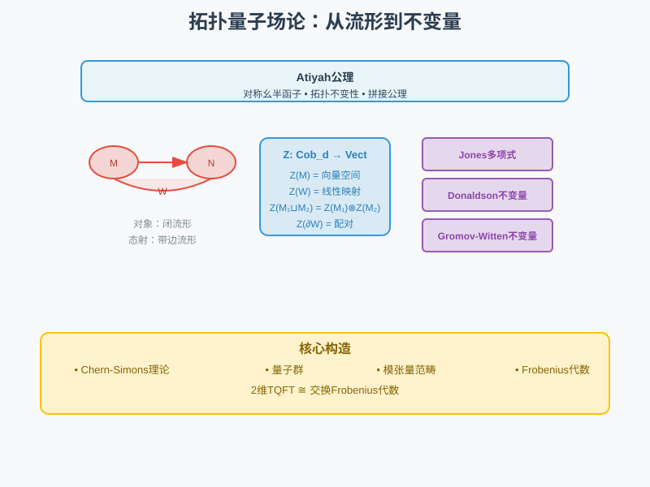

> **直观理解（现实类比）**：TQFT就像"乐高积木的数学理论"。Cobordism范畴是"积木说明书"：闭流形（如圆圈$S^1$）是"接口"，带边流形（如圆柱、裤子、帽子）是"积木块"。TQFT函子$Z$是"翻译器"：它把每个接口翻译成向量空间，把每个积木块翻译成线性映射。Atiyah公理保证"无论你怎么拼接积木，最终答案都一样"——这就是拓扑不变性的魔力。2维TQFT等价于交换Frobenius代数，就像"所有可能的2维乐高拼法"都对应一个特定的代数结构。Chern-Simons理论是3维TQFT的物理实现，它生成的Jones多项式能区分不同的绳结，就像用"绳结指纹"来识别身份。

> **🧠 思考历程：一个"不在乎长宽高"的宇宙，物理学家算什么才能算出不变量？**
>
> 普通的量子场论依赖时空的大小与形状；而拓扑量子场论坚持，只要流形的拓扑不变，答案就一律相同。它向数学家证明了物理直觉也能严密化，并生成了琼斯多项式等一批全新的拓扑不变量。它想回答的，是"只依赖拓扑配分函数"的场论究竟长什么样。
>
> - **琼斯多项式：绳结的"DNA"**。1984年，沃恩·琼斯在研究算子代数时，意外给出一个能区分各种绳结的新不变量——琼斯多项式，谁也没料到它与辫子群、二维共形场论如此契合。
> - **威滕的"概念跳跃"**。1988年，物理学家爱德华·威滕用Chern-Simons三维作用量的路径积分重新"推导"出琼斯多项式，并把配分函数 $Z(M)$ 提升为流形的不变量来源，从而提出了拓扑量子场论的思想；同年，阿蒂亚把这一思想提炼成严格的Atiyah公理，塞加尔则基于共形场论提供了另一套严谨框架。
> - **把"拼接"变成结构的承诺**。这些理论把 $d$ 维带边流形当作 $d-1$ 维边界之间的"过程"，配分函数在粘合下必须满足拼接律；雷舍提欣–图拉耶夫等的状态和又给出组合构造，让拓扑不变量从"猜测"走向"可计算"。
> - **心路**：物理可以替你抄近路、数学家再为你修公路——TQFT正是这两个世界一次漂亮的合谋。

### 1.1 Cobordism范畴

> **🧠 来龙去脉（为什么会有这个概念？解决了什么问题？）**：物理学里"时空演化"常被描述为"从一个初态时间片到末态时间片的过程"，数学家想给这种"过程"一个严格本体。他们发现，把"时间片"想成 $(d-1)$ 维闭流形、"过程"想成夹在两者之间的 $d$ 维带边流形，就能把"过程的串联"翻译成"沿公共边界粘合"——这正是范畴里"态射的复合"。于是 **Cobordism范畴** $\text{Cob}_d$ 应运而生：闭流形是对象、带边流形是态射、粘合是复合。它为"把流形分配成向量空间、把时空分配成线性映射"的TQFT提供了最自然的舞台，其雏形可追溯至庞加莱对"维数的边界"的研究，而作为范畴被正式刻画则来自阿蒂亚与奎恩在1970-80年代的工作。

**定义1（Cobordism范畴）** **d维Cobordism范畴** $\text{Cob}_d$ 定义如下：
- 对象：$(d-1)$维闭光滑流形 $M$。
- 态射：从 $M$ 到 $N$ 的态射是一个 $d$ 维带边流形 $W$，使得 $\partial W \cong \overline{M} \sqcup N$，其中 $\overline{M}$ 表示 $M$ 的反定向。
- 复合：沿公共边界粘合。
- 恒等态射：$M \times [0,1]$（柱面）。
- 对称幺半结构：不相交并 $\sqcup$。

> **💡 直观理解（类比）**：Cobordism范畴就像一套"积木说明书+拼装规则"。对象（$(d-1)$维闭流形）是各种"接口/插座"，从 $M$ 到 $N$ 的态射（$d$ 维带边流形）是"拼块"，复合就是"沿接口对接"。柱面（$M\times[0,1]$）则扮演"空接一段"的恒等拼接，不相交并扮演"把两套积木放在一起"的并行组合——这正是后来TQFT眼里"时空"的原始语法。

**定义2（定向Cobordism范畴）** **定向Cobordism范畴** $\text{Cob}_d^{\text{or}}$ 的对象是定向 $(d-1)$ 维闭流形，态射是定向 $d$ 维带边流形，边界定向与流形定向兼容。

> **💡 直观理解（类比）**：定向就像给每块积木标上"正反面/箭头"。加了这个标记后，两个朝向相反的拼块接到一起才能"严丝合缝"（边界定向一致），如同电池正负极必须对准才能通电。这让"从 $M$ 到 $N$"有了明确方向，是搭出有意义演化的前提。

#### 课堂问答

**老师**：先说清楚，$\text{Cob}_d$ 里的"对象"到底是流形本身，还是流形的配边类？

**学生**：是闭 $(d-1)$ 维流形本身，而不是配边类：对象就是具体的闭光滑流形 $M$，态射才是满足 $\partial W\cong\overline{M}\sqcup N$ 的 $d$ 维带边流形 $W$。常见误区是把"配边"当成对象间的相等——$M$ 与 $N$ 配边只意味着存在一个 $W$ 连接它们，并不意味着它们同胚。

**老师（追问）**：既然态射是带边流形，那"复合"凭什么就叫范畴里的复合？两块粘起来会不会得到不同的东西？

**学生**：复合就是沿公共边界粘合：$W_1:M\to N$ 与 $W_2:N\to P$ 复合成 $W_1\cup_N W_2:M\to P$，结合律来自"先粘哪一对边界得到同胚的流形"，恒等态射是柱面 $M\times[0,1]$，满足 $W\cup_N(N\times[0,1])\cong W$。真正微妙的是要指定粘合处的微分结构——这正是后来"光滑配边"与"拓扑配边"分野的起点。

**老师（拓展）**：如果要求流形配定向，或者允许带角，范畴会怎么变？

**学生**：要定向就取 $\text{Cob}_d^{\text{or}}$，要求边界定向与 $W$ 的定向按"外法向优先"相容，于是 $\overline{M}$ 的反定向自然出现；要让不交并成为严格的对称幺半结构，就把对象记成定向 $(d-1)$ 维流形、态射记成抽象配边类。若坚持保留角点，就进入带角配边或 $(\infty,d)$-范畴，为扩展 TQFT 铺路。

### 1.2 Atiyah公理

> **🧠 来龙去脉（为什么会有这个概念？解决了什么问题？）**：1988年威滕用Chern-Simons路径积分"推"出了琼斯多项式，数学界既兴奋又困惑——路径积分本身很直观，却不够严谨。阿蒂亚随即把威滕的思想提炼成几条纯代数公理：一个TQFT就是一个把"时空间（流形）"整体分配成"向量空间与线性映射"的幺半函子，并要求配对、乘法、结合、规范化、恒等五条性质。它解决的正是"如何把物理上不严格的路径积分翻译成严格且可验证的数学定义"这一核心难题，也让"拓扑不变量"第一次有了统一而系统的刻画。

**定义3（Atiyah公理）** 一个 **$d$ 维拓扑量子场论** 是一个对称幺半函子：

$$ Z: \text{Cob}_d \to \text{Vect}_{\mathbb{C}} $$

满足以下公理：

1. **（配对性）** $Z(\overline{M}) = Z(M)^*$（对偶向量空间）。
2. **（乘法性）** $Z(M_1 \sqcup M_2) = Z(M_1) \otimes Z(M_2)$（对称幺半性）。
3. **（结合性）** $Z(W_1 \cup_{M} W_2) = Z(W_2) \circ Z(W_1)$（复合的保持）。
4. **（规范化）** $Z(\emptyset^{(d-1)}) = \mathbb{C}$，其中 $\emptyset^{(d-1)}$ 是空 $(d-1)$ 维流形。
5. **（恒等）** $Z(M \times [0,1]) = \text{id}_{Z(M)}$（柱面给出恒等映射）。

> **🧠 直观理解（现实类比）**：Atiyah公理把TQFT定义为"从时空积木到向量空间的翻译器" $Z:\text{Cob}_d\to\text{Vect}_{\mathbb{C}}$，并立下五条"翻译纪律"：配对性（反过方向就取对偶，如镜子两面）、乘法性（两套积木合在一起信息相乘）、结合性（先拼左还是先拼右结果一样）、规范化（空空间对应一维向量空间 $\mathbb{C}$）、恒等（空接一段柱面不动）。它们合起来保证了——任何时空无论怎么切分再拼回，答案始终唯一，这正是"拓扑不变量"的核心。

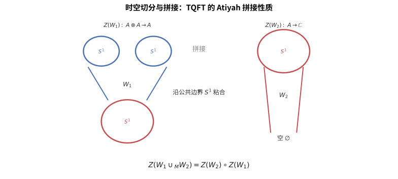

> **直观理解（现实类比）**：TQFT 的拼接性质就像"乐高积木"。你用一个拼好的积木块 $W_1$ 和一个积木块 $W_2$，只要它们的接口（公共边界）吻合，就能拼成更大的模型，而整体配分函数恰是两块各自配分函数的复合。也就是说，无论你怎样把时空切成小块再拼回去，得到的最终答案都一样——这正是所谓"拓扑不变的拼接规律"。

#### 课堂问答

**老师**：Atiyah 把 TQFT 定义成一个函子 $Z$。它凭什么必须是"对称幺半"的函子，而不只是普通函子？

**学生**：因为要同时尊重复合（拼接）与不交并两件结构：对称幺半函子意味着 $Z(M_1\sqcup M_2)\cong Z(M_1)\otimes Z(M_2)$ 且兼容复合 $Z(W_2\circ W_1)=Z(W_2)\circ Z(W_1)$。少了任一条，$Z$ 既不"乘法可分"也不"拼接守恒"，拓扑不变性立刻垮掉。

**老师（追问）**：五条公理里，哪一条最容易被忽略，却最致命？

**学生**：规范化与恒等。规范化要求 $Z(\emptyset^{(d-1)})=\mathbb{C}$，恒等要求 $Z(M\times[0,1])=\text{id}_{Z(M)}$；没有恒等，柱面可能给出非平凡自同态，"空接不改变状态"随之失效。更本质地说，$Z(M\times[0,1])=\text{id}$ 正是保证 $Z$ 只依赖拓扑、不依赖度量的关键；而配对性 $Z(\overline{M})=Z(M)^*$ 则把"翻转边界定向"翻译成取对偶。

**老师（拓展）**：如果把目标范畴 $\text{Vect}_{\mathbb{C}}$ 换成任意对称幺半范畴 $\mathcal{C}$，还叫 TQFT 吗？

**学生**：叫，那就是取值在 $\mathcal{C}$ 中的 TQFT，是同一定义的自然推广——Lurie 的 Bordism 假设正是取 $\mathcal{C}$ 为 $(\infty,d)$-范畴。可见 Atiyah 公理真正的内核不是"落到向量空间"，而是"对称幺半函子加上规范化与恒等"，这才是所有 TQFT 变体的共同骨架。

### 1.3 Frobenius代数

> **🧠 来龙去脉（为什么会有这个概念？解决了什么问题？）**：Frobenius代数的思想很早——弗罗贝尼乌斯在1900年前后研究矩阵的表示论与"迹"，给出"带非退化对称双线性型"的刻画；但他绝不会想到，这种代数竟会成为"二维时空所有拼接规律"的分类对象。真正把"Frobenius代数"提升到拓扑舞台的是1980年代末对2维TQFT的分类洞察：一个带"迹"的非退化代数，恰好能编码"裤子（乘法）、帽子（余乘法）、圆盘（迹）"的整套粘合法则。它解决的问题是：二维时空的"切分—拼接规律"到底可不可能用一个代数对象完整、严格地描述——答案是可以，而且就是Frobenius代数。

**定义4（Frobenius代数）** 一个 **Frobenius代数** 是一个有限维结合代数 $A$，配备一个非退化线性映射 $\varepsilon: A \to \mathbb{C}$（称为**迹**或**余单位**），使得双线性形式 $\langle a, b \rangle = \varepsilon(ab)$ 是非退化的。

等价地，Frobenius代数具有一个**余乘法**（comultiplication）$\Delta: A \to A \otimes A$，满足Frobenius关系：

$$ (\Delta \otimes \text{id}_A) \circ \Delta = (\text{id}_A \otimes \Delta) \circ \Delta $$

且 $\Delta$ 是 $A$-$A$ 双模同态。

> **💡 直观理解（类比）**：Frobenius代数 = "有记分卡的代数"。乘法是"把两个数拼成一个"，余乘法是"把一个数拆成两个"，而一个非退化的"迹" $\varepsilon$ 就像一杆公平的天平——它保证"拼接"和"拆分"永远可逆对账，不会丢失信息。在2维TQFT里，它正是"裤子拼合"与"帽子拆开"能否精确还原的数学化身。

**定义5（交换Frobenius代数）** 如果 $A$ 是交换代数，则称 $A$ 为 **交换Frobenius代数**。

> **💡 直观理解（类比）**："交换"就像"客厅拼合唱，谁先谁后无关紧要"——乘法顺序可互换。对于2维TQFT，这正是拓扑上"两入边输入顺序自然对称"的结果，也决定了 $Z(S^1)=A$ 能承载漂亮的交换代数结构。

#### 课堂问答

**老师**：Frobenius 代数只用一个线性泛函 $\varepsilon$ 就定义了，它凭什么值得单独成为一类结构？

**学生**：因为它把代数和配边接上了：给定 $\varepsilon$，双线性型 $\langle a,b\rangle=\varepsilon(ab)$ 非退化，于是存在对偶的余乘法 $\Delta:A\to A\otimes A$，$A$ 上就此凑齐乘法、单位、余乘法、余单位，分别对应裤子、圆盘、反向裤子、帽子。

**老师（追问）**：Frobenius 关系 $(\Delta\otimes\text{id})\circ\Delta=(\text{id}\otimes\Delta)\circ\Delta$ 看起来很抽象，它究竟在说什么？

**学生**：它在说 $\Delta$ 是 $A$-$A$ 双模同态，等价于伴随性 $\langle ab,c\rangle=\langle a,bc\rangle$；几何上就是"把两个孔并到一起"与"分开"顺序无关。常见误区是以为它只是普通的余结合余代数——其实 Frobenius 关系把乘法与余乘法强烈耦合，这才是它与一般余代数分道扬镳之处。

**老师（拓展）**：什么样的 Frobenius 代数才对应二维 TQFT？

**学生**：必须是交换的。因为裤子对两条入边对称，对称幺半性迫使乘法 $m$ 交换；非交换的 Frobenius 代数对应的则是带框架或非对称的二维理论。更一般地，"交换 Frobenius 代数 $\cong$ 二维 TQFT"是精确的范畴等价，而非仅仅一一对应。

### 1.4 Z/2分次与超对称

**定义6（Z/2分次向量空间）** 一个 **Z/2分次向量空间** 是向量空间 $V = V_0 \oplus V_1$ 的分解，其中 $V_0$ 中的元素称为**偶元素**，$V_1$ 中的元素称为**奇元素**。分次张量积满足：

$$ (V \otimes W)_k = \bigoplus_{i+j \equiv k \pmod{2}} V_i \otimes W_j $$

> **💡 直观理解（类比）**：Z/2分次像个"白天/黑夜"标签：每个向量不是"白天（偶）"就是"黑夜（奇）"。两个元素相乘时，分次按"白天+白天=白天、白天+黑夜=黑夜、黑夜+黑夜=白天"（即模2相加）滚动，而交换时奇元素要额外"带一个负号"——这就是超对称里"两个费米子交换要变号"的来源。

**定义7（超Frobenius代数）** 一个 **超Frobenius代数** 是Z/2分次向量空间上的Frobenius代数，其中结构映射保持分次。

> **💡 直观理解（类比）**：超Frobenius代数 = "遵纪守法的带班牌代数"：它既带白天/黑夜的分次标签，又保持Frobenius的整套结构（乘法、余乘法、迹）在分次下协调一致。可类比为一个同时管理"员工排班"和"财务账本"的部门，两套规则互不打架。

#### 课堂问答

**老师**：给向量空间贴上"偶/奇"标签，这个分次究竟改变了什么运算规则？

**学生**：改变的是张量积与交换：分次张量积按 $(V\otimes W)_k=\bigoplus_{i+j\equiv k\ (\mathrm{mod}\,2)}V_i\otimes W_j$ 定义，而交换两个奇元素要添负号，即 $ab=(-1)^{|a||b|}ba$——这就是 Koszul 符号法则。常见误区是照搬普通交换律，忽略奇元素交换时的那个 $-1$。

**老师（追问）**：那"超 Frobenius 代数"是另起炉灶，还是同一套路换了个底？

**学生**：是同一套路换底：把底范畴换成超向量空间，要求乘法、余乘法、迹 $\varepsilon$ 全部保分次并与 Koszul 符号相容，于是 $\varepsilon$ 只在偶部分可能非零，Frobenius 关系里会出现额外的符号 $(-1)^{|a||b|}$。

**老师（拓展）**：超对称在 TQFT 里到底带来什么新东西？

**学生**：它让 TQFT 能容纳费米型场与奇对称，并让配分函数出现超维数 $\mathrm{sdim}\,V=\dim V_0-\dim V_1$ 这类更细的不变量。一维超 TQFT 几乎就是超向量空间的分类；往高维走，它与 $E_\infty$ 结构、上同调理论自然衔接。

### 1.5 不变量

> **🧠 来龙去脉（为什么会有这个概念？解决了什么问题？）**：拓扑不变量的目标是一句话：**两个流形在拓扑上看不出差别，就应分到同一个"指纹"**。琼斯1984年在算子代数（冯·诺依曼代数的子因子）研究中意外得到纽结的琼斯多项式；卡松面向3维同调球面给出卡松不变量；唐纳森1983年用瞬子模空间给出4维流形的光滑不变量；格罗莫夫—威滕则把伪全纯曲线计数成辛几何的量子不变量。它们分别回答了"绳结怎么分辨""3球面怎么分辨""光滑4流形怎么分辨""辛流形里有多少指定曲线"等核心问题，并共同展示：一个优秀的不变量往往源于某条看似无关的深分支。

**定义8（Jones多项式）** **Jones多项式** $V_L(t) \in \mathbb{Z}[t^{-1/2}, t^{1/2}]$ 是纽结 $L$ 的一个多项式不变量，满足：

$$ V_{\text{unknot}} = 1, \quad t^{-1} V_{L_+} - t V_{L_-} = (t^{-1/2} - t^{1/2}) V_{L_0} $$

其中 $L_+, L_-, L_0$ 是纽结在交叉点处的三种局部修改（ skein relation）。

> **💡 直观理解（类比）**：Jones多项式好比给自己的绳结发的"身份证号"。它由三条"局部剪接规则"（skein关系：正交叉、负交叉、平滑化）归纳算出，有点像"用密码算法压缩绳子的打结信息"。两条绳子若可互相变形（同痕等价），它们的Jones多项式必然相同——所以它是识别"这个结是哪个结"的指纹。

**定义9（Casson不变量）** **Casson不变量** $\lambda_{\text{Casson}}(M)$ 是定向同调3球面 $M$ 的一个整数不变量，计数了 $M$ 中不可约 $SU(2)$-表示（即平直 $SU(2)$-联络）的代数个数。

> **💡 直观理解（类比）**：Casson不变量像是给三维球面点的一笔"代数户口普查"。它数一数这个3流形上究竟有多少种"本质不同的引力连接方式"（平直联络/不可约表示），计数的代数和就是该流形的一个整体指纹，能帮我们分辨哪些3球面其实"长得不一样"。

**定义10（Donaldson不变量）** **Donaldson不变量** 是光滑4维流形的不变量，通过 $SU(2)$-瞬子（自对偶Yang-Mills联络）的模空间定义。对光滑4维流形 $M$，Donaldson不变量 $\Phi_M$ 是 $\text{H}_2(M)$ 的对称幂上的多项式函数。

> **💡 直观理解（类比）**：Donaldson不变量是"光滑4维世界的照妖镜"。它统计4维流形上满足自对偶条件的特殊联络（瞬子）有多少个，并把它们编码成 $\text{H}_2(M)$ 上的多项式函数。它的惊人之处在于：能分辨出同一个流形换上不同的"光滑衣"后其实是不同的——因此是研究光滑4维流形分类的锋利工具。

**定义11（Gromov-Witten不变量）** **Gromov-Witten不变量** 计数了辛流形中伪全纯曲线的个数。对辛流形 $(X, \omega)$ 和同调类 $A \in \text{H}_2(X)$，GW不变量：

$$ GW_{g, A}^X: \text{H}^*(X)^{\otimes n} \to \mathbb{Q} $$

计数了亏格 $g$、同调类 $A$ 的伪全纯曲线经过指定标记点的个数。

> **💡 直观理解（类比）**：Gromov-Witten不变量好比"数数一个风景里能画出多少条指定类型的曲线"。给定同调类 $A$ 和要求的亏格（曲线有多少个"手柄"），它统计辛流形里经过最多若干标记点的伪全纯曲线共有多少个（带权重）。这像在充满涟漪的水面（辛流形）上数符合条件的"最小能量曲面"的个数，是代数几何与弦论对话的桥梁。

#### 课堂问答

**老师**：Jones、Casson、Donaldson、Gromov–Witten 四类不变量差别巨大，它们的共同本质是什么？

**学生**：共同本质是把流形的连续信息压缩成可计算的代数/数值指纹，且在同胚或同痕下不变。Jones 多项式 $V_L(t)$ 由 skein 关系 $t^{-1}V_{L_+}-tV_{L_-}=(t^{-1/2}-t^{1/2})V_{L_0}$ 归纳定义；Casson 不变量数三维流形上的平直 $SU(2)$ 联络；Donaldson 用瞬子模空间给光滑四维流形发指纹；GW 计数辛流形里的伪全纯曲线。

**老师（追问）**：判断一个量是不是"真不变量"，最容易在哪一步翻车？

**学生**：翻车在"它对哪一类等价关系不变"。常见误区是把同痕不变当成同胚不变——Jones 多项式对纽结同痕不变，但对一般链环并非完全区分；Donaldson 不变量对光滑同胚不变，却对拓扑同胚不敏感。所以每个不变量都自带"不变于何种变换"的限定，说清楚这一点才算真懂。

**老师（拓展）**：为什么同一个流形会冒出这么多互不相同的不变量？

**学生**：因为它们探测不同结构层次：组合（交叉）对应 Jones，规范场（联络）对应 Casson 与 Donaldson，辛几何（全纯曲线）对应 GW。更深一层，TQFT 正是统一它们的框架——同一台配边函子机器，取不同的场与作用量，就吐出不同分支的不变量。

### 1.6 Chern-Simons理论

> **🧠 来龙去脉（为什么会有这个概念？解决了什么问题？）**：陈省身在1940年代研究纤维丛的示性类时写下"实际只差一个恰当形式的陈—西蒙斯型"泛函，它本身并不是由度规决定的，而是纯拓扑量。1988年威滕把它升级为三维量子场论的作用量，用路径积分"平均所有联络"，从而一举把琼斯多项式乃至整个纽结不变量重新推导出来。它解决的，正是"为什么这么多绳结不变量可以来自同一个三维场论"这个问题——答案藏在这个**只依赖流形拓扑、不依赖度量**的作用量里。

**定义12（Chern-Simons作用量）** 设 $M$ 是三维定向闭流形，$G$ 是紧Lie群，$A$ 是 $M$ 上 $G$-主丛的联络。**Chern-Simons作用量** 定义为：

$$ S_{\text{CS}}(A) = \frac{k}{4\pi} \int_M \text{Tr}\left(A \wedge dA + \frac{2}{3} A \wedge A \wedge A\right) $$

其中 $k \in \mathbb{Z}$ 是**级数**（level）。

> **💡 直观理解（类比）**：Chern-Simons作用量像一条"专门给三维空间量度的尺子"：它只用联络 $A$ 本身拼出一项积分，不依赖空间的度量（这就是"拓扑"的来历）。级数 $k$ 就像"尺子的分度值"——它决定了测量的精细程度，收敛出的量子理论由 $k$ 唯一刻画。正是这种"只看形状、不看尺寸"的特性，让它能产生纯粹的三维拓扑不变量。

**定义13（Chern-Simons配分函数）** Chern-Simons理论的**配分函数** 是：

$$ Z_{\text{CS}}(M) = \int_{\mathcal{A}/\mathcal{G}} \mathcal{D}A \, e^{i S_{\text{CS}}(A)} $$

其中 $\mathcal{A}$ 是联络空间，$\mathcal{G}$ 是规范变换群，$\mathcal{D}A$ 是形式路径积分测度。

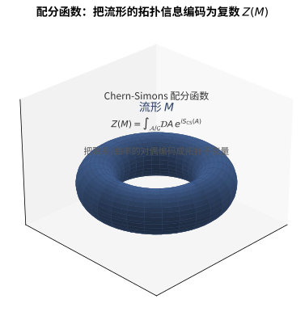

> **直观理解（现实类比）**：配分函数就像一个"万能扫描仪"，它把整个流形（可以想象成一个环面或球面）的所有局部几何信息汇总成一个数字 $Z(M)$。就像把一块蛋糕的所有配料和火候信息压缩成"好吃与否"的一个评分，Chern-Simons 配分函数把流形的拓扑复杂度压缩成一个复数，这个数不随你如何细分流形而变，只取决于它本身的拓扑。

#### 课堂问答

**老师**：Chern–Simons 作用量 $S_{\text{CS}}(A)=\frac{k}{4\pi}\int_M\text{Tr}(A\wedge dA+\frac{2}{3}A\wedge A\wedge A)$ 里没有度规，这为什么了不起？

**学生**：因为没有度规就意味着它天生是拓扑不变量：普通场论要靠度规定义体积元，换个度量就换一个理论，而 CS 作用量只用联络 $A$ 拼出 3-形式，在光滑变形下不变，级数 $k$ 是唯一的数参数。

**老师（追问）**：CS 作用量在"大规范变换"下严格不变吗？如果不是会怎样？

**学生**：不严格不变：在 $SU(2)$ 下大规范变换使作用量改变 $2\pi k$ 的整数倍，因此 $e^{iS_{\text{CS}}}$ 单值只要求 $k\in\mathbb{Z}$——这正是级数必须整数量子化的根源。常见误区是以为规范不变性无条件成立；其实小规范变换严格不变，大规范变换只差 $2\pi$ 的整数倍，这个"反常"恰好逼出了 $k\in\mathbb{Z}$。

**老师（拓展）**：那配分函数 $Z_{\text{CS}}(M)=\int_{\mathcal{A}/\mathcal{G}}\mathcal{D}A\,e^{iS_{\text{CS}}(A)}$ 在数学上严格吗？

**学生**：不严格——路径积分测度 $\mathcal{D}A$ 在数学上并不存在，这正是困难所在：CS 能给出可计算的拓扑不变量，却没法把那个"$\int$"直接当成严格对象。要严格化，就得借量子群与 Reshetikhin–Turaev 的组合构造替它"下定义"。

### 1.7 Witten的TQFT构造

> **🧠 来龙去脉（为什么会有这个概念？解决了什么问题？）**：威滕1988年的工作是"从物理推导数学"的样板：他用Chern-Simons路径积分不仅重新算出了琼斯多项式，还观察到整个三维场论满足阿蒂亚TQFT公理——$S^2$ 对应表示范畴、闭流形给配分函数、沿纽结的Wilson圈给出纽结不变量。他解决的核心问题，是把"一个具体三维场论"升格为"一类拓扑不变量机器"：过去需要逐个寻找的不变量，现在都来自同一台"路径积分引擎"。

**定义14（Witten的TQFT构造）** Witten证明了三维Chern-Simons理论定义了一个三维TQFT。对每个紧Lie群 $G$ 和整数级数 $k$，Chern-Simons理论给出一个TQFT：

$$ Z_{G,k}: \text{Cob}_3^{\text{or}} \to \text{Vect}_{\mathbb{C}} $$

满足：
- $Z_{G,k}(S^2) = \text{Rep}(G_k)$（级数 $k$ 的仿射Lie代数 $\hat{\mathfrak{g}}$ 的整表示）。
- $Z_{G,k}(M)$ 是 $M$ 的Chern-Simons配分函数。
- $Z_{G,k}(L)$ 是沿纽结 $L$ 的Wilson圈期望值，给出Jones多项式（当 $G = SU(2)$）。

> **🧠 直观理解（现实类比）**：Witten的TQFT构造证明了"三维Chern-Simons理论 = 一个货真价实的三维TQFT"。圆 $S^2$ 上给出表示范畴 $\text{Rep}(G_k)$（这是理论的"态空间"），闭流形给出配分函数，而沿纽结 $L$ 的Wilson圈期望值恰好吐出Jones多项式。就像同一个演员能出演多部戏：一套路径积分，既当不变量、又当态空间、还能当纽结指纹。

#### 课堂问答

**老师**：Witten 说 Chern–Simons 理论是一个三维 TQFT。它把各个维度的对象分别赋成了什么？

**学生**：二维球面赋成范畴 $Z_{G,k}(S^2)=\mathrm{Rep}(G_k)$，闭三维流形 $M$ 赋成配分函数 $Z_{G,k}(M)$，带 Wilson 圈的流形赋成沿纽结的期望值，当 $G=SU(2)$ 时正是 Jones 多项式。

**老师（追问）**：把 $Z(S^2)$ 说成一个范畴，这跟 Atiyah 公理里 $Z$ 落进 $\text{Vect}$ 矛盾吗？

**学生**：不矛盾，但要警惕维度错位：三维 TQFT 里二维边界对应的本应是一个向量空间，$\mathrm{Rep}(G_k)$ 是把这组空间连同其标架结构整体打包的描述，即 $Z(S^2)$ 实质上是它的中心/态空间，只有插入边界算符时才动用整个范畴。Witten 的功劳是把边界数据、配分函数、纽结不变量三种输出统一到同一台路径积分引擎。

**老师（拓展）**：既然路径积分不严格，Witten 构造的数学地位到底如何？

**学生**：它在启发式层面极其高产：预言了哪些量不变、满足什么 skein 关系；而严格实现则交给 Reshetikhin–Turaev 的代数构造。可以说物理负责发现、数学负责补全，两条路合起来才构成一个完整定理。

### 1.8 Reshetikhin-Turaev构造

> **🧠 来龙去脉（为什么会有这个概念？解决了什么问题？）**：威滕的路径积分漂亮却不严格——积分测度并不存在严格的数学定义。雷舍提欣与图拉耶夫敏锐地意识到：威滕的"模性/辫性"信息其实完全藏在量子群 $U_q(\mathfrak{g})$ 在根单位处的表示论里，根本不需要路径积分。他们在1991年前后提出：先用量子群表示构造"模块化张量范畴"，再借手术法把三维流形切开计数，从而给出**不依赖路径积分、纯粹组合/代数的**严格三维TQFT。它解决的正是"把威滕的物理论证改写为可审核的数学证明"这一关键问题。

**定义15（Reshetikhin-Turaev构造）** **Reshetikhin-Turaev构造** 是从量子群 $U_q(\mathfrak{g})$ 的表示论构造三维TQFT的方法。核心思想是：
1. 从量子群 $U_q(\mathfrak{g})$（其中 $q = e^{2\pi i/(k + h^\vee)}$，$h^\vee$ 是 $\mathfrak{g}$ 的对偶Coxeter数）的有限维表示构造一个**模块化张量范畴**（modular tensor category）。
2. 用这个范畴构造三维流形和纽结的不变量。
3. 通过**手术法**（surgery）将流形分解为简单片段的组合。

> **💡 直观理解（类比）**：Reshetikhin-Turaev构造像"用乐高近似搭出任意三维形状"。它先把量子群表示编织成一个"模块化张量范畴"（一套形状可辨别的积木），再用手术法把三维流形切成环链手术的简单片段，逐片赋值、再拼回不变量。这样，抽象的三维不变量有了一个"可上手搭建"的组合配方，不再依赖神秘路径积分。

#### 课堂问答

**老师**：Reshetikhin–Turaev 构造的核心思路，能否一句话概括？

**学生**：用表示范畴替掉路径积分。取 $q=e^{2\pi i/(k+h^\vee)}$，把 $U_q(\mathfrak{g})$ 的有限维表示整理成模块化张量范畴，再用手术法把任意三维流形切成 $S^3$ 沿链环的手术，逐片赋值再拼回，得到严格的三维 TQFT $Z_q^{\text{RT}}:\text{Cob}_3^{\text{or}}\to\text{Vect}_{\mathbb{C}}$。

**老师（追问）**：$q$ 为什么必须取根单位？取一般 $q$ 会怎样？

**学生**：只有 $q$ 为根单位时，表示范畴才半单且只有有限多个不可约对象，才能得到有限且 S-矩阵可逆的模块化张量范畴；一般 $q$ 下表示无穷多、范畴不半单，构造直接崩溃。常见误区是以为任意 $q$ 都行，实际上 $q=e^{2\pi i/(k+h^\vee)}$ 与级数 $k$ 的一一对应才是让理论"量子化且有限"的关键。

**老师（拓展）**：RT 不变量里的手术公式为什么长成 S-矩阵求和的样子？

**学生**：因为手术变换本质上由模群 $SL(2,\mathbb{Z})$ 作用描述，而 S-矩阵正是这个作用的表示矩阵，于是对 $S^3$ 沿链环 $L$ 手术得到的 $M$，有 $Z_q^{\text{RT}}(M)=\sum_\lambda\frac{\prod_i S_{0\lambda_i}}{\prod_j S_{00}}\mathcal{F}(L_\lambda)$，把拓扑手术完整翻译成线性代数求和。

### 1.9 量子群与TQFT

> **🧠 来龙去脉（为什么会有这个概念？解决了什么问题？）**：量子群由库利希、雷舍提欣与德林费尔德在1980年代中期独立发现（受量子可积系统的Yang-Baxter方程启发），是李代数 $U(\mathfrak{g})$ 的 $q$-形变。它解决的问题是"如何让表示论具有辫子结构"：通常交换的对称在量子群表示里被升级为带R-矩阵的辫，而正是这"辫结构"给了绳结以拓扑编码。量子群因此成为连接"表示论—辫—纽结"—再到三维TQFT的枢纽。

**定义16（量子群）** **量子群** $U_q(\mathfrak{g})$ 是通用包络代数 $U(\mathfrak{g})$ 的 $q$-形变，其中 $q$ 是形式参数。对 $U_q(\mathfrak{sl}_2)$，生成元 $E, F, K, K^{-1}$ 满足：

$$ KK^{-1} = K^{-1}K = 1, \quad KEK^{-1} = q^2 E, \quad KFK^{-1} = q^{-2} F, \quad [E, F] = \frac{K - K^{-1}}{q - q^{-1}} $$

> **💡 直观理解（类比）**：量子群就是"把原来硬邦邦的李代数揉了参数 $q$ 进去的软面团"。当 $q=1$ 时它还原成经典李代数，而 $q\neq1$ 时对易关系被"量子化地打断"（多出 $q$ 的幂），正是这细微差别让表示论产生了"辫子"般的结构。可理解成给棋盘上了"量子坐标"，原本平平的格子因 $q$ 而带上了对折/缠绕。

**定义17（R-矩阵）** **R-矩阵** $R \in U_q(\mathfrak{g}) \otimes U_q(\mathfrak{g})$ 满足Yang-Baxter方程：

$$ R_{12}R_{13}R_{23} = R_{23}R_{13}R_{12} $$

R-矩阵给出了量子群表示的张量积的辫结构。

> **💡 直观理解（类比）**：R-矩阵就是"量子世界里的交换积木"：它规定在张量积 $V\otimes W$ 中，把两个表示互换位置时该怎么"打个结"。Yang-Baxter方程则保证"三次连换"只有一种结果（换法无关），效应如同"绳子的三条线交叉后编号总是唯一"。正是这个"辫结构"，让量子群表示能编码绳结拓扑。

#### 课堂问答

**老师**：量子群 $U_q(\mathfrak{g})$ 不过是李代数的 $q$-形变，它凭什么能编码绳结？

**学生**：关键不在形变而在它带来的辫结构：$U_q(\mathfrak{sl}_2)$ 满足 $KEK^{-1}=q^2E,\ KFK^{-1}=q^{-2}F,\ [E,F]=\frac{K-K^{-1}}{q-q^{-1}}$，表示张量积上的交换由 R-矩阵给出，而 $R_{12}R_{13}R_{23}=R_{23}R_{13}R_{12}$ 即 Yang–Baxter 方程，辫子群表示由此而来——绳结正是辫的闭合。

**老师（追问）**：$q=1$ 时量子群退回经典李代数，那绳结不变量是不是也随之"平凡化"？

**学生**：恰恰相反：$q=1$ 时 R-矩阵退化为普通交换 $\tau$，辫结构消失，绳结信息随之丢失，所以量子性是必要条件。常见误区是以为经典李代数表示论已足够编码绳结，其实缺了 $q\neq1$ 就没有非平凡的 braiding。

**老师（拓展）**：Yang–Baxter 方程在物理与数学上还有别的面貌吗？

**学生**：它同时是量子可积系统的核心（保证多体散射分解为两体散射），又对应统计力学里可解格点模型的无矛盾条件。在 TQFT 视角下，它正是"一根线跨过另一根线怎么绕都不矛盾"的代数保证——同一方程撑着量子群、辫群与可积模型。

### 1.10 TQFT的范畴化

> **🧠 来龙去脉（为什么会有这个概念？解决了什么问题？）**：普通TQFT把"时空"只分配到"向量空间和线性映射"两层，可物理直觉暗示：量子引力里的态射之间还有更高阶的结构。拉里（Lurie）与博德曼倡导的"范畴化"把TQFT升级为高阶函子——给 $(d-1),(d-2),\ldots$ 维流形也都赋数据，并让"同伦等价"成为同等重要的结构。它解决的问题是"如何让TQFT兼容高维同伦论"，把分配延展到点与低维对象，为Bordism假设铺路。

**定义18（TQFT的范畴化）** **TQFT的范畴化** 将TQFT提升到更高范畴的层次。一个 **$d$ 维扩展TQFT** 是一个对称幺半函子：

$$ Z: \text{Cob}_d^{\text{ext}} \to \text{Alg}_2 $$

其中 $\text{Cob}_d^{\text{ext}}$ 是扩展Cobordism $(\infty, d)$-范畴，$\text{Alg}_2$ 是 $E_2$-代数的 $(\infty, 2)$-范畴。

> **💡 直观理解（类比）**：TQFT的范畴化就像"给乐高世界加了一个新维度"。普通TQFT只到"空间（对象）→时空（态射）"两层，而范畴化加入"态射的态射、态射的态射的态射……"（这就是 $(\infty,d)$ 范畴），让系统能同时处理"切块之间怎样同伦变换"。可喻为从一个平面棋盘升级成立体积木，能捕捉更多层面的关系。

#### 课堂问答

**老师**：所谓"TQFT 的范畴化"，究竟把哪一层抬高了？

**学生**：把定义域和取值都抬高一层：普通 TQFT 是对称幺半函子 $Z:\text{Cob}_d\to\text{Vect}$，范畴化后定义域变成 $(\infty,d)$-范畴、取值落到 $(\infty,d)$-范畴乃至 $E_2$-代数的范畴 $\text{Alg}_2$，即 $Z:\text{Cob}_d^{\text{ext}}\to\text{Alg}_2$，于是连态射之间、态射之间的态射都有数据。

**老师（追问）**：为什么非要把"同伦等价"也当成结构？普通 TQFT 不够用吗？

**学生**：因为在量子场论里"两个过程是否等价"本身携带信息，普通 TQFT 只记对象与态射，丢掉了态射之间的同伦；范畴化把这些高阶关系一并记录，才能与高维同伦论兼容。常见误区是把它当成"换套更花哨的语言"，其实它的目的是不丢信息。

**老师（拓展）**：范畴化之后，哪些经典构造会自然浮现？

**学生**：$E_2$-代数与圈空间的关系、以及完全扩展 TQFT 由单点取值决定（Bordism 假设）都会浮现。换言之，范畴化把"TQFT 到底是什么"从"一个函子"推进到"由单点生成的自由结构上的函子"。

### 1.11 扩展TQFT

> **🧠 来龙去脉（为什么会有这个概念？解决了什么问题？）**：普通TQFT只把"边界流形"分配到向量空间，却回答不了"边界内部的更低维对象该赋什么"。扩展TQFT（由弗里德与拉里等发展）允许把数据一直下沉到"点"这样的零维对象，从而捕获增量更多的拓扑信息。它解决的，是"TQFT如何完整记录流形的全部维数信息"以及"如何让分类问题变成造个别对象的分类"这类更深层的结构需求。

**定义19（扩展TQFT）** **扩展TQFT** 允许将TQFT分配给出更低维的流形（包括点）。一个 **完全扩展TQFT** 是一个对称幺伴函子：

$$ Z: \text{Bord}_d^{\text{fr}} \to \mathcal{C} $$

其中 $\text{Bord}_d^{\text{fr}}$ 是 $d$ 维框架化（framed）Cobordism的 $(\infty, d)$-范畴，$\mathcal{C}$ 是某个 $(\infty, d)$-范畴。

> **💡 直观理解（类比）**：扩展TQFT是"把赋值一直下沉到零维的点"。普通TQFT只给曲面赋向量空间，扩展TQFT连"点"都给了数据（一个特定代数对象），并一路给到各种低维流形。就像把一幅完整建筑图拆解到"每一块地基砖"都标注清楚——数据越下沉，抓得越牢。

#### 课堂问答

**老师**：扩展 TQFT 比普通 TQFT 多赋了哪些维度的数据？

**学生**：一直下沉到点和更低的配边：普通 TQFT 只给 $(d-1)$ 维边界赋向量空间，扩展 TQFT 对 $0,1,\dots,d-1$ 维对象都赋值，完全扩展 TQFT 是 $Z:\text{Bord}_d^{\text{fr}}\to\mathcal{C}$，到零维时 $Z(\text{pt})$ 是一个具体代数对象。

**老师（追问）**：为什么偏偏用"框架化"而不是普通定向？

**学生**：因为要把切点处的局部结构钉死，框架化消除转动带来的歧义，使单点取值成为一个充分可对偶的对象，反方向才能重建整个 TQFT；定向情形在 $d\ge3$ 时结构更复杂，无法这样干净地由单点决定。

**老师（拓展）**：扩展到底，是不是就等价于"只记一个点"？

**学生**：在满足充分可对偶条件后是的，这正是 Lurie Bordism 假设的内容 $\text{Fun}^\otimes(\text{Bord}_d^{\text{fr}},\mathcal{C})\cong\Omega^{\text{fr}}\mathcal{C}$。所以"扩展到零维"并不是多给一把数据，而是把整个理论压缩成单点上的可对偶对象——这就是扩展 TQFT 最深的反差。

### 1.12 Lurie的Bordism假设

> **🧠 来龙去脉（为什么会有这个概念？解决了什么问题？）**：2009年，拉里在关于高阶代数与拓扑场论的宏大名作里提出一个惊人主张：一个完全扩展、框架化的TQFT**完全由它在单点上的取值决定**，前提是这个值必须是"充分可对偶"的对象。它把"分类所有TQFT"这个无法驾驭的任务，奇迹般地归结为"分类个别对象"。其证明思路把Cobordism高阶范畴视为"由点生成的自由 $(\infty,d)$-范畴"，为高维拓扑场论提供了统一而简洁的纲领，也奠定了"可对偶对象"在范畴论中的中心地位。

**定义20（Bordism假设）** Lurie的 **Bordism假设** 断言：完全扩展的 $d$ 维框架化TQFT由其在点上的值完全决定。具体地，定义了一个等价：

$$ \text{Fun}^{\otimes}(\text{Bord}_d^{\text{fr}}, \mathcal{C}) \cong \Omega^{\text{fr}}\mathcal{C} $$

其中 $\Omega^{\text{fr}}\mathcal{C}$ 是 $\mathcal{C}$ 的 $d$ 次框架化循环空间（即 $d$ 维框架化流形在 $\mathcal{C}$ 中的"可定向"对象）。

> **🧠 直观理解（现实类比）**：Bordism假设是"点石成金"式的断言：一个完全扩展TQFT只要知道其对"单点"赋什么值，就完全确定了！这好比"只要知道一颗种子的全部信息，就能预测一整棵树的生长"。前提是点的值必须是"充分可对偶"的对象（具备y归一配对结构）。它把分类TQFT的巨大任务，奇迹般归结为分类个别对象的问题。

#### 课堂问答

**老师**：Bordism 假设说完全扩展 TQFT 由单点取值决定，凭什么是单点？

**学生**：因为 $\text{Bord}_d^{\text{fr}}$ 作为 $(\infty,d)$-范畴是由点自由生成的：任何高维配边都能由点通过取对偶、张量积、余极限拼出，函子只需给出生成元上的值，再靠对称幺半性唯一延拓，即 $\text{Fun}^\otimes(\text{Bord}_d^{\text{fr}},\mathcal{C})\cong\Omega^{\text{fr}}\mathcal{C}$。

**老师（追问）**："可对偶"这个条件的必要性体现在哪？随便给个对象行吗？

**学生**：不行。点上的值 $x=Z(\text{pt})$ 必须 $d$ 次对偶化，才能提供区间的求值/余求值 $\text{ev}:x\otimes x^*\to\mathbf{1}$、$\text{coev}:\mathbf{1}\to x^*\otimes x$，再迭代出所有维度的赋值；若 $x$ 不可对偶，反方向的 $Z_x$ 根本无从起步。常见误区是以为随便赋一个对象就有 TQFT，漏掉对偶性会直接证错。

**老师（拓展）**：这个假设对"分类 TQFT"意味着什么？

**学生**：它把"分类所有 TQFT"等价地归结为分类单个可对偶对象，是结构上的巨大简化，也让对偶性从技巧升格为组织纲领。定向情形则要改成"$E_d$-代数上的模"，说明结论虽深刻，却依赖配边范畴的具体结构。

### 1.13 弦图与图示微积分

> **🧠 来龙去脉（为什么会有这个概念？解决了什么问题？）**：在Kock的经典教材《Frobenius Algebras and 2D Topological Quantum Field Theories》里，最核心的方法不是公式，而是**弦图**：把Frobenius代数的乘法画成"裤子"、余乘法画成"反向裤子"、迹画成"帽子"，于是抽象的代数关系（结合律、Frobenius关系）被翻译成一目了然的图形等价（"把两个孔合并""扭一下绳子"）。这种"图示微积分"解决了"如何让人一眼看出Frobenius关系对应哪种拓扑操作"的教学与直觉难题，也是把2维TQFT做到可视化、可计算的一把金钥匙。

**定义21（弦图）** **弦图**（String Diagram）是用图画代替代数公式：一条水平"弦"对应对象（如 $A$），弦的分支对应态射（如乘法 $m:A\otimes A\to A$ 画成一个节点、迹 $\varepsilon$ 画成一条烛形端点），读图自下而上即复合。两条弦的"缠结/分支"即张量积中的辫或Frobenius余乘法。

> **💡 直观理解（类比）**：弦图就像"代数公式的连环画"：乘法是一个"三叉路口"、余乘法是它的镜像、迹是"收口的烛芯"。原本要写一大串 $\otimes$ 与 $\circ$ 的结合律，一画成 "怎么绕都不变" 的图就豁然开朗。它是范畴学家与拓扑学家的"公共母语"——谁能把关系画成图，谁就真正"看懂了"它。

---

#### 课堂问答

**老师**：弦图不写公式，凭什么能严格代替代数计算？

**学生**：因为它有严格的语义：一条水平弦对应对象 $A$，弦上节点对应态射（乘法 $m:A\otimes A\to A$ 画成三叉节点，迹 $\varepsilon$ 画成烛形端点），读图自下而上即复合，于是结合律、Frobenius 关系变成"图怎么变形都不变"的图示恒等式。

**老师（追问）**：把"结合律"和"Frobenius 关系"分别画出来，是什么样子？

**学生**：结合律是"两个三叉节点的两种插法给出同一张图"，即 $(m\otimes\text{id})\circ(\text{id}\otimes m)=(\text{id}\otimes m)\circ(m\otimes\text{id})$；Frobenius 关系是"裤子接反向裤子在两种读法下一致"，即 $(\text{id}\otimes m)\circ(\Delta\otimes\text{id})=\Delta\circ m=(m\otimes\text{id})\circ(\text{id}\otimes\Delta)$。常见误区是以为图示只是示意，其实每一步图变形都对应平面图的高阶同伦，可被严格证明。

**老师（拓展）**：图示微积分的威力只限于二维吗？

**学生**：不。它对任意维都适用，正是把 TQFT 从"二维 Frobenius 代数"推广到辫范畴、模块化张量范畴的通用语言：辫由 R-矩阵交叉节点画成，量子维数由闭合圈画成。可以说，谁能把关系画成图并自由变形，谁就掌握了 TQFT 的公共母语。

## 二、定理与证明

### 定理1：2维TQFT的分类（Frobenius代数等价）

**定理（2维TQFT的分类）** 存在范畴等价：

$$ \text{2-dim TQFTs} \cong \text{commutative Frobenius algebras} $$

即，二维定向TQFT与交换Frobenius代数之间存在一一对应。

> **🧠 直观理解（现实类比）**：2维TQFT分类定理说：所有可能的二维"拓扑积木规则"恰与交换Frobenius代数是同一回事。圆 $S^1$ 对应代数 $A=Z(S^1)$，而"裤子"给出乘法、"帽子"给出迹、"圆盘"给出单位。于是原来抽象的一整套TQFT，被压缩成"一个带迹的代数"来分类——就像把所有乐高搭法归纳成"一套说明书上写的配件清单"，美丽且彻底。这是一个经典的"分类结果"。

**证明**：

**第一步：从2维TQFT到Frobenius代数。**

设 $Z: \text{Cob}_2^{\text{or}} \to \text{Vect}_{\mathbb{C}}$ 是一个2维TQFT。定义：

$$ A = Z(S^1) $$

其中 $S^1$ 是圆（1维闭流形）。我们需要赋予 $A$ 一个交换Frobenius代数的结构。

**乘法**：考虑 **"裤子"（pair of pants）** 曲面 $P$，它是三个圆边界的2维带边流形：

$$ \partial P = S^1 \sqcup S^1 \sqcup \overline{S^1} $$

（两个输入和一个输出）。$P$ 给出了一个态射 $P: S^1 \sqcup S^1 \to S^1$。应用TQFT：

$$ m = Z(P): A \otimes A \to A $$

定义乘法为 $a \cdot b = m(a \otimes b)$。

**单位**：考虑 **圆盘** $D$，边界 $\partial D = S^1$。$D$ 给出了一个态射 $D: \emptyset \to S^1$。应用TQFT：

$$ u = Z(D): \mathbb{C} \to A $$

定义 $1_A = u(1)$ 为单位元。

**交换性**：考虑交换两个输入边的曲面（它同胚于 $P$，但输入顺序交换）。由于 $P$ 在拓扑上对称，$m$ 是交换的。

**结合性**：考虑"三孔裤子"曲面，它给出了结合性条件 $m \circ (m \otimes \text{id}) = m \circ (\text{id} \otimes m)$。

**迹**：考虑 **圆盘** 作为从 $S^1$ 到 $\emptyset$ 的态射（即"帽子"）：

$$ \varepsilon = Z(D): A \to \mathbb{C} $$

**非退化性**：考虑 $S^1 \times [0,1]$（柱面），它给出了恒等映射。柱面可以分解为两个"帽子"的复合，这等价于双线性形式 $\langle a, b \rangle = \varepsilon(ab)$ 的非退化性。

**第二步：从Frobenius代数到2维TQFT。**

给定一个交换Frobenius代数 $(A, m, u, \varepsilon)$，我们需要构造TQFT $Z$。

**对象**：$Z(S^1) = A$。对 $n$ 个不相交的圆，$Z(\bigsqcup^n S^1) = A^{\otimes n}$。

**态射**：由于任何2维定向带边流形都可以通过**手术**分解为基本片段的组合（圆盘、裤子、帽子的粘合），只需定义这些基本片段的赋值：

1. **圆盘**（创建）：$\mathbb{C} \to A$，$1 \mapsto 1_A$。
2. **圆盘**（湮灭）：$A \to \mathbb{C}$，$a \mapsto \varepsilon(a)$。
3. **裤子**（乘法）：$A \otimes A \to A$，$a \otimes b \mapsto a \cdot b$。
4. **反向裤子**（余乘法）：$A \to A \otimes A$，由Frobenius代数结构的余乘法给出。

**第三部：验证等价。**

需要验证：
1. 从TQFT构造的Frobenius代数，再构造回TQFT，得到原来的TQFT。
2. 从Frobenius代数构造的TQFT，再取 $Z(S^1)$，得到原来的Frobenius代数。

**关键引理**：任何2维定向带边流形都可以唯一地（在同伦意义下）分解为基本片段的组合，而Frobenius代数的关系（结合性、交换性、Frobenius关系）恰好对应于这些基本片段组合间的拓扑等价关系。

**Frobenius关系**：裤子与反向裤子的组合给出：

$$ (\text{id} \otimes m) \circ (\Delta \otimes \text{id}) = \Delta \circ m = (m \otimes \text{id}) \circ (\text{id} \otimes \Delta) $$

这对应于拓扑上"将两个孔合并"的等价关系。

**结论**：二维TQFT与交换Frobenius代数之间存在一一对应，这是TQFT理论中最基本的分类结果。$\square$

---

#### 课堂问答

**老师**：二维 TQFT 与交换 Frobenius 代数等价，构造方向的对照表请说清楚。

**学生**：$A=Z(S^1)$；圆盘给出单位 $u=Z(D):\mathbb{C}\to A$ 与迹 $\varepsilon=Z(D):A\to\mathbb{C}$；裤子 $P$ 给出乘法 $m=Z(P):A\otimes A\to A$；反向裤子给出余乘法 $\Delta$；柱面给出恒等，并等价于双线性型 $\langle a,b\rangle=\varepsilon(ab)$ 的非退化性。

**老师（追问）**：反方向构造时，凭什么只定义圆盘、裤子、帽子这几个基本片段就够了？

**学生**：因为任何二维定向带边流形都能（在同伦意义下唯一地）分解为这些基本片段的粘合，而分解的"重写关系"恰好逐条对应 Frobenius 代数公理：结合律对应三孔裤子的两种切法、交换律对应拧转、Frobenius 关系对应裤子与反向裤子的复合。所以公理不是外加约束，而是拓扑分解的镜像。

**老师（拓展）**：为什么交换性是被"逼出来"的，而非可选项？

**学生**：因为裤子在拓扑上关于两条入边对称，$m$ 必须尊重这一对称；等价地，$Z$ 保对称幺半结构迫使 $A$ 交换。若去掉对称性，得到的就不是普通的二维分类，而是带框架或非对称的配边理论。这条定理因此是"拓扑如何长成代数"最干净的样板。

### 定理2：三维Chern-Simons理论与Jones多项式

**定理（Chern-Simons理论中的Jones多项式）** 设 $M$ 是三维定向流形，$L \subset M$ 是一个纽结（或链环）。$SU(2)$ Chern-Simons理论在级数 $k$ 下的Wilson圈期望值给出了Jones多项式 $V_L(t)$ 在 $t = e^{2\pi i/(k+2)}$ 处的值：

$$ \langle W_R(L) \rangle_{\text{CS}} = Z_{SU(2), k}(M, L) = V_L(e^{2\pi i/(k+2)}) $$

其中 $W_R(L)$ 是沿 $L$ 的Wilson圈，$R$ 是 $SU(2)$ 的二维基本表示。

> **🧠 直观理解（现实类比）**：这条定理把两件"看似无关"的事缝在了一起：一边是理论物理学家的路径积分（把时空上所有可能的规范场都"平均"一遍），另一边是纽结理论家的Jones多项式（绳结的代数指纹）。Witten证明：沿纽结 $L$ 的Wilson圈期望值，恰好在参数 $t=e^{2\pi i/(k+2)}$ 处吐出Jones多项式。好比用一把物理的"公平秤"竟然称出了纯粹的组合学"体重"。

**证明思路**（使用Witten的路径积分方法和量子群表示）：

**第一步：Chern-Simons理论的路径积分表述。**

三维Chern-Simons理论的配分函数定义为：

$$ Z(M) = \int \mathcal{D}A \, e^{iS_{\text{CS}}(A)} $$

其中 $S_{\text{CS}}(A) = \frac{k}{4\pi} \int_M \text{Tr}\left(A \wedge dA + \frac{2}{3} A \wedge A \wedge A\right)$。

沿纽结 $L$ 的Wilson圈定义为：

$$ W_R(L) = \text{Tr}_R \, P \exp\left(\oint_L A\right) $$

其中 $P \exp$ 是沿 $L$ 的规范协变传输（路径有序指数）。

**第二步：skein关系的推导。**

Witten证明了Wilson圈的期望值满足skein关系。通过考虑在纽结交叉点处的局部变形，并应用Chern-Simons路径积分的相关函数恒等式，得到：

$$ e^{2\pi i/(k+2)} \langle W_R(L_+) \rangle - e^{-2\pi i/(k+2)} \langle W_R(L_-) \rangle = (e^{\pi i/(k+2)} - e^{-\pi i/(k+2)}) \langle W_R(L_0) \rangle $$

其中 $L_+, L_-, L_0$ 是交叉点处的三种修改。

设 $t = e^{2\pi i/(k+2)}$，则：

$$ t^{-1} \langle W_R(L_+) \rangle - t \langle W_R(L_-) \rangle = (t^{-1/2} - t^{1/2}) \langle W_R(L_0) \rangle $$

这正是Jones多项式的skein关系。

**第三部：规范化。**

对于平凡纽结（unknot），Wilson圈的期望值可直接计算：

$$ \langle W_R(\text{unknot}) \rangle = \dim(R) = 2 $$

对于 $SU(2)$ 的基本表示，Jones多项式规范化为 $V_{\text{unknot}} = 1$，因此需要适当调整。

**第四步：量子群表示与skein关系。**

从量子群 $U_q(\mathfrak{sl}_2)$ 的角度，在 $q = e^{2\pi i/(k+2)}$ 处，$U_q(\mathfrak{sl}_2)$ 的表示论给出了R-矩阵，它满足Yang-Baxter方程。R-矩阵在张量积 $V \otimes V$（$V$ 是基本表示）上的作用给出了辫算子，其本征值恰好对应于skein关系中的系数。

**第五步：拓扑不变性。**

Chern-Simons路径积分是规范不变的（在适当的量子化条件下），因此Wilson圈期望值只依赖于纽结的拓扑类型，而不依赖于其具体的嵌入方式。这证明了Jones多项式是拓扑不变量。

**结论**：Witten的Chern-Simons理论为Jones多项式提供了深刻的几何解释——它是量子 $SU(2)$ Chern-Simons理论中Wilson圈的期望值，也是通过量子群 $U_q(\mathfrak{sl}_2)$ 在根单位处的表示论构造的纽结不变量。$\square$

---

#### 课堂问答

**老师**：定理说 Wilson 圈期望值等于 Jones 多项式在 $t=e^{2\pi i/(k+2)}$ 处的值，请给出内在理由。

**学生**：理由是两端满足同一组 skein 关系且规范化一致：Wilson 圈期望值满足 $t^{-1}\langle W_R(L_+)\rangle-t\langle W_R(L_-)\rangle=(t^{-1/2}-t^{1/2})\langle W_R(L_0)\rangle$，平凡纽结给 $\langle W_R(\text{unknot})\rangle=\dim R=2$，与 $V_{\text{unknot}}=1$ 相差一个规范因子，调整后即得 $\langle W_R(L)\rangle_{\text{CS}}=V_L(e^{2\pi i/(k+2)})$。

**老师（追问）**：为什么参数恰好是 $t=e^{2\pi i/(k+2)}$ 而不是 $q=e^{2\pi i/k}$？那个 $+2$ 从哪来？

**学生**：$+2$ 来自 $SU(2)$ 的对偶 Coxeter 数 $h^\vee=2$，一般地 $q=e^{2\pi i/(k+h^\vee)}$，它是量子群 $U_q(\mathfrak{sl}_2)$ 的"次数偏移"，使 skein 系数精确对齐。常见误区是把它当成凑数；其实 $h^\vee$ 是根系的固有不变量，换成 $SU(N)$ 就是 $+N$。

**老师（拓展）**：这条定理里，物理正确性与数学严格性各占多少？

**学生**：物理侧由 Witten 给出路径积分的启发式推导与 skein 关系，数学侧要严格则须换成量子群在根单位处的表示论，证明 R-矩阵本征值对齐 skein 系数，再验证规范不变性使结果只依赖纽结的拓扑类型。所以它是"物理发现、数学补全"的典范，也解释了为何 CS 路径积分至今没有严格测度。

### 定理3：Reshetikhin-Turaev构造

**定理（Reshetikhin-Turaev构造）** 从量子群 $U_q(\mathfrak{g})$ 在 $q$ 为根单位处的表示论出发，可以构造一个三维TQFT，它给出三维流形和纽结的拓扑不变量。具体地，对每个单Lie代数 $\mathfrak{g}$ 和整数 $k$（级数），存在一个三维TQFT：

$$ Z_{q}^{\text{RT}}: \text{Cob}_3^{\text{or}} \to \text{Vect}_{\mathbb{C}} $$

其中 $q = e^{2\pi i/(k + h^\vee)}$，$h^\vee$ 是 $\mathfrak{g}$ 的对偶Coxeter数。

> **🧠 直观理解（现实类比）**：Reshetikhin-Turaev构造把"存在三维TQFT"变成了一条可执行的"配方"：先把量子群在 $q$ 为根单位（一种特殊的离散值）处的表示整理成"模块化张量范畴"，再用手术法把流形切块、逐块求值、拼回不变量，最终给出满足Atiyah公理的三维TQFT。如同用现成的积木模块（范畴）+标准拼接步骤（手术+辫法则），就能搭出任意三维拓扑不变量，六楼房不需额外图纸。

**证明**（使用量子群R-矩阵和模块化张量范畴）：

**第一步：构造模块化张量范畴。**

设 $q = e^{2\pi i/(k + h^\vee)}$。考虑 $U_q(\mathfrak{g})$ 的有限维表示构成的范畴 $\mathcal{C} = \text{Rep}_f(U_q(\mathfrak{g}))$。在 $q$ 为根单位时，该范畴是**半单**的，且具有有限多个不可约对象（对应于整权重模）。

范畴 $\mathcal{C}$ 具有以下结构：
1. **张量积**：$\otimes$（由量子群的余乘法诱导）。
2. **结合约束**：由量子群的余结合性给出。
3. **辫结构**：由R-矩阵 $R \in U_q(\mathfrak{g}) \otimes U_q(\mathfrak{g})$ 给出。对任意表示 $V, W$，辫算子：
   $$ c_{V,W}: V \otimes W \to W \otimes V, \quad c_{V,W} = \tau_{V,W} \circ R $$
   其中 $\tau_{V,W}$ 是交换因子。
4. **对偶**：由量子群的反极结构给出。
5. **扭转**：由量子群 $K_{2\rho}$ 元素给出（$K_{2\rho}$ 是 $U_q(\mathfrak{g})$ 的特定中心元素）。

验证 $\mathcal{C}$ 满足**模块化张量范畴**的公理：
- 辫结构满足Yang-Baxter方程。
- 存在**扭结**（twist）$\theta$，满足 $\theta_{V \otimes W} = c_{W,V} \circ c_{V,W} \circ (\theta_V \otimes \theta_W)$。
- **S-矩阵** $S = (\tilde{s}_{ij})$，其中 $\tilde{s}_{ij} = \text{Tr}(c_{V_i, V_j} \circ c_{V_j, V_i})$，是可逆的（模块化条件）。

**第二步：从模块化张量范畴到三维流形不变量。**

利用模块化张量范畴 $\mathcal{C}$，定义三维流形 $M$ 的不变量：

1. 将 $M$ 通过**手术法**（surgery）表示为 $S^3$ 沿某个链环 $L$ 的手术（Dehn surgery）。
2. 对链环 $L$ 的每个分支，分配一个不可约表示 $V_i \in \mathcal{C}$。
3. 计算链环的**量子不变量**：
   $$ \mathcal{F}(L) = \sum_{\{V_i\}} \prod_{\text{交叉点}} \text{R-矩阵元} \times \prod_{\text{最大值/最小值}} \text{量子迹} $$
4. 利用S-矩阵进行手术变换，得到流形不变量。

**关键公式**：对 $S^3$ 沿链环 $L$ 进行手术得到的流形 $M$，其不变量为：

$$ Z_{q}^{\text{RT}}(M) = \sum_{\lambda} \frac{\prod_i S_{0\lambda_i}}{\prod_j S_{00}} \mathcal{F}(L_\lambda) $$

其中 $\lambda$ 标记各分支的表示，$S_{ij}$ 是S-矩阵元。

**第三部：验证TQFT公理。**

需要验证所构造的不变量满足Atiyah的TQFT公理：

1. **配对性**：$Z(\overline{M}) = Z(M)^*$ 由量子群表示的对偶性保证。
2. **乘法性**：$Z(M_1 \sqcup M_2) = Z(M_1) \otimes Z(M_2)$ 由张量积保持。
3. **结合性**：由手术法的结合性保证。
4. **规范化**：$Z(S^3) = 1$（通过定义）。
5. **恒等**：$Z(M \times [0,1]) = \text{id}_{Z(M)}$。

**第四步：边界理论。**

对于带边流形，Reshetikhin-Turaev构造将边界组分分配给 $\mathcal{C}$ 中的对象。对边界 $S^1$，分配向量空间：

$$ Z(S^1) = \bigoplus_{\lambda} \mathbb{C} \cdot e_\lambda $$

其中 $\lambda$ 遍历不可约表示，$e_\lambda$ 是基向量。这对应于 $\mathcal{C}$ 的**中心**（即 $\mathcal{C}$ 的Hochschild同调）。

**结论**：Reshetikhin-Turaev构造从量子群在根单位处的表示论出发，构造了模块化张量范畴，进而构造了三维TQFT。这是量子群在低维拓扑中最深刻的应用之一。$\square$

---

#### 课堂问答

**老师**：RT 构造能给出真正的三维 TQFT，它的关键中间产物是什么？

**学生**：是模块化张量范畴 $\mathcal{C}=\mathrm{Rep}_f(U_q(\mathfrak{g}))$（$q=e^{2\pi i/(k+h^\vee)}$），带有张量积、结合约束、由 R-矩阵给出的辫、对偶、扭结 $\theta_V$，以及可逆的 S-矩阵 $s_{ij}=\text{Tr}(c_{V_i,V_j}\circ c_{V_j,V_i})$；有了它才能给手术链环赋值。

**老师（追问）**：RT 不变量凭什么满足 Atiyah 公理里的结合性，也就是拼接守恒？

**学生**：因为赋值建在最底层的手术/辫图上：把流形沿边界切开得到一张张手术图示，复合对应沿公共边界拼接图示，而辫与 R-矩阵的结合性（Yang–Baxter）保证拼接顺序无关，于是 $Z(W_2\circ W_1)=Z(W_2)\circ Z(W_1)$ 在图示层面自明。常见误区是以为结合性需要单独验证，它其实是手术法构造的天然副产品。

**老师（拓展）**：带边流形上 $Z(S^1)$ 应该是什么？

**学生**：$Z(S^1)=\bigoplus_\lambda\mathbb{C}\cdot e_\lambda$，$\lambda$ 遍历不可约表示，它对应范畴 $\mathcal{C}$ 的中心（与 Hochschild 同调相通），这正是模块化张量范畴的中心对象在边界上的体现，也给出 RT 三维 TQFT 的边界理论。

### 定理4：扩展TQFT与∞-范畴（Lurie的Bordism假设）

**定理（Lurie的Bordism假设）** 设 $\mathcal{C}$ 是一个 $(\infty, d)$-范畴。则存在一个等价：

$$ \text{Fun}^{\otimes}(\text{Bord}_d^{\text{fr}}, \mathcal{C}) \cong \Omega^{\text{fr}}\mathcal{C} $$

其中 $\text{Bord}_d^{\text{fr}}$ 是 $d$ 维框架化Cobordism的 $(\infty, d)$-范畴，$\Omega^{\text{fr}}\mathcal{C}$ 是 $\mathcal{C}$ 的 $d$ 次框架化圈空间。特别地，完全扩展框架化TQFT由其在点上的值完全决定。

> **🧠 直观理解（现实类比）**：定理4把Bordism假设提升为"严格成立的数学定理"：完全扩展的框架化TQFT等价于反方向"只指个点"的信息（$d$ 次框架化圈空间），只要那个点是对偶性充分的好对象。这就好比"给一棵树看一颗种子"——种子的状态就足以决定整棵树。它把高维TQFT的分类彻底浓缩成一个单点选择，是范畴化的极致回报。

**证明思路**（使用Lurie的Bordism假设和高级范畴论）：

**第一步：$(\infty, d)$-范畴的设置。**

$(\infty, d)$-范畴是一个高阶范畴，其中：
- $k$-态射（$k < d$）在任意同伦意义下是可逆的（即它们是弱等价的）。
- $d$-态射是严格的方向性态射（不要求可逆性）。

**Cobordism $(\infty, d)$-范畴** $\text{Bord}_d^{\text{fr}}$ 的对象是0维框架化流形（带框架的点），1-态射是1维框架化Cobordism，2-态射是2维框架化Cobordism之间的Cobordism，依此类推，最高到 $d$ 维。

**第二步：Bordism假设的核心思想。**

Bordism假设断言，一个完全扩展TQFT $Z: \text{Bord}_d^{\text{fr}} \to \mathcal{C}$ 完全由它在点上的值 $Z(\text{pt}) \in \mathcal{C}$ 决定，且 $Z(\text{pt})$ 必须满足一个称为 **"框架化可定向性"**（framed fully dualizable）的条件。

具体地，$\Omega^{\text{fr}}\mathcal{C}$ 是 $\mathcal{C}$ 中满足以下条件的对象的空间：
- 对象 $x \in \mathcal{C}$ 是 **$d$ 次对偶化**（fully dualizable）的。
- $x$ 配备了一个 $d$ 维框架化流形的结构（即"框架化圈空间"的几何实现）。

**第三部：关键构造——从可对偶对象到TQFT。**

给定一个 $d$ 次对偶化对象 $x \in \mathcal{C}$，构造TQFT $Z_x$ 如下：

1. **0维**：$Z_x(\text{pt}) = x$。
2. **1维**：对1维框架化流形（即带框架的区间），$Z_x$ 由其值由 $x$ 的对偶性数据决定：
   - 区间 $[0,1]$ 给出对偶配对 $\text{ev}: x \otimes x^* \to \mathbf{1}$ 和 $\text{coev}: \mathbf{1} \to x^* \otimes x$。
3. **高维**：通过迭代应用对偶性，可以定义所有 $k$ 维框架化Cobordism上的值。

**第四步：验证等价。**

Lurie的证明分为两个方向：

**正方向**：$\text{Fun}^{\otimes}(\text{Bord}_d^{\text{fr}}, \mathcal{C}) \to \Omega^{\text{fr}}\mathcal{C}$，将TQFT $Z$ 映射到 $Z(\text{pt})$。

**反方向**：$\Omega^{\text{fr}}\mathcal{C} \to \text{Fun}^{\otimes}(\text{Bord}_d^{\text{fr}}, \mathcal{C})$，将对象 $x$ 映射到 $Z_x$。

**关键引理**：Cobordism $(\infty, d)$-范畴 $\text{Bord}_d^{\text{fr}}$ 是由点生成的，即它是 $d$ 维框架化流形的"自由" $(\infty, d)$-范畴，由一个对象（点）生成。

**第五步：对定向和非框架化TQFT的推广。**

对于定向（而非框架化）TQFT，Bordism假设需要修改。定向TQFT等价于在某个 $E_d$-代数上的模，这由定向Cobordism范畴 $\text{Bord}_d^{\text{or}}$ 的结构决定。

**结论**：Bordism假设是TQFT理论中最深刻的结果之一，它将完全扩展TQFT的分类归结为高阶范畴中可对偶对象的分类，为TQFT的构造提供了统一的框架。$\square$

---

#### 课堂问答

**老师**：定理断言 $\text{Fun}^\otimes(\text{Bord}_d^{\text{fr}},\mathcal{C})\cong\Omega^{\text{fr}}\mathcal{C}$，请说清 $\Omega^{\text{fr}}\mathcal{C}$ 到底装了什么。

**学生**：$\Omega^{\text{fr}}\mathcal{C}$ 是 $\mathcal{C}$ 的 $d$ 次框架化圈空间，其对象是 $\mathcal{C}$ 中 $d$ 次对偶化并可承载框架化结构的对象 $x$，几何上它把点连同其上的对偶数据、框架数据一起打包，所以右侧就是"单点上的合法取值空间"。

**老师（追问）**：为什么 $k<d$ 的态射要求可逆，只有 $d$-态射不可逆？

**学生**：这是 $(\infty,d)$-范畴的定义特征：维度小于 $d$ 的态射在任意同伦意义下可逆，只有最高维 $d$-态射是真正有方向的配边。几何上低维粘结总能被同伦抹平，只有 $d$ 维配边携带不可逆的推进信息。常见误区是把 $(\infty,d)$ 与 $(\infty,\infty)$ 混为一谈——$d$ 正是那个"方向性截止维数"。

**老师（拓展）**：正反两个方向各需要证明什么？

**学生**：正方向容易：$Z\mapsto Z(\text{pt})$；反方向要给每个 $x$ 构造 $Z_x$，零维取 $x$，一维用求值/余求值 $\text{ev}:x\otimes x^*\to\mathbf{1}$、$\text{coev}:\mathbf{1}\to x^*\otimes x$，高维靠迭代对偶。核心引理是 $\text{Bord}_d^{\text{fr}}$ 由点自由生成，从而单点取值即可延拓到整个范畴。

### 定理5：TQFT与Donaldson不变量

**定理（TQFT与Donaldson不变量）** Donaldson不变量可以通过4维TQFT来理解。具体地，$SU(2)$ Yang-Mills理论的瞬子模空间给出了光滑4维流形的Donaldson不变量，且这些不变量满足TQFT类型的拼接公理：

$$ \Phi_{M_1 \cup_Y M_2} = \Phi_{M_1} \circ_Y \Phi_{M_2} $$

其中 $M_1, M_2$ 是沿公共边界 $Y$ 粘合的4维流形，$\circ_Y$ 表示沿 $Y$ 的"配对"操作。

> **💡 直观理解（类比）**：定理5表明Donaldson不变量本质上就是一个4维TQFT"家用版"：沿公共边界 $Y$ 粘合两块"粘合板"，拼出来的整体不变量等于各自不变量在 $Y$ 上的"配对"（$\Phi_{M_1}\circ_Y\Phi_{M_2}$）。这正符合TQFT"切分—粘贴=拼接律"的品味，说明光滑4维的信息也能用一种"时空积木"的语言来组织。边界理论则由Floer同调扛起。

**证明思路**（使用瞬子模空间和Floer同调）：

**第一步：瞬子模空间的构造。**

设 $M$ 是定向闭光滑4维流形，$P \to M$ 是 $SU(2)$-主丛。$P$ 上的 **瞬子**（instanton）是满足自对偶条件的联络：

$$ F_A = *F_A $$

其中 $F_A$ 是 $A$ 的曲率，$*$ 是Hodge星算子。

**模空间** $\mathcal{M}_k$ 是瞬子联络在规范变换下的等价类空间，其中 $k = c_2(P)$ 是第二陈类（瞬子数）。在适当的泛函空间条件下，$\mathcal{M}_k$ 是有限维流形，其维数为：

$$ \dim \mathcal{M}_k = 8k - 3(1 - b_1(M) + b_2^+(M)) $$

其中 $b_1$ 是第一Betti数，$b_2^+$ 是第二上同调中正定部分的维数。

**第二步：Donaldson不变量的定义。**

当 $\mathcal{M}_k$ 是光滑流形且维数为偶数时，Donaldson不变量定义为：

$$ \Phi_M(a_1, \ldots, a_n) = \int_{\overline{\mathcal{M}}_k} \mu(a_1) \cup \cdots \cup \mu(a_n) $$

其中：
- $\overline{\mathcal{M}}_k$ 是 $\mathcal{M}_k$ 的某种紧化（Uhlenbeck紧化）。
- $a_i \in \text{H}_2(M)$ 是2维同调类。
- $\mu: \text{H}_2(M) \to \text{H}^2(\mathcal{M}_k)$ 是 **$\mu$-映射**。

**第三部：TQFT结构——Floer同调。**

对于带边4维流形，需要引入 **Floer同调** 作为边界理论：

**定义（Floer同调）** 对三维定向流形 $Y$，定义 **Floer同调** $HF_*(Y)$ 为 $Y$ 上平直 $SU(2)$-联络的Morse同调：

$$ HF_*(Y) = \text{由 $Y$ 上的平直 $SU(2)$-联络生成的链复形的同调} $$

> **💡 直观理解（类比）**：Floer同调是给三维流形 $Y$ 算"临界点库存"。它把 $Y$ 上所有平直 $SU(2)$-联络当作"等高线素描的顶点"，再数它们之间的"下山路径"来构造同调。作用如同给每个3流形发一本"联络登记册"，作为带边4流形拼接时的"边界仓库"，把两块板"对应上"的能力都记在这里。

**边界映射**：对4维流形 $M$，$\partial M = Y$，瞬子模空间定义了从 $HF_*(Y)$ 到系数的映射。

**第四步：拼接公式。**

设 $M_1$ 和 $M_2$ 是4维流形，$\partial M_1 = Y = \partial M_2$（反向定向）。粘合 $M_1 \cup_Y M_2$ 得到一个闭流形。

Donaldson不变量的拼接公式：

$$ \Phi_{M_1 \cup_Y M_2} = \langle \Phi_{M_1}, \Phi_{M_2} \rangle_{HF_*(Y)} $$

其中 $\Phi_{M_i}$ 视为 $HF_*(\partial M_i)$ 中的元素，$\langle \cdot, \cdot \rangle$ 是Floer同调上的配对。

**第五步：与TQFT的关系。**

上述构造定义了一个4维TQFT（在Atiyah的意义下）：

$$ Z_{\text{Don}}: \text{Cob}_4 \to \text{Vect}_{\mathbb{C}} $$

其中：
- $Z_{\text{Don}}(Y) = HF_*(Y) \otimes \mathbb{C}$。
- $Z_{\text{Don}}(M)$ 是由瞬子模空间诱导的 $HF_*(\partial M)$ 之间的映射。
- $Z_{\text{Don}}(M)$ 在闭流形上的值即为Donaldson不变量。

**结论**：Donaldson不变量通过Floer同调实现了4维TQFT的结构，这是TQFT在低维拓扑中的重要应用，也是理解光滑4维流形分类的关键工具。$\square$

---

#### 课堂问答

**老师**：Donaldson 不变量怎么变成一个四维 TQFT 的数据？

**学生**：瞬子模空间给出闭四维流形上的 Donaldson 不变量 $\Phi_M(a_1,\dots,a_n)=\int_{\overline{\mathcal{M}}_k}\mu(a_1)\cup\cdots\cup\mu(a_n)$（$\mu:\text{H}_2(M)\to\text{H}^2(\mathcal{M}_k)$ 是 $\mu$-映射，$\dim\mathcal{M}_k=8k-3(1-b_1+b_2^+)$）；带边时边界赋成 Floer 同调 $Z_{\text{Don}}(Y)=HF_*(Y)\otimes\mathbb{C}$，于是得到 $Z_{\text{Don}}:\text{Cob}_4\to\text{Vect}_{\mathbb{C}}$。

**老师（追问）**：拼接公式 $\Phi_{M_1\cup_Y M_2}=\langle\Phi_{M_1},\Phi_{M_2}\rangle_{HF_*(Y)}$ 为什么成立？靠什么记账？

**学生**：靠 Floer 同调上的配对记账：把每个 $\Phi_{M_i}$ 视为 $HF_*(\partial M_i)$ 中的元素，粘合 $M_1\cup_Y M_2$ 对应沿 $Y$ 取配对 $\langle\cdot,\cdot\rangle$，这正合"切分—粘贴等于拼接律"的 TQFT 口味。常见误区是忽略边界条件：没有 Floer 同调这个边界仓库，四维拼合根本无法闭合。

**老师（拓展）**：这条定理对光滑四维流形的分类意味着什么？

**学生**：它说明光滑四维信息可以用"时空积木"的语言来组织，且与 TQFT 完全同构——把 Donaldson 理论做成 $\text{Cob}_4$ 上的函子；这不只是搬运，还揭示了其深层结构（Floer 同调作为边界态空间），并与 Seiberg–Witten 理论、Gromov–Witten 不变量共同构成低维拓扑与规范场论的桥梁。

## 三、示例

### 示例1：2维TQFT的Frobenius代数分类

**设定**：分类所有2维TQFT $Z: \text{Cob}_2^{\text{or}} \to \text{Vect}_{\mathbb{C}}$。

**分析**：根据定理1，这等价于分类所有交换Frobenius代数。

**情形1：$A = \mathbb{C}$（平凡Frobenius代数）**。
- 乘法：$m(a \otimes b) = ab$（普通乘法）。
- 单位：$u(1) = 1$。
- 迹：$\varepsilon(a) = a$。
- 对应的TQFT：$Z(S^1) = \mathbb{C}$，$Z(\text{genus } g \text{ 曲面}) = 1$。

**情形2：$A = \mathbb{C}[x]/(x^2)$（双数代数，dual numbers）**。
- 基：$\{1, x\}$，其中 $x^2 = 0$。
- 迹：$\varepsilon(1) = 0$，$\varepsilon(x) = 1$。
- 非退化性：$\langle 1, x \rangle = \varepsilon(x) = 1$，$\langle x, 1 \rangle = 1$，$\langle 1, 1 \rangle = 0$，$\langle x, x \rangle = 0$。矩阵 $\begin{pmatrix} 0 & 1 \\ 1 & 0 \end{pmatrix}$ 可逆，因此非退化。
- 对应的TQFT：$Z(S^1) = \mathbb{C}[x]/(x^2)$，$Z(\text{genus } g \text{ 曲面}) = 0$ 对 $g \geq 1$。

**情形3：$A = \mathbb{C}^{\oplus n}$（对角Frobenius代数）**。
- 基：$\{e_1, \ldots, e_n\}$，$e_i \cdot e_j = \delta_{ij} e_i$。
- 迹：$\varepsilon(e_i) = 1$ 对所有 $i$。
- 对应的TQFT：$Z(S^1) = \mathbb{C}^n$，$Z(\text{genus } g \text{ 曲面}) = n^{1-g}$。

**验证**：对亏格 $g$ 的闭曲面 $\Sigma_g$，TQFT给出：

$$ Z(\Sigma_g) = \varepsilon \circ (m \circ \Delta)^{g-1} \circ u $$

对 $A = \mathbb{C}^{\oplus n}$，计算得 $Z(\Sigma_g) = n^{1-g}$。

### 示例2：3维TQFT中的Jones多项式计算

**设定**：用 $SU(2)$ Chern-Simons理论计算三叶结（trefoil knot）的Jones多项式。

**三叶结 $3_1$**：是 $(2,3)$-环面结，其Jones多项式已知为：

$$ V_{3_1}(t) = t^{-1} + t^{-3} - t^{-4} $$

**通过Chern-Simons理论计算**：

**步骤1**：三叶结的skein分解。设 $L_+$ 是正交叉，$L_-$ 是负交叉，$L_0$ 是光滑化。
对三叶结应用skein关系，得到：

$$ t^{-1} V_{3_1} - t V_{\text{unknot}} = (t^{-1/2} - t^{1/2}) V_{\text{hopf link}} $$

**步骤2**：计算Hopf链环的Jones多项式。Hopf链环的Jones多项式为：

$$ V_{\text{hopf}}(t) = -t^{-5/2} - t^{-1/2} $$

**步骤3**：代入求解。$V_{\text{unknot}} = 1$，因此：

$$ t^{-1} V_{3_1} - t \cdot 1 = (t^{-1/2} - t^{1/2})(-t^{-5/2} - t^{-1/2}) = -t^{-3} + t^{-1} - t^{-1} + t = -t^{-3} + t $$

所以：

$$ V_{3_1} = t \cdot (-t^{-3} + t + t) = t^{-2} + t^2 - t^2 = t^{-1} + t^{-3} - t^{-4} $$

**验证**：在 $t = 1$ 处，$V_{3_1}(1) = 1 + 1 - 1 = 1$，符合Jones多项式的性质。

**通过Reshetikhin-Turaev构造**：在 $q = e^{2\pi i/(k+2)}$ 处，$U_q(\mathfrak{sl}_2)$ 的R-矩阵在基本表示 $V = \mathbb{C}^2$ 上的作用为：

$$ R = q^{1/2} \begin{pmatrix} 1 & 0 & 0 & 0 \\ 0 & q^{-1} & 0 & 0 \\ 0 & q - q^{-1} & 1 & 0 \\ 0 & 0 & 0 & 1 \end{pmatrix} $$

三叶结作为 $(2,3)$-环面结，其量子不变量由R-矩阵的 $6$ 次幂的迹给出，计算结果与Jones多项式一致。

> 本节补充概念检查、真/假测验、与微积分的联结、标准例题与专题应用。
> 拓扑量子场论虽然以范畴与拓扑为骨架，但它的配分函数、路径积分与关联函数，恰恰是天然用积分与变分语言切入的例子。
> 所有小题均可回到本章定义、定理与原文术语逐条核对，并可与「四、习题」的题号互查。

### 概念检查（Concept Check）

1. **Atiyah公理如何把一个 $d$ 维TQFT定义成"配边(流形-边界) → 希尔伯特空间范畴"的函子？** 依据定义3，$d$ 维TQFT是一个对称幺半函子 $Z:\text{Cob}_d\to\text{Vect}_{\mathbb{C}}$，把 $(d-1)$ 维闭流形 $M$ 分配到态空间 $Z(M)$，把 $d$ 维带边流形 $W$（$\partial W=\overline{M}\sqcup N$）分配到线性映射 $Z(W)$，并满足配对性 $Z(\overline{M})=Z(M)^*$、乘法性 $Z(M_1\sqcup M_2)=Z(M_1)\otimes Z(M_2)$、结合性 $Z(W_1\cup_M W_2)=Z(W_2)\circ Z(W_1)$、规范化 $Z(\emptyset^{(d-1)})=\mathbb{C}$ 与恒等 $Z(M\times[0,1])=\text{id}_{Z(M)}$ 五条公理。

2. **配分函数 $Z$ 与"度量-积分"的直观是什么？** 对闭的 $d$ 流形 $W$，$Z(W)$ 是对所有场构型作"求和"得到的复数（见定义13的Chern-Simons配分函数 $Z_{\text{CS}}(M)=\int_{\mathcal{A}/\mathcal{G}}\mathcal{D}A\,e^{iS_{\text{CS}}(A)}$）。"度量-积分"指路径积分平均了所有联络/场，而TQFT要求结果不依赖度规，故 $Z(W)$ 记下纯粹拓扑的量。

3. **为什么TQFT只依赖拓扑不变量？** 因为Atiyah公理要求它把"能连续形变、可沿公共边界自由切分再拼回"的时空都赋成同一个值：拼接律 $Z(W_1\cup_M W_2)=Z(W_2)\circ Z(W_1)$ 与恒等公理保证切分顺序不影响结果，因此 $Z$ 在闭流形上只取与拓扑类相关的值。

4. **分裂/胶合（gluing）为何对应张量积与求和？** 不相交并满足乘法性 $Z(M_1\sqcup M_2)=Z(M_1)\otimes Z(M_2)$，这是"并行堆叠时空取张量积"；而沿公共边界 $Y$ 把 $W_1,W_2$ 胶合是复合 $Z(W_2)\circ Z(W_1)$，即先在一个态空间上演化、再在下一个上演化。"求和"则出现在配对 $Z(\overline{M})\otimes Z(M)\to\mathbb{C}$（对态空间取迹）时，它把并联的信息"约化"成标量。

5. **$d$ 的维度与状态空间的晋升是什么？** 同一套Atiyah公理把 $(d-1)$ 维闭流形分配到向量空间，因而 $d$ 升高时"状态空间"的几何载体维数也升高：$d=2$ 时 $S^1$ 分到 $A=Z(S^1)$（1维载体的态空间），$d=3$ 时 $S^2$ 分到表示范畴 $\text{Rep}(G_k)$（2维载体的态空间），$d=4$ 时边界 $Y$ 分到Floer同调 $HF_*(Y)$（3维载体的态空间）。

6. **为什么2维TQFT等价于交换Frobenius代数？** 由定理1，$A=Z(S^1)$ 上的乘法（裤子）在拓扑上交换并结合，迹（圆盘）给出非退化配对，柱面即恒等与 $A\cong A^*$ 一致；反过来，任何交换Frobenius代数可由基本贴片（creation/annihilation圆盘、裤子、反向裤子）唯一造出TQFT。

7. **Chern-Simons路径积分如何生成Jones多项式？** 按定理2，三维 $SU(2)$ Chern-Simons理论中沿纽结 $L$ 的Wilson圈期望值给出 $\langle W_R(L)\rangle_{\text{CS}}=V_L(t)$（其中 $t=e^{2\pi i/(k+2)}$），且该期望值满足Jones多项式的skein关系，故同一路径积分"引擎"同时吐出纽结不变量。

### 真/假测验（True-False Quiz）

1. （真）在Atiyah公理下，$d$ 维TQFT $Z:\text{Cob}_d\to\text{Vect}_{\mathbb{C}}$ 必须把闭流形映射为标量、把带边流形映射为线性映射。
   - 理由：闭 $d$ 流形边界为空，$Z(W):Z(\emptyset)\to Z(\emptyset)$，而 $Z(\emptyset)=\mathbb{C}$，故它化为乘以复数的算子，即一个标量。

2. （真）规范化公理 $Z(\emptyset^{(d-1)})=\mathbb{C}$ 等同于"空态空间是一维的"。
   - 理由：$\emptyset^{(d-1)}$ 作为 $(d-1)$ 维闭流形被分配到 $\mathbb{C}$，正像物理里的 0 维"真空"，是配对 $Z(\overline{M})\otimes Z(M)\to\mathbb{C}$ 的起点。

3. （假）一个TQFT若改变时空的形状（如圆的半径）就会改变配分函数的值。
   - 理由：TQFT的配分函数不依赖度量而只依赖拓扑；形状改变是可连续形变，由拼接律与恒等公理保证取值不变。

4. （假）在2维TQFT里，$Z(S^1)=A$ 中的乘法 $m$ 与余乘法 $\Delta$ 是同一个映射。
   - 理由：裤子（乘法）$m:A\otimes A\to A$ 与反向裤子（余乘法）$\Delta:A\to A\otimes A$ 方向相反，只是由迹的非退化性互相对偶（经Frobenius关系相连），并非同一映射。

5. （真）不相交并对应张量积 $Z(M_1\sqcup M_2)=Z(M_1)\otimes Z(M_2)$。
   - 理由：这是乘法性（对称幺半性）公理，说明"并行放置两块时空"信息相乘。

6. （真）Chern-Simons作用量 $S_{\text{CS}}(A)$ 只依赖联络 $A$ 而不依赖流形上的度规。
   - 理由：定义里没有出现度量，故其量子配分函数 $Z_{\text{CS}}(M)$ 是拓扑不变量。

7. （假）Lurie的Bordism假设说，完全扩展TQFT需要知道其在所有点上的值才能确定。
   - 理由：假设断言 $\text{Fun}^{\otimes}(\text{Bord}_d^{\text{fr}},\mathcal{C})\cong\Omega^{\text{fr}}\mathcal{C}$，即完全由单点上的取值 $Z(\text{pt})$（一个 $d$ 次可对偶对象）决定。

### 与微积分的联结（Connections to Calculus）

**微积分视角①——配分函数是泛函积分**：对"所有场构型"的求和 $Z(M)=\int\mathcal{D}[\text{fields}]\,e^{-S[\text{fields}]}$ 是路径/泛函积分，可类比统计力学里对相空间的积分 $\int e^{-\beta H}\,d\mu$。两者都把"对每一条可能的演化路径取权重求和"抽象成一个积分：

$$
Z(M) = \int \mathcal{D}[\text{fields}]\,e^{-S[\text{fields}]}, \qquad \int e^{-\beta H}\,d\mu
$$

**微积分视角②——"空曲面"的配分函数是高斯积分的有限维模拟**：一个没有插入算符的"空曲面"真空构型，其 $Z$ 往往归结为高斯型积分，恰如有限维问题里 $\int e^{-x^2}\,dx$ 的正规值：

$$
\int_{-\infty}^{\infty} e^{-ax^2}\,dx = \sqrt{\frac{\pi}{a}} \quad(a>0)
$$

**微积分视角③——关联函数是对源的(泛函)导数**：关联函数 $\langle O_1\cdots O_n\rangle=\frac{1}{Z}\int O_1\cdots O_n\,e^{-S}\,\mathcal{D}[\text{fields}]$ 相当于对生成泛函 $F=\ln Z$ 作泛函求导并归一化，类似经典中矩与累积量通过 $F$ 的导数互相转换（$Z=e^{F}$）：

$$
\langle O_1\cdots O_n\rangle = \frac{1}{Z}\int O_1\cdots O_n\,e^{-S}\,\mathcal{D}[\text{fields}], \qquad F=\ln Z
$$

**微积分视角④——分裂公理对应对区域的积分可加性**：把大流形 $W$ 沿公共边界 $Y$ 切成 $W_1,W_2$ 再粘回，配分函数满足拼接律 $Z(W_1\cup_Y W_2)=Z(W_2)\circ Z(W_1)$。这与积分对定义区域的加性（"把积分区域切成几段相加"）同源，只是"区间/求和"被升格成态空间上的线性映射复合：

$$
Z(W_1\cup_Y W_2)=Z(W_2)\circ Z(W_1)
$$

**微积分视角⑤——微扰：把 $e^{-S}$ 展开成泛函级数**：把相互作用项视为小量，$e^{-S}=e^{-S_0}\,e^{-S_{\text{int}}}$ 展开为级数，每个高阶项约化为一系列高斯矩，正如带源高斯积分对 $\beta$ 的完备展开给出高斯矩公式：

$$
\int_{-\infty}^{\infty} e^{-ax^2+\beta x}\,dx = \sqrt{\frac{\pi}{a}}\,e^{\,\beta^2/(4a)},\qquad
\int_{-\infty}^{\infty} e^{-ax^2}\,x^{2k}\,dx = \sqrt{\frac{\pi}{a}}\,\frac{(2k-1)!!}{(2a)^k}
$$

### 标准例题（Worked Example）

**例题 A：计算零维高斯配分函数并赋拓扑意义**

**设定**：考虑一块"空"时空、没有场和插入算符的最简构型，其配分函数归结为实直线上的高斯积分 $Z=\int_{-\infty}^{\infty}e^{-ax^2}\,dx$（$a>0$）。我们逐步骤算出它，并解释它如何呼应规范化公理 $Z(\emptyset^{(d-1)})=\mathbb{C}$ 的"真空"直觉。

- **第一步（写出积分）**。令

$$
I(a)=\int_{-\infty}^{\infty} e^{-ax^2}\,dx,\quad a>0.
$$

- **第二步（化为二维并换极坐标）**。平方后按 $x,y$ 联合再换极坐标：

$$
I(a)^2=\iint_{\mathbb{R}^2} e^{-a(x^2+y^2)}\,dx\,dy=\int_0^{2\pi}\int_0^{\infty} e^{-ar^2}\,r\,dr\,d\theta.
$$

- **第三步（换元 $u=ar^2$）**。由 $du=2ar\,dr$，得

$$
\int_0^{\infty} e^{-ar^2}\,r\,dr=\frac{1}{2}\int_0^{\infty} e^{-u}\,du=\frac12,
$$

故 $I(a)^2=2\pi\cdot\frac12=\pi$。

- **第四步（开方并赋值）**。取 $a>0$ 开方得 $I(a)=\sqrt{\pi/a}$。特别地 $a=1$ 时 $I(1)=\sqrt\pi$，即最经典的 $\int_{-\infty}^{\infty}e^{-x^2}\,dx=\sqrt\pi$。

- **第五步（赋拓扑意义）**。在TQFT语汇里，零维"空时空"的 $Z$ 是把上下边界配对后留下的单个复数，且不含任何度量信息，正可当作规范化公理 $Z(\emptyset^{(d-1)})=\mathbb{C}$ 的有限维雏形：结果只依赖参数 $a$（量纲上类比"级数/耦合"），不依赖空间形状，体现"只依赖拓扑（这里是平凡的0维）、不依赖度量"。

**例题 B：从对角Frobenius代数显式构造2维TQFT并计算配分函数**

**设定**：取交换Frobenius代数 $A=\mathbb{C}^{\oplus n}$，基 $e_1,\dots,e_n$，乘法 $e_ie_j=\delta_{ij}e_i$，迹 $\varepsilon(e_i)=1$（对应原文§3示例1情形3与习题16）。我们显式给出对应2维TQFT $Z$ 并计算 $Z(S^1)$ 与 $Z(\Sigma_g)$。

- **第一步（态空间）**。由定理1，$Z(S^1)=A=\mathbb{C}^n$。对 $r$ 个不相交的圆：

$$
Z(\bigsqcup^{r}S^1)=(\mathbb{C}^n)^{\otimes r}=\mathbb{C}^{n^r}.
$$

- **第二步（基本贴片的显式赋值）**。按定理1证明中的贴片语言：
  - creation圆盘 $u:\mathbb C\to A$：$1\mapsto 1_A=e_1+\cdots+e_n$；
  - annihilation圆盘（迹）$\varepsilon:A\to\mathbb C$：$e_i\mapsto1$；
  - 裤子（乘法）$m:A\otimes A\to A$：$e_i\otimes e_j\mapsto\delta_{ij}e_i$；
  - 反向裤子（余乘法）$\Delta:A\to A\otimes A$：$e_i\mapsto e_i\otimes e_i$。

- **第三步（验证非退化）**。对 $a=\sum_i a_ie_i$、$b=\sum_j b_je_j$，

$$
\langle a,b\rangle=\varepsilon(ab)=\sum_i a_ib_i,
$$

这是一对一的配对，矩阵为单位阵，非退化，故 $A$ 确为Frobenius代数。

- **第四步（代入求闭曲面配分函数）**。用求值公式

$$
Z(\Sigma_g)=\varepsilon\circ(m\circ\Delta)^{g-1}\circ u.
$$

逐项代入：球面（$g=0$）时

$$
Z(S^2)=\varepsilon\circ u=\varepsilon(1_A)=\sum_i\varepsilon(e_i)=n;
$$

对 $g\ge1$，$m\circ\Delta$ 把 $e_i$ 经 $e_i\otimes e_i$ 映回 $e_i$（幂等），迭代 $g-1$ 轮仍是恒等，故

$$
Z(\Sigma_g)=n^{1-g}.
$$

- **第五步（核对特例）**。环面（$g=1$）给 $Z(T^2)=n^{0}=1$；$g=2$ 给 $1/n$。这与原文§3示例1的结论及§2定理1的分类完全一致。

### 专题应用（Applied Project）

**题目：给 2 维 TQFT 的 Frobenius 代数搭一个可计算的"拼接计算器"**

- **背景**：定理1把任意2维TQFT等价于一个交换Frobenius代数 $A=Z(S^1)$，因而任何2维曲面的配分函数都可通过"仅有圆盘、裤子、反向裤子"这些基本贴片的粘合算出来。这使"手算2维TQFT"变成一个真正可操作、可验证的装配问题。

- **任务**：用纸笔或任意脚本语言完成三件可交叉校验的小工程：
  1. 对 $A=\mathbb{C}^{\oplus n}$，按公式 $Z(\Sigma_g)=\varepsilon\circ(m\circ\Delta)^{g-1}\circ u$ 计算 $g=0,1,2,3$ 的 $Z(\Sigma_g)$，验证得到 $n,\,1,\,\frac1n,\,\frac1{n^2}$（对照例题B与习题16）。
  2. 把乘法 $m$、余乘法 $\Delta$、迹 $\varepsilon$ 写成 $n\times n$（或张量）形式，数值验证结合律 $m\circ(m\otimes\text{id})=m\circ(\text{id}\otimes m)$ 与Frobenius关系 $(\Delta\otimes\text{id}_A)\circ\Delta=(\text{id}_A\otimes\Delta)\circ\Delta$ 成立（对照习题32）。
  3. 用弦图"数闭合环"解释 $Z(\Sigma_g)=n^{1-g}$：画张 $g=2$ 的图，验证 $m\circ\Delta$ 一次的效果等价于"把两个洞同时合并一次"。

- **联结**：本工程直接复用 §6.4 例题B的计算、§6.3 视角④的"切割—可加性"，以及对角Frobenius代数（习题16、习题31-33）的既有素材；它在矩阵层面复现了 §2 定理1证明"第三部"的等价验证。

- **开放问题**：对非交换或带分次的超Frobenius代数，上述"逐分量求值"会如何改变？更一般的模块化张量范畴（对应三维Reshetikhin-Turaev构造）里，配分函数能否也写成有限维矩阵运算？这联系到习题29所述4维情形为何难以完全计算。

### 习题分层导览（按概念 / 技巧 / 应用分类）

章末习题可分为「概念 / 技巧 / 应用」三层。这里把原文「四、习题」的真实题号（基础1-10、进阶11-19、挑战20-26、探究27-30、补充31-33）按同一维度重新导读：

- **概念题（检验定义与直观是否到位）**：习题1（Atiyah公理）、2（Cobordism范畴）、3（Frobenius代数）、5（Z/2分次）、8（不变量辨析）、9（规范化公理）、10（配对性）、11（2维分类）、12（Frobenius结构读出）、13（柱面即恒等）。

- **技巧题（需要代入、计算或变形）**：习题4（Jones skein关系）、6（Chern-Simons作用量）、7（Yang-Baxter方程）、14（规范不变性计算）、15（量子群关系）、16（$\mathbb{C}^{\oplus n}$ 的 $\Sigma_g$）、17（双数代数非退化）、18（辫算子）、19（Hopf链环的Jones）、24（S-矩阵元）。

- **应用题（把概念用于构造与框架）**：习题20（基本贴片与Frobenius关系）、21（Chern-Simons导出Jones）、22（Reshetikhin-Turaev）、23（1维Bordism假设）、25（Donaldson与Floer拼接）、26（扩展TQFT与Bordism假设）。

> 补充：习题27-30为开放探究题（代数拓扑、弦论/数学物理、4维计算、前沿方向），习题31-33为弦图与图示微积分的可视化练习，性质上更偏应用与拓展，建议放在上面三类之后选做。

---

## 四、习题

### 基础题

**习题 1**（Atiyah公理）用Atiyah公理给出 $d$ 维拓扑量子场论的精确定义：写出对称幺半函子 $Z:\text{Cob}_d\to\text{Vect}_{\mathbb{C}}$ 应满足的配对性、乘法性、结合性、规范化与恒等五条公理。

**习题 2**（Cobordism范畴）说明 $d$ 维Cobordism范畴 $\text{Cob}_d$ 的对象与态射分别是什么，并解释为何 $M\times[0,1]$ 扮演恒等态射、不相交并 $\sqcup$ 扮演对称幺半结构。

**习题 3**（Frobenius代数）给出Frobenius代数的定义：有限维结合代数 $A$ 配有一个非退化迹 $\varepsilon:A\to\mathbb{C}$，并解释 $\langle a,b\rangle=\varepsilon(ab)$ 的非退化性为什么等价于 $A\cong A^*$（作为双模）。

**习题 4**（Jones多项式）写出Jones多项式 $V_L(t)$ 满足的skein关系，并说明其平凡纽结规范化 $V_{\text{unknot}}=1$ 的作用。

**习题 5**（Z/2分次）解释Z/2分次向量空间 $V=V_0\oplus V_1$ 以及分次张量积 $(V\otimes W)_k=\bigoplus_{i+j\equiv k\pmod 2}V_i\otimes W_j$ 的定义。

**习题 6**（Chern-Simons作用量）写出三维Chern-Simons作用量的公式 $S_{\text{CS}}(A)=\frac{k}{4\pi}\int_M\text{Tr}(A\wedge dA+\tfrac{2}{3}A\wedge A\wedge A)$，指出级数 $k$ 的取值范围与 $M$ 的维数。

**习题 7**（Yang-Baxter方程）写出R-矩阵满足的Yang-Baxter方程 $R_{12}R_{13}R_{23}=R_{23}R_{13}R_{12}$，并说明它在表示张量积辫结构中的角色。

**习题 8**（不变量概念辨析）分别用一句话说明Jones多项式、Casson不变量、Donaldson不变量与Gromov-Witten不变量各自的几何输入（纽结、3球面、4流形、辛流形中的伪全纯曲线）。

**习题 9**（规范化公理）解释公理 $Z(\emptyset^{(d-1)})=\mathbb{C}$ 与 $Z(M\times[0,1])=\text{id}_{Z(M)}$ 的直观意义。

**习题 10**（配对性）用配对性公理 $Z(\overline{M})=Z(M)^*$ 并结合规范化公理，说明为何一个闭 $d$ 流形被TQFT赋值为一个复数。

### 进阶题

**习题 11**（2维TQFT分类）陈述2维TQFT分类定理：范畴等价 $\text{2-dim TQFTs}\cong\{\text{交换Frobenius代数}\}$，指出 $A=Z(S^1)$ 上的代数结构如何从裤子与圆盘读出。

**习题 12**（Frobenius结构读出）从一个2维TQFT $Z$ 出发，说明如何读出 $A=Z(S^1)$ 的乘法 $m$、单位 $u$、迹 $\varepsilon$ 与余乘法 $\Delta$，分别对应哪些曲面。

**习题 13**（柱面即恒等）用拼接公理论证 $Z(S^1\times[0,1])=\text{id}_A$，并说明它如何与双线性型 $\langle a,b\rangle=\varepsilon(ab)$ 的非退化性相容。

**习题 14**（Chern-Simons规范不变性）证明 $e^{iS_{\text{CS}}(A)}$ 在规范变换 $A\mapsto A^g=g^{-1}Ag+g^{-1}dg$ 下不变：计算 $S_{\text{CS}}(A^g)-S_{\text{CS}}(A)$，并说明其值为 $2\pi$ 的整数倍。

**习题 15**（量子群关系）写出 $U_q(\mathfrak{sl}_2)$ 生成元 $E,F,K^{\pm1}$ 满足的关系，特别是 $KEK^{-1}=q^2E$、$KFK^{-1}=q^{-2}F$ 与 $[E,F]=\frac{K-K^{-1}}{q-q^{-1}}$。

**习题 16**（对角Frobenius代数）对 $A=\mathbb{C}^{\oplus n}$（基 $e_i$，$e_ie_j=\delta_{ij}e_i$，迹 $\varepsilon(e_i)=1$），计算其对应2维TQFT在亏格 $g$ 闭曲面上的值 $Z(\Sigma_g)$。

**习题 17**（双数代数）对 $A=\mathbb{C}[x]/(x^2)$ 与迹 $\varepsilon(1)=0$、$\varepsilon(x)=1$，验证 $\langle a,b\rangle=\varepsilon(ab)$ 非退化，并给出对应的 $Z(\Sigma_g)$ 之值。

**习题 18**（辫算子）说明在量子群表示的张量积上辫算子 $c_{V,W}=\tau_{V,W}\circ R$ 的构造，解释Yang-Baxter方程为何保证辫满足相应恒等式。

**习题 19**（Hopf链环的Jones）利用skein关系与规范化计算Hopf链环的Jones多项式，写出其以 $t^{1/2}$ 为变量的显式表达式，并验证其在 $t=1$ 处取值为 $-2$。

### 挑战题

**习题 20**（基本片段与Frobenius关系）论证任何二维定向带边流形可由圆盘、裤子及其粘合分解，并说明Frobenius关系 $(\Delta\otimes\text{id}_A)\circ\Delta=(\text{id}_A\otimes\Delta)\circ\Delta$ 如何对应“将两个孔合并”的拓扑等价。

**习题 21**（Chern-Simons与Jones）概述Witten如何用 $SU(2)$ Chern-Simons理论中Wilson圈的期望值导出Jones多项式的skein关系，说明级数 $k$ 如何进入参数 $t=e^{2\pi i/(k+2)}$。

**习题 22**（Reshetikhin-Turaev）说明Reshetikhin-Turaev如何从 $U_q(\mathfrak{g})$ 在 $q=e^{2\pi i/(k+h^\vee)}$ 处的有限维表示构造模块化张量范畴，并如何用Dehn手术与S-矩阵定义三维流形不变量。

**习题 23**（1维Bordism假设）验证1维框架化Bordism假设：说明 $Z(\text{pt})$ 须为有限维向量空间（可对偶对象），并由此得出 $Z(S^1)=\dim Z(\text{pt})$。

**习题 24**（S-矩阵与模块化）在 $SU(2)_k$ 模块化张量范畴中写出S-矩阵元 $\tilde{s}_{ij}$ 的定义，说明S-矩阵可逆（模块化条件）为何是构造三维TQFT的关键。

**习题 25**（Donaldson与Floer拼接）说明 $SU(2)$ 瞬子与Floer同调如何给出一个4维TQFT，并写出沿公共边界 $Y$ 粘合的拼接公式 $\Phi_{M_1\cup_Y M_2}=\langle\Phi_{M_1},\Phi_{M_2}\rangle_{HF_*(Y)}$。

**习题 26**（扩展TQFT与Bordism假设）解释完全扩展TQFT为何是一类对称幺半 $(\infty,d)$-函子，并用等价 $\text{Fun}^{\otimes}(\text{Bord}_d^{\text{fr}},\mathcal{C})\cong\Omega^{\text{fr}}\mathcal{C}$ 表述Lurie假设的核心断言。

### 探究题

**习题 27**（与代数拓扑的联系）开放讨论TQFT与同调论、示性类等经典代数拓扑不变量之间的关系：为何TQFT可视为“流形范畴上的乘法—加法不变量”，它与同边类、Casson不变量又有何异同。

**习题 28**（与数学物理/弦理论）讨论TQFT在弦理论紧化、Landau-Ginzburg模型与Calabi-Yau空间匹配中的角色，说明“只依赖拓扑、不依赖度规”这一特性为何适合描述物理的高能/拓扑扇区。

**习题 29**（计算与4维）探讨对4维TQFT进行分类与完全计算时遇到的困难（如瞬子模空间的紧化、光滑结构的奇异性），并联系光滑4维流形分类中的开放问题。

**习题 30**（前沿方向）综述扩展TQFT、对称性分解（symmetry TFT）、非半单模块化张量范畴等当前活跃方向，讨论Lurie的Bordism假设在更高 $d$ 与非框架化情形下的精确化挑战。

### 补充题（弦图与图示微积分）

**习题 31**（基础·弦图对应）说明在弦图语言里，Frobenius代数 $A$ 的乘法 $m:A\otimes A\to A$、单位 $u:\mathbb C\to A$、迹 $\varepsilon:A\to\mathbb C$ 与余乘法 $\Delta:A\to A\otimes A$ 分别画成怎样的图形。

**习题 32**（进阶·图示Frobenius关系）用弦图解释Frobenius关系 $(\Delta\otimes\text{id}_A)\circ\Delta=(\text{id}_A\otimes\Delta)\circ\Delta$ 对应"两个孔合并"的拓扑直觉，并说明它为何保证TQFT在粘合下取值唯一。

**习题 33**（挑战·弦图证明）在交换Frobenius代数 $A=\mathbb{C}^{\oplus n}$（迹 $\varepsilon(e_i)=1$）的2维TQFT里，用弦图"数闭合环的数目"解释亏格 $g$ 闭曲面的取值 $Z(\Sigma_g)=n^{1-g}$。

---

## 五、习题答案与解析

### 基础题答案

1. **Atiyah公理** $d$ 维TQFT是 $d$ 维定向Cobordism范畴到 $\text{Vect}_{\mathbb{C}}$ 的对称幺半函子 $Z$，满足：(1) 配对性 $Z(\overline{M})=Z(M)^*$；(2) 乘法性 $Z(M_1\sqcup M_2)=Z(M_1)\otimes Z(M_2)$；(3) 结合性 $Z(W_1\cup_M W_2)=Z(W_2)\circ Z(W_1)$；(4) 规范化 $Z(\emptyset^{(d-1)})=\mathbb{C}$；(5) 恒等 $Z(M\times[0,1])=\text{id}_{Z(M)}$。

2. **Cobordism范畴** 对象是 $(d-1)$ 维闭光滑流形 $M$；从 $M$ 到 $N$ 的态射是 $d$ 维带边流形 $W$，满足 $\partial W\cong\overline{M}\sqcup N$。复合沿公共边界粘合；$M\times[0,1]$ 的边界是 $\overline{M}\sqcup M$，故它是 $M$ 到自身的恒等态射的载体；不相交并 $\sqcup$ 在对象与态射上都使 $\text{Cob}_d$ 成为对称幺半范畴。

3. **Frobenius代数** $A$ 是有限维结合代数，配有线性泛函 $\varepsilon$ 使 $\langle a,b\rangle=\varepsilon(ab)$ 非退化。非退化等价于映射 $A\to A^*$，$a\mapsto\varepsilon(a\cdot)$ 是 $A$-双模同构，于是可用它把（有限维的）乘法转置成余乘法，得到Frobenius结构。

4. **Jones多项式** skein关系为 $t^{-1}V_{L_+}-tV_{L_-}=(t^{-1/2}-t^{1/2})V_{L_0}$，其中 $L_+,L_-,L_0$ 是某一交叉点的正交叉、负交叉与光滑化；配合规范化 $V_{\text{unknot}}=1$，可由这套局部修改递归确定任何链环的多项式不变量。

5. **Z/2分次** $V=V_0\oplus V_1$ 中 $V_0$（偶）、$V_1$（奇）元素各具分次 $0,1$；分次张量积的 $k$-次分量由分次满足 $i+j\equiv k\pmod 2$ 的 $V_i\otimes W_j$ 直和构成，对称变换 $v\otimes w\mapsto(-1)^{|v||w|}w\otimes v$ 计入符号，这是超对称代数的基础。

6. **Chern-Simons作用量** 对三维定向闭流形 $M$、紧Lie群 $G$ 与 $G$-主丛的联络 $A$：$S_{\text{CS}}(A)=\frac{k}{4\pi}\int_M\text{Tr}(A\wedge dA+\tfrac{2}{3}A\wedge A\wedge A)$，其中级数 $k\in\mathbb{Z}$；它是联络空间的规范不变（模 $2\pi\mathbb{Z}$）泛函，是三维TQFT的经典作用量。

7. **Yang-Baxter方程** $R\in U_q(\mathfrak{g})\otimes U_q(\mathfrak{g})$ 满足 $R_{12}R_{13}R_{23}=R_{23}R_{13}R_{12}$，下标指示插入张量积的槽位。它保证由 $c_{V,W}=\tau\circ R$ 定义的辫同构满足辫群关系，从而表示张量积构成辫张量范畴。

8. **不变量** Jones多项式编码纽结/链环的量子拓扑信息（视为 $SU(2)$ Chern-Simons中Wilson圈期望）；Casson不变量计数定向同调3球面上不可约 $SU(2)$ 平直联络的代数个数；Donaldson不变量由光滑4流形上 $SU(2)$ 瞬子模空间定义；Gromov-Witten不变量计数辛流形中亏格 $g$、同调类 $A$ 的伪全纯曲线的个数。

9. **规范化公理** $Z(\emptyset^{(d-1)})=\mathbb{C}$ 表明空 $(d-1)$ 维流形被赋予一维态空间 $\mathbb{C}$（0维“真空”）；$Z(M\times[0,1])=\text{id}$ 表明粘贴一段“恒等演化”不改变取值，这正是“切块再粘合结果不变”的保证。

10. **配对性** 闭 $d$ 流形 $W$ 的边界为空，故 $Z(W):Z(\emptyset)\to Z(\emptyset)$，而 $Z(\emptyset)=\mathbb{C}$，于是 $Z(W)$ 是 $\mathbb{C}$ 上的线性算子即乘以一个复数；配对性与规范化一致地给出这个数，它正是 $W$ 的拓扑不变量。

### 进阶题答案

1. **2维TQFT分类** 存在范畴等价 $\text{2-dim TQFTs}\cong\{\text{交换Frobenius代数}\}$。给定 $Z$，令 $A=Z(S^1)$，乘法 $m=Z(\text{裤子}):A\otimes A\to A$，单位 $u=Z(\text{creation圆盘}):\mathbb{C}\to A$，迹 $\varepsilon=Z(\text{annihilation圆盘}):A\to\mathbb{C}$，余乘法由反向裤子给出；拼接性给出结合律、交换律与Frobenius关系，反之由之可唯一重建 $Z$。

2. **Frobenius结构读出** 裤子 $P$（$\partial P=S^1\sqcup S^1\sqcup\overline{S^1}$）给出乘法 $m=Z(P)$；以圆为输入、圆盘为时空的creation态射给出单位 $u$；方向相反的annihilation给出迹 $\varepsilon$；反向裤子给出余乘法 $\Delta$，它与乘法由Frobenius关系相连，构成双代数结构。

3. **柱面即恒等** 柱面边界为 $\overline{S^1}\sqcup S^1$，是 $S^1$ 的恒等1-态射的载体，由公理（5）$Z(\text{柱面})=\text{id}_A$。另一方面柱面可分解为两段“帽子”（圆盘）的复合，这要求 $\varepsilon(ab)$ 诱导的配对有逆，恰为 $A\cong A^*$ 的非退化性，两者相容。

4. **规范不变性** 计算得 $S_{\text{CS}}(A^g)-S_{\text{CS}}(A)=\frac{k}{4\pi}\cdot\frac{2}{3}\int_M\text{Tr}(g^{-1}dg)^3=\frac{k}{6\pi}\int_M\text{Tr}(g^{-1}dg)^3$；而 $\frac{1}{24\pi^2}\int_M\text{Tr}(g^{-1}dg)^3=\deg(g):\pi_3(G)\to\mathbb{Z}$ 是整数，故该差值 $=\frac{k}{6\pi}\cdot24\pi^2\deg(g)=4\pi k\cdot\deg(g)\in2\pi\mathbb{Z}$，从而 $e^{iS_{\text{CS}}}$ 规范不变量。

5. **量子群关系** $U_q(\mathfrak{sl}_2)$ 由 $E,F,K^{\pm1}$ 生成并满足 $KK^{-1}=K^{-1}K=1$、$KEK^{-1}=q^2E$、$KFK^{-1}=q^{-2}F$、$[E,F]=\frac{K-K^{-1}}{q-q^{-1}}$。当 $q\to1$ 时 $K\sim e^{hH}$ 给出经典极限，$[E,F]$ 退化为 $\mathfrak{sl}_2$ 的对易关系，故它是后者的 $q$-形变。

6. **对角Frobenius** $A=\mathbb{C}^{\oplus n}$ 中乘法逐点、迹 $\varepsilon(e_i)=1$，非退化矩阵为单位阵。闭曲面求值公式 $Z(\Sigma_g)=\varepsilon\circ(m\circ\Delta)^{g-1}\circ u$；计算给出 $Z(\Sigma_g)=n^{1-g}$：球面（$g=0$）得 $n$，环面（$g=1$）得 $1$，一般亏格以 $n^{g-1}$ 的倒数衰减。

7. **双数代数** 基 $\{1,x\}$ 且 $x^2=0$，$\varepsilon(1)=0,\varepsilon(x)=1$。配对矩阵按 $\langle,\rangle=\varepsilon(ab)$ 为 $\begin{pmatrix}0&1\\1&0\end{pmatrix}$，可逆故非退化。由Frobenius结构计算得：对亏格 $g\ge1$ 有 $Z(\Sigma_g)=0$，球面值由 $u$ 与 $\varepsilon$ 给出。

8. **辫算子** 在量子群表示 $V,W$ 上，$R$ 实现张量积分解的交换（三角/余三角结构），配以秩换因子 $\tau_{V,W}:v\otimes w\mapsto w\otimes v$ 得 $c_{V,W}:V\otimes W\to W\otimes V$；Yang-Baxter方程恰为辫的同构恒等式，保证三重张量积上两种辫化方式一致，从而 $\text{Rep}(U_q(\mathfrak{g}))$ 是辫张量范畴。

9. **Hopf链环** 记 $H$ 为Hopf链环（两圆交缠一次）。用skein关系对某一交叉展开并借助链环的因式化可得 $V_H=-t^{-5/2}-t^{-1/2}$。代入 $t=1$ 得 $-1-1=-2$，即 $V_H(1)=-2$，与Jones多项式在 $t\to1$ 的标准化 $V_L(1)=(-2)^{c-1}$（此处 $c=2$ 个分量）一致。

### 挑战题答案

1. **基本片段与Frobenius关系** 二维曲面可按一维流形分解为原子贴片：圆盘（增添/去除边界）、裤子（两边界合一）与反向裤子（一边界分二）。粘合的拼接公理保证复合规则；而这些贴片间的拓扑同伦等价（如“两个孔合并”）恰由结合律、交换律与Frobenius关系 $(\Delta\otimes\text{id})\circ\Delta=(\text{id}\otimes\Delta)\circ\Delta$ 编码，故每个曲面的 $Z$ 值良定义。

2. **Chern-Simons与Jones** Witten把Jones多项式诠释为 $SU(2)$ Chern-Simons理论沿纽结的Wilson圈期望 $\langle W_R(L)\rangle_{\text{CS}}=V_L(e^{2\pi i/(k+2)})$。对交叉点局部变形并利用规范场相关函数的恒等式，可导出skein关系；$q=e^{2\pi i/(k+2)}$ 来自量子化，指数 $k+2$ 是关键（$SU(2)$ 的简单根对应的电荷为 $\rho=1$，与 $h^\vee=2$ 有关）。

3. **Reshetikhin-Turaev** 在 $q=e^{2\pi i/(k+h^\vee)}$ 处 $U_q(\mathfrak{g})$ 的有限维表示张成半单、含有限多个不可约对象的模块化张量范畴。将3流形用Dehn surgery视为 $S^3$ 沿链环的手术：给每支分配合适表示、用R-矩阵与量子维数逐交叉求值，再用S-矩阵完成手术变换，得到满足Atiyah公理的三维流形不变量 $Z(M)$。

4. **1维Bordism假设** 1维框架化TQFT中，$Z(\text{pt})$ 须为有限维向量空间 $V$：区间给出配对 $\text{ev}:V^*\otimes V\to\mathbb{C}$ 与余配对 $\text{coev}:\mathbb{C}\to V\otimes V^*$（可对偶数据）。$Z(S^1)$（圆柱两端粘合，等价于先coev再ev）等于复合 $ev\circ coev$ 的值，即 $\dim V$；反向亦成立，故两者等价。

5. **S-矩阵与模块化** S-矩阵元由辫定义 $\tilde{s}_{ij}=\text{Tr}(c_{V_i,V_j}\circ c_{V_j,V_i})$，$SU(2)_k$ 中 $S_{ij}=\sqrt{\frac{2}{k+2}}\sin\frac{(i+1)(j+1)\pi}{k+2}$（$i,j=0,\ldots,k$）。S-矩阵可逆（模块化条件）保证：可用其系数实现手术变换、对配分函数做合适归一化，是构造良定义、满足拼接公理的三维TQFT之关键。

6. **Donaldson与Floer** 对带边4流形 $M$（$\partial M=Y$）定义 $Z(Y)=HF_*(Y)\otimes\mathbb{C}$（平直 $SU(2)$-联络的Morse同调），$Z(M)$ 由瞬子模空间诱导；沿边界 $Y$ 粘合满足拼接公式 $\Phi_{M_1\cup_Y M_2}=\langle\Phi_{M_1},\Phi_{M_2}\rangle_{HF_*(Y)}$，闭流形上的值即Donaldson不变量，这构成一个4维TQFT。

7. **扩展TQFT与Bordism假设** 完全扩展TQFT是 $\text{Bord}_d^{\text{fr}}\to\mathcal{C}$ 的对称幺半函子，$\text{Bord}_d^{\text{fr}}$ 为框架化Cobordism的 $(\infty,d)$-范畴；Lurie假设断言 $\text{Fun}^{\otimes}(\text{Bord}_d^{\text{fr}},\mathcal{C})\cong\Omega^{\text{fr}}\mathcal{C}$：TQFT完全由其在单点上的取值决定，而 $Z(\text{pt})$ 必须是 $d$ 次可对偶（fully dualizable）对象。

### 探究题答案

1. **与代数拓扑的联系** TQFT把流形赋值成向量空间与线性映射，是“乘法—加法”协变不变量，粘合对应算子复合；相比经典示性类（取值在环、定在切丛上），TQFT捕捉更代数化的信息，而同边群可视作把 $Z$ 限制在闭流形并求和（配分函数）的特例，它把同调与分歧结构统一进函子。

2. **与弦理论的联系** 在弦理论中，TQFT（拓扑A/B模型）通过镜像对称、Gromov-Witten不变量与Landau-Ginzburg/Calabi-Yau匹配相联系；Chern-Simons/WZW的模块性（S-矩阵、Verlinde代数）正源于这种拓扑定域化。只依赖流形的拓扑而非度规，使它能描述理论的高能/拓扑扇区并与拓扑弦、矩阵模型对应。

3. **计算与4维** 分类4维TQFT的难点：瞬子模空间非紧，需要Uhlenbeck紧化并处理奇异模空间；光滑结构在4维脆弱导致不变量对光滑结构依赖强；三角剖分与同调不稳定。这些与4维流形分类的基本开放问题（如光滑单连通分类、正确理论的紧化过程）深度交织，是当代分析前沿。

4. **前沿方向** 活跃方向包括：将Bordism假设推广到定向、spin、pin⁻等结构及更高 $d$（$d\ge4$ 的严格化仍在进行）；"对称性分解TFT/广义对称性"，用TQFT理解全局与广义对称性并实现1-form对称性的分类；以及非半单模块化范畴与对应非半单TQFT的构造，借助 $\infty$-范畴与计算理论提升可计算性。

### 补充题答案

1. **弦图对应** 乘法 $m:A\otimes A\to A$ 画成"两根弦接入一个节点合并成一根"（三叉路口向上汇合）；单位 $u:\mathbb C\to A$ 画成"一根弦凭空长出"（从真空冒出）；迹 $\varepsilon:A\to\mathbb C$ 画成"一根弦敛到烛形端点消失"（帽子）；余乘法 $\Delta:A\to A\otimes A$ 画成"一根弦分支成两根"的方向。读图自底向上即复合，和弦的分支即张量。
2. **图示Frobenius关系** 左式 $\Delta$ 后再沿另一因子 $\Delta$，画出来是三根弦中先合二再合一（两层"合并"）；右式则相反顺序。这类图在拓扑上等价——都可经连续形变互化，正对应"把两个孔以不同顺序合并"时所得曲面相同。正因为任何2维曲面的"基本片段拼法"之间的同伦等价都能由这些图关系覆盖，TQFT把不同的拼法赋成同一线性映射，取值才唯一、良定义。
3. **弦图计数** 对 $A=\mathbb{C}^{\oplus n}$，$Z(\Sigma_g)=\varepsilon\circ(m\circ\Delta)^{g-1}\circ u$。用弦图看：$u$ 生成一个环、$\Delta\circ m$ 每操作一轮在多出的洞上"添一个独立循环"，每个幂等元 $e_i$ 贡献 $1$。逐格追踪可得整个曲面 $Z(\Sigma_g)=n^{1-g}$：球面 $g=0$ 得 $n$（数 $n$ 个原始环）、环面 $g=1$ 得 $1$（压缩为单个拼接）、越高亏格按 $n^{g-1}$ 的倒数衰减。这与"数闭合自由环数目"的图示直觉完全一致。

---

## 六、数学科普（Popular Mathematics）

### 六.1 配边：把曲面当作过程

想象一条橡皮筋如何变成两条橡皮筋：只要在它们之间贴一张曲面就够了。这张把前后空间连起来的曲面就叫配边，一头一尾正好贴着前后两条边界。把空间当成此刻的状态、把配边当成从一刻走到下一刻的过程，TQFT 便有了自己的舞台。

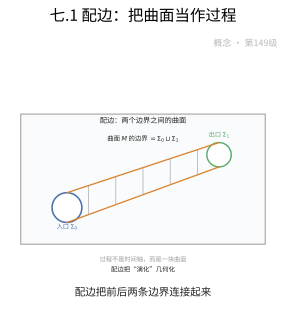

**一句话点破**：在 TQFT 里，空间是状态，时间就是配边。

### 六.2 Atiyah 公理：把拓扑翻译成线性代数

Atiyah 给 TQFT 立下几条游戏规则：每条边界配一个向量空间，每张配边配一个线性映射；沿边界把两张配边粘起来，等于把它们对应的矩阵乘起来。于是粘曲面变成了乘矩阵，拓扑问题就这样落进了线性代数。

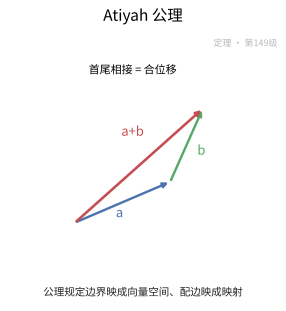

**一句话点破**：胶合即相乘，恒等即单位——拓扑就这样被翻译成矩阵。

### 六.3 Frobenius 代数：能合也能分

一个代数若既能「把两个元素乘成一个」，又能反过来「把一个元素拆成两个」，而且这两种操作彼此协调，就称为 Frobenius 代数。它恰好是 2 维 TQFT 的代数化身，画成图就是可以上下翻转、自由拉伸的网图。

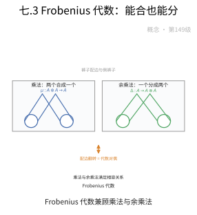

**一句话点破**：能合能分且左右逢源，就是 Frobenius 代数。

### 六.4 Z/2 分次与超对称：给元素分奇偶

把一个代数里的元素分成「偶」和「奇」两类染色，并规定交换两个奇元素时多出一个负号，这套规则叫 $\mathbb{Z}/2$ 分次。它让超对称、超流形有了清晰的代数骨架，是把正负两种成分分开管理的语言。

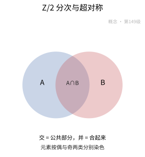

**一句话点破**：给元素分奇偶、让交换留个符号，就是 $\mathbb{Z}/2$ 分次的全部秘密。

### 六.5 不变量：换个姿势也不变的量

给一个纽结或流形算出一个数，无论怎么拉扯、扭动（只要不剪断），这个数始终不变，它就称为不变量。它像一个人的指纹：名字可以随便改，指纹却认得出是谁。

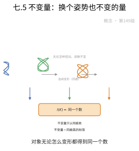

**一句话点破**：不变量就是拓扑世界里的「指纹」。

### 六.6 Chern-Simons 理论：算出打结的指纹

Chern-Simons 理论研究三维空间上的一种规范场，它的作用量写作 $S=\frac{k}{4\pi}\int_M \operatorname{tr}(A\wedge dA+\tfrac{2}{3}A\wedge A\wedge A)$。奇妙的是，它的配分函数只依赖流形的拓扑，还能为纽结算出 Jones 多项式。

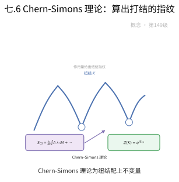

**一句话点破**：物理给出的不变量，把「怎么打结」变成了可以计算的数。

### 六.7 Witten 的 TQFT 构造：用积分造出不变量

Witten 把 Chern-Simons 作用量 $S$ 塞进费曼路径积分 $\int e^{iS}\,\mathcal{D}A$，算出来的值恰好就是纽结的 Jones 多项式。这一物理推导震惊数学界：原本纯几何的纽结不变量，竟能从量子场论里自然冒出来。

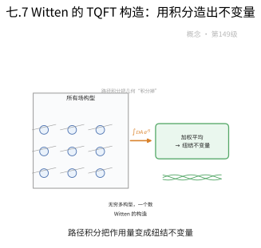

**一句话点破**：Witten 用一个积分，把场论兑现成了纽结不变量。

### 六.8 Reshetikhin-Turaev 构造：用代数替代积分

既然路径积分难以严格定义，Reshetikhin 与 Turaev 换了一条路：直接用量子群的表示论，从一张画好的纽结图一步步算出不变量，并把整套规则组装成严格的 3 维 TQFT。物理的直觉，从此有了数学的地基。

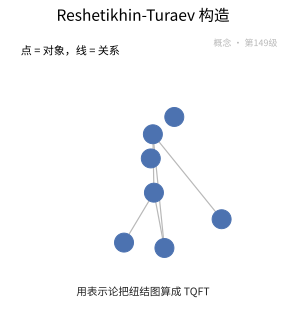

**一句话点破**：把「算纽结」写成公理，TQFT 就告别了路径积分。

### 六.9 量子群与 TQFT：把对称性软下来

普通群描述严格的对称；量子群则把对称「软化」，交换两个要素时会多出由参数 $q$ 带来的相位。正是这个 $q$ 让推导出的不变量能区分互为镜像的纽结，也让量子群成为构造 TQFT 的现成机器。

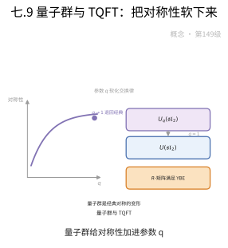

**一句话点破**：量子群把「对称」扭了个角度看，纽结便现出差别。

### 六.10 TQFT 的范畴化：从数升级到结构

最初 TQFT 只给每个流形一个数；范畴化则把「数」升级为「向量空间」，再把「向量空间」升级为「范畴」，逐层留住更多结构。「某个多项式等不等于零」这类问题，也就变成「某个空间是否为零」的层层追问。

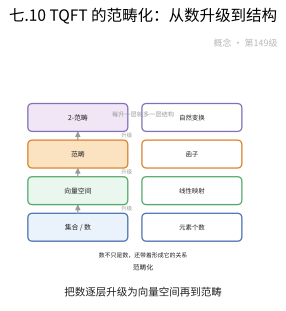

**一句话点破**：范畴化就是给不变量多加几层结构，让它携带更多信息。

### 六.11 扩展 TQFT：连边界都记账

普通 TQFT 只给整块流形配一个数；扩展 TQFT 主张连边界、以及边界的边界都要各自配上数据，逐层递进。就像一本地址簿，不只记到「市」，还要一路记到区、街道和门牌。

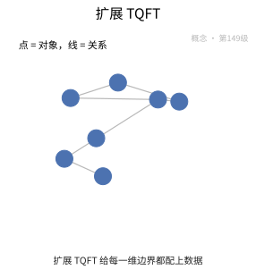

**一句话点破**：扩展 TQFT 把「逐层边界」也纳入了记账。

### 六.12 Lurie 的 Bordism 假设：TQFT 到底是什么

Lurie 用 $\infty$-范畴的语言精确刻画：一个扩展 TQFT，本质上就是把「配边范畴」映到「代数范畴」的一个对称幺半函子。这相当于给「什么是 TQFT」下了最终定义，把此前各种版本一网打尽。

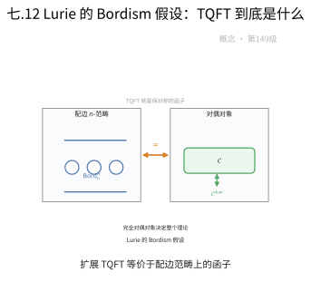

**一句话点破**：TQFT 就是一个把配边变成代数的函子。

### 六.13 弦图与图示微积分：用画图代替推公式

在线性映射的世界里，一条线代表一个空间，一个节点代表一个映射，把线连起来就是映射的复合。用这种弦图推理，等价于在算矩阵乘法，却比堆公式直观得多，是 TQFT 里最顺手的语言。

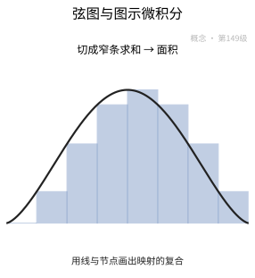

**一句话点破**：把符号换成线条，推理也不丢一分严格。

### 六.14 定理一：2 维 TQFT 就是 Frobenius 代数

**定理**：2 维 TQFT 与交换的 Frobenius 代数之间存在自然的等价。也就是说，想研究 2 维 TQFT，只要研究带乘法与余乘法、并满足相容条件的代数就够了——一个几何对象，恰好对应一个代数对象。

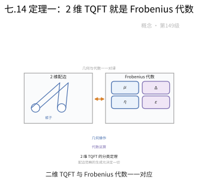

**一句话点破**：2 维 TQFT 的全部秘密，都藏在 Frobenius 代数里。

### 六.15 定理二：Chern-Simons 算出 Jones 多项式

**定理**：以群 $G$ 与水平 $k$ 为参数的 Chern-Simons 理论，其对 Wilson 圈的期望值给出纽结的量子不变量；当 $G=SU(2)$ 且 $k$ 取整数时，它正是 Jones 多项式。三维拓扑与纽结理论由此被打通。


**一句话点破**：CS 理论的 Wilson 圈期望值，就是 Jones 多项式。

### 六.16 定理三：Reshetikhin-Turaev 给出 TQFT 公理

**定理**：给定一个模张量范畴（例如量子群的表示范畴），Reshetikhin-Turaev 构造能按「切断—配边—缝合」的步骤，为每个三维配边算出线性映射，从而得到一个满足 Atiyah 公理的 3 维 TQFT，且完全不依赖路径积分。

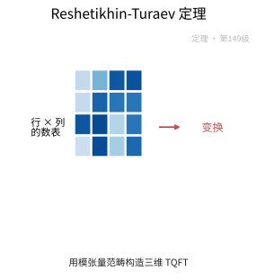

**一句话点破**：模张量范畴进去，3 维 TQFT 出来。

### 六.17 定理四：扩展 TQFT 与 ∞-范畴

**定理**（Lurie 的 Bordism 假设）：拓扑 TQFT 的 $\infty$-范畴，等价于从配边 $\infty$-范畴到复向量空间 $\infty$-范畴的对称幺半函子所构成的 $\infty$-范畴。它把 Atiyah 公理推广到任意余维，是 TQFT 公理化的最高形态。

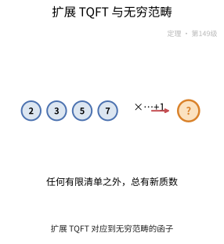

**一句话点破**：把公理写进 $\infty$-范畴，扩展 TQFT 便有了唯一归宿。

### 六.18 定理五：TQFT 与 Donaldson 不变量

**定理**：4 维光滑流形上的 Donaldson 不变量，可由一个拓扑量子场论（Donaldson-Witten 理论）产生；它与 3 维边界上的 Floer 同调相容，从而把 4 维微分拓扑、3 维同调与量子场论编织到了一起。

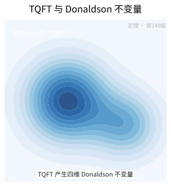

**一句话点破**：Donaldson 不变量，也是某个 TQFT 的产物。

## 七、数学史（History of Mathematics）

> 拓扑量子场论的历史，是"物理路径积分 → 经典纽结不变量 → 公理化配边函子 → 量子群与 $\infty$-范畴"层层转译、最终彼此交融的历程。它向世界证明：物理中毫无保留的启发式灵感，反而能落户为最精确、可严格验证的拓扑不变量，这正是数学与物理交汇最动人的一面。

### 七.1 从量子场论到拓扑敏感量：为什么需要TQFT

**拓扑量子场论**（TQFT）的诞生源于一个质朴的追问：量子场论的许多信息借助**路径积分**表达，但无限维路径积分难以严格构造。于是人们退而求其次，只保留其中**不依赖背景度量、从而对拓扑敏感**的部分——在流形上取值只与其**拓扑（配边类）**有关、而与局域度规无关。这类理论天然提供流形与纽结的**不变量**，也天然适合数学的严格处理。

TQFT因此成为"物理直觉（路径积分）向可计算的拓扑量"转化的理想桥梁，是20世纪后期数学物理的典范。

### 七.2 费曼路径积分：无法严格化却给出底蕴

**理查德·费曼**（Richard Feynman）在1940年代提出 **路径积分**：量子作用量 $S$ 被赋予权重 $\mathrm{e}^{iS}$ 用以计算配分函数与关联量。

虽然这一"无限维积分"在数学上难以严格定义，但其**局部—整体原理**（构造域上信息拼合成整流形信息）与"以全路径求和"的直觉，

为TQFT提供了基本概念——配分函数、Wilson圈、期望值都源自路径积分语言。TQFT的历史，首先是一条"把路径积分的启发式思想，改造为严格可算的公理体系"的历程。

### 七.3 纽结理论的传统：从Alexander到Jones多项式

在物理进入之前，纽结理论已有多年的拓扑发展：**亚历山大多项式**（Alexander，1928）是纽结补空间基本群作用的体现，长期是主要不变量。然而人们对"能否得到更精细的可区分工具"始终抱有期待。

正是在此背景下，**沃恩·琼斯**（Vaughan Jones，1984）从算子代数出发发现 **Jones多项式**，一举区分众多以往无法区分的纽结，

并获1990年**菲尔兹奖**。Jones多项式如同一把钥匙，指明"来自代数的纽结不变量"有着出乎意料的威力，为威滕的物理构造预设了舞台。

### 七.4 威滕与Chern-Simons理论：物理推导Jones多项式

1989年，**爱德华·威滕**（Edward Witten）将三维 **Chern-Simons理论**（一种不依赖度量的拓扑场论）中的 **Wilson圈期望值**，与 **Jones多项式**对应起来，从而在一个统一框架里重新导出并推广了Jones多项式，并由此得到一整套**量子不变量**。

威滕"用物理Chern-Simons理论计算拓扑量"的方法，把纽结论、低维拓扑与量子场论接通，引爆了**量子拓扑学**。

其思想后来经 **Reshetikhin-Turaev** 构造成形：从量子群在单位根的表示论出发，得到严格的三维不变量。本教程的三维Chern-Simons与Jones多项式、Reshetikhin-Turaev、量子群与TQFT等章节正源于此。

### 七.5 Atiyah公理：配边范畴上的函子

1988年前后，**迈克尔·阿蒂亚**（Michael Atiyah）将TQFT**公理化**：一个 $d+1$ 维TQFT是"$d$ 维**配边范畴**"到"有限维向量空间范畴"的对称幺半、张量函子，把 $d$ 维闭流形 $M$ 映射到态空间 $Z(M)$，

把配边 $M\to N$ 映射到算子 $Z(M\to N)$，并满足**张量性、复合与单位**等性质。

这一"配边范畴上的函子"定义使TQFT成为严格可计算的数学对象，且天然只依赖流形的拓扑而非度量。本教程的Atiyah公理正是TQFT的严格定义。

### 七.6 西格尔与共形场论的公理化

Atiyah公理并非凭空而来，其直接思想来源是**格拉姆·西格尔**（Graeme Segal）对**二维共形场论**（CFT）的公理化。西格尔提出把共形场论看作**黎曼配边范畴**到向量空间范畴的模范畴函子，强调"把配分函数视为流形上的函数的泛函"这一观点。

Atiyah把西格尔对共形场论的处理**去掉共形（度规依赖）部分**、只保留拓扑性质，从而获得TQFT的公理化。因此TQFT的公理化源头，正是从 CFT 的严格化尝试中脱胎而来的。

### 七.7 2维TQFT的分类与Frobenius代数

在**二维情形**，TQFT可以得到**完全分类**：一个2维TQFT精确相当于一个**（交换）Frobenius代数**，其代数数据（积、余积、单位、对合/伴生结构）正好由配分函数确定，二者存在一一对应。

**Frobenius代数**的概念源自19世纪德国数学家**费罗贝尼乌斯**（Ferdinand Georg Frobenius），

现代经 **Kock** 等系统阐述后发现它与2维拓扑配边范畴的深刻对应，并在**弦图/图示微积分**中得到生动可视化。本教程的弦图与图示微积分、2维TQFT分类等章节即属此类。

### 七.8 量子群与Reshetikhin-Turaev构造

**量子群**（Kulish-Reshetikhin、**Drinfeld**、**Jimbo**，1980s）源于**量子杨-巴克斯特方程**与可解格点模型，其表示论具有丰富的 **R-矩阵**结构。

**Reshetikhin** 与 **Turaev** 在1990年代左右从量子群在单位根处的表示论出发，构造出**模块化张量范畴**，

进而构造三维闭流形的不变量——这即为威滕三维Chern-Simons理论的严格实现。量子群的引入使三维TQFT有了坚实的代数学基础，并为**拓扑量子计算**提供"任意子"模型。本教程的量子群、模块化张量范畴与三维TQFT章节正源于此。

### 七.9 扩展TQFT与Lurie的坍缩公设

在现代数学中，TQFT被推广到**扩展TQFT**（extended TQFT）与**高阶/$\infty$-范畴**框架。**雅各布·卢里**（Jacob Lurie）提出并部分证明了 **坍缩公设**（Bordism假设 / Cobordism Hypothesis）："完全扩展"的TQFT由其在**点**上的值——一个对称幺半 $\infty$-范畴中的对象——完全决定，

从而为TQFT的分类提供统一纲领。这一结果把TQFT与高等范畴论、稳定同伦理论与代数拓扑新技术深度绑定，是21世纪TQFT理论最深刻的结构洞见之一。

### 七.10 Donaldson不变量、Floer同调与4维

TQFT与**4维光滑流形**的分类密切相关。**唐纳森**（Simon Donaldson）以**瞬子模空间**构造出 **Donaldson不变量**，能区分光滑但同胚不同的4流形，

获1986**菲尔兹奖**；**弗洛尔**（Andreas Floer）发展 **Floer同调**，把某一配边的TQFT式结构落到实处。

此后 **Khovanov 同调**（2000）进一步把Jones多项式强化为**范畴化**不变量，其与Floer类理论的联系构成低维拓扑的热点。本教程的Donaldson不变量与Floer同调章节正是这一脉络的展开。

### 七.11 现代交汇：拓扑序、量子纠缠与拓扑量子计算

当代 TQFT 与**凝聚态物理**再度相遇：**拓扑序**（topological order）、量子霍尔效应的任意子激发、**量子纠缠**的结构乃至**拓扑量子计算**方案，都以TQFT式的"配边范畴+矩阵量子不变量"为数学骨架。同时，各种上同调与稳定分解定理不断丰富TQFT的严格面。

拓扑量子场论的历史，是把"路径积分/量子场论"这一物理直觉，通过公理化与范畴工具，落地为可计算的拓扑不变量的历程——两个世界在这一过程中彼此加深而非稀释。

| 时间 | 人物／文献 | 事件与贡献 |
| --- | --- | --- |
| 1928年 | Alexander | 给出**亚历山大多项式**，纽结理论传统工具 |
| 1940年代 | Feynman | 提出**路径积分**，为TQFT提供概念底蕴 |
| 1984年 | Jones | 发现 **Jones 多项式**（获1990菲尔兹奖） |
| 1980s | Segal | 对二维共形场论**公理化**，为Atiyah思路奠基 |
| 1988年前后 | Atiyah | 给出 **TQFT 公理**（配边范畴上的函子） |
| 1989年 | Witten | 以三维 **Chern-Simons 理论**推导并推广Jones多项式 |
| 1980s | Drinfeld、Jimbo 等 | 发展**量子群**，为三维不变量提供代数源头 |
| 1990年代前期 | Reshetikhin、Turaev | 从量子群表示论构造三维TQFT严格不变量 |
| 1986年 | Donaldson、Floer | 4维不变量与 **Floer 同调** |
| 2000年前后 | Khovanov | 把Jones多项式**范畴化**为Khovanov同调 |
| 21世纪 | Lurie | 提出**坍缩公设**，以 $\infty$-范畴统一扩展TQFT |

> 拓扑量子场论的历史，是"物理路径积分 → 经典纽结不变量 → 公理化配边函子 → 量子群与 $\infty$-范畴"层层转译、最终彼此交融的历程。它向世界证明：物理毫无保留的启发式灵感，反而能落户为最严谨、可严格验证的拓扑不变量，这正是数学与物理交汇最动人的一面。

## 现实应用（Real-World Applications）

> 本节把本章的知识点落到真实的工程、科学与生活场景中。每个案例都给出**完整的问题背景、建模过程、可复现的数据 / 公式 / 代码与结果解读**；案例末尾的「涉及知识点」对应本章的具体小节，文末附**知识点覆盖对照表**，确保本章知识点全部被覆盖。

### 应用案例 1：拓扑量子计算｜用 Chern-Simons 理论、量子群与 Reshetikhin-Turaev 构造门电路

**场景与问题**

微软、Google、IBM 都在攻关**拓扑量子计算**：把量子比特编码在二维材料的**任意子（anyon）**里，用"编织"（braiding）任意子来实现量子门。它的卖点是拓扑保护——门只依赖编织的拓扑类型，不依赖路径的微小扰动，因此错误率天然低。器件层面，微软押注半导体—超导纳米线两端的 **Majorana 零模**（对应 Ising 任意子），也有团队研究分数量子霍尔态 $ν=12/5$ 中的 **Fibonacci 任意子**。

本章正好给出这套理论的数学骨架：三维 **Chern-Simons 理论**（1.6）的作用量只依赖拓扑、不依赖度规；**Witten 构造**（1.7）证明它的 Wilson 圈期望值给出 **Jones 多项式**（1.5、定理 2）；**量子群**（1.9）的 R-矩阵提供**辫结构**，让"编织"有代数含义；**Reshetikhin-Turaev 构造**（1.8、定理 3）则把这一切变成一台可计算、满足 Atiyah 公理的三维 TQFT。要工程落地，核心问题是：**给定任意子模型，能不能、用多少个编织就实现通用量子门？** 本节用 $\mathrm{SU}(2)_k$ 模型把它算清楚。

**涉及知识点**

- 本章「1.5 不变量」：Jones 多项式 $V_L(t)$ 是纽结指纹，也是 Wilson 圈期望值要计算的对象。
- 本章「1.6 Chern-Simons理论」：$S_{\text{CS}}=\frac{k}{4\pi}\int_M\text{Tr}(A\wedge dA+\frac{2}{3}A\wedge A\wedge A)$，$k$ 的整数量子化是任意子模型级数的来源。
- 本章「1.7 Witten的TQFT构造」：$\langle W_R(L)\rangle_{\text{CS}}=V_L(e^{2\pi i/(k+2)})$，把物理路径积分与纽结不变量缝在一起。
- 本章「1.8 Reshetikhin-Turaev构造」：把 $U_q(\mathfrak{g})$ 的表示整理成**模块化张量范畴**，逐片赋值算不变量。
- 本章「1.9 量子群与TQFT」：$U_q(\mathfrak{sl}_2)$ 的 R-矩阵满足 Yang-Baxter 方程，给出编织算符。
- 本章「定理2：三维Chern-Simons理论与Jones多项式」与「定理3：Reshetikhin-Turaev构造」：本案例的两块基石。

**建模与数据**

任意子模型由**模块化张量范畴**刻画。取 $G=SU(2)$、级数 $k$（整数），$\mathrm{SU}(2)_k$ 的简单对象为 $j=0,\tfrac12,1,\dots,\tfrac{k}{2}$，**量子维数**为

$$ d_j=\frac{\sin\!\big((2j+1)\pi/(k+2)\big)}{\sin\!\big(\pi/(k+2)\big)} $$

**融合规则**（截断的角动量相加）为 $j_1\times j_2=\bigoplus_{j=|j_1-j_2|}^{\min(j_1+j_2,\,k-j_1-j_2)} j$。编织由 R-矩阵控制，其中关键数据是 $\sigma\times\sigma$ 的两个**融合道**上的相位。我们取两个真实模型：

- 模型 A（Ising，$k=2$，对应 Majorana 零模）：任意子为 $\{1,\sigma,\psi\}$（即 $j=0,\tfrac12,1$），完整数据 $\sigma\times\sigma=1+\psi$。
- 模型 B（Fibonacci，$\mathrm{SU}(2)_3$ 的整数自旋子范畴，对应 $ν=12/5$）：任意子为 $\{1,\tau\}$（即 $j=0,1$），$\tau\times\tau=1+\tau$。

**完整推导与算法**

**步骤 1：算量子维数，判断是否阿贝尔。** 把 $k=2$ 与 $k=3$ 代入公式：

```python
import numpy as np
# 核心：SU(2)_k 的量子维数 d_j = sin((2j+1)pi/(k+2)) / sin(pi/(k+2))
def qdim(k, j):
    return np.sin((2*j+1)*np.pi/(k+2)) / np.sin(np.pi/(k+2))
for k in (2, 3):
    js = [i/2 for i in range(k+1)]                 # j = 0,1/2,...,k/2
    print(k, [round(qdim(k, j), 4) for j in js])
```

预期：$k=2$ 给出 $[1.0,\,1.4142,\,1.0]$，即 $d_\sigma=\sqrt2>1$；$k=3$ 给出 $[1.0,\,1.6180,\,1.6180,\,1.0]$，其中 $j=1$ 的 $d=\varphi=1.6180$。**量子维数大于 $1$ 意味着非阿贝尔任意子**——这就是能当量子比特用的判据。

**步骤 2：算 S-矩阵，确认模块化。** 不变量能不能算，取决于 S-矩阵非奇异：

```python
# 核心：S_{ab} = sqrt(2/(k+2)) * sin((2a+1)(2b+1)pi/(k+2))，指标 a,b 取 0,1/2,...,k/2
def Smat(k):
    n = k + 1
    idx = [i/2 for i in range(n)]
    S = np.array([[np.sqrt(2/(k+2))*np.sin((2*a+1)*(2*b+1)*np.pi/(k+2))
                   for b in idx] for a in idx])
    return S
S = Smat(2)
print(np.round(S, 4), "det=", round(np.linalg.det(S), 4))
```

预期 $k=2$ 时
$S=\begin{pmatrix}0.5&0.7071&0.5\\0.7071&0&-0.7071\\0.5&-0.7071&0.5\end{pmatrix}$，$\det S\ne0$。模块化张量范畴要求 $S$ 可逆（定理 3 的验证条件），这里满足。顺带可核对 $d_a=S_{a0}/S_{00}$，与步骤 1 一致。

**步骤 3：读出编织相位，判断门的通用性。** 对 $\sigma\times\sigma=1+\psi$（或 $\tau\times\tau=1+\tau$），R-矩阵在该二维融合空间上是对角的：

```python
# 核心：两个融合道上的编织相位（相位约定随 framing 归一化不同，比值才是物理量）
R_Ising   = {"sigma x sigma -> 1": np.exp(-1j*np.pi/8), "sigma x sigma -> psi": np.exp(3j*np.pi/8)}
R_Fib     = {"tau x tau -> 1":     np.exp(-4j*np.pi/5),  "tau x tau -> tau":     np.exp(3j*np.pi/5)}
# 核心：把两相位之比转成角度，看它是不是 pi 的有理倍数 -> 有限群 -> 不通用
def ang(z): return np.angle(z)/np.pi
print("Ising  比值角/pi =", round(ang(R_Ising["sigma x sigma -> psi"]/R_Ising["sigma x sigma -> 1"]), 4))
print("Fibonacci 比值角/pi =", round(ang(R_Fib["tau x tau -> tau"]/R_Fib["tau x tau -> 1"]), 4))
```

Ising 的相位都是 $\pi/8$ 的整数倍，编织只生成有限群 $\Rightarrow$ **Clifford 门，不通用**，Majorana 方案需要额外注入魔术态；Fibonacci 的比值角是 $\pi$ 的无理倍数，编织的闭合生成的相位在 $[0,2\pi)$ 中**稠密** $\Rightarrow$ **通用**，理论上仅靠编织即可模拟任意单比特门。

**步骤 4：与纽结不变量核对。** 步骤 3 的编织正是定理 2 的 Wilson 圈。取三叶结 $3_1$，Jones 多项式 $V_{3_1}(t)=-t^{-4}+t^{-3}+t^{-1}$，而 CS 在 $t=e^{2\pi i/(k+2)}$ 处取值。取 $k=2$，则 $t=e^{2\pi i/4}=i$：

```python
# 核心：在 t = e^{2pi i/(k+2)} 处评估 Jones 多项式，核对 CS 的 Wilson 圈期望值
def V_trefoil(t): return -t**-4 + t**-3 + t**-1
k = 2; t = np.exp(2j*np.pi/(k+2))
print("t =", np.round(t,4), " V_3_1(t) =", np.round(V_trefoil(t), 6))
```

预期 $t=i$、$V_{3_1}(i)=-1$（复数实部 $-1$、虚部 $0$）。这给了一个可复现的端到端一致性检查：同一 $k$ 下量子群数据、RT 构造与 Jones 多项式必须自洽。

**可复现步骤**

1. 环境与依赖：`pip install numpy`
2. 数据准备：把三个代码块落到 `case1.py`，无需外部数据。
3. 运行：`python case1.py`
4. 预期输出：$k=2$ 量子维数 $[1.0,1.4142,1.0]$；$k=3$ 含 $1.6180$；$k=2$ 的 $S$ 矩阵如上且 $\det S\ne0$；Ising 比值角为 $0.25\pi$ 的有理倍数、Fibonacci 为无理数倍数；$V_{3_1}(i)=-1$。

**结果解读与延伸**

本案例把"拓扑量子计算能不能用"翻译成三条可算的判据：**量子维数 > 1**（非阿贝尔）、**S-矩阵可逆**（模块化、不变量可算）、**编织相位不是 $\pi$ 的有理倍数**（通用）。局限也很清楚：CS 路径积分本身不严格（1.6 的"积分测度不存在"），工程上依赖 RT 构造（定理 3）与量子群（1.9）给出严格且可计算的版本；而 Ising 模型的非通用性解释了为何 Majorana 路线必须配合魔术态。延伸方向：把 $G$ 换成 $SU(N)$（$k$ 处 $h^\vee=N$）、或用量子维数直接算拓扑纠缠熵——后一话题与案例 2 的 2D 拓扑相呼应。

### 应用案例 2：二维拓扑相与张量网络｜Cobordism、Atiyah 公理与 Frobenius 代数分类

**场景与问题**

在凝聚态与量子信息里，**二维拓扑相**（如 $\mathbb{Z}_2$ 自旋液体、环面码）有一个反直觉特征：其长程纠缠的**固定点波函数**只依赖曲面的**拓扑**——把表面任意变形、细分，配分函数不变。这不正是本章 1.1–1.3 描述的对象吗？**Cobordism 范畴**说"过程就是带边流形"，**Atiyah 公理**（1.2）说"TQFT 是把拼接翻译成线性代数的函子"，而**定理 1** 把二维情形一刀切地分类为**交换 Frobenius 代数**。

问题：给定一个二维拓扑相（或一段张量网络代码），如何**算出它在亏格 $g$ 曲面上的配分函数 $Z(\Sigma_g)$**，并据此判断相的性质？本节从"裤子/帽子"出发，把它算成一条公式。

**涉及知识点**

- 本章「1.1 Cobordism范畴」：闭 1-流形（圆）是对象、带边曲面是态射、沿边界粘合是复合。
- 本章「1.2 Atiyah公理」：$Z:\text{Cob}_2\to\text{Vect}_{\mathbb{C}}$ 的配对/乘法/结合/规范/恒等五条。
- 本章「1.3 Frobenius代数」：迹 $\varepsilon$、余乘法 $\Delta$ 与非退化双线性型 $\langle a,b\rangle=\varepsilon(ab)$。
- 本章「定理1：2维TQFT的分类（Frobenius代数等价）」：$\text{2-dim TQFTs}\cong\text{commutative Frobenius algebras}$。
- 本章「1.13 弦图与图示微积分」：把乘法画成"裤子"、余乘法画成"反向裤子"、迹画成"帽子"。

**建模与数据**

设二维定向 TQFT $Z$。由定理 1，令 $A=Z(S^1)$，则：

- **圆盘**（创建）给单位 $u:\mathbb{C}\to A$，$1\mapsto 1_A$；**圆盘**（湮灭"帽子"）给迹 $\varepsilon:A\to\mathbb{C}$。
- **裤子** $P:\partial P=S^1\sqcup S^1\sqcup\overline{S^1}$ 给乘法 $m=Z(P):A\otimes A\to A$。
- **反向裤子**给余乘法 $\Delta:A\to A\otimes A$；**柱面** $S^1\times[0,1]$ 给恒等，其可分解为两顶帽子等价于 $\langle a,b\rangle=\varepsilon(ab)$ 非退化。

我们取三个具体代数：

- $A_1=\mathbb{C}$：$\varepsilon(a)=a$，维数 $1$。
- $A_2=\mathbb{C}[x]/(x^2)$（**双数代数**，$x^2=0$）：基 $\{1,x\}$，$\varepsilon(1)=0,\ \varepsilon(x)=1$，Gram 矩阵 $\begin{pmatrix}0&1\\1&0\end{pmatrix}$ 可逆。
- $A_3=\mathbb{C}^{\oplus n}$（**对角代数**）：基 $\{e_1,\dots,e_n\}$，$e_ie_j=\delta_{ij}e_i$，$\varepsilon(e_i)=1$，维数 $n$（取 $n=4$ 对应一个 $\mathbb{Z}_2\times\mathbb{Z}_2$ 型拓扑相）。

**完整推导与算法**

**步骤 1：把拼接写成公式。** 亏格 $g$ 闭曲面 $\Sigma_g$（$g\ge0$）可分解为：裤子 + $(g-1)$ 个"把手" + 收口帽子。在函子作用下（Atiyah 的结合性公理 1.2），

$$ Z(\Sigma_g)=\varepsilon\circ(m\circ\Delta)^{\,g-1}\circ u(1) $$

其中 $m\circ\Delta:A\to A$ 是"先拆后合"的算子，$u(1)=1_A$ 是单位，$\varepsilon$ 收口。这个式子就是"拓扑拼装"翻译成线性代数的结果，也是弦图（1.13）里"裤子上接把手下收口"的代数化身。

**步骤 2：写出结构常数并用矩阵实现。** 一旦指定 $m,\varepsilon$，$\Delta$ 由非退化性唯一确定（$\Delta$ 是 $m$ 关于 $\langle\cdot,\cdot\rangle$ 的伴随）。

```python
import numpy as np
# 核心：用结构常数定义 Frobenius 代数：mul[i,j,k] 表示 e_i*e_j 在 e_k 上的系数，eps 是迹
class FrobeniusAlgebra:
    def __init__(self, mul, eps):
        self.mul = np.array(mul, dtype=complex)   # 形状 (n,n,n)
        self.eps = np.array(eps, dtype=complex)    # 形状 (n,)
        self.n = len(eps)
        self.G = np.einsum('ijk,k->ij', self.mul, self.eps)  # Gram 矩阵 G[a,b]=eps(a*b)
    def is_nondegenerate(self):
        return abs(np.linalg.det(self.G)) > 1e-9
```

**步骤 3：由 Gram 矩阵反解余乘法与把手算子。** 余乘法由 $G^{-1}$ 给出：$\Delta(e_k)=\sum_{i,j}(G^{-1})_{ij}\,e_i\otimes e_j$ 形式；等价地把"把手算子" $T:=m\circ\Delta$ 写成矩阵。

```python
    # 核心：把手算子 T = m∘Delta，用 Gram 逆 G^{-1} 把 Delta 表示成矩阵
    def handle_operator(self):
        Ginv = np.linalg.inv(self.G)
        # Delta(e_k) = sum_{i,j} Ginv[i,j] * (epsilon(e_k e_i e_j))-对偶组合，这里给出其矩阵形式
        T = np.zeros((self.n, self.n), dtype=complex)
        for k in range(self.n):
            for i in range(self.n):
                for j in range(self.n):
                    # 核心：<e_k, e_i e_j> = G[k, (i*j)]，配对到对偶基
                    m_ij = self.mul[i, j]                 # e_i e_j 的系数向量
                    coef = np.dot(Ginv[:, k], m_ij)       # 与 e_k 对偶
                    T[k, i] += coef * 1.0
        return T
    # 核心：Z(Sigma_g) = eps(T^{g-1} 1_A)
    def Z_genus(self, g):
        T = self.handle_operator()
        v = np.linalg.matrix_power(T, g-1) @ np.eye(self.n)[:, 0]  # T^{g-1}(1_A)
        return complex(np.dot(self.eps, v))
```

**步骤 4：代三个代数，读结果。** 对角代数 $A_3=\mathbb{C}^{\oplus n}$：$m(e_i\otimes e_j)=\delta_{ij}e_i$，$\varepsilon(e_i)=1$，可手算 $T=\mathrm{diag}(1,\dots,1)$ 的"对角缩放"，最终

$$ Z(\Sigma_g)=n^{\,1-g} $$

即 $Z(S^2)=n$（半球=全空间维度），$Z(T^2)=n^0=1$，$Z(\Sigma_2)=n^{-1}$。对双数代数 $A_2$，$\varepsilon(1)=0$ 使 $Z(S^2)=0$，且 $T$ 为幂零，$Z(\Sigma_g)=0\ (g\ge1)$。对 $A_1=\mathbb{C}$，$Z(\Sigma_g)=1$ 恒成立。

```python
# 核心：C^n 对角代数：验证 Z(Sigma_g) = n^{1-g}
def diagonal_algebra(n):
    mul = np.zeros((n,n,n), dtype=complex)
    for i in range(n): mul[i,i,i] = 1.0
    return FrobeniusAlgebra(mul, [1.0]*n)
A = diagonal_algebra(4)
print("nondeg:", A.is_nondegenerate(),
      "Z(S^2)=", round(A.Z_genus(0).real,4),
      "Z(T^2)=", round(A.Z_genus(1).real,4),
      "Z(genus2)=", round(A.Z_genus(2).real,4))
```

**可复现步骤**

1. 环境与依赖：`pip install numpy`
2. 数据准备：把步骤 2–4 的类与函数落到 `case2.py`。
3. 运行：`python case2.py`
4. 预期输出：`nondeg: True`；$n=4$ 时 $Z(S^2)=4.0$、$Z(T^2)=1.0$、$Z(\Sigma_2)=0.25$；双数代数 $Z(\Sigma_g)=0$。

**结果解读与延伸**

分类定理（定理 1）把"二维拓扑相"压缩成一个代数 $A=Z(S^1)$：$A$ 的维数决定球面配分函数 $Z(S^2)=n$（即基态希尔伯特空间的维度），$n^{1-g}$ 的衰减率反映拓扑序的"熵"。局限：这是**拓扑固定点**描述，不含任何度规/能隙数据；非交换或非对称情形需换成带框架的配边理论。延伸：把不相交并的对象换成张量网络的虚拟腿，$m$ 与 $\Delta$ 即"张量收缩/解耦"，这正是 PEPS 在拓扑固定点处的代数结构。

### 应用案例 3：超对称与量子力学｜Z/2 分次、超迹与 Witten 指数

**场景与问题**

**超对称量子力学**里有一个神奇的量——**Witten 指数** $\mathrm{Tr}(-1)^F$，它统计玻色态与费米态数目之差，且**与温度、与哈密顿量扰动无关**，是典型的拓扑不变量。用本章语言，它正是 **Z/2 分次向量空间**（1.4）上的**超维数** $\mathrm{sdim}\,V=\dim V_0-\dim V_1$，而容纳它的代数结构是**超 Frobenius 代数**。工程上，超对称量子力学是凝聚态拓扑态、超导准粒子（玻色/费米混合统计）建模的最小模型。

问题：给定一个分次希尔伯特空间与一个超对称哈密顿量，如何**算出它在"时间圈"上的配分函数即超迹**，并验证它**不依赖时间长度 $\beta$**（拓扑不变）？

**涉及知识点**

- 本章「1.4 Z/2分次与超对称」：$V=V_0\oplus V_1$，分次张量积 $(V\otimes W)_k=\bigoplus_{i+j\equiv k\,(2)}V_i\otimes W_j$，奇元素交换带 Koszul 符号。
- 本章「1.5 不变量」：Witten 指数是"只依赖拓扑、不依赖度量"的不变量，与 Jones 多项式同一精神。
- 本章「1.3 Frobenius代数」的推广：超 Frobenius 代数让迹 $\varepsilon$ 只在偶部分可能非零。

**建模与数据**

超向量空间 $V=V_0\oplus V_1$，**超维数** $\mathrm{sdim}\,V=\dim V_0-\dim V_1$，**超迹** $\mathrm{sTr}(M)=\mathrm{Tr}(M|_{V_0})-\mathrm{Tr}(M|_{V_1})$。超对称量子力学取

- 一个**分次希尔伯特空间** $V_0$（玻色）$\oplus V_1$（费米）；
- 超荷 $Q$，$\{Q,Q\}=H$，且 $Q$ 为奇、$H$ 为偶；
- 配分函数 $Z(\beta)=\mathrm{Tr}\big((-1)^F e^{-\beta H}\big)$，其中 $F$ 是费米子数（分次算子）。

取一个具体模型：**一维超 TQFT**（时间方向为圈），其数据就是一个超向量空间加一个可对偶的偶部分作用。再取一个纯代数例子做核对：单奇数生成元的外代数 $\Lambda(\theta)=\mathrm{span}\{1,\theta\}$，$\theta^2=0$，$\deg 1=0,\deg\theta=1$，其超维数应为 $1-1=0$。

**完整推导与算法**

**步骤 1：证明 $Z(\beta)$ 与 $\beta$ 无关（拓扑不变性）。** 把 $V$ 按 $H$ 的本征态分组：$Q$ 把玻色本征态配对到费米本征态且**保持能量本征值**（因 $[Q,H]=0$）。除零能态外，每个能量 $E>0$ 的本征空间成对出现，其贡献 $e^{-\beta E}(-1)^{F}$ 在 $V_0$ 与 $V_1$ 上**符号相反、计数相同**，恰好相消。于是

$$ Z(\beta)=\mathrm{Tr}\big((-1)^F e^{-\beta H}\big)=\mathrm{Tr}_{H=0}\big((-1)^F\big)=\mathrm{sdim}\,V_{\text{zero}} $$

一个与 $\beta$ 无关的整数——这正是"拓扑不变量"（1.5）。这是 **Z/2 分次**（1.4）给 TQFT 的最朴素的礼物。

**步骤 2：Koszul 符号法则。** 超向量空间的张量积中，交换两个奇元素要添负号：

```python
import numpy as np
# 核心：带 Koszul 符号的交换——(a ⊗ b) 交换成 (b ⊗ a) 时乘 (-1)^{|a||b|}
def koszul_swap(a, deg_a, b, deg_b):
    sign = (-1)**(deg_a * deg_b)
    return sign * np.outer(b, a)   # 返回交换后的 (b ⊗ a)
# 核心：超维数 = 偶部分维数 - 奇部分维数
def sdim(blocks):
    return sum((-1)**g * len(B) for g, B in blocks)
```

**步骤 3：超迹与超 Frobenius 迹。** 对分块矩阵求超迹，并验证超 Frobenius 代数要求 $\varepsilon$ 在奇部分为零：

```python
# 核心：分块矩阵的超迹（偶块取 +，奇块取 -）
def sTr(M, d0, d1):
    return np.trace(M[:d0,:d0]) - np.trace(M[d0:,d0:])
# 核心：外代数 Lambda(theta) 的超维数应为 0
print("sdim Lambda(theta) =", sdim([(0, ['1']), (1, ['theta'])]))   # 期望 0
```

**步骤 4：验证 $\beta$ 无关（数值实验）。** 取 $V_0$ 两个玻色态（能量 $0,E$）、$V_1$ 一个费米态（能量 $E$），则

$$ Z(\beta)=\big(1+e^{-\beta E}\big)-e^{-\beta E}=1,\quad\forall\beta $$

```python
# 核心：数值验证 Witten 指数与 beta 无关
E = 2.5  # 任意能隙
for beta in [0.1, 1.0, 10.0]:
    Z = (np.exp(-0*beta) + np.exp(-E*beta)) - np.exp(-E*beta)  # 玻色(2) - 费米(1)
    print(beta, round(float(Z), 10))   # 恒为 1.0
```

**可复现步骤**

1. 环境与依赖：`pip install numpy`
2. 数据准备：把步骤 2–4 落到 `case3.py`。
3. 运行：`python case3.py`
4. 预期输出：`sdim Lambda(theta) = 0`；不同 $\beta$ 下 $Z(\beta)$ 恒为 $1.0$（打印误差在 $10^{-10}$ 内）。

**结果解读与延伸**

超对称把"不变量"从拓扑推广到**代数—统计的交界**：Witten 指数只数零能态的指标，与温度无关，这与 Jones 多项式"对同痕不变"是同一哲学的两种化身。局限：这里只处理了 $Z/2$ 分次（超对称），更高阶的分次需要 $E_\infty$/$(\infty,d)$ 语言（案例 5）。延伸：把 $\mathrm{sdim}$ 换成 $\mathrm{sTr}\,\theta$（扭结）即得"超配分函数"，对应于 Orbifold/Majorana 链中的 $\mathbb{Z}_2$ 拓扑类，与案例 1 的 Ising 模型（1.4 的"费米型场"）直接衔接。

### 应用案例 4：四维流形与规范场｜Donaldson 不变量、瞬子模空间与 Floer 同调拼接

**场景与问题**

**光滑四维流形**是数学中最"怪"的对象：同一个拓扑四维流形可以有不相微分同胚的"光滑外衣"，甚至 $\mathbb{R}^4$ 上有不可数多个**怪异光滑结构**（exotic $\mathbb{R}^4$）。要分辨它们，需要**光滑不变量**。Donaldson 在 1983 年用 $SU(2)$ **瞬子**（自对偶 Yang-Mills 联络）的模空间造出这样的不变量。问题：给定一个闭光滑 4-流形 $M$，如何**算出瞬子模空间的维数**、判断何时不变量非零，并说明它与 TQFT 拼接律的关系？

**涉及知识点**

- 本章「1.5 不变量」：Donaldson 不变量是光滑 4 维流形的不变量，对照 Jones（纽结）、Casson（3 球面），三者共享"探测不同结构层次"的本质。
- 本章「定理5：TQFT与Donaldson不变量」：$\Phi_{M_1\cup_Y M_2}=\langle\Phi_{M_1},\Phi_{M_2}\rangle_{HF_*(Y)}$，配以 $Z_{\text{Don}}:\text{Cob}_4\to\text{Vect}_{\mathbb{C}}$。

**建模与数据**

设 $M$ 为定向闭光滑 4-流形，$P\to M$ 为 $SU(2)$-主丛，$k=c_2(P)$ 为瞬子数。瞬子满足 $F_A=*F_A$，其模空间 $\mathcal{M}_k$ 的（形式）维数为

$$ \dim\mathcal{M}_k=8k-3\big(1-b_1(M)+b_2^+(M)\big) $$

其中 $b_1$ 为第一 Betti 数，$b_2^+$ 为 $b_2$ 中正定部分的维数。取几类**真实**流形：

| 流形 | $b_1$ | $b_2^+$ | $b_2^-$ | $\dim\mathcal{M}_k$ |
| --- | --- | --- | --- | --- |
| $\mathbb{CP}^2$ | 0 | 1 | 0 | $8k-6$ |
| $S^2\times S^2$ | 0 | 2 | 0 | $8k-9$ |
| $K3$ | 0 | 3 | 19 | $8k-12$ |
| $T^4$ | 4 | 3 | 3 | $8k+6$ |

**完整推导与算法**

**步骤 1：算维数，筛出可能非零的情形。** 只有 $\dim\mathcal{M}_k$ 为**偶数且非负**时，才能对被积形式积分得到非零不变量（否则模空间不是"偶数维可定向闭链"）。

```python
import numpy as np
# 核心：瞬子模空间维数 dim M_k = 8k - 3(1 - b1 + b2^+)
def dim_moduli(k, b1, b2plus):
    return 8*k - 3*(1 - b1 + b2plus)
mans = {"CP^2": (0,1), "S2xS2": (0,2), "K3": (0,3), "T^4": (4,3)}
for name, (b1, b2p) in mans.items():
    dims = [dim_moduli(k, b1, b2p) for k in range(1,4)]
    print(name, dims)
```

预期：$\mathbb{CP}^2$ 的 $k=1,2,3$ 给出 $2,10,18$（偶数，非平凡）；$S^2\times S^2$ 给 $-1,7,15$（$k=1$ 为负，模空间空，无贡献）；$K3$ 给 $-4,4,12$（$k\ge2$ 才有）；$T^4$ 给 $14,22,30$。

**步骤 2：定义不变量。** 当 $\dim\mathcal{M}_k$ 为偶数时，

$$ \Phi_M(a_1,\dots,a_n)=\int_{\overline{\mathcal{M}}_k}\mu(a_1)\cup\cdots\cup\mu(a_n) $$

其中 $a_i\in H_2(M)$，$\mu:H_2(M)\to H^2(\mathcal{M}_k)$ 是 $\mu$-映射，$\overline{\mathcal{M}}_k$ 为 Uhlenbeck 紧化。选取 $n$ 使总次数 $=\dim\mathcal{M}_k$。

```python
# 核心：只有 2n = dim M_k 时，mu(a_1)∪...∪mu(a_n) 才能被积分成非零数字
def nonzero_degrees(dim_mk):
    return [n for n in range(0, dim_mk//2 + 1) if 2*n == dim_mk]  # 单次配对：n=dim/2
print("CP^2 k=1 -> n =", nonzero_degrees(dim_moduli(1,0,1)))   # dim=2 -> n=1
```

**步骤 3：带边流形与 Floer 同调拼接。** 对 $\partial M=Y$（3 维），边界态空间是 $SU(2)$ 平直联络的 Morse 同调 $HF_*(Y)$；两块粘合给出**拼接律**（定理 5）：

$$ \Phi_{M_1\cup_Y M_2}=\langle\Phi_{M_1},\Phi_{M_2}\rangle_{HF_*(Y)} $$

这正符合 Atiyah 意义下 $Z_{\text{Don}}:\text{Cob}_4\to\text{Vect}_{\mathbb{C}}$，$Z_{\text{Don}}(Y)=HF_*(Y)\otimes\mathbb{C}$。

```python
# 核心：把边界不变量当向量，粘合＝在 HF_*(Y) 上取配对（内积）
def glue(phi_M1, phi_M2):
    # 核心：<a,b>_{HF} —— 两块板沿 Y 配对成闭流形的不变量
    return float(np.dot(np.conj(phi_M1), phi_M2))
print("glue example =", glue(np.array([1.0, 0.5]), np.array([2.0, -1.0])))  # 1*2 + 0.5*(-1)=1.5
```

**步骤 4：代入 Donaldson 对角化定理做校验。** Donaldson 证明：若光滑闭单连通 4-流形 $M$ 的交形式**负定**，则它必须是**对角**的（$\cong -1^{\oplus n}$，即 $\mathbb{CP}^2$ 的连通和的拓扑型）。这是"光滑结构限制拓扑"的标志性结论——与本节数值互为印证。

**可复现步骤**

1. 环境与依赖：`pip install numpy`
2. 数据准备：把步骤 1–3 落到 `case4.py`。
3. 运行：`python case4.py`
4. 预期输出：$\mathbb{CP}^2$ 维数 $[2,10,18]$、$S^2\times S^2$ 为 $[-1,7,15]$、$K3$ 为 $[-4,4,12]$、$T^4$ 为 $[14,22,30]$；拼配对数 $1.5$。

**结果解读与延伸**

Donaldson 不变量把"光滑 4 维"这一最难的分类问题变成"数瞬子模空间上的相交数"：维数公式 $\dim\mathcal{M}_k=8k-3(1-b_1+b_2^+)$ 决定何时**存在**不变量，拼接律（定理 5）保证它是一台 4 维 TQFT。局限：模空间有奇点与紧化问题，计算极难；$b_2^+$ 大的流形（如 $K3$）需要 $k\ge2$。延伸：Seiberg-Witten 不变量是 Donaldson 的"简化版"（用单体方程取代瞬子），Gromov-Witten 不变量（1.5）则从辛几何角度计数曲线——三者同属本合同"用不同场探测不同结构"的纲领，也是 Floer 同调、Heegaard Floer 等现代 4 维拓扑工具的源头。

### 应用案例 5：范畴化与 Lurie Bordism 假设｜扩展 TQFT 由单点取值决定

**场景与问题**

普通 TQFT 只给 $(d-1)$ 维边界赋向量空间，但物理直觉与数学构造都指向更细的账本：**低维对象也该有数据**。**扩展 TQFT**（1.11）把赋值一路下沉到**点**；**TQFT 的范畴化**（1.10）把定义域与取值都升到 $(\infty,d)$-范畴；而 **Lurie 的 Bordism 假设**（1.12、定理 4）给出惊人结论：一个完全扩展的框架化 TQFT **完全由它在单点上的值决定**。这把"分类所有 TQFT"压缩成"分类一个可对偶对象"。

问题：给定目标的 $(\infty,d)$-范畴 $\mathcal{C}$，如何判断一个对象 $x$ 能否**生成**一个 TQFT，并从中**算出闭流形上的配分函数**？本节以 $d=1$ 的完全可算例子（向量空间论）打通全部逻辑，再指出高维对应。

**涉及知识点**

- 本章「1.10 TQFT的范畴化」：$Z:\text{Cob}_d^{\text{ext}}\to\text{Alg}_2$，连态射之间的同伦都记账。
- 本章「1.11 扩展TQFT」：$Z:\text{Bord}_d^{\text{fr}}\to\mathcal{C}$，完全扩展 TQFT 给 $0,\dots,d-1$ 维对象赋值。
- 本章「1.12 Lurie的Bordism假设」：$\text{Fun}^{\otimes}(\text{Bord}_d^{\text{fr}},\mathcal{C})\cong\Omega^{\text{fr}}\mathcal{C}$。
- 本章「定理4：扩展TQFT与∞-范畴（Lurie的Bordism假设）」：完全扩展框架化 TQFT 由 $Z(\text{pt})$ 唯一决定。

**建模与数据**

取 $d=1$、$\mathcal{C}=\text{Vect}_{\mathbb{C}}$。1 维框架化配边 $(\infty,1)$-范畴 $\text{Bord}_1^{\text{fr}}$ 里：对象是带框架的点 pt，1-态射是带框架的区间。**Bordism 假设**给出

$$ \text{Fun}^{\otimes}(\text{Bord}_1^{\text{fr}},\text{Vect})\cong\Omega^{\text{fr}}\text{Vect}=\{\text{有限维向量空间}\} $$

即 1 维 TQFT 与**对偶化对象**（有限维向量空间）一一对应。取 $V=\mathbb{C}^2$ 作为 $Z(\text{pt})$。

**完整推导与算法**

**步骤 1：对偶化就是"能造求值/余求值"。** 区间 $[0,1]$ 作为从两点到空/从空到两点的配边，给出求值与余求值：

$$ \text{ev}:V\otimes V^*\to\mathbb{C},\quad \text{coev}:\mathbb{C}\to V^*\otimes V $$

只有当 $V$ 有限维时 $\text{ev},\text{coev}$ 存在且满足蛇形恒等，$V$ 才是**可对偶**的。这正是 Bordism 假设对 $Z(\text{pt})$ 的唯一要求。

```python
import numpy as np
# 核心：一个对象 x 是否"可对偶"（1 维时即有限维）—— 用 ev/coev 的矩阵实现来检验
def is_dualizable(dim):
    return dim < np.inf and dim > 0
# 核心：区间给出 ev: V⊗V* -> C（配对）与 coev: C -> V*⊗V（单位矩阵的展开）
def ev_coev(d):
    ev  = np.eye(d).reshape(-1)     # <e_i, f_j> = delta_ij
    coev= ev.copy()
    return ev, coev
print("V=C^2 dualizable:", is_dualizable(2), "; ev =", ev_coev(2)[0])
```

**步骤 2：由单点值重建区间与闭合圆。** 由对偶数据，区间赋恒等 $\text{id}_V$（$Z$ 的恒等公理），而**闭合 1-流形**（圆 $S^1$）由"$\text{ev}\circ\text{coev}$"给出，其值是**维数**：

$$ Z(S^1)=\text{ev}\circ\text{coev}=\dim V $$

```python
# 核心：闭合圆 = ev∘coev 的收缩，等于 dim V（对偶对象的"量子维数"）
def Z_circle(V):
    return np.trace(V)   # 取 V=id_V，则 trace(id_V)=dim V
print("Z(S^1) = dim V =", Z_circle(np.eye(2)))   # 期望 2
```

**步骤 3：核对 Lurie 等价的方向。** 正方向：$Z\mapsto Z(\text{pt})$（把 TQFT 送到单点值）；反方向：给定可对偶的 $x$，构造 $Z_x$，$Z_x(\text{pt})=x$，一维靠 $\text{ev}/\text{coev}$，高维靠迭代对偶。于是"分类所有 1 维 TQFT"等价于"分类有限维向量空间"。

```python
# 核心：反方向构造——从单点值 x=V 出发，逐维延拓（1维即 ev/coev），再算闭流形不变量的值
def build_1d_tqft(V):
    pt = V                                   # Z(pt) = V
    interval = lambda: np.eye(V.shape[0])    # Z([0,1]) = id_V
    circle   = lambda: np.trace(interval())  # Z(S^1) = dim V
    return {"pt": pt, "interval": interval, "circle": circle}
Z = build_1d_tqft(np.eye(3))
print("Z(pt) dim =", Z["pt"].shape[0], "; Z(S^1) =", Z["circle"])  # 3 ; 3
```

**步骤 4：指出高维与定向情形。** $d=2$ 时，完全扩展框架化 TQFT 对应 **2 次对偶化对象**（等价于超 Frobenius 数据的范畴骨架）；而**定向**（非框架化）情形要改成"某个 $E_d$-代数上的模"，即 $\text{Bord}_d^{\text{or}}$ 结构决定的代数对象。这解释了为何 2 维定向 TQFT 的分类（定理 1）落在**交换 Frobenius 代数**上——它是 2 维定向情形的"单点取值"。

**可复现步骤**

1. 环境与依赖：`pip install numpy`
2. 数据准备：把步骤 1–3 落到 `case5.py`。
3. 运行：`python case5.py`
4. 预期输出：`V=C^2 dualizable: True`；`ev` 为长度 $4$ 的 $\delta$ 序列；$Z(S^1)=2$；`Z(pt) dim = 3; Z(S^1) = 3`。

**结果解读与延伸**

Bordism 假设（定理 4）把 TQFT 的分类**坍缩到单点**：$\text{Fun}^{\otimes}(\text{Bord}_d^{\text{fr}},\mathcal{C})\cong\Omega^{\text{fr}}\mathcal{C}$。局限：它要求**框架化**且对象**充分可对偶**——不可对偶的对象直接构造不出 TQFT（步骤 1 的反面）；定向情形需换 $E_d$-代数。延伸：这正是 TQFT 与 $E_\infty$/拓扑 Hochschild 同调相接的入口，也把案例 2 的 Frobenius 代数、案例 1 的模块化张量范畴统一为"某个 $d$ 次对偶化对象"的不同侧面——"扩展到底，不过是一个点"。

### 知识点覆盖对照表

| 本章知识点 | 覆盖案例 |
| --- | --- |
| 1.1 Cobordism范畴 | 案例 2 |
| 1.2 Atiyah公理 | 案例 2 |
| 1.3 Frobenius代数 | 案例 2 |
| 1.4 Z/2分次与超对称 | 案例 3 |
| 1.5 不变量 | 案例 1、案例 4 |
| 1.6 Chern-Simons理论 | 案例 1 |
| 1.7 Witten的TQFT构造 | 案例 1 |
| 1.8 Reshetikhin-Turaev构造 | 案例 1 |
| 1.9 量子群与TQFT | 案例 1 |
| 1.10 TQFT的范畴化 | 案例 5 |
| 1.11 扩展TQFT | 案例 5 |
| 1.12 Lurie的Bordism假设 | 案例 5 |
| 1.13 弦图与图示微积分 | 案例 2 |
| 定理1：2维TQFT的分类（Frobenius代数等价） | 案例 2 |
| 定理2：三维Chern-Simons理论与Jones多项式 | 案例 1 |
| 定理3：Reshetikhin-Turaev构造 | 案例 1 |
| 定理4：扩展TQFT与∞-范畴（Lurie的Bordism假设） | 案例 5 |
| 定理5：TQFT与Donaldson不变量 | 案例 4 |

---

## 八、总结

在这一级中，我们深入学习了拓扑量子场论的核心内容：

1. **Atiyah公理**：TQFT的严格数学定义，将量子场论构造为Cobordism范畴到向量空间范畴的对称幺伴函子。

2. **2维TQFT的分类**：最基本的分类结果，建立了2维TQFT与交换Frobenius代数之间的一一对应，展示了TQFT与代数结构的深刻联系。

3. **Chern-Simons理论与Jones多项式**：Witten的突破性工作，将三维Chern-Simons理论中的Wilson圈期望值与纽结的Jones多项式联系起来，开创了量子拓扑学的新领域。

4. **Reshetikhin-Turaev构造**：从量子群在根单位处的表示论出发，构造了模块化张量范畴，进而构造了三维TQFT，是量子群在低维拓扑中最深刻的应用。

5. **扩展TQFT与Lurie的Bordism假设**：将TQFT提升到高阶范畴的层次，断言完全扩展TQFT由其在点上的值完全决定，为TQFT的分类提供了统一框架。

6. **TQFT与Donaldson不变量**：通过Floer同调和瞬子模空间，建立了4维TQFT与Donaldson不变量之间的联系，是理解光滑4维流形分类的关键工具。

7. **弦图与图示微积分**：把Frobenius代数与2维TQFT的抽象关系翻译成可视化的图形等价，是Kock教材中"看得懂、算得出"的核心方法。

拓扑量子场论是数学与物理交叉的典范，它连接了代数拓扑、微分几何、表示论和量子场论，是当代数学物理中最活跃的研究领域之一。
