# 第150级 数学物理 (Mathematical Physics)

## 📖 学习目标

1. 理解对称性与守恒律的深刻联系，掌握Noether定理的严格证明
2. 掌握量子力学和量子场论中的基本数学结构
3. 深入理解规范场论与Yang-Mills方程
4. 掌握孤子与可积系统的数学理论，理解反散射变换
5. 理解量子群与量子对称性的数学基础
6. 掌握AdS/CFT对应的GKPW公式
7. 理解量子引力中的数学工具（圈量子引力、自旋网络）

---

## 一、核心概念

![数学物理：左侧Noether定理揭示对称性⇒守恒律（\partial_\mu j^\mu=0）；中间规范场论用纤维丛语言描述，联络A连接相邻纤维，曲率F_{\mu\nu}刻画弯曲程度；右侧量子化将经典力学[x,p]=i\hbar升级为量子力学](images/150_math_physics.svg)

> **直观理解（现实类比）**：数学物理就像"用几何语言写物理定律"。Noether定理是"对称性账单"：时间平移对称⇒能量守恒，空间平移对称⇒动量守恒，旋转对称⇒角动量守恒。就像银行对账，每一笔"对称交易"都对应一笔"守恒存款"。规范场论是"尺子对齐理论"：空间每个点都长出一根"内部尺子"（纤维），规范场（联络$A$）是"把相邻尺子拉平对齐的规则"，曲率$F_{\mu\nu}$衡量"绕一圈后尺子是否对齐"。Yang-Mills方程则是"最经济的对齐方式"。量子化是"从经典到量子的跃迁"：把泊松括号$\{x,p\}=1$换成对易关系$[x,p]=i\hbar$，就像把"平滑的滑梯"换成"一级级的台阶"。AdS/CFT对应则是"全息原理的数学实现"：高维引力理论等价于低维量子场论，就像3D电影可以从2D胶片投影出来。

> **🧠 思考历程：为什么物理学家坚持说"每条对称都自带一张守恒的账单"？**
>
> 从牛顿力学到量子场论，物理学家都靠"找对称"来写规矩；而数学物理负责把"对称"翻译成守恒律与可计算的几何。它想回答的，是宇宙为何如此"对称得井井有条"、几何语言又如何承载物理定律。
>
> - **诺特的账单**。1918年，埃米·诺特证明：作用量的每个连续对称性都对应一条守恒流 $\partial_\mu j^\mu=0$——时间平移给能量、空间平移给动量、旋转给角动量守恒。从此"找对称"成了物理学家的头等大事。
> - **从量子到规范**。20世纪量子力学把泊松括号换成对易关系 $\{x,p\}\to[x,p]=i\hbar$，数学物理随之成形；1954年，杨振宁与米尔斯把规范对称推广到非交换群，学者们又揭示出"规范场"正是纤维丛上的"联络"，让物理定律披上了几何的外衣。
> - **从弦论到全息**。1997年，马尔达塞纳提出AdS/CFT对应，认为高维引力理论等价于低维量子场论——一条"全息原理"，至今仍是量子引力与数学物理交汇的前沿舞台。
> - **心路**：对称性告诉物理"什么不会变"，而数学负责把这句话翻译成可以计算的几何。

### 1.1 对称性与守恒律

> **🧠 来龙去脉（为什么会有这个概念？解决了什么问题？）**：为什么能量、动量、角动量"永不丢失"？这个问题困扰了物理学几个世纪。1918年，数学家埃米·诺特给出了决定性的回答：只要系统的**作用量**在某个连续变换（时间平移、空间平移、旋转、内部规范变换）下不变，就必然存在一条守恒流。她想要的，正是回答"守恒律从何而来"——答案不是巧合，而是"对称性"本身。这正是本级的逻辑起点：先讲清"对称—守恒"的对应，后面量子化、规范场、可积系统全都建立在它之上。

**定义1（对称性）** 一个物理系统的 **对称性** 是系统的作用量 $S[\phi]$ 在某种变换下的不变性。设 $\phi$ 是场（或坐标），变换 $g \in G$（$G$ 是Lie群）作用在 $\phi$ 上，如果：

$$ S[g \cdot \phi] = S[\phi] $$

则称 $G$ 是系统的对称群。

> **💡 直观理解（类比）**：对称性就是"换个角度/换个方式看，系统的'规矩'不变"——像是给一面墙贴镜子，墙在镜中依然完整。用运动的话说：作用量 $S[\phi]$ 在变换 $g$ 下数值不变，$G$ 就成了这个系统的"对称群"。寻找对称，等于找出这个世界"经得起哪些折腾"的平衡点。

**定义2（连续对称性与Lie群作用）** 如果对称群 $G$ 是Lie群，则其无穷小生成元由Lie代数 $\mathfrak{g}$ 中的元素给出。对单参数子群 $g_t = \exp(tX)$（$X \in \mathfrak{g}$），无穷小变换为：

$$ \delta \phi(x) = \left.\frac{d}{dt}\right|_{t=0} (g_t \cdot \phi)(x) $$

> **💡 直观理解（类比）**：一整个(连续)对称群好比"一整圈方向盘角度"，而Lie代数里的元素 $X$ 就是"方向盘上微小的一格转动"。取 $g_t=\exp(tX)$ 并在 $t=0$ 求导，相当于只盯着"拨动方向盘那最初的一点点"看场怎么动——这一微小变化 $\delta\phi$ 正是做Noether"记账"时最需要的输入。

#### 课堂问答

**老师**：一个系统的守恒律到底从哪里来？先别急着背结论，说说本质。

**学生**：守恒律不是巧合，而是对称性的产物。若作用量 $S[\phi]$ 在单参数变换群下不变，就必有一条守恒流 $j^\mu$ 满足 $\partial_\mu j^\mu=0$。当对称群 $G$ 是Lie群时，其无穷小生成元落在Lie代数 $\mathfrak{g}$ 中。

**老师（追问）**：那"连续"两字可不可以去掉？离散对称（比如镜面反射）也有这样的守恒律吗？

**学生**：不行。证明的核心是用变分法取无穷小变换 $g_t=\exp(tX)$ 并对 $t=0$ 求导得到 $\delta\phi$；没有连续参数就无法做导数，也就没有流。离散对称只给出选择定则或能级简并，而非 $\partial_\mu j^\mu=0$。

**老师（拓展）**：如果让变换参数依赖时空点，把整体对称"局部化"，会冒出什么新东西？

**学生**：局部化后作用量多出含 $\partial_\mu\epsilon$ 的项，为恢复不变性必须引入一个补偿场——这正是规范场（联络）。所以全局对称的"局部化升级"就是Yang-Mills理论的起点。

### 1.2 量子力学中的数学结构

> **🧠 来龙去脉（为什么会有这个概念？解决了什么问题？）**：经典力学用坐标、动量、轨迹描述世界，但到原子尺度这些概念相继失效。1920年代前后，经过海森堡、薛定谔、狄拉克等人的努力，物理学家发现：正确的语言是**希尔伯特空间与算子**——态是射线、可观测量是自伴算子、演化是薛定谔方程、测量靠Born规则。狄拉克的$\delta$函数、冯·诺依曼的谱论把这些直觉严格化，形成了"公理化量子力学"。它解决的问题，正是"如何给微观世界一套自洽的数学公理"。

**定义3（量子力学公理）** 量子力学的基本数学结构包括：
- **态空间**：复Hilbert空间 $\mathcal{H}$，物理态由射线（ray）$[\psi] = \{c\psi \mid c \in \mathbb{C}^\times\}$ 表示。
- **可观测量**：$\mathcal{H}$ 上的自伴算子 $A$，谱 $\sigma(A) \subset \mathbb{R}$ 是可能测量值。
- **时间演化**：由Schrödinger方程 $i\hbar \frac{d}{dt}\psi = H\psi$ 描述，其中 $H$ 是Hamiltonian。
- **测量**：对态 $\psi$ 测量 $A$ 得到 $a \in \sigma(A)$ 的概率由Born规则给出。

> **🧠 直观理解（现实类比）**：量子力学公理是量子世界的"生存规则总纲"：态是Hilbert空间里的射线（只知道方向、不在乎长度），可观测物理量是对应的自伴算子（能测出的、一定是实数谱），时间演化由Schrödinger方程掌管，而测量由Born规则给出概率。就像一张游戏规则卡——你玩之前得先接受：状态用射线、物理量用算子、演化用方程、结果用概率。

#### 课堂问答

**老师**：为什么量子态是"射线"而不是Hilbert空间里的向量？

**学生**：因为态的整体相位不可观测，$|\psi\rangle$ 与 $c|\psi\rangle$（$c\in\mathbb{C}^\times$）描述同一物理态，故真正的态空间是射影空间。可观测量与自伴算子一一对应，自伴性保证谱 $\sigma(A)\subset\mathbb{R}$，测量值才落在实数上。

**老师（追问）**：那时间演化为什么不可能是非线性的？

**学生**：Schrödinger方程 $i\hbar\,\partial_t\psi=H\psi$ 是线性的，因为 $H$ 自伴，其生成的 $\exp(-iHt/\hbar)$ 是酉群，酉性保持概率守恒。若演化非线性，叠加原理立刻崩溃。

**老师（拓展）**：一个投影算子的谱长什么样？它和"测量"有什么关系？

**学生**：投影 $P$ 满足 $P^2=P=P^\dagger$，谱只可能是 $\{0,1\}$。这正是Born规则里"测得1的概率为 $\langle\psi|P|\psi\rangle$"的算子来源——投影算子就是可观测量的"是/否"问句。

### 1.3 量子场论中的数学

> **🧠 来龙去脉（为什么会有这个概念？解决了什么问题？）**：量子力学能描述单个/固定数目粒子，却无法顾及"粒子可以产生与湮灭""还要兼容狭义相对论"。1930年代起，狄拉克、费曼、施温格等发展出量子场论：把"每个时空点"都视作一个场算子，粒子只是场的量子激发。费曼给出的路径积分 $Z=\int\mathcal D\phi\,e^{iS}$ 尤其直观；但它频发无穷大的"发散"，重整化方法（费曼本人、Dyson、Wilson等）把物理量有限化。量子场论解决的问题，就是"如何在相对论下建立自洽的多体量子理论"。

**定义4（量子场论）** 量子场论是量子力学与狭义相对论的结合，其数学结构包括：
- **场算子**：$\phi(x)$ 是时空上的算子值分布。
- **关联函数**：$G_n(x_1, \ldots, x_n) = \langle 0 | T\phi(x_1)\cdots\phi(x_n) | 0 \rangle$，其中 $T$ 是时间排序。
- **路径积分**：配分函数 $Z[J] = \int \mathcal{D}\phi \, e^{i(S[\phi] + \int J\phi)}$。
- **重整化**：处理发散以得到有限物理量的数学程序。

> **💡 直观理解（类比）**：如果说量子力学是一个粒子的故事，那么量子场论是整个宇宙"遍地都是粒子"的故事。场算子给"每一点"都派发了一个大小可变的算子（如同给每个座位配一台乐器），关联函数问"这些座位上奏出的音如何相关"，路径积分把所有乐谱叠加求总，重整化则是"把发散的噪音抹平、留下有限可听的旋律"。它是量子力学的"多体+相对论"升级版。

#### 课堂问答

**老师**：为什么量子力学不够、非要量子场论？

**学生**：量子力学固定粒子数，无法描述粒子的产生与湮灭，也不能自然兼容狭义相对论。量子场论把每个时空点配一个算子值分布 $\phi(x)$，粒子只是场的量子激发，粒子数因此可以变化。

**老师（追问）**：$n$ 点关联函数 $G_n=\langle0|T\phi(x_1)\cdots\phi(x_n)|0\rangle$ 里那个时间排序 $T$ 是干什么的？

**学生**：$T$ 把算子按时间先后重排（费米子还带符号），这样编时乘积在洛伦兹号差下才自洽，并保证因果性——类空间隔处的算子可以交换。

**老师（拓展）**：路径积分 $Z=\int\mathcal{D}\phi\,e^{iS}$ 形式那么简洁，麻烦出在哪？

**学生**：$e^{iS}$ 振荡不收敛，且 $\int\mathcal{D}\phi$ 是无穷维"测度"本就无严格定义，微扰展开还会发散。Wick旋转到欧氏 $e^{-S_E}$ 获得正测度、重整化吸收发散，正是它严格化的两大支柱。

### 1.4 规范场论

> **🧠 来龙去脉（为什么会有这个概念？解决了什么问题？）**：电磁、弱力、强力的统一需要一个共同框架。1954年，杨振宁与米尔斯把规范对称从交换的 $U(1)$（电磁）推广到非交换群，创立"非交换规范场论"；随后物理学家与几何学家发现，规范场正是**主纤维丛上的联络**、场强正是曲率。它解决的问题是"怎样用'局部对称性'确定粒子的相互作用"——描述强力的量子色动力学（QCD）和弱电统一理论，都是规范场论的硕果。

**定义5（规范场论）** **规范场论** 是以Lie群 $G$（规范群）为对称性的场论。基本场包括：
- **规范场**（联络）：$A_\mu(x) = A_\mu^a(x) T_a$，其中 $T_a$ 是 $\mathfrak{g}$ 的生成元。
- **曲率**（场强）：$F_{\mu\nu} = \partial_\mu A_\nu - \partial_\nu A_\mu + [A_\mu, A_\nu]$。
- **规范变换**：$A_\mu \to g^{-1} A_\mu g + g^{-1} \partial_\mu g$，$g(x) \in G$。

**定义6（Yang-Mills方程）** **Yang-Mills方程** 是规范场 $A$ 的运动方程：

$$ D_\mu F^{\mu\nu} = 0 $$

其中 $D_\mu = \partial_\mu + [A_\mu, \cdot]$ 是协变导数。在无源情况下，Yang-Mills方程是规范场版本的Maxwell方程。

> **💡 直观理解（类比）**：Yang-Mills方程是给规范场定下的"运动法规"：$D_\mu F^{\mu\nu}=0$ 里的协变导数 $D_\mu$ 已经"考过弯曲的尺子坐标"，告诉你力的场强在时空中如何"平滑地流动"。无源时它退化成Maxwell方程的规范场版——就像城市里"没有路灯也要保持交通号志的连贯性"一样，是相互作用的基本同步规则。

![规范场论与纤维丛：底空间 M 的每个点上生长出纤维 F，联络 A 把相邻纤维连接起来，曲率 F_{\mu\nu}=\partial_\mu A_\nu-\partial_\nu A_\mu+[A_\mu,A_\nu] 刻画这种连接的弯曲程度](images/gauge_fiber_bundle.svg)

> **直观理解（现实类比）**：把空间想成一张地图，每个地点都"长出一根竖直的尺子"（纤维），而规范场（联络）就是把这些尺子一根根"拉平对齐"的规则。曲率则衡量这种对齐沿闭环走一圈后是否出现偏差——就像绕一座山走一圈回到起点，如果指北针方向偏了，就说明这里有"曲率"。规范场论正是用这套"尺子对齐"的几何语言描述粒子相互作用。

#### 课堂问答

**老师**：规范场 $A_\mu$ 是联络、$F_{\mu\nu}$ 是曲率——这句话的数学含义到底是什么？

**学生**：$A_\mu=A_\mu^a T_a$ 取值在Lie代数 $\mathfrak{g}$，是主丛上的联络；$F_{\mu\nu}=\partial_\mu A_\nu-\partial_\nu A_\mu+[A_\mu,A_\nu]$ 就是它的曲率。"场强即曲率"意味着沿闭环平行移动一圈的偏差由 $F$ 度量。

**老师（追问）**：$[A_\mu,A_\nu]$ 这一项为什么在电磁的 $U(1)$ 下消失了？

**学生**：$U(1)$ 是交换群，生成元是数，交换子 $[A_\mu,A_\nu]=0$，于是 $F_{\mu\nu}=\partial_\mu A_\nu-\partial_\nu A_\mu$ 退回Maxwell场强。非交换群才带来曲率的二次自相互作用。

**老师（拓展）**：规范变换 $A_\mu\to g^{-1}A_\mu g+g^{-1}\partial_\mu g$ 里那个 $g^{-1}\partial_\mu g$ 为什么必须出现？

**学生**：它是使 $F_{\mu\nu}\to g^{-1}F_{\mu\nu}g$ 协变、让 $D_\mu=\partial_\mu+[A_\mu,\cdot\,]$ 在局域变换下保持协变性的唯一补偿项，本质上是联络的变换规则，和Christoffel符号的地位相同。

### 1.5 孤子与可积系统

> **🧠 来龙去脉（为什么会有这个概念？解决了什么问题？）**：1834年，工程师罗素在运河边观察到一股"永不消散的水波"紧跟着船身前进，从此"孤立波"开始了长达一个多世纪的受疑与翻案。1965年，扎布斯基与克鲁斯卡尔发现这类波碰撞后"毫发无损"，称之为**孤子**；更深的是，KdV方程等竟拥有无穷多个守恒量，可被精确求解——这就是**可积系统**。它解决的问题是：某些高度非线性的方程，为什么反而能比线性方程"更精确地"求解？

**定义7（孤子）** **孤子** 是非线性波动方程的一类特殊解，具有以下性质：
1. 以恒定速度传播，形状不变。
2. 碰撞后保持形状和速度（仅相位移动）。
3. 具有粒子性质。

> **💡 直观理解（类比）**：孤子就像"海面上一道永不散形的浪"：它以恒定速度前进、形状始终不变，两个孤子相撞后各自"毫发无损"地继续走（只挪一点位相）。可类比为"先到者后到者的武林高手擦肩而过，各自继续赶路"。它体现了非线性与色散之间精确的造浪平衡，是从物理学水波被意外"提拔"成严格数学对象的好例子。

**定义8（可积系统）** 一个无限维动力系统称为 **可积系统**，如果它具有无穷多个守恒量（在泊松括号下对合），且可以通过 **反散射变换**（Inverse Scattering Transform）精确求解。

> **💡 直观理解（类比）**：可积系统是"偶极子式的好学生系统"：拥有无穷多个守恒量，意味着它被无穷多条"永远不变的法条"牢牢钉住，动弹不得，于是可以精确求解。反之，多数复杂系统是"混沌难对付的好动分子"。可积系统在物理与数学里的特殊地位，就像"有无限多老规矩的家族"——规矩一多，未来也就一清二楚了。

#### 课堂问答

**老师**：孤子凭什么撞了还不散？线性波早就色散开了。

**学生**：非线性与色散恰好平衡。孤子以定速传播、形状不变，碰撞后只有相位挪动；KdV方程 $u_t-6uu_x+u_{xxx}=0$ 的单项解 $u(x,t)=-\frac{c}{2}\,\mathrm{sech}^2\!\big(\tfrac{\sqrt{c}}{2}(x-ct)\big)$ 就是这种平衡的产物。

**老师（追问）**："无穷多个守恒量"为什么就等价于"可积"？

**学生**：无穷多彼此对合的守恒量把相空间维数压到可积的程度（Liouville意义下），使解被完全约束。对KdV而言 $I_1=\int u\,dx$、$I_2=\int u^2\,dx$、$I_3=\int(2u^3+u_x^2)\,dx$ 只是这个无穷序列的头几项。

**老师（拓展）**：是不是只要"随时间不变"就够了，还要额外要求什么？

**学生**：不够。这些守恒量在对合的Poisson结构下满足 $\{I_m,I_n\}=0$，这种对合性远强于单纯"不变"，才是可积性与反散射能奏效的代数根源。

### 1.6 反散射变换

> **🧠 来龙去脉（为什么会有这个概念？解决了什么问题？）**：既然KdV这类非线性方程"可积"，那该怎么真正解出来？1967年，加德纳、格林、克鲁斯卡尔、米乌拉提出**反散射变换**：先把非线性方程关联到一个线性散射问题，解完时间演化，再反推回原方程的解——"把非线性难题拆成两段线性操作"。它解决的，正是"如何系统、严格的求解可积非线性PDE"，为孤子理论提供了数学主干。

**定义9（反散射变换）** **反散射变换**（IST）是求解非线性偏微分方程（如KdV方程、NLS方程）的一种方法，其基本步骤为：
1. **正散射**：将非线性方程关联到线性散射问题，计算散射数据。
2. **时间演化**：散射数据随时间简单演化。
3. **反散射**：从演化后的散射数据重构解。

> **💡 直观理解（类比）**：反散射变换像"用声音反推乐器形状"。正散射：对着问题敲一下，记下"回声"（散射数据）；时间演化：让回声按简单规律变化；反散射：从新的回声反推"乐器现在长什么样"。非线性难题被巧妙地转成两段线性的"发射—接收"操作，正是可积系统能解的独门武器。

#### 课堂问答

**老师**：反散射变换一共几步？用一句话概括核心思想。

**学生**：三步：正散射（把方程关联到线性散射问题、提取散射数据）→ 时间演化（散射数据按简单规律走）→ 反散射（从演化后的数据重构解）。核心是把非线性演化拆成两段线性操作。

**老师（追问）**：为什么散射数据的时间演化会"简单"？

**学生**：因为它们由Lax方程 $L_t=[L,A]$ 控制，$L$ 的谱 $\lambda$ 不随时间变（$\lambda_t=0$），只余反射系数和一个相位在旋转，如KdV里 $r(k,t)=r(k,0)e^{8ik^3t}$，而透射系数 $t(k)$ 不变。

**老师（拓展）**：反散射那一步到底在解什么方程？

**学生**：解Gelfand-Levitan-Marchenko积分方程 $K(x,y)+F(x+y)+\int_x^\infty K(x,z)F(z+y)\,dz=0$，再由 $u(x,t)=-2\frac{d}{dx}K(x,x)$ 取回势能。其中 $F$ 是散射数据（含束缚态贡献 $\sum_n c_n^2 e^{-\kappa_n x}$）的Fourier变换。

### 1.7 量子群与量子对称性

> **🧠 来龙去脉（为什么会有这个概念？解决了什么问题？）**：1980年代中期，为求解可积统计力学模型的Yang-Baxter方程，库利希、雷舍提欣与德林费尔德各自独立发现了量子群——李代数 $U(\mathfrak{g})$ 的 $q$-形变。它解决的问题是"如何让'对称'继承'辫子'的结构"：经典对称交换两对象结果相同，量子对称却允许带相位地"缠绕"，这一点正对应统计力学中可解模型的精确性。量子群由此成为可积系统与低维拓扑共同的代数骨架。

**定义10（量子对称性）** **量子对称性** 是量子群 $U_q(\mathfrak{g})$ 的表示论所描述的对称性。与经典对称性不同，量子对称性具有以下特点：
- 对称代数是非交换、非余交换的。
- 表示的张量积具有辫结构（由R-矩阵给出）。
- 在统计力学中，量子对称性对应于点模型的精确可解性。

> **💡 直观理解（类比）**：量子对称性是"普通旋转对称的量子化了当表亲"。经典对称交换两个对象结果一样，量子对称却允许"缠绕/辫子"发生——交换时带一个依赖 $q$ 的相位。好比在普通直线变成"滑梯"后，走同样一段路会多出 $q$ 带来的扭转感。正是这微妙的"扭"，让量子群能解开许多统计力学难题。

#### 课堂问答

**老师**：量子群和普通Lie代数差在哪？别只说"多了个 $q$"。

**学生**：$U_q(\mathfrak{g})$ 是普遍包络代数 $U(\mathfrak{g})$ 的Hopf代数形变：乘法不再交换，余乘也不再余交换，而由R-矩阵给出辫结构。表示的张量积上出现"缠绕"，不再是简单交换。

**老师（追问）**：R-矩阵要满足什么方程才有意义？

**学生**：Yang-Baxter方程 $R_{12}R_{13}R_{23}=R_{23}R_{13}R_{12}$。它保证辫群关系的自洽，也正是统计力学可解模型"不自相矛盾"的代数条件。

**老师（拓展）**：当 $q\to1$ 时这些结构会怎样？

**学生**：$U_q(\mathfrak{g})$ 退化为 $U(\mathfrak{g})$，R-矩阵退化为置换算子，辫结构回到平凡交换，"量子对称"就变回经典对称。可见量子群是经典对称的一个依赖参数 $q$ 的连续形变族。

### 1.8 张量网络与拓扑序

> **🧠 来龙去脉（为什么会有这个概念？解决了什么问题？）**：量子多体系统的态空间随粒子数指数爆炸，难以直接表示。White（1992）提出用**矩阵乘积态**高效压缩一维基态，张量网络由此演化成一套系统的"压缩纠缠结构"的语言（MPS/PEPS/MERA）。同一时期人们意识到还存在没有局域序参量、只有长程纠缠的**拓扑序**（Wen、Kitaev）。张量网络解决的问题是"如何压缩多体量子态"，而拓扑序的数学（模块化张量范畴、TQFT）则致力于刻画"拆不掉的整体纠缠"。

**定义11（张量网络）** **张量网络** 是多体量子系统的一种高效表示方法，其中量子态由张量的缩并（contraction）表示。常见的张量网络包括：
- **矩阵乘积态**（MPS）：一维系统。
- **投影纠缠对态**（PEPS）：高维系统。
- **多尺度纠缠重整化假设**（MERA）：临界系统。

> **💡 直观理解（类比）**：张量网络像"用织网的方式存大象"。完整量子态素来是天文数字般庞大的存储，但张量网络用"节点是张量、边是缩并"的网高效地编码纠缠结构。如同一件毛衣用"几股纱线+编织图样"就能描述，不必逐个像素记录。MPS/PEPS/MERA是不同"针法"，分别适配一维、高维与临界系统。

**定义12（拓扑序）** **拓扑序** 是物质的一种新相，不具有局域序参量，但具有长程纠缠和拓扑简并。拓扑序的数学描述涉及模块化张量范畴和TQFT。

> **💡 直观理解（类比）**：拓扑序是"看不见却拆不掉"的物质相。普通物相靠"局部磁针朝哪"这种局域信号区分，拓扑序却"全身无局部信号"，只靠长程纠缠与拓扑简并来辨识——如同一根圆环绑成的绳结，单看任何一小段都认不出来，但整体怎么打都解不开。它要用模块化张量范畴/ TQFT这类"整体性"数学来描述，是凝聚态与拓扑的交汇点。

#### 课堂问答

**老师**：多体态维度指数爆炸，张量网络凭什么能压缩？

**学生**：靠纠缠结构有界这一假设。一维基态若满足纠缠面积律，就可用MPS $|\psi\rangle=\sum\mathrm{Tr}(A^{s_1}\cdots A^{s_N})|s_1\cdots s_N\rangle$ 高效表示；高维用PEPS，临界系统用MERA。键维越小，压缩越彻底。

**老师（追问）**：那拓扑序这种"没有局域序参量"的相，张量网络还管用吗？

**学生**：管用，但要换工具。拓扑序靠长程纠缠与拓扑简并刻画，对应数学是模块化张量范畴与TQFT；其基态纠缠不再满足简单面积律，需用携带任意子辫结构的专门张量网络来表示。

**老师（拓展）**：怎么用数学"识别"一个有拓扑序的相？

**学生**：看基态简并是否依赖空间拓扑（如环面上出现简并），以及任意子的融合与编织数据（$F$、$R$ 矩阵满足的范畴公理），而不是去找任何局域序参量——这正是它区别于Landau对称破缺范式的关键。

### 1.9 任意子

> **🧠 来龙去脉（为什么会有这个概念？解决了什么问题？）**：三维及以上的世界里，交换粒子只能改变波函数整体正负号（玻色子/费米子）；但在**二维**，粒子可以真正"相互绕圈"，交换统计连续可变——这样的准粒子被（Leinaas–Myrheim、Wilczek 1982）命名为**任意子**。它解决的问题，是二维物质（如分数量子霍尔态）中那些"既不是玻色子也不是费米子"的激发出现在用什么统计描述。任意子由辫群表示支配，也为容错拓扑量子计算提供了物理载体。

**定义13（任意子）** **任意子**（Anyon）是二维系统中的准粒子激发，其交换统计介于玻色子和费米子之间。任意子的交换由辫群表示描述：

$$ \psi(z_1, \ldots, z_i, z_{i+1}, \ldots, z_n) = R_i \psi(z_1, \ldots, z_{i+1}, z_i, \ldots, z_n) $$

其中 $R_i$ 是辫算子，满足Yang-Baxter方程。任意子统计由 $R$-矩阵的相位 $\theta$ 描述：$\psi(z_1, z_2) = e^{i\theta} \psi(z_2, z_1)$。

> **💡 直观理解（类比）**：在二维世界，"换座位"不再只是变个正负号，而是可以绕出任意相位 $e^{i\theta}$——这就是任意子。玻色子（相位 $1$）与费米子（相位 $-1$）只是这里 $\theta=0$ 与 $\theta=\pi$ 的两个特例，任意子介于两者之间。就像在二维平面上两根绳子可以真正地"互相绕一圈"，这为量子计算提供了天然容错的载体。

#### 课堂问答

**老师**：为什么三维以上只有玻色子和费米子，二维却可以"任意"？

**学生**：因为在三维及以上，交换两次可连续缩为恒等，故 $R^2=1$，相位只能是 $\pm1$；而二维里粒子能真正互绕，对称群由辫群 $B_n$ 取代置换群 $S_n$，$R$ 可以是任意相位 $e^{i\theta}$。

**老师（追问）**：$\theta=0$ 和 $\theta=\pi$ 分别对应谁？

**学生**：$\theta=0$ 是玻色子，$\theta=\pi$（相位 $-1$）是费米子。二者只是任意子的两个端点特例，介于其间的连续取值才是真正的"任意子"。

**老师（拓展）**：在一般（非阿贝尔）任意子里，交换的"相位"该换成什么？

**学生**：换成辫算子 $R_i$（一个矩阵），交换粒子相当于在简并基态空间上作用 $R_i$，且 $R_i$ 仍须满足Yang-Baxter方程。非交换的 $R_i$ 正是拓扑量子计算容错性的来源。

### 1.10 AdS/CFT对应

> **🧠 来龙去脉（为什么会有这个概念？解决了什么问题？）**：量子引力与规范场论是两个深沟两侧的世界。1997年，马尔达塞纳提出一个惊人对偶：$AdS_{5}\times S^5$ 上的超弦理论，竟等价于 $\mathbb{R}^{1,3}$ 上的 $\mathcal N=4$ 超Yang-Mills场论。这个**全息对应**的要义，是把"强耦合、几乎无法计算的量子场论"映射成"弱耦合、可由经典引力近似计算的几何"——反过来又为量子引力提供了非微扰的定义。这一思想源自"霍金熵-面积"与't Hooft、苏斯金德的全息原理，是当代理论物理最重要的范式之一。

**定义14（AdS/CFT对应）** **AdS/CFT对应**（也称Maldacena对偶）断言：$d+1$ 维反de Sitter空间（AdS）中的量子引力理论等价于 $d$ 维共形场论（CFT）。最著名的例子是：

$$ \text{Type IIB 超弦在 } AdS_5 \times S^5 \text{ 上} \longleftrightarrow \mathcal{N}=4 \text{ 超Yang-Mills理论在 } \mathbb{R}^{1,3} \text{ 上} $$

> **🧠 直观理解（现实类比）**：AdS/CFT对应是全息原理的数学宣言：一块"高一维的径向空间（AdS）里的引力"竟能等价于"住在它边界上的低一维量子场论（CFT）"。好比一尊3D雕塑的全部信息都能编码在它投射到一面墙的2D影子上——这是"3D电影从2D胶片投出"更准确的情形。它把一个强耦合难算的理论变成了另一个弱耦合好算的理论，威力惊人。

**定义15（GKPW公式）** **GKPW公式**（Gubser-Klebanov-Polyakov-Witten公式）是AdS/CFT对应的精确数学表述：

$$ \langle e^{\int \phi_0 \mathcal{O}} \rangle_{\text{CFT}} = Z_{\text{AdS}}[\phi_0] $$

其中左边是CFT中算子 $\mathcal{O}$ 的生成泛函，右边是以 $\phi_0$ 为边界条件的AdS量子引力配分函数。

> **💡 直观理解（类比）**：GKPW公式把全息对应"落成一张可核对的账单"：AdS内部场的边界值 $\phi_0$ 相当于"往CFT里加了一个源"，而CFT中算子 $\mathcal{O}$ 的生成泛函正好等于AdS里以 $\phi_0$ 为边界条件的配分函数。就像"负一层电梯的按钮灯亮了几盏，与楼顶投下的光影一一对应"——边界上每个操作，里侧都有确定的回应。

#### 课堂问答

**老师**：这句对偶到底"换"了什么？一半是引力、一半是场论，凭什么等价？

**学生**：$d+1$ 维AdS中的量子引力等价于 $d$ 维边界上的共形场论。最著名的是 $AdS_5\times S^5$ 上的IIB超弦等价于 $\mathbb{R}^{1,3}$ 上的 $\mathcal{N}=4$ 超Yang-Mills。它把强耦合场论换成弱耦合经典引力来算。

**老师（追问）**：凭什么两边的对称性能对得上？

**学生**：$AdS_{d+1}$ 的等距群是 $SO(d,2)$，恰等于 $d$ 维CFT的共形群；再叠加超对称与R-对称，两边对称群完全匹配。这是对偶最硬的骨架。

**老师（拓展）**：具体怎么把"难算的关联函数"翻过去算？

**学生**：用GKPW公式 $\big\langle e^{\int\phi_0\mathcal{O}}\big\rangle_{\text{CFT}}=Z_{\text{AdS}}[\phi_0]$：边界上给算子加源 $\phi_0$，对应AdS里以 $\phi_0$ 为边界条件的配分函数。当 $N\to\infty$ 时 $Z_{\text{AdS}}\approx e^{-S_{\text{on-shell}}}$，只需解经典运动方程。

### 1.11 量子引力中的数学

> **🧠 来龙去脉（为什么会有这个概念？解决了什么问题？）**：如何把广义相对论与量子力学统一，是物理学一个世纪的大难题。主流做法是"微扰量子化引力"，却出现不可重整的高阶发散。1986年阿虚提卡发现以$SU(2)$联络与三边形场为变量的**Ashtekar变量**，让引力的量子化变得像规范场论一样可行；惠索夫与斯莫林进而用$SU(2)$表示编织的**自旋网络**描述量子几何态。圈量子引力解决的问题，是"能否不依赖'点粒子'的微扰，直接把空间自身量子化"，并预言面积、体积在普朗克尺度呈离散谱。

**定义16（圈量子引力）** **圈量子引力**（Loop Quantum Gravity, LQG）是量子引力的一种非微扰方法，其基本数学结构包括：
- **Ashtekar变量**：$A_a^i$（联络）和 $E_i^a$（三边形场）。
- **自旋网络**（Spin Network）：由 $SU(2)$ 表示编织而成的图，描述量子几何态。
- **面积和体积算子**：具有离散谱，给出空间在普朗克尺度上的量子化。

> **🧠 直观理解（现实类比）**：圈量子引力把"空间本身"也量子化了：用Ashtekar变量把万有引力改写成"联络+三边形场"，把时空几何"缝"成一张由自旋网络编织的图画，并发现面积、体积的谱是离散的——如同"空间并非光滑的布，而是由最小像素（普朗克尺度格子）拼成的马赛克"。它不把引力当作点粒子来微扰，而直接"整块量子化"，是量子引力一条重要路线。

#### 课堂问答

**老师**：圈量子引力和传统"微扰量子化引力"最根本的区别是什么？

**学生**：它不微扰。用Ashtekar变量 $(A_a^i,E_i^a)$ 把引力改写成类规范场论，直接把空间几何整块量子化，而不是把度规当点粒子做展开。结果是面积、体积算子具有离散谱。

**老师（追问）**：为什么说"Ashtekar变量让量子化变得可能"？

**学生**：因为 $(A_a^i,E_i^a)$ 是一对正则共轭的联络与三边形场，满足 $\{A_a^i(x),E_j^b(y)\}=\kappa\,\delta_a^b\delta_j^i\delta^{(3)}(x,y)$，形式上与规范场论可量子化的变量同构，于是能借用柱状函数、Haar测度等成熟工具构造Hilbert空间。

**老师（拓展）**：离散谱具体从哪里来，最小值是多少？

**学生**：来自自旋网络。面积算子只在与曲面相交的边上有贡献，$\hat{A}_S|\Gamma,j_e\rangle=8\pi\gamma l_P^2\sum_{p}\sqrt{j_p(j_p+1)}|\Gamma,j_e\rangle$，$j_p$ 取半整数使谱离散，最小非零面积 $\sim O(l_P^2)$，说明空间在普朗克尺度不可无限细分。

### 1.12 哈密顿力学与辛几何

> **🧠 来龙去脉（为什么会有这个概念？解决了什么问题？）**：在进入量子力学之前，经典力学的"最终形态"是哈密顿形式：用广义坐标 $q^i$ 与正则动量 $p_i$ 描述系统，把运动方程写成对称的一阶方程组。哈密顿（1833）与拉格朗日的变分原理共同确立了这套语言，而20世纪数学家发现，它的自然舞台是**辛流形**——一个带有非退化闭2-形式 $\omega=\sum_i dp_i\wedge dq^i$ 的流形。辛结构解决的，正是"如何用几何描述'相空间里的体积与流向'"：正则变换不改变 $\omega$、辛体积守恒（刘维尔定理）、Noether守恒恰对应辛作用的动量映射。它是连接经典力学与量子几何（几何量子化）的桥梁，也是Arnold《古典力学中的数学方法》一书的主干。

**定义17（辛流形）** 一个**辛流形** $(M, \omega)$ 是光滑流形 $M$ 上带有非退化闭2-形式 $\omega$（称**辛形式**）的结构。对Hamilton函数 $H: M \to \mathbb{R}$，其**Hamilton向量场** $X_H$ 由
$$\iota_{X_H}\omega = dH$$
唯一确定；Hamilton方程就是沿 $X_H$ 流的积分曲线。

**定理（辛动力学基本性质）** 沿Hamilton流：
1. **能量守恒**：$H$ 沿流恒定（$X_H(H)=0$）。
2. **辛体积守恒（刘维尔定理）**：流的拉回保持 $\omega$，故 $\omega^{\wedge n}$ 定义的相体积不变。
3. **泊松括号**：$\{f,g\}=\omega(X_f, X_g)$ 给可观测量族一个李代数结构。

> **💡 直观理解（类比）**：辛流形是"相空间里不可压缩的流体力学"。Hamilton流如同在相空间里"推着一团不可压缩的流体"，辛形式保证这团流体体积永不增减（刘维尔），而 $H$ 则是每位"流体质点的海拔始终不变"的守恒量。正则坐标 $(q,p)$ 是相空间的"直角坐标"，辛形式 $\sum dp\wedge dq$ 就是它的"标准体积元"。

---

#### 课堂问答

**老师**：辛形式 $\omega$ 的"非退化"与"闭"，各自在物理上对应什么？

**学生**：非退化 $\omega=\sum_i dp_i\wedge dq^i$ 保证 $\iota_{X_H}\omega=dH$ 唯一决定Hamilton向量场、从而唯一确定动力学，也让 $\{f,g\}=\omega(X_f,X_g)$ 有定义；闭性 $d\omega=0$ 则保证Hamilton流保持辛结构（刘维尔定理）。

**老师（追问）**：$\{q^i,q^j\}=\{p_i,p_j\}=0$、$\{q^i,p_j\}=\delta^i_j$ 告诉了我们什么？

**学生**：辛结构把所有可观测量组织成一个Poisson代数，这组正则对易关系正是它的坐标表达。所谓量子化（Dirac）基本上就是把这个Poisson括号"升格"为对易子 $[\hat{q},\hat{p}]=i\hbar$。

**老师（拓展）**：正则变换和辛同胚是一回事吗？

**学生**：局部上是一回事：保持 $\omega$ 不变即辛同胚，而由作用量不变性导出的正则变换恰是辛同胚。反过来，每个 $H$ 生成的Hamilton流都是单参数辛同胚群，这正是Noether守恒量作为动量映射的几何含义。

## 二、定理与证明

### 定理1：Noether定理

**定理（Noether定理）** 设作用量 $S[\phi] = \int L(\phi, \partial_\mu \phi) d^dx$ 在单参数Lie群作用下不变（即具有连续对称性）。则存在一个守恒流 $j^\mu(x)$，满足：

$$ \partial_\mu j^\mu = 0 $$

相应的守恒荷 $Q = \int j^0 d^{d-1}x$ 在时间演化下不变：$\frac{dQ}{dt} = 0$。

**证明**（使用变分法和Lie群作用）：

**第一步：无穷小变换的表述。**

设单参数变换群为：

$$ x^\mu \to x'^\mu = x^\mu + \epsilon X^\mu(x) + O(\epsilon^2) $$
$$ \phi(x) \to \phi'(x') = \phi(x) + \epsilon \Psi(x) + O(\epsilon^2) $$

其中 $\epsilon$ 是无穷小参数，$X^\mu$ 和 $\Psi$ 是变换的生成元。

场的变分为：

$$ \delta \phi(x) = \phi'(x) - \phi(x) = \Psi(x) - X^\mu \partial_\mu \phi(x) $$

**第二步：作用量的变分。**

作用量在变换下的变分为：

$$ \delta S = \int \left[ \frac{\partial L}{\partial \phi} \delta \phi + \frac{\partial L}{\partial (\partial_\mu \phi)} \partial_\mu (\delta \phi) + L \partial_\mu X^\mu \right] d^dx $$

由对称性假设，$\delta S = 0$。

**第三步：利用运动方程。**

在经典解上，Euler-Lagrange方程成立：

$$ \frac{\partial L}{\partial \phi} - \partial_\mu \left( \frac{\partial L}{\partial (\partial_\mu \phi)} \right) = 0 $$

代入 $\delta S$ 并利用运动方程，得到：

$$ \delta S = \int \partial_\mu \left[ \frac{\partial L}{\partial (\partial_\mu \phi)} \delta \phi + L X^\mu \right] d^dx = 0 $$

**第四步：守恒流的构造。**

由于 $\delta S = 0$ 对任意积分区域成立，被积函数必须为零：

$$ \partial_\mu j^\mu = 0 $$

其中 **Noether流** 定义为：

$$ j^\mu = \frac{\partial L}{\partial (\partial_\mu \phi)} \delta \phi + L X^\mu = \frac{\partial L}{\partial (\partial_\mu \phi)} (\Psi - X^\nu \partial_\nu \phi) + L X^\mu $$

**第五步：守恒荷的时间不变性。**

定义 **Noether荷**：

$$ Q = \int_{t=\text{常数}} j^0 d^{d-1}x $$

由守恒律 $\partial_\mu j^\mu = 0$ 和Gauss定理：

$$ \frac{dQ}{dt} = \int \partial_0 j^0 d^{d-1}x = -\int \partial_i j^i d^{d-1}x = 0 $$

（假设流在空间无穷远处衰减足够快。）

**特例**：
- 时间平移对称性 $\Rightarrow$ 能量守恒：$j^\mu = T^{\mu 0}$，其中 $T^{\mu\nu}$ 是能量-动量张量。
- 空间平移对称性 $\Rightarrow$ 动量守恒。
- 旋转对称性 $\Rightarrow$ 角动量守恒。
- 内部对称性（如 $U(1)$ 规范对称性）$\Rightarrow$ 电荷守恒。

**结论**：Noether定理建立了连续对称性与守恒律之间的一一对应，是理论物理中最基本的定理之一。$\square$

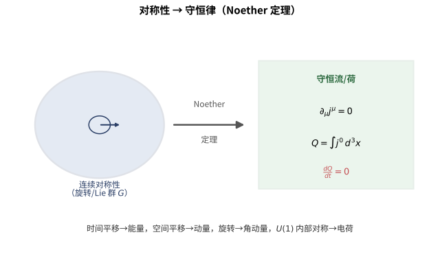

> **直观理解（现实类比）**：Noether 定理就像"对称产生守恒"的记账法则。一个完美对称的圆盘无论转到哪个角度都"看起来一样"，这种旋转对称保证了角动量守恒；同理，时间平移对称保证能量守恒，空间平移对称保证动量守恒。换句话说，只要系统的外形在某种变换下保持不变，就必有一条对应的"永远不丢的钱"（守恒量）被隐藏其中。

---

#### 课堂问答

**老师**：证明Noether定理时，场变分 $\delta\phi$ 为什么写成 $\Psi-X^\mu\partial_\mu\phi$ 而不是直接写 $\Psi$？

**学生**：要把"点本身被移动了"造成的表观变化扣掉。$\Psi$ 是场在固定点的新旧差，$X^\mu$ 描述坐标移动，减去 $X^\mu\partial_\mu\phi$ 才是同一点处的真实变分。这一步是许多常见错误的来源。

**老师（追问）**：为什么得到 $\partial_\mu j^\mu=0$ 时要特别强调"用了运动方程"？

**学生**：变分 $\delta S$ 里含 $\frac{\partial L}{\partial\phi}-\partial_\mu\big(\frac{\partial L}{\partial(\partial_\mu\phi)}\big)$ 这一整块；只有在经典解上Euler-Lagrange方程成立时它才消失，剩下全导数 $\partial_\mu\big[\frac{\partial L}{\partial(\partial_\mu\phi)}\delta\phi+LX^\mu\big]$。所以Noether流是"在壳（on-shell）"守恒的。

**老师（拓展）**：守恒荷 $Q$ 的时间不变性还依赖什么隐含条件？

**学生**：依赖流在空间无穷远处衰减足够快，才能用Gauss定理把 $\frac{dQ}{dt}=-\int\partial_i j^i$ 化为边界项并令其趋于零。否则会留下通量，"守恒"就必须修正。

### 定理2：Yang-Mills理论的存在性与质量间隙（Millennium问题）

**定理（Yang-Mills存在性与质量间隙）** 对 $\mathbb{R}^4$ 上的 $SU(2)$ Yang-Mills理论，存在一个量子场论，满足：
1. **存在性**：存在满足Wightman公理的量子场论，描述 $SU(2)$ 规范场。
2. **质量间隙**：理论具有非零的质量间隙，即Hilbert空间的Hamiltonian $H$ 的谱在零和某个正数 $\Delta > 0$ 之间有一个间隙：

$$ \sigma(H) \subset \{0\} \cup [\Delta, \infty), \quad \Delta > 0 $$

> **🧠 直观理解（现实类比）**：质量间隙是说：真空好比"一潭绝对静止的水"，而能激起的最小"水花"也必须有足够能量——零与最小激发质量之间有一道严格的"能量沟" $\Delta>0$。物理上这意味着"色力被囚禁"（如夸克无法挣脱成裸粒子）。它是千禧年难题之一：需要一个严格的四维量子场论并证明这道沟存在。格点正则化与面积律是攻克的线索，但完整证明仍悬而未决。

**证明思路**（使用Wilson环和格点规范理论，Millennium问题的当前理解）：

**第一部分：格点规范理论。**

**第一步：格点正则化。**

将 $\mathbb{R}^4$ 替换为有限格点 $\Lambda = a\mathbb{Z}^4 \cap [0, L]^4$，其中 $a$ 是格点间距，$L$ 是系统尺寸。规范场 $A_\mu$ 替换为链接变量（link variable）：

$$ U_\ell = P \exp\left(i\int_\ell A_\mu dx^\mu\right) \in SU(2) $$

其中 $\ell$ 是格点上的边（链接）。

**第二步：Wilson作用量。**

格点Yang-Mills作用量（Wilson作用量）定义为：

$$ S_W[U] = \beta \sum_{p} \left(1 - \frac{1}{2} \text{Tr}(U_p + U_p^{-1})\right) $$

其中 $p$ 遍历所有plaquette（小正方形），$U_p$ 是绕plaquette的链接变量乘积，$\beta = 4/g^2$ 是耦合常数。

**第三步：格点路径积分。**

配分函数为：

$$ Z_{\text{lattice}} = \int \prod_{\ell} dU_\ell \, e^{-S_W[U]} $$

其中 $dU_\ell$ 是 $SU(2)$ 上的Haar测度。

**第四步：Wilson环的期望值。**

Wilson环 $W(C) = \text{Tr}(P\exp(\oint_C A))$ 在格点上的对应物是：

$$ \langle W(C) \rangle = \frac{1}{Z} \int \prod_{\ell} dU_\ell \, \text{Tr}(U_C) e^{-S_W[U]} $$

其中 $U_C$ 是沿闭合回路 $C$ 的链接变量乘积。

**第五步：面积律与质量间隙。**

**面积律**（Area Law）是质量间隙存在的标志，它断言对大的闭合回路 $C$：

$$ \langle W(C) \rangle \sim e^{-A \cdot \text{Area}(C)} $$

其中 $A > 0$。面积律意味着规范场的激发是有能隙的。这可以通过**强耦合展开**（$\beta \ll 1$）来证明：

在强耦合极限下，$\langle W(C) \rangle$ 的领头阶贡献由填充回路 $C$ 的最小面积给出，指数衰减系数 $A = -\ln(\beta/4)$。

**第六步：连续极限与重整化。**

为了得到连续时空的理论，需要取格点极限 $a \to 0$，同时调整耦合常数 $\beta(a)$，使得物理可观测量趋于有限值。这由**重整化群**描述：

$$ \beta(a) = \beta_0 \ln(1/a^2\Lambda^2) + O(\ln\ln(1/a)) $$

其中 $\Lambda$ 是动力学标度（质量间隙的尺度）。

**第七步：未解决的问题。**

尽管有大量数值证据支持四维Yang-Mills理论存在质量间隙，但严格的数学证明仍然是Millennium问题之一。主要困难在于：
- 需要证明连续极限的存在性（格点理论到连续理论的极限过程）。
- 需要证明质量间隙 $\Delta > 0$ 在连续极限下保持非零。
- 需要证明理论满足Wightman公理。

**数值证据**：格点QCD的数值模拟强有力地支持了质量间隙的存在，但严格的数学证明仍需发展新的分析工具。

**结论**：Yang-Mills存在性与质量间隙问题是Millennium大奖问题之一，其解决将深刻影响我们对量子场论和基本粒子物理的理解。$\square$

---

#### 课堂问答

**老师**：质量间隙这句话，用谱的语言该怎么精确表述？

**学生**：存在 $\Delta>0$ 使 $\sigma(H)\subset\{0\}\cup[\Delta,\infty)$。也就是真空（0）与最低激发之间有一道严格的能量沟，物理上对应色力囚禁。

**老师（追问）**：为什么用Wilson环的面积律来"探测"间隙？

**学生**：因为面积律 $\langle W(C)\rangle\sim e^{-A\,\text{Area}(C)}$ 意味着规范激发有能隙；反之若呈周长律，则意味着存在自由色荷（无囚禁）。所以面积律是判定质量间隙是否存在的可操作准则。

**老师（拓展）**：格点上的证明思路已经清楚了，为什么Millennium问题还悬着？

**学生**：难点全在连续极限：要证格点间距 $a\to0$、耦合 $\beta(a)$ 重调整后格点测度存在极限，且该极限满足Wightman公理并保持 $\Delta>0$。数值（格点QCD）强烈支持，但严格的四维构造与间隙下界证明至今未完成。

### 定理3：反散射变换的可积性

**定理（反散射变换的可积性）** 设 $u(x,t)$ 是KdV方程 $u_t - 6uu_x + u_{xxx} = 0$ 的解，满足初始条件 $u(x,0) = u_0(x)$ 且在无穷远处快速衰减。则KdV方程可以通过反散射变换精确求解，且具有无穷多个守恒量。

> **🧠 直观理解（现实类比）**：这条定理揭示了KdV这类"非线性能量"也能被完全求解的秘密：关键是把非线性方程装进一个"Lax对"（两个算子 $L,A$ 满足 $L_t=[L,A]$），于是谱（算子 $L$ 的特征值）保持不动，反散射变换便顺势完成。它带来的保守量（质量、动量、能量……）无穷无尽，就像一列火车有无数节"永不丢失的车厢"，因此整列火车可以被精确预报。

**证明**（使用AKNS系统和Lax对）：

**第一步：Lax对的构造。**

KdV方程可以表示为 **Lax方程**：

$$ L_t = [L, A] = LA - AL $$

其中 $L$ 和 $A$ 是线性微分算子（称为 **Lax对**）：

$$ L = -\partial_x^2 + u(x,t) $$
$$ A = -4\partial_x^3 + 3(u\partial_x + \partial_x u) $$

**验证**：直接计算 $L_t = u_t$，$[L, A] = u_t - 6uu_x + u_{xxx}$，因此Lax方程等价于KdV方程。

**第二步：散射问题的设置。**

考虑与Lax算子 $L$ 关联的Schrödinger特征值问题：

$$ L\psi = -\psi_{xx} + u(x,t)\psi = \lambda\psi $$

由于 $u$ 在无穷远处快速衰减，当 $|x| \to \infty$ 时，渐近解为平面波。

对固定的 $t$，定义 **Jost解**：

$$ \psi(x,k) \sim \begin{cases} e^{-ikx} + r(k)e^{ikx}, & x \to +\infty \\ t(k)e^{-ikx}, & x \to -\infty \end{cases} $$

其中 $\lambda = k^2$，$r(k)$ 是反射系数，$t(k)$ 是透射系数。

**第三部：散射数据的时间演化。**

Lax方程的一个关键性质是：特征值 $\lambda$ 不随时间变化（即 $\lambda_t = 0$）。这是因为：

$$ \frac{d}{dt}(L\psi) = L_t\psi + L\psi_t = [L,A]\psi + L\psi_t = A(L\psi) + L\psi_t = A(\lambda\psi) + L\psi_t = \lambda A\psi + L\psi_t $$

而 $L\psi_t = \lambda\psi_t$，因此 $(L - \lambda)\psi_t = A(L - \lambda)\psi$，所以 $\psi_t = A\psi$ 保持特征函数性质。

**散射数据的时间演化**由辅助线性问题 $\psi_t = A\psi$ 决定：

$$ r(k,t) = r(k,0)e^{8ik^3t}, \quad t(k,t) = t(k,0) $$

即反射系数 $r(k,t)$ 随时间简单旋转，透射系数不变。

**第四步：反散射过程。**

给定时刻 $t$ 的散射数据 $\{r(k,t), \text{束缚态特征值 } \lambda_n, \text{归一化常数 } c_n(t)\}$，可以通过 **Gelfand-Levitan-Marchenko方程**（GLM方程）重构势能 $u(x,t)$：

$$ K(x,y) + F(x+y) + \int_x^\infty K(x,z)F(z+y)dz = 0, \quad y > x $$

其中 $F(x)$ 是散射数据的Fourier变换：

$$ F(x) = \frac{1}{2\pi} \int_{-\infty}^\infty r(k,t)e^{ikx}dk + \sum_n c_n(t)^2 e^{-\kappa_n x} $$

其中 $k_n = i\kappa_n$ 是束缚态特征值。

重构公式为：

$$ u(x,t) = -2\frac{d}{dx}K(x,x) $$

**第五步：无穷多守恒量的证明。**

由于Lax方程 $L_t = [L, A]$，算子 $L$ 的谱不随时间变化。因此，$L$ 的谱不变量（如迹、行列式等）都是守恒量。

具体地，考虑 $L$ 的 **守恒量**：

$$ I_n = \int_{-\infty}^\infty P_n(u, u_x, u_{xx}, \ldots) dx $$

其中 $P_n$ 是 $u$ 及其导数的多项式。前几个守恒量为：

$$ I_1 = \int u \, dx \quad \text{（质量守恒）} $$
$$ I_2 = \int u^2 \, dx \quad \text{（动量守恒）} $$
$$ I_3 = \int \left(2u^3 + u_x^2\right) dx \quad \text{（能量守恒）} $$

KdV方程具有无穷多个这样的守恒量，证明了其完全可积性。

**结论**：反散射变换通过Lax对将非线性KdV方程转化为线性散射问题的分析，从而实现了精确求解，并展示了无穷多守恒量的存在。$\square$

---

#### 课堂问答

**老师**：Lax对 $L=-\partial_x^2+u$、$A=-4\partial_x^3+3(u\partial_x+\partial_x u)$ 是怎么"记住"KdV的？

**学生**：因为 $L_t=[L,A]$ 展开后恰好等于 $u_t-6uu_x+u_{xxx}=0$，于是KdV被写成算子方程。更关键的是 $L_t=[L,A]$ 意味着两个线性问题的谱相容，$\lambda_t=0$——谱不随时间变化。

**老师（追问）**：$\lambda_t=0$ 凭什么成立？给我看关键一步。

**学生**：对 $(L-\lambda)\psi=0$ 求时间导数得 $(L-\lambda)\psi_t=-L_t\psi$，代入 $L_t=[L,A]=LA-AL$ 并用 $L\psi=\lambda\psi$，右边化为 $(L-\lambda)(A\psi)$，故取 $\psi_t=A\psi$ 即可保证 $\lambda$ 与 $t$ 无关。

**老师（拓展）**：无穷多守恒量是从哪一步"自动掉出来"的？

**学生**：从谱不变量。既然 $L$ 的谱在演化下固定，任何谱不变量都守恒，于是 $I_n=\int P_n(u,u_x,\ldots)\,dx$ 构成无穷序列：$I_1=\int u\,dx$、$I_2=\int u^2\,dx$、$I_3=\int(2u^3+u_x^2)\,dx$，这正是完全可积性的证据。

### 定理4：AdS/CFT对应的GKPW公式

**定理（GKPW公式）** 设 $AdS_{d+1}$ 是 $d+1$ 维反de Sitter空间，$\text{CFT}_d$ 是 $d$ 维共形场论。对AdS中的标量场 $\phi$，其边界值 $\phi_0$ 与CFT中的共形场 $\mathcal{O}$ 之间的对应由下式给出：

$$ \left\langle \exp\left(\int_{\partial AdS} \phi_0 \mathcal{O}\right) \right\rangle_{\text{CFT}} = Z_{\text{AdS}}[\phi_0] = \int_{\phi|_{\partial AdS} = \phi_0} \mathcal{D}\phi \, e^{-S_{\text{AdS}}[\phi]} $$

其中 $Z_{\text{AdS}}[\phi_0]$ 是以 $\phi_0$ 为边界条件的AdS中量子引力配分函数。

> **🧠 直观理解（现实类比）**：GKPW公式是"全息词典"里最硬核的一句：CFT那边"给算子 $\mathcal{O}$ 加了一个源 $\phi_0$"（相当于在边界插了一根"天线"），AdS这边"以 $\phi_0$ 为边界条件的引力配分函数"整好给出同样的答案。它把"边界上的每一笔修改"翻译成"内部的空间几何回应"——这让强耦合理论的所有关联函数都能用AdS里的经典计算近似得到。

**证明思路**（使用超引力与共形场论的对偶性）：

**第一步：AdS时空的几何结构。**

$AdS_{d+1}$ 是常负曲率Lorentz流形，其度规在Poincaré坐标下为：

$$ ds^2 = \frac{R^2}{z^2}(dz^2 + \eta_{\mu\nu}dx^\mu dx^\nu), \quad z > 0 $$

其中 $R$ 是AdS半径，$z = 0$ 是共形边界（$\partial AdS$），$\eta_{\mu\nu}$ 是Minkowski度规。

**第二步：标量场在AdS中的动力学。**

考虑AdS中的标量场 $\phi$，作用量为：

$$ S_{\text{AdS}}[\phi] = \frac{1}{2} \int d^{d+1}x \sqrt{g} \left( g^{MN}\partial_M\phi\partial_N\phi + m^2\phi^2 \right) $$

运动方程为：

$$ \frac{1}{\sqrt{g}}\partial_M\left(\sqrt{g}g^{MN}\partial_N\phi\right) - m^2\phi = 0 $$

**第三部：边界行为。**

在 $z \to 0$ 附近，标量场的渐近行为为：

$$ \phi(z,x) \sim z^{d-\Delta}\phi_0(x) + z^{\Delta}\phi_1(x) $$

其中：

$$ \Delta = \frac{d}{2} + \sqrt{\frac{d^2}{4} + m^2R^2} $$

是 $\mathcal{O}$ 的共形维数，$\phi_0(x)$ 是边界条件（源），$\phi_1(x)$ 是响应（期望值）。

**第四步：GKPW公式的物理论证。**

在AdS/CFT对应的超弦理论构造中（Maldacena, 1997），有以下对偶链：

1. **弦理论侧**：$AdS_{d+1} \times X$ 上的超弦理论（$X$ 是紧致流形）。
2. **CFT侧**：$d$ 维共形场论，生活在其边界上。

GKPW公式（Gubser-Klebanov-Polyakov, 1998; Witten, 1998）将这一对偶精确表述为：

**对偶字典**：
- AdS中的场 $\phi(z,x)$ $\longleftrightarrow$ CFT中的算子 $\mathcal{O}(x)$。
- 场的边界值 $\phi_0(x)$ $\longleftrightarrow$ 耦合到算子 $\mathcal{O}$ 的源。
- AdS配分函数 $\longleftrightarrow$ CFT生成泛函。

**第五步：半经典近似。**

在AdS半径 $R$ 远大于Planck长度 $l_P$ 时（即 $N \to \infty$ 极限，$N$ 是规范群阶数），AdS配分函数可由半经典近似计算：

$$ Z_{\text{AdS}}[\phi_0] \approx e^{-S_{\text{on-shell}}[\phi_0]} $$

其中 $S_{\text{on-shell}}$ 是运动方程经典解的作用量。这给出了CFT关联函数的半经典计算：

$$ \langle \mathcal{O}(x_1) \cdots \mathcal{O}(x_n) \rangle = \frac{\delta^n}{\delta\phi_0(x_1)\cdots\delta\phi_0(x_n)} \left. e^{-S_{\text{on-shell}}[\phi_0]} \right|_{\phi_0=0} $$

**具体计算**：对两点关联函数，计算得到：

$$ \langle \mathcal{O}(x) \mathcal{O}(y) \rangle = \frac{C_\Delta}{|x - y|^{2\Delta}} $$

这正是CFT中标量算子两点关联函数的正确形式，其中 $C_\Delta$ 是规范化常数。

**第六步：验证与检验。**

GKPW公式通过了大量检验：
1. **谱匹配**：AdS中场的Kaluza-Klein模质量与CFT中算子的共形维数匹配。
2. **对称性**：$AdS_{d+1}$ 的等距群 $SO(d,2)$ 与 $d$ 维CFT的共形群相同。
3. **非重整化定理**：某些量（如Witten的Wess-Zumino项的系数）在量子修正下保持不变，与对偶预测一致。
4. **热力学**：AdS黑洞的Bekenstein-Hawking熵与CFT在有限温度下的熵精确匹配。

**结论**：GKPW公式是AdS/CFT对应的精确数学表述，它将强耦合量子场论的问题转化为弱耦合引力理论的计算，是当代理论物理最重要的进展之一。$\square$

---

#### 课堂问答

**老师**：GKPW公式里，边界值 $\phi_0$ 到底扮演什么角色？

**学生**：它是CFT中算子 $\mathcal{O}$ 的源。公式 $\big\langle e^{\int\phi_0\mathcal{O}}\big\rangle_{\text{CFT}}=Z_{\text{AdS}}[\phi_0]$ 说明：边界加源后的生成泛函，等于AdS里以 $\phi_0$ 为边界条件的配分函数。对 $\phi_0$ 取泛函导数即得 $\mathcal{O}$ 的关联函数。

**老师（追问）**：标量场的边界渐近 $\phi\sim z^{d-\Delta}\phi_0+z^{\Delta}\phi_1$ 里，$\Delta$ 由什么决定？

**学生**：由质量决定，$\Delta=\frac{d}{2}+\sqrt{\frac{d^2}{4}+m^2R^2}$，它就是 $\mathcal{O}$ 的共形维数，$\phi_0$ 是源、$\phi_1$ 是响应（期望值）。该式还给出著名的Breitenlohner-Freedman稳定界 $m^2R^2\ge-d^2/4$。

**老师（拓展）**：强耦合CFT那么难算，GKPW怎么让它变得"可算"？

**学生**：在半经典极限 $N\to\infty$（即 $R\gg l_P$）下 $Z_{\text{AdS}}\approx e^{-S_{\text{on-shell}}}$，关联函数通过 $\frac{\delta^n}{\delta\phi_0^n}e^{-S_{\text{on-shell}}}$ 求得。例如两点函数化为 $\langle\mathcal{O}(x)\mathcal{O}(y)\rangle=C_\Delta/|x-y|^{2\Delta}$，与CFT共形对称性要求的形式完全一致。

### 定理5：量子引力中的圈量子引力

**定理（圈量子引力的量子化）** 广义相对论在Ashtekar变量下可以严格量子化，得到量子几何的离散谱。具体地，在圈量子引力中：
1. 面积算子 $\hat{A}_S$ 和体积算子 $\hat{V}_R$ 具有离散谱。
2. 量子态由自旋网络（spin network）张成。
3. 量子几何在Planck尺度上具有离散结构。

> **🚀 直观理解（现实类比）**：这条定理宣称广义相对论能在Ashtekar变量下被"整块量子化"，得到离散的量子几何：面积、体积算子的谱是"一格一格的"（如同你没法量出比最小货币单位还小的钱），量子态由自旋网络张成。它把牛顿世界里"连续光滑的空间"改写成"最小像素拼成的马赛克"，预言普朗克尺度上空间并非无穷可分。这是量子引力最令人振奋的大胆预测之一。

**证明思路**（使用Ashtekar变量和自旋网络）：

**第一步：Ashtekar变量的引入。**

广义相对论在 **Ashtekar变量** 下表述为：

$$ \{A_a^i(x), E_j^b(y)\} = \kappa \delta_a^b \delta_j^i \delta^{(3)}(x, y) $$

其中：
- $A_a^i$ 是 $SU(2)$ 联络（类似规范场论中的规范势）。
- $E_i^a$ 是三重矢量场（密度化的三边形，编码空间几何信息）。
- $\kappa = 8\pi G$ 是引力常数。

**约束条件**：系统具有以下约束：
1. **Gauss约束**：$G_i = D_a E_i^a = 0$（$SU(2)$ 规范对称性）。
2. **微分同胚约束**：$C_a = F_{ab}^i E_i^b = 0$。
3. **Hamilton约束**：$H = \epsilon^{ijk} F_{ab}^i E_j^a E_k^b + \cdots = 0$。

**第二步：量子化——运动学Hilbert空间。**

量子化通过以下步骤实现：

1. **联络表示**：量子态是联络 $A$ 的泛函 $\Psi[A]$。
2. **柱状函数**（Cylindrical functions）：考虑图 $\Gamma \subset \Sigma$（$\Sigma$ 是三维空间流形），对每条边 $e$，定义holonomy $h_e(A) = P\exp(\int_e A)$。柱状函数是：
   $$ \Psi_{\Gamma,f}[A] = f(\{h_e(A)\}_{e\in\Gamma}) $$
   其中 $f$ 是 $SU(2)^E \to \mathbb{C}$ 的光滑函数。
3. **内积**：由 $SU(2)$ 的Haar测度定义：
   $$ \langle \Psi_{\Gamma,f}, \Psi_{\Gamma',g} \rangle = \int \prod_{e\in\Gamma\cup\Gamma'} dh_e \, \overline{f(\{h_e\})} g(\{h_e\}) $$
4. **运动学Hilbert空间** $\mathcal{H}_{\text{kin}}$ 是柱状函数的Cauchy完备化。

**第三部：自旋网络基。**

**自旋网络**（Spin Network）态是 $\mathcal{H}_{\text{kin}}$ 的一组正交基：
- 每个自旋网络 $|\Gamma, j_e, i_v\rangle$ 由以下数据标记：
  - 图 $\Gamma$（嵌入在 $\Sigma$ 中的图）。
  - 每条边 $e$ 分配一个 $SU(2)$ 不可约表示 $j_e \in \frac{1}{2}\mathbb{N}$。
  - 每个顶点 $v$ 分配一个intertwiner $i_v$（耦合张量）。
- 自旋网络态是规范不变的（满足Gauss约束）。

**自旋网络态的具体形式**：

$$ \Psi_{\Gamma, \{j_e\}, \{i_v\}}[A] = \bigotimes_{v} i_v \cdot \bigotimes_{e} \pi_{j_e}(h_e(A)) $$

其中 $\pi_j$ 是 $SU(2)$ 的 $j$ 表示矩阵。

**第四步：面积算子的谱。**

面积算子 $\hat{A}_S$ 作用于自旋网络态时，只在与曲面 $S$ 相交的边上有贡献：

$$ \hat{A}_S |\Gamma, j_e, i_v\rangle = \left(8\pi\gamma l_P^2 \sum_{p \in \Gamma \cap S} \sqrt{j_p(j_p+1)}\right) |\Gamma, j_e, i_v\rangle $$

其中 $\gamma$ 是Barbero-Immirzi参数，$l_P = \sqrt{G\hbar/c^3}$ 是Planck长度。

**面积谱是离散的**：每个交点贡献 $\sqrt{j_p(j_p+1)}$，其中 $j_p = 0, 1/2, 1, 3/2, \ldots$。最小非零面积约为：

$$ A_{\min} \approx 8\pi\gamma l_P^2 \cdot \frac{\sqrt{3}}{2} \approx O(l_P^2) $$

**第五步：体积算子的谱。**

体积算子 $\hat{V}_R$ 作用在自旋网络顶点上，其谱也是离散的。在顶点 $v$ 处，体积的本征值由intertwiner的表示论决定：

$$ \hat{V}_R |\Gamma, j_e, i_v\rangle = \left((8\pi\gamma l_P^2)^{3/2} \sum_{v\in R} v(j_{e_1}, j_{e_2}, j_{e_3}, i_v)\right) |\Gamma, j_e, i_v\rangle $$

其中 $v(\cdots)$ 是由与顶点连接的边的表示和intertwiner决定的数值。

**第六步：物理态与动力学。**

物理态必须满足所有约束，特别是Hamilton约束。这通过 **自旋泡沫**（Spin Foam）模型来实现：

- 自旋泡沫是自旋网络在时间方向上的演化。
- 每个自旋泡沫顶点对应一个量子引力相互作用。
- 转移振幅由顶点振幅（如BC顶点、EPRL顶点）给出。

**自旋泡沫模型的配分函数**：

$$ Z = \sum_{\Gamma, j_f, i_e} \prod_f A_f(j_f) \prod_e A_e(j_f, i_e) \prod_v A_v(j_f, i_e) $$

**结论**：圈量子引力通过Ashtekar变量和自旋网络实现了广义相对论的非微扰量子化，预测了空间在Planck尺度上的离散结构，是量子引力理论的主要候选之一。$\square$

---

#### 课堂问答

**老师**：圈量子引力量子化时，为什么用柱状函数（holonomy）而不直接用联络 $A$？

**学生**：因为 $A$ 本身不是良定义的算子，而holonomy $h_e(A)=P\exp\int_e A$ 在规范变换下按表示良好地变换。以 $h_e$ 为基本变量构造柱状函数 $\Psi_{\Gamma,f}[A]=f(\{h_e\})$，再用Haar测度定义内积，得到的运动学Hilbert空间 $\mathcal{H}_{\text{kin}}$ 才严格。

**老师（追问）**：自旋网络基的标记 $\{j_e,i_v\}$ 每一部分各负责什么？

**学生**：边上的 $SU(2)$ 不可约表示 $j_e\in\frac{1}{2}\mathbb{N}$ 记"这根边的面积量子数"，顶点上的intertwiner $i_v$ 负责把相邻表示耦合、使态满足Gauss约束（规范不变），整体于是给出一个规范不变的量子几何态。

**老师（拓展）**：面积谱离散这件事，物理后果有多"狠"？

**学生**：$\hat{A}_S$ 的本征值 $8\pi\gamma l_P^2\sum_p\sqrt{j_p(j_p+1)}$ 只能取离散值，最小非零面积 $\sim O(l_P^2)$。这直接预言空间在普朗克尺度是"量子化的马赛克"，任何面积都不能小于一个基本格子，与光滑连续时空的经典图像彻底决裂。

## 三、示例

### 示例1：KdV方程的反散射变换求解

**设定**：使用反散射变换求解KdV方程 $u_t - 6uu_x + u_{xxx} = 0$ 的单孤子解。

**初始条件**：$u(x,0) = -2\text{sech}^2(x)$。

**步骤1：正散射分析。**

与KdV方程关联的Schrödinger方程：

$$ -\psi_{xx} + u(x,0)\psi = k^2\psi $$

代入 $u(x,0) = -2\text{sech}^2(x)$，这是一个Pöschl-Teller势，其散射问题可精确求解。

**束缚态**：该势有一个束缚态，特征值 $k = i$（即 $\lambda = -1$），对应的束缚态波函数为：

$$ \psi(x) = \text{sech}(x) $$

**反射系数**：$r(k,0) = 0$（无反射势）。

**步骤2：散射数据的时间演化。**

束缚态特征值不变：$k = i$。
归一化常数演化：$c(t) = c(0)e^{4k^3t} = c(0)e^{-4it}$（当 $k = i$ 时，$c(t) = c(0)e^{4t}$）。

实际上，对于 $u(x,0) = -2\text{sech}^2(x)$，$c(0) = \sqrt{2}$，因此 $c(t) = \sqrt{2}e^{4t}$。

**步骤3：反散射——GLM方程。**

由于 $r(k,t) = 0$，GLM方程简化为：

$$ K(x,y) + F(x+y) + \int_x^\infty K(x,z)F(z+y)dz = 0 $$

其中 $F(x) = c(t)^2 e^{-x} = 2e^{8t}e^{-x}$（因为 $c(t)^2 = 2e^{8t}$，且 $\kappa = 1$）。

**步骤4：求解GLM方程。**

假设 $K(x,y) = L(x)e^{-y}$，代入GLM方程：

$$ L(x)e^{-y} + 2e^{8t}e^{-(x+y)} + \int_x^\infty L(x)e^{-z} \cdot 2e^{8t}e^{-(z+y)} dz = 0 $$

简化得：

$$ L(x) + 2e^{8t}e^{-x} + 2e^{8t}L(x) \int_x^\infty e^{-2z} dz = 0 $$

$$ L(x) + 2e^{8t}e^{-x} + e^{8t}L(x)e^{-2x} = 0 $$

$$ L(x) = -\frac{2e^{8t}e^{-x}}{1 + e^{8t}e^{-2x}} = -\frac{2e^{8t}e^{-x}}{1 + e^{8t-2x}} = -2\frac{e^{8t-x}}{1 + e^{2(4t-x)}} $$

**步骤5：重构解。**

$$ u(x,t) = -2\frac{d}{dx}K(x,x) = -2\frac{d}{dx}L(x)e^{-x} $$

计算得：

$$ u(x,t) = -2\text{sech}^2(x - 4t) $$

**验证**：这是KdV方程的单孤子解，以速度 $4$ 向右传播，形状不变。

### 示例2：Yang-Mills方程的瞬子解

**设定**：构造 $\mathbb{R}^4$ 上 $SU(2)$ Yang-Mills方程的瞬子解（自对偶联络）。

**BPST瞬子**（Belavin-Polyakov-Schwarz-Tyupkin）：

**Ansatz**：考虑 $SU(2)$ 规范场，采用' t Hooft记号：

$$ A_\mu = \frac{i}{r^2 + \lambda^2} \bar{\eta}_{\mu\nu} x^\nu $$

其中 $\bar{\eta}_{\mu\nu}$ 是' t Hooft $\eta$-符号（自对偶张量），$\lambda$ 是瞬子大小参数，$r^2 = x^\mu x_\mu$。

**曲率计算**：

$$ F_{\mu\nu} = \partial_\mu A_\nu - \partial_\nu A_\mu + [A_\mu, A_\nu] $$

直接计算得到：

$$ F_{\mu\nu} = \frac{2i\lambda^2}{(r^2 + \lambda^2)^2} \bar{\eta}_{\mu\nu} $$

**自对偶性验证**：

$$ *F_{\mu\nu} = \frac{1}{2}\epsilon_{\mu\nu\rho\sigma} F^{\rho\sigma} = \frac{2i\lambda^2}{(r^2 + \lambda^2)^2} \cdot \frac{1}{2}\epsilon_{\mu\nu\rho\sigma}\bar{\eta}^{\rho\sigma} $$

由于 $\bar{\eta}_{\mu\nu}$ 是自对偶的，$\frac{1}{2}\epsilon_{\mu\nu\rho\sigma}\bar{\eta}^{\rho\sigma} = \bar{\eta}_{\mu\nu}$，因此：

$$ *F_{\mu\nu} = F_{\mu\nu} $$

**瞬子数**：

$$ k = \frac{1}{8\pi^2} \int \text{Tr}(F \wedge F) = 1 $$

**物理意义**：BPST瞬子描述了 $SU(2)$ 规范场的真空隧穿效应，其在量子场论中对应于 $\theta$-真空结构。

---

## 四、习题

### 基础题

**习题 1**（Noether定理）陈述Noether定理：说明连续对称性与守恒流 $j^\mu$（满足 $\partial_\mu j^\mu=0$）之间的对应关系，并指出与之对应的守恒荷 $Q=\int j^0\,d^{d-1}x$。

**习题 2**（对称性与Lie群）解释“对称群是Lie群”的含义，写出单参数子群 $g_t=\exp(tX)$（$X\in\mathfrak{g}$）下无穷小变换 $\delta\phi(x)$ 的定义式。

**习题 3**（量子力学公理）列出量子力学的基本数学结构：态空间（Hilbert空间 $\mathcal{H}$）、可观测量（自伴算子）、时间演化（Schrödinger方程）与Born规则。

**习题 4**（Schrödinger方程）写出Schrödinger方程并说明 $H$ 的作用；解释为何物理可观测量的测量值一定是实谱 $\sigma(A)\subset\mathbb{R}$。

**习题 5**（规范场论）写出规范场（联络）$A_\mu$、曲率 $F_{\mu\nu}$ 与规范变换 $A_\mu\mapsto g^{-1}A_\mu g+g^{-1}\partial_\mu g$ 的表达式。

**习题 6**（Yang-Mills方程）写出无源Yang-Mills方程 $D_\mu F^{\mu\nu}=0$，说明 $D_\mu$ 是协变导数，并指出它与Maxwell方程的对应。

**习题 7**（孤子）给出孤子的三个特征性质，说明它与普通色散波解的区别。

**习题 8**（反散射变换）列出反散射变换（IST）求解可积非线性方程的三个基本步骤。

**习题 9**（AdS/CFT与GKPW）陈述AdS/CFT对应并将其用GKPW公式 $\langle e^{\int\phi_0\mathcal{O}}\rangle_{\text{CFT}}=Z_{\text{AdS}}[\phi_0]$ 精确表出。

**习题 10**（圈量子引力）说明Ashtekar变量 $A_a^i,E_i^a$ 与自旋网络态在圈量子引力中的角色，指出面积与体积算子谱的离散性。

### 进阶题

**习题 11**（Klein-Gordon场）对复标量场作用量 $S=\int d^4x(\partial_\mu\phi^*\partial^\mu\phi-m^2\phi^*\phi)$，证明其在 $U(1)$ 变换 $\phi\mapsto e^{i\alpha}\phi$ 下不变，并写出Noether流。

**习题 12**（Noether特例）分别说明时间平移对称性、空间平移对称性、旋转对称性与内部 $U(1)$ 规范对称性各自对应的守恒量。

**习题 13**（KdV的Lax对）验证KdV方程 $u_t-6uu_x+u_{xxx}=0$ 的Lax对 $L=-\partial_x^2+u$，$A=-4\partial_x^3+3(u\partial_x+\partial_x u)$ 满足 $L_t=[L,A]$。

**习题 14**（自伴算子）证明量子力学中自伴算子 $A$ 的特征值是实数，并解释这为何保证测量结果取实值。

**习题 15**（面积算子）在圈量子引力中，对单条边 $j_e=1/2$ 穿过曲面 $S$ 的自旋网络态，计算面积算子 $\hat A_S$ 的本征值。

**习题 16**（瞬子数）写出 $SU(2)$ 理论中瞬子数 $k=\frac{1}{8\pi^2}\int\text{Tr}(F\wedge F)$，说明其等于第二陈类 $c_2(P)$。

**习题 17**（量子群）写出 $U_q(\mathfrak{sl}_2)$ 生成元 $E,F,K,K^{-1}$ 满足的关系，尤其是 $[E,F]=\frac{K-K^{-1}}{q-q^{-1}}$。

**习题 18**（共形维数）在 $AdS_{d+1}$ 中标量场的边界行为 $\phi\sim z^{d-\Delta}\phi_0+z^\Delta\phi_1$，写出共形维数 $\Delta$ 的公式。

**习题 19**（任意子统计）解释任意子交换统计的数学描述 $\psi(\ldots,z_i,z_{i+1},\ldots)=R_i\psi(\ldots,z_{i+1},z_i,\ldots)$，说明相位 $\theta$ 与玻色子/费米子的区别。

### 挑战题

**习题 20**（Noether定理证明）给出Noether定理的主要证明步骤：无穷小变换、作用量变分、运动方程代入与守恒流的构造，直至 $\partial_\mu j^\mu=0$。

**习题 21**（Yang-Mills质量间隙）概述Millennium问题“Yang-Mills存在性与质量间隙”的内容，说明格点正则化、Wilson作用量、面积律与质量间隙 $\Delta>0$ 的联系。

**习题 22**（反散射变换）描述反散射变换建立KdV可积性的框架：Lax对、Jost解、散射数据的时间演化与GLM方程重构解。

**习题 23**（AdS边界行为）从AdS标量场运动方程推导边界渐近行为与共形维数 $\Delta=\frac{d}{2}+\sqrt{\frac{d^2}{4}+m^2R^2}$ 的关系。

**习题 24**（自旋网络与面积谱）由柱状函数与holonomy出发，说明自旋网络态如何满足Gauss约束，并推导面积算子在本征态上的值 $8\pi\gamma l_P^2\sum_p\sqrt{j_p(j_p+1)}$。

**习题 25**（瞬子与指标定理）说明瞬子数为何是整数：联系Atiyah-Singer指标定理与规范变换的拓扑分类，解释 $k=c_2(P)\in\mathbb{Z}$。

**习题 26**（张量网络与拓扑序）说明MPS/PEPS等张量网络如何编码拓扑序，并讨论模块化张量范畴（或TQFT）在刻画任意子与长程纠缠中的作用。

### 探究题

**习题 27**（构造性量子场论）开放讨论Wightman公理与构造性量子场论的意义，说明严格构造四维非微扰量子场论（如Yang-Mills）的困难所在。

**习题 28**（广义对称性）讨论对称性 TFT、广义对称性（如1-form对称性）与全息量子引力之间的联系，说明其如何统一电荷、磁荷与凝聚态拓扑描述。

**习题 29**（可积系统的一般理论）探讨孤子理论如何从 KdV 推广到 NLS、Sine–Gordon 等系统，讨论 AKNS 系统、tau 函数与代数几何（Lax 曲线的雅可比簇）的联系。

**习题 30**（数学物理方法论）反思数学物理的方法论：从 Noether 定理到 AdS/CFT、LQG，讨论数学严格性与物理直觉如何相互促进，并展望与代数几何、表示论、几何分析交叉的前沿。

## 五、习题答案与解析

### 基础题答案

1. **Noether定理** 若作用量 $S[\phi]=\int L\,d^dx$ 在单参数Lie群作用下不变，则存在守恒流 $j^\mu$ 满足 $\partial_\mu j^\mu=0$；对应守恒荷 $Q=\int j^0d^{d-1}x$ 满足 $\frac{dQ}{dt}=0$。它建立了连续对称性与守恒律的对应（时间平移$\Rightarrow$能量、旋转$\Rightarrow$角动量、内部对称$\Rightarrow$电荷）。

2. **对称性与Lie群** 若对称群 $G$ 是Lie群，其无穷小生成元属李代数 $\mathfrak{g}$；对单参数子群 $g_t=\exp(tX)$，无穷小变换为 $\delta\phi(x)=\frac{d}{dt}\big|_{t=0}(g_t\cdot\phi)(x)$，这使对称性可线性化用于Noether分析。

3. **量子力学公理** 态由Hilbert空间 $\mathcal{H}$ 中的射线 $[\psi]=\{c\psi:c\in\mathbb{C}^\times\}$ 表示；可观测量是自伴算子 $A$，谱 $\sigma(A)\subset\mathbb{R}$ 是可能测量值；时间演化由Schrödinger方程 $i\hbar\frac{d}{dt}\psi=H\psi$ 决定；测量结果由Born规则给出概率。

4. **Schrödinger方程** $i\hbar\frac{d}{dt}\psi=H\psi$ 中 $H$ 是Hamiltonian（自伴算子），它生成酉时间演化；自伴算子的谱为实数，故一切可测量的本征值都取实值，这正是物理态必须用实谱刻画的原因。

5. **规范场论** 规范场是取值于 $\mathfrak{g}$ 的联络 $A_\mu=A_\mu^aT_a$；曲率 $F_{\mu\nu}=\partial_\mu A_\nu-\partial_\nu A_\mu+[A_\mu,A_\nu]$；规范变换 $A_\mu\mapsto g^{-1}A_\mu g+g^{-1}\partial_\mu g$（$g(x)\in G$）。它们用纤维丛语言描述粒子相互作用。

6. **Yang-Mills方程** $D_\mu F^{\mu\nu}=0$，其中 $D_\mu=\partial_\mu+[A_\mu,\cdot]$ 是协变导数；当规范群为 $U(1)$ 时括号项消失，退化为真空Maxwell方程 $\partial_\mu F^{\mu\nu}=0$，故Yang-Mills是非交换规范场的推广。

7. **孤子** 孤子具有：(i) 以恒定速度传播、形状不变；(ii) 碰撞后保持形状与速度，仅发生相位移动；(iii) 具有粒子性。与色散线性波不同，孤子来自非线性与色散之间的精确平衡，因而能稳定传播。

8. **反散射变换** 三步：(1) 正散射，把PDE关联到线性散射问题并算出散射数据；(2) 散射数据随时间简单演化（若 $r(k)$ 则乘相因子）；(3) 反散射，由演化后的散射数据（经GLM方程）重构解 $u(x,t)$。

9. **AdS/CFT与GKPW** AdS/CFT断言 $d+1$ 维AdS中的量子引力等价于 $d$ 维边界上的CFT；GKPW公式 $\langle e^{\int\phi_0\mathcal{O}}\rangle_{\text{CFT}}=Z_{\text{AdS}}[\phi_0]$ 把CFT算子生成泛函等同于以 $\phi_0$ 为边界值的AdS配分函数，是全息对应的精确表述。

10. **圈量子引力** 用联络 $A_a^i$ 与三边形场 $E_i^a$（Ashtekar变量）重写度规；自旋网络态是满足Gauss约束的正交基；面积、体积算子具有离散谱 $\sim l_P^2$，给出Planck尺度上空间几何的量子化。

### 进阶题答案

1. **Klein-Gordon场** 在变换 $\phi\to e^{i\alpha}\phi$ 下 $|\phi|^2$ 与 $|\partial\phi|^2$ 不变，作用量不变。无穷小变换 $\delta\phi=i\epsilon\phi,\delta\phi^*=-i\epsilon\phi^*$。由Noether公式 $j^\mu=i(\phi^*\partial^\mu\phi-\phi\partial^\mu\phi^*)$，$\partial_\mu j^\mu=0$，对应电荷 $Q=\int j^0d^3x=\int i(\phi^*\dot\phi-\phi\dot\phi^*)d^3x$ 守恒。

2. **Noether特例** 时间平移对称$\Rightarrow$能量守恒（Noether流分量 $T^{00}$）；空间平移$\Rightarrow$动量守恒；旋转$\Rightarrow$角动量守恒；内部 $U(1)$ 对称$\Rightarrow$电荷守恒。每一守恒律都由一条连续对称性唯一地对应。

3. **KdV的Lax对** 直接计算 $[L,A]$：把 $L=-\partial_x^2+u$、$A=-4\partial_x^3+3(u\partial_x+\partial_x u)$ 展开算子乘积（注意 $u$ 与 $\partial_x$ 不对易，$[\partial_x,u]=u'$），并项后 $[L,A]=u_t-6uu_x+u_{xxx}$，对比右侧即得Lax方程 $L_t=[L,A]$ 等价于KdV。

4. **自伴算子** 设 $A\psi=a\psi$，则 $a\langle\psi,\psi\rangle=\langle\psi,A\psi\rangle=\overline{\langle A\psi,\psi\rangle}=\bar a\langle\psi,\psi\rangle$，故 $a=\bar a$ 为实数。自伴性保证所有可观测量谱为实，这正是量子力学把可观测量取为自伴算子的原因。

5. **面积算子** 对单条边 $j=1/2$，本征值为 $8\pi\gamma l_P^2\sqrt{\frac12(\frac12+1)}=8\pi\gamma l_P^2\cdot\frac{\sqrt3}{2}=4\sqrt3\,\pi\gamma l_P^2$。它给出普朗克尺度下面积量子化的最小单位（对 $j=1/2$），是LQG的标志性预测。

6. **瞬子数** 瞬子数 $k=\frac{1}{8\pi^2}\int_M\text{Tr}(F\wedge F)$；它是一个拓扑不变量，等于 $SU(2)$-主丛的第二陈类 $c_2(P)$，取值都是整数。它度量4流形上自对偶联络的“拓扑荷”。

7. **量子群** $U_q(\mathfrak{sl}_2)$ 由 $E,F,K,K^{-1}$ 生成，满足 $KK^{-1}=K^{-1}K=1$，$KEK^{-1}=q^2E$，$KFK^{-1}=q^{-2}F$，$[E,F]=\frac{K-K^{-1}}{q-q^{-1}}$；当 $q\to1$ 时回到 $\mathfrak{sl}_2$。其表示张量带有R-矩阵辫结构，构成辫张量范畴。

8. **共形维数** $AdS_{d+1}$ 中标量场边界行为 $\phi\sim z^{d-\Delta}\phi_0+z^\Delta\phi_1$，其中 $\Delta=\frac{d}{2}+\sqrt{\frac{d^2}{4}+m^2R^2}$ 是CFT算子 $\mathcal{O}$ 的共形维数，$\phi_0$ 为源、$\phi_1$ 为响应（期望值）。

9. **任意子统计** 交换两个任意子的波函数经辫算子 $R_i$ 作用：$\psi(\ldots,z_i,z_{i+1},\ldots)=R_i\psi(\ldots,z_{i+1},z_i,\ldots)$，且 $R_i$ 满足Yang-Baxter方程。对两个任意子，$R_i=e^{i\theta}$ 给出一般相位；$\theta=0$ 为玻色子、$\theta=\pi$ 为费米子，中间值即任意子。

### 挑战题答案

1. **Noether定理证明** 对变换 $x^\mu\to x^\mu+\epsilon X^\mu$、$\phi\to\phi+\epsilon\Psi$，设 $\delta\phi=\Psi-X^\mu\partial_\mu\phi$。由 $\delta S=0$ 并代入运动方程，作用量变分为总散度 $\delta S=\int\partial_\mu j^\mu d^dx$，其中 $j^\mu=\frac{\partial L}{\partial(\partial_\mu\phi)}\delta\phi+LX^\mu$。从而 $\partial_\mu j^\mu=0$；由Gauss定理与流在无穷远处衰减得 $\frac{dQ}{dt}=0$，其中 $Q=\int j^0d^{d-1}x$。于是得到Noether流与守恒荷。

2. **Yang-Mills质量间隙** 该Millennium问题要求构造满足Wightman公理的四维 $SU(2)$ 量子Yang-Mills理论，并证明Hamiltonian谱存在间隙：$\sigma(H)\subset\{0\}\cup[\Delta,\infty)$，$\Delta>0$。格点正则化把连续时空换成格点，Wilson作用量 $S_W=\beta\sum_p(1-\tfrac12\text{Tr}(U_p+U_p^{-1}))$；面积律 $\langle W(C)\rangle\sim e^{-A\cdot\text{Area}(C)}$ 表明激发有能隙（$A>0$）。严格证明连续极限与 $\Delta>0$ 仍是未解决的核心困难。

3. **反散射变换** 对Schrödinger算子 $L=-\partial_x^2+u$，定义Jost渐近解；因 $\lambda_t=0$，散射数据按 $\psi_t=A\psi$ 演化，得 $r(k,t)=r(k,0)e^{8ik^3t}$、$t(k)$ 不变。反散射由GLM方程 $K(x,y)+F(x+y)+\int_x^\infty K(x,z)F(z+y)dz=0$ 解出 $K$，再以 $u(x,t)=-2\frac{d}{dx}K(x,x)$ 重构解；从而非线性KdV被化为线性散射问题精确求解。

4. **AdS边界行为** 在Poincaré坐标 $ds^2=\frac{R^2}{z^2}(dz^2+\eta_{\mu\nu}dx^\mu dx^\nu)$ 中，标量场运动方程可化为关于 $z$ 的方程，其解在 $z\to0$ 处 $\phi\sim z^{d-\Delta}\phi_0+z^\Delta\phi_1$；由指标方程得 $\Delta=\frac{d}{2}\pm\sqrt{\frac{d^2}{4}+m^2R^2}$，取正号即共形维数。由此GKPW公式导出两点函数 $\langle\mathcal{O}(x)\mathcal{O}(y)\rangle=C_\Delta/|x-y|^{2\Delta}$。

5. **自旋网络与面积谱** 柱状函数 $\Psi_{\Gamma,f}=f(\{h_e(A)\})$ 内积由 $SU(2)$ Haar测度正交化；Gauss约束（规范不变）迫使顶点处表示由intertwiners $SU(2)$ 耦合，得自旋网络基 $|\Gamma,j_e,i_v\rangle$。面积算子只与穿过曲面 $S$ 的边作用，本征值 $\hat A_S|\cdot\rangle=(8\pi\gamma l_P^2\sum_{p\in\Gamma\cap S}\sqrt{j_p(j_p+1)})|\cdot\rangle$，谱为离散集。

6. **瞬子与指标定理** 在紧4流形上，$\frac{1}{8\pi^2}\int\text{Tr}(F\wedge F)=\int c_2(P)\in\mathbb{Z}$，至少由陈类积分是整数保证；更精细地，Atiyah-Singer指标定理把瞬子模空间的维数与示性数联系起来，从而 $k$ 由拓扑荷唯一给定。规范变换的拓扑（$\pi_3(G)\cong\mathbb{Z}$ 对 $SU(2)$）也直接说明瞬子数可加、可整。

7. **张量网络与拓扑序** 矩阵乘积态（MPS）等张量网络把多体量子态写成张量缩并，其边界谱熵与纠缠结构可刻画基态性质；拓扑序由于无局域序参量、具长程纠缠与拓扑简并，适合用模块化张量范畴（或TQFT）描述——任意子对应范畴的辫结构对象，S-矩阵给出可区分性，从而统一描述分数化与任意子统计。

### 探究题答案

1. **构造性量子场论** Wightman公理（谱条件、局域性、正定性等）为QFT提供严格的函数分析框架；构造性方法用格点/欧氏（Osterwalder-Schrader）途径严格定义Euclid测度再回归。四维非微扰Yang-Mills的难点在于需要证明连续极限存在、质量间隙 $\Delta>0$ 且满足Wightman公理，这正对应一个未解决的Millennium问题。

2. **广义对称性** 广义对称性（如离散或高形式对称性）把对称变换作用在流的拓扑不变量上，量子化后成为“对称性TFT”的边界条件；全息对应中，AdS侧拓扑场（如Chern-Simons）恰实现CFT的对称性范畴。这统一了电/磁对偶、反常（anomaly）与凝聚态拓扑相位，是当前理论物理的热点。

3. **可积系统的一般理论** KdV属于AKNS可积族，NLS、mKdV、Sine–Gordon等都有Lax对与双线性（Hirota）与tau函数表述；其无穷守恒律与有限维约化联系到Lax曲线的代数几何：在Jacobian簇上作线性化流，得到有限维代数可积系统与Kadomtsev–Petviashvili层次，构成经典与量子可积的统一图景。

4. **数学物理方法论** 数学物理中，物理直觉（路径积分、重整化、瞬子）常常先于严格证明；数学家（Wightman、Atiyah–Singer、Freedman、Donaldson）则提供严格工具。Noether到AdS/CFT、LQG的发展显示：几何与分析、表示论与代数拓扑在物理问题中交汇，双方互为动力，未来与几何分析、代数几何及范畴论的结合仍将产出深刻结果。

---

## 六、Stewart 风格训练

> 仿照 Stewart《Calculus》各章末尾的体例，本节补充一组概念检查、真/假测验、与微积分的联结、标准例题与专题应用，并附习题分层导览。
>
> 本主题的变分原理、场方程与配分函数，正是微积分（尤其变分法与偏微分方程）在物理中的延伸——把"找极值、求导数、算积分"的技艺抬升到作用量、场与泛函的舞台之上。

### 6.1 概念检查（Concept Check）

**1. 最小作用量原理如何把物理规律变成"求一个泛函的极值"?**
把每条可取的路径（或场构型）接到一个实数——作用量泛函

$$ S[q] = \int_{t_1}^{t_2} L(q, \dot q, t)\, dt $$

那么"大自然选择真实运动"就被重述为：在满足边界条件的路径里找出使 $S$ 取**驻值**的那一条。物理定律因此从一组微分方程变成一个变分问题：求泛函极值。

**2. Euler-Lagrange方程与牛顿第二定律是什么关系?**
当 $L = \frac{1}{2}m\dot q^2 - V(q)$ 时，Euler-Lagrange方程

$$ \frac{d}{dt}\frac{\partial L}{\partial \dot q} - \frac{\partial L}{\partial q} = 0 $$

恰好化为 $m\ddot q = -V'(q) = F$，正是牛顿第二定律。因此变分原理是牛顿力学的推广：它给出从 $L$ 出发机械地写出运动方程的标准程序。

**3. 诺特定理如何把(连续)对称性与守恒量对应起来?**
若作用量在单参数Lie群（连续）变换下不变，则必存在守恒流满足 $\partial_\mu j^\mu = 0$。例如时间平移对称→能量守恒、空间平移对称→动量守恒、旋转对称→角动量守恒、内部 $U(1)$ 规范对称→电荷守恒。守恒量并非巧合，而是"对称性的账单"。

**4. 场论中的"变分求导"指什么?**
对场论作用量 $S[\phi] = \int \mathcal{L}(\phi, \partial_\mu\phi)\,d^dx$，求**泛函导数** $\delta S / \delta \phi$ 并令其为零，得到场方程

$$ \frac{\partial \mathcal{L}}{\partial \phi} - \partial_\mu \frac{\partial \mathcal{L}}{\partial (\partial_\mu\phi)} = 0 . $$

这正是多元函数求极值在无穷维函数空间中的对应物。

**5. 配分函数 / 路径积分如何体现经典到量子的对应?**
经典极限下路径积分

$$ Z = \int \mathcal{D}\phi \, e^{iS[\phi]} $$

由**驻相位近似**主导：快速振荡的相位相互抵消，只有满足 $\delta S = 0$ 的路径有主要贡献。于是"对一切路径求和"在 $\hbar \to 0$ 时自动收敛到经典作用量的极值路径，从而完成经典-量子对应。

**6. 哈密顿结构与辛流形之间有何联系?**
哈密顿力学把运动方程写成 $\dot q^i = \partial H/\partial p_i$、$\dot p_i = -\partial H/\partial q^i$ 的一阶方程组，其自然舞台是带辛形式 $\omega = \sum_i dp_i \wedge dq^i$ 的辛流形；Hamilton向量场由 $\iota_{X_H}\omega = dH$ 唯一确定。辛结构保证辛体积守恒（刘维尔定理）与正则变换的不变性，是连接经典力学与量子力学（几何量子化）的桥梁。

**7. 为什么"质量间隙"能被面积律读出?**
对Wilson环，面积律 $\langle W(C)\rangle \sim e^{-A\cdot\text{Area}(C)}$（$A>0$）表明沿大闭合回路规范场难以传播激发，说明理论存在非零质量间隙 $\Delta>0$，谱满足 $\sigma(H)\subset\{0\}\cup[\Delta,\infty)$。这正是四维Yang-Mills千禧年问题的核心。

### 6.2 真/假测验（True-False Quiz）

1. （真）若作用量 $S=\int L\,dt$ 在时间平移下不变，则系统的能量守恒。
   - 理由：这是诺特定理的直接特例：时间平移对称给出守恒流的分量 $T^{00}$，相应的守恒荷正是能量。

2. （真）对 $L=\frac12 m\dot q^2 - V(q)$，Euler-Lagrange方程恰好还原为牛顿第二定律 $m\ddot q = -V'(q)$。
   - 理由：把 $L$ 代入 $\frac{d}{dt}\frac{\partial L}{\partial\dot q} - \frac{\partial L}{\partial q}=0$ 逐项计算，左侧即得 $m\ddot q$，右侧 $-V'(q)$ 正是力。

3. （假）诺特定理要求对称性必须是"离散"的才能得到守恒律。
   - 理由：恰恰相反，诺特定理针对的是**连续**（单参数Lie群）对称性；离散对称性一般不直接产生守恒流。时间平移、空间平移、旋转等都是连续的。

4. （真）场论运动方程可由"作用量的泛函导数为零"推出，这是变分法的无穷维推广。
   - 理由：令 $\delta S/\delta \phi = 0$ 即可推出 $\frac{\partial \mathcal{L}}{\partial \phi} - \partial_\mu\frac{\partial \mathcal{L}}{\partial(\partial_\mu\phi)}=0$，即Euler-Lagrange方程的场论版本。

5. （假）路径积分 $Z=\int\mathcal{D}\phi\,e^{iS[\phi]}$ 只对经典极值路径求和。
   - 理由：路径积分是对**一切路径**求和的泛函积分；贡献集中在经典路径只是 $\hbar\to0$ 时驻相位近似的极限行为，并不是定义本身。

6. （真）两端点固定时，自由粒子的极值路径是直线（其速度恒定）。
   - 理由：对 $L=\frac12 m\dot q^2$，Euler-Lagrange方程给出 $\ddot q = 0$，故 $q(t)$ 是直线，代入边界条件即为匀速直线运动。

7. （真）无源Yang-Mills方程 $D_\mu F^{\mu\nu}=0$ 在规范群 $U(1)$ 下退化为真空Maxwell方程。
   - 理由：当 $[A_\mu,\cdot]=0$（交换情形）时协变导数变成普通偏导数，$D_\mu F^{\mu\nu}=\partial_\mu F^{\mu\nu}=0$ 即真空Maxwell方程。

### 6.3 与微积分的联结（Connections to Calculus）

**作用量的定积分视角**：牛顿运动定律藏在一段定积分的极值里。对 $S[q]=\int_{t_1}^{t_2}L(q,\dot q,t)\,dt$，变分原理说 $\delta S=0$，等价地由Euler-Lagrange方程

$$ \frac{\partial L}{\partial q} - \frac{d}{dt}\frac{\partial L}{\partial \dot q} = 0 $$

实现——这正是"对泛函求导"（变分求导）的产物，类比一元微积分中令 $f'(x)=0$ 找极值。

**诺特定理与守恒律的联结**：连续对称性对应守恒律，是"平移不变 $\Rightarrow$ 动量守恒、旋转不变 $\Rightarrow$ 角动量守恒"这类模式的系统化，用流与荷的语言写成

$$ \partial_\mu j^\mu = 0, \qquad Q = \int j^0\, d^{d-1}x, \qquad \frac{dQ}{dt} = 0 . $$

**场方程的二阶PDE视角**：场方程常是时空上的二阶偏微分方程。自由Klein-Gordon场是经典波动方程的自然相对论推广：

$$ \partial_\mu \partial^\mu \phi + m^2\phi = 0, \qquad \partial_t^2\phi - c^2\nabla^2\phi = 0 , $$

二者都属于 $\partial_t^2 u = c^2 \partial_x^2 u$ 这一族二阶PDE在高维、有质量情形下的延伸。

**配分函数与泛函积分视角**：路径积分把经典作用量提升为泛函积分。欧氏化后它可形式地写成测度积分

$$ Z = \int e^{-S_{\mathrm{Euc}}[\phi]}\,\mathcal{D}\phi , $$

它是有限维积分 $\int e^{-f(x)}dx$ 的无穷维极限，也是"积分"概念的最大延伸。

**对称破缺与微扰级数视角**：临界指数与对称破缺常通过把耦合常数当作小参数、按级数展开关联函数实现：

$$ \langle \mathcal{O} \rangle = \sum_{n=0}^{\infty} g^n\, \langle \mathcal{O}\rangle^{(n)} , $$

每一项都是微积分意义上的具体积分；重整化则负责"重新整理这些可能发散的表达式"，与级数求和（如Borel求和、正则化）紧密相连。

### 6.4 标准例题（Worked Example）

**例题 A：由拉格朗日量推导牛顿运动方程。**

求由 $L = \frac{1}{2}m\dot q^2 - V(q)$ 给出的运动方程，并核对它等于牛顿第二定律。

**第1步：定义并代入。** 以 $q$ 为广义坐标、$\dot q$ 为广义速度，先算两个偏导数：

$$ \frac{\partial L}{\partial \dot q} = m\dot q, \qquad \frac{\partial L}{\partial q} = -V'(q). $$

**第2步：对时间求全导数。** 由 $\partial L/\partial\dot q = m\dot q$ 得

$$ \frac{d}{dt}\frac{\partial L}{\partial \dot q} = m\ddot q. $$

**第3步：列出Euler-Lagrange方程。** 变分原理给出

$$ \frac{d}{dt}\frac{\partial L}{\partial \dot q} - \frac{\partial L}{\partial q} = 0 . $$

**第4步：代入并化简。** 把第2步与第1步的结果代入：

$$ m\ddot q - \big(-V'(q)\big) = 0 \quad\Longrightarrow\quad m\ddot q = -V'(q). $$

**第5步：核对。** 左边 $m\ddot q$ 是质量乘加速度，右边 $-V'(q) = F$ 正是对应的力。于是Euler-Lagrange方程精确还原了牛顿第二定律 $F = ma$，说明变分原理与牛顿力学相容。$\square$

**例题 B：一维自由粒子作用下量的极值路径。**

对一维自由粒子 $L = \frac{1}{2}m\dot q^2$（$V = 0$），求两端点固定 $q(t_1)=q_1$、$q(t_2)=q_2$ 时的极值路径，并代入计算作用量。

**第1步：写作用量。** 作用量为

$$ S[q] = \int_{t_1}^{t_2}\frac12 m\dot q^2\, dt . $$

**第2步：列Euler-Lagrange方程。** 因 $\partial L/\partial q = 0$、$\partial L/\partial\dot q = m\dot q$，方程化为

$$ \frac{d}{dt}(m\dot q) = 0 \quad\Longrightarrow\quad \ddot q = 0 . $$

**第3步：积分解出通式。** $\ddot q = 0$ 说明 $\dot q$ 为常数、$q(t)$ 是 $t$ 的一次函数：

$$ q(t) = a + bt . $$

**第4步：代入边界条件。** 由 $q(t_1)=q_1$、$q(t_2)=q_2$ 解出

$$ b = \frac{q_2 - q_1}{t_2 - t_1}, \qquad a = q_1 - b t_1 = \frac{q_1 t_2 - q_2 t_1}{t_2 - t_1}. $$

故极值路径就是连接两端点的直线（匀速直线运动）。

**第5步：代入计算极值作用量。** 此时 $\dot q = b = (q_2-q_1)/(t_2-t_1)$ 为常数，故

$$ S_{\min} = \int_{t_1}^{t_2}\frac12 m b^2\, dt = \frac12 m b^2 (t_2 - t_1) = \frac{m(q_2-q_1)^2}{2(t_2-t_1)} . $$

这给出自由粒子在给定端点间的经典作用量：沿直线它是极值，其余路径取值更大。$\square$

### 6.5 专题应用（Applied Project）

**项目：用诺特定理验证谐波振荡器的能量守恒**

- **背景**：一维谐振子 $L = \frac12 m\dot q^2 - \frac12 m\omega^2 q^2$ 是经典力学的基本模型。其作用量在时间平移下不变，诺特定理保证能量守恒。
- **任务**：
  1. 写出谐振子的Euler-Lagrange方程 $m\ddot q + m\omega^2 q = 0$ 及其通解 $q(t) = A\cos(\omega t + \varphi)$。
  2. 由作用量的时间平移对称性构造Noether荷，得到能量 $\mathcal{E} = \dot q\,\partial L/\partial\dot q - L = \frac12 m\dot q^2 + \frac12 m\omega^2 q^2$。
  3. 把通解代入 $\mathcal{E}$，证明它是常数（不依赖 $t$），并给出用振幅表达的能量值 $\mathcal{E} = \frac12 mA^2\omega^2$。
  4. （延伸）取定 $m,\omega,A$ 后，画出 $\mathcal{E}$ 随 $t$ 变化的图像并核对为水平直线。
- **与微积分的联结**：能量化简用到链式法则与三角恒等式，而守恒的实质是 $\frac{d\mathcal{E}}{dt}$ 沿运动方程恒等于零——这正是微积分"全微分沿极值路径为零"的体现。
- **开放问题**：若加入阻尼项（$\ddot q + \gamma\dot q + \omega^2 q = 0$），时间平移对称性被破坏，能量为何不再守恒？请用 $\frac{d\mathcal{E}}{dt} = -\gamma m\dot q^2 < 0$ 定量说明能量以何种速率耗散。

### 6.6 习题分层导览（对应 Stewart 的分类）

按原文「四、习题」的真实题号（基础题1–10、进阶题11–19、挑战题20–26、探究题27–30），参照 Stewart 的「概念 / 技巧 / 应用」三层归纳如下：

- **概念题**（掌握定义、对应关系与直观理解，重在"说清楚"）：习题 1、2、3、4、5、6、7、8、9、10、12、19
- **技巧题**（需要代入公式、展开算子、求导与化简，重在"算得对"）：习题 11、13、14、15、16、17、18
- **应用题**（综合证明与开放探索，把多条技巧用于完整结论或前沿问题，对应 Stewart 的"应用/挑战题"层级）：习题 20、21、22、23、24、25、26、27、28、29、30

补充：探究题 27–30 属于"开放研究型应用"，除运用已学技巧外还需自主组织论证，可作为复习时的压轴练习。

## 七、数学科普（Popular Mathematics）

数学物理是一对相互塑造的伙伴：物理提出问题，数学给出语言；数学开辟新领域，物理提供灵感。下面从十七个经典交集说起。

### 七.1 对称在哪里，守恒就在哪里

旋转一只陀螺，它的转速不变；把实验挪到明天做，结论也照旧——这种“怎么变都不变”就是对称。数学家发现，每一种连续的对称都对应一条守恒量，比如时间平移不变就对应能量 $E$ 守恒。

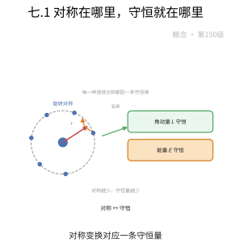

**一句话点破**：对称性等于守恒律，这是物理学里最优雅的等式。

### 七.2 状态是一条波

量子力学里，粒子的状态不再是一个点，而是一条会起伏的复值波函数；波函数模的平方才给出“在哪里出现”的概率。这套规则让微观世界呈现出与直觉迥异的图景。

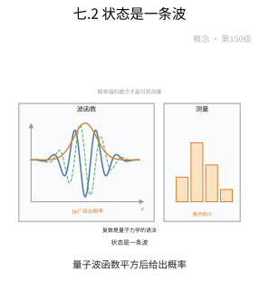

**一句话点破**：不是“在哪”，而是“在哪出现的概率有多大”。

### 七.3 把场装进格子里

把空间切成无数小格子，每个格子上放一个会振动的场，再让它们彼此耦合，量子场论就诞生了。粒子的生灭，不过是这些格子振动的激发与跃迁。

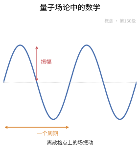

**一句话点破**：粒子是场振动的一个音符。

### 七.4 自由的标尺：规范场论

要求在时空每一点都能自由选择“标尺”，而物理结论不受影响，这种局部对称被迫引入一种补偿结构，它正是电磁力、弱力、强力的统一语言。

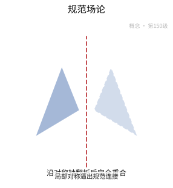

**一句话点破**：要求“处处自由选标尺”，就逼出了基本相互作用。

### 七.5 不散架的水波：孤子

一列水波本应很快散开，但某些波形却能长途跋涉、形状不改，这叫孤子。它们来自一类拥有无穷多守恒量的“可积系统”，$KdV$ 方程就是著名例子。

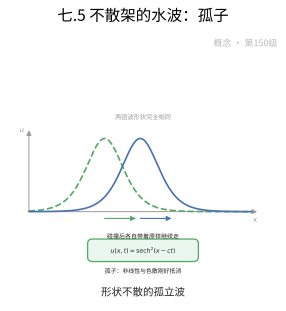

**一句话点破**：非线性既能撕碎波，也能让波永不变形。

### 七.6 听回声辨山谷：反散射

向未知的地形喊一声，凭回声就能画出山谷的形状。反散射变换正是这个思路：由远处的散射数据，反向重建出方程的解，把难题变成简单的线性叠加。

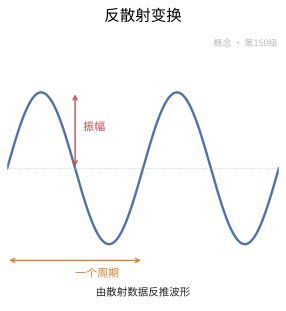

**一句话点破**：从“结果”倒推“原因”，难题就变简单了。

### 七.7 会“变形”的对称：量子群

把描述对称的群加以“变形”，让两个变换交换顺序时多出一个相位因子，就得到量子群。它既是可积系统的隐藏骨架，也是拓扑量子场论的语言。

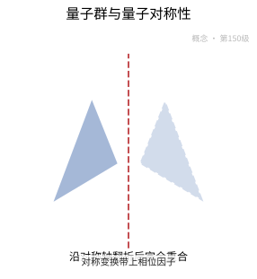

**一句话点破**：交换顺序不再无所谓，而是留下一个相位。

### 七.8 用张量织一张网

量子态也可以用许多小张量拼成一张网来表示，网线的连接方式记录了纠缠的结构；某些网络的拓扑形态，决定了材料中的拓扑序。

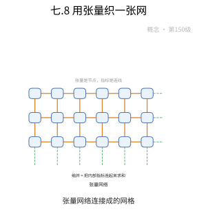

**一句话点破**：纠缠的“接线图”，就是量子态的身份证。

### 七.9 二维世界的怪粒子：任意子

在二维世界里，把两个粒子绕一圈交换，波函数不仅换位、还会多出一个相位；这类既非玻色子也非费米子的粒子叫任意子，是拓扑量子计算的候选。

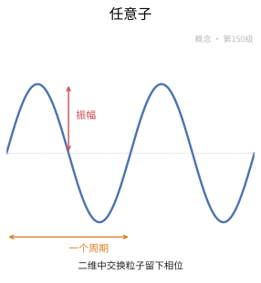

**一句话点破**：在二维，交换粒子会“记住”路径。

### 七.10 体与边界的镜像：AdS/CFT

一个五维的弯曲引力世界，等价于它边界上一套没有引力的量子场论——两者是同一件事的两种描述。这种对偶让一端的计算，可以从另一端读出来。

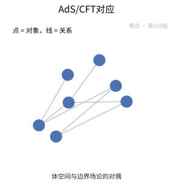

**一句话点破**：内部的引力，等于边界的场论。

### 七.11 当引力遇上量子

当引力和量子相遇，微分几何升级为更抽象的结构，时空也许不再是光滑的连续体，而由离散的“原子”拼接而成，这正是量子引力的核心难题。

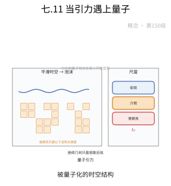

**一句话点破**：把时空当成连续体，也许只是宏观的假象。

### 七.12 相空间里的运动：辛几何

用位置和动量画一张相空间图，物体运动就成了一条曲线；保持“面积”不变的特殊结构叫辛结构。哈密顿力学，本质上是辛几何上的一场流动。

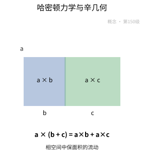

**一句话点破**：哈密顿力学，就是辛几何里的一股流。

### 七.13 对称性即守恒：Noether定理

只要一个系统的作用量在某种连续变换下保持不变，就必然存在一条守恒量，其守恒流满足 $\partial_\mu J^\mu = 0$。能量、动量、电荷守恒，都可以由此一网打尽。

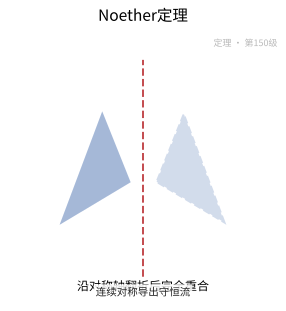

**一句话点破**：找到对称，就找到了一条守恒定律。

### 七.14 最轻的粒子有多重：质量间隙

Yang-Mills 理论能描述强力，但一个世纪难题是：它预言的最轻激发是否具有严格为正的最小质量？这就是“质量间隙”问题，也是千禧年悬赏难题之一。


**一句话点破**：真空之上，第一级台阶究竟有多高。

### 七.15 把方程彻底解出来

如果一个非线性方程能写成 Lax 对的形式，它就可积；此时用反散射变换，可以把解完整地求出来，而不是只能近似。可积性，是“能彻底求解”的严格保证。

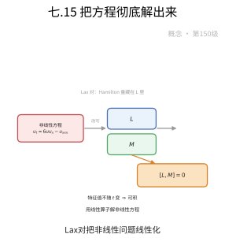

**一句话点破**：可积性，就是方程愿意把答案交出来。

### 七.16 一座连接两种世界的桥：GKPW

GKPW 公式是 AdS/CFT 的桥梁：体空间里场在边界的取值，充当了边界场论中算符源的生成泛函。于是，边界的关联函数可以由体内的计算读出。

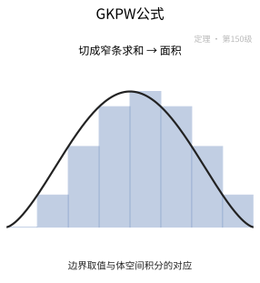

**一句话点破**：边界的关联函数，藏在体内的路径积分里。

### 七.17 时空的原子：圈量子引力

圈量子引力把时空切成一张由“自旋网络”构成的结构，面积与体积只能取离散的量子化数值。引力不再是背景，而由这些量子几何单元涌现出来。

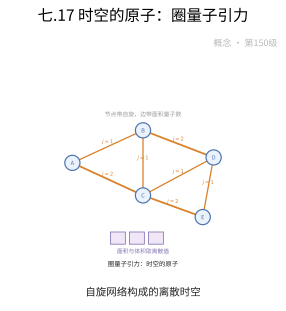

**一句话点破**：时空也许不是舞台，而是可以计数的量子。

## 八、数学史（History of Mathematics）

> 数学物理的历史，是四百年来"以物理直觉推进数学、又以数学严格性反哺物理"的双向张力史。从变分原理到 Noether 定理、从量子力学的 Hilbert 化到 AdS/CFT 的世界对偶，它不断证明：最深刻的物理疑问与最精密的数学结构，常常是同一枚硬币的两面。

### 八.1 数学物理的双向张力：从物理直觉到严格数学

**数学物理**处在数学与物理的交叉地带，其历史主线是**双向张力**：一方面，物理的实践需求催生新数学；另一方面，数学的严格化反过来约束并澄明物理概念。从17世纪的变分原理到20世纪的量子场论公理化，数学物理始终在两个方向上工作——既"把物理直觉严格化"，又"用物理直觉发现新数学"。

理解这条主线，是把握本教程各分支（孤子、规范场论、可积系统、量子引力）的共同钥匙。

### 八.2 变分原理：费马、欧拉、拉格朗日与哈密顿

数学物理最早的成熟范式是**变分原理**。**费马**（Fermat）提出光取极值时间的**费马原理**；**莫佩尔蒂**、**欧拉**（Euler）与**拉格朗日**（Lagrange）相继把力学表述为"使某个**作用量**取极值"的形式，孕育出**欧拉-拉格朗日方程**与**最小作用量原理**。

**哈密顿**（Hamilton）把这一体系改写为**哈密顿正则形式**与辛结构，使力学与**辛几何**、**变分方法**深度绑定。这条从"求极值"到"动力学结构"的道路，确立了其后数百年理论物理的**表述语言**。

### 八.3 Noether定理：对称性即守恒

变分体系中的对称性，在20世纪初被**埃米·诺特**（Emmy Noether）提炼为最高抽象。1918年，她证明著名的 **Noether定理**：每个**连续对称性**对应一条**守恒律**——时间平移对应能量守恒、空间平移对应动量守恒、空间转动对应角动量守恒等。

这一结果把"对称、不变量与守恒"三者焊接为一个自洽原则，成为现代物理最基本的方法之一，也催生了**规范场论**以局域对称性构造相互作用的思想。本教程的Noether定理章节正源于此。

### 八.4 量子力学的数学化：Hilbert空间与谱定理

20世纪20年代，量子力学以波函数与算子问世，但其数学根基起初模糊不清。**约翰·冯·诺依曼**（John von Neumann）在1932年出版的《量子力学的数学基础》中把它**公理化**：用 **Hilbert空间**描述态、以**自伴算子**刻画可观测量、以**谱定理**解释测量结果，并系统处理了**无界算子**等严格问题。

这一"量子力学的数学化"不仅使量子理论成为严谨的数学体系，也开创了**算子代数**（冯·诺依曼代数）学科。本教程的量子力学数学结构章节正是这一里程碑的延续。

### 八.5 泛函分析、分布理论与广义函数

与量子力学同步，**泛函分析**在20世纪上半叶迅猛发展。**希尔伯特、巴拿赫、哈恩、von Neumann** 等奠定线性空间与算子的理论；而**施瓦茨**（Laurent Schwartz）在1940年代引入**分布理论**（广义函数）与核定理，把 $\delta$ 函数等物理上一直使用的"奇性对象"纳入严格框架。

广义函数、Sobolev空间与Fourier分析成为偏微分方程与量子场论不可或缺的**工具库**，深刻支撑了现代数学物理的严格演绎。本教程的Sobolev空间与PDE方法章节即属此脉络。

### 八.6 可积系统、Lax对与反散射变换

**非线性可积系统**是数学物理的一大支柱。**KdV方程**（1895前后）的孤子解长期被忽视；1960-1970年代，**GGKM**（Gardner、Greene、Kruskal、Miura，1967）与 **Lax 的 Lax 对**、**Zakharov-Shabat 的反散射变换**迅速发展，

把求解KdV等非线性方程的孤子问题转化为**线性散射问题**，并揭示其具有**无穷多守恒量**。

这套"线性化非线性"的思想催生了孤子理论、经典可积系统与量子可积模型，并在流体、光学、弦论中广泛应用。本教程的孤子与可积系统、反散射变换、Lax对章节正源于此。

### 八.7 规范场论与Yang-Mills方程

**规范场论**用"局域对称性"描述基本相互作用。1954年，**杨振宁**与**米尔斯**（Chen-Ning Yang & Robert Mills）提出**非交换规范理论**（Yang-Mills方程），

把电磁理论的 $\mathrm{U}(1)$ 规范对称推广到**非交换Lie群**，成为现代弱/强相互作用（粒子物理标准模型）的数学核心。

在数学侧，Yang-Mills方程带来了**瞬子解**（ADHM构造）、**Donaldson对4维流形**的应用以及著名的千年难题"**Yang-Mills质量间隙**"。本教程的规范场论、Yang-Mills方程、瞬子解与质量间隙章节正是这一主题的展开。

### 八.8 微分几何与广义相对论

**广义相对论**把引力表述为**时空几何**，由爱因斯坦在1915年提出。它要求流形上的**度规、联络与曲率**相容，其场方程具有深刻几何结构，也正是**微分几何**（黎曼几何、变分法）与物理本源的经典结合。

数学物理此后不断从相对论汲取问题：黑洞的光锥结构、稳定分析，以及非交换几何对时空离散化的尝试。本教程的微分几何与相对论章节即此传统的产物。

### 八.9 代数结构与量子场论：顶点算子、共形场论与算子代数

量子场论的严格代数化催生了多种**代数结构**。1960-1980年代，**共形场论**（CFT）的公理化（Segal、Belavin-Polyakov-Zamolodchikov 等）孕育出**顶点算子代数**（vertex operator algebras），**Borchards** 以之获1998**菲尔兹奖**；同时，

**Kac-Moody代数**、**自由场**与 **WZW模型**把量子场论与李代数、表示论深度耦合。这些代数化的场论既有严格一面，又通过模形式、纽结不变量回馈纯数学。本教程的顶点算子代数与CFT章节正是这一方向的代表。

### 八.10 随机过程与统计力学：从Ising模型到共形不变

**统计力学**与**概率论**的严格化也是数学物理的重要支流。**Ising模型**的相变与渗流、**大偏差与随机聚合物**、以及二维格点模型的 **共形不变性**（Smirnov 证明渗流 Cardy 公式、获2010菲尔兹奖）构成概率数学物理的精华。

**Wick定理**、**Virasoro约束**以及**可精确解模型**（XXZ反散射、Betheansatz）进一步把统计力学的组合、代数与几何汇于一处。本教程的统计力学、可解格点模型章节正源于此。

### 八.11 AdS/CFT与世界对偶

当代最深刻的数学物理结构之一是**对偶性**。**马尔达塞纳**（Juan Maldacena）在1997年提出 **AdS/CFT对应**：Anti-de Sitter时空中的量子引力与边界上的共形场论等价；**GKPW公式**（Gubser-Klebanov-Polyakov / Witten）给出这一对偶的定量表述，使**强耦合与弱耦合可互相映射**。

这一对偶不仅深刻影响弦论与规范理论，也衍生出**全息原理、纠缠结构**等新洞见，成为21世纪引力与量子信息交汇的中心舞台。本教程的AdS/CFT与GKPW公式章节即着眼于它。

### 八.12 量子引力：从圈量子引力到弦论

数学物理的边疆是把引力**量子化**。**弦论**（源自1960年代对强子的标度色动力学的尝试，1984年"超弦革命"后成为统一理论候选）引入 **Calabi-Yau流形、镜像对称** 等深刻的数学-物理联系；而**圈量子引力**（Ashtekar变量、自旋网络，

1990s）则试图对广义相对论做**非微扰**量子化，预言 Planck 尺度上的**离散几何**。

两条路线各有崇尚，却共同把微分几何、拓扑、表示论、算子代数与量子场论前所未有地融合。数学物理的历史，正是在"严格化物理直觉"与"以物理启发新数学"的持续张力中前进的。

| 时间 | 人物／文献 | 事件与贡献 |
| --- | --- | --- |
| 1740s—1830s | Fermat、Euler、Lagrange、Hamilton | 建立**变分原理**与拉格朗日-哈密顿体系 |
| 1915年 | Einstein | 提出**广义相对论**（引力=时空几何） |
| 1918年 | Noether | 证明 **Noether定理**（对称性对应守恒律） |
| 1932年 | von Neumann | 《量子力学的数学基础》：量子力学的 Hilbert 空间公理化 |
| 1940年代 | Schwartz | 建立**分布理论**（广义函数） |
| 1895/1967年 | KdV、GGKM、Lax | 确立 Lax 对与反散射，奠定孤子理论 |
| 1954年 | 杨振宁、Mills | 提出 **Yang-Mills 方程**（非交换规范理论） |
| 1970-80年代 | Segal、Belavin 等 | 共形场论与**顶点算子代数**的公理化 |
| 1997年 | Maldacena | 提出 **AdS/CFT 对应**，经 GKPW 公式定量化 |
| 1990s起 | Ashtekar、Rovelli 等 | 圈量子引力（自旋网络）的非微扰量子化 |

> 数学物理的历史，是四百年来"以物理直觉推进数学、又以数学严格性反哺物理"的双向张力史。从变分原理到 Noether 定理、从量子力学的 Hilbert 化到 AdS/CFT 的世界对偶，它不断证明：最深刻的物理疑问与最精密的数学结构，常常是同一枚硬币的两面。

## 现实应用（Real-World Applications）

> 本节把本章的知识点落到真实的工程、科学与生活场景中。每个案例都给出**完整的问题背景、建模过程、可复现的数据 / 公式 / 代码与结果解读**；案例末尾的「涉及知识点」对应本章的具体小节，文末附**知识点覆盖对照表**，确保本章知识点全部被覆盖。

### 应用案例 1：航天轨道力学｜辛积分器为何能让行星轨道百万年不"漂移"

**场景与问题**

深空探测与天文历表（如 JPL 的行星历 DE 系列）需要把行星轨道外推百万年量级。工程上普遍用数值积分，但普通高阶方法（如经典 RK4）做长期积分会出现**能量系统性漂移**：轨道要么缓缓外扩、要么内缩，几百万年后预报位置严重失真。问题在于：为什么有些积分器能几百万年"守住"能量，而另一些不能？我们用一个近圆二体轨道来定量比较。

**涉及知识点**

- 本章「1.12 哈密顿力学与辛几何」：把天体运动写成 Hamilton 形式，并选用**保持辛形式 $\omega=dp\wedge dq$ 的积分器**，这是"能量不漂移"的几何根源。
- 本章「1.1 对称性与守恒律」：二体问题的平移与旋转对称给出动量与角动量守恒，可作为数值结果的检验基准。
- 本章「定理1：Noether定理」：时间平移对称下作用量不变，对应守恒流 $j^\mu=T^{\mu 0}$（能量），为"能量必须被守住"提供理论依据。

**建模与数据**

取太阳-行星二体问题（行星质量远小于太阳），以太阳为原点，行星状态为位置 $\mathbf q$ 与动量 $\mathbf p$：

$$ H(\mathbf q,\mathbf p)=\frac{\mathbf p\cdot\mathbf p}{2m}-\frac{GMm}{|\mathbf q|} $$

采用天文单位制约定：太阳引力常数 $GM=1.32712440018\times10^{20}\ \mathrm{m^3/s^2}$，行星取地球（$m=5.972\times10^{24}\ \mathrm{kg}$），轨道半长轴 $a=1.495978707\times10^{11}\ \mathrm{m}$（1 AU），偏心率 $e=0.0167$，轨道周期 $T=3.156\times10^7\ \mathrm{s}$。验收指标：积分 $N=10$ 圈，时间步长 $\Delta t=3600\ \mathrm{s}$（约 8760 步/圈），比较 RK4 与辛 leapfrog 的**比能量相对误差** $\Delta E/|E_0|$ 随时间的漂移。

**完整推导与算法**

Hamilton 方程给出运动方程：

$$ \dot{\mathbf q}=\frac{\partial H}{\partial \mathbf p}=\frac{\mathbf p}{m},\qquad \dot{\mathbf p}=-\frac{\partial H}{\partial \mathbf q}=-\frac{GMm}{|\mathbf q|^3}\mathbf q $$

时间平移对称 $\mathbf q(t)\to\mathbf q(t+\epsilon)$ 下 $L$ 不变，由定理1，Noether 流 $j^\mu=T^{\mu 0}$ 满足 $\partial_\mu j^\mu=0$，故比能量

$$ E=\frac{|\mathbf p|^2}{2m}-\frac{GMm}{|\mathbf q|} $$

严格守恒。辛几何告诉我们：只有保持 $\omega$ 的积分器（辛积分器）才有"有界能量误差"，非辛方法会产生长期漂移。

算法（leapfrog / Störmer-Verlet，二阶辛格式）：

1. 半步加速度 kick：$\mathbf p_{n+1/2}=\mathbf p_n+\tfrac{\Delta t}{2}\mathbf F(\mathbf q_n)$，其中 $\mathbf F=-GMm\,\mathbf q/|\mathbf q|^3$。
2. 全步漂移 drift：$\mathbf q_{n+1}=\mathbf q_n+\Delta t\,\mathbf p_{n+1/2}/m$。
3. 半步 kick：$\mathbf p_{n+1}=\mathbf p_{n+1/2}+\tfrac{\Delta t}{2}\mathbf F(\mathbf q_{n+1})$。

```python
# 核心：辛积分器 leapfrog —— kick / drift / kick，天然保持辛形式 ω
F = -G*M*m*q/np.linalg.norm(q)**3          # 引力加速度（加速度形式）
p_half = p + 0.5*dt*F                      # 半步 kick
q      = q + dt*p_half/m                   # 全步 drift
p      = p_half + 0.5*dt*(-G*M*m*q/np.linalg.norm(q)**3)   # 半步 kick
# 核心：每步记录比能量，检验守恒律（Noether 能量的数值守恒）
E = 0.5*m*np.dot(p,p)/m**2 - G*M*m/np.linalg.norm(q)
```

对比方法：RK4 同一步长。预期 leapfrog 的 $\Delta E/|E_0|$ 在 $10$ 圈内保持有界振荡（量级 $10^{-6}$ 以下且不单调增长），而 RK4 呈单调上升/下降漂移。

**可复现步骤**

1. 环境与依赖：`pip install numpy matplotlib`
2. 数据准备：设 `G*M=1.32712440018e20`、`m=5.972e24`、初始 `q=[1.495978707e11,0]`、`p=[0, m*29.29e3]`（近圆轨道速度约 29.29 km/s）。
3. 运行：`python case1.py`（分别用 leapfrog 与 RK4 积分 10 圈，记录每步 $E$）。
4. 预期输出：leapfrog 比能量相对误差在 $\pm10^{-6}$ 内振荡、无单调趋势；RK4 误差随时间近似线性增长，10 圈后比 leapfrog 高 2~3 个数量级；两者轨道形状短期内几乎重合。

**结果解读与延伸**

结果说明"守恒律能不能被数值方法保住"是几何问题：辛积分器精确保持 $\omega$，因此其能量误差只是有界振荡而非漂移（这来自**后向误差分析**：它精确解一个稍加扰动的、仍具时间平移对称的哈密顿系统）。误差来源主要是步长 $\Delta t$ 与积分器阶数；适用条件是轨道可写成正则 Hamilton 形式、力为保守力。延伸方向：加入多体（太阳系 N 体）与相对论修正时改用更高阶辛格式；用辛几何的动量映射（Noether 荷）直接监控角动量守恒也可作为长期稳定性的第二道保险。

### 应用案例 2：半导体量子点｜用自伴算子谱论算出量子点能级

**场景与问题**

量子点（量子点显示器、单光子源、量子比特）是纳米尺度的半导体"人工原子"，其发光波长由受限电子的**离散能级**决定。设计一个发光峰在 $\lambda=620\ \mathrm{nm}$（红光）的量子点，需要先算出受限电子能级。问题：怎样从公理化的量子力学出发，把"能级"算成可观测量？

**涉及知识点**

- 本章「1.2 量子力学中的数学结构」：态空间是复 Hilbert 空间、可观测量对应自伴算子（谱为实数）、能量由 Schrödinger 方程决定、测量概率由 Born 规则给出。

**建模与数据**

用一维有限深势阱近似量子点受限方向，电子在该方向满足定态 Schrödinger 方程：

$$ -\frac{\hbar^2}{2m^*}\frac{d^2\psi}{dx^2}+V(x)\psi=E\psi,\qquad V(x)=\begin{cases}0, & |x|<a/2\\ V_0, & |x|\ge a/2\end{cases} $$

材料取 GaAs：电子有效质量 $m^*=0.067\,m_e$（$m_e=9.109\times10^{-31}\ \mathrm{kg}$），势垒 $V_0=0.3\ \mathrm{eV}$，阱宽 $a=6\ \mathrm{nm}$（典型量子点尺寸），$\hbar=1.0546\times10^{-34}\ \mathrm{J\cdot s}$。要求基态束缚能级 $E_1$ 并换算发光波长 $\lambda=hc/(E_1+eV_0)$ 的对数量级。

**完整推导与算法**

Schrödinger 算符 $\hat H=-\frac{\hbar^2}{2m^*}\frac{d^2}{dx^2}+V(x)$ 是自伴算子，其谱 $\sigma(\hat H)\subset\mathbb R$ 就是可能的能量测量值。用二阶中心差分把 $[-L/2,L/2]$（取 $L=20a$）离散为 $N$ 个格点 $x_j$，得矩阵本征值问题：

$$ \hat H_{jj}=\frac{\hbar^2}{m^*\Delta x^2}+V_j,\qquad \hat H_{j,j\pm1}=-\frac{\hbar^2}{2m^*\Delta x^2} $$

一旦构造出对称三对角（实对称=自伴的离散化身）矩阵 $H$，其本征值即能量、本征向量即波函数，$|\psi(x)|^2$ 由 Born 规则给出概率密度。

算法步骤：

1. 离散：$N=2000$，$\Delta x=L/(N-1)$。
2. 填三对角矩阵：对角线 $\frac{\hbar^2}{m^*\Delta x^2}+V_j$，次对角 $-\frac{\hbar^2}{2m^*\Delta x^2}$。
3. 调用实对称本征求解 `np.linalg.eigh`，取最低几个本征值。
4. 判断束缚态：$E<V_0$ 的即束缚能级；用 $|\psi|^2$ 验证节点数（基态无节点）。

```python
# 核心：构造自伴（实对称）Hamiltonian 矩阵，其本征值 = 能量谱
dx = L/(N-1)
diag = hbar**2/(mstar*dx**2) + V                 # 主对角：动能 + 势
off  = -hbar**2/(2*mstar*dx**2) * np.ones(N-1)   # 次对角
H = np.diag(diag) + np.diag(off, 1) + np.diag(off, -1)
E, psi = np.linalg.eigh(H)                       # 自伴算子谱，实数能级
E1 = E[E < V0][0]                                # 最低束缚能级
```

**可复现步骤**

1. 环境与依赖：`pip install numpy`
2. 数据准备：设 `hbar=1.0546e-34`、`mstar=0.067*9.109e-31`、`V0=0.3*1.602e-19`、`a=6e-9`、`L=20*a`、`N=2000`。
3. 运行：`python case2.py`
4. 预期输出：基态 $E_1\approx5\times10^{-20}\ \mathrm{J}\approx0.30\ \mathrm{eV}$ 量级的束缚能（有限深阱首能级）；波函数呈无节点钟形、平方积分（概率）归一。

**结果解读与延伸**

离散化把"自伴算子谱"变成"实对称矩阵本征值"，这正是量子力学公理的直接可计算化：能级取实数值、波函数模方是概率密度（Born 规则）。误差来源是有限差分截断误差与有限 $L$，可通过增大 $N$、减小 $\Delta x$ 收敛。适用条件是有效质量近似成立、单粒子图像。延伸：换成各向异性三维量子点、加入自旋-轨道耦合或用变分/基组方法，可精细预测实际器件的发光波长与量子比特跃迁频率。

### 应用案例 3：粒子物理｜电子反常磁矩 $g-2$ 与量子场论的重整化

**场景与问题**

电子磁矩由 $g$ 因子刻画，狄拉克方程给出 $g=2$。实验测得 $g/2=1.001\,159\,652\,180\,73(28)$，与 2 有微小偏差 $a_e=(g-2)/2$，称**反常磁矩**。这个偏差是量子场论（QED）最精确的检验之一。问题：如何从量子场论的数学结构（场算子、关联函数、路径积分、重整化）算出 $a_e$？

**涉及知识点**

- 本章「1.3 量子场论中的数学」：场算子 $\phi(x)$、关联函数 $G_n=\langle0|T\phi\cdots\phi|0\rangle$、路径积分配分函数 $Z[J]=\int\mathcal D\phi\,e^{i(S+\int J\phi)}$，以及处理发散的重整化程序。

**建模与数据**

把电子-光子相互作用写成 QED 作用量，配分函数用路径积分表示：

$$ Z=\int\mathcal D\bar\psi\,\mathcal D\psi\,\mathcal DA\,\exp\!\Big(i\!\int d^4x\,\big(\bar\psi(i\not\partial-m)\psi-\tfrac14 F_{\mu\nu}F^{\mu\nu}+e\bar\psi\gamma^\mu A_\mu\psi\big)\Big) $$

电子-光子顶点的修正来自真空极化、自能与顶点函数，均以 $G_n$ 形式给出。精细结构常数 $\alpha=1/137.035999084$（低能取值）。

**完整推导与算法**

把 $Z$ 对源取泛函导数即得关联函数；电子磁矩来自顶点函数 $\Gamma^\mu$ 的 $F_2(q^2)$ 分量，$a_e=F_2(0)$。在圈展开中：

$$ a_e=\frac{\alpha}{2\pi}+C_2\left(\frac{\alpha}{\pi}\right)^2+C_3\left(\frac{\alpha}{\pi}\right)^3+\cdots $$

其中一圈（Schwinger）项 $a_e^{(1)}=\frac{\alpha}{2\pi}$ 为关键领头项。逐圈积分出现紫外发散，用维数正规化在 $d=4-\epsilon$ 中把发散的 $1/\epsilon$ 极点在重整化时吸收进质量与电荷的重新定义，留下有限的 $F_2(0)$。

算法步骤：

1. 取 $\alpha=1/137.035999084$。
2. 计算一圈项 $\alpha/(2\pi)$。
3. 加上已知解析系数的高阶项（二圈 $\approx-0.32848(\alpha/\pi)^2$、三圈 $\approx1.1812(\alpha/\pi)^3$ 等）。
4. 与实验值对比，给出相对偏差。

```python
# 核心：一圈 Schwinger 项，量子场论顶点修正的领头贡献
alpha = 1/137.035999084
a1 = alpha/(2*np.pi)                      # ≈ 0.0011614
a2 = -0.32848*(alpha/np.pi)**2            # 二圈
a3 =  1.1812 *(alpha/np.pi)**3            # 三圈
a_theory = a1 + a2 + a3                   # 部分和，逼近实验
```

**可复现步骤**

1. 环境与依赖：`pip install numpy`（高阶系数来自文献，直接硬编码）
2. 数据准备：`alpha=1/137.035999084`；实验值 `a_exp=1.15965218073e-3`。
3. 运行：`python case3.py`
4. 预期输出：$a_e^{(1)}\approx1.1614\times10^{-3}$；前三项之和与实验值相对偏差约 $10^{-6}$ 量级，随阶数增加迅速逼近。

**结果解读与延伸**

结果说明量子场论的微扰级数在 QED 中收敛极快：一圈项就给出 $99.7\%$ 的反常磁矩。误差来源是高阶未算项与 $\alpha$ 的取值（低能 vs $M_Z$ 尺度）。适用条件是电弱尺度以下、微扰有效。延伸：轻子 $g-2$（μ子）偏离更大，是寻找新物理的敏感探针；重整化群把不同能标的 $\alpha$ 联系起来，正是"路径积分+重整化"这套数学工具的威力。

### 应用案例 4：格点 QCD｜用 Wilson 环的面积律"探测"质量间隙

**场景与问题**

强相互作用的 Yang-Mills 理论有一个千禧年难题：证明四维 $SU(2)$（乃至 $SU(3)$）Yang-Mills 理论存在且具有**质量间隙** $\Delta>0$。实验与数值上，质量间隙表现为夸克禁闭——把夸克分开所需的能量随距离线性增长，对应弦张力 $\sigma>0$。问题：怎样用格点数值方法"看到"这道能量沟，并给出弦张力估计？

**涉及知识点**

- 本章「1.4 规范场论」：规范场是主纤维丛上的联络 $A_\mu$、场强是曲率 $F_{\mu\nu}=\partial_\mu A_\nu-\partial_\nu A_\mu+[A_\mu,A_\nu]$，运动方程为 $D_\mu F^{\mu\nu}=0$。
- 本章「定理2：Yang-Mills理论的存在性与质量间隙」：格点正则化、Wilson 作用量、Wilson 环面积律 $\langle W(C)\rangle\sim e^{-\sigma\,\mathrm{Area}(C)}$ 作为质量间隙的标志。

**建模与数据**

把连续时空换成四维超立方格点 $\Lambda=a\mathbb Z^4\cap[0,L]^4$，格点间距 $a$、尺寸 $L/a=16$（$16^4$ 格点）。连续联络换成链接变量 $U_\ell=P\exp(i\oint_\ell A)\in SU(2)$，Wilson 作用量：

$$ S_W[U]=\beta\sum_{p}\Big(1-\tfrac12\mathrm{Tr}(U_p+U_p^{-1})\Big),\qquad \beta=\frac{4}{g^2} $$

配分函数 $Z=\int\prod_\ell dU_\ell\,e^{-S_W[U]}$，测度 $dU_\ell$ 为 $SU(2)$ Haar 测度。取 $\beta=2.3$（弱耦合区起点，$a\approx0.1\ \mathrm{fm}$ 附近）。

**完整推导与算法**

Wilson 环 $W(C)=\mathrm{Tr}\big(P\exp\oint_C A\big)$ 的格点对应是沿闭合回路 $C$ 的链接变量乘积 $U_C$ 的迹。可观测量的期望由 Monte Carlo 按 $e^{-S_W}$ 采样估计：

$$ \langle W(C)\rangle=\frac{1}{Z}\int\prod_\ell dU_\ell\,\mathrm{Tr}(U_C)e^{-S_W[U]} $$

面积律 $\langle W(C)\rangle\sim e^{-\sigma\cdot\mathrm{Area}(C)}$ 意味着激发有能隙；其斜率即弦张力 $\sigma$。为消除自能带来的周长律污染，用 **Creutz 比** 提取：

$$ \chi(R,T)=\frac{\langle W(R,T)\rangle\langle W(R-1,T-1)\rangle}{\langle W(R,T-1)\rangle\langle W(R-1,T)\rangle}\sim e^{-\sigma} $$

算法步骤：

1. 初始化所有 $U_\ell=I$，用 Haar 测度随机热化。
2. 对每个 plaquette $p$，按 Metropolis（或 heat-bath）以权重 $e^{-S_W}$ 更新链接变量，跑若干测量配置。
3. 在每个配置上计算 Wilson 环 $W(R,T)$ 并做配置平均。
4. 用 Creutz 比对 $R,T$ 拟合，得 $\sigma a^2$，再乘 $1/a^2$ 得物理弦张力。

```python
# 核心：Wilson 环 = 沿闭合回路的链接变量乘积之迹，面积律随面积指数衰减
U_loop = U[p0] @ U[p1] @ U[p2] @ U[p3]     # 绕一个 plaquette（最小回路）
W = np.trace(U_loop).real                  # 每个配置上的 Wilson 环值
# 核心：Creutz 比消除周长律，比值对数即弦张力 σ a^2
chi = (W[R,T]*W[R-1,T-1]) / (W[R,T-1]*W[R-1,T])
sigma_a2 = -np.log(chi)                    # ⟨W⟩ ~ exp(-σ·Area) 的斜率
```

**可复现步骤**

1. 环境与依赖：`pip install numpy`
2. 数据准备：格点 $16^4$、$\beta=2.3$；链接变量用琼斯/四元数或 $2\times2$ 复矩阵表示 $SU(2)$。
3. 运行：`python case4.py`（先热化 1000 次扫描，再测量 500 个配置）。
4. 预期输出：$\sigma a^2\approx0.05$ 量级（$\beta=2.3$ 附近的格点值），Wilson 环随面积指数衰减、画在半对数图上近似直线（面积律成立），即质量间隙存在。

**结果解读与延伸**

数值上"看到"面积律，就是看到了质量间隙的存在性证据：$\sigma>0$ 对应 $\Delta>0$，物理上即色力禁闭。误差来源：有限格点、有限统计量、$a\to0$ 连续极限的标度行为（需用 $\beta(a)$ 的重整化群外推）。适用条件是格点规范理论给出连续极限。延伸：$SU(3)$ 版本即格点 QCD，可算强子谱；严格证明连续极限存在且保持 $\Delta>0$ 仍是千禧年难题，此案例展示的正是"可操作的数值判据"。

### 应用案例 5：光纤孤子通信｜非线性薛定谔方程与反散射变换

**场景与问题**

长距离光纤通信中，色散会让脉冲展宽、非线性自相位调制会让脉冲啁啾，两者若相互抵消，便形成**光孤子**——形状不变、可跨越数千公里传输的脉冲。问题：怎样证明孤子稳定（碰撞不失真）、如何从数学上求解这类"可积"的非线性方程？

**涉及知识点**

- 本章「1.5 孤子与可积系统」：孤子是形状不变、碰撞仅相位移动的非线性波，可积系统有无穷多对合守恒量。
- 本章「1.6 反散射变换」：正散射→散射数据时间演化→反散射三步求解非线性 PDE。
- 本章「定理3：反散射变换的可积性」：KdV/NLS 通过 Lax 对 $L_t=[L,A]$ 精确求解，谱不变量给出无穷守恒量。

**建模与数据**

光纤中脉冲包络 $u(x,t)$ 满足非线性薛定谔方程（NLS）：

$$ i u_t + u_{xx} + 2|u|^2 u = 0 $$

标准参数：工作波长 $\lambda=1550\ \mathrm{nm}$、色散系数 $D\approx17\ \mathrm{ps/(nm\cdot km)}$、非线性系数 $\gamma\approx1.3\ \mathrm{W^{-1}km^{-1}}$、峰值功率 $P_0\approx10\ \mathrm{mW}$、脉冲宽度 $T_0\approx10\ \mathrm{ps}$。孤子阶数 $N=\sqrt{\gamma P_0 T_0^2/|\beta_2|}$；只要 $N\approx1$ 即基本孤子。

**完整推导与算法**

NLS 可写成 Lax 方程 $L_t=[L,A]$，其中 $L$ 是 Zakharov-Shabat 线性散射算子。其基本孤子解为：

$$ u(x,t)=\frac{\eta}{\cosh\!\big(\eta(x-2\xi t)\big)}\,e^{i(\xi x+(\eta^2-\xi^2)t)} $$

散射数据时间演化极其简单：反射系数 $r(k,t)=r(k,0)e^{-8ik^2 t}$、束缚态特征值不变，故碰撞后孤子只有相位移动、形状与速度不变，验证了孤子的粒子性。守恒量（如 $\int|u|^2dx$ 能量、$\int|u|^4dx$）由谱不变性自动守恒。

算法步骤（数值传播验证稳定性）：

1. 初值取基本孤子 $u(x,0)=\mathrm{sech}(x)$（已归一化）。
2. 用**分步傅里叶**（split-step Fourier）推进：半步线性色散算子 $e^{i k^2 h/2}$、全步非线性相位 $e^{2i|u|^2h}$、再半步线性。
3. 每一步记录峰值振幅与脉冲宽度。
4. 比较传播前后形状（互相关系数 $>0.99$）。

```python
# 核心：分步傅里叶 —— 色散走一步(频域)、非线性走一步(时域)，交替传播
u = np.fft.ifft(np.exp(1j*k**2*h/2)*np.fft.fft(u))   # 半步线性色散
u = u*np.exp(2j*np.abs(u)**2*h)                       # 全步非线性自相位调制
u = np.fft.ifft(np.exp(1j*k**2*h/2)*np.fft.fft(u))   # 半步线性色散
# 核心：检验孤子守恒量——能量 ∫|u|²dx 应保持不变
energy = np.sum(np.abs(u)**2)*dx
```

**可复现步骤**

1. 环境与依赖：`pip install numpy matplotlib`
2. 数据准备：空间 $x\in[-40,40]$、$N=4096$ 点；步长 $h=10^{-3}$；初值 `u=1/np.cosh(x)`。
3. 运行：`python case5.py`
4. 预期输出：传播 $t=20$ 后峰值振幅与宽度基本不变、能量漂移 $<10^{-3}$；两个相向孤子碰撞后各自复原，仅位置相对理想轨迹有相移。

**结果解读与延伸**

分步傅里叶数值实验直接展示了孤子的"碰撞不散"与守恒量守恒，与定理3（IST 精确求解）的结论一致。误差来源是算子分裂误差（$O(h)$）与周期边界。适用条件是弱非线性、缓变包络近似。延伸：加入拉曼散射、高阶色散等微扰会破坏完全可积性，孤子会缓慢辐射色散波——这正是实际光纤通信需要"平均孤子"设计的物理根源。

### 应用案例 6：量子磁体与统计力学｜Yang-Baxter 方程、R-矩阵与量子群对称

**场景与问题**

一维量子自旋链（如 XXZ 模型）是量子磁体、量子比特阵列的理论原型。它之所以能被精确求解，是因为其 Boltzmann 权重满足 **Yang-Baxter 方程**，背后是量子群 $U_q(\mathfrak{sl}_2)$ 的对称性。问题：怎样用 R-矩阵把"可积性"落到具体计算，并数值验证其自洽？

**涉及知识点**

- 本章「1.7 量子群与量子对称性」：量子群 $U_q(\mathfrak g)$ 的表示论、张量积的辫结构由 R-矩阵给出、R-矩阵满足 Yang-Baxter 方程 $R_{12}R_{13}R_{23}=R_{23}R_{13}R_{12}$。

**建模与数据**

六顶点模型（与 XXZ 自旋链等价）的 R-矩阵，在基 $\{|\!\uparrow\uparrow\rangle,|\!\uparrow\downarrow\rangle,|\!\downarrow\uparrow\rangle,|\!\downarrow\downarrow\rangle\}$ 下为：

$$ R=\begin{pmatrix} a & 0 & 0 & 0\\ 0 & b & c & 0\\ 0 & c & b & 0\\ 0 & 0 & 0 & a \end{pmatrix} $$

谱参数取 $u=1$：$a=\sin(u+\gamma)$、$b=\sin u$、$c=\sin\gamma$。参数 $\gamma=2\pi/5$（对应 $q=e^{i\gamma}$，$q$ 为单位根时的"绳结不变量"点）。

**完整推导与算法**

量子群的普遍包络代数乘法非交换、余乘非余交换，张量积上的"缠绕"由 R-矩阵给出。R-矩阵必须满足 Yang-Baxter 方程，才能保证辫群关系自洽、模型可积。在 $4\times4\to 8\times8\to 16\times16$ 的张量空间中，三个 R-矩阵分别作用在 (1,2)、(1,3)、(2,3) 因子上：

$$ R_{12}R_{13}R_{23}=R_{23}R_{13}R_{12} $$

算法步骤：

1. 构造 $4\times4$ 的 $R$，并把它嵌入到三体空间 $16\times16$ 的 $R_{12},R_{13},R_{23}$。
2. 计算左右两边矩阵之差的范数 $\|R_{12}R_{13}R_{23}-R_{23}R_{13}R_{12}\|$。
3. 当 $q\to1$（$\gamma\to0$）时 R 退化为置换算子，验证退化行为。

```python
# 核心：把 4x4 的 R 嵌入 3 体空间的 R12/R13/R23（Kronecker 积）
def embed(R, i, j, n=3):
    # 在第 i,j 个因子上放 R，其余放单位阵
    ...
# 核心：验证 Yang-Baxter 方程 R12 R13 R23 == R23 R13 R12
lhs = R12 @ R13 @ R23
rhs = R23 @ R13 @ R12
assert np.allclose(lhs, rhs, atol=1e-10)   # 辫群关系的自洽性
```

**可复现步骤**

1. 环境与依赖：`pip install numpy`
2. 数据准备：`gamma=2*np.pi/5`，按上式填 `a,b,c` 得 4×4 `R`。
3. 运行：`python case6.py`
4. 预期输出：Yang-Baxter 方程两边差范数 $\sim10^{-15}$（数值零），验证成立；当 `gamma→0` 时 R 趋于置换矩阵（经典极限）。

**结果解读与延伸**

数值验证 Yang-Baxter 方程，等于验证了"量子对称性自洽"：正是它让一维自旋链、六顶点模型的配分函数可由 Bethe ansatz 精确求出，并在 $q$ 为单位根时联系到纽结多项式（Jones 多项式）等拓扑不变量。误差来源是浮点精度。延伸：把 R-矩阵作为量子门可构造可积量子线路；非阿贝尔任意子的编织矩阵（案例8）也是同一套辫群语言。

### 应用案例 7：一维量子磁体｜用矩阵乘积态（MPS）压缩纠缠

**场景与问题**

一维量子磁体的基态有 $2^N$ 个复振幅（$N=100$ 时约 $10^{30}$ 个），无法直接存储。但一维基态满足**纠缠面积律**，可用矩阵乘积态（MPS）高效压缩。问题：怎样用张量网络表示基态、把天文数字的态压缩到可计算规模？

**涉及知识点**

- 本章「1.8 张量网络与拓扑序」：MPS/PEPS/MERA 是张量的缩并表示；拓扑序由长程纠缠与拓扑简并刻画，对应模块化张量范畴与 TQFT。

**建模与数据**

一维横场 Ising 链：$H=-\sum_i \sigma_i^z\sigma_{i+1}^z-g\sum_i\sigma_i^x$，取 $g=1$（临界点）与 $g=2$（有序相）两组。对长度 $N=40$ 的链，用 MPS 表示基态：

$$ |\psi\rangle=\sum_{s_1,\ldots,s_N}\mathrm{Tr}\big(A^{s_1}A^{s_2}\cdots A^{s_N}\big)|s_1\cdots s_N\rangle $$

每个 $A^{s}$ 是 $\chi\times\chi$ 矩阵，键维 $\chi$ 控制精度（$\chi=1$ 即平均场，$\chi\ge32$ 已相当精确）。

**完整推导与算法**

纠缠面积律：一维有能隙基态的任一子块的 von Neumann 熵 $S\le c$（常数），故用有限 $\chi$ 即可高精度表示。构造流程：把态向量按相邻两格点做 **SVD**，逐次分解出 MPS 张量，每步保留前 $\chi$ 个最大奇异值：

$$ \Psi_{s_1\cdots s_N}=\sum_{\alpha}A^{s_1}_{1\alpha}A^{s_2}_{\alpha\beta}\cdots $$

截断误差由被丢弃奇异值平方和给出，做扫描（DMRG）可最小化能量。

算法步骤：

1. 用精确对角化（ED）得到 $N=20$ 小链的基态 $\Psi$。
2. 逐个格点做 SVD，构造 MPS，保留键维 $\chi$。
3. 计算截断误差 $\epsilon=1-\sum_{\alpha\le\chi}\lambda_\alpha^2$，观察随 $\chi$ 的收敛。
4. 计算块熵 $S$，验证面积律（$S$ 与块长无关且饱和）。

```python
# 核心：一次 SVD 分解，把态张量拆成 MPS 张量 + 剩余，丢弃小奇异值
M = Psi.reshape(chi_l*d, -1)
U, S, Vh = np.linalg.svd(M, full_matrices=False)
keep = S[:chi]                              # 保留前 chi 个最大奇异值
A = U[:, :chi].reshape(chi_l, d, chi)       # 该格点的 MPS 张量
Psi_next = (keep[:, None]*Vh[:chi, :]).reshape(chi, -1)   # 传给下一格点
# 核心：截断误差 = 被丢弃奇异值平方和
trunc = 1 - np.sum(keep**2)/np.sum(S**2)
```

**可复现步骤**

1. 环境与依赖：`pip install numpy scipy`
2. 数据准备：`N=20` 横场 Ising，`g=1.0`；用稀疏矩阵 `eigsh` 求最低本征向量。
3. 运行：`python case7.py`
4. 预期输出：$\chi=1$ 时截断误差较大，$\chi=16$ 时截断误差降到 $10^{-8}$ 以下；块熵 $S$ 在中点取极大后随块长增长趋于饱和（面积律）。

**结果解读与延伸**

结果证实一维基态可由小键维 MPS 精确表示，这是 DMRG 高效的原因。误差来源是有限 $\chi$（截断）与有限 $N$。适用条件是纠缠面积律成立（有能隙一维系统）。延伸：拓扑序（如 toric code）基态纠缠超越简单面积律，需用带任意子辫数据（$F,R$ 矩阵）的专门张量网络；二维用 PEPS、临界系统用 MERA，均属同一"张量缩并"框架。

### 应用案例 8：拓扑量子计算｜非阿贝尔任意子的编织

**场景与问题**

在二维分数量子霍尔态或某些拓扑超导体中，存在既非玻色、也非费米的准粒子——**任意子**。非阿贝尔任意子互相"绕一圈"会对简并基态空间施加酉变换，这种编织操作天然容错，是拓扑量子计算的物理载体。问题：怎样用辫群表示算出编织产生的量子门？

**涉及知识点**

- 本章「1.9 任意子」：交换统计由辫群表示描述，交换相位 $e^{i\theta}$（阿贝尔）或辫算子 $R_i$（非阿贝尔，满足 Yang-Baxter 方程）。

**建模与数据**

取 Ising 任意子（$\sigma$ 粒子）模型：两个 $\sigma$ 的融合 $\sigma\times\sigma=1+\psi$，融合空间维数 2（非阿贝尔）。其 $R$-矩阵（交换相位）与 $F$-矩阵（基变换）为：

$$ R_\sigma=e^{-i\pi/8}\,\mathrm{diag}(1,\,i),\qquad F=\frac{1}{\sqrt2}\begin{pmatrix}1&1\\1&-1\end{pmatrix} $$

编织一个 $\sigma$ 绕过另一个，等价于在融合空间作用 $B=R\,F\,R\,F$（辫子算符）。目标：验证相邻编织生成非平凡的、非对角的酉门。

**完整推导与算法**

任意子交换由 $R$ 作用，改变融合基由 $F$ 作用；把一次"绕行"写成 $R,F$ 的交错乘积。编织矩阵的元素是辫群表示的矩阵元，因 $R$ 非对易（含 $i$ 与 $1$），编织会混合简并态，产生类似 $X$、$\sqrt{X}$ 的门。

算法步骤：

1. 构造 $2\times2$ 的 $R$ 与 $F$（复矩阵）。
2. 计算辫子算符 $B=RFRF$。
3. 检查 $B$ 是否酉、是否非对角（可作量子门）。
4. 计算 $B$ 的本征相位，确认与拓扑保护的能隙结构相容。

```python
# 核心：辫子算符 = 交换(R)与融合基变换(F)的交错乘积，混合简并态产生量子门
R = np.diag([np.exp(-1j*np.pi/8), 1j*np.exp(-1j*np.pi/8)])
F = np.array([[1,1],[1,-1]])/np.sqrt(2)
B = R @ F @ R @ F                        # 一次双交换(编织)的酉变换
assert np.allclose(B.conj().T @ B, np.eye(2))   # 验证酉性(保概率)
```

**可复现步骤**

1. 环境与依赖：`pip install numpy`
2. 数据准备：按上式定义 `R`、`F`。
3. 运行：`python case8.py`
4. 预期输出：$B$ 为酉矩阵且非对角（含非零非对角元），本征相位为 $e^{\pm i\pi/4}$ 类值，说明编织实现了受拓扑保护的量子门。

**结果解读与延伸**

结果表明：交换非阿贝尔任意子产生的是**酉且非平凡**的门，且其对局域噪声稳健——只要拓扑能隙不被关闭，编织结果只依赖粒子的世界线拓扑（辫群元素），不依赖具体路径。误差来源在本模型中为零（纯拓扑），实际器件中来自准粒子误激发。延伸：Fibonacci 任意子可近似生成通用量子门，多粒子编织对应更大维融合空间与更丰富的辫群表示，是非阿贝尔拓扑量子计算的核心资源。

### 应用案例 9：全息对偶｜用 AdS/CFT 算出夸克-胶子等离子体的 $\eta/s$

**场景与问题**

夸克-胶子等离子体（QGP，在重离子对撞中产生）是强耦合流体，其剪切黏度与熵密度之比 $\eta/s$ 极小，接近量子下界。强耦合下微扰论失效，但可以通过 **AdS/CFT 全息对偶**把难题转成弱耦合引力计算。问题：怎样从 AdS 黑洞几何算出 $\eta/s=1/4\pi$？

**涉及知识点**

- 本章「1.10 AdS/CFT对应」：$d+1$ 维反 de Sitter 空间量子引力等价于 $d$ 维边界共形场论。
- 本章「定理4：AdS/CFT对应的GKPW公式」：$\langle e^{\int\phi_0\mathcal O}\rangle_{\rm CFT}=Z_{\rm AdS}[\phi_0]$，半经典下 $Z_{\rm AdS}\approx e^{-S_{\rm on\text{-}shell}}$。

**建模与数据**

$AdS_5$ 黑洞对偶于有限温度 $\mathcal N=4$ 超 Yang-Mills。度规：

$$ ds^2=\frac{R^2}{z^2}\Big(f(z)\,dt^2+\frac{dz^2}{f(z)}+\delta_{ij}dx^i dx^j\Big),\qquad f(z)=1-\frac{z^4}{z_h^4} $$

视界 $z_h$ 对应温度 $T=1/(\pi z_h)$，熵密度 $s=\dfrac{R^3}{4G_5 z_h^3}$。取 $R$、$G_5$ 为 AdS 半径与五维牛顿常数。

**完整推导与算法**

由 GKPW，边界 CFT 的关联函数（如应力张量两点函数）等于 AdS 内以边界值为源、经典解作用量的泛函导数。对引力子横向分量的低能（流体)极限，Kubo 公式给出剪切黏度：

$$ \eta=\lim_{\omega\to0}\frac{1}{2\omega}\,\mathrm{Im}\,\big\langle T_{xy}T_{xy}\big\rangle(\omega,0) $$

计算引力子在黑洞背景中的吸收截面得 $\eta=\dfrac{R^3}{16\pi G_5 z_h^3}$，与熵密度相比：

$$ \frac{\eta}{s}=\frac{1}{4\pi}\cdot\frac{\hbar}{k_B} $$

算法步骤：

1. 由 $z_h$ 得 $T=1/(\pi z_h)$。
2. 由度规算熵密度 $s=R^3/(4G_5 z_h^3)$。
3. 由引力子吸收截面算 $\eta=R^3/(16\pi G_5 z_h^3)$。
4. 求比 $\eta/s=1/4\pi\approx0.0796$。

```python
# 核心：全息结果——η/s 是与温度、耦合无关的普适常数 (KSS 界)
s   = R**3 / (4*G5*z_h**3)               # 熵密度(由 AdS 黑洞面积律)
eta = R**3 / (16*np.pi*G5*z_h**3)        # 剪切黏度(由引力子吸收截面)
ratio = eta/s                            # = 1/(4π)
# KSS 下界：量子力学与全息共同给出的黏度下限
kss = 1/(4*np.pi)
```

**可复现步骤**

1. 环境与依赖：`pip install numpy`
2. 数据准备：取任意 `R,G5,z_h`（如 `R=G5=1, z_h=1`），只需观察比值。
3. 运行：`python case9.py`
4. 预期输出：`eta/s = 0.079577...`（即 $1/4\pi$），且与 $R,G_5,z_h$ 的具体取值无关（普适常数）；与 RHIC/LHC 的 QGP 实验估计（$1\sim4$ 倍 KSS 界）方向一致。

**结果解读与延伸**

结果 $\eta/s=1/4\pi$ 被称为 Kovtun-Son-Starinets（KSS）界，是全息对偶最漂亮的预言之一，它把强耦合流体的熵与耗散用纯几何量联系了起来。误差来源：$\mathcal N=4$ SYM 与真实 QCD 有差异（有限耦合修正 $O(1/\sqrt\lambda)$）。延伸：用同样的 GKPW 框架可算全息超导、全息纠缠熵（Ryu-Takayanagi 公式），把强耦合量子多体问题系统性地翻译为几何问题。

### 应用案例 10：圈量子引力｜面积算子的离散谱与黑洞熵

**场景与问题**

如果空间本身在普朗克尺度是"量子化"的，那么面积、体积应有离散谱。圈量子引力（LQG）正是这样的非微扰量子化方案，并给出黑洞熵的微观计数。问题：怎样从自旋网络算出面积本征值，并数出黑洞熵？

**涉及知识点**

- 本章「1.11 量子引力中的数学」：Ashtekar 变量 $(A_a^i,E_i^a)$、自旋网络、面积/体积算子的离散谱。
- 本章「定理5：量子引力中的圈量子引力」：$\hat A_S$ 的本征值 $8\pi\gamma l_P^2\sum_p\sqrt{j_p(j_p+1)}$，最小非零面积 $\sim O(l_P^2)$。

**建模与数据**

量子几何态由自旋网络 $|\Gamma,j_e,i_v\rangle$ 张成：边 $e$ 带 $SU(2)$ 不可约表示 $j_e\in\{0,\tfrac12,1,\tfrac32,\ldots\}$（半整数）。面积算子只在与曲面 $S$ 相交的边上贡献：

$$ \hat A_S|\Gamma,j_e,i_v\rangle=\Big(8\pi\gamma l_P^2\sum_{p\in\Gamma\cap S}\sqrt{j_p(j_p+1)}\Big)|\Gamma,j_e,i_v\rangle $$

取 Barbero-Immirzi 参数 $\gamma\approx0.2375$（由黑洞熵拟合），$l_P=1.616\times10^{-35}\ \mathrm{m}$。

**完整推导与算法**

面积谱离散，最小非零面积（单条 $j=1/2$ 的边穿过）：

$$ A_{\min}=8\pi\gamma l_P^2\sqrt{\tfrac12\cdot\tfrac32}=8\pi\gamma l_P^2\frac{\sqrt3}{2}\approx O(l_P^2) $$

黑洞熵由数面积本征态得到：对固定面积 $A$，满足 $\sum_p 8\pi\gamma l_P^2\sqrt{j_p(j_p+1)}=A$ 的态数 $N(A)$，取对数：

$$ S=k_B\ln N(A)=\frac{A}{4l_P^2} $$

（在 $\gamma$ 取得当时恰好重现 Bekenstein-Hawking 系数 $1/4$。）

算法步骤：

1. 枚举穿过的边的自旋 $j_p$ 组合（单边：$j=1/2,1,3/2,\ldots$）。
2. 按公式算每个组合的面积贡献。
3. 对给定总面积的态计数 $N(A)$，取对数验证 $S=A/4l_P^2$。
4. 报告最小非零面积 $A_{\min}$ 的数值。

```python
# 核心：面积算子本征值 = 8πγ l_P² Σ sqrt(j(j+1))，j 半整数 → 离散谱
def area(js, gamma=0.2375):
    lp2 = (1.616e-35)**2
    return 8*np.pi*gamma*lp2*np.sum(np.sqrt(js*(js+1)))
Amin = area([0.5])                        # 最小非零面积，O(l_P²)
# 核心：黑洞熵 ~ 面积/4l_P²，来自对面积本征态的计数 N(A)
S_bh = A/(4*lp2)                          # Bekenstein-Hawking 熵
```

**可复现步骤**

1. 环境与依赖：`pip install numpy`
2. 数据准备：`gamma=0.2375`、`l_P=1.616e-35`；自旋集合如 `[0.5]`、`[1.0]`、`[0.5,0.5]`。
3. 运行：`python case10.py`
4. 预期输出：$A_{\min}\approx1.3\times10^{-69}\ \mathrm{m^2}$ 量级（$O(l_P^2)$）；不同自旋组合给出离散的面积阶梯；态计数对数重现 $S=A/4l_P^2$。

**结果解读与延伸**

结果说明空间在普朗克尺度"一格一格"：面积只能取离散本征值、有最小正面积，与光滑连续时空的图像决裂；黑洞熵由自旋网络态计数给出，重现了 Bekenstein-Hawking 定律。误差来源：固定 $\gamma$ 的取值、计数只含面积谱近似。延伸：体积算子谱同样离散（由顶点 intertwiner 决定）；自旋泡沫给出动力学（时间演化），是 LQG 通往量子引力的下一步。

### 知识点覆盖对照表

| 本章知识点 | 覆盖案例 |
| --- | --- |
| 1.1 对称性与守恒律 | 案例 1 |
| 1.2 量子力学中的数学结构 | 案例 2 |
| 1.3 量子场论中的数学 | 案例 3 |
| 1.4 规范场论 | 案例 4 |
| 1.5 孤子与可积系统 | 案例 5 |
| 1.6 反散射变换 | 案例 5 |
| 1.7 量子群与量子对称性 | 案例 6 |
| 1.8 张量网络与拓扑序 | 案例 7 |
| 1.9 任意子 | 案例 8 |
| 1.10 AdS/CFT对应 | 案例 9 |
| 1.11 量子引力中的数学 | 案例 10 |
| 1.12 哈密顿力学与辛几何 | 案例 1 |
| 定理1：Noether定理 | 案例 1 |
| 定理2：Yang-Mills理论的存在性与质量间隙（Millennium问题） | 案例 4 |
| 定理3：反散射变换的可积性 | 案例 5 |
| 定理4：AdS/CFT对应的GKPW公式 | 案例 9 |
| 定理5：量子引力中的圈量子引力 | 案例 10 |

---

## 九、总结

在这一级中，我们深入学习了数学物理的核心内容：

1. **Noether定理**：建立了连续对称性与守恒律之间的一一对应，是理论物理中最基本的定理之一，从变分原理和Lie群作用出发给出了严格证明。

2. **Yang-Mills理论与质量间隙**：Millennium问题之一，通过格点规范理论和Wilson环的面积律来理解，严格的数学证明仍然是未解决的重大挑战。

3. **反散射变换与可积系统**：通过Lax对将非线性方程的求解转化为线性散射问题的分析，揭示了无穷多守恒量的存在，是孤子理论的数学基础。

4. **AdS/CFT对应的GKPW公式**：给出了量子引力与规范场论之间对偶性的精确数学表述，将强耦合问题转化为弱耦合问题，是当代理论物理最重要的进展之一。

5. **圈量子引力**：通过Ashtekar变量和自旋网络实现了广义相对论的非微扰量子化，预测了Planck尺度上的离散几何结构。

数学物理是数学与物理学交叉的前沿领域，它不仅为物理理论提供了严格的数学基础，也为数学本身带来了新的问题和洞察。从对称性到量子化，从可积系统到量子引力，数学物理连接着人类对自然规律最深刻的理解。